<!-- PDF_PAGE: 1 -->


<div align="center">

# Automated variability evaluation using a model-based approach with an implementation in CubeSat $ ^{ \star} $

</div>


Marco Wijaya $ ^{a,*} $ , Sami Lazreg $ ^{a} $ , Maxime Cordy $ ^{a} $ , Andreas Hein $ ^{a} $ , Jasper Bussemaker $ ^{b} $

$ ^{a} $ SnT, Interdisciplinary Centre for Security, Reliability, and Trust, University of Luxembourg, 29 Avenue John F. Kennedy, Luxembourg, 1855, Luxembourg $ ^{b} $ DLR, German Aerospace Center, Institute of System Architectures in Aeronautics, Hein-Saß-Weg 22, Hamburg, 21129, Germany

## ARTICLE INFO

Keywords:

Cyber-Physical System (CPS)

Design Space Exploration (DSE)

Multidisciplinary Design Optimization (MDO)

Architecture variability modeling

Architecture generation

Product line engineering

## ABSTRACT

The design of a Cyber-Physical System (CPS) presents significant challenges due to a vast configuration space and intensive dependencies among subsystems. Each subsystem requires careful selection and precise sizing of components from diverse hardware product lines to meet specific functional and performance requirements. This complexity increases as designers must balance objectives and constraints while accounting for the cascading effects of decisions across interconnected subsystems, highlighting how a small change in one area can greatly affect the overall system function and performance. However, there is limited research developing an automated model-based framework with the aim to address both challenges at once: architecture variability modeling and design evaluation of a CPS. Therefore, we propose a framework that integrates a novel variability-aware modeling methodology using the function-to-form concept, i.e., Architecture Design Space Graph (ADSG), with a numerical domain-dependency modeling named Multidisciplinary Design Optimization (MDO). The functional framework is then demonstrated through a use case of CubeSat design process, including the automated generation of architecture instances and numerical design space exploration. The framework has the potential to be implemented to other CPS as it provides generic building blocks in the form of an architecture modeler, generator, translator, and optimizer by leveraging the combination of ADSG and MDO.

## 1. Introduction

The design process of a Cyber-Physical System (CPS) comprises three phases: conceptual, preliminary, and detailed. During the conceptual phase, the Top Level Requirements (TLRs) of CPS are defined, covering system objectives, structural limits, constraints of electrical properties, as well as the concept of operations in which the system is expected to function. In brief, this phase has a purpose to identify highlevel functional requirements (Chudoba and Heinze, 2010). Once the conceptual design phase has been conducted, the preliminary design phase is the continuation where the architecture of the CPS is defined. The system architecture describes the components that build the system and how these components interact to each other, fulfill the functional requirements, and consequently achieve the system's objectives (Crawley et al., 2015). This phase also includes the activity to quantitatively predict the system's size and performance. Subsequently, the engineers specify the more accurate design, a ready-to-manufacture system, and simulate the real behavior of CPS during the detailed design phase. However, the scope of our research is in the conceptual and preliminary design phase.

The conceptual and preliminary design phases are responsible for up to 70% of the total cost in a design process (Camarda et al., 2010). This is due to the presence of a multi-stage and multi-disciplinary nature in both phases. The multi-stage nature of the process covers the definition of high-level CPS requirements (i.e., functional and non-functional), derivation and selection of functional architectures, until low-level early evaluation of numerical properties (Neureiter and Binder, 2022). Moreover, the process is iterative, i.e., not sequential, which makes the design duration uncertain. On the other hand, the CPS design process is multi-discipline that means it features numerous subsystems and components with various of functionalities with tight cyber and physical dependencies.

The multi-disciplinary characteristic is rooted from variability of CPS architecture that can be categorized into several groups. Based on the existing literature, the variability spread over the subsystem functionalities, components selection, and their operational concepts: physical, cyber, contextual, and temporal (Arrieta et al., 2015; Krüger et al., 2017). On the physical aspect, components may vary in shapes, weights, materials, and mechanical interfaces. The cyber variability is

<!-- PDF_PAGE: 2 -->

addressed to variation in power, memory, software modules, control logic, and scheduling strategies. The contextual aspect covers how systems adapt differently under a dynamic operational environment and user scenarios (Wijaya et al., 2025). Meanwhile, the temporal variability is defined as the change of CPS configurations over its runtime. Another classification of CPS variability includes cardinality attribute, topology, and type (Behjati et al., 2013). These taxonomies reinforce the position CPS as a variability-intensive system not only at component level, but also the interconnections and non-linearity between its features. Despite the vast types of variability, the current research focuses on functional and component aspects of CPSs.

To manage functional and component variability during the CPSs' conceptual and preliminary design process, some efforts have been identified. Addressing both cyber and physical variability, several studies describe modeling and simulation research on various CPS, such as automotive (Suri et al., 2021) and industrial robot digital twin (Zhang et al., 2023). For physical variability, some research were conducted with use cases in stereoscopic camera (Leserf et al., 2015), space robotic system (Chhaniyara et al., 2011), and CubeSat (Spangelo et al., 2013). They model the variability of mechanical elements and their interactions during operation. On a higher or architectural level, the CPS variability were also shown in designing a CubeSat by incorporating modeling of components, subsystems, and parametric properties (Nardi et al., 2025). They implement various ways of modeling the CPS architectures, which converge around the use of a model-based approach.

Model-Based System Engineering (MBSE), instead of documentbased, has emerged as an effective methodology to describe and validate a system, particularly the functional and component variability of CPS (Friedenthal et al., 2007; Forlingieri, 2022). It facilitates the traceability of system requirements during its entire design phases. Moreover, its link with Product Line Engineering (PLE) is proven to be beneficial in terms of project delivery duration and cost minimization (Carroll and Malins, 2016; Hause and Hummell, 2019; Chalé Góngora et al., 2014). Although the known advantages, the model-based approach requires extensions to automatically generate valid architectures (i.e., dependencies between functions and components) and evaluate their numerical properties during preliminary design phase (Weilkiens et al., 2025; Epp et al., 2024). Multiple studies have been performed in this area, such as by extending the model-based approach capability with constraint programming of components (Kerzhner and Paredis, 2010), multi-objective optimization (Leserf et al., 2019), and evolutionary algorithm for optimization (Arifin et al., 2018) (see Table 1 for more details).

From those studies, we identify two challenges in designing CPS with extensive variability on using a model-based approach: managing functional & components variability in a CPS architecture (Challenge 1) and modeling the sizing variability of CPS components (Challenge 2). Those 2 challenges will be elaborated in Section 2. In Section 3, we show the related work in this research area and propose our research contributions. The contributions are translated from the challenges and related work aforementioned. In summary, they are threefold: (1) Development of function-to-form concept using Architecture Design Space Graph (ADSG) to manage CPS architecture variability (addressing Challenge 1); (2) Modeling of numerical evaluation based on domain-dependency concept using Multidisciplinary Design Optimization (MDO) for CPS component sizing (addressing Challenge 2); and (3) Use case of CubeSat design that comprises architecture variability and sizing models. The first two contributions are linked to form an automated model-based framework, which is demonstrated through the third contribution. Afterwards, the methodologies and tools for the framework are explained in Section 4. Section 5 demonstrates the third contribution thoroughly via case studies. Section 6 and discuss generalizability and threat to validity of our contributions. Section 7 and describe potential research directions and conclude our research.

## 2. Challenges in designing cyber-physical systems

As aforementioned, the complexity of the CPS design process presents 2 challenges on managing and modeling variability that are explained further in the following paragraphs.

Challenge 1 is managing functional & components variability in a CPS architecture. One of the core challenges in CPS design is mapping functional requirements to appropriate components among several alternatives. This variability in function-to-form mapping provides design flexibility but also creates a complex design landscape. These challenges fall under categories of variability of topology and cardinality types in physical and cyber levels (Arrieta et al., 2015). Selecting a component in a CPS architecture involves evaluating a range of tradeoffs, such as functional compatibility with other components of the same subsystem or with other subsystems. For example, in autonomous vehicles, multiple sensor types (e.g., LIDAR, radar, cameras) can be used for fulfilling the same architectural function, which is obstacle detection (D'Ambrosio and Soremekun, 2017). On the other hand, each has distinct attributes for power consumption, data processing needs, and environmental adaptability that might or might not work alongside other components.

The requirements for functional and component compatibility make the design choices during the conceptual and preliminary design phases critical. A single change, such as selecting a higher-power camera, can induce changes to the selection of the embedded processor, data bus, power management unit, and even the physical part of the architecture. These ripple effects of component selection are especially pronounced in systems with tight constraints on energy, thermal loads, or physical space (e.g. drones, medical implants, or smart industrial controllers) (Klesh et al., 2012; Bradley and Atkins, 2015). This highlights the need for a systematic and automated methodology to appropriately select components that fulfill functional requirements, thus forming fully worked CPS architectures.

Once the appropriate components corresponding to functional requirements are selected, Challenge 2 arises: modeling the sizing variability of CPS components. CPS design often involves custom-sized components that belong to continuous or parametric product lines. Unlike purely discrete configurations, many hardware elements are particularly sized and optimized according to the specific performance requirements. Examples of structurally variable components in CPS include motors with adjustable casing dimensions, shaft diameters, and coil winding configurations; batteries with different cell capacities; heat exchangers with scalable surface area, fin density, and internal channel geometries; antennas with configurable apertures and curvature profiles; and solar panels with variable panel areas and layered material density.

All of these continuous component properties/attributes influence and are influenced by other parts of the CPS. Selecting a larger battery to support extended operation increases system mass, requiring a stronger chassis and more powerful motors, which then feed back into energy demand and heat generation. These decisions are tightly coupled and often governed by non-linear constraints and governing equations, making manual exploration or decoupled analytic analysis inadequate.

As an illustration, consider sizing a battery for a robotic arm. The required energy E may be modeled as:

$$
E = \frac {(1 + \mathrm {M a r g i n}) \times P _ {\mathrm {t o t a l}} \times t _ {\mathrm {o p e r a t i o n}}}{\mathrm {D o D}}
$$

where $ P_{\mathrm{total}} $ is total power draw, $ t_{\mathrm{operation}} $ is mission duration, and DoD is depth of discharge. The resulting mass m is computed via:

$$
m = \frac {E}{e _ {\mathrm {b a t t e r y}}}
$$

with $ e_{\mathrm{battery}} $ as the specific energy density. Altering any parameter (e.g. operation time or performance margin) has cascading effects across CPS design that are mathematically non-trivial to assess. Such

<!-- PDF_PAGE: 3 -->

<div align="center">

Table 1

</div>

<div align="center">

Related work on model-based approach and its extension tools to manage variability.

</div>

<table border="1"><tr><td rowspan="2">Papers</td><td colspan="2">Model-based architecture</td><td colspan="3">Variability types</td><td colspan="3">Extension tool capabilities</td><td>Configurability</td><td rowspan="2">Use Cases</td></tr><tr><td>Function-to-form</td><td>Requirements</td><td>CPS-wise</td><td>Level</td><td>Discrete or continuous</td><td>Numerical evaluation</td><td>Domain-dependency</td><td>Optimization types</td><td>Automation of valid architectures</td></tr><tr><td>This paper</td><td>Yes</td><td>No</td><td>Physical layer(mechanical elements, interaction, cardinality); Cyber layer- hardware(electrical properties)</td><td>Parametric, architecture</td><td>Discrete(byADSG), continuous(byMDO)</td><td>Non-linear component sizing, aggregation of objective functions</td><td>Yes(byMDO)</td><td>Single-objective(gradient-based byOpenMDAO)</td><td>Yes</td><td>CubeSat</td></tr><tr><td>Balestrini-Robinson et al.(2015)</td><td>No</td><td>Yes</td><td>Physical layer(mechanical elements)</td><td>Parametric</td><td>Continuous</td><td>Aggregation of constraints</td><td>Yes</td><td>Not elaborated</td><td>No</td><td>Car</td></tr><tr><td>Spyropoulos and Baras(2013)</td><td>No</td><td>No</td><td>Physical layer(mechanical elements)</td><td>Parametric</td><td>Discrete</td><td>Non-linear objective functions</td><td>No</td><td>Multi-criteria(FSQP byConsol-Optcad)</td><td>No</td><td>Microgrid</td></tr><tr><td>Leserf et al.(2015)</td><td>No</td><td>No</td><td>Physical layer(mechanical elements, interaction)</td><td>Parametric, component</td><td>Discrete, continuous</td><td>Non-linear objective functions</td><td>No</td><td>Multi-criteria(CSMOP byPyOpt)</td><td>No</td><td>Stereoscopic camera</td></tr><tr><td>Min et al.(2011)</td><td>No</td><td>No</td><td>Physical layer(mechanical elements)</td><td>Parametric, component</td><td>Discrete, continuous</td><td>Non-linear component sizing, feasibility constraint, objective</td><td>No</td><td>No optimization</td><td>No</td><td>Hydraulic log splitter</td></tr><tr><td>Chhaniyara et al.(2011)</td><td>Yes</td><td>Yes</td><td>Physical layer(interaction, mechanical elements)</td><td>Parametric, component</td><td>Discrete, continuous</td><td>Not mentioned</td><td>No</td><td>No optimization</td><td>No</td><td>Space robotic system</td></tr><tr><td>Chhaniyara et al.(2011)</td><td>No</td><td>Yes</td><td>Physical layer(mechanical elements)</td><td>Component</td><td>Discrete</td><td>Constraints of component</td><td>No</td><td>MINLP byBARON</td><td>No</td><td>Hydraulic log splitter</td></tr><tr><td>Arifin et al.(2018)</td><td>No</td><td>Yes</td><td>Physical layer(mechanical elements)</td><td>Component</td><td>Discrete</td><td>Aggregation of component models</td><td>No</td><td>Genetic algorithm</td><td>No</td><td>Hybrid car</td></tr><tr><td>Leserf et al.(2019)</td><td>No</td><td>No</td><td>Physical layer(mechanical elements and cardinality,i.e. redundancy)</td><td>Parametric, component, architecture</td><td>Discrete, continuous</td><td>Constraint satisfaction problem</td><td>No</td><td>Multi-objective</td><td>No</td><td>Stereoscopic camera</td></tr><tr><td>Suri et al.(2021)</td><td>No</td><td>Yes</td><td>Cyber layer- hardware(processor, interface, cardinality)-software(architecture);Physical layer(interaction)</td><td>Component, architecture</td><td>Discrete</td><td>Non-linear objective functions</td><td>No</td><td>Multi-objective</td><td>No</td><td>Automotive CPS</td></tr><tr><td>Spangelo et al.(2013)</td><td>No</td><td>No</td><td>Physical layer(interaction)</td><td>Parametric</td><td>Discrete</td><td>Non-linear properties of system</td><td>No</td><td>No optimization</td><td>No</td><td>CubeSat</td></tr><tr><td>Nardi et al.(2025)</td><td>No</td><td>Yes</td><td>Physical layer(mechanical elements, interaction, cardinality);Cyber layer- hardware(processor distribution)</td><td>Parametric, architecture</td><td>Discrete, continuous</td><td>Non-linear equations ofMulti-Attribute Utility, Monte Carlo simulation</td><td>No</td><td>Not elaborated</td><td>No</td><td>CubeSat</td></tr><tr><td>Zhang et al.(2023)</td><td>No</td><td>Yes</td><td>Physical layer(mechanical elements, interaction, cardinality);Cyber layer- software(task, software architecture)</td><td>Parametric, component, architecture</td><td>Discrete</td><td>Multi-physics simulation</td><td>Yes</td><td>No optimization</td><td>No</td><td>Industrial robot digital twin</td></tr><tr><td>Parant et al.(2023)</td><td>Yes</td><td>Yes</td><td>Physical layer(interaction);Cyber layer- software(functionality, task)</td><td>Architecture</td><td>Discrete</td><td>No</td><td>No optimization</td><td>No</td><td>Yes</td><td>Box filling station</td></tr></table>

parametric dependencies require an integrated numerical modeling and optimization methodology that can handle multi-discipline evaluation. The failure to model these aspects would impact on designing a suboptimal CPS. Therefore, a methodology to thoroughly explore the numerical design space is required.

## 3. Related work and research contributions

In relation to both challenges, we present related work to identify their similarities and differences to current work. We selected the

papers by the common denominators among them, which are proposing the use of a model-based approach to handle architecture variability for CPS during conceptual and/or preliminary design phases (Challenge 1). The aim is to assess their capability on generated or configured CPS architectures in an automated way. Besides that, they integrated extension tools on top of the model-based framework to evaluate and explore the performances of their respective CPS with subject to variability (Challenge 2). Table 1 describes the comparison into several main categories: how did they formalize CPS using a model-based

<!-- PDF_PAGE: 4 -->

approach, what variability types were handled, what the capabilities of extension tools are, their configurability and use cases. This list of papers is by no means exhaustive, as we sampled from some papers that are representative in this domain and cover a wide range of CPS use cases.

The first category is the formalization of CPS using a model-based approach. It is highly dependent on the modeling objectives. Therefore, we put two sub-categories here, whether they developed the models using function-to-form and/or requirements formalization. Function-to-form is an approach where functions of a system are mapped into its logical or physical fulfillment (Bussemaker et al., 2020). On the other hand, requirements formalization is a building block in MBSE to make stakeholder requirements traceable until product specifications (Henderson and Salado, 2021; Vidal and Villota, 2018). From these references, we found that requirements formalization is a common practice in this research area. Meanwhile, the function-to-form concept is still rarely developed, where there are only a few papers built their model based on this concept (Chhaniyara et al., 2011; Parant et al., 2023).

As one of our focuses, we observed that variability types might fall under multiple classifications in existing literature. Hence, we classify them into three sub-categories: CPS-wise, modeling level, and discrete/continuous. CPS-wise sub-category is to identify the variability present in CPS as a real product [Arrieta et al., 2015]. These papers also present variability in modeling level: parametric, component, architecture levels, or a combination of them. Parametric variability means numerical attributes of a CPS are varied [Balestrini-Robinson et al., 2015; Spyropoulos and Baras, 2013]. Component variability model choices for different components, but within the same product lines [Kerzhner and Paredis, 2010; Arifin et al., 2018]. Architecture variability facilitates different logical and/or physical fulfillment from cardinality of functional requirements. An example for architecture variability is a function to "provide power" that can be fulfilled by either a battery, a solar panel, or both.

We also assessed the capabilities of extension tools to numerically evaluate the variability of CPS, e.g., design space exploration and its trade-off study. This assessment covers types of numerical evaluation, domain-dependency, and optimization types. Numerical evaluation describes the types of numerical models that were built in extension tools, e.g., a class of analytical equations. It is also to identify what models are used for, for example, the component sizing, constraint aggregation, or multi-physics simulation. Meanwhile, the domain-dependency subcategory asks whether formulation of a numerical model affects the behavior of others and vice versa; whether variables are shared among blocks in both directions. We also looked for optimization types that were used in each existing work. Configurability and use cases are also important aspects of a model-based approach and its extension tools. In this case, we translate configurability into a question of "Is the framework capable of automatically generating valid architectures?" It means whether the framework has the capability to automatically prune invalid configurations with subject to variability at architecture level. As listed in Table 1, there is a limited methodology for this purpose.

Based on the list of related work and research challenges, we propose the research contributions of this paper as follows. The processes of Contribution 1 and 2 are then wrapped as an automated model-based framework for evaluating variability in CPS. Here, the "automated" means the framework is able to generate valid CPS architectures and evaluate their numerical performances automatically.

- Development of function-to-form concept using ADSG to manage CPS architecture variability (Contribution 1, to address Challenge 1). By utilizing Architecture Design and Optimization Reasoning Environment (ADORE) as an architecture modeler and generator (see Section 4), it enables automated generation of valid architecture instances to increase the configurability degree of

CPS modeling (Bussemaker et al., 2020, 2023). This contribution also accommodates broader implementation of CPS variability, such as at parametric, component, and architecture levels. This contribution is decomposed into an architecture modeler and generator (see Section 4).

- Modeling of numerical evaluation based on the domain-dependency concept using MDO (Contribution 2, to address Challenge 2). As an extension to Contribution 1, we model a two-way numerical coupling between subsystems, which is barely developed in the literature that we studied in Table 1 (Martins and Lambe, 2013). Two-way coupling means properties of Subsystem A have direct influences on properties of Subsystem B and vice versa. We leverage a Python package for MDO by the National Aeronautics and Space Administration (NASA) called OpenMDAO (Gray et al., 2019). Through this model, the numerical exploration in the design space is done unbiased, without missing any valid architectures. In the context of an automated framework, this contribution is positioned as an architecture optimizer (see Section 4).

- A use case of our framework for CubeSat design that handles architecture variability and sizing models (Contribution 3). Through this case, we demonstrate that the framework is able to manage both physical and cyber parts of CubeSat variability and evaluate the numerical properties. As shown in Table 1, only one study addresses both cyber and physical parts of CubeSat (Nardi et al., 2025), let alone its numerical evaluation.

Despite the aforementioned contributions, our study has some limitations compared to the related work. Formalization of requirements is outside the scope of this paper as we focus on developing a modelbased of CPS by a function-to-form approach. Besides that, we perform a single-objective optimization for design space exploration in the extension tool. Many advanced works have been implementing multi-objective optimization and evolutionary algorithms (Arifin et al., 2018).

## 4. Methodology of constructing the framework

In this section, we explain in detail how Contribution 1 and 2 are translated into an automated model-based framework for managing and evaluating CPS variability. As shown in Fig.1, the framework consists of four building blocks: architecture modeler, generator, translator, and optimizer. All blocks are built by following a model-based approach, i.e., defining a component and its attributes as a model that is reused, and the associated attributes can be extracted. The architecture modeler and generator are the embodiment of Contribution 1, while the architecture optimizer delivers the purposes of Contribution 2. Between each building block, there is an intermediate input/output that is produced in either an automated way or manual by the users based on the predecessor block. The definition of an automated framework here is the production of all intermediate inputs/outputs that are automated, following the manually pre-constructed building blocks, leveraging a model-based transformation approach. The automated and manual inputs/outputs generation are denoted by the symbols of computers and human respectively in Fig.1. As an instance, the List of Functions, Components, QOIs need to be provided in a manual way by some experts. The Architecture Sizing Models require some modeling efforts by users before they can be executed automatically by computer. Meanwhile, the rest of the inputs/outputs are able to be entirely generated by computer, as they are the parts of the added value of the proposed framework which is the automation aspect. The methodologies and tools for all building blocks are discussed in the following subsections.

## 4.1. Architecture modeler

To address the first contribution, we leverage ADSG as a variabilityaware formalism to model the CPS architecture through the functionto-form concept. ADSG provides a graph-based approach that directly

<!-- PDF_PAGE: 5 -->


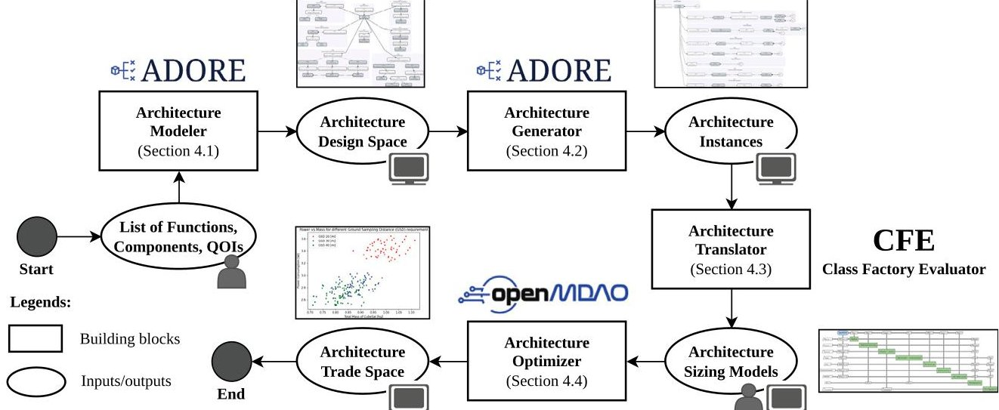


<div align="center">

Fig. 1. Workflow of the automated framework with the respective tools and running examples.

</div>

represents variability and captures the intricate dependencies characteristic of CPS architecture that has been successfully applied in fields such as aeronautics (Bussemaker et al., 2021). The ADSG formalism maps functions (FUN) and components (COMP) as nodes, with edges representing (possibly many-to-many) fulfillment relationships between them. This structure allows each function to be fulfilled by a single or multiple different components, and components to fulfill multiple functions, accurately reflecting the layered variability and dependencies in CPS architecture. In Fig. 2(a), Component 2 fulfills both Function 1 and Function 2, and acts as an input model from Component 4. Components (COMP) are further described by instances (INST), allowing for multiple instances of the same component within the architecture. Quantities of Interest (QOI) represent critical parameters that guide the optimization in the later phase 2(b). These include optimization objectives (OBJ), such as mass or manufacturing cost of a CPS, as well as attributes (ATTR) and design variables (DV).

The implementation of ADSG as a methodology is in ADORE, a webbased design space modeler. $ ^{1} $ The lists of FUNs, COMPs, QOIs, and their dependencies form a structured variability-intensive architecture called architecture design space (Fig. 2(a)). The system identification activities of collecting feasible functions & components, also decomposing & connecting them, are done manually beforehand by the users. The architecture design space is an output of the architecture modeler and will be processed further using the architecture generator.

## 4.2. Architecture generator

The architecture generator plays a role in automated reasoning of the CPS architecture design space (Contribution 1). It uses the ADSG design space to filter out infeasible configurations and generate valid architecture instances only (Crawley et al., 2015; Haberfellner et al., 2019; Madni and Madni, 2018). By transforming the ADSG design space into a mixed-integer mathematical problem, the generator can produce fully configured architectures based on specific engineering choices, providing flexibility in the design process (Bussemaker et al., 2024). The core task of the generator is to solve the architecture satisfiability problem, which involves matching system functions with suitable components while adhering to predefined constraints that meet functional requirements. This process ensures that only valid and feasible architectural configurations are considered.

ADORE, as a tool for generating architecture, is capable to automatically reason about the relations between nodes and edges in the

architecture design space. For reasoning the function-to-form mapping, it follows the OR and XOR logical relations. Taking same approach as in software product lines (SPL) implementation, OR means selecting one or more alternatives of form and XOR implies on selecting only one form (She et al., 2011). As illustrated in Fig. 2, the task of ADORE is solving the XOR decision from Function 1 to Component 1 and Component 2 (modeled through direct links), also to solve the OR choice between Component 2 and Component 3 for Function 2 (modeled through both direct links and MULTI for multi-fulfillment). Once all decisions have been reasoned, the architecture design space results in 12 unique architecture instances. For instance, Fig. 3 illustrates two generated architecture instances from the previously introduced architecture design space. Afterwards, each architecture instance is automatically encoded into a design vector, which consists of integers for component selections and real numbers for QOIs.

## 4.3. Architecture translator

The architecture translator is a crucial building block to enable the automated aspect of the proposed framework. It creates connections between the architecture generator and the architecture optimizer. From the architecture generator, it takes an architecture instance, derived from the ADSG, and translates it into detailed sizing models composed of multiple CPS sizing modules. The architecture translator leverages a model-to-model transformation principle (Bussemaker et al., 2022). The translation is achieved through the Class Factory Evaluator (CFE) tool (Bussemaker et al., 2023). The CFE maps the components and their numerical attributes in the architecture instances into sizing models. This process ensures that the selected components and their parameters by the architecture generator are linked to corresponding sizing equations and metrics into architecture optimizer.

In this process by CFE, each ADSG component (COMP) is mapped to an MDO class. At the same time, their CPS parameters are converted into MDO design variables. Certain quantities of interest (QOI) instantiated from the ADSG, such as mass, power, and other performance metrics, are designated as optimization objectives (OBJ), guiding the MDO process towards achieving the best possible configuration. In parallel, functional requirements and compatibility constraints, defined within the ADSG, are translated into design constraints within the MDO model. These constraints ensure that all functional and compatibility requirements are met throughout the optimization process. By aligning the architecture with the MDO framework in this structured manner, the architecture translator provides a clear path for performing detailed optimization, capturing the interactions between various components and their parameters, and enabling a robust, optimized CPS design.

<!-- PDF_PAGE: 6 -->


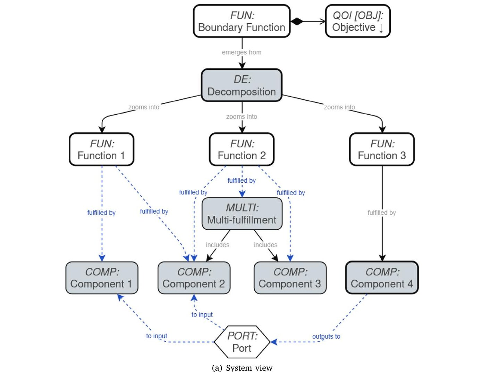


<div align="center">

(a) System view

</div>


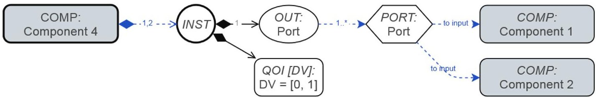


<div align="center">

(b) Extended view of Component 4

</div>

<div align="center">

Fig. 2. Example of function-to-component configuration space in ADSG formalism.

</div>

## 4.4. Architecture optimizer

The architecture optimizer has a purpose to optimizing the component parameters within architecture instances, which belongs to Contribution 2. This involves balancing multiple, often conflicting CPS performance requirements—such as minimizing power consumption, reducing mass, and maximizing data throughput. The optimizer transforms preliminary architecture instances into fully sized architectures by leveraging sizing models that calculate component dimensions. The sizing models need to be coded manually with the appropriate functions' names and inputs/outputs definition, so that they can make automated links with the architecture translator, as well as produce architecture trade space.

CPS design optimization problems are inherently multidisciplinary as explained in Section 1, due to the interactions between subsystems like power, thermal, structural, and communication. This makes the problem particularly suited for MDO methodology, which provides an integrated approach for solving tightly dependent disciplines or domains (i.e., CPS subsystems in this case) to optimize a system (Martins and Lambe, 2013). In the context of CPS design, MDO is used to evaluate the design space as a whole. Each sizing model of the

CPS component is linked through design variables and constraints that form the broader optimization problem (Martins and Ning, 2021). The formulation of the MDO problem is often represented via eXtended Design Structure Matrix (XDSM), as seen in Fig. 4 $ ^{2} $ (Lambe and Martins, 2012). This diagram serves as a visual representation of an MDO problem formulation involving multiple disciplines (e.g., Discipline1 and Discipline2), objective function $ (f) $ , constraints (e.g., $ g_{1} $ and $ g_{2} $ ), and design variables (e.g., x and $ z_{1} $ ).

This MDO problem can be solved using various tools, such as an open-source Python package called OpenMDAO (Gray et al., 2019). The optimization process within OpenMDAO from that example is to find the optimal values for the design variables that minimize the objective function while satisfying the constraints of the system. Gradient-based methods are commonly used to solve such optimization problems, as they allow efficient exploration of a continuous design space. The result are fully sized and optimized CPS architectures in a single trade space for properties comparison.

<!-- PDF_PAGE: 7 -->


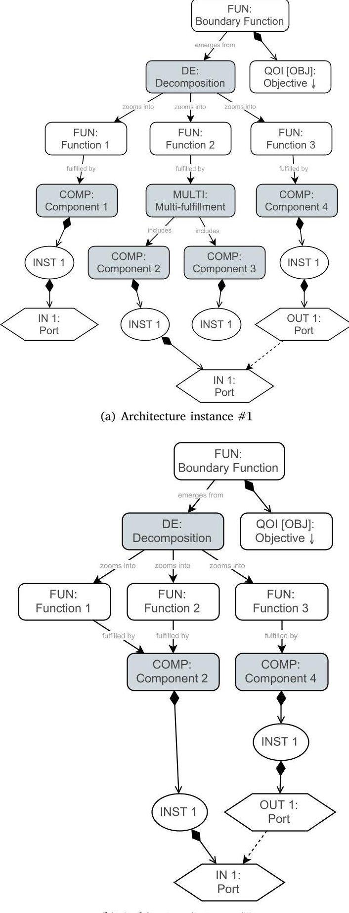


<div align="center">

(b) Architecture instance #2

</div>

<div align="center">

Fig. 3. Example of architecture instances derived from Fig. 2.

</div>

## 5. Framework validation through a use case of CubeSat

This section is dedicated to demonstrate Contribution 1 and 2 through a use case, which is Contribution 3. The demonstration is divided into two parts: implementation and evaluation. The implementation part consists of CubeSat introduction as a use case for CPS representation and explanation on how CubeSat design featuring

its variability is modeled using ADSG (as architecture modeler and generator) and MDO (as architecture optimizer). The evaluation part demonstrates how our framework implementation are able to: (1) Support the specific design process of a single CubeSat architecture and, (2) Perform automated exploration and evaluation of multiple CubeSat architectures. Through this CubeSat use case, it is shown that the proposed framework enables a variability-intensive CubeSat design process efficiently. The framework implementation and evaluation are partially available via a public repository. $ ^{3} $

## 5.1. Implementation of framework's building blocks for CubeSat

CubeSats are compact satellites that serve as prototypes for larger aerospace projects. Originally designed for education, they allow students and space communities to build miniature satellites (CubeSat, 2017). Standardized in the early 2000s, CubeSats come in U units (1U, 3U, and 6U), with 1U measuring 10x10x10 cm and weighing around 1-1.33 kg (Cappelletti et al., 2020). By May 31, 2018, nearly 1000 CubeSats had been launched. Their modular design allows for extensive customization, making them ideal for technology demonstrations, scientific research, and educational projects (Nieto-Peroy and Emami, 2019; Alminde et al., 2003; Noca et al., 2009; Bach et al., 2016). A diverse range of hardware product lines from various manufacturers $ ^{45} $ support CubeSat development, facilitating innovative configurations.

As an instance of CPS architecting, the CubeSat design process follows the same phases as explained in Section 1. A CubeSat conceptual design phase establishes the TLRs, which usually include data download capacity, maximum mass, and power consumption limits. The preliminary design phase involves architecture decision-making as it requires determining which components and subsystems to integrate to fulfill TLRs. A standard CubeSat consists of several key subsystems, as shown in Fig. 5. For example, a preliminary design phase of the power subsystem includes the selection of solar panels and batteries to generate and supply electric energy. The components selection for attitude determination and control system (ADCS) are usually among reaction wheels, momentum wheels, and magnetorquers, depending on the required precision for maneuvering in space (Song et al., 2018; Ampatzoglou and Kostopoulos, 2018). These subsystem functionalities, subsequently the components, are tightly dependent on each other. For example, the precision level of a reaction wheel determines the power consumption of a battery. On the other hand, a battery capacity also determines how high the angular speed of a reaction wheel should be regulated. Afterwards, the numerical evaluation of the CubeSat is derived from the architecture selection, such as analyzing CubeSat's mass as an objective function, power consumption and dimension as constraints, and the size of components as design variables.

Our implementation relies on established space engineering resources to model function-to-component mapping, design space exploration, and sizing variability (Wertz et al., 1999; Yost et al., 2021; Hwang et al., 2014; Fortescue et al., 2011; Brown, 2002). The mission requirements and function-to-form mapping used are derived from some classical space engineering books, such as Space Mission Analysis and Design (SMAD) by Wertz (Wertz et al., 1999), Spacecraft Systems Engineering by Fortescue (Fortescue et al., 2011), and Elements of Spacecraft Design by Brown (Brown, 2002). They play roles as a knowledge basis of space system functionality of subsystems and the interaction between them. While those references provide generic components as functions fulfillment, a report called State-of-the-Art of Small Spacecraft Technology by NASA (Yost et al., 2021) offers insights into the latest update of CubeSat technologies, i.e. components. The nonlinear component sizing equations that we used are mainly derived from

<!-- PDF_PAGE: 8 -->


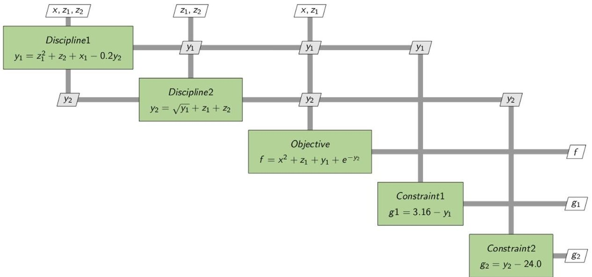


<div align="center">

Fig. 4. An example of MDO problem formulation in an eXtended Design Structure Matrix.

</div>


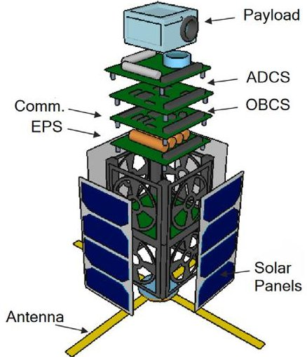


<div align="center">

Fig. 5. Illustration of typical CubeSat architecture and its subsystems.

</div>

the SMAD book, such as the analytical equations to determine the electrical power capacity and mass of a battery (Wertz et al., 1999; Ahmadi et al., 2018). To evaluate the model, numerical inputs are taken from some papers on CubeSat and State-of-the-Art of Small Spacecraft Technology by NASA (Yost et al., 2021). One of them is CubeSat-investigating Atmospheric Density Response to Extreme driving (CADRE) that treats CubeSat design as a multidisciplinary problem too by the University of Michigan (Hwang et al., 2014; Cutler et al., 2011). For instances, input values of battery capacity $ ( e_{battery}=1 5 0 [ W / k g ] ) $ and Depth of Discharge $ ( Do D=0. 8 ) $ in Eq. (1) are referred from them to ensure realistic values.

## 5.1.1. Modeling function-to-component of CubeSat for architecture modeler and generator

The knowledge of CubeSat's architecture elements, i.e., functions, components, and their dependencies, is required for the architecture modeler and generator. As introduced before, we use ADORE, which fully integrates architecture elements into a design space with the function-to-form concept. ADORE provides generic elements, e.g., FUN, COMP, that require to be defined or specified further depending on the use cases. We follow the textual notation of System Modeling Language v2 (SysML v2), which a phrase of X:Y means "X is defined by Y" (Bajaj et al., 2022; Vaicenavičius et al., 2025). X is the generic elements of ADORE, while Y is the use of an element X. For example of function-to-form implementation is the power subsystem needs to fulfill the functions of energy generation (using solar panels) and energy storage (using batteries). Similarly, the ADCS subsystem needs to fulfill orientation control (using reaction wheels or magnetorquers).

Once the functions are defined, the next task is to model this function mapping variability to the appropriate components that can fulfill these functions. All of these elements populate the design space in ADORE. The details are elaborated in the following paragraphs.

Fig. 6 illustrate the {COMP: CubeSat} view of the function-tocomponent mapping in design space that fulfills the {FUN: Observe meteorological condition} as a mission objective. This component is single-instanced and has multiple quantities of interest (QOI). Inputs such as {QOI [INP]: Pointing Angle} and {QOI [INP]: Communication Frequency} are derived from TLR, while performance metrics such as {QOI [MET]: Total mass} and {QOI [MET]: Power consumption} are outputs that need to be optimally derived from the CubeSat design process.

To be operational, a CubeSat must provide various functions such as {FUN: Provide electrical power to components} or {FUN: Maintain attitude as pre-determined}. These functions are typically fulfilled by subsystems like {SYS: Power Subsystem} and {SYS: ADCS}. As illustrated in Fig. 7(a), the power subsystem supplies energy through two primary methods: {CON: By harnessing energy} or by {CON: By embedding energy source. The former method is implemented by {FUN: Provide power from sunlight}, which relies on {COMP: Solar panel}, while the second method is fulfilled by {FUN: Provide a fixed amount of energy}, using COMP: Primary battery. {COMP: Solar panel} requires {FUN: Store electrical power}, typically achieved with {COMP: Secondary battery}. However, if no eclipses occur during the mission ( {NOF: No eclipse during mission}), power can be supplied directly without storage.

The Secondary Battery has key parameters (Fig. 7(b)) which influence the system performances, including: {QOI [INP]: Depth of discharge}, {QOI [INP]: Energy density}, {QOI [MET]: Mass} and {QOI [MET]: Energy capacity}. These parameters define the battery's characteristics, with input values determined by battery technology (e.g., higher energy density or lower depth of discharge). Metrics represent sizable parameters that exhibit variability and should be optimized during the design process. Depending of this function-to-component configuration space, three architecture instances can be derived: featuring solar panel only, solar panel plus secondary battery and the one with primary battery. However, selecting the most suitable design for a mission requires determining the optimal component values of each architecture.

## 5.1.2. Modeling the architecture translator for CubeSat

In particular, for translation of CubeSat architecture instances, CFE as architecture translator handles three aspects. The first aspect is the mapping of instantiated CubeSat components into appropriate sizing models in OpenMDAO. For example, a secondary battery is mapped from ADORE to an OpenMDAO class by name. Second, the mapping of

<!-- PDF_PAGE: 9 -->


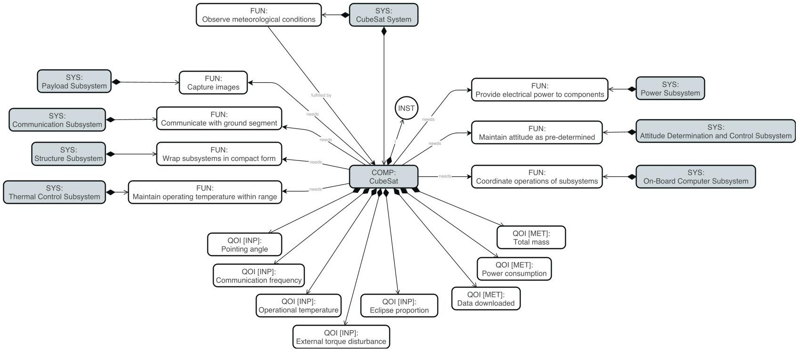


<div align="center">

Fig. 6. Function-to-component configuration space: CubeSat component view.

</div>


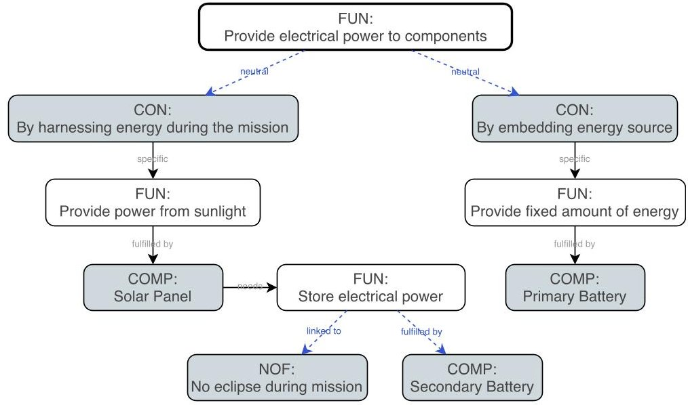


<div align="center">

(a) Power subsystem view

</div>


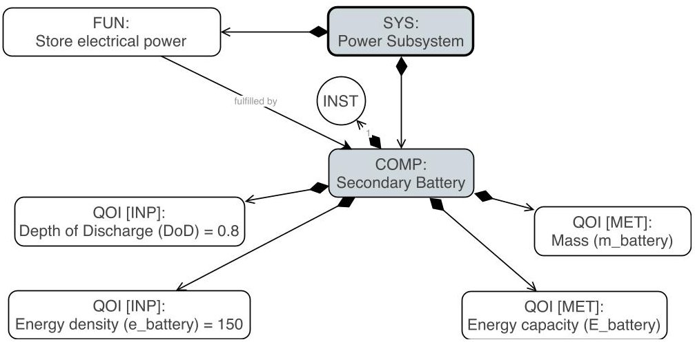


<div align="center">

(b) Secondary battery component view

</div>

<div align="center">

Fig. 7. Function-to-component configuration space.

</div>

QOIs, such as Depth of Discharge (DoD), energy density, and battery mass. They are connected to the corresponding inputs and outputs of the OpenMDAO classes in the Object-Oriented Programming (OOP)

paradigm. Lastly, CFE handles cardinality variability by ensuring that a component is selected in ADORE, the corresponding OpenMDAO class is instantiated and linked to the selected component's parameters.

<!-- PDF_PAGE: 10 -->

<div align="center">

Table 2 CubeSat's TRLs: mission objective and requirements (Step 1 $ \rightarrow $ $ \textcircled{1} $)

</div>

<div align="center">

Mission objective: Observe meteorological condition

</div>

<table border="1"><tr><td>Mission requirements</td><td>Value</td><td>Category</td></tr><tr><td>Capture images of certain regions</td><td>True</td><td></td></tr><tr><td>Going through eclipse period</td><td>True</td><td rowspan="5">Functional requirements</td></tr><tr><td>Storing electrical power</td><td>True</td></tr><tr><td>Performing slew maneuver</td><td>True</td></tr><tr><td>Communicate with ground segment</td><td>True</td></tr><tr><td>CubeSat size</td><td>10×10×10cm(1U)</td><td></td></tr><tr><td>Maximum CubeSat mass</td><td>1kg</td><td></td></tr><tr><td>Maximum power consumption</td><td>3W</td><td></td></tr><tr><td>Orbit altitude</td><td>600km(LEO)</td><td></td></tr><tr><td>Mission duration</td><td>1day</td><td></td></tr><tr><td>Eclipse time</td><td>35min</td><td>Non-functional requirements</td></tr><tr><td>Ground Sampling Distance(GSD)</td><td>30m</td><td></td></tr><tr><td>Sunlight proportion</td><td>40%</td><td></td></tr><tr><td>Frequency band</td><td>2.4GHz(S-band)</td><td></td></tr><tr><td>Operating temperature</td><td>293K</td><td></td></tr><tr><td>Maximum load factor</td><td>10g</td><td></td></tr><tr><td>Maximum disturbance torque</td><td>10^{-6}N\cdot m</td><td></td></tr></table>

## 5.1.3. Modeling component sizing variability of CubeSat for architecture optimizer

The architecture optimizer requires component sizing models as the main building blocks. In CubeSat, components such as solar panels, batteries, and reaction wheels have parameters that exhibits variability; these parameters, also called design parameters (e.g., power capacity, size, and mass), are adjustable to fit mission needs and system constraints. These parameters can either be adjusted within a specific range or determined by equations. Each component in a CubeSat has a set of sizing equations that describe what system parameters affect and how its dimensions (e.g., area, power capacity, mass) affect system-level performance metrics. Sizing equations help determining the appropriate component size and parameters based on TLRs and components' dependencies.

For example, the secondary battery must store sufficient energy to power the CubeSat during eclipse periods. The battery's required energy capacity depends on the total power consumption of the CubeSat during the eclipse, eclipse duration, Depth of Discharge (DoD) of the battery, energy density of the battery technology. To quantify those parameters, the battery sizing for evaluation is governed by Eq. (1):

$$
\begin{array}{l} E _ {e c l i p s e} = (1 + \mathrm {M a r g i n}) P _ {t o t a l} t _ {e c l i p s e} \\ E _ {b a t t e r y} = \frac {E _ {e c l i p s e}}{\mathrm {D o D}} \\ m _ {b a t t e r y} = \frac {E _ {b a t t e r y}}{e _ {b a t t e r y}} \\ \end{array}
$$

These sizing equations capture how the battery's energy storage requirement affects its mass, creating a design trade-off between energy availability and CubeSat weight constraints. In OpenMDAO, each CubeSat component is represented as an Explicit Component. These components encapsulate the sizing equations, where design variables (e.g., solar panel area, battery capacity) and quantities of interest (e.g., energy capacity, mass) are declared as inputs and outputs of classes. These components are then integrated into the CubeSat optimization problem. For example, the following is a Python code for the implementation of SecondaryBattery class (Listing 1) in OpenMDAO and being one of discipline for the architecture optimizer (as part of optimization in Fig. 10).

The same procedures apply for all sizing equations in a CubeSat architectures, such as solar panel, momentum wheel, radio transceiver, and radiator. The complete sizing models can be found in the repository. Afterward, all sizing models formulate an MDO problem in OpenMDAO and are solved using a gradient-based optimization algorithm named Sequential Least Squares Programming (SLSQP) (Wu et al., 2020).

## 5.2. Evaluation of framework via CubeSat design process

Previously, each building block of the proposed framework has been implemented for a CubeSat. In this section, we evaluate the framework as a whole through a CubeSat design process, focused on conceptual and preliminary phases. The first scenario is to use the framework manually for designing a single CubeSat. The second scenario leverages the automated framework for exploring multiple CubeSat designs efficiently. Both scenario are intended to show the capabilities of the framework and how each building block takes part in a CPS design process. Besides that, they also demonstrate that the framework can be utilized both manually and in an automated way.

## 5.2.1. Design scenario of a single CubeSat

The CubeSat design scenario during conceptual and preliminary phases is outlined in Fig. 8. The generic process follow the methodologies by established researchers/engineers, as also cited in Section 1 (Crawley et al., 2015; Chudoba and Heinze, 2010). Each step has sub-steps and returns intermediate outputs (denoted as $ \textcircled{1} $... $ \textcircled{6} $ with gray background), that act as data transfer points to the next step. The more detailed discussion for all steps is the following:

## Step 1. Conceptual Design: TRLs Definition

The CubeSat design begins with defining TRLs, including determining mission objectives and based on them, the functional and nonfunctional requirements are derived accordingly. This step has not used the framework yet, hence the mission designers shall provide qualitative and quantitative inputs into the next steps. For example, a CubeSat is tasked to observe meteorological conditions requires: (1) Functional requirements (e.g., image capture, power storage, communication with ground stations) and (2) Non-functional requirements (e.g., CubeSat dimensions, maximum mass, electrical power constraints, and mission duration). Table 2 outlines the specific mission requirements that guide the architecture selection process in the next step.

## Step 2. Preliminary Design: Qualitative

The qualitative preliminary design phase comprises functions & components selection and architecture generation. ADORE, as an architecture modeler is utilized for the former, while as an architecture generator is used for the later. We create a CubeSat design space with a function-to-form concept of ADSG. This step ensures that the CubeSat design aligns with functional requirements from TRLs, while allowing for variability in component choices. It enables a more flexible and scalable exploration of architecture alternatives.

Fig. 9 illustrates an instance of the functions and components selection (or called as Decisions in ADORE, see $ \textcircled{2} $ ). For current scenario, this step is executed by mission designers. An example from

<!-- PDF_PAGE: 11 -->

```python

class SecondaryBattery(om.ExplicitComponent):

    t_eclipse: float # Eclipse time

    DoD: float # Depth of discharge

    e_battery: float # Energy density

    def __init__(self, t_eclipse, DoD, e_battery):

        super().__init__()

        self.t_eclipse = t_eclipse

        self.DoD = DoD

        self.e_battery = e_battery

    def setup(self):

        self.add_input('DoD', val=self.DoD)

        self.add_input('e_battery', val=self.e_battery, units='Wh/kg')

        self.add_input('t_eclipse', val=self.t_eclipse, units='s')

        self.add_input('P_total', units='W')

        self.add_output('E_battery', units='W*h')

        self.add_output('m_battery', units=kg)

        self.declare_partials(of=['*'], wrt=['*'], method='fd')

    def compute(self, inputs, outputs):

        self.t_eclipse = inputs['t_eclipse']

        P_total = inputs['P_total']

        self.DoD = inputs['DoD']

        self.e_battery = inputs['e_battery']

        Margin = 0.5

        E_eclipse = (1+Margin) * P_total * self.t_eclipse

        self.E_battery = E_eclipse/self.DoD

        self.m_battery = self.E_battery / self.e_battery

        outputs['E_battery'] = self.E_battery

        outputs['m_battery'] = self.m_battery

```

the power subsystem, if the mission requires power generation, solar panels are included, but if the CubeSat must store energy during its mission, a secondary battery is selected. After all selections are made, a CubeSat architecture instance is generated correspondingly (shown by $ \textcircled{3} $ , automatically by ADORE). The framework featuring structured function-to-component selection makes validity of CubeSat architecture is guaranteed, given the design constraints and dependencies.

## Step 3. Preliminary Design: Quantitative

The quantitative part of the preliminary design is where the architecture optimizer is useful. A CubeSat architecture instance becomes an input of an MDO problem formulation and is solved using OpenMDAO. The XDSM shown in Fig. 10 captures the numerical dependencies between CubeSat subsystems. The optimization problem consists of seven CubeSat subsystem that are converted into MDO disciplines, such as thermal control (i.e., fulfilled by radiator), power (i.e., fulfilled by solar panel and battery), and on-board computer (i.e., fulfilled by OBC ARM Cortex M). We perform optimization in OpenMDAO to minimize the mass of CubeSat using SLSQP, a gradient-based optimization algorithm. It works efficiently for models which features complete derivatives from each outputs. However, any other algorithms, such as gradient-free, can be used for design with non-differentiable mathematical expressions. The mathematical formulation of optimization is written in Eq. (2). It optimizes key design variables CubeSat, such as the dimensions of the solar panel, frequency of communication, and radius of reaction wheel. This optimization is subject to constraints, such as the dimensions of the payload.

## minimize mCubeSat

with respect to $ A_{solarpanel}, f_{communication}, r_{reactionwheel}, \dots $ subject to $ V_{payload,lower}\leq V_{payload}\leq V_{payload,upper} $

The final design outputs, which are produced automatically by the optimization algorithm, are summarized in Table 3, which includes CubeSat mass, power consumption, payload size, and other key figures.

## Step 4. Design Validation

The final step is validating the CubeSat design by comparing design outputs with TRLs by mission designers. If all quantitative metrics are within acceptable limits, the design is considered a valid design and ready to proceed to the detailed design phase. As seen in Table 4, an example of a valid CubeSat design features satisfied mass, power consumption, and dimension requirements. It also fulfill all required functionalities (e.g., attitude control, power storage) which are guaranteed in Step 2 by the architecture modeler and generator. If requirements are violated, design parameters are adjusted, ensuring that the CubeSat meets all operational and performance requirements.

## 5.2.2. Design scenario of multiple CubeSats

After a running example of a single CubeSat design scenario is demonstrated, this section is intended for showing how the same process are executed multiple times leveraging our automated framework. Ideally, during conceptual and preliminary design phases, mission designers or engineers assess as many CubeSat architectures as the project's budget and time allow. Therefore, a framework that is able to do the evaluation on a scale is imperative. On the other hand, there is an expert's bias that can lead to: (1) Reliance on legacy architectures, restricting innovation; (2) Preference for familiar components, thus overlooking the more efficient options; and (3) Overly cautious decisions, favoring proven solutions over potentially superior design (Lazreg et al., 2022). Those rationales motivate the demonstration of a running example of the automated framework to explore the large design space.

By automating the process from architecture generator to optimizer using the translator, the framework enables more efficient exploration

<!-- PDF_PAGE: 12 -->


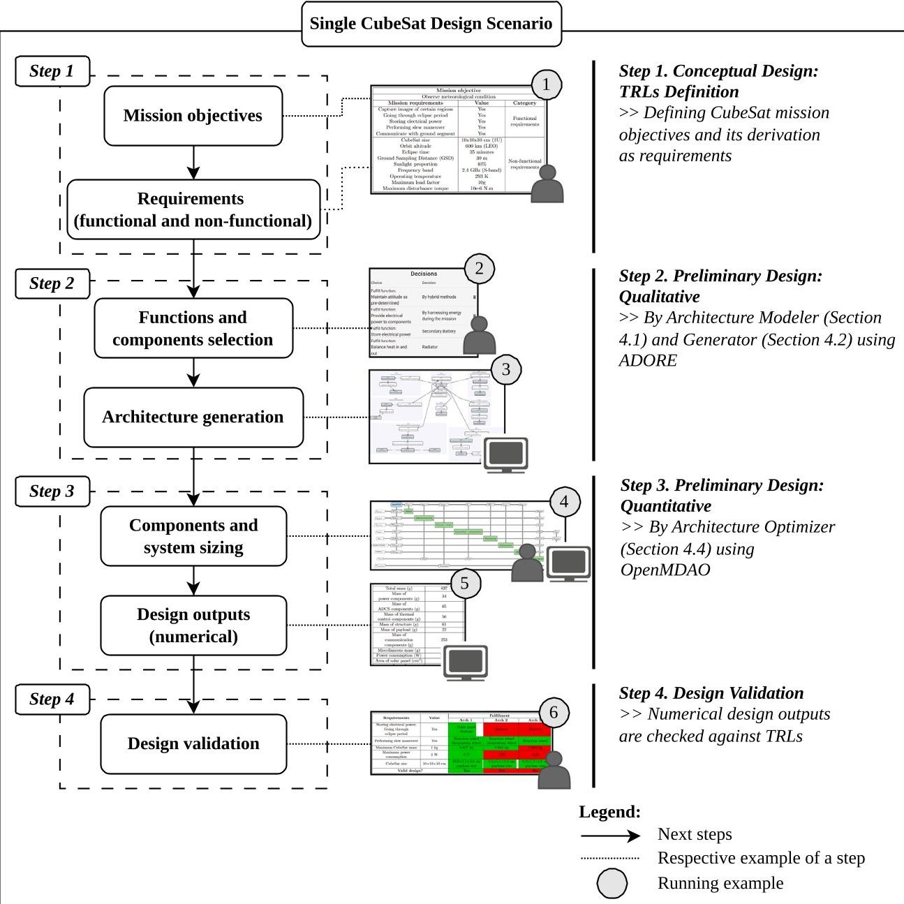


<div align="center">

Fig. 8. Design scenario of a single CubeSat.

</div>

## Table 3

Design outputs of CubeSat (Step 3 → $ \textcircled{5} $)

CubeSat Subsystems

<table border="1"><tr><td>Power components</td><td>Solar panel Battery</td></tr><tr><td>ADCS components</td><td>Reaction wheel Momentum wheel</td></tr><tr><td>Thermal control components</td><td>Radiator</td></tr><tr><td>Structure material</td><td>Additive manufacturing</td></tr></table>

<table border="1"><tr><td>Total mass(kg)</td><td>0.837</td></tr><tr><td>Mass of power components(g)</td><td>34</td></tr><tr><td>Mass of ADCS components(g)</td><td>65</td></tr><tr><td>Mass of thermal control components(g)</td><td>56</td></tr><tr><td>Mass of structure(g)</td><td>61</td></tr><tr><td>Mass of payload(g)</td><td>22</td></tr><tr><td>Mass of communication components(g)</td><td>253</td></tr><tr><td>Miscellaneous mass(g)(sensor,cable,etc.)</td><td>346</td></tr><tr><td>Power consumption(W)</td><td>2.77</td></tr><tr><td>Area of solar panel(cm2)</td><td>89</td></tr><tr><td>Area of thermal control(cm2)</td><td>208</td></tr><tr><td>Momentum storage(mN·m·s)</td><td>87</td></tr><tr><td>Size of payload(cm)</td><td>10.0×4.1×3.8</td></tr><tr><td>Data downloaded(kB)</td><td>94</td></tr></table>

<!-- PDF_PAGE: 13 -->


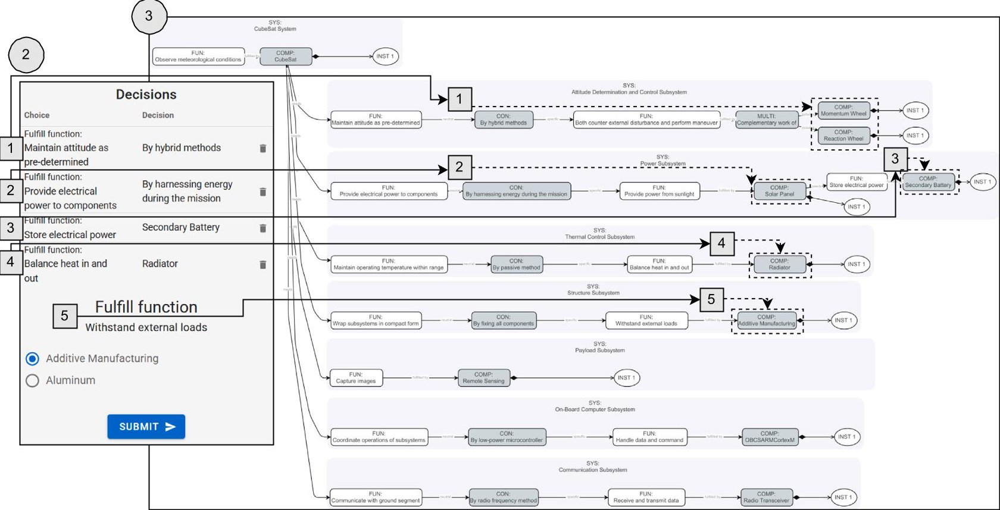


Running example of a step Next steps

Unit of decision making Function-to-form link

<div align="center">

Fig. 9. A CubeSat architecture instance as a result of series functions and components selection (Step 2 $ \rightarrow $ $ \textcircled{2} $ $ \textcircled{3} $)

</div>


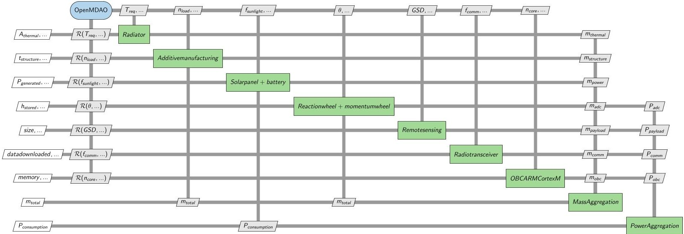


<div align="center">

Fig. 10. MDO problem formulation of a CubeSat architecture instance (Step 3 $ \rightarrow $ $ \textcircled{4} $)

</div>

<div align="center">

Design outputs validation of CubeSat with respect to mission requirements (Step 4 $ \rightarrow $ $ \textcircled{6} $)

</div>

<table border="1"><tr><td>Requirements</td><td>Value</td><td>Fulfillment by design</td></tr><tr><td>Storing electrical power</td><td>True</td><td>Solar panel, battery</td></tr><tr><td>Going through eclipse period</td><td>True</td><td>Solar panel, battery</td></tr><tr><td>Performing slew maneuver</td><td>True</td><td>Reaction wheel momentum wheel</td></tr><tr><td>Maximum CubeSat mass</td><td>1kg</td><td>0.837kg</td></tr><tr><td>Maximum power consumption</td><td>3W</td><td>2.77W</td></tr><tr><td>CubeSat dimension</td><td>10×10×10cm</td><td>10.0×4.1×3.8cm(payload size)</td></tr><tr><td colspan="2">Valid design?</td><td>True</td></tr></table>

<!-- PDF_PAGE: 14 -->


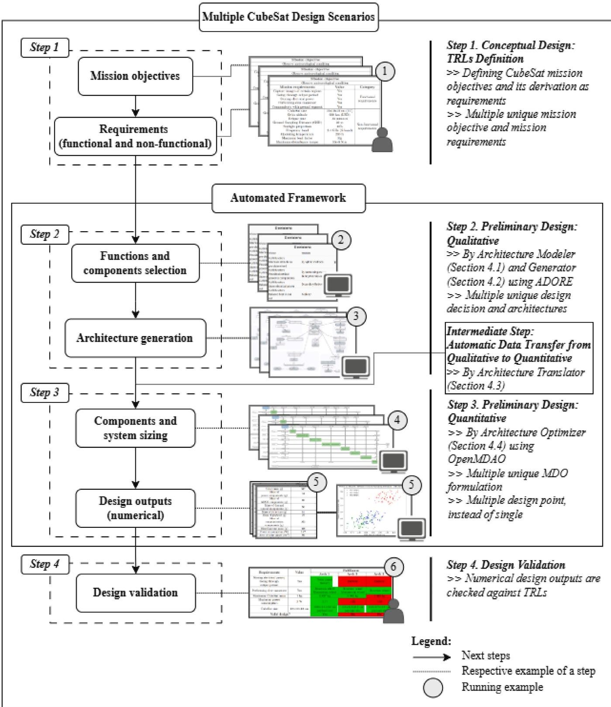


<div align="center">

Fig. 11. Design scenario of multiple CubeSat incorporating the automated framework.

</div>

of design variability, allowing for objective, data-driven architecture selection rather than relying on preconceptions. Fig.11 describes the adjustment from the single CubeSat design process in Fig.8. Generally, the process is the same, except there is an Intermediate Step between Step 2 and Step 3 by the architecture translator.

Besides that, the automation facilitates crucial feature improvement over the manual process (denoted by all computer logo inside the "Automated Framework" box) in Fig. 11. It allows the exploration of different TRLs (see $ \textcircled{1} $ in Fig. 11) and consequently enables the identification on how they impact the components selection. ADORE, as an architecture generator, has an algorithm to generate valid architecture instances $ \textcircled{3} $ from a hierarchical design space, so that it can be used to automate Step 2. The automated numerical evaluation $ \textcircled{4} $ , which depends on the instantiated architectures, is executed by OpenMDAO as an architecture optimizer. This "dynamic MDO formulation" concept has been proven to be effective for evaluating system product

lines (Garg et al., 2024; Bruggeman et al., 2024). Lastly, the automation eases the validation of numerous CubeSat designs $ \textcircled{6} $).

The systematic exploration of design outputs across multiple CubeSat architectures provides critical insights into the relationships between design parameters, trade-offs in subsystem selection, and the cascading effects of TRLs. The part below shows some visualization of the evaluated CubeSat architecture, alongside the discussion of their significance. By visualizing these outputs in a unified architecture trade space, the mission designers can better understand how variations in power consumption, payload resolution, mission duration, and any other parameters impact overall system performance.

Fig. 12 illustrates the trade space of CubeSat mass vs power consumption, derived from 324 generated CubeSat architectures (see Fig. 13 for the detailed statistics of the design space). From the figure, it assists mission designer to: (1) Identify as the CubeSat masses increase, their power consumption rise proportionally due to larger

<!-- PDF_PAGE: 15 -->


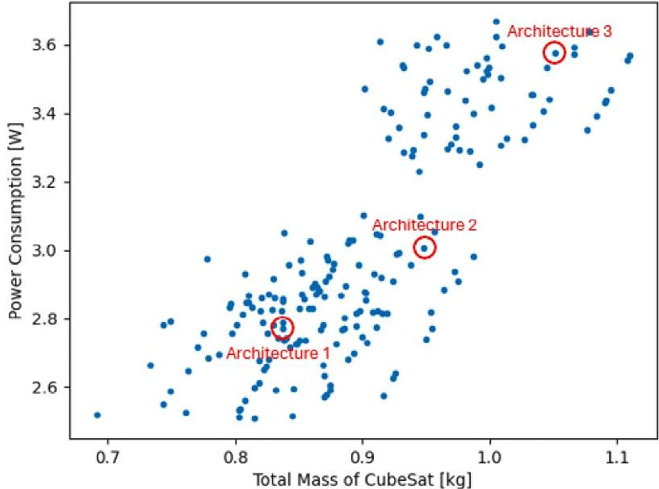


<div align="center">

Fig. 12. Architecture trade space of CubeSats in terms of power consumption and total mass (Step 3 $ \rightarrow $ $ \textcircled{5} $)

</div>

power-demanding subsystems; (2) The mass range (0.7-1.1 kg) aligns with common 1U CubeSat designs, while power consumption varies between 2.5-3.6 W; and (3) The comparison of three architectures (Table 5) further validates mass and power constraints ( $ \leq1 $ kg and $ \leq3 $ W, respectively). This analysis helps in defining optimal mass-power trade-offs for efficient CubeSat operation.

The Ground Sampling Distance (GSD), as a non-functional requirement of the imaging payload, has a direct cascading impact on global CubeSat parameters, as shown in Fig. 14. The key insights from varying the GSD are: (1) GSD determines the imaging resolution. A smaller GSD (higher resolution) requires a more advanced imaging system, which increases CubeSat mass and power consumption; (2) Payload specifications affect CubeSat weight and energy demand, influencing the feasibility of power subsystem selection; (3) Lower-resolution payloads (higher GSD magnitudes) result in lighter CubeSat configurations with reduced power consumption, which requires a compromise. These trade-offs underline the critical role of non-functional payload requirements in architecture selection and performance optimization.

Fig.15 demonstrates how different mission duration affects CubeSat power system design and provides valuable information to mission designers. Short-duration missions (1 day-1 week) can rely on primary batteries, minimizing mass. Longer missions (weeks-months) require solar panels and secondary batteries, thus increasing the masses due to additional energy storage capacity. Therefore, battery-only architectures become impractical for extended missions, as the CubeSat must carry a heavier battery pack without energy replenishment. This analysis highlights how a mission constraint does not only dictate power subsystem architecture, but also system-level properties of CubeSat.

The comparison of three samples of CubeSat design outputs is shown in Table 5, which was then validated against the TRLs (Table 6). Some interesting points are: (1) Architecture 1 (featuring solar panel and battery) is a valid design because it meets all TRLs, including functional and non-functional; (2) Architecture 2 and 3 are invalid CubeSat designs as both violate functional and non-functional requirements. This structured validation process ensures that only mission-compliant designs advance to the detailed design phase.

The duration of conceptual and preliminary design phases is also a primary concern, as stated in Section 1. We have done an evaluation regarding the computation time with respect to various number of CubeSat architectures. As shown in Fig. 16, the computation time does not saturate with the increasing number of architectures. It means efficient sampling and optimization techniques are necessary to balance exploration depth and computational feasibility. This reinforces the

<table border="1"><tr><td colspan="2">Statistics</td></tr><tr><td>Decisions</td><td>8</td></tr><tr><td></td><td></td></tr><tr><td>Valid Design Space(Discrete)</td><td>324</td></tr><tr><td>Declared Design Space(Discrete)</td><td>576</td></tr><tr><td>Discrete Choices</td><td>7</td></tr><tr><td>Discrete Imputation Ratio</td><td>1.8</td></tr><tr><td>Information Index</td><td>73%</td></tr><tr><td>Continuous Dimensions</td><td>1</td></tr><tr><td>Mean Active Continuous Dimensions</td><td>1</td></tr><tr><td>Continuous Imputation Ratio</td><td>1</td></tr><tr><td>Imputation Ratio</td><td>1.8</td></tr><tr><td>Encoding Algorithm</td><td>Complete</td></tr><tr><td></td><td></td></tr><tr><td>Valid Design Space(Selection-choices)</td><td>36</td></tr><tr><td>Declared Design Space(Selection-choices)</td><td>48</td></tr><tr><td>Selection-choices</td><td>5</td></tr><tr><td>Information Index(Selection-choices)</td><td>87%</td></tr><tr><td>Imputation Ratio(Selection-choices)</td><td>1.3</td></tr></table>

<div align="center">

(a)

</div>

<table border="1"><tr><td>Valid Design Space(QOI DVs)</td><td>324</td></tr><tr><td>Declared Design Space(QOI DVs)</td><td>12</td></tr><tr><td>Discrete Variables(QOI DVs)</td><td>2</td></tr><tr><td>Existence Combinations(QOI DVs)</td><td>36</td></tr><tr><td>Discrete Imputation Ratio(QOI DVs)</td><td>1.3</td></tr><tr><td>Information Index(QOI DVs)</td><td>100%</td></tr><tr><td>Continuous Dimensions(QOI DVs)</td><td>1</td></tr><tr><td>Mean Active Continuous Dimensions(QOI DVs)</td><td>1</td></tr><tr><td>Continuous Imputation Ratio(QOI DVs)</td><td>1</td></tr><tr><td>Imputation Ratio(QOI DVs)</td><td>1.3</td></tr></table>

<div align="center">

(b)

</div>

<div align="center">

Fig. 13. Statistics of CubeSat design space, extracted from ADORE.

</div>

<div align="center">

Power vs Mass for different Ground Sampling Distance (GSD) requirement

</div>


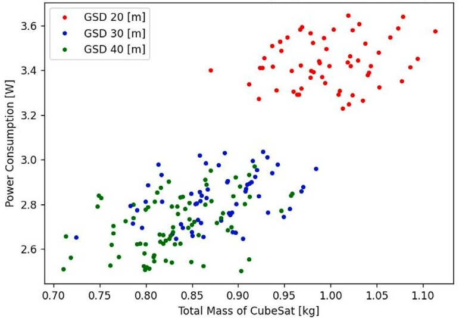


<div align="center">

Fig. 14. Cascading effect of varying Ground Sampling Distance (GSD) requirement into CubeSat design (Step 3 $ \rightarrow $ $ \textcircled{5} $)

</div>

importance of an automated framework for design space exploration allowing for broad architecture evaluations while maintaining scalable computation time.

<!-- PDF_PAGE: 16 -->

<div align="center">

Comparison of design outputs for multiple architecture (Step 3 $ \rightarrow $ $ \textcircled{5} $)

</div>

<table border="1"><tr><td>Subsystems</td><td>Architecture1</td><td>Architecture2</td><td>Architecture3</td></tr><tr><td>Power components</td><td>Solar panelBattery</td><td>Battery</td><td>Battery</td></tr><tr><td>ADCS components</td><td>Reaction wheelMomentum wheel</td><td>Reaction wheelMomentum wheel</td><td>Reaction wheel</td></tr><tr><td>Thermal control components</td><td>Radiator</td><td>Coating</td><td>Coating</td></tr><tr><td>Structure material</td><td>Additive manufacturing</td><td>Aluminum</td><td>Additive manufacturing</td></tr><tr><td colspan="4">Design Outputs</td></tr><tr><td>Total mass(kg)</td><td>0.837</td><td>0.945</td><td>1.063</td></tr><tr><td>Mass of power components(g)</td><td>34</td><td>29</td><td>82</td></tr><tr><td>Mass of ADCS components(g)</td><td>65</td><td>65</td><td>12</td></tr><tr><td>Mass of thermal control components(g)</td><td>56</td><td>117</td><td>117</td></tr><tr><td>Mass of structure(g)</td><td>61</td><td>16</td><td>61</td></tr><tr><td>Mass of payload(g)</td><td>22</td><td>52</td><td>174</td></tr><tr><td>Mass of communication components(g)</td><td>253</td><td>267</td><td>270</td></tr><tr><td>Miscellaneous(sensor,cable,etc.) mass(g)</td><td>346</td><td>399</td><td>347</td></tr><tr><td>Power consumption(W)</td><td>2.77</td><td>3.02</td><td>3.53</td></tr><tr><td>Area of solar panel(cm2)</td><td>89</td><td>-</td><td>-</td></tr><tr><td>Area of thermal control(cm2)</td><td>208</td><td>449</td><td>449</td></tr><tr><td>Momentum storage(mN m s)</td><td>87</td><td>88</td><td>5.2</td></tr><tr><td>Size of payload(cm)</td><td>10.0×4.1×3.8</td><td>5.5×5.1×3.3</td><td>8.2×7.7×4.9</td></tr><tr><td>Data downloaded(kB)</td><td>94</td><td>84</td><td>81</td></tr></table>

<div align="center">

Table 6

</div>

<div align="center">

Design outputs validation of multiple CubeSat architectures with respect to mission requirements (Step 4 $ \rightarrow $ $ \textcircled{6} $)

</div>

<table border="1"><tr><td rowspan="2">Requirements</td><td colspan="3">Fulfillment</td></tr><tr><td>Architecture1</td><td>Architecture2</td><td>Architecture3</td></tr><tr><td>Storing electrical power;Going through eclipse periodPerforming slew maneuver</td><td>Solar panelBatteryReaction wheelMomentum wheel</td><td>BatteryReaction wheelMomentum wheel</td><td>BatteryReaction wheel</td></tr><tr><td>Maximum CubeSat mass of 1kg</td><td>0.837kg</td><td>0.945kg</td><td>1.063kg</td></tr><tr><td>Maximum power consumption of 3W</td><td>2.77W</td><td>3.02W</td><td>3.53W</td></tr><tr><td>Dimension of 1U CubeSat</td><td>10.0×4.1×3.8cm(payload size)</td><td>5.5×5.1×3.3cm(payload size)</td><td>8.2×7.7×4.9cm(payload size)</td></tr><tr><td>Valid design?</td><td>True</td><td>False</td><td>False</td></tr></table>


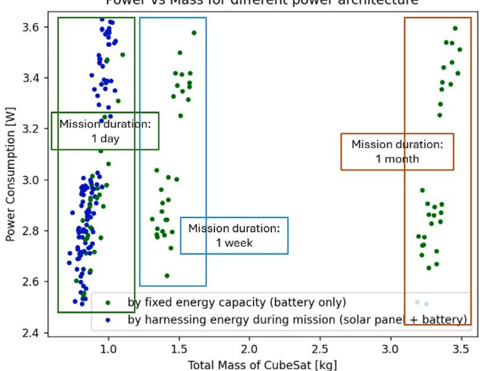


<div align="center">

Fig. 15. Cascading effect of different power architectures into global CubeSat design by varying mission duration (Step 3 $ \rightarrow $ $ \textcircled{5} $)

</div>

From the running example of CubeSat design process above, the position of current work with respect to the others becomes more identifiable. Table 7 shows how current work is benchmarked in terms


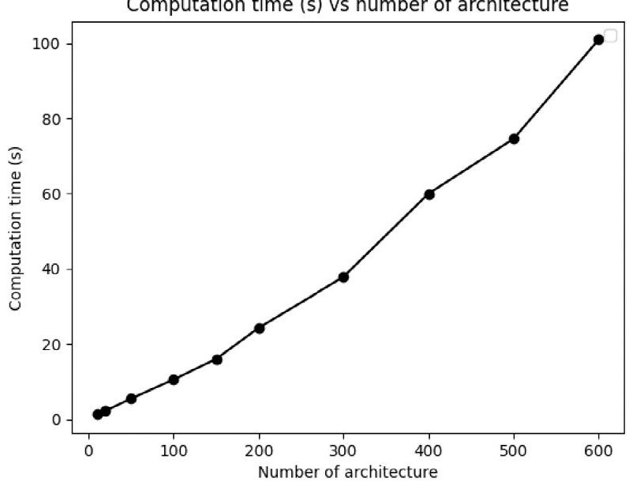


<div align="center">

Fig. 16. Effect of design space size, i.e., number of architecture, on computation time.

</div>

of the automation of design process (Step 1 until Step 4, as described in Fig.11), the existence of architecture variability exploration process, and tools (or methodologies). Each listed work here proposes CubeSat or space system design processes at any stage. The computer icon

<!-- PDF_PAGE: 17 -->

<div align="center">

Comparison of CubeSat design processes leveraging automated framework.

</div>

<table border="1"><tr><td></td><td>Conceptual design:TRLs definition</td><td>Preliminary design:qualitative</td><td>Preliminary design:quantitative</td><td>Design validation</td><td>Architecture variability exploration</td><td>Tools(or methodologies)</td></tr><tr><td>This paper</td><td></td><td></td><td></td><td></td><td></td><td>ADORE,CFE,OpenMDAO</td></tr><tr><td>Spangelo et al.(2013)</td><td></td><td></td><td></td><td>×</td><td>×</td><td>MagicDraw,Cameo STK,PHXModel Center,MATLAB,etc</td></tr><tr><td>Kaslow et al.(2017)</td><td></td><td></td><td>×</td><td>×</td><td>×</td><td>MBSE(methodology)</td></tr><tr><td>Nardi et al.(2025)</td><td></td><td></td><td></td><td>×</td><td></td><td>MBSE(methodology)</td></tr><tr><td>Gao et al.(2019)</td><td></td><td></td><td></td><td></td><td></td><td>MBSE(methodology)</td></tr><tr><td>Chhaniyara et al.(2011)</td><td></td><td></td><td></td><td></td><td>×</td><td>IBM Rhapsody</td></tr><tr><td>Chakrabarti et al.(2011)</td><td></td><td></td><td></td><td>×</td><td>×</td><td>Cameo System Modeler,STK,MATLAB</td></tr><tr><td>Hwang et al.(2014)</td><td></td><td>×</td><td></td><td>×</td><td>×</td><td>OpenMDAO</td></tr></table>

means the particular step or feature is automated, while the human icon describes otherwise. The cross represents that the step or feature is not addressed in the work.

As discussed, the current work leverages ADORE, CFE, and OpenMDAO to automate both qualitative and quantitative preliminary design stage, therefore support the architecture variability exploration. However, our design framework does not automate the conceptual design and design validation steps. The similar framework mainly facilitate the automation of conceptual design utilizing MBSE as methodology and the corresponding tools, such as MagicDraw, Cameo System Modeler, and IBM Rhapsody. On the other hand, none of them do automate both the design steps of qualitative (Step 2) and quantitative (Step 3) preliminary design. As consequence, the architecture design exploration should be handled manually by the users (Nardi et al., 2025; Gao et al., 2019). In contrast to our framework, the development and implementation of function-to-form, also model-to-model transformation (i.e., CFE) enable the automated design space exploration at the architecture level.

## 6. Discussion of threats to validity and generalizability

## 6.1. Threats to validity

The threats to validity are categorized according to the book of Experimentation in Software Engineering by Wohlin, which are internal, external, construct, and conclusion validity (Wohlin et al., 2012). First, we discuss the threats to validity related to the validation of the proposed framework for the CubeSat use case. The first threat concerns the representativeness of the CubeSat architecture model (construct validity). While the modeled functions and components are derived from well-established space engineering literature, certain architectural patterns or less common design alternatives might be under-represented. This threat is mitigated by modeling the architecture variability that is modifiable in the architecture modeler, if some other architecture patterns are being added.

Another threat relates to the fidelity of the component sizing models employed during numerical evaluation (internal validity, as the models are intended for evaluation of the studied design stages). The sizing

equations used in the framework are low-fidelity analytical models that are suitable for conceptual and preliminary design phases. As a result, numerical outputs should be interpreted as indicative trends and relative trade-offs rather than precise performance predictions. This threat is mitigated by applying the identical sizing models in the architecture optimizer across all architecture instances.

The design problem formulation, including objectives, design and coupling variables, and constraints, might affect the iteration to convergence. Different formulations could lead to different parameter values for the same architecture (external validity, as this is out of the scope of current study). This threat is mitigated by applying a uniform optimization formulation across all architecture instances and by interpreting results comparatively rather than as an absolute optimum. Additionally, the use of gradient-based optimization algorithms introduces a risk of convergence to a local optimum, depending on initialization and characteristics of the mathematical problem. Consequently, some CubeSat architectures may appear as less or more favorable due to the search methods of the solver. These threats are mitigated by applying a realistic optimization case and by using reasonable initial values. Therefore, the focus for the trade space analysis is on the relative trends across architectures, rather than isolated numerical outcomes.

## 6.2. Generalizability

The proposed framework is developed to support conceptual and preliminary CPS design phases by systematically managing architecture variability and component sizing. While validated through a CubeSat case study, its underlying principles and structure are not inherently domain-specific.

At the architecture level, the framework relies on a function-to-form concept that explicitly captures alternative components, their cardinality, and function dependencies. Such characteristics are common in many CPSs. As a result, the framework can be applied to other CPS that exhibit similar variability at the architecture level and where the design decisions significantly influence architecture feasibility and system-level trade-offs.

<!-- PDF_PAGE: 18 -->

At the numerical evaluation level, the framework employs analytical sizing models to capture dependencies between subsystems. This approach aligns with common practices in conceptual and preliminary design across domains such as space systems, automotive embedded platforms, industrial automation, and robotics. In these contexts, component parameters are typically sized based on aggregated system requirements. Although the framework is instantiated using specific tools for an architecture optimizer, its overall structure is tool-agnostic. For example, the architecture optimizer can be implemented using different multidisciplinary tools, such as GEMSEO, $ ^{6} $ or through individual sizing models using MATLAB and domain-specific tools.

The generalizability of the framework is strongest for a CPS where architectural variability and multidisciplinary sizing dominate design trade-offs. Systems that require extensive behavioral or real-time analysis for validation may use this framework and complement it by using high-fidelity tool extensions in detailed design phases. Within its intended scope, however, the framework provides a reusable and systematic approach for exploring architectural alternatives and assessing their feasibility in variability-intensive CPS.

## 7. Research directions

Our framework, built on two robust approaches, ADSG and MDO, proposes a technical foundation to enable the automated design space modeling and optimization of the CubeSat design process. This approach demonstrates how variability-aware modeling can enhance the CubeSat design process by providing tools to reveal dependencies, visualize the intricate connections between components, and automate and support balanced design choices when dealing with conflicting component or parameter values. However, despite these advances, several research challenges must be addressed for the framework's effective adoption in real-world applications. We outline limitations and promising research directions that aim to address these challenges, ultimately advancing the field of CPS design and enabling more robust CPS engineering practices.

## 7.1. Computational complexity, optimization and scalability

The integration of ADSG with MDO introduces computational overhead, particularly as the number of component parameters and design variables increases. The exploration of a large function-to-component configuration space may induce a combinatorial complexity, making optimization computationally expensive. While OpenMDAO provides efficient solvers, handling high-dimensional, nonlinear, and multidisciplinary interactions can lead to extended processing times. Future work could focus on developing surrogate modeling techniques or heuristic-driven optimizations to mitigate computational costs.

Our framework is not scalable for real-world applications with an infinite number of architecture variability. Metaheuristics, like genetic algorithms or reinforcement learning, could facilitate a global search, uncovering novel configurations across high-dimensional spaces. Furthermore, our framework assumes stable conditions and known values for each input; real-world missions face uncertainty and changes in conditions and knowledge. Incorporating uncertainty quantification and robust optimization would allow designs to adapt to unknown conditions, improving resilience and applicability across varied mission scenarios.

While MDO effectively balances various design trade-offs, the framework currently prioritizes mass and power optimization without explicitly considering more complex mission-specific features multiple objectives. Future enhancements could include adaptive weighting strategies, sensitivity analysis, and multi-criteria decision-making (MCDM) techniques to better align optimization results with diverse mission requirements.

## 7.2. Models' expressiveness, robustness, and adaptability

Ensuring CubeSat performance robustness under real mission conditions requires high-fidelity simulations and formal verification techniques, which are currently missing from the framework. Integrating advanced simulation tools (e.g., thermal analysis and finite element methods) would extend its applicability to the detailed design phase, making the CubeSat design process more precise, adaptive, and mission-ready. While ADSG and MDO provide structured design exploration and optimization, they do not fully capture dynamic subsystem interactions and emergent variability. Enhancing the framework with behavioral analysis and richer variability models would further improve system-level accuracy and late-stage validation, ensuring an even more comprehensive and resilient design approach.

Our sequential framework could also benefit from concurrent workflows, enabling parallel subsystem configuration and real-time updates across disciplines. This would accelerate design iterations, align with agile engineering practices, and improve adaptability to evolving constraints. Addressing these limitations through advanced modeling, simulation feedback, and dynamic workflows would significantly enhance the applicability of ADSG and MDO to concurrent design of complex CPS.

## 7.3. Automating the modeling of CPS input models

Our framework currently relies on manual input for deriving configuration constraints and interpreting mission requirements, introducing biased and slow decision-making. Automating this process with natural language processing (NLP) and requirements engineering could transform design documents into structured models, enabling autonomous early-stage configuration. AI-driven decision support, including machine learning trained on past designs and reinforcement learning for adaptive optimization, could further enhance efficiency and objectivity, reducing reliance on manual intervention.

The framework's dependence on predefined component databases also limits adaptability to emerging technologies. Dynamically integrating new components and AI-driven architecture selection could further automate design trade-offs, enhancing flexibility for future space missions while reducing human bias in decision-making.

## 8. Conclusion

In order to answer the research challenges of managing and modeling of CPS variability, we propose an automated model-based framework. The framework covers two contributions of this paper. The first is function-to-form concept development to manage CPS architecture variability. ADSG is the concrete representation of this concept and implemented via ADORE as a tool for architecture modeler and generator. The second contribution brings up numerical modeling based on domain dependency principle for CPS sizing variability. The domain dependency is formulated through MDO using OpenMDAO as architecture optimizer. An architecture translator automates the framework by connecting Contribution 1 and 2. For Contribution 3, the proposed framework is implemented for managing CubeSat variability and evaluated by its design process. This running example demonstrates that our framework is capable to model non-trivial function-to-component architecture of CPS and subsequently to evaluate its numerical properties.

Despite the advantages demonstrated, there are areas for future improvement and expansion. First, the computational cost associated with large-scale design space exploration remains a consideration. As the number of design points increases, optimization complexity grows non-linearly, requiring more efficient sampling and surrogate modeling techniques to maintain feasibility in real-world applications. Additionally, while our framework focuses on the preliminary and conceptual design phase, integrating detailed simulation-based validation could

<!-- PDF_PAGE: 19 -->

further refine architecture performance predictions and support more robust mission planning. Lastly, the adaptability of the framework to other CPS domains beyond space systems, such as automotive or industrial robotics, present an exciting avenue for future research, particularly in industries where variability management and multidisciplinary optimization are critical.

## CRediT authorship contribution statement

Marco Wijaya: Writing - review & editing, Writing - original draft, Software, Resources. Sami Lazreg: Writing - review & editing, Writing - original draft, Validation, Supervision, Resources, Project administration, Methodology, Investigation, Funding acquisition, Conceptualization. Maxime Cordy: Supervision, Project administration, Funding acquisition. Andreas Hein: Validation, Supervision, Funding acquisition. Jasper Bussemaker: Validation, Supervision, Resources, Methodology, Conceptualization.

During the preparation of this work the author(s) used ChatGPT in order to streamline the text. After using this tool/service, the author(s) reviewed and edited the content as needed and take(s) full responsibility for the content of the publication.

Declaration of Generative AI and AI-assisted technologies in the writing process

## Declaration of competing interest

The authors declare that they have no known competing financial interests or personal relationships that could have appeared to influence the work reported in this paper.

## Acknowledgments

Marco Wijaya, Sami Lazreg, Maxime Cordy and Andreas Hein are supported by the Luxembourg National Research Funds (FNR) through the project grants C22/IS/17395798/SAMP.

## Data availability

Data will be made available on request.

## References

Ahmadi, A., Kosari, A., Malaek, S., 2018. A generic method for remote sensing satellites conceptual design and rapid sizing based on" design for performance" strategy. IEEE Aerosp. Electron. Syst. Mag. 33 (2), 34-51.

Alminde, L., Bisgaard, M., Vinther, D., Viscor, T., Ostergard, K., 2003. Educational value and lessons learned from the AAU-CubeSat project. In: International Conference on Recent Advances in Space Technologies, 2003. RAST'03. Proceedings of. IEEE, pp. 57-62.

Ampatzoglou, A., Kostopoulos, V., 2018. Design, analysis, optimization, manufacturing and testing of a 2U CubeSat. Int. J. Aerosp. Eng. 2018 (1), 9724263.

Arifin, H.H., Chimplee, N., Kit Robert Ong, H., Daengdej, J., Sortrakul, T., 2018. Automated component-selection of design synthesis for physical architecture with model-based systems engineering using evolutionary trade-off. In: INCOSE International Symposium. vol. 28, no. 1, Wiley Online Library, pp. 1296-1310.

Arrieta, A., Sagardui, G., Etxeberria, L., 2015. Cyber-physical systems product lines: Variability analysis and challenges. Jornadas de Computación Empotrada.

Bach, C., Pellegrino, A., Di Battista, R., Toson, E., 2016. Importance and challenges of hands-on experience in astronautical education. In: Proceedings of the International Astronautical Congress, Guadalajara, Mexico. pp. 26-30.

Bajaj, M., Friedenthal, S., Seidewitz, E., 2022. Systems modeling language (sysml v2) support for digital engineering. Insight 25 (1), 19-24.

Balestrini-Robinson, S., Freeman, D.F., Browne, D.C., 2015. An object-oriented and executable sysml framework for rapid model development. Procedia Comput. Sci. 44, 423-432.

Behjati, R., Yue, T., Briand, L., Selic, B., 2013. SimPL: a product-line modeling methodology for families of integrated control systems. Inf. Softw. Technol. 55 (3), 607-629.

Bradley, J.M., Atkins, E.M., 2015. Coupled cyber-physical system modeling and coregulation of a cubesat. IEEE Trans. Robot. 31 (2), 443-456.

Bruggeman, A.-L., Nikitin, M., La Rocca, G., Bergsma, O., 2024. Model-based approach for the simultaneous design of airframe components and their production process using dynamic MDAO workflows. In: AIAA SCITECH 2024 Forum. p. 1530.

Bussemaker, J., Boggero, L., Ciampa, P.D., 2022. From system architecting to system design and optimization: A link between MBSE and MDAO. In: INCOSE International Symposium. vol. 32, no. 1, Wiley Online Library, pp. 343-359.

Bussemaker, J.H., Boggero, L., Nagel, B., 2024. System architecture design space exploration: Integration with computational environments and efficient optimization. In: AIAA AVIATION FORUM and ASCEND 2024. p. 4647.

Bussemaker, J.H., Ciampa, P.D., Nagel, B., 2020. System architecture design space exploration: An approach to modeling and optimization. In: AIAA Aviation 2020 Forum. p. 3172.

Bussemaker, J.H., De Smedt, T., La Rocca, G., Ciampa, P.D., Nagel, B., 2021. System architecture optimization: An open source multidisciplinary aircraft jet engine architecting problem. In: Aiaa Aviation 2021 Forum. p. 3078.

Bussemaker, J.H., García Sánchez, R., Fouda, M., Boggero, L., Nagel, B., 2023. Function-based architecture optimization: An application to hybrid-electric propulsion systems. In: INCOSE International Symposium. vol. 33, no. 1, Wiley Online Library, pp. 251-272.

Camarda, C., Bilen, S., De Weck, O., Yen, J., Matson, J., 2010. Innovative conceptual engineering design a template to teach innovative problem solving of complex multidisciplinary design problems. In: 2010 Annual Conference & Exposition. pp. 15-742.

Cappelletti, C., Battistini, S., Malphrus, B.K., 2020. Cubesat Handbook: From Mission Design to Operations. Academic Press.

Carroll, E.R., Malins, R.J., 2016. Systematic literature review: How is model-based systems engineering justified?.

Chakrabarti, A., Shea, K., Stone, R., Cagan, J., Campbell, M., Hernandez, N.V., Wood, K.L., 2011. Computer-based design synthesis research: an overview.

Chalé Góngora, H., Ferrogalini, M., Moreau, C., 2014. How to boost PLE by using MBSE-a case study of a rolling stock product line. In: Proceedings 5th Int. Conference on Complex Systems Design and Management CSDM (Paris, FR). Springer.

Chhaniyara, S., Saaj, C., Maediger, B., Althoff-Kotzias, M., Ahrns, I., 2011. Model based system engineering for space robotic systems. In: Proceedings of 11th Symposium on Advanced Space Technologies in Robotics and Automation.

Chudoba, B., Heinze, W., 2010. Evolution of generic flight vehicle design synthesis. Aeronaut. J. 114 (1159), 549-567.

Crawley, E., Cameron, B., Selva, D., 2015. System Architecture: Strategy and Product Development for Complex Systems. Prentice Hall Press.

CubeSat, N., 2017. 101: Basic Concepts and Processes for First-Time CubeSat Developers. NASA, Mountain View, CA, USA.

Cutler, J., Ridley, A., Nicholas, A., 2011. Cubesat investigating atmospheric density response to extreme driving (CADRE).

D'Ambrosio, J., Soremekun, G., 2017. Systems engineering challenges and MBSE opportunities for automotive system design. In: 2017 IEEE International Conference on Systems, Man, and Cybernetics. SMC, IEEE, pp. 2075-2080.

Epp, J., Robert, T., Ruch, O., Olechowski, A., 2024. Transitioning towards sysml v2 as a variability modeling language. Innov. Syst. Softw. Eng. Proposes a SysML v2 metamodel supporting explicit variability.

Forlingieri, M., 2022. The four dimensions of variability and their impact on MBPLE: How to approach variability in the development of aircraft product lines at airbus. In: Proceedings of the 16th International Working Conference on Variability Modelling of Software-Intensive Systems. pp. 1-4.

Fortescue, P., Swinerd, G., Stark, J., 2011. Spacecraft Systems Engineering. John Wiley & Sons.

Friedenthal, S., Griego, R., Sampson, M., 2007. INCOSE model based systems engineering (MBSE) initiative. In: INCOSE 2007 Symposium. vol. 11, sn.

Gao, S., Cao, W., Fan, L., Liu, J., 2019. MBSE for satellite communication system architecting. IEEE Access 7, 164051-164067.

Garg, S., Garcia Sanchez, R., Bussemaker, J.H., Boggero, L., Nagel, B., 2024. Dynamic formulation and execution of mdao workflows for architecture optimization. In: AIAA AVIATION FORUM and ASCEND 2024. p. 4402.

Gray, J.S., Hwang, J.T., Martins, J.R., Moore, K.T., Naylor, B.A., 2019. OpenMDAO: An open-source framework for multidisciplinary design, analysis, and optimization. Struct. Multidiscip. Optim. 59 (4), 1075-1104.

Haberfellner, R., De Weck, O., Fricke, E., Vossner, S., 2019. Systems Engineering: Fundamentals and Applications. Springer.

Hause, M., Hummell, J., 2019. Model-based product line engineering-enabling product families with variants. INSIGHT 22 (2), 43-48.

Henderson, K., Salado, A., 2021. Value and benefits of model-based systems engineering (MBSE): Evidence from the literature. Syst. Eng. 24 (1), 51-66.

Hwang, J.T., Lee, D.Y., Cutler, J.W., Martins, J.R., 2014. Large-scale multidisciplinary optimization of a small satellite's design and operation. J. Spacecr. Rockets 51 (5), 1648-1663.

Kaslow, D., Ayres, B., Cahill, P.T., Hart, L., Yntema, R., 2017. A model-based systems engineering (MBSE) approach for defining the behaviors of CubeSats. In: 2017 IEEE Aerospace Conference. IEEE, pp. 1-14.

<!-- PDF_PAGE: 20 -->

Kerzhner, A.A., Paredis, C.J., 2010. Model-based system verification: A formal framework for relating analyses, requirements, and tests. In: International Conference on Model Driven Engineering Languages and Systems. Springer, pp. 279-292.

Klesh, A.T., Cutler, J.W., Atkins, E.M., 2012. Cyber-physical challenges for space systems. In: 2012 IEEE/ACM Third International Conference on Cyber-Physical Systems. IEEE, pp. 45-52.

Krüger, J., Nielebock, S., Krieter, S., Diedrich, C., Leich, T., Saake, G., Zug, S., Ortmeier, F., 2017. Beyond software product lines: Variability modeling in cyberphysical systems. In: Proceedings of the 21st International Systems and Software Product Line Conference-Volume a. pp. 237-241.

Lambe, A.B., Martins, J.R., 2012. Extensions to the design structure matrix for the description of multidisciplinary design, analysis, and optimization processes. Struct. Multidiscip. Optim. 46, 273-284.

Lazreg, S., Bohlachov, V., Rana, L., Hein, A., Cordy, M., 2022. Variability-aware design of space systems: Variability modelling, configuration workflow and research directions. In: Proceedings of the 16th International Working Conference on Variability Modelling of Software-Intensive Systems. pp. 1-10.

Leserf, P., de Saqui-Sannes, P., Hugues, J., 2015. Multi domain optimization with sysml modeling. In: 2015 IEEE 20th Conference on Emerging Technologies & Factory Automation. ETFA, IEEE, pp. 1-8.

Leserf, P., de Saqui-Sannes, P., Hugues, J., 2019. Trade-off analysis for sysml models using decision points and CSPs. Softw. Syst. Model. 18, 3265-3281.

Madni, A.M., Madni, A.M., 2018. Novel options generation. Transdiscipl. Syst. Eng.: Exploit. Converg. A Hyper-Connected World 89-102.

Martins, J.R., Lambe, A.B., 2013. Multidisciplinary design optimization: a survey of architectures. AIAA J. 51 (9), 2049-2075.

Martins, J.R., Ning, A., 2021. Engineering Design Optimization. Cambridge University Press.

Min, B.I., Kerzhner, A.A., Paredis, C.J., 2011. Process integration and design optimization for model-based systems engineering with sysml. In: International Design Engineering Technical Conferences and Computers and Information in Engineering Conference. vol. 54792, pp. 1361-1369.

Nardi, L., Carletta, S., Abbasrezaee, P., Palmerini, G., Lovecchio, N., Burgio, N., Santagata, A., Frullini, M., Calabria, D., Guardigli, M., et al., 2025. Integrating model-based systems engineering into CubeSat development: a case study of the BOREALIS mission. Aerospace 12 (3), 256.

Neureiter, C., Binder, C., 2022. A domain-specific, model based systems engineering approach for cyber-physical systems. Systems 10 (2), 42.

Nieto-Peroy, C., Emami, M.R., 2019. CubeSat mission: from design to operation. Appl. Sci. 9 (15), 3110.

Noca, M., Jordan, F., Steiner, N., Choueiri, T., George, F., Roethlisberger, G., Scheidegger, N., Peter-Contesse, H., Borgeaud, M., Krpoun, R., et al., 2009. Lessons learned from the first swiss pico-satellite: SwissCube.

Parant, A., Gellot, F., Zander, D., Carré-Ménétrier, V., Philippot, A., 2023. Modelbased engineering for designing cyber-physical systems from product specifications. Comput. Ind. 145, 103808.

She, S., Lotufo, R., Berger, T., Wąsowski, A., Czarnecki, K., 2011. Reverse engineering feature models. In: Proceedings of the 33rd International Conference on Software Engineering. pp. 461-470.

Song, S., Kim, H., Chang, Y.-K., 2018. Design and implementation of 3U CubeSat platform architecture. Int. J. Aerosp. Eng. 2018 (1), 2079219.

Spangelo, S.C., Cutler, J., Anderson, L., Fosse, E., Cheng, L., Yntema, R., Bajaj, M., Delp, C., Cole, B., Soremekum, G., et al., 2013. Model based systems engineering (MBSE) applied to radio aurora explorer (RAX) CubeSat mission operational scenarios. In: 2013 IEEE Aerospace Conference. IEEE, pp. 1-18.

Spyropoulos, D., Baras, J.S., 2013. Extending design capabilities of sysml with trade-off analysis: electrical microgrid case study. Procedia Comput. Sci. 16, 108-117.

Suri, K., Pedroza, G., Leserf, P., 2021. Model-based approach for co-optimization of safety and security objectives in design of critical architectures. In: International Conference on Model and Data Engineering. Springer, pp. 18-32.

Vaicenavicius, J., Wiklund, T., Kavolis, D., Draukšas, S., Kalkauskas, A., Vaicenavicius, R., 2025. SysIDE: SysML v2 textual editing and analysis system: overview and applications. CEAS Space J. 1-7.

Vidal, E.J., Villota, E.R., 2018. Sysml as a tool for requirements traceability in mechatronic design. In: Proceedings of the 2018 4th International Conference on Mechatronics and Robotics Engineering. pp. 146-152.

Weilkiens, T., Forlingieri, M., Molnár, V., 2025. Next generation MBPLE with sysml v2: Feature modeling, variability modeling, and API potentials. In: INCOSE International Symposium. vol. 35, no. 1, Wiley Online Library, pp. 1589-1602.

Wertz, J.R., Larson, W.J., Kirkpatrick, D., Klungle, D., 1999. Space Mission Analysis and Design. vol. 8, Springer.

Wijaya, M., Lazreg, S., Fabarisov, T., Hein, A., Cordy, M., 2025. Performance prediction of cyber-physical systems product lines in dynamic environments. In: Proceedings of the 2025 29th ACM International Systems and Software Product Line Conference-Volume a. pp. 184-189.

Wohlin, C., Runeson, P., Höst, M., Ohlsson, M.C., Regnell, B., Wesslén, A., et al., 2012. Experimentation in Software Engineering. vol. 236, Springer.

Wu, E., Kenway, G., Mader, C.A., Jasa, J., ra Martins, J.R., 2020. pyOptSparse: A python framework for large-scale constrained nonlinear optimization of sparse systems. J. Open Source Softw. 5 (54), 2564.

Yost, B., Weston, S., Benavides, G., Krage, F., Hines, J., Mauro, S., Etchey, S., O'Neill, K. Braun, B., 2021. State-of-the-art small spacecraft technology.

Zhang, X., Wu, B., Zhang, X., Duan, J., Wan, C., Hu, Y., 2023. An effective MBSE approach for constructing industrial robot digital twin system. Robot. Comput.-Integr. Manuf. 80, 102455.