<!-- PDF_PAGE: 1 -->

# Multidisciplinary Co-Design Optimization and Reinforcement Learning for CubeSat Architecting

Marco Wijaya $ ^{*} $ , Sami Lazreg $ ^{\dagger} $ , Maxime Cordy $ ^{\ddagger} $ , and Andreas Hein $ ^{\S} $ Interdisciplinary Centre for Security, Reliability and Trust (SnT), Luxembourg City, Luxembourg

Jasper Bussemaker $ ^{\#} $ German Aerospace Center (DLR), Hamburg, Germany

Preliminary design stage of aerospace system presents a challenge to rapidly evaluate architectural selections with acceptable accuracy. Several actors involve at this stage, such as mission owner, mission designer, and technology provider. The cooperation among these actors promote co-design activities. Co-design means parts of the design are performed by "ideal" sizing models (physics- and mission-based), while the other parts leverage the flight heritage or commercial-off-the-shelf (COTS) components. However, there is barely research exploring co-design concept in both component and analysis levels using Multidisciplinary Design Optimization (MDO) technique. Therefore, we propose a framework to formulate multidisciplinary co-design optimization in these levels for CubeSat architecting. The framework is capable to quantify the impacts of integrating COTS components into an "ideally-designed" CubeSat. The results show that some COTS perform comparably as high as the ideal design, while the others do not. The performance properties (e.g. power architecture score and CubeSat mass) provide some insights to actors to decide which components are suitable to be on-board. Based on those properties, the importance of each architectural decision-making is deducted quantitatively. Then, we implement reinforcement learning (RL) into the framework to explore the design space and find the optimum CubeSat architectures. The results show that RL is advantageous compared to enumerative approach for larger number of CubeSat architectures. Both mission designer and technology provider can leverage the framework to reduce the duration of architectural decision-making during preliminary design stage.

## I. Nomenclature

<table border="1"><tr><td>A$_{sa}$</td><td>=</td><td>area of solar panel</td></tr><tr><td>DI</td><td>=</td><td>decision importance</td></tr><tr><td>$\eta_{sa}$</td><td>=</td><td>efficiency of solar panel</td></tr><tr><td>$e_{bat}$</td><td>=</td><td>energy density of battery</td></tr><tr><td>$e_{sa}$</td><td>=</td><td>power density of solar panel</td></tr><tr><td>$E_{H}$</td><td>=</td><td>Shannon&#x27;s equitability index</td></tr><tr><td>$E_{max,bat}$</td><td>=</td><td>maximum energy capacity of battery</td></tr><tr><td>$E_{net}$</td><td>=</td><td>net energy of CubeSat</td></tr><tr><td>$f_{down}$</td><td>=</td><td>downlink communication frequency</td></tr><tr><td>GSD</td><td>=</td><td>ground sampling distance of CubeSat&#x27;s remote sensing payload</td></tr><tr><td>$m_{bat}$</td><td>=</td><td>mass of battery</td></tr><tr><td>$m_{CubeSat}$</td><td>=</td><td>mass of CubeSat</td></tr><tr><td>$m_{sa}$</td><td>=</td><td>mass of solar panel</td></tr><tr><td>$n_{cell}$</td><td>=</td><td>number of cell of battery</td></tr><tr><td>$\rho$</td><td>=</td><td>Spearman rank correlation</td></tr></table>

<!-- PDF_PAGE: 2 -->

$ p_{i} $ = mode occurrence

$ P_{gen} $ = power generated by solar panel

$ P_{max,sa} $ = maximum power generated by solar panel

$ P_{req} $ = power required by CubeSat

$ SoC_{bat} $ = state-of-charge of battery

$ v_{bat} $ = volumetric energy density of battery

$ V_{bat} $ = volume of battery

$ V_{payload} $ = volume of payload

## II. Introduction

## A. Problem Statement

PRELIMINARY design stage plays a crucial part in the space mission's success. It costs up to 70% of the entire program's budget [1]. Therefore, well-structured process for vehicle architecture selection and early numerical evaluation is highly suggested. In the preliminary design stage, there are multiple actors that take part, such as mission owner, mission designer, and technology provider [2,3]. Mission owner is usually a government or space agency that initiates and proposes mission objectives and requirements to be accomplished. These lists are then given to a mission designer and technology provider. Mission designer, e.g. engineers and/or researchers, has the expertise to design aerospace vehicles that fulfill the given requirements. On the other end, technology provider, i.e. industry, has tasks to supply the concrete products or services for the mission. As can be seen in Figure 1, the design activities of mission designer and technology provider are complementary. Mission designer often proposes a design that is purely based on the law of physics. In this paper, we call it the "ideal design" approach. For instance, to accomplish a mission, mission designer sizes a solar panel that is specific to this use, which might be incompatible to be installed to other missions. Meanwhile, there are available flight heritage or commercial-off-the-shelf (COTS) solar panel manufactured by technology providers.

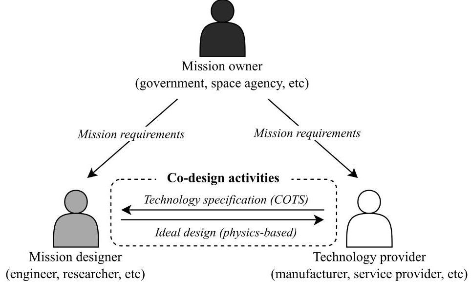

Fig.1 Concept of co-design (component level) in space mission engineering

Given these two activities, a co-design activity is beneficial for the mission's success and fosters a thriving ecosystem among the actors [4-6]. The incorporation of COTS gives broad architecture options and cuts the time and budget for mission designers. Meanwhile, ideal design provides a basis for technology providers to develop a new product/service that is in need. The co-design activity does not only take place in the component level, but also on the analysis level. In the analysis level, component sizing (e.g. solar panel sizing) and dynamic simulation (e.g. orbit trajectory simulation) are highly coupled. The dynamic simulation drives sizing and ensures the compatibility/reliability of sized components. On the other hand, sizing output evaluates which dynamic behavior is optimum for a given component's specifications.

Some studies promoted co-design activity, particularly COTS components integration into space system design. Hodson et al. reported technical assessment on current COTS use in eight (8) NASA Centers, among them are NASA Goddard Space Flight Center and Kennedy Space Center. The assessment includes mission risks classification and

<!-- PDF_PAGE: 3 -->

recommendations of COTS in the future [7]. The integration of COTS in space system is motivated by the some factors, such as program budget, schedule restrictions, and their massive availability in the market [8,9]. The COTS components installation is presumed providing some benefits in shorten design and manufacturing process, as well as reducing costs for small satellite in short and medium term missions [9]. Although, COTS parts cannot be installed on-board without verification and validation as they present some challenges. The main challenge comes from reliability factor subject to hostile space environment, which includes temperature fluctuations, radiation exposure, and vibration by external load disturbance [10]. Therefore, some institutions have been developing procedures to test and validate the operational challenges. Most of the procedure does not take concurrent/multidisciplinary approach, instead they are sequential, i.e. testing a component one-by-one subjected to different type of tests [8,11].

Thus, we propose a framework for multidisciplinary co-design optimization concept in component and analysis level. Multidisciplinary co-design means the concept involves multiple components and multiple disciplines' analyses, hence it is called multidisciplinary co-design activities. The optimization part has the objective to search for optimum architectures from multiple co-design activities by the use of gradient-based optimization and a metaheuristic approach. We implement the methodology to a CubeSat architecture exploration. CubeSat architecture exploration represents the complexity of multidisciplinary co-design optimization. As a cyber-physical system (CPS), it presents multiple subsystems and couplings of discipline analysis [12,13]. Components of subsystems come from different technology providers, such as battery, solar panel manufacturers, and ground station communication servers. As an example in the analysis level, orbit trajectory, solar illumination profile, and battery state-of-charge are some variables which are coupled to power subsystem sizing.

This paper is structured as follows: Section II.B and Section II.C present the state-of-the-art of this domain from the similar studies, identified research gaps, and objectives of our work. Section III elaborates the framework construction for CubeSat use case, which consists of Architecture Design Space Graph (ADSG, Section III.A), Multidisciplinary Design Optimization (MDO, Section III.B), and Reinforcement Learning (RL, Section III.C). Then, Section IV describes capabilities of the framework and discusses the correlation to the proposed contributions. Finally, Section V concludes the paper.

## B. Research Gaps

We have studied recent research on aerospace multidisciplinary design optimization (MDO), particularly on its implementation for system architecting and design space exploration. Most of the works focus on one-direction design methodology, taking position as a mission designer in our context. Takao et al. modeled subsystems of interplanetary vehicles, such as propulsion and electric power systems, as well as their trajectory optimization [14]. However, they did not study the co-design at the component level. Ridolfi et al. developed System Engineering Module (SEM) for the design of satellite subsystems, but did not accommodate for flight heritage implementation [15]. A research by Naidu and Leifsson quantified the uncertainty of spacecraft trajectory design; however, the uncertainty caused by component changes was not predicted [16]. For CubeSat application cases, Klesh et al., Bradley and Atkins, Gregory et al. developed the subsystem couplings and task scheduling without considering co-design of component aspects [12,13,17]. Some research about single subsystem/discipline design, such as power management and structural, was performed in a one-way manner and without concrete component implementation [18-20]. On the other hand, Isaacs tested some COTS of solar arrays with respect to different mission requirements [21]. However, the multidisciplinary effect on other subsystems was not taken into account because of the absence of co-design methodology. These studies show that research on component level of co-design was barely conducted.

Most similar approaches come from some collaborative MDO project and Concurrent Design Facility (CDF). AGILE project is a collaborative project which gathers institutions, with their respective expertise, to develop a distributed MDO framework for aircraft design [22]. Some Concurrent Design Facility (CDF) has been built around the world (e.g. at European Space Agency Research and Technology Center (ESA/ESTEC), École Polytechnique Fédérale de Lausanne (EPFL), and University of Luxembourg) to simultaneously develop space engineering products [23-25]. CDF accommodates several teams, hardware, and software to concurrently perform complex space engineering tasks which are highly coupled: from mission requirements, performing design trade-offs, evaluating, and validating the design. Both collaborative MDO project and CDF have the same objective to speed up the design process by integrating all the elements and processes. However, their objectives are different from this paper's multidisciplinary co-design concept. They rather focus on the side of mission designer collaboration. Instead, this paper promotes a concept of collaboration between mission designer and technology provider, with "ideal design" and COTS as the concrete representatives.

At the analysis level, there is plenty of research that has been done with various MDO techniques on either dynamic

<!-- PDF_PAGE: 4 -->

modeling or static component sizing. However, research that covers both aspects (co-design analysis) is barely identified. Ruh et al. conducted multi-fidelity physics-based disciplines, but concrete component modeling was absent [26]. The similar approach involving large-scale MDO formulation was done by Hwang et al. to model comprehensive dynamic modeling of CubeSat-investigating Atmospheric Density Response to Extreme driving (CADRE) mission operation [27]. Yeo et al. has been doing research on MDO for dynamics of interplanetary transfer vehicles [28]. Meanwhile, the studies by Kaslow et al. and Bouwmeester et al. focused more on the structural architecture of CubeSat and PocketQubes [29, 30]. A research gap is identified in the analysis level of co-design.

In design space exploration research, some tools have been developed such as Pugh matrix and weighted attribute matrix for concept selection [31]. Morphological matrix was also used by Frank et al. for supporting decision-making under evolving requirements of suborbital vehicle [32]. For product line management, Feature Model has been widely used in the industry to explore various components of a system [33-36]. A form-to-function tool, called Architecture Design and Optimization Reasoning Environment (ADORE), for system architecting was introduced by Bussemaker et al. [37]. ADORE was built upon Architecture Design Space Graph (ADSG) which acts as an architecture generator from the functional description and component fulfillment [38]. In order to search for optimum design or Pareto front in the design space, some research makes use of Non-Dominated Sorting Genetic Algorithm II (NSGA-II), probabilistic-based Monte-Carlo simulation, and supervised learning (e.g. random forest) [31, 32, 39]. Demagall et al. provides a basis for deep reinforcement learning (RL) implementation for spacecraft configuration design [40]. From this investigation, research about design space exploration with efficient search algorithm/model needs to be pushed forward.

## C. Research Objectives

Based on the research gaps and state-of-the-art in the previous sections, we propose two (2) main objectives in this paper:

1) The framework formulation of multidisciplinary co-design optimization in component and analysis level with CubeSat application case.

2) Reinforcement Learning (RL) implementation for CubeSat design space exploration with the goal to find optimum architecture(s).

These objectives help to bridge the research gaps by using various tools, such as ADORE [37], OpenMDAO [41], and Gymnasium [42]. We use ADORE for system architecture modeling of co-design at the component level, while OpenMDAO is used to formulate the MDO problem of co-design at both the component and analysis levels. Gymnasium is an open-source Python library for performing exploration by RL. The formulation has been applied to a CubeSat for Earth observation.

The expected result of the first research objective is quantifiable impacts on the system level (CubeSat) by partially installing COTS/flight heritage components compared to full "ideal sizing" CubeSat design. Given the information of quantifiable impacts, both mission designer and technology provider can make better architectural decisions on which components to install in their mission-specific CubeSat. While the second objective has outcomes to obtain the best CubeSat architectures given certain components must be installed on-board. As an example, when a technology provider has a COTS component to offer, therefore the mission designer is able to determine which other components should be paired with to obtain best performance in system level using RL search. This paper's contribution has the potential to be applied to any aerospace mission or design, which requires multidisciplinary co-design optimization at the component and analysis levels, such as aircraft, spacecraft, urban air mobility and unmanned aerial vehicles.

## III. Framework Construction

We build the framework of multidisciplinary co-design optimization with the implementation to CubeSat by using a series of tools. First, we modeled CubeSat design space using ADORE by German Aerospace Center (DLR). This design space is aimed to model the interaction of component sizing and COTS with another CubeSat subsystems. Second, we formulated the numerical couplings and multidisciplinary optimization of CubeSat which incorporates co-design at component and analysis level. The mathematical problem was formulated in OpenMDAO. Finally, we implemented Reinforcement Learning (RL) to the linked tools (ADORE and OpenMDAO) to explore the design space for optimum CubeSat architectures. We focus the discussion on power subsystem co-design (i.e. solar panel and secondary battery) and their impact on system level design for the CubeSat implementation throughout the framework, despite we modeled all subsystems.

<!-- PDF_PAGE: 5 -->

## A. Modeling the Architecture Design Space Graph (ADSG) of CubeSat

We model the components co-design and their interaction with other subsystems of CubeSat using the concept of Architecture Design Space Graph (ADSG) in the ADORE web interface. ADSG is a function-to-form concept of system architecture modeling by defining functions and the components' fulfillment [37]. In our case, we develop a model of complete CubeSat architectures that consist of power, structure, payload, thermal control, communication, attitude determination & control, and on-board computing subsystems. Due to the focus of the current study, we only expand the view of power subsystem modeling, which can be seen in Figure 2. The complete list of functions and component variability that are featured in ADSG is written in Table 5.

The model of power subsystem comprises three (3) sizing components and three (3) COTS for each solar panel and battery (in this paper, "battery" refers to "secondary battery" for practicality). What differentiates the sizing from COTS components are the attributes/parameters, following the objective of each. As listed in Table 1, the parameters for solar panel sizing are energy density $ ( e_{sa} ) $ and efficiency $ ( \eta_{sa} ) $ . These are required input parameters to size solar panel (e.g. mass, power generated, area) with different technology (e.g. polyimide, triple junction, and flexible PV) [43]. For COTS components, the inputs are basically the specifications of real products by technology providers, for example mass $ ( m_{sa} ) $ and maximum power generated $ ( P_{max,sa} ) $ The same approach goes for battery sizing and COTS (listed in Table 2).

Table 1 Specification list of solar panel technology (for sizing) and COTS

<table border="1"><tr><td></td><td>Polyimide</td><td>Triple Junction</td><td>Flexible PV</td></tr><tr><td>$e_{sa}[W/kg]$</td><td>50</td><td>46</td><td>100</td></tr><tr><td>$\eta_{sa}$</td><td>0.28</td><td>0.22</td><td>0.30</td></tr><tr><td></td><td>COTS1</td><td>COTS2</td><td>COTS3</td></tr><tr><td>$m_{sa}[kg]$</td><td>0.038</td><td>0.118</td><td>0.289</td></tr><tr><td>$P_{max,sa}[W]$</td><td>2.45</td><td>8.54</td><td>19.52</td></tr><tr><td>$A_{sa}[m^{2}]$</td><td>0.01</td><td>0.03</td><td>0.06</td></tr><tr><td>$\eta_{sa}$</td><td>0.29</td><td>0.29</td><td>0.275</td></tr></table>

Table 2 Specification list of battery technology (for sizing) and COTS

<table border="1"><tr><td></td><td>Li-Ion</td><td>LiPo</td><td>NiCd</td></tr><tr><td>ncell</td><td>2</td><td>3</td><td>2</td></tr><tr><td>ebat[W·h/kg]</td><td>155</td><td>119</td><td>30</td></tr><tr><td>vbat[W·h/m3]</td><td>184500</td><td>169500</td><td>54000</td></tr><tr><td></td><td>COTS1</td><td>COTS2</td><td>COTS3</td></tr><tr><td>mbat[kg]</td><td>0.189</td><td>0.314</td><td>0.268</td></tr><tr><td>Vbat[l]</td><td>0.234</td><td>0.199</td><td>0.186</td></tr><tr><td>Emax,bat[W.h]</td><td>28.8</td><td>50.0</td><td>30.0</td></tr></table>

The selection of functions and components of a CubeSat design space makes a series of architectural decision-making. We develop a design space featuring 10 architectural decisions and 29 components across all subsystems, resulting in a total of 8100 instances of CubeSat architectures. If some architectural decision-making is fixed, then the number of architecture instances is less than that. All architecture instances are automatically converted to an array of design vector by ADORE. For example, an architecture design vector is encoded as [1,1,3,2,1,0,1,0,4,5]. The length of the array is 10 which represents the number of architectural decision-making. Each element's value denotes the different choice of components or functions. The detailed indexing and its value is described in Table 5 in Appendix. This approach accommodates the multidisciplinary component co-design formulation by changing indexes in the design vectors.

<!-- PDF_PAGE: 6 -->

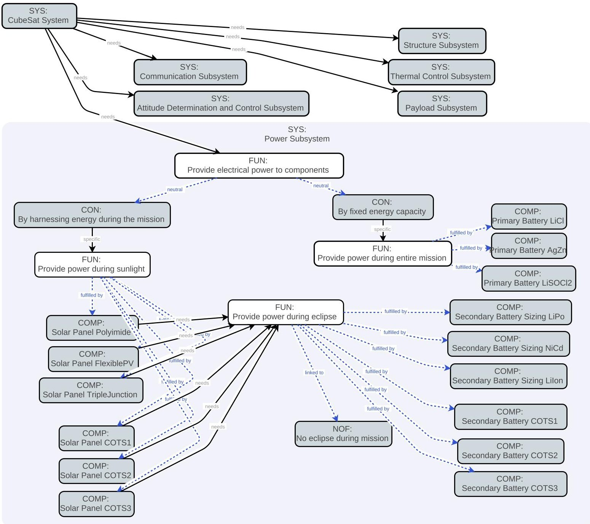

Fig.2 ADSG of CubeSat and its power subsystem modeling in ADORE

## B. Formulating Multidisciplinary Co-Design Optimization of CubeSat

We construct the numerical multidisciplinary co-design optimization of our framework by using OpenMDAO [41]. The objective is to create an adjustable MDO formulation depending on what CubeSat architectures are being instantiated by ADORE. The adjustable MDO formulation facilitates both component and analysis aspects of co-design concept, as novel design paradigm proposed in this paper. For the component co-design, a specific design vector, i.e. as an embodiment of CubeSat architecture instance, triggers the corresponding OpenMDAO component to be placed in the MDO formulation. Therefore, the complete MDO formulation can be arranged by all sizing models or partial COTS models. The MDO formulation also accommodates co-design between dynamic model (e.g. orbit dynamics, solar illumination, and energy dynamic models) and static component sizing (or COTS component model), which are tightly coupled (as illustrated by an eXtended Design Structure Matrix (XDSM) in Figure 12 in Appendix). All components of subsystems, except power are sizing models. In the next paragraphs, the XDSMs representation will be focused into to power subsystem only (where co-design presents).

This automated adjustable MDO formulation gives benefit to mission designer and technology provider. For mission designer use, the dynamic behaviors, which come from mission requirements, drive the "ideal" component sizing. This formulation of multidisciplinary co-design optimization is captured by Equation 1 and Figure 3, in which the positive net stored energy (from dynamic model) is minimized. The rationale of this formulation is to avoid harnessing

<!-- PDF_PAGE: 7 -->

redundant net energy during the mission (net energy is energy generation minus energy consumption) by finding optimum dimension/area of solar panel $ ( A_{sa} $ as design variable) and limiting battery mass $ ( m_{bat} $ as constraint). That is why this is called as an "ideal sizing" approach. The detailed models for dynamics models (i.e. orbit dynamics, solar illumination, energy dynamics) and both sizing & COTS models of solar panel and battery are stated in Equation 5 until Equation 11 in Appendix. Those models were all converted into OpenMDAO components.

$$
\begin{array}{l} \mathrm {m i n i m i z e} \quad E _ {n e t} \\ \mathrm {w i t h r e s p e c t t o} \quad A _ {s a}, f _ {d o w n}, G S D, \dots \\ \mathrm {s u b j e c t t o} \quad m _ {b a t, l o w e r} \leq m _ {b a t} \leq m _ {b a t, u p p e r} \\ V _ {p a y l o a d, l o w e r} \leq V _ {p a y l o a d} \leq V _ {p a y l o a d, u p p e r} \\ \end{array}
$$

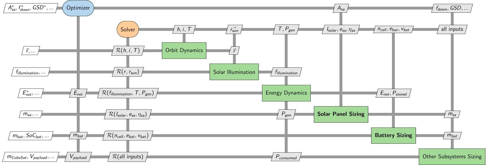

Fig.3 XDSM of power subsystem MDO with all component sizing

On the other hand, technology provider can leverage this framework by placing their COTS component(s) in MDO formulation to obtain the knowledge of what would be its dynamic behavior, given the mission requirements. The multidisciplinary co-design optimization is minimizing total mass of CubeSat, while the design variables and constraints all come from any subsystems, except power. The detail formulation is described mathematically and by XDSM by Equation 2 and Figure 4 respectively. Power components can not be optimized here because it comes as COTS, meaning static properties such as mass, maximum power, dimensions are all fixed.

$$
\begin{array}{l} \mathrm {m i n i m i z e} \quad m _ {C u b e S a t} \\ \mathrm {w i t h r e s p e c t t o} \quad f _ {d o w n}, G S D, \dots \\ \mathrm {s u b j e c t t o} \quad V _ {p a y l o a d, l o w e r} \leq V _ {p a y l o a d} \leq V _ {p a y l o a d, u p p e r} \\ \end{array}
$$

We develop a scoring method to quantify the performance of CubeSat with partial COTS component(s) compared to fully sized CubeSat. This will assist mission designer or technology provider to measure the effectiveness/fitness of their design and/or COTS to the mission requirements. The scoring method relies from both dynamic and static properties as expressed by a set of equations (Equation 12 in Appendix). The objective is not only to measure the performance of power architecture in subsystem level, but also in system (i.e. CubeSat) level. It aligns with the "multidisciplinary" aspect in co-design optimization concept. Battery state-of-charge （SoCbat）and power generated by solar panel （Pgen） represent the dynamic properties during the CubeSat mission in orbit. While, the static properties are captured by battery mass （mbat）and solar panel mass （msa). The final scoring (PowerScore) is the summation of every indicator multiplied into a weighted factor. The score ranges from 0 to 1, where 1 is the best.

## C. Implementing Reinforcement Learning for CubeSat Design Space Exploration

Our motivation of using metaheuristic approach, Reinforcement Learning (RL) in this case, is the hypothesis that the enumerative search would no longer be effective as the design space gets larger. The size of design space explodes as there are more components that result on more CubeSat architectures. Hence, the objective of this section is to evaluate

<!-- PDF_PAGE: 8 -->

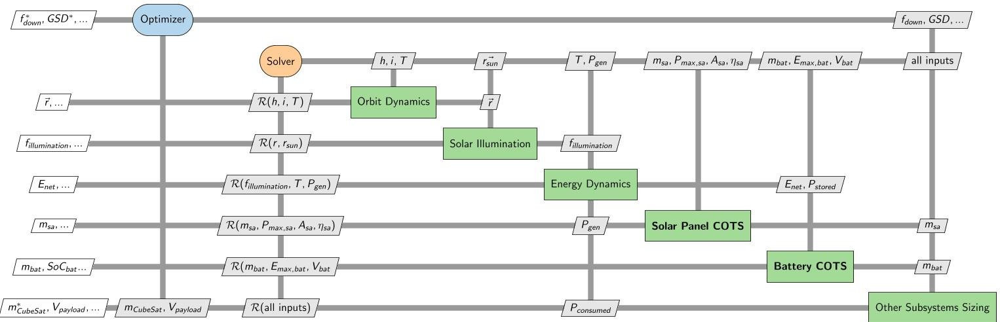

Fig. 4 XDSM of power subsystem MDO with solar panel and battery COTS

how effective RL for exploring the best architecture compared to enumerative or exhaustive search. We determine the best architecture according to the scoring method in the previous section and CubeSat mass as representative of system level properties. Mission designer and technology provider can leverage both enumerative and RL approach to decide which components are best paired in their CubeSat if they supposedly have one or multiple components available. Not only that, RL can be used to better understand the complex couplings in multidisciplinary problem through its correlation quantification. That could be a help for mission designer to make better decision making about whom technology provider should they cooperate with.

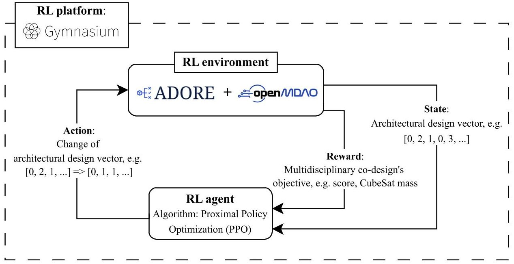

Fig. 5 The workflow of Reinforcement Learning with OpenMDAO and ADORE as environment

We implement Gymnasium, an open-source Python library of RL [42], to our model. The scheme of RL implementation to our framework is described in Figure 5. The RL environment, whom RL agent interacts with, is the linked tool of ADORE and OpenMDAO, which we basically discussed in Section III.A and Section III.B. The architecture design vector (from ADORE) acts as state of RL, which subject to a change by Proximal Policy Algorithm (PPO) [44]. The change(s) is expressed by action that is being fed back to RL environment to return for updated reward. The reward here is either power score and CubeSat mass. The higher score gives positive reward because we want to maximize the score of CubeSat architecture. The opposite reward is set for CubeSat mass because we search for minimum mass. The RL model learns for 30 episodes and 1000 time steps for each episode for a given CubeSat design space, while the other hyperparameters are set as default. The output of this RL search is a CubeSat architecture with the best reward.

<!-- PDF_PAGE: 9 -->

## IV. Framework Capabilities and Discussion

We dedicate this section to present the capabilities of proposed multidisciplinary co-design optimization framework. The framework's outputs provide data-driven decision-making for both mission designer and technology provider. For mission designer, they obtain the knowledge on how their CubeSat design would perform in real mission operation (with the integration of COTS components and mission dynamics modeling). For technology provider, the performance comparison provides them insight on what COTS components they have to offer to mission designer. This section is divided into three (3): Section IV.A and Section IV.B answer the first objective of this paper, while Section IV.C addresses the second objective.

## A. Comparing Co-Design to Ideal Design Approach for CubeSat Performances

We propose a framework which formulate the multidisciplinary co-design optimization (first objective). Therefore, the outputs of framework should give quantitative information on how the installation of some COTS components on CubeSat affects the performance when they are compared to ideal design, i.e. using all sizing models. We present solution spaces of CubeSat architectures as outputs from the framework simulation. The solution spaces indicate the quantitative performances from selected architectures. In our case, the power architecture score and total mass of CubeSat represent the system performance.

Figure 6 shows the performances of different solar panel models (COTS1, COTS2, COTS3, and sizings) in solution spaces. Each sub-figure indicates performances of the pairings of solar panels with specific battery. Figure 6a to Figure 6f show the similar clusters of all COTS solar panels. Generally, CubeSat architectures with COTS1 on-board score highest and ones with COTS3 score lowest. Although, the scores separation between COTS1 and COTS2 architectures are not clear when they are paired with NiCd battery. In practical sense, the mission designer is suggested to select COTS1 solar panel in any architectures for this mission. As they are among the highest best even among the ideal sizing design in terms of power score and CubeSat mass. Regarding the pairings with a unique battery, sizing batteries offer better performance compared to COTS batteries. However, the score deviations happen here where LiIon and LiPo have the ranges around 0.6 and 0.85 (see Figure 6a and Figure 6c). On the other hand, the architectures feature NiCd battery can get the score as low as 0.45 (Figure 6e). For the pairings with the COTS, none of battery COTS shows clear advantages over the others (see Figure 6b, Figure 6d, and Figure 6f).

Figure 7 describes the inverse of solution spaces in Figure 6. They illustrate how different batteries perform when they are paired with a specific solar panel. In most of CubeSat architectures, COTS1, COTS2, and COTS3 batteries do not show any noticeable better performance, except when they are paired with COTS2 solar panel (see Figure 7d). Battery sizing models perform significantly better in most cases compared to COTS models for power scores, while the CubeSat masses are approximately similar. As practical information for mission designer and manufacturer, it means all choices of batteries COTS here cannot compete with ideal sizing models, given the mission requirements. Thus, this framework suggests that they might be better look for other batteries. If there is no other battery alternatives, any pairings with COTS1 solar panel are preferable as they roughly result on lower CubeSat masses and higher power scores (Figure 7b).

## B. Architectural Decision-Making for CubeSat Co-Design

Architectural decision-making is a crucial part in CubeSat preliminary design activity. The understanding on decision-making metrics in the form of concepts and components selection provides great insights to stakeholders. However, the metrics becomes more complicated to be computed manually when the design space is hierarchical, where active/inactive property of a decision-making depends on the previous ones. Therefore, we demonstrate a couple of cases to quantify the importance of each design vectors as representative of architectural decision-making through the results of our co-design framework for CubeSat.

$$
E _ {H} = \frac {- \Sigma \left(p _ {i}\right) l n \left(p _ {i}\right)}{l n (S)}
$$

$$
D I = p _ {i}. \left(1 - E _ {H}\right)
$$

Table 3 and Table 4 provide data of optimum design vectors from the CubeSat's design space (Table 5) for minimum masses and maximum power architecture scores, respectively. The power architectures comprise of a solar panel COTS and a secondary battery COTS, which result on 9 CubeSat architectures for each case. We propose some metrics to assist architectural decision-makers, such as mode occurrence, Shannon's equitability index, and decision importance.

<!-- PDF_PAGE: 10 -->

## Fig. 6 Performance of Solar Panel Sizing and COTS

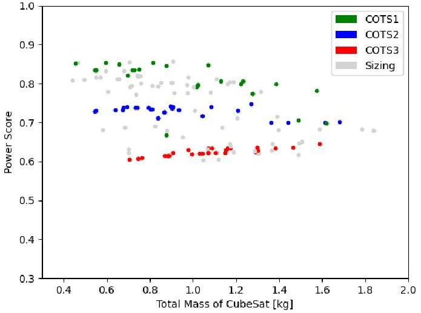

(a) Paired with LiIon battery

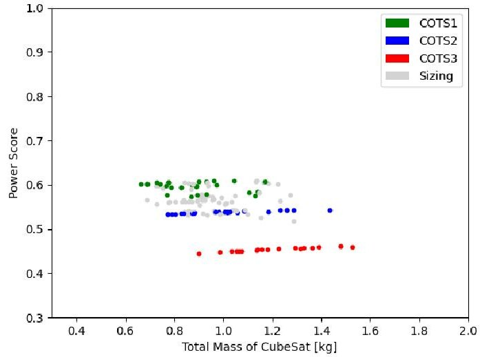

(b) Paired with COTS1 battery

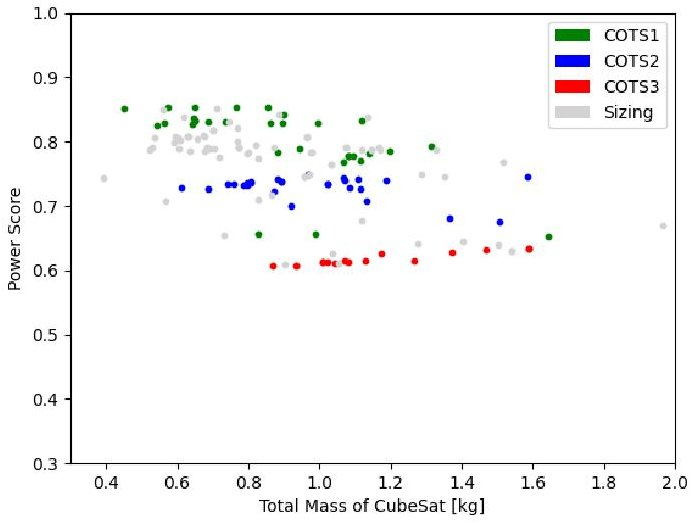

(c) Paired with LiPo battery

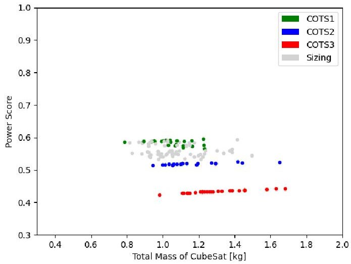

(d) Paired with COTS2 battery

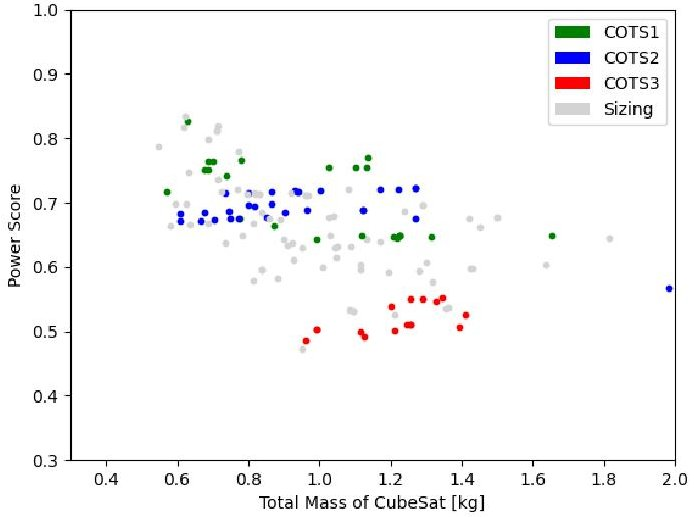

(e) Paired with NiCd battery

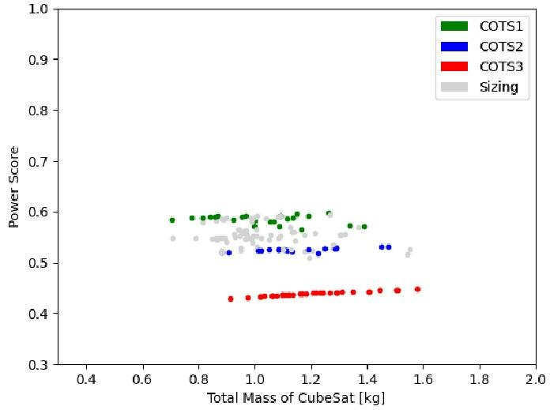

(f) Paired with COTS3 battery

<!-- PDF_PAGE: 11 -->

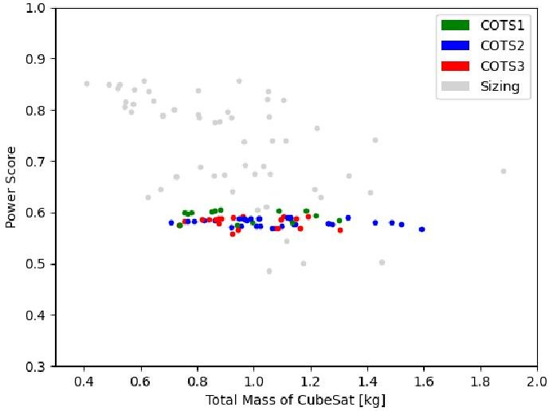

(a) Paired with flexible PV solar panel

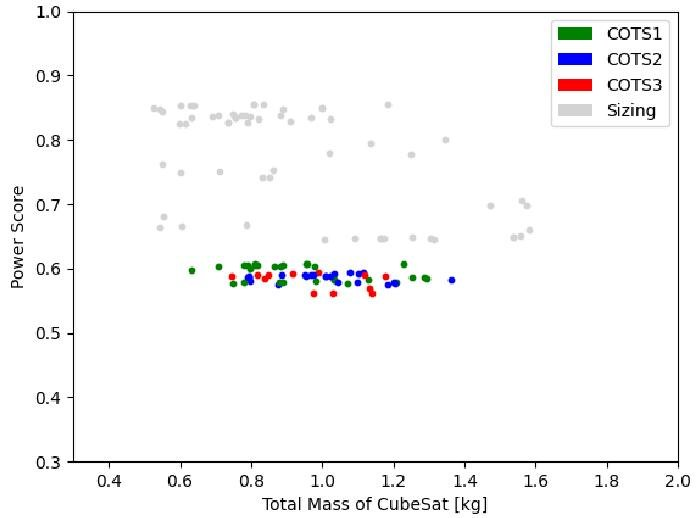

(b) Paired with COTS1 solar panel

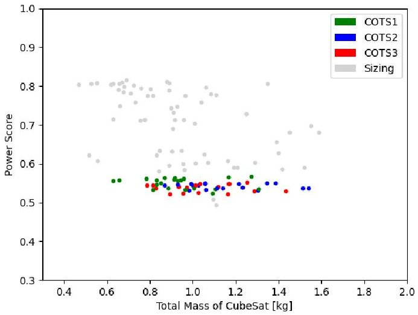

(c) Paired with polyimide solar panel

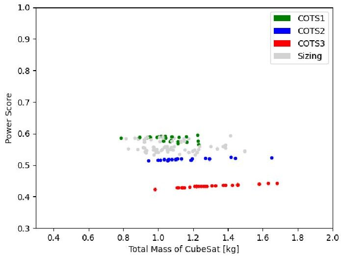

(d) Paired with COTS2 solar panel

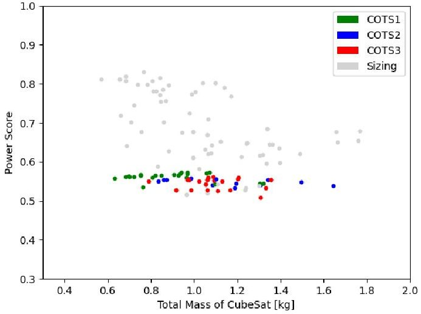

(e) Paired with triple junction solar panel

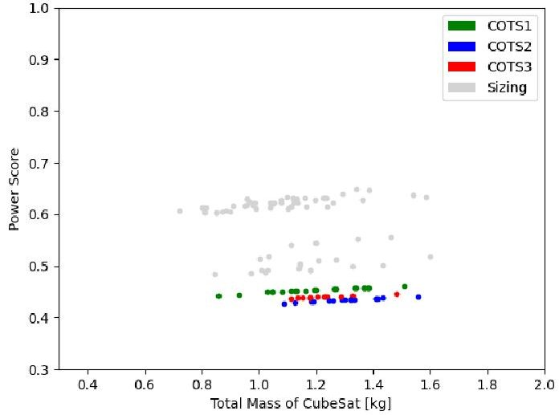

(f) Paired with COTS3 solar panel

<!-- PDF_PAGE: 12 -->

Mode occurrence $ ( p_{i} ) $ is simply the how often an index of design vector's elements appear. Shannon's equitability index $ ( E_{H}, $ Equation 3) is a measure of how even element's indices appear in the design vectors across different architectures or in the other words is the occurrence of certain components across those 9 CubeSat architectures [45]. To quantify how important an architectural decision-making, decision importance $ ( D I, $ Equation 4) metric is introduced which takes into account both mode occurrence and Shannon's equitability.

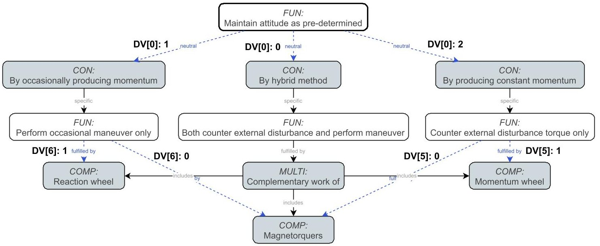

Fig. 8 Hierarchical architecture decision-making for attitude determination and control subsystem

In both tables, the light gray cells indicate the fixed decision-making. For example, DV[1] is always be "by harnessing energy during mission" because we would like to asses the performance of solar panel with secondary battery, not power architectures featuring primary battery. Dark gray cells are for inactive design vector elements due to hierarchical decision-making. An example of hierarchical decision-making exists in the design space of attitude determination and control subsystem (ADCS) as captured in Figure 8. If the concept of "by occasionally producing momentum" or DV[0]:1 is selected, hence DV[6] is active and DV[5] is inactive (i.e. momentum wheel cannot be included).

The first metric is mode occurrence to give numerical data on which concepts or components appear the most when optimizing certain objective across entire CubeSat power architectures. For optimizing the mass, aluminum or DV[4]:1 is the component/material with the highest mode occurrence with 8 out of 9 CubeSat architectures select it. As the number of component variability varies throughout a design space, mode occurrence is not the sole metric to decide components which results on optimum architectures. Shannon's equitability (or diversity for the inverse) provides information on how dominant a component over the others across various optimized architectures. The calculation results in Table 3 show element with highest mode occurrence does not necessarily imply to the lowest equitability. This happens to DV[2] and DV[4], where the former has the lowest equitability because the available components for "balance heat in and out" is significantly more than the later, despite "radiator CFRP" only features in 7 CubeSat architectures (less than aluminum for DV[4]). In this case, the highest decision importance shares the same element with Shannon's equitability with the magnitude of 0.54, which values close to 1 are more important. For the case of optimizing CubeSat's power scores, all metrics agree on coating kapton or DV[2]:1 as the "must selected" component whatever the power architectures are. The mission owner as design decision-makers might use these metrics individually or multiple of them for the informed decision-making depend on which they prioritize the most during the preliminary design stage.

## C. Comparing Reinforcement Learning (RL) and Enumerative Search for CubeSat Design Space Exploration

This section aims to answer second objective of the paper: showcasing the results of implementing RL to search for optimum CubeSat architectures. Based on the methodology that has been discussed in Section III.C, we optimize two cases. One architecture optimization for searching lowest mass and another with highest power score. To asses the performance of both approaches, we took various samples by fixing some components of CubeSat (i.e. certain components must be on-board, refer to Table 6). The more components are fixed, the lesser the number of possible CubeSat architectures. We perform sensitivity analysis for different number of architectures to observe the performance

<!-- PDF_PAGE: 13 -->

Table 3 Architectural decision-making of optimum CubeSat's masses

<table border="1"><tr><td>No</td><td>Solar panel</td><td>Battery</td><td>DV[0]</td><td>DV[1]</td><td>DV[2]</td><td>DV[3]</td><td>DV[4]</td><td>DV[5]</td><td>DV[6]</td><td>DV[7]</td><td>DV[8]</td><td>DV[9]</td></tr><tr><td>1</td><td>COTS1[0]</td><td>COTS1[1]</td><td>1</td><td>1</td><td>4</td><td>2</td><td>1</td><td>0</td><td>1</td><td>0</td><td>0</td><td>1</td></tr><tr><td>2</td><td>COTS1[0]</td><td>COTS2[2]</td><td>2</td><td>1</td><td>3</td><td>0</td><td>1</td><td>0</td><td>0</td><td>0</td><td>0</td><td>2</td></tr><tr><td>3</td><td>COTS1[0]</td><td>COTS3[3]</td><td>1</td><td>1</td><td>4</td><td>2</td><td>1</td><td>0</td><td>1</td><td>0</td><td>0</td><td>3</td></tr><tr><td>4</td><td>COTS2[1]</td><td>COTS1[1]</td><td>2</td><td>1</td><td>4</td><td>2</td><td>1</td><td>0</td><td>0</td><td>0</td><td>1</td><td>1</td></tr><tr><td>5</td><td>COTS2[1]</td><td>COTS2[2]</td><td>1</td><td>1</td><td>4</td><td>0</td><td>1</td><td>0</td><td>1</td><td>0</td><td>1</td><td>2</td></tr><tr><td>6</td><td>COTS2[1]</td><td>COTS3[3]</td><td>2</td><td>1</td><td>4</td><td>2</td><td>1</td><td>0</td><td>0</td><td>0</td><td>1</td><td>3</td></tr><tr><td>7</td><td>COTS3[2]</td><td>COTS1[1]</td><td>2</td><td>1</td><td>3</td><td>2</td><td>1</td><td>0</td><td>0</td><td>0</td><td>2</td><td>1</td></tr><tr><td>8</td><td>COTS3[2]</td><td>COTS2[2]</td><td>1</td><td>1</td><td>4</td><td>2</td><td>1</td><td>0</td><td>0</td><td>0</td><td>2</td><td>2</td></tr><tr><td>9</td><td>COTS3[2]</td><td>COTS3[3]</td><td>1</td><td>1</td><td>4</td><td>2</td><td>0</td><td>0</td><td>1</td><td>0</td><td>2</td><td>3</td></tr><tr><td colspan="3">Active elements</td><td>3</td><td>1</td><td>6</td><td>3</td><td>2</td><td>2</td><td>2</td><td>0</td><td>1</td><td>1</td></tr><tr><td colspan="3">Element mode</td><td>1</td><td>-</td><td>4</td><td>2</td><td>1</td><td>0</td><td>1</td><td>-</td><td>-</td><td>-</td></tr><tr><td colspan="3">Mode occurrence($p_i$)</td><td>0.56</td><td>-</td><td>0.78</td><td>0.78</td><td>0.89</td><td>0.44</td><td>0.44</td><td>-</td><td>-</td><td>-</td></tr><tr><td colspan="3">Shannon&#x27;s equitability($E_H$)</td><td>0.62</td><td>-</td><td>0.29</td><td>0.48</td><td>0.50</td><td>0.62</td><td>0.87</td><td>-</td><td>-</td><td>-</td></tr><tr><td colspan="3">Decision importance($D_I$)</td><td>0.20</td><td>-</td><td>0.54</td><td>0.4028</td><td>0.44</td><td>0.16</td><td>0.05</td><td>-</td><td>-</td><td>-</td></tr></table>

Table 4 Architectural decision-making of optimum CubeSat's power scores

<table border="1"><tr><td>No</td><td>Solar panel</td><td>Battery</td><td>DV[0]</td><td>DV[1]</td><td>DV[2]</td><td>DV[3]</td><td>DV[4]</td><td>DV[5]</td><td>DV[6]</td><td>DV[7]</td><td>DV[8]</td><td>DV[9]</td></tr><tr><td>1</td><td>COTS1[0]</td><td>COTS1[1]</td><td>2</td><td>1</td><td>2</td><td>2</td><td>1</td><td>1</td><td>0</td><td>0</td><td>0</td><td>1</td></tr><tr><td>2</td><td>COTS1[0]</td><td>COTS2[2]</td><td>1</td><td>1</td><td>2</td><td>2</td><td>0</td><td>0</td><td>1</td><td>0</td><td>0</td><td>2</td></tr><tr><td>3</td><td>COTS1[0]</td><td>COTS3[3]</td><td>1</td><td>1</td><td>2</td><td>2</td><td>0</td><td>0</td><td>0</td><td>0</td><td>0</td><td>3</td></tr><tr><td>4</td><td>COTS2[1]</td><td>COTS1[1]</td><td>0</td><td>1</td><td>2</td><td>2</td><td>0</td><td>0</td><td>0</td><td>0</td><td>1</td><td>1</td></tr><tr><td>5</td><td>COTS2[1]</td><td>COTS2[2]</td><td>2</td><td>1</td><td>2</td><td>0</td><td>0</td><td>1</td><td>0</td><td>0</td><td>1</td><td>2</td></tr><tr><td>6</td><td>COTS2[1]</td><td>COTS3[3]</td><td>0</td><td>1</td><td>2</td><td>0</td><td>0</td><td>0</td><td>0</td><td>0</td><td>1</td><td>3</td></tr><tr><td>7</td><td>COTS3[2]</td><td>COTS1[1]</td><td>0</td><td>1</td><td>2</td><td>1</td><td>0</td><td>0</td><td>0</td><td>0</td><td>2</td><td>1</td></tr><tr><td>8</td><td>COTS3[2]</td><td>COTS2[2]</td><td>0</td><td>1</td><td>2</td><td>1</td><td>0</td><td>0</td><td>0</td><td>0</td><td>2</td><td>2</td></tr><tr><td>9</td><td>COTS3[2]</td><td>COTS3[3]</td><td>1</td><td>1</td><td>2</td><td>1</td><td>0</td><td>0</td><td>0</td><td>0</td><td>2</td><td>3</td></tr><tr><td colspan="3">Active elements</td><td>3</td><td>1</td><td>6</td><td>3</td><td>2</td><td>2</td><td>2</td><td>0</td><td>1</td><td>1</td></tr><tr><td colspan="3">Element mode</td><td>0</td><td>-</td><td>2</td><td>2</td><td>0</td><td>1</td><td>0</td><td>-</td><td>-</td><td>-</td></tr><tr><td colspan="3">Mode occurrence($p_i$)</td><td>0.44</td><td>-</td><td>1.0</td><td>0.44</td><td>0.89</td><td>0.22</td><td>0.22</td><td>-</td><td>-</td><td>-</td></tr><tr><td colspan="3">Shannon&#x27;s equitability($E_H$)</td><td>0.96</td><td>-</td><td>0.0</td><td>0.96</td><td>0.50</td><td>0.48</td><td>0.77</td><td>-</td><td>-</td><td>-</td></tr><tr><td colspan="3">Decision importance($D_I$)</td><td>0.01</td><td>-</td><td>1.0</td><td>0.01</td><td>0.44</td><td>0.11</td><td>0.05</td><td>-</td><td>-</td><td>-</td></tr></table>

the RL algorithm. This also serves a practical reason in co-design activities between mission designer and technology provider. For instance, a manufacturer wants their product to be included in a CubeSat mission. By using this framework, they will get a knowledge of which other components would be the best fit to their proposed COTS components.

Figure 9 presents the comparison of computation time for architecture optimization using RL and enumerative search approach. Enumerative search means all possible CubeSat architectures are simulated and covers both optimization cases at once. Meanwhile, RL is only able to optimize each case separately. As shown in the plot, the simulation durations for enumerative approach increase almost proportionally with the number of architectures. On the other hand, computation times using RL (both for mass and power score) stop increasing significantly at around 2700 architectures. From this point on, RL outperforms enumerative approach. However, the individual computation time should not be taken precisely as they vary depending on different power architectures despite same size of design space. More thorough statistical studies need to be conducted. This trend on computation time shows that RL is advantageous for considerably large size of design space and enumerative method is sufficient for small design space.

Afterwards, we validate the outputs of RL optimization by comparing both optimum masses and power scores

<!-- PDF_PAGE: 14 -->

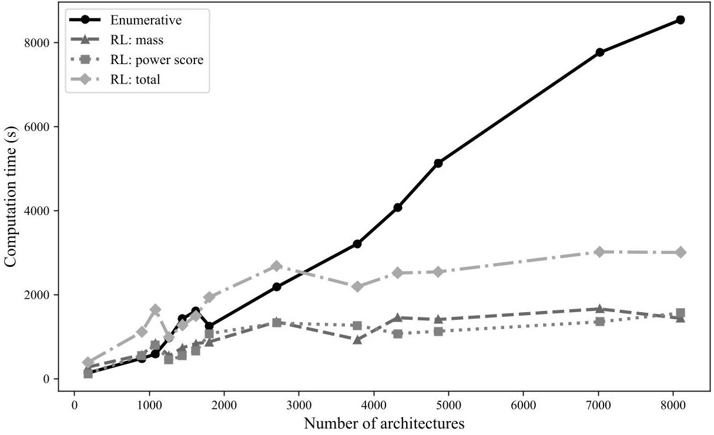

Fig. 9 Comparison of computation time between enumerative and RL

to the outputs from enumerative approach. The enumerative method is taken as the ground truth as it optimizes all architectures, thus they should have included the global optimum architectures. The exact same 13 architectures with different sizes listed in Table 6 are used for simulation. Figure 10 shows the error for RL are relatively high with most of them are more than 10%. The Spearman rank correlation analysis for CubeSat's mass optimization reveals a moderate correlation, but statistically significant agreement between the RL and enumerative methods $ \rho=0.6593 $ p-value = 0.0142), suggesting that both approaches produce comparably ordered solutions [46]. For power score optimization (shown in Figure 11), the errors are arguably low as only 2 architecture scores are over 5%. The strong and highly significant correlation $ \rho=0.8281 $ p-value $ = 4.7310^{-4} $ ) confirms that the RL-based optimization reproduces the ranking trends obtained through enumeration with high fidelity. In conclusion, with the current formulation and settings, RL performs better for exploring design space with the objective or reward function of maximizing the power score, rather than for minimizing the CubeSat mass.

## V. Conclusion

We propose a framework promoting multidisciplinary co-design optimization concept in component and analysis level for CubeSat. There are two (2) aspects to construct this framework (addressing first objective). First, we have modeled a CubeSat design space to accommodate component co-design between sizing and COTS models. Second, we developed adaptable MDO problem formulation to incorporate both component and analysis co-design. To address the second objective, we implemented an RL algorithm into this framework to explore CubeSat design space and find optimum architectures. We demonstrated the capabilities of this framework in conjunction to the first objective by generating solution spaces that quantify performances of co-design CubeSat architectures. They showed that some COTS components are good fits for the given CubeSat mission, while the others are not competitive compared to sizing models. We also analyzed numerically the architectural decision-making within the design space through some metrics, such as mode occurrence, Shannon's equitability, and decision importance. Eventually, we conducted some experiments to assess the effectiveness of RL compared to enumerative search. It has been shown that the computational time of RL is longer for smaller number of architectures, while it overlaps enumerative search for larger ones. The capabilities of the framework has the potential to be used by mission designer and technology provider for co-designing aerospace system during preliminary design stage.

## Appendix

<!-- PDF_PAGE: 15 -->

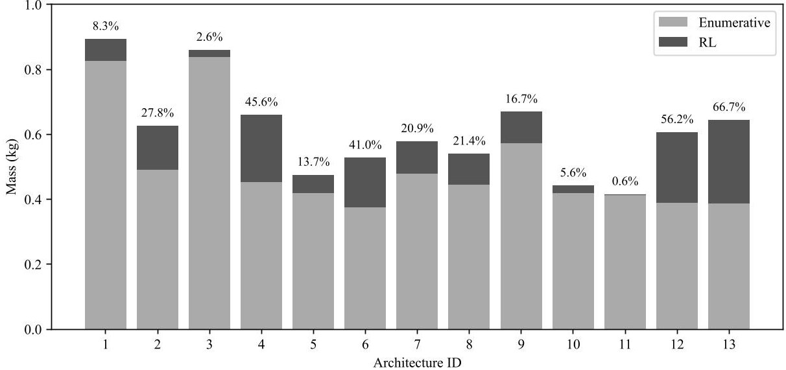

Fig.10 Comparison of enumerative and RL for optimizing CubeSat's mass

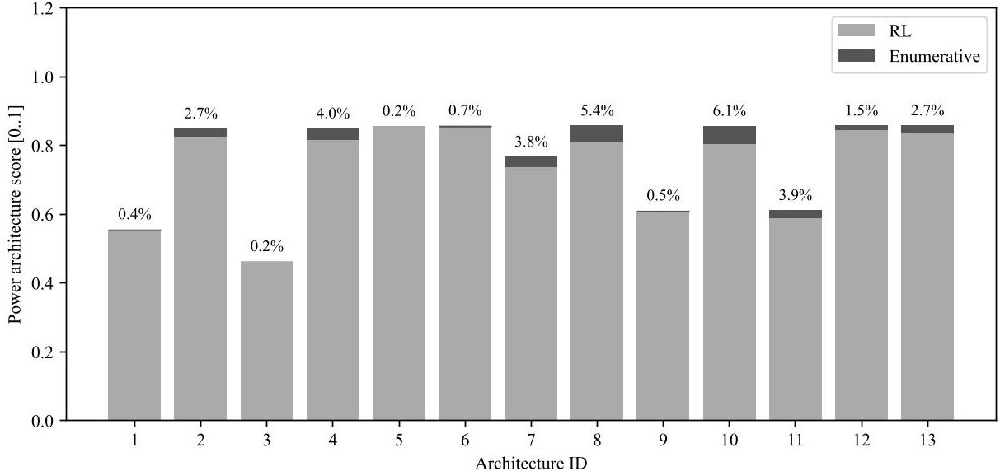

Fig.11 Comparison of enumerative and RL for optimizing CubeSat's power architecture score

Table 5 Design vector identification for CubeSat architectures

<table border="1"><tr><td>Index</td><td>Architectural Decision Making</td><td>Fulfillment [element]</td></tr><tr><td>0</td><td>Maintain attitude as pre-determined</td><td>by hybrid method [0]; by occasionally producing momentum [1]; by producing constant momentum [2]</td></tr><tr><td>1</td><td>Provide electrical power to components</td><td>by fixed energy capacity [0]; by harnessing energy during mission [1]</td></tr><tr><td>2</td><td>Balance heat in and out</td><td>coating black [0]; coating kapton [1]; coating white [2]; radiator Al [3]; radiator CFRP [4]; radiator Cu [5]</td></tr><tr><td>3</td><td>Receive and transmit data</td><td>radio transceiver L [0]; radio transceiver S [1]; radio transceiver UHF [2]</td></tr><tr><td>4</td><td>Withstand external load</td><td>additive manufacturing [0]; aluminum [1]</td></tr><tr><td>5</td><td>Counter external disturbance torque</td><td>magnetorquers [0]; momentum wheel [1]</td></tr><tr><td>6</td><td>Perform occasional maneuver</td><td>magnetorquers [0]; reaction wheels [1]</td></tr></table>

Continued on next page

<!-- PDF_PAGE: 16 -->

Table 5 - Continued from previous page

<table border="1"><tr><td>Index</td><td>Architectural Decision Making</td><td>Fulfillment[design vector]</td></tr><tr><td>7</td><td>Provide power during entire mission</td><td>primary battery AgZn[0]; primary battery LiCl[1]; primary battery LiSOCl2[2]</td></tr><tr><td>8</td><td>Provide power during sunlight</td><td>solar panel COTS1[0]; solar panel COTS2[1]; solar panel COTS3[2]; solar panel flexible PV[3]; solar panel polyimide[4]; solar panel triple junction[5]</td></tr><tr><td>9</td><td>Provide power during eclipse</td><td>no eclipse[0]; secondary battery COTS1[1]; secondary battery COTS2[2]; secondary battery COTS3[3]; secondary battery Li-Ion[4]; secondary battery LiPo[5]; secondary battery NiCd[6]</td></tr></table>

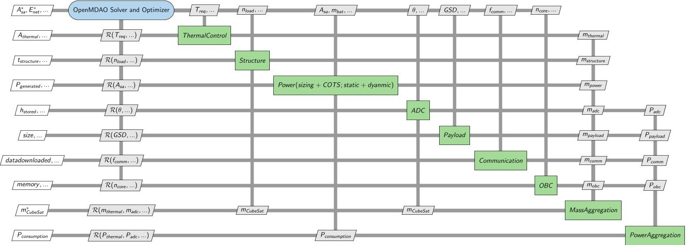

Fig.12 XDSM of complete CubeSat MDO formulation

Table 6 List of CubeSat architectures for enumerative and RL comparison

<table border="1"><tr><td>Architecture ID</td><td>Size</td><td>Architecture</td><td>Components</td></tr><tr><td>1</td><td>180</td><td>Fixed solar panel; fixed battery</td><td>[4];[2]</td></tr><tr><td>2</td><td>900</td><td>Fixed solar panel;2 batteries</td><td>[5];[3-4]</td></tr><tr><td>3</td><td>1080</td><td>Fixed solar panel;COTS batteries</td><td>[2];[1-3]</td></tr><tr><td>4</td><td>1260</td><td>Fixed solar panel;4 batteries</td><td>[5];[2-5]</td></tr><tr><td>5</td><td>1440</td><td>Fixed solar panel;5 batteries</td><td>[0];[1,2,4-6]</td></tr><tr><td>6</td><td>1620</td><td>Fixed solar panel;all batteries</td><td>[0];[1-6]</td></tr><tr><td>7</td><td>1800</td><td>Fixed solar panel;all batteries,no eclipse</td><td>[1];[0-6]</td></tr><tr><td>8</td><td>2700</td><td>2 solar panels;all batteries</td><td>[3-4];[1-6]</td></tr><tr><td>9</td><td>3780</td><td>All solar panel;COTS batteries</td><td>[0-5];[1-3]</td></tr><tr><td>10</td><td>4320</td><td>Sizing solar panel;all batteries,no eclipse</td><td>[3-5];[0-6]</td></tr><tr><td>11</td><td>4860</td><td>All solar panel;COTS batteries,no eclipse</td><td>[0-5];[0-3]</td></tr><tr><td>12</td><td>7020</td><td>All solar panel;all batteries</td><td>[0-5];[1-6]</td></tr><tr><td>13</td><td>8100</td><td>All solar panel;all batteries,no eclipse</td><td>[0-5];[0-6]</td></tr></table>

<!-- PDF_PAGE: 17 -->

Orbit dynamics model:

$$
\left\{ \begin{array}{l l} \Delta t = \frac {T}{n} \\ r _ {0} = R _ {e} + h \\ v _ {0} = \sqrt {\frac {\mu}{r _ {0}}} \\ \boldsymbol {r} _ {0} = \left[ r _ {0} \quad 0 \quad 0 \right] ^ {T} \\ f (\boldsymbol {s}) = \left[ \boldsymbol {v} - \frac {\mu}{\| \boldsymbol {r} \| ^ {3}} \boldsymbol {r} \right] ^ {T} \\ \boldsymbol {k} _ {1} = f (\boldsymbol {s}); \\ \boldsymbol {s} _ {i} = \boldsymbol {s} + \frac {\Delta t}{6} \left(\boldsymbol {k} _ {1} + 2 \boldsymbol {k} _ {2} + 2 \boldsymbol {k} _ {3} + \boldsymbol {k} _ {4}\right) \end{array} \right. \quad \boldsymbol {v} _ {0} = \left[ 0 \quad v _ {0} \cos i \quad v _ {0} \sin i \right] ^ {T} \quad \boldsymbol {s} _ {0} = \left[ \boldsymbol {r} _ {0} \quad \boldsymbol {v} _ {0} \right] ^ {T}
$$

Solar illumination dynamics model:

$$
\left\{ \begin{array}{l} \boldsymbol {s} _ {\mathrm {s u n}} = \left[ \begin{array}{l l l} 1 & 0 & 0 \end{array} \right] ^ {T} \\ \hat {\boldsymbol {s}} _ {\mathrm {s u n}} = \frac {\boldsymbol {s} _ {\mathrm {s u n}}}{\| \boldsymbol {s} _ {\mathrm {s u n}} \|} \\ \| \boldsymbol {r} _ {i} \| = \mathrm {n o r m o f p o s i t i o n} \boldsymbol {r} _ {i} \mathrm {f o r e a c h n o d e} i \\ \hat {\boldsymbol {r}} _ {i} = \frac {\boldsymbol {r} _ {i}}{\| \boldsymbol {r} _ {i} \|} \\ \cos \theta_ {i} = \hat {\boldsymbol {r}} _ {i} \cdot \hat {\boldsymbol {s}} _ {\mathrm {s u n}} \\ f _ {i l l u m i n a t i o n} = \min \left(\max \left(\cos \theta_ {i}, 0\right), 1\right) \end{array} \right.
$$

CubeSat energy dynamics model:

$$
\left\{ \begin{array}{l} \Delta t = \frac {T _ {\mathrm {t o t a l}}}{n} \\ P _ {\mathrm {s t o r e d}, i} = P _ {\mathrm {s o l a r}, i} - P _ {\mathrm {t o t a l}} \\ \Delta E _ {\mathrm {n e t}, i} = P _ {\mathrm {s t o r e d}, i} \cdot \Delta t \\ E _ {\mathrm {n e t}, i} = \sum_ {j = 0} ^ {i} \Delta E _ {\mathrm {n e t}, j} \end{array} \right.
$$

Solar panel sizing model:

$$
\left\{ \begin{array}{l} P _ {\mathrm {g e n}, i} = \eta_ {s a} \cdot I \cdot A _ {s a} \cdot f _ {i l l u m i n a t i o n, i} \\ P _ {\mathrm {m a x}} = 0. 9 \cdot \max \left(P _ {\mathrm {g e n}}\right) \\ m _ {\mathrm {s a}} = \frac {\max \left(P _ {\mathrm {g e n}}\right)}{e _ {s a}} \end{array} \right.
$$

Solar panel COTS model:

$$
\left\{ \begin{array}{l} P _ {\mathrm {g e n}, i} = \eta_ {\mathrm {C O T S}} \cdot I \cdot A _ {\mathrm {C O T S}} \cdot f _ {i l l u m i n a t i o n, i} \\ P _ {\max } = P _ {\max , \mathrm {C O T S}} \\ m _ {\mathrm {s a}} = m _ {\mathrm {C O T S}} \end{array} \right.
$$

<!-- PDF_PAGE: 18 -->

Battery sizing model:

$$
\left\{ \begin{array}{l} \Delta t = \frac {T _ {\mathrm {t o t a l}}}{n} \\ E _ {\mathrm {n e t}} = \int P _ {\mathrm {s t o r e d}} (t) d t \approx \operatorname {t r a p z} \left(P _ {\mathrm {s t o r e d}}, \Delta t\right) \\ E _ {\mathrm {n e t}} ^ {\mathrm {a b s}} = \left| E _ {\mathrm {n e t}} \right| \\ \mathrm {i f} E _ {\mathrm {n e t}} < 0: \quad V _ {\mathrm {b a t}} = \frac {1 . 2 \cdot \left| E _ {\mathrm {n e t}} \right|}{v _ {b a t} \cdot n _ {\mathrm {c e l l}}}, \quad m _ {\mathrm {b a t}} = \frac {1 . 2 \cdot \left| E _ {\mathrm {n e t}} \right|}{e _ {b a t}} \\ \mathrm {e l s e}: \quad V _ {\mathrm {b a t}} = \frac {0 . 2 \cdot \left| E _ {\mathrm {n e t}} \right|}{v _ {b a t} \cdot n _ {\mathrm {c e l l}}}, \quad m _ {\mathrm {b a t}} = \frac {0 . 2 \cdot \left| E _ {\mathrm {n e t}} \right|}{e _ {b a t}} \\ E _ {\mathrm {s t o r e d}} ^ {(0)} = 0. 8 \cdot E _ {\mathrm {n e t}} \\ \mathrm {f o r} i \in [ 0, n - 1 ]: \quad \Delta E _ {i} = P _ {\mathrm {s t o r e d}, i} \cdot \Delta t \\ E _ {\mathrm {s t o r e d}} ^ {(i + 1)} = E _ {\mathrm {s t o r e d}} ^ {(i)} + \Delta E _ {i} \\ \mathrm {S o C} _ {b a t, i} = \min \left(1 0 0, \max \left(0, \frac {\min \left(E _ {\mathrm {s t o r e d}} ^ {(i + 1)}, E _ {\mathrm {n e t}}\right)}{E _ {\mathrm {n e t}}} \cdot 1 0 0\right)\right) \end{array} \right.
$$

Battery COTS model:

$$
\left\{ \begin{array}{l} \Delta t = \frac {T _ {\mathrm {t o t a l}}}{n} \\ E _ {\mathrm {n e t}} = E _ {\max , \mathrm {C O T S}} \\ m _ {\mathrm {b a t}} = m _ {\mathrm {C O T S}} \\ E _ {\mathrm {s t o r e d}} ^ {(0)} = 0. 8 \cdot E _ {\max , \mathrm {C O T S}} \\ \mathrm {f o r} i \in [ 0, n - 1 ]: \quad \Delta E _ {i} = P _ {\mathrm {s t o r e d}, i} \cdot \Delta t \\ E _ {\mathrm {s t o r e d}} ^ {(i + 1)} = E _ {\mathrm {s t o r e d}} ^ {(i)} + \Delta E _ {i} \\ \mathrm {S o C} _ {b a t, i} = \min \left(1 0 0, \max \left(0, \frac {\min \left(E _ {\mathrm {s t o r e d}} ^ {(i + 1)} , E _ {\max , \mathrm {C O T S}}\right)}{E _ {\max , \mathrm {C O T S}}} \cdot 1 0 0\right)\right) \end{array} \right.
$$

<!-- PDF_PAGE: 19 -->

Power architecture scoring method:

$$
\left\{ \begin{array}{l} \mathrm {e n e r g y _ {s c o r e}} = \frac {1}{2} \left(\frac {\mathrm {m e a n} \left(S o C _ {b a t}\right) + \mathrm {m i n} \left(S o C _ {b a t}\right)}{1 0 0}\right) \\ \mathrm {p o w e r _ {m a r g i n}} = \frac {\mathrm {m i n} \left(S o C _ {b a t}\right)}{1 0 0} \\ \mathrm {l o w _ {t h r e s h o l d}} = 0. 8 \\ \mathrm {l o w _ {b a t t e r y _ {p e n a l t y}}} = \mathrm {c l i p} (1 - \mathrm {m e a n} \left(S o C _ {b a t} < \mathrm {l o w _ {t h r e s h o l d}}\right), 0. 0, 1. 0) \\ \mathrm {s o l a r _ {p a n e l} _ {p o w e r _ {p e n a l t y}}} = \left\{ \begin{array}{l l} 1 & \mathrm {i f} \max \left(P _ {\mathrm {g e n}}\right) < P _ {\mathrm {m a x , s a}} \\ 0 & \mathrm {o t h e r w i s e} \end{array} \right. \\ \mathrm {b a t t e r y _ {m a s s _ {b u d g e t}}} = 1 - \frac {m _ {\mathrm {b a t}}}{m _ {\mathrm {C u b e S a t}}} \\ \mathrm {s o l a r _ {p a n e l} _ {m a s s _ {b u d g e t}}} = 1 - \frac {m _ {\mathrm {s a}}}{m _ {\mathrm {C u b e S a t}}} \\ \mathrm {m a s s _ {t h r e s h o l d}} = 0. 2 \quad [ \mathrm {k g} ] \\ \mathrm {b a t t e r y _ {m a s s _ {p e n a l t y}}} = \mathrm {c l i p} \left(1 - \frac {m _ {\mathrm {b a t}}}{\mathrm {m a s s _ {t h r e s h o l d}}}, 0. 0, 1. 0\right) \\ \mathrm {s o l a r _ {p a n e l} _ {m a s s _ {p e n a l t y}}} = \mathrm {c l i p} \left(1 - \frac {m _ {\mathrm {s a}}}{\mathrm {m a s s _ {t h r e s h o l d}}}, 0. 0, 1. 0\right) \\ \mathrm {P o w e r S c o r e} = (0. 1 5 \cdot \mathrm {e n e r g y _ {s c o r e}} + 0. 1 \cdot \mathrm {p o w e r _ {m a r g i n}} + 0. 1 \cdot \mathrm {l o w _ {b a t t e r y _ {p e n a l t y}}} + \\ 0. 1 \cdot \mathrm {s o l a r _ {p a n e l} _ {p o w e r _ {p e n a l t y}}} + 0. 1 \cdot \mathrm {b a t t e r y _ {m a s s _ {b u d g e t}}} + \\ 0. 0 5 \cdot \mathrm {s o l a r _ {p a n e l} _ {m a s s _ {b u d g e t}}} + 0. 2 \cdot \mathrm {b a t t e r y _ {m a s s _ {p e n a l t y}}} + \\ 0. 2 \cdot \mathrm {s o l a r _ {p a n e l} _ {m a s s _ {p e n a l t y}}} \end{array}
$$

## Acknowledgments

Marco Wijaya, Sami Lazreg, Maxime Cordy and Andreas Hein are supported by the Luxembourg National Research Funds (FNR) through the project grants C22/IS/17395798/SAMP.

## References

[1] Camarda, C., Bilen, S., De Weck, O., Yen, J., and Matson, J., "Innovative Conceptual Engineering Design A Template To Teach Innovative Problem Solving Of Complex Multidisciplinary Design Problems," 2010 Annual Conference & Exposition, 2010, pp. 15-742.

[2] Bhatia, G., Mesmer, B., and Weger, K., "Mathematical representation of stakeholder preferences for the SPORT small satellite project," 2018 AIAA Aerospace Sciences Meeting, 2018, p. 0708.

[3] Cameron, B. G., Seher, T., and Crawley, E. F., "Goals for space exploration based on stakeholder value network considerations," Acta Astronautica, Vol. 68, No. 11-12, 2011, pp. 2088-2097.

[4] Ivanco, M. L., and Jones, C. A., "Assessing the Science Benefit of Space Mission Concepts in the Formulation Phase," 2020 IEEE Aerospace Conference, IEEE, 2020, pp. 1-11.

[5] Pomeroy, C., "The quantitative analysis of space policy: A review of current methods and future directions," Space Policy, Vol. 48, 2019, pp. 14-29.

[6] Shelton, K., Rodriguez, G., Weisbin, C., and Elfes, A., "3.1.2 Quantitative Assessment of Expected Space Mission Return in Terms of NASA's Institutional Goals," INCOSE International Symposium, Vol. 15, Wiley Online Library, 2005, pp. 387-397.

[7] Hodson, R. F., Chen, Y., Pandolf, J. E., Ling, K., Boomer, K. T., Green, C. M., Leitner, J. A., Majewicz, P., Gore, S. H., Faller, C. S., et al., "Recommendations on use of commercial-off-the-shelf (COTS) electrical, electronic, and electromechanical (EEE) parts for nasa missions," Tech. rep., NASA STI Program Report Series, 2020.

<!-- PDF_PAGE: 20 -->

[8] Herbert, E., Sega, R., McGraw, J., and Bradley, T., "Risk Management for Commercial-Off-The-Shelf Parts Based Space Hardware," Systems Engineering, Vol. 28, No. 3, 2025, pp. 374-392.

[9] de Oliveira, J. C., and Manea, S., "Methodology for the Selection of Cots Components in Small Satellite Projects and Short-Term Missions," International Journal of Advanced Engineering Reserach and Science, 2020.

[10] Shah, P., and Lai, A., "Cots in space: From novelty to necessity," 35th Annual Small Satellite Conference, 2021.

[11] Hogan, S. L., "Expanding Space Design Options Using COTS," Tech. rep., Aerospace Report No. ATR-2023-01935. The Aerospace Corporation, El Segundo, CA, 2023.

[12] Klesh, A. T., Cutler, J. W., and Atkins, E. M., "Cyber-physical challenges for space systems," 2012 IEEE/ACM Third International Conference on Cyber-Physical Systems, IEEE, 2012, pp. 45-52.

[13] Bradley, J. M., and Atkins, E. M., "Coupled cyber-physical system modeling and coregulation of a cubesat," IEEE Transactions on Robotics, Vol. 31, No. 2, 2015, pp. 443-456.

[14] Takao, Y., Matsuura, T., Yeo, S. H., Ozawa, T., Suenaga, K., Mori, H., Morano, J. A. J., and Ogawa, H., "Multidisciplinary System Design Optimization of Interplanetary Vehicles With Solar Electric Propulsion," AIAA SCITECH 2025 Forum, 2025, p. 0359.

[15] Ridolfi, G., Mooij, E., and Corpino, S., "A system engineering tool for the design of satellite subsystems," AIAA modeling and simulation technologies conference, 2009, p. 6037.

[16] Naidu, S. A., and Leifsson, L. T., "Multidisciplinary Spacecraft and Trajectory Uncertainty Quantification for an Interplanetary Mission," AIAA SCITECH 2024 Forum, 2024, p. 0376.

[17] Gregory, J. M., Sega, R. M., Bradley, T. H., and Kang, J. S., "A Tailored Systems Engineering Process for Developing Student-Built CubeSat Class Satellites," IEEE Access, 2024.

[18] Zhong, J. Z., Robertson, B. E., and Mavris, D. N., "Development of a Space System Power Management and Distribution (PMAD) Subsystem Modeling Capability," AIAA SCITECH 2024 Forum, 2024, p. 0770.

[19] Borwankar, P., Kapania, R. K., Inoyama, D., and Stoumbos, T., "Multidisciplinary design analysis and optimization of space vehicle structures," AIAA SciTech 2024 Forum, 2024, p. 2898.

[20] Cardenas Melgar, A., Puri, N., Robertson, B. E., and Mavris, D. N., "Creation of a Structural Model to Facilitate an OpenMDAO-Based Lunar Rover Parametric Sizing Tool," AIAA SCITECH 2024 Forum, 2024, p. 0768.

[21] Isaacs, S., "System Architecture Study of A Robust High Power Solar Array for LEO and Lunar Environments," AIAA SCITECH 2023 Forum, 2023, p. 1388.

[22] Ciampa, P. D., Prakasha, P. S., Torrigiani, F., Walther, J.-N., Lefebvre, T., Bartoli, N., Timmermans, H., Della Vecchia, P., Stingo, L., Rajpal, D., et al., "Streamlining cross-organizational aircraft development: results from the AGILE project," AIAA Aviation 2019 Forum, 2019, p. 3454.

[23] Bandecchi, M., Melton, B., Gardini, B., and Ongaro, F., "The ESA/ESTEC concurrent design facility," Proceedings of EUSEC, Vol. 9, 2000, p. 2000.

[24] Ivanov, A., Borgeaud, M., Richard, M., Belloni, F., Trigueiro Baptista, A., Guevara, G., and Enrique, M., "Concurrent design facility at the Space Center EPFL," Proceedings of 4th International Workshop on System & Concurrent Engineering for Space Applications', European Space Agency, 2010.

[25] Rana, L., "Vision of a next-gen concurrent design facility (cdf-lu)," 2021 International Astronautical Congress (IAC-21), 2021.

[26] Ruh, M. L., Fletcher, A., Sarojini, D., Sperry, M., Yan, J., Scotzniovsky, L., van Schie, S. P., Warner, M., Orndorff, N. C., Xiang, R., et al., "Large-scale multidisciplinary design optimization of a NASA air taxi concept using a comprehensive physics-based system model," AIAA SciTech 2024 Forum, 2024, p. 0771.

[27] Hwang, J. T., Lee, D. Y., Cutler, J. W., and Martins, J. R., "Large-scale multidisciplinary optimization of a small satellite's design and operation," Journal of Spacecraft and Rockets, Vol. 51, No. 5, 2014, pp. 1648-1663.

[28] Yeo, S. H., Takao, Y., Suenaga, K., Ozawa, T., Matsuura, T., Mori, H., Morano, J. A. J., and Ogawa, H., "Multidisciplinary System Design Optimization of Interplanetary Transfer Vehicle from Geostationary Transfer Orbit to Low Mars Orbit," AIAA SCITECH 2025 Forum, 2025, p. 0771.

<!-- PDF_PAGE: 21 -->

[29] Kaslow, D., Levi, A., Cahill, P. T., Ayres, B., Hurst, D., and Croney, C., "Mission engineering and the CubeSat system reference model," 2021 IEEE Aerospace Conference (50100), IEEE, 2021, pp. 1-8.

[30] Bouwmeester, J., Gill, E., Speretta, S., and Uludag, S., "A new approach on the physical architecture of CubeSats & PocketQubes," Proceedings of the 15th Reinventing Space Conference, Glasgow, UK, 2017, pp. 24-26.

[31] Villeneuve, F., and Mavris, D., "A new method of architecture selection for launch vehicles," AIAA/CIRA 13th International Space Planes and Hypersonics Systems and Technologies Conference, 2005, p. 3361.

[32] Frank, C., Pinon-Fischer, O. J., and Mavris, D. N., "A design space exploration methodology to support decisions under evolving requirements' uncertainty and its application to suborbital vehicles," 53rd AIAA Aerospace Sciences Meeting, 2015, p. 1010.

[33] Antkiewicz, M., Bak, K., Murashkin, A., Olaechea, R., Liang, J. H., and Czarnecki, K., "Clafer tools for product line engineering," Proceedings of the 17th international software product line conference co-located workshops, 2013, pp. 130-135.

[34] Siegmund, N., Rosenmüller, M., Kuhlemann, M., Kästner, C., Apel, S., and Saake, G., "SPL Conqueror: Toward optimization of non-functional properties in software product lines," Software Quality Journal, Vol. 20, 2012, pp. 487-517.

[35] Benavides, D., Segura, S., and Ruiz-Cortés, A., "Automated analysis of feature models 20 years later: A literature review," Information systems, Vol. 35, No. 6, 2010, pp. 615-636.

[36] Lazreg, S., Bohlachov, V., Rana, L., Hein, A., and Cordy, M., "Variability-Aware Design of Space Systems: Variability Modelling, Configuration Workflow and Research Directions," Proceedings of the 16th International Working Conference on Variability Modelling of Software-Intensive Systems, 2022, pp. 1-10.

[37] Bussemaker, J. H., Ciampa, P. D., and Nagel, B., "System architecture design space exploration: An approach to modeling and optimization," AIAA Aviation 2020 Forum, 2020, p. 3172.

[38] Bussemaker, J. H., García Sánchez, R., Fouda, M., Boggero, L., and Nagel, B., "Function-Based Architecture Optimization: An Application to Hybrid-Electric Propulsion Systems," INCOSE International Symposium, Vol. 33, Wiley Online Library, 2023, pp. 251-272.

[39] Silaidis, V., Maggi, F., Carlotti, S., Da Ronch, A., and De Nuccio, E., "Sensitivity Analysis of Parameters on Multi-Disciplinary Design and Optimization Approach for Air-Launched Mission," AIAA SCITECH 2025 Forum, 2025, p. 0770.

[40] Demagall, A., Apaza, G., and Selva, D., "Spacecraft Configuration Design Exploration Through Transformer-Based Reinforcement Learning," AIAA SCITECH 2025 Forum, 2025, p. 0894.

[41] Gray, J. S., Hwang, J. T., Martins, J. R. R. A., Moore, K. T., and Naylor, B. A., "OpenMDAO: An Open-Source Framework for Multidisciplinary Design, Analysis, and Optimization," Structural and Multidisciplinary Optimization, Vol. 59, 2019, pp. 1075-1104. https://doi.org/10.1007/s00158-019-02211-z.

[42] Towers, M., Kwiatkowski, A., Terry, J., Balis, J. U., De Cola, G., Deleu, T., Goulao, M., Kallinteris, A., Krimmel, M., KG, A., et al., "Gymnasium: A standard interface for reinforcement learning environments," arXiv preprint arXiv:2407.17032, 2024.

[43] Larson, W. J., and Wertz, J. R., "Space mission analysis and design," 1999.

[44] Schulman, J., Wolski, F., Dhariwal, P., Radford, A., and Klimov, O., "Proximal policy optimization algorithms," arXiv preprint arXiv:1707.06347, 2017.

[45] Shannon, C. E., and Weaver, W., The mathematical theory of communication, University of Illinois press, 1998.

[46] Zar, J. H., "Spearman rank correlation," Encyclopedia of biostatistics, Vol. 7, 2005.