<!-- PDF_PAGE: 1 -->

# A model based system engineering approach for CubeSat structure and configuration management with highly constrained system design

# Mansoureh Abbasy $ ^{a^{*}}, $ Sajjad Ghazanfarinia $ ^{a}, $ Kimia Amini $ ^{b} $ and Mohammad Aghayi Motaaleghi $ ^{c} $

$ ^{a} $Space Research Department, Nano Systems Engineering, Flat 5, No 73, MirzaShirazi Ave., Tehran, Iran

$ ^{b} $Department of Aerospace Engineering, Amir Kabir University of Technology, Tehran, Iran

$ ^{c} $ Department of Aerospace and Mechanical Engineering, Firoozkooh Branch, Islamic Azad University, Firoozkooh, Iran

ARTICLEINFO

Article history:

Received 10 May 2024

Accepted 17 August 2024

Available online

17 August 2024

Keywords:

Optimal Configuration Design

Satellite System Tradeoffs

Structure Design

Requirements Engineering

Change Management

## ABSTRACT

This paper reviews context and results of a software tool, named SaTrade, for Model Based System Engineering in System Design of a CubeSat. This tool helps designers to go through system design trade offs easily in System and Subsystem Levels. To achieve this, Modeling for subsystem design has been made using Block Diagram Definitions and implemented in codes with Inputs from System Design and Outputs to Subsystem specifications and Design Integration. Another Feature of SaTrade is change and modification control and management, where it can be from Requirements or other Inputs from System Design or Interfaces. Changes will be affected on the System Design to allow the Designers follow the process by simulations for Integrity check and Evaluation. The first version of SaTrade focuses on Satellite Structure Design and Configuration Management more, using its Neural Network Algorithms dedicated for this purpose, however, it is intended to make paperless automated design available for the whole CubeSat System in the next version.

$ \textcircled{c} $ 2025 Growing Science Ltd. All rights reserved.

## 1. Introduction

Traditional approaches use documents as their authoritative source of truth for conducting system engineering activities (Friedenthal & Oster, 2017). Information in a traditional system engineering approach today is mostly captured informally. For example, this causes disadvantages such as information not being authored based on a methodology, spontaneously and infrequently integrated, not properly configuration managed, not properly changed managed, and not effectively shared with stakeholders (Wagner, et al., 2020). These documents often do not have a living relationship with other documents or to other corresponding elements; thus, changes to one document require manual changes to other documents (Brown, 2011). Document-based approaches can exacerbate problems since it lacks point-to-point communication channels as well as lacking methods to enforce consistency (Call & Herber, 2022). One drawback of increased complexity is the increase in obscurity of how a change in one area of the design propagates through the rest of the system. Model Based System Engineering (MBSE) is defined as "the formalized application of modeling to support system requirements, design, analysis, verification, and validation activities beginning in the conceptual design phase and continuing throughout development and later life cycle phases." (INCOSE, 2007). In contrast to Traditional approaches, a MBSE approach captures information in a highly structured modeling language, authored based on a methodology, configuration managed in a common tool, highly integrated, traceable to its provenance, and sharing with stakeholders. Models provide the following key advantages over document-based approaches (Brown, 2011):

- Information is readily communicated and shared within the project.

- Changes are easily accommodated.

- Traceability is automated.

<!-- PDF_PAGE: 2 -->

Two significant problems in the documentation, including the complexity of integrating information during Preliminary Sizing and applying changes to all subsystems and affected layers when a change happens, have been solved by this method. Preliminary Sizing aims to translate the customer's needs into quantified parameters. It is followed by interrelating the subsystems to each other, applied in SaTrade as System Dependencies. Eventually, the overall specifications of the subsystems meet the needs of the mission, stating the System Architecture. Modeling the System Dependencies, the affected elements can be easily identified and managed in case of a change in the design process. It is possible to get a general and traceable view of the process and sequence between activities, calculations, and simulations that ultimately lead to the design of the overall system through Tradeoffs. Reviewing Design Software Products for large satellites as the first step, which most of them are portable with user-friendly interface, it is obvious that they cannot be used directly for CubeSats because of Incompatibility and High Price, however, the approach would be the same.

Table 1. Results of investigation into available satellite design tools on the market

<table border="1"><tr><td>Software language:</td><td>Type of outputs:</td><td>Type of inputs:</td><td>Limitations:</td><td>Tool:</td></tr><tr><td>C++</td><td>Mass and power overviews.</td><td>Payload(PAY) requirements, orbit details, launcher selection, components selection.</td><td>Only valid for satellites with mass of hundreds of kg and more. In-house work.</td><td>System Engineering Module for STA(Ridolfi,2008)</td></tr><tr><td>Windows MS Excel</td><td>Pointing accuracy, temperature range, structural strength, link budget etc.</td><td>Mass and power of most components, orbit details, payload requirements.</td><td>Proprietary work.</td><td>SMAD(W.J.Larson,2008)</td></tr><tr><td>Microsoft Visual Basic</td><td>Moments of inertia, surface area, volume,S/C drawing.</td><td>Geometric dimensions, offsets, orientations,S/C mass.</td><td>Mainly a drawing program.</td><td>DrawCraft(Ardalan,2000)</td></tr><tr><td>Microsoft.Net Framework</td><td>Conceptual satellite design.</td><td>Component selection from database, mission characteristics.</td><td>Costs21594USD+3599USD for annual maintenance.</td><td>Spacecraft Design Tool(SDT)(Strunce et al.,2006)</td></tr><tr><td>Object-oriented programming language?</td><td>Trajectory analysis, link parameters, ground station coverage etc.</td><td>Mission parameters.</td><td>Mainly focused on orbital maneuvers,not subsystem design.</td><td>Satellite Tool Kit(STK)(AGI Solutions,accessed Spring2009)</td></tr><tr><td>Windows MS Excel97</td><td>Mass budget,total delta V,propellant mass,eclipse duration,size of solar array etc.</td><td>Implements default values,variety of user selections,scaling coefficients.</td><td>In-house work.Mainly valid for geostationary satellites,uses scaling rules from1986.</td><td>Integrated Spacecraft Design Tools(Pannebecker)</td></tr><tr><td>Unknown</td><td>Overall satellite mass and power,link budget,pointing accuracy,disturbance torques etc.</td><td>Magnetorquer coil cross-sectional area,offset between center-of-gravity and center-of-pressure etc.,and mass and power of most</td><td>Uses database forNo upgrades available.Source code is proprietary.</td><td>SMAD Support Software(Inc,1994)(Pannebecker)</td></tr><tr><td>Object-oriented programming language.</td><td>Mass,propellant and cost budget.Finite element structural analysis.</td><td>User specifies design variables,tool performs optimization.</td><td>Very expensive,cost10000USD in1999,with additional costs for more advanced features.</td><td>GENSAT,by Computational Technologies Inc.(Pannebecker)</td></tr></table>

CubeSats, as simple and achievable products in Research Environments, are good option to try new concepts on, however, they are making big differences these days. The simplicity comes from Standard Interfaces; however, the complexity comes from Limited Size and Power, and the system then involves Complexity and Simplicity at the same time, as a good issue for research and innovation. This is why these Systems are highly welcome in similar cases of MBSE or Software Driven Design.

Two successful cases of MBSE modeling of CubeSats belong to Delft University of Technology (Weilkiens, 2006) and Radio Aurora Explorer (RAX) satellite (Spangelo, 2013) . The specifications of the Delft model have been carefully checked in the section of input and output of the system. The model built at the University of Michigan aims to model the relationship between subsystems and calculate power consumption online, moreover, observing the flow of interactions and functions of subsystems with each other.

Another example of successful MBSE models has been developed at Thales Alania Space using the Integrated Design Model (IDM-CIC) tool. Thales Alenia Space has used the IDM-CIC tool for this objective for many years systematically during the 0/A/B phases of the observation and science projects (Space, 2021). By developing a website, they achieved the goal of producing an interactive representation of the model, allowing its consultation without having to install dedicated modeling tools. Moreover, Kaslow et al. (2014) discusses using MBSE to simulate a CubeSat mission, which studies ionospheric irregularities affecting communication. By integrating SysML, Matrix Laboratory software (MATLAB), and STK, this model analyzes subsystem interactions, focusing on communication, power collection, power management, data

<!-- PDF_PAGE: 3 -->

management, payload, and bus. This approach showcases MBSE's potential to enhance CubeSat design and mission simulations, offering a scalable framework for future space missions.

The Software products are not limited to the ones mentioned above, but in features and range of applications, TU Delft software would be the closest one to the context of MBSE and Software Driven Design and can be somehow assumed as our goal for development. Another feature that can help engineers to make design agile is an option which (Chiu et al., 2023) has worked on it. This team adopted a document-as-code (docs-as-code) approach, utilizing the Mach 30 Modeling Language (M30ML) to create tools that generate human-readable, code-based documents. These documents are easy to revise and do not require proprietary software, making the methodology accessible even to those with minimal coding experience

## 2. SaTrade Version 01

The purpose of Software Driven Design is to apply MBSE methodology to Satellite Design Process, providing a standardized template that developers can use to make the design cycle more efficient. This template uses the Block Diagram Definition (BDD) to model the system's functional and physical architecture according to (Weilkiens, 2006). The design interaction and interfaces will be then modelled by Interface Block Diagrams (IBD). There are different commercial tools to model BDD and IBD, but MATLAB is used instead of software modeling, simulation, and analysis for concurrent engineering. So, signals and connection description tables describe the interactions and interfaces instead of the IBD block. This decision along other decisions can be the base for Comparison of the features between Delft University of Technology (TU Delft) Software and SaTrade01 as in Table 2.

Table 2. Comparison between software of this research and delph

<table border="1"><tr><td>Input</td><td>Delft</td><td>SaTrade01</td><td>output</td><td>Delft</td><td>SaTrade01</td></tr><tr><td>payload specifications</td><td>$\cdot$</td><td>$\cdot$</td><td>mass budgets</td><td>Y</td><td>Y</td></tr><tr><td>launcher characteristics</td><td>$\cdot$</td><td>-</td><td>volume budgets</td><td>Y</td><td>N</td></tr><tr><td>sensor&amp; actuator types</td><td>$\cdot$</td><td>$\cdot$</td><td>power budgets</td><td>Y</td><td>Y</td></tr><tr><td>goal satellite mass</td><td>$\cdot$</td><td>$\cdot$</td><td>operating temperature envelope</td><td>Y</td><td>N</td></tr><tr><td>volume level</td><td>$\cdot$</td><td>-</td><td>attitude accuracy</td><td>Y</td><td>Y</td></tr><tr><td>power level</td><td>$\cdot$</td><td>$\cdot$</td><td>propellant mass</td><td>Y</td><td>N</td></tr><tr><td></td><td></td><td></td><td>transmit power</td><td>Y</td><td>Y</td></tr><tr><td></td><td></td><td></td><td>transmit data rate</td><td>Y</td><td>N</td></tr><tr><td colspan="3">Sub_sys sizing includes terms like needed solar array area, battery capacity, link margin, achieved pointing error, GS revisit time, etc.</td><td>CER AND MER</td><td>N</td><td>Y</td></tr><tr><td colspan="3"></td><td>SUBSYS_SIZING</td><td>N</td><td>Y</td></tr></table>

SaTrade01 helps both engineers and managers to analyze the feasibility of supporting the mission's needs. Additionally, discussing the dependency of design parameters helps to plan and schedule the design progress, as dependency of subsystems on changes in other subsystems is implemented in this version, where user can realize the scope of cost and mass for a mission with more level of confidence. SaTrade01 is a tool that can reduce the time and cost of the Feasibility Study and System Design phase. It can help us to take one step closer to the goal of making space cheaper and accessible for everyone. The Fig. 1 shows the benefits and added value of this software for different parts of project management.

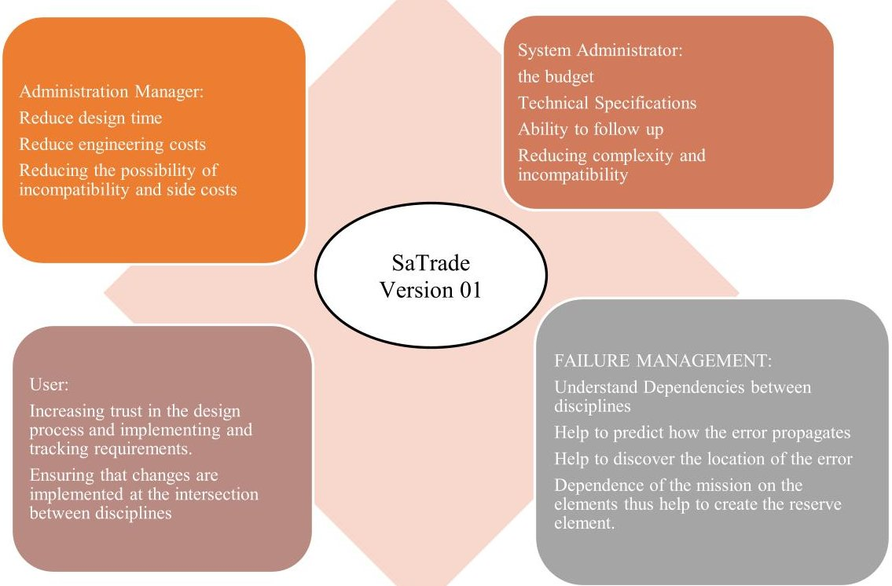

Fig.1. Added value of SaTrade for Project Management

<!-- PDF_PAGE: 4 -->

## 3. Model Based System Engineering in SaTrade

Modeling starts with BDD generation based on the general requirements of the CubeSats bus including the elements of the system and how they are related to the System Indexes (product tree, specifications, and constraints) as shown in Fig. 2. Requirements have been applied quantitatively and defined as inputs for the SaTrade. For this purpose, Requirement Traceability Matrix (RTM) is developed at the system and subsystem levels, and the interface requirements are extracted automatically from the RTM file. In SaTrade01, the requirements were documented as an Excel file, where the dependencies can be found through coding of the Requirements in a Parent-Child structure, and addon based on Python software will make the other actions to make them ready for application in SaTrade in a way that the software can implement and verify requirements for each subsystem and tracing them through other related subsystems. Among the different system diagrams, two of the more common diagrams (Structure Diagram) have been selected for the MBSE model, which we will describe in Table 3.

Table 3. Satellite Common Diagram (BDD, IBD, signal)

<table border="1"><tr><td rowspan="7">Block Definition</td><td>Structural Features</td><td>Part properties</td><td>For instance, what kind of hardware is available in the subsystem</td></tr><tr><td rowspan="4">Specification</td><td>Reference properties</td><td>An out-of-block structure is required to realize the subsystem&#x27;s represent a quantity(of some type),aBoolean,or a string</td></tr><tr><td>Value properties</td><td>value of threshold for constraints</td></tr><tr><td>Constraint properties</td><td>Hardware interfaces</td></tr><tr><td>Ports</td><td>Hardware interfaces</td></tr><tr><td rowspan="2">Behavioral Features</td><td>operations</td><td>The activities that hardware must perform and the input it input and output units</td></tr><tr><td>parameters</td><td>Events</td></tr><tr><td rowspan="2">Signal</td><td rowspan="2">include</td><td>-</td><td>The kind of signal that it produces</td></tr><tr><td></td><td>Acceptable operations and signals</td></tr><tr><td>IBD</td><td>Internal</td><td>IBD shows the connections between parts of a block</td><td></td></tr></table>

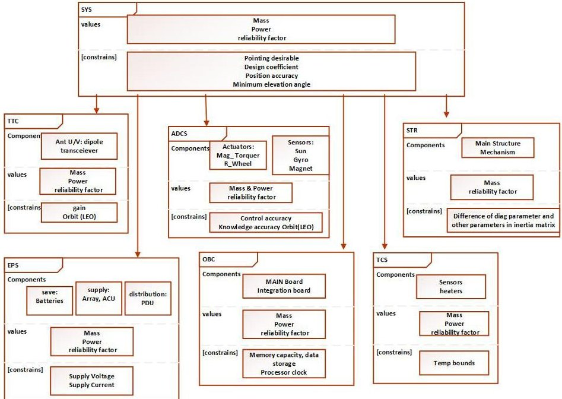

Fig. 2. BDD block

One of the design goals of SaTrade is to simplify the design process. It is necessary to enter inputs into the software in a simple way that could be done by basic technical knowledge, then. SaTrade01 has a graphical interface window for each subsystem inputs, and the inputs will be checked then if they are contradictory, so a warning will be generated in this case. The check will be done for System and Subsystem Parameters based on System Dependencies. There is an update for SaTrade in which the requirements will be downloaded from the Excel file and design and performance parameters for System Design will be extracted from Needs based on Artificial Intelligence Algorithm.

SaTrade considers a model for each subsystem to enable the subsystem sizing based on parametric diagrams which are modeled in Simulink. It gets the benefits of commercial software products like STK for simulation and verification. Subsystem interaction between models and system interfaces are modeled by Internal Block Diagram (IBD) through Signals. To make them clear, each model of subsystems is define based on its Inputs and Outputs as in Tables 4-7.

<!-- PDF_PAGE: 5 -->

Table 4. Inputs in the System Window

<table border="1"><tr><td>Section</td><td>Inputs</td></tr><tr><td rowspan="11">REQUAREMENTS</td><td>Injection Angular Rate X(rad/sec)</td></tr><tr><td>Injection Angular Rate Y(rad/sec)</td></tr><tr><td>Injection Angular Rate Z(rad/sec)</td></tr><tr><td>Total Mass Limit(kg)</td></tr><tr><td>Uplink Margin(dB)</td></tr><tr><td>Uplink frequency(Hz)</td></tr><tr><td>Downlink frequency(Hz)</td></tr><tr><td>Downlink Margin(dB)</td></tr><tr><td>Longitude and Longitude of GS1(deg)</td></tr><tr><td>Longitude and Longitude of GS2(deg)</td></tr><tr><td rowspan="11">CONSTRAINS</td><td>Max Number of Orbits for Detumbling</td></tr><tr><td>Min Duration Data Storage(day)</td></tr><tr><td>Payload operation time in each orbit(sec)</td></tr><tr><td>Electrical Power system(EPS) Design Conceptual Coefficient%</td></tr><tr><td>Detumbling Conceptual Coefficient%</td></tr><tr><td>Minimum elevation angle GW of payload(deg)</td></tr><tr><td>Minimum elevation angle payload(deg)</td></tr><tr><td>GPS activity time in each orbit</td></tr><tr><td>Power during detumbling</td></tr><tr><td>Orbital life time(year)</td></tr><tr><td rowspan="4">Coordinate</td><td>Enter sat size(U)</td></tr><tr><td>Mission based</td></tr><tr><td>Nadir Face</td></tr><tr><td>Ram Face</td></tr><tr><td>Options(Bitrate)</td><td>Manually enter bitrateUse model calculator bitrate</td></tr><tr><td>Options(use number of cells as an input)</td><td>Yes(enter number of solar cells)No(calculate area of solar cells)</td></tr><tr><td>Options(Is slew required?)</td><td>Slew does not existEnter slew value and axis</td></tr><tr><td>Options(Choose a payload)</td><td>Software will consider a payload based on mission type and satellite size</td></tr></table>

Table 5. Inputs in the Telemetry, Telecommunication and Control (TTC) Window

<table border="1"><tr><td rowspan="5">DL&amp;UL requirements</td><td>Down Link Carrier /Noise required(dB)</td></tr><tr><td>Down Link Gain Tx(dB)</td></tr><tr><td>Down Link Gain Rx(dB)</td></tr><tr><td>Down Link Power Tx(watt)</td></tr><tr><td>Down Link LNA Noise Figure</td></tr><tr><td rowspan="12">DL&amp;UP Loss inputs</td><td>Down Link Tx loss(dB)</td></tr><tr><td>Down Link Rx loss(dB)</td></tr><tr><td>Down Link loss atmosphere(dB)</td></tr><tr><td>Down Link loss ionosphere(dB)</td></tr><tr><td>Down Link loss rain(dB)</td></tr><tr><td>Down Link loss polarization(dB)</td></tr><tr><td>UP Link Tx loss(dB)</td></tr><tr><td>UP Link loss(dB)</td></tr><tr><td>Satellite Receiver Loss</td></tr><tr><td>Required Eb/No up link</td></tr><tr><td>Required Eb/No GS up link</td></tr><tr><td>Receiver Loss GS down link</td></tr><tr><td rowspan="4">GS inputs</td><td>Receiver antenna pointing error°</td></tr><tr><td>Beam width Tx antenna</td></tr><tr><td>Beam width receiver antenna</td></tr><tr><td>Minimum elevation angle TTC</td></tr></table>

Table 6. Inputs in the ADCS Window

<table border="1"><tr><td>Section</td><td>Inputs</td></tr><tr><td>pointing accuracy</td><td>(deg)</td></tr><tr><td rowspan="7">Pointing mode</td><td>Earth local vertical only(controllable in2axes)</td></tr><tr><td>Earth local vertical only(controllable in3axes)</td></tr><tr><td>North/South only(controllable in2axes)</td></tr><tr><td>Inertially fixed any direction(controllable in2axes)</td></tr><tr><td>Local vertical pointing or inertial targets</td></tr><tr><td>Any except in the equator and the poles</td></tr><tr><td>Pointing stability</td><td>(deg/sec)</td></tr><tr><td rowspan="7">GPS requirements</td><td>Velocity accuracy(m/s)</td></tr><tr><td>Position accuracy(m)</td></tr><tr><td>Time accuracy(s)</td></tr><tr><td>Number of channels</td></tr><tr><td>TTFF(s)</td></tr><tr><td>Update rate(Hz)</td></tr></table>

<!-- PDF_PAGE: 6 -->

Table 7. Inputs in the EPS Window

<table border="1"><tr><td>Section</td><td>Inputs</td></tr><tr><td rowspan="11">EPS parameters</td><td>Power distribution unit efficiency</td></tr><tr><td>DC to DC efficiency</td></tr><tr><td>Cell efficiency</td></tr><tr><td>Battery efficiency</td></tr><tr><td>Heater number</td></tr><tr><td>Charger efficiency</td></tr><tr><td>Etta rad</td></tr><tr><td>Inherent degradation</td></tr><tr><td>Power 1Cell</td></tr><tr><td>Efficiency degradation due to temperature</td></tr><tr><td rowspan="3">Battery Type</td><td>Li ion</td></tr><tr><td>Ni-Ca</td></tr><tr><td>Ni-H2</td></tr><tr><td rowspan="2">Configuration option</td><td>App commigrates cell based on the angel between sun and cube sides considering power consumption</td></tr><tr><td>User can enter if solar panels are going to be deployed or not and the axes of deployment</td></tr></table>

## 4. Data Flow in SaTrade01

Data in SaTrade01 are composed on Inputs, Calculation Results that are not directly used as Outputs, Simulation Results that are used for Tradeoffs or Verification and Outputs. Inputs may be entered by an expert User, aware of System Specifications or be Extracted Automatically from Requirements and Needs. The second option has been considered to reduce the complexity of SaTrade01 and increase inclusiveness. A plugin is considered for this section; however, a Machine Learning algorithm may be used to control the data at least if they are in the acceptable range for the Mission case or not, similar to (Jacklin, 2015) and based on the database of Designs and Products. Calculations Results are basically got from Sizing Equations as in (Wertz, 2011) and they use Inputs in different parts alongside System Dependencies. Achieving all Results needed for System Specifications and Verifying them in Simulations, a web crawler robot has developed to search product database resources to find products fit to the calculated specifications, where they will be short listed based on technical budget constraints, showing a color code in the budget table, if any subsystem's budget is over of the system constraints. SaTrade is going to streamline the process of CubeSat design, ensuring that all subsystem requirements and constraints are met with a goal to simplify the design process, making it accessible even to users with limited technical knowledge. Many of Calculation and Simulation Results are data which has been considered to make this feature happen, to show that possibility, we need to cope with System Dependencies with no user interference under Data Flow and Software Functionalities. System Dependencies are modeled as IBD based on Signals as mentioned in the previous section. The data handle over this diagram are list in the Table below.

Table 8 and Table 9 show the direction of data transfer at the system level. After checking at the system level and in separate sections, the Software checks the inputs and outputs at the level of subsystem parameters, too. The data flow in the table is from row to column.

Table 8. System dependency table (input from row to column) for SYS, ORBIT, STR, thermal (TCS), TTC

<table border="1"><tr><td></td><td>SYS</td><td>ORBIT determination</td><td>STR</td><td>TCS</td><td>TTC</td></tr><tr><td>SYS</td><td></td><td>two-line element(TLE), mass and power budget</td><td>Configuration requirementMass budgetSat size mass and power budget</td><td>TLE for beta angel calculation mass and power budget</td><td>Elevation Angle mass and power budget</td></tr><tr><td>ORBIT determination</td><td></td><td></td><td>Mass &amp; dimension of parts.</td><td>Thermal Dissipation &amp; functional temperature range</td><td>Apogee, Perigee Doppler shiftUplink &amp; Down Link frequency</td></tr><tr><td>STR</td><td>Mass consumption</td><td>Ram surface area</td><td></td><td>Location of parts</td><td>Report for successful or unsuccessful configuration for antennas</td></tr><tr><td>TCS</td><td></td><td></td><td>Mass &amp; dimension of parts.</td><td>Thermal Dissipation &amp; functional temperature range</td><td></td></tr><tr><td>TTC</td><td></td><td></td><td>Mass &amp; dimension of parts.</td><td>Thermal Dissipation &amp; functional temperature range</td><td></td></tr><tr><td>ADCS</td><td></td><td>Positioning requirement</td><td>Mass &amp; dimension of parts.</td><td>Thermal Dissipation &amp; functional temperature range</td><td></td></tr><tr><td>EPS</td><td></td><td></td><td>Mass &amp; dimension of parts.</td><td>Thermal Dissipation &amp; functional temperature range</td><td></td></tr><tr><td>OBC</td><td></td><td></td><td>Mass &amp; dimension of parts.</td><td>Thermal Dissipation &amp; functional temperature range</td><td>HK data Rate(optional)</td></tr><tr><td>PAY</td><td>pointing error acceptable</td><td></td><td>Mass &amp; dimension of parts.</td><td>Thermal Dissipation &amp; functional temperature range</td><td></td></tr></table>

<!-- PDF_PAGE: 7 -->

Table 9. System dependency table (input from row to column) for ADCS, EPS, OBC, PAY

<table border="1"><tr><td></td><td>ADCS</td><td colspan="2">EPS</td><td>OBC</td><td>PAY</td></tr><tr><td>SYS</td><td>MODE accuracy mass and power budget</td><td colspan="2">Sys phase coefficient Detumbling coefficient TLE mass and power budget degradation &amp; efficiencies of Battery type Number of cells (optional)</td><td>Operating System volume Integrate or disputed configuration HK rate mass and power budget</td><td>Elevation Angles Type of mission (optimal) mass and power budget</td></tr><tr><td>ORBIT determination</td><td>Position &amp; velocity</td><td colspan="2">Eclipse time, Day time P_CON and voltage bus</td><td>GS REVISIT TIME DATA PER ORBIT</td><td>Apogee, Perigee Doppler shift</td></tr><tr><td>STR</td><td>MOI COM Report for successful or unsuccessful configuration for sensors, Ram surface area</td><td colspan="2"></td><td>Report f implementing max cabling size</td><td>Report for successful or unsuccessful configuration for antennas</td></tr><tr><td>TCS</td><td></td><td>Consumption voltage bus</td><td>power and</td><td>D_ORB</td><td></td></tr><tr><td>TTC</td><td></td><td>Consumption voltage bus</td><td>power and</td><td>D_ORB</td><td></td></tr><tr><td>ADCS</td><td></td><td>Consumption voltage bus</td><td>power and</td><td>D_ORB</td><td>pointing error</td></tr><tr><td>EPS</td><td></td><td>Consumption voltage bus</td><td>power and</td><td>D_ORB</td><td></td></tr><tr><td>OBC</td><td></td><td>Consumption voltage bus</td><td>power and</td><td>D_ORB</td><td></td></tr><tr><td>PAY</td><td></td><td>Consumption voltage bus</td><td>power and</td><td>D_ORB</td><td></td></tr></table>

As mentioned before, structure section gets mass and dimension of parts from web crawling plugin and provides the configuration to generate Memorandum of Incorporation (MOI) and Center of Mass (COM) and ram surface area for propagator and ADCS. Having this, reports or warnings will be generated whether configuration requirements have been satisfied for thermal control, and placing antennas, optical elements and other components with similar needs.

## 5. System Tradeoffs in SaTrade

System Tradeoffs, as one of the main features of SaTrade is a capability considered for this product based on Change Control, where changing parameters value as from different scenarios may be tracked and the Outputs will be generated automatically.

Modeling IBDs by Signals made it easy to track the process of controlling interfaces, where the interfaces are now some data blocks that have been placed in right position of the flow, based on System Dependencies. To Manage and Control Changes, SaTrade uses a backup of Interface Data in an Excel file, where any parameter connection map is ready, which means it is known that who will be affected if this parameter changes. SaTrade generate automatic notes to the teams affected by any changes in System Design or Parameters. There would be a timeout to check the change and approve or request for another change, then. This process is illustrated as in Fig. 3:

Fig. 3 outlines a process flow for SaTrade, where the backend helps to do three functions: 1) Establishing criteria for validity of data entry; 2) Data bank by Access to Online Sources; 3) Setting Objectives and Top-Level Requirements from Mission Specification. In the next layer (Define Input Parameters) the input data will be provided based on standards, previous results, and mission requirements. Four Software Functions are done in order to create outputs.

- Formulation and initialization: Establish initial parameters for each discipline.

- Implementation: Apply methodologies and tools to Process data efficiently and calculate.

- Integration: Coordinate Interactions between Disciplines.

- Log changes: Track Updates and Modifications in Disciplines.

SaTrade provides user with three kinds of report in the Outputs section:

- Technical Specifications including RFPs or Datasheets.

- Product Data including Links to Components or Similar Applications.

- Document Changes and Results for Review for Each Related Discipline.

<!-- PDF_PAGE: 8 -->

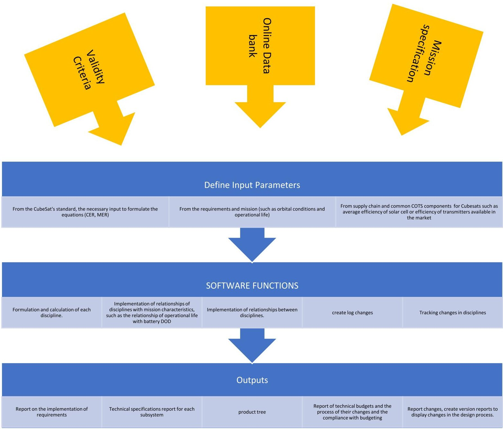

Fig. 3. Change Control Process in SaTrade01

System Tradeoffs cannot be done without Change Control process that handles the internal (or Satellite) interfaces, where changes take effect on parameters in Data Flow which is illustrated in Fig. 4. To provide Output for Tradeoff Scenarios, it is needed to handle the external (or intra-software) interfaces which enables SaTrade to calculate and simulate faster and with no User interference. As mentioned before, SaTrade is developed basically in MATLAB and it integrates plugins for Pythons, STK and COMSOL connection for some calculations and simulations. The following Figure shows the data flow between these applications and how they are connected.

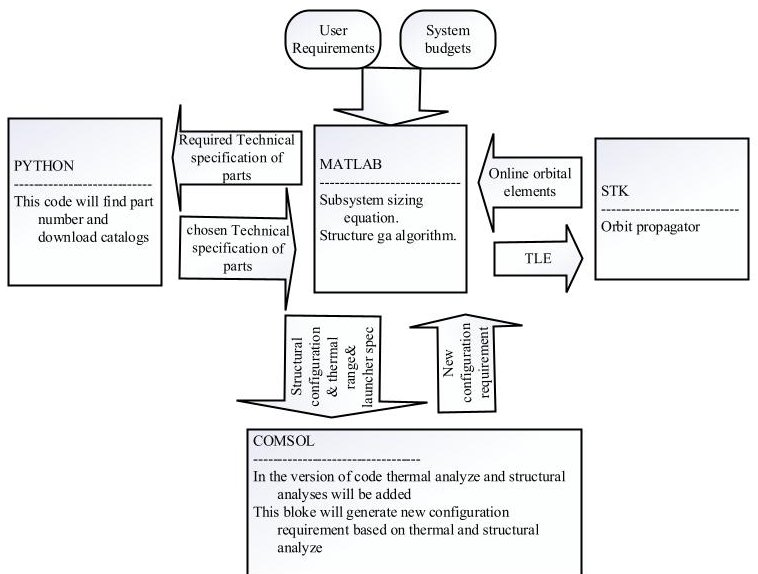

Fig. 4. SaTrade interface with other softwires

<!-- PDF_PAGE: 9 -->

## 6. Software Driven System Design in SaTrade01

System Design in SaTrade, as another main features of this Software, starts with preliminary sizing, follows by finding products close to system specifications, and then goes the verification process based on preliminary simulations and constraints' checks.

Initialization of the Software Driven Design has been considered based on the inputs from the graphical interface shown in Fig. 5 and a TLE file is read as text file. Parametric Design Relations find System Specifications by MATLAB-Simulink calculations and processing in COMSOL and STK, while parameters are exchanged and updated through IBD design. The output values are reported in each subsystem panel.

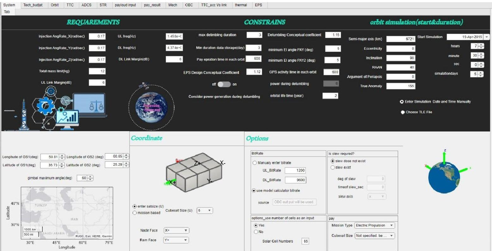

Fig. 5. graphical interface window.

The changes are applied in the quantifiable blocks on a graphical interface. We have three types of quantifiable blocks in the SaTrade:

- Subsystem Design Input Parameters: For instance, the primary design phase coefficient and technical budgets, including mass and power budgets.

- Parameters Dependent on the Selection of Parts: For example, solar array efficiency, sensor noise, actuator characteristics, battery type (showing graph used to determine DOD in terms of operational life).

- Mission-Dependent Parameters: For example, operational life, orbital characteristics, and angular speed after deploying from the launcher. There is an option for pointing accuracy; it can be chosen by the user or sized by the specification of the mission.

The origin of these changes can be a change in requirements, problems in the supply chain, or unfavorable results in the integration and testing process, which results in new Calculations, Simulations, Results and Outputs.

Mainly, Outputs are generated in the simultaneous solution of orbital equations that have been extracted from (Wertz (2011) and Markley (2014). Orbit parameters are calculated continuously. Based on these parameters, the distance from the station, the ground track, and the beta vector are determined.

In TTC and Communication payload section, the outputs, including the Link Budget, Doppler Shift, Antenna Pattern, and Online (while simulation) Link Margin in each Pass, are generated using simulation results from the orbit simulation section and modem specifications based on similar products obtained from the web crawling section.

Attitude Determination and Control section, provides required specifications of the sensor and actuators to achieve determination, control and stability accuracy as well as allowed detumbling time limit according to ( F. Landis Markley, 2014) relations in the presence of orbital disturbances.

Power Subsystem Sizing starts with definition of power consumption scenario, which includes the activity duration of each element in each orbit, is provided by the user and power consumption inputs of the subsystems, extracted from similar products

<!-- PDF_PAGE: 10 -->

data by the web crawling section. The feedback to System Design will be provided on Satellite Size and Configuration (including Deployable and Pointing Modes) calculating the generated power based on the orbit inputs, and satellite size and pointing mode assumptions and Margin. Additionally, The Battery Capacity is defined considering the components used for detumbling mode and the allowed number of orbits for detumbling or Worst-Case Scenario or power consumption during the other mission phases.

As for Data and Command Handling Subsystem, the volume of data required to be stored in permanent memory and the necessary processing power based on Dhrystone Million Instructions Per Second (DMIPS) are calculated based on (Inc, 1994) equations.

The temperature of each face of the satellite and boards are calculated and reported online as Thermal Analysis based on the orbit, the layout of the structure, and the dissipated power of the subsystems with the help of COMSOL.

The Design and Change Control process are considered with more details on Structure Subsystem and Mechanical Configuration of the Satellite. In this section, Satellite Elements' Mass Specifications which are mass and dimension of parts will be transferred automatically from web crawling algorithm.

In Fig. 6 the SaTrade01window is asking user to Confirm what have been found automatically for the aforementioned parameters.

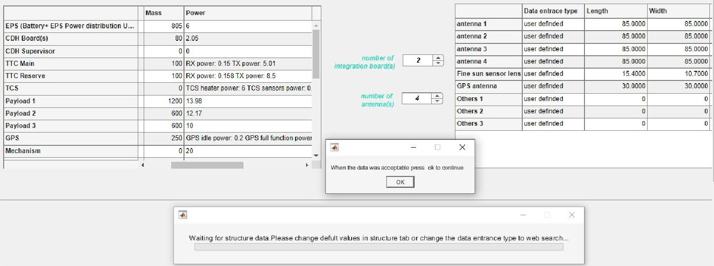

Fig. 6. window to ask user conform dimensions.

Satrade01 start to create layout right after user confirmation and based on predefined rules, listed in the Table 10. User may add to or delete from these rules.

Table 10. Basic Configuration Rules in the Structure Design of SaTrade01

<table border="1"><tr><td>Requirement</td><td></td><td>value</td></tr><tr><td>Max distance between</td><td>Ant(1_N)</td><td>Its feed</td></tr><tr><td>Max cabling long between</td><td>Subsystem(1-N)</td><td>OBC bord</td></tr><tr><td>Min distance between</td><td>magnetometer</td><td>Solar panelReaction wheel magnetorquerBattery packStainless still screw</td></tr><tr><td>Max distance between</td><td>Center of mass(in each axis)</td><td>Geometric center</td></tr><tr><td>Location of sun sensor</td><td>Choose a side</td><td></td></tr><tr><td>Location of TTC antenna</td><td>Choose a side</td><td></td></tr><tr><td>Location of PAY antenna</td><td>Choose a side</td><td>if any</td></tr><tr><td>Location of PAY Lens</td><td>Choose a side</td><td>if any</td></tr><tr><td>Min distance between</td><td>Payload antenna</td><td>TTC antenna</td></tr><tr><td>Min Protrusion of sensors</td><td>Optical elements</td><td>if any</td></tr></table>

Moreover, the position of COM and MOI (main and cross in each axis) will be reported in the Structure Window and also will be considered in ADCS Design. The Configuration will also get feedback from Thermal Analyses and any change needed will be warned for User confirmation. Needless to say, that all changes are logged and reversible.

This feature covers all changes to the system affecting the configuration with no need to external engineering works that no only fasten the design and tradeoff process but eliminates all the failure points due to human error or inconsistency between disciplines.

<!-- PDF_PAGE: 11 -->

## 7. Verification and case study

Evaluation of SaTrade01is presented in this section, focusing on optimizing layouts. In order to validate the software's accuracy and reliability through comprehensive analysis, the results of subsystem designs will be compared and validated against established CubeSat designs documented in existing literature and references. In this regard, investigating the data from QB50 satellites, which have received considerable attention, will be enlightening.

To verify orbit propagation, access to the ground station, and power generation results, the simulation results of (Vila Fernandez, 2010) will be used. Therefore, to ensure synchronization, the orbital parameter, the simulation start time and ground station location are configured as in (Vila Fernandez, 2010). Table 11 shows the corresponding values.

Table 11. Input data corresponding to (Vila Fernandez, 2010)

<table border="1"><tr><td colspan="7">Start time</td><td colspan="2">Orbital parameter</td><td>Ground station</td></tr><tr><td>15-june-2014</td><td>Semi major axis</td><td>Eccentricity</td><td>Inclination</td><td>Argument of perigee</td><td>RAAN</td><td>True anomaly</td><td></td><td></td><td>Liege</td></tr><tr><td></td><td>0</td><td>0</td><td>79</td><td>0</td><td></td><td>250</td><td></td><td>84</td><td></td></tr></table>

Although differences in the selection of a propagator may slightly alter the results, the overall consistency of the results is clearly detectable in Fig. 7. Furthermore, while coefficients such as the end-of-life factor and effective area will deterministically impact the final power generation value, the power generation graph should remain consistent as it gets its trends from the sun angle relative to the satellite's faces and periods of illumination. This consistency also serves to verify orbit propagation. Fig. 7 illustrates matching of the ground track and access times within the SaTrade01 (right) and the provided simulation in (Vila Fernandez, 2010) (left).

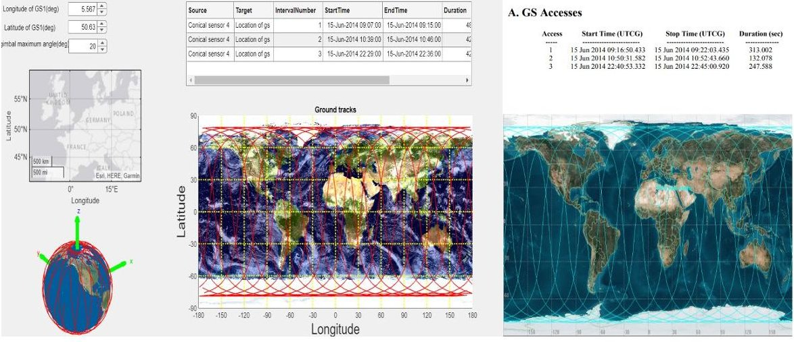

Fig. 7. the ground track and access simulation within the SaTrade01 (right) and the provided simulation (left) (Vila Fernandez, 2010)

The generated power is compared in two scenarios as shown in the Fig. 8: when the satellite is positioned vertically (with the 1U faced nadir and the 2U faced in the flow direction) and horizontally (with the 1U facing the flow direction and the 2U facing nadir). The comparison is based on power simulations in SaTrade and the data from source (Vila Fernandez, 2010), confirming the accuracy and reliability of the SaTrade performance and data.

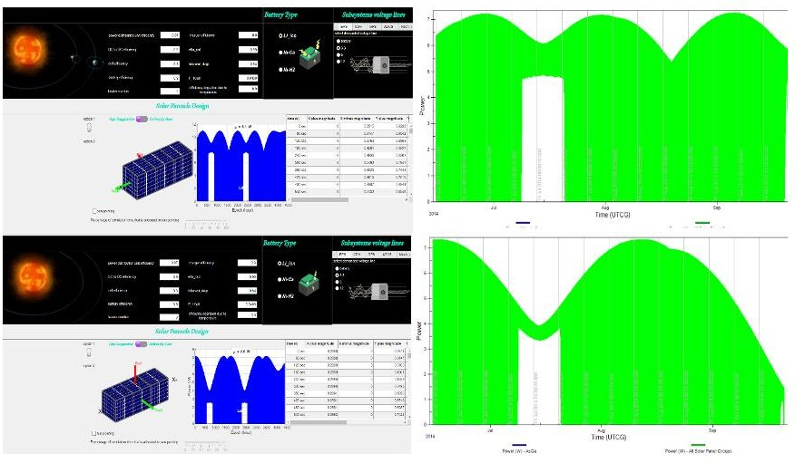

Fig. 8. generated power comparison is based on power simulations in the SaTrade01(left) and the data from (right) (Vila Fernandez, 2010)

<!-- PDF_PAGE: 12 -->

The attitude determination and control tab of the software suggests the necessary sensors based on the required pointing accuracy and stability according to mission needs and the type of control, as indicated in (Larson, 2008). It also considers orbital disturbances, the type of control, and the required detumbling period relative to the tip-off rates and slew rate, If the user specifies the need for maneuvering, to size the actuators appropriately. According to (Visagie, 2014), the QB50 aims to achieve the objectives listed in Table 12.

Table 12. requirement of QB50 CubeSats related to attitude determination and control (Visagie, 2014)

<table border="1"><tr><td>Parameters</td><td>value</td></tr><tr><td>Pointing accuracy</td><td>±10°</td></tr><tr><td>Pointing knowledge</td><td>±2°</td></tr><tr><td>Tip-off rates</td><td>10 degrees/second</td></tr><tr><td>Detumbling duration</td><td>2 days</td></tr></table>

By inputting the required parameters into SaTrade01, the necessary sensors and actuator specifications are determined, as illustrated in Fig. 9 (up), aligned with the specifications of the selected module in (Visagie, 2014) as depicted in Fig. 9 (bottom).

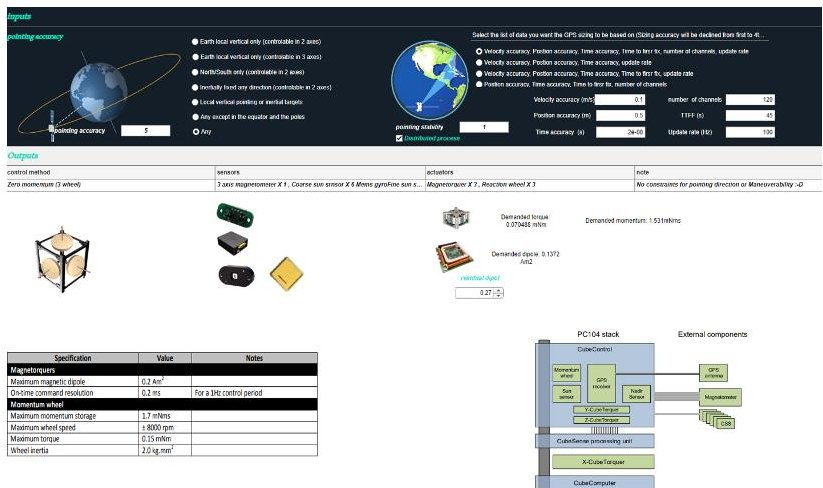

Fig. 9. ADCS demanded sensors and actuators specification in the SaTrade01(top) and the data from (bottom) (Visagie, 2014)

Design and Sizing of TTC (Telemetry, Tracking, and Command) subsystem can be verified by comparing uplink and downlink budget between SaTrade results and the data from (March, 2014). Fig.10 and Fig.11 highlight the correctness and accuracy of the output data.

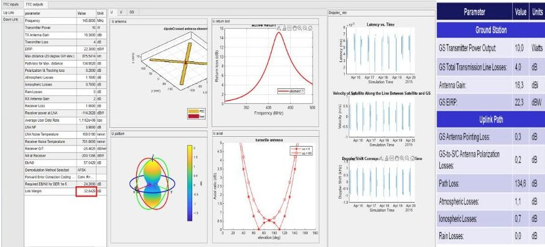

<table><thead><tr><th>Parameter</th><th>Value</th><th>Units</th></tr></thead><tbody><tr><td colspan="3">Spacecraft (EbNo Method)</td></tr><tr><td>SIC Antenna Pointing Loss</td><td>0.0</td><td>dB</td></tr><tr><td>SIC Antenna Gain</td><td>2.0</td><td>dB</td></tr><tr><td>SIC Total Transmission Line Losses</td><td>1.9</td><td>dB</td></tr><tr><td>System Desired Data Rate</td><td>1200</td><td>bps</td></tr><tr><td>Demodulation Method Selected</td><td></td><td>AFSKFM</td></tr><tr><td>System Allowed or Specified BER</td><td></td><td>1.0E-05</td></tr><tr><td>Telemetry System Required EbNo</td><td>23.2</td><td>dB</td></tr><tr><td>EbNo Threshold</td><td>24.2</td><td>dB</td></tr><tr><td>System Link Margin</td><td>33.6</td><td>dB</td></tr></tbody></table>

Fig. 10. Uplink budget in SaTrade01(left) and result from (March, 2014) (right).

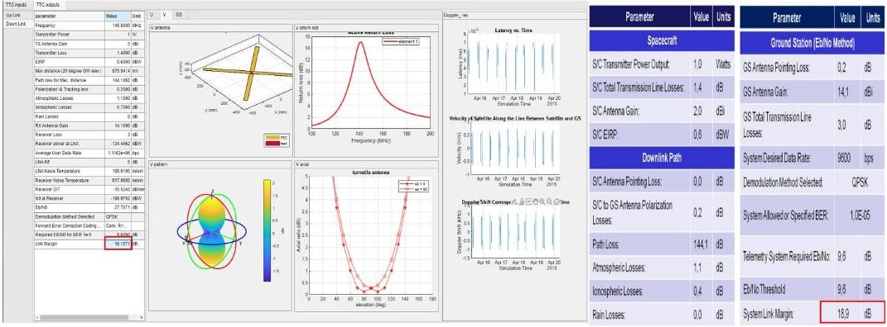

Fig. 11. downlink budget in SaTrade01(left) and result from (March, 2014) (right).

<!-- PDF_PAGE: 13 -->

The structure design in SaTrade considers minimizing the separation between the center of mass and the center of geometry, a critical factor for CubeSat control. Depending on the CubeSat's dimensions, the Standard requirement will be applied, although Users retain the flexibility to impose stricter criteria. For instance, in the case of verification, User specified the maximum allowable distance for cabling between the On-Board Computer and the power subsystem and asked to maximize the separation between the magnetometer and any magnetic field-generating element to mitigate the impact of residual electromagnetic fields on magnetometer measurements. Additionally, the installation faces for TTC antennas are set. For other rules, selecting "None" indicates that no constraint will be enforced on the layout design. Finally, the selected solution is as illustrated in Fig.12.

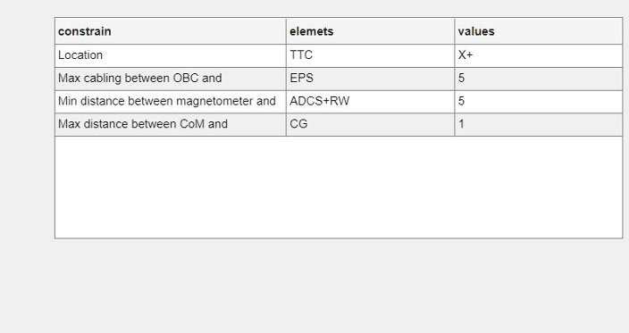

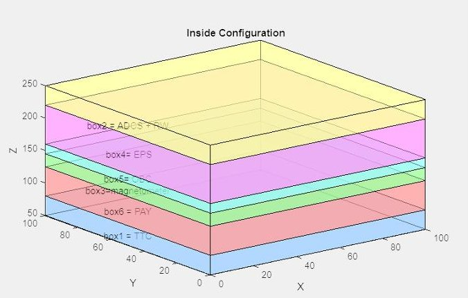

Fig.12. The result of minimizing the center of mass and center of geometry, as well as applying rules in SaTrade01

As is evident, the rules have been correctly applied. According to the rules, the TTC module is placed in the closest position to the selected antenna location $ \mathrm{X+}=\mathrm{nadir} $ . The distance between the OBC and power modules is minimized and they are adjacent to each other, while the distance between the magnetometer and the reaction wheel, as per the rule, is more than 5 centimeters. In this configuration, the distance between the center of mass and the geometric center is 0.06, achieving the minimum state where other rules can still be applied. For Verification of the Algorithm and Software Driven Design in Structure and Configuration Management the Design Input and Constraints have been considered similar to (Alharam, 2021), the Research that pursue the same objective of finding the Optimal Configuration based on center of gravity requirement in the CubeSat while meeting specific rules as mentioned below, which may be handled in the software algorithm in a short time:

- The ANT (antenna) shall be placed either at the bottom in i = 1 or at the top in location i = 6, this is

- The ADCS component shall be away from COMM by at least 25 mm

- The distance between ANT location and COMM location shall not be more than 40 mm (Alharam, 2021)

Fig.13 compares the results of the SaTrade01 results with the one presented in the (Alharam, 2021). The upper part shows applying rules in SaTrade01, selecting subsystems whose distances need to be managed, as well as the acceptable center of gravity limit according to (Alharam, 2021). The lower part displays the resulted configuration from the (Alharam, 2021), which exactly matches the SaTrade01 results. Table13 shows all permutations of the Configuration that comply with the rules. Although the resulting center of gravity differs due to the article's different approach based on consideration of distances between elements, both show Configurations that lead to the minimal distance between the center of gravity and the geometric center.

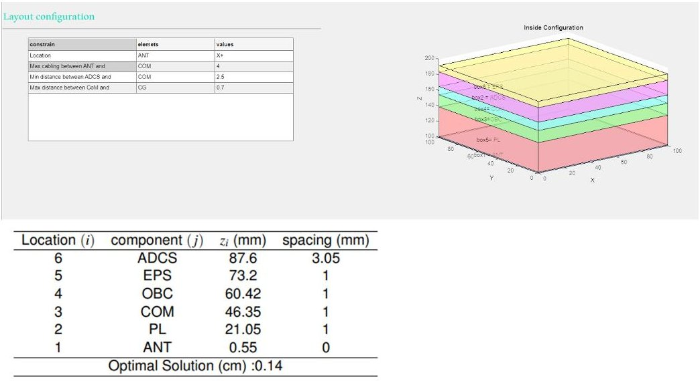

Fig. 13. Structure tab verification by (Alharam, 2021) result

<!-- PDF_PAGE: 14 -->

Table 13. All permutations of the arrangement that comply with the rules

<table border="1"><tr><td>Com and CG distance</td><td colspan="6">Boxes order</td><td colspan="6">Boxes distance from CD</td></tr><tr><td>-4.00707</td><td>1</td><td>3</td><td>4</td><td>5</td><td>2</td><td>6</td><td>-49.45</td><td>-41.175</td><td>-28.1</td><td>-3.8</td><td>24.5</td><td>37.9</td></tr><tr><td>-4.12012</td><td>1</td><td>3</td><td>4</td><td>5</td><td>6</td><td>2</td><td>-49.45</td><td>-41.175</td><td>-28.1</td><td>-3.8</td><td>19.2</td><td>32.6</td></tr><tr><td>-4.2325</td><td>1</td><td>4</td><td>3</td><td>5</td><td>2</td><td>6</td><td>-49.45</td><td>-43.55</td><td>-30.475</td><td>-3.8</td><td>24.5</td><td>37.9</td></tr><tr><td>-4.34554</td><td>1</td><td>4</td><td>3</td><td>5</td><td>6</td><td>2</td><td>-49.45</td><td>-43.55</td><td>-30.475</td><td>-3.8</td><td>19.2</td><td>32.6</td></tr><tr><td>-2.91094</td><td>1</td><td>5</td><td>2</td><td>4</td><td>3</td><td>6</td><td>-49.45</td><td>-29.95</td><td>-1.65</td><td>13.05</td><td>26.125</td><td>37.9</td></tr><tr><td>-3.81536</td><td>1</td><td>5</td><td>2</td><td>4</td><td>6</td><td>3</td><td>-49.45</td><td>-29.95</td><td>-1.65</td><td>13.05</td><td>22.45</td><td>34.225</td></tr><tr><td>-4.09812</td><td>1</td><td>5</td><td>2</td><td>6</td><td>3</td><td>4</td><td>-49.45</td><td>-29.95</td><td>-1.65</td><td>11.75</td><td>23.525</td><td>36.6</td></tr><tr><td>-4.32354</td><td>1</td><td>5</td><td>2</td><td>6</td><td>4</td><td>3</td><td>-49.45</td><td>-29.95</td><td>-1.65</td><td>11.75</td><td>21.15</td><td>34.225</td></tr><tr><td>0.210722</td><td>1</td><td>5</td><td>3</td><td>4</td><td>2</td><td>6</td><td>-49.45</td><td>-29.95</td><td>-3.275</td><td>9.8</td><td>24.5</td><td>37.9</td></tr><tr><td>0.097679</td><td>1</td><td>5</td><td>3</td><td>4</td><td>6</td><td>2</td><td>-49.45</td><td>-29.95</td><td>-3.275</td><td>9.8</td><td>19.2</td><td>32.6</td></tr><tr><td>-1.43438</td><td>1</td><td>5</td><td>3</td><td>6</td><td>2</td><td>4</td><td>-49.45</td><td>-29.95</td><td>-3.275</td><td>8.5</td><td>21.9</td><td>36.6</td></tr><tr><td>-0.4105</td><td>1</td><td>5</td><td>3</td><td>6</td><td>4</td><td>2</td><td>-49.45</td><td>-29.95</td><td>-3.275</td><td>8.5</td><td>17.9</td><td>32.6</td></tr><tr><td>-2.79149</td><td>1</td><td>5</td><td>4</td><td>2</td><td>6</td><td>3</td><td>-49.45</td><td>-29.95</td><td>-5.65</td><td>9.05</td><td>22.45</td><td>34.225</td></tr><tr><td>-0.12775</td><td>1</td><td>5</td><td>4</td><td>3</td><td>6</td><td>2</td><td>-49.45</td><td>-29.95</td><td>-5.65</td><td>7.425</td><td>19.2</td><td>32.6</td></tr><tr><td>-4.43659</td><td>1</td><td>5</td><td>6</td><td>2</td><td>4</td><td>3</td><td>-49.45</td><td>-29.95</td><td>-6.95</td><td>6.45</td><td>21.15</td><td>34.225</td></tr><tr><td>-1.31492</td><td>1</td><td>5</td><td>6</td><td>3</td><td>4</td><td>2</td><td>-49.45</td><td>-29.95</td><td>-6.95</td><td>4.825</td><td>17.9</td><td>32.6</td></tr><tr><td>-4.66872</td><td>1</td><td>6</td><td>5</td><td>3</td><td>4</td><td>2</td><td>-49.45</td><td>-44.85</td><td>-21.85</td><td>4.825</td><td>17.9</td><td>32.6</td></tr></table>

Another strong evidence proving the accuracy of SaTrade is the similarity of results between it and GREATCUBE+ CubeSat conceptual design introduced in (Girardello, 2024). By considering a set of rules and objective functions and then assigning weights to them, GREATCUBE+ can provide optimal subsystems configuration and layout. It offers potential payload placements as follows:

- On top of the CubeSat: On the +Z side, just above the transceiver -a subsystem always present in any CubeSat-

- In the middle: Close to the Geometric Center.

- In the bottom part: As the last subsystem on the -Z side of the axis. Alternatively, if a propulsion subsystem is present, the payload would be positioned on top of it.

The objective functions used for this tool include:

- Ensuring the overall center of gravity lies within the limits imposed by the launcher provider.

- Ensuring at least one side of each component is as close as possible to one of the side panels of the structure to mimic mechanical connection with the rails composing the structure.

- Ensuring the individual Z-axis of each component is as close as possible to the Z-axis of the outer shell to mimic placement between the structure rails.

The operational accuracy of GREATCUBE+ has been evaluated by comparing its output with the Phoenix, a 3U CubeSat developed by Arizona State University and launched in 2019. Addressing the modeling results of SaTrade01 and GREATCUBE+ alongside the Phoenix CubeSat as a reference model casts light on SaTrade01 accuracy and its advantages over similar software tools. To model the Phoenix satellite with the most optimal layout in accordance with placement rules, the weights and dimensions of subsystems based on their part numbers, as introduced in Fig. 14, were entered into the SaTrade01 software.

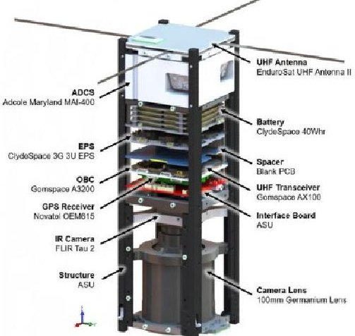

Fig. 14. CAD model of Phoenix, courtesy Arizona State University (Girardello, 2024)

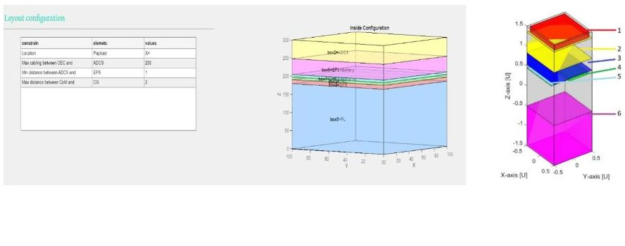

Fig. 14. simulation results of saTrade01(left) and result of GREATCUBE+ (Girardeloo, 2024)

Fig.15 compares the simulation results of SaTrade01 on the left and GREATCUBE+ on the right. The part of the image related to SaTrade01 modeling shows the software table of rule inputs and the resulting optimal layout output. To limit the possible answers, the distance between the center of mass and the center of gravity was restricted to 2 cm, although this is a

<!-- PDF_PAGE: 15 -->

strict limitation for a 3U CubeSat. Given that the payload type is imaging, its location was constrained to the x+ direction, which is the satellite's nadir direction. Furthermore, since no specific rules were identified regarding the need to minimize or maximize the distance between any other elements, the rules related to this aspect were designed to avoid limiting the software's modeling capabilities. Fig. 14 shows that saTrade01 modeling result aligns more closely with the Phoenix layout. Table 14 lists all the layouts that satisfy the configuration rules. As indicated, the layout produced by the software results in the smallest distance between the geometrical center and the center of gravity of the CubeSat.

Table 14. All permutations of the arrangement that comply with the rules for Phoenix modeling

<table border="1"><tr><td>Com and CG distance</td><td colspan="6">Boxes order</td><td colspan="6">Boxes distance from CD</td></tr><tr><td>-0.07383</td><td>5</td><td>1</td><td>3</td><td>4</td><td>6</td><td>2</td><td>-60.225</td><td>33.15</td><td>40.3</td><td>49.35</td><td>76.625</td><td>124.2</td></tr><tr><td>-1.19177</td><td>5</td><td>1</td><td>3</td><td>6</td><td>4</td><td>2</td><td>-60.225</td><td>33.15</td><td>40.3</td><td>65.625</td><td>92.9</td><td>124.2</td></tr><tr><td>-0.04465</td><td>5</td><td>1</td><td>4</td><td>3</td><td>6</td><td>2</td><td>-60.225</td><td>33.15</td><td>42.25</td><td>51.3</td><td>76.625</td><td>124.2</td></tr><tr><td>-1.80081</td><td>5</td><td>1</td><td>4</td><td>6</td><td>2</td><td>3</td><td>-60.225</td><td>33.15</td><td>42.25</td><td>69.525</td><td>117.1</td><td>146.45</td></tr><tr><td>-0.65069</td><td>5</td><td>1</td><td>4</td><td>6</td><td>3</td><td>2</td><td>-60.225</td><td>33.15</td><td>42.25</td><td>69.525</td><td>94.85</td><td>124.2</td></tr><tr><td>-1.79782</td><td>5</td><td>1</td><td>6</td><td>3</td><td>4</td><td>2</td><td>-60.225</td><td>33.15</td><td>58.525</td><td>83.85</td><td>92.9</td><td>124.2</td></tr><tr><td>-1.76864</td><td>5</td><td>1</td><td>6</td><td>4</td><td>3</td><td>2</td><td>-60.225</td><td>33.15</td><td>58.525</td><td>85.8</td><td>94.85</td><td>124.2</td></tr><tr><td>-0.07347</td><td>5</td><td>3</td><td>1</td><td>4</td><td>6</td><td>2</td><td>-60.225</td><td>33.1</td><td>40.25</td><td>49.35</td><td>76.625</td><td>124.2</td></tr><tr><td>-1.19141</td><td>5</td><td>3</td><td>1</td><td>6</td><td>4</td><td>2</td><td>-60.225</td><td>33.1</td><td>40.25</td><td>65.625</td><td>92.9</td><td>124.2</td></tr><tr><td>-0.04332</td><td>5</td><td>3</td><td>4</td><td>1</td><td>6</td><td>2</td><td>-60.225</td><td>33.1</td><td>42.15</td><td>51.25</td><td>76.625</td><td>124.2</td></tr><tr><td>-0.65571</td><td>5</td><td>3</td><td>4</td><td>6</td><td>1</td><td>2</td><td>-60.225</td><td>33.1</td><td>42.15</td><td>69.425</td><td>94.8</td><td>124.2</td></tr><tr><td>-1.81942</td><td>5</td><td>3</td><td>4</td><td>6</td><td>2</td><td>1</td><td>-60.225</td><td>33.1</td><td>42.15</td><td>69.425</td><td>117</td><td>146.4</td></tr><tr><td>-1.8038</td><td>5</td><td>3</td><td>6</td><td>1</td><td>4</td><td>2</td><td>-60.225</td><td>33.1</td><td>58.425</td><td>83.8</td><td>92.9</td><td>124.2</td></tr><tr><td>-1.77365</td><td>5</td><td>3</td><td>6</td><td>4</td><td>1</td><td>2</td><td>-60.225</td><td>33.1</td><td>58.425</td><td>85.7</td><td>94.8</td><td>124.2</td></tr><tr><td>-0.0145</td><td>5</td><td>4</td><td>1</td><td>3</td><td>6</td><td>2</td><td>-60.225</td><td>35.05</td><td>44.15</td><td>51.3</td><td>76.625</td><td>124.2</td></tr><tr><td>-1.77066</td><td>5</td><td>4</td><td>1</td><td>6</td><td>2</td><td>3</td><td>-60.225</td><td>35.05</td><td>44.15</td><td>69.525</td><td>117.1</td><td>146.45</td></tr><tr><td>-0.62055</td><td>5</td><td>4</td><td>1</td><td>6</td><td>3</td><td>2</td><td>-60.225</td><td>35.05</td><td>44.15</td><td>69.525</td><td>94.85</td><td>124.2</td></tr><tr><td>-0.01414</td><td>5</td><td>4</td><td>3</td><td>1</td><td>6</td><td>2</td><td>-60.225</td><td>35.05</td><td>44.1</td><td>51.25</td><td>76.625</td><td>124.2</td></tr><tr><td>-0.62652</td><td>5</td><td>4</td><td>3</td><td>6</td><td>1</td><td>2</td><td>-60.225</td><td>35.05</td><td>44.1</td><td>69.425</td><td>94.8</td><td>124.2</td></tr><tr><td>-1.79023</td><td>5</td><td>4</td><td>3</td><td>6</td><td>2</td><td>1</td><td>-60.225</td><td>35.05</td><td>44.1</td><td>69.425</td><td>117</td><td>146.4</td></tr><tr><td>-1.23293</td><td>5</td><td>4</td><td>6</td><td>1</td><td>3</td><td>2</td><td>-60.225</td><td>35.05</td><td>62.325</td><td>87.7</td><td>94.85</td><td>124.2</td></tr></table>

## 8. Conclusion

This paper has reviewed the main features of SaTrade, a Software Product developed to facilitate the design process while ensuring all subsystem requirements and constraints are met. By integrating various tools and implementing a clear data flow, SaTrade provides a comprehensive solution for CubeSat design, accommodating changes and minimizing the risk of human error for numerous Tradeoff Scenarios. The graphical interface and automated processes ensure ease of use, making the software accessible to users with different levels of technical expertise.

SaTrade01 is a tool that can help designers in the first phases of the Satellite Development, especially to find the best Satellite Layout by Optimizing the Configuration and Structure Design, not only to support the Standard and System Requirements, but also to provide the best solution for the rules defined by the developers or system design criteria.

As the next steps, it is considered provide a complete interface control in internal (Satellite) level including data and thermal part to be added and increasing the Machine Learning and Automation while transformation to a standalone version with no need to Satellite Design knowledge would be always an option.

## References

AGI Solutions. (Accessed Spring 2009). Satellite Tool Kit. Retrieved from www.stk.com

Alharam, A. A. (2021). Linear CubeSat Center of Gravity Optimization. Aerospace Europe Conference. UAE.Available Online: https://psaa.meil.pw.edu.pl/AEC2021/Papers/AEC_2021_070_Alharam_Aysha.pdf.

Ardalan, S. M. (2000, March). DrawCraft: a spacecraft design tool for integrated concurrent engineering. In 2000 IEEE Aerospace Conference. Proceedings (Cat. No. 00TH8484) (Vol. 1, pp. 501-510). IEEE.

Brown, B. (2011). Model-Based Systems Engineering: Revolution or Evolution? . IBM Rational: Somers. NY, USA.

Call, D., & Herber, D. (2022). Applicability of the diffusion of innovation theory to accelerate model-based systems engineering adoption. Systems Engineering, 25, 574-583.

Chiu, K., Marquez, S., & Asundi, S. (2023). Model Based Systems Engineering with a Docs-as-Code Approach for the SeaLion CubeSat Project. Systems, 11(7), 320.

Friedenthal, S., & Oster, C. (2017). Architecting Spacecraft with SysML. CreateSpace Independent Publishing Platform: Scotts Valley, CA, USA.

Girardello, C., Tajmar, M., & Scharlemann, C. (2024). GREATCUBE+: conceptual design tool for CubeSat's design. CEAS Space Journal, 16(3), 375-392.

Inc, K. S. (1994). SMAD Support Software, Version 2.00 .

INCOSE, T. O. (2007, September). http://www.ccose.org/. Retrieved march 2024, from

<!-- PDF_PAGE: 16 -->

http://www.ccose.org/media/upload/SEVision2020_20071003_v2_03.pdf

Jacklin, S. A. (2015). Survey of verification and validation techniques for small satellite software development (No. ARC-E- DAA-TN23631).

Kaslow, D., Soremekun, G., Kim, H., & Spangelo, S. (2014, March). Integrated model-based systems engineering (MBSE) applied to the Simulation of a CubeSat mission. In 2014 IEEE Aerospace Conference (pp. 1-14). IEEE.

Larson, W.J. (2008). SMAD Design Tool, Private discussions.

March, G. (2014). Communication analysis of QB50 cubesat network. Available Online: https://upcommons.upc.edu/bitstream/handle/2099.1/14693/10-11_Marc_Vila_Fern%C3%A1ndez.pdf: (Doctoral dissertation, Master's thesis. Pisa, Italy: University of Pisa).

Markley, F. L. (2014). Fundamentals of Spacecraft Attitude Determination and Control. Springer.

Pannebecker, T. (n.d.). Integrated Spacecraft Design Tools. Master Thesis, Naval Postgraduate School.

Ridolfi, G. (2008). System Engineering Module for STA (Satellite Trajectory Analysis). Private dialog, TU Delft. Space, T. A. (2021). ENVISION MBSE STUDY.

Spangelo, S. C., Cutler, J., Anderson, L., Fosse, E., Cheng, L., Yntema, R., ... & Kaslow, D. (2013, March). Model based systems engineering (MBSE) applied to Radio Aurora Explorer (RAX) CubeSat mission operational scenarios. In 2013 IEEE Aerospace Conference (pp. 1-18). IEEE.

Strunce, R., Eckert, F., & Eddy, C. (2006, April). Responsive space's spacecraft design tool (SDT). In AIAA Fourth Responsive Space Conference.

Vila Fernandez, M. (2010). Mission analysis of QB50, a nanosatellite intended to study the lower thermosphere. Available Online: https://upcommons.upc.edu/bitstream/handle/2099.1/14693/10-11_Marc_Vila_Fern%C3%A1ndez.pdf.

Visagie, L. A. (2014). ADCS Interface Control Document.

Wagner, D., Kim-Castet, S., Jimenez, A., Elaasar, M., Rouquette, N., & Jenkins, S. (2020). CAESAR Model-Based Approach to Harness Design. In proceeding of the IEEE Aerospace Conference. Big sky, MT, USA.

Weilkiens, T. (2006). Systems engineering mit SysML/UML: modellierung, analyse, design. dpunkt-Verlag.

Wertz, J. R. (2011). Space Mission Engineering: The New SMAD. space technilogy library.

$ \textcircled{c} $ 2025 by the authors; licensee Growing Science, Canada. This is an open access article distributed under the terms and conditions of the Creative Commons Attribution (CC-BY) license (http://creativecommons.org/licenses/by/4.0/).