<!-- PDF_PAGE: 1 -->

## DISSERTATION

# A SCALABLE SYSTEM ARCHITECTURE FOR CUBESAT TEST & EVALUATION FOR ENHANCED MISSION SUCCESS

Submitted by Laurence Gregory Magone Department of Systems Engineering

In partial fulfillment of the requirements For the Degree of Doctor of Philosophy Colorado State University Fort Collins, Colorado Summer 2025

Doctoral Committee:

Advisor: Steven Simske

James Cale Daniel Herber Steven Reising

<!-- PDF_PAGE: 2 -->

Copyright Laurence Gregory Magone 2025

All Rights Reserved

<!-- PDF_PAGE: 3 -->

## ABSTRACT

A SCALABLE SYSTEM ARCHITECTURE FOR CUBESAT TEST & EVALUATION FOR ENHANCED MISSION SUCCESS

CubeSats, as small, low-cost satellites, are the next generation of uncrewed space missions, however, the failure rate of University-class CubeSats is high. The failure rate is a major drawback to relying on CubeSats for scientific exploration of the universe. This research aims to develop a scalable system architecture for CubeSat Test and Evaluation to improve the success rate of CubeSat missions.

The research started with a literature review on the topics of Systems Architecture, Test and Evaluation, and CubeSats, and finally closed in on past published literature relating to CubeSat Test and Evaluation systems. The literature identified a gap in the research around scalable system architectures for CubeSat Test and Evaluation and the remainder of this paper closed the gap in previous research.

After completing the literature review, the basis for the systems architecture for CubeSat missions and CubeSat systems was developed. The initial basis provided a framework for further discussion on CubeSat Test and Evaluation systems architecture. Next, a survey was conducted of CubeSat Engineers and Engineering Students to ascertain current philosophies towards CubeSat Test and Evaluation.

After completing the survey, a time study was conducted on a CubeSat simulator to gather real-life data on the amount of time required to conduct test and evaluation on a CubeSat. Next, a simulation was run to determine the probability of mission failure depending on what type of CubeSat was tested. Finally, the results of the research were plotted on a Pareto diagram where a Pareto front identified the optimal spread of tests

<!-- PDF_PAGE: 4 -->

on prototype, engineering qualification model, and full flight model CubeSats. Sensitivity analysis was performed, comparing the original optimized solution with four alternates with different inputs.

The next step of the research was to use the collected data to develop the scalable systems architecture for CubeSat Test and Evaluation. This was accomplished via a series of model-based systems engineering drawings and diagrams.

The final step of the research was to identify four previous satellite development projects that experienced mission failure and apply the scalable systems architecture to those projects to determine if the application of the proposed systems architecture would result in improved mission success. The results showed that in some but not all cases the proposed systems architecture would have improved the success of the mission.

Finally, suggestions for future work are presented which included formalized requirements idealization, conducting time studies of testing on actual CubeSats, and extending the research to other industries such as railroad testing, aircraft certification testing, and nuclear submarine testing.

<!-- PDF_PAGE: 5 -->

## ACKNOWLEDGEMENTS

I would like to acknowledge and thank those that have supported me throughout my education in general and my Ph.D. program in particular. First, much gratitude is extended to my spouse, Stephanie, who has taken on many responsibilities while I've been busy taking classes and writing my dissertation for the Ph.D. program. Stephanie, thank you for your support and for all that you have done for our family during the times that I have focused on my education over most everything else in my life.

I would like to acknowledge the support that I have received from my two children, Hailey and Sophia Magone, who have graciously listened to me talking about my college classwork and were patient with me while I focused my free time on studying for classes and writing my dissertation.

I would like to thank the professors at Colorado State University for their support with authoring my dissertation, including Dr. Steve Simske, my advisor, for his guidance and coaching me through the dissertation process. I would like to thank the Colorado State University academic advisor, Ingrid Bridge, for her assistance in registering classes and assisting with reminding me to fill out the necessary paperwork each semester.

Finally, I would like to acknowledge my parents, Larry and Barbara, for their enduring support and motivation to complete my degree. Thank you, Mom and Dad.

<!-- PDF_PAGE: 6 -->

## DEDICATION

This dissertation is dedicated to all the astronauts who flew on space shuttle missions from 1981 through 2011, and especially to astronauts who gave their life on two shuttle missions: Space Shuttle Challenger on January 28th, 1986, and Space Shuttle Columbia on February 1 $ ^{st} $ , 2003. Your courage, dedication, and unwavering commitment to exploration and discovery have inspired countless individuals, including me, to pursue careers in science and technology. Your legacy lives on in the progress and knowledge that continues to shape our world, and for this, I thank you. Your service to humanity will never be forgotten.

<!-- PDF_PAGE: 7 -->

## TABLE OF CONTENTS

ABSTRACT ...ii

ACKNOWLEDGEMENTS ..iv

DEDICATION ..v

LIST OF FIGURES ..xi

Chapter 1: Introduction ...1

1.1 Purpose and Objective ...1

1.2 Problem Statement ...4

1.3 Contributions of this Work ...5

Chapter 2: Literature Review ...7

2.1 Systems Engineering and Architecture ...7

2.2 Scalable Systems Architecture ...8

2.2.1 Systems Engineering Relating to CubeSat Development ...9

2.2.2 Systems Engineering of Test and Evaluation Domain ...10

2.2.3 Systems Engineering of CubeSat Test and Evaluation ...12

2.3 CubeSat Standards ...13

2.3.1 OMG CubeSat System Reference Model Profile ...13

2.3.2 Consultative Committee for Space Data Systems CubeSat Standard

14

2.3.3 INCOSE CubeSat Reference Model ...14

2.4 Literature Review Summary ...15

Chapter 3: Definitions ...17

3.1 Types of CubeSat Models ...17

3.1.1 Prototype Model ...17

<!-- PDF_PAGE: 8 -->

3.1.2 Engineering Qualification Model ... 17

3.1.3 Full Flight Model ... 18

# Chapter 4: Methodology ... 19

4.1 Systems Engineering Approach and Application ... 19

4.2 Three Phases of CubeSat Architecture Development ... 22

4.2.1 CubeSat Mission Architecture ... 22

4.2.2 CubeSat System Architecture ... 22

4.2.3 CubeSat Test and Evaluation System Architecture ... 23

4.2.4 Diagram Showing Interaction of CubeSat Architectures ... 23

4.3 Reference CubeSat Mission Architecture ... 24

4.4 CubeSat System Reference Architecture ... 26

4.5 CubeSat Test and Evaluation System Design ... 29

4.5.1 Concept Exploration ... 30

4.5.2 Concept of Operations ... 30

4.5.3 CubeSat Test and Evaluation System Requirements ... 31

4.5.4 Stakeholders ... 32

4.5.5 System Goals ... 32

4.5.6 Requirements Documentation ... 33

4.5.7 High Level Design ... 33

4.5.8 System Verification & Validation ... 33

4.5.9 Operation, Maintenance, and Retirement ... 34

4.5.10 Component Design, System Build, and Component Verification 34

4.5.11 System Risk Analysis ... 35

4.5.12 CubeSat Development Constraints ... 41

4.6 Survey Of CubeSat Engineers and Engineering Students ... 43

<!-- PDF_PAGE: 9 -->

4.7 Experimental Time Study on Test Execution Time ... 47

4.7.1 Prototype Test ... 50

4.7.2 Engineering Qualification Model CubeSat ... 51

4.7.3 Full Flight Model Test ... 52

4.8 Simulation Of Mission Success Based on Model Classification ... 52

4.8.1 Analytical Failure Rate Estimation Technique ... 53

4.8.2 Comparison of Fault Tree Analysis Versus Analytical Failure Rate Estimation ... 55

4.8.3 Scalable Architecture ... 56

4.9 Multi Objective Optimization of CubeSat Test & Evaluation ... 57

chapter 5: Results and Discussion ... 58

5.1 CubeSat Test and Evaluation System Concept of Operations ... 58

5.1.1 Introduction ... 58

5.1.2 System Purpose ... 59

5.1.3 Key Stakeholders ... 59

5.1.4 CubeSat Test and Evaluation System Goals and Objectives ... 61

5.1.5 Test and Evaluation Operational Environment ... 62

5.1.6 Test and Evaluation Community Engagement ... 63

5.1.7 Test and Evaluation ConOps Summary ... 63

5.2 Survey on Viewpoints Related to CubeSat Test and Evaluation ... 64

5.2.1 Demographics ... 64

5.2.2 CubeSat Size and Mission Complexity ... 66

5.2.3 Views Toward CubeSat Testing ... 69

5.2.4 Personal Experiences with CubeSats ... 70

5.2.5 Freeform Comments ... 71

<!-- PDF_PAGE: 10 -->

5.3 Experimental Time Study on Test Execution Time ... 72

5.4 Simulation ... 73

5.5 Optimized Test Program Balancing Resources with Mission Success ... 75

5.5.1 Test Optimization ... 75

5.6 Sensitivity Analysis ... 76

5.6.1 Original Scenario ... 77

5.6.2 Alternative Scenario #1 ... 78

5.6.3 Alternative Scenario #2 ... 79

5.6.4 Alternative Scenario #3 ... 80

5.6.5 Alternative Scenario #4 ... 81

5.6.6 Discussion and Analysis of Sensitivity Analysis ... 82

5.7 Scalable Systems Architecture ... 83

5.7.1 Requirements Diagram ... 91

5.7.2 Block Definition Diagram ... 92

5.7.3 Activity Diagram ... 95

5.7.4 Internal Block Diagrams ... 97

5.7.5 Internal Block Diagrams for Each Domain ... 99

Chapter 6: Extension to Multi-Satellite CubeSat Constellations ... 100

6.1 Swarm Overview ... 101

6.2 Requirements Diagram ... 102

6.3 Use Case Specification ... 103

6.4 Detailed Systems Architecture Diagrams ... 104

Chapter 7: Validation of Scalable Systems Architecture ... 106

7.1 CalPoly ExoCube ... 109

7.1.1 Mission Overview and Description ... 109

<!-- PDF_PAGE: 11 -->

7.1.2 Mission Failure and Failure Analysis ... 109

7.1.3 Applications to Scalable Systems Architecture for CubeSat Test and Evaluation ... 110

7.2 AMSAT Phase 3D / OSCAR-40 ... 111

7.2.1 Mission Failure and Failure Analysis ... 111

7.2.2 Applications to Scalable Systems Architecture for CubeSat Test and Evaluation ... 112

7.3 NASA Lunar Flashlight ... 113

7.3.1 Mission Failure and Failure Analysis ... 113

7.3.2 Applications to Scalable Systems Architecture for CubeSat Test and Evaluation ... 113

7.4 Arizona State University LunaH-Map ... 114

7.4.1 Mission Failure and Failure Analysis ... 114

7.4.2 Applications to Scalable Systems Architecture for CubeSat Test and Evaluation ... 115

7.5 Validation Summary ... 115

chapter 8: Summary and Future Work ... 117

8.1 Future Work ... 117

8.2 Summary ... 118

chapter 9: Conclusion ... 120

REFERENCES ... 121

PPENDIX A: Time Study Data and Results ... 125

PPENDIX B: Rationale for Type II Errors ... 138

PPENDIX C: Acronyms ... 148

<!-- PDF_PAGE: 12 -->

## LIST OF FIGURES

Figure 1: Pictorial of CubeSat sizes (The CubeSat Program, Cal Poly San Luis Obispo, 2022) ...2

Figure 2: Department of Defense Acquisition Framework (AcqNotes: The Defense Acquisition Encyclopedia, n.d.) ...10

Figure 3: Systems Engineering Vee ...20

Figure 4: Three Phases of CubeSat Architectures ...23

Figure 5: CubeSat Mission Pictorial Diagram ...24

Figure 6: CubeSat Mission Requirements Table ...25

Figure 7: Activity Diagram showing CubeSat Mission Reference Architecture ...26

Figure 8: CubeSat System Reference Architecture System Requirements Table ...27

Figure 9: CubeSat System Reference Architecture Use Cases ...28

Figure 10: Block Definition Diagram ...29

Figure 11: Scenarios for CubeSat Test & Evaluation ...31

Figure 12: Hazard Classifications ...37

Figure 13: FMECA Analysis ...38

Figure 14: Fault Tree Analysis ...40

Figure 15: CubeSat T&E System Goals ...61

Figure 16: CubeSat Test and Evaluation System Objectives ...62

Figure 17: Occupation of Survey Respondents ...65

Figure 18: Professional Affiliation of Scientists and Engineers ...66

Figure 19: Type of Satellite Constellation ...67

Figure 20: CubeSat Size/Form Factor ...68

Figure 21: CubeSat Test Platforms Used for Testing ...68

<!-- PDF_PAGE: 13 -->

Figure 22: CubeSat Testing Domains ... 69

Figure 23: Survey Attitudes towards Testing of Future CubeSat Programs ... 70

Figure 24: CubeSat Mission Success ... 71

Figure 25: Results from Time Study ... 73

Figure 26: Mission Failure Rates Based on Simulation ... 74

Figure 27: Amount of Time Spent Testing Based on Spread ... 75

Figure 28: Pareto Optimization Chart Showing Non-Dominated Solutions ... 76

Figure 29: Original Pareto Optimization Chart ... 78

Figure 30: Pareto Optimization Chart for Alternative Scenario #1 ... 79

Figure 31: Pareto Optimization Chart for Alternative Scenario #2 ... 80

Figure 32: Pareto Optimization Chart for Alternative Scenario #3 ... 81

Figure 33: Pareto Optimization Chart for Alternative Scenario #4 ... 82

Figure 34: Pareto Frontiers of Original and Four Alternative Scenarios ... 83

Figure 35: Use Case Specification for Prototype CubeSat ... 85

Figure 36: Use Case Specification for Engineering Qualification Model CubeSat Test... 86

Figure 37: Use Case Specification for Full Flight Model CubeSat Test ... 87

Figure 38: Use Case Diagram for Engineering Qualification Model CubeSat T&E System

... 88

Figure 39: Use Case Diagram for Prototype Flight Model CubeSat Test ... 89

Figure 40: Use Case Diagram for Full Flight Model CubeSat Test and Evaluation ... 90

Figure 41: CubeSat T&E System Requirements ... 91

Figure 42: Non-Functional Requirements for CubeSat Test and Evaluation ... 92

Figure 43: Block Definition Diagram for Prototype CubeSat T&E ... 93

Figure 44: Block Definition Diagram for Engineering Qualification Model CubeSat T&E

... 94

<!-- PDF_PAGE: 14 -->

Figure 45: Block Definition Diagram for Full Flight Model CubeSat T&E... 95

Figure 46: Activity Diagram for CubeSat T&E System ... 98

Figure 47: Internal Block Diagram for CubeSat T&E System ... 99

Figure 48: CubeSat Swarm Pictorial Diagram ... 102

Figure 49: System Requirements for CubeSat Swarm... 103

Figure 50: CubeSat Swarm Communication Test Use Case ... 104

Figure 51: Modified Cooper Harper Scale, Adapted for CubeSat Issue Identification.. 108

<!-- PDF_PAGE: 15 -->

## Chapter 1: INTRODUCTION

## 1.1 PURPOSE AND OBJECTIVE

Robotic exploration of the universe has long been of interest to humankind. Humans for centuries have studied the moon, stars, and space using telescopes, binoculars, and the naked eye. Eventually, humans launched satellites into orbit around earth for space observations from space itself. The first manufactured satellite was Sputnik 1, launched by Russia in 1957 (National Geographic, n.d.), which contained a simple radio transmitter and contained no scientific data gathering instruments. Eventually, people launched satellites holding scientific instruments designed to collect data and further humans' understanding of the space environment surrounding Earth as well as gaining new knowledge about the surface environment on Earth.

At the same time, humans discovered that satellites serve a role for non-scientific purposes, including television relay satellites, classified military observation satellites, and others. Launching these large heavy satellites requires a certain amount of ballast payload for weight and balance of the rocket. The amateur radio community negotiated carrying on small communication satellites in lieu of blank ballast with the launch of OSCAR 1 in 1961. Since then, small communications and scientific data gathering satellites have been launched as secondary payload along with large satellites.

In 1999, researchers at Cal Poly and Stanford developed a mechanical reference architecture for a small satellite, called a CubeSat. The standard CubeSat is a 10 cm x 10 cm x 10 cm cube, which is known as a 1U CubeSat. The CubeSat standard includes definition for larger CubeSats up to the 12U CubeSat, which is 12 times the size of the standard 1U. (The CubeSat Program, Cal Poly San Luis Obispo, 2022). Like amateur radio

<!-- PDF_PAGE: 16 -->

satellites, CubeSats are designed to be transported as secondary payload aboard launch vehicles in lieu of ballast. The small size of the CubeSat makes the small satellite both affordable as well as suitable for secondary launch payloads, which provides many satellite launch opportunities.

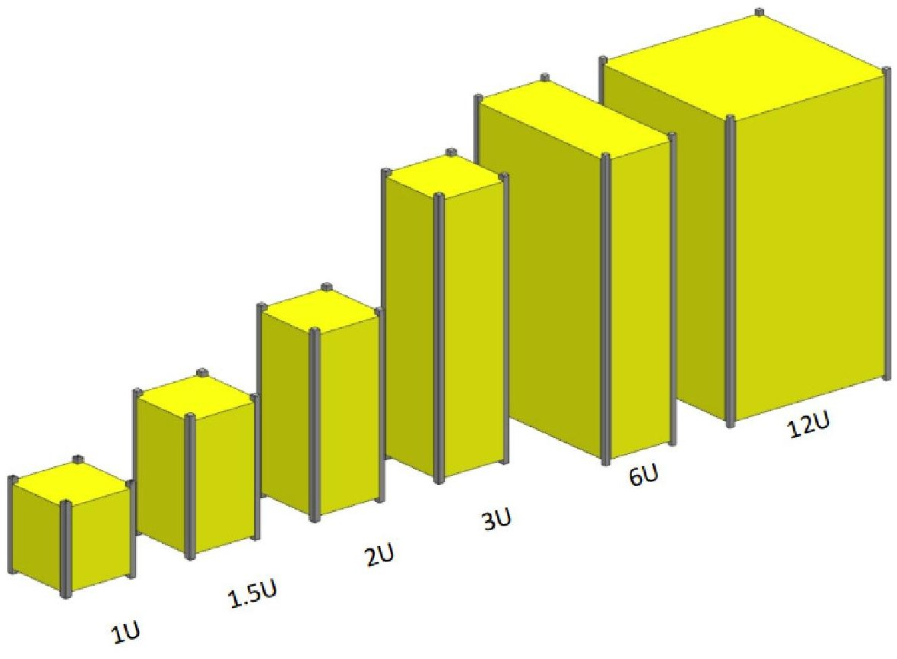

Figure 1: Pictorial of CubeSat sizes (The CubeSat Program, Cal Poly San Luis Obispo, 2022)

The first CubeSat was built in 1999 and over one thousand CubeSats have been launched into space in the years since 1999. The first entity who built CubeSat satellites was the academic community. Many colleges and universities adopted the building of CubeSats as a tool to further classroom learning as well as pique students' interest in space exploration. More recently, small commercial ventures have adopted the CubeSat model for commercial uses. Many uses of the CubeSat include technology demonstrators as well as scientific data gathering of planetary data.

<!-- PDF_PAGE: 17 -->

Future CubeSat missions may encompass a wide variety of mission types, goals, and objectives. Some of the topics for potential future CubeSat missions are described below (Branz, et al., 2023):

- Microbiology: Understanding microorganisms and how they interact with astronauts while in microgravity environments is a key goal of mission scientists, with the goal of keeping astronauts safe while in a contained microgravity environment. CubeSats offer an affordable vehicle for conducting low-cost science experiments relating to microorganisms and how they behave in a microgravity environment.

- Optical communication: Exchanging information using visible or infrared light is one use of CubeSats. This innovative technology is being used by the SpaceX Starlink and Amazon Kuiper project for low earth orbiting internet relay satellites. Experiments of improving and advancing optical communication capability can be performed using CubeSat technology.

- Electric propulsion: Electric propulsion systems offer advantages over traditional cold-gas thrusters because the electric propulsion systems can last if electrical energy is available. CubeSats need specialized electric propulsion systems because of their small amount of power generation.

- Swarms or Constellations: A recent development in CubeSat technology is the use of two or more CubeSats at the same time to collect more data that is not possible from a single CubeSat. These are referred to as CubeSat constellations, swarms, or trains. Some of the multi-satellite operations may have upwards of one hundred separate satellites working in combination to collect the requested data.

<!-- PDF_PAGE: 18 -->

The four growth areas for CubeSat technology referenced above are just a sampling of the many ways that CubeSat technology is growing to broaden human knowledge and capability of space exploration.

One limitation in the CubeSat design has been suboptimal success rates of satellite missions. As of 2018, the success rate of CubeSat missions was a dismal 75% One in four CubeSat missions were considered a failure or partial failure. Of all the missions, one-third of the missions were on behalf of universities while the balance was commercial, civil, or military applications. (Villela, et al., 2019)

## 1.2 PROBLEM STATEMENT

Mission failures of satellites and other space-bound hardware are all too common. The reasons why missions fail are varied but in many instances the failures are due to poor integration of various technologies rather than the failures of the specific components themselves. One author noted that in his 20 years of CubeSat experience, "that student-led projects often fail because of a lack of time/resources given to systems level testing." (Swartwout & Jayne, 2016)

Of all the missions, university-class CubeSat missions experienced a lower success rate than commercial-class CubeSat missions. For example, The Aerospace Corporation found that 45% of university-class CubeSat missions were successful while 77% of commercial-class CubeSat missions were successful. (Venturini, 2018)

The reasons for the increased failure rates of university-class CubeSat missions are varied but often is attributed to the number of volunteer students who support the development of the CubeSat missions, and the limited budgets dedicated to universityclass CubeSat missions. (Borowicz, 2020)

<!-- PDF_PAGE: 19 -->

Thus, there is an opportunity to improve the mission success rate of CubeSat missions. The author proposes that a scalable system engineering architectural framework be applied to the test and evaluation phase of CubeSat development to improve the probability of conducting a successful mission.

The scope of this dissertation covers CubeSat missions which contain a defect that exists prior to launch. Many situations after launch could contribute toward the failure of a mission, including space radiation damaging electronics, CubeSat mission controller failures, and impact with space debris. These are all examples of post-launch issues and are out of scope for this dissertation.

## 1.3 CONTRIBUTIONS OF THIS WORK

This paper contributes to CubeSat teams and Systems Engineering in general in two ways. First, it presents an open-source framework for scalable systems architecture for CubeSat test and evaluation. Prospective CubeSat development teams, either currently in existence or looking to start building CubeSats, can evaluate this framework to understand what a comprehensive and scalable test and evaluation system may look like. The second contribution to the Body of Knowledge for Systems Engineering is the extension of Systems Engineering into the scalable test and evaluation domain as a standalone domain. Most current research shows integration of test and evaluation throughout the product lifecycle rather than a standalone system conducting the various tests as a separate and distinct portion of the product development cycle. This paper focuses on using systems architectural frameworks for improving mission success of CubeSat missions by conducting the bulk of the test and evaluation activity at the very end of the CubeSat development cycle.

<!-- PDF_PAGE: 20 -->

In addition to this paper, two additional artefacts were produced from the research conducted as part of this dissertation. These include:

- "Optimization of a CubeSat Test and Evaluation System for Improved Mission Success", published by Journal of Small Satellites. This paper is under publication review at the time of publication of this paper, with an expected publication date of late 2025 or early 2026.

- "A Scalable Systems Architecture for CubeSat Test and Evaluation for Improved Mission Success", published by the American Institute for Aeronautics and Astronautics as part of the 2025 AIAA SciTech Forum conference proceedings.

Content from both the aforementioned artefacts is used in the creation of this paper.

<!-- PDF_PAGE: 21 -->

## Chapter 2: LITERATURE REVIEW

Much has been written on CubeSats, architectural frameworks, test & evaluation, and various combinations of the three. The literature review starts with systems engineering relating to CubeSats. It then refines into the category of test and evaluation architecture in general and finally concludes with prior work regarding systems engineering frameworks for CubeSat test and evaluation.

The literature review started in the most general sense by first reviewing systems engineering in general, followed by looking at scalable systems test & evaluation architectures in general. Next, the literature review covers CubeSat development, and then progresses to the test & evaluation domain, and finally looking at systems engineering of CubeSat test and evaluation.

## 2.1 SYSTEMS ENGINEERING AND ARCHITECTURE

A reasonable starting point for developing a test & evaluation systems architecture for CubeSats is to review existing literature on systems engineering and systems architecture in general.

Systems architecture is based on systems engineering. Systems engineering has been defined in many ways in different texts. The United States National Aeronautics and Space Administration has authored one definition of systems engineering, as follows: "Systems Engineering is the methodical, multi-disciplinary approach for the design, realization, technical management, operations, and retirement of a system." They further define a system to be "the combination of elements that function together to produce the capability required to meet a need." (National Aeronautics and Space Administration, 2019)

<!-- PDF_PAGE: 22 -->

Systems architecture, therefore, is the framing of the components contained within the domain of systems engineering to be a framework for a system to operate. While systems engineering deals with the system level engineering and details of those components, systems architecture organizes how those components interact with each other within a framework to create a system. (Faisandier, et al., 2023)

## 2.2 SCALABLE SYSTEMS ARCHITECTURE

Scalability in relationship to systems architecture has been intensely researched. One definition of scalability is "the property of a system to handle a growing amount of work by adding resources to the system" (SentinelOne, 2021). Thus, scalability in a CubeSat system architecture makes sense because a CubeSat program leader may wish to scale up or down the test and evaluation architecture based on funding levels, student interest, and lab capabilities.

The SentinelOne article describes two methods of achieving scalability. One is vertical scaling, which is to use more powerful and more capable resources to add capacity. This may include better computing power, improved lab tools, or more capable students. The addition of resources in this manner is costly in terms of funding and capabilities. The other option, according to SentinelOne, is horizontal scaling, which involves adding more resources of the same type and capability. In the case of CubeSat, examples of horizontal scaling might include more computers of the same type, expanded lab capacity of the same capability, or more student volunteers to plan and conduct the test and evaluation. The benefit to horizontal scaling is that expansion by adding more minimally capable resources tends to be less costly than expansion by adding on more capable resources. In addition, minimally capable resources tend to be abundantly available while higher capability resources tend to be scarcer in supply.

<!-- PDF_PAGE: 23 -->

(Generation, 2023). A real-life example of the difference in availability in types of resources is the appointment waiting times for a primary care physician versus a specialist. A primary care physician can be seen, on average, in 20 days while a specialist requires a wait of 30 days. (Phippen, 2023)

Indeed, the desire to scale horizontally is strong in the literature reviewed, likely because of the simplicity and ease of horizontal scalability. The paper "Scaling Up the Lab" discusses the proposed method of the scalable architecture for the university environment, which involves "the architecture is designed so that adding new experiment instances requires little effort." (Angulo, et al., 2018) This example of adding new instances with little effort reinforces the ease of horizontal scalability and further implies challenges with vertical scalability.

## 2.2.1 SYSTEMS ENGINEERING RELATING TO CUBESAT DEVELOPMENT

The concept of using systems engineering to improve mission success is attributed to many successful CubeSat missions. One notable example is the Montana State University Space Science and Engineering Laboratory program, which has successfully launched many small satellites. This program has extensively used systems engineering to rigorously design, develop, test, and evaluate the satellites prior to launch. The result was a high degree of mission success. The precise methods that the Montana State University SSEL program has implemented systems engineering into the CubeSat design process are not described in any technical paper. (Montana State University, 2024)

Many studies have been performed on the reasons why CubeSat missions have high failure rates. One such study investigated whether higher redundancy rates or improved testing was more apt to lead to mission success. The results of this study found a strong

<!-- PDF_PAGE: 24 -->

correlation that robust test and evaluation processes were a driving factor for mission success while system redundancy had a minimal impact on mission success.

Thus, the author is proposing an architectural framework for performing the test and evaluation of CubeSats with the goal of improving the overall mission success rate. The concept is that the architectural framework can be released into the public domain and be used by any entity pursuing the development of a CubeSat mission.

## 2.2.2 SYSTEMS ENGINEERING OF TEST AND EVALUATION DOMAIN

Much of the previous work in test and evaluation focuses on Department of Defense (DoD) acquisition projects. DoD acquisition projects are known to be expensive, small in quantity, and often overbudget. Thus, the Department of Defense has created a robust product development architecture designed to continually reduce risk from beginning to end to minimize cost overruns as well as limit the probability of failure. A pictorial of the current DoD Defense Acquisition Framework is shown in Figure 2 below.

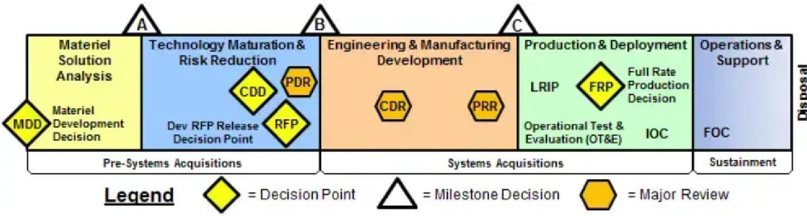

Figure 2: Department of Defense Acquisition Framework (AcqNotes: The Defense Acquisition Encyclopedia, n.d.)

This gated review acquisition framework is appropriate for large defense projects and especially for defense projects where multiples of one model are manufactured. For example, the KC-46A "Pegasus" Tanker aircraft acquisition, built by The Boeing Company, followed this model in from initial acquisition through full rate production.

<!-- PDF_PAGE: 25 -->

This model does not work well when applied to a university-class CubeSat in a couple of ways. First, the university-class CubeSat is typically made in small numbers. Thus, many of the gates and decisions relating to production of follow-on products are not applicable to university-class CubeSat projects. Second, and perhaps more importantly, the defense acquisition framework presented above involves considerable administrative burden in the form of gates, decision points, and other types of administration. University-class CubeSats are designed in large part to be a vehicle for the hands-on application of engineering rather than teaching bureaucracy and administration. Thus, while interesting for reference, the acquisition framework presented above does not lend itself to improvement in CubeSat mission reliability.

In 1994, the International Test and Evaluation Association (ITEA) created a panel discussion at a mini symposium on the current trends in test and evaluation. Mr. James O'Bryon, then the Deputy Director for Test and Evaluation for the United States Department of Defense, said that "testing without resulting action accomplishes little." (Gehrig, et al., 1994) Indeed, without a solid framework to approach a test and evaluation campaign, it may be difficult to properly reduce risk levels without spending excessively large amounts of time, money, or both. Thus, a systems framework defining "how much testing is enough" would be beneficial to increasing the mission success of CubeSat missions.

One paper sufficiently describes the benefits of using model-based system engineering as applied to test & evaluation. This paper, titled "Using Model-Based Systems Engineering as a Framework for Improving Test & Evaluation Activities," describes three ways MBSE can improve test processes (Bjorkman, et al., 2012):

<!-- PDF_PAGE: 26 -->

- Enhanced communication can benefit test planners by aiding system understanding.

- Improved requirements definition can provide clear test objectives with measurable outcomes.

- MBSE can aid in defining an optimum test program by determining the information that is needed at each step of the design and test processes.

Thus, the literature review indicates that systems engineering is a fundamental process for test and evaluation. The framework for test and evaluation is rooted within the domain of systems engineering.

## 2.2.3 SYSTEMS ENGINEERING OF CUBESAT TEST AND EVALUATION

Minimal prior work was uncovered for the systems engineering of a CubeSat Test and Evaluation program. The closest published work on CubeSat Test & Evaluation was a poster presentation at the 2018 conference for the Society of Photo Optical Instrumentation Engineers. The poster presentation was made from a team of Irish engineering students who were embarking on the development and launch of the EIRSAT-1 CubeSat. This poster presentation discussed the high failure rate of CubeSat missions and discussed how increased mission testing would reduce risk and improve reliability. (Doyle, 2018) The concluding points of the poster presentation were as follows:

- CubeSat development should consider mission testing to be essential.

- Clearer guidance and standards on the quality of Mission Tests performed by CubeSat teams is needed.

<!-- PDF_PAGE: 27 -->

The poster presentation listed above is a clear call to action to develop an architectural framework for conducting a CubeSat Test & Evaluation program.

Finally, a paper published in 2022 by the EIRSAT-1 team covers the exact full scale mission tests conducted on the engineering qualification model of CubeSat. While the paper is excellent documentation of what was done for EIRSAT-1, it is not an architectural test & evaluation framework for future satellites nor by itself it is a scalable approach for test & evaluation. (Doyle, et al., 2022)

## 2.3 CUBESAT STANDARDS

Extensive literature and standards have been published on CubeSat systems design. While this dissertation focuses on CubeSat test and evaluation rather than CubeSat system design, a brief foray into reference architectures for CubeSat systems is appropriate at this time.

## 2.3.1 OMG CUBESAT SYSTEM REFERENCE MODEL PROFILE

The most widely known MBSE standard organization is the Object Modeling Group, or OMG. (Object Management Group, 2025) This standards organization is the custodian of the standard for SysML, the systems engineering modeling language, in addition to hundreds of other standards. All of the standards can be downloaded in PDF format at no charge from the OMG website.

The CubeSat MBSE reference architecture (Object Management Group, 2024) maintained by OMG is an extension to SysML that includes additional add-ons for the SysML modeling language, including the following:

<!-- PDF_PAGE: 28 -->

- CubeSat specific Stereotypes

- CubeSat specific Profile

- CubeSat specific Architecture Structures

- CubeSat specific Validation and Verification

- Comments

This standard is most useful for defining the CubeSat Mission and CubeSat System. (Object Management Group, 2024)

## 2.3.2 CONSULTATIVE COMMITTEE FOR SPACE DATA SYSTEMS CUBESAT STANDARD

The Consultative Committee for Space Data Systems (CCSDS) maintains a standard for CubeSat communication systems. It was originally focused on space-ground communication systems but has since expanded into data compression, navigation data formats, missions operations interoperability standards, and others. (The Consultative Committee for Space Data Systems, 2023)

CubeSat communications is a discipline-specific topic for the most part. System Engineering can be used to design, develop, test, and maintain communications but much of the challenging aspects of communications falls under the discipline of electrical engineering. Thus, the CubeSat standard maintained by CCSDS is outside of the scope of this dissertation.

## 2.3.3 INCOSE CUBESAT REFERENCE MODEL

The INCOSE CubeSat Reference Model is the foundation of the Object Management Group CubeSat Reference Model. The INCOSE CRM was developed in between 1999 and 2017 by Azad Madni, of the University of Southern California, and David Kaslow of the INCOSE Space Systems Working Group. (Kelly, 2021) The goal of the

<!-- PDF_PAGE: 29 -->

standard was to develop a model based systems engineering methodology as applied to a CubeSat mission and provide a CubeSat Reference Model to CubeSat teams to use as a starting point for developing mission-specific CubeSat models.

The CubeSat Reference Model developed by INCOSE as part of the initial effort was eventually transferred to the Object Modeling Group for maintenance and distribution as shown in Section 2.3.1.

As described in Section 2.3.1, the CubeSat Reference Model is design to support development of the CubeSat Mission rather than the CubeSat Test and Evaluation processes.

## 2.4 LITERATURE REVIEW SUMMARY

The review of available literature on systems engineering shows considerable systems engineering application toward the front end of the development cycle for a CubeSat, including the requirements definition, the concept of operations, and the other early parts of early phase design. Considerable prior work also shows significant effort for developing scalable architectures and frameworks of systems of all flavors in general. However, the available literature showed little focus on systems engineering on the test and evaluation phase of the development cycle and little prior work on scalable test and evaluation systems specific to university-class CubeSat Missions. Certain prior work states that the absence of a test & evaluation framework for CubeSats is a known gap in the published literature for CubeSats. Several MBSE standards for CubeSats were reviewed, however, the standards were intended to cover CuebSat missions and/or CubeSat systems development and were not focused on CubeSat test and evaluation. Thus, the literature review indicates that there is a gap in CubeSat development in the

<!-- PDF_PAGE: 30 -->

test and evaluation domain and that filling this gap by creating such a process would improve the mission success of CubeSat missions.

<!-- PDF_PAGE: 31 -->

## Chapter 3: DEFINITIONS

## 3.1 TYPES OF CUBESAT MODELS

## 3.1.1 PROTOTYPE MODEL

The CubeSat "prototype" is a non-space qualified test article that is used for the preliminary decisions and design validation of the CubeSat. The specific configuration can vary among the teams, but often it is powered using batteries rather than solar energy, is launched aboard helium balloons rather than into space, and may be 3D printed rather than using the standard flightworthy CubeSat structure. In other words, the design of the prototype CubeSat may be significantly different from the final flight model that is flown in space.

The primary advantage of using a prototype CubeSat is that development changes can be implemented at low cost and in a time efficient manner. While the flight model may need to be handled carefully in a clean room environment under careful configuration control, a prototype model can be changed on the fly with very little wasted time. Additionally, the parts to build a prototype model cost significantly less than the flight qualified parts and materials.

## 3.1.2 ENGINEERING QUALIFICATION MODEL

Engineering qualification models are closer representations of the full flight CubeSat model but still contain a few differences to allow for ease of testing and evaluation of the hardware. Examples of differences between the engineering qualification model and the full flight model might include using non-flightworthy CubeSat structures and replacement of the solar cells with mass-representative

<!-- PDF_PAGE: 32 -->

mockups. Electronics, including control system, electrical power system, and guidance, navigation, and control system, are identical to the hardware used in the full flight model.

Since the engineering qualification model will not be flown, it can be modified and handled outside of the clean room environment that is used for handling the full flight model. Normal handling procedures reduce the amount of time to incorporate and validate a change to the model as compared to performing the upgrade and test in a clean room environment.

## 3.1.3 FULL FLIGHT MODEL

The flight model is the actual CubeSat that will be launched and deployed into space. The hardware is the flight qualified hardware. All software and hardware are carefully configuration-controlled. Every engineering aspect of the full flight model is in the final configuration. The full-flight model CubeSat is handled in accordance with proper handling procedures including the use of a clean room environment to avoid unnecessary contamination.

<!-- PDF_PAGE: 33 -->

## Chapter 4: METHODOLOGY

## 4.1 SYSTEMS ENGINEERING APPROACH AND APPLICATION

Systems Engineering is typically applied to the overall system development starting with requirements elicitation and concluding with system retirement. However, test and evaluation of a system is a large enough component that the systems engineering lifecycle can be applied specifically to this portion of the system development process with the goal of optimizing the test and evaluation portion of systems development.

To give a sense of an idea of the size of a test and evaluation program, the RAND Corporation performed a study and found that the test and evaluation program cost accounted for approximately 21 percent of total development costs for fixed-wing aircraft system. (Fox, et al., 2004) Satellite test and evaluation would likely be in a similar range. In terms of dollars, the James Webb Space Telescope cost $10 billion to develop in total and likely about $2 billion of this cost was for test and evaluation based on RAND Corporation estimates. These costs are designed to show the scale and size of large-scale test and evaluation programs. CubeSat development programs are much smaller scale, especially in terms of cost, because of the abundance of volunteer labor provided by the engineering students who volunteer their time to contribute to CubeSat development.

The dollar figures above are primarily aimed at showing that indeed a test and evaluation program can be considered a system by itself, and the entire system development cycle can reasonably be applied to the test and evaluation program of a

<!-- PDF_PAGE: 34 -->

CubeSat development cycle. Thus, the following paragraphs will develop the test and evaluation program.

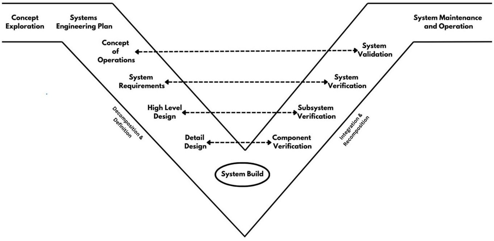

Figure 3: Systems Engineering Vee

The traditional systems engineering process involves the Systems Engineering "Vee" diagram, shown in Figure 3. The process starts with concept exploration, moves through the development process, verification and validation process, and concludes with operations and maintenance. These systems engineering processes apply well to the development of a CubeSat Test and Evaluation system for the purpose of improving the mission success of CubeSat missions.

The research presented in this paper focuses on the creation and implementation of a test and evaluation system for the purpose of performing comprehensive testing on CubeSats prior to launch. It is important to note that the proposed test and evaluation system will undergo validation and verification testing to ensure that it is both the right thing to build as well as that it was built right. To help alleviate confusion, verification and validation will refer to validation of the test and evaluation system while the term test and evaluation will refer to testing on the CubeSats themselves.

<!-- PDF_PAGE: 35 -->

The Concept of Operations for the CubeSat Test and Evaluation system is the primary foundation for the T&E program. It lays out the vision, components, and interactions of those components for the test and evaluation program. Having a solid framework for how one will perform test and evaluation on CubeSats prior to starting the development process will help keep the development process focused on success from the first day of development through launch day and beyond.

System Requirements, which are covered in the section below, are the definition of what the system is intended to accomplish. In the case of the test and evaluation program, system requirements are the goals, requirements, and vision of the test and evaluation program.

Subsystem interfaces cover how the various components of the test and evaluation system work with each other when executing the system. For example, one may need to charge the battery with solar energy at the same time thermal testing is underway. The thermal test subsystem should communicate to the solar simulation subsystem so the ramping of solar power and thermal energy can take place in a realistic manner.

Detailed component design of the test and evaluation system is the design of the various components that perform the test and evaluation, such as the vibration table for vibration testing, antenna array for electromagnetic compatibility testing, and the like. This level of detail is discipline specific to the engineering disciplines and thus falls outside the domain of systems engineering.

Component implementation is simply the installation of the components into the test and evaluation system, and like detailed component design, fits squarely in the domain of the engineering disciplines rather than the domain of systems engineering.

<!-- PDF_PAGE: 36 -->

For each of the design levels discussed above that fall within the domain of systems engineering, there is a corresponding portion of verification and validation that occurs to verify that the test and evaluation system both operates properly and also operates in a fashion that meets design requirements.

## 4.2 THREE PHASES OF CUBESAT ARCHITECTURE DEVELOPMENT

Prior to moving into system architecture definition, a brief foray into describing the three phases of CubeSat architecture development is warranted. The following pages cover CubeSat architecture development as follows:

## 4.2.1 CUBESAT MISSION ARCHITECTURE

The CubeSat Mission Architecture is the starting point for architecture design. Mission architecture defines how the mission transpires throughout all phases of the systems engineering "vee" from initial concept generation to system retirement. The mission for the CubeSat defines everything that the CubeSat is required to accomplish and provides the basis for the systems architecture for the CubeSat system.

## 4.2.2 CUBESAT SYSTEM ARCHITECTURE

The CubeSat System Architecture defines how the CubeSat itself accomplishes the goals and objectives of all phases of the CubeSat mission. The CubeSat system architecture encompasses all of the components of the CubeSat, including solar cells, circuit boards, mechanical framework, power distribution systems, and sensor systems. The systems architecture for the CubeSat system also follows the systems engineering vee for systems development, from initial concept generation to system retirement. Much of the detailed design of the CubeSat system belongs to the engineering disciplines rather than the domain of systems engineering. Systems engineering is most heavily

<!-- PDF_PAGE: 37 -->

involved in the interaction of the various individual systems and how the overall CubeSat system works together to accomplish the desired mission.

## 4.2.3 CUBESAT TEST AND EVALUATION SYSTEM ARCHITECTURE

The final system architecture described in this paper is the CubeSat Test and Evaluation System Architecture. This system architecture defines the test and evaluation system that is used for testing the CubeSat system and validating that the CubeSat system meets all design requirements as laid out in the CubeSat Mission definition.

## 4.2.4 DIAGRAM SHOWING INTERACTION OF CUBESAT ARCHITECTURES

The following pictorial figure (Figure 4) shows how the CubeSat Mission, System, and Test and Evaluation System are related to each other.

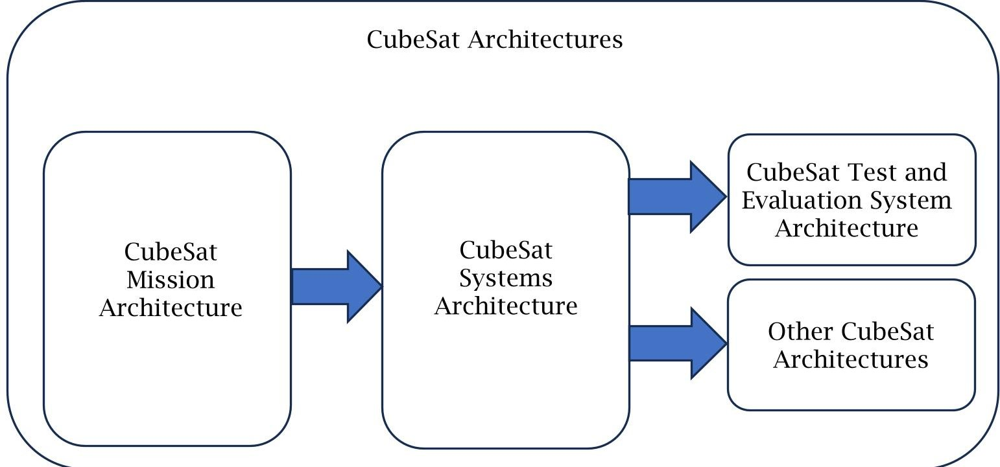

Figure 4: Three Phases of CubeSat Architectures

<!-- PDF_PAGE: 38 -->

## 4.3 REFERENCE CUBESAT MISSION ARCHITECTURE

The first step is to define the reference architecture for the CubeSat mission. The CubeSat mission begins with initial concept generation. It then proceeds through the various parts of the Systems Engineering Vee (shown in Figure 3), including concept development, preliminary design, detailed design, test & evaluation, and finally launch and mission execution. The final stage is decommissioning when the CubeSat deorbits, and the ground station is decommissioned and returned to storage for the next mission. Please see Figure 5 for a graphical image of the CubeSat mission.

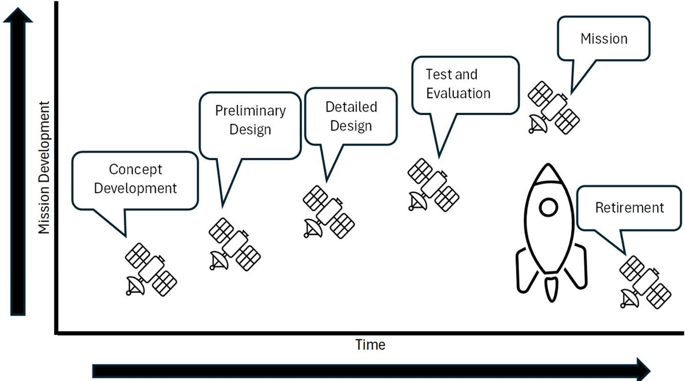

Figure 5: CubeSat Mission Pictorial Diagram

<!-- PDF_PAGE: 39 -->

The pictorial sketch above (Figure 5) is translated into model-based systems engineering views and diagrams, to use a standardized language for communicating the design. As with other diagrams, the charts and diagrams below are generated using the Magic Systems of Systems Architect using the SysML 2.0 modeling language.

<table border="1"><tr><td>Requirement Number</td><td>Requirement Type</td><td>Description</td></tr><tr><td>1.1</td><td>Functional</td><td>The CubeSat Mission shall have sufficient funding to cover CubeSat development, launch, mission execution, and retirement.</td></tr><tr><td>1.2</td><td>Functional</td><td>The CubeSat Mission shall have sufficient people resources to accomplish the required activities shown in Requirement 1.1.</td></tr><tr><td>1.3</td><td>Functional</td><td>The CubeSat mission shall be accomplished in 30 months of less</td></tr><tr><td>1.4</td><td>Functional</td><td>The CubeSat mission shall cost less than $1 million dollars</td></tr><tr><td>1.5</td><td>Functional</td><td>The CubeSat mission shall use between 10 and 30 people throughout the CubeSat Mission</td></tr><tr><td>1.6</td><td>Functional</td><td>The CubeSat mission shall incorporate a preliminary and final design review to ensure mission meets mission requirements</td></tr><tr><td>1.7</td><td>Functional</td><td>The CubeSat mission shall incorporate the following roles: Project Lead, Domain Lead, Test Engineer, Test Witness, Mission Lead, Mission Staff</td></tr><tr><td>2.1</td><td>Non-Functional</td><td>The CubeSat Mission shall incorporate both undergraduate and graduate students in all phases of mission execution</td></tr><tr><td>2.2</td><td>Non-Functional</td><td>The CubeSat Mission shall maintain security to prevent nefarious use of the CubeSat</td></tr><tr><td>2.3</td><td>Non-Functional</td><td>The CubeSat Mission shall positively reflect the values of the sponsoring organization</td></tr></table>

Figure 6: CubeSat Mission Requirements Table

The first step in creating the reference architecture is to define the requirements. For the CubeSat mission, one is concerned with the overall CubeSat mission rather than detailed design of the CubeSat. The requirements are shown in Figure 6 above.

<!-- PDF_PAGE: 40 -->

The next step in defining the reference architecture is to create an activity diagram showing the various roles involved in the CubeSat project and the various steps that must be undertaken to define, build, and test the CubeSat. The activity diagram for this is shown in Figure 7 below.

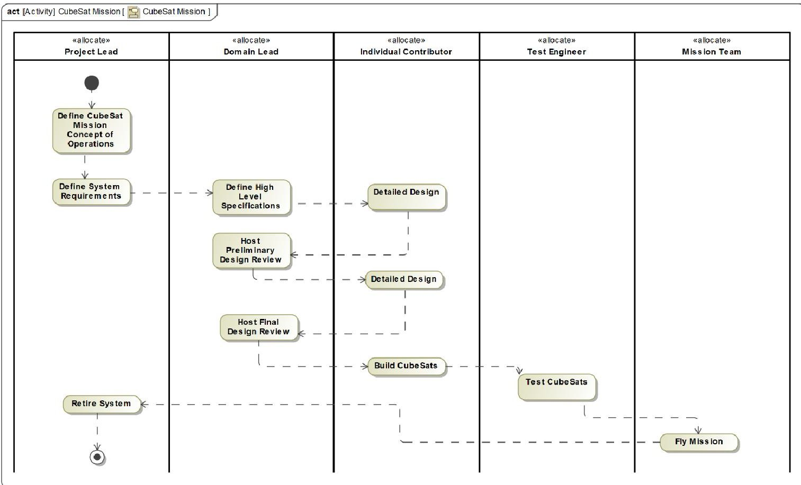

Figure 7: Activity Diagram showing CubeSat Mission Reference Architecture

## 4.4 CUBESAT SYSTEM REFERENCE ARCHITECTURE

The reference architecture for the CubeSat system is fundamental for developing the test and evaluation system. The test and evaluation system is directly developed around the specific test requirements for the CubeSat system, which is defined to accomplish the CubeSat Mission.

The starting point for the reference architecture for the CubeSat is the requirements table, shown in Figure 8 below. The requirements table for the reference architecture provides for the reference requirements that are applicable to the majority

<!-- PDF_PAGE: 41 -->

of CubeSat programs. The requirements table includes requirements for both functional requirements as well as non-functional requirements. Functional requirements are those requirements that define what CubeSat should do while the non-functional requirement define the general properties of the system.

<table border="1"><tr><td>Requirement Number</td><td>Requirement Type</td><td>Description</td></tr><tr><td>1.1</td><td>Functional</td><td>The CubeSat shall collect the required data during the mission</td></tr><tr><td>1.2</td><td>Functional</td><td>The CubeSat shall collect data for one month after launch</td></tr><tr><td>1.3</td><td>Functional</td><td>The CubeSat shall comply with all requirements set forth in CubeSat Design Specifications, Revision 14.1, published by Cal Poly CubeSat Laboratory</td></tr><tr><td>1.4</td><td>Functional</td><td>The CubeSat shall transmit collected data to Earth via the desired frequency</td></tr><tr><td>1.5</td><td>Functional</td><td>The CubeSat shall transmit the callsign of the licensed operator as required by the Federal Communications Commission</td></tr><tr><td>1.6</td><td>Functional</td><td>The CubeSat shall include a method of controlling spin rate</td></tr><tr><td>1.7</td><td>Functional</td><td>The CubeSat solar cells shall generate sufficient power to power the CubeSat through the complete mission</td></tr><tr><td>1.8</td><td>Functional</td><td>The CubeSat batteries shall have sufficient capability to power the CubeSat during one complete day-night cycle</td></tr><tr><td>1.9</td><td>Functional</td><td>The CubeSat system maintains minimum temperature requirements throughout the mission lifecycle.</td></tr><tr><td>1.10</td><td>Functional</td><td>The CubeSat shall transmit in the correct data mode.</td></tr><tr><td>1.11</td><td>Functional</td><td>The CubeSat computing boards shall function properly to achieve mission objectives.</td></tr><tr><td>2.1</td><td>Non-Functional</td><td>The CubeSat shall be manufactured of materials that safely burn in the upper atmosphere during deorbit</td></tr><tr><td>2.2</td><td>Non-Functional</td><td>The CubeSat shall incorporate cyber security practices to ensure authorized use and control of the CubeSat</td></tr><tr><td>2.3</td><td>Non-Functional</td><td>The CubeSat shall be made of recycled materials to the largest extent possible</td></tr><tr><td>2.4</td><td>Non-Functional</td><td>The CubeSat shall comply with Code of Federal Regulations Part 97 of Title 47, to ensure compliance with federal standards</td></tr></table>

Figure 8: CubeSat System Reference Architecture System Requirements Table

<!-- PDF_PAGE: 42 -->

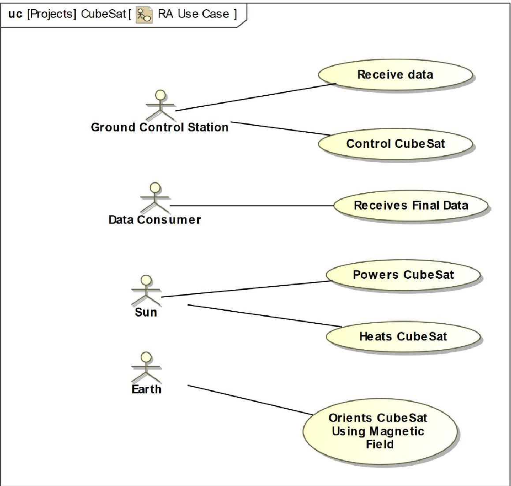

Figure 9: CubeSat System Reference Architecture Use Cases

Prior to delving into the details of CubeSat test and evaluation optimization, and methods of improving CubeSat mission performance, one must define a reference architecture for a CubeSat mission. Each CubeSat mission is unique but collectively a reference architecture can be created for a CubeSat mission.

The ideal avenue for defining reference architecture is to use model-based system engineering to create a systems engineering model of reference architecture. Dassault's Magic Systems of Systems Architect is an effective tool for creating the reference architecture of the CubeSat mission.

Requirements are the starting point for systems in general and for reference architectures such as the CubeSat reference architecture under discussion.

<!-- PDF_PAGE: 43 -->

Figure 8 shows the requirements for the CubeSat system. After completing the requirements definition, the next step in the systems engineering process is to define the use cases for the CubeSat System. The requirements were decomposed into a variety of use cases shown in Figure 9. Finally, after completing the use case diagram, the block definition diagram for the CubeSat is created and shown in Figure 10.

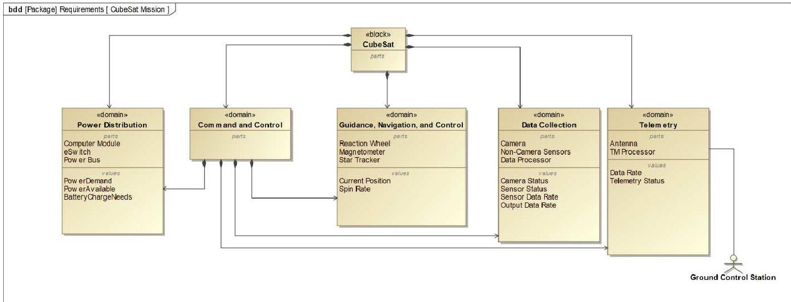

## Figure 10: Block Definition Diagram

## 4.5 CUBESAT TEST AND EVALUATION SYSTEM DESIGN

After completing the definition for the CubeSat System and CubeSat Mission, the next step is to move into the definition of the CubeSat Test and Evaluation System, which is the detailed system focused around conducting test and evaluation activities on CubeSats. The complexity of this system can range from simple to complex depending on the specific test requirements for the CubeSat being tested.

The system design for the CubeSat Test and Evaluation system follows the standard systems engineering process that was discussed earlier in the paper. Returning to the Systems Engineering Vee presented in Figure 3, the following pages describe the various steps of the systems engineering process as shown.

<!-- PDF_PAGE: 44 -->

## 4.5.1 CONCEPT EXPLORATION

The fundamental idea behind a test and evaluation system is that the test and evaluation portion of the CubeSat development requires special skills, tools, and equipment that warrant conducting test and evaluation activities within a system of its own rather than conducting the testing as part of the regular CubeSat development.

At this point, it's worthwhile reviewing the definition of a system. A system is defined as an "arrangement of parts or elements that together exhibit behavior or meaning that the individual constituents do not." (INCOSE, 2024)

For the CubeSat Test and Evaluation System, the parts or elements that work together include the various test activities, such as mechanical systems tests, electrical system tests, battery systems tests, and overall CubeSat operational tests. By grouping these tests into a system, many of the detailed elements of conducting tests can be created and reused, such as detailed test plans, test equipment, and test facilities. The use of specialized laboratory facilities is an especially important rationale for conducting CubeSat testing under a Test and Evaluation System. A parallel reason, nearly as important as using specialized test and evaluation facilities, is that specialized knowledge is maintained by those focusing on test and evaluation.

## 4.5.2 CONCEPT OF OPERATIONS

The Test and Evaluation System supports all testing activities that are conducted on the CubeSat, inclusive of all prototypes, engineering qualification models, and full flight model tests. The Test and Evaluation System supports and enhances the ability of the CubeSat team to conduct CubeSat testing safely, efficiently, and accurately. The Test and Evaluation System provides the capability for conducting the following top-level

<!-- PDF_PAGE: 45 -->

domains of testing: structural and mechanical system tests; electrical system tests; communication tests; guidance, navigation, and control tests; and sensor system tests. The test and evaluation system provides the means for accomplishing all phases of testing, including test planning, test execution, pass/fail determinations, and test outcome documentation. The picture below graphically shows the CubeSat and the various Test and Evaluation Scenarios.

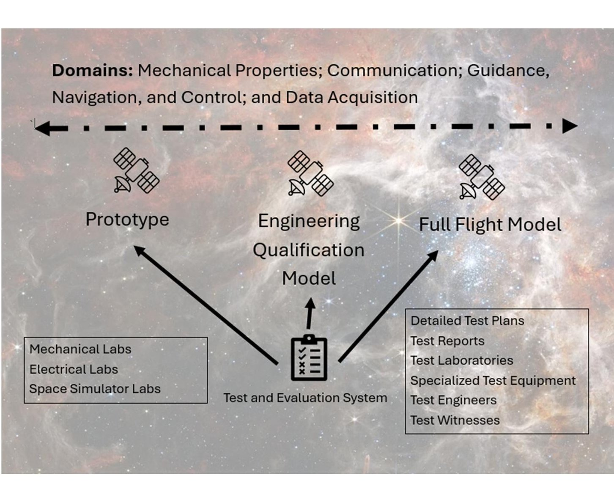

Figure 11: Scenarios for CubeSat Test & Evaluation

## 4.5.3 CUBESAT TEST AND EVALUATION SYSTEM REQUIREMENTS

The requirements for the reference CubeSat Test & Evaluation system are based directly on validating the requirements for the reference CubeSat system. That is, every test & evaluation requirement is directly traceable to the CubeSat system requirement.

<!-- PDF_PAGE: 46 -->

No test & evaluation requirement exists that cannot be traced back to the underlying CubeSat system requirement.

The requirements are categorized in accordance with the discipline domains for the CubeSat system. The CubeSat system domains include Mechanical Properties; Communication; Guidance, Navigation, and Control; and Data Acquisition. In turn, the CubeSat T&E domains line up and are Mechanical Properties T&E; Communication T&E; Guidance, Navigation and Control T&E; CubeSat Control T&E; and Data Acquisition T&E.

## 4.5.4 STAKEHOLDERS

The stakeholders in a university-class CubeSat T&E System are the entities that have an interest in the success of the CubeSat test and evaluation system. Stakeholders are defined in the ISO standard for Systems and Software Engineering, ISO 15288, as "A party having a right, share or claim in a system or in its possession of characteristics that meet that party's needs and expectations." (INCOSE, 2024)

The entities that may be considered stakeholders are broad with regards to a CubeSat Test and Evaluation System. The purpose of the Test and Evaluation System is to ensure the mission success of the CubeSat, so all the stakeholders of a CubeSat are also stakeholders of a CubeSat Test and Evaluation System.

The list of stakeholders applicable to a CubeSat Test and Evaluation System is shown in the Results section of this paper.

## 4.5.5 SYSTEM GOALS

Goals, as part of requirements definition, are the highest-level desires of the system. Goals are not necessarily strict requirements but rather loosely defined desires of the outcomes of the system based on stakeholder needs. (INCOSE, 2024)

<!-- PDF_PAGE: 47 -->

Goal elicitation was performed by reviewing the final desired outcome of the CubeSat system against the various constraints placed upon CubeSat development, including the most common constraints of cost, schedule, and resources. After reviewing the constraints specific to the CubeSat system and weighing against the desired outcome, goals for the CubeSat system were developed and documented in the Results section of the paper.

## 4.5.6 REQUIREMENTS DOCUMENTATION

The CubeSat Test & Evaluation system requirements are documented using SysML 2.0 Requirements Diagrams. The requirements are shown in the Results section of this paper.

## 4.5.7 HIGH LEVEL DESIGN

Both the detailed design and high-level design of the test and evaluation system are covered in the Results section.

## 4.5.8 SYSTEM VERIFICATION & VALIDATION

The nature of CubeSat systems test and evaluation forms the basis for verification and validation of the system. A specific verification and validation step is not required as there is no external requirement to establish a test and evaluation system in support of CubeSats. Rather, the test and evaluation system is created to maximize the success of CubeSats. The effectiveness of the test and evaluation system is performed by monitoring the number of CubeSats that fail to accomplish mission objectives and by the number of full flight model CubeSats that fail a specific test that should have been caught by initial testing.

<!-- PDF_PAGE: 48 -->

## 4.5.9 OPERATION, MAINTENANCE, AND RETIREMENT

The key element for operation and maintenance of a CubeSat test and evaluation system is documentation. Engineering students, both undergraduate and graduate, are typically only involved in a CubeSat project for a short length of time. There is little time and capability to pass knowledge through mentorship or hands on training. Thus, maintaining quality and up to date documentation of the test and evaluation system is important for reference on operation and maintenance. Unfortunately, maintaining documentation is never an exciting task for volunteer students as most would much prefer writing CubeSat software, designing mechanical interfaces, or maintaining circuit boards rather than composing test and evaluation system documentation.

System retirement is a relatively simple task for a CubeSat test and evaluation system. Most of the test hardware consists of computers, microcontrollers, and communication equipment that can readily be repurposed to other satellite projects or can be disposed of if the equipment reaches end of life. Typically, there are no hazardous materials within a CubeSat test and evaluation system that require special handling nor is the equipment particularly difficult to dispose of at end of life.

## 4.5.10 COMPONENT DESIGN, SYSTEM BUILD, AND COMPONENT VERIFICATION

Component design and system build portions of the systems engineering vee belong to the engineering disciplines for development rather than the field of systems engineering. In other words, engineers from mechanical, electrical, aerospace, and other discipline-specific engineering fields are the lead engineers to perform the component design, system build, and component verification. Thus, further discussion for the detailed component design falls outside of the scope of this paper.

<!-- PDF_PAGE: 49 -->

## 4.5.11 SYSTEM RISK ANALYSIS

The second portion of research was conducted on risk analysis of the test and evaluation system. The primary risk of concern is that the CubeSat may pass the sequence of tests and yet the CubeSat still fails after launch. The reasons for this outcome may include the instance in which the scope of testing missed a particular failure condition, the test article configuration did not match the flight article test configuration and thus the validation test did not test the realistic scenario, and that the test itself was inadequate in testing the particular scenario.

Of the scenarios presented above, the one of most interest in this paper is the scenario that the test passes on the test article while the same situation causes the CubeSat to fail in flight. The primary reason is configuration control, in that the test article CubeSat may have a different software load, a different mechanical configuration, or different circuit boards than used in the full flight model CubeSat. It is faster and easier to test on the prototype than the engineering qualification model and it is faster to test on the engineering qualification model than it is on the full flight model. However, further away from the real vehicle that a test is run on increases the risk that the CubeSat mission fails despite passing the ground tests.

Quantifying the risk falls in the domain of risk analysis, which is one of the fundamental pillars of systems engineering. Several systems engineering tools have been developed to study the risk analysis of a system failure, including a preliminary hazard assessment (PHA); failure mode, effects, and criticality analysis (FMECA); and fault tree analysis (FTA). The following paragraphs will review the tools in depth and then apply the tools to the CubeSat T&E program.

<!-- PDF_PAGE: 50 -->

Each of the analyses listed below are reference models for performing risk analysis on CubeSats. Actual risk analysis will depend on specifics of the subject CubeSat mission. Additionally, the length and scope of the analysis is limited in this paper due to space constraints and due to the academic nature of the paper.

## 4.5.11.1 PRELIMINARY HAZARD ASSESSMENT

A preliminary hazard assessment is a method of identifying and characterizing hazards early in the design phase for designing a product. It is a tool developed by the United States Army and has been documented in a military standard MIL-STD-882B. The military standard requires that the following types of hazards be identified and evaluated: Hazardous components, Safety related interface considerations; environmental constraints; Operating, test, maintenance, and emergency procedures; facilities and support equipment; and safety equipment considerations.

An example table of a preliminary hazard assessment is shown below, along with information on how the scalable test and evaluation architecture would catch and eliminate the potential hazard.

For the purposes of this paper, a "hazard" is defined as any situation that may adversely affect the intended CubeSat mission.

<table border="1"><tr><td>Hazard Classification</td><td>Hazard Subclassification</td><td>Hazard Identified</td><td>Hazard Defined</td><td>Hazard Classification1</td><td>Mitigation Using T&amp;E Architecture</td></tr><tr><td>Hazardous Components</td><td>Stored Chemical Energy Source</td><td>Lithium-Ion Battery</td><td>Fire</td><td>Class IV</td><td>Prototype Model T&amp;E</td></tr><tr><td>Interfaces</td><td>Electrostatic Discharge</td><td>Improper handling during manufacturing</td><td>Electrostatic discharge causes component failure</td><td>Class III</td><td>Full Flight Hardware T&amp;E</td></tr></table>

<!-- PDF_PAGE: 51 -->

<table border="1"><tr><td rowspan="2"></td><td>Electromagnetic Compatibility</td><td>Components electrically interfere</td><td>Components radiate energy and interfere with adjacent components</td><td>Class III</td><td>Prototype Model T&amp;E</td></tr><tr><td>Data incompatibility</td><td>Data output from one component may not be usable by another component</td><td>Incorrect data processing may lead to mission failure</td><td>Class IV</td><td>Engineering Qualification Model T&amp;E</td></tr><tr><td rowspan="2">Environmental</td><td>Radiation</td><td>Space-based radiation impacts electronics</td><td>Non-hardened electronics are impacted by space-based radiation</td><td>Class III</td><td>Analysis T&amp;E</td></tr><tr><td>Vibration</td><td>High Vibration Loads</td><td>Mechanical Separation of Components</td><td>Class IV</td><td>Mechanical Vibration T&amp;E</td></tr><tr><td>Operational</td><td>Improper Command from Ground Station</td><td>Microprocessor fails to respond</td><td>Non-functional Microprocessor</td><td>Class II</td><td>Engineering Qualification Model T&amp;E</td></tr><tr><td>Safety Equipment</td><td>N/A</td><td>N/A</td><td>N/A</td><td>N/A</td><td>N/A</td></tr></table>

Figure 12: Hazard Classifications

$ ^{1} $Hazard Classification:

Class 1 - Negligible

Class 2-Marginal Effects

Class 3-Critical

Class 4-Catastrophic

## 4.5.11.2 FAILURE MODE, EFFECTS, AND CRITICALITY ANALYSIS

A failure mode, effects, and criticality analysis table is shown below, covering those failure effects that may be mitigated by a scalable test and evaluation program. Failure effects that may be caused by events not preventable by a test and evaluation program are excluded from the table below. Note that some select failure modes are analyzed

<!-- PDF_PAGE: 52 -->

through technical analysis (Analysis T&E) rather than through physical verification using prototype model, engineering qualification model, or full flight hardware models.

<table border="1"><tr><td>Process Steps</td><td>Potential Failure Modes</td><td>Potential failure effects</td><td>Potential causes of failure</td><td>Control Measure</td></tr><tr><td rowspan="5">Initial CubeSat Operation</td><td>Solar Cells fail to deploy</td><td>Suboptimal power is generated</td><td>Deployment relay failure</td><td>EQL T&amp;E</td></tr><tr><td rowspan="3">Mission computer fails to operate</td><td rowspan="3">Total Mission Failure</td><td>Radiation exposure</td><td>FFH T&amp;E</td></tr><tr><td>Bit flips</td><td>FFH T&amp;E</td></tr><tr><td>Software error</td><td>EQL T&amp;E</td></tr><tr><td>Uncontrolled spin</td><td>Mission Failure</td><td>GNC Failure</td><td>EQL T&amp;E</td></tr><tr><td>Data Gathering</td><td>Sensor Fails to Collect Data</td><td>Mission Failure</td><td>Sensor circuitry failure</td><td>EQL T&amp;E</td></tr><tr><td rowspan="3">Data Transmission</td><td rowspan="3">Telemetry Unit Fails to Send Data</td><td rowspan="2">Mission Failure</td><td>Failed Telemetry Processor</td><td>FFH T&amp;E</td></tr><tr><td>Failed Transmitter</td><td>EQL T&amp;E</td></tr><tr><td>Reduced Data Transmission</td><td>Failed Antenna</td><td>EQL T&amp;E</td></tr><tr><td rowspan="5">Power Management</td><td rowspan="2">Solar Cells Generate Insufficient Power</td><td rowspan="2">Reduced Science Gathering, Reduced Data Transmission</td><td>Solar Cells Sized too Small</td><td>Prototype T&amp;E</td></tr><tr><td>Excessive power demands</td><td>Prototype T&amp;E</td></tr><tr><td>Lithium Batteries Ignite due to Thermal Runaway</td><td>Total Mission Failure</td><td>Poor battery manufacturing technique</td><td>FFH T&amp;E</td></tr><tr><td rowspan="2">Lithium Batteries Store Insufficient Energy</td><td rowspan="2">Reduced Science Gathering</td><td>Batteries not large enough</td><td>Prototype T&amp;E</td></tr><tr><td>Batteries too cold</td><td>Analysis T&amp;E</td></tr><tr><td>Mission Management</td><td>Main Microprocessor Fails to Process</td><td>Total Mission Failure</td><td>Radiation Damage</td><td>FFH T&amp;E</td></tr></table>

Figure 13: FMECA Analysis

## 4.5.11.3 FAULT TREE ANALYSIS

A fault tree analysis is a proven technique for analyzing and identifying areas for hazard mitigation and prevention. It falls under the domain of probabilistic risk assessment of systems engineering. (Ostrom & Wilhelmsen, 2019)

For the CubeSat, detailed fault tree analysis is often outside the scope of work of volunteer student labor. Fault tree analysis requires extensive time and specialized

<!-- PDF_PAGE: 53 -->

knowledge to create. Still, fault tree analysis is one of many tools that can be used to improve the mission success of CubeSats. An example fault tree is shown on the page below. The fault tree analysis is provided as a representative example only. An actual fault tree analysis may be developed based on deep technical knowledge of the various CubeSat systems and potential failure modes of those systems.

<!-- PDF_PAGE: 54 -->

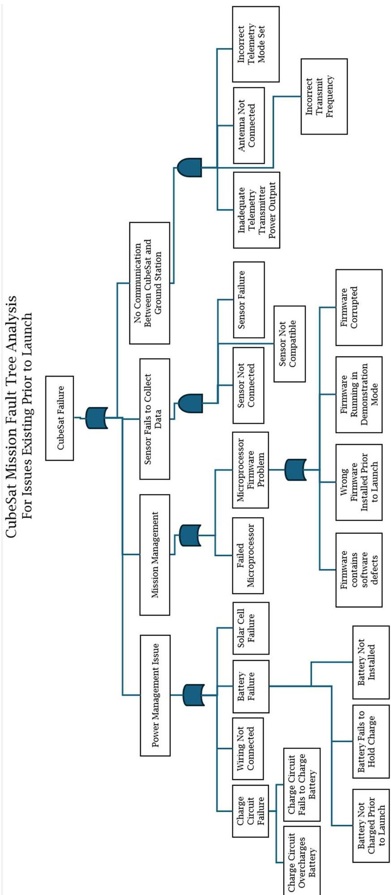

Figure 14: Fault Tree Analysis

<!-- PDF_PAGE: 55 -->

## 4.5.12 CUBESAT DEVELOPMENT CONSTRAINTS

Many constraints are present in any engineering project. The most common are time, money, and resources. The same is true for the CubeSat Test and Evaluation. Each of the common resource constraints are discussed in the following subsections.

## 4.5.12.1 FINANCIAL CONSTRAINTS

Financial constraints are probably the most widely known and accepted constraint for an engineering system, including when conducting CubeSat Test and Evaluation. Entities that provide funding for University class CubeSat missions may include universities, alumni donors, government entities, and non-government entities. (NASA, 2017) Most, or perhaps even all, funding entities for CubeSats desire to stretch the funding to provide the most CubeSat science results for a given amount of program cost. The funds received may be used for hardware purchases, laboratory time, student and professional salaries, and facility rental.

## 4.5.12.2 TIME CONSTRAINTS

Time constraints are two-fold in nature. One is the length of time to develop the CubeSat. Various funding sources provide constraints on the length of time to develop, test, and launch the CubeSat. One such constraint is the launch spot on the launch vehicle. The expected data of launch of the CubeSat provides for a firm date of completion that cannot be readily changed unless a different launch is obtained and selected. Finally, a design-build-test cycle of 2-3 years is helpful for maintaining student motivation and enthusiasm. (Berthoud, et al., 2019)

The other time constraint, in the case of student-led CubeSat missions, is student volunteer time. Students have limited amounts of time to volunteer their energy and

<!-- PDF_PAGE: 56 -->

time for CubeSat missions. Paying students can help retain motivation but paying students requires additional funding. Thus, minimizing the time required to design, build, and test a CubeSat can be beneficial to make the most of limited student volunteer hours.

## 4.5.12.3 RESOURCE CONSTRAINTS

Resource constraints are the constraints placed upon a CubeSat type for the remaining types of resources, including parts availability, laboratory space, test space, and all other resource constraints. (Greenberg, et al., 2021) These constraints vary among the specific team depending on geographic location, funding, volunteer time, and other factors.

## 4.5.12.4 CUBESAT CONSTRAINT SUMMARY

In summary, there are a variety of CubeSat constraints that CubeSat teams face. These include funding, student volunteer time, CubeSat development time, and resource constraints such as lab space, testing facility space, and supply chain constraints. While this paper focuses on student volunteer hours as being the constraint of consideration, the readers should be aware that many other constraints are placed upon CubeSat development beyond student volunteer labor time.

<!-- PDF_PAGE: 57 -->

## 4.6 SURVEY OF CUBESAT ENGINEERS AND ENGINEERING STUDENTS

After developing the CubeSat Test and Evaluation Systems Architecture, a survey of CubeSat Engineers and Engineering Students (CSEES) was conducted to better understand current philosophies toward CubeSat Test and Evaluation.

The survey was distributed to various CSEES throughout the world. Contact information for the survey recipients was acquired by reviewing published peer reviewed journal papers. Many CubeSat papers included the contact information in the paper, and this information was used for sending the CubeSat survey. In addition to email address, the survey was distributed via two listservs relating to CubeSats or other satellite communication groups. Approximately five hundred surveys were distributed to CSEES affiliated with CubeSat programs around the globe.

The survey was intended to gather subjective information about CubeSat Test and Evaluation that would not be possible to obtain through other types of CubeSat research. A survey, consisting of 12 questions, was developed and released to the CSEES population. Care was taken to make the questions as specific as possible without asking the respondents to reveal proprietary, export controlled, or other sensitive information about their CubeSat programs.

The survey was reviewed by the Internal Review Board for Colorado State University to determine if IRB approval was required under federal and state laws governing human subjects. The Internal Review Board reviewed the survey in the Kuali system, assigned it #5904, and dispositioned the survey as follows: As the survey asked only for the opinions from the participants and no data was collected about the survey respondents themselves, the survey was determined to be exempt from IRB review and approval.

<!-- PDF_PAGE: 58 -->

The survey was created using the Microsoft Forms survey tool. This anonymous tool collected no data about the survey respondents – no IP address, no usernames, and no other identifiable information was collected beyond what was volunteered by the survey participants themselves. The survey was released to CSEES identified through journal publications and released to all people without regard to nationality, thus, the results of the survey were inclusive of an international perspective on CubeSat Test and Evaluation.

The survey was left open for a period of four weeks to give participants many opportunities to complete the survey. The length of time the survey was open was stated in the email that was released to the participants. The survey was released to the participants by email. To avoid spam filtering issues, the survey was emailed to one hundred survey participants per day for a period of approximately one week. The emails of the participants were included on the bcc: line of the email for privacy, except for one case in which they were inadvertently included on the cc: line.

A number of emailed responses were received in addition to the survey results. Several people were interested in CubeSat work post-graduation. Some were looking to be involved in the research work. Two people inquired how the survey author received their email address. Overall, people were supportive and appreciative of being included in CubeSat research.

A preamble to the survey was written to define to the participants the extent of the information that was collected, how it was used, and contact information of university staff for more information. Preambles were deemed to be important to reduce any potential anxiety with the survey. The preamble used in the survey is shown below.

<!-- PDF_PAGE: 59 -->

My name is Greg Magone, and I am a researcher from Colorado State University (CSU) in the Systems Engineering department. We are conducting a research study on perceptions of CubeSat test and evaluation. The title of our project is "A scalable system architecture for CubeSat Test and Evaluation for Improved Mission Success". The Principal Investigator is Steve Simske, also from the CSU Systems Engineering department, and I am the Co-Principal Investigator.

We would like you to take an anonymous online survey. No data is being collected except for the answers provided here. No IP addresses are being collected as part of this survey. Participation will take approximately 10 minutes. Your participation in this research is voluntary. If you decide to participate in the study, you may withdraw your consent and stop participation at any time without penalty. There are no known risks associated with this study.

We will not collect your name or personal identifiers. Anonymous data collected as a part of this survey may be used in future research studies or distributed to another investigator without additional consent. When we report and share the data to others, we will combine the data from all participants in aggregate. While there are no direct benefits to you, we hope the collected data will be benefit [sic] future CubeSat programs through improved test and evaluation architectures.

To indicate your consent to participate in this research and to continue to the survey, please click "Next" button below. If you have any questions about the research, please contact Greg Magone at greg.magone@colostate.edu. If you have any questions about your rights as a volunteer in this research, contact the CSU IRB at: CSU_IRB@colostate.edu; 970-491-1553.

Thank you for your participation in this research-- your help is greatly appreciated!

<!-- PDF_PAGE: 60 -->

The table below show the survey questions and the type of responses permitted by the survey.

<table border="1"><tr><td>Q1</td><td>The following models were used when testing the CubeSat.
(Select all that apply: Software Satellite Simulator, Lab Based Test Bed(Flatsat), Engineering Qualification Model, Full Flight Model, Other)</td></tr><tr><td>Q2</td><td>The size of CubeSat being tested was:
(1U,1.5U,2U,3U,6U,12U Other)</td></tr><tr><td>Q3</td><td>Is the CubeSat part of a multi-satellite constellation?
(No, single satellite only; yes, part of a CubeSat swarm; yes, part of a CubeSat train; other)</td></tr><tr><td>Q4</td><td>The following types of testing were conducted for the CubeSat?
(Mechanical system tests(mass, center of gravity,solar cell deployment,and similar),
Electrical system tests(power distribution,battery capacity,solar cell generation),
Software system tests(regression testing,user acceptance testing),
Sensor system tests(camera,accelerometer,other sensor),
Communication system tests,
System integration tests(complete end to end functional check),
Other)</td></tr><tr><td>Q5</td><td>In my opinion,testing of CubeSats is important to ensure mission success:
(Scale 1 to 10 from“Stronaly Disagree”to“Stronaly Agree”)</td></tr></table>

<!-- PDF_PAGE: 61 -->

<table border="1"><tr><td>Q6</td><td>I would describe the testing program of the CubeSat as:
(Scale 1 to 10 from“Not Comprehensive”to“Very Comprehensive”)</td></tr><tr><td>Q7</td><td>In my opinion, future CubeSat programs should:
(Conduct more testing than what I have observed, Conduct the same amount of testing as what I have observed, Conduct less testing than what I have observed, Other)</td></tr><tr><td>Q8</td><td>Was the CubeSat mission a successful mission?
(Successful, Partially Success, Not Successful, Mission Not Flown, Success Not Known, Other)</td></tr><tr><td>Q9</td><td>I am affiliated with the following type of institution:
(College or University, For-Profit Corporation, Not-for-Profit Corporation, Government, Public-Private Consortium, Other)</td></tr><tr><td>Q10</td><td>My proficiency with CubeSat technology
(Scale 1 to 10 from“Beginner”to“Experienced”)</td></tr><tr><td>Q11</td><td>I most closely identify as the following
(Undergraduate Student, Graduate Student, Non-University Professional, University Staff, University Professor, Other)</td></tr><tr><td>Q12</td><td>I would like to make the following additional comments regarding CubeSats and CubeSat testing:
(freeform comments)</td></tr></table>

Table 1: CubeSat Test and Evaluation Survey and Response Options

## 4.7 EXPERIMENTAL TIME STUDY ON TEST EXECUTION TIME

In support of the simulation of mission success evaluation in the next section, experimental time study data was collected to evaluate the time required to conduct tests on the several types of CubeSat models. The goal of performing the time studies

<!-- PDF_PAGE: 62 -->

was to obtain the relative difference in time between conducting a test on a Prototype CubeSat, an Engineering Qualification Model CubeSat, and the Full Flight Model CubeSat.

For the time study, the methods Design for Manufacturing and Assembly were extended to Design for Test. Two industrial engineers, Geoffrey Boothroyd and Peter Dewhurst, conducted extensive research in time studies for manual assembly. (Boothroyd, et al., 2011) The methods and processes discussed in the book were extended to measuring and quantifying the time for performing a variety of tests on CubeSats.

The basic methodology was to break each test into a series of steps required for the specific model classification, classify the steps based on the type of activity required, and conduct time studies to measure the time for each of these steps according to the test classification. Finally, the total time was added together for all the steps in the process to estimate the total length of time to run a test on the model.

Equation 1 below shows the mathematical formula for calculating total test time.

$$
T _ {t} = \sum_ {1} ^ {n} t _ {n}
$$

Where $ T_{t} $ = Total Time for Test Execution; n = step identification number, and $ t_{n} $ is the amount of time to execute the specific test step.

All tests were performed on a CubeSat Simulator, which was a mockup of a real CubeSat including functioning electronic hardware and mechanical supports that represent many of the components of an actual CubeSat. The CubeSat Simulator was provided on loan by AMSAT $ ^{\circledR} $ , which supports Amateur Radio in Space. In the case of the CubeSat simulator, the AMSAT organization had built a complete CubeSat that can be

<!-- PDF_PAGE: 63 -->

used to test out the common technologies used in space-bound CubeSats. The CubeSat simulator package was robust and could readily be handled without special protection.

The resulting data for all tests was averaged and compared to provide an estimate of how the test conduct time varies based on the classification of CubeSat. This data fed into Section 3.5 below as part of the Pareto Analysis for the optimized framework.

The first step in conducting the time study was to develop Detailed Test Plans (DTP) to represent a variety of tests that are likely conducted on actual CubeSats. Five DTPs were generated to represent five separate tests. These five DTPs are:

1. Sensor Data Test

2. CubeSat Spin Rate Verification

3. CubeSat Mass Property Verification

4. Measure Solar Energy Output

5. CubeSat Accelerometer Test

The DTPs were developed through a combination of academic research on test and evaluation and the author's experience working in the test and evaluation engineering field. For each type of test, three distinct levels of detailed test plans were created. The three levels of detailed test plans are as follows:

1. DTP for Prototype Test

2. DTP for Engineering Qualification Model Test

3. DTP for Full Flight Model Test

Each of the levels of DTP are described in the following paragraphs.

<!-- PDF_PAGE: 64 -->

## 4.7.1 PROTOTYPE TEST

The DTP for the Prototype Test Level represents the type of test that one might perform on a prototype CubeSat. The vision for this level is that a prototype CubeSat is still in the infancy of development. The software loaded on the CubeSat may contain software bugs or incorrect code. The mechanical hardware may differ significantly from the prototype to the full flight model.

The testing for the prototype is time efficient because the handling procedures for the prototype are the least stringent for the three models being tested. The primary areas of differences in handling procedures include the following:

1. The test engineer's personal protective apparel is less stringent for the prototype than it is for the full flight model. For example, the personal protective apparel required for the prototype is a simple set of antistatic gloves while the personal protective apparel for the full flight model includes a full Tyvek clean suit, hair nets, antistatic gloves, and antistatic boots, to protect the CubeSat from potential inadvertent static discharge and prevent the full flight model from being damaged by foreign object debris (FOD).

2. The prototype CubeSat required simple check in / check out procedures because the prototype is never intended to fly and designed for rapid deployment, testing, and revisions to test software and hardware. On the other hand, the full flight model requires extensive documentation of the software and hardware changes made to CubeSat to ensure that the configuration control of the CubeSat is maintained and only flight ready hardware and software are loaded onto the CubeSat.

<!-- PDF_PAGE: 65 -->

3. The laboratory area for the prototype CubeSat requires simple laboratory procedures while the full flight model CubeSat is handled in a semi-clean room environment to protect the CubeSat. The additional laboratory handling procedures for the full flight model result in additional time to prepare, set up, test, and teardown for all testing conducted on the CubeSat.

Examples of detailed test procedures for several prototype tests are shown in Appendix A.

## 4.7.2 ENGINEERING QUALIFICATION MODEL CUBESAT

The Engineering Qualification Model CubeSat is a CubeSat that is more developed than the prototype CubeSat but never intended to fly. It is intended to represent the full flight model CubeSat in fit, form, and function. The parts of the Engineering Qualification Model CubeSat that may be different primarily involve certifications. The materials, computing hardware, or computing software may be missing the required certifications that are used in the full flight model.

Handling of the Engineering Qualification Model CubeSat is more stringent than the prototype CubeSat but less stringent than the Full Flight Model. The primary differences in handling between the Engineering Qualification Model and the Full Flight Model include the following:

1. The personal protective equipment requirements closely align with the prototype CubeSat, as neither the prototype nor the engineering qualification model CubeSat will fly.

2. The check in / check out procedures align closely with the Full Flight Model CubeSat as the Engineering Qualification Model represents the flightworthy

<!-- PDF_PAGE: 66 -->

CubeSat in fit, form, and function. Configuration control is important to be sure that correct hardware and software is being tested.

Examples of detailed test procedures for several engineering qualification model tests are shown in the Appendices.

## 4.7.3 FULL FLIGHT MODEL TEST

The DTP for the Full Flight model test represents the type of test that would be performed on the full flight model. The vision for this level of CubeSat is that this CubeSat is ready to load onto the launch vehicle and launch into space.

Testing on the full flight model CubeSat proceeds at the slowest rate due to the need to handle the flightworthy CubeSat with the utmost of care as well as the necessity to carefully document configuration of the CubeSat testing as well as maintaining the configuration of the CubeSat.

Any modifications made to the Full Flight Model CubeSat during testing must carefully be documented to ensure that the configuration control is maintained. Finally, any configuration changes must be documented and carefully evaluated to be sure that all required testing is performed on the flyaway version of the CubeSat.

Examples of detailed test procedures for several full-flight model tests are shown in the Appendices.

## 4.8 SIMULATION OF MISSION SUCCESS BASED ON MODEL CLASSIFICATION

The next step in developing the optimized test program was to determine the mission success rate based on the specific models being tested. The data was gathered using a computer simulation that simulated forty-one different arrangements of tests

<!-- PDF_PAGE: 67 -->

on the three types of models. One thousand simulations were run on each of the forty one different spreads of simulation tests. The methodology for simulating the mission's success is described in the following paragraphs.

The simulation involved running one thousand launches of CubeSat missions for each unique test spread. Twenty separate sources of errors were identified and used to inject errors into the simulated CubeSat and twenty sets of tests screened for these errors. Forty-one different arrangements of spreading out the tests between the various CubeSat models were included in the simulation.

For each potential failure mode, the probability of failure occurring was estimated. Then, the probability the failure would be detected by testing was estimated. Both estimates were developed using the author's experience in test and evaluation.

## 4.8.1 ANALYTICAL FAILURE RATE ESTIMATION TECHNIQUE

The model for estimating the failure rates was adopted from semiconductor manufacturing yield calculations. (Plummer & Griffin, 2023) In mathematical terms, the probability of a mission failure is calculated using equation 2 below:

$$
f = t - \left(t * \prod_ {1} ^ {n} (1 - n)\right)
$$

$$
\text {W h e r e} \quad n = p \cdot (1 - d) \tag {3}
$$

t=total missions

f= mission failures

p = probability of occurrence

d = probability of detection

The probability of occurrence (p) and probability of detection (d) were assigned to each test by the author based on research and experience with test and evaluation of

<!-- PDF_PAGE: 68 -->

aerospace systems. Probability of detection is the probability that a mission-failure inducing error would be identified prior to launch. Probability of occurrence is the probability that mission failure inducing error would exist in the CubeSat system prior to launch.

The second portion of the simulation research was to estimate the length of time to conduct the tests on the CubeSat. Each set was assigned a length of time for the prototype based on the author's experience in testing as well as based on the data gathered from the time study conducted in Research Phase 2. Next, the length of each test was multiplied by the normalization factor developed during the time study. Finally, the total test time was computed by summing the total testing time.

This process can be described using equation 4.

$$
T _ {t} = \sum_ {1} ^ {n} m \cdot t _ {n}
$$

Where:

T=Total Time

M=multiplier for type of model

$ t_{n} $ = time for specific test

n=test number

The output of the simulation provided two datasets. One was the amount of time spent testing the simulated CubeSat, depending on testing spread, and the other dataset was the number of mission failures out of one thousand CubeSat missions.

The results of the CubeSat testing are shown later in the Results section of this paper.

<!-- PDF_PAGE: 69 -->

## 4.8.2 COMPARISON OF FAULT TREE ANALYSIS VERSUS ANALYTICAL FAILURE RATE ESTIMATION

Section 4.5.11.3 presented one method of estimating failure rates using fault tree analysis while Section 4.8.1 presented an alternative analytical method of estimating failure rates, adopted from silicon microchip fabrication. It is worthwhile spending a few paragraphs to compare the methods and explain why the analytical method was chosen over fault tree analysis.

Fault tree analysis is a proven method to identify possible causes of systems failure. It was developed in 1962 by Bell Laboratories to evaluate the Air Force Minuteman program and later adopted by The Boeing Company. Its use is commonplace throughout the aerospace industry. (Bidner, 2010)

A fault tree is a graphical illustration that highlights the different potential causes of failure throughout a system. Fault tree analysis is easy to generate and easy to use as long as the underlying data exists for creating the fault trees and the user is reasonably technically proficient in reading charts and visualizations. The result of the fault tree analysis is a logic tree illustrating how faults or combinations of faults lead to the failure state.

The alternative method identified was the analytical semiconductor manufacturing rate yield estimation equation, which relies on probability of occurrence and probability of detection. For this dissertation, the probabilities of occurrence and probabilities of detection were assigned based on the author's past experience with passenger aircraft test and evaluation.

The two methods are similar in many manners. Both use probabilities of failure of multiple potential sources to estimate the overall mission failure. The primary

<!-- PDF_PAGE: 70 -->

difference is that the fault tree analysis includes the ability of identification of advanced fault trees to include multiple failure paths, multiple levels of failure (primary, secondary, tertiary, and the like), and the ability of showing either/or and both/and failure modes. The semiconductor manufacturing yield rate estimation is a simple equation based on probabilities of occurrence and probabilities of detection.

The main benefit of fault tree analysis is that this analysis method handles cascading failures in a more advanced manner than the semiconductor yield manufacturing equation. The detriment of fault tree analysis is that all possible events that could result in a mission failure must be identified as well as understanding the probabilities, interactions, and effects of the potential sources that may lead to mission failure.

For the purposes of this paper, the fault tree analysis method was determined to be an overly complex tool to use for calculating probabilities of failure. The simpler analytical technique of semiconductor manufacturing yield rate estimation provided sufficient technical data to demonstrate the model developed in this paper. Admittedly, developing a model using data based on fault tree may be more complete and lead to more accurate results. Developing a dataset based on fault tree analysis is presented as an opportunity for future work in the future work section.

## 4.8.3 SCALABLE ARCHITECTURE

A critical element of an optimized architecture for CubeSat Test and Evaluation was for the architecture to be scalable based on the resource availability of the CubeSat team. University class CubeSats are built and funded at a wide variety of scale, ranging from small undergraduate teams to large teams consisting of both graduate students

<!-- PDF_PAGE: 71 -->

and undergraduates. Every CubeSat team conducts a unique set of tests on the CubeSat based on the resources, skill, experience, and requirements of the teams.

## 4.9 MULTI OBJECTIVE OPTIMIZATION OF CUBESAT TEST & EVALUATION

The major systems engineering risk being reduced by the CubeSat Test & Evaluation system is design flaws or errors. The amount of risk reduction is based on the cumulative number of tests being performed and which CubeSat version upon which the test is being performed. Greater testing provides greater opportunity that every possible design flaw or error in the CubeSat has been corrected prior to launch.

The simple answer is that more testing is better and that testing on the full flight model is more comprehensive and thus higher accuracy than testing on prototype models or engineering qualification models. However, testing on the full flight model comes at a cost - any given test on the full flight model takes more volunteer student hours than the same test on the prototype or engineering qualification model. Thus, a multi objective optimization problem is presented, which is the optimal division of tests between the various models to best utilize student volunteer hours while maximizing mission success probability.

<!-- PDF_PAGE: 72 -->

## Chapter 5: RESULTS AND DISCUSSION

The results from the following five areas of research are presented in the following pages:

1. Test and Evaluation System Concept of Operations

2. Survey Results

3. Time Study Results

4. Simulation Results

5. Scalable Systems Architecture

## 5.1 CUBESAT TEST AND EVALUATION SYSTEM CONCEPT OF OPERATIONS

The concept of operations is the conceptual framework for the test and evaluation system. It is written to be the high-level overview of the systems purpose, operational environment, and interactions with other systems and users. The Concept of Operations is written from the point of view of the user.

In the context of CubeSat Test and Evaluation, the Concept of Operations details how the CubeSat Test and Evaluation System is intended to operate, its mission objectives, the environment in which it will function, and how it will interact with the users, stakeholders, and other actors that engage in the test and evaluation system.

## 5.1.1 INTRODUCTION

The concept of operations for this paper is divided into five sections, which are the purpose, stakeholders, goals and objectives, operational environment, and community engagement. Each of the sections are described in further detail in the following sections and paragraphs.

<!-- PDF_PAGE: 73 -->

## 5.1.2 SYSTEM PURPOSE

The purpose of the test and evaluation system is to conduct testing on the CubeSat for the purpose of evaluating the CubeSat performance to determine that it meets mission requirements prior to launch.

## 5.1.3 KEY STAKEHOLDERS

The key stakeholders are the entities that have interest and responsibility for the success of the mission. Each of the stakeholders is described in detail below.

## 5.1.3.1 PROJECT SPONSOR

The CubeSat Project Sponsor is the entity that provides funding for the CubeSat project. Funding sources for university-class CubeSats include grants from entities such as the National Aeronautics and Space Administration, the National Science Foundation, alumni donations, and University funding. The Project Sponsor is the primary or most influential stakeholder in the CubeSat Test and Evaluation System because the sponsor is the one funding the overall project. This stakeholder has great interest in ensuring that the test and evaluation program is the proper size to validate the performance and operation of the CubeSat prior to launch. The project sponsor has the capability of providing additional resources, primarily in the form of funding, if the project sponsor deems the current test and evaluation system to be inadequate for the stakeholder's desires.

## 5.1.3.2 PROJECT LEADER

The CubeSat Project Leader for a university-class CubeSat is typically a paid staff member, such as a faculty member or research team leader, who leads the development

<!-- PDF_PAGE: 74 -->

effort for the overall CubeSat project. The project leader is responsible to the project sponsor for the overall success of the CubeSat mission. One key role for the project leader is to generate interest among student volunteers who are willing to volunteer their time to build, develop, test, and evaluate the CubeSat prior to launch as well as serve as mission controllers after launch.

## 5.1.3.3 STUDENT VOLUNTEERS

A third stakeholder is the student volunteers. While the student volunteers do not necessarily have a say in how the CubeSat project is being run, they are the ones who are contributing time and energy into the project and ultimately will have a large role in the overall success of the project.

## 5.1.3.4 LAUNCH VEHICLE PROVIDER

A fourth stakeholder is the launch vehicle provider. The CubeSats often serve the purpose of being ballast during launch, as discussed earlier in the paper. The launch vehicle provider is a stakeholder because the launch provider must ensure that the CubeSats will be compatible with the launch vehicle. They need to verify that the CubeSats will serve the mission purpose of being ballast and that the CubeSats will not interfere with the primary mission of the launch vehicle.

In some cases, the launch vehicle provider is the International Space Station. In this case, the CubeSats are flown on service vehicles operated by a variety of entities, loaded into the CubeSat deployment mechanism, and ejected into space. In this case, the launch service provider continues to be a stakeholder because the CubeSats must be compatible with all of the launch and deployment hardware.

<!-- PDF_PAGE: 75 -->

## 5.1.3.5 UNIVERSITY PERSONNEL, ALUMNI DONORS, AND THE PUBLIC

University-class CubeSats are managed by public and private universities. Every person affiliated with a university has a personal stake in the success of university programs, which include CubeSats. Distant members of the university view the CubeSat programs in a pass/fail viewpoint. Thus, the university CubeSat team has a personal stake in setting mission success criteria to be attainable and to ensure the test and evaluation system will evaluate the CubeSat to ensure mission success. Students, alumni donors, and others may also be considered distant stakeholders. In the case of public universities, members of the public are added as potential stakeholders as CubeSat mission failures can be used in a political sense to dissuade further university funding.

## 5.1.4 CUBESAT TEST AND EVALUATION SYSTEM GOALS AND OBJECTIVES

Goals are broad, long-term desirable outcomes while objectives are specific steps used to achieve the larger goal. The following goals were identified as part of the CubeSat Test and Evaluation System.

<table border="1"><tr><td>1</td><td>The T&amp;E system should thoroughly validate all aspects of CubeSat to ensure mission success</td></tr><tr><td>2</td><td>The T&amp;E system should minimize the amount of student time to conduct the tests</td></tr><tr><td>3</td><td>The T&amp;E system should optimize which test article to conduct the test, balancing student labor hours with test effectiveness</td></tr><tr><td>4</td><td>The T&amp;E system should minimize project cost while ensuring test effectiveness</td></tr></table>

Figure 15: CubeSat T&E System Goals

<!-- PDF_PAGE: 76 -->

The following objectives were identified as part of the CubeSat Test and Evaluation System.

<table border="1"><tr><td>1</td><td>The T&amp;E system shall validate each functional domain as determined by the CubeSat System and CubeSat Mission architectures.</td></tr><tr><td>2</td><td>The T&amp;E system shall be able to be utilized by underground, graduate, or professional staff using the minimum amount of time per test being run.</td></tr><tr><td>3</td><td>The T&amp;E system shall conduct the initial testing on prototype CubeSats. The engineering qualification model shall be used for mid-life developmental testing. The full flight model CubeSat shall be used for final testing of the CubeSat.</td></tr><tr><td>4</td><td>The test and evaluation system shall conduct all testing, where practical, using in-house equipment and laboratory facilities. Outside laboratory testing shall be performed only for those tasks that in-house equipment is not available and cost-prohibitive to acquire, use, or maintain.</td></tr></table>

Figure 16: CubeSat Test and Evaluation System Objectives

## 5.1.5 TEST AND EVALUATION OPERATIONAL ENVIRONMENT

The operational environment for the test and evaluation system includes the complete set of laboratories and other facilities used for testing. These facilities may include mechanical test laboratories that perform vibration, environmental, or other mechanical tests; flight simulators that position the CubeSat in the atmosphere without supports; lighting laboratories that simulate the sun and stars for positioning, solar charging, and other guidance, navigation, and control; and propulsion laboratories that allow the propulsion elements, if any, to be fired and tested.

<!-- PDF_PAGE: 77 -->

The laboratories may be co-located, or they may be located at significant distances from one facility to the next. In the case of the most complex facilities, such as vibration laboratories, the facilities may be located in nearby or distant towns from the main CubeSat laboratory.

## 5.1.6 TEST AND EVALUATION COMMUNITY ENGAGEMENT

The test and evaluation phase of CubeSat development is a highly visible portion of the development. Machines are conducting vibration testing, solar panels are undergoing deployment, and otherwise the CubeSat is being tested through the full rigors of launch and spaceflight. Thus, ample opportunities to engage the community exist during the test and evaluation phase. For ensuring future funding and general support, it is crucial to engage the community in as much testing as possible.

Examples of community engagement may include laboratory tours when safe, filming videos and posting to campus networks or public networks, and interviews with television and news media stations. Engaging the community as much as possible during this phase of CubeSat development will reap rewards in the form of continued and engaged public support.

## 5.1.7 TEST AND EVALUATION CONOPS SUMMARY

Successfully completing the CubeSat Test and Evaluation program requires that the various stakeholders and service providers work together to accomplish the desired goals for the test and evaluation system. Test and Evaluation may be one of the most exciting and visible parts of the CubeSat development, but it brings its own challenges in that this part of development is expensive, requires many groups and people to work together in close proximity, and is stressful when things do not work as smoothly as

<!-- PDF_PAGE: 78 -->

they should. Thus, it is important that testing is conducted in a well-organized manner to be productive, to highlight the CubeSat in a positive light, and to support the CubeSat mission in the best manner possible.

## 5.2 SURVEY ON VIEWPOINTS RELATED TO CUBESAT TEST AND EVALUATION

The results from the survey are shown in the following charts.

## 5.2.1 DEMOGRAPHICS

A total of five hundred surveys were released and sixty-two responses were received. Most respondents were affiliated with University CubeSat teams. The respondents identified primarily as university professors, staff, or graduate students. A smaller number of respondents identified as non-university occupations and a handful of undergraduate students responded.

See Figure 17 and Figure 18 below for visualization of the demographics.

<!-- PDF_PAGE: 79 -->

Figure 17: Occupation of Survey Respondents

<!-- PDF_PAGE: 80 -->

Figure 18: Professional Affiliation of Scientists and Engineers

## 5.2.2 CUBESAT SIZE AND MISSION COMPLEXITY

The survey found that the most common size of CubeSat was the 3U size, as shown in Figure 20. It further found that 3 in 4 CubeSats are the 2U or larger size, indicating great interest in the larger payload capacity provided by the larger sized CubeSat form factors. The survey found the majority of CubeSats were single satellite missions, as shown in Figure 19.

<!-- PDF_PAGE: 81 -->

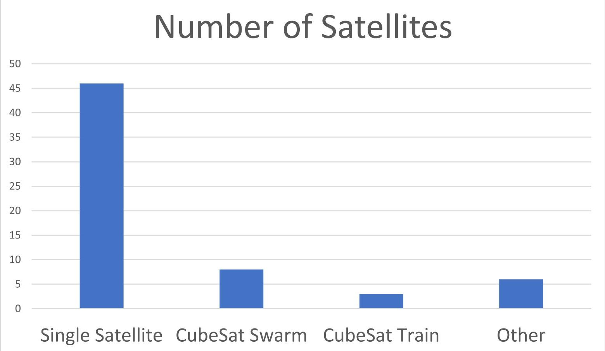

Figure 19: Type of Satellite Constellation

The "other" responses included two responses saying that their CubeSats were part of multi satellite missions but not intended to be a swarm or train; that their satellite was released by a mothership but neither a swarm nor train, and that the initial project was a single CubeSat but will become a swarm when Phase 2 is launched.

Survey respondents reported that most CubeSat testing programs made use of all types of CubeSat models, including software satellite simulator, lab-based test beds, engineering qualification models, and full flight models, as shown in Figure 21.

The tests conducted on CubeSats were also evenly distributed across the various testing domains. Survey respondents reported that testing was conducted in all domains in an even fashion, as shown in Figure 22.

<!-- PDF_PAGE: 82 -->

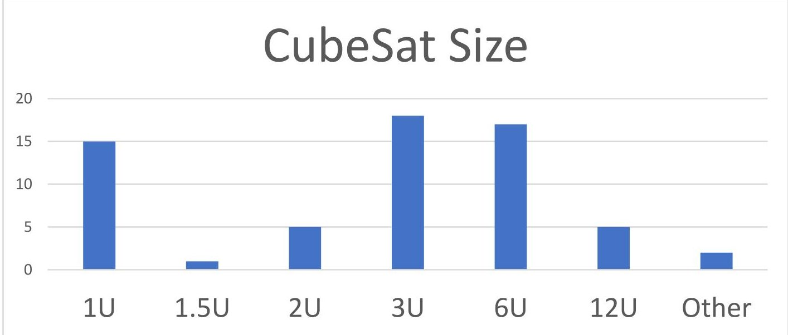

Figure 20: CubeSat Size/Form Factor

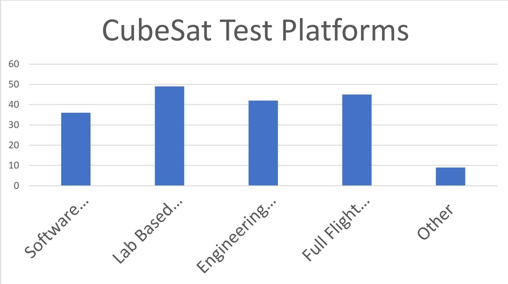

Figure 21: CubeSat Test Platforms Used for Testing

<!-- PDF_PAGE: 83 -->

CubeSat Testing Domains

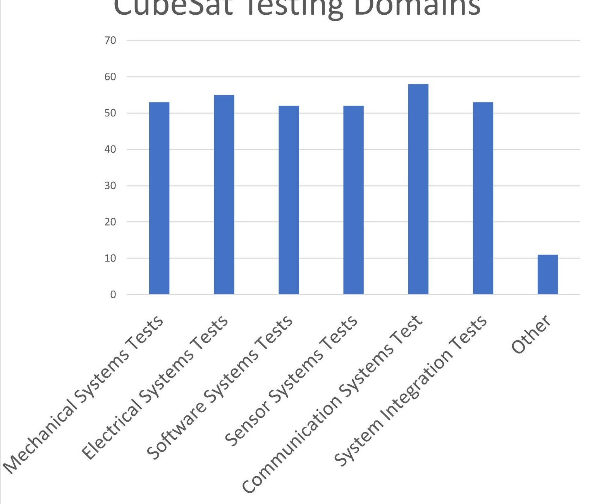

Figure 22: CubeSat Testing Domains

## 5.2.3 VIEWS TOWARD CUBESAT TESTING

Three questions were asked to learn about the views towards testing among the CubeSat community. The first question asked about the importance of CubeSat testing, from the perspective of the survey respondents. The second question asked about the comprehensiveness of the CubeSat testing program. The third question asked opinions about future testing.

<!-- PDF_PAGE: 84 -->

With regards to the importance of CubeSat testing, the results were scaled using the Net Promoter Score system. The result from the survey for this question was a +90, indicating a strong loyalty to implementing testing programs.

With regards to the comprehensiveness of the respondent's CubeSat program, the result was a Net Promoter Score of +30, which reflects some doubt in the comprehensiveness of their own testing programs.

With regards to testing future CubeSat missions, most respondents indicated more testing would be preferable. The same amount of testing was a close runner up, and few people responded that less testing would be the preferred option, as shown on Figure 23.

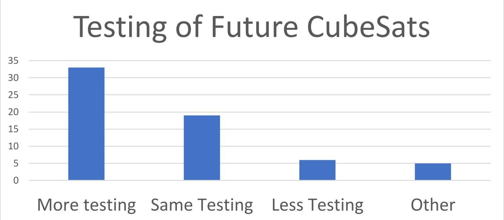

Figure 23: Survey Attitudes towards Testing of Future CubeSat Programs

## 5.2.4 PERSONAL EXPERIENCES WITH CUBESATS

Two questions were asked to gain understanding of the respondents' experiences with CubeSats. The first question asked about the respondents' self-evaluation with respect to familiarity with CubeSats. The second question was an inquiry into whether their mission was successful.

<!-- PDF_PAGE: 85 -->

The intent of this question was to understand any potential biases based on one's experience. The result from the question on one's personal proficiency with CubeSats was a Net Promoter Score of +15, which indicated the survey respondents were not confident in their own CubeSat proficiency.

With regards to mission success, respondents reported that most missions were successful. A similar but smaller number of missions have not yet flown. A few respondents reported that their missions were unsuccessful, as shown in Figure 24.

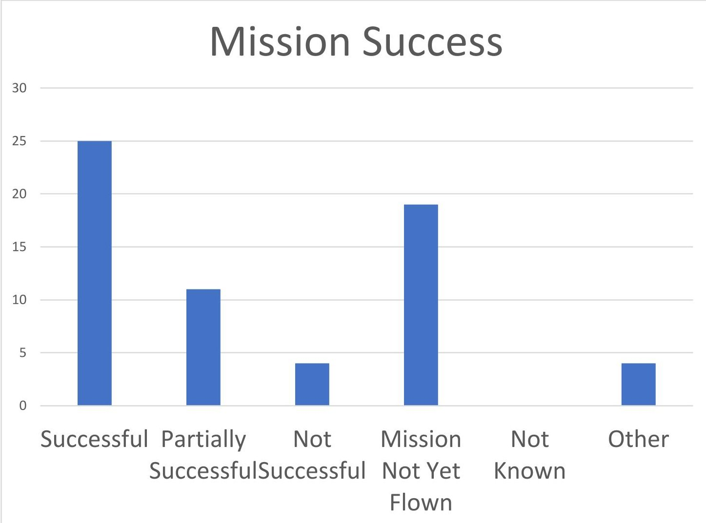

Figure 24: CubeSat Mission Success

## 5.2.5 FREEFORM COMMENTS

The final question gathered freeform comments on CubeSat testing. Freeform comments are important in surveys because many people do not believe that their

<!-- PDF_PAGE: 86 -->

answers neatly fit into prepopulated options.Many comments were received, including that some programs were never intended to launch but used as learning purposes only; that many of the respondents were believers in testing; that while many people want CubeSat missions to be small and cheap they also want them to perform well.

## 5.3 EXPERIMENTAL TIME STUDY ON TEST EXECUTION TIME

The results of the time study are shown in the Figure 25. For each of the five tests run on CubeSat, three different times were recorded depending on which detailed test plan was run. An important caveat should be considered when reviewing the data: The actual test times are not representative of an actual test. Rather, they are values that are used to be compared to each other. Thus, the ratios between the prototype, engineering qualification model, and full flight model are far more interesting than the actual test times themselves. Each test time was normalized so the prototype model had a normalized time of "1". The engineering qualification and the full flight were normalized in a similar fashion providing a comparison of the test results.

Thus, the average test took 1.69 times longer to run on the engineering qualification model than it did on the prototype, and the average test took 2.78 times longer on the full flight model than on the prototype model. These values are representative only for the specific test plans, configurations, and laboratory used for data collection. Different scenarios, test plans, configurations, and laboratories will produce different values. The results of this study are used to develop the model and philosophy of optimization rather than producing a definite answer that reflects any specific situation.

<!-- PDF_PAGE: 87 -->

<table border="1"><tr><td>Test ID</td><td>Test Name</td><td>Prototype Model Time (seconds)</td><td>Normalized Time</td><td>Engineering Qualification Model Time (seconds)</td><td>Normalized Time</td><td>Full Flight Model Time (seconds)</td><td>Normalized Time</td></tr><tr><td>1</td><td>Sensor Data Collection Test</td><td>237</td><td>1</td><td>379</td><td>1.60</td><td>678</td><td>2.86</td></tr><tr><td>2</td><td>CubeSat Spin Rate Verification</td><td>253</td><td>1</td><td>352</td><td>1.39</td><td>521</td><td>2.06</td></tr><tr><td>3</td><td>Mass Property Verification</td><td>86</td><td>1</td><td>182</td><td>2.12</td><td>362</td><td>4.21</td></tr><tr><td>4</td><td>CubeSat Solar Panel Generation Test</td><td>247</td><td>1</td><td>330</td><td>1.3</td><td>513</td><td>2.1</td></tr><tr><td>5</td><td>CubeSat Accelerometer Test</td><td>158</td><td>1</td><td>320</td><td>2.03</td><td>424</td><td>2.68</td></tr><tr><td></td><td>Average</td><td></td><td>1</td><td></td><td>1.69</td><td></td><td>2.78</td></tr></table>

Figure 25: Results from Time Study

## 5.4 SIMULATION

The first half of the simulation was to simulate the probability of mission failure based on the spread of testing across the three types of models. The methodology is covered in the previous sections and the data is presented in Figure 26 below.

<!-- PDF_PAGE: 88 -->

<table border="1"><tr><td>Spread of Testing Across Models(P=Prototype;EQL=Engineering Qualification Model;FFM=Full Flight Model)</td><td>Number of Type II errors out of 1000(Mission Failures)</td><td>Spread of Testing Across Models(P=Prototype;EQL=Engineering Qualification Model;FFM=Full Flight Model)</td><td>Number of Type II errors out of 1000(Mission Failures)</td></tr><tr><td>100%P</td><td>976</td><td>50%P,10%EQM,40&#x27;%FFM</td><td>877</td></tr><tr><td>100%EQM</td><td>537</td><td>50%P,25%EQM,25&#x27;%FFM</td><td>883</td></tr><tr><td>100%FFM</td><td>158</td><td>50%P,40%EQM,10&#x27;%FFM</td><td>896</td></tr><tr><td>90%P,10%FFM</td><td>963</td><td>60%P,10%EQM,30&#x27;%FFM</td><td>909</td></tr><tr><td>75%P,25%FFM</td><td>924</td><td>60%P,20%EQM,20&#x27;%FFM</td><td>909</td></tr><tr><td>50%P,50%FFM</td><td>872</td><td>60%P,30%EQM,10&#x27;%FFM</td><td>919</td></tr><tr><td>25%P,75%FFM</td><td>627</td><td>70%P,10%EQM,20&#x27;%FFM</td><td>921</td></tr><tr><td>10%P,90%FFM</td><td>234</td><td>70%P,15%EQM,15&#x27;%FFM</td><td>927</td></tr><tr><td>35%P,35%EQM,30%FFM</td><td>798</td><td>70%P,20%EQM,10&#x27;%FFM</td><td>930</td></tr><tr><td>10%P,35%EQM,55&#x27;%FFM</td><td>402</td><td>80%P,20%EQM,0&#x27;%FFM</td><td>945</td></tr><tr><td>10%P,35%EQM,55&#x27;%FFM</td><td>402</td><td>80%P,0%EQM,20&#x27;%FFM</td><td>930</td></tr><tr><td>10%P,45%EQM,45%FFM</td><td>371</td><td>80%P,10%EQM,10&#x27;%FFM</td><td>938</td></tr><tr><td>20%P,10%EQM,70&#x27;%FFM</td><td>478</td><td>90%P,10%EQM,0&#x27;%FFM</td><td>967</td></tr><tr><td>20%P,40%EQM,40&#x27;%FFM</td><td>513</td><td>90%P,0%EQM,10%FFM</td><td>963</td></tr><tr><td>20%P,70%EQM,10&#x27;%FFM</td><td>587</td><td>90%P,5%EQM,5&#x27;%FFM</td><td>965</td></tr><tr><td>30%P,10%EQM,70&#x27;%FFM</td><td>779</td><td>0%P,10%EQM,90%FFM</td><td>178</td></tr><tr><td>30%P,40%EQM,30&#x27;%FFM</td><td>798</td><td>0%P,20%EQM,80%FFM</td><td>226</td></tr><tr><td>30%P,70%EQM,0&#x27;%FFM</td><td>840</td><td>0%P,40%EQM,60%FFM</td><td>358</td></tr><tr><td>40%P,10%EQM,50&#x27;%FFM</td><td>794</td><td>0%P,60%EQM,40%FFM</td><td>387</td></tr><tr><td>40%P,30%EQM,30&#x27;%FFM</td><td>812</td><td>0%P,80%EQM,20%FFM</td><td>402</td></tr><tr><td>40%P,50%EQM,10&#x27;%FFM</td><td>833</td><td colspan="2"></td></tr></table>

Figure 26: Mission Failure Rates Based on Simulation

After completing the simulation data for the forty-one scenarios, the amount of time that each scenario required for testing was calculated and shown in Figure 27 below.

<!-- PDF_PAGE: 89 -->

<table border="1"><tr><td>Spread of Testing Across Models(P=Prototype;EQL=Engineering Qualification Model;FFM=Full Flight Model)</td><td>Quantity of Time Spent Testing(Minutes)</td><td>Spread of Testing Across Models(P=Prototype;EQL=Engineering Qualification Model;FFM=Full Flight Model)</td><td>Quantity of Time Spent Testing(Minutes)</td></tr><tr><td>100%P</td><td>299</td><td>50%P,10%EQM,40%FFM</td><td>532</td></tr><tr><td>100%EQM</td><td>506</td><td>50%P,25%EQM,25%FFM</td><td>483</td></tr><tr><td>100%FFM</td><td>832</td><td>50%P,40%EQM,10%FFM</td><td>434</td></tr><tr><td>90%P,10%FFM</td><td>344</td><td>60%P,10%EQM,30%FFM</td><td>500</td></tr><tr><td>75%P,25%FFM</td><td>451</td><td>60%P,20%EQM,20%FFM</td><td>462</td></tr><tr><td>50%P,50%FFM</td><td>575</td><td>60%P,30%EQM,10%FFM</td><td>413</td></tr><tr><td>25%P,75%FFM</td><td>682</td><td>70%P,10%EQM,20%FFM</td><td>448</td></tr><tr><td>10%P,90%FFM</td><td>789</td><td>70%P,15%EQM,15%FFM</td><td>426</td></tr><tr><td>35%P,35%EQM,30%FFM</td><td>541</td><td>70%P,20%EQM,10%FFM</td><td>399</td></tr><tr><td>10%P,35%EQM,55'%FFM</td><td>669</td><td>80%P,20%EQM,0'%FFM</td><td>348</td></tr><tr><td>10%P,35%EQM,55'%FFM</td><td>610</td><td>80%P,0%EQM,20'%FFM</td><td>424</td></tr><tr><td>10%P,45%EQM,45%FFM</td><td>647</td><td>80%P,10%EQM,10'%FFM</td><td>375</td></tr><tr><td>20%P,10%EQM,70'%FFM</td><td>688</td><td>90%P,10%EQM,0'%FFM</td><td>344</td></tr><tr><td>20%P,40%EQM,40'%FFM</td><td>601</td><td>90%P,0%EQM,10%FFM</td><td>317</td></tr><tr><td>20%P,70%EQM,10'%FFM</td><td>492</td><td>90%P,5%EQM,5'%FFM</td><td>333</td></tr><tr><td>30%P,10%EQM,70'%FFM</td><td>632</td><td>0%P,10%EQM,90%FFM</td><td>832</td></tr><tr><td>30%P,40%EQM,30'%FFM</td><td>555</td><td>0%P,20%EQM,80%FFM</td><td>767</td></tr><tr><td>30%P,70%EQM,0'%FFM</td><td>441</td><td>0%P,40%EQM,60%FFM</td><td>697</td></tr><tr><td>40%P,10%EQM,50'%FFM</td><td>589</td><td>0%P,60%EQM,40%FFM</td><td>642</td></tr><tr><td>40%P,30%EQM,30'%FFM</td><td>535</td><td>0%P,80%EQM,20%FFM</td><td>582</td></tr><tr><td>40%P,50%EQM,10'%FFM</td><td>447</td><td></td><td></td></tr></table>

Figure 27: Amount of Time Spent Testing Based on Spread

## 5.5 OPTIMIZED TEST PROGRAM BALANCING RESOURCES WITH MISSION SUCCESS

## 5.5.1 TEST OPTIMIZATION

The last step in determining the optimized test program was to create the Pareto chart that graphs the mission failure rates on the y-axis and the time spent testing on the x-axis. The various points were graphed on the chart. A Pareto frontier was drawn on the chart to represent the non-dominated (most efficient) solutions. The Pareto chart is shown in Figure 28 below.

<!-- PDF_PAGE: 90 -->

Figure 28: Pareto Optimization Chart Showing Non-Dominated Solutions

## 5.6 SENSITIVITY ANALYSIS

Sensitivity Analysis is the process of analyzing the model that was created to determine how sensitive it is to changes in the inputs. In other words, the following question is asked: "How sensitive are the results of the analysis to possible variations of these uncertain input factors?" (Blanchard & Fabycky, 2011) Sensitivity analysis is an important final step to data analysis as there is always uncertainty in the input variables. Understanding how changes in the input variables affects the outcome demonstrates how sensitive the analysis is to error.

For the case of the Pareto Optimization, the most interesting aspect of is how the shape of the Pareto Frontier may change based on different input variables being input

<!-- PDF_PAGE: 91 -->

into the system. It's expected that the exact solutions along the Pareto Frontier may change based on changes to the input variables.

The process for performing sensitivity analysis for the Pareto Optimization was as follows:

1. Vary the input variables using changed values that reflect likely variation in input data based on probable sources of error

2. Re-run the simulation

3. Re-chart the results

4. Compare the new Pareto Frontier versus the original Pareto Frontier.

For the purpose of this dissertation, four alternative scenarios were considered. The new parameters along with the new Pareto Optimization charts are shown in the following paragraphs.

## 5.6.1 ORIGINAL SCENARIO

For ease in comparison of the original scenario to the four alternative scenarios for sensitivity analysis, the original Pareto optimization chart is shown below. This is the exact same chart as previously presented.

<!-- PDF_PAGE: 92 -->

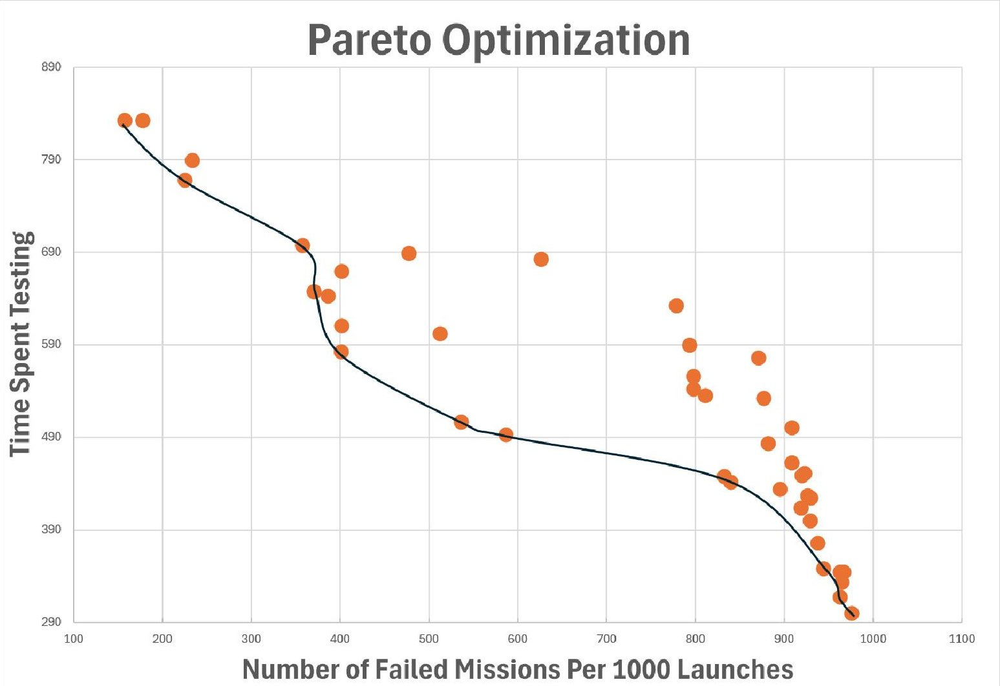

Figure 29: Original Pareto Optimization Chart

## 5.6.2 ALTERNATIVE SCENARIO #1

The first scenario was to adjust the probability of occurrence. The goal was to increase the probability of occurrence of Type II errors by 20% to determine the changes to the Pareto Optimization chart. After increasing the probability of errors by 20%, the new Pareto Optimization chart is shown in Figure 30 below. The general layout of the various points is similar to the original optimization chart. The non-dominated solutions are also similar to the original Pareto chart. Thus, the solution set appears to be insensitive to the increase in probability of occurrence as described in Alternative Scenario #1.

<!-- PDF_PAGE: 93 -->

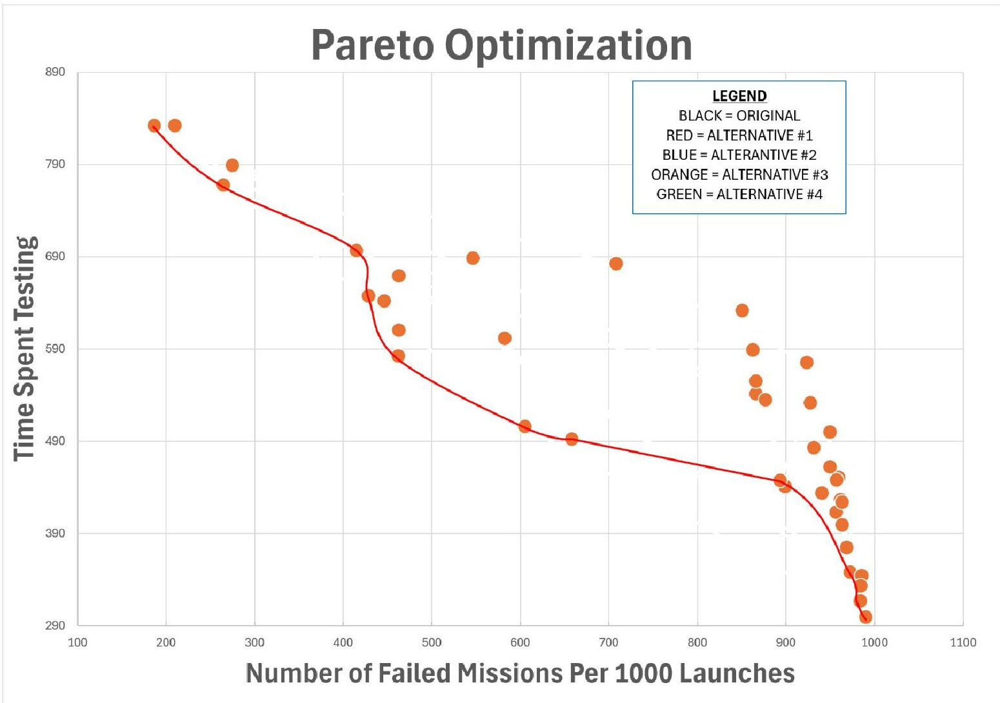

Figure 30: Pareto Optimization Chart for Alternative Scenario #1

## 5.6.3 ALTERNATIVE SCENARIO #2

The second scenario is to adjust the probability of detection of the prototype model. The original optimization scenario featured prototype model probabilities of detection as low as 10% and as high as 98%. Alternative Scenario #2 investigates whether dramatic changes in the probabilities of detection for the prototype model result in big changes to the results. The changes made to the probabilities of detection are as follows: If the original probability of detection is less than 50%, the new probability of detection is doubled. If the original probability of detection is greater than 50%, the new probability of detection is set to $ \frac{1}{2} $ of the original probability of detection. No changes

<!-- PDF_PAGE: 94 -->

were made to probabilities of detection that were originally 50%. The result of the new Pareto Optimization chart is shown in Figure 31 below.

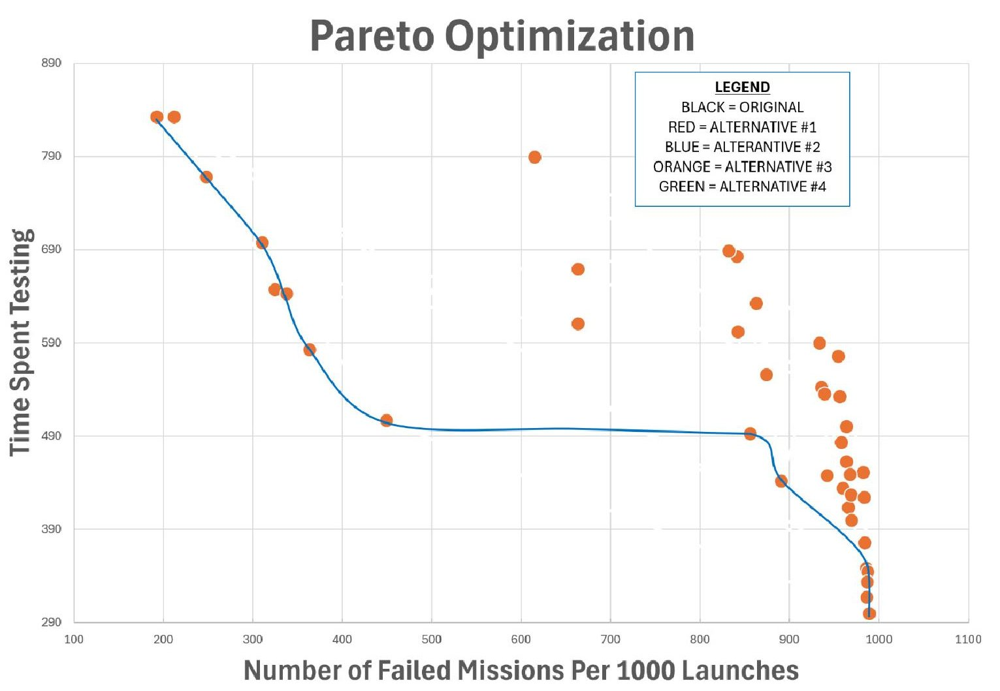

Figure 31: Pareto Optimization Chart for Alternative Scenario #2

## 5.6.4 ALTERNATIVE SCENARIO #3

For Alternative Scenario #3, it was desired to modify the probability of detection of Type II errors in the engineering qualification model. The probability of detection was modified as follows: If the probability of detection is greater than 50%, it would be reduced in half. In no case would the probability of detection be reduced below that for the prototype model. If reducing the probability of detection by 50% would decrease it below that for the prototype, the probability of detection was set to be the same as the prototype. The results are shown in Figure 32 below.

<!-- PDF_PAGE: 95 -->

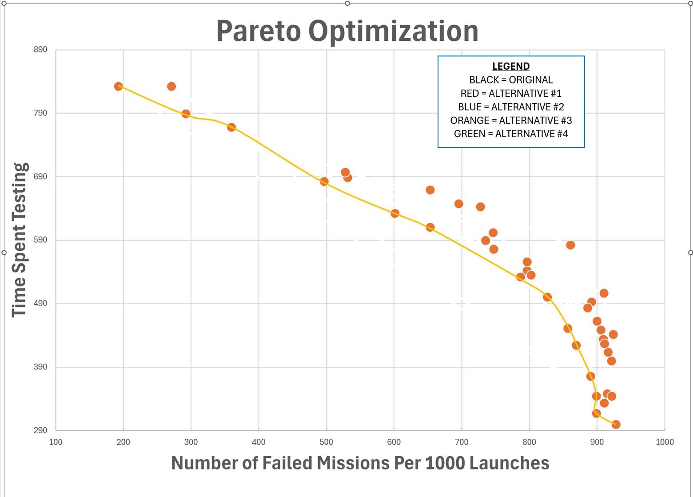

Figure 32: Pareto Optimization Chart for Alternative Scenario #3

## 5.6.5 ALTERNATIVE SCENARIO #4

The final scenario contemplated was the reduction in the probability of detection of errors in the full flight model. This scenario was a bit trickier as there was less space between the probabilities of detection for the engineering qualification model and full flight model. The decision was to reduce the full flight model by 5%, unless reducing by 5% reduced below the engineering qualification model probability of detection. In this case, it was set equal to the engineering qualification model probability of detection.

The results of Alternative Scenario #4 are shown in Figure 33 below. Similar to Alternatives #1 and #2, the distribution of points did not change significantly. The new Pareto Frontier is shown in the Figure 33 below.

<!-- PDF_PAGE: 96 -->

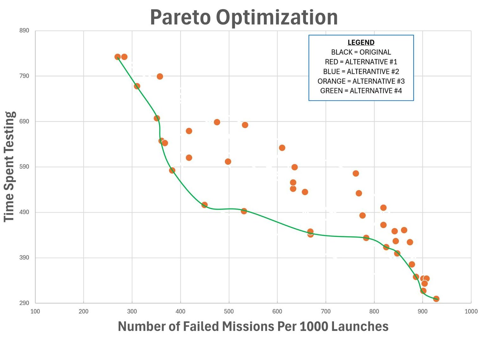

Figure 33: Pareto Optimization Chart for Alternative Scenario #4

## 5.6.6 DISCUSSION AND ANALYSIS OF SENSITIVITY ANALYSIS

The most interesting viewpoint for viewing the Pareto Frontiers is to combine all five Pareto Frontiers onto the same chart to see which of the curves are similar and which of the curves are dramatically different. The chart showing the five different Pareto Frontiers is shown in Figure 34 below. As can be readily seen, the Original curve along with Alternatives #1, #2, and #4 curves are very similar and Alternative #3 curve is different.

<!-- PDF_PAGE: 97 -->

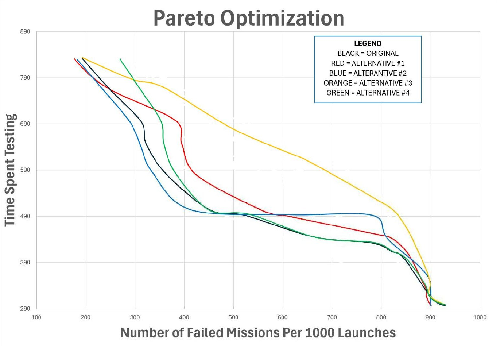

Figure 34: Pareto Frontiers of Original and Four Alternative Scenarios

In summary, the sensitivity analysis showed that the Pareto optimization results were generally insensitive to adjustments in the input variables. The general shape and placement of the curve representing non-dominated solutions remained similar to the original Pareto optimization chart. The only exception was Alternative #3, where the curve had a different shape than the original scenario. Scenario #3 was based on dramatic changes in input variables, thus, it is expected that the sensitivity analysis would show a change in output for these scenarios.

## 5.7 SCALABLE SYSTEMS ARCHITECTURE

After completing the research on CubeSat Test and Evaluation, the results are combined with Model Based Systems Engineering to develop the scalable systems

<!-- PDF_PAGE: 98 -->

architecture. Developing scalable systems architecture consists of several steps, starting with developing the use cases for the scalable systems architecture and concluding with the block definition diagrams and internal block diagrams.

The first step in defining the Scalable Systems Architecture is to define the Use Cases that define how the system will be used. Use Case definition is defined in two phases, one is the definition of the use case specifications and the second is the definition of the use case diagram. These elements of use cases are shown in Figure 35 through Figure 37. The use case diagram is shown in Figure 38 through Figure 40 below.

<!-- PDF_PAGE: 99 -->

UC: Perform Prototype Test

<table border="1"><tr><td>Description</td><td>The "Prototype Model Test" use case is intended to test a CubeSat that is in early stages of development. The CubeSat completion less than 80% and many changes are expected prior to flight ready configuration. The types of testing performed are described in the domain specifications on the following pages.</td></tr><tr><td>Preconditions</td><td>The CubeSat model is flightworthy condition and no tests have been run.</td></tr><tr><td>Trigger</td><td>The domain leader has determined that the CubeSat should be tested.</td></tr><tr><td>Postconditions</td><td>The CubeSat model has been tested and results documented in the test log</td></tr><tr><td>Data Objects</td><td>Test Number
Test Name
Test Results</td></tr><tr><td>User Roles</td><td>Domain Leader</td></tr><tr><td>Scenarios</td><td>Primary: The CubeSat prototype model is checked out from the storage location. The domain leader prepares the test plans. The domain leader conducts the test and records the test results on the test log. The domain leader returns the CubeSat to the storage location.
Alternate 1(Exception): The CubeSat fails to perform as expected. The domain leader aborts the test prior to completion in order to protect the CubeSat and/or the test apparatus from damage.</td></tr><tr><td>Allocated Requirements</td><td></td></tr></table>

Figure 35: Use Case Specification for Prototype CubeSat

<!-- PDF_PAGE: 100 -->

UC: Perform Engineering Qualification Model Test

<table border="1"><tr><td>Description</td><td>The "Perform Engineering Qualification Model Test" use case is intended to test a CubeSat that approaching flight ready configuration, but is not yet in full flight configuration. Th CubeSat completion is between 80% and 99%. The types of testing performed are described in the domain specifications on the following pages.</td></tr><tr><td>Preconditions</td><td>The CubeSat model is flightworthy condition and no tests have been run.</td></tr><tr><td>Trigger</td><td>The domain leader has determined that the CubeSat should be tested.</td></tr><tr><td>Postconditions</td><td>The CubeSat model has been tested and results documented in the test log</td></tr><tr><td>Data Objects</td><td>Test Number
Test Name
Test Results</td></tr><tr><td>User Roles</td><td>Domain Leader, Test Engineer</td></tr><tr><td>Scenarios</td><td>Primary: The CubeSat engineering qualification model is checked out from the storage location. The domain leader prepares the test plans. The test engineer dons the protective apparel and enters the CubeSat test environment. The test engineer conducts the test and records the test results on the test log. The test engineer departs the test environment, remove the protective apparel, and return the CubeSat to the storage location.
Alternate 1(Exception): The CubeSat fails to perform as expected. The test engineer aborts the test prior to completion in order to protect the CubeSat and/or the test apparatus from damage.</td></tr><tr><td>Allocated Requirements</td><td></td></tr></table>

Figure 36: Use Case Specification for Engineering Qualification Model CubeSat Test

<!-- PDF_PAGE: 101 -->

UC: Perform Full Flight Model Test

<table border="1"><tr><td>Description</td><td>The "Perform Full Flight Model Test" use case is intended to test a CubeSat that is ready to fly. The CubeSat completion is 99% or higher and the only remaining changes would be to address findings discovered during testing. The types of testing performed are described in the domain specifications on the following pages.</td></tr><tr><td>Preconditions</td><td>The CubeSat model is flightworthy condition and no tests have been run.</td></tr><tr><td>Trigger</td><td>The domain leader has determined that the CubeSat should be tested.</td></tr><tr><td>Postconditions</td><td>The CubeSat model has been tested and results documented in the test log</td></tr><tr><td>Data Objects</td><td>Test Number
Test Name
Test Results</td></tr><tr><td>User Roles</td><td>Domain Leader, Test Engineer, Test Witness</td></tr><tr><td>Scenarios</td><td>Primary: The CubeSat full flight model is checked out from the storage location. The domain leader prepares the test plans. The test engineer and test witness don the protective apparel and enters the CubeSat test environment. The test engineer conducts the test and the test engineer records the test results on the test log. The test engineer and test witness depart the test environment, remove the protective apparel, and return the CubeSat to the storage location.
Alternate 1(Exception): The CubeSat fails to perform as expected. The test engineer aborts the test prior to completion in order to protect the CubeSat and/or the test apparatus from damage.</td></tr><tr><td>Allocated Requirements</td><td></td></tr></table>

Figure 37: Use Case Specification for Full Flight Model CubeSat Test

<!-- PDF_PAGE: 102 -->

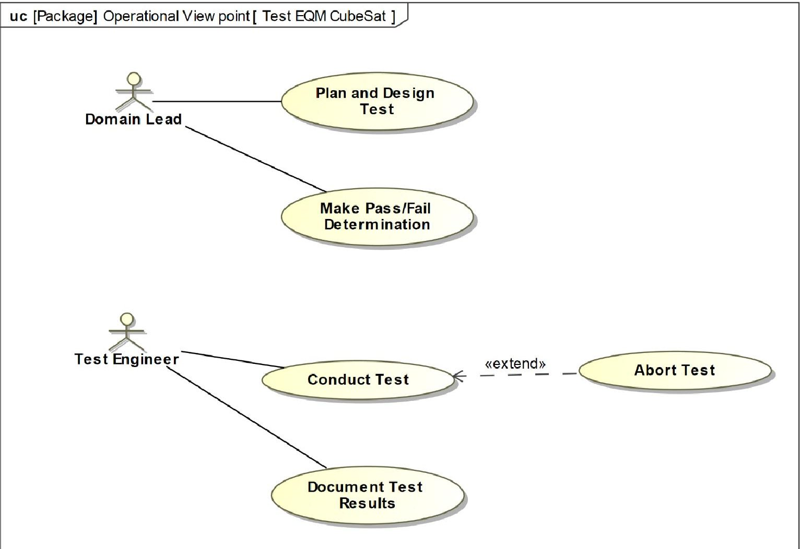

Figure 38: Use Case Diagram for Engineering Qualification Model CubeSat T&E System

<!-- PDF_PAGE: 103 -->

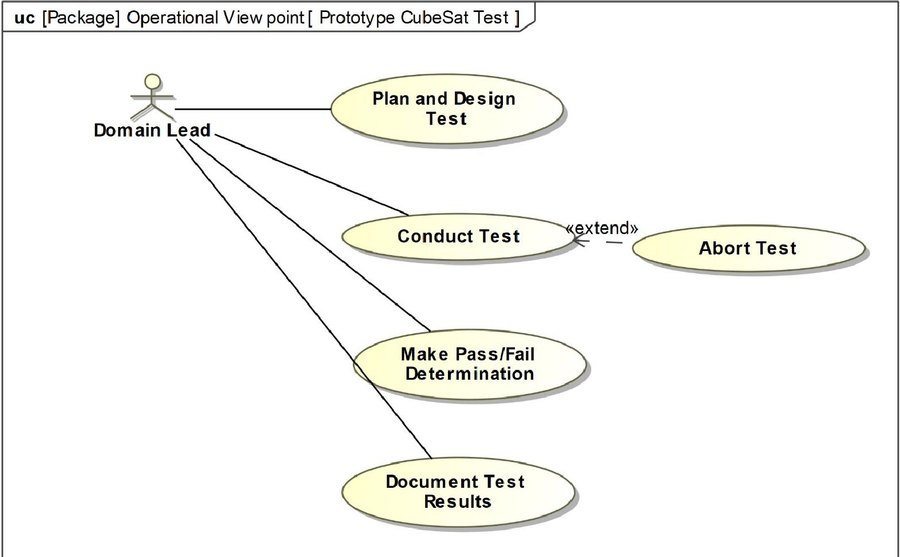

Figure 39: Use Case Diagram for Prototype Flight Model CubeSat Test

<!-- PDF_PAGE: 104 -->

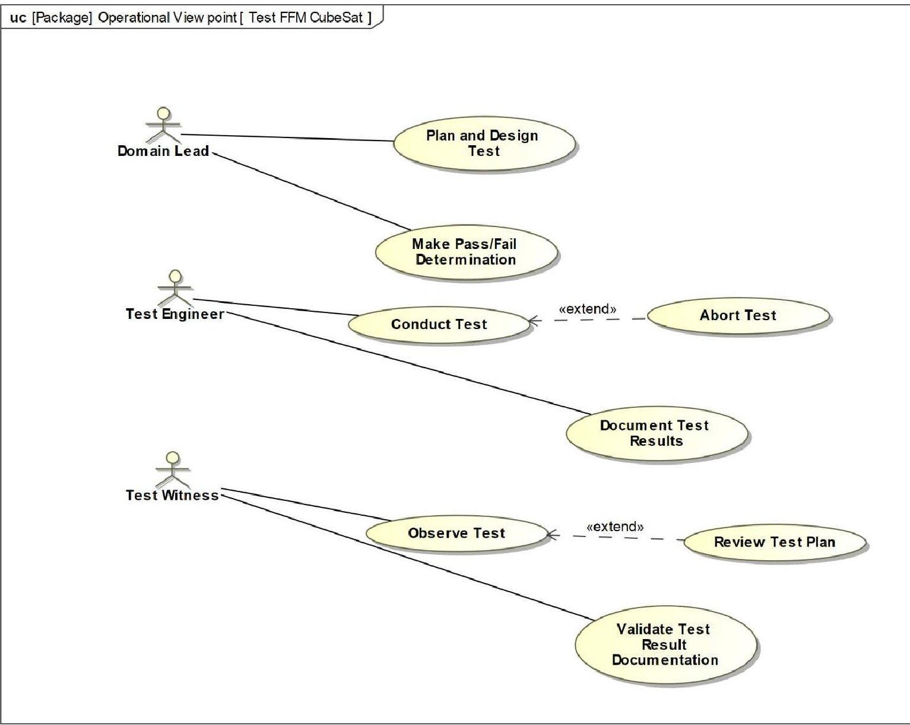

Figure 40: Use Case Diagram for Full Flight Model CubeSat Test and Evaluation

<!-- PDF_PAGE: 105 -->

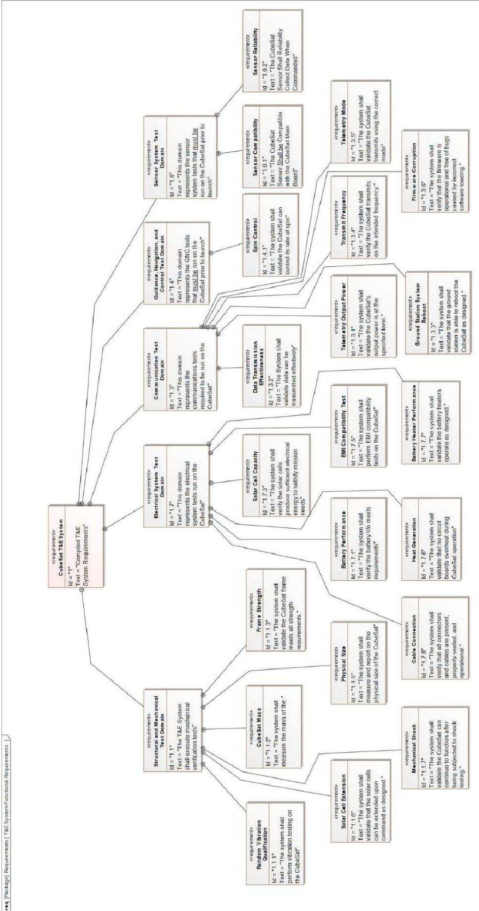

Figure 41: CubeSat T&E System Requirements

<!-- PDF_PAGE: 106 -->

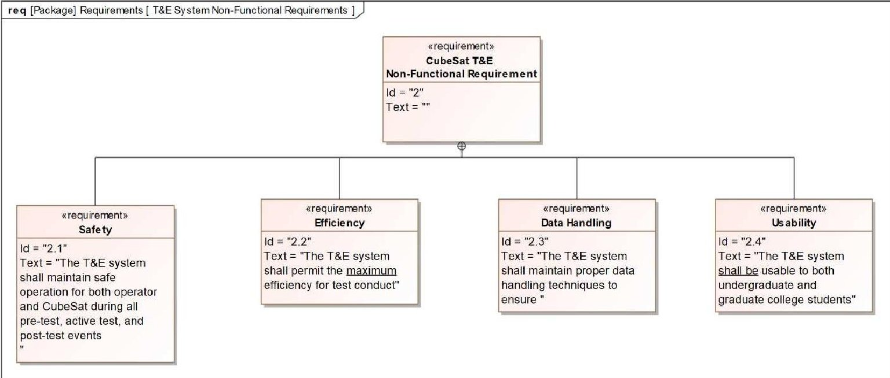

Figure 42: Non-Functional Requirements for CubeSat Test and Evaluation

## 5.7.2 BLOCK DEFINITION DIAGRAM

After defining the system requirements, the next step was to create the block definition diagrams. Three block definition diagrams were created. The first was for the prototype CubeSat, the second was for the engineering qualification model CubeSat, and the third was for the full flight model CubeSat. The block definition diagrams collate the information previously presented in the use case diagrams and requirements diagrams into diagrams that define how the system operates. The block definition diagrams are shown in Figure 43 through Figure 45 below.

<!-- PDF_PAGE: 107 -->

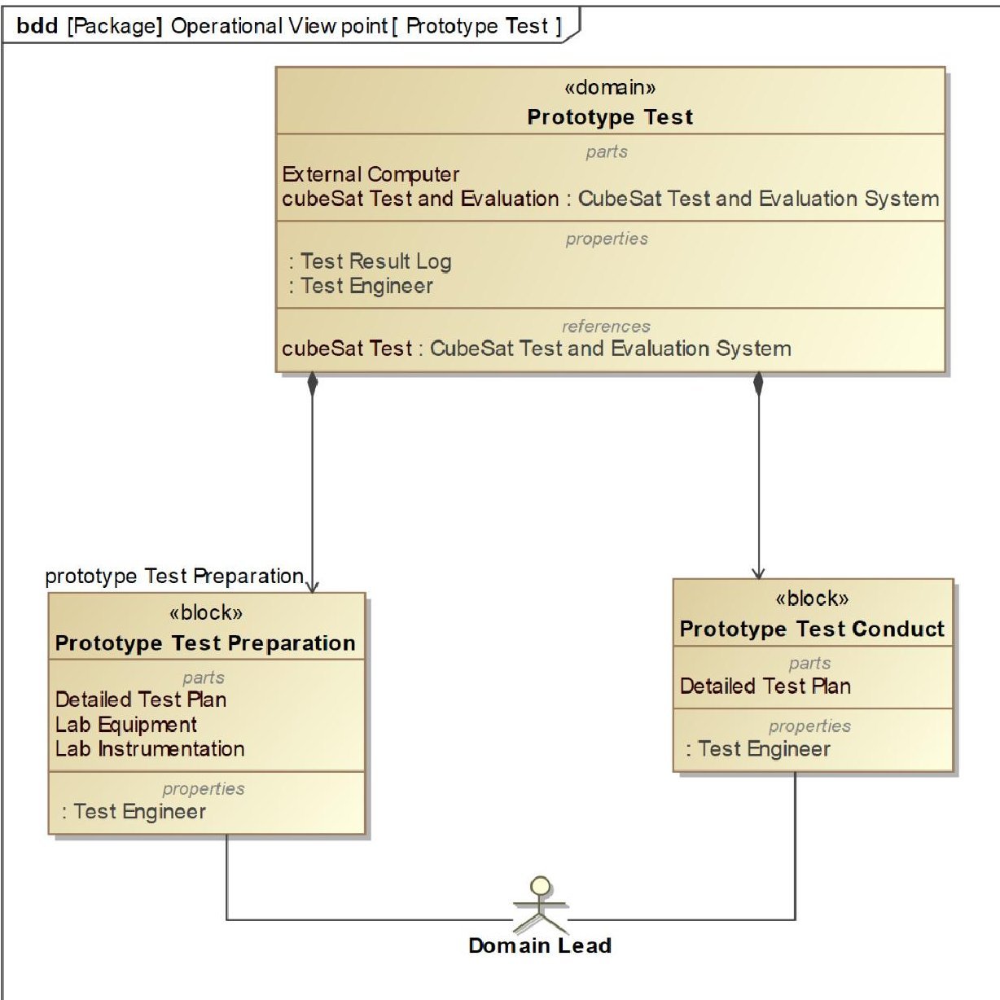

Figure 43: Block Definition Diagram for Prototype CubeSat T&E

<!-- PDF_PAGE: 108 -->

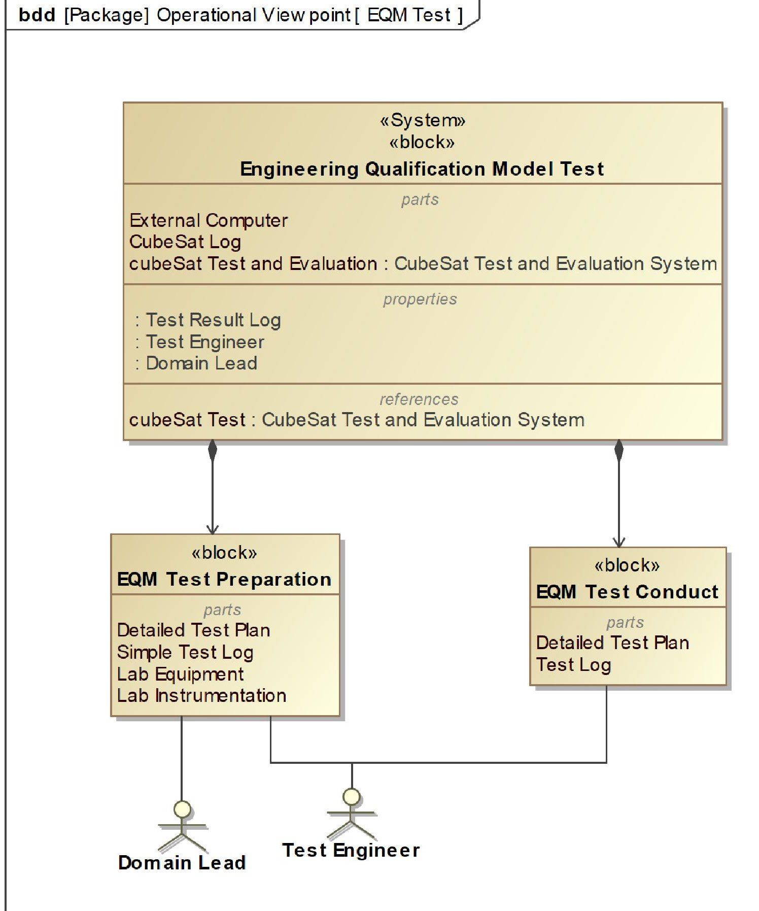

Figure 44: Block Definition Diagram for Engineering Qualification Model CubeSat T&E

<!-- PDF_PAGE: 109 -->

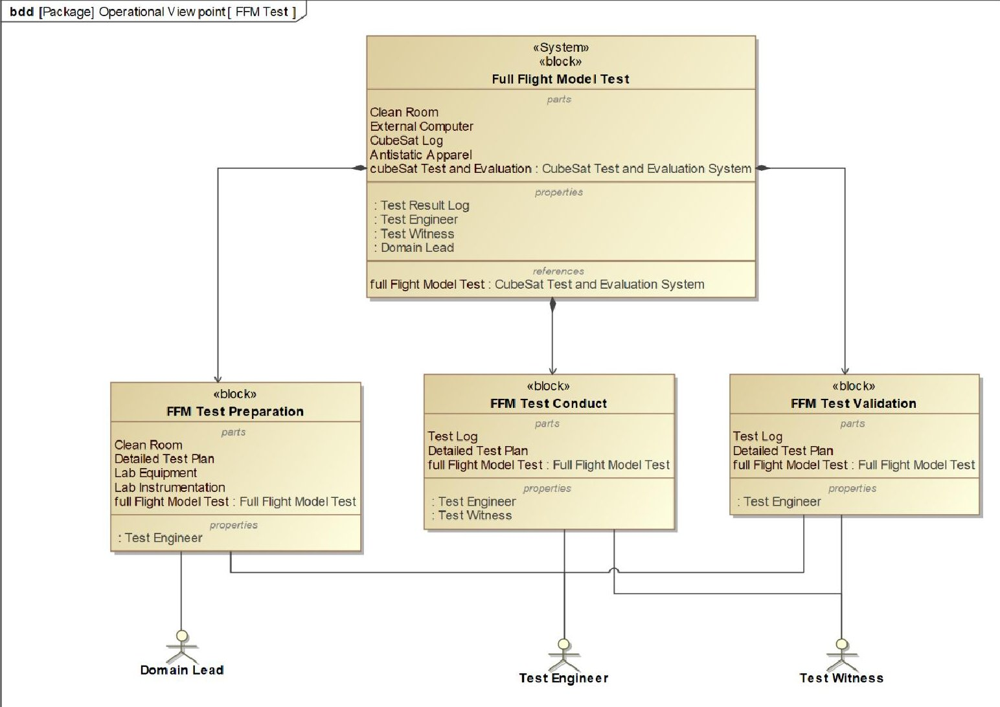

Figure 45: Block Definition Diagram for Full Flight Model CubeSat T&E

## 5.7.3 ACTIVITY DIAGRAM

Activity diagrams are useful tools to understand how process flows within the constraints of a constructed system. Activity diagrams are flowcharts that show a series of processes that work together, either sequentially or in parallel, to achieve the desired outcome of the system. (Lucidchart, 2024) In the case of the CubeSat test and evaluation system, the activity diagram shows three branches depending on which version of the CubeSat is being tested.

The activity diagram for the CubeSat test and evaluation system is shown in Figure 46 below. The process starts with generating the test plan. After the test plan has

<!-- PDF_PAGE: 110 -->

been completed, the process splits into three different pathways depending on which type of CubeSat is being tested.

The first pathway is for the prototype CubeSat. The activity diagram shows that the prototype CubeSat is obtained, test activity logged, and the test conducted. After the test is conducted, the results are recorded, a decision is made on whether the test passes or fails, and the CubeSat is returned to storage location. At this point, the system terminates. All these activities are conducted by the domain lead, as the roles of test engineer and test witness are not part of the prototype CubeSat test and evaluation system.

The second pathway is for the engineering qualification model CubeSat. In this pathway, the process flow has the test engineer entering the test chamber, logging test activity, conducting the test, recording test results, and finally exiting the test chamber. At this point, the domain lead makes the decision on whether the test passes or fails, and the test terminates.

The third pathway, for full flight model testing, is the most complicated pathway due to the additional handling and test requirements of the full flight model. In this pathway, the test engineer first reviews and understands the detailed test plan. The test engineer then dons protective apparel, enters the test chamber, checks out the CubeSat, and logs the test activity. At the same time, the test witness dons protective apparel and enters the test chamber. The test is conducted and witnessed. Finally, the CubeSat is returned the storage location, the test engineer and test witness remove the protective apparel, and both actors exit the test chamber. Finally, the domain lead makes the pass/fail determination and the test concludes.

<!-- PDF_PAGE: 111 -->

The three pathways shown on the activity diagram accurately describe the differences in test procedures between the three types of models of CubeSats and accurately show the reasons why testing is slower on the full flight model CubeSat than it is on the other variations of CubeSats.

Limitations of the activity diagram include limitations in the amount of detail that can be presented within an activity diagram and potential for confusion if excessive detail is included. A second limitation of the activity diagram is they do not provide details on how objects collaborate; thus, state machine diagrams and sequence diagrams are still useful and important to include in the diagram set. (Zara, 2011)

The activity diagram for CubeSat Test and Evaluation System provides a reasonably accurate high-level overview but is limited in detail and thus in functionality. Different CubeSat teams will develop different specific sequence of steps for test and evaluation depending on their individual team needs, financial and volunteer resources, and other constraints. Thus, the activity diagram presented should be one variation of potentially many variations of test and evaluation activity sequences.

## 5.7.4 INTERNAL BLOCK DIAGRAMS

The internal block diagram is shown in Figure 47 below. The internal block diagram shows the inner workings of the test and evaluation system block. It shows how the detailed test plans, test equipment, test instrumentation, test procedures, and test execution all work together to accomplish the overall goals for the test and evaluation system.

The main value of the internal block diagram is that it shows the encapsulated structural contents of blocks so they can be decomposed and wired to other blocks.

<!-- PDF_PAGE: 112 -->

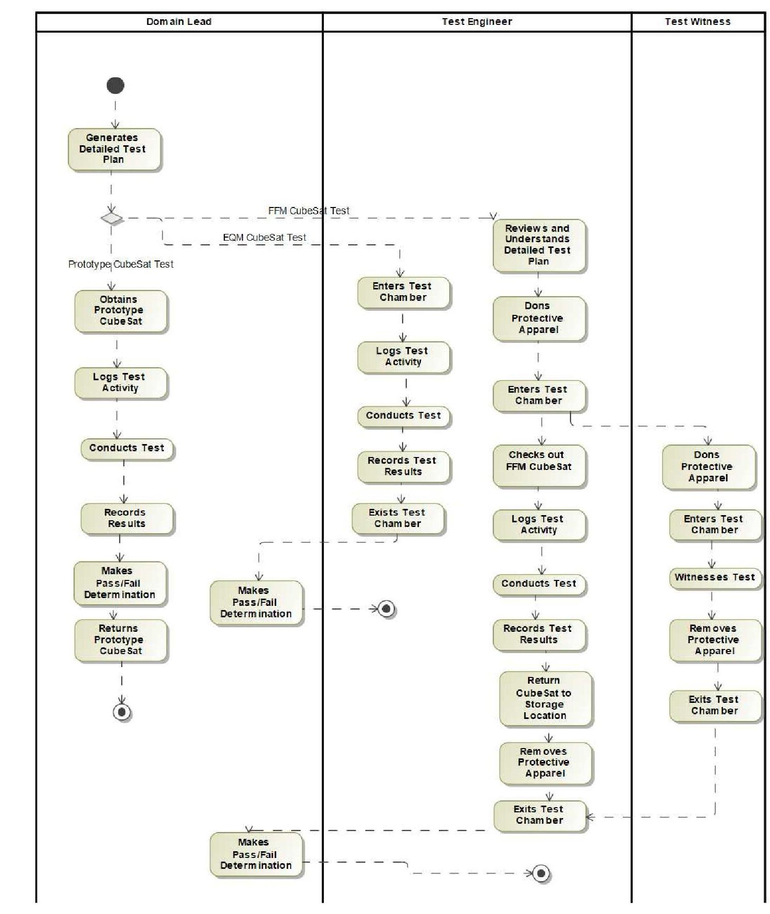

Figure 46: Activity Diagram for CubeSat T&E System

<!-- PDF_PAGE: 113 -->

## 5.7.5 INTERNAL BLOCK DIAGRAMS FOR EACH DOMAIN

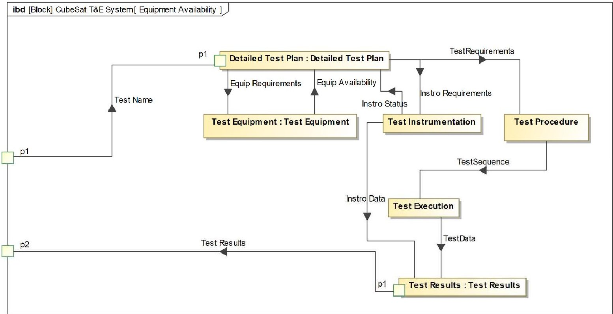

Figure 47: Internal Block Diagram for CubeSat T&E System

<!-- PDF_PAGE: 114 -->

## Chapter 6: EXTENSION TO MULTI-SATELLITE CUBESAT CONSTELLATIONS

Multi-satellite CubeSat mission come in the forms of CubeSat swarms, trains, and constellations. The three types of constellations are described below.

- CubeSat trains refer to multiple CubeSats being deployed in succession along the same orbiting path. Thus, the CubeSats all share the same orbit around earth, capturing data from the same points but at separate times. This allows the CubeSats to capture time-sequenced data in a similar fashion to a sequence of photographs. The CubeSats that are part of a train do not necessarily communicate with each other. In most cases, they simply send the data to the ground station for processing on the ground.

- CubeSat swarms refer to groups of CubeSats orbiting around earth and acting as a single CubeSat. The CubeSats communicate with each other and collectively function as a single CubeSat but spread over a large area. The groups of CubeSats range from 2 to 99 in most cases. (The European Space Agency, 2023)

- CubeSat constellations refer to any grouping of 2 or more satellites where the satellites work alone and do not communicate with each other. Unlike a CubeSat train, the multiple satellites may not be in the same orbit and may be in unrelated orbits around earth.

This research can be extended to the three types of multi-satellite CubeSat constellations, as follows.

CubeSat constellations and trains each function as single CubeSats flying in close formation. As they function as individual CubeSats, the preceding research can be

<!-- PDF_PAGE: 115 -->

applied without modification as it is equally applicable to single CubeSats as well as CubeSat constellations and trains.

CubeSat swarms are vastly different as the CubeSat swarm communicate with each other. Test and evaluation for CubeSat swarms require much more complex facilities as the CubeSat testing must incorporate testing how the CubeSats communicate and interact with each other in addition to the ground station. This additional testing requires more advanced laboratory facilities, more testing requirements, and more sources of failure.

Due to limited budgets and resource constraints, additional pressure will be placed upon the team to conduct as much of this testing at the prototype and engineering qualification model levels, as trying to attempt CubeSat swarm testing using only full flight models would be very expensive in terms of increased handling time, additional test engineers and test witnesses, and advanced facilities. However, as the previous research indicated, the best chance for overall mission success is indeed to use full flight models for testing as long as the resource constraints permit this type of test and evaluation.

While a deep dive into scalable system architecture for CubeSat swarms is beyond the scope of this paper, an overview of one potential architecture is worth covering here. The following pages show a potential architecture for CubeSat swarm test and evaluation.

## 6.1 SWARM OVERVIEW

A CubeSat swarm is two or more CubeSats that communicate with each other to expand their sensing capabilities beyond that of a single CubeSat. A pictorial of how a

<!-- PDF_PAGE: 116 -->

swarm appears in orbit is shown in the Figure 48 below. In this diagram, the swarm consists of three CubeSats orbiting earth. Two of the CubeSats communicate with the central CubeSat, which in turn is the exclusive CubeSat that communicates with the ground station.

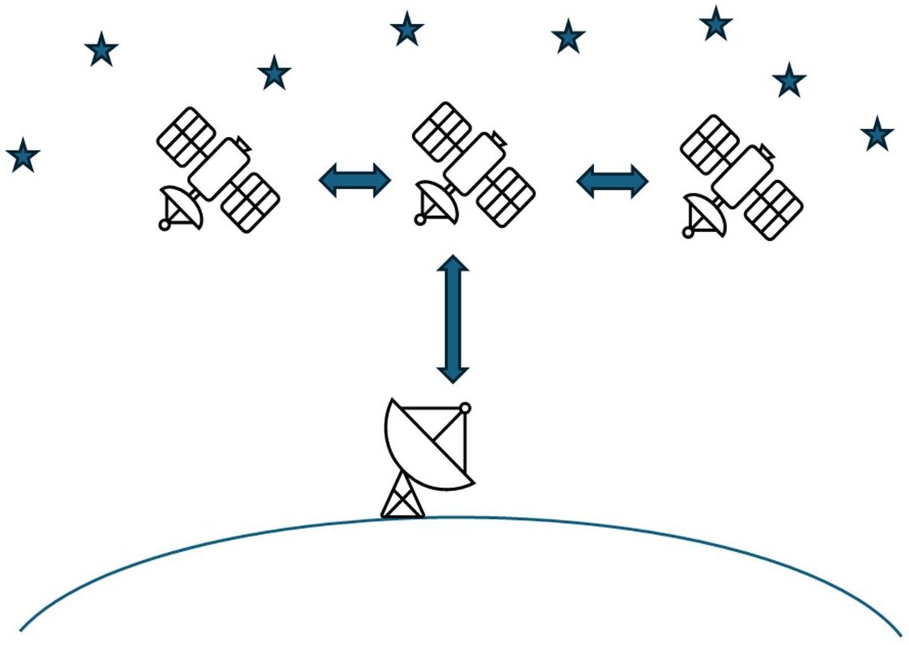

Figure 48: CubeSat Swarm Pictorial Diagram

## 6.2 REQUIREMENTS DIAGRAM

The requirements diagram for additional requirements placed upon the CubeSat swarm is shown in below.

<!-- PDF_PAGE: 117 -->

<table border="1"><tr><td>Requirement Number</td><td>Requirement Type</td><td>Description</td></tr><tr><td>1.1</td><td>Functional</td><td>The satellite CubeSats shall exchange data with the central CubeSat while in orbit.</td></tr><tr><td>1.2</td><td>Functional</td><td>The central CubeSat shall send sensor data from all CubeSats to the ground station</td></tr><tr><td>1.3</td><td>Functional</td><td>The central CubeSat shall receive commands from the Ground Station and disseminate to the satellite CubeSats</td></tr><tr><td>1.4</td><td>Functional</td><td>Each satellite and central CubeSat shall sync their internal clock to GPS time</td></tr><tr><td>2.1</td><td>Non-Functional</td><td>The CubeSats shall employ encyption to prevent inadvertent transmissions with other satellites or ground stations</td></tr></table>

Figure 49: System Requirements for CubeSat Swarm

## 6.3 USE CASE SPECIFICATION

In turn, the use case specification for the CubeSat test and evaluation system are derived from the CubeSat swarm requirements and shown in Figure 50 below.

<!-- PDF_PAGE: 118 -->

<table border="1"><tr><td>Description</td><td>The "CubeSat Swarm Test" use case is intended to test two or more CubeSats that communicate with each other while in space. The central CubeSat communicates with ground, and data is exchanged between the central and satellite CubeSats for data acquisition and mission control. The types of testing performed are described in the domain specifications on the following pages.</td></tr><tr><td>Preconditions</td><td>The CubeSat model is flightworthy condition and no tests have been run.</td></tr><tr><td>Trigger</td><td>The domain leader has determined that the CubeSat should be tested.</td></tr><tr><td>Postconditions</td><td>The CubeSat model has been tested and results documented in the test log</td></tr><tr><td>Data Objects</td><td>Test Number
Test Name
Test Results</td></tr><tr><td>User Roles</td><td>Domain Leader</td></tr><tr><td>Scenarios</td><td>Primary: Two or more CubeSats are checked out from the storage location. The domain leader prepares the test plan. The test team turns on the CubeSats, configures them to flight mode, and conducts the communication test. The domain leader returns the CuebSat to the storage location.
Alternate 1(Exception): The CubeSat communication test fails, as the CubeSats are unable to communicate with each other. The CubeSats are power cycled one time and the test is ran a second time. The results from both tests are documented. The CubeSats are returned to the storage location.</td></tr><tr><td>Allocated Requirements</td><td></td></tr></table>

## Figure 50: CubeSat Swarm Communication Test Use Case

## 6.4 DETAILED SYSTEMS ARCHITECTURE DIAGRAMS

The majority of MBSE diagrams, including use case diagrams, activity diagrams, and block definition diagrams, remain unchanged from the systems engineering perspective. The primary difference between testing a standalone CubeSat versus testing a CubeSat swarm is in the communications domain, which is a discipline-specific domain. Thus, no

<!-- PDF_PAGE: 119 -->

changes are necessary to the model-based systems engineering diagrams for the systems engineering test and evaluation perspective.

<!-- PDF_PAGE: 120 -->

## Chapter 7: VALIDATION OF SCALABLE SYSTEMS ARCHITECTURE

The final step of the dissertation is to validate whether the proposed scalable test and evaluation system results in improved mission success, as postulated as the hypothesis to this paper. Validation of this hypothesis is difficult as the most ideal method of validating a hypothesis, which is to conduct two side by side mission development (one which uses the scalable test and evaluation system and the other which uses traditional processes) is not practical for the scope of this paper.

Instead, the best effort at validating the model is to look back at past satellite mission failures, review the methods used for development, and make the best effort to determine if the issue leading to satellite mission failure would have been averted by incorporating the scalable systems architecture into the satellite development cycle.

This method of validation is called back testing. Back testing assesses the robustness of a model by using existing historical data obtained from historical time periods to determine the potential outcome using today's model. Back testing has limitations because of the potential of including confounding variables, resulting in conclusions being drawn that are based on situations outside the control of the model. However, back testing is one of the more available, easy to access, and affordable methods of validating a model. (Diongson, 2023)

A total of four different satellite missions were studied and back tested as part of the validation effort. The satellite missions studied were a mix of CubeSat and non- CubeSat missions. Each satellite mission is described in detail below with the best analysis of whether the scalable test and evaluation system would have corrected the issue and led the mission to be successfully executed.

<!-- PDF_PAGE: 121 -->

A detailed analysis of the following missions as they relate to the scalable test and evaluation system is necessarily subjective. To make the analysis as objective and reproducible as possible, a rating scale for the ability of the cause of mission failure to be detected in advance by the scalable systems architecture was developed. Several ratings scales were evaluated, and it was determined that the Cooper Harper Rating Scale for aircraft handling could be effectively modified and used for this application.

The Cooper Harper rating scale was developed by George Cooper and Robert Harper in 1969 (Cooper & Harper, 1984) for the use in rating the flying qualities of an aircraft. The conceptual concept of a system that contains a number of decision gates and invokes a rating scale of 1 through 10 can readily be adapted for use here in evaluating whether the CubeSat Test and Evaluation Architecture would be effective at detecting mission failures prior to launch.

<!-- PDF_PAGE: 122 -->

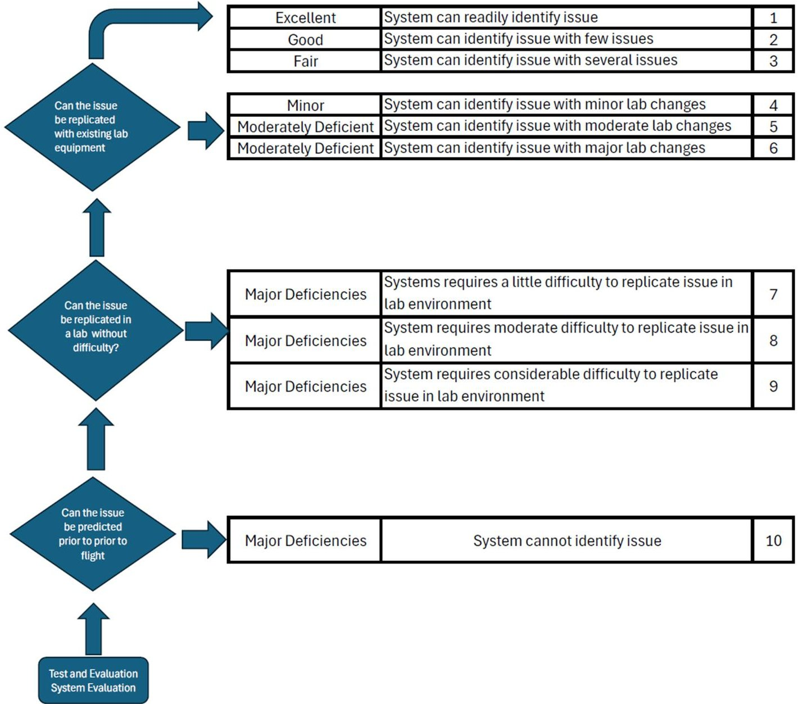

Figure 51: Modified Cooper Harper Scale, Adapted for CubeSat Issue Identification

The modified Cooper Harper rating scale is shown in Figure 51 above.

The basic premise behind the modified Cooper Harper scale is that the issue must be predictable prior to flight in order for the situation to be tested by the scalable test and evaluation system. Predictable is defined as "able to be known, seen, or declared in advance." After establishing that the issue is predictable, the next decision gate is whether the issue can be detected in a lab environment. If the answer is "yes", the next

<!-- PDF_PAGE: 123 -->

decision gate is whether the issue can be detected in existing lab facilities that are available to the test team.

The result of the evaluation is a numerical score that shows the capability of the CubeSat test and evaluation system to detect the error in advance, giving the test team an opportunity to make a decision or manufacturing modification to the CubeSat prior to launch and potentially eliminate one source of mission failure.

## 7.1 CALPOLY EXOCUBE

## 7.1.1 MISSION OVERVIEW AND DESCRIPTION

The CalPoly ExoCube was 3U CubeSat designed and built by PolySat, which is a research group affiliated with California Polytechnic State University. ExoCube was a multiorganization consortium effort, including collaborators such as NASA, Scientific Solutions, Inc, University of Wisconsin of Madison, and the University of Illinois. It was funded by the National Science Foundation.

The CubeSat included a gravity gradient system for measuring gravity fields, momentum wheel for pitch, roll, and yaw orientation, Kalman filtering for noise filtering, ADCS sensors for GNC control, and cameras for earth observation.

## 7.1.2 MISSION FAILURE AND FAILURE ANALYSIS

The primary failure identified by the ExoCube team was low transmitter output power. To receive telemetry from the CubeSat, the team had to use the 45m dish belonging to SRI International, upon which they were able to receive an abundant amount of telemetry data from the CubeSat. Secondary failures included the event in which one

<!-- PDF_PAGE: 124 -->

of the gradient booms did not deploy and the radio stopped working six months after the start of the mission.

The weak transmit signal was troubleshot to be caused by the failure of the CubeSat antenna extension. The CubeSat antenna was held in the closed position during launch and initial operations by a fishing line. A burn wire was placed adjacent to the fishing line, thus, activating the burn wire would cut the fishing line and deploy the antenna. The root cause analysis showed that either the heating wire burned out and became inoperative or the wiring between the power generation system and the burn element failed.

The gradient booms were held in place using a similar mechanism that required a fishing line to be cut using a burn wire. The root cause analysis showed that the most probable cause of failure to extend the booms was that the burn wire did not make good contact with the fishing line. (eoPortal, 2015)

## 7.1.3 APPLICATIONS TO SCALABLE SYSTEMS ARCHITECTURE FOR CUBESAT TEST AND EVALUATION

The failure of both deployment of the antenna and the magnetometer boom are traced back to similar causes of poor workmanship, where the assembly techniques failed to place the fishing line in close enough proximity to burn wire, which prevented proper deployment of the deployable features of the CubeSat.

Using the modified Cooper Harper scale shown in Figure 51, the issue is determined to have a score of 1, 2, or 3, as follows: The issue is predictable prior to flight, the issue is replicable in a lab prior testing, and the issue can be replicated in the lab using existing lab equipment. Thus, the score of 1, 2, or 3 is assigned to the issue

<!-- PDF_PAGE: 125 -->

that caused the loss of the mission, meaning that the issue would be readily correctable by the application of the scalable systems architecture prior to launch.

The prototype testing may have down selected several deployment mechanisms, while both the engineering qualification model and the full flight model testing would have tested the final configuration of fishing line and burn wire. (PolySat, 2016)

While few dispute that a more extensive testing program results in better mission success, the premise behind the scalable systems architecture is that testing can be spread out among the three different models of CubeSats to maximize test program efficiency. The ExoCube CubeSat program would have likely benefitted from additional testing and more efficient testing, and thus, would have benefitted from using the scalable systems architecture presented in this paper.

## 7.2 AMSAT PHASE 3D/OSCAR-40

The AMSAT Phase 3D mission was heavy satellite much larger than a CubeSat. The mission was launched in 2000 and the design of the satellite predated CubeSats. The space vehicle weighed nearly 400 kg. Designed for amateur radio satellite communication, it contained 5 receivers, 7 transmitters, and 2 cameras for video data. (Krebs, n.d.)

## 7.2.1 MISSION FAILURE AND FAILURE ANALYSIS

The AMSAT Phase 3D mission failed because a protective cap was left on the 400N motor used to change altitude. When the motor was engaged by ground controllers, the protective cap left in place caused pressure to build beyond the burst strength of the upstream valves and piping, resulting in an explosion that ultimately resulted in failure of the mission. The protective cap was left in place due to confusion between the

<!-- PDF_PAGE: 126 -->

manufacturer and the AMSAT engineers on the specific design of the 400N motor used on Phase 3D. The AMSAT engineers believed that the motor was the same as used on previous satellite missions while a last minute substitution was made on the existing motor. (Krebs, n.d.)

## 7.2.2 APPLICATIONS TO SCALABLE SYSTEMS ARCHITECTURE FOR CUBESAT TEST AND EVALUATION

The primary issue facing the AMSAT Phase 3D satellite was foreign object debris, caused by poor configuration control. A cap was left in place on a high thrust motor where no cap should have been left in place prior to launch. This type of issue would be detected by full flight model testing of the satellite in a simulated space environment prior to launch. The large size of this satellite (which is NOT a CubeSat) would make such testing very expensive but it is best to conduct such testing, even if expensive, rather than risking the mission.

Using the modified Cooper Harper scale presented in Figure 51, the issue is determined to have a score of 4, 5, or 6. The issue is predictable prior to flight, and the issue can be validated in a lab environment. It is doubtful that existing lab facilities at the time had the capability of firing the main 400N thruster engine, thus, the final score is a 4, 5, or 6. This means that the scalable systems architecture would be beneficial in detecting and preventing the issue prior to flight, however, some modifications to laboratory facilities may be needed in order to detect the issue prior to flight.

Thus, the lack of scalable systems architecture for full-flight model testing led to the failure of the mission. Conducting mission testing in an organized manner using the Scalable Systems Architecture presented in this paper would likely detect the condition while on the ground and prevent the loss of the mission.

<!-- PDF_PAGE: 127 -->

## 7.3 NASA LUNAR FLASHLIGHT

The NASA Lunar Flashlight was a CubeSat mission intended to explore water ice deposits on the surface of the moon. The spacecraft was a 6U CubeSat and developed by a team of developers which included the Jet Propulsion Laboratory, the Goddard Space Flight Center, and the Marshall Space Flight Center.

The CubeSat included a laser reflectometer as the primary science instrument payload. In addition to the primary sensor, the CubeSat included a small propulsion system, two sets of solar arrays, a command and data handling system, and a radio transmitter.

## 7.3.1 MISSION FAILURE AND FAILURE ANALYSIS

The primary failure of the mission was the propulsion system. Three of four thrusters failed to deliver the required amount of propulsion to propel the spacecraft into the desired orbit around the moon. The root cause analysis found that the most likely cause of failure was debris blocking the feed lines between the thruster valves and thruster feed tubes. The most likely cause of blockage was determined to be residual metal powder (from the 3D printing process) not being completely cleaned out of the tube prior to launch.

## 7.3.2 APPLICATIONS TO SCALABLE SYSTEMS ARCHITECTURE FOR CUBESAT TEST AND EVALUATION

The primary issue facing the NASA Flashlight Mission was foreign object debris, in this case, residual unmelted metal powder in the propellant feedlines. Full flight model testing of the CubeSat would typically detect such a problem while on the ground,

<!-- PDF_PAGE: 128 -->

thus, it appears that insufficient full flight model testing was conducted on the Flashlight program prior to launch.

Using the modified Cooper Harper scale presented in Figure 51, a score of 1,2, or 3 is assigned the mission failure. The issue is predictable prior to launch, the issue can be replicated in the lab, and the issue can be replicated in the lab using existing lab facilities. Thus, a score of 1,2, or 3 is the resulting score for the applicability of the scalable systems architecture for CubeSat Test and Evaluation.

## 7.4 ARIZONA STATE UNIVERSITY LUNAH-MAP

The LunaH-Map, which stands for Lunar Polar Hydrogen Mapper, mission is a small 6U satellite with a launch mass of 14 kg. It includes two deployable solar arrays along with a scintillation neutron detector used to detect the possible presence of water ice on the moon. The CubeSat included a Busek-built ion thruster for propulsion. The satellite was developed by Arizona State University in 2015 as part of a NASA contract. The LunaH-Map mission was launched on the Artemis 1 mission after many months of launch delays. (Arizona State University, 2022)

## 7.4.1 MISSION FAILURE AND FAILURE ANALYSIS

The LunaH-Map mission failed when the primary thruster failed to generate thrust and thus the CubeSat did not achieve the desired orbit around the moon and could not collect the required data for the mission to be considered a success. The thruster issue was traced to a valve that was stuck in the closed position. NASA tried for a period of six months to open the stuck valve without success.

The root cause analysis for the stuck valve pointed to the length of time that the valve sat in the closed position without cycling, due to the numerous and lengthy delays

<!-- PDF_PAGE: 129 -->

of the Artemis 1 mission. The root cause analysis found that the mission delays were the primary cause of the stuck valve.

## 7.4.2 APPLICATIONS TO SCALABLE SYSTEMS ARCHITECTURE FOR CUBESAT TEST AND EVALUATION

Using the modified Cooper Harper scale presented in Figure 51, a score of 10 assigned the mission failure. The issue was not predictable prior to launch; thus, the scalable systems architecture was unlikely to result in an improvement in mission success.

A scalable systems architecture for CubeSat Test and Evaluation can test out many different anticipated scenarios using prototype, engineering qualification, and full flight models; however, unanticipated scenarios are generally outside the scope of the scalable systems architecture because no requirement likely exists to cover those unexpected scenarios. Thus, the application of the scalable systems architecture would not have likely detected this potential issue with the LunaH-Map mission and thus would not have prevented the eventual mission failure.

## 7.5 VALIDATION SUMMARY

The scalable system architecture scores, from using the modified Cooper Harper scale, is shown in the table below.

<!-- PDF_PAGE: 130 -->

<table border="1"><tr><td>Mission</td><td>Modified Cooper Harper Score based on Figure 45</td></tr><tr><td>CalPoly ExoCube</td><td>1,2,or3</td></tr><tr><td>AMSAT Phase 3D</td><td>4,5,or6</td></tr><tr><td>NASA Lunar Flashlight</td><td>1,2,or3</td></tr><tr><td>Arizona State University LunaH-Map</td><td>10</td></tr></table>

The scalable systems architecture presented in this paper was shown to be beneficial when handling known and expected issues, such as foreign object debris interfering with propulsion, protective caps being left in place, and failure of burn wires to allow for deployment of deployable structures. However, the application of the scalable systems architecture for test and evaluation was shown to be ineffective for unanticipated problems, such as launch delays encountered on the launch pad. Thus, the scalable systems architecture was deemed to improve mission success for many but not all CubeSat programs.

<!-- PDF_PAGE: 131 -->

## Chapter 8: SUMMARY AND FUTURE WORK

## 8.1 FUTURE WORK

The requirements for the test and evaluation system were based on scholarly research of existing CubeSat systems and interpretation of needs of test and evaluation of CubeSats. The systems engineering requirements generation process involves significant work with stakeholders to generate goals, elicit requirements, document requirements, and validate the requirements. The formalized requirements definition process fell outside the scope of this dissertation, however, one avenue for future work would be to conduct an actual requirements definition process using subject matter experts in the CubeSat domain.

Another avenue for future work is the collection of actual test and evaluation data from an actual CubeSat team. This study relied on laboratory-based data collection based on a simulated CubeSat. The intent of the study was not to measure real test and evaluation times but rather to develop the mathematical model. A logical next step would be to collect real data and input into the model and determine how the results vary once actual data is inputted into the model.

A third avenue for further research is to extend the CubeSat test and evaluation model into other subjects. Test and Evaluation is a crucial step of validation of engineering programs and this model developed as part of the thesis can be extended to other engineering programs, including certification programs for passenger aircraft, qualification programs for passenger light rail systems, and many other engineering programs. Research can be conducted to extend this model to other engineering

<!-- PDF_PAGE: 132 -->

programs in other industries to optimize test and evaluation systems for those programs.

A fourth avenue of future work is to develop the mission failure percentages using fault tree analysis rather than using semiconductor yield rate estimation. Fault tree analysis is a more granular, more comprehensive method of estimating failure rates. Properly performing fault tree analysis requires a deep understanding of a system, subsystem, and the nature of potential faults, but would result in a more accurate analysis.

## 8.2 SUMMARY

In conclusion, the preceding pages have covered the development of a scalable systems architecture for CubeSat test and evaluation. The first portion of the paper covered a literature review on existing research on CubeSat Test and Evaluation and Scalable System Architectures. The paper identified a gap in existing literature on Scalable System Architecture intended for use with CubeSat Test and Evaluation. Next, the paper presented research methodology on closing this gap in previously published research. Several steps were presented in the methodology section, including conducting a survey of CubeSat Engineers and Engineering Students on existing thought patterns regarding CubeSat Test and Evaluation; a time study on how long it takes to conduct test and evaluation on various models of CubeSats; and simulation to estimate mission failures depending on which model of CubeSat was used for test and evaluation. The results section presented the results for each of these aspects of research that was collected in support of developing the scalable systems architecture.

The last section of the paper presented the proposed scalable systems architecture written in Model Based Systems Engineering SysML 2.0 language. These

<!-- PDF_PAGE: 133 -->

charts show the requirements, the block definition diagrams, internal block diagrams, and activity diagrams that represent the various viewpoints of the system. Together, they form the complete set of diagrams for the scalable systems architecture.

The scalable systems architecture was validated against four satellite missions, three CubeSats and one Amateur Radio Satellite. In these four scenarios, application of the scalable systems architecture would have resulted in improved mission success for three of the four missions while the application of the scalable systems architecture would not have impacted the fourth mission. Thus, the scalable systems architecture was validated at being successful in many but not all scenarios.

Finally, several avenues for further research are presented, including the possibility of collecting more realistic research by conducting a time study in the CubeSat laboratory, the concept of performing a more realistic requirements development process, and the possibility of extending the scalable systems architecture to test and evaluate process beyond CubeSats.

<!-- PDF_PAGE: 134 -->

## Chapter 9: CONCLUSION

The results from the research conducted are meshed to create a scalable systems architecture for CubeSat Test and Evaluation. The scalable systems architecture demonstrated how various tests could be spread out among the various models of CubeSats to maximize the potential success of the CubeSat mission while reducing the labor and cost resources needed to conduct the Test and Evaluation program. The results identified a methodology for tracking the amount of time spent testing, identified the mathematical equations used for modeling the probability of success, and created a Pareto chart to demonstrate the Pareto frontier. While the results came to a specific conclusion on the spread of tests using the data collected, a reader is reminded that the actual results will vary among various CubeSat teams and the specific data collected may or may not represent any specific CubeSat team.

<!-- PDF_PAGE: 135 -->

## REFERENCES

AcqNotes: The Defense Acquisition Encyclopedia, n.d. Defense Acquisition Process Phases. [Online] Available at: https://acqnotes.com/acqnote/acquisitions/acquisition-phases [Accessed 4 January 2025].

Angulo, I., Rodriguez-Gil, L. & Garcia-Zubia, J., 2018. Scaling up the Lab: An Adaptable and Scalable Architecture for Embedded Systems Remote Labs. IEEE Access, Volume 6, pp. 16887-16900.

Arizona State University, 2022. LunaH-Map Spacecraft. [Online] Available at: https://faculty.thecollege.asu.edu/lunahmap [Accessed 4 January 2025].

Berthoud, L. et al., 2019. Univesity CubeSat Project Management for Success. Logan, AIAA/USU Conference on Small Satellites.

Bidner, F., 2010. Fault Tree Analysis of HERMES CubeSat, Boulder: University of Colorado at Boulder.

Bjorkman, E., Sarkani, S. & Mazzuchi, T., 2012. Using Model-Based Systems Engineering as a Framework for Improving Test and Evaluation Activities. Washington, Wiley Online Library.

Blanchard, B. & Fabycky, W., 2011. Systems Engineering and Analysis. Fifth Edition ed. Upper Saddle River: Prentice Hall.

Boothroyd, G., Dewhurst, P. & Knight, W., 2011. Product Design for Manufacture and Assembly. Boca Raton: CRC Press.

Borowicz, R. C., 2020. Failure mode, effects, and crtiicality analysis of a very low earth orbit CubeSat mission, Norfolk: Old Dominion University.

Branz, F., Ricco, A. J., Cappelletti, C. & Hines, J. W., 2023. Next Generation CubeSats and SmallSats: Enabling Technologies, Missions, and Markets. Amsterdam: Elsevier.

Carroll, E. R. & Malins, R. J., 2016. Systematic Literature Review: How is Model-based Systems Engineering Justified?, Albuquerque: Sandia National Laboratories.

Cooper, G. & Harper, R., 1984. Handling Qualities and Pilot Evaluation. [Online] Available at: https://engineering.purdue.edu/~andrisan/Courses/AAE490A_S2010/Buffer/H Cooper.pdf [Accessed 10 January 2025].

Diongson, D., 2023. What Is Backtesting? Definition & Example. [Online] Available at: https://www.thestreet.com/dictionary/backtesting [Accessed 11 January 2025].

Doyle, M., 2018. Mission Testing for Improved Reliability of CubeSats. San Diego, Society of Phototonics Optical Instrumentation Engineers.

<!-- PDF_PAGE: 136 -->

Doyle, M. et al., 2022. Mission Test Campaign for the EIRSAT-1 Engineering. Aerospace, 9(100), pp. 1-28.

eoPortal, 2015. ExoCube nanosatellite. [Online] Available at: https://www.eoportal.org/satellite-missions/exocube#references [Accessed 4 January 2025].

Faisandier, A., Roedler, G. & Adcock, R., 2023. Systems Architecture. [Online] Available at: https://sebokwiki.org/wiki/System_Architecture [Accessed 19 December 2023].

Fox, B., Boito, M., Graser, J. & Younossi, O., 2004. Test and Evaluation Trends and Costs for Aircraft and Guided Weapons, Santa Monica: RAND Corporation.

Gehrig, J. F., Brown, C. D. & Finfera, J. P., 1994. How Much Testing is Enough?. Williamsburg, Virgina, International Test and Evaluation Association.

Generation, 2023. What Is Talent Scarcity & How Employers Can Overcome It?. [Online] Available at: https://www.generation.org/news/what-is-talent-scarcity-how-employers-can-overcome-it/ [Accessed 29 December 2024].

Greenberg, A., Lebrasseur, G. & Levy, E., 2021. OreSat: A student team-based approach to an inexpensive,. Logan, 2021 AIAA/USU Small Satellite Conference.

INCOSE, 2024. Definition of System: General Case. [Online] Available at: https://www.incose.org/about-systems-engineering/system-and-se definitions/general-system-definition [Accessed 26 December 2024].

Kelly, S. R., 2021. A Reference Architecture for Rapid CubeSat Development, s.l.: Air Force Institute of Technology.

Kossiakoff, A., Seymour, S. J., Flanigan, D. A. & Biemer, S. M., 2020. Systems Engineering Principles and Practices. Third ed. Hoboken: Wiley.

Krebs, G. D., n.d. AMSAT P3D (Phase 3D, AO 40, AMSAT-OSCAR 40). [Online] Available at: https://space.skyrocket.de/doc_sdat/amsat-p3d.htm [Accessed 4 January 2025].

Lawerence Livermore National Laboratory, n.d. Launching Traffic Cameras into Space. [Online] Available at: https://gs.llnl.gov/intelligence/space-traffic [Accessed 19 December 2024].

Lucidchart, 2024. UML Activity Diagram Tutorial. [Online] Available at: https://www.lucidchart.com/pages/uml-activity-diagram [Accessed 22 December 2024].

Montana State University, 2024. https://ssel.montana.edu/. [Online]

Available at: https://ssel.montana.edu/

[Accessed 29 December 2024].

NASA, 2017. CubeSat 101: Basic Concepts and Processes for First-Time CubeSat Developers. [Online]

<!-- PDF_PAGE: 137 -->

Available at: https://s3vi.ndc.nasa.gov/ssri-kb/static/resources/nasa_csli_cubesat_101_508.pdf [Accessed 6 March 2025].

National Aeronautics and Space Administration, 2019. SEH 2.0 Fundamentals of Systems Engineering. [Online] Available at: https://www.nasa.gov/reference/2-0-fundamentals-of-systems engineering/#:~:text=At%20NASA%2C%20%E2%80%9Csystems%20engineering%E2 %80%9D,required%20to%20meet%20a%20need. [Accessed 19 December 2024].

National Geographic, n.d. USSR Launches Sputnik. [Online] Available at: https://education.nationalgeographic.org/resource/ussr-launches sputnik/ [Accessed 19 December 2024].

Object Management Group, 2024. CubeSat System Reference Model Profile. [Online] Available at: https://www.omg.org/spec/CSRM/1.1/Beta1/About-CSRM [Accessed 5 March 2025].

Object Management Group, 2025. Building Tech Communities. [Online] Available at: https://www.omg.org/memberservices/OMG-brochure.pdf [Accessed 5 March 2025].

Ostrom, L. & Wilhelmsen, C., 2019. Risk Assessment: Tools, Techniques, and Their Applications. Second ed. Hoboken: John Wiley & Sons.

Phippen, E., 2023. Washington State Hospital Association. [Online] Available at: https://www.wsha.org/articles/new-survey-physician-appointment wait-times-getting-longer/

Plummer, J. D. & Griffin, P. B., 2023. Integrated Circuit Fabrication: Science and Technology. Cambridge: Cambridge University Press.

PolySat, 2016. A Failure Analysis of the ExoCube CubSat. San Luis Obispo, s.n.

SentinelOne, 2021. Scalable Architecture: A Definition and How-to Guide. [Online] Available at: https://www.sentinelone.com/blog/scalable-architecture/ [Accessed 18 December 2023].

Swartwout, M. & Jayne, C., 2016. University-Class Spacecraft by the Numbers: Success, Failures, Debris. (But Mostly Success). Logan, AIAA.

Taylor, A., 2013. The 'Model Philosophy' Used by Space Engineering Companies. [Online] Available at: https://www.eetimes.com/the-model-philosophy-used-by-space engineering companies/#:~:text=Engineering%20Qualification%20Model%20(EQM)%3A,screen ed%20to%20the%20flight%20standard. [Accessed 3 March 2024].

The Consultative Committee for Space Data Systems, 2023. Overview of Space Communications Protocols. [Online] Available at: https://public.ccsds.org/Pubs/130x0g4e1.pdf [Accessed 5 March 2025].

<!-- PDF_PAGE: 138 -->

The CubeSat Program, Cal Poly San Luis Obispo, 2022. CubeSat Design Specifications. San Luis Obispo: Cal Poly San Luis Obispo.

The European Space Agency, 2023. Seven Ways to Use a CubeSat Swarm. [Online] Available at: https://www.esa.int/Enabling_Support/Preparing_for_the_Future/Discovery_and _Preparation/Seven_ways_to_use_a_CubeSat_swarm [Accessed 29 December 2024].

Tsung, S. & Sher, H., 2014. The New Durable Rubik's Cube, Terre Haute: Indiana State University.

Venturini, C. C., 2018. 8 Steps to Improving Small Sat Mission Success. [Online] Available at: https://aerospace.org/article/8-steps-improving-small-sat-mission success#:~:text=Studies%20show%20academia%20success%20rates,for%2060%20 days%20or%20longer. [Accessed 2023].

Villela, T., Brandao, A., Bueno, F. & Leonardi, R., 2019. Towards the Thousandth CubeSat: A Statistical Overview. International Journal of Aerospace Engineering, Volume 2019.

Zara, P., 2011. Activity Diagrams - Advantages, Disadvantages and Applications of Use [Online] Available at: https://articlebiz.com/article/1051504997-activity-diagrams advantages-disadvantages-and-applications-of-use [Accessed 22 December 2024].

<!-- PDF_PAGE: 139 -->

## APPENDIX A: TIME STUDY DATA AND RESULTS

Sensor Data Collection Test

<table border="1"><tr><td>Test Name</td><td colspan="7">Sensor Data Collection Test</td></tr><tr><td>Test Objective</td><td colspan="7">Command CubeSat to collect data from sensor and provide data to command module</td></tr><tr><td>Pass Criteria</td><td colspan="7">CubeSat sensor collects data and sends correct data to command module</td></tr><tr><td>Fail Criteria</td><td colspan="7">CubeSat sensor fails to send collected data to command module; or sends incorrect data to command module</td></tr><tr><td colspan="3"></td><td>1</td><td>2</td><td>3</td><td>4</td><td>5</td><td rowspan="2">Total Time (seconds)</td></tr><tr><td>Test Article</td><td>Step Number</td><td>Test Procedure</td><td colspan="5">Measured Time (seconds per step)</td></tr><tr><td rowspan="10">Prototype</td><td>1</td><td>Locate prototype CubeSat</td><td>13</td><td>12</td><td>12</td><td>8</td><td>9</td><td rowspan="10">237</td></tr><tr><td>2</td><td>Power On CubeSat</td><td>81</td><td>80</td><td>71</td><td>75</td><td>76</td></tr><tr><td>3</td><td>Establish communication between CubeSat and external control computer</td><td>26</td><td>41</td><td>18</td><td>16</td><td>14</td></tr><tr><td>4</td><td>Receive collected data</td><td>30</td><td>81</td><td>30</td><td>51</td><td>35</td></tr><tr><td>5</td><td>View collected data</td><td>1</td><td>5</td><td>5</td><td>5</td><td>5</td></tr><tr><td>6</td><td>Check collected data against real life data to validate accuracy</td><td>10</td><td>47</td><td>55</td><td>20</td><td>20</td></tr><tr><td>7</td><td>Initiate proper shutdown of CubeSat</td><td>60</td><td>30</td><td>30</td><td>30</td><td>32</td></tr><tr><td>8</td><td>Depower CubeSat</td><td>5</td><td>3</td><td>5</td><td>5</td><td>5</td></tr><tr><td>9</td><td>Return prototype CubeSat to storage location</td><td>5</td><td>5</td><td>7</td><td>6</td><td>6</td></tr><tr><td></td><td>Total Time for Each Test</td><td>231</td><td>304</td><td>233</td><td>216</td><td>202</td></tr><tr><td></td><td>1</td><td>Locate EQL CubeSat</td><td>10</td><td>18</td><td>20</td><td>20</td><td>21</td><td></td></tr></table>

<!-- PDF_PAGE: 140 -->

<table border="1"><tr><td rowspan="14">Engineering Qualification Model</td><td>2</td><td>Check out EQL using checkout procedure</td><td>33</td><td>35</td><td>40</td><td>32</td><td>35</td><td rowspan="14">379</td></tr><tr><td>3</td><td>Locate and don anti-static apparel</td><td>36</td><td>40</td><td>38</td><td>35</td><td>37</td></tr><tr><td>4</td><td>Power On CubeSat</td><td>76</td><td>82</td><td>82</td><td>80</td><td>82</td></tr><tr><td>5</td><td>Verify CubeSat Software Load</td><td>17</td><td>30</td><td>25</td><td>28</td><td>27</td></tr><tr><td>6</td><td>Establish communication between CubeSat and external control computer</td><td>15</td><td>13</td><td>14</td><td>14</td><td>15</td></tr><tr><td>7</td><td>Receive collected data</td><td>35</td><td>32</td><td>25</td><td>28</td><td>25</td></tr><tr><td>8</td><td>View collected data</td><td>5</td><td>5</td><td>5</td><td>5</td><td>5</td></tr><tr><td>9</td><td>Check collected data against real life data to validate accuracy</td><td>20</td><td>22</td><td>21</td><td>22</td><td>23</td></tr><tr><td>10</td><td>Initiate proper shutdown of CubeSat</td><td>32</td><td>32</td><td>34</td><td>34</td><td>35</td></tr><tr><td>11</td><td>Depower CubeSat</td><td>5</td><td>5</td><td>5</td><td>5</td><td>5</td></tr><tr><td>12</td><td>Remove and stow antistatic apparel</td><td>37</td><td>45</td><td>46</td><td>42</td><td>43</td></tr><tr><td>13</td><td>Return prototype CubeSat to storage location</td><td>17</td><td>17</td><td>18</td><td>18</td><td>17</td></tr><tr><td>14</td><td>Check in EQL using checkin/checkout procedure</td><td>15</td><td>15</td><td>15</td><td>15</td><td>15</td></tr><tr><td></td><td>Total time for Each Test</td><td>353</td><td>391</td><td>388</td><td>378</td><td>385</td></tr><tr><td rowspan="3"></td><td>1</td><td>Check test procedure into test log</td><td>110</td><td>90</td><td>95</td><td>60</td><td>63</td><td rowspan="3"></td></tr><tr><td>2</td><td>Sign in as FFM user per checkin/checkout procedure</td><td>40</td><td>35</td><td>35</td><td>37</td><td>33</td></tr><tr><td>3</td><td>Don anti-static apparel &amp; suit up for entering clean room environment</td><td>60</td><td>90</td><td>58</td><td>60</td><td>62</td></tr></table>

<!-- PDF_PAGE: 141 -->

<table border="1"><tr><td>4</td><td>Enter clean room environment</td><td>15</td><td>13</td><td>14</td><td>15</td><td>14</td></tr><tr><td>5</td><td>Locate FFM CubeSat</td><td>28</td><td>25</td><td>27</td><td>22</td><td>23</td></tr><tr><td>6</td><td>Verify no bent pins on connection cable</td><td>45</td><td>40</td><td>32</td><td>35</td><td>39</td></tr><tr><td>7</td><td>Verify both CubeSat and computer power is off</td><td>5</td><td>5</td><td>5</td><td>4</td><td>5</td></tr><tr><td>8</td><td>Power On CubeSat</td><td>77</td><td>80</td><td>79</td><td>80</td><td>79</td></tr><tr><td>9</td><td>Verify CubeSat Software Load</td><td>30</td><td>25</td><td>25</td><td>27</td><td>31</td></tr><tr><td>10</td><td>Establish communication between CubeSat and external control computer</td><td>15</td><td>14</td><td>15</td><td>14</td><td>15</td></tr><tr><td>11</td><td>Receive collected data</td><td>32</td><td>31</td><td>33</td><td>34</td><td>31</td></tr><tr><td>12</td><td>View collected data</td><td>4</td><td>5</td><td>5</td><td>5</td><td>5</td></tr><tr><td>13</td><td>Check collected data against real life data to validate accuracy</td><td>30</td><td>28</td><td>29</td><td>30</td><td>29</td></tr><tr><td>14</td><td>Verify software load prior to system shutdown</td><td>15</td><td>15</td><td>15</td><td>14</td><td>16</td></tr><tr><td>15</td><td>Perform system health check prior to shutdown</td><td>45</td><td>42</td><td>40</td><td>40</td><td>41</td></tr><tr><td>16</td><td>Depower CubeSat</td><td>37</td><td>37</td><td>36</td><td>37</td><td>36</td></tr><tr><td>17</td><td>Return FFM CubeSat to storage location</td><td>20</td><td>27</td><td>25</td><td>24</td><td>24</td></tr><tr><td>18</td><td>Depart clean room environment</td><td>10</td><td>15</td><td>15</td><td>15</td><td>14</td></tr><tr><td>19</td><td>Remove antistatic apparel</td><td>60</td><td>75</td><td>55</td><td>62</td><td>59</td></tr><tr><td>20</td><td>Sign out as FFM user using checkin/checkout procedure</td><td>30</td><td>28</td><td>29</td><td>30</td><td>31</td></tr></table>

<table border="1"><tr><td>Total Time</td><td>708</td><td>720</td><td>667</td><td>645</td><td>650</td></tr></table>

<!-- PDF_PAGE: 142 -->

CubeSat Solar Power Generation Test

<table border="1"><tr><td>Test Name</td><td colspan="8">CubeSat Solar Power Generation Test</td></tr><tr><td>Test Objective</td><td colspan="8">Measure Electrical Output of Solar Cells</td></tr><tr><td>Pass Criteria</td><td colspan="8">Solar Cells Generate XYZ ma of current</td></tr><tr><td>Fail Criteria</td><td colspan="8">Solar Cells Generate less than XYZ ma of current</td></tr><tr><td></td><td colspan="2"></td><td>1</td><td>2</td><td>3</td><td>4</td><td>5</td><td></td></tr><tr><td>Test Article</td><td>Step Number</td><td>Test Procedure</td><td colspan="5">Measured Time(seconds per step)</td><td>Total Time</td></tr><tr><td rowspan="7">Prototype</td><td>1</td><td>Locate prototype CubeSat</td><td>19</td><td>21</td><td>20</td><td>18</td><td>19</td><td rowspan="7">247.2</td></tr><tr><td>2</td><td>Locate Solar Energy Simulator</td><td>25</td><td>24</td><td>27</td><td>25</td><td>24</td></tr><tr><td>3</td><td>Position CubeSat Under Solar Energy Simulator</td><td>5</td><td>4</td><td>5</td><td>3</td><td>5</td></tr><tr><td>4</td><td>Turn on Solar Energy Simulator</td><td>10</td><td>9</td><td>11</td><td>9</td><td>10</td></tr><tr><td>5</td><td>Measure Solar Energy Output</td><td>180</td><td>110</td><td>140</td><td>155</td><td>127</td></tr><tr><td>6</td><td>Turn off and store solar energy simulator</td><td>25</td><td>25</td><td>23</td><td>25</td><td>24</td></tr><tr><td>7</td><td>Return prototype CubeSat to storage location</td><td>23</td><td>21</td><td>23</td><td>20</td><td>22</td></tr><tr><td rowspan="7">Engineering Qualification Model</td><td colspan="2">Totals</td><td>287</td><td>214</td><td>249</td><td>255</td><td>231</td><td></td></tr><tr><td>1</td><td>LocateEQL CubeSat</td><td>19</td><td>23</td><td>18</td><td>20</td><td>21</td><td rowspan="7">330</td></tr><tr><td>2</td><td>Checkout CubeSat on Log</td><td>30</td><td>29</td><td>31</td><td>28</td><td>29</td></tr><tr><td>3</td><td>Locate Solar Energy Simulator</td><td>25</td><td>27</td><td>26</td><td>24</td><td>25</td></tr><tr><td>4</td><td>Position CubeSat Under Solar Energy Simulator</td><td>5</td><td>6</td><td>5</td><td>5</td><td>6</td></tr><tr><td>5</td><td>Turn on Solar Energy Simulator</td><td>10</td><td>9</td><td>9</td><td>11</td><td>10</td></tr><tr><td>6</td><td>Measure Solar Energy Output from CubeSat</td><td>210</td><td>115</td><td>175</td><td>150</td><td>135</td></tr></table>

<!-- PDF_PAGE: 143 -->

<table border="1"><tr><td rowspan="5"></td><td>7</td><td>Verify Solar Energy Simulator output</td><td>5</td><td>4</td><td>5</td><td>3</td><td>5</td><td rowspan="5"></td></tr><tr><td>8</td><td>Turn off and store solar energy simulator</td><td>25</td><td>24</td><td>26</td><td>27</td><td>24</td></tr><tr><td>9</td><td>Return prototype CubeSat to storage location</td><td>23</td><td>21</td><td>25</td><td>23</td><td>21</td></tr><tr><td>10</td><td>Check in CubeSat on Log</td><td>30</td><td>31</td><td>29</td><td>30</td><td>31</td></tr><tr><td colspan="2">Totals</td><td>382</td><td>289</td><td>349</td><td>321</td><td>307</td><td></td></tr><tr><td rowspan="12">Full Flight Model</td><td>1</td><td>Check test procedure into test log</td><td>55</td><td>57</td><td>59</td><td>61</td><td>59</td><td rowspan="12">513</td></tr><tr><td>2</td><td>Locate Solar Energy Simulator</td><td>20</td><td>19</td><td>21</td><td>23</td><td>22</td></tr><tr><td>3</td><td>Prepare Solar Energy Simulator</td><td>15</td><td>20</td><td>19</td><td>18</td><td>17</td></tr><tr><td>4</td><td>Sign in as FFM user per checkin/checkout procedure</td><td>55</td><td>57</td><td>54</td><td>59</td><td>55</td></tr><tr><td>5</td><td>Don anti-static apparel &amp; suit up for entering clean room environment</td><td>20</td><td>25</td><td>23</td><td>24</td><td>23</td></tr><tr><td>6</td><td>Enter clean room environment</td><td>15</td><td>14</td><td>16</td><td>15</td><td>14</td></tr><tr><td>7</td><td>Locate FFM CubeSat</td><td>20</td><td>19</td><td>21</td><td>18</td><td>20</td></tr><tr><td>8</td><td>Turn on Solar Energy Simulator</td><td>10</td><td>9</td><td>11</td><td>9</td><td>8</td></tr><tr><td>9</td><td>Measure Solar Energy Output from CubeSat</td><td>125</td><td>135</td><td>240</td><td>115</td><td>210</td></tr><tr><td>10</td><td>Verify Solar Energy Simulator output</td><td>5</td><td>7</td><td>5</td><td>7</td><td>5</td></tr><tr><td>11</td><td>Turn off Solar Energy Simulator</td><td>25</td><td>24</td><td>23</td><td>27</td><td>24</td></tr><tr><td>12</td><td>Return FFM CubeSt to storage location</td><td>20</td><td>19</td><td>21</td><td>18</td><td>21</td></tr></table>

<table border="1"><tr><td>13</td><td>Exit Clean Room</td><td>10</td><td>15</td><td>14</td><td>16</td><td>14</td></tr><tr><td>14</td><td>Remove antistatic apparel</td><td>25</td><td>23</td><td>26</td><td>25</td><td>24</td></tr><tr><td>15</td><td>Sign out as FFM user per checkin/checkout process</td><td>30</td><td>29</td><td>31</td><td>30</td><td>29</td></tr><tr><td>16</td><td>Return Solar Energy Simulator to Storage Location</td><td>10</td><td>9</td><td>11</td><td>8</td><td>9</td></tr></table>

Totals

<!-- PDF_PAGE: 144 -->

CubeSat Accelerometer Test

<table border="1"><tr><td>Test Name</td><td colspan="7">CubeSat Accelerometer Test</td></tr><tr><td>Test Objective</td><td colspan="7">Validate accelerometer operates properly</td></tr><tr><td>Pass Criteria</td><td colspan="7">Accelerometer shows 1g acceleration for each axis</td></tr><tr><td>Fail Criteria</td><td colspan="7">Accelerometer shows something besides 1g acceleration for one or more axes</td></tr><tr><td colspan="4"></td><td colspan="4">Measured Time
(second per step)</td><td></td></tr><tr><td>Test Article</td><td>Step Number</td><td>Test Procedure</td><td>1</td><td>2</td><td>3</td><td>4</td><td>5</td><td>Total Time</td></tr><tr><td rowspan="8">Prototype</td><td>1</td><td>Locate prototype CubeSat</td><td>19</td><td>22</td><td>19</td><td>21</td><td>20</td><td rowspan="8">157.8</td></tr><tr><td>2</td><td>Set CubeSat to "X=UP" position</td><td>2</td><td>3</td><td>2</td><td>4</td><td>3</td></tr><tr><td>3</td><td>Observe data on laptop</td><td>15</td><td>25</td><td>40</td><td>19</td><td>27</td></tr><tr><td>4</td><td>Set CubeSat to "Y=UP" position</td><td>5</td><td>4</td><td>5</td><td>2</td><td>3</td></tr><tr><td>5</td><td>Observe data on laptop</td><td>25</td><td>40</td><td>27</td><td>60</td><td>35</td></tr><tr><td>6</td><td>Set CubeSat to "Z=UP" position</td><td>4</td><td>4</td><td>3</td><td>2</td><td>4</td></tr><tr><td>7</td><td>Observe data on laptop</td><td>75</td><td>60</td><td>15</td><td>25</td><td>45</td></tr><tr><td>8</td><td>Return prototype CubeSat to storage location</td><td>20</td><td>21</td><td>19</td><td>23</td><td>22</td></tr><tr><td></td><td>Totals</td><td></td><td>165</td><td>179</td><td>130</td><td>156</td><td>159</td><td></td></tr><tr><td rowspan="2"></td><td>1</td><td>Locate EQL CubeSat</td><td>20</td><td>21</td><td>19</td><td>23</td><td>22</td><td rowspan="2"></td></tr><tr><td>2</td><td>Checkout CubeSat on Log</td><td>30</td><td>32</td><td>32</td><td>31</td><td>29</td></tr></table>

<!-- PDF_PAGE: 145 -->

<table border="1"><tr><td>3</td><td>Set CubeSat to "X=UP" position</td><td>3</td><td>3</td><td>3</td><td>4</td><td>3</td></tr><tr><td>4</td><td>Observe data on laptop</td><td>85</td><td>155</td><td>135</td><td>65</td><td>75</td></tr><tr><td>5</td><td>Set CubeSat to "Y=UP" position</td><td>3</td><td>4</td><td>3</td><td>4</td><td>2</td></tr><tr><td>6</td><td>Observe data on laptop</td><td>35</td><td>60</td><td>42</td><td>67</td><td>119</td></tr><tr><td>7</td><td>Set CubeSat to "Z=UP" position</td><td>3</td><td>3</td><td>3</td><td>4</td><td>3</td></tr><tr><td>8</td><td>Observe data on laptop</td><td>40</td><td>45</td><td>35</td><td>15</td><td>65</td></tr><tr><td>9</td><td>Return prototype CubeSat to storage location</td><td>20</td><td>20</td><td>19</td><td>21</td><td>22</td></tr><tr><td>10</td><td>Check in CubeSat on Log</td><td>30</td><td>30</td><td>31</td><td>27</td><td>33</td></tr><tr><td>Totals</td><td></td><td>269</td><td>373</td><td>322</td><td>261</td><td>373</td></tr><tr><td>1</td><td>Check test procedure into test log</td><td>75</td><td>70</td><td>80</td><td>75</td><td>73</td></tr><tr><td>2</td><td>Sign in as FFM user per checkin/checkout procedure</td><td>27</td><td>30</td><td>25</td><td>22</td><td>25</td></tr><tr><td>3</td><td>Don anti-static apparel &amp; suit up for entering clean room environment</td><td>86</td><td>40</td><td>42</td><td>48</td><td>42</td></tr><tr><td>4</td><td>Enter clean room environment</td><td>21</td><td>21</td><td>20</td><td>21</td><td>20</td></tr><tr><td>5</td><td>Locate FFM CubeSat</td><td>21</td><td>20</td><td>21</td><td>20</td><td>19</td></tr><tr><td>6</td><td>Boot CubeSat</td><td>73</td><td>72</td><td>75</td><td>73</td><td>80</td></tr><tr><td>7</td><td>Set CubeSat to "X=UP" position</td><td>5</td><td>4</td><td>5</td><td>4</td><td>3</td></tr></table>

<!-- PDF_PAGE: 146 -->

<table border="1"><tr><td>8</td><td>Observe data on laptop</td><td>10</td><td>20</td><td>15</td><td>14</td><td>18</td></tr><tr><td>9</td><td>Set CubeSat to "Y=UP" position</td><td>5</td><td>3</td><td>4</td><td>3</td><td>6</td></tr><tr><td>10</td><td>Observe data on laptop</td><td>28</td><td>14</td><td>17</td><td>16</td><td>18</td></tr><tr><td>11</td><td>Set CubeSat to "Z=UP" position</td><td>5</td><td>3</td><td>5</td><td>4</td><td>5</td></tr><tr><td>12</td><td>Observe data on laptop</td><td>18</td><td>14</td><td>20</td><td>18</td><td>17</td></tr><tr><td>13</td><td>Return FFM CubeSat to storage location</td><td>20</td><td>19</td><td>20</td><td>19</td><td>20</td></tr><tr><td>14</td><td>Exit Clean Room</td><td>10</td><td>11</td><td>10</td><td>9</td><td>12</td></tr><tr><td>15</td><td>Remove antistatic apparel</td><td>20</td><td>22</td><td>18</td><td>20</td><td>19</td></tr><tr><td>16</td><td>Sign out as FFM user per checkin/checkout process</td><td>45</td><td>40</td><td>42</td><td>45</td><td>40</td></tr><tr><td colspan="2">Totals</td><td>469</td><td>403</td><td>419</td><td>411</td><td>417</td></tr></table>

<!-- PDF_PAGE: 147 -->

CubeSat Spin Rate Verification Test

<table border="1"><tr><td>Test Name</td><td colspan="7"></td></tr><tr><td>Test Objective</td><td colspan="7">Verify spin rate data reported by CubeSat is working properly</td></tr><tr><td>Pass Criteria</td><td colspan="7">CubeSat spin rate is accurate for all three axes</td></tr><tr><td>Fail Criteria</td><td colspan="7">CubeSat spin rate data is not accurate for any one or more axes</td></tr><tr><td></td><td></td><td></td><td colspan="5">Measured Time
(seconds per step)</td><td>Total Time</td></tr><tr><td rowspan="10">Prototype</td><td>1</td><td>Locate prototype CubeSat</td><td>20</td><td>18</td><td>19</td><td>20</td><td>19</td><td rowspan="10">253</td></tr><tr><td>3</td><td>Power On CubeSat</td><td>73</td><td>74</td><td>72</td><td>80</td><td>75</td></tr><tr><td>4</td><td>Establish communication between CubeSat and external control computer</td><td>27</td><td>25</td><td>25</td><td>25</td><td>26</td></tr><tr><td>5</td><td>Set CubeSat in "+X" direction</td><td>6</td><td>5</td><td>4</td><td>4</td><td>4</td></tr><tr><td>6</td><td>Verify Spin rate in "+X" axis</td><td>21</td><td>15</td><td>26</td><td>27</td><td>23</td></tr><tr><td>7</td><td>Set CubeSat in "+Y" direction</td><td>4</td><td>4</td><td>5</td><td>4</td><td>4</td></tr><tr><td>8</td><td>Verify Spin Rate in "+Y" axis</td><td>14</td><td>24</td><td>24</td><td>29</td><td>28</td></tr><tr><td>9</td><td>Set CubeSat in "+Z" direction</td><td>4</td><td>4</td><td>5</td><td>5</td><td>4</td></tr><tr><td>10</td><td>Verify Spin Rate in "+Z" axis</td><td>26</td><td>31</td><td>26</td><td>26</td><td>27</td></tr></table>

<!-- PDF_PAGE: 148 -->

<table border="1"><tr><td rowspan="2"></td><td>11</td><td>Depower CubeSat</td><td>38</td><td>38</td><td>35</td><td>37</td><td>36</td><td rowspan="2"></td></tr><tr><td>13</td><td>Return prototype CubeSat to storage location</td><td>10</td><td>10</td><td>10</td><td>9</td><td>11</td></tr><tr><td></td><td></td><td>Total Time</td><td>243</td><td>248</td><td>251</td><td>266</td><td>257</td><td></td></tr><tr><td rowspan="13">Engineering Qualification Model</td><td>1</td><td>Locate EQL CubeSat</td><td>20</td><td>19</td><td>18</td><td>19</td><td>20</td><td rowspan="13">352.8</td></tr><tr><td>2</td><td>Check out EQL using checkout procedure</td><td>26</td><td>19</td><td>18</td><td>19</td><td>23</td></tr><tr><td>3</td><td>Locate and don anti-static apparel</td><td>78</td><td>37</td><td>40</td><td>50</td><td>45</td></tr><tr><td>4</td><td>Power On CubeSat</td><td>76</td><td>80</td><td>76</td><td>73</td><td>79</td></tr><tr><td>5</td><td>Establish communication between CubeSat and external control computer</td><td>9</td><td>10</td><td>9</td><td>10</td><td>10</td></tr><tr><td>6</td><td>Set CubeSat in "+X" direction</td><td>6</td><td>5</td><td>3</td><td>5</td><td>3</td></tr><tr><td>7</td><td>Verify Spin rate in "+X" axis</td><td>20</td><td>20</td><td>19</td><td>17</td><td>21</td></tr><tr><td>8</td><td>Set CubeSat in "+Y" direction</td><td>3</td><td>4</td><td>5</td><td>4</td><td>5</td></tr><tr><td>9</td><td>Verify Spin Rate in "+Y" axis</td><td>14</td><td>16</td><td>17</td><td>19</td><td>18</td></tr><tr><td>10</td><td>Set CubeSat in "+Z" direction</td><td>4</td><td>5</td><td>3</td><td>4</td><td>3</td></tr><tr><td>11</td><td>Verify Spin Rate in "+Z" axis</td><td>15</td><td>15</td><td>16</td><td>17</td><td>19</td></tr><tr><td>12</td><td>Depower CubeSat</td><td>38</td><td>37</td><td>38</td><td>36</td><td>40</td></tr><tr><td>13</td><td>Remove and stow antistatic apparel</td><td>66</td><td>40</td><td>42</td><td>49</td><td>43</td></tr></table>

<!-- PDF_PAGE: 149 -->

<table border="1"><tr><td rowspan="2"></td><td>14</td><td>Return prototype CubeSat to storage location</td><td>10</td><td>10</td><td>9</td><td>10</td><td>9</td><td rowspan="2"></td></tr><tr><td>15</td><td>Check in EQL using checkin/checkout procedure</td><td>16</td><td>17</td><td>16</td><td>14</td><td>16</td></tr><tr><td rowspan="14">Full Flight Model</td><td></td><td>Total Time</td><td>401</td><td>334</td><td>329</td><td>346</td><td>354</td><td></td></tr><tr><td>1</td><td>Check test procedure into test log</td><td>60</td><td>52</td><td>65</td><td>67</td><td>63</td><td rowspan="14">522.2</td></tr><tr><td>2</td><td>Sign in as FFM user per checkin/checkout procedure</td><td>30</td><td>29</td><td>31</td><td>38</td><td>32</td></tr><tr><td>3</td><td>Don anti-static apparel &amp; suit up for entering clean room environment</td><td>60</td><td>68</td><td>55</td><td>49</td><td>56</td></tr><tr><td>4</td><td>Enter clean room environment</td><td>15</td><td>17</td><td>17</td><td>15</td><td>16</td></tr><tr><td>5</td><td>Locate FFM CubeSat</td><td>20</td><td>19</td><td>22</td><td>23</td><td>22</td></tr><tr><td>6</td><td>Power On CubeSat</td><td>76</td><td>77</td><td>70</td><td>80</td><td>75</td></tr><tr><td>7</td><td>Verify data is being received from CubeSat</td><td>10</td><td>12</td><td>9</td><td>13</td><td>12</td></tr><tr><td>8</td><td>Set CubeSat in "+X" direction</td><td>3</td><td>4</td><td>3</td><td>4</td><td>3</td></tr><tr><td>9</td><td>Verify Spin rate in "+X" axis</td><td>20</td><td>19</td><td>21</td><td>19</td><td>17</td></tr><tr><td>10</td><td>Set CubeSat in "+Y" direction</td><td>4</td><td>4</td><td>5</td><td>4</td><td>3</td></tr><tr><td>11</td><td>Verify Spin Rate in "+Y" axis</td><td>17</td><td>16</td><td>17</td><td>19</td><td>18</td></tr><tr><td>12</td><td>Set CubeSat in "+Z" direction</td><td>5</td><td>4</td><td>5</td><td>3</td><td>3</td></tr><tr><td>13</td><td>Verify Spin Rate in "+Z" axis</td><td>19</td><td>16</td><td>15</td><td>16</td><td>17</td></tr></table>

<table border="1"><tr><td>14</td><td>Perform system health check prior to shutdown</td><td>42</td><td>45</td><td>38</td><td>47</td><td>43</td></tr><tr><td>15</td><td>Depower CubeSat</td><td>38</td><td>37</td><td>38</td><td>32</td><td>35</td></tr><tr><td>16</td><td>Disconnect external control computer from Cubesat</td><td>N/A</td><td>N/A</td><td>N/A</td><td>N/A</td><td>N/A</td></tr><tr><td>17</td><td>Verify cable condition post disconnection from CubeSat</td><td>N/A</td><td>N/A</td><td>N/A</td><td>N/A</td><td>N/A</td></tr><tr><td>18</td><td>Return FFM CubeSat to storage location</td><td>15</td><td>10</td><td>12</td><td>15</td><td>14</td></tr><tr><td>19</td><td>Depart clean room environment</td><td>17</td><td>15</td><td>15</td><td>17</td><td>15</td></tr><tr><td>20</td><td>Remove antistatic apparel</td><td>50</td><td>52</td><td>55</td><td>50</td><td>48</td></tr><tr><td>21</td><td>Sign out as FFM user using checkin/checkout procedure</td><td>20</td><td>26</td><td>25</td><td>26</td><td>21</td></tr></table>

Total

<!-- PDF_PAGE: 150 -->

CubeSat Mass Property Verification

<table border="1"><tr><td>Test Name</td><td colspan="7">CubeSat Mass Property Verification</td></tr><tr><td>Test Objective</td><td colspan="7">Measure Mass of CubeSat</td></tr><tr><td>Pass Criteria</td><td colspan="7">CubeSat mass is 1.3kg or less</td></tr><tr><td>Fail Criteria</td><td colspan="7">CubeSat mass is 1.3kg or higher</td></tr><tr><td colspan="3"></td><td>1</td><td>2</td><td>3</td><td>4</td><td>5</td><td></td></tr><tr><td>Test Article</td><td>Step Number</td><td>Test Procedure</td><td colspan="5">Measured Time
(seconds per step)</td><td>Total Time</td></tr><tr><td rowspan="9">Prototype</td><td>1</td><td>Locate prototype CubeSat</td><td>20</td><td>19</td><td>21</td><td>20</td><td>18</td><td rowspan="9">86</td></tr><tr><td>2</td><td>Locate scale</td><td>15</td><td>14</td><td>15</td><td>16</td><td>14</td></tr><tr><td>3</td><td>Turn on and tare scale</td><td>8</td><td>7</td><td>8</td><td>9</td><td>7</td></tr><tr><td>4</td><td>Obtain CubeSat and place on scale</td><td>4</td><td>4</td><td>3</td><td>4</td><td>4</td></tr><tr><td>5</td><td>Measure Mass</td><td>5</td><td>5</td><td>5</td><td>5</td><td>5</td></tr><tr><td>6</td><td>Return CubeSat to storage location</td><td>20</td><td>19</td><td>21</td><td>20</td><td>18</td></tr><tr><td>7</td><td>Turn off scale and return to storage location</td><td>15</td><td>14</td><td>15</td><td>15</td><td>16</td></tr><tr><td colspan="2">Total Time</td><td>87</td><td>82</td><td>88</td><td>89</td><td>82</td></tr><tr><td rowspan="6">Engineering Qualification Model</td><td>1</td><td>LocateEQL CubeSat</td><td>24</td><td>23</td><td>24</td><td>25</td><td>23</td><td rowspan="6">182</td></tr><tr><td>2</td><td>Checkout CubeSat on Log</td><td>30</td><td>31</td><td>29</td><td>30</td><td>30</td></tr><tr><td>3</td><td>Locate scale</td><td>16</td><td>17</td><td>17</td><td>16</td><td>18</td></tr><tr><td>4</td><td>Prepare scale for weighing</td><td>30</td><td>29</td><td>31</td><td>30</td><td>29</td></tr><tr><td>5</td><td>Turn on and tare scale</td><td>8</td><td>7</td><td>8</td><td>8</td><td>9</td></tr><tr><td>6</td><td>Obtain CubeSat and place on scale</td><td>4</td><td>5</td><td>4</td><td>4</td><td>5</td></tr></table>

<!-- PDF_PAGE: 151 -->

<table border="1"><tr><td rowspan="4"></td><td>7</td><td>Measure Mass</td><td>5</td><td>5</td><td>4</td><td>5</td><td>4</td><td rowspan="5"></td></tr><tr><td>8</td><td>Return CubeSat to storage location</td><td>20</td><td>19</td><td>18</td><td>19</td><td>18</td></tr><tr><td>9</td><td>Check in CubeSat on Log</td><td>25</td><td>30</td><td>25</td><td>26</td><td>27</td></tr><tr><td>10</td><td>Turn off scale and return to storage location</td><td>20</td><td>20</td><td>19</td><td>21</td><td>18</td></tr><tr><td rowspan="15">Full Flight Model</td><td colspan="2">Total Time</td><td>182</td><td>186</td><td>179</td><td>184</td><td>181</td><td rowspan="15">362.4</td></tr><tr><td>1</td><td>Check test procedure into test log</td><td>60</td><td>59</td><td>60</td><td>61</td><td>57</td></tr><tr><td>2</td><td>Locate scale</td><td>20</td><td>21</td><td>19</td><td>17</td><td>18</td></tr><tr><td>3</td><td>Prepare scale for weighing</td><td>30</td><td>32</td><td>31</td><td>29</td><td>32</td></tr><tr><td>4</td><td>Sign in as FFM user per checkin/checkout procedure</td><td>30</td><td>31</td><td>29</td><td>30</td><td>31</td></tr><tr><td>5</td><td>Don anti-static apparel &amp; suit up for entering clean room environment</td><td>54</td><td>50</td><td>60</td><td>55</td><td>57</td></tr><tr><td>6</td><td>Enter clean room environment</td><td>15</td><td>16</td><td>10</td><td>17</td><td>15</td></tr><tr><td>7</td><td>Locate FFM CubeSat</td><td>20</td><td>19</td><td>22</td><td>20</td><td>21</td></tr><tr><td>8</td><td>Weigh CubeSat</td><td>5</td><td>4</td><td>3</td><td>5</td><td>4</td></tr><tr><td>9</td><td>Return FFM CubeSt to storage location</td><td>20</td><td>21</td><td>18</td><td>21</td><td>20</td></tr><tr><td>10</td><td>Exit Clean Room</td><td>15</td><td>14</td><td>17</td><td>15</td><td>16</td></tr><tr><td>11</td><td>Remove antistatic apparel</td><td>50</td><td>48</td><td>49</td><td>51</td><td>47</td></tr><tr><td>12</td><td>Sign out as FFM user per checkin/checkout process</td><td>20</td><td>30</td><td>22</td><td>29</td><td>23</td></tr><tr><td>13</td><td>Return scale to storage location</td><td>20</td><td>19</td><td>19</td><td>21</td><td>18</td></tr><tr><td colspan="2">Total Time</td><td>359</td><td>364</td><td>359</td><td>371</td><td>359</td></tr></table>

<!-- PDF_PAGE: 152 -->

<table border="1"><tr><td rowspan="2">Test Name</td><td rowspan="2">Scenario Number</td><td rowspan="2">Test Scenario</td><td rowspan="2">Test Time(prototype)(minutes)</td><td colspan="2">Probability of System Containing Type II Error</td></tr><tr><td></td><td>Rationale</td></tr><tr><td>Sensor Compatibility Test</td><td>1</td><td>This test validates that the sensor is compatible with the CubeSat bus architecture</td><td>10</td><td>10.0%</td><td>The sensor is a COTS sensor and should be generally compatible with properly written software</td></tr><tr><td>Sensor Reliability Test</td><td>2</td><td>This test validates whether the CubeSat sensor is reliable by performing 10 power on tests in a row</td><td>14.3</td><td>5.0%</td><td>COTS sensor, should be very reliable</td></tr><tr><td>Battery Performance Test</td><td>3</td><td>This test validates that the battery performance is sufficient to attain mission objectives</td><td>25</td><td>50.0%</td><td>Batteries are notoriously difficult to get to work properly</td></tr><tr><td>Solar Cell Capacity Test</td><td>4</td><td>This test validates that the solar cells produce sufficient electrical energy to support mission needs</td><td>10</td><td>25.0%</td><td>While it is easy to measure solar cell output, the amount of power required by the system is likely to be a moving target</td></tr><tr><td>Vibration Test</td><td>5</td><td>This test validates that the hardware remains secure, in place, and as designed after performing a launch vibration simulation test</td><td>25</td><td>50.0%</td><td>It is hard to have a space vehicle pass a vibration test</td></tr></table>

<!-- PDF_PAGE: 153 -->

<table border="1"><tr><td>EMI Compatibility Test</td><td>6</td><td>This test measures the EMI output (spurious emissions) of the CubeSat to determine whether they cause any incompatibility with the launch vehicle</td><td>10</td><td>50.0%</td><td>It is hard to have a space vehicle pass an EMI test</td></tr><tr><td>Spin Control Verification</td><td>7</td><td>This test validates whether the spin control mechanism performs in a manner that meets mission standards</td><td>20</td><td>5.0%</td><td>Simple magnet, should work or not work but rarely have Type II error</td></tr><tr><td>Data Transmission Effectiveness Validation</td><td>8</td><td>This test validates whether the data transmission capability of the CubeSat is working per mission requirements</td><td>10</td><td>10.0%</td><td>The data transmission rate should be as designed out of the box</td></tr><tr><td>Heat Generation Test</td><td>9</td><td>This test validates that no circuit boards overheat during normal operation.</td><td>10</td><td>50.0%</td><td>Overheating of circuit boards is a common problem in CubeSat design</td></tr><tr><td>Battery Heater Validation Test</td><td>10</td><td>This test validates that the battery heaters operate as designed.</td><td>10</td><td>25.0%</td><td>There is a reasonable chance that the battery heaters may not function as required</td></tr></table>

<!-- PDF_PAGE: 154 -->

<table border="1"><tr><td>Ground Station System Reboot Test</td><td>11</td><td>This test validates whether the ground station is able to perform a complete system restart remotely</td><td>10</td><td>10.0%</td><td>The restart system capability should work out of the box</td></tr><tr><td>Solar Cell Extension Test</td><td>12</td><td>This test validates that the solar cells extend per mission requirements</td><td>20</td><td>25.0%</td><td>There is a reasonable chance that the solar cells will fail to extend</td></tr><tr><td>Transmit Frequency Test</td><td>13</td><td>This test verifies that the software is outputting data on the desired transmit frequency. This is hardcoded into the software.</td><td>10</td><td>10.0%</td><td>The transmit frequency should be correct out of the box</td></tr><tr><td>Telemetry Mode Test</td><td>14</td><td>This test verifies that the software and hardware is outputting data in the correct telemetry mode.</td><td>10</td><td>10.0%</td><td>The telemetry mode should be set correctly out of the box</td></tr><tr><td>Cable connection test</td><td>15</td><td>This test verifies that all wires and cables have the capability to be connected to the proper locations on the hardware boards</td><td>20</td><td>25.0%</td><td>There is a reasonable chance that the wires and cables are not the correct length</td></tr><tr><td>Telemetry Power Output Test</td><td>16</td><td>This test verifies that the telemetry power output is at the desired level</td><td>15</td><td>10.0%</td><td>The telemetry power level should be set correctly out of the box</td></tr></table>

<!-- PDF_PAGE: 155 -->

<table border="1"><tr><td>Firmware Corruption Test</td><td>17</td><td>This test validates whether the flight software performs all mission objectives</td><td>20</td><td>40.0%</td><td>The flight software is highly likely to contain bugs</td></tr><tr><td>CubeSat Frame Strength Test</td><td>18</td><td>This test applies a variety of loads to the CubeSat Frame to validate that it has the necessary strength</td><td>25</td><td>25.0%</td><td>There is a reasonable chance the CubeSat bus will fail mechanical testing</td></tr><tr><td>Mechanical Shock Testing</td><td>19</td><td>This test validates that the CubeSat can withstand shock loads expected during launch, ejection, and operation</td><td>15</td><td>25.0%</td><td>There is a reasonable possibility that the prototype will be sufficiently different than the full flight model, and shock testing performed on the prototype will not be useful</td></tr><tr><td>CubeSat Mass</td><td>20</td><td>The CubeSat is weighed to confirm that the CubeSat weight meets the maximum and minimum weight requirements</td><td>10.00</td><td>25.0%</td><td>There is a reasonable possibility that the CubeSat final weight is out of the proper weight guidelines for CubeSats</td></tr></table>

<!-- PDF_PAGE: 156 -->

<table border="1"><tr><td rowspan="2">Scenario Number</td><td colspan="6">Probability of Finding Error, if it exists</td></tr><tr><td>Prototype</td><td>Rationale</td><td>Engineering Qualification Model</td><td>Rationale</td><td>Full Flight Model</td><td>Rationale</td></tr><tr><td>1</td><td>10.0%</td><td>The prototype uses pre-release software that may be much different than the FFM, thus, the probability that all Type II errors are detected in the prototype is slow</td><td>75.0%</td><td>There are significant differences between the firmware on the EQL as compared to FFM, thus, there still is a reasonable possibility that the Type II error would go undetected</td><td>99.0%</td><td>It is likely that a change in the final sensor may be made between the engineering qualification model and the full flight model.</td></tr><tr><td>2</td><td>95.0%</td><td>There are little expected changes to the COTS sensor from prototype to full flight model, however, the version might be different</td><td>99.0%</td><td>There are little expected changes to the COTS sensor from prototype to full flight model, however, the version might be different</td><td>99.0%</td><td>There are little expected changes to the COTS sensor from prototype to full flight model, however, the version might be different</td></tr><tr><td>3</td><td>95.0%</td><td>The batteries are similar from prototype to full flight model</td><td>95.0%</td><td>The batteries are similar from prototype to full flight model</td><td>95.0%</td><td>The batteries are similar from prototype to full flight model</td></tr><tr><td>4</td><td>20.0%</td><td>The prototype may contain hardware that is different than the full flight model, thus, the weight and performance</td><td>75.0%</td><td>The EQM may contain different electronics that have different power consumption</td><td>98.0%</td><td>The FFM contains the actual electronics with actual solar cells and actual batteries</td></tr></table>

<!-- PDF_PAGE: 157 -->

<table border="1"><tr><td></td><td></td><td>factors may be different</td><td></td><td>rates than the FFM</td><td></td><td></td></tr><tr><td>5</td><td>20.0%</td><td>The prototype may contain hardware that is different than the full flight model, thus, the weight and performance factors may be different</td><td>90.0%</td><td>The EQM may contain different hardware than the FFM. The goal of the EQM is for the hardware to be close.</td><td>98.0%</td><td>The FFM contains the actual hardware</td></tr><tr><td>6</td><td>20.0%</td><td>The prototype may contain hardware that is different than the full flight model, thus, the weight and performance factors may be different</td><td>75.0%</td><td>The EQL may contain different electronics that have different power consumption rates than the FFM</td><td>98.0%</td><td>The FFM contains the actual electronics package</td></tr><tr><td>7</td><td>98.0%</td><td>The spin control mechanism is a simple magnet and there is expected to be little change from prototype to full flight model</td><td>98.0%</td><td>The spin control mechanism is a simple magnet and there is expected to be little change from prototype to full flight model</td><td>98.0%</td><td>The spin control mechanism is a simple magnet and there is expected to be little change from prototype to full flight model</td></tr><tr><td>8</td><td>10.0%</td><td>The prototype uses pre-release software that may be much different than the FFM, thus, the probability that all Type II errors are detected in the prototype is low</td><td>75.0%</td><td>There are significant differences between the firmware on the EQL as compared to FFM, thus, there still is a reasonable possibility</td><td>98.0%</td><td>There is a reasonable probability of final design changes between the engineering qualification model and</td></tr></table>

<!-- PDF_PAGE: 158 -->

<table border="1"><tr><td></td><td></td><td></td><td></td><td>that the Type II error would go undetected</td><td></td><td>full flight model</td></tr><tr><td>9</td><td>50.0%</td><td>The circuit board design is mostly fixed at the prototype stage and few design changes to the circuit boards happen. Thus, Type II errors have a reasonable chance of getting caught at this stage.</td><td>95.0%</td><td>The circuit board design is mostly at the EQM stage and few design changes to the circuit boards happen. Thus, Type II errors have a reasonable chance of getting caught at this stage.</td><td>95.0%</td><td>No changes are made to the circuit board design between the EQM and FFM, thus, probability of detecting Type II error is unchanged</td></tr><tr><td>10</td><td>20.0%</td><td>The prototype may contain hardware that is different than the full flight model, thus, the weight and performance factors may be different</td><td>95.0%</td><td>There are significant differences between the firmware on the EQL as compared to FFM, thus, there still is a reasonable possibility that the Type II error would go undetected</td><td>95.0%</td><td>There is a reasonable probability of final design changes between the engineering qualification model and full flight model</td></tr><tr><td>11</td><td>10.0%</td><td>There are many software and firmware changes that this test is not very representative of final configuration</td><td>75.0%</td><td>There are significant differences between the firmware on the EQL as compared to FFM, thus, there still is a reasonable possibility that the</td><td>95.0%</td><td>There are significant differences between the firmware on the EQL as compared to FFM, thus, there still is a reasonable possibility</td></tr></table>

<!-- PDF_PAGE: 159 -->

<table border="1"><tr><td></td><td></td><td></td><td></td><td>Type II error would go undetected</td><td></td><td>that the Type II error would go undetected</td></tr><tr><td>12</td><td>20.0%</td><td>The prototype may contain hardware that is different than the full flight model, thus, the weight and performance factors may be different</td><td>85.0%</td><td>Issues are discovered during EQM mechanical testing and design improvements are made.The iterative process of making improvements may mean some Type II errors go undetected.</td><td>95.0%</td><td>There is a reasonable probability of final design changes between the engineering qualification model and full flight model</td></tr><tr><td>13</td><td>10.0%</td><td>The prototype uses pre-release software that may be much different than the FFM, thus,the probability that all Type II errors are detected in the prototype is low</td><td>75.0%</td><td>There are significant differences between the firmware on the EQL as compared to FFM, thus,there still is a reasonable possibility that the Type II error would go undetected</td><td>95.0%</td><td>There are significant differences between the firmware on the EQL as compared to FFM, thus,there still is a reasonable possibility that the Type II error would go undetected</td></tr><tr><td>14</td><td>10.0%</td><td>The prototype uses pre-release software that may be much different than the FFM, thus,the probability that all Type II errors are detected in the prototype is low</td><td>75.0%</td><td>There are significant differences between the firmware on the EQL as compared to FFM, thus,there still is a reasonable possibility</td><td>99.0%</td><td>There are significant differences between the firmware on the EQL as compared to FFM, thus,there still is a reasonable</td></tr></table>

<!-- PDF_PAGE: 160 -->

<table border="1"><tr><td></td><td></td><td></td><td></td><td>that the Type II error would go undetected</td><td></td><td>possibility that the Type II error would go undetected</td></tr><tr><td>15</td><td>80.0%</td><td>The circuit boards are generally the same and the risk of undetected type II is low</td><td>95.0%</td><td>The circuit board design is fixed at this point; thus, all cable lengths are known.</td><td>95.0%</td><td>The circuit board design is fixed at this point; thus, all cable lengths are known.</td></tr><tr><td>16</td><td>10.0%</td><td>The prototype uses pre-release software that may be much different than the FFM, thus, the probability that all Type II errors are detected in the prototype is low</td><td>95.0%</td><td>The software is complete at the EQM stage and subject to minor changes.Type II errors should be readily caught at this point.</td><td>95.0%</td><td>There are significant differences between the firmware on the EQL as compared to FFM, thus, there still is a reasonable possibility that the Type II error would go undetected</td></tr><tr><td>17</td><td>10.0%</td><td>The prototype uses pre-release software that may be much different than the FFM, thus, the probability that all Type II errors are detected in the prototype is low</td><td>75.0%</td><td>There are significant differences between the firmware on the EQM as compared to FFM, thus, there still is a reasonable possibility that the Type II error would go undetected</td><td>95.0%</td><td>There are significant differences between the firmware on the EQL as compared to FFM, thus, there still is a reasonable possibility that the Type II error would go undetected</td></tr></table>

<!-- PDF_PAGE: 161 -->

<table border="1"><tr><td>18</td><td>20.0%</td><td>The prototype may contain hardware that is different than the full flight model, thus, the weight and performance factors may be different</td><td>85.0%</td><td>Issues are discovered during EQM mechanical testing and design improvements are made.The iterative process of making improvements may mean some Type II errors go undetected.</td><td>99.0%</td><td>The FFM is fixed in design and Type II errors are readily caught for hardware issues.</td></tr><tr><td>19</td><td>20.0%</td><td>The engineering qualification model is similar but still contains some differences in mechanical characteristics</td><td>75.0%</td><td>There are significant differences between the firmware on the EQL as compared to FFM, thus, there still is a reasonable possibility that the Type II error would go undetected</td><td>95.0%</td><td>The FFM is fixed in design and shock testing here will be representative of how the CubeSat performs during mission use</td></tr><tr><td>20</td><td>20.0%</td><td>The prototype may contain hardware that is different than the full flight model, thus, the weight and performance factors may be different</td><td>75.0%</td><td>There are significant differences between the firmware on the EQL as compared to FFM, thus, there still is a reasonable possibility that the Type II error would go undetected</td><td>99.0%</td><td>The FFM is fixed in design and Type II errors are readily caught for hardware issues.</td></tr></table>

<!-- PDF_PAGE: 162 -->

# APPENDIX C: ACRONYMS

CSEES-CubeSat Engineers and Engineering Students

DTP - Detailed Test Plan

EQM - Engineering Qualification Model

FFM-Full Flight Model

FMECA - Failure Mode and Effects and Criticality Analysis

FOD - Foreign Object Debris

FTA-Fault Tree Analysis,

PHA - Preliminary Hazard Analysis