<!-- PDF_PAGE: 1 -->

# A Scalable Systems Architecture for CubeSat Test and Evaluation to Improve Mission Success

L. Greg Magone $ ^{*a} $ , Steve Simske $ ^{a} $

This research applies systems engineering methodology to optimization of a CubeSat Test and Evaluation program. Currently, over 50% of CubeSats fail to perform their intended mission, in large part, due to inadequate test and evaluation procedures prior to flight. This paper applies Systems Engineering principles to increase the robustness and effectiveness of CubeSat test and evaluation with the goal of reducing the failure rate of CubeSat missions. This paper builds upon previous research to build the scalable systems architecture. The paper covers the set of model-based systems engineering diagrams and reports for the operational and logical/functional viewpoints of the CubeSat Test and Evaluation System.

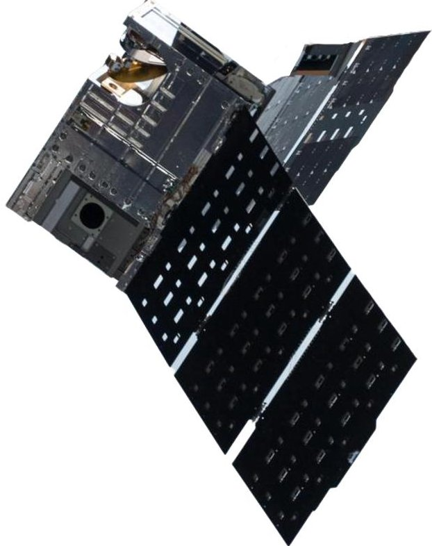

Figure 1: Colorado State University TEMPEST-D, a 6U CubeSat (used with permission)

## 1. Introduction and Background

CubeSats are small form factor satellites that launch as secondary payload on rockets launching primary payload satellites into orbit. CubeSats are often designed and built as university projects on college campuses around the globe. CubeSats missions historically have been prone to failure. In a recent study, over half of all CubeSat missions failed to operate as intended upon reaching orbit. [1]There are a variety of reasons why CubeSat missions fail but little investigation has been conducted into the reasons for failure due to limited data available for analysis and small budgets provided for university-class CubeSats.

Past published literature attributed the high failure rate due to lack of robust and formalized test and evaluation programs. [2] This literature indicated that many CubeSat programs engage in just a few hours of test and evaluation prior to launch and often conduct testing in a haphazard manner.

The author proposes that an optimized systems architecture that will lead to increased mission success for CubeSat missions. As every CubeSat program is unique, the author proposes that test programs be scalable, based on

student volunteer time, program budgets, and other resource constraints.

The authors previously published research that discussed survey results from a survey of CubeSat testing practices, that conducted time study testing of CubeSat test and evaluation, and those results of a CubeSat simulation weighing test comprehensiveness versus time spent conducting CubeSat testing. This paper extends the research to include the model-based system engineering diagrams and drawings for a test and evaluation system that maximizes the mission success rate based on the data. The paper discussing this research is in peer review at the time this article was submitted to the conference proceedings.

Systems Engineering is often described with a pictoral diagram covering a system from concept exploration through development, validation, and concluding with systems maintenance and operation. This pictorial diagram, shown in Figure 2 below, is called the systems engineering "vee". [3] The system described in this paper is used to validate the portion of the "vee" that is highlighted in yellow.

<!-- PDF_PAGE: 2 -->

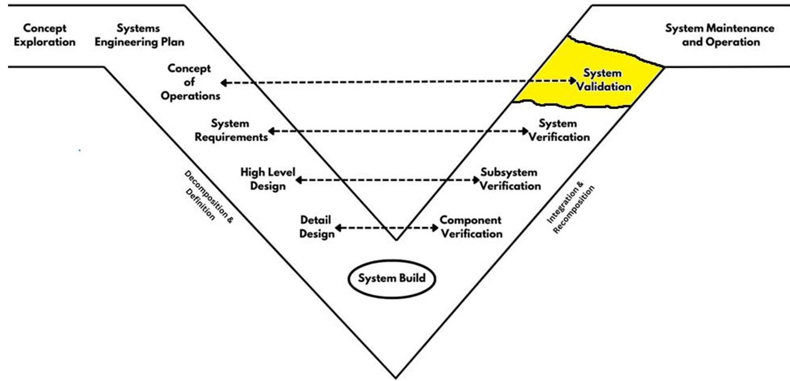

Figure 2: Systems Engineering "Vee"

## 2. Literature Review

A comprehensive literature review was performed at the beginning of the research to determine what previous research had covered with regards to the topic and to understand where gaps in existing research lie. Using model-based systems engineering practices for satellite development is not a new concept. Indeed, the literature review found that model-based systems engineering was designed to aid in solving cross-functional engineering problems, such as those encountered when designing and operating a satellite. [4] [5]

Model Based Systems Engineering is described in the Bradley and Borky textbook. [6] Numerous papers extend model-based systems engineering to CubeSat design, from a discipline-centric viewpoint. [7] [8] However, a limited number of papers extend model-based systems engineering to test and evaluation systems. Examples are [9], [10], and [11].

No journal articles relating to scalable model-based systems engineering for satellite test and evaluation were located during the literature review. Thus, a gap in previous work was identified and this area was targeted for the research described in the following pages.

## 3. Proposed System

The proposed scalable systems architecture was developed using the SysML 2.0 implementation of Universal Modeling Language, as managed by the Object Modeling Group. The primary resources for developing the scalable systems architecture were the references in [6] and [12]. The various diagrams included in this paper were shared between the operational and the logical/functional viewpoints, as shown in Table 1 below. The physical viewpoint was excluded from the scope of work of this research, as much of the content of the physical viewpoint was specific to the CubeSat test facility or laboratory and test setup and not general enough to warrant inclusion in this paper.

<!-- PDF_PAGE: 3 -->

Table 1 below summarizes the diagrams in the following pages and delineates the diagrams as being part of the operational or the logical/functional viewpoint.

<table border="1"><tr><td>Section</td><td>Title</td><td>Viewpoint</td></tr><tr><td>3.1</td><td>System Requirements</td><td>Operational</td></tr><tr><td>3.2</td><td>Use Case Diagrams</td><td>Operational</td></tr><tr><td>3.3</td><td>Block Definition Diagrams</td><td>Operational</td></tr><tr><td>3.4</td><td>Activity Diagram</td><td>Operational</td></tr><tr><td>3.6</td><td>Internal Block Diagram</td><td>Logical/Functional</td></tr><tr><td>3.7</td><td>State Machine Diagram</td><td>Logical/Functional</td></tr></table>

Table 1: Table of Subchapters, Titles, and Viewpoints

## 3.1 System Requirements

The first step in creating a scalable systems architecture was to capture and define the system requirements. The initial step was to review the requirements from a discipline-centric viewpoint. Each test was categorized as one of five top level domains, categorized by the engineering discipline that performed the test. The chart of requirements is shown in Figure 3 below.

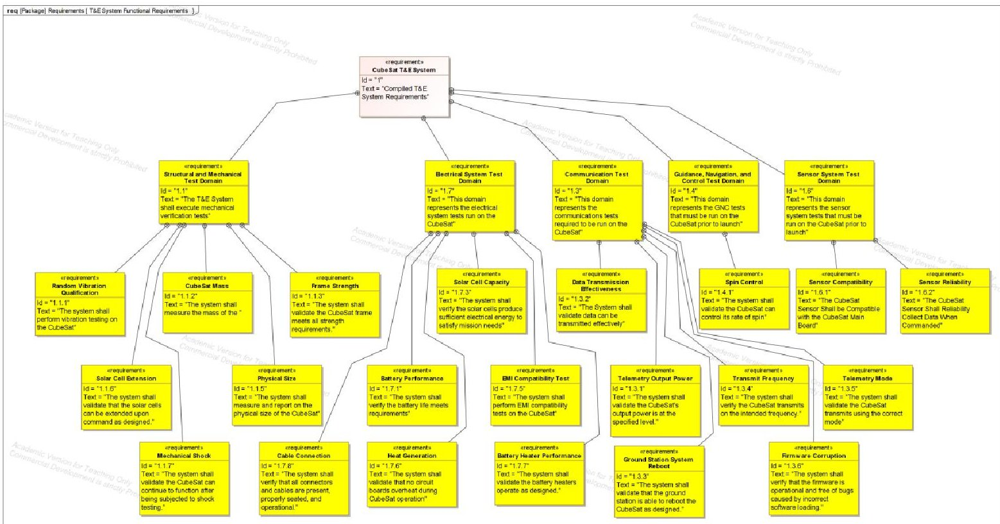

Figure 3: CubeSat Test & Evaluation System Requirements from an Engineering Discipline Viewpoint

In addition to the functional system requirements, the system architecture was evaluated for non-functional requirements. The non-functional requirements covered elements such as safety, efficiency, and usability and the diagram reflecting these requirements is shown in Figure 4 below.

<!-- PDF_PAGE: 4 -->

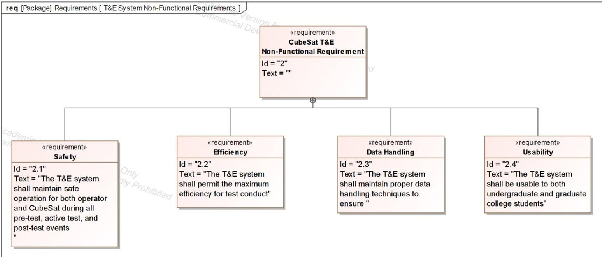

Figure 4: CubeSat Test & Evaluation System Non-Functional Requirements

## 3.2 Use Case Tables

After completing the requirements definition, the next step in developing the scalable systems architecture was to decompose the system requirements into Use Cases of the CubeSat Test and Evaluation system. At this point, the

UC: Perform Full Flight Model Test

<table border="1"><tr><td>Description</td><td>The "Perform Full Flight Model Test" use case is intended to test a CubeSat that is ready to fly. The CubeSat completion is 99% or higher and the only remaining changes would be to address findings discovered during testing. The types of testing performed are described in the domain specifications on the following pages.</td></tr><tr><td>Preconditions</td><td>The CubeSat model is flightworthy condition and no tests have been run.</td></tr><tr><td>Trigger</td><td>The domain leader has determined that the CubeSat should be tested.</td></tr><tr><td>Postconditions</td><td>The CubeSat model has been tested and results documented in the test log</td></tr><tr><td>Data Objects</td><td>Test Number
Test Name
Test Results</td></tr><tr><td>User Roles</td><td>Domain Leader, Test Engineer, Test Witness</td></tr><tr><td>Scenarios</td><td>Primary: The CubeSat full flight model is checked out from the storage location. The domain leader prepares the test plans. The test engineer and test witness don the protective apparel and enters the CubeSat test environment. The test engineer conducts the test and the test engineer records the test results on the test log. The test engineer and test witness depart the test environment, remove the protective apparel, and return the CubeSat to the storage location.
Alternate 1(Exception): The CubeSat fails to perform as expected. The test engineer aborts the test prior to completion in order to protect the CubeSat and/or the test apparatus from damage.</td></tr><tr><td>Allocated Requirements</td><td></td></tr></table>

Figure 5: Full Flight Model Test Use Case

engineering architecture pivoted from a discipline-centric viewpoint to a testcentric viewpoint. The first use case shown in Figure 5, covered the system use case for performing a test on the full flight model CubeSat. Figures 6 and 7 cover performing tests on engineering qualification models and prototype models, respectively.

The three use cases set the stage for scalability. The three uses cases were similar up to the point of scenario description, where each scenario described a unique process for accomplishing the use case depending on the type of CubeSat model being tested. The primary nature of the difference was the care given for handling of the CubeSat as well as test setup and test teardown. The full flight model CubeSats required extra handling precautions and extra test setup and teardown time as compared to the engineering qualification

models and prototype models. The prototype models required the least amount of handling time and eliminated the requirement to use a test engineer to conduct testing, deferring the test conduct to the domain lead specific to the type of test being conducted.

The difference in handling the various types of CubeSats cannot be underemphasized. The prototype CubeSat could be handled in a manner typical of most home computers. It should be handled with reasonable care, but special

<!-- PDF_PAGE: 5 -->

precautions were not required beyond that of standard electronic equipment. Some of the concerns of handling the prototype CubeSat included electrostatic discharge, excessive g-loading, and proper connection and disconnection of

UC: Perform Prototype Test

<table border="1"><tr><td>Description</td><td>The "Prototype Model Test" use case is intended to test a CubeSat that is ready to fly. The CubeSat completion less than 80% and many changes are expected prior to flight ready configuration. The types of testing performed are described in the domain specifications on the following pages.</td></tr><tr><td>Preconditions</td><td>The CubeSat model is flightworthy condition and no tests have been run.</td></tr><tr><td>Trigger</td><td>The domain leader has determined that the CubeSat should be tested.</td></tr><tr><td>Postconditions</td><td>The CubeSat model has been tested and results documented in the test log</td></tr><tr><td>Data Objects</td><td>Test Number
Test Name
Test Results</td></tr><tr><td>User Roles</td><td>Domain Leader</td></tr><tr><td>Scenarios</td><td>Primary: The CubeSat prototype model is checked out from the storage location. The domain leader prepares the test plans. The domain leader conducts the test and records the test results on the test log. The domain leader returns the CubeSat to the storage location.
Alternate 1(Exception): The CubeSat fails to perform as expected. The domain leader aborts the test prior to completion in order to protect the CubeSat and/or the test apparatus from damage.</td></tr><tr><td>Allocated Requirements</td><td></td></tr></table>

Allocated Requirementes

Figure 6: Prototype Test Use Case

cables. Finally, to ensure test efficiency the most logical method of test conduct for the prototype CubeSat was to have the domain lead conduct the test themselves rather than documenting the test plan and providing to a test engineer to conduct the test.

The engineering qualification model had similar handling requirements but because the system was more mature, additional recording and logging of the usage of the CubeSat was required. Thus, the use case also included additional steps to record and log additional data not required of the prototype. The engineering qualification model pivoted to a test engineer for all test conduct, rather than the domain lead, because the test engineer had intimate knowledge about how to properly conduct a controlled test while the domain lead had more specific knowledge about the

technology domain and less about testing the technology.

The full flight model use case required the most amount of handling care as well as the most diligent test

The full flight model use case procedures. The full flight model was the actual CubeSat that will be flown, and thus, any damage or harm caused during testing may potentially cause mission failure. Additionally, great care had to be taken to create the test plans conduct the test, and record the data post test to ensure that the test was properly conducted.

## 3.3 Use Case Diagrams

The next step in developing the systems architecture was to translate the tabular use case definitions into SysML 2.0 models of the Use Case. The CATIA/Magic Systems of Systems Architect, published by Dassault Systèmes of Paris, France [13], was used as the modeling tool

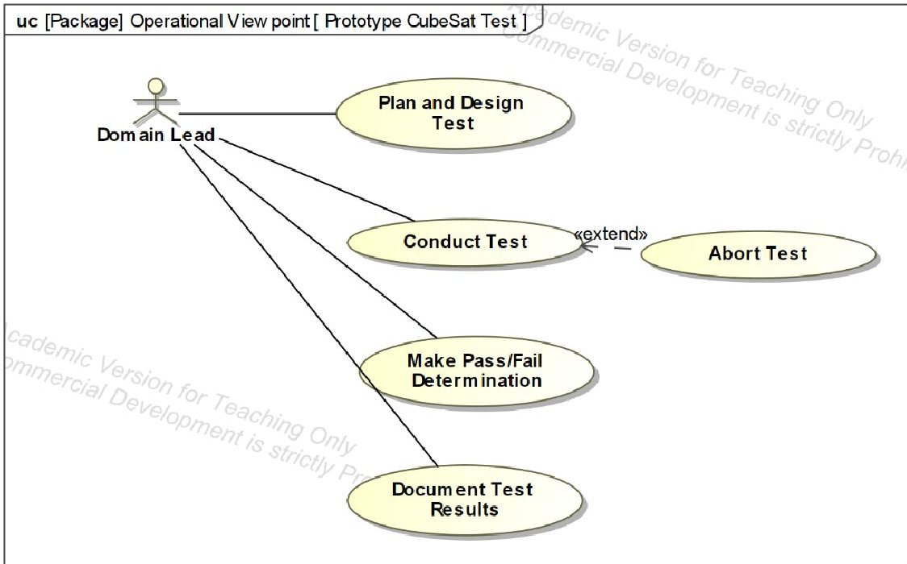

Figure 8: Prototype CubeSat Test Use Case Diagram

for creating the SysML 2.0 models of scalable systems architecture. Figures 8, 9, and 10 below show the use cases diagrams described previously in the tabular format.

The use case for the Prototype CubeSat Test, Figure 8, showed a single actor, the domain lead, together with four primary use cases, which were Plan and Design Test, Conduct Test, Make Pass/Fail Determination, and Document

<!-- PDF_PAGE: 6 -->

Test Results. There was one secondary use case, Abort Test, which extended the Conduct Test use case. This secondary use case was used in the event that something amiss occured during the test and the test needed to be aborted to protect either the CubeSat, the operator, or the test setup itself.

The use case for the Test Engineering Qualification Model CubeSat, Figure 9, showed two Actors, the Domain

Lead and the Test Engineer. In this use case, the domain lead was associated with the use cases of Plan and Design Test and Conduct Test and Document Test Results. The test engineer was associated with the use cases of Conduct Test and Document Test Results. As with the prototype, the final use case of Abort Test was an extension of the Conduct Test use case, and only applies to those situations where the test needed to be aborted prior to completing the test run.

The addition of the test engineer as an actor increased the cost of running the test but added assurance that the test was

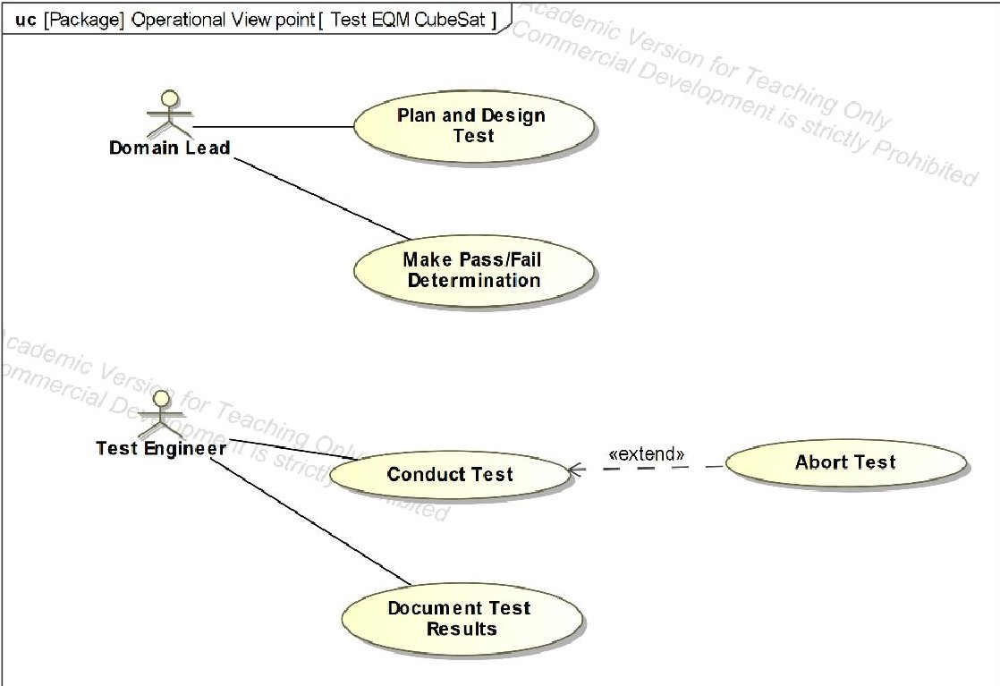

Figure 9: Engineering Qualification Model Test Use Case Diagram

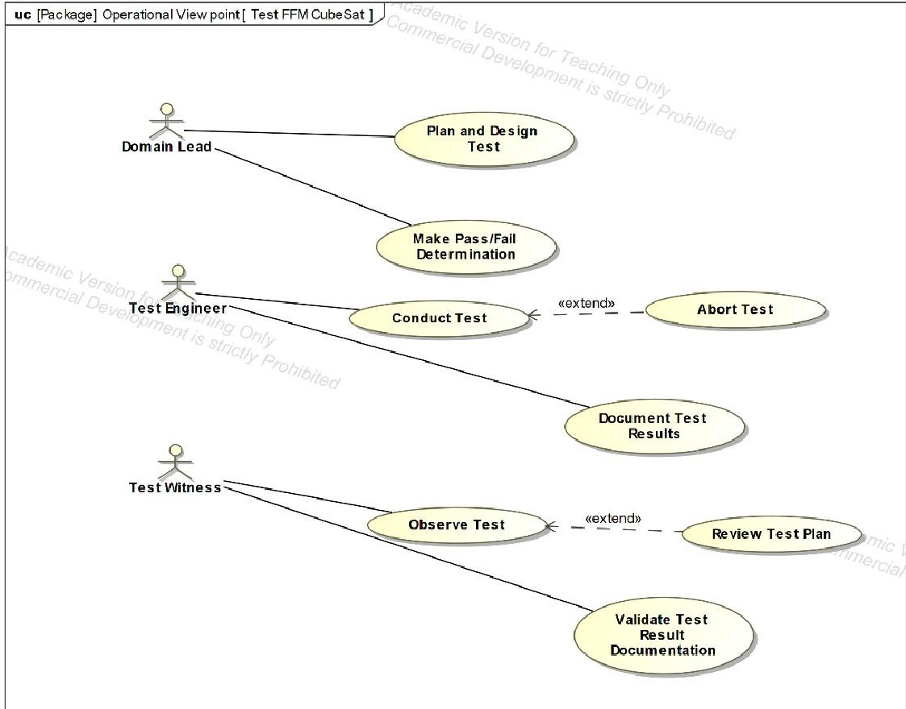

Figure 10: Test Full Flight Model CubeSat

performed properly by a skilled person whose focus was soley on testing. It freed up the domain lead to allow the domain lead to focus more on the technology in the CubeSat and focus less on how to test the CubeSat.

The final use case diagram is shown in Figure 10, which is Test Full Flight Model. This use case included three actors the Domain Lead, the Test Engineer, and the Test Witness. The number of use cases likewise grew to eight use cases. The domain lead continued to be affilated with Plan and Design Test and Make Pass/Fail Determination. The Test Engineer was associated with Conducting Test and

Document Test Results. The Test Witneess was associated with Observe Test and Validate Test Results. Note that the extend use case, Abort Test, was associated with Plan and Design Test as well as Conduct Test. The Test Witness may

<!-- PDF_PAGE: 7 -->

be asked to review the test plan as part of observing the test, and thus the Review Test Case was presented as an extension of the Conduct Test use case.

It was noted that there was a significant cost increase in terms of number of actors and number of use cases as one progressed from prototype testing to full flight model testing.

## 3.4 Test and Evaluation System Block Definition Diagrams

Figure 11 presents the Block Definition Diagram (bdd) for the CubeSat Test and Evaluation System. The toplevel system block was the CubeSat Test and Evaluation System. Five additional blocks were present in the system. The first three were the blocks for CubeSat testing, including the Full Flight Model Test, Engineering Qualification Model Test, and Prototype Model Test. Two additional blocks were present, including the Test Design Block and Post Test Processing block. The three actors, Domain Lead, Test Engineer, and Test Witness, referenced in the use cases, were tied into the respective blocks in the block definition diagram.

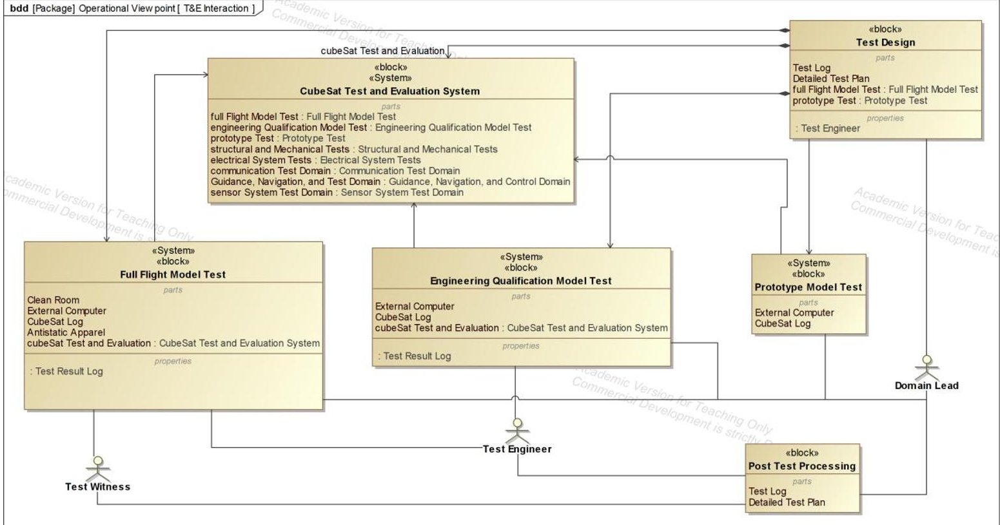

Figure 11: Test and Evaluation System Block Definition Diagram

Figure 12 decomposes the full flight model test block into a lower-level detail, including the lower-level blocks of FFM test preparation, FFM test conduct, and FFM test validation blocks. The intent of this diagram was to show how the various actors and blocks interact with each other at a more detailed level. Figure 14 shows similar lower levels of detail for the Engineering Qualification Model test and Figure 13 shows similar detail to the Prototype Test system. These three block definition diagrams continued to show that the prototype testing was much more time efficient than the full flight model testing, while the full flight model testing was more robust, detailed, and careful, which was appropriate for just-before-launch testing.

The next step in developing the complete model package for the model-based system architecture was to develop the activity diagrams. Activity diagrams were useful tools to understand how the user would interface with the system in a logical start-to-stop manner. Figure 15 was the combined activity diagram for all three use cases. It started with generating the test plan. After the test plan had been completed, the activity diagram splits into three separate paths depending on which CubeSat model was being tested.

The first path was for the prototype CubeSat. The activity diagram showed the CubeSat being checked out by the domain lead, the test activity logged, test conducted, results recorded, and CubeSat returned to the storage location. At this point, the test was terminated.

<!-- PDF_PAGE: 8 -->

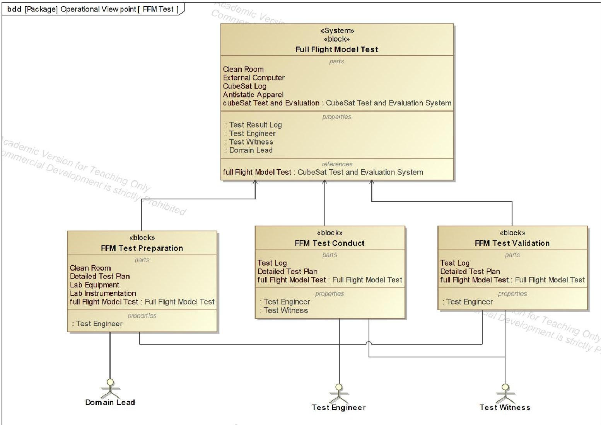

Figure 12: Full Flight Model Block Definition Diagram

The second path was for the Engineering Qualification Model CubeSat. In this case, the test engineer entered the test chamber, logged the test activity, conducted the test, recorded the results, and exited the chamber. The last step prior to termination of the activity was the domain lead decided as to whether the CubeSat passed the test. At this point, the test concluded, and the activity diagram terminates.

The third path was for the full flight model CubeSat. In this case, the test engineer went through a more extensive pretest process of reviewing and understanding the test plan, donning protective apparel and entering the test chamber. The test engineer checked out the CubeSat, logged test activity, and conducted the test. At the same time, the test witness donned protective apparel, entered the test chamber, and witnessed the test. At the conclusion of the test, the test results were recorded by the test engineer and the CubeSat was returned to the storage location. The test engineer and the test witness removed their protective apparel and exited the test chamber. The last step prior to termination of the activity was the domain lead decided whether the CubeSat passed the test.

The next step in development of the model-based system architecture was to look at the interior of one of the blocks via an internal block diagram, or ibd. Figure 17 shows the internal block diagram for the Test Conduct block. It showed that the block consists of test equipment, test instrumentation, test procedures, test execution, and test results. The wire diagrams of the internal block diagram show how data flowed from one part within the block to another part within the block.

<!-- PDF_PAGE: 9 -->

The final diagram that closes out the diagram package for the scalable systems architecture was the state machine diagram, Figure 18. State machine diagrams show the behavior of a particular entity. In the case of the CubeSat Test and Evaluation System, the state machine diagram shows the behavior of the test as it progresses from the initial author test plan to the conclusion of the test.

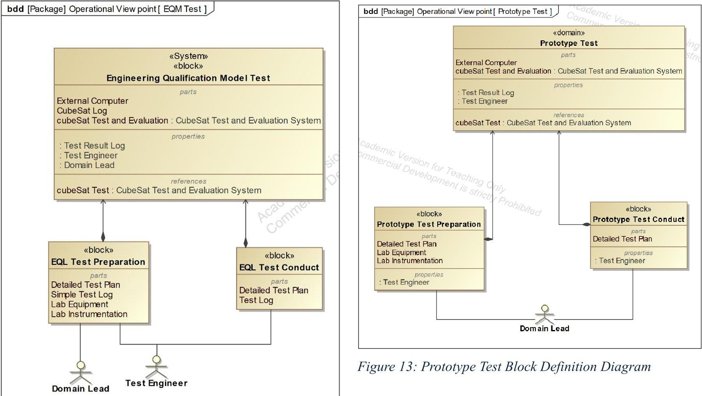

Figure 14: EQM Test Block Definition Diagram

## 3.5 Scalability

One of the concepts explored in this paper is that of scalability. The goal was to develop a system that can be scaled up or down based on resources available to the CubeSat test team. Scaling in terms of test and evaluation is a bit of a tricky concept. In general, most people want lots of testing because it provides assurances that the mission will be successful, but limited resources make it difficult to test as much as desired. Thus, the concept of scaling the test based on the resources of the test team becomes an important concept when discussing test and evaluation systems.

Each of the three block definition diagrams was built as a test-centric viewpoint within the operational viewpoint of the overall system. Each of the three block definition diagrams reflects a different workload on the actors of the system as well as results in a different probability of potential mission success. The system can be scaled up by shifting more testing to the full flight model testing, if test resources (people, lab space, and financial) are adequate or scaled down by shifting more testing to the prototype testing if test resources are more limited. Some teams, whose CubeSats may never be intended to launch due to tight budgets, may shift 100% of the testing to the prototype version. While this would be a poor choice for a CubeSat intended for launch, this may be a viable choice for a team whose CubeSat will remain in the lab until retirement.

<!-- PDF_PAGE: 10 -->

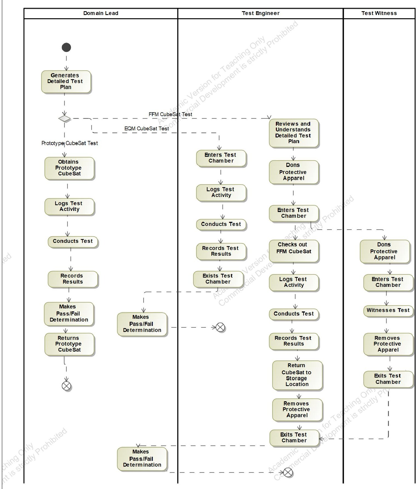

Figure 15: T&E System Activity Diagram

<!-- PDF_PAGE: 11 -->

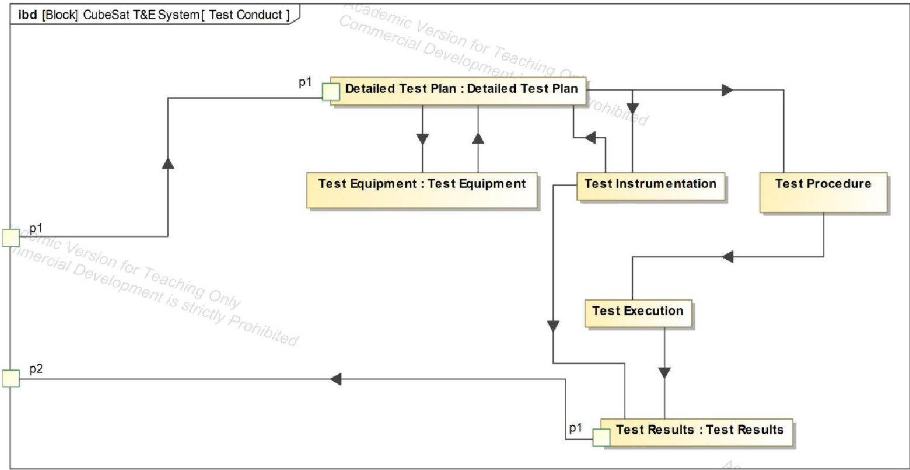

Figure 16: CubeSat Test and Evaluation System Internal Block Diagram

3. 7 State Machine Diagrams

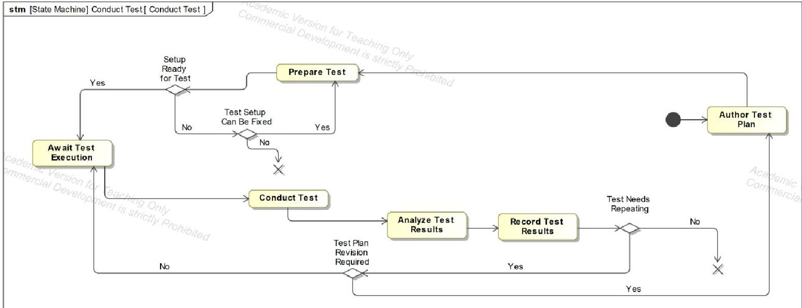

Figure 17: State Machine Diagram for Test during Test Planning, Execution, and Post-Test Phase

## 4. Conclusion and Further Work

In conclusion, the model-based system engineering for the CubeSat Test and Evaluation system has been developed and presented in the previous pages. The work presents approximately two-thirds of the fully defined model-based system engineering plan. The remaining one-third belongs to the physical viewpoint, which is outside of the scope of work for this paper. The model-based systems engineering plan is a scalable plan which is designed to accommodate testing of the prototype, the engineering qualification model, and the full flight model. Depending on the amount of test resources (engineering hours and time), the test team can scale up or scale down the amount of testing and the comprehensiveness of each test using the models presented previously in this paper.

Several opportunities for further research are available to extend this work. The most logical next step would be implementation of the scalable systems test and evaluation architecture into a CubeSat program and monitoring the

<!-- PDF_PAGE: 12 -->

CubeSat program for whether the goal for improved mission success is attained. Other potential opportunities for future work include further refinement of the scalable aspect of the systems architecture. Further research by increasing robustness of the scalable aspect of the test and evaluation system may improve the overall system performance.

Separate from the scalability question, the physical viewpoint was not considered as part of this paper as it was deemed out of scope. The physical viewpoint includes many technical details like model numbers, part numbers, systems, and equipment used as part of the test and evaluation system. Creating diagrams to incorporate the physical elements would be an opportunity further work.

Finally, additional diagrams/models can be created to reflect additional use cases, scenarios, and viewpoints of the system to further aid in making the model-based system reflect realities of using the system.

## 5. References

[1] M. Betancourt, "Half of All First-Time CubeSat Projects End in Failure," Air & Space Magazine, 18 September 2014.

[2] M. Doyle, R. Dunwoody and G. Finneran, "Mission testing for improved reliability," in International Conference on Space Optics, Virtual, 2021.

[3] INCOSE, INCOSE Systems Engineering Handbook, Hoboken: Wiley, 2023.

[4] C. Swenson, "A Systems Engineering Tool for Small Satellite Design," in 15th Annual AIAA/USU Conference on Small Satellites, Logan, UT, 2001.

[5] E. A. Bjorkman, S. Sarkani and T. A. Mazzuchi, "Using Model-Based Systems Engineering as a Farmwork for Improving Test and Evaluation Activities," Systems Engineering, vol. 16, no. 3, pp. 346-362, 2013.

[6] J. M. Borky and T. H. Bradley, Effective Model-Based Systems Engineering, Cham: Springer International, 2009.

[7] D. Kaslow, B. Ayers and P. T. Cahill, "Developing a CubeSat Model-Based System Engineering (MBSE) reference model — Interim status #3," in IEEE Aerospace Conference, Big Sky, 2017.

[8] S. C. Spangelo, D. Kaslow and C. Delp, "Applying Model Based Systems Engineering (MBSE) to a standard CubeSat," in IEEE Aerospace Conference, Big Sky, 2012.

[9] S. Gebreyohannes, A. Karimoddini and A. Homaifar, "Applying Model-Based Systems Engineering to the Development of a Test and Evaluation Tool for Unmanned Autonomous Systems," in IEEE International Systems Conference, Virtual, 2020.

[10] J. Walker, "Enhancing the Test and Evaluation Process: Implementing Agile Development, Test Automation, and Model-Based Systems Engineering Concepts," ProQuest Dissertations & Theses, 2020.

[11] R. An, "MBSE-based aircraft test and evaluation model construction," Journal of physics, vol. 2820, no. 8, pp. 12-15, 2024.

[12] D. R. Herber, Professor, SYSE 567: Systems Engineering, Lectures 1 through 13. [University Course]. Colorado State University, 2023.

[13] Dassault Systems, "CATIA Magic System of System Architecture," Dassault Systems, Paris, 2024.