<!-- PDF_PAGE: 1 -->

## DISSERTATION

# A TAILORED SYSTEMS ENGINEERING PROCESS FOR DEVELOPING STUDENT-BUILT CUBESAT CLASS SATELLITES

Submitted by John M. Gregory Department of Systems Engineering

In partial fulfillment of the requirements For the Degree of Doctor of Philosophy Colorado State University Fort Collins, Colorado Fall 2025

Doctoral Committee:

Advisor: Ronald M. Sega

Co-Advisor: John M. Borky

Thomas Bradley Azer Yalin

<!-- PDF_PAGE: 2 -->

Copyright by John M. Gregory 2025

All Rights Reserved

<!-- PDF_PAGE: 3 -->

# A TAILORED SYSTEMS ENGINEERING PROCESS FOR DEVELOPING STUDENT-BUILT CUBESAT CLASS SATELLITES

This research seeks to develop a novel model-based systems engineering approach that is informed by students, subject matter experts, and instructors through an iterative process. The approach will be tailored to the capabilities, time constraints, and resources typical of undergraduate space systems design and development courses and is likely to be extensible to other organizations with similar constraints in time and other resources. This research was motivated by the rise in prevalence of CubeSats in the education space.

CubeSats have become an important element of space systems engineering education and research activities across the globe. A variety of universities and government stakeholders have developed educational materials and coursework to train students to follow systems engineering processes in developing these systems, but these materials generally recommend that students follow traditional, professionally-derived systems engineering processes without acknowledging the technical and managerial limitations of the workforce in an undergraduate learning environment. The considerations for and procedures followed to develop these systems engineering processes included the use of iterative stakeholder surveys across multiple academic years and are presented here. The results of implementation of these processes in successive cohorts of undergraduate students performing CubeSat design and development are presented.

<!-- PDF_PAGE: 4 -->

The results show a significant improvement in instructor and subject matter expert-assessed student learning and student performance when compared with students who did not utilize systems engineering techniques. The causes of these results are elucidated with evidence of improved understanding of the systems engineering process, and improved cohort-to-cohort information flow. It is expected that when more data is available, there will be an improvement in the satellite system performance when the process developed in this dissertation is used in the design, build and operations of a CubeSat. The Systems Engineering Handbook developed through this study is available for other educators and students in Appendix B of this dissertation and at https://hdl.handle.net/10217/237534.

<!-- PDF_PAGE: 5 -->

## ACKNOWLEDGEMENTS

There are a few people in my life without whom this achievement would not have been possible. This dissertation is dedicated to them:

To my parents, John and Maria Gregory, and my sister, Jennifer Pierce, for their support, guidance, and example from the very beginning of my path.

To my children, John Robert and Leah Jean, whose joy, curiosity and affection have motivated me since the start of this educational journey, and to Elena Rose, who fills our world with wonder as she joins us at the start of our new chapter.

And especially to my wife, Nelly Montenegro. Without your friendship, love and encouragement this would literally have never been possible.

I'm grateful to all of you for your help along the way.

<!-- PDF_PAGE: 6 -->

## TABLE OF CONTENTS

ABSTRACT...ii

ACKNOWLEDGEMENTS...iv

LIST OF TABLES...vii

LIST OF FIGURES...viii

CHAPTER 1: BACKGROUND ...1

1.1 The CubeSat Application ...1

1.2 Systems Engineering ...3

1.2.1 Tailored Systems Engineering Paper ...4

1.3 Model Based Systems Engineering ...4

1.4 Engineering Education Context ...7

CHAPTER 2: RESEARCH AGENDA ...8

2.1. Research Problem 1: Development of a MBSE Template for CubeSat-class Satellites ...8

2.2. Research Problem 2: Development of a Tailored MBSE-enabled Program/Handbook for CubeSat-class Satellite Architecting and Design ...9

2.3. Research Problem 3: Assessment of a Tailored MBSE-enabled Program/Handbook for CubeSat-class Satellite Architecting and Design ...10

2.4. Summary ...11

CHAPTER 3: Development of a MBSE Template for CubeSat-class Satellites ...12

3.1. Introduction ...12

3.2. PSAT1U CubeSat Description ...14

3.2.1 Electrical Power System (EPS) ...15

3.2.2 Attitude Determination Control System (ADCS) ...18

3.2.3 Communications System ...19

3.2.4 Payload ...23

3.3 CubeSat System Reference Model ...23

3.4 PSAT1U Baseline Model ...25

3.5 Application and Use of the Model ...29

3.5.1 Propagating Changes ...29

3.5.2 Payload Design Template ...31

3.5.3 Classroom Implementation ...34

<!-- PDF_PAGE: 7 -->

3.6 Chapter Conclusions ... 35

CHAPTER 4: Development of a Tailored MBSE-enabled Handbook for CubeSat-class Satellite Architecting and Design ... 37

4.1. Curriculum Development ... 37

4.2. Parkinson SAT 1U Example ... 39

4.3. MBSE Integration ... 39

4.4 The Tailored Systems Engineering Handbook ... 40

4.5. Curriculum Deployment ... 42

4.6 Chapter Conclusions ... 43

CHAPTER 5: Assessment of a Tailored MBSE-enabled Handbook for CubeSat-class Satellite Architecting and Design ... 44

5.1 Survey Methods ... 44

5.2. Survey Results ... 46

5.2.1 Design Solution Definition ... 49

5.2.2 Product Implementation ... 53

5.2.3 Product Integration ... 58

5.2.4 Product Verification ... 61

5.2.5 Product Validation ... 64

5.2.6 Product Transition ... 68

5.2.7 Technical Planning ... 71

5.2.8 Interface Management ... 86

5.2.9 Technical Risk Management ... 89

5.2.10 Technical Data Management ... 95

5.2.11 Technical Assessment ... 101

5.3. Assessed Student Performance ... 103

CHAPTER 6: DISCUSSION ... 107

6.1. Mechanisms of Student Performance ... 107

6.2. Artifacts of PSAT1U Project Performance ... 111

CHAPTER 7: RESEARCH CONTRIBUTIONS ... 114

CHAPTER 8: CONCLUSIONS ... 115

REFERENCES ... 118

APPENDIX A: SURVEYS AND SURVEY DEFINITIONS ... 125

APPENDIX B: PUBLICATIONS ... 131

<!-- PDF_PAGE: 8 -->

## LIST OF TABLES

Table 1: PSAT 1U Link Budget Downlink ...22

Table 2: PSAT 1U Link Budget Uplink ...22

Table 3: List of Chapters from the Tailored Systems Engineering Handbook...41

Table 4: SME Responses to Student Adequacy Addressing SE Topics, Least to Most Adequate (n=49)...48

Table 5: Student Responses to Student Adequacy Addressing SE Topics, Least to Most Adequate (n=94)...49

<!-- PDF_PAGE: 9 -->

## LIST OF FIGURES

Figure 1: The PSAT1U Cube Sat...13

Figure 2: PSAT1U satellite design specifications ...15

Figure 3: PSAT1U board organization dimensions ...15

Figure 4: PSAT1U electrical power system design diagram ...16

Figure 5: PSAT1U battery board design...17

Figure 6: Watchdog timer circuit diagram ...18

Figure 7: PSAT1U power budget ...18

Figure 8: PSAT1U side panel with torquer coils ...20

Figure 9: ADCS board model...20

Figure 10: Communications board block diagram ...21

Figure 11: PSAT1U antenna design ...21

Figure 12: CubeSat system reference model informing mission-specific model ...24

Figure 13: PSAT1U baseline model architecture hierarchy ...26

Figure 14: ADCS subsystem block definition diagram ...27

Figure 15: Electrical power system package diagram ...28

Figure 16: Specification for electrical power system power budget information ...28

<!-- PDF_PAGE: 10 -->

Figure 17: Watchdog timer specification...29

Figure 18: The relationship between the watchdog timer and the power subsystem ...30

Figure 19: Mission payload block definition diagram ...32

Figure 20: Generic mission payload specification...33

Figure 21: A defined mission payload specification ...34

Figure 22: Comparison of Course Grade Distribution Pre-Intervention (n=64) and Post-

Intervention (n=191)...103

Figure 23: Comparison of Student Responses That Student Performance “Exceeds Expectations”

Pre-Intervention (n=49) and Post-Intervention (n=45)...104

Figure 24: Comparison of SME Responses That Student Performance “Exceeds Expectations”

Pre-Intervention (n=20) and Post-Intervention (n=28)...105

Figure 25: Comparison of Instructor Ratings of SE Proficiency Pre-Intervention (n=64) and Post-

Intervention (n=127)...106

Figure 26: Comparison of Content and Processes Within the NASA SE Handbook (Black Text)

and the Tailored SE Handbook (Red Text)...109

<!-- PDF_PAGE: 11 -->

## CHAPTER 1: BACKGROUND

## 1.1 The CubeSat Application

CubeSats are a subset of small satellites distinguished by their form factor, typically with volumes in multiples of 1,000 $ cm^{3} $ and mass no greater than 1.33 kg [1]. Because their simple architectures reduce the complexity of development and launch [2] and because of their relatively fast development cycle [2], CubeSats are well-suited for use in education [3] and research [4]. They can provide space system design experience and access to space at a fraction of the cost of conventional satellites [5], though system and mission performance is typically less successful than with larger and more expensive systems.

In educational contexts, the design and development of a CubeSat is challenging technically and organizationally. In general, CubeSats are relatively low-powered, low mass, and low cost. They rely on un-qualified commercial off the shelf components, and are typically not the primary payload on any launch. As a result, they are not powered on prior to launch and have limited control and propulsion capabilities and many launched CubeSats do not succeed in accomplishing their missions. A recent study found that more than 40% of student-built university CubeSat projects fail without even partial mission success, with an additional 24% failing prior to full mission completion [5]. According to a recent study, some of the most successful university teams launching CubeSats have been those who implemented some Systems Engineering principles, kept their designs simple, utilized detailed and version-controlled documentation, and incorporated testing in all phases of the system life cycle [6]. Student educational projects are typically time-limited (constrained to the semester schedule), and relatively low-budget. The workforce for student projects is generally inexperienced, roles

<!-- PDF_PAGE: 12 -->

are poorly defined, and project, personnel and technical management skills are generally poor. Although developers of CubeSats typically accept more risk than those designing more complex space systems, failed projects limit the types of learning that students can engage with (i.e. failed projects will not be able to train students in data processing). These challenges suggest that there is a need for improved systems engineering materials to educate undergraduate students to design CubeSats space systems, to enable the reasonable rigor of a systems engineering process. In order to be successful, this process must be defined, its methodology clearly developed, and its results demonstrated.

As CubeSats have become more frequently utilized, especially in an educational setting, efforts have been made to reduce the time between mission concept definition and implementation [7]. To that end, model-based systems engineering (MBSE) has been identified by those in the small satellite arena as a necessary tool to describe and simplify communication about the defining characteristics of a CubeSat [8].

Agile development has also been attempted in the design of a 1U CubeSat with mixed results; timelines were reduced but the manpower required increased [9]. Other researchers had some success in introducing software engineering techniques which allowed designers to develop capabilities in "sprints" and react more adeptly to changing requirements [10].

Finally, a joint effort between government and industry focused on the development of small spacecraft of various form factors. Known as the Small Spacecraft Technology (SST) program, this group aims to enable unique missions with an emphasis on rapid development [11].

<!-- PDF_PAGE: 13 -->

## 1.2 Systems Engineering

Systems Engineering (SE) is an interdisciplinary engineering domain that offers technical and management tools for developing complex engineered systems. Large space-focused organizations conduct a robust set of SE processes that are aimed to increase the likelihood of successful systems and missions. Various educational and organizational resources exist to communicate the tools and procedures associated with systems engineering. For example, the Department of Defense Acquisition Guideline [12] describes the standard SE procedures governing acquisition and development of US defense systems to include space systems. NASA's Systems Engineering Handbook [13] describes a rigorous SE process for the development of flight and ground systems.

As a discipline, Systems Engineering has existed for about 70 years, and recently, significant principles of the discipline have begun to be redeveloped [14]. New innovations in the discipline include a guideline for life cycle processes aimed to assist both systems engineers and those from other disciplines [15]. Indeed, state of the art reference materials have been developed in recent years to describe the Systems Engineering Body of Knowledge (SEBoK) [16].

As is defined in INCOSE's vision for Systems Engineering in 2035, the state of the art in the discipline is moving toward more effective uses of modeling and simulation, more standardization, and implementation of foundational "system thinking" [17, 18]. Within the Department of Defense specifically, a roadmap has been proposed that utilizes private sector research in an effort to advance space system technology [19].

At NASA's Armstrong Flight Research Center (AFRC), an attempt was documented to implement a new hybrid between agile systems engineering and more traditional processes

<!-- PDF_PAGE: 14 -->

specifically focused on the Aeronautics Research Mission Directorate (ARMD) Test Data Portal (ATDP) resulting in recommendations for the types of projects that such a method could be best suited for [20]. Additional exploration of this method studied the challenges and opportunities related to concept generation and the input of technical subject matter experts [21]. Another NASA effort at Goddard Space Flight Center (GSFC) was led by a Colorado State University professor, Dr. John M. Borky, beginning in 2018 under the sponsorship of NASA's Dr. Dave Richardson when Borky aimed to train Systems Engineers at Goddard to implement MBSE and a Model-Based Systems Architecture Process (MBSAP) in their documentation for robotic science missions [22].

## 1.2.1 Tailored Systems Engineering Paper

In a 2020 conference paper, the author conceived of and described a methodology for developing a tailored SE process [23]. Aerospace Engineering Department faculty at USNA recognized the value of inserting more SE concepts into their Aerospace Engineering curriculum, but were challenged by a lack of opportunity to introduce the full scope of SE knowledge without developing a new elective, a process that itself would be difficult and time-consuming, and would not be disseminated to most students. Instead, the faculty opted to pursue a tailored approach that could be consumed by most Aerospace students in their existing coursework. As a result of this work, initial surveys were distributed and a methodology was devised to develop an optimized SE process. [23]. This served as the baseline for the tailored SE handbook that will ultimately be described.

## 1.3 Model Based Systems Engineering

INCOSE's Object-Oriented Systems Engineering Method provides a functional decomposition approach to model-based systems engineering (MBSE) of hardware and software

<!-- PDF_PAGE: 15 -->

systems [24]. These and other practitioner-oriented system engineering processes use modern tools, a wide set of options and decisions, and detailed models and procedures to enable the design of a variety of complex systems.

Due to the complex nature of these processes, as well as the time and resource constraints intrinsic to undergraduate educational environments, it would be ineffective to implement a comprehensive SE process along the lines of references [12-13, 24]. Indeed, many popular systems engineering education textbooks and syllabi are oriented towards graduate and professional students, or are developed from graduate course curricula. Examples of systems education textbooks derived from and oriented towards graduate courses include Systems Engineering Principles and Practice, $ 3^{\mathrm{rd}} $ Edition, Kossiakoff [25] and Effective Model-based Systems Engineering, Borky and Bradley [26].

INCOSE developed an MBSE Glossary which serves as the official Systems Engineering Body of Knowledge (SEBoK) repository for MBSE definitions in the SE community [27]. MBSE can be particularly critical in defining the technical baseline of a system and informing its acquisition life cycle [28].

The most popular tool for implementing MBSE in practice is the Systems Modeling Language (SysML) for which the governing standard is maintained by the Object Management Group (OMG). Despite this, research indicates that many engineering practitioners are not yet well versed in using and understanding SysML or MBSE tools generally [29]. MBSE adoption was slow at first, but the use of MBSE tools has become more prevalent at space focused organizations such as NASA as well [30].

<!-- PDF_PAGE: 16 -->

When applying MBSE through SysML on a complex aerospace system, studies have indicated that improved requirements traceability can lead to reduced technical risk and an opportunity to detect and resolve issues earlier in the life cycle than would otherwise be possible [31].

Additionally, the software components of a space system are typically integral to the system itself. The literature indicates that applying a model-based approach to software systems is also critical, and that is true in the case of small satellites as well [32].

One key feature that makes a model-based approach ideal in combination with the low-maturity hardware and inexperienced development teams typically associated with CubeSats is that MBSE allows teams to reuse successful design architectures from previous developments [33]. This sort of template development and architecture reuse is one of the processes implemented at USNA driving successful outcomes.

Of course, when dealing with a small satellite development, the question of resource allocation must be considered as well. Implementing Systems Engineering tools such as MBSE may be advantageous, but the cost for setting up this support for a particular project must be understood, and the investment must be worthwhile [34]. A study describing the adoption of model-based tools in the aerospace industry over the course of a 12-month period indicates that the available improvements are significant, but there are obstacles to overcome as well. Some of these obstacles include the interoperability of models and environments and the need for training and education of practitioners [34]. These results are consistent with those seen through the current effort.

<!-- PDF_PAGE: 17 -->

## 1.4 Engineering Education Context

Among the most pressing challenges in systems engineering practice today is a lack of engineering education pipeline that provides students with access to understand MBSE and other Systems Engineering tools along with a lack of an opportunity for existing engineering practitioners to upskill by learning the new state of the art [35]. According to Ko, "engineering education is often perceived to be narrow, boring, and demanding," and therefore it is "incumbent on engineering schools to come up with innovative curricula that" engage students and prepare them for their careers [36].

The systems engineering of CubeSats to achieve both educational and technical goals has been the subject of recent research efforts. CubeSats have been used as an exemplar system to educate undergraduate students in modern systems engineering processes as well as MBSE Error! Reference source not found., Agile Development 37, and Digital Engineering 38. Generally, these studies present a technical focus; their objectives are improvement of project performance using a resource-constrained student workforce. As a result, a research gap in systems engineering education exists in that fewer researchers have sought to develop or demonstrated systems engineering methods and frameworks that can improve student learning of systems engineering principles. This current effort is an attempt to use CubeSats as a vehicle to advance Systems Engineering knowledge at the undergraduate level. The process of developing the tailored guideline as well as the use of MBSE principles may be more widely applicable to other engineering education contexts.

<!-- PDF_PAGE: 18 -->

## CHAPTER 2: RESEARCH AGENDA

In response to these challenges, this research proposes and evaluates a CubeSat-specific, MBSE-enabled systems engineering process tailored for organizations with limited resources to dedicate to Systems Engineering. This research project is constructed from three complementary research problems that when resolved will lead to an improved understanding of the field of SE education in the context of CubeSats.

These problems are defined as follows:

## 2.1 Research Problem 1: Development of a MBSE Template for CubeSat-class Satellites

CubeSats have most commonly been used by students and researchers as a cost-effective means of accessing space. As demand grows for more complex space systems, however, the complexity and capability of CubeSat systems must also increase. One drawback of increased complexity is the increase in obscurity of how a change in one area of the design propagates through the rest of the system. Dealing with this added complexity takes away from student education experiences while also increasing he design cycle time, taking CubeSats further away from the key characteristic advantages that define them. One solution to this is to apply Model-Based Systems Engineering (MBSE) methodology to CubeSats, providing a standardized template that the developers can use to make the design cycle more efficient. Lately, the practice of MBSE has become increasingly nuanced and advances have focused on the application of tools and practices to aid in the development of space systems. This includes efforts concerned with the development and description of CubeSats. Most recently, the development of the CubeSat System Reference Model (CSRM) by the International Council on Systems Engineering (INCOSE) Space Systems Working Group (SSWG) has better enabled the description of

<!-- PDF_PAGE: 19 -->

CubeSat systems using common modelling language. At the U.S. Naval Academy (USNA), the Small Satellite Program has been developing and launching student-built project satellites since 2001 and CubeSats since 2012. Given the time constraints and minimal funding of an undergraduate education program, the need for a simple build template for CubeSats was recognized and the PSAT1U system was conceived. PSAT1U is a 1U CubeSat designed to be utilized as a modular architecture with easily accessible parts allowing students to focus on designing and implementing their on-board payload and mission systems without spending more time carrying out trade studies on well understood subsystems and components. The USNA has used the CSRM along with documentation from the development of PSAT1U to create a Model-Based representation of the PSAT1U system. The aim of this model is to aid in the education of undergraduate engineering students in their capstone design course as well as to reduce design and development times for future CubeSat systems. This paper will present an overview and description of the PSAT1U model, outline the design of the physical system as well as the development of the MBSE model and discuss its implementation in a classroom setting as well its potential role in the development of future systems. Finally, the propagation of system changes through the model will be demonstrated to illustrate the utility of describing a CubeSat system this way.

## 2.2 Research Problem 2: Development of a Tailored MBSE-enabled Program/Handbook for CubeSat-class Satellite Architecting and Design

CubeSats have become an important component of space systems engineering education and research activities across the globe. A variety of universities and government stakeholders have developed educational materials and coursework to train students to follow systems engineering processes in developing these systems, but these materials generally recommend that students

<!-- PDF_PAGE: 20 -->

follow traditional, industry-derived systems engineering processes without acknowledging the technical and managerial limitations of the workforce in an undergraduate learning environment. This research seeks to develop a more modern model-based systems engineering approach that is tailored to the capabilities, time constraints, and resources typical of undergraduate space systems design and development courses. The considerations for and procedures followed to develop these systems engineering processes are presented here, along with the resulting handbook itself. The Systems Engineering Handbook that is the subject and object of this study is available for other educators and students at https://hdl.handle.net/10217/237534.

## 2.3 Research Problem 3: Assessment of a Tailored MBSE-enabled Program/Handbook for CubeSat-class Satellite Architecting and Design

This research problem seeks to develop an understanding of the learning outcomes associated with the procedures and artifacts developed under the previous two research efforts. The effectiveness of these processes in improving student learning of SE concepts and in improving CubeSat launch readiness is evaluated through its implementation in three successive academic year cohorts at the US Naval Academy (USNA) over the period 2019-2022. Student understanding of material concepts is measured both by student-cohorts themselves as well as engineering instructors and other subject matter experts. Due to an interruption of in-person education and a corresponding lack of completed designs through the COVID-19 pandemic, an analogy is drawn from the literature to evaluate the potential of this process to improve the quality of student designs and ensure their resulting CubeSat systems would be more successful.

<!-- PDF_PAGE: 21 -->

## 2.4 Summary

The structure of the dissertation from this point forward is as follows. The next chapters present the research methods and results associated with each of these three research questions. These are followed by a chapter on research contributions, and conclusions.

<!-- PDF_PAGE: 22 -->

## CHAPTER 3: Development of a MBSE Template for CubeSat-class Satellites

This chapter presents the research process and results for resolution of research problem 1, which requires the Development of a MBSE Template for CubeSat-class Satellites. This work was previously published in the peer reviewed conference paper: J. M. Gregory et al., "Applying a Model-Based Approach to Develop a Standardized Template for CubeSat-class Satellites," 2020 IEEE Aerospace Conference, Big Sky, MT, USA, 2020, pp. 1-11, doi: 10.1109/AERO47225.2020.9172748.

## 3.1. Introduction

The subset of nanosatellites known as CubeSats can be optimized for use in education and research and can provide inexpensive access to space. These satellites are distinguished by their uniform structure, typically coming in multiples of 10 $ cm^{3} $ and mass no greater than 1.33 kg [1]. At the U.S. Naval Academy (USNA), the Small Satellite Program has been developing, testing and launching student-built project satellites since 2001 with the first CubeSat class satellite launched in 2012.

As the need for a simple build template for CubeSats was identified, the Parkinson Sat 1U (PSAT1U) system, named for the inventor of the Global Positioning System (GPS) was developed. Its purpose is to serve as a modular architecture with easily accessible parts allowing students to focus on designing and implementing their preferred on-board payload and mission systems without spending undue time carrying out trade studies on well understood subsystems and components. Figure 1 below displays a Computer Aided Design (CAD) render of the outer structure and a photograph of the inner components of PSAT1U.

<!-- PDF_PAGE: 23 -->

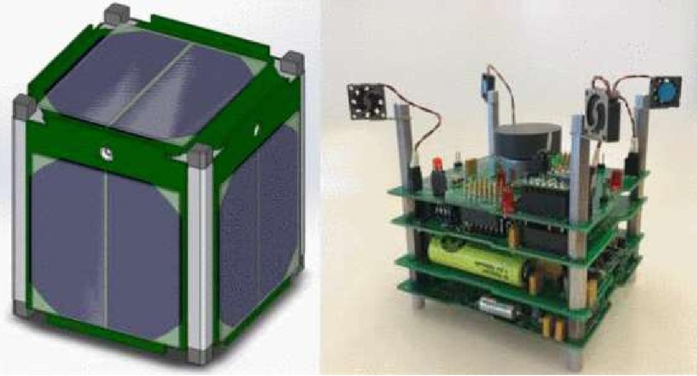

Figure 1: The PSAT1U CubeSat

In order to enhance the capability of the PSAT1U design as both a tool for teaching undergraduate engineering students and as a capable platform for flying mission payloads, the technique of Model Based Systems Engineering (MBSE) will be utilized. MBSE is defined as "the formalized application of modeling to support system requirements, design, analysis, verification and validation activities beginning in the conceptual design phase and continuing throughout development and later life cycle phases." [17]

Specifically, the CubeSat System Reference Model (CSRM), an initiative developed by the International Council on Systems Engineering (INCOSE) Space Systems Working Group (SSWG), was chosen as a CubeSat specific template providing the "logical elements [which] can be reused as a starting point for a mission-specific CubeSat logical architecture." [39] As such, the CSRM is itself a modular architecture enabling the design of a mission-oriented CubeSat. In

<!-- PDF_PAGE: 24 -->

combination, the PSAT1U described in MBSE terms through the lens of the CSRM will serve as a standardized template enabling development of future CubeSat class satellites at USNA.

## 3.2. PSAT1U CubeSat Description

The mission of the PSAT1U project is to develop a 1U CubeSat educational satellite to expand on the launch opportunities and mission capabilities of previous midshipmen-built 1.5U satellites. The design reduces total cost through innovative engineering solutions without sacrificing overall performance and capabilities. PSAT1U provides an engineering model for future midshipman use as well as a standard design to be replicated by other academic institutions and their various payloads.

PSAT1U's satellite design specifications are in Figure 2. As seen in the figure, the satellite is designed for a maximum mass of 1500 g within the 1U frame. The specific dimensions of the structure itself, as well as the satellite's board organization, are shown in Figure 3. PSAT1U retains the capability to host a variety of payloads on its top payload board. The Electrical Power System (EPS) and physical layout of the satellite are designed with the goal of remaining flexible and providing all necessary power to whatever payload might be placed on board for flight.

<!-- PDF_PAGE: 25 -->

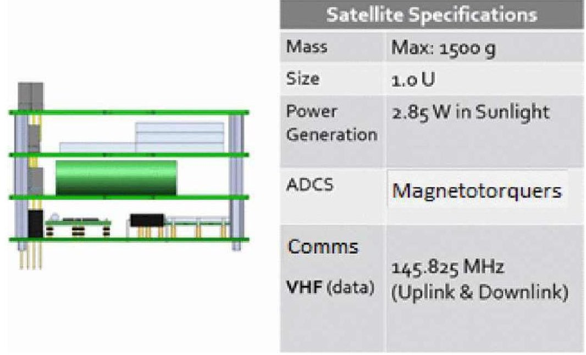

Figure 2: PSAT1U satellite design specifications

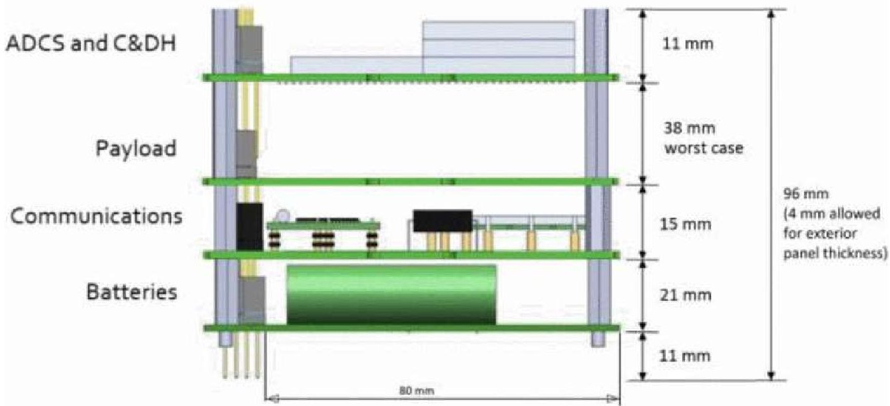

Figure 3: PSAT1U board organization dimensions

## 3.2.1 Electrical Power System (EPS)

Utilizing a 1U footprint, the PSAT1U spacecraft must make efficient use of its small volume without sacrificing overall performance and capabilities. The largest impact in using this small footprint when compared to larger CubeSat class satellites is a reduction in the potential solar

<!-- PDF_PAGE: 26 -->

panel collection area. In order to address this challenge, the EPS design is based on only two Sol Aero ZTJ solar cells per side, as shown in Figure 4 below.

PSAT1U utilized ZTJ solar cells, rather than the very expensive UTJ solar cells used in other CubeSats built at USNA. While the UTJ cells offer predictable performance due to their high cost and quality control, the ZTJ cells offer similar performance at one-tenth of the cost. The ZTJ cells are factory-seconds that do not include coverglass. Instead, the design calls for the thicker microscope coverglass at 1% of the cost and the added mass is insignificant.

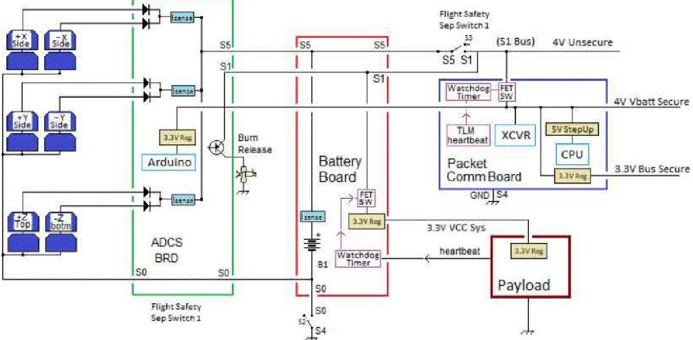

Figure 4: PSAT1U electrical power system design diagram

Nickel Cadmium (NiCd) batteries have over 50 years of space heritage and survivability and offer the best lifetime survivability and reliability compared to Lithium-ion batteries. Lithiumions offer more power in a smaller battery cell, but are much less forgiving of abuse and require complex battery management systems per cell to prevent hazards and failures. Single errors in charging or discharge can destroy the cell permanently. On the other hand, NiCd's can survive occasional overcharge and complete discharge without damage. NiCd batteries are also

<!-- PDF_PAGE: 27 -->

traditionally used in USNA CubeSats due to their reliability and low cost. PSAT1U's battery board design is shown in Figure 5.

Radiation-induced upsets and glitches can cause errors in spacecraft processors. In order to combat this, PSAT1U has two secure power circuits and watchdog timers. One is on the communications board that will reset the communications Central Processing Unit (CPU) and cycle power in the event of any lockup that stops its routine as shown in Figure 6 below.

The main power bus for critical optional payload boards is the 5 V secure line. It is made secure by the second watchdog timer on the battery board that can cycle power off and back on if there is a payload processor failure. A processor failure is assured if the optional payload CPU fails to toggle the heartbeat periodically. This secure payload bus supplies critical voltage to the other boards and is independent from the power to the communications board, named the SATT4.

Additionally, a 4 V unsecure bus will also stem from the battery board to deliver unregulated and unsecure power to the Attitude Determination Control System (ADCS) board and communications board circuits that only need raw power or that do not need the reset possibility.

The overall power budget for PSAT1U is displayed in Figure 7.

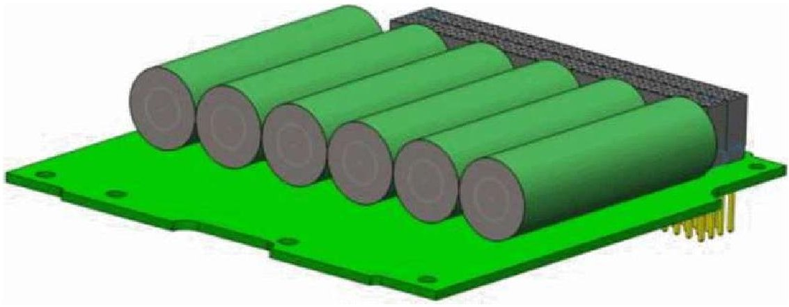

Figure 5: PSAT1U battery board design

<!-- PDF_PAGE: 28 -->

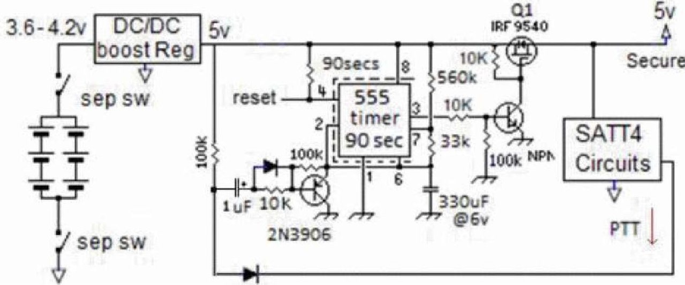

Figure 6: Watchdog timer circuit diagram

<table border="1"><tr><td>Load</td><td>Voltage</td><td>Ipk</td><td>Duty Cycle</td><td>Normal(mA)</td><td>StdBy(mA)</td><td>ALL ON(mA)</td></tr><tr><td>SATT4 RX(StdBy)</td><td>5</td><td>60</td><td>90%</td><td>54</td><td>54</td><td>OFF</td></tr><tr><td>SATT4 RX</td><td>3.3</td><td>120</td><td>10%</td><td>12</td><td>OFF</td><td>120</td></tr><tr><td>SATT4 TX Tlm</td><td>4</td><td>750</td><td>2%</td><td>15</td><td>15</td><td>750</td></tr><tr><td>SATT4 TX users</td><td>4</td><td>750</td><td>4%</td><td>30</td><td>OFF</td><td>OFF</td></tr><tr><td>Arduino CPU On</td><td>3.3</td><td>5</td><td>10%</td><td>1</td><td>OFF</td><td>5</td></tr><tr><td>Arduino CPU Sleep</td><td>3.3</td><td>2</td><td>90%</td><td>2</td><td>2</td><td>OFF</td></tr><tr><td>Payload StdBy</td><td>3.3</td><td>-</td><td>-</td><td>-</td><td>-</td><td>-</td></tr><tr><td>Payload OP</td><td>3.3</td><td>-</td><td>-</td><td>-</td><td>-</td><td>-</td></tr><tr><td>Totals</td><td></td><td></td><td></td><td>113</td><td>71</td><td>946</td></tr></table>

Figure 7: PSAT1U power budget

## 3.2.2 Attitude Determination Control System (ADCS)

The ADCS depends on sun vector inputs from all solar panels and the ADCS CPU is also used to read solar panel current from each panel. Therefore, the ADCS board serves as the central connection point for the solar side panel connectors which contain all of these signals and power. To facilitate these requirements, the ADCS board was placed at the top of the stack so that

<!-- PDF_PAGE: 29 -->

the connections to all of the side panels can be made last during assembly. Serving as the connection point between the ZTJ solar cells and the battery board, the ADCS board sums the current from all the solar panels to power the rest of the EPS system.

Figure 8 shows the side panel for PSAT1U and highlights the embedded torquer coils. The coils are present on both sides of the panel, and each face of the satellite is populated with a panel. Each torquer coil is designed to provide a maximum of $ 1. 4 3 \times1 0^{-7} $ Nm of torque. With four coils in total, the maximum torque available for the spacecraft is $ 5. 7 4 \times1 0^{-7} $ Nm. All attitude control will be performed by these coils.

Magnetometers and sun sensors fulfill all attitude determination roles on PSAT1U. These standard components are the same ones used on previous USNA CubeSats. The ADCS board is shown below in Figure 9.

## 3.2.3 Communications System

PSAT1U has a communications board with a 1.5-Watt Automatic Packet Reporting System (APRS) transceiver capable of operating in the 2-meter amateur radio band. The board can be programmed with two separate operating configurations with the goal of enabling or disabling user digipeating (packet relay) and switching the uplink receiver to a separate frequency if needed for a payload experiment. The SATT4 communications board is displayed in Figure 10.

Operating with the SATT4 communications board, uplink and downlink will occur at a frequency of 145.825 MHz. A Very High Frequency (VHF) wire antenna was designed to facilitate communication at this frequency and achieve a Standing Wave Ratio (SWR) as close to ideal as possible. The antenna design is 724.5 mm in length. A model of PSAT1U's antenna

<!-- PDF_PAGE: 30 -->

design created using EZNEC software is shown in Figure 11. The downlink and uplink link budgets for PSAT1U are included in Table 1 and 2.

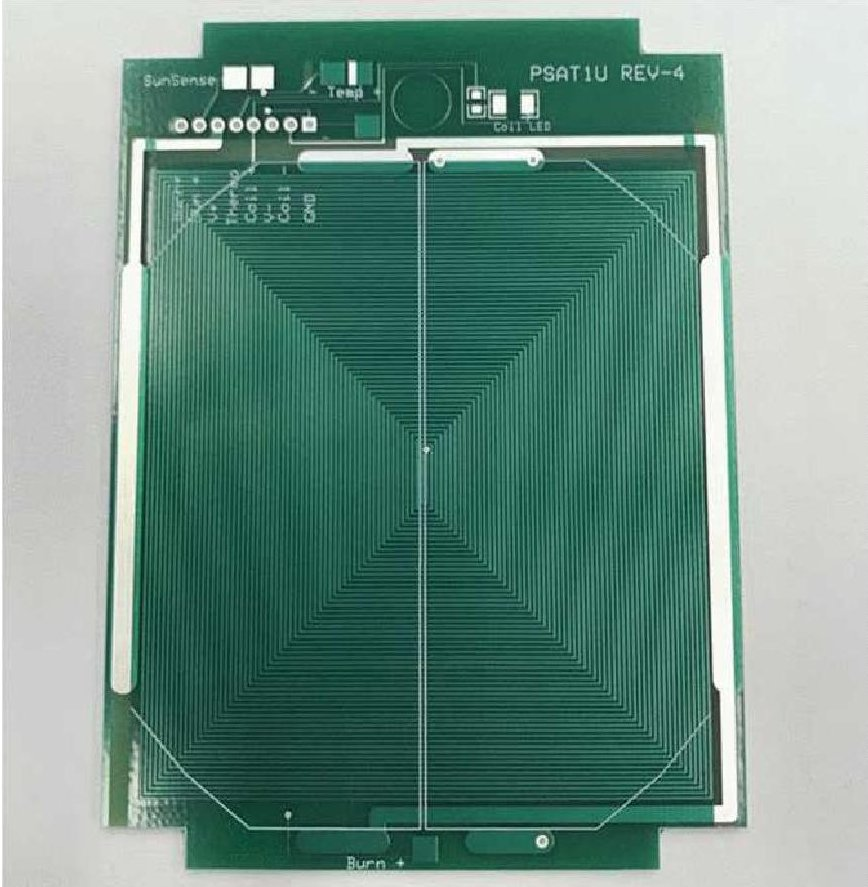

Figure 8: PSAT1U side panel with torquer coils

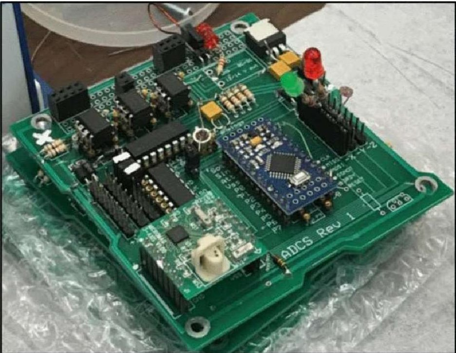

Figure 9: ADCS board model

<!-- PDF_PAGE: 31 -->

## SATT4 Block Diagram

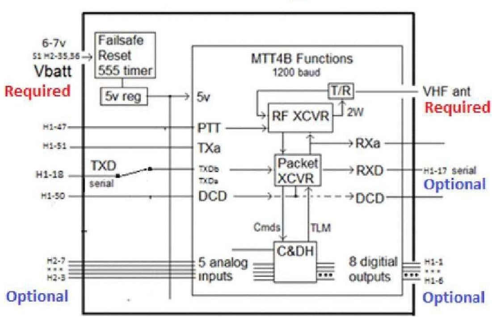

Figure 10: Communications board block diagram

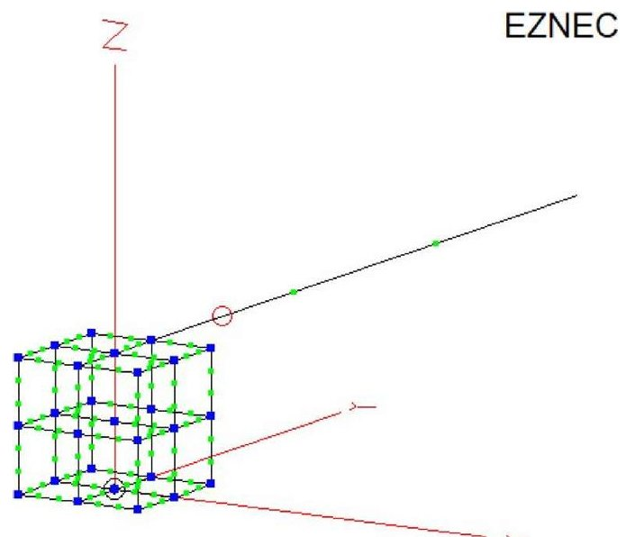

Figure 11: PSAT1U antenna design

<!-- PDF_PAGE: 32 -->

PSAT1U VHF Downlink

<table border="1"><tr><td colspan="2">Overhead Scenario(30°El)</td><td colspan="2">Horizon Scenario(10°El)</td></tr><tr><td>Frequency(MHz)</td><td>145.825</td><td>Frequency(MHz)</td><td>145.825</td></tr><tr><td>Altitude(km)</td><td>600.00</td><td>Altitude(km)</td><td>600.00</td></tr><tr><td>Elevation(deg)</td><td>30.00</td><td>Elevation(deg)</td><td>10.00</td></tr><tr><td>Range(km)</td><td>1075.19</td><td>Range(km)</td><td>1932.24</td></tr><tr><td>Space Loss(dB)</td><td>-136.35</td><td>Space Loss(dB)</td><td>-141.44</td></tr><tr><td>PowerTransmitter of Satellite(dBW)</td><td>1.76</td><td>PowerTransmitter of Satellite(dBW)</td><td>1.76</td></tr><tr><td>GainTransmitter Antenna(omni)(dB)</td><td>0.00</td><td>GainTransmitter Antenna(omni)(dB)</td><td>0.00</td></tr><tr><td>GainReceiver Antenna(dB)(Mobile Users)</td><td>5.00</td><td>GainReceiver Antenna(dB)(Mobile Users)</td><td>5.00</td></tr><tr><td>Incidental Losses(dB)</td><td>3.00</td><td>Incidental Losses(dB)</td><td>3.00</td></tr><tr><td>Pr(dBW)</td><td>-132.59</td><td>Pr(dBW)</td><td>-137.68</td></tr><tr><td>Pr(dBm)</td><td>-102.59</td><td>Pr(dBm)</td><td>-107.68</td></tr><tr><td>Rx Threshold USNA&amp;Users(dBm)</td><td>-116.00</td><td>Rx Threshold USNA&amp;Users(dBm)</td><td>-116.00</td></tr><tr><td>Margin for User(dBm)</td><td>13.41</td><td>Margin for User(dBm)</td><td>8.32</td></tr><tr><td>Rx Command Link Antenna Gain(dBi)</td><td>15.00</td><td>Rx Command Link Antenna Gain(dBi)</td><td>15.00</td></tr><tr><td>Margin Command Link(dBm)</td><td>28.41</td><td>Margin Command Link(dBm)</td><td>23.32</td></tr></table>

Table 2: PSAT1U link budget uplink

PSAT1U VHF Uplink

<table border="1"><tr><td colspan="2">Overhead Scenario(30°EI)</td><td colspan="2">Horizon Scenario(10°EI)</td></tr><tr><td>Frequency(MHz)</td><td>145.825</td><td>Frequency(MHz)</td><td>145.825</td></tr><tr><td>Altitude(km)</td><td>600.00</td><td>Altitude(km)</td><td>600.00</td></tr><tr><td>Elevation(deg)</td><td>30.00</td><td>Elevation(deg)</td><td>10.00</td></tr><tr><td>Range(km)</td><td>1075.19</td><td>Range(km)</td><td>1932.24</td></tr><tr><td>Space Loss(dB)</td><td>-136.35</td><td>Space Loss(dB)</td><td>-141.44</td></tr><tr><td>PowerTransmitter of user(dBW)</td><td>7.00</td><td>PowerTransmitter of user(dBW)</td><td>7.00</td></tr><tr><td>GainTransmitter Antenna(dB)(Mobile Users)</td><td>5.00</td><td>GainTransmitter Antenna(dB)(Mobile Users)</td><td>5.00</td></tr><tr><td>GainReceiver Antenna(dB)</td><td>0.00</td><td>GainReceiver Antenna(dB)</td><td>0.00</td></tr><tr><td>Incidental Losses(dB)</td><td>3.00</td><td>Incidental Losses(dB)</td><td>3.00</td></tr><tr><td>Pr(dBW)</td><td>-127.35</td><td>Pr(dBW)</td><td>-132.44</td></tr><tr><td>Pr(dBm)</td><td>-97.35</td><td>Pr(dBm)</td><td>-102.44</td></tr><tr><td>Rx Threshold Satellite(dBm)</td><td>-110.00</td><td>Rx Threshold Satellite(dBm)</td><td>-110.00</td></tr><tr><td>Margin Users(dBm)</td><td>12.65</td><td>Margin Users(dBm)</td><td>7.56</td></tr><tr><td>Rx Command Link Antenna Gain(dBi)</td><td>15.00</td><td>Rx Command Link Antenna Gain(dBi)</td><td>15.00</td></tr><tr><td>Margin Command Link(dBm)</td><td>22.65</td><td>Margin Command Link(dBm)</td><td>17.56</td></tr></table>

As seen in the budgets, the link margins are favorable in both the downlink and uplink scenarios. In the horizon scenarios for VHF downlink and uplink, users are predicted to experience 8.32 dB and 7.56 dB margins respectively.

<!-- PDF_PAGE: 33 -->

## 3.2.4 Payload

PSAT1U possesses the ability to host a variety of different payloads, depending on the mission objective. In this way, the CubeSat was specifically designed to be a modular architecture with well understood interfaces to allow practitioners to concentrate on payload design for their particular application. The payload board resides at the top of PSAT 1U's structure, as displayed in Figure 3.

PSAT1U is able to host payloads within certain physical and electrical specifications. Payloads must have a mass less than 567 g. Any payload must have a maximum volume of 247 $ cm^{3} $ . Specifically, payloads are allowed a maximum height of 4.0 cm, maximum width of 8.0 cm, and maximum depth of 7.7 cm. Payloads should operate within the available on-orbit average power of 1.92 W, operating at a voltage of 5 V during daylight.

## 3.3 CubeSat System Reference Model

The INCOSE Systems Engineering Vision 2020 [17], included efforts in numerous engineering disciplines to demonstrate applications of MBSE and Systems Modeling Language (SysML) [39]. One of the focus areas of this effort, undertaken by the SSWG, was to utilize these tools to model space systems. Finally, starting in 2011, the SSWG began investigating the applicability of MBSE specifically for CubeSats [39].

Under the above referenced effort, the SSWG have been developing the CSRM, which serves as an MBSE template for modeling the space system, ground system, and each of the subsystems and components of a CubeSat System [39]. Specifically, the CSRM aims to be a starting point for any mission-specific CubeSat development [39].

<!-- PDF_PAGE: 34 -->

In order to develop a mission specific CubeSat model utilizing the CSRM as a starting point, users can combine their own requirements, mission specific stakeholder use cases and viewpoints with the existing CSRM model elements and diagram templates as well as the library of system components to be utilized as needed. This process is described graphically in Figure 12. The present effort is aimed at utilizing the CSRM to describe the PSAT1U Mission Specific model.

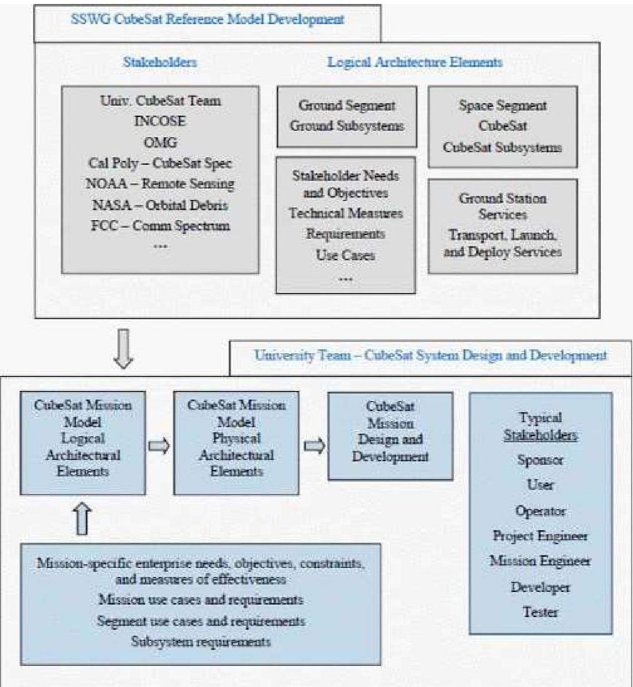

Figure 12: CubeSat system reference model informing mission-specific model

<!-- PDF_PAGE: 35 -->

## 3.4 PSAT1U Baseline Model

The PSAT1U Baseline Model is an MBSE representation of the satellite developed using the CSRM as a starting point. The baseline model is unique in that it defines all of the important subsystems, components, and interfaces of the PSAT1U, but leaves the payload and mission specific modules undefined. This allows a user to understand the payload design space in clear terms. In this way, a practitioner can apply their mission application and the components associated with it to the baseline model to create their own mission specific model.

The CSRM was obtained and accessed using CAMEO Systems Modeler MBSE Software V19.0. Each predefined package or template in the CSRM was reviewed and the architecture was appended to include specific information describing PSAT1U. As an example, Section 10, the overall Architecture Hierarchy of the PSAT1U Baseline Model is depicted in Figure 13.

<!-- PDF_PAGE: 36 -->

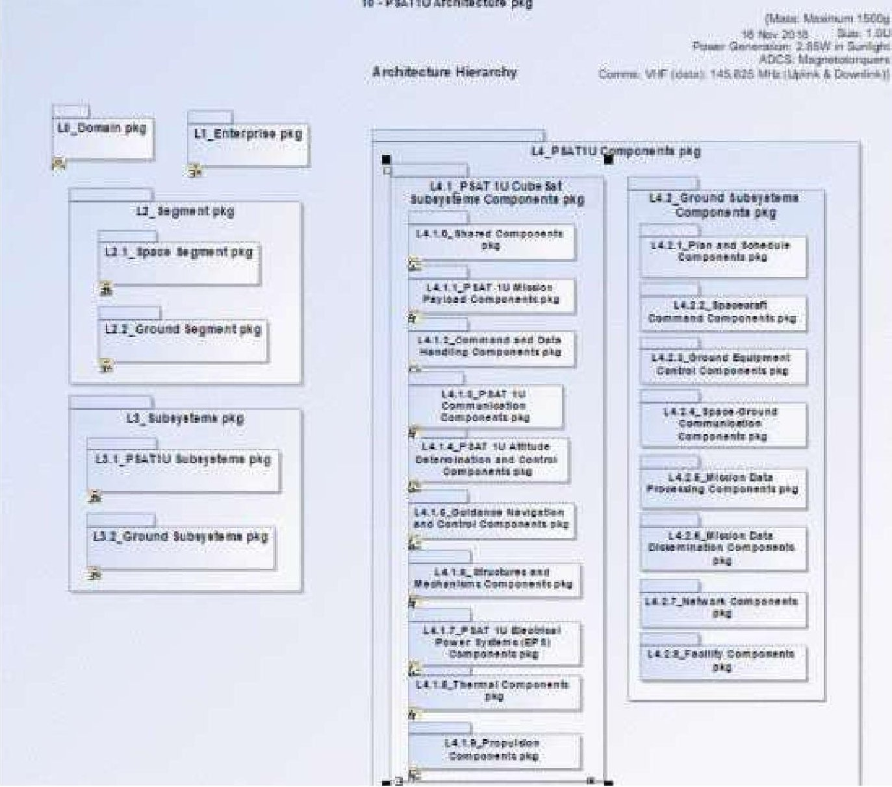

Figure 13: PSAT1U baseline model architecture hierarchy

The Architecture Hierarchy encompasses all of the subsystems, subsystem components and ground system components along with the domain, enterprise and segment packages.

From within the Architecture Hierarchy, any of the Subsystem Structures Packages can be accessed and critical information and interfaces can be reviewed and understood. Figure 14, for example, represents the ADCS Subsystem Block Definition Diagram and its relationships with other parts of the structures package and shared components. In turn, more information and relationships are contained within each instance of a subsystem or component.

<!-- PDF_PAGE: 37 -->

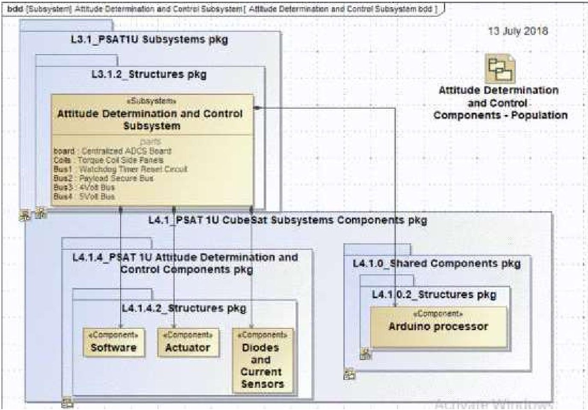

Figure 14: ADCS subsystem block definition diagram

Figure 15 is the package diagram describing the EPS for the spacecraft. In it, each of the main component parts are described and further details and specifications of those parts are also available. Within the specification for the EPS, pertinent information such as the as-designed power budget (Figure 16) is also available.

<!-- PDF_PAGE: 38 -->

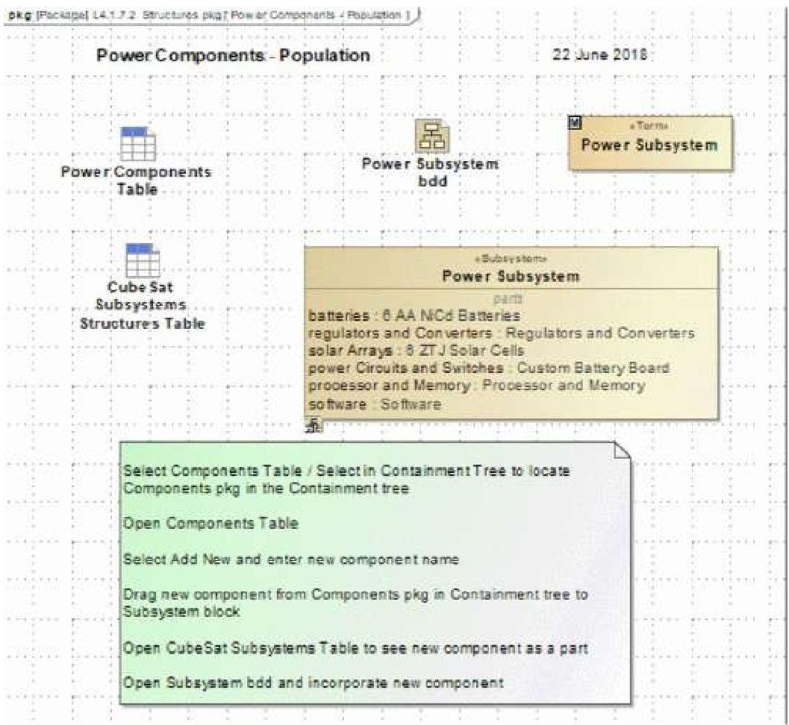

Figure 15: Electrical power system package diagram

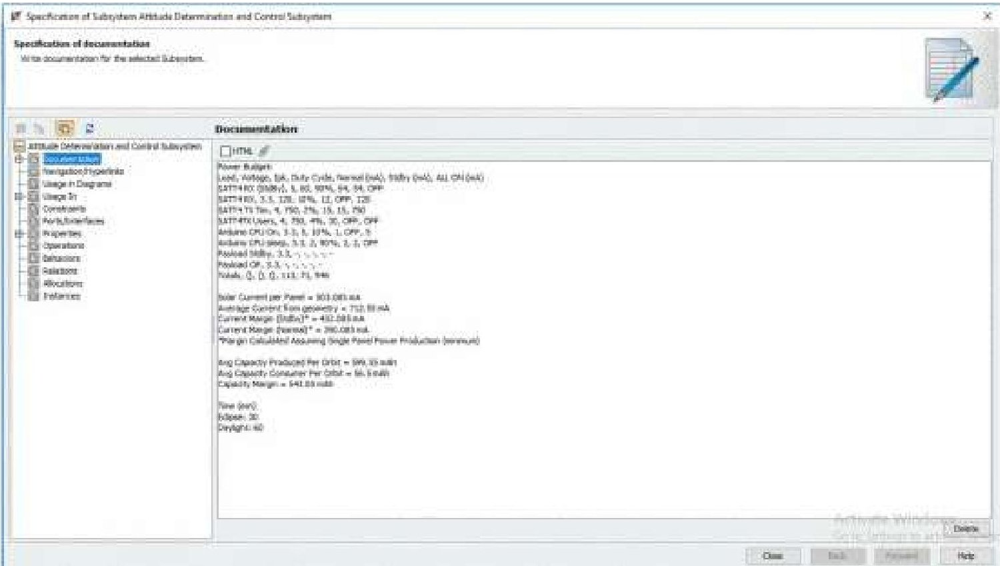

Figure 16: Specification for electrical power system power budget information

<!-- PDF_PAGE: 39 -->

## 3.5 Application and Use of the Model

## 3.5.1 Propagating Changes

One of the advantages of utilizing an MBSE tool to define a baseline CubeSat like the PSAT1U is the ease with which system changes are propagated through the model. As an example, the ADCS subsystem from Figure 14 above is revisited. In this system the Watchdog Timer Reset Circuit is defined as a part within this subsystem. If the Watchdog Timer were redesigned or more information added to its specification, the specification could simply be opened up and the appropriate changes made as displayed in Figure 17.

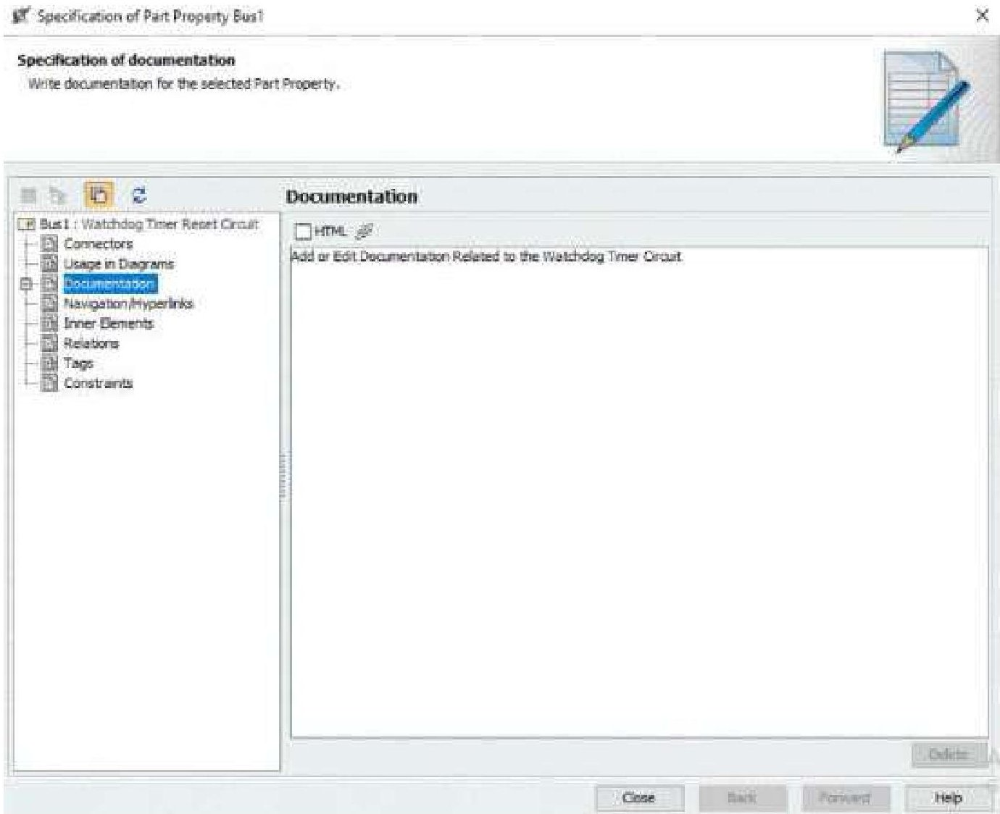

Figure 17: Watchdog timer specification

<!-- PDF_PAGE: 40 -->

Although the Watchdog Timer resides in the ADCS subsystem of the architecture package, a relationship has been defined that ties this circuit to the overall power subsystem. That relationship can be seen highlighted in blue in Figure 18. As a result, any changes made to the Watchdog Timer specification are automatically propagated to the Power subsystem and to any other subsystems or components with a relationship to the Watchdog Timer. The user does not need to manually propagate this change. For a complex system that might be changing frequently, this procedure can add efficiency to the design cycle time and allow a user to spend more time concentrating on the important decisions and trades required to create their optimal system.

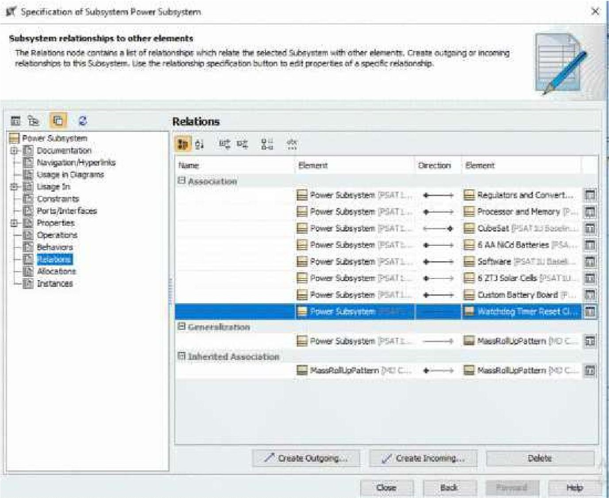

Figure 18: The relationship between the watchdog timer and the power subsystem

<!-- PDF_PAGE: 41 -->

The model stores design specifics of the PSAT1U as text data within the documentation tab of the appropriate subsystem or component specification. In this way, critical design information is stored in the model and can be viewed or edited as needed by practitioners.

## 3.5.2 Payload Design Template

An additional benefit of the standardized MBSE template for PSAT1U stems from the fact that the CubeSat is, itself, a physical template of a kind. That is, it is a satellite system with much of the design work complete but its mission specification and payload definition are left intentionally blank. The intent is to have multiple undergraduate teams approach the PSAT1U design and tailor their physical instance of the spacecraft for their own application. The standardized MBSE template is well suited for this purpose because it allows the user to quickly survey and understand the payload design space without wasting precious time on well understood or defined subsystems and components.

This is illustrated by a closer look at the Mission Payload subsystem, displayed in a Block Definition Diagram in Figure 19.

<!-- PDF_PAGE: 42 -->

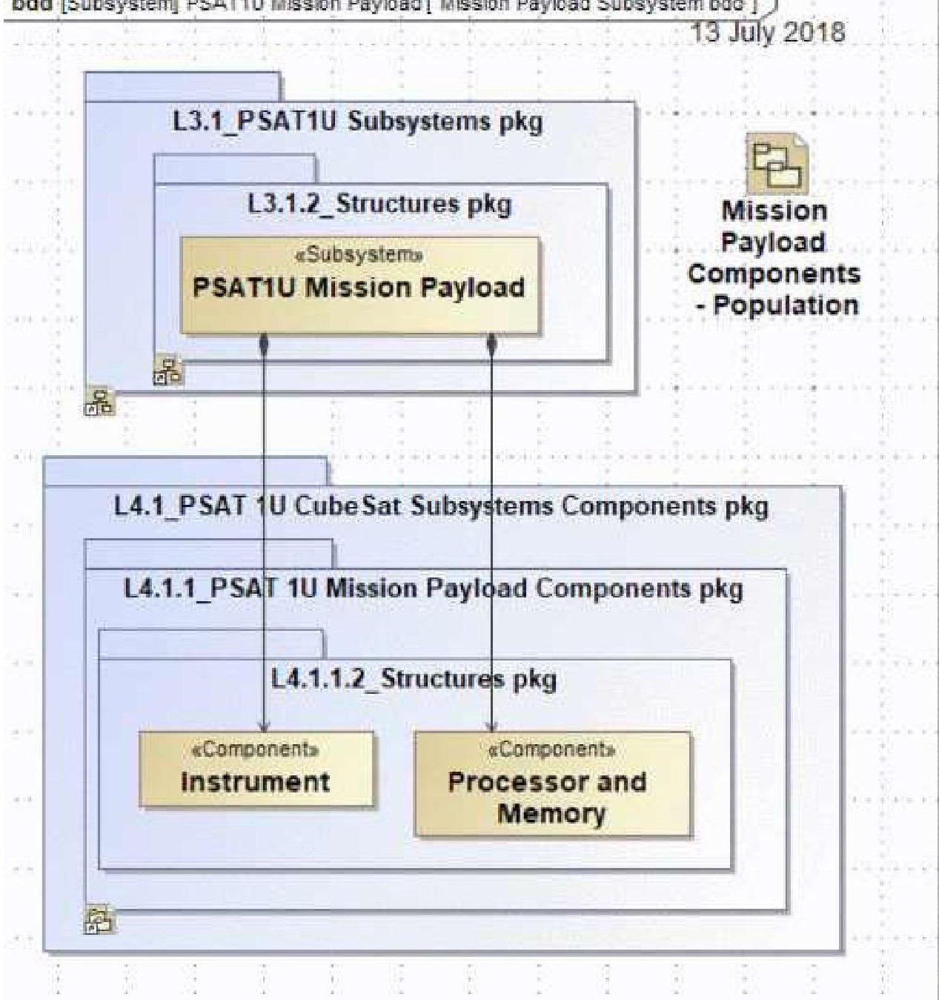

Figure 19: Mission payload block definition diagram

If the user opens the design specification for the Mission Payload subsystem in the template, all they will see is some generic information defining the design space and the envelope with which the payload can be housed. Figure 20 displays this generic specification.

If, once their design is underway and they understand their mission objectives, the user wants to add information to this specification describing their payload, they can do so as is exemplified by Figure 21.

<!-- PDF_PAGE: 43 -->

Ultimately, by adding the appropriate payload and mission details and making any other appropriate changes to the standardized MBSE template, the user will create a model of their mission specific instance of the PSAT1U.

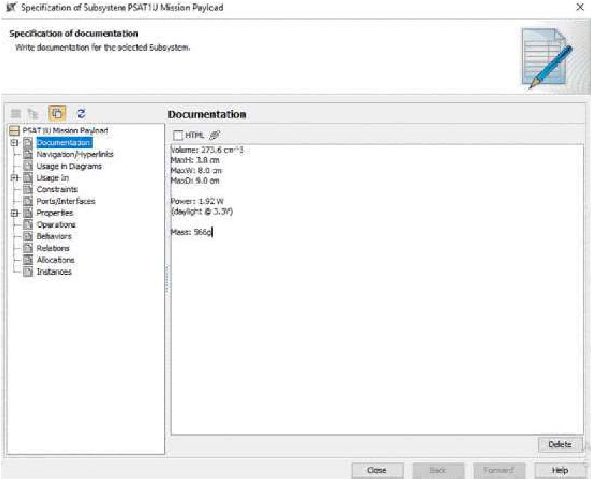

Figure 20: Generic mission payload specification

<!-- PDF_PAGE: 44 -->

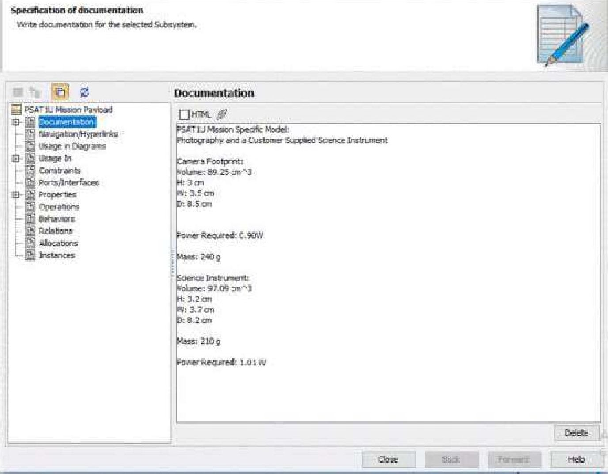

Figure 21: A defined mission payload specification

## 3.5.3 Classroom Implementation

The standardized MBSE template for PSAT1U is intended to be utilized by undergraduate engineering students in their year-long senior capstone class at USNA. It is beyond the scope of this course to teach these students all there is to know about MBSE and how to utilize its tools. Therefore, the approach with this model was for the department faculty to gain an understanding of these systems engineering tools and, based on their own engineering experience and intuition, make design decisions about many of the subsystems and components in order to constrain the design space.

<!-- PDF_PAGE: 45 -->

Given the short cycle time, this allows students to remain focused on the analysis, testing and making decisions that will be critical to their mission success. Then, they will become familiar with the standardized MBSE template so that they can clearly understand that design space, appreciate the value of MBSE in the design of complex systems, but will not be expected to learn how to create their own model from scratch.

This approach, mimicking the original intent of the CSRM, which itself was a less defined standardized template, will also allow subject matter experts in aerospace engineering and other specific disciplines to gain the benefit of these powerful systems engineering tools without becoming expert MBSE users.

## 3.6 Chapter Conclusions

CubeSats are being used as an undergraduate teaching tool for year-long senior capstone design students in aerospace engineering. In order to deal with the increasing complexity of these systems and still allowing the students to benefit from their first real design challenge, a standardized Model Based Systems Engineering template for the PSAT1U CubeSat was developed. This template in turn was built from the CubeSat System Reference Model developed by the INCOSE Space Systems Working Group.

The PSAT1U model described is itself a template without payload or mission definition and can be designed for any mission as long as the payload is operated within the envelope defined by the model. The model aids in the design process by ensuring the design space is easily understood and by propagating system changes automatically and seamlessly.

<!-- PDF_PAGE: 46 -->

Ultimately, the benefit of the standardized MBSE template described here, like the CSRM it is based off of, will also allow discipline specific engineering experts to benefit from advanced system tools without themselves becoming systems engineering experts.

<!-- PDF_PAGE: 47 -->

## CHAPTER 4: Development of a Tailored MBSE-enabled Program for CubeSat-class Satellite Architecting and Design

This section presents the methods for development of the Tailored MBSE-enabled Program for CubeSat-class Satellite Architecting and Design, and for its assessment in the context of the undergraduate capstone engineering course.

## 4.1. Curriculum Development

In order to create a product appropriate for use in an undergraduate engineering setting, the author consulted students, faculty and other stakeholders and identified guidelines and requirements. First, in order to be useful, the information therein must be technically applicable and represent a subset of the current state of space systems engineering practice. Next, the material contained within the guide must be accessible to students so that it can be understood without seeking additional references. Importantly, the guide must also be concise to increase the likelihood that students will have the time and resources to review and apply more of the material. And finally, the guide must be relevant to the particular discipline it's utilized for, in this case specifically to the engineering challenges that students in the capstone course are likely to encounter.

The goal of the NASA Systems Engineering Handbook, last revised in 2019, is much broader. That document aims to "bring the fundamental concepts and techniques of systems engineering to the National Aeronautics and Space Administration (NASA) personnel in a way that recognized the nature of NASA systems and the NASA environment" [13]. The NASA SE Handbook represents a space-focused guideline covering the full SE process, and as such, served as the starting point for the tailored guide developed in this study. To map content from the NASA SE Handbook to students and eventually into the tailored framework, we broke down the

<!-- PDF_PAGE: 48 -->

NASA Handbook by section, and provided detailed definitions to students and instructors in the fall of Academic Year 2019-2020 regarding the competencies described in each chapter of the Handbook under topics such as "System Design", "Product Realization" and "Technical Management". We asked numerous questions including how successful were in understanding each of these topics and how impactful they were on student success. This survey process was very effective at providing a level playing field for survey respondents to understand the parameters being evaluated, but it might have benefited from more lead time to allow for concept definitions to be absorbed in advance. At the outset, students and instructors were briefed about each of the competencies, and initial surveys were completed that allowed both groups to identify which Systems Engineering competencies would be most valuable to include in a tailored guide based on student and SME surveys identifying which topics students did not adequately understand as well as consultations with course stakeholders.

From these initial results, the need to provide detailed SE guidelines for several competencies was established. The highest-scoring areas identified by students and instructors during the first iteration of the development were topics of "Technical Risk Management", "Technical Data Management", "Interface Management", "Product Integration" and "Product Verification". Based on these results, the corresponding material in the NASA SE Handbook was reviewed, extraneous materials not pertinent to generic space systems or CubeSats was removed, as were references to NASA-specific documents, and the remaining material was packaged together and provided to students and instructors in a preliminary version of the tailored framework. Text from the NASA handbook was utilized directly, with verbiage that was not directly applicable to the student handbook being removed from the selected chapters.

<!-- PDF_PAGE: 49 -->

Two additional key topics (not included in the NASA SE Handbook) were identified by instructors as critical for inclusion in the guide and were added to the content above. First, the application of the CubeSat was identified as a key subject in which the students would have to be trained. At USNA, the Parkinson Sat 1U CubeSat (PSAT1U $ ^{1} $ ) project serves the purpose of providing a standard modular baseline design study and applied capstone experience for aerospace engineering students. Second, MBSE has been identified by industry and researchers as a key paradigm of modern and future systems engineering [37] and stakeholders championed its inclusion in the guide.

## 4.2. Parkinson SAT 1U Example

The PSAT1U system was developed as a simple architectural template for CubeSat designs at USNA. PSAT1U is a 1U-sized (10 x 10 x 10 cm) CubeSat that is architected to be designed, developed, and put together by students. Its purpose is to serve as a modular CubeSat architecture, when engineered to use COTS accessible parts, a complete satellite bus development can be completed in three weeks. The well understood nature of the PSAT1U allows students to focus on designing and implementing their preferred on-board payload and mission systems without spending significant time carrying out trade studies on subsystems and components. The tailored handbook devotes a chapter to describing the architecture of PSAT1U.

## 4.3. MBSE Integration

All of the systems engineering and CubeSat information in the tailored program/handbook are developed and presented using a Model Based Systems Engineering (MBSE) paradigm. The MBSE paradigm has been found to improve the performance of product

<!-- PDF_PAGE: 50 -->

design processes [38] (in this case of the CubeSat), and is hypothesized to improve the learning of SE and MBSE concepts to undergraduate engineering students. The CubeSat System Reference Model (CSRM) is an Object Management Group (OMG) standard developed by the INCOSE Space Systems Working Group (SSWG) to enable university teams to have a starting point for their MBSE models. The author made contact with the SSWG and was able to obtain an early version of the CSRM for use in the present effort. The present research proved to be a great opportunity to utilize the CSRM in an educational environment and provide feedback to its developers in the SSWG. As a result of its simplicity and applicability, the CSRM was chosen as a CubeSat specific MBSE template. The specific reference model developed by the author provides utilized the CSRM framework with specific design parameters based on the existing design of the physical PSAT1U CubeSat system. Thus, the reference model provides the "logical elements [which] can be reused as a starting point for a mission-specific CubeSat logical architecture" [39]. As such, the CSRM is itself a modular architecture which enables the design of a variety of mission-oriented CubeSats. The reference model gives the student a well-organized starting point when developing a new CubeSat model. The MBSE model serves as a standardized template that enables the model-based development of CubeSat class satellites by USNA midshipmen.

## 4.4 The Tailored Systems Engineering Program/Handbook

The first result from this project is the systems engineering program/handbook itself, tailored for use by students in the USNA Small Satellite Program. After several rounds of iteration, and inputs from many subject matter experts and hundreds of students, the finalized guide contains 52 main pages of content across 12 chapters (as listed in Table 3) as well as 10

<!-- PDF_PAGE: 51 -->

Table 3: List of Chapters from the Tailored Systems Engineering Handbook

<table border="1"><tr><td>CHAPTER</td><td>CHAPTER TITLE</td></tr><tr><td>1</td><td>DESIGN SOLUTION DEFINITION</td></tr><tr><td>2</td><td>PRODUCT IMPLEMENTATION</td></tr><tr><td>3</td><td>PRODUCT INTEGRATION</td></tr><tr><td>4</td><td>PRODUCT VERIFICATION</td></tr><tr><td>5</td><td>PRODUCT VALIDATION</td></tr><tr><td>6</td><td>PRODUCT TRANSITION</td></tr><tr><td>7</td><td>TECHNICAL PLANNING</td></tr><tr><td>8</td><td>INTERFACE MANAGEMENT</td></tr><tr><td>9</td><td>TECHNICAL RISK MANAGEMENT</td></tr><tr><td>10</td><td>TECHNICAL DATA MANAGEMENT</td></tr><tr><td>11</td><td>TECHNICAL ASSESSMENT</td></tr><tr><td>12</td><td>THE PSAT 1U CUBESAT</td></tr><tr><td>APPENDIX</td><td>APPENDIX TITLE</td></tr><tr><td>A</td><td>INTEGRATION PLAN OUTLINE</td></tr><tr><td>B</td><td>CREATING THE VALIDATION PLAN WITH A VALIDATION REQUIREMENTS MATRIX</td></tr><tr><td>C</td><td>SEMP CONTENT OUTLINE</td></tr><tr><td>D</td><td>TECHNICAL PLANS</td></tr><tr><td>E</td><td>VERIFICATION AND VALIDATION PLAN OUTLINE</td></tr><tr><td>F</td><td>INTERFACE REQUIREMENTS DOCUMENT OUTLINE</td></tr><tr><td>G</td><td>CM PLAN OUTLINE</td></tr><tr><td>H</td><td>HSI PLAN CONTENT OUTLINE</td></tr><tr><td>I</td><td>CONCEPT OF OPERATIONS ANNOTATED OUTLINE</td></tr><tr><td>J</td><td>PSAT1U BASELINE MODEL</td></tr></table>

<!-- PDF_PAGE: 52 -->

## 4.5. Curriculum Deployment

The capstone engineering experience at USNA Aerospace Engineering is a two-course sequence (EA469 and EA470), offered fall and spring semesters of students' $ 4^{\mathrm{th}} $ and final year of the BS degree. Prior to the development of the tailored systems engineering program/handbook, the systems engineering processes of the course were ad hoc in nature. The students were provided deliverable templates and they followed a document-centric systems engineering process, responsible for providing assigned deliverables within an identified timeframe. Students were taught lessons about each of the deliverable documents without much context or explanation as to why these were the most important processes to be concerned with. Additionally, students typically had to wait months to complete the lecture series before they could begin any real hands-on design work.

Upon completion of the tailored systems engineering handbook, the handbook was deployed into the curriculum for all undergraduate Aerospace Engineering capstone students starting in AY 2019-20. The tailored systems engineering handbook was provided to all students as required reading, with chapters allocated to weekly reading assignments. Lectures and in class activities were revised to support the presentation and activities of the tailored systems engineering handbook. Course assessments in the form of quizzes, and assignments were revised, but overarching learning objectives for this course were unchanged. Students were assigned to apply the handbook-defined SE processes to the design of the PSAT1U CubeSat capstone project.

<!-- PDF_PAGE: 53 -->

## 4.6 Chapter Conclusions

In order to create a tailored systems engineering guide for use at the United States Naval Academy an undergraduate engineering setting, the author consulted students, faculty and other stakeholders and identified guidelines and requirements. The guide focused on introducing SE concepts in an Aerospace Engineering program with a focus on CubeSats as an exemplar system. The NASA Systems Engineering Guide was utilized as a baseline, and numerous survey iterations were conducted with students, instructors and other subject matter experts. Upon completion of the tailored systems engineering handbook, the handbook was deployed into the curriculum for all undergraduate Aerospace Engineering capstone students.

<!-- PDF_PAGE: 54 -->

## CHAPTER 5: Assessment of a Tailored MBSE-enabled Handbook for CubeSat-class Satellite Architecting and Design

This chapter presents the results of this project in the form of an assessment of the tailored systems engineering program/handbook, the results of the surveys of student learnings and SME assessments.

## 5.1 Survey Methods

To assess student performance in the course, before and after the development and utilization of the tailored systems engineering handbook, a series of surveys and assessments were developed. Surveys and procedures were approved by Institutional Review Board (IRB) at USNA and informed consent was provided. In addition to student feedback, the SME surveys represent a Delphi-process, seeking feedback from instructors and outside experts who are all recognized for their experience in the aerospace engineering field. The survey instruments are presented in the Appendix and consist of the following:

1) Student Grades: The student's performances are assessed by the instructors summatively through their performance on quizzes, tests, and the deliverables associated with the engineering of the PSAT1U CubeSat. Grades are recorded for every student, and are reported as a distribution. Grades are assessments of student learnings and performance in the course, with a grade of "A" representing "Excellent", "B" representing "Good", and "C" representing "Satisfactory".

2) Student Survey: This survey asks students to self-assess their performance in addressing key aspects of the systems engineering lifecycle, and in identifying where their performance is most detrimental. Responses are input using a Likert scale, and results are reported as averages of the student sample (n=94 in AY 2020-2022).

<!-- PDF_PAGE: 55 -->

3) SME Survey: This survey asks the Subject Matter Experts (SMEs), instructors and industry mentors a set of similar questions to assess the students' performance in addressing key aspects of the systems engineering lifecycle, and in identifying where their performance is most detrimental. Responses are input using a Likert scale from one (strongly disagree) up to five (strongly agree), and results are reported as averages of the SME sample (n=49 in AY 2020-2022).

4) CRMs: Course Reflective Modules (CRMs), a post-course survey of instructors summatively assessing student performance and learnings. These CRMs are performed for planning and accreditation purposes within the USNA. CRMs assess instructor's perception of student performance, in particular by rating individual student's proficiency in the tasks of Systems Engineering.

The intervention that is to be studied using these surveys is the deployment of the tailored systems engineering program/handbook into the capstone curriculum with a focus on both improving SE education outcomes as well as system performance. The initial, or pre-intervention performance of the student cohort was assessed using these 3 methods in AY 2020. The performance of the student cohort during and after implementation began was assessed using the identical instruments in AY 2021 and AY 2022. Surveys were conducted either in-person or electronically (in AY 2021 due to COVID-19 restrictions on in-person learning), and students responded anonymously.

There are no other major curriculum changes that occurred during the time period of the intervention, and the survey is unchanged before and after the intervention.

<!-- PDF_PAGE: 56 -->

## 5.2. Survey Results

Survey data evaluating student performance from Subject Matter Experts (SMEs) including engineering faculty at USNA as well as visitors with direct experience in the aerospace industry was collected in academic years 2019-20, 2020-21, and 2021-22 on four occasions, in October, 2019, December, 2019, December, 2020, and December, 2021. Additionally, self- reflective survey data was completed by students characterizing the same academic years on six separate occasions, in October, 2019, December, 2019, December, 2020, October, 2021, December, 2021, and May, 2022.

After the survey data from the fall semester of 2019 was collected and analyzed, the first iteration of the Tailored Systems Engineering Handbook was introduced. Subsequent survey data was utilized to update the handbook to meet the specific needs of the student users in the USNA Aerospace Engineering Department. In addition to assessed student performance, which will be summarized in section 3.3, survey results focused on the level of adequacy with which the engineering students addressed various systems engineering topics. Students were provided definitions of 17 systems engineering concepts and asked to rate student understanding on a scale from 1 to 5, with 5 being the highest. Across all years, average responses from both students and SMEs ranged from about 3.2 to 3.8. This small variation may be due to the institutional culture at the Naval Academy. The concepts which were least-well understood by students were included in the guide, including all of those with an average score of 3.4 or below. Additional concepts were also included for continuity or instructor preference based on periodic discussions with faculty. Tables 4 and 5 summarizes the SME and student responses, in rank order from least to most adequate, of systems engineering topics addressed by students. These rankings were based

<!-- PDF_PAGE: 57 -->

on survey responses regarding the adequacy of student performance in each of the identified topics with a scale from 1 to 5, where a 1 indicated the respondent strongly disagreed with a statement that students performed adequately in this area and 5 indicated that the respondent strongly agreed. This adequacy data from both students and SMEs has less variation than one might expect. The mean raw adequacy score from students is 3.582 with a standard deviation of $ \pm 0.171 $ and the mean raw adequacy score from SMEs is 3.571 with a standard deviation of $ \pm 0.162. $ One possible explanation about this lack of variation may be that there was an additional and similar question on the survey that asked if students had exceeded expectations in each area. It may be that the existence of that second question influenced both students and SMEs to enter higher scores on the adequacy question than they otherwise might have. Still, the data has a relatively large sample size and the ordering of preferences was meaningful and used to inform decisions about what concepts to include in the handbook.

<!-- PDF_PAGE: 58 -->

Table 4: SME Responses to Student Adequacy Addressing SE Topics, Least to Most Adequate (n=49)

<table border="1"><tr><td>Rank</td><td>Raw Score</td><td>Topic</td></tr><tr><td>1</td><td>3.239</td><td>Technical Data Management</td></tr><tr><td>2</td><td>3.245</td><td>Technical Risk Management</td></tr><tr><td>3</td><td>3.490</td><td>Decision Analysis</td></tr><tr><td>4</td><td>3.510</td><td>Product Verification</td></tr><tr><td>5</td><td>3.511</td><td>Configuration Management</td></tr><tr><td>6</td><td>3.531</td><td>Technical Planning</td></tr><tr><td>6</td><td>3.531</td><td>Technical Assessment</td></tr><tr><td>8</td><td>3.551</td><td>Interface Management</td></tr><tr><td>9</td><td>3.568</td><td>Product Transition</td></tr><tr><td>10</td><td>3.571</td><td>Product Integration</td></tr><tr><td>11</td><td>3.592</td><td>Logical Decomposition</td></tr><tr><td>12</td><td>3.604</td><td>Product Validation</td></tr><tr><td>13</td><td>3.653</td><td>Requirement Management</td></tr><tr><td>14</td><td>3.735</td><td>Stakeholder Expectations Definition</td></tr><tr><td>14</td><td>3.735</td><td>Design Solution Definition</td></tr><tr><td>16</td><td>3.816</td><td>Technical Requirements Definition</td></tr><tr><td>17</td><td>3.825</td><td>Product Implementation</td></tr></table>

<!-- PDF_PAGE: 59 -->

Table 5: Student Responses to Student Adequacy Addressing SE Topics, Least to Most Adequate (n=94)

<table border="1"><tr><td>Rank</td><td>Raw Score</td><td>Topic</td></tr><tr><td>1</td><td>3.244</td><td>Product Integration</td></tr><tr><td>2</td><td>3.354</td><td>Product Verification</td></tr><tr><td>3</td><td>3.356</td><td>Interface Management</td></tr><tr><td>4</td><td>3.396</td><td>Technical Data Management</td></tr><tr><td>5</td><td>3.484</td><td>Technical Risk Management</td></tr><tr><td>6</td><td>3.494</td><td>Product Implementation</td></tr><tr><td>7</td><td>3.543</td><td>Product Validation</td></tr><tr><td>8</td><td>3.571</td><td>Configuration Management</td></tr><tr><td>9</td><td>3.596</td><td>Technical Assessment</td></tr><tr><td>10</td><td>3.634</td><td>Decision Analysis</td></tr><tr><td>11</td><td>3.717</td><td>Design Solution Definition</td></tr><tr><td>11</td><td>3.717</td><td>Requirement Management</td></tr><tr><td>13</td><td>3.724</td><td>Stakeholder Expectations Definition</td></tr><tr><td>14</td><td>3.731</td><td>Technical Planning</td></tr><tr><td>15</td><td>3.756</td><td>Logical Decomposition</td></tr><tr><td>16</td><td>3.775</td><td>Product Transition</td></tr><tr><td>17</td><td>3.796</td><td>Technical Requirements Definition</td></tr></table>

## 5.2.1 Design Solution Definition

The Design Solution Definition section was considered relatively well understood by both subject matter experts with an average score of over 3.7 by both groups. This concept ranked $ 14^{\mathrm{th}} $ out of 17 concepts by students and $ 11^{\mathrm{th}} $ out of 17 concepts by SMEs. However, in working with subject matter experts to design the guide, it was determined that this chapter was crucial to tie together the less familiar concepts. It also includes many crucial concept definitions used throughout the rest of the document. Therefore, it was selected as Chapter 1, and is presented below as it appears in the guide.

<!-- PDF_PAGE: 60 -->

## 1.0 Design Solution Definition

The Design Solution Definition Process is used to translate the high-level requirements derived from stakeholder expectations and the outputs of the Logical Decomposition Process into a design solution. This involves transforming the defined logical decomposition models and their associated sets of derived technical requirements into alternative solutions. These alternative solutions are then analyzed through detailed trade studies that result in the selection of a preferred alternative. This preferred alternative is then fully defined into a final design solution that satisfied the technical requirements. This design solution definition is used to generate the end product specifications that are used to produce the product verification. This process may be further refined depending on whether there are additional subsystems of the end product that need to be defined.

## 1.1 Process Description

The activities of the Design Solution Definition Process are described below.

## 1.1.1 Inputs

The inputs for this process are:

- Technical Requirements: These are the customer and stakeholder needs that have been translated into a complete set of validated requirements for the system, including all interface requirements.

- Logical Decomposition Models: Requirements are analyzed and decomposed by one or more different methods (e.g., function, time, behavior, data flow, states, modes, system architecture, etc.) in order to gain a more comprehensive understanding of their interaction and behaviors.

## 1.1.2 Process Activities

The process activities of the Design Solution Process are defined in detail below:

- Define Alternative Design Solutions: The realization of a system over its life cycle involves a succession of decisions among alternative courses of action. If the alternatives are precisely defined and thoroughly understood to be well differentiated in the cost-effectiveness space, then the systems engineer can make choices among them with confidence.

- Create Alternative Design Concepts: Once it is understood what the system is to accomplish, it is possible to devise a variety of ways that those goals can be met. Sometimes, that comes about as a consequence of considering alternative functional allocations and integrating available subsystem design options, all of which can have technologies at varying degrees of maturity. Ideally, as wide a range of plausible alternatives as is consistent with the design organization's charter should be defined, keeping in mind the current stage in the process of successive refinement. When the bottom-up process is operating, a problem for the systems engineer is that the designers tend to become fond of the designs they create, so they lose their objectivity; the systems engineer should stay an "outsider" so that there is more objectivity. This is particularly true in the assessment of the technological maturity of the subsystems and components required for implementation. There is a tendency on the part of technology developers and project management to overestimate the maturity and applicability

<!-- PDF_PAGE: 61 -->

of a technology that is required to implement a design. This is especially true of "heritage" equipment. The result is that critical aspects of systems engineering are often overlooked.

- Analyze Each Alternative Design Solution: The technical team analyzes how well each of the design alternatives meets the system objectives (technology gaps, effectiveness, technical achievability, performance, cost, schedule, and risk, both quantified and otherwise). This assessment is accomplished through the use of trade studies. The purpose of the trade study process is to ensure that the system architecture, intended operations (i.e., the ConOps) and design decisions move toward the best solution that can be achieved with the available resources.

- Select the Best Design Solution: The technical team selects the best design solution from among the alternative design concepts, taking into account subjective factors that the team was unable to quantify, such as robustness, as well as estimates of how well the alternatives meet the quantitative requirements; the maturity of the available technology; and any effectiveness, cost, schedule, risk, or other constraints.

- Increase the Resolution of the Design: At each level of decomposition, the baselined derived (and allocated) requirements become the set of high-level requirements for the decomposed elements, and the process begins again. One might ask, "When do we stop refining the design?" The answer is that the design effort proceeds to a depth that is sufficient to meet several needs: the design should penetrate sufficiently to allow analytical validation of the design to the requirements and ConOps; it should also have sufficient depth to support cost and operations modeling and to convince a review team of a feasible design with performance, cost, and risk margins.

- Fully Describe the Design Solution: Once the preferred design alternative has been selected and the proper level of refinement has been completed, then the design is fully defined into a final design solution that will satisfy the technical requirements and ConOps. The design solution definition will be used to generate the end product specifications that will be used to produce the product and to conduct product verification. This process may be further refined depending on whether there are additional subsystems of the end product that need to be defined.

- Verify the Design Solution: Once an acceptable design solution has been selected from among the various alternative designs and documented in a technical data package, the design solution should next be verified against the system requirements and constraints. A method to achieve this verification is by means of a peer review to evaluate the resulting design solution definition.

- Validate the Design Solution: The validation of the design solution is a recursive and iterative process. Each alternative design concept is validated against the set of stakeholder expectations. The stakeholder expectations drive the iterative design loop in which a straw man architecture/design, the ConOps, and the derived requirements are developed. These three products should be consistent with each other and will require iterations and design decisions to achieve this consistency. Once consistency is achieved, functional analyses allow the study team to validate the design against the stakeholder expectations. A simplified validation asks the questions: Does the system work as expected? How does the system respond to failures, faults, and anomalies? Is the system affordable? If the answer to any of

<!-- PDF_PAGE: 62 -->

these questions is no, then changes to the design or stakeholder expectations will be required, and the process is started over again. This process continues until the system architecture, ConOps, and requirements-meets the stakeholder expectations.

- Identify Enabling Products: Enabling products are the life cycle support products and services (e.g., production, test, deployment, training, maintenance, and disposal) that facilitate the progression and use of the operational end product through its life cycle. Since the end product and its enabling products are interdependent, they are viewed as a system. Project responsibility thus extends to responsibility for acquiring services from the relevant enabling products in each life cycle phase. When a suitable enabling product does not already exist, the project that is responsible for the end product can also be responsible for creating and using the enabling product.

- Baseline the Design Solution: Once the selected system design solution meets the stakeholder expectations, the study team baselines the products and prepares for the next life cycle phase. Because of the recursive nature of successive refinement, intermediate levels of decomposition are often validated and baselined as part of the process. In the next level of decomposition, the baselined requirements become the set of high-level requirements for the decomposed elements, and the process begins again.

## 1.1.3 Outputs

Outputs of the Design Solution Definition Process are described below:

- The System Specification: The system specification contains the functional baseline for the system that is the result of the Design Solution Definition Process. The system design specification provides sufficient guidance, constraints, and system requirements for the design engineers to begin developing the design.

- The System External Interface Specifications: The system external interface specifications describe the functional baseline for the behavior and characteristics of all physical interfaces that the system has with the external world. These include all structural, thermal, electrical, and signal interfaces, as well as the human-system interfaces.

- The End-Product Specifications: The end-product specifications contain the detailed build-to and code-to requirements for the end product. They are detailed, exact statements of design particulars, such as statements prescribing materials, dimensions, and quality of work to build, install, or manufacture the end product.

- The End-Product Interface Specifications: The end-product interface specifications contain the detailed build-to and code-to requirements for the behavior and characteristics of all logical and physical interfaces that the end product has with external elements, including the human-system interfaces.

- Initial Subsystem Specifications: The end-product subsystem initial specifications provide detailed information on subsystems if they are required.

- Enabling Product Requirements: The requirements for associated supporting enabling products provide details of all enabling products. Enabling products are the life cycle support products, infrastructures, personnel, logistics, and services that facilitate the progression and

<!-- PDF_PAGE: 63 -->

use of the operational end product through its life cycle. They are viewed as part of the system since the end product and its enabling products are interdependent.

- Product Verification Plan: The end-product verification plan (generated through the Technical Planning Process) provides the content and depth of detail necessary to provide full visibility of all verification activities for the end product. Depending on the scope of the end product, the plan encompasses qualification, acceptance, prelaunch, operational, and disposal verification activities for flight hardware and software.

- Product Validation Plan: The end-product validation plan (generated through the Technical Planning Process) provides the content and depth of detail necessary to provide full visibility of all activities to validate the end product against the baselined stakeholder expectations. The plan identifies the type of validation, the validation procedures, and the validation environment that are appropriate to confirm that the realized end product conforms to stakeholder expectations.

- Logistics and Operate-to Procedures: The applicable logistics and operate-to procedures for the system describe such things as handling, transportation, maintenance, long-term storage, and operational considerations for the particular design solution.

1. 2 Design Solution Definition Guidance

Refer to Section 4.4.2 in the NASA Expanded Guidance for Systems Engineering at Expanded Guidance for NASA SE NASA/SP-2016-6105-SUPPL for additional guidance on:

- technology assessment,

- human capability assessment, and

- integrating engineering specialties into the SE process.

## 5.2.2 Product Implementation

The Product Implementation section was considered very well understood by subject matter experts (Ranked $ 1 7^{\mathrm{th}} $ out of 17 concepts with an average score over 3.8) but less well understood by students (Ranked $ 6^{\mathrm{th}} $ out of 17 concepts with an average score of less than 3.5). In part due to this discrepancy between perceived understanding by students and subject matter experts, it was faculty preferred that Product Implementation be included in the guide. A key component to the Product Implementation section is guidance on requirements development as well as make/buy decision making. This section also drives design definitions that will be used

<!-- PDF_PAGE: 64 -->

throughout the project life cycle. Ultimately, Product Implementation was selected as Chapter 2, and is presented below as it appears in the guide.

## 2.0 Product Implementation

Product implementation is the first SE process encountered and begins the movement from the bottom of the product hierarchy up towards the Product Transition Process. This is where the plans, designs, analysis, requirements development, and drawings are realized into actual products.

Product implementation is used to generate a specified product of a project or activity through buying, making/coding, or reusing previously developed hardware, software, models, or studies to generate a product appropriate for the phase of the life cycle. The product should satisfy the design solution and its specified requirements.

The Product Implementation Process is the key activity that moves the project from plans and designs into realized products. Depending on the project and life-cycle phase within the project, the product may be hardware, software, a model, simulations, mockups, study reports, or other tangible results. These products may be realized through their purchase from commercial or other vendors, through partial or complete reuse of products from other projects or activities, or they may be generated from scratch. The decision as to which of these realization strategies or combination of strategies will be used for the products of this project will have been made earlier in the life cycle.

## 2.1 Process Description

The activities of the Product Implementation Process are described below.

## 2.1.1 Inputs

Inputs to the Product Implementation Process depend primarily on the decision about whether the end product will be purchased, developed from scratch, or formed by reusing part or all of products from other projects.

- Inputs If Purchasing the End Product: If the decision was made to purchase part or all of the products for this project, the end product design specifications are obtained from other applicable documents.

- Inputs If Making/Coding the End Product: For end products that will be made/coded by the technical team, the inputs will be the configuration-controlled design specifications, manufacturing plans, manufacturing processes, manufacturing procedures, and raw materials as provided to or purchased by the project.

- Inputs Needed If Reusing an End Product: For end products that will reuse part or all of products generated by other projects, the inputs may be the documentation associated with the product as well as the product itself. Care should be taken to ensure that these products will indeed meet the specifications and environments for this project. These would have been factors involved previously to determine the make/buy/reuse decision.

<!-- PDF_PAGE: 65 -->

- Enabling Products: These would be any enabling products necessary to make, code, purchase, or reuse the product (e.g., drilling fixtures, production facilities, production lines, software development facilities, software test facilities, system integration and test facilities).

## 2.1.2 Process Activities

Implementing the product can take one of three forms:

1. Purchase/buy

2. Make/code

## 3. Reuse

These three forms will be discussed in the following subsections. This section describes what kind of inputs, outputs, and activities are performed during product implementation regardless of where in the product hierarchy or life cycle it is. These activities include preparing to conduct the implementation, purchasing/making/reusing the product, and capturing the product implementation work product. In some cases, implementing a product may have aspects of more than one of these forms (such as a build-to-print). In those cases, the appropriate aspects of the applicable forms are used.

## 2.1.2.1 Prepare to Conduct Implementation

Preparing to conduct the product implementation is a key first step regardless of what form of implementation has been selected. For complex projects, implementation strategy and detailed planning or procedures need to be developed and documented. For less complex projects, the implementation strategy and planning need to be discussed, approved, and documented as appropriate for the complexity of the project.

The documentation, specifications, and other inputs also need to be reviewed to ensure they are ready and at an appropriate level of detail to adequately complete the type of implementation form being employed and for the product life-cycle phase. For example, if the "make" implementation form is being employed, the design specifications need to be reviewed to ensure they are at a design-to level that allows the product to be developed. If the product is to be bought as a pure Commercial Off-the-Shelf (COTS) item, the specifications need to be checked to make sure they adequately describe the vendor characteristics to narrow to a single make/model of their product line.

Finally, the availability and skills of personnel needed to conduct the implementation as well as the availability of any necessary raw materials, enabling products, or special services should also be reviewed. Any special training necessary for the personnel to perform their tasks needs to be performed by this time. This is a key part of the Acceptance Data Package.

## 2.1.2.2 Purchase, Make, or Reuse the Product

## Purchase the Product

In the first case, the end product is to be purchased from a commercial or other vendor.

Design/purchase specifications will have been generated previously and provided as inputs. The technical team needs to review these specifications and ensure they are in a form adequate for the purchase. For major end products purchased from a vendor, the responsibilities of the Government and contractor team should be documented. This will define, for example, whether

<!-- PDF_PAGE: 66 -->

the project team expects the vendor to provide a fully verified and validated product or whether they will be performing those duties.

As the purchased products arrive, the technical team should assist in the inspection of the delivered product and its accompanying documentation. The team should ensure that the requested product was indeed the one delivered, and that all necessary documentation, such as source code, operator manuals, certificates of compliance, safety information, or drawings have been received.

The technical team should also ensure that any enabling products necessary to provide test operations, maintenance, and disposal support for the product are also ready or provided as required.

Depending on the strategy and roles/responsibilities of the vendor, a determination/analysis of the vendor's verification and validation compliance may need to be reviewed. This may be done informally or formally as appropriate for the complexity of the product. For products that were verified and validated by the vendor, after ensuring that all work products from this phase have been captured, the product may be ready to enter the Product Transition Process to be delivered to the next higher level or to its final end user. For products that the technical team will verify and validate, the product will be ready for verification after ensuring that all work products for this phase have been captured.

## Make/Code the Product

If the strategy is to make or code the product, the technical team should first ensure that the enabling products are ready. This may include ensuring all piece parts are available, drawings are complete and adequate, software design is complete and reviewed, machines to cut the material are available, interface specifications are approved, operators are trained and available, manufacturing and/or coding procedures / processes are ready, software personnel are trained and available to generate code, test fixtures are developed and ready to hold products while being generated, and software test cases are available and ready to begin model generation.

The product is then made or coded in accordance with the specified requirements, configuration documentation, and applicable standards. Throughout this process, the technical team should work to review, inspect, and discuss progress and status within the team and with higher levels of management as appropriate. Progress should be documented within the technical schedules. Peer reviews, audits, unit testing, code inspections, simulation checkout, and other techniques may be used to ensure the made or coded product is ready for the verification process. As production proceeds and components are produced, there is a need to establish a to review any nonconformance to specifications and disposition whether the components can be accepted, reworked, or scrapped and remade.

## Reuse

If the strategy is to reuse a product that already exists, extreme care should be taken to ensure that the product is truly applicable to this project and for the intended uses and the environment in which it will be used. This should have been a major factor used in the decision strategy to make/buy/reuse. If the new environment is more extreme, requalification is needed for the component or system. Design factors of safety, margins, and other required design and

<!-- PDF_PAGE: 67 -->

construction standards should also be assessed. If the program/project requires higher factor of safety or margins, the component may not be useable or a modification may be required.

The documentation available (e.g., as-built documentation, user's guides, operations manuals, discrepancy reports, waivers and deviations) from the reuse product should be reviewed by the technical team so that they can become completely familiar with the product and ensure it will meet the requirements in the intended environment. Any supporting manuals, drawings, or other documentation available should also be gathered.

The availability of any supporting or enabling products or infrastructure needed to complete the fabrication, coding, testing, analysis, verification, validation, or shipping of the product needs to be determined. Supporting products may be found in product manufacturing plans, processes, and procedures. If any of these products or services are lacking, they will need to be developed or arranged for before progressing to the next phase.

A reused product often needs to undergo the same verification and validation as a purchased product or a built product. Relying on prior verification and validation should only be considered if the product's verification and validation documentation meets or exceeds the verification, validation, and documentation requirements of the current project and the documentation demonstrates that the product was verified and validated against equivalent requirements (including environments) and expectations. The savings gained from reuse is not necessarily from reduced acceptance-level testing of the flight products, but possibly elimination of the need to fully requalify the item (if all elements are the same, including the environment and operation), elimination of the need to specify all of the internal requirements such as printed circuit board specifications or material requirements, reduced internal data products, or the confidence that the item will pass acceptance test and will not require rework.

## 2.1.2.3 Capture Work Products

Regardless of what implementation form was selected, all work products from the make/buy/reuse process should be captured, including as-built design drawings, design documentation, design models, code listings, model descriptions, procedures used, operator manuals, maintenance manuals, or other documentation as appropriate.

## 2.1.3 Outputs

- End Product for Verification: Unless the vendor performs verification, the made/coded, purchased, or reused end product in a form appropriate for the life-cycle phase is provided for the verification process. The form of the end product is a function of the life-cycle phase and the placement within the system structure (the form of the end product could be hardware, software, model, prototype, first article for test, or single operational article or multiple production articles).

- End Product Documents and Manuals: Appropriate documentation is also delivered with the end product to the verification process and to the technical data management process. Documentation may include applicable as-built design drawings; close out photos; operation, user, maintenance, or training manuals; applicable baseline documents (configuration information such as as-built specifications or stakeholder expectations); certificates of compliance; or other vendor documentation.

<!-- PDF_PAGE: 68 -->

- Product Implementation Work Products: Any additional work products providing reports, records, lesson learned, assumptions, and other outcomes of these activities.

- The process is complete when the following activities have been accomplished:

- End products are fabricated, purchased, or reuse modules are acquired.

- End products are reviewed, checked, and ready for verification.

- Procedures, decisions, assumptions, anomalies, corrective actions, lessons learned, etc., resulting from the make/buy/reuse are recorded.

## 2.2 Product Implementation Guidance

Refer to Section 5.1.2 in the NASA Expanded Guidance for Systems Engineering at Expanded Guidance for NASA SE NASA/SP-2016-6105-SUPPL for additional guidance on:

- buying off-the-shelf products and

- the need to consider the heritage of products.

## 5.2.3 Product Integration

The Product Integration section was considered relatively well understood by subject matter experts (Ranked $ 10^{\mathrm{th}} $ out of 17 concepts with an average score of 3.57) but was the least well understood concept as ranked by students (Ranked $ 1^{\mathrm{st}} $ out of 17 concepts with an average score of just 3.24). Integration of various system components is one of the most important activities of a systems engineer in the workforce. It requires practitioners to consider derived requirements and to flow them down to the subsystem and component level. Incidentally, due its power for requirements tracking and flow-down, this is also a concept that is greatly served by the use of MBSE and similar modeling techniques. This significant lack of understanding selfidentified by the students as compared to other topics uncovers a critical area where the discipline-specific aerospace engineering curriculum does not overlap with systems engineering

<!-- PDF_PAGE: 69 -->

practice. As a result, including the Project Integration section in the guide was an easy choice. It

was selected as Chapter 3, and is presented below as it appears in the guide.

## 3.0 Product Integration

Product integration is a key activity of the systems engineer. Product integration is the engineering of the subsystem interactions and their interactions with the system environments (both natural and induced). Also in this process, lower-level products are assembled into higher level products and checked to make sure that the integrated product functions properly and that there are no adverse emergent behaviors. This integration begins during concept definition and continues throughout the system life cycle. Integration involves several activities focused on the interactions of the subsystems and environments. These include system analysis to define and understand the interactions, development testing including qualification testing, and integration with external systems (e.g., launch operations centers, space vehicles, mission operations centers, flight control centers, and aircraft) and objects (i.e., planetary bodies or structures). To accomplish this integration, the systems engineer is active in integrating the different discipline and design teams to ensure system and environmental interactions are being properly balanced by the differing design teams. The result of a well-integrated and balanced system is an elegant design and operation.

## 3.1 Process Description

The activities of the Product Integration Process are described below.

## 3.1.1 Inputs

- Lower-level products to be integrated: These are the products developed in the previous lower-level tier in the product hierarchy. These products will be integrated / assembled to generate the product for this product layer.

- End product design specifications and configuration documentation: These are the specifications, Interface Control Documents (ICDs), drawings, integration plan, procedures or other documentation or models needed to perform the integration including documentation for each of the lower-level products to be integrated.

- Product integration-enabling products: These would include any enabling products, such as holding fixtures, necessary to successfully integrate the lower-level products to create the end product for this product layer.

## 3.1.2 Process Activities

This subsection addresses the approach to the implementation of the Product Integration Process, including the activities required to support the process. The basic tasks that need to be established involve the management of internal and external interactions of the various levels of products and operator tasks to support product integration and are as follows:

## 3.1.2.1 Prepare to Conduct Product Integration

Prepare to conduct product integration by reviewing the product integration strategy/plan, generating detailed planning for the integration, and developing integration sequences and procedures; and determining whether the product configuration documentation is adequate to

<!-- PDF_PAGE: 70 -->

conduct the type of product integration applicable for the product life-cycle phase, location of the product in the system structure, and management phase success criteria.

## 3.1.2.2 Obtain Lower-Level Products for Assembly and Integration

Each of the lower-level products that is needed for assembly and integration is obtained from the transitioning lower-level product owners or a storage facility as appropriate. Received products should be inspected to ensure no damages occurred during the transitioning process.

## 3.1.2.3 Confirm That Received Products Have Been Validated

Confirm that the received products that are to be assembled and integrated have been validated to demonstrate that the individual products satisfy the agreed-to set of stakeholder expectations, including interface requirements. This validation can be conducted by the receiving organization or by the providing organization if fully documented or witnessed by the receiving representative.

## 3.1.2.4 Prepare the Integration Environment for Assembly and Integration

Prepare the integration environment in which assembly and integration will take place, including evaluating the readiness of the product integration-enabling products and the assigned workforce. These enabling products may include facilities, equipment jigs, tooling, and assembly/production lines. The integration environment includes test equipment, simulators, models, storage areas, and recording devices.

3. 1.2.5 Assemble and Integrate the Received Products into the Desired End Product Assemble and integrate the received products into the desired end product in accordance with the specified requirements, configuration documentation, interface requirements, applicable standards, and integration sequencing and procedures. This activity includes managing, evaluating, and controlling physical, functional, and data interfaces among the products being integrated.

Functional testing of the assembled or integrated unit is conducted to ensure that assembly is ready to enter verification testing and ready to be integrated into the next level. Typically, all or key representative functions are checked to ensure that the assembled system is functioning as expected. Formal product verification and validation will be performed in the next process.

## 3.1.2.6 Prepare Appropriate Product Support Documentation

Prepare appropriate product support documentation, such as special procedures for performing product verification and product validation. Drawings or accurate models of the assembled system are developed and confirmed to be representative of the assembled system.

## 3.1.2.7 Capture Product Integration Work Products

Capture work products and related information generated while performing the Product Integration Process activities. These work products include system models, system analysis data and assessment reports, derived requirements, the procedures that were used in the assembly, decisions made and supporting rationale, assumptions that were made, identified anomalies and associated corrective actions, lessons learned in performing the assembly, and updated product configuration and support documentation.

<!-- PDF_PAGE: 71 -->

## 3.1.3 Outputs

The following are typical outputs from this process and destinations for the products from this process:

- Integrated product(s) with all system interactions identified and properly balanced.

- Documentation and manuals including system analysis models, data, and reports supporting flight-readiness rationale and available for future analysis during the operation of the system in the mission-execution phase.

- Work products, including reports, records, and non-deliverable outcomes of product integration activities; integration strategy document; assembly/check area drawings; system/component documentation sequences and rationale for selected assemblies; interface management documentation; personnel requirements; special handling requirements; system documentation; shipping schedules; test equipment and drivers' requirements; emulator requirements; and identification of limitations for both hardware and software.

## 5.2.4 Product Verification

The Design Solution Definition section was considered relatively well understood by both subject matter experts with an average score of over 3.7 by both groups. This concept ranked $ 1 4 ^{th} $ out of 17 concepts by students and $ 1 1 ^{th} $ out of 17 concepts by SMEs. The Product Verification section was considered relatively poorly understood by subject matter experts (Ranked $ 4^{th} $ out of 17 concepts with an average score of 3.51) and rated as being even more poorly understood by students (Ranked $ 2^{nd} $ out of 17 concepts with an average score of 3.35). Therefore, it’s inclusion in the guide was the obvious decision. Distinguishing between verification and validation is an important and often misunderstood Systems Engineering concept. The verification process is intended to determine if the system or product meets the identified requirements. Therefore, Product Verification was selected as Chapter 4, and is presented below as it appears in the guide.

## 4.0 Product Verification

The Product Verification Process is the first of the verification and validation processes conducted on an end product. As used in the context of the systems engineering common technical processes, a product is one provided by either the Product Implementation Process or

<!-- PDF_PAGE: 72 -->

the Product Integration Process in a form suitable for meeting applicable life-cycle phase success criteria. Realization is the act of implementing, integrating, verifying, validating, and transitioning the end product for use at the next level up of the system structure or to the customer. At this point, the end product can be referred to as a "realized product" or "realized end product."

Product verification proves that an end product (whether built, coded, bought, or reused) for any element within the system structure conforms to its requirements or specifications. Such specifications and other design description documentation establish the configuration baseline of that product, which may have to be modified at a later time. Without a verified baseline and appropriate configuration controls, such later modifications could be costly or cause major performance problems.

## 4.1 Process Description

There are several methods of verification, described in the figure below.

## Methods of Verification

- Analysis: The use of mathematical modeling and analytical techniques to predict the suitability of a design to stakeholder expectations based on calculated data or data derived from lower system structure end product verifications. Analysis is generally used when a prototype; engineering model; or fabricated, assembled, and integrated product is not available. Analysis includes the use of modeling and simulation as analytical tools. A model is a mathematical representation of reality. A simulation is the manipulation of a model. Analysis can include verification by similarity of a heritage product.

- Demonstration: Showing that the use of an end product achieves the individual specified requirement. It is generally a basic confirmation of performance capability, differentiated from testing by the lack of detailed data gathering. Demonstrations can involve the use of physical models or mockups; for example, a requirement that all controls shall be reachable by the pilot could be verified by having a pilot perform flight-related tasks in a cockpit mockup or simulator. A demonstration could also be the actual operation of the end product by highly qualified personnel, such as test pilots, who perform a one-time event that demonstrates a capability to operate at extreme limits of system performance, an operation not normally expected from a representative operational pilot.

- Inspection: The visual examination of a realized end product. Inspection is generally used to verify physical design features or specific manufacturer identification. For example, if there is a requirement that the safety arming pin has a red flag with the words "Remove Before Flight" stenciled on the flag in black letters, a visual inspection of the arming pin flag can be used to determine if this requirement was met. Inspection can include inspection of drawings, documents, or other records.

- Test: The use of an end product to obtain detailed data needed to verify performance or provide sufficient information to verify performance through further analysis. Testing can be conducted on final end products, breadboards, brassboards, or prototypes. Testing produces data at discrete points for each specified requirement under controlled conditions and is the most resource-intensive verification technique. As the saying goes, "Test as you fly, and fly as you test."

<!-- PDF_PAGE: 73 -->

The activities of the Product Verification Process are described below.

## 4.1.1 Inputs

Key inputs to the process are:

- The product to be verified: This product will have been transitioned from either the Product Implementation Process or the Product Integration Process. The product will likely have been through at least a functional test to ensure it was assembled correctly. Any supporting documentation should be supplied with the product.

- Verification plan: This plan will have been developed previously and baselined before entering this verification.

- Specified requirements baseline: These are the requirements that have been identified to be verified for this product. Acceptance criteria should have been identified for each requirement to be verified.

- Enabling products: Any other products needed to perform the Product Verification Process. This may include test fixtures and support equipment.

## 4.1.2 Process Activities

This subsection addresses the approach to the implementation of the Product Verification Process, including the activities required to support the process. There are five major activities in the Product Verification Process: (1) prepare to conduct product verification; (2) perform verification; (3) analyze verification results; (4) prepare a product verification report; and (5) capture work products generated during the verification activities. These tasks are described as follows:

## 4.1.2.1 Product Verification Preparation

In preparation for verification, the verification plan and the specified requirements are collected, reviewed, and confirmed. The product to be verified is obtained along with any enabling products, such as those representing external interfacing products and support resources (including personnel) that are necessary for verification. Procedures capturing detailed step-by-step activities and based on the verification type and methods are finalized and approved. Development of procedures typically begins during the design phase of the project life cycle and matures as the design is matured. The verification environment is considered as part of procedure development. Operational scenarios are assessed to explore all possible verification activities to be performed. The final element is preparation of the verification environment; e.g., facilities, equipment, tools, measuring devices, and climatic conditions.

## 4.1.2.2 Perform Product Verification

The actual act of verifying the end product is performed as spelled out in the plans and procedures, and conformance is established with each specified product requirement. The verification lead should ensure that the procedures were followed and performed as planned, the verification-enabling products and instrumentation were calibrated correctly, and the data were collected and recorded for required verification measures.

<!-- PDF_PAGE: 74 -->

## 4.1.2.3 Analyze Product Verification Results and Report

As the verification activities are completed, the results are collected and analyzed. The data are analyzed for quality, integrity, correctness, consistency, and validity. Any verification discrepancies (anomalies, variations, and out-of-compliance conditions) are identified and reviewed to determine if there is a nonconforming product not resulting from poor verification conduct, procedure, or conditions. If possible, this analysis is performed while the test/analysis configuration is still intact. This allows a quick turnaround in case the data indicates that a correction to the test or analysis run needs to be performed again.

## 4.1.2.4 Capture Product Verification Work Products

Verification work products take many forms and involve many sources of information. The capture and recording of verification results and related data is a very important, but often underemphasized, step in the Product Verification Process. Verification results, peer review reports, anomalies, and any corrective action(s) taken should be captured, as should all relevant results from the application of the Product Verification Process (related decisions, rationale for the decisions made, assumptions, and lessons learned).

## 4.1.3 Outputs

Key outputs from the process are:

- Verified product ready for validation: After the product is verified, it will next pass through the Product Validation Process.

- Product verification results: Results from executed procedures are passed to technical assessment.

- Product verification report(s): A report shows the results of the verification activities. It includes the requirement that was to be verified and its bidirectional traceability, the verification method used, and reference to any special equipment, conditions, or procedures used. It also includes the results of the verification, any anomalies, variations or out-of-compliance results noted and associated corrective actions taken.

- Product verification work products: These include discrepancy and nonconformance reports with identified correction actions; updates to requirements compliance documentation; changes needed to the procedures, equipment or environment; configuration drawings; calibrations; operator certifications; and other records.

## 5.2.5 Product Validation

Going hand-in-hand with the Product Verification section is the Product Validation section. This topic was considered relatively well understood by subject matter experts (Ranked $ 1 2^{th} $ out of 17 concepts with an average score of 3.6) but was self-reported to be less well understood by students (Ranked $ 6^{th} $ out of 17 concepts with an average score of just under 3.5). Validation is the part of the process when practitioners determine if the product, system or

<!-- PDF_PAGE: 75 -->

solution is the right one to perform in the intended environment. Although this was considered to be better understood by students and subject matter experts than the Product Verification section, subject matter experts and other instructors agreed that it was crucial to include this section as it is complementary to the Product Verification section. Therefore, it was selected as Chapter 5, and is presented below as it appears in the guide.

## 5.0 Product Validation

The Product Validation Process is the second of the verification and validation processes conducted on an implemented or integrated end product. While verification proves whether "the product was done right," validation proves whether "the right product was done." In other words, verification provides objective evidence that every "shall" statement in the requirements document or specification was met, whereas validation is performed for the benefit of the customers and users to ensure that the system functions in the expected manner when placed in the intended environment. This is achieved by examining the products of the system at every level of the product structure and comparing them to the stakeholder expectations for that level. A well-structured validation process can save cost and schedule while meeting the stakeholder expectations.

## 5.1 Process Description

There are several methods of validation, described in the figure below.

<!-- PDF_PAGE: 76 -->

## Methods of Validation

- Analysis: The use of mathematical modeling and analytical techniques to predict the suitability of a design to stakeholder expectations based on calculated data or data derived from lower system structure end product verifications. Analysis is generally used when a prototype; engineering model; or fabricated, assembled, and integrated product is not available. Analysis includes the use of modeling and simulation as analytical tools. A model is a mathematical representation of reality. A simulation is the manipulation of a model.

- Demonstration: Showing that the use of an end product achieves the stakeholder expectations as defined in the NGOs and the ConOps. It is generally a basic confirmation of behavioral capability, differentiated from testing by the lack of detailed data gathering. Demonstrations can involve the use of physical models or mockups; for example, an expectation that controls are readable by the pilot in low light conditions could be validated by having a pilot perform flight-related tasks in a cockpit mockup or simulator under those conditions.

- Inspection: The visual examination of a realized end product. Inspection is generally used to validate the presence of a physical design features or specific manufacturer identification. For example, if there is an expectation that the safety arming pin has a red flag with the words "Remove Before Flight" stenciled on the flag in black letters, a visual inspection of the arming pin flag can be used to determine if this expectation has been met.

- Test: The use of an end product to obtain detailed data needed to determine a behavior, or provide sufficient information to determine a behavior through further analysis. Testing can be conducted on final end products, breadboards, brassboards, or prototypes.

The activities of the Product Validation Process are described below.

## 5.1.1 Inputs

Key inputs to the process are:

- End product to be validated: This is the end product that is to be validated and which has successfully passed through the verification process.

- Validation plan: This plan would have been developed previously and baselined prior to entering this process. This plan may be a separate document.

- Baselined stakeholder expectations: These would have been developed for the product at this level previously. It includes the needs, goals, and objectives as well as the baselined and updated concept of operations and MOEs.

- Any enabling products: These are any special equipment, facilities, test fixtures, applications, or other items needed to perform the Product Validation Process.

## 5.1.2 Process Activities

This subsection addresses the approach to the implementation of the Product Validation Process including the activities required to support the process. The Product Validation Process demonstrates that the end product satisfies its stakeholder expectations within the intended operational environments, with validation performed by anticipated operators and/or users

<!-- PDF_PAGE: 77 -->

whenever possible. The method of validation is a function of the life-cycle phase and the position of the end product within the system structure. There are five major steps in the validation process: (1) preparing to conduct validation, (2) conduct planned validation (perform validation), (3) analyze validation results, (4) prepare a validation report, and (5) capture the validation work products.

## 5.1.2.1 Product Validation Preparation

To prepare for performing product validation, the appropriate set of expectations against which the validation is to be made should be obtained. Other documentation such as the ConOps may be useful. The product to be validated, as well as the appropriate enabling products and support resources with which validation will be conducted should be collected. Enabling products includes those representing external interfacing products and special test equipment. Support resources include personnel necessary to support validation and operators. Procedures, capturing detailed step-by-step activities and based on the validation type and methods are finalized and approved. Development of procedures typically begins during the design phase of the project life cycle and matures as the design is matured. The validation environment is considered as part of procedure development. Operational scenarios are assessed to explore all possible validation activities to be performed. The final element is preparation of the validation environment; e.g., facilities, equipment, software, and climatic conditions.

## 5.1.2.2 Perform Product Validation

The act of validating the end product is performed as spelled out in the validation plans and procedures, and the conformance established to each specified stakeholder expectation shows that the validation objectives were met. Validation differs from qualification testing. Validation testing is focused on the expected environments and operations of the system where as qualification testing includes the worst-case loads and environmental requirements within which the system is expected to perform or survive. The verification lead should ensure that the procedures were followed and performed as planned, the validation-enabling products and instrumentation were calibrated correctly, and the data were collected and recorded for required validation measures.

## 5.1.2.3 Analyze Product Validation Results

Once the validation activities have been completed, the results are collected and the data are analyzed to confirm that the end product provided will supply the customer's needed capabilities within the intended environments of use, validation procedures were followed, and enabling products and supporting resources functioned correctly. The data are also analyzed for quality, integrity, correctness, consistency, and validity, and any unsuitable products or product attributes are identified and reported.

## 5.1.2.4 Prepare Report and Capture Product Validation Work Products

Validation work products take many forms and involve many sources of information. The capture and recording of validation-related data is a very important, but often underemphasized, step in the Product Validation Process. Validation results, deficiencies identified, and corrective actions taken should be captured, as should all relevant results from the application of the Product Validation Process (related decisions, rationale for decisions made, assumptions, and lessons learned).

<!-- PDF_PAGE: 78 -->

## 5.1.3 Outputs

Key outputs of validation are:

- Validated end product: This is the end product that has successfully passed validation and is ready to be transitioned to the next product layer or to the customer.

- Product validation results: These are the raw results of performing the validations.

- Product validation report: This report provides the evidence of product conformance with the stakeholder expectations that were identified as being validated for the product at this layer. It includes any nonconformance, anomalies, or other corrective actions that were taken.

- Work products: These include procedures, required personnel training, certifications, configuration drawings, and other records generated during the validation activities.

## 5.2.6 Product Transition

According to students, the Product Transition section was already quite well understood (Ranked $ 1 6^{\mathrm{th}} $ out of 17 concepts with an average score of nearly 3.8) while subject matter experts rated it slightly lower (Ranked $ 9^{\mathrm{th}} $ out of 17 concepts with an average score of nearly 3.6). Product Transition is best used in sequence with Verification and Validation, and it provides guidance on how to move forward in the system life cycle. Despite its relatively well-understood nature, course stakeholders agreed that including this section in sequence after Verification and Validation was crucial to provide a complete understanding of these systems engineering concepts. Therefore, it was selected as Chapter 6, and is presented below as it appears in the guide.

## 6.0 Product Transition

The Product Transition Process is used to transition a verified and validated end product that has been generated the customer at the next level in the system structure for integration into an end product or, for the top-level end product, transitioned to the intended end user. The form of the product transitioned will be a function of the product life-cycle phase success criteria and the location within the system structure of the WBS model in which the end product exists. The systems engineer involvement in this process includes ensuring the product being transitioned has been properly tested and verified/validated prior to being shipped to the next level stakeholder/customer.

## 6.1 Process Description

The activities of the Product Transition Process are described below.

<!-- PDF_PAGE: 79 -->

## 6.1.1 Inputs

Inputs to the Product Transition Process depend primarily on the transition requirements, the product that is being transitioned, the form of the product transition that is taking place, and the location to which the product is transitioning. Typical inputs are described below.

- The end product or products to be transitioned: The product to be transitioned can take several forms. It can be a subsystem component, system assembly, or top-level end product. It can be hardware, analytical models, or software. It can be newly built, purchased, or reused. A product can transition from a lower system product to a higher one by being integrated with other transitioned products. This process may be repeated until the final end product is achieved. Each succeeding transition requires unique input considerations when preparing the validated product for transition to the next level.

- Documentation including manuals, procedures, and processes that are to accompany the end product: The documentation required for the Product Transition Process depends on the specific end product; its current location within the system structure; and the requirements identified in various agreements, plans, or requirements documents. Typically, a product has a unique identification (i.e., serial or version number) and may have a pedigree (documentation) that specifies its heritage and current state. Pertinent information may be controlled using a configuration control process or work order system as well as design drawings and test reports. Documentation often includes proof of verification and validation conformance. A COTS product would typically contain a manufacturer's specification or fact sheet. Documentation may include operations manuals, installation instructions, and other information.

- Product transition-enabling products, including packaging materials; containers; handling equipment; and storage, receiving, and shipping facilities: Product transition-enabling products may be required to facilitate the implementation, integration, evaluation, transition, training, operations, support, and/or retirement of the transition product at its next higher level or for the transition of the final end product. Some or all of the enabling products may be defined in transition-related agreements, system requirements documents, or project plans. In some cases, product transition-enabling products are developed during the realization of the product itself or may be required to be developed during the transition stage.

## 6.1.2 Process Activities

Transitioning the product can take one of two forms:

- The delivery of lower system end products to higher ones for integration into another end product; or

- The delivery of the final end product to the customer or user that will use it in its operational environment.

In the first case, the end product is one of perhaps several other pieces that will ultimately be integrated together to form the item. In the second case, the end product is for final delivery to the customer. For example, the end product might be one of several circuit cards that will be integrated together to form the final unit that is delivered. Or that unit might also be one of several units that have to be integrated together to form the final product.

<!-- PDF_PAGE: 80 -->

Product transition activities include preparing to conduct the transition; making sure the end product, all personnel, and any enabling products are ready for transitioning; preparing the site; and performing the transition including capturing and documenting all work products.

## 6.1.2.1 Prepare to Conduct Transition

The first task is to identify which of the two forms of transition is needed: (1) the delivery of lower system end products to higher ones for integration into another end product; or (2) the delivery of the final end product to the customer or user that will use the end product in its operational environment. The form of the product being transitioned affects transition planning and the kind of packaging, handling, storage, and transportation that is required. The customer and other stakeholder expectations, as well as the specific design solution, may indicate special transition procedures or enabling product needs for packaging, storage, handling, shipping / transporting, site preparation, installation, and/or sustainability. These requirements need to be reviewed during the preparation stage.

## 6.1.2.2 Prepare the Site to Receive the Product

For either of the forms of product transition, the receiving site needs to be prepared to receive the product. Here the end product is stored, assembled, integrated, installed, used, and/or maintained as appropriate for the life-cycle phase, position of the end product in the system structure, and customer agreement.

## 6.1.2.3 Prepare the Product for Transition

Whether transitioning a product to the next room for integration into the next higher assembly, or for final transportation across the country to the customer, care should be taken to ensure the safe transportation of the product. The requirements for packaging, handling, storage, training, and transportation should have been identified during system design. Preparing the packaging for protection, security, and prevention of deterioration is critical for products placed in storage or when it is necessary to transport or ship between and within organizational facilities or between organizations by land, air, and/or water vehicles. Particular emphasis needs to be on protecting surfaces from physical damage, preventing corrosion, eliminating damage to electronic wiring or cabling, shock or stress damage, heat warping or cold fractures, moisture, and other particulate intrusion that could damage moving parts.

## 6.1.2.4 Transition the Product

The end product is then transitioned (i.e., moved, transported, or shipped) with required documentation to the customer based on the type of transition required, e.g., to the next higherlevel item in the product hierarchy for product integration or to the end user. Documentation may include operations manuals, installation instructions, and other information. The end product is finally installed into the next higher assembly or into the customer/user site using the preapproved installation procedures.

## 6.1.2.5 Capture Product Transition Work Products

Other work products generated during the transition process are captured and archived as appropriate. These may include site plans, special handling procedures, training, certifications, videos, inspections, or other products from these activities. A checklist can be valuable for documenting transition work products and for preparing for delivery.

<!-- PDF_PAGE: 81 -->

## 6.1.3 Outputs

- Delivered end product with applicable documentation: This may take one of two forms:

1. Delivered end product for integration to next level up in system structure: This includes the appropriate documentation. The form of the end product and applicable documentation are a function of the life-cycle phase and the placement within the system structure. (The form of the end product could be hardware, software, model, prototype, first article for test, or single operational article or multiple production articles.) Documentation includes applicable draft installation, operation, user, maintenance, or training manuals; applicable baseline documents (configuration baseline, specifications, and stakeholder expectations); and test results that reflect completion of verification and validation of the end product.

2. Delivered operational end product for end users: The appropriate documentation is to accompany the delivered end product as well as the operational end product appropriately packaged. Documentation includes applicable final installation, operation, user maintenance, or training manuals; applicable baseline documents (configuration baseline specifications, stakeholder expectations); and test results that reflect completion of verification and validation of the end product. If the end user will perform end product validation, sufficient documentation to support end user validation activities is delivered with the end product.

- Work products from transition activities to technical data management: Work products could include the transition plan, site surveys, measures, training modules, procedures, decisions, lessons learned, corrective actions, etc.

- Realized enabling end products to appropriate life-cycle support organization: Some of the enabling products that were developed during the various phases could include fabrication or integration specialized machines; tools; jigs; fabrication processes and manuals; integration processes and manuals; specialized inspection, analysis, demonstration, or test equipment; tools; test stands; specialized packaging materials and containers; handling equipment; storage-site environments; shipping or transportation vehicles or equipment; specialized courseware; instructional site environments; and delivery of the training instruction. For the later life-cycle phases, enabling products that are to be delivered may include specialized mission control equipment; data collection equipment; data analysis equipment; operations manuals; specialized maintenance equipment, tools, manuals, and spare parts; specialized recovery equipment; disposal equipment; and readying recovery or disposal site environments.

## 5.2.7 Technical Planning

The Technical Planning section was considered relatively poorly understood by subject matter experts (Ranked $ 6^{\mathrm{th}} $ out of 17 concepts with an average score of 3.53) and self-reported as better understood by students (Ranked $ 14^{\mathrm{th}} $ out of 17 concepts with an average score of 3.73). Critically, an output of the technical planning section is the Systems Engineering Management

<!-- PDF_PAGE: 82 -->

Plan (SEMP) which was considered an important deliverable by course stakeholders. Therefore, in working with subject matter experts to design the guide, it was determined that this chapter was crucial to introduce students to the SEMP and other project documentation. As a result, it was selected as Chapter 7, and is presented below as it appears in the guide.

## 7.0 Technical Planning

The Technical Planning Process establishes a plan for applying and managing each of the common technical processes that will be used to drive the development of system products and associated work products. This process also establishes a plan for identifying and defining the technical effort required to satisfy the project objectives and life-cycle phase success criteria within the cost, schedule, and risk constraints of the project.

This effort starts with the technical team conducting extensive planning early in the program. With this early planning, technical team members will understand the roles and responsibilities of each team member, and can establish cost and schedule goals and objectives. From this effort, the Systems Engineering Management Plan (SEMP) and other technical plans are developed and baselined. Once the SEMP and technical plans have been established, they should be synchronized.

This is a recursive and iterative process. Early in the life cycle, the technical plans are established and synchronized to run the design and realization processes. As the system matures and progresses through the life cycle, these plans should be updated as necessary to reflect the current environment and resources and to control the project's performance, cost, and schedule. At a minimum, these updates will occur at every Key Decision Point (KDP). However, if there is a significant change in the project, such as new stakeholder expectations, resource adjustments, or other constraints, all plans should be analyzed for the impact of these changes on the baselined project.

## 7.1 Process Description

The activities of the Technical Planning Process are described below.

## 7.1.1 Inputs

Input to the Technical Planning Process comes from all stakeholders as outputs from the other common technical processes. Initial planning utilizing external inputs from the project to determine the general scope and framework of the technical effort will be based on known technical and programmatic requirements, constraints, policies, and processes. Throughout the project's life cycle, the technical team continually incorporates results into the technical planning strategy and documentation and any internal changes based on decisions and assessments generated by the other SE processes or from requirements and constraints mandated by the project.

## Project Technical Effort Requirements and Project Resource Constraints: The

- Project Technical Effort Requirements and Project Resource Constraints: The program/project plan provides the project's top-level technical requirements, the available budget allocated to the program/project from the program, and the desired schedule to

<!-- PDF_PAGE: 83 -->

support overall program needs. Although the budget and schedule allocated to the program/project serve as constraints, the technical team generates a technical cost estimate and schedule based on the actual work required to satisfy the technical requirements. Discrepancies between the allocated budget and schedule and the technical team's actual cost estimate and schedule should be reconciled continuously throughout the life cycle.

## Agreements, Capability Needs, Applicable Product Life-Cycle Phase: The

program/project plan also defines the applicable life-cycle phases and milestones, as well as any internal and external agreements or capability needs required for successful execution. The life-cycle phases and programmatic milestones provide the general framework for establishing the technical planning effort and for generating the detailed technical activities and products required to meet the overall milestones in each of the life-cycle phases.

- Applicable Policies, Procedures, Standards, and Organizational Processes: The program/project plan includes all programmatic policies, procedures, standards, and organizational processes that should be adhered to during execution of the technical effort. The technical team should develop a technical approach that ensures the program/project requirements are satisfied and that any technical procedures, processes, and standards to be used in developing the intermediate and final products comply with the policies and processes mandated in the program/project plan.

- Prior Phase or Baseline Plans: The latest technical plans (either baselined or from the previous life-cycle phase) from other processes should be used in updating the technical planning for the upcoming life-cycle phase.

- Replanning Needs: Technical planning updates may be required based on results from technical reviews conducted in the Technical Assessment Process, issues identified during the Technical Risk Management Process, or from decisions made previously.

## 7.1.2 Process Activities

Technical planning as it relates to systems engineering is intended to define how the project will be organized, structured, and conducted and to identify, define, and plan how the common technical processes will be applied in each life-cycle phase for all levels of the product hierarchy within the system structure to meet product life-cycle phase success criteria. A key document capturing and updating the details from the technical planning process is the SEMP.

The SEMP is a subordinate document to the project plan. The project plan defines how the project will be managed to achieve its goals and objectives within defined programmatic constraints. The SEMP defines for all project participants how the project will be technically managed within the constraints established by the project. The SEMP also communicates how the systems engineering management techniques will be applied throughout all phases of the project life cycle.

Technical planning should be tightly integrated with the Technical Risk Management Process (see Section 6.4) to ensure corrective action for future activities will be incorporated based on current issues identified within the project.

Technical planning, as opposed to program or project planning, addresses the scope of the technical effort required to develop the system products. While the project manager concentrates on managing the overall project life cycle, the technical team, led by the systems engineer,

<!-- PDF_PAGE: 84 -->

concentrates on managing the technical aspects of the project. The technical team identifies, defines, and develops plans for performing engineering functions. Additional planning includes defining and planning for the appropriate technical reviews, audits, assessments, and status reports and determining crosscutting engineering discipline and/or design verification requirements.

This section describes how to perform the activities contained in the Technical Planning Process. The initial technical planning at the beginning of the project establishes the technical team members; their roles and responsibilities; and the tools, processes, and resources that will be utilized in executing the technical effort. In addition, the expected activities that the technical team will perform and the products it will produce are identified, defined, and scheduled. Technical planning continues to evolve as actual data from completed tasks are received and details of near-term and future activities are known.

## 7.1.2.1 Technical Planning Preparation

For technical planning to be conducted properly, the processes and procedures that are needed to conduct technical planning should be identified, defined, and communicated. As participants are identified, their roles and responsibilities and any training and/or certification activities should be clearly defined and communicated.

Once the processes, people, and roles and responsibilities are in place, a planning strategy may be formulated for the technical effort. A basic technical planning strategy should address the following:

- The communication strategy within the technical team and for up and out communications;

- Identification and tailoring of procedural requirements that apply to each level of the PBS structure;

- The level of planning documentation required for the SEMP and all other technical planning documents;

- Identifying and collecting input documentation;

- The sequence of technical work to be conducted, including inputs and outputs;

- The deliverable products from the technical work;

- How to capture the work products of technical activities;

- How technical risks will be identified and managed;

- The tools, methods, and training needed to conduct the technical effort;

- The involvement of stakeholders in each facet of the technical effort;

- The entry and success criteria for milestones, such as technical reviews and life-cycle phases;

- The identification, definition, and control of internal and external interfaces;

- The identification and incorporation of relevant lessons learned into the technical planning;

<!-- PDF_PAGE: 85 -->

- The team's approach to capturing lessons learned during the project and how those lessons will be recorded;

- The approach for technology development and how the resulting technology will be incorporated into the project;

- The identification and definition of the technical metrics for measuring and tracking progress to the realized product;

- The criteria for make, buy, or reuse decisions and incorporation criteria for Commercial Offthe-Shelf (COTS) software and hardware;

- The plan to identify and mitigate off-nominal performance;

- The "how-tos" for contingency planning and replanning;

- The plan for status assessment and reporting;

- The approach to decision analysis, including materials needed, skills required, and expectations in terms of accuracy; and

- The plan for managing the human element in the technical activities and product.

By addressing these items and others unique to the project, the technical team will have a basis for understanding and defining the scope of the technical effort, including the deliverable products that the overall technical effort will produce, the schedule and key milestones for the project that the technical team should support, and the resources required by the technical team to perform the work.

A key element in defining the technical planning effort is understanding the amount of work associated with performing the identified activities. Once the scope of the technical effort begins to coalesce, the technical team may begin to define specific planning activities and to estimate the amount of effort and resources required to perform each task. Historically, many projects have underestimated the resources required to perform proper planning activities and have been forced into a position of continuous crisis management in order to keep up with changes in the project.

## Identifying Facilities

The planning process also includes identifying the required facilities, laboratories, test beds, and instrumentation needed to build, test, launch, and operate a variety of commercial and Government products. A sample list of the kinds of facilities that might be considered when planning is illustrated in Table 7.1-1.

<!-- PDF_PAGE: 86 -->

Table 7.1-1 Examples of Types of Facilities to Consider during Planning

<table border="1"><tr><td>Communications&amp;Tracking Labs</td><td>Models&amp;Simulation Labs</td><td>Thermal Chambers</td></tr><tr><td>Power Systems Labs</td><td>Prototype Development Shops</td><td>Vibration Labs</td></tr><tr><td>Propulsion Test Stands</td><td>Calibration Labs</td><td>Radiation Labs</td></tr><tr><td>Mechanical/Structures Labs</td><td>Biological Labs</td><td>Animal Care Labs</td></tr><tr><td>Instrumentation Labs</td><td>Space Materials Curation Labs</td><td>Flight Hardware Storage Areas</td></tr><tr><td>Human Systems Labs</td><td>Electromagnetic Effects Labs</td><td>Design Visualization</td></tr><tr><td>Guidance and Navigation Labs</td><td>Materials Labs</td><td>Wiring Shops</td></tr><tr><td>Robotics Labs</td><td>Vacuum Chambers</td><td>NDE Labs</td></tr><tr><td>Software Development Environment</td><td>Mission Control Center</td><td>Logistics Warehouse</td></tr><tr><td>Meeting rooms</td><td>Training Facilities</td><td>Conference facilities</td></tr><tr><td>Education/Outreach centers</td><td>Server farms</td><td>Project documentation centers</td></tr></table>

## 7.1.2.2 Define the Technical Work

The technical effort should be defined commensurate with the level of detail needed for the life cycle phase. When performing the technical planning, realistic values for cost, schedule, and labor resources should be used. Whether extrapolated from historical databases or from interactive planning sessions with the project and stakeholders, realistic values should be calculated and provided to the project team. Contingency should be included in any estimate and should be based on the complexity and criticality of the effort. Contingency planning should be conducted. The following are examples of contingency planning:

- Additional, unplanned-for software engineering resources are typically needed during hardware and systems development and testing to aid in troubleshooting errors/anomalies. Frequently, software engineers are called upon to help troubleshoot problems and pinpoint the source of errors in hardware and systems development and testing (e.g., for writing additional test drivers to debug hardware problems). Additional software resources should be planned into the project contingencies to accommodate inevitable component and system debugging and avoid cost and schedule overruns.

- Hardware-In-the-Loop (HWIL) should be accounted for in the technical planning contingencies. HWIL testing is typically accomplished as a debugging exercise where the hardware and software are brought together for the first time in the costly environment of HWIL. If upfront work is not done to understand the messages and errors arising during this test, additional time in the HWIL facility may result in significant cost and schedule impacts. Impacts may be mitigated through upfront planning, such as making appropriate debugging software available to the technical team prior to the test, etc.

- Similarly, Human-In-The-Loop (HITL) evaluations identify contingency operational issues. HITL investigations are particularly critical early in the design process to expose, identify, and cost-effectively correct operational issues—nominal, maintenance, repair, off-nominal, training, etc.—in the required human interactions with the planned design. HITL testing should also be approached as a debugging exercise where hardware, software, and human

<!-- PDF_PAGE: 87 -->

elements interact and their performance is evaluated. If operational design and/or performance issues are not identified early, the cost of late design changes will be significant.

## 7.1.2.3 Schedule, Organize, and Budget the Technical Effort

Once the technical team has defined the technical work to be done, efforts can focus on producing a schedule and cost estimate for the technical portion of the project. The technical team should organize the technical tasks according to the project WBS in a logical sequence of events, taking into consideration the major project milestones, phasing of available funding, and timing of the availability of supporting resources.

## Scheduling

Products described in the WBS are the result of activities that take time to complete. These activities have time precedence relationships among them that may be used to create a network schedule explicitly defining the dependencies of each activity on other activities, the availability of resources, and the receipt of receivables from outside sources. Use of a scheduling tool may facilitate the development and maintenance of the schedule.

Scheduling is an essential component of planning and managing the activities of a project. The process of creating a network schedule provides a standard method for defining and communicating what needs to be done, how long it will take, and how each element of the project WBS might affect other elements. A complete network schedule may be used to calculate how long it will take to complete a project; which activities determine that duration (i.e., critical path activities); and how much spare time (i.e., float) exists for all the other activities of the project.

"Critical path" is the sequence of dependent tasks that determines the longest duration of time needed to complete the project. These tasks drive the schedule and continually change, so they should be updated. The critical path may encompass only one task or a series of interrelated tasks. It is important to identify the critical path and the resources needed to complete the critical tasks along the path if the project is to be completed on time and within its resources. As the project progresses, the critical path will change as the critical tasks are completed or as other tasks are delayed. This evolving critical path with its identified tasks needs to be carefully monitored during the progression of the project.

Network scheduling systems help managers accurately assess the impact of both technical and resource changes on the cost and schedule of a project. Cost and technical problems often show up first as schedule problems. Understanding the project's schedule is a prerequisite for determining an accurate project budget and for tracking performance and progress. Because network schedules show how each activity affects other activities, they assist in assessing and predicting the consequences of schedule slips or accelerations of an activity on the entire project.

For additional information on scheduling, refer to NASA Scheduling Management Handbook, NASA/SP-2010-3403.

## Budgeting

Budgeting and resource planning involve establishing a reasonable project baseline budget and the capability to analyze changes to that baseline resulting from technical and/or schedule changes. The project's WBS, baseline schedule, and budget should be viewed as mutually dependent, reflecting the technical content, time, and cost of meeting the project's goals and

<!-- PDF_PAGE: 88 -->

objectives. The budgeting process needs to take into account whether a fixed cost cap or fixed cost profile exists. When no such cap or profile exists, a baseline budget is developed from the WBS and network schedule. This specifically involves combining the project team and other resource needs with the appropriate costs and other financial and programmatic factors to obtain cost element estimates. For student-lead projects, there may or may not be direct labor costs associated with project tasks. The elements of cost include:

- Direct labor costs,

- Overhead costs,

- Other direct costs (travel, data processing, etc.),

- Subcontract costs,

- Material costs,

- Equipment costs,

- General and administrative costs,

- Cost of money (i.e., interest payments, if applicable),

- Fee (if applicable), and

- Contingency (Unallocated Future Expenses (UFE)).

7. 1.2.4 Prepare the SEMP and Other Technical Plans

## Systems Engineering Management Plan

The SEMP is the primary, top-level technical management document for the project and is developed early in the Formulation Phase and updated throughout the project life cycle. The SEMP is driven by the type of project, the phase in the project life cycle, and the technical development risks and is written specifically for each project or project element. While the specific content of the SEMP is tailored to the project, the recommended content is discussed in Appendix C. It is important to remember that the main value of the SEMP is in the work that goes into the planning.

The technical team, working under the overall project plan, develops and updates the SEMP as necessary. The technical team works with the project manager to review the content and obtain concurrence. This allows for thorough discussion and coordination of how the proposed technical activities would impact the programmatic, cost, and schedule aspects of the project. The SEMP provides the specifics of the technical effort and describes the technical processes that will be used, how the processes will be applied using appropriate activities, how the project will be organized to accomplish the activities, and the cost and schedule associated with accomplishing the activities.

The physical length of a SEMP is not what is important. This will vary from project to project. The plan needs to be adequate to address the specific technical needs of the project. It is a living document that is updated as often as necessary to incorporate new information as it becomes

<!-- PDF_PAGE: 89 -->

available and as the project develops through the Implementation Phase. The SEMP should not duplicate other project documents; however, the SEMP should reference and summarize the content of other technical plans.

The systems engineer and project manager should identify additional required technical plans based on the project scope and type. If plans are not included in the SEMP, they should be referenced and coordinated in the development of the SEMP. Other plans, such as system safety, probabilistic risk assessment, and an HSI Plan also may be planned for and coordinated with the SEMP. If a technical plan is a stand-alone, it should be referenced in the SEMP. Depending on the size and complexity of the project, these may be separate plans or they may be included within the SEMP. Once identified, the plans can be developed, training on these plans established, and the plans implemented. Examples of technical plans in addition to the SEMP are listed in Appendix D.

The SEMP should be developed prior to beginning project execution. In developing the SEMP, the technical approach to the project's life cycle is developed. This determines the project's length and cost. The development of the programmatic and technical management approaches requires that the key project personnel develop an understanding of the work to be performed and the relationships among the various parts of that work. Refer to Sections 6.1.2.1 and 6.1.1.2 on WBSs and network scheduling, respectively. The SEMP then flows into the project plan to ensure the proper allocation of resources including cost, schedule, and personnel.

The SEMP's development requires contributions from knowledgeable programmatic and technical experts from all areas of the project that can significantly influence the project's outcome. The involvement of recognized experts is needed to establish a SEMP that is credible to the project manager and to secure the full commitment of the project team.

## Role of the SEMP

The SEMP is the rule book that describes to all participants how the project will be technically managed. The technical team on the project should have a SEMP to describe how it will conduct its technical management. Since the SEMP is unique to a project, it should be updated for each significant programmatic change or it will become outmoded and unused and the project could slide into an uncontrolled state. The project team should have its SEMP developed before attempting to prepare an initial cost estimate since activities that incur cost, such as technical risk reduction and human element accounting, need to be identified and described beforehand. The SEMP describes the technical content of the project, the potentially costly risk management activities, and the verification and validation techniques to be used, all of which should be included in the preparation of project cost estimates. The project SEMP is the senior technical management document for the project; all other technical plans should comply with it. The SEMP should be comprehensive and describe how a fully integrated engineering effort will be managed and conducted.

## Verification Plan

The verification plan is developed as part of the Technical Planning Process and is baselined at PDR. As the design matures throughout the life cycle, the plan is updated and refined as needed. The task of preparing the verification plan includes establishing the method of verification to be performed, dependent on the life-cycle phase; the position of the product in the system structure; the form of the product used; and the related costs of verification of individual specified

<!-- PDF_PAGE: 90 -->

requirements. The verification methods include analyses, inspection, demonstration, and test. In some cases, the complete verification of a given requirement might require more than one method. For example, to verify the performance of a product may require looking at many use cases. This might be accomplished by running a Monte Carlo simulation (analysis) and also running actual tests on a few of the key cases. The verification plan, typically written at a detailed technical level, plays a pivotal role in bottom-up product realization.

A phase product can be verified recursively throughout the project life cycle and on a wide variety of product forms. For example:

- Simulated (algorithmic models, virtual reality simulator);

- Mockup (plywood, brassboard, breadboard);

- Concept description (paper report);

- Engineering unit (fully functional but may not be same form/fit);

- Prototype (form, fit, and function);

- Design verification test units (form, fit, and function is the same, but they may not have flight parts);

- Qualification units (identical to flight units but may be subjected to extreme environments); and

- Flight units (end product that is flown, including protoflight units).

<!-- PDF_PAGE: 91 -->

## Types of Hardware

- Breadboard: A low fidelity unit that demonstrates function only without considering form or fit in the case of hardware or platform in the case of software. It often uses commercial and/or ad hoc components and is not intended to provide definitive information regarding operational performance.

- Brassboard: A medium fidelity functional unit that typically tries to make use of as much operational hardware/software as possible and begins to address scaling issues associated with the operational system. It does not have the engineering pedigree in all aspects, but is structured to be able to operate in simulated operational environments in order to assess performance of critical functions.

- Engineering Unit: A high fidelity unit that demonstrates critical aspects of the engineering processes involved in the development of the operational unit. Engineering test units are intended to closely resemble the final product (hardware/software) to the maximum extent possible and are built and tested so as to establish confidence that the design will function in the expected environments. In some cases, the engineering unit will become the final product, assuming proper traceability has been exercised over the components and hardware handling.

- Prototype Unit: The prototype unit demonstrates form, fit, and function at a scale deemed to be representative of the final product operating in its operational environment. A subscale test article provides fidelity sufficient to permit validation of analytical models capable of predicting the behavior of full-scale systems in an operational environment.

- Qualification Unit: A unit that is the same as the flight unit (form, fit, function, components, etc.) that will be exposed to the extremes of the environmental criteria (thermal, vibration, etc.). The unit will typically not be flown due to these off-nominal stresses.

- Protoflight Unit: In projects that will not develop a qualification unit, the flight unit may be designated as a protoflight unit and a limited version of qualification test ranges will be applied. This unit will be flown.

Verification of the end product—that is, the official "run for the record" verification where the program/project takes credit for meeting a requirement—is usually performed on a qualification, protoflight, or flight unit to ensure its applicability to the flight system. However, with discussion and approval from the program/project and systems engineering teams, verification credit may be taken on lower fidelity units if they can be shown to be sufficiently like the flight units in the areas to be verified.

Any of these types of product forms may be in any of these states:

- Produced (built, fabricated, manufactured, or coded);

- Reused (modified internal non-developmental products or OTS product); or

- Assembled and integrated (a composite of lower-level products).

The conditions and environment under which the product is to be verified should be established and the verification should be planned based on the associated entrance/exit criteria that are identified.

<!-- PDF_PAGE: 92 -->

Procedures should be prepared to conduct verification based on the method (e.g., analysis inspection, demonstration, or test) planned. These procedures are typically developed during the design phase of the project life cycle and matured as the design is matured. Operational use scenarios are thought through in order to explore all possible verification activities to be performed.

Note: The final, official verification of the end product should be on a controlled unit. Typically attempting to "buy off" a "shall" on a prototype is not acceptable; it is usually completed on a qualification, flight, or other more final, controlled unit.

As appropriate, project risk items are updated based on approved verification strategies that cannot duplicate fully integrated test systems, configurations, and/or target operating environments. Rationales, trade space, optimization results, and implications of the approaches are documented in the new or revised risk statements as well as references to accommodate future design, test, and operational changes to the project baseline.

## Validation Plan

The validation plan is one of the work products of the Technical Planning Process and is generated to validate the end product against the baselined stakeholder expectations. This plan can take many forms. The plan describes the total Test and Evaluation (T&E) planning from development of lower-end through higher-end products in the system structure and through operational T&E into production and acceptance. It may combine the verification and validation plans into a single document, especially for smaller project efforts. (See Appendix E for a sample Verification and Validation Plan outline.)

The methods of validation include test, demonstration, inspection, and analysis. While the name of each method is the same as the name of the methods for verification, the purpose and intent as described above are quite different.

Planning to conduct the product validation is a key first step. The method of validation to be used (e.g., analysis, demonstration, inspection, or test) should be established based on the form of the realized end product, the applicable life-cycle phase, cost, schedule, resources available, and location of the system product within the system structure.

An established set or subset of expectations or behaviors to be validated should be identified and the validation plan reviewed (an output of the Technical Planning Process, based on design solution outputs) for any specific procedures, constraints, success criteria, or other validation requirements. The conditions and environment under which the product is to be validated should be established and the validation should be planned based on the relevant life-cycle phase and associated success criteria identified. The Decision Analysis Process should be used to help finalize the planning details.

It is important to review the validation plans with relevant stakeholders and to understand the relationship between the context of the validation and the context of use (human involvement). As part of the planning process, validation-enabling products should be identified and scheduling and/or acquisition should be initiated.

Procedures should be prepared to conduct validation based on the method planned; e.g., analysis inspection, demonstration, or test). These procedures are typically developed during the design

<!-- PDF_PAGE: 93 -->

phase of the project life cycle and matured as the design is matured. Operational and use-case scenarios are thought through in order to explore all possible validation activities to be performed.

Validation is conducted by the user/operator or by the developer. Systems-level validation may be performed by an acquirer testing organization. For those portions of validation performed by the developer, appropriate agreements should be negotiated to ensure that validation proof-of documentation is delivered with the product.

Regardless of the source (buy, make, reuse, assemble and integrate) and the position in the system structure, all realized end products should be validated to demonstrate/confirm satisfaction of stakeholder expectations. Variations, anomalies, and out-of-compliance conditions, where such have been detected, are documented along with the actions taken to resolve the discrepancies. Validation is typically carried out in the intended operational environment or a relevant environment under simulated or actual operational conditions, not necessarily under the tightly controlled conditions usually employed for the Product Verification Process.

## Environments

- Relevant Environment: Not all systems, subsystems, and/or components need to be operated in the operational environment in order to satisfactorily address performance margin requirements or stakeholder expectations. Consequently, the relevant environment is the specific subset of the operational environment that is required to demonstrate critical "at risk" aspects of the final product performance in an operational environment.

- Operational Environment: The environment in which the final product will be operated. In the case of space flight hardware/software, it is space. In the case of ground-based or airborne systems that are not directed toward space flight, it is the environments defined by the scope of operations. For software, the environment is defined by the operational platform.

Validation of phase products can be performed recursively throughout the project life cycle and on a wide variety of product forms. For example:

- Simulated (algorithmic models, virtual reality simulator);

- Mockup (plywood, brassboard, breadboard);

- Concept description (paper report);

- Engineering unit (functional but may not be same form/fit);

- Prototype (product with form, fit, and function);

- Design validation test units (form, fit, and function may be the same, but they may not have flight parts);

- Qualification unit (identical to flight unit but may be subjected to extreme environments); and

- Flight unit (end product that is flown).

Any of these types of product forms may be in any of these states:

<!-- PDF_PAGE: 94 -->

- Produced (built, fabricated, manufactured, or coded);

- Reused (modified internal non-developmental products or off-the-shelf product); or

- Assembled and integrated (a composite of lower-level products).

Note: The final, official validation of the end product should be for a controlled unit. Typically attempting final validation against the ConOps on a prototype is not acceptable: it is usually completed on a qualification, flight, or other more final, controlled unit.

Note: In planning for validation, consideration should be given to the extent to which validation testing will be done. In many instances, off-nominal operational scenarios and nominal operational scenarios should be utilized. Off-nominal testing offers insight into a system's total performance characteristics and often assists in identifying the design issues and human-machine interface, training, and procedural changes required to meet the mission goals and objectives. Off-nominal testing as well as nominal testing should be included when planning for validation.

For additional information on technical plans, refer to the following appendices of this document and to Section 6.1.1.2.4 of the NASA Expanded Guidance for Systems Engineering at Expanded Guidance for NASA SE NASA/SP-2016-6105-SUPPL:

- Appendix A Integration Plan Outline

- Appendix E Verification and Validation Plan Outline

- Appendix C SEMP Content Outline

- Appendix D Technical Plans

- Appendix F Interface Requirements Document Outline

- Appendix G CM Plan Outline

- Appendix H HSI Plan Outline

- Appendix I Concept of Operations Outline

7. 1.2.5 Obtain Stakeholder Commitments to Technical Plans

## Stakeholder Roles in Project Planning

To obtain commitments to the technical plans from the stakeholders, the technical team should ensure that the appropriate stakeholders, including subject domain experts, have a method to provide inputs and to review the project planning for implementation of stakeholder interests.

During the Formulation Phase, the roles of the stakeholders should be defined in the project plan and the SEMP. Review of these plans and the agreements from the stakeholders to the content of these plans constitutes buy-in from the stakeholders to the technical approach. It is essential to identify the stakeholders and get their concurrence on the technical approach.

<!-- PDF_PAGE: 95 -->

Later in the project life cycle, stakeholders may be responsible for delivering products to the project. Initial agreements regarding the responsibilities of the stakeholders are key to ensuring that the project technical team obtains the appropriate deliveries from stakeholders.

For university project teams, stakeholders may be instructors or professors, project sponsors, or local subject matter experts just to name a few.

## Stakeholder Involvement in Defining Requirements

The identification of stakeholders is one of the early steps in the systems engineering process. As the project progresses, stakeholder expectations are flowed down and specific stakeholders are identified for all of the primary and derived requirements. A critical part of the stakeholders' involvement is in the definition of the technical requirements. As requirements and the ConOps are developed, the stakeholders will be required to agree to these products. Inadequate stakeholder involvement leads to inadequate requirements and a resultant product that does not meet the stakeholder expectations. Status on relevant stakeholder involvement should be tracked and corrective action taken if stakeholders are not participating as planned.

## Stakeholder Support Forums

During development of the project plan and the SEMP, forums are established to facilitate communication and document decisions during the life cycle of the project. These forums include meetings, working groups, decision panels, and control boards. Each of these forums should establish a charter to define the scope and authority of the forum and identify necessary voting or nonvoting participants. Ad hoc members may be identified when the expertise or input of specific stakeholders is needed when specific topics are addressed. It is important to ensure that stakeholders have been identified to support the forum.

## 7.1.2.6 Capture Technical Planning Work Products

The work products from the Technical Planning Process should be managed as required. Some of the more important products of technical planning (i.e., the WBS, the SEMP, and the schedule, etc.) are kept under current throughout the project life cycle. Additional products are captured such as trade studies, cost estimates, technical analyses, reports, and other important. Work products, such as meeting minutes and correspondence (including e-mail) containing decisions or agreements with stakeholders also should be retained and stored in project files for later reference.

## 7.1.3 Outputs

Typical outputs from technical planning activities are:

- Technical work cost estimates, schedules, and resource needs: e.g., funds, workforce, facilities, and equipment (to the project) within the project resources;

- Product and process measures: Those needed to assess progress of the technical effort and the effectiveness of processes (to the Technical Assessment Process);

- SEMP and other technical plans: Technical planning strategy, WBS, SEMP, HSI Plan, V&V Plan, and other technical plans that support implementation of the technical effort (to all processes; applicable plans to technical processes);

<!-- PDF_PAGE: 96 -->

- Technical Planning Process work products: Includes products needed to provide reports, records, and non-deliverable outcomes of process activities.

The resulting technical planning strategy constitutes an outline, or rough draft, of the SEMP. This serves as a starting point for the overall Technical Planning Process after initial preparation is complete. When preparations for technical planning are complete, the technical team should have a cost estimate and schedule for the technical planning effort. The budget and schedule to support the defined technical planning effort can then be negotiated with the project manager to resolve any discrepancies between what is needed and what is available. The SEMP baseline needs to be completed. Planning for the update of the SEMP based on programmatic changes needs to be developed and implemented. The SEMP needs to be approved by the appropriate level of authority.

## 7.2 Technical Planning Guidance

Refer to Section 6.1.2 in the NASA Expanded Guidance for Systems Engineering at Expanded Guidance for NASA SE NASA/SP-2016-6105-SUPPL for additional guidance on:

- Work Breakdown Structure (WBS),

- cost definition and modeling, and

- lessons learned.

Additional information on the WBS can also be found in NASA Work Breakdown Structure Handbook, NASA/SP-2016-3403/REV1. NASA/SP-2010-3404, NASA Work Breakdown Structure Handbook and on costing in the NASA Cost Estimating Handbook.

## 5.2.8 Interface Management

The Interface Management section was ranked in the middle of the various concepts by subject matter experts (ranked $ 8^{\mathrm{th}} $ out of 17 concepts with an average score of 3.55) however it was self-reported as quite poorly understood by students (Ranked $ 3^{\mathrm{rd}} $ out of 17 concepts with an average score of 3.36). Along with integration, interface management is a crucial concept when developing complex systems, and is rarely touched upon in a discipline-specific engineering curriculum. Guidance on defining interfaces is especially useful in this context, and the use of MBSE tools also enhanced this effort. Ultimately, Interface Management was deemed an important topic to reinforce and it was selected for inclusion. It is presented below as it appears in the guide.

<!-- PDF_PAGE: 97 -->

## 8.0 Interface Management

The definition, management, and control of interfaces are crucial to successful programs or projects. Interface management is a process to assist in controlling product development when efforts are divided among parties (e.g., Government, contractors, geographically diverse technical teams, etc.) and/or to define and maintain compliance among the products that should interoperate.

The basic tasks that need to be established involve the management of internal and external interfaces of the various levels of products and operator tasks to support product integration. These basic tasks are as follows:

- Define interfaces;

- Identify the characteristics of the interfaces (physical, electrical, mechanical, human, etc.);

- Ensure interface compatibility at all defined interfaces by using a process documented and approved by the project;

- Strictly control all of the interface processes during design, construction, operation, etc.;

- Identify lower-level products to be assembled and integrated (from the Product Transition Process);

- Identify assembly drawings or other documentation that show the complete configuration of the product being integrated, a parts list, and any assembly instructions (e.g., torque requirements for fasteners);

- Identify end-product, design-definition-specified requirements (specifications), and configuration documentation for the applicable work breakdown structure model, including interface specifications, in the form appropriate to satisfy the product life-cycle phase success criteria; and

- Identify product integration-enabling products (from existing resources or the Product Transition Process for enabling product realization).

## 8.1 Process Description

The activities of the Interface Management Process are described below.

## 8.1.1 Inputs

Typical inputs needed to understand and address interface management would include the following:

- Interface Requirements: These include the internal and external functional, physical, and performance interface requirements developed previously for the product(s).

- Interface Change Requests: These include changes resulting from program or project agreements or changes on the part of the technical team.

- Other inputs that might be useful are:

- System Description: This allows the design of the system to be explored and examined to determine where system interfaces exist.

<!-- PDF_PAGE: 98 -->

- System Boundaries: Documented physical boundaries, components, and/or subsystems, which are all drivers for determining where interfaces exist.

- Organizational Structure: Decisions on which organization will dictate interfaces, particularly when there is the need to jointly agree on shared interface parameters of a system. The program and project WBS will also provide organizational interface boundaries.

- Boards Structure: Defined board structure that identifies organizational interface responsibilities.

## 8.1.2 Prepare or Update Interface Management Procedures

These procedures establish the interface management responsibilities, what process will be used to maintain and control the internal and external functional and physical interfaces (including human), and how the change process will be conducted. Training of the technical teams or other support may also be required and planned.

## 8.1.3 Conduct Interface Management during System Design Activities

During project formulation, the ConOps of the product is analyzed to identify both external and internal interfaces. This analysis will establish the origin, destination, stimuli, and special characteristics of the interfaces that need to be documented and maintained. As the system structure and architecture emerges, interfaces will be added and existing interfaces will be changed and should be maintained. Thus, the Interface Management Process has a close relationship to other areas during this period.

## 8.1.4 Conduct Interface Management during Product Integration

During product integration, interface management activities would support the review of integration and assembly procedures to ensure interfaces are properly marked and compatible with specifications and interface control documents. The interface management process has a close relationship to verification and validation. Interface control documentation and approved interface requirement changes are used as inputs to the Product Verification Process and the Product Validation Process, particularly where verification test constraints and interface parameters are needed to set the test objectives and test plans. Interface requirements verification is a critical aspect of the overall system verification.

## 8.1.5 Conduct Interface Control

Typically, an Interface Working Group (IWG) establishes communication links between those responsible for interfacing systems, end products, enabling products, and subsystems. The IWG has the responsibility to ensure accomplishment of the planning, scheduling, and execution of all interface activities. An IWG is typically a technical team with appropriate technical membership from the interfacing parties. The IWG may work independently or as a part of a larger change control board.

## 8.1.6 Capture Work Products

Work products include the strategy and procedures for conducting interface management, rationale for interface decisions made, assumptions made in approving or denying an interface change, actions taken to correct identified interface anomalies, lessons learned and updated support and interface agreement documentation.

<!-- PDF_PAGE: 99 -->

## 8.1.7 Outputs

Typical outputs needed to capture interface management would include:

- Interface control documentation. This is the documentation that identifies and captures the interface information and the approved interface change requests. Types of interface documentation include the Interface Requirements Document (IRD), Interface Control Document/Drawing (ICD), Interface Definition Document (IDD), and Interface Control Plan (ICP). These outputs will then be maintained and approved and become a part of the overall technical data package for the project.

- Approved interface requirement changes. After the interface requirements have been baselined, they should be managed to identify the need for changes, evaluate the impact of the proposed change, document the final approval/disapproval, and update the requirements documentation/tool/database. For interfaces that require approval from all sides, unanimous approval is required. Changing interface requirements late in the design or implementation life cycle is more likely to have a significant impact on the cost, schedule, or technical design/operations.

- Other work products. These work products include the strategy and procedures for conducting interface management, the rationale for interface decisions made, the assumption made in approving or denying an interface change, the actions taken to correct identified interface anomalies, the lessons learned in performing the interface management activities, and the updated support and interface agreement documentation.

## 8.2 Interface Management Guidance

Refer to Section 6.3.2 in the NASA Expanded Guidance for Systems Engineering at Expanded Guidance for NASA SE NASA/SP-2016-6105-SUPPL for additional guidance on:

- interface requirements documents,

- interface control documents,

- interface control drawings,

- interface definition documents,

- the interface control plans, and

- interface management tasks.

## 5.2.9 Technical Risk Management

The Technical Risk Management section had relatively low scores compared to other topics and was considered poorly understood by both subject matter experts and students. Subject matter experts ranked this as the second least well understood topic for students (Ranke

<!-- PDF_PAGE: 100 -->

$ 2^{\mathrm{nd}} $ out of 17 concepts with an average score of only 3.25) while students also rated it as only slightly better understood (Ranked $ 5^{\mathrm{th}} $ out of 17 concepts with an average score of 3.48). Risk management is a critical systems engineering concept that will be useful to practitioners throughout their career, and defining the concept in the guide was the best opportunity to insert it into the Aerospace Engineering curriculum. Therefore, it was selected as Chapter 9, and is presented below as it appears in the guide.

## 9.0 Technical Risk Management

The Technical Risk Management Process is one of the crosscutting technical management processes. Risk is the potential for performance shortfalls, which may be realized in the future, with respect to achieving explicitly established and stated performance requirements. The performance shortfalls may be related to institutional support for mission execution or related to any one or more of the following mission execution domains:

- Safety

- Technical

- Cost

- Schedule

Systems engineers are involved in this process to help identify potential technical risks, develop mitigation plans, monitor progress of the technical effort to determine if new risks arise or old risks can be retired, and to be available to answer questions and resolve issues. The following is guidance in implementation of risk management in general. Thus, when implementing risk management on any given program/project, the responsible systems engineer should direct the effort accordingly. The idea is to tailor the risk management process so that it meets the needs of the individual program/project being executed.

Risk is characterized by three basic components:

1. The scenario(s) leading to degraded performance with respect to one or more performance measures (e.g., scenarios leading to injury, fatality, destruction of key assets; scenarios leading to exceedance of mass limits; scenarios leading to cost overruns; scenarios leading to schedule slippage);

2. The likelihood(s) (qualitative or quantitative) of those scenario(s); and

3. The consequence(s) (qualitative or quantitative severity of the performance degradation) that would result if the scenario(s) was (were) to occur.

Uncertainties are included in the evaluation of likelihoods and consequences.

<!-- PDF_PAGE: 101 -->

Scenarios begin with a set of initiating events that cause the activity to depart from its intended state. For each initiating event, other events that are relevant to the evolution of the scenario may (or may not) occur and may have either a mitigating or exacerbating effect on the scenario progression. The frequencies of scenarios with undesired consequences are determined. Finally, the multitude of such scenarios is put together, with an understanding of the uncertainties, to create the risk profile of the system.

This "risk triplet" conceptualization of risk is illustrated in Figures 9.0-1 and 9.0-2.

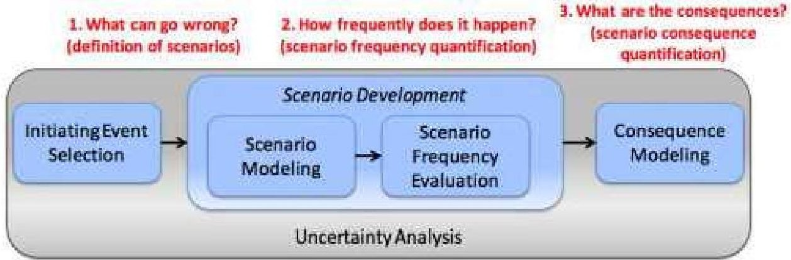

Figure 9.0-1 Risk Scenario Development (Source: NASA/SP-2011-3421)

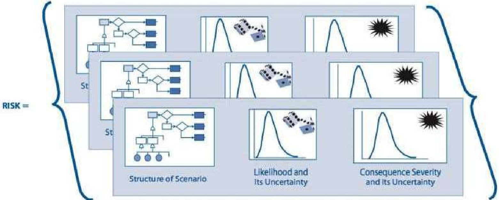

Figure 9.0-2 Risk as an Aggregate Set of Risk Triplets

Undesired scenario(s) might come from technical or programmatic sources (e.g., a cost overrun, schedule slippage, safety mishap, health problem, malicious activities, environmental impact, or failure to achieve a needed scientific or technological objective or success criterion). Both the likelihood and consequences may have associated uncertainties.

<!-- PDF_PAGE: 102 -->

- Key Concepts in Risk Management Risk: Risk is the potential for shortfalls, which may be realized in the future with respect to achieving explicitly-stated requirements. The performance shortfalls may be related to institutional support for mission execution, or related to any one or more of the following mission execution domains: safety, technical, cost, schedule. Risk is characterized as a set of triplets:

The scenario(s) leading to degraded performance in one or more performance measures.

The likelihood(s) of those scenarios.

The consequence(s), impact, or severity of the impact on performance that would result if those scenarios were to occur.

Uncertainties are included in the evaluation of likelihoods and consequences.

- Cost Risk: This is the risk associated with the ability of the program/project to achieve its life-cycle cost objectives and secure appropriate funding. Two risk areas bearing on cost are (1) the risk that the cost estimates and objectives are not accurate and reasonable; and (2) the risk that program execution will not meet the cost objectives as a result of a failure to handle cost, schedule, and performance risks.

- Schedule Risk: Schedule risks are those associated with the adequacy of the time estimated and allocated for the development, production, implementation, and operation of the system. Two risk areas bearing on schedule risk are (1) the risk that the schedule estimates and objectives are not realistic and reasonable; and (2) the risk that program execution will fall short of the schedule objectives as a result of failure to handle cost, schedule, or performance risks.

- Technical Risk: This is the risk associated with the evolution of the design and the production of the system of interest affecting the level of performance necessary to meet the stakeholder expectations and technical requirements. The design, test, and production processes (process risk) influence the technical risk and the nature of the product as depicted in the various levels of the PBS (product risk).

- Programmatic Risk: This is the risk associated with action or inaction from outside the project, over which the project manager has no control, but which may have significant impact on the project. These impacts may manifest themselves in terms of technical, cost, and/or schedule.

- Scenario: A sequence of credible events that specifies the evolution of a system or process from a given state to a future state. In the context of risk management, scenarios are used to identify the ways in which a system or process in its current state can evolve to an undesirable state.

## 9.1 Risk Management Process Description

The activities of the Risk Management Process are described below.

## 9.1.1 Inputs

The following are typical inputs to risk management:

- Project Risk Management Plan: The Risk Management Plan is developed under the Technical Planning Process and defines how risk will be identified, mitigated, monitored, and controlled within the project.

<!-- PDF_PAGE: 103 -->

- Technical Risk Issues: These will be the technical issues identified as the project progresses that pose a risk to the successful accomplishment of the project mission/goals.

- Technical Risk Status Measurements: These are any measures that are established that help to monitor and report the status of project technical risks.

- Technical Risk Reporting Requirements: Includes requirements of how technical risks will be reported, how often, and to whom.

## Additional inputs that may be useful:

- Other Plans and Policies: Systems Engineering Management Plan, form of technical data products, and policy input to metrics and thresholds.

- Technical Inputs: Stakeholder expectations, concept of operations, imposed constraints, tracked observables, current program baseline, performance requirements, and relevant experience data.

## 9.1.2 Prepare a Strategy to Conduct Technical Risk Management

This strategy would include documenting how the program/project risk management plan will be implemented, identifying any additional technical risk sources and categories not captured in the plan, identifying what will trigger actions and how these activities will be communicated to the internal and external teams.

## 9.1.3 Identify Technical Risks

On a continuing basis, the technical team will identify technical risks including their source, analyze the potential consequence and likelihood of the risks occurring, and prepare clear risk statements for entry into the program/project risk management system. Coordination with the relevant stakeholders for the identified risks is included.

## 9.1.4 Conduct Technical Risk Management

The risk management approach described in this guide entails two complementary processes: Risk-Informed Decision Making (RIDM) and Continuous Risk Management (CRM). RIDM is intended to inform direction-setting systems engineering (SE) decisions (e.g., design decisions) through better use of risk and uncertainty information in selecting alternatives and establishing baseline performance requirements.

CRM is then used to manage risks over the course of the development and implementation phases of the life cycle to assure that requirements related to safety, technical, cost, and schedule are met. In the past, RM was considered equivalent to the CRM process; now, RM is defined as comprising both the RIDM and CRM processes, which work together to assure proactive risk management as programs and projects are conceived, developed, and executed. Figure 9.1-1 illustrates the concept.

<!-- PDF_PAGE: 104 -->

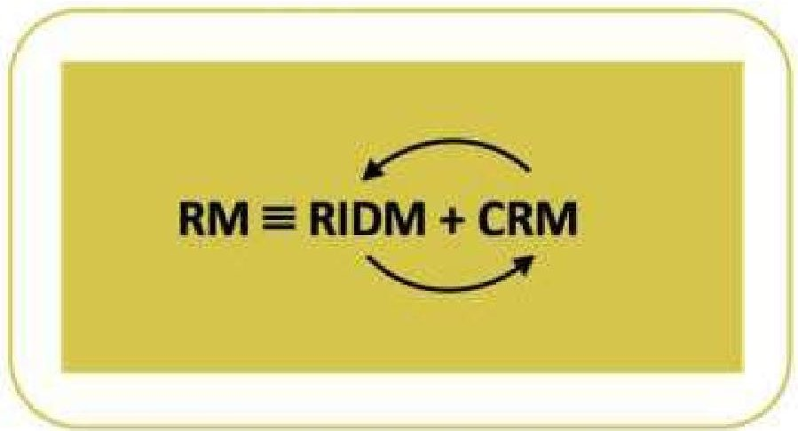

Figure 9.1-1 Risk Management as the Interaction of Risk-Informed Decision Making and Continuous Risk Management (Source: NASA/SP-2011-3422)

## 9.1.5 Prepare for Technical Risk Mitigation

This includes selecting the risks that will be mitigated and more closely monitored, identifying the risk level or threshold that will trigger a risk mitigation action plan, and identifying for each risk which stakeholders will need to be informed that a mitigation/contingency action is determined as well as which organizations will need to become involved to perform the mitigation/contingency action.

## 9.1.6 Monitor the Status of Each Technical Risk Periodically

Risk status will need to be monitored periodically at a frequency identified in the risk plan. Risks that are approaching the trigger thresholds will be monitored on a more frequent basis. Reports of the status are made to the appropriate program/project management or board for communication and for decisions whether to trigger a mitigation action early. Risk status will also be reported at most life-cycle reviews.

9. 1.7 Implement Technical Risk Mitigation and Contingency Action Plans as Triggered When the applicable thresholds are triggered, the technical risk mitigation and contingency action plans are implemented. This includes monitoring the results of the action plan implementation and modifying them as necessary, continuing the mitigation until the residual risk and/or consequence impacts are acceptable, and communicating the actions and results to the identified stakeholders. Action plan reports are prepared and results reported at appropriate boards and at life-cycle reviews.

## 9.1.8 Capture Work Products

Work products include the strategy and procedures for conducting technical risk management; the rationale for decisions made; assumptions made in prioritizing, handling, and reporting technical risks and action plan effectiveness; actions taken to correct action plan implementation anomalies; and lessons learned.

## 9.1.9 Outputs

Following are key risk outputs from activities:

- Technical Risk Mitigation and/or Contingency Actions: Actions taken to mitigate identified risks or contingency actions taken in case risks are realized.

<!-- PDF_PAGE: 105 -->

- Technical Risk Reports: Reports of the technical risk policies, status, remaining residual risks, actions taken, etc. Output at the agreed-to frequency and recipients.

- Work Products: Includes the procedures for conducting technical risk management; rationale for decisions made; selected decision alternatives; assumptions made in prioritizing, handling, and reporting technical risks; and lessons learned.

## 9.2 Risk Management Process Guidance

For additional guidance on risk management, refer to NASA RIDM Handbook NASA/SP-2010- 576 and NASA Risk Management Handbook NASA/SP-2011-3422.

## 5.2.10 Technical Data Management

The Technical Data Management section received relatively low scores and was considered poorly understood by both subject matter experts and students. In fact, subject matter experts ranked this as the least well understood topic for students (Ranked $ 1^{\mathrm{st}} $ out of 17 concepts with an average score of only 3.24) while students also rated it as poorly understood (Ranked $ 4^{\mathrm{th}} $ out of 17 concepts with an average score of just under 3.4). Without another opportunity in the curriculum to teach students about data management and how it supports the system life cycle, the guide was the logical place to impart this information. Therefore, it was selected as Chapter 10, and is presented below as it appears in the guide.

## 10.0 Technical Data Management

The Technical Data Management Process is used to plan for, acquire, access, manage, protect, and use data of a technical nature to support the total life cycle of a system. Data Management (DM) includes the development, deployment, operations and support, eventual retirement, and retention of appropriate technical, to include mission and science, data beyond system retirement.

Key aspects of DM for systems engineering include:

- Application of policies and procedures for data identification and control,

- Timely and economical acquisition of technical data,

- Assurance of the adequacy of data and its protection,

- Facilitating access to and distribution of the data to the point of use,

- Analysis of data use,

- Evaluation of data for future value to other programs/projects, and

<!-- PDF_PAGE: 106 -->

- Process access to information written in legacy software.

The Technical Data Management ensures all information about the project is safe, known, and accessible. Changes to information under Technical Data Management need to be managed by identifying who can make changes to each type of technical data.

## 10.1 Process Description

The activities of the Technical Data Management Process are described below.

## 10.1.1 Inputs

The inputs for this process are:

- Technical data products to be managed: Technical data, regardless of the form or method of recording and who has generated the data during the life cycle of the system being developed. (Electronic technical data should be stored with sufficient metadata to enable easy retrieval and sorting.)

- Technical data requests: External or internal requests for any of the technical data generated by the program/project.

## 10.1.2 Prepare for Technical Data Management Implementation

The recommended procedure is that the DM plan to be a standalone plan. DM issues are usually of sufficient magnitude to justify a separate plan. The plan should cover the following major DM topics:

- Identification/definition/management of data sets.

- Control procedures—receipt, modification, review, and approval.

- Guidance on how to access/search for data for users.

- Data exchange formats that promote data reuse and help to ensure that data can be used consistently throughout the system, family of systems, or system of systems.

- Data rights and distribution limitations such as export-control Sensitive But Unclassified (SBU).

- Storage and maintenance of data, including master lists where documents and records are maintained and managed.

Prepare a technical data management strategy. This strategy can document how the program / project data management plan will be implemented by the technical effort or, in the absence of such a program-level plan, be used as the basis for preparing a detailed technical data management plan, including:

Items of data that will be managed according to program/project or organizational policy, agreements, or legislation;

The data content and format;

A framework for data flow within the program/project and to/from contractors including the language(s) to be employed in technical effort information exchanges;

<!-- PDF_PAGE: 107 -->

Technical data management responsibilities and authorities regarding the origin, generation, capture, archiving, security, privacy, and disposal of data products;

Establishing the rights, obligations, and commitments regarding the retention of, transmission of, and access to data items; and

Relevant data storage, transformation, transmission, and presentation standards and conventions to be used according to program/project or organizational policy, agreements, or legislative constraints.

Obtain strategy/plan commitment from relevant stakeholders.

Prepare procedures for implementing the technical data management strategy for the technical effort and/or for implementing the activities of the technical data management plan.

> Establish a technical database(s) to use for technical data maintenance and storage or work with the program/project staff to arrange use of the program/project database(s) for managing technical data.

> Establish data collection tools, as appropriate to the technical data management scope and available resources.

> Establish electronic data exchange interfaces in accordance with applicable standards.

Train appropriate stakeholders and other technical personnel in the established technical data management strategy/plan, procedures, and data collection tools, as applicable.

## Data Identification/Definition

Each program/project determines data needs during the life cycle. Data types may be defined in standard documents. The standard description is modified to suit program/project-specific needs. Below are the different types of data that might be utilized within a program/ project:

## Data

"Data" is defined in general as "recorded information regardless of the form or method of recording." However, the terms "data" and "information" are frequently used interchangeably. To be more precise, data generally should be processed in some manner to generate useful, actionable information.

"Data," as used in SE DM, includes technical data; computer software documentation; and representation of facts, numbers, or data of any nature that can be communicated, stored, and processed to form information.

Data include that associated with system development, modeling and simulation used in development or test, test and evaluation, installation, parts, spares, repairs, usage data required for product sustainability, and source and/or supplier data.

Data specifically not included in Technical Data Management would be data relating to general workforce operations information, communications information (except where related to a specific requirement), financial transactions, personnel data, transactional data, and other data of a purely business nature.

<!-- PDF_PAGE: 108 -->

- Information: Information is generally considered as processed data. The form of the processed data is dependent on the documentation, report, review formats, or templates that are applicable.

- Technical Data Package: A technical data package is a technical description of an item adequate for supporting an acquisition strategy, production, engineering, and logistics support. The package defines the required design configuration and procedures to ensure adequacy of item performance. It consists of all applicable items such as drawings, associated lists, specifications, standards, performance requirements, quality assurance provisions, and packaging details.

- Technical Data Management System: The strategies, plans, procedures, tools, people, data formats, data exchange rules, databases, and other entities and descriptions required to manage the technical data of a program/project.

## 10.1.3 Collect and Store Data

Subsequent activities collect, store, and maintain technical data and provide it to authorized parties as required. Some considerations that impact these activities for implementing Technical Data Management include:

- Requirements relating to the flow/delivery of data to or from a party should be specified in the technical data management plan.

- Responsibility for data inputs into the technical data management system lies solely with the originator or generator of the data.

- The availability/access of technical data lies with the author, originator, or generator of the data in conjunction with the manager of the technical data management system.

- The established availability/access description and list should be baselined and placed under configuration control.

- For new programs/projects, a digital generation and delivery medium is desired. Existing programs/projects should weigh the cost/benefit trades of digitizing hard copy data.

## Data Collection Checklist

- Have the frequency of collection and the points in the technical and technical management processes when data inputs will be available been determined?

- Has the timeline that is required to move data from the point of origin to storage repositories or stakeholders been established?

- Who is responsible for the input of the data?

- Who is responsible for data storage, retrieval, and security?

- Have necessary supporting tools been developed or acquired?

Tables 10.1-1a and 10.1-1b define the tasks required to capture technical data.

## 10.1.4 Provide Data tot Authorized Parties

All data deliverables should include distribution statements and procedures to protect all data that contain critical technology information, as well as to ensure that limited distribution data,

<!-- PDF_PAGE: 109 -->

intellectual property data, or proprietary data are properly handled during systems engineering activities. This injunction applies whether the data are hard copy or digital.

Table 10.1-1a Technical Data Tasks

<table border="1"><tr><td>Description</td><td>Tasks</td><td>Expected Outcomes</td></tr><tr><td>Technical data capture</td><td>Collect and store inputs and technical effort outcomes from the technical and technical management processes, including: results from technical assessments; descriptions of methods, tools, and metrics used; recommendations, decisions, assumptions, and impacts of technical efforts and decisions; lessons learned; deviations from plan; anomalies and out-of-tolerances relative to requirements; and other data for tracking requirementsPerform data integrity checks on collected data to ensure compliance with content and format as well as technical data checks to ensure there are no errors in specifying or recording the dataReport integrity check anomalies or variances to the authors or generators of the data for correctionPrioritize, review, and update data collection and storage procedures as part of regularly scheduled maintenance.</td><td>Sharable data needed to perform and control the technical and technical management processes is collected and storedStored data inventory.</td></tr><tr><td>Technical data maintenance</td><td>Implement technical management roles and responsibilities with technical data products receivedManage database(s) to ensure that collected data have proper quality and integrity; and are properly retained, secure, and available to those with access authorityPeriodically review technical data management activities to ensure consistency and identify anomalies and variancesReview stored data to ensure completeness, integrity, validity availability, accuracy, currency, and traceabilityPerform technical data maintenance, as requiredIdentify and document significant issues, their impacts, and changes made to technical data to correct issues and mitigate impactsMaintain, control, and prevent the stored data from being used inappropriatelyStore data in a manner that enables easy and speedy retrievalMaintain stored data in a manner that protects the technical data against foreseeable hazards, e.g., fire, flood, earthquake, etc.</td><td>Records of technical data maintenanceTechnical effort data, including captured work products, contractor-delivered documents, and acquirer-provided documents are controlled and maintainedStatus of data stored is maintained to include: version description, timeline, and security classification.</td></tr></table>

<!-- PDF_PAGE: 110 -->

Table 10.1-1b Technical Data Tasks (cont'd)

<table border="1"><tr><td>Description</td><td>Tasks</td><td>Expected Outcomes</td></tr><tr><td>Technical data/information distribution</td><td>Maintain an information library or reference index to provide technical data availability and access instructions.Receive and evaluate requests to determine data requirements and delivery instructions.Process special requests for technical effort data or information according to established procedures for handling such requests.Ensure that required and requested data are appropriately distributed to satisfy the needs of the acquirer and requesters in accordance with the agreement, program/project directives, and technical data management plans and procedures.Ensure that electronic access rules are followed before database access is allowed or any requested data are electronically released/ transferred to the requester.Provide proof of correctness, reliability, and security of technical data provided to internal and external recipients.</td><td>Access information(e.g., available data, access means, security procedures, time period for availability, and personnel cleared for access) is readily available.Technical data are provided to authorize requesters in the appropriate format, with the appropriate content, and by a secure mode of delivery, as applicable.</td></tr><tr><td>Data management system maintenance</td><td>Implement safeguards to ensure protection of the technical database and of en route technical data from unauthorized access or intrusion. Establish proof of coherence of the overall technical dataset to facilitate effective and efficient use.Maintain, as applicable, backups of each technical database.Evaluate the technical data management system to identify collection and storage performance issues and problems;satisfaction of data users; risks associated with delayed or corrupted data, unauthorized access, or survivability of information from hazards such as fire, flood, earthquake, etc.Review systematically the technical data management system, including the database capacity, to determine its appropriateness for successive phases of the Defense Acquisition Framework.Recommend improvements for discovered risks and problems:Handle risks identified as part of technical risk management.Control recommended changes through established program/project change management activities.</td><td>Current technical data management system.Technical data are appropriately and regularly backed up to prevent data loss.</td></tr></table>

## 10.1.5 Outputs

Outputs include timely, secure availability of needed data in various representations to those authorized to receive it. Major outputs from the Technical Data Management Process include the following:

- Form of Technical Data Products: How each type of data is held and stored such as textual, graphic, video, etc.

- Technical Data Electronic Exchange Formats: Description and perhaps templates, models or other ways to capture the formats used for the various data exchanges.

- Delivered Technical Data: The data that were delivered to the requester. Other work products generated as part of this process include the strategy and procedures used for technical data management, request dispositions, decisions, and assumptions.

<!-- PDF_PAGE: 111 -->

- data security and

- ITAR.

## 5.2.11 Technical Assessment

Understanding of the Technical Assessment section was ranked in the middle of the various concepts for both subject matter experts (Ranked $ 6^{\mathrm{th}} $ out of 17 concepts with an average score of 3.53) and students (Ranked $ 9^{\mathrm{th}} $ out of 17 concepts with an average score of just under 3.6). However, in working with subject matter experts to design the guide, it was determined that these concepts used to define and measure performance indicators were especially important for expanding student's understanding of Systems Engineering, and were lacking in other areas of the discipline specific curriculum. Therefore, this chapter was included based on the recommendation of the instructors in the department, and it was selected as Chapter 11. The chapter is presented below as it appears in the guide.

## 11.0 Technical Assessment

Technical assessment is the crosscutting process used to help monitor technical progress of a program/project through periodic technical reviews and through monitoring of technical indicators such as MOEs, MOPs, Key Performance Parameters (KPPs), and TPMs. The reviews and metrics also provide status information to support assessing system design, product realization, and technical management decisions.

## 11.1 Process Description

The activities of the Technical Assessment Process are described below.

## 11.1.1 Inputs

The inputs for this process are:

- Technical Plans: These are the planning documents that will outline the technical reviews/ assessment process as well as identify the technical product/process measures that will be tracked and assessed to determine technical progress. Examples of these plans are the program (or project) plan, SEMP (if applicable), review plans (which may be part of the program or project plan), ILS plan, and EVM plan (if applicable). These plans contain the information and descriptions of the program/project's alignment with and contribution to

<!-- PDF_PAGE: 112 -->

Agency strategic goals, its management approach, its technical approach, its integrated cost and schedule, its budget, resource allocations, and its risk management approach.

- Technical Process and Product Measures: These are the identified technical measures that will be assessed or tracked to determine technical progress. These measures are also referred to as MOEs, MOPs, KPPs, and TPMs. They provide indications of the program/project's performance in key management, technical, cost (budget), schedule, and risk areas.

- Reporting Requirements: These are the requirements on the methodology in which the status of the technical measures will be reported with regard to management, technical cost (budget), schedule, and risk. The requirements apply internally to the program/project and are used externally by the Centers and Mission Directorates to assess the performance of the program or project. The methodology and tools used for reporting the status will be established on a project-by-project basis.

## 11.1.2 Process Activities

The process activities of the Technical Assessment Process are described below:

- Prepare Strategy for Conducting Technical Assessments:

- Assess Technical Work Productivity and Product Quality and Conduct Progress Reviews:

- Capture Work Products:

## 11.1.3 Outputs

Typical outputs of the Technical Assessment Process include the following:

- Assessment Results, Findings, and Recommendations: This is the collective data on the established measures from which trends can be determined and variances from expected results can be understood. Results then feed into the Decision Analysis Process where corrective action may be necessary.

- Technical Review Reports/Minutes: This is the collective information coming out of each review that captures the results, recommendations, and actions with regard to meeting the review's success criteria.

- Other Work Products: These would include strategies and procedures for technical assessment, key decisions and associated rationale, assumptions, and lessons learned.

## 11.2 Technical Assessment Guidance

Refer to Section 6.7.2 in the NASA Expanded Guidance for Systems Engineering at Expanded Guidance for NASA SE NASA/SP-2016-6105-SUPPL for additional guidance on:

- the basis of technical reviews,

- audits,

- Key Decision Points,

- other reviews,

<!-- PDF_PAGE: 113 -->

- status reporting and assessment.

## 5.3. Assessed Student Performance

The results of comparison of the student performance assessments before and after implementation show improvement through the development and curricular implementation of the tailored SE program/handbook. First student assessments in the capstone design course improved. The average course grade prior to intervention was 94.1%. After the intervention, this outcome improved the average course grade by 2.5%. The distribution of average course grades improved as well, with a higher percentage of students receiving an "A" grade in the course, fewer receiving a "B" grade, and far fewer receiving a "C" grade. A comparison of these grade distributions is displayed in Figure 22.

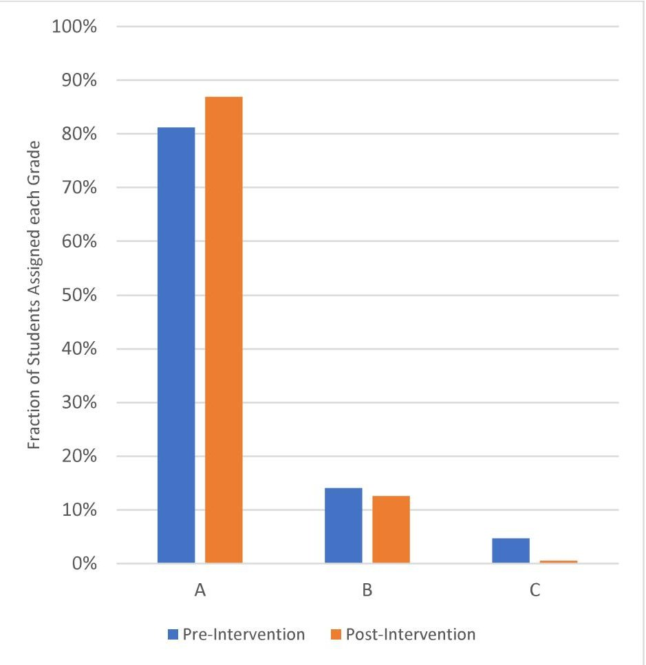

Figure 22: Comparison of Course Grade Distribution Pre-Intervention (n=64) and Post Intervention (n=191)

<!-- PDF_PAGE: 114 -->

Second, both student and SME-derived assessment results show improvement in student's performance, as illustrated in Figures 23 and 24. Both groups were more likely to say that students had "met expectations" and "exceeded expectations" after implementation of the handbook. In particular, the feedback from the SMEs was most compelling. On average, instructors and subject matter experts were more than 20% more likely to say students met expectations and more than 34% more likely to say students exceeded expectations after the intervention was implemented.

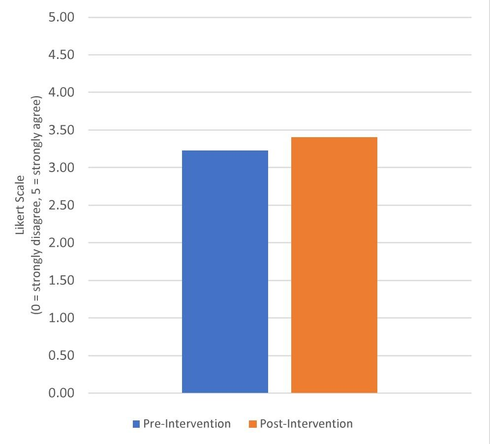

Figure 23: Comparison of Student Responses That Student Performance "Exceeds Expectations" Pre-Intervention (n=49) and Post-Intervention (n=45)

<!-- PDF_PAGE: 115 -->

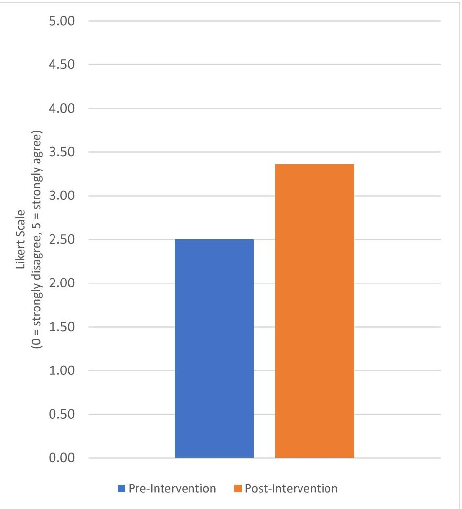

Figure 24: Comparison of SME Responses That Student Performance "Exceeds Expectations" Pre-Intervention (n=20) and Post-Intervention (n=28)

The final student assessment used the information captured in the Course Reflective Modules (CRMs) utilized by all instructors at the US Naval Academy at the end of every semester. CRMs are filled out every semester for every course by a group of Aerospace Engineering instructors who are also subject matter experts in this field. To complete a CRM, instructors rate students on a scale from 1 to 5, where 5 is the highest. CRMs completed after the implementation of the handbook showed vast improvement, nearly doubling the fraction of students that the instructors rated as a 5 from 37.5% before the guide was implemented up to 68.5% afterward in response to the prompt; "Proficient in Systems Engineering", as illustrated in Figure 25.

<!-- PDF_PAGE: 116 -->

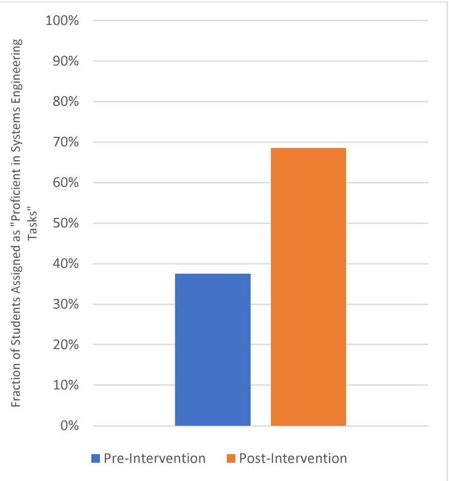

Figure 25: Comparison of Instructor Ratings of SE Proficiency Pre-Intervention (n=64) and Post Intervention (n=127)

In part due to the COVID-19 pandemic, direct system performance improvements were not able to be measured. During this period, students transitioned to a remote learning model and did not have the opportunity to do the hands-on work necessary to develop and test systems ready for deployment. However, comparison to literature indicates that the identified SE processes selected through the Adelphi process and student surveys were similar to those utilized by universities with minimal resources and very successful CubeSat programs [6]. This bodes well for future success of USNA CubeSat systems, starting with a launch slated for late 2025.

<!-- PDF_PAGE: 117 -->

## CHAPTER 6: DISCUSSION

In response to the need for an undergraduate-centric space systems engineering teaching resource, this research has developed, implemented, and validated improved learning in a revised curriculum using a tailored systems engineering program/handbook and an MBSE-enabled CubeSat design process that includes a baseline reference model developed for this work. Discussion here focuses on some hypotheses for mechanisms by which student learning is improved, and on the physical and model-based artifacts. These include the PSAT1U CubeSat, the systems engineering handbook itself and the MBSE framework. The latter two of three artifacts were developed by the author directly and all of these elements contribute to the revised curriculum.

## 6.1. Mechanisms of Student Performance

Using a variety of assessment methods and metrics as well as comparison to literature to evaluate potential system performance improvements, this study has illustrated that a revised curriculum using a tailored systems engineering handbook and MBSE-enabled CubeSat design process has been proven to improve student learning and classroom performance. It is also expected to improve the success of the systems designed and built using this paradigm. The mechanisms by which these improvements are achieved can be exemplified by looking in detail at the content of the tailored processes.

For example, one of the critical aspects of agile space systems design is the test and evaluation stage. CubeSats are generally very unreliable, with an early failure rate of 23.3% [40]. Many of their failures are attributable to abbreviated subsystem and integrated system testing [41]. Many classical systems engineering texts treat test and evaluation abstractly,

<!-- PDF_PAGE: 118 -->

without examples that would be relevant to CubeSat testing including test planning [26], requirements traceability [25], or data reduction [40]. These presentations are appropriate for graduate training in Systems Engineering, but do not serve the needs of undergraduate students. The NASA SE Handbook, for example, does not include information on commercial off-the-shelf (COTS) testing and evaluation [13]. In contrast to these, the tailored Systems Engineering handbook developed by the author presents a defined and simplified process for developing systems integration and testing plans. It also presents a construct for communicating design changes and exploring the trade space with the aid of an MBSE tool and the baseline MBSE architecture produced by this work. By following the tailored process, students who are new to space systems design can quickly understand the trade space and parameters of the baseline architecture and any work that was done by students that came before them to define a solution to problem they are trying to solve.

A comparison showing the subset of content from the NASA SE Handbook that was selected for the USNA Tailored SE Handbook is provided in Figure 26. All of the content topics from the NASA Handbook are listed, and those topics that were selected through the iterative tailoring process for use at USNA are highlighted in yellow. The topics selected for use at USNA focus on the skills that are needed to design, realize, and manage a space system development, while high-level SE processes, as well as programmatic and budgeting concerns with NASA- specific terminology and schedules are intentionally omitted.

<!-- PDF_PAGE: 119 -->

<table border="1"><tr><td colspan="2">1.0 Introduction
1.1 Purpose
1.2 Scope and Depth</td></tr><tr><td colspan="2">2.0 Fundamentals of Systems Engineering
2.1 The Common Technical Processes and the SE Engine
2.2 An overview of the SE Engine by Project Phase
2.3 Example of Using the SE Engine
2.4 Distinctions between Product Verification and Product Validation
2.5 Cost Effectiveness Considerations
2.6 Human Systems Integration (HSI) in the SE Process
2.7 Competency Model for Systems Engineers</td></tr><tr><td colspan="2">3.0 NASA Program/Project Life Cycle
3.1 Program Formulation
3.2 Program Implementation
3.3 Project Pre-Phase A: Concept Studies
3.4 Project Phase A: Concept and Technology Development
3.5 Project Phase B: Preliminary Design and Technology Completion
3.6 Project Phase C: Final Design and Fabrication
3.7 Project Phase D: System Assembly, Integration and Test, Launch
3.8 Project Phase E: Operations and Sustainment
3.9 Project Phase F: Closeout
3.10 Funding: The Budget Cycle
3.11 Tailoring and Customization of NPR 7123.1 Requirements</td></tr><tr><td colspan="2">4.0 System Design Processes
4.1 Stakeholder Expectations Definition
4.2 Technical Requirements Definition
4.3 Logical Decomposition
4.4 Design Solution Definition</td></tr><tr><td colspan="2">5.0 Product Realization
5.1 Product Implementation Process
5.2 Product Integration Process
5.3 Product Verification Process
5.4 Product Validation Process
5.5 Product Transition Process</td></tr><tr><td colspan="2">6.0 Crosscutting Technical Management
6.1 Technical Planning Process
6.2 Requirements Management Process
6.3 Interface Management Process
6.4 Technical Risk Management Process
6.5 Configuration Management Process
6.6 Technical Data Management Process
6.7 Technical Assessment Process
6.8 Decision Analysis Process</td></tr></table>

Figure 26: Comparison of Content and Processes Within the NASA SE Handbook (Black Text) and the Tailored SE Handbook (Red Text)

Another mechanism that contributed to improved student performance is the emphasis on an MBSE paradigm in this tailored systems engineering process. Because resources were not

<!-- PDF_PAGE: 120 -->

available to provide all students access to MBSE modeling software, the architecture was developed by the author and a read-only version of the PSAT1U baseline model was provided to them instead, allowing students to understand the terminology and parametric capability of tools they are likely to see in their careers as engineering practitioners. The MBSE paradigm has been demonstrated in many instances to improve student's learning of SE processes [42, 43]. In this study, we attribute much of the performance improvement of the students to the following philosophies with which MBSE was used in this course:

- MBSE tools (such as Dassault Systems Cameo) are complicated and rich, with many options and user interfaces. In the USNA process, students are provided readable pre-populated diagrams describing their PSAT1U baseline architecture in order to concentrate their efforts on understanding and interpreting these diagrams and on the interconnectivity and traceability between systems and subsystems. Introducing students to MBSE tool functionality and advanced topics without investing the time necessary to produce a deeper understanding of MBSE model development proved effective in enabling undergraduate students to be successful in understanding and building these SE work products.

- The PSAT1U baseline MBSE architecture, developed by the author, was used repeatedly to provide scaffolding for students to understand, probe, and develop MBSE models and artifacts. This reference model allowed for the abstractions of SE (object orientation, architecting, parametrics, etc.) to be exemplified for students in a model they could understand and manipulate. The students were more motivated and able to value and execute these SE processes when they are strongly connected to their personal and scholarly goals in the context of capstone design.

<!-- PDF_PAGE: 121 -->

- Instructors observed a significant improvement in team performance in the semester, and a significant improvement in technical information transfer from one cohort-year to the next under the MBSE paradigm. Though not quantified in this study, this improvement is best understood by the improvement in the speed through which new students were able to be oriented to existing design elements. It now takes only a couple of weeks to convey information that used to take over a month of class time for these new cohorts of students to understand. Under the previous DBSE paradigm, design decisions and concepts were communicated to the next year's students through extensive design reports. The opacity and lack of structure for these reports meant that subsequent student groups often rejected earlier students' work and decisions as unclear or unreliable. Additionally, often so much time was consumed with simple trade studies, that critical design details required to drive make/buy decisions and begin integration were often not completed in an academic year. Under the new paradigm, the instructors observed that the formality and clarity of MBSE artifacts allowed students to spend less time focusing on well understood trades and instead focus on design decisions critical to their specific mission payloads. This did not do away with trade studies, but ensured that student focused on the most crucial aspects of their design, while utilizing well understand components and systems from previous designs. In general, the MBSE paradigm is important because it can accelerate the development of the project by improving information transfer to and from students in each subsequent academic year.

## 6.2. Artifacts of PSAT1U Project Performance

In addition to the various student learning outcomes that were evaluated, the tailored SE Handbook and curricular changes also coincided with the development of the Parkinson Sat 1U

<!-- PDF_PAGE: 122 -->

(PSAT1U), and the associated MBSE-enabled reference architecture developed by the author. Applying Naval Academy specific hardware and software definitions, with the architecture of the CubeSat System Reference Model (CSRM) at its core, the PSAT1U CubeSat includes core bus subsystems such as the Attitude Determination and Control System (ADCS), Electrical Power System (EPS), on-board computer (OBC), Communications Systems, and a payload compartment.

The USNA PSAT1U has served as the curricular introduction to space systems and modular design for USNA engineering students. Therefore, in this work the CubeSat is an exemplar system identified because it's applicable in this case, though the method could be utilized to develop a tailored process for any type of organization or product.

Recently, these students have expanded on these skills and designed and developed the modular satellite bus architecture for a 3U CubeSat that will host two mission payloads developed respectively by students at the University of Maryland and the United States Air Force Academy. This spacecraft, dubbed USNA-16, has its roots in the PSAT1U baseline architecture and is scheduled for launch in late 2025.

In addition to the hardware described above, an additional artifact developed to aid student learning is the PSAT Reference Model, which was developed by the author and is implemented using CAMEO Systems Modeler MBSE Software as well as Modelio Open Source Software. The architecture hierarchy of the PSAT1U model is displayed in Figure 13 and encompasses all of the ground system components, subsystem components, and subsystems along with the segment, enterprise and domain packages. This reference model has been continuously developed and used semester after semester to effectively capture and communicate students'

<!-- PDF_PAGE: 123 -->

design decisions. The result is a reference model that can be used and adapted to other CubeSat curricula and educational projects.

<!-- PDF_PAGE: 124 -->

## CHAPTER 7: RESEARCH CONTRIBUTIONS

This dissertation has made significant contributions to the state of knowledge within the fields of MBSE and engineering education.

First, this dissertation introduces a model of CubeSats using the MBSE design and architecting paradigm for the purpose of engineering education. This model is underpinned by a standard CubeSat System Reference Model and defined with specific design information related to a modular student-built CubeSat. Both the physical CubeSat and it's MBSE digital-twin is ultimately designed to narrow the trade space and streamline the design process for whatever particular payload is desired.

Second, this research developed a new tailored systems engineering procedure that is now experimentally demonstrated to improve student learning outcomes in practice. Students' self-assessment and expert/instructor assessment showed improved understanding of Systems Engineering principles and improved student performance. The measures for student performance were both course grades, evaluation by instructors and outside SMEs and self assessment by students. Measures for SE understanding were standardized course reflective modules as well as periodic surveys completed by both students and SMEs.

Finally, this research proposed and discussed the means of student performance improvements through the execution of model-based systems engineering processes, the concentration of efforts on relevant systems engineering tasks, and the improvement of team efforts. Although demonstrated within the curriculum of the USNA, these findings are hypothesized to be extensible to other educational programs and instances.

<!-- PDF_PAGE: 125 -->

## CHAPTER 8: CONCLUSIONS

This study has developed and evaluated a SE process for CubeSats intended specifically for student-run capstone projects taking place over the course of an academic year at USNA. The process should be broadly extensible to a class of organizations with similar constraints on experience, time and resources. A tailored SE Program/Handbook has been created by the author that addresses the most pressing SE concepts to support success in undergraduate learning as well as system performance. A handbook has been developed through an iterative process in use over several academic years. Survey data from students and SMEs was collected during those iterations to ensure that the most important and impactful SE processes continue to be addressed. Identified SE processes included were similar to those utilized by universities with minimal resources and very successful CubeSat programs [6]. Additionally, the importance of utilizing MBSE has been identified by course stakeholders, and the author has created a reference model for the PSAT1U CubeSat design for inclusion in the handbook. The model is a baseline 1U CubeSat architecture that describes the physical design of the PSAT1U CubeSat, allows students to understand the design trades that went into the development of that satellite, and provides an important first introduction to MBSE concepts to these undergraduate students. The process has proven successful in improving Systems Engineering knowledge and course outcomes. The handbook developed through this process as better for this application than the full implementation of Systems Engineering principles, because the organization does not have the time, manpower or resources to conduct this process and still meet their engineering education mission. Additionally, the method of iteratively implementing a tailored Systems Engineering Program/Handbook may be applicable more broadly both in academia and in various fields of engineering.

<!-- PDF_PAGE: 126 -->

We can identify some threats to the extensibility and validity of these findings. The current study was limited to an intervention in the course sequence of undergraduate CubeSat development at the USNA. USNA midshipmen are high-performing students, they operate in smaller cohorts (40-60 students) than do students at larger engineering Universities. To test the broad applicability of this method, similar tailored frameworks should be developed for other universities or engineering organizations, and their success and relevance should be measured based on their requirements. Because the experimental investigations in this research were performed with student subjects, no simultaneous control group experimental designs were attempted. We assume an equivalence between the experimental control group prior to implementation of the tailored guide (USNA class of 2019) and the treatment groups (USNA classes of 2020-2022) during the development and implementation of the guide. No attempt was made here to quantify dropout effects, class-to-class carryover effects, or the effect of randomization.

Future work will include a periodic reevaluation of the guide to ensure it remains effective and captures the state of the art in Systems Engineering, as well as work to quantify student success in their technical development, as defined by the launch and mission success of future student-built CubeSats designed using the exemplar MBSE reference model. Additional opportunities might be available to evaluate development of a similar guide tailored to a different organization and set of resource constraints, such as another university capstone team, a team conducting development of a different type of system or product, or a small and resource-limited team from outside of academia, for example, an organization employing responsive space capabilities that would benefit from a similar Delphi-analysis approach to identify and

<!-- PDF_PAGE: 127 -->

implement some of the most impactful elements of systems engineering for their application but who can't afford the investment required to immediately implement all of its tenets.

<!-- PDF_PAGE: 128 -->

## REFERENCES

1. CubeSat Design Specification, rev. 13, The CubeSat Program, Cal Poly SLO, April 2015.

2. Poghosyan, A., & Golkar, A. (2017). CubeSat evolution: Analyzing CubeSat capabilities for conducting science missions. Progress in Aerospace Sciences, 88, 59-83. https://doi.org/10.1016/j.paerosci.2016.11.002.

3. Spangelo, S. C., Kaslow, D., Delp, C., Cole, B., Anderson, L., Fosse, E., Gilbert, B. S., Hartman, L., Kahn, T., & Cutler, J. (2012). Applying Model Based Systems Engineering (MBSE) to a standard CubeSat. 2012 IEEE Aerospace Conference, 1-20. https://doi.org/10.1109/AERO.2012.6187339.

4. Radhakrishnan, C., Chandrasekar, V., Reising, S. C., & Berg, W. (2022). Rainfall Estimation From TEMPEST-D CubeSat Observations: A Machine-Learning Approach. IEEE Journal of Selected Topics in Applied Earth Observations and Remote Sensing, 15, 3626-3636. https://doi.org/10.1109/JSTARS.2022.3170835.

5. Selva, D., & Krejci, D. (2012). A survey and assessment of the capabilities of Cubesats for Earth observation. Acta Astronautica, 74, 50-68. https://doi.org/10.1016/j.actaastro.2011.12.014.

6. Berthoud, L., Swartwout, M., Cutler, J., Klumpar, D., Larsen, J. A., and Nielson, J. D. 2019. "University CubeSat Project Management for Success," Proceedings of the AIAA/USU Conference on Small Satellites, Education Programs, SSC19-WKIII-07, 1-17. http://digitalcommons.usu.edu/smallsat/2019/all2019/63/.

7. Honoré-Livermore, E. Integrating Agile Systems Engineering and Project Management in Small Satellites Development. NTNU. 2022; Available online: https://ntnuopen.ntnu.no/ntnu- xmlui/handle/11250/3005361 (accessed on 14 December 2024).

<!-- PDF_PAGE: 129 -->

8. Chiu, Kevin Yi-Tzu. Sealion Cubesat Mission Architecture Using Model Based Systems Engineering with a Docs as Code Approach. 2023. ProQuest Dissertations & Theses.

9. García-Sánchez, E.R.; Vargas-Martínez, H.S.; Candia-García, F.; Contreras-Lima, J. Agile Stage-Gate Approach for Design, Integration, and Testing of a 1U CubeSat. Aerospace; 2024; 11, 324. [DOI: https://dx.doi.org/10.3390/aerospace11040324]

10. Smith, J.; Brown, L.; Johnson, A. Accelerating Small Satellite Development with Agile Practices. J. Aerosp. Eng.; 2019; 32, pp. 567-578. [DOI: https://dx.doi.org/10.48550/arXiv.2210.10653]

11. Cockrell, J.J. Small Spacecraft Technology Program Guidebook for Technology Development Projects; NASA: Washington, DC, USA, 2021; Available online: https://www.nasa.gov/wp content/uploads/2021/08/smallsattechdevguidebook_rev-508d1.pdf?emrc=71a57b (accessed on 14 December 2024).

12. Defense Acquisition Guidebook, Department of Defense, USD AT&L, Washington, DC, 2017.

13. NASA Office of Chief Engineer. NASA Systems Engineering Handbook. NASA/SP-2016- 6105, Rev. 3, 2019.

14. Honour, E.C. A historical perspective on systems engineering. Syst. Eng.; 2018; 21, pp. 148- 151. [DOI: https://dx.doi.org/10.1002/sys.21432]

15. INCOSE. Systems Engineering Handbook: A Guide for System Life Cycle Processes and Activities; 5th ed. John Wiley & Sons, Inc.: Hoboken, NJ, USA, 2023; Available online: https://www.incose.org/publications/products/se-handbook-v4 (accessed on 14 December 2024).

16. Walden, D.; Roedler, G.; Forsberg, K.; Hamelin, D.; Shortell, T. Systems Engineering Handbook; 4th ed. International Council on Systems Engineering Wiley: Hoboken, NJ, USA,

<!-- PDF_PAGE: 130 -->

2015; Available online: https://scholar.google.com/scholar_lookup?title=Systems+Engineering+Handbook&author= Walden,+D.&author=Roedler,+G.&author=Forsberg,+K.&author=Hamelin,+D.&author=Sh ortell,+T.&publication_year=2015 (accessed on 14 December 2024).

17. INCOSE. Systems Engineering Vision 2035; 2024; Available online: https://www.incose.org/publications/se-vision-2035 (accessed on 14 December 2024).

18. Hartmann, R. The Systems Engineering Vision 2035-Towards the Future of Systems Engineering. Proceedings of the Model Based Space Systems and Software Engineering Conference—MBSE2022; Toulouse, France, 22-24 November 2022; INCOSE President-Elect 2022; Available online: https://indico.esa.int/event/407/contributions/7559/attachments/5007/7808/Keynote%20-%20The%20Systems%20Engineering%20Vision%202035%20-%20Towards%20the%20Future%20of%20Systems%20Engineering.pdf (accessed on 14 December 2024).

19. Cantu, K.R. A Framework of Methods and Process Improvements to Better Align Technology Development with DoD Space Enterprise Priorities. Ph.D. Thesis; Massachusetts Institute of Technology: Cambridge, MA, USA, 2016; Available online: https://dspace.mit.edu/handle/1721.1/112057 (accessed on 14 December 2024).

20. Anderson, W.V. Enhancing Innovation in Technical Teams: A Study of Design Thinking and Systems Architecture Integration. Ph.D. Thesis; Massachusetts Institute of Technology: Cambridge, MA, USA, 2023; Available online: https://dspace.mit.edu/handle/1721.1/152747?show=full (accessed on 14 December 2024).

<!-- PDF_PAGE: 131 -->

21. Jones, D.S.; Tow, D.; Holland, J.L. Introduction of an Agile Systems Engineering Process to the NASA Armstrong Flight Research Center. Proceedings of the AIAA SCITECH 2024 Forum; Orlando, FL, USA, 8-12 January 2024; Available online: https://arc.aiaa.org/doi/10.2514/6.2024-2050 (accessed on 14 December 2024).

22. Borky, John M. Email to John M. Gregory. 21 August 2018.

23. Gregory, J., Kang, J., Bruninga, R., Downey, G., Sega, R., et. al. "A Tailored Systems Engineering Process for the Development of CubeSat Class Satellites", 34th Annual Small Satellite Conference, UT, USA, August 1, 2020.

24. Lykins, H., Friedenthal, S., & Meilich, A. (2000). 4.4.4 Adapting UML for an Object Oriented Systems Engineering Method (OOSEM). INCOSE International Symposium, 10(1), 490-497. https://doi.org/10.1002/j.2334-5837.2000.tb00416.x.

25. Kossiakoff, A., Seymour, S. J., Flanigan, D. A., & Biemer, S. M. (2020). Systems engineering principles and practice (Third edition.). John Wiley & Sons, Inc.

26. Borky, J. M., & Bradley, T. H. (2019). Effective model-based systems engineering. Springer, Cham, Switzerland. https://doi.org/10.1007/978-3-319-95669-5.

27. INCOSE. Model-Based Systems Engineering (MBSE) (Glossary); 2022; Available online: https://sebokwiki.org/wiki/Category:Glossary_of_Terms (accessed on 14 December 2024).

28. Hart, L.E. Introduction to Model-Based System Engineering (MBSE) and SysML. Delaware Valley INCOSE Chapter Meeting; 2015; 30.Available online: https://www.incose.org/docs/default-source/delaware-valley/mbse-overview-incose-30-july- 2015.pdf (accessed on 14 December 2024).

<!-- PDF_PAGE: 132 -->

29. Hartmann, D.; Fay, A.; Maurer, M. Challenges in Model-Based Systems Engineering: A Comprehensive Review. Syst. Eng.; 2022; 25, pp. 35-52. [DOI: https://dx.doi.org/10.1007/978-3-642-30817-8_9]

30. Gough, K.M.; Phojanamongkolkij, N. Employing Model-Based Systems Engineering (MBSE) on a NASA Aeronautic Research Project: A Case Study. Proceedings of the 2018 Aviation Technology, Integration, and Operations Conference; Atlanta, GA, USA, 25-29 June 2018; [DOI: https://dx.doi.org/10.2514/6.2018-3361]

31. Subarna, S.; Jawale, A.K.; Vidap, A.S.; Sadachar, S.D.; Fliginger, S.; Myla, S. Using a Model-Based Systems Engineering Approach for Aerospace System Requirements Management. Proceedings of the 2020 AIAA/IEEE 39th Digital Avionics Systems Conference (DASC); San Antonio, TX, USA, 11-15 October 2020; Available online: https://doi.org/10.1109/DASC50938.2020.9256589 (accessed on 14 December 2024).

32. Buede, D.M.; Miller, W.D. The Engineering Design of Systems: Models and Methods; John Wiley & Sons: Hoboken, NJ, USA, 2024; ISBN 978-1-119-98401-6 Available online: https://www.wiley.com/en- be/The+Engineering+Design+of+Systems%3A+Models+and+Methods%2C+4th+Edition-p- 9781119984016 (accessed on 14 December 2024).

33. Honoré-Livermore, E., Haskins, C. (2022). Model-Based Systems Engineering for CubeSat FMECA. In: Madni, A.M., Boehm, B., Erwin, D., Moghaddam, M., Sievers, M., Wheaton, M. (eds) Recent Trends and Advances in Model Based Systems Engineering. Springer, Cham. https://doi.org/10.1007/978-3-030-82083-1_45 (accessed on 29 December 2024).

34. Cavell, B.; Lam, K. Model Based Systems Engineering Cost Study. 2023 NASA Cost and Schedule Symposium May 2023; 2019; Available online: https://www.nasa.gov/wp-

<!-- PDF_PAGE: 133 -->

14 December 2024).

35. Crumbly, C.M. Systems Engineering Technology: Closing the MBSE Modeling Gap through Community College. Proceedings of the AIAA SCITECH 2024 Forum; Orlando, FL, USA, 8- 12 January 2024; 0918. [DOI: https://dx.doi.org/10.2514/6.2024-0918]

36. Ko, E. (2010). The Washington Accord on Engineering Curriculum. In International Encyclopedia of Education (Vol. 4, pp. 209-215). https://doi.org/10.1016/B978-0-08-044894-7.01507-4

37. Honoré-Livermore, E., Lyells, R., Garrett, J. L., Angier, R., & Epps, B. (2021). "An Agile Systems Engineering Analysis of a University CubeSat Project Organization." INCOSE International Symposium, 31(1), 1334-1348. https://doi.org/10.1002/j.2334-5837.2021.00904.x

38. Honoré-Livermore, E., Birkeland, R., Bakken, S., Garrett, J.R., and Haskins, C., "Digital Engineering Development in an Academic CubeSat Project" Journal of Aerospace Information Systems, 19(10) 2022.

39. Kaslow, D., Ayres, B., Cahill, P., Hart, L., Yntema, R., "Developing a CubeSat Model-Based Systems Engineering (MBSE) Reference Model - Interim Status #3," Proceedings of IEEE Aerospace Conference, Big Sky, MT, March 2017.

40. Villela, T., Costa, C. A., Brandao, A. M., Bueno, F. T., & Leonardi, R. (2019). Towards the Thousandth CubeSat: A Statistical Overview. International Journal of Aerospace Engineering, 2019, 1-13. https://doi.org/10.1155/2019/5063145.

<!-- PDF_PAGE: 134 -->

41. Langer, M., Weisgerber, M., Bouwmeester, J., & Hoehn, A. (2017). A reliability estimation tool for reducing infant mortality in Cubesat missions. 2017 IEEE Aerospace Conference, 1- 9. https://doi.org/10.1109/AERO.2017.7943598.

42. Fernandez, J. L., & Moreno, G. (2016). MBSE for Engineering Students. INCOSE International Symposium, 26(1), 1231-1245. https://doi.org/10.1002/j.2334-5837.2016.00223.x.

43. David, P., Blanco, E., Revol, S., Noyrit, F., & Coatrine, M. (2019). Model Based Systems Engineering Introduction Within Industrial Engineering Curriculum. 2019 International Conference on Engineering and Product Design Education, 1-6.

<!-- PDF_PAGE: 135 -->

Date:

Review (circle one): PDR/CDR/FRR

Team Evaluated:

<table border="1"><tr><td>6</td><td colspan="2">The lack of the following Technical Management Processes was most detrimental to the team&#x27;s success up to this point (circle all that apply):</td></tr><tr><td colspan="2">a. Stakeholder Expectations Definition</td><td rowspan="4"></td></tr><tr><td colspan="2">b. Technical Requirements Definition</td></tr><tr><td colspan="2">c. Logical Decomposition</td></tr><tr><td colspan="2">d. Design Solution Definition</td></tr><tr><td>7</td><td colspan="2">The lack of the following Product Realization Processes was most detrimental to the team&#x27;s success up this point (circle all that apply):</td></tr><tr><td colspan="2">a. Product Transition</td><td rowspan="5"></td></tr><tr><td colspan="2">b. Product Validation</td></tr><tr><td colspan="2">c. Product Verification</td></tr><tr><td colspan="2">d. Product Integration</td></tr><tr><td colspan="2">e. Product Implementation</td></tr><tr><td>8</td><td colspan="2">The lack of the following Technical Management Processes was most detrimental to the team&#x27;s success up this point (circle all that apply):</td></tr><tr><td colspan="2">a. Technical Planning</td><td rowspan="11"></td></tr><tr><td colspan="2">b. Requirement Management</td></tr><tr><td colspan="2">c. Interface Management</td></tr><tr><td colspan="2">d. Technical Risk Management</td></tr><tr><td colspan="2">e. Configuration Management</td></tr><tr><td colspan="2">f. Technical Data Management</td></tr><tr><td colspan="2">g. Technical Assessment</td></tr><tr><td colspan="2">h. Decision Analysis</td></tr></table>

<!-- PDF_PAGE: 136 -->

FOR RESEARCH PURPOSES ONLY, NOT A COMPONENT IN STUDENT ASSESSMENT

Review (circle one): PDR/CDR/FRR

Date:

Team:

<table border="1"><tr><td>#</td><td>Statement</td><td colspan="6">Survey Scale:1=Strongly Disagree2=Disagree3=Neutral4=Agree5=Strongly AgreeNA=Not Applicable</td></tr><tr><td>1</td><td>Our team&#x27;s performance up to this point meets expectations to proceed to the next project phase.</td><td>1</td><td>2</td><td>3</td><td>4</td><td>5</td><td></td></tr><tr><td>2</td><td>Our team&#x27;s performance up to this point exceeds expectations.</td><td>1</td><td>2</td><td>3</td><td>4</td><td>5</td><td></td></tr><tr><td>3</td><td>Our team has adequately addressed the following System Design Processes up to this point:</td><td colspan="6"></td></tr><tr><td>3a</td><td>Stakeholder Expectations Definition</td><td>1</td><td>2</td><td>3</td><td>4</td><td>5</td><td>NA</td></tr><tr><td>3b</td><td>Technical Requirements Definition</td><td>1</td><td>2</td><td>3</td><td>4</td><td>5</td><td>NA</td></tr><tr><td>3c</td><td>Logical Decomposition</td><td>1</td><td>2</td><td>3</td><td>4</td><td>5</td><td>NA</td></tr><tr><td>3d</td><td>Design Solution Definition</td><td>1</td><td>2</td><td>3</td><td>4</td><td>5</td><td>NA</td></tr><tr><td>4</td><td>Our team had adequately addressed the following Product Realization Processes up to this point:</td><td colspan="6"></td></tr><tr><td>4a</td><td>Product Implementation</td><td>1</td><td>2</td><td>3</td><td>4</td><td>5</td><td>NA</td></tr><tr><td>4b</td><td>Product Integration</td><td>1</td><td>2</td><td>3</td><td>4</td><td>5</td><td>NA</td></tr><tr><td>4c</td><td>Product Verification</td><td>1</td><td>2</td><td>3</td><td>4</td><td>5</td><td>NA</td></tr><tr><td>4d</td><td>Product Validation</td><td>1</td><td>2</td><td>3</td><td>4</td><td>5</td><td>NA</td></tr><tr><td>4e</td><td>Product Transition</td><td>1</td><td>2</td><td>3</td><td>4</td><td>5</td><td>NA</td></tr><tr><td>5</td><td>Our team has adequately addressed the following Technical Management Processes up to this point:</td><td colspan="6"></td></tr><tr><td>5a</td><td>Technical Planning</td><td>1</td><td>2</td><td>3</td><td>4</td><td>5</td><td>NA</td></tr><tr><td>5b</td><td>Requirement Management</td><td>1</td><td>2</td><td>3</td><td>4</td><td>5</td><td>NA</td></tr><tr><td>5c</td><td>Interface Management</td><td>1</td><td>2</td><td>3</td><td>4</td><td>5</td><td>NA</td></tr><tr><td>5d</td><td>Technical Risk Management</td><td>1</td><td>2</td><td>3</td><td>4</td><td>5</td><td>NA</td></tr><tr><td>5e</td><td>Configuration Management</td><td>1</td><td>2</td><td>3</td><td>4</td><td>5</td><td>NA</td></tr><tr><td>5f</td><td>Technical Data Management</td><td>1</td><td>2</td><td>3</td><td>4</td><td>5</td><td>NA</td></tr><tr><td>5g</td><td>Technical Assessment</td><td>1</td><td>2</td><td>3</td><td>4</td><td>5</td><td>NA</td></tr><tr><td>5h</td><td>Decision Analysis</td><td>1</td><td>2</td><td>3</td><td>4</td><td>5</td><td>NA</td></tr></table>

<!-- PDF_PAGE: 137 -->

FOR RESEARCH PURPOSES ONLY, NOT A COMPONENT IN STUDENT ASSESSMENT

Date:

Review (circle one): PDR/CDR/FRR

Team Evaluated:

Evaluator:

<table border="1"><tr><td>#</td><td>Statement</td><td colspan="6">Survey Scale:1=Strongly Disagree2=Disagree3=Neutral4=Agree5=Strongly AgreeNA=Not Applicable</td></tr><tr><td>1</td><td>The team&#x27;s performance up to this point meets expectations to proceed to the next project phase.</td><td rowspan="2">1</td><td rowspan="2">2</td><td rowspan="2">3</td><td rowspan="2">4</td><td rowspan="2">5</td><td rowspan="2"></td></tr><tr><td>2</td><td>The team&#x27;s performance up to this point exceeds expectations.</td></tr><tr><td>3</td><td>The team has adequately addressed the following System Design Processes up to this point:</td><td colspan="6"></td></tr><tr><td>3a</td><td>Stakeholder Expectations Definition</td><td rowspan="4">1</td><td rowspan="4">2</td><td rowspan="4">3</td><td rowspan="4">4</td><td rowspan="4">5</td><td rowspan="4">NA</td></tr><tr><td>3b</td><td>Technical Requirements Definition</td></tr><tr><td>3c</td><td>Logical Decomposition</td></tr><tr><td>3d</td><td>Design Solution Definition</td></tr><tr><td>4</td><td>The team had adequately addressed the following Product Realization Processes up to this point:</td><td colspan="6"></td></tr><tr><td>4a</td><td>Product Implementation</td><td rowspan="6">1</td><td rowspan="6">2</td><td rowspan="6">3</td><td rowspan="6">4</td><td rowspan="6">5</td><td rowspan="6">NA</td></tr><tr><td>4b</td><td>Product Integration</td></tr><tr><td>4c</td><td>Product Verification</td></tr><tr><td>4d</td><td>Product Validation</td></tr><tr><td>4e</td><td>Product Transition</td></tr><tr><td>5</td><td>The team has adequately addressed the following Technical Management Processes up to this point:</td><td colspan="6"></td></tr><tr><td>5a</td><td>Technical Planning</td><td rowspan="8">1</td><td rowspan="8">2</td><td rowspan="8">3</td><td rowspan="8">4</td><td rowspan="8">5</td><td rowspan="8">NA</td></tr><tr><td>5b</td><td>Requirement Management</td></tr><tr><td>5c</td><td>Interface Management</td></tr><tr><td>5d</td><td>Technical Risk Management</td></tr><tr><td>5e</td><td>Configuration Management</td></tr><tr><td>5f</td><td>Technical Data Management</td></tr><tr><td>5g</td><td>Technical Assessment</td></tr><tr><td>5h</td><td>Decision Analysis</td><td>1</td><td>2</td><td>3</td><td>4</td><td>5</td><td>NA</td></tr></table>

Source: NASA Systems Engineering Handbook NASA/SP-2016-6105 REV 2

<!-- PDF_PAGE: 138 -->

DEFINITIONS:

Description

Competency

<table border="1"><tr><td>Frequency Area</td><td>Competency</td><td>Description</td></tr><tr><td rowspan="4">SE1.0 System Design</td><td>SE1.1 Stakeholder Expectation Definition &amp; Management</td><td>Eliciting and defining use cases, scenarios, concept of operations and stakeholder expectations. This includes identifying stakeholders, establishing support strategies, establishing a set of Measures of Effectiveness(MOEs), validating stakeholder expectation statements, and obtaining commitments from the customer and other stakeholders, as well as using the baselined stakeholder expectations for product validation during product realization</td></tr><tr><td>SE1.2 Technical Requirements Definition</td><td>Transforming the baseline stakeholder expectations into unique, quantitative, and measurable technical requirements expressed as“shall”statements that can be used for defining the design solution. This includes analyzing the scope of the technical problems to be solved, defining constraints affecting the designs, defining the performance requirements, validating the resulting technical requirement statements, defining the Measures of Performance(MOPs) for each MOE, and defining appropriate Technical Performance Measures(TPMs) by which technical progress will be assessed.</td></tr><tr><td>SE1.3 Logical Decomposition</td><td>Transforming the defined set of technical requirements into a set of logical decomposition models and their associated set of derived technical requirements for lower levels of the system, and for input to the design solution efforts. This includes decomposing and analyzing by function, time, behavior, data flow, object, and other models. It also includes allocating requirements to these decomposition models, resolving conflicts between derived requirements as revealed by the models, defining a system architecture for establishing the levels of allocation, and validating the derived technical requirements.</td></tr><tr><td>SE1.4 Design Solution Definition</td><td>Translating the decomposition models and derived requirements into one or more design solutions, and using the Decision Analysis process to analyze each alternative and for selecting a preferred alternative that will satisfy the technical requirements. A full technical data package is developed describing the selected solution. This includes generating a full design description for the selected solution; developing a set of“make-to,”‘buy-to,’‘reuse-to,’‘specifications; and initiating the development or acquisition of system products and enabling products.</td></tr><tr><td rowspan="4">SE2.0 Product realization</td><td>SE2.1 Product Implementation</td><td>Generating a specific product through buying, making, or reusing so as to satisfy the design requirements. This includes preparing the implementation strategy; building or coding the produce; reviewing vendor technical information; inspecting delivered, built, or reused products; and preparing product support documentation for integration.</td></tr><tr><td>SE2.2 Product Integration</td><td>Assembling and integrating lower-level validated end products into the desired end product of the higher-level product. This includes preparing the product integration strategy, performing detailed planning, obtaining products to integrate, confirming that the products are ready for integration, preparing the integration environment, and preparing product support documentation.</td></tr><tr><td>SE2.3 Product Verification</td><td>Proving the end product conforms to its requirements. This includes preparing for the verification efforts, analyzing the outcomes of verification (including identifying anomalies and establishing recommended corrective actions), and preparing a product verification report providing the evidence of product conformance with the applicable requirements.</td></tr><tr><td>SE2.4 Product Validation</td><td>Confirming that a verified end product satisfies the stakeholder expectations for its intended use when placed in its intended environment and ensuring that any anomalies discovered during validation are appropriately resolved prior to product transition. This includes preparing to conduct product validation, performing the product validation, analyzing the results of validation (including identifying anomalies and establishing recommended corrective actions), and preparing a product validation report providing the evidence of product conformance with the stakeholder expectations baseline.</td></tr></table>

Source: NASA Systems Engineering Handbook, NASA/SP-2016-6105 REV 2

<!-- PDF_PAGE: 139 -->

Description

<table border="1"><tr><td rowspan="2">Area</td><td>Competency</td><td>Description</td></tr><tr><td>SE 2.5 Product Transition</td><td>Transitioning the verified and validated product to the customer at the next level in the system structure. This includes preparing to conduct product transition, evaluating the product and enabling product readiness for product transition, preparing the product for transition (including handling, storing, and shipping preparation), preparing sites, and generating required documentation to accompany the product</td></tr><tr><td rowspan="4">SE 3.0 Technical Management</td><td>SE 3.1 Technical Planning</td><td>Planning for the application and management of each common technical process, as well as identifying, defining, and planning the technical effort necessary to meet project objectives. This includes preparing or updating a planning strategy for each of the technical processes, and determining deliverable work products from technical efforts; identifying technical reporting requirements; identifying entry and success criteria for technical reviews; identifying product and process measures to be used; identifying critical technical events; defining cross domain interoperability and collaboration needs; defining the data management approach; identifying the technical risks to be addressed in the planning effort; identifying tools and engineering methods to be employed; and defining the approach to acquire and maintain technical expertise needed. This also includes preparing the Systems Engineering Management Plan (SEMP) and other technical plans; obtaining stakeholder commitments to the technical plans; and issuing authorized technical work directives to implement the technical work</td></tr><tr><td>SE 3.2 Requirements Management</td><td>Managing the product requirements, including providing bidirectional traceability, and managing changes to establish requirement baselines over the life cycle of the system products. This includes preparing or updating a strategy for requirements management; selecting an appropriate requirements management tool; training technical team members in established requirement management procedures; conducting expectation and requirements traceability audits; managing expectation and requirement changes; and communicating expectation and requirement change information</td></tr><tr><td>SE 3.3 Interface Management</td><td>Establishing and using formal interface management to maintain internal and external interface definition and compliance among the end products and enabling products. This includes preparing interface management procedures, identifying interfaces, generating and maintaining interface documentation, managing changes to interfaces, disseminating interface information, and conducting interface control</td></tr><tr><td>SE 3.4 Technical Risk Management</td><td>Examining on a continual basis the risks of technical deviations from the plans, and identifying potential technical problems before they occur. Planning, invoking, and performing risk-handling activities as needed across the life of the product or project to mitigate impacts on meeting technical objectives. This includes developing the strategy for technical risk management, identifying technical risks, and conducting technical risk assessment, preparing for technical risk mitigation, monitoring the status of each technical risk, and implementing technical risk mitigation and contingency action plans when applicable thresholds have been triggered</td></tr></table>

Source: NASA Systems Engineering Handbook, NASA/SP-2016-6105 REV 2

<!-- PDF_PAGE: 140 -->

Description

Competency

<table border="1"><tr><td>Area</td><td>Competency</td><td>Description</td></tr><tr><td rowspan="4"></td><td>SE 3.5 Configuration Management</td><td>Identifying the configuration of the product at various points in time, systematically controlling changes to the configuration of the product, maintaining the integrity and traceability of product configuration, and preserving the records of the product configuration throughout its life cycle. This includes establishing configuration management strategies and policies, identifying baselines to be under configuration control, maintaining the status of configuration documentation, and conducting configuration audits</td></tr><tr><td>SE 3.6 Technical Data Management</td><td>Identifying and controlling product-related data throughout its life cycle: acquiring, accessing, and distributing data needed to develop, manage, operate, support, and retire system products; managing and disposing data as records; analyzing data use; obtaining technical data feedback for managing the contracted technical efforts; assessing the collection of appropriate technical data and information; maintaining the integrity and security of the technical data, effectively managing authoritative data that defines, describes, analyzes, and characterizes a product life cycle; and ensuring consistent, repeatable use of effective Product Data and Life-cycle Management processes, best practices, interoperability approaches, methodologies, and traceability. This includes establishing technical data management strategies and policies; maintaining revision, status, and history of stored technical data and associated metadata; providing approved, published technical data; providing technical data to authorized parties; and collecting and storing required technical data.</td></tr><tr><td>SE 3.7 Technical Assessment</td><td>Monitoring progress of the technical effort and providing status information for support of the system design, product realization, and technical management efforts. This includes developing technical assessment strategies and policies, assessing technical work productivity, assessing product quality, tracking and trending technical metrics, and conducting technical, peer, and life cycle reviews.</td></tr><tr><td>SE 3.8 Technical Decision Analysis</td><td>Evaluating technical decision issues, identifying decision criteria, identifying alternatives, and selecting alternatives. Performed throughout the system life cycle to formulate candidate decision alternatives, and evaluate their impacts on health and safety, technical, cost, and schedule performance. This includes establishing guidelines for determining which technical issues are subject to formal analysis processes; defining the criteria for evaluating alternative solutions; identifying alternative solutions to address decision issues; selecting evaluation methods; selecting recommended solutions; and reporting the results and findings with recommendations, impacts, and corrective actions.</td></tr></table>

Source: NASA Systems Engineering Handbook, NASA/SP-2016-6105 REV 2

<!-- PDF_PAGE: 141 -->

1. Gregory, J., Kang, J., Sanders, M., Sega, R., Hardy, I., and Switzer, A, "Design, Development and Implementation of an On-orbit Robotic Assembly Testbed in a CubeSat Form Factor", Joint $ 3 2 ^{n d} $ International Symposium on Space Technology and Science and $ 9^{th} $ Nano-Satellite Symposium, Fukui, Japan, June 17, 2019

2. Gregory, J., Kang, J., Sanders, M., Wenberg, D., "Characterization of Semi-autonomous On-orbit Assembly CubeSat Constellation", $ 33^{\mathrm{rd}} $ Annual Small Satellite Conference, UT, USA, August 3, 2019.

3. Wenberg, D., Kutzer, M., Devries, L., Gregory, J., Sanders, M, and Kang, J. "Development of On-orbit Assembly Demonstrator in 3U CubeSat Form Factor", IEEE Aerospace Conference, MT, USA, 8 MAR 2020

4. Gregory, M., Kang, J., Bruninga, R., Sega, R., Borky, J., Kaslow, D., Downey, G. "Applying a Model-based Approach to Develop a Standardized Template for CubeSatclass Satellites", IEEE Aerospace Conference, MT, USA, 8 MAR 2020

5. Gregory, J., Kang, J., Bruninga, R., Downey, G., Sega, R., et. al. "A Tailored Systems Engineering Process for the Development of CubeSat Class Satellites", 34th Annual Small Satellite Conference, UT, USA, August 1, 2020.

6. Kang, J., Gregory, J., Temkin, S., King, J., and Sanders, M., "Creating Future Space Technology Workforce Utilizing CubeSat Platforms: Challenges, Good Practices, and Lessons Learned", AIAA SciTech Conference, virtual, January 13, 2021.

7. J. M. Gregory, R. M. Sega, T. H. Bradley and J. S. Kang, "A Tailored Systems Engineering Process for Developing Student-Built CubeSat Class Satellites," in IEEE Access, vol. 12, pp. 73187-73195, 2024