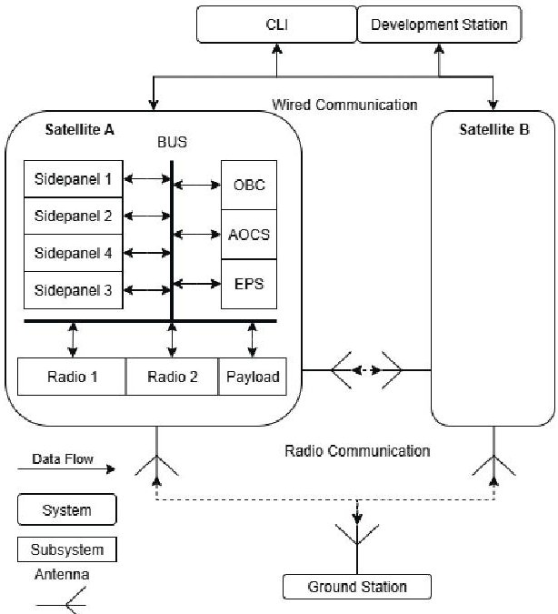
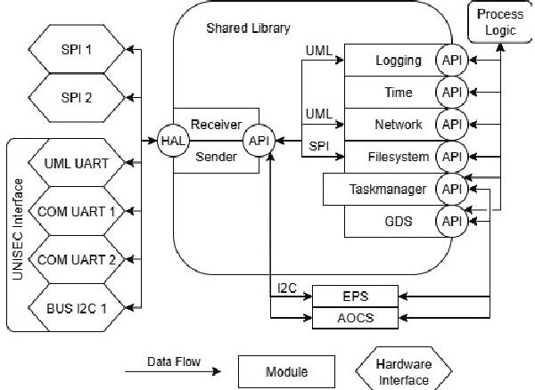
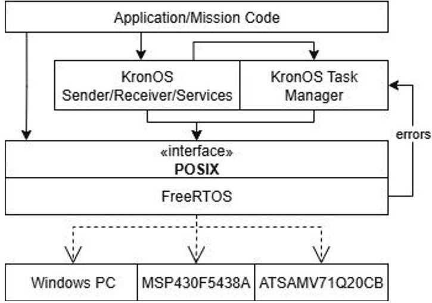
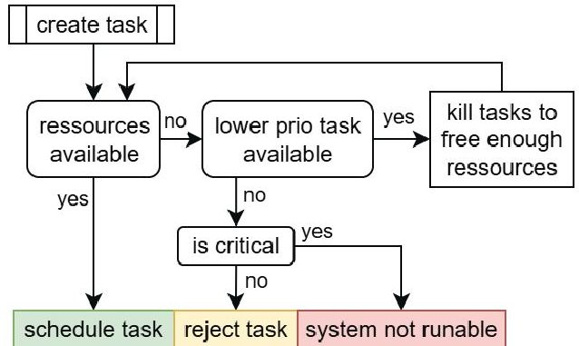
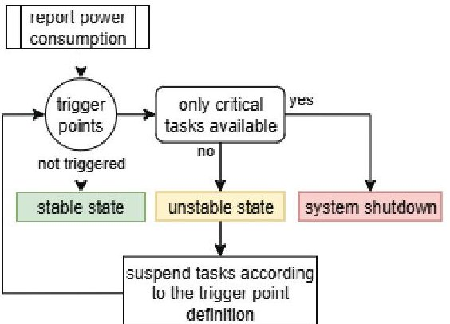
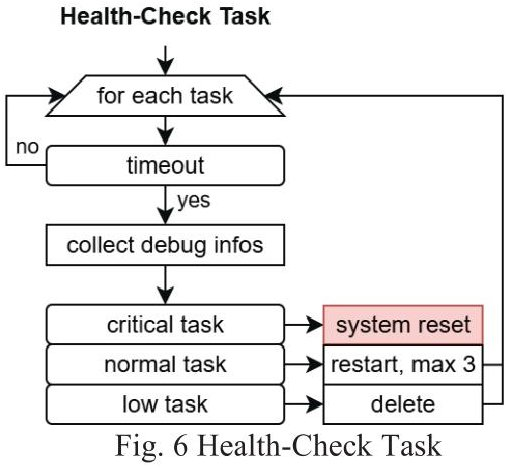
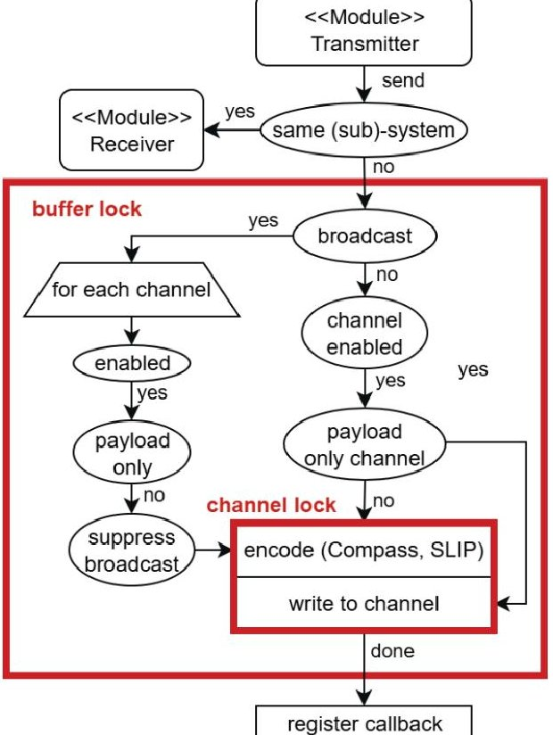

<!-- PDF_PAGE: 1 -->

$ 7 6^{\mathrm{th}} $ International Astronautical Congress (IAC 2025), Sydney, Australia, 29 Sep-3 Oct 2025. Copyright $ \textcircled{2} 0 2 5 $ by the International Astronautical Federation (IAF). All rights reserved.

IAC-25-1.5.9 x100916

# Advancing CubeSat Reliability: A Model-Based Systems Engineering Approach for Fault-Tolerant, Real- Time Software

Lukas Heubach $ ^{a*} $ , Luis Rodriguez Contreras $ ^{a} $ , Moritz P. Heimbach $ ^{a} $ , Marco Schmidt $ ^{a} $

$ ^{a} $ Embedded Systems and Sensors for Earth Observation, Julius-Maximilians-Universität Würzburg, Germany $ ^{*} $ Corresponding Author

## Abstract

The University of Wurzburg Experimental Satellite 5 (UWE-5) mission is advancing model-based systems engineering methodologies through the development of a modular, real-time capable on-board software framework. Designed for operation within a lightweight 128KB memory footprint, this framework integrates formalized system modelling, fault-tolerant architectures, and dynamic resource management, enabling CubeSat missions to autonomously maintain critical functions under strict power and computational constraints. Rather than relying solely on failure recovery, the system employs proactive fault prevention to enhance mission reliability. To ensure robustness, the software framework follows a digital engineering approach, incorporating modelling and simulation for early-stage validation. By leveraging FreeRTOS as a deterministic execution model, it enforces predictable task scheduling while a structured task hierarchy and adaptive task state management optimize real-time execution. These features align with modern system engineering (SE) modelling techniques, allowing for systematic performance analysis across multiple operational scenarios. The framework undergoes rigorous validation and verification using a combination of hardware-in-the-loop (HIL) and software-in-the-loop (SIL) simulations, digital twin analysis, and subsystem-level testing. Initial tests confirm that hardware load limitations effectively prevent instability, while upcoming power consumption evaluations will assess the system's ability to dynamically adapt energy usage. These validation steps represent a transition from ad hoc CubeSat software engineering to a structured, model-driven approach, ensuring improved reliability and scalability for future missions. By integrating model-based verification, simulation-driven validation, and structured fault management, this work contributes to next-generation SE modelling practices that enhance mission resilience and reduce risks and costs. The structured approach moves beyond reactive software development, incorporating proactive fault detection, dynamic resource allocation, and modular task management to ensure robust execution even in resource-constrained environments. The lessons learned from this development provide valuable insights into scalable software architectures for CubeSat missions, demonstrating how a well-structured SE modelling approach can improve system reliability, maintainability, and performance. This framework as part of the UWE-5 mission serves as a proof of concept for integrating SE modelling techniques into small satellite software engineering, laying the groundwork for future advancements in digital system design.

Keywords: CubeSat, Model-Based Systems Engineering, Real-time software, Fault Tolerance, Digital Engineering

## Acronyms/Abbreviations

<table border="1"><tr><td>Model-Based Systems Engineering</td><td>(MBSE)</td></tr><tr><td>Real-Time Operating System</td><td>(RTOS)</td></tr><tr><td>Electrical Power System</td><td>(EPS)</td></tr><tr><td>Hardware-in-the-Loop</td><td>(HIL)</td></tr><tr><td>Software-in-the-Loop</td><td>(SIL)</td></tr><tr><td>Onboard Computer</td><td>(OBC)</td></tr></table>

## 1. Introduction

The Apollo 11 lunar descent [1] highlighted the critical role of fault-tolerant real-time software in spaceflight. When the Apollo Guidance Computer encountered 1201 and 1202 alarms - signals of "executive overflow" from excessive processing demands - it employed priority scheduling to perform a soft reboot. This mechanism shed nonessential tasks while preserving guidance and control functions, enabling the mission to continue safely. Far from a

simple safe mode, this was a purposeful, real-time recovery strategy engineered for survival. Today's CubeSats, with their increasing autonomy and mission complexity, demand similarly robust approaches, which MBSE can help systematically design and verify.

Over time, various models have emerged in software engineering to guide the planning, implementation, and testing of software systems. The origins of the waterfall model can be traced back to 1970, when it was introduced by Winston W. Royce [2]. In the following decades, the linear execution of the System Development Life Cycle became increasingly popular. Even in its original conception, the weaknesses of late-stage testing and potential approaches to mitigate these issues were already discussed. The model is divided into the following phases:

1. Requirements Analysis and Specification

2. Design

<!-- PDF_PAGE: 2 -->

3. Implementation and Unit Testing

4. Integration and System Testing

5. Operation and Maintenance

This approach to software development is strictly linear, with all specifications and requirements fixed from the outset. Only limited adjustments are possible in later stages of the process.

Due to rapidly changing requirements and shorter development cycles, agile approaches have emerged and have since become established in many industries. Whether Extreme Programming [3], Feature-Driven Development [4], Dynamic Systems Development [5], or Adaptive Software Development [6], all are founded on the twelve principles of the Agile Manifesto [7] introduced in 2001. These principles emphasize delivering value to the customer through iterative development, close collaboration, and the ability to adapt quickly to change. They also stress the importance of delivering working software frequently, ensuring that stakeholders can review progress and provide feedback at regular intervals. The core purpose of agile methods is to create flexible, customer-focused processes that respond effectively to evolving needs, enabling teams to deliver high-quality software in a timely and sustainable manner.

The UWE-5 is a CubeSat project whose objective is the demonstration of a K-/KA-band communications payload. The development teams are comprised of three different working groups at different universities, namely the Embedded Systems and Sensors for Earth Observation (ESSEO) group at the Julius-Maximilians- Universität Würzburg, the Satellite Communications and Radar Systems chair at the Julius-Maximilians- Universität Würzburg, and the Electronic Systems and Sensors chair at Brandenburgische Technische Universität Cottbus. The mission consists of two 3U CubeSats operating in Low Earth Orbit. The project is supported by the German Aerospace Center (DLR) and estimated to launch in 2027.

The UWE-5 satellites can be considered real-time systems. According to [8]

"A real-time computer system is a computer system where the correctness of the system behaviour depends not only on the logical results of the computations but also on the physical time when these results are produced"

Real-time computer systems are found inside bigger systems, called real-time systems, whose state changes as a function of time. The moment in time at which a result must be completed by the real-time computer system is called a deadline. If the real-time system can tolerate missing deadlines, that is, if the result of the computer is

still useful after the time limit, then the deadline is considered "soft", and otherwise it is considered "firm". When a catastrophic consequence can result from missing a deadline, then the deadline is considered "hard". Therefore, a real-time computer system is referred to as a hard real-time computer system or safety critical real-time computer system if it must meet at least one hard deadline. The spacecraft software must deal with real-world devices such as sensors and actuators in a parallel fashion [9]. This is the reason why a concurrent program design, which can be achieved by using a Real Time Operating System, makes the flight software faithfully represent the nature of the system.

However, the concurrent execution paradigm comes with relevant problems and debugging challenges, as it is not as straightforward to analyse compared to simpler sequential code execution. Moreover, since spacecraft are exposed to the harsh space environment, they often fall into unexpected scenarios that threaten mission success. Therefore, Fault Detection, Isolation and Recovery (FDIR) mechanisms are designed and employed to mitigate the potential risks and ensure that the system fulfils its purpose.

## 2. Model-Based Systems Engineering for CubeSats

MBSE is an approach in which system information is based not only on documentation, but also on models. Modelling is relevant for more than just the technical description of the system. A model describes a system at an abstract level that can be understood by all stakeholders.

The term MBSE was first introduced by A. Wayne Wymore in 1993 [10] with a focus on the mathematical theory of system coupling, the homomorphic relationship between systems, the concept of system modes, and T3SD system design. The Fraunhofer Institute defines MBSE as follows:

"MBSE is the formalized application of models to support system requirements, design, analysis, verification and validation activities in the design phase and throughout the development process."

Models are tools for systematically simplifying the development of complex systems. Models can be mapped using the Unified Modelling Language (UML) or the Systems Modelling Language.

This approach aligns with the principles laid out in the Systems Engineering Vision 2035 [11], which envisions systems engineering as a discipline dedicated to ensuring that all elements of a system work harmoniously to achieve overarching objectives. Systems engineering plays a critical role in balancing

<!-- PDF_PAGE: 3 -->

system solutions that satisfy a wide range of stakeholder needs and expectations-often diverse and conflicting including performance, reliability, security, privacy, and cost.

In the context of the CubeSat project, the stakeholders are the various developer groups responsible for developing the different subsystems, writing the application code and designing the hardware. Particular attention is paid to the interfaces between the hardware and software, and to communication between the subsystems. The system's complexity arises from the required fault tolerance and the large number of processes that communicate with each other and control actions and reactions.

## 3. Software Framework Design

The reliability of the UWE-5 CubeSat depends on a well-structured software architecture that ensures efficient interaction between subsystems, robust task execution, and fault tolerance under resource constraints. This chapter outlines the design principles and mechanisms that enable these goals.

## 3.1 Modular Architecture and Task Hierarchy

The system model of the UWE-5 project represents a complex interaction between two satellites, external applications, and internal subsystems (see Fig. 1).

Fig. 1 UWE-5 System Model Diagram

The project comprises at least five distinct systems and seven subsystems within the satellite, all of which must communicate with one another. The software architecture of each subsystem is uniform and independent of the underlying hardware. Fig. 2 illustrates

the system model of the onboard computer as an example. A shared library, KronOS, serves as middleware between the RTOS and the process logic. The interfaces between software layers are defined through well-specified APIs, and all available hardware interfaces are documented. Each subsystem is further divided into modules, where each module is dedicated to a specific task and provides an API to other software modules. The modules within the KronOS library are optional and can be included or excluded depending on system requirements. The system diagram clearly conveys which functionalities are enabled and available within the satellite's subsystems, without requiring a detailed examination of their internal implementations.

Fig. 2 UWE-5 System Model Diagram

Building upon the modular architecture and clearly defined interfaces, the execution logic is organized to ensure that critical functions are processed reliably and without interference from lower-priority operations. This is achieved through a structured task hierarchy, implemented using three priority levels, designed to balance system complexity with robust execution:

## Critical Priority

Tasks in this category are essential for the continuous and safe operation of the CubeSat. They must always run. If a task in this group fails, a backup strategy is immediately triggered to prevent cascading failures in interconnected subsystems. This strategy involves a redundant system operating in either hot or cold standby mode, which temporarily takes over until the primary system is fully restored.

## Normal Priority

This is the default priority level. Tasks in this group handle operations that are important for the standard functioning of the CubeSat and may impact other (sub)systems. In the event of a failure, the fallback strategy is a controlled shutdown and restart of the affected task.

## Low Priority

<!-- PDF_PAGE: 4 -->

Tasks at this level are non-critical and can be executed at any time. They have no direct impact on other (sub)systems. If a failure occurs, the task is terminated without being restarted. The corresponding backup strategy is a graceful exit only.

To keep the system manageable and maintain effective load balancing, no additional priority levels are introduced. While this model does not rely on formal schedulability analysis, it is conceptually aligned with the notion of robust priority assignment as defined in realtime systems literature [12]. Such policies aim to ensure that systems remain schedulable even under increased interference or degraded conditions - an essential consideration for fault-tolerant CubeSat software operating under constrained resources.

## 3.2 Real-Time Capabilities and FreeRTOS Integration

A Real-Time Operating System provides the deterministic behaviour that a critical system requires to meet hard deadlines. The design philosophy behind the UWE-5 embedded software strives to achieve welldefined layers that perform functionalities and/or services to the other layers. The mission code layer is separated from the RTOS layer using an Operating System Abstraction Layer (OSAL), which is composed of the well-known POSIX threading APIs (pthreads) [13]. A special layer, called the KronOS Task-Manager, extends the FreeRTOS scheduler with functionality for dynamic resource allocation, load balancing, and fault management. This component makes use of the POSIX interfaces for task management purposes and employs the useful mechanisms that FreeRTOS offers for detecting issues related to memory usage and erroneous conditions that could lead the system into a faulty state. At the bottom are the hardware platforms that run the software stack of the UWE-5 project. The Windows PC is used for direct interaction from the developers to the rest of the systems, the MSP430F5438A is the microcontroller of the On-Board Computer, and the ATSAMV71Q20CB is the microcontroller of the Attitude and Orbit Determination System. Fig. 3 shows the interactions between the KronOS software layers.

Fig. 3 KronOS Software Layers

## 3.3 Dynamic Resource and Fault Management

Dynamic resources in the system include task-specific stack memory, available power from the EPS, and processor time. Each task receives its stack from a statically allocated heap managed by FreeRTOS. Power availability and power consumption are monitored to ensure stable operation. Processing time must be efficiently distributed to meet real-time requirements. The central component for managing these resources is the Task-Manager. By monitoring system conditions, the Task-Manager ensures safe and efficient use of memory, power, and compute time. In case of anomalies, it triggers appropriate fault-handling mechanisms to maintain system stability.

Before a new task can be created, the system must be in a stable state. The required stack size is specified during task creation by the initiating process. This value is typically an estimate based on prior testing, with an added safety margin. The decision process for task creation is shown in Fig. 4. There are three possible outcomes:

1. Sufficient resources are available - the task is scheduled immediately.

2. Insufficient resources - the system attempts to free memory and processing capacity by terminating lower-priority tasks.

3. Insufficient resources with no lower-priority tasks available - if the new task is non-critical, it is rejected. If it is critical and still cannot be scheduled, the system enters a non-runnable state. This scenario must be avoided through proper system design and testing to ensure that all critical tasks remain within the system's resource limits.

<!-- PDF_PAGE: 5 -->

This resource-aware scheduling mechanism ensures that the system remains operational even under high load, while prioritizing critical tasks and preventing resource exhaustion.

Fig. 4 Load-Balancer flow during task

To incorporate power consumption into the loadbalancing process, the Task Manager receives regular external reports from the EPS. These reports include key parameters such as the current state of charge, overall power consumption, and charging current of the batteries. Within the Task Manager, trigger points are defined to respond to critical EPS values. These include short-term power consumption peaks as well as long-term, predictable events, such as estimated remaining operational time at current consumption rates. If a trigger point indicates a lack of power while only critical tasks are running, the system initiates a controlled shutdown to conserve energy. If non-critical tasks are still active, these are first moved to the suspended state before more drastic action is taken. Once sufficient power becomes available again, previously suspended tasks are resumed automatically. This mechanism, shown in Fig. 5, ensures that energy-critical situations are handled gracefully, maintaining essential system functionality while preventing instability.

Fig. 5 Load-Balancer flow during EPS report

Fault management is divided into two categories:

on components. These faults must be addressed both in software - using fault-tolerant algorithms - and in hardware - through the implementation of redundancy.

Hard faults are permanent hardware errors that may result from environmental influences or excessive stress

Soft faults, in contrast, are non-permanent and can be detected by monitoring system behaviour. Typical examples include memory corruption, stack overflows deadlocks, floating-point exceptions, and communication failures. An essential mechanism for handling such faults is the use of hardware watchdogs.

In the context of the UWE-5 project, both external hardware watchdogs on the processor boards and internal watchdogs built into the processors are employed. According to [14] a watchdog timeout should result in a hardware reset to ensure that the processor is correctly reinitialized. A simple program counter reset may not fully reinitialize the processor, potentially leaving the system in an unstable state. Therefore, both internal and external watchdogs must be served with regular heartbeat signals. The timeout duration must be configured appropriately for the system and use case. In the event of a timeout, the watchdog must bring the system back into a stable state and retain information useful for debugging the root cause of the failure. All watchdog-related tasks are handled by a dedicated Watchdog-Task, which is assigned the highest priority in the system.

In addition, each task is assigned an individual timeout that serves as an internal task watchdog. If a task stalls or becomes unresponsive, it is terminated by a dedicated health-check task (Fig. 6) and the allocated resources are released in a controlled manner.

## 4. Verification and Validation Strategy

The term Verification and Validation (V&V) in the context of software and system development refers to a structured process that ensures correctness, completeness, and compliance throughout the entire lifecycle. According to [15] it is defined as:

<!-- PDF_PAGE: 6 -->

"The process of determining whether the requirements for a system or component are complete and correct, the products of each development phase fulfil the requirements or conditions imposed by the previous phase, and the final system or component complies with specified requirements."

Verification ensures that the system is being built correctly, i.e., each step of development meets its intended design and technical specifications. Validation, in contrast, ensures that the right system is being built one that meets the user needs and operational requirements.

## 4.1 Formal Verification using MBSE

The goal of verification is to detect design errors as early as possible during system development. In this context, the focus lies on ensuring design correctness and compliance with the specification. Within the RT-Thread framework, task scheduling and synchronization follow the POSIX threading model, where the execution of software is no longer defined by a simple linear main loop. Since only one thread can be executed at a time, the RTOS is responsible for managing processor time allocation and performing context switches as necessary. Consequently, the software design must be inherently thread-safe. MBSE provides a structured means to model such thread-safe architectures at the design stage. For instance, the transmitter module of the KronOS system (see Fig. 7) represents a critical component that can be invoked concurrently by multiple threads. To minimize memory usage, shared resources such as the transmission buffer must be protected by mutual exclusion mechanisms (mutexes). This ensures that multiple threads can interact with shared resources without leading to race conditions or data corruption. Previous work has shown that mutex scheduling under RT-Thread is effective in ensuring sequential and mutually exclusive access to shared resources, preventing issues such as data inconsistency and deadlocks [16]. A particular challenge arises in processes whose correctness can be compromised by context switches. The encoding and transmission of messages are such examples. To reduce memory requirements, messages are divided into smaller segments, which are encoded and transmitted sequentially until the complete message is delivered. If this sequence is interrupted and not protected by a mutex, message segments may become interleaved, resulting in undecodable or corrupted transmissions. To mitigate this risk, the communication channel must be locked for exclusive access by the active thread before transmission begins, thereby preserving message integrity.

Thus, a key benefit of MBSE lies in its ability to identify, at an early stage, which components of a system are vulnerable to concurrency issues such as thread preemption or interrupt handling. By employing formal verification within MBSE models, potential hazards can be detected more effectively during the design phase, significantly reducing debugging complexity in later implementation stages. This proactive approach not only increases system reliability but also shortens development cycles by addressing concurrency-related risks before they manifest in deployed software.

Fig. 7 Thread-safe Transmitter data flow

## 4.2 Simulation-Driven Validation

The Simulation-Driven Validation Tests are intended to validate the correct implementation of the system model and to reveal potential bugs and vulnerabilities in the design. A distinction is made between HIL and SIL tests. HIL tests aim to validate the integration of a system on actual hardware. Three types of test scenarios have been defined and conducted for the validation of failsafe mechanisms.

## 1. Watchdog Response to Deadlock and Missed Heartbeats

To evaluate the watchdog implementation, a KronOS instance with a dedicated watchdog task is executed on the OBC. The OBC incorporates two external watchdogs with a timeout of 1.6~seconds, enabling hot-swapping to a redundant processor or power source. In parallel, the internal software

<!-- PDF_PAGE: 7 -->

watchdog of the MSP430 is configured with a timeout of 1~second. During testing, a deliberate deadlock is introduced in a secondary task. This condition consistently causes the software watchdog to trigger after the 1-second timeout, initiating a soft reset of the processor. The experiment thereby validates that deadlocks are reliably detected and resolved through the watchdog mechanism, ensuring bounded-time recovery and system availability.

## 2. Fault injection (soft faults) to observe system response

Tasks are created sequentially to deliberately trigger a stack overflow, a floating-point exception, and a null pointer exception. Each injected fault can lead to unpredictable behaviour. A commonly observed symptom during testing is that a task becomes unresponsive and fails to execute further code. Nevertheless, the scheduler continues to allocate CPU time to the task, potentially blocking other tasks. In all tested cases, the faulty tasks are cleaned up by the task timeout mechanism (see Fig. 6), and the resources are released. Depending on the affected priority, the appropriate recovery strategy is executed.

## 3. Fault tolerance in handling of corrupted or incomplete messages

An additional task simulates the reception of incorrectly encoded messages to evaluate the fault tolerance of the decoder. The experiment demonstrates that partially received or malformed messages are reliably discarded after a defined timeout. This timeout is configured according to the maximum transmission rate of the hardware channel and the maximum message length. By enforcing these bounds, the receiver buffer is freed in time to prevent denial-of-service conditions caused by buffer overflows.

## 5. Discussion

The results demonstrate that combining Model-Based Systems Engineering with simulation-driven validation provides a systematic way to design and test fault-tolerant real-time software for CubeSats. Formal modelling exposes concurrency risks such as race conditions early in the development process, while SIL and HIL experiments confirm that watchdogs, fault injection handling, and message validation mechanisms can reliably recover from deadlocks, runtime faults, and corrupted inputs. Together, these techniques reduce reliance on late-stage debugging and instead enable

preventive fault management under strict memory and processing constraints.

These findings highlight that real-time resilience cannot be guaranteed by scheduling mechanisms alone. Additional layers of fault prevention and recovery are required to ensure continuous operation. MBSE contributes by clarifying complex task interactions and making these critical mechanisms traceable and verifiable at the design stage. This structured approach shows that reliability in nanosatellite software can be achieved without sacrificing modularity or maintainability, even under highly constrained conditions.

At the same time, the effectiveness of MBSE is bounded by the quality of the models. Poorly specified or incomplete models will not yield better implementations than conventional ad hoc approaches. Moreover, issues can only be identified if they are explicitly represented in the models, and if complexity is abstracted to a level that remains comprehensible for all stakeholders. Thus, while MBSE improves transparency and reduces integration risks, it does not replace engineering judgment.

Future work will focus on characterizing and mitigating new concurrency issues that arise from multithreading and unpredictable runtime behaviour. The framework will be applied to systems of higher complexity with additional subsystems to evaluate scalability. Finally, accumulated experience will be distilled into best practices and documentation of common pitfalls, providing practical guidance for future CubeSat and small satellite developments.

## Acknowledgements

This work originated from the project ,Verbundvorhaben UWE-5: Studentisches Ausbildungsprojekt zur Untersuchung der Einbindung von Nanosatelliten in 5G-Netze" which is funded by the German Federal Ministry for Economic Affairs and Climate Action (BMWK) under the funding labels 50RU2307A and 50RU2307B.

<!-- PDF_PAGE: 8 -->

$ 7 6^{\mathrm{th}} $ International Astronautical Congress (IAC 2025), Sydney, Australia, 29 Sep-3 Oct 2025. Copyright $ \textcircled{2} 0 2 5 $ by the International Astronautical Federation (IAF). All rights reserved.

## References

[1] N. Aeronautics, S. Administration, Apollo 11 lunar module program alarms 1201 and 1202. https://www.nasa.gov/history/alsj/a11/a11.1201 pa.html, apollo Lunar Surface Journal, edited by Eric M. Jones (1995).

[2] W. W. Royce, Managing the development of large software systems: Concepts and techniques, in: Proceedings of the 9th International Conference on Software Engineering (ICSE), 1970, pp. 328-338, reprinted in ICSE 1987. doi:10.5555/41765.41801.

[3] K. Beck, Extreme programming explained: embrace change, addison-wesley professional, 2000.

[4] S. R. Palmer, M. Felsing, A practical guide to feature-driven development, Pearson Education, 2001.

[5] J. Stapleton, DSDM, dynamic systems development method: the method in practice, Cambridge University Press, 1997.

[6] J. Highsmith, Adaptive software development: a collaborative approach to managing complex systems, Addison-Wesley, 2013.

[7] Beck et al., Manifesto for agile software development, accessed: 2025-08-12 (2001). URL https://agilemanifesto.org/

[8] H. Kopetz, Real-Time Systems: Design Principles for Distributed Embedded Applications, 2nd Edition, Real-Time Systems Series, Springer New York, NY, 2011, eBook ISBN: 978-1-4419-8237-7, Hardcover ISBN: 978-1-4419-8236-0, Copyright Springer Science+Business Media, LLC 2011. doi:10.1007/978-1-4419-8237-7.

[9] M. A. Normann, Software design of an onboard computer for a nanosatellite, Master's thesis,

Norwegian University of Science and Technology (NTNU), Trondheim, Norway (July 2016). URL http://hdl.handle.net/11250/2413318

[10] A. W. Wymore, T. Bahill, Model-Based Systems Engineering, 1st Edition, CRC Press, Boca Raton, 1993. doi:10.1201/9780203746936.

[11] International Council on Systems Engineering (INCOSE), Systems Engineering Vision 2035: Engineering Solutions for a Better World, Technical report, INCOSE, San Diego, CA, available in full PDF, executive summary, and web formats (January 2022). URL https://www.incose.org/about-systemsengineering/se-vision-2035

[12] R. I. Davis, A. Burns, Robust priority assignment for fixed priority real-time systems, in: 28th IEEE International Real-Time Systems Symposium (RTSS 2007), 2007, pp. 3-14. doi:10.1109/RTSS.2007.11.

[13] The Open Group, Threads (1997). URL https://pubs.opengroup.org/onlinepubs/7908799/xsh/ threads.html

[14] J. Ganssle, Building a great watchdog, The Ganssle Group, online article and PDF, https://www.ganssle.com/watchdogs.pdf (2016).

[15] IEEE standard glossary of software engineering terminology, IEEE Std 610.12-1990 (1990) 1- 84doi:10.1109/IEEESTD.1990.101064.

[16] C. Sun, Y. Wang, Q. Dai, Mutex scheduling mechanism analysis and performance evaluation under the rt-thread open source framework, in: 2025 IEEE 2nd International Conference on Electronics, Communications and Intelligent Science (ECIS), 2025, pp. 1-10. doi:10.1109/ECIS65594.2025.11086967.