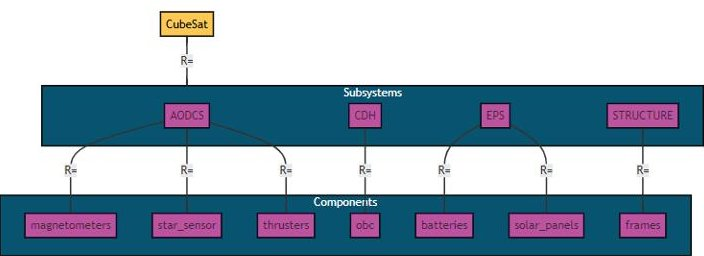
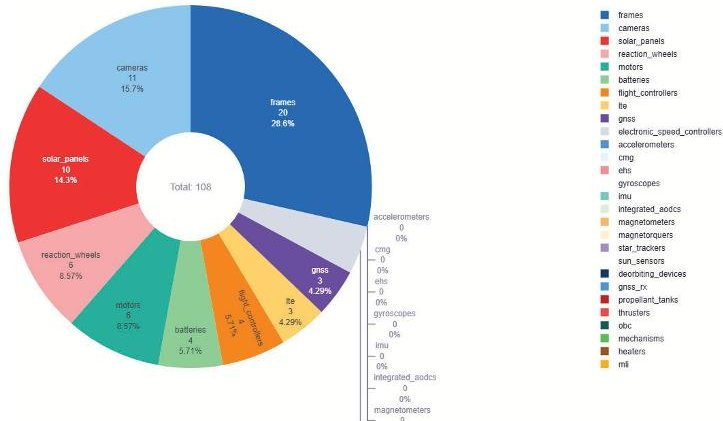
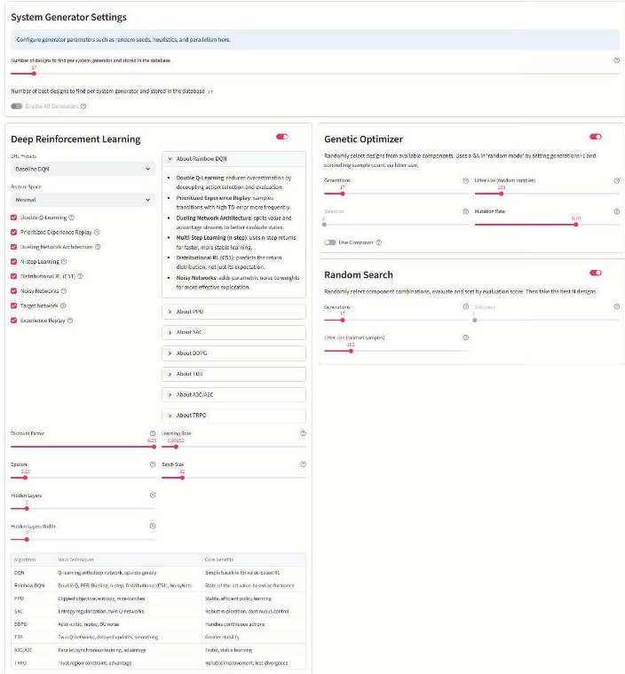

<!-- PDF_PAGE: 1 -->

IAC-25-D1,3,8,x95465

# AI4CE - Building the infrastructure for AI-supported CubeSat generation

Jan-Peter Ceglarek $ ^{a *} $ , Reinhold Bertrand $ ^{b} $

a ESALab@TUDarmstadt - Space Team, Department of Flight Systems and Automatic Control (FSR), Technical University Darmstadt, Germany, ceglarek@fsr.tu-darmstadt.de

$ ^{b} $ ESALab@TUDarmstadt - European Space Operations Centre (ESOC), Darmstadt, Germany, reinhold.bertrand@esa.int

* Corresponding author

## Abstract

Designing CubeSats increasingly requires navigating a rapidly growing, combinatorial design space created by standardised, commercial off-the-shelf components (COTS). AI4CE is an open-source project at the Technical University Darmstadt in cooperation with Parametry.ai that operationalises bottom-up system generation for CubeSats. In this paper, an initial architecture is described, together with a curated component database (108 parts across 23 component types in 8 sub-systems) and a set of evaluation functions by which component-, sub-system-, and system-level performances are scored in mission context. All entries in the component database are transcribed from manufacturer data sheets mapped by hand to a list of supported parameter names and SI units, since automated scraping was not found reliable. Four generation methods — random, brute-force, genetic optimiser, and deep reinforcement learning (DRL) — are integrated into a unified pipeline with consistent constraint handling, result storage, and comparison tooling. Source code and artefacts are made available at https://ai4ce.space.

## 1. Introduction

$$
N _ {\mathrm {c o m b}} = \prod_ {i = 1} ^ {m} n _ {i}
$$

When designing innovative satellites for new missions, each design team is confronted with a growing amount of purchasable design decisions. An increasing market of commercial CubeSat components has enabled a much larger design space than ever before for any kind of satellites - but especially for CubeSats. Nowadays, it not only possible to browse through online catalogues of CubeSat components and directly order them with a few clicks but standardisation attempts for CubeSat sub-systems and components allow (at least theoretically) to combine all available components, which lets this combinatorial design space grow exponentially. For a given system with utilising all possible combinations currently supported by the component database, the possible realm of combinations can be calculated via the following equation:

$$
\begin{array}{l} = 2 0 \times 3 \times 3 \times 3 \times 3 \times 4 \times 4 \times 6 \times 6 \times 1 0 \times 1 1 \\ = 1 0 2, 6 4 3, 2 0 0 \\ \end{array}
$$

Table 1 illustrates the explosion of the combination of possible components (design space), based on the number of components per category and the overall number of used system components (system complexity). In order to actually make use of the possibilities this market offers, CubeSat design teams would profit from an understanding, of how well a combination of components would perform

Table 1. Number of combinations $ N_{\mathrm{comb}}=n^{k} $ for a system complexity of k components and n per-category options.

<table border="1"><tr><td>k\nn</td><td>3</td><td>7</td><td>11</td><td>23</td></tr><tr><td>5</td><td>243</td><td>16,807</td><td>161,051</td><td>6,436,343</td></tr><tr><td>10</td><td>59,049</td><td>108.46</td><td>1010.42</td><td>1013.63</td></tr><tr><td>50</td><td>1023.86</td><td>1042.31</td><td>1052.08</td><td>1068.14</td></tr><tr><td>100</td><td>1047.71</td><td>1084.62</td><td>10104.16</td><td>10136.28</td></tr></table>

in a given mission scenario.

From this, two main questions can be derived:

1) how to evaluate a set of components forming a CubeSat system?

2) how to find the best-fitting combination within a given design space?

Assumed the performance of a system/ component combination can be measured via established engineering textbook heuristics based on data sheets alone, as outlined in [1], each combination of components will be given a score between -1 and 1. The simplest solution to finding a suitable combination out of multiple possible, would be test all possible combinations in a brute-force manner and pick the one design with the highest rating. The strong exponential growth of the design space makes this infeasible in a system design scenario. This is where the open source AI for Concurrent Engineering (AI4CE) research project attempts to offer a solution. AI4CE acts as a hub consisting of different modules to explore the possibilities and challenges of heuristic-based system generation. Addi-

<!-- PDF_PAGE: 2 -->

Fig.1. An example system composition in a classical system, sub-system, component architecture. On all 3 levels gets evaluated in the context of the overall system and mission environment, which results in a numeric value the reward

tionally, it thereby helps to identify, whether the overhead of training AI models for this task yield an advantage.

Figure 1 shows an example of possible CubeSat composition. Along the classic CubeSat sub-systems and components, the user can select from 23 supported component types in 8 sub-systems. A full list of supported components can be found at [2] More on the challenges of automated, DRL-based System Generation can be found in last years IAC paper [3]

In summary, AI4CE is designed to find answers to the following research questions (RQ):

RQ1) How to use DRL to generate preliminary system designs (bottom-up system generation) on component level ?

RQ2) What is needed to enable bottom-up system generation?

RQ3) What is the potential of AI-based bottom-up system generation?

RQ4) What are the benefits of using DRL over other system generation methods?

## 2. Pipeline

The modularity of AI4CE is fractured along the steps each system generation generally has to go through.

## Algorithm 1 AI4CE System Generation Pipeline

1: AI4CE adaptation For each system (CubeSat, TinyHouse, Drone, Rover, ..) the component/decision database needs to be build from the data sheets and evaluation functions need to be defined

2. Requirements Definition: The user selects which components the resulting system should contain and how many

3: SysGen setup: The user selects and adjusts the desired system generators

4: SysGen prep: The selected system generator gets trained (DRL-based) or run their search (brute-force, genetic optimiser, random search)

5: SysGen wrap-up: the best component combinations per SysGen are stored in the backend with respect to their method

6: Benchmarking: In case of a pre-defined testcase, the results can be benchmarked against real-world requirements or systems

7: Result comparison: The result systems can be compared along engineering parameters and criteria.

The generation part of AI4CE works based on heuristics, which means, that AI4CE can only be used for systems, which are supported by the tool. In order to introduce an additional system to AI4CE, the components need to be entered in the component database and the supported sub-systems and components need to be modelled in their evaluation functions.

## 3. Component Database

The component database hold all possible design decisions. During training and execution of all of the system generators, the selected and evaluated component list consist of components from this database.

Based on the data sheets provided by the manufacturer, each component is entered by hand. Figure 2 shows the distribution by component of the 108 currently added components.

Multiple attempts of using automated and semantic web scraping failed because the inconsistency of the various data sheets from numerous manufacturers. The central aspect of each system generation is the set of evaluation functions, as described in [4] and [5]. Each evaluation on system, sub-system and component level is a set of carefully balanced equations, which evaluate the quality of each element in its overall context (system and mission), based on the parameters from the data sheet. Since each parameter got selected with great care, it is therefore important to have great control about the modelling of the meaning of each parameter in the evaluation function. This explains,

<!-- PDF_PAGE: 3 -->

Fig. 2. Overview of the 108 currently available components - design decisions.

Table 2. Commonly found example during the entering of components in the decision database.

<table border="1"><tr><td>data sheet</td><td>mapping options</td></tr><tr><td>minimum ops temp</td><td>tempmin</td></tr><tr><td></td><td>tempopsmin</td></tr><tr><td></td><td>tempopsminidle</td></tr><tr><td></td><td>tempopsminormal</td></tr></table>

why the mapping of the parameters from the data sheet to the list of supported parameters is of great importance. Table 2 shall help to illustrate the underlying issue:

## 4. System Generator

The heuristics to evaluate different system combinations are used by the different system generator methods. These system generators generate a dedicated set of satellite components, as requested by the user, which form together a complete system.

As explained in [3], the multilple specific challenges for this optimisation task result in the following possible methods: random, brute-force, genetic optimiser and (Deep) Reinforcement Learning. In order to enable a comparison between these methods, a valid system combination needs to be found with the given component database.

## 5. Conclusion

Bringing automated system generation to the system design process yields a lot of possible advantages, which is why it is the goal AI4CE to explore what is needed to enable it and what the real benefits are.

The newest development of AI4CE involved the integration of various key modules and preparation for a real-world evaluation benchmark.

After outlining the overall principle and explaining the fundamental difficulties of this approach in [1], [6] and [3],

Fig. 3. Screenshot of the AI4CE System Generator setup

the presented work focussed on the lessons learned during build and integrating a CubeSat component database and various methods of system generation.

Further information and the entire source code can be found at https://ai4ce.space.

## References

[1] J.-P. Ceglarek, R. Boumghar, and R. Bertrand, "AI4ce - automated space mission design concepts generation with reinforcement learning," presented at the MBSE 2022, 2022.

[2] J.-P. Ceglarek, Ai4ce/system_tags.toml- gitlab.com, https://gitlab.com/ai4ce/AI4CE/-/blob/ main/ai4ce/system_tags.toml?ref_type= heads, [Accessed 12-09-2025], 2025.

[3] J.-P. C. et al., Ai4ce - towards benchmarking deep reinforcement learning against non-ai system generation methods, 2024. DOI: 10.52202/078372-0076

[4] J.-P. Ceglarek, R. Bertrand, and R. Boumghar, "AI4ce: BOTTOM-UP AI SUPPORT FOR CONCEPTUAL DESIGN," presented at the IAC 2022, 2022.

[5] J.-P. Ceglarek, R. Bertrand, and R. Boumghar, "BOTTOM-UP AI-SUPPORT TO GENERATE CONCEPTUAL DESIGNS FOR CONCURRENT ENGINEERING STUDIES WITH DRL," presented at the SECESA 2022, 2022.

<!-- PDF_PAGE: 4 -->

76th International Astronautical Congress (IAC 2025), Sydney, Australia, 29.Sep — 03.Oct 2025. Copyright $ \textcircled{c} $ 2025 by the International Astronautical Federation (IAF). All rights reserved.