<!-- PDF_PAGE: 1 -->

# Applying Model-Based Systems Engineering on CubeSat Budget Calculating

Ahmad Jbara

School of Computer Science, Netanya Academic College 1 University Street, Netanya 4223587, Israel. ahmadjbara@netanya.ac.il

Abstract—This work presents a tool based on Model-Based Systems Engineering (MBSE) for automating the process of budget calculation - mass, volume, power, and energy - for CubeSat nanosatellites based on user input which can be iteratively finetuned to fit the CubeSat limitations. CubeSat is a standard that defines nanosatellites with a base unit (1U) measuring 10x10x10 and a maximum weight of up to 2 kg per 1U. They are cost-effective due to their use of commercial-off-the-shelf (COTS) components. This modularity provides flexibility on component selection to conform to the standard constraints that are forced by budget calculation. Modularity is fundamental in systems engineering design, which adopts a holistic approach to create systems by integrating various components and considering their interactions. CubeSat follows this approach. Object Process Methodology (OPM) and Systems Modeling Language (SysML) are popular modeling languages for systems engineering. This work benefits from MBSE for nanosatellite budget calculation. Specifically, it uses OPM to conceptually model it, applies OPM's computational capabilities on the produced model to calculate its budgets using OPM's coding capabilities, and eventually visually simulates the model by OPM's execution feature.

## TABLE OF CONTENTS

<table border="1"><tr><td>1. INTRODUCTION</td><td>1</td></tr><tr><td>2. BACKGROUND</td><td>1</td></tr><tr><td>3. RELATED WORK</td><td>3</td></tr><tr><td>4. THE OPM-BASED BUDGET CALCULATING SYSTEM</td><td>4</td></tr><tr><td>5. THE OPM-BASED BUDGET CALCULATING SYSTEM EVALUATED</td><td>6</td></tr><tr><td>6. CONCLUSION</td><td>9</td></tr><tr><td>ACKNOWLEDGMENTS</td><td>9</td></tr><tr><td>REFERENCES</td><td>9</td></tr></table>

## 1. INTRODUCTION

CubeSats are a class of nanosatellite which were first developed in the late '90s and have become popular since the early 2000. CubeSats initial purpose was totally educational, but very soon it has become an industrial asset with a few thousands in orbit [1].

CubeSats design have to follow guidelines that are dictated by the standardization described in CubeSat Standards Rev. 14.1 [2]. According to this standard, a CubeSat adopts a standard size and form factor, with a unit defined as 'U'. This standard describes a range of 1U-12U CubeSats, where a 1U CubeSat is a 10 cm cube and a mass of up to 2 kg.

CubeSats missions are far from recording a great success,

as Venturini et al. [3] clearly articulated, "Amidst all the hype one fact tends to get overlooked: CubeSats do not have a great record of mission success." Specifically, they attribute CubeSat mission failures to the conceptual phase. Furthermore, the use of commercial-off-the-shelf (COTS) products, design discrepancies, and insufficient testing are among the causes of CubeSat failures.

As CubeSats are modular in their nature, they are composed of many subsystems which are actually built using COTS products, and as such there would be many possible combinations of those products to build the underlying nanosatellite, and hence it is essential to examine these proposed options compliance with the CubeSat budget constraints: mass, volume, power, etc.

Due to its modular structure, a systems engineering approach for designing it is of significant importance, and a ModelBased Systems Engineering (MBSE) option is even much helpful when it comes to breaking down a complex system into smaller manageable parts and dealing with complexity. This approach fits CubeSat usage of COTS and make it easier to customize the underlying system.

Object-Process Methodology OPM ISO 19450 [4], [5], [6] is a model-based systems engineering (MBSE) approach and language that has many features which make it an ideal platform for developing a full-fledged solution to provide automation capabilities and overcome barriers set up traditional approaches that cause, as mentioned, failures. Specifically, OPM provides a succinct graphical notation for a minimal set of universal things—objects and processes—for modeling systems of all kinds in a single diagram kind, which translate on the fly to a subset of natural language. OPM has been extended with computational capabilities that can be attached to the modeled processes. Not only this but OPM has simulation feature that allows the visual execution of the underlying model including interaction with the modeler. In this work, we present an OPM-based budget calculation system model, which caters to process automation, making budget calculating and other related processes explicit, understandable, and usable by the community. In particular, this automation could be useful for rapidly screening combinations of candidate components and then using that screen to increase one's chances of selecting reliable, compatible components from which to build the nanosatellite.

## 2. BACKGROUND

In this section, we briefly describe the two topics needed to deeply understand this work: CubeSat budget calculating process and OPM as the modeling language and methodology applied to this process.

<!-- PDF_PAGE: 2 -->

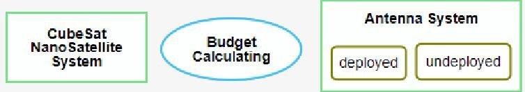

Figure 1: OPM entities: object (left), process (middle), and object states (right)—deployed, undeployed

## Object Process Methodology

Object Process Methodology (OPM) [5], [6] is a holistic conceptual modeling language and methodology for the design and development of complex systems. Applications of OPM range from satellite control software [7] to large, complex sociotechnical systems [8]. OPM basics are defined by ISO 19450, providing practitioners with a normative reference document that is common to all OPM users and enabling anyone to read and understand OPM models.

OPM captures and integrates the functional, structural, and procedural aspects of a system in a single unifying model, which is bimodal: models are expressed by both a graphical modality and a textual modality, catering to humans' dual channel processing [9]. The intuitive graphics is translated on the fly to a subset of natural language.

The graphical view consists of a set of hierarchically organized, interconnected, and cross-validated Object-Process Diagrams (OPDs). Each OPD combines all the structural and procedural system aspects and refines and extends the OPD at the level above it to add more details, providing for an inherent mechanism for complexity management and reduction. The hierarchical tree structure of the OPDs caters to a top-down approach: modeling the underlying system starts with a high-level, abstract OPD at level 0, called the System Diagram (SD), and more refined OPDs gradually expose finer details using refinement-abstraction mechanisms that include in-zooming (out-zooming) and unfolding (folding).

Figure 1 shows the only three OPM entities: a process (ellipse), an object (rectangle), and object state ("ountangle"). The same compact set of model elements, which includes entities (object, process, and state) and links between them, is the same throughout the entire OPD hierarchy, making all the OPDs self-similar in terms of the minimal set of concepts (and symbols) they use.

A subset of English (and of many other natural languages), called Object-Process Language (OPL), is a structured textual specification language that is generated on the fly in response to each modeler's semantically meaningful graphic operation. Figure 4 shows the textual representation of the model graphically described in Figure 5. For example, the last line describes the relation between the main process, Budget Calculating, and the out objects. The OPL sentence "Budget Calculating yields Component Selection, Height Budget, Mass Budget ..." states that the main process changes the Component Selection object and writes results into Height Budget, Mass Budget and others.

Objects and processes are called OPM things. Rectangles representing physical objects are shaded to distinguish them from informatical objects. Processes transform objects by creating them, consuming them, or changing their state. By OPM convention, process names use the gerund form, and thing (object, process) names are capitalized, while state names are not. Structural and procedural links graphically

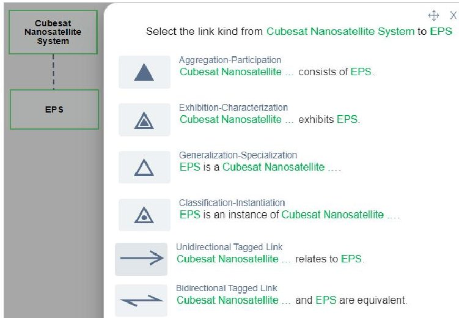

Figure 2: Structural links - aggregation, exhibition, generalization, classification, and tagged links.

define relations among entities (objects, processes, and object states). Structural links, shown in Figure 2, connect objects to objects or processes to processes to describe the static-structural model aspects. The figure is a screenshot of OPCloud, a cloud-based OPM modeling platform [10], [11] showing the possible structural links when attempting to connect two objects, each with the OPL sentence which would be generated as a result of selecting that link. Procedural links, shown in Figure 3, are between an object and a process, and they are used to model the dynamic-procedural system aspects, explicating causalities within the system [12].

OPM copes with complexity via detail-level decomposition rather than aspect-oriented decomposition, which is the common way to handle complexity in other conceptual modeling languages [5]. OPM with its one kind of diagram that uses a small set of about 20 OPM elements, along with the parallel textual modality, makes it easy to create models and check them on the fly.

In OPM, refinement is conveniently and intuitively represented graphically by in-zooming, providing the capability to select a process and specify or inspect its constituent subprocesses. Unfolding is the second major refinement mechanism, where a specific object exposes its constituent refineables, i.e., parts, features (attributes and operations), specializations, and instances. Thus, the hierarchically organized set of OPDs are derived from each other in a tree structure using one of the following refinement-abstraction mechanisms: (1) unfolding and folding of structural hierarchies of things, primarily objects, (2) zooming into or out of the inner details of things, primarily processes, (3) state expressing and suppressing, and (4) dedicated model views—OPDs that emphasize certain aspects.

Every OPM model fact needs to be defined at least once, in any of the OPDs in the OPD set, in order for it to be true for the entire model. OPM models can be constructed using OPCloud [10], [11]the ISO 19450-compatible cloud-based software, which is preferable over the early OPM modeling software OPCAT [13], [14]. OPCloud provides an OPL specification - a description in a subset of English for the entire model or an OPL paragraph - a collection of OPL sentences for each OPD separately. It also provides built-in visual simulation engines to support model validation, verification, and testing, which is especially useful in visualizing various execution scenarios.

<!-- PDF_PAGE: 3 -->

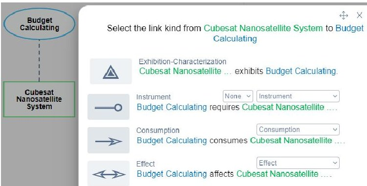

Figure 3: Procedural links - agent, instrument, consumption, and effect.

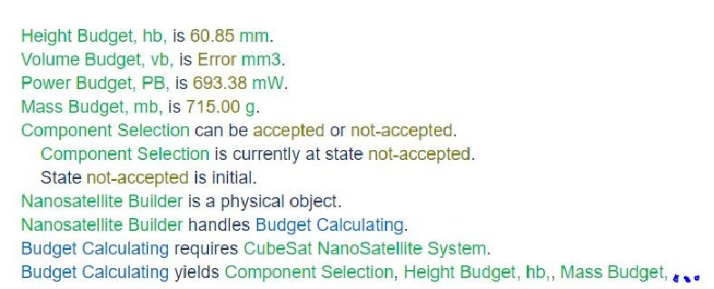

Figure 4: Textual description of Figure 5 diagram. The last line was cut for space limitations

OPM complements the conceptual qualitative modeling by providing a quantitative counterpart. Specifically, a modeler can define an object or a process as informatical (computational) which means that an object can have a value and a process can be attached with computations. Computations could be based on predefined mathematical functions, userdefined functions in JavaScript or Python code, or external connection (e.g., MATLAB). Based on these two aspects, OPCloud allows animated execution, where the modeler can execute the model on the basis of informatical objects' values and computations attached to end processes. OPCloud provides the modeler many ways for input - values are entered directly into the objects, values are entered at the model runtime or randomly simulated according to a distribution function selected by the modeler. Not only this, but it also allows getting data from Excel and outputs data back there.

OPM's characteristics and capabilities that have been presented enable clear and concise modeling of complex processes and structures in the same and only diagram kind, facilitating cognitive integration of the system's structure and behavior.

OPM has recently provided new features that allow for better reuse of model elements. These features include stereotypes and templates. These features can give a solid basis for building different models with similar basis.

## CubeSat Budget Calculation

The design of a CubeSat nanosatellite involves the studying of budgets, which calculate the performance of the system in many aspects. These budgets have to follow the nanosatellite subsystems' requirements and constraints[15].

The mass budget calculates the total mass of the system while ensuring that it is within the imposed limitations. The volume budget calculates the total volume captured by the system components and makes sure it is within the allocated

volume. The power budget considers the power consumed by the potential components, the power generated by the solar panels, and the battery status. The height budget calculates the total height of the components stacked one over the other [15].

In addition to these budgets, there are many others that have to be considered to make a comprehensive estimation of the system at hand. However, this work is not meant to be comprehensive in this regard, but rather to use some of the budget calculations to demonstrate a tool that automates the process of budget calculation.

## 3. RELATED WORK

OPM has been used in many diverse domains for different purposes. Casebolt et al. [16] showed how OPM can be applied to provide a method for business processes improvement. An OPM-based executable tool, FTTell, was presented for assessing potential pediatric failure to thrive (FTT) during the perinatal stage [17]. OPM has contributed to the aircraft design domain, where an OPM model-based systems engineering (MBSE) framework for civil transport aircraft design with dynamic landing constraints was introduced [18]. Another OPM-based framework was developed as a viable alternative to traditional task analysis (TA) techniques [19]. OPM has been applied to model real-time systems [20], enterprise resource planning (ERP) [21], multi-agent systems [22], data warehouses [23], biological systems [24], and Web applications [25]. Specifically, a work by Dori et al. employed OPM to conceptually model the satellite ground control software development [7]. Particularly, they built a graphical model that provides guidelines for the control software development that helps to alleviate these problems: obsolescence, lack of desired features, and software bug fixing. It should be noted that those guidelines are presented graphically and textually, as OPM supporting tools are translating graphical facts into text.

Christina et al. [26] described a tool aiming for a system-level conceptual design of nanosatellites providing users with different background knowledge to investigate satellite concepts while giving them control over the design trade-offs. The tool is implemented in Excel and does not adopt an MBSE approach.

Concerning budget calculating, a very recent thesis by Hoxha, a Matlab-based tool was developed for automating CubeSat's budget calculation [15]. This tool's goal is to program a Matlab code that calculates budgets such as mass, volume, power, and others. It takes a user input and outputs results considering margins. As this tool is purely programmed, it suffers from many traits that our work complements. First, it does not provide a conceptual model to the user and by this it assumes that the user is an expert. Second, it is not amenable to changes as every structural and/or procedural change requires coding and this by itself is restricted to developers. Third, even for developers it is not easy as the external connection of the code requires coding that connections (e.g., Excel). Fourth, animated execution is limited to some parts of the process and meant to understand some physical behavior such as detumbling where in our work we apply animated execution to the entire budget calculating process for the sake of process comprehension and step-by-step execution. Fifth, Hoxha's approach does not adopt a system engineering approach, where ours benefits from a Model-Based System Engineering (MBSE) one. Finally, as OPM's supported tool

<!-- PDF_PAGE: 4 -->

also supports OPL, it is possible to read a description of the entire model in a natural language giving non-technical stakeholders the ability to comprehend the model without delving into syntactic and graphical notations.

Gamble et al. developed a tool for risk management for lowcost CubeSat missions. It includes an inputs page used to calculate mission risk likelihood. Outputs are presented via lists and graphical formats. The Excel software was used to create the tool as it is easily accessible and easy to understand [27].

In the context of modeling, the modeling language that comes closest to what we propose here is SysML, where a modeler can express computational aspects using the dedicated static parametric diagram. As Levi et al. stated in a recent work [28], the use of SysML requires multiple types of diagrams which cognitively burden the human inspector, who has to view, follow, and comprehend the underlying model and its simulation as it dangles from one kind of diagram to another, while in OPM the entire model including all its aspects (functional, structural, and behavioral) is based on one kind of diagram. For more on the differences between OPM and SysML, the reader can refer to a comparative study by Grobshtein et al. [29]. Furthermore, since both languages exhibit various advantages, Yariv et al. have called and proposed a way to create synergies between them [30]. This synergy allows one language (for example, OPM) to benefit from the other (for example, SysML).

## 4. THE OPM-BASED BUDGET CALCULATING SYSTEM

The purpose of this work is two-fold: (1) formally modeling the budget calculating process, and (2) using the model to automate and facilitate this process. We adopted an OPM model-based systems engineering (MBSE) approach, since, as noted, OPM combines function, structure and behavior in a single diagram kind that uses a minimal set of universal building blocks—objects and processes—and translates on the fly to a subset of natural language. These traits help to build a formal yet simple model that can be easily understood. To attain the second goal of automating the budget calculating process, we leverage OPM's computational capabilities, which enable accepting user input, act on it computationally, and provide a desired output. In this section, we introduce the model that represents the budget calculating process with its computational part, rendering it a useful tool for automating this process.

## The Budget Calculation OPM Model

Every OPM model starts at level 0 with a system diagram (SD) as depicted in Figure 5, which shows the main process Budget Calculating, represented by an ellipse, surrounded by the objects (rectangles) involved in this process. OPM requires that SD expresses the value of the main process to the system's beneficiary. Accordingly, the purpose of the Budget Calculating process is to change the Component Selection state from not-accepted to accepted. This benefit is expressed by the OPCloud-generated OPL sentence, shown in Figure 4, "Budget Calculating changes Component Selection from not-accepted to accepted." This object, Component Selection, starts with an initial state not-accepted as the user (builder) has not yet provided the components of the intended system. Once he or she does, and the provided components comply with the system limitations, the state of Component Selection automatically changes to accepted.

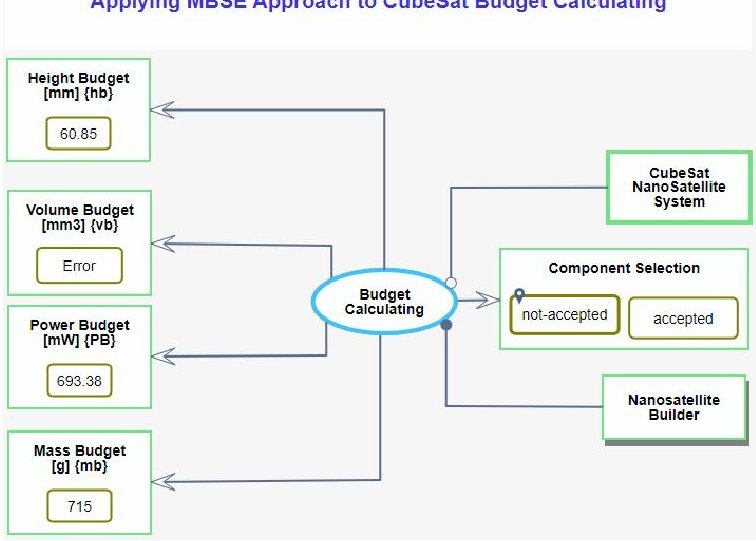

Figure 5: The system diagram of the budget calculating system showing the main process, Budget Calculating, and related objects

Nanosatellite Builder, shown in Figure 5, is an OPM agent—a person or an organization that handles the process to which it is connected. Specifically, this would be the agent who interacts with the system to provide input for the Budget Calculating process. The four objects on the left represent the output of the process, each of which will contain the budget of a different aspect of the system. It should be noted that this model is not comprehensive in this regard, but rather shows a proof-of-concept of this work main idea.

According to the methodological part of OPM, the main process in SD is enabled by an instrument whose default name is the main process name followed by "System". However, in our case, we deviate slightly from this convention and call the instrument object CubeSat Nanosatellite System as it better conveys the main process' underlying system. An instrument link is designated as a "white lollipop" as shown in Figure 5.

The Budget Calculating main process as well as the CubeSat NanoSatellite System main object can be decomposed into smaller processes and objects respectively using inzooming or unfolding mechanisms. These two techniques are the OPM's approach to managing model complexity. In-zooming refines the main process and shows its internal subprocesses while preserving order on their execution. Unfolding does the same, but it is used where order is not critical. The same rationale applies to objects. In this work, for processes, we apply in-zooming, where execution order is necessary, and unfolding, where order is not. As for objects, we apply unfolding to uncover their smaller internal parts.

Figure 9 shows the first step towards the exploration of the inner parts of the system diagram (top level) components. This diagram shows a refined Budget Calculating process with required objects, from the previous upper level, moved as well. This diagram shows that the Budget Calculating process is composed of two subprocesses: Budget Quantifying and Decision Making. The former is responsible for calculating budgets and the latter decides whether these calculated budgets comply with the predefined thresholds, and updates the Component Selection state accordingly. As the diagram shows, the upper subprocess writes (using arrowed result links) to the output objects while the lower subprocess reads (using instrument links) what has been

<!-- PDF_PAGE: 5 -->

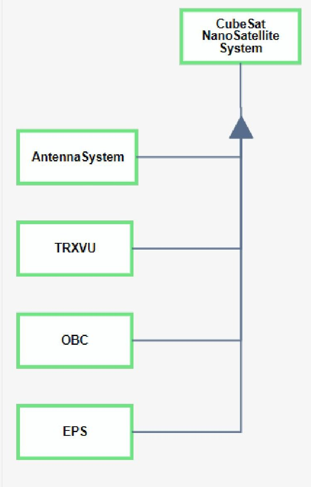

Figure 6: The CubeSat NanoSatellite System unfolded showing its main smaller parts

written by the upper process in order to decide about the Component Selection state.

As shown in Figure 10, the Budget Quantifying process is further refined through unfolding into four subprocesses. At the very top of this Object Process Diagram (OPD) the name of the refined process is shown, then at a lower level, its four derived subprocesses: Height Budget Calculating, Mass Budget Calculating, Volume Budget Calculating, and Power Budget Calculating. Notice that there is no predefined execution order for these subprocesses as they are independent. These subprocesses are at the end of the refinement process—they are drawn with a thin contour compared with a thick one for refined processes. Some of the objects in the higher diagram are propagated to the Budget Quantifying process unfolded diagram in Figure 10, as they continue to be relevant to the unfolded process and/or its inner subprocesses. New objects, with red contours, have been added to represent the threshold values of the different system-calculated budgets. This is an example of how OPM manages complexity—objects are added where they are relevant.

Other objects, Antenna System, TRXVU, OBC, and EPS, appear in this diagram, but they were created in different diagrams, and were brought here for their relevance to it (Figure 10). These objects compose the larger object CubeSat

NanoSatellite System from Figure 5 which was unfolded into a new diagram as shown in Figure 6. Notice that the objects in Figure 6 have a thick contour that indicates that they can be further unfolded. The Antenna System is unfolded into the diagram shown in Figure 12, the TRXVU object is unfolded and shown in Figure 7, the OBC object is shown unfolded in Figure 11, and the EPS object is unfolded into Figure 8. Notice that each of these unfolded objects is composed of other objects that represent their attributes using a special structural link called exhibition-characterization. These attributes are needed for the final calculation of the different budgets.

To recap, the diagram in Figure 10 shows all subprocesses for budgets calculating using data from the different subsystems. For example, the Mass Budget Calculating subprocess is responsible for mass calculating. This subprocess is connected to all subsystems by an instrument link (a link that implies 'requires') as it needs their mass. Every subsystem has an attribute that represents its mass. After having this input from all subsystems, the Mass Budget Calculating subprocess calculates the total mass of the nanosatellite and outputs the result into a new object called Mass Budget using a result link (there is an arrow to the direction of this object). The name of Mass Budget Calculating subprocess is followed by () to indicate that it is a computational process, which means that some computations occur within it.

## Automating the Budget Calculating Process

Recall that the two objectives of this work are to (1) formally model the Budget Calculating system and process, and (2) use the model to automate and facilitate this process. Objective (1) has been attained: The OPM model of the Budget Calculating system faithfully represents the Budget Calculating process and the involved objects at several levels of detail, clearly explicating who the agents (actors) are, how the process unfolds, and what the role of each agent is at each stage of the process. To achieve the second goal of automating the Budget Calculating process for the benefit of any CubeSat nanosatellite builder aspiring to build one, we leverage OPM's extension MAXIM [17], [31] which augments OPM ISO 19450:2015 with the ability to infuse computations and code into the previously qualitative-only OPM model.

To help a Nanosatellite Builder find the most suitable components to build a nanosatellite, we have incorporated code into several processes in the model exploiting the new OPM computational capabilities implemented in OPCloud. Figure 13 shows a JavaScript source code snippet attached to the Mass Budget Calculating() process. As noted, the () suffix in a process name indicates that it is computational.

As Figure 10 shows, for the Mass Budget Calculating() process to execute, it requires the masses of all subsystems: Antenna System, TRXVU, OBC, and EPS. The masses are entered by the user to the appropriate attributes (objects) within each subsystem object. Specifically, each object that is designated to be involved in some computations is called a computational informatical object and assigned an alias (within {}) following its name. This alias is referenced from the code attached to the computational process. For example, the mass of the OBC object is represented by an inner attribute (object) called OBC_MASS that is aliased with OBCM. When referenced from within the code, the OPCloud system creates a name that shows the object to which it belongs and as a result, the full name is OBC_OBCM. Likewise, the other three subprocesses in Figure 10 are also attached

<!-- PDF_PAGE: 6 -->

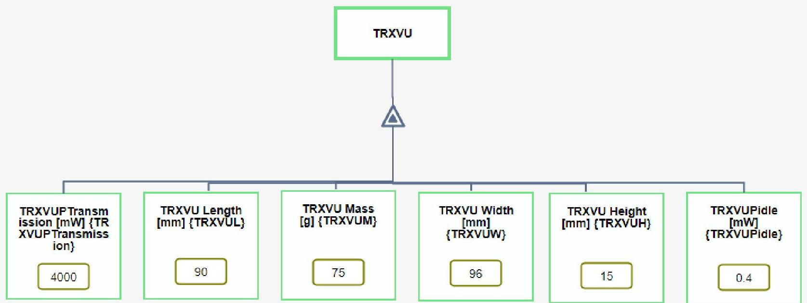

Figure 7: TRXVU subsystem unfolded

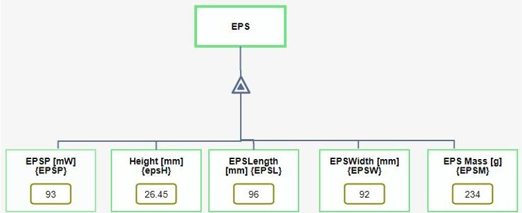

Figure 8: EPS subsystem unfolded

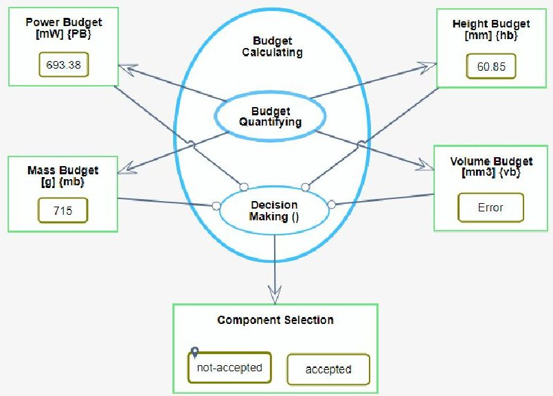

Figure 9: This diagram shows the Budget Calculating Process in-zoomed

with JavaScript code that calculates the budgets they are responsible for.

## Model Input and Output Mechanisms

For the computational processes to perform budget calculations, the user has to enter data into the appropriate places attribute objects as shown in Figures 7,8,11,and 12. The OPM supporting tool, OPCloud, provides different ways to

enter this data. The first way of input entering is ahead-of time input which requires that the user enters the data directly into the attribute object as shown in the diagrams of this work. The second way for data entering is run-time input where the user is prompted to insert data while model execution. The third option is a simulated value, where the modeler defines the range of values to select from and the probability distribution. As for output options, the modeler can choose between outputting the results directly into attribute objects as adopted here in this work, or exporting to Excel files. These are the very basic input/output mechanisms, but there are more advanced methods, but these are beyond the scope of this work.

## 5. THE OPM-BASED BUDGET CALCULATING SYSTEM EVALUATED

OPCloud, a web-based tool that implements OPM, has animated execution capabilities. As our model constitutes all needed qualitative things (conceptual objects and processes) as well as quantitative things (computational objects and processes), we can use OPCloud not only to statically model (using qualitative things) the Budget Calculating System but also to execute the model (based on the quantitative part) to obtain the sought solution, in our case, validated computed values of the different budgets of the system so that the nanosatellite builder selects the right components that fit the limitations of the underlying CubeSat nanosatellite. Furthermore, OPCloud has an animated execution feature so that the process of budget calculating is visualized by tokens, green disks sliding along the model links, to show the flow.

To verify our model and demonstrate its usage, we use real data taken from ISISPACE—a leading company in the small satellite market [32]. Table 1 shows real data of ISISPACE CubeSat subsystems that allow us to make real calculation for real model verification. Figures 7,8,11 and 12 show the input values of the different components' attributes, entered by the nanosatellite builder, that our tool will run on. Specifically, the modeler entered these attributes: height, weight, mass, power, and width. More attributes, computational objects, can be easily added to make the model

<!-- PDF_PAGE: 7 -->

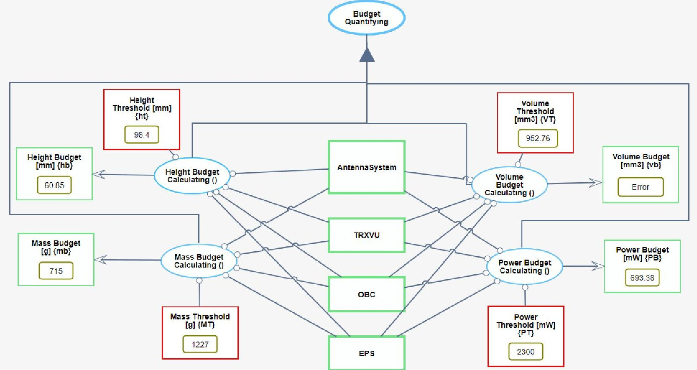

Figure 10: The Budget Quantifying process unfolded

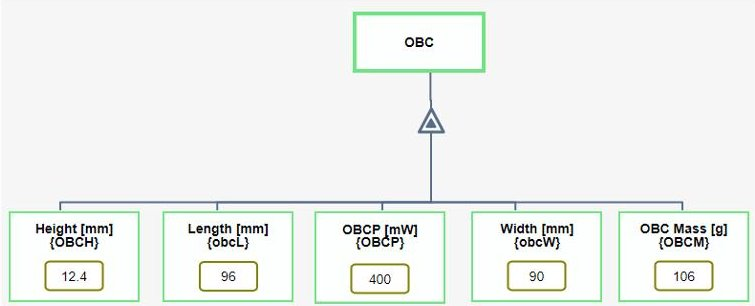

Figure 11: The OBC subsystem unfolded

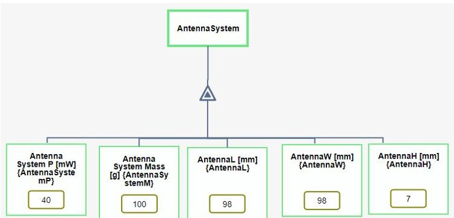

Figure 12: The Antenna subsystem unfolded

## more comprehensive.

The process, Budget Quantifying, shown in Figure 10, runs the four subprocesses to calculate the budgets of different system aspects based on the input data so as to let the execution system decides to accept or reject the proposed components. Each subprocess reads the entered input from the appropriate attributes and calculates its budget using an attached JavaScript code, as shown, for example, in Figure

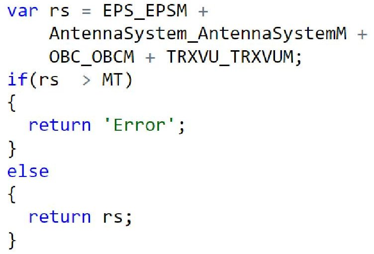

Figure 13: A code snippet example attached to the Mass Budget Calculating subprocess

13, and returns the calculated value if it is less or equal to the predefined threshold or "Error" message otherwise. In either case, the result will be written into the appropriate output object.

Table 1: ISIS CubSat SubSystems Specifications

<table border="1"><tr><td>Subsystem</td><td>Volume</td><td>Mass</td><td>Power</td></tr><tr><td>OBC</td><td>96x90x12.4mm3</td><td>100g</td><td>400mW</td></tr><tr><td>TRXVU</td><td>90x96x15mm3</td><td>75g</td><td>4000mW</td></tr><tr><td>Antenna</td><td>98x98x7mm3</td><td>&lt;100g</td><td>&lt;40mW</td></tr><tr><td>EPS</td><td>96x92x26.45mm3</td><td>184±5g</td><td>93mW</td></tr></table>

Figure 14 shows a series of figures demonstrating the OPM model animated execution. The green tokens move along the links during the animation while the model is being executed to show the flow of data and control. The ani-

<!-- PDF_PAGE: 8 -->

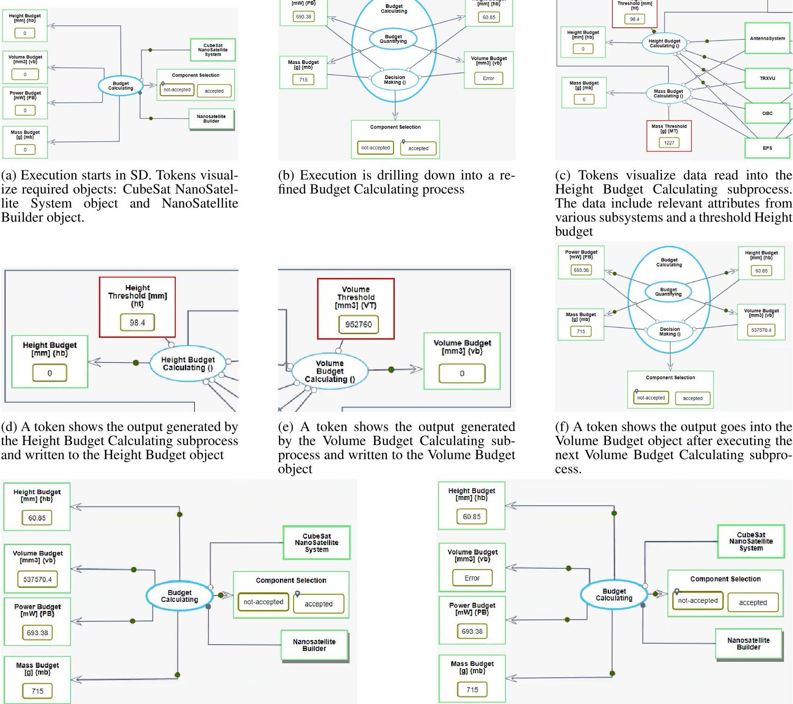

(g) The model execution is finishing. The main process writes the final results into the appropriate objects

(h) The output of the Volume Budget Calculating subprocess is Error which was written to Volume Budget object

mation traverses the OPDs in the model's OPD tree in a depth-first fashion. Execution starts at the System Diagram as shown in Figure 14a. In this figure the main process Budget Calculating, requires two objects to start execution as shown by the two tokens come from these objects: CubeSat NanoSatellite System, and Nanosatellite Builder The CubeSat NanoSatellite System object is required as the whole system, that contains the subsystems from which the main process will take its data for calculation. The other object, Nanosatellite Builder, is also a required one, but it is captured as a human agent that is needed in the process of component selection. The execution process will start drilling down into the Budget Calculating process for executing its subprocesses as shown in Figure 14b. This OPD shows the Budget Calculating process refined into two subprocesses: Budget Quantifying, and Decision Making. In the former

we calculate the budgets of different system aspects, and in the latter we decide whether the proposed components are acceptable. The execution system further drills down into the first subprocess as shown in Figure 14c. This OPD contains all subprocesses that calculate all budgets, but this specific figure shows the execution of the Height Budget Calculating subprocess. Its tokens show the data flows into the subprocess. This data comes from the subsystems and the predefined threshold then enters the subprocess that attaches some code in JavaScript. After running this code, a result is yielded and sent to the output object as shown in 14d. Likewise, the execution system does for the next subprocess as shown in Figure 14e and continues for all other subprocesses to calculate all budgets. Once done, the system starts climbing up the OPDs back to the main System Diagram. This is shown in Figure 14f that demonstrates the results going out

<!-- PDF_PAGE: 9 -->

the Budget Quantifying subprocesses to the output objects. Following this subprocess is the Decision Making one, that runs some code in JavaScript that considers all output objects to decide whether to accept the current configuration or not. As shown in Figure 14f, all output objects have valid result (no one has an "Error" value) so we expect the Decision Making subprocess will accept the proposed configuration as shown in Figure 14g. Notice how the tokes are sliding into the output objects, and the state of the Component Selection object is changing from not-accepted to accepted.

There are cases where the proposed components do not comply with the system limitations. To demonstrate that, we changed some of the data given to the attributes which yielded an "Error" value in the Volume Budget object and hence the Component Selection object changed to not-accepted state as shown in Figure 14h.

## 6. CONCLUSION

We have proposed a model-based approach that builds on model-based systems engineering using OPM ISO 19450 with computational extensions that are built into OPCloud. The research has achieved its two stated objectives: (1) A detailed OPM model of the budget calculating process and system was constructed, making the process clear and unambiguous; (2) Leveraging the computational capabilities of OPM, the model served as the basis for an executable budget calculating tool. Specifically, this model-based tool automates and significantly shortens the tedious process of meticulously going over a large and growing number of components that build the underlying nanosatellite, eliminating the need for sifting through a possibly long list of combinations of them.

Modeling a system conceptually and attaching necessary computations to one or a few processes is enabled by newly developed OPM computational capabilities and their implementation in OPCloud. This feature is of great importance since, as demonstrated, the code embedded in the processes is designed such that the system model can be modified and augmented without the need to alter the code. This facilitates maintaining the system coherent, consistent, and synchronized. Due to OPM's high-level conceptual modeling capabilities and lower-level computational and programming capabilities, this unique fusion of conceptual and computational modeling is made possible. Specifically, we can incorporate program code into processes of an OPM model and run the model. Whenever a computational process is encountered, the code within it is executed using the values of its input computational objects. The model-based approach to CubeSats formally explicates the Budget Calculating process and automates it, greatly alleviating the task of determining what components are the best suitable. Beyond streamlining and automating the Budget Calculating process, this work demonstrates the benefits of adopting the OPM model-based systems engineering approach to the domain of CubeSats, which include standardizing and formulating global CubeSats processes and systems, and helping CubeSat professionals navigate their way in the complex, evolving web of CubeSats design.

The author expresses gratitude to Emad Haj Yahia, Moataz Tellawi, Karim Massarwa, Amir Hamdan, and Rami Nsirat

## ACKNOWLEDGMENTS

from the Level-2 project for their valuable contributions to the early discussions related to this work.

## REFERENCES

[1] N. Database, "," https://www.nanosats.eu/, accessed: June 09, 2024.

[2] C. Poly, "Cubesat design specification rev. 14.1," pp. 1- 34, 2022.

[3] C. C. Venturini, B. M. Braun, D. Hinkley, and G. F. Berg, "Improving mission success of cubesats," 2018. [Online]. Available: https://api.semanticscholar. org/CorpusID:115371371

[4] D. Dori, "ISO/PAS 19450:2015 Automation systems and integration - Object-Process Methodology," 2015.

[5] , Object-process methodology: A holistic systems paradigm. Science & Business Media: Springer, 2002.

[6] D. Dori and E. F. Crawley, Model-based systems engineering with OPM and SysML. Springer, 2016.

[7] D. Dori and S. Thipphayatethana, "Model-based guidelines for user-centric satellite control software development," International Journal of Satellite Communications and Networking, vol. 34, no. 2, pp. 295-319, 2016. [Online]. Available: https://onlinelibrary.wiley.com/doi/abs/10.1002/sat.1123

[8] C. A. Osorio, D. Dori, and J. Sussman, "COIM: An object-process based method for analyzing architectures of complex, interconnected, large-scale socio-technical systems," Systems engineering, vol. 14, no. 4, pp. 364- 382, 2011.

[9] R. E. Mayer, Multimedia Learning, 2nd ed. Cambridge University Press, 2009.

[10] H. Kohen and D. Dori, "Designing and Developing OPCloud, an OPM-Based Collaborative Software Environment, in a Mixed Academic and Industrial Setting: An Experience Report," Academia Letters, 2021.

[11] D. Dori, A. Jbara, N. Levi, and N. Wengrowicz, "Object-Process Methodology, OPM ISO 19450 OPCloud and the Evolution of OPM Modeling Tools," Systems Engineering Letters, Project Performance International (PPI) SyEN, vol. 61, p. 30, jan 2018. [Online]. Available: https://www.ppi-int.com/wp-content/uploads/2018/01/SyEN_61.pdf

[12] Y. Mordecai and D. Dori, "5.3.2 Conceptual Modeling of System-Based Decision-Making," INCOSE International Symposium, vol. 24, no. 1, pp. 463-478, 2014. [Online]. Available: https://onlinelibrary.wiley.com/doi/abs/10.1002/j.2334-5837.2014.tb03161.x

[13] D. Dori, I. Reinhartz-Berger, and A. Sturm, "Developing complex systems with object-process methodology using OPCAT," in International Conference on Conceptual Modeling, 2003, pp. 570-572.

[14] D. Dori, C. Linchevski, and R. Manor, "OPCAT-A software environment for object-process methodology based conceptual modelling of complex systems," in Proceedings of the 1st International Conference on Modelling and Management of Engineering Processes. University of Cambridge Cambridge, UK, 2010, pp. 147-151.

[15] E. Hoxha, "Development of a matlab tool for automated calculation of cubesat budgets with margins," Ph.D. dissertation, Politecnico di Torino, 2023.

<!-- PDF_PAGE: 10 -->

[16] J. Casebolt, A. Jbara, and D. Dori, "Business process improvement using Object-Process Methodology," Systems Engineering, vol. 23, no. 1, 2020.

[17] N. Levi-Soskin, R. Shaoul, H. Kohen, A. Jbara, and D. Dori, Model-based diagnosis with FTTell: Assessing the potential for pediatric failure to thrive (FTT) during the perinatal stage, 2019, vol. 359.

[18] L. Li, N. Soskin, A. Jbara, M. Karpel, and D. Dori, "Model-based systems engineering for aircraft design with dynamic landing constraints using object-process methodology," in AIAA Scitech 2019 Forum, 2019.

[19] D. Dori, A. Jbara, Y. E. Yang, A. M. Liu, and C. M. Oman, "Object-Process Methodology as an Alternative to Human Factors Task Analysis," Human Factors, vol. 0, no. 0, p. 00187208211048384. [Online]. Available: https://doi.org/10.1177/00187208211048384

[20] M. Peleg and D. Dori, "Extending the object-process methodology to handle real-time systems," JOOP, vol. 11, no. 8, pp. 53-58, 1999.

[21] P. Soffer, B. Golany, and D. Dori, "ERP modeling: a comprehensive approach," Information Systems, vol. 28, no. 6, pp. 673-690, 2003. [Online]. Available: https://www.sciencedirect.com/science/article/pii/S0306437902000789

[22] A. Sturm, D. Dori, and O. Shehory, "Single- Model Method for Specifying Multi-Agent Systems," in Proceedings of the Second International Joint Conference on Autonomous Agents and Multiagent Systems, ser. AAMAS '03. New York, NY, USA: Association for Computing Machinery, 2003, pp. 121-128. [Online]. Available: https://doi.org/10.1145/ 860575.860595

[23] D. Dori, R. Feldman, and A. Sturm, "From conceptual models to schemata: An object-process-based data warehouse construction method," Information Systems, vol. 33, no. 6, pp. 567-593, 2008. [Online]. Available: https://www.sciencedirect.com/science/article/pii/S0306437908000148

[24] S. J, C. M, and D. D, "Conceptual Model-Based Systems Biology: Mapping Knowledge and Discovering Gaps in the mRNA Transcription Cycle," PLoS ONE, 2012.

[25] I. Reinhartz-Berger, D. Dori, and S. Katz, "OPM/Web - Object-Process Methodology for Developing Web Applications," Annals of Software Engineering, vol. 13, no. 1, pp. 141-161, 2002. [Online]. Available: https://doi.org/10.1023/A:1016597410642

[26] C. Aas, B. Zandbergen, R. J. Hamann, and E. K. A. Gill, "Development of a system level tool for conceptual design of small satellites," 2009. [Online]. Available: https://api.semanticscholar.org/CorpusID:55483051

[27] K. B. Gamble and E. G. Lightsey, "Cubesat mission design software tool for risk estimating relationships," Acta Astronautica, vol. 102, pp. 226-240, 2014. [Online]. Available: https://www.sciencedirect.com/science/article/pii/S0094576514002185

[28] N. Levi-Soskin, S. Marwedel, A. Jbara, and D. Dori, "Enhancing conceptualA models with computational capabilities: A methodical approach to executable integrative modeling," Systems Engineering, vol. 27, no. 4, pp. 759-770, 2024. [Online].

Available: https://incose.onlinelibrary.wiley.com/doi/ abs/10.1002/sys.21750

[29] Y. Grobshtein, V. Perelman, E. Safra, and D. Dori, "Systems modeling languages: OPM versus SysML," in 2007 International Conference on Systems Engineering and Modeling, 2007, pp. 102-109.

[30] Y. Grobshtein and D. Dori, "Generating SysML views from an OPM model: Design and evaluation," Systems Engineering, vol. 14, no. 3, pp. 327-340, 2011.

[31] N. Levi-Soskin, A. Jbara, and D. Dori, "The Model Fidelity Hierarchy: From Text to Conceptual, Computational, and Executable Model," IEEE Systems Journal, vol. 15, no. 1, pp. 1287-1298, 2021.

[32] I. GROUP, "ISISPACE," https://www.isispace.nl/, accessed: May 21, 2024.

Ahmad Jbara Ahmad Jbara received his Ph.D. in Computer Science from the Hebrew University of Jerusalem, Israel. He is currently a Senior Lecturer and Vice-Dean at the School of Computer Science, Netanya Academic College, Israel. Additionally, he serves as an Associate Teaching Fellow at the Faculty of Data Science, Technion, Israel. His research interests include program comprehension, code complexity metrics, code visualization, and conceptual modeling.