<!-- PDF_PAGE: 1 -->

# Assessment of large language models for use in generative design of model based spacecraft system architectures

Louis Richard Timperley, Lucy Berthoud, Chris Snider & Theo Tryfonas

To cite this article: Louis Richard Timperley, Lucy Berthoud, Chris Snider & Theo Tryfonas (2025) Assessment of large language models for use in generative design of model based spacecraft system architectures, Journal of Engineering Design, 36:4, 550-570, DOI: 10.1080/09544828.2025.2453401

To link to this article: https://doi.org/10.1080/09544828.2025.2453401

$ \textcircled{c} $ 2025 The Author(s). Published by Informa UK Limited, trading as Taylor & Francis Group.

Published online: 28 Jan 2025.

Submit your article to this journal

Article views: 5084

View related articles

View Crossmark data

ng articles: 25 View citing articles

<!-- PDF_PAGE: 2 -->

OPEN ACCESS

Check for updates

# Assessment of large language models for use in generative design of model based spacecraft system architectures

Louis Richard Timperley D, Lucy Berthoud D, Chris Snider D and Theo Tryfonas D

School of Civil, Aerospace and Design Engineering, University of Bristol Beacon House, Bristol, UK

## ABSTRACT

This paper investigates using Large Language Models (LLMs) within Model Based Systems Engineering (MBSE) as the basis for generative design tools for spacecraft. This study has developed tooling for automatically generating system architecture, functions, modes, and components from an initial requirement set. Specifically, a Python tool was developed to couple the Capella MBSE tool to an LLM in order to facilitate a rapid generative design process. The approach was tested by application to three system design tasks: a European Space Agency Earth observation mission, a CubeSat payload design, and a masters' degree level group design for an Earth observation spacecraft. For each, generated outputs were evaluated against those produced by technical designers. It was found that the generation of system modes and components was of good quality, providing high traceability and alignment against requirements, and also providing generated architectures that in some areas were more detailed than human-generated equivalents. Further development could provide spacecraft system engineers with an 'AI design assistant', as human input is still at the centre of the process and appears necessary to ensure a high-quality output.

## ARTICLE HISTORY

Received 8 August 2024 Accepted 6 January 2025

## 1. Introduction

MBSE is the formal application of modelling to system engineering activities (INCOSE 2007). This approach to systems engineering centres on the concept of providing a 'single source of truth' for a project, whereby all stakeholders can communicate system information. This relies on three 'pillars'; modelling language, tool, and method (Wäschle et al. 2020). The modelling language defines how the information about the system is captured in the model. The tool is the software environment in which the model is constructed and the method is the process by which the model is populated. By using these three pillars, MBSE has been demonstrated to offer a more complete, consistent, and communicable approach to systems engineering than tradition methods (Ryan, Cook, and Scott 2013).

## KEYWORDS

Large Language Models; Model-based Systems Engineering; generative design; spacecraft system architectures; systems engineering

MBSE-orientated tools and methods typically do not easily allow design exploration instead being focused on precise representation of a systems baseline. This makes it difficult to explore alternative solutions, as it is time consuming to model each discrete alternative.

<!-- PDF_PAGE: 3 -->

However, tools that allow exploration are emerging within the field (Epp et al. 2023), (Leserf, de Saqui-Sannes, and Hugues 2019),(Timperley et al. 2023),(Lu et al. 2022). The most common modelling language, SysML (version 1), has minimal support for design alternatives modelling, via the use of element generalisations and refinements. In this way the modeler can identify discrete design alternatives (Meacham, Gioulekas, and Phalp 2015). Work has been done to address this issue, mostly by researchers in the field, particularly focusing on the capability to model continuous or discontinuous parameter variation (Leserf, de Saqui-Sannes, and Hugues 2019). To support more complex forms of design variation, rule (or ontology) based methods have been developed (Halvorson et al. 2022), and while useful in their specific intended domain, they cannot be used for applications outside this without defining a new set of rules. Further to these efforts, SysML version 2 is starting to be adopted in the field and offers variability points for modelling alternative configurations and supporting trade-offs.

Large Language Models (LLM), a sub-set of the wider Natural Language Processing (NLP) field, have garnered a great deal of attention recently for their capability to respond to prompts. Successful application areas include medicine (Thirunavukarasu et al. 2023), and many more. To achieve this impressive capability and flexibility, LLM's make use of transformer models (Vaswani et al. 2017) and are trained on vast amounts of text, sourced from various books, articles and websites from across the internet.

In order to maximise the output quality of these large models, a number of techniques have been developed: Fine tuning, whereby a pre-existing LLM model may have all (full model tuning) (Zhang et al. 2024) or a subset of its parameters (parameter efficient tuning) (Lester, Al-Rfou, and Constant 2021) varied into order to maximise against some evaluation criteria. Chain of thought, has been used to improve to the reasoning capabilities of LLM's, by splitting the generation process into a number of intermediate steps (Vacareanu et al. 2024). Retrieval-Augmented Generation draws on external data to provide improved accuracy of the LLM output (Fatehkia, Lucas, and Chawla 2024). This data is typically relevant to the application domain, and may be stored in the form of a knowledge graph (Agrawal et al. 2024).

These models offer a valuable opportunity to address shortcomings in current MBSE tools, by providing free-form design exploration that has not been possible up to this point.

LLMs and NLP techniques have already been applied to MBSE in areas such as: knowledge graph generation for answering queries related to space missions; requirement management with MBSE (Riesener et al. 2021); the use of Named Entity Recognition (NER) models for SysML model element generation (Chami, Zoghbi, and Bruel 2019). This last NER based approach was able to generate actors, use cases, associations and blocks.

There are various demonstrations in literature of LLM capabilities as an initial generation tool in other domains (Blocklove et al. 2024) and other relevant studies such as (Gomez et al. 2024), (Camara et al. 2023) and (Wang et al. 2024) each exploring UML generation with LLMs, with (Wang et al. 2024) using a set of criteria to evaluate different aspects of the generated UML diagrams such as class and sequence diagrams. (Ferrari, Abualhaija, and Arora 2024) focussed on UML sequence diagram generation with evaluation focussing on completeness, correctness, adherence to the standard, understandability and terminology alignment. (Apvrille and Sultan 2024) presents a tool for LLM generation of SysML models, and for evaluation, compared the generated models to ones created by masters level students in a graded design exercise. (Luitel, Nejati, and Sabetzadeh 2024) explored

<!-- PDF_PAGE: 4 -->

Simulink model slicing with LLMs, useful for model inspection and establishing traceability to requirements.

This study aimed to assess the capability of LLMs as a generative design tool in the MBSE context in more detail. Earth observation spacecraft architectures has been chosen as an example of a complex system design problem with some consistent examples to compare against. Specifically, the study assesses the ability of LLMs to generate functions, components and modes from system requirements, an activity that in practice typically requires a significant amount of time for a system architect to produce. This paper is organised as follows. The methodology is presented in section 2, then experiment results in section 3. The results are discussed and future work proposed in section 4 and finally conclusions are provided in section 5.

## 2. Methodology

As mentioned, in this work LLMs were tested as a generative design tool within MBSE through development and application of a LLM pipeline to three MBSE problem cases. Cases include a real industry case to test real-world applicability, a comprehensive researchled case, and a broad set of undergraduate projects. In each, outputs of the LLM tool are compared to designer-created outputs.

This first section presents the tool selection and the LLM interface with the MBSE tool. The setup and execution of the design cases is then described in the next section.

## 2.1. Tools and interfacing

The MBSE tool selected for this case study was the Eclipse Foundation's Capella tool (Eclipse 2023). Originally developed by Thales Alenia Space and PolarSys industry working group, this tool offered a powerful Python interface called Python4capella (Labs4Capella 2024). This provided the opportunity for architecture elements generated by an LLM to be fed directly into the system model in Capella. Capella was also selected as it follows the ARCADIA method (Voirin 2023) which is focussed on system architecting.

For the choice of LLM, several options were considered. There are many commercial models such as text-davinci-003 (the text generation part of chatGPT-3.5) (OpenAI 2023), available from OpenAI or OPT, developed by meta. Open source models include GPT-J, GPT-NeoX and Bloom. The number of model parameters plays a critical role in the performance of an LLM (Kandpal et al. 2023). Text-davinci-003, GPT-NeoX, OPT and Bloom all have 175 billion parameters, while GPT-J has 20 billion. For the purposes of this study, text-davinci-003 was selected as the primary LLM, due to its performance and, at the time, it offered larger token limits than other models of similar type. It was also reported to have improved zero-shot capabilities, that was felt to be particularly useful for the purposes of this study. Besides this, it offered close integration with Python and low cost. While much more capable LLMs have since been released, text-davinci-003 was still used to complete all experiments to maintain consistency and it is expected that modern LLM's would likely be just as suitable, if not more. This is discussed further in section 4.

A toolchain linking the MBSE model and the generative LLM was developed. OpenAI offers a Python API (application programming interface) to allow users to communicate with their models over the internet, thus providing a convenient means of performing

<!-- PDF_PAGE: 5 -->

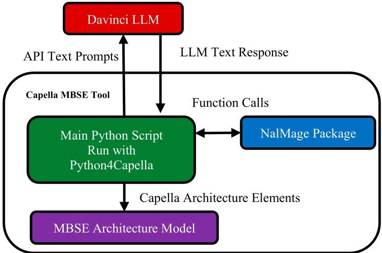

Figure 1. Overview of tools used for design experiments.

prompt engineering. Therefore, in this study Python was used as the bridge to collect outputs from the LLM and feed them directly into the Capella MBSE tool. This was implemented via a Python package, called NalMage (Neural Network-Assisted Language Modelling for Architecture Generation and Engineering), that included all necessary functions to control interaction with the LLM via OpenAI's API, and generate Capella model elements within the MBSE model, via the Python4Capella API. All interactions with the user, such as entering LLM prompts, were performed via a console within Capella. Figure 1 shows the connections between each component.

The toolchain was configured to mirror classical system architecting processes, and allow user down-selecting at each process stage. The designer inputs requirements, and prompts for the LLM to automatically produce a list of functions that meet them. The user then prompts for a grouping of the generated functions into modes, and then logical components. This process is repeated at each level of the system. See Table 1 for a list of the prompt patterns used at each of these steps, and Figure 2 for a diagrammatic process overview. The prompts in Table 1 are fairly simple and the impact of using more developed prompts is discussed later. At each stage of this process the user guided the LLM prompting via the NalMage package, see Figure 3. In so doing, the system leverages the expertise of the user to guide generation of LLM outputs. For this study, only functional requirements were considered, as it was judged that these were generally more complex to handle during the system architecting process. See section 4 for suggestions on how non-functional requirements might be handled using an LLM in future work.

The textual output of the LLM provides the basis of the elements to be added to the MBSE model in Capella. The LLM model was prompted to output lists of suggested elements in bullet point form, allowing simple string splitting, performed by the NALMAGE package, to separate individual model elements down selected by the designer. Then, these elements would be mapped by the NALMAGE package to specific MBSE model types depending on what model element the designer had specified earlier in the prompting process, shown in Figure 3. The ontology used for the text-to-MBSE model transition in this study contained three model types and one textual type; requirements (textual), functions (model type), modes (model type) and components (model type), shown in Figure 4. An example of this prompting process could be: The designer chooses to generate functions from

<!-- PDF_PAGE: 6 -->

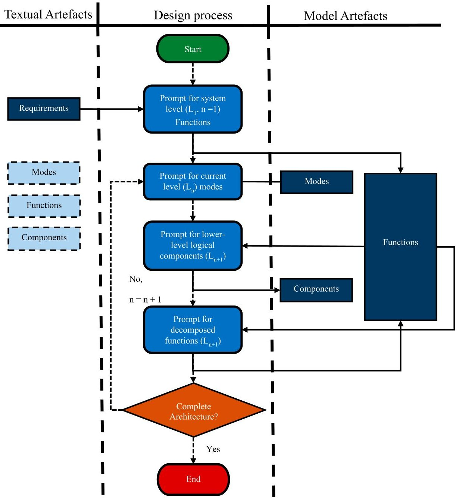

Figure 2. Overview of the design process when using the NALMAGE tool.

Table 1. Patterns used to prompt the LLM.

<table border="1"><tr><td>Prompting step</td><td>Pattern</td></tr><tr><td>Requirements to Functions</td><td>Suggest the main functions(worded as functions),listing them with‘-’bullet points,performed bythe system given the following requirements:list requirements</td></tr><tr><td>Functions to Modes</td><td>Group the following functions into modes used bythe component or system:list functions,listing the modes with‘-’bullet points</td></tr><tr><td>Functions to Components</td><td>Given the following functions,suggest some typical components used bythe parent component or system:list functions,listing the components with‘-’bullet points</td></tr><tr><td>Functions to Sub-Functions</td><td>Decompose the function parent function performed byancomponent of system into more detail,listing the subfunctions with‘-’bullet points</td></tr></table>

<!-- PDF_PAGE: 7 -->

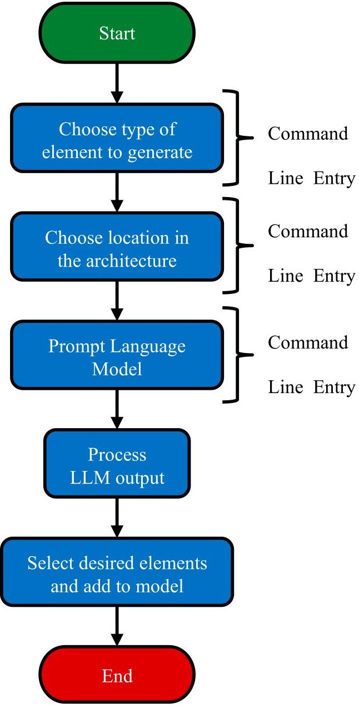

Figure 3. Prompting Process with the NalMage Tool.

requirements, selects the satellite component as the parent location of the new functions, then enters the prompt 'Suggest the main functions (worded as functions), listing them with '-' bullet points, performed by a satellite given the following requirements: The system shall image the Earth, the system shall collect infrared images'. The LLM response could include two functions: Image the Earth, and Image the Earth in IR, at which point the designer would select the more detailed second function. This whole process is much quicker than manually identifying each design element and instead allows the designer to simply down select from a list of suggested elements at each stage.

A feature of LLMs is that they can react to user feedback within the prompts, and so offer an opportunity to mirror the iterative nature of the systems architecting process. This has been partially reflected in this study by the inclusion of the down selection step after each model element generation stage, that ensures erroneous elements are not carried into the next prompt, but there is the potential for much more in depth user feedback mechanisms to be used. Avenues for future work in this regard are suggested in section 4.

<!-- PDF_PAGE: 8 -->

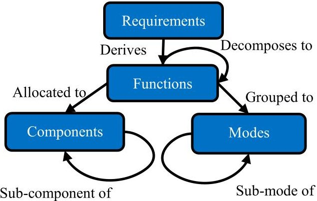

Figure 4. Ontology used for generated MBSE model elements.

## 2.2. Design experiments

Table 2 summarises the set of design experiments performed during this study. The tool was applied to three design cases with pre-existing design solutions (which were useful for comparison), with the aim of covering a wide range of different requirement types and wordings. These included:

(1) The University of Bristol's CubeSat payload PROVE Pathfinder (Etchells et al. 2022),(Timperley and Berthoud 2022), which was selected as it already had a complete and detailed design with accessible design information, and being a CubeSat mission (i.e.: a nano-spacecraft), complemented the other two full-sized spacecraft missions.

(2) A masters' level group design brief for an Earth observation spacecraft that offered an overview of a full sized satellite design with accessible design information. This was an educational example which meant that the requirement wording was considered to be clear and consistent (for the student's benefit), offering perhaps a simpler design case.

(3) An industrial study for a European Space Agency Earth Observation (EO) mission, with more limited access to design information. This study was selected as it gives a more 'real-world' industrial example rather than educational examples. Its requirements were much more detailed than the previous two examples.

This set of experiments ensures as wide as possible set of applications to get a thorough understanding of the capability of the LLM approach. An overview of the generated architecture for PROVE Pathfinder (experiment 1) is presented in the form of a Sankey diagram in Figure 5. Note that the diagram serves to provide an overview, and not all details are visible. The quantity represented in the Sankey bar widths was a rating of traceability for each element to its parent, propagating back to requirements. See section 2.4.1 for more detail on this traceability rating. A number of Key Performance Indicators (KPIs) were used to assess the quality of the generated outputs. These are presented in section 2.4.

## 2.3. Prompting experiments

Two additional experiments (experiments 4 and 5 shown in Table 2) were also performed to better understand the impact of prompts on the output quality and apply prompt

<!-- PDF_PAGE: 9 -->

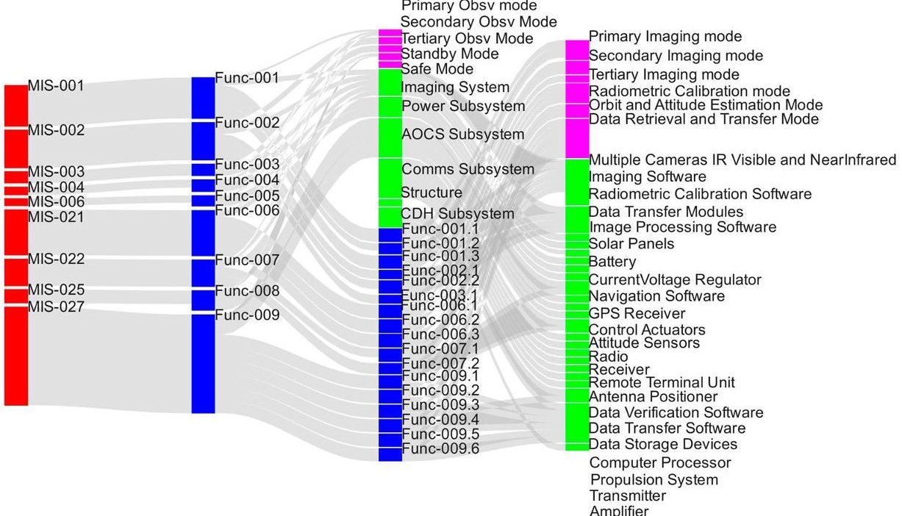

Figure 5. Generated PROVE Pathfinder architecture, all elements besides requirements (in red) generated by the LLM prompting process.

Table 2. Design experiment names.

<table border="1"><tr><td>ID</td><td>Name</td><td>Contribution</td></tr><tr><td>1</td><td>PROVE Pathfinder design</td><td>Application to a design case</td></tr><tr><td>2</td><td>University of Bristol group design</td><td>Application to a design case</td></tr><tr><td>3</td><td>Industrial EO design</td><td>Application to a design case</td></tr><tr><td>4</td><td>Prompt pattern</td><td>Investigation into impact of varying prompt pattern</td></tr><tr><td>5</td><td>Requirement coverage</td><td>Investigation into impact of requirements</td></tr></table>

engineering. The recent growth in LLM capability and the more complex attention mechanism offered by transformer type models has lead to the practice of prompt engineering. This is the process by which a prompt's textual structure and content is optimised for the best output from an LLM for a given use case (Zhou et al. 2023). Experiment 4 assessed the influence of using different prompt patterns. Focusing on the requirement to function prompting step (as the traceability and alignment scores here proved to be lowest), Table 3 shows the various patterns used. See Table 1 for the original set of prompt patterns. The traceability KPI values for the different prompt patterns are included in section 3.

In Experiment 5, the influence of requirement coverage in prompts on the output architecture was explored. For the group design exercise (experiment 2), the requirement specification only covered payload and orbital control aspects. It was therefore desirable to add in requirements that covered aspects of the other spacecraft subsystems such as

<!-- PDF_PAGE: 10 -->

Table 3. Prompt patterns used for the requirement to function design step, option A was the original pattern.

<table border="1"><tr><td>Id</td><td>Prompt Pattern</td></tr><tr><td>A</td><td>Suggest the main functions(worded as functions),listing them with‘-’bullet points,performed bythe system given the following requirements:list requirements</td></tr><tr><td>B</td><td>The ARCADIA definition of a function is:A function is an action,an operation or a service fulfilled by one Component or Actor.Using this definition,suggest the main functions(worded as functions),listing them with‘-’bullet points,performed bythe system given the following requirements:list requirements</td></tr><tr><td>C</td><td>Suggest the minimum set of main functions that have the least similarity between them,listing them with‘-’bullet points,performed bythe system that would satisfy the following requirements:list requirements</td></tr><tr><td>D</td><td>The ARCADIA definition of a function is:A function is an action,an operation or a service fulfilled by one Component or Actor.Using this definition,suggest the minimum set of main functions that have the least similarity between them and relate to as general operations as possible,listing them with‘-’bullet points,performed bythe system that would satisfy the following requirements:list requirements.Finally ensure that all the suggested functions are completely unique and are possible to be performed onboard a spacecraft.</td></tr></table>

Table 4. Additional requirements for design experiment 5.

<table border="1"><tr><td>ID</td><td>Requirement Text</td></tr><tr><td>MIS-015</td><td>MIS-015(The mission shall control the internal thermal environment to within system temperature limits)</td></tr><tr><td>MIS-016</td><td>MIS-016(The mission shall provide its own power to support operations)</td></tr><tr><td>MIS-017</td><td>MIS-017(The mission shall downlink all payload data to ground.)</td></tr><tr><td>MIS-018</td><td>MIS-018(The mission shall store payload data onboard until it is downlinked)</td></tr></table>

thermal, power and data seen in the pre-existing design and to regenerate the architecture from this wider set of requirements. This made it possible to examine whether wider requirement coverage in prompting improves the generated output quality. Table 4 shows the set of extra requirements added in Experiment 5, after which the design process was repeated.

## 2.4. Key performance indicators for design experiments

As described previously, experiments were run to assess the quality of generated system architectures from the LLM toolchain. The quality of the generated system architectures was assessed via a set of Key Performance Indicators (KPI's) focused on traceability and alignment. These are described in the next two sections.

## 2.4.1. Traceability KPI

An important feature of system architecture is the traceability of the design of the elements, i.e.: can these be traced back through an element's parents, through the design cycle back to the requirements? (ISO/IEC/IEEE24765:2010(E)2010). Traceability was assessed using manual ratings by two human coders, each with several years' experience in systems engineering. The ratings were out of three and performed in accordance with a predefined rule set. This rule set is presented in Table 5 and developed from definitions in (ISO/IEC/IEEE24765:2010(E)2010). Each traceability score was then aggregated to provide a mean traceability score for the entire generated architecture. The traceability of the pre-existing designs (PROVE Pathfinder, University of Bristol group design, and the Industrial EO design) was also calculated using the rule set in Table 5 to provide a comparison and contextualise the generated design traceability.

<!-- PDF_PAGE: 11 -->

Table 5. Traceability ruleset.

<table border="1"><tr><td>Element Type</td><td>Rule</td><td>Score if Fail</td></tr><tr><td>Function</td><td>Must be executable by a spacecraft</td><td>1</td></tr><tr><td>Function</td><td>Have clear inputs and outputs</td><td>2</td></tr><tr><td>Mode</td><td>The functions grouped into this mode should relate to the set of operational conditions maintained for the mode (and not others)</td><td>1</td></tr><tr><td>Mode</td><td>The functions grouped into this mode should not require its own specific mode (if grouped with other functions)</td><td>2</td></tr><tr><td>Component</td><td>Related to typical/relevant components found on spacecraft</td><td>1</td></tr><tr><td>Function, Mode, Component</td><td>Should be necessary for the operation of the system</td><td>1 or 2</td></tr><tr><td>Function, Mode, Component</td><td>Be unambiguous</td><td>1</td></tr><tr><td>Function, Mode, Component</td><td>Relate to its parent (e.g. parent requirement for a function)</td><td>1</td></tr><tr><td>Function, Mode, Component</td><td>Minimal overlap with, or duplicate other model elements, redundancy not expected at this stage</td><td>1</td></tr></table>

Table 6. Inter-rater reliability metrics.

<table border="1"><tr><td>Experiment</td><td>Observed Agreement</td><td>Cohen&#x27;s Kappa</td><td>Interpreted Agreement</td></tr><tr><td>Experiment 1 Traceability</td><td>0.8654</td><td>0.4150</td><td>Moderate</td></tr><tr><td>Experiment 1 Alignment</td><td>0.9373</td><td>0.3872</td><td>Fair</td></tr><tr><td>Experiment 2 Traceability</td><td>0.8374</td><td>0.5677</td><td>Moderate</td></tr><tr><td>Experiment 2 Alignment</td><td>0.9887</td><td>0.6536</td><td>Substantial</td></tr><tr><td>Experiment 3 Traceability</td><td>0.8077</td><td>0.3567</td><td>Fair</td></tr><tr><td>Experiment 3 Alignment</td><td>0.9818</td><td>0.5658</td><td>Moderate</td></tr></table>

To limit the impact of personal biases in the manual rating, two assessors were used to collect the values for the traceability KPI. Inter-coder reliability was then measured using Cohen's kappa. This measures agreement between two raters rating a set of objects into several categories (Cohen 1960). For this context the linearly weighted version of Cohen's kappa was selected, defined in equation (1).

$$
W _ {i j} = 1 - \frac {| i - j |}{| c - 1 |}
$$

where c is the number of rating categories. Cohen's linearly weighted kappa $ \kappa_{w} $ is thus defined in equation (2):

$$
\kappa_ {w} = \frac {p _ {O} - p _ {e}}{1 - p _ {e}}
$$

where $ p_{O} $ is the weighted relative observed agreement among the raters and $ p_{e} $ is the weighted probability of chance agreement according to the observed data. Table 6 shows the values of observed agreement and Cohen's kappa, measuring agreement between the two assessors and agreement strength (Landis and Koch 1977).

## 2.4.2. Alignment KPI's

The architectures generated by the LLM were validated by comparing them to pre-existing designs for the same requirement specification. As previously, each generated element was

<!-- PDF_PAGE: 12 -->

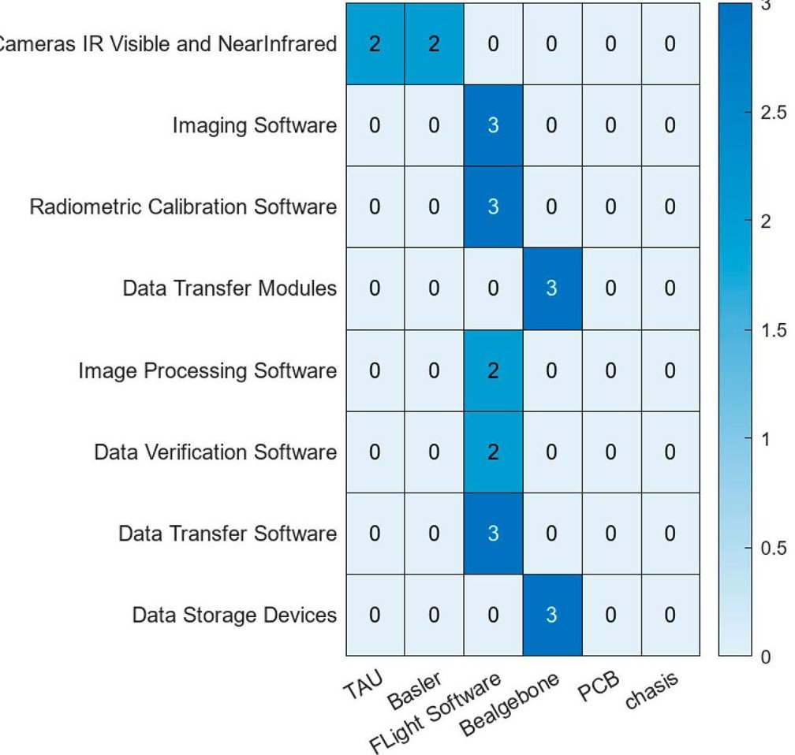

Figure 6. Alignment between generated and pre-existing design components for PROVE Pathfinder (experiment 1).

Table 7. Alignment ruleset.

<table border="1"><tr><td>Element Type</td><td>Rule</td><td>Score</td></tr><tr><td>Function</td><td>Direct equivalent present in pre-existing designs.</td><td>3</td></tr><tr><td>Function</td><td>Semi equivalent(for example some impacts/outputs are shared)</td><td>2</td></tr><tr><td>Function</td><td>Loose equivalent(minimal overlap between impacts/outputs)</td><td>1</td></tr><tr><td>Mode</td><td>Direct equivalent</td><td>3</td></tr><tr><td>Mode</td><td>Semi equivalent(for example some conditions of the mode are shared)</td><td>2</td></tr><tr><td>Mode</td><td>Loose equivalent(minimal overlap between conditions of the mode)</td><td>1</td></tr><tr><td>Component</td><td>Direct equivalent</td><td>3</td></tr><tr><td>Component</td><td>Semi equivalent(for example some aspects of the element are shared)</td><td>2</td></tr><tr><td>Component</td><td>Loose equivalent(minimal overlap between elements)</td><td>1</td></tr><tr><td>ALL</td><td>No Equivalent</td><td>0</td></tr></table>

manually rated by two assessors for alignment using a pre-existing rule set shown in Table 7. Cohen's kappa was once again used to measure inter-rater agreement. See Figure 6 for an example of these assessments.

<!-- PDF_PAGE: 13 -->

Individual alignment scores were then aggregated to calculate generation precision and recall measures. The precision was calculated as the mean alignment score of the generated elements, i.e. of those elements generated by the LLM. Recall was calculated via the mean alignment score of the pre-existing design elements, i.e. those present in pre-existing designs. Optimal alignment would then occur when each element in the generated architecture could be directly mapped to an element in the pre-existing one, and vice versa, in which case Figure 6 would be a square diagonal matrix.

To identify if the generated architectures were more or less 'specific' than the pre-existing design architecture, a further aggregation method was used, based on the root mean square of the alignment scores. In this context, specificity was defined as the level of decomposition at which each layer of the generated system architecture was modelled, vs the level for the pre-existing design. Following this, if an element in the pre-existing design was aligned with multiple elements in the generated design, such as the flight software shown in Figure 5, it could be argued that the generated design was more specific, as that element in the pre-existing could have been decomposed to match the generated elements. The root mean square based aggregation was performed by first constructing a vector, $ \vec{\nu} $ , as shown in equation (3).

$$
\vec {\nu} = \sum_ {i = 1} ^ {n} \overline {{A _ {i j}}}
$$

where i is the number of generated elements, j is the number of pre-existing design elements, $ \overline{A_{ij}} $ is the matrix of alignment scores between all the generated and pre-existing design elements. The vector length of $ \vec{\nu} $ (Euclidean distance) is then normalised by dividing it by the square root of the number of generated elements, thus evaluating to the Root Mean Square (RMS), see equation (4). This has been called the 'over specificity parameter', as it is influenced by the number of generated elements that are highly aligned with fewer elements in the pre-existing design (meaning they are more specific). If the two designs were perfectly aligned, then $ \overline{A_{ij}} $ was a diagonal matrix of perfect scores, then this value would be 1. The more 'over specific' the generated architecture, the higher the value of $ \sigma $

$$
O v e r S p e c i f i c i t y P a r a m e t e r = \sigma = \frac {| | \vec {\nu} | |}{\sqrt {i}}
$$

This is then repeated, but instead of summing across generated elements, $ \vec{\nu} $ is calculated by summing across pre-existing design elements, to arrive at the under-specificity parameter, with similar behaviour with respect to less specific generated elements.

## 3. Results

This section presents the various results collected during the design experiments outlined previously. Firstly, the classifier KPI results from experiments 1,2 and 3 are presented, then the traceability and alignment scores for experiments 1,2 and 3 are presented, followed by results from experiments 4 and 5.

<!-- PDF_PAGE: 14 -->

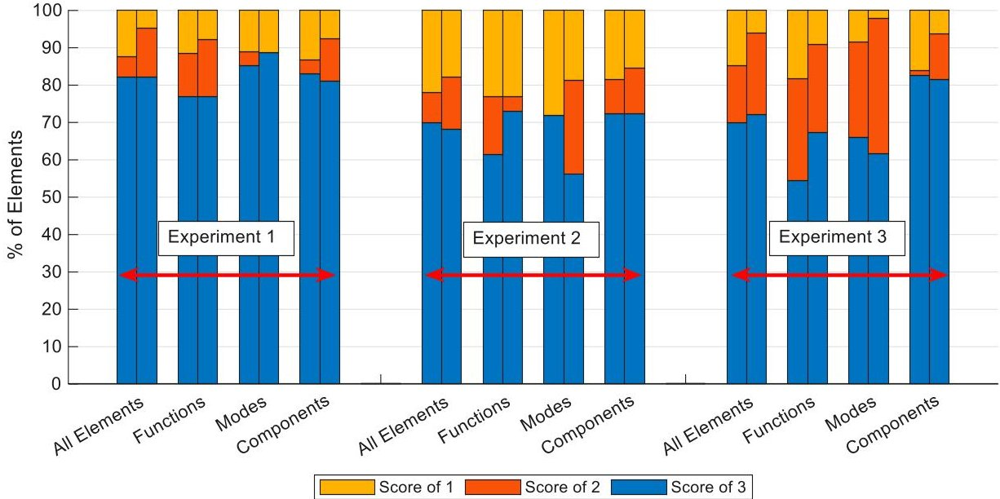

Figure 7. Traceability scores for Experiment 1, 2 & 3 (scored out of 3).

Table 8. Comparing average traceability for the generated designs and pre-existing designs. A score of 3 indicates perfect traceability.

<table border="1"><tr><td>Design name</td><td>Generated Design</td><td>Pre-Existing Design</td></tr><tr><td>PROVE(experiment1)</td><td>2.69</td><td>2.71</td></tr><tr><td>Group Design Exercise(experiment2)</td><td>2.24</td><td>2.92</td></tr><tr><td>Industrial EO design study(experiment3)</td><td>2.55</td><td>3.00</td></tr></table>

## 3.1. Experiment 1, 2 and 3 traceability and alignment

The traceability scores from assessor A and B for experiments 1, 2 and 3 are shown in Figure 7. Table 8 compares average traceability scores for generated outputs with those calculated for the pre-existing designs.

Table 8 shows that while the generated designs do not achieve the same level of traceability as the pre-existing designs (scoring on average 0.38 lower), the LLM was successful in generating a spacecraft system architecture in which functions, modes, and components in general were traceable to requirements. Figure 7 shows that the generated architecture for PROVE Pathfinder (experiment 1, shown in Figure 6) scored the highest for traceability, followed by the industrial EO design study (experiment 3) then the group design project (experiment 2). This was a result of the coverage of the input requirements, which for PROVE pathfinder considered a wider range of domains/system aspects than the other experiments. This is explored in further detail in experiment 5.

Figure 8 shows alignment recall and precision scores for each experiment, as scored for both coders (hence two bars for each entry). Figure 9 shows the specification parameter values, indicating where the LLM tool over or under specified for each design task. Figure 8 shows higher precision scores (2.3/3) than recall (1.8/3), meaning that the generated elements were generally present in the pre-existing design, however there were sometimes

<!-- PDF_PAGE: 15 -->

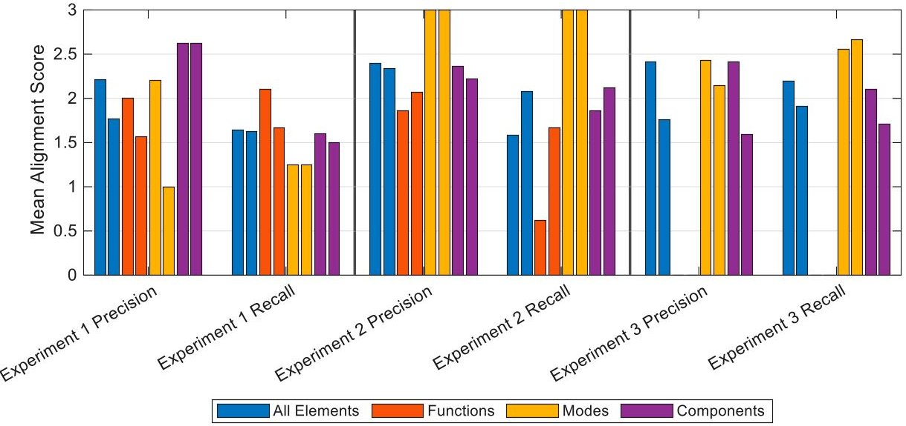

Figure 8. Precision and alignment scores for experiment 1, 2 & 3 (scored out of 3), for both coders.

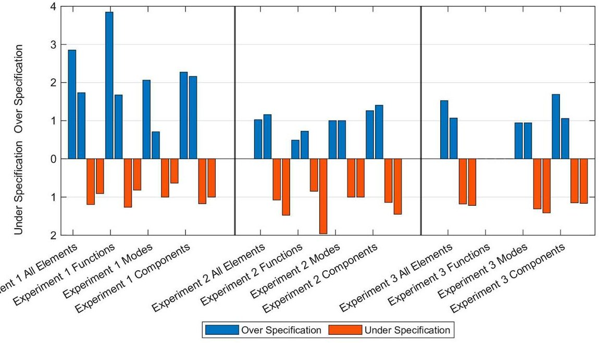

Figure 9. Under and over specification parameters for experiments 1, 2 & 3 (smaller values show stronger similarity with the pre-existing design).

elements in the pre-existing design that are missed in the generated design. Overall while the recall scores leave room for improvement, the generated designs exhibit good precision scores.

The generated PROVE architecture was, on balance, more specific than the pre-existing design, as shown in Figure 9. Again, this is likely a result of the coverage of the requirements used for this experiment. Furthermore, the traceability and alignment of the generated functions was on average lowest across the three experiments, followed by modes then components. This could be expected, as functions are more conceptually abstract than modes or components, therefore their wording is more variable and as a result the causality between prompt wording and function wording is more difficult to train an LLM to

<!-- PDF_PAGE: 16 -->

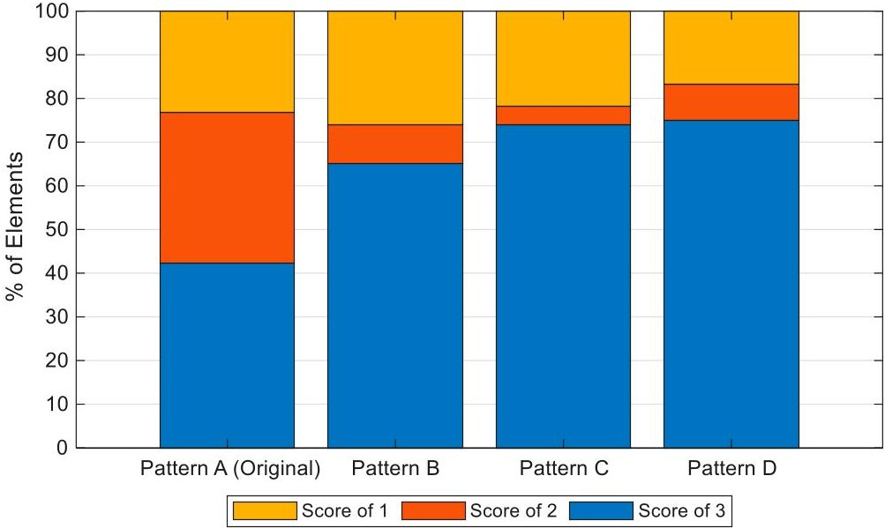

Figure 10. Influence of prompt pattern on traceability score.

achieve. In other words there are few names for a propulsion subsystem, but many ways to describe a function raising a spacecraft's orbit. There was a large swing in specificity for functions between experiment 1 and 2, further demonstrating how the input requirements and their coverage had a large influence on the quality of different aspects of the generated architectures.

## 3.2. Experiment 4 prompt pattern results

The impact of different prompt patterns on traceability score is shown in Figure 10. See Table 3 for the different patterns tested. Figure 10 shows that the more prescriptive prompt patterns produced a higher quality output. However, the benefit of adding more tokens to the prompt, meaning using a longer prompt, reduced with increasing pattern length, leading to a diminishing returns relationship.

## 3.3. Experiment 5 requirement C coverage results

Figure 11 presents the changes in traceability score for the additional requirement presented in Table 4. The average traceability score was 2.59 with the new requirements, up from an average of 2.24 from experiment 2. Figure 11 shows the scores for functions, modes and components were all improved by the addition of the extra requirements, besides the number of modes scoring a traceability of 3.

## 4. Discussion and future work

This section discusses the results presented in the previous section and suggests directions for future work. Experiment 1,2&3 demonstrated that architectures of acceptable quality (where at least 2 of every 3 design elements are traceable to requirements) can be generated using the TEXT-DAVINCI-003 LLM. As previously mentioned, the main limitation of the LLM was identifying functions from requirements, as these were the most conceptually

<!-- PDF_PAGE: 17 -->

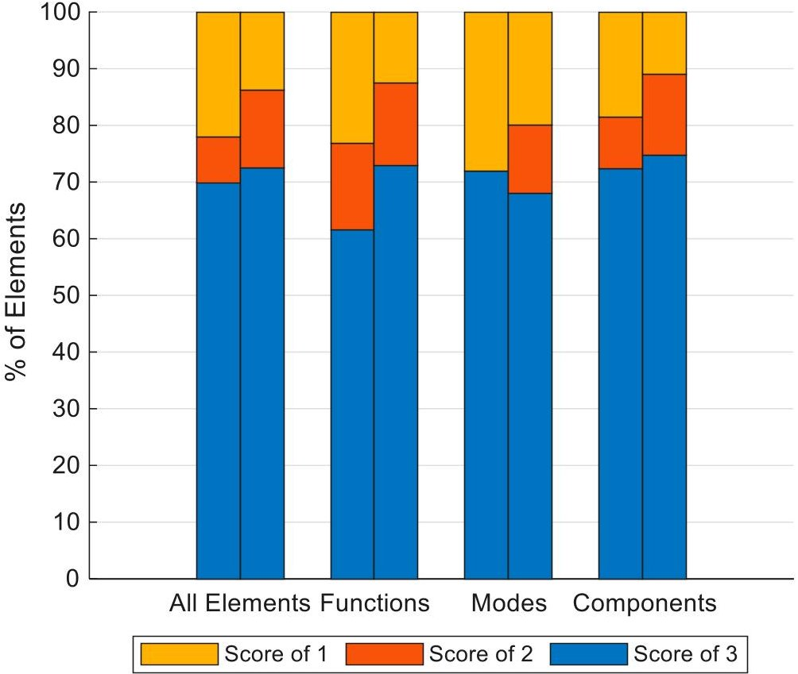

Figure 11. Impact on traceability of additional requirements.

abstract of the architecture elements generated. However, even this level of performance appears acceptable. Given that this model was depreciated in January 2024, the output quality demonstrated in this study should be considered a baseline, with more modern LLMs likely to be able to produce better results. It is proposed that the Open LLM Leaderboard (Hugging Face 2024) may be a good starting point for selecting more up to date LLMs. Furthermore, the consistency between the results of these three design experiments indicated that this approach might be applicable to a range of Earth observation spacecraft. On top of this achieved quality, the process can be completed much more quickly than by a purely human designer, as it offers higher automation.

The total cost of running these experiments was £10.20 at the time, with 248,270 token prompts used. Assuming roughly similar token costs are maintained, this indicates that prompting cost should not be a barrier to adoption of LLMs in this area, at least for externally hosted models.

The generated architectures achieved higher precision scores than recall, indicating that while most of the elements in the generated architecture could be found in the pre-existing design (or human generated design solution), the process did not include all the same elements. This result was mirrored in the specificity parameters, with the generated output being more specific than the pre-existing design. It appears that the LLM was somewhat biased towards the information present in the requirements, rather than its wider knowledge. The reason for this was likely due to the information available to the LLM being limited to the requirement text and the text corpus it was trained on. If the LLM model were to undergo fine tuning for the spacecraft domain, it may be better able to identify necessary parts of a spacecraft not referenced in requirements (such as equipment harnesses

<!-- PDF_PAGE: 18 -->

and fixtures). This challenge also highlights the need for human designers with domain-specific knowledge to closely guide the generation process when using an LLM in this fashion. Specifically, being able to remove irrelevant design elements suggested by the LLM is particularly useful.

The prompt patterns used (or how the LLM was prompted) have a significant impact on the quality of the generated architecture, as shown in experiment 5. The more complex patterns produced a better result. This was perhaps because they provided more tokens (meaning more information) for the LLM to generate an output closer to what the user desires. Similarly, prompting with more requirements, thus more tokens, also leads to improved traceability, as shown in experiment 5. Using longer prompts in this way may also be a usable method of combatting the lower recall scores discussed above.

If using more prompt tokens, the increase in generated architecture quality should be traded against the increased computational cost (and potentially financial cost of using an external service to support the LLM). Further to this, the apparent diminishing returns relationship produced by increasing the token count should also be considered when posing prompts.

It was important to allow the human designer to down select the suggested elements in the LLM output at each stage, as the selected elements of one stage formed the input to the next, therefore poor quality elements would have a snowball effect on the overall design. An example of this is shown in Figure 5 where 3 of 9 top level functions were not decomposed to the next level, as these were not as good quality as the other 6. As a result, human intervention in the process is still important to achieve a good generated design.

This study has focused on manually rated assessments. Though this approach was cumbersome to complete, the manual assessments benefited from the experience and detailed knowledge of the assessors. This had the drawback that the rating was sensitive to opinion and biases. As can be seen from Figures 7,8 and Table 6,the assessors had moderate agreement, particularly on alignment scores, however more assessors would have improved the robustness of these assessments.

Several recommendations for pursuing this approach to system architecting can be drawn from this study:

- Using a fine-tuned LLM is not essential to providing acceptable results (however investigating model fine-tuning offers an attractive avenue for future work).

- Expert human control over the process is important to maintain good quality output architectures.

- The prompts given to the LLM should contain as much information as possible, either in terms of design elements such as requirements or in the prompt patterns used to structure the textual input.

- The above can be supported by constructing prompts that mirror typical systems engineering analysis practice, where system components and modes are identified as groupings of functions and these steps can be performed recursively at each level of the system. This helps to enforce the interconnected relationships within the output architecture and ensure each element has traceability to requirements.

There appears to be many promising avenues for further research leading on from the findings presented here. However, one of the most immediately beneficial directions would

<!-- PDF_PAGE: 19 -->

be the expansion of the system architecting activities addressed. For example, the inclusion of non-functional requirements will be necessary to ensure that the system not only functions as intended, but also meets the necessary quality standards. It is envisioned that typical methods of non-functional analysis, such as reliability, security or other performance aspects could be leveraged for validation of these requirements and possibly fed back straight to the LLM for correction if non-conformances are identified. For example, mission analysis requirements could be addressed through integration with orbital simulation programmes such as GMAT (NASA - GSFC Open Source Software 2024) or STK (Ansys 2024). The incorporation in the model of interactions and relationships between elements, such as inter-component communication and functional dependencies, would further enhance the completeness of the architectures.

When applied to safety-critical systems like spacecraft, this LLM based architecting method may benefit from the inclusion of fault tolerance or identification of alternative system paths (such as degraded modes of operation). While this is currently considered manual work done downstream of the architecture generation presented here and not within the scope of this study, it appears likely that these aspects could be integrated with the LLM prompts for more robust architectures from the beginning.

Addressing architecture assessment methods, future work could either include many more assessors to improve the reliability of the rating and/or it should investigate automated alternatives, for example based on cosine similarity with pre-existing designs. This would allow more rapid testing and evaluation of LLMs for design generation. Furthermore, the ontology used to formalise the LLM output into model elements suitable for an MBSE model needs to be refined. More specifically, better control over the semantics of the LLM generated elements is necessary for deep integration with MBSE formalisms seen in languages like SysML. Similarly, a Retrieval-Augmented Generation (RAG) (Fatehkia, Lucas, and Chawla 2024) could be added to control this formalisation of LLM output.

The LLM capabilities could be further refined by fine tuning or training on domain-specific knowledge. This may improve its ability to handle long-tail knowledge related to the spacecraft architecting domain, such as payloads and technologies specific to satellites.

Direct user feedback mechanisms also offer the potential for improved element generation with an LLM. This work has focused on generating 'baseline' architectures, with simple down selection of LLM-generated elements to combat any errors in output. However, allowing the user to highlight errors or improvements to be made in the LLM output with further prompting would enable iterative improvements directly on the LLM's responses. Performance analysis results or even KPIs, such as the manual traceability presented here or automated KPIs, could be used as part of this feedback process. Automated KPIs typically used to evaluate text generation models do exist, such as; the Bilingual Evaluation Understudy (BLEU) (Papineni et al. 2002) for assessing the quality of translations, Recall-Oriented Understudy for Gisting Evaluation (Lin 2004) for summarisation and the Flesch Reading Ease Formula for text readability (Kincaid et al. 1975) (Das and Verma 2020) to name a few. However, each of these are specialised to their particular use case and therefore a new method would need to be developed, applicable to system architecting. Finally, enabling the LLM to react to requirements mid-process could be a highly valuable capability, as mid-project requirement updates are common and lead to costly changes.

<!-- PDF_PAGE: 20 -->

## 5. Conclusion

This study demonstrates the successful automated generation of spacecraft system architectures using Large Language Models. A novel generation tool has been constructed, in which designer-led prompting greatly reduces design time and effort. LLM outputs have been produced for three realistic design cases, manually rated and compared to human generated design solutions. The comparison has shown that the LLM-generated elements have high textual similarity, traceability, and alignment to pre-existing design solutions. It has been shown that functions were the most challenging element type to generate. The LLM pipeline generated a consistent and acceptable output for 3 different Earth observation spacecraft missions, but human interaction is essential to maintain the quality. Using the LLM made the design process much faster. Some variability can be expected in the output quality for non-deterministic LLMs. More tokens for prompting the LLM will lead to a better output architecture, but the increased cost of doing this should be considered. Future work is planned to develop more automated methods of assessing LLMs for this application.

## Disclosure statement

No potential conflict of interest was reported by the author(s).

## Funding

This work was supported by Engineering and Physical Sciences Research Council: [Grant Number 1735237].

## Data availability statement

The data supporting this work's findings are available from the corresponding author, LT, upon reasonable request. The authors report there are no competing interests to declare.

## ORCID

Louis Richard Timperley ID http://orcid.org/0000-0003-0507-3893

Lucy Berthoud ID http://orcid.org/0000-0001-5934-3444

Chris Snider ID http://orcid.org/0000-0003-2692-110X

Theo Tryfonas ID http://orcid.org/0000-0003-4024-8003

## References

Agrawal, Garima, Tharindu Kumarage, Zeyad Alghamdi, and Huan Liu. 2024. Can Knowledge Graphs Reduce Hallucinations in LLMs?: A Survey. https://doi.org/10.18653/v1/2024.naacl-long.219

Ansys. 2024. 'Ansys STK | Digital Mission Engineering Software'. Accessed October 22. https://www. ansys.com/en-gb/products/missions/ansys-stk.

Apvrille, Ludovic, and Bastien Sultan. 2024. 'System Architects Are Not Alone Anymore: Automatic System Modeling with AI' 27-38. https://www.scitepress.org/PublicationsDetail.aspx?ID = 49M16ZCcd xM%3d&t = 1.

Blocklove, Jason, Siddharth Garg, Ramesh Karri, and Hammond Pearce. 2024. 'Evaluating LLMs for Hardware Design and Test'. https://doi.org/10.48550/arXiv.2405.02326

Cámara, Javier, Javier Troya, Lola Burgueño, and Antonio Vallecillo. 2023. "On the Assessment of Generative AI in Modeling Tasks: An Experience Report with ChatGPT and UML." Software and Systems Modeling 22 (3): 781-793. https://doi.org/10.1007/s10270-023-01105-5.

<!-- PDF_PAGE: 21 -->

Chami, Mohammad, Christophe Zoghbi, and Jean-Michel Bruel. 2019. "A First Step Towards AI for MBSE: Generating a Part of SysML Models from Text Using AI, 123-136.

Cohen, Jacob. 1960. "A Coefficient of Agreement for Nominal Scales." Educational and Psychological Measurement 20 (1): 37-46. https://doi.org/10.1177/001316446002000104. SAGE Publications Inc.

Das, Avisha, and Rakesh M. Verma. 2020. "Can Machines Tell Stories? A Comparative Study of Deep Neural Language Models and Metrics." IEEE Access 8:181258-181292. https://doi.org/10.1109/ ACCESS.2020.3023421.

Eclipse. 2023. 'Capella MBSE Tool'. Accessed November 24. https://mbse-capella.org/.

Epp, Jordan, Thomas Robert, Olivier Ruch, and Alison Olechowski. 2023. "Towards SysML v2 as a Variability Modeling Language." 2023 ACM/IEEE International Conference on Model Driven Engineering Languages and Systems Companion (MODELS-C)Västerås, Sweden, 01-06 October 2023.

Etchells, Tom, Karen Aplin, Lucy Berthoud, Oliver Pike, Will Proud, David Reid, Andrei Sarua, Mark Schenk, Louis Timperley, and Matthew Watson. 2022. Designing the Mission Operations for the Pointable Radiometer for Observation of Volcanic Emissions (PROVE) Pathfinder Payload. https://doi.org/10.13140/RG.2.2.27638.88644

Fatehkia, Masoomali, Ji Kim Lucas, and Sanjay Chawla. 2024. 'T-RAG: Lessons from the LLM Trenches'. https://doi.org/10.48550/arXiv.2402.07483

Ferrari, Alessio, Sallam Abualhaija, and Chetan Arora. 2024. Model Generation with LLMs: From Requirements to UML Sequence Diagrams'. https://doi.org/10.48550/arXiv.2404.06371

Gomez, Alejandro Pradas, Petter Krus, Massimo Panarotto, and Ola Isaksson. 2024. "Large Language Models in Complex System Design." Proceedings of the Design Society 4 (May): 2197-2206. https://doi.org/10.1017/pds.2024.222

Halvorson, Michael, Jared Fuchs, Dale Thomas, Alexander Blair, Shivani Patel, and Noah Moyers. 2022. Model-Based Mission Planning: Reducing Mission Planning Costs by Generating Mission-Unique Architecture and Process Frameworks. Paris, France: International Astronautical Federation (IAF).

Hugging Face. 2024. 'Open LLM Leaderboard'. Accessed October 22. https://huggingface.co/spaces/ open-llm-leaderboard/open_llm_leaderboard.

INCOSE. 2007. "Systems Engineering Vision 2020, INCOSE-TP-2004-004-02." Systems Engineering (1), September.

ISO/IEC/IEEE 24765:2010(E). 2010. 'ISO/IEC/IEEE International Standard - Systems and Software Engineering - Vocabulary', December, 1-418. https://doi.org/10.1109/IEEESTD.2010.5733835

Kandpal, Nikhil, Haikang Deng, Adam Roberts, Eric Wallace, and Colin Raffel. 2023. "Large Language Models Struggle to Learn Long-Tail Knowledge." International Conference on Machine Learning, Honolulu, Hawaii, USA. 23 July 2023.

Kincaid, J., Robert Fishburne, Richard Rogers, and Brad Chissom. 1975. 'Derivation of New Readability Formulas (Automated Readability Index, Fog Count and Flesch Reading Ease Formula) For Navy Enlisted Personnel'. Institute for Simulation and Training, January. https://stars.library.ucf.edu/ istlibrary/56.

Labs4Capella. 2024. 'Python4capella'. Python. Labs for Capella. https://github.com/labs4capella/python4capella.

Landis, J. Richard, and Gary G. Koch. 1977. "The Measurement of Observer Agreement for Categorical Data." Biometrics 33 (1): 159-174. https://doi.org/10.2307/2529310. [Wiley, International Biometric Society]

Leserf, Patrick, Pierre de Saqui-Sannes, and Jérôme Hugues. 2019. "Trade-Off Analysis for SysML Models Using Decision Points and CSPs." Software and Systems Modeling 18 (6): 3265-3281. https://doi.org/10.1007/s10270-019-00717-0.

Lester, Brian, Rami Al-Rfou, and Noah Constant. 2021. The Power of Scale for Parameter-Efficient Prompt Tuning'. https://doi.org/10.48550/arXiv.2104.08691

Lin, Chin-Yew. 2004. "ROUGE: A Package for Automatic Evaluation of Summaries." Text Summarization Branches Out Barcelona, Spain, July 2004.

Lu, Jinzhi, Dejiu Chen, Guoxin Wang, Dimitris Kiritsis, and Martin Törngren. 2022. "Model-Based Systems Engineering Tool-Chain for Automated Parameter Value Selection." IEEE Transactions on Systems, Man, and Cybernetics: Systems 52 (4): 2333-2347. https://doi.org/10.1109/TSMC.2020.3048821.

<!-- PDF_PAGE: 22 -->

Luitel, Dipeeka, Shiva Nejati, and Mehrdad Sabetzadeh. 2024. "Requirements-Driven Slicing of Simulink Models Using LLMs." IEEE 32nd International Requirements Engineering Conference Workshops (REW), Reykjavik, Iceland, 24-25 June 2024.

Meacham, Sofia, Fotios Gioulekas, and Keith Phalp. 2015. "SysML Based Design for Variability Enabling the Reusability of Legacy Systems Towards the Support of Diverse Standard Compliant Implementations or Standard Updates: The Case of IEEE-802.15.6 Standard for e-Health Applications." Eighth EAI International Conference on Simulation Tools and Techniques, Athens, Greece.

NASA - GSFC Open Source Software. 2024. 'General Mission Analysis Tool'. Accessed October 22. https://opensource.gsfc.nasa.gov/projects/GMAT/index.php.

OpenAI. 2023. 'OpenAI Platform'. Accessed December 4. https://platform.openai.com.

Papineni, Kishore, Salim Roukos, Todd Ward, and Wei-Jing Zhu. 2002. "Bleu: A Method for Automatic Evaluation of Machine Translation." In Proceedings of the 40th Annual Meeting of the Association for Computational Linguistics, edited by Pierre Isabelle, Eugene Charniak, and Dekang Lin, 311-318. Philadelphia, Pennsylvania, USA: Association for Computational Linguistics. https://doi.org/10.3115/1073083.1073135

Riesener, Michael, Christian Dölle, Annika Becker, Sofia Gorbatcheva, Eric Rebentisch, and Günther Schuh. 2021. "Application of Natural Language Processing for Systematic Requirement Management in Model-Based Systems Engineering." INCOSE International Symposium 31 (1): 806-815. https://doi.org/10.1002/j.2334-5837.2021.00871.x.

Ryan, Mike, Stephen Cook, and William Scott. 2013. 'Application of MBSE to Requirements Engineering Research Challenges'. In SETE 2013. https://ro.uow.edu.au/eispapers/6335.

Thirunavukarasu, Arun James, Darren Shu Jeng Ting, Kabilan Elangovan, Laura Gutierrez, Ting Fang Tan, and Daniel Shu Wei Ting. 2023. "Large Language Models in Medicine." Nature Medicine 29 (8): 1930-1940. https://doi.org/10.1038/s41591-023-02448-8. Nature Publishing Group

Timperley, Louis, and Lucy Berthoud. 2022. Reliability Analysis and Failure Mitigation Strategies for the PROVE Pathfinder CubeSat Payload. https://doi.org/10.1109/AERO53065.2022.9843234

Timperley, Louis, Lucy Berthoud, Chris Snider, Theo Tryfonas, Antonio Prezzavento, and Kyle Palmer. 2023. "Towards Improving the Design Space Exploration Process Using Generative Design with MBSE." 2023 IEEE Aerospace Conference, Big Sky, Montana, USA, March 2023.

Vacareanu, Robert, Anurag Pratik, Evangelia Spiliopoulou, Zheng Qi, Giovanni Paolini, Neha Anna John, Jie Ma, Yassine Benajiba, and Miguel Ballesteros. 2024. General Purpose Verification for Chain of Thought Prompting'. https://doi.org/10.48550/arXiv.2405.00204

Vaswani, Ashish, Noam Shazeer, Niki Parmar, Jakob Uszkoreit, Llion Jones, Aidan N Gomez, Lukasz Kaiser, and Illia Polosukhin. 2017. "Attention Is All You Need." 31st Conference on Neural Information Processing Systems (NIPS 2017), Long Beach, CA, USA.

Voirin, Jean-luc. 2023. 'Model-Based System and Architecture Engineering with the Arcadia Method 1st Edition'. Accessed March 21. https://www.elsevier.com/books/model-based-system-and-architecture-engineering-with-the-arcadia-method/voirin/978-1-78548-169-7.

Wang, Beian, Chong Wang, Peng Liang, Bing Li, and Cheng Zeng. 2024. How LLMs Aid in UML Modeling: An Exploratory Study with Novice Analysts'. https://doi.org/10.48550/arXiv.2404.17739

Wäschle, M., A. Martin, A. Radimersky, M. Behrendt, and A. Albers. 2020. "Supporting The Modelling In Mbse By Applying Product Generation Engineering Using Electronic Compact Actuators As An Example." Proceedings of the Design Society: DESIGN Conference 1 (May): 2425-2434. https://doi.org/10.1017/dsd.2020.293.

Zhang, Biao, Zhongtao Liu, Colin Cherry, and Orhan First. 2024. 'When Scaling Meets LLM Finetuning: The Effect of Data, Model and Finetuning Method'. https://doi.org/10.48550/arXiv.2402.17193

Zhou, Yongchao, Andrei loan Muresanu, Ziwen Han, Keiran Paster, Silviu Pitis, Harris Chan, and Jimmy Ba. 2023. 'Large Language Models are Human-Level Prompt Engineers'. http://arxiv.org/abs/2211. 01910.