<!-- PDF_PAGE: 1 -->

# CONCURRENT ENGINEERING PROCESS FOR ELECTRICAL ARCHITECTURE OF NANOSATELLITES PRELIMINARY PHASES

Pierre BOAN $ ^{(1)} $

(1) CNES, 18 Avenue Edouard Belin, 31000 TOULOUSE, pierre.boan@cnes.fr

## ABSTRACT

The transformation and evolution of the space sector relies on technological innovation, but also on digital transformation. The increasing complexity of space systems led to the deployment of new digital solutions and methodologies such as Model-Based Systems Engineering that helps to better comprehend this complexity on an individual scale. This leads to new ways of approaching projects, such as concurrent engineering which consists in involving all project stakeholders right from the preliminary phases, using facilitating tools and methods.

At CNES, PASO (Orbital Systems Architecture Plateau) is leading space systems preliminary phases and aims at formulating missions needs and pre-sizing systems in order to conclude on their feasibility. This process is conducted accordingly to the principles of concurrent engineering, thus involving all systems architects and thematic experts from the very beginning of the projects.

The objective of this paper is to describe the approach through the prism of an electrical architect, that contributes to needs analysis, realization of power budgets, system sizing and energetic simulations through a specific use case. All this is achieved thanks to a precise workflow involving multiple digital tools, with continuity and interoperability made possible between engineers and their tools by the standardization of formats and files.

## 1. MISSION CONTEXT

The selected use case to illustrate this paper is a 16U nanosatellite operating on low-earth orbit its mission being the 3D mapping of hot stars dynamic environment by using ultraviolet spectropolarimetry measurements from space for the first time. This mission concept has been carried out by the French laboratory LESIA

(Laboratory for Space Studiers and Astrophysics Instrumentation) with the help of CNES which is in charge of evaluating its feasibility. This use case is of particular interest as it depicts a highly agile mission causing a lot of interlocked trade-offs and architecture choices involving the electrical, thermal, communication, mechanical and AOCS subsystems. From the electrical point of view, the agility of the mission makes the sizing of solar panels and battery very tedious.

The observation consists in regular measurements of more than 40 identified stars of particular interest. These measurements will be segmented in multiple observation phases with a periodicity that relies on the star's period of revolution in order to cover the whole rotation of the star and thus perform a 3D mapping of it. It basically means that the system needs to have the same identical inertial attitude for all observations of one unique star.

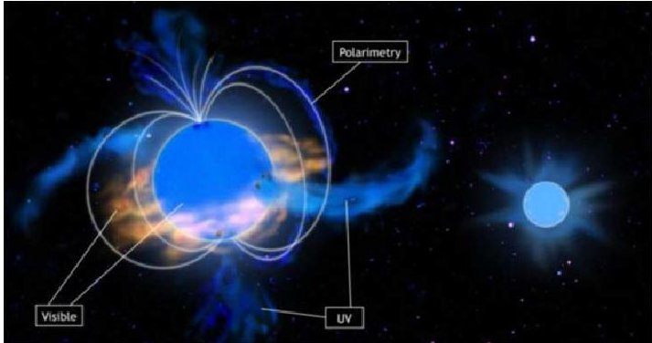

Fig.1 - Hot stars 3D dynamic environment

The first system analyses concluded that the best orbit for the mission is an SSO orbit at low altitudes (between 500 and 600 km).

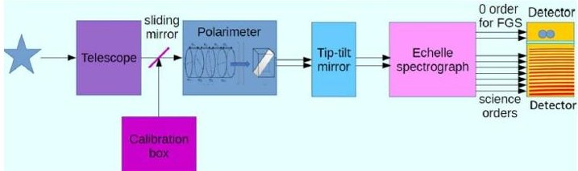

Fig. 2 - Payload preliminary architecture

<!-- PDF_PAGE: 2 -->

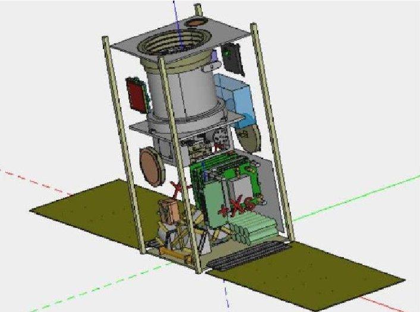

Fig. 3 - Satellite preliminary architecture

## 2. WORKFLOW DESCRIPTION

The overall concurrent engineering approach consists in setting up a common technical reference (satellite description and mission), with the aim of producing system-level budgets (mass, power, centering/inertias, data, etc.) produced by the various subsystems experts/architects.

TwoTwo main tools are constituting the base of the process. These tools are non-compulsory but are relying on standards in order to be as interoperable as possible:

- IDM-CIC: used for system description (at system and sub-systems level) and for system basic geometry definition.

- Simu-CIC: used for mission scenario definition and ephemeris generation.

The combination of these two tools allows for a complete and comprehensive definition of the satellite and its orbital scenario (attitude over time considering the mission, the orbit, ground datalinks needs and the satellite geometry). Some other tools such as IDM-View or IDM-Plot can also be used to visualize different aspects of the system defined using the two main tools. Thanks to this complete set of concurrent engineering tools, each architect therefore works in conjunction with each other thanks to a common database, which allows various experts to carry out more precise and targeted analyses in parallel, while taking into account evolutions in all subsystems enabling everyone to analyze their impact quickly and efficiently. The whole process is organized by a concurrent engineering authority who ensures that scientific and technical objectives are met.

As an electrical architect specifically, the objective of any project preliminary phase would be:

- To define preliminary power budgets,

- To pre-size solar panels and batteries,

- To perform technological trade-offs,

- To simulate the on-board power usage.

Power simulations are a very good way to compare technologies efficiently (solar cells and battery cells for instance) and to refine the power subsystem sizing. In order to be able to perform energy balance simulations, several elements are needed:

- A model of the power sub-system: battery and solar generator assemblies, power bus topology, type of architecture, regulators, etc.

- All energy flows that leads the solar generator to generate power: solar flux, earth albedo flux, earth infrared flux.

- A power profile: the system power consumption over time.

The model is defined in the Opalis software. It is a proprietary but open tool developed by CNES that allows performing power simulations. The tool includes precise modelling of electrical architectures including batteries, solar panels, regulators and bus topologies by taking into account the specific features of each element such as losses, temperature impacts, etc. Such parameters can all be specified in the model tab of the tool.

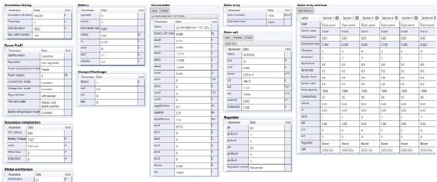

Fig. 4 - Opalis simulation model example

The energy flows are generated by the Flows Manager plugin that is now included natively in Opalis. It takes the CCSDS-like standard files generated by Simu-CIC (orbital scenario description) as an input in order to automatically convert the ephemeris data (such as sun angles) into flows for the solar generator.

<!-- PDF_PAGE: 3 -->

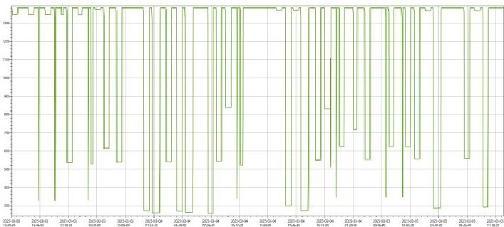

Fig. 5 - Cumulated fluxes on the solar gen. $ ( W / m^{2} ) $

The power profile is generated using IDM-CIC by adding the IDM-Power plugin to it. This plugin allows to allocate the power consumptions described in the IDM-CIC power budget to system modes. It then allows to obtain a temporal view of the system's power consumption.

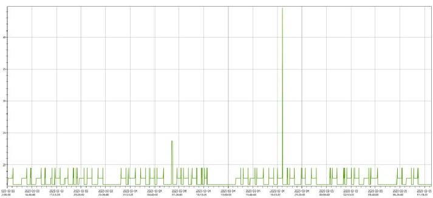

Fig. 6 - Power consumption of the satellite (W)

In the end, the most common process would then be the following:

0) Preliminary work:

a. Defining every sub-system and their constituting pieces of equipment in IDM-CIC.

b. Defining the orbital scenario using Simu-CIC.

1) Attributing a consumed/dissipated power to each piece of equipment in order to obtain the global power budget of the system (including margins).

2) Converting the power budget into a power profile (system power consumption over time) using IDM-Power plugin.

3) Importing power profile into the power simulation software (Opalis).

4) Converting ephemeris into energy flows (solar flux, earth infrared flux, earth albedo flux) using the Flows Manager plugin.

5) Defining the simulation model Running energy balance simulations using Opalis

The main added value of this process is that it allows to define an adaptable and interoperable model. For instance, any change on the mission can be studied almost instantly by regenerating the corresponding ephemeris data. Another example would be that any change on the configuration or structure of the satellite (for instance amount and position of the solar panel wings) can also be compared easily.

## 3. DESIGN ANALYSES & SIMULATION RESULTS

In order to perform the electrical analyses and simulations, an orbital scenario was needed. As the mission has a lot of pointing variety over a year in order to be able to observe a vast set of stars, it means that a focus is needed to identify the worst-case observation scenario in terms of sun pointing with respect to the solar generator.

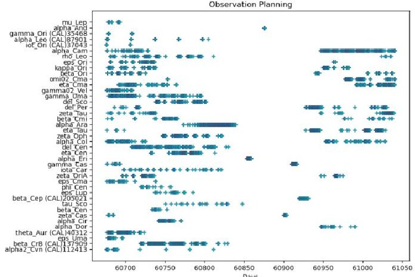

Fig. 7 - Observation plan example

Flight dynamics experts from CNES thus extracted from the global observation plan provided by the LESIA the worst case scenarios in terms of sun illumination, reducing it to a period of 48h only that could be used to size the power subsystem and still be representative of the whole mission. Two solar panels configurations were tested at first, a "back" one and a "side" one. After analysis, it turned out that the back configuration was the most adapted to the mission because simpler to design (one side must point towards cold space during observations while the opposite side must be able to point towards the Sun), and because we can obtain an observation plane that improves the received energy. This configuration will then be the only one described here.

<!-- PDF_PAGE: 4 -->

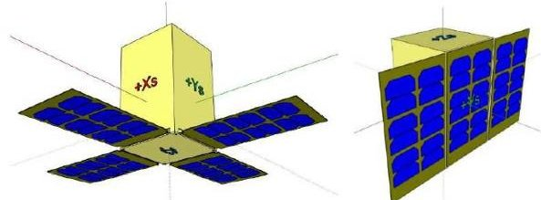

Fig. 8 - Back configuration / Side configuration

From this configuration and this restricted 48h scenario extracted from the overall observation plan leading to known sun and earth angles with regard to solar panel axes at any time, the energy flows were generated using simu-CIC and the Opalis plugin Flows Manager. The result can be seen in Fig. 5.

The power profile is generated thanks to the IDM-Power plugin, based on the following power budget allocated to mission modes and the associated temporal scenario. Its graphic depiction can be seen in Fig. 6.

<table border="1"><tr><td rowspan="2">Subsystem</td><td colspan="5">Mission mode</td></tr><tr><td>Stby</td><td>Mission</td><td>TRS</td><td>TRS+X</td><td>Slew</td></tr><tr><td>Thermal</td><td>3,3W</td><td>0,0W</td><td>0,0W</td><td>0,0W</td><td>3,3W</td></tr><tr><td>Power</td><td>1,1W</td><td>1,1W</td><td>1,1W</td><td>1,1W</td><td>1,1W</td></tr><tr><td>AOCS</td><td>5,3W</td><td>4,6W</td><td>5,3W</td><td>7,7W</td><td>7,7W</td></tr><tr><td>Communication</td><td>1,4W</td><td>1,4W</td><td>10,9W</td><td>27,4W</td><td>1,4W</td></tr><tr><td>Data Handling</td><td>2,3W</td><td>2,3W</td><td>2,3W</td><td>2,3W</td><td>2,3W</td></tr><tr><td>GNSS</td><td>1,4W</td><td>1,4W</td><td>1,4W</td><td>1,4W</td><td>1,4W</td></tr><tr><td>Payload</td><td>1,0W</td><td>5,0W</td><td>1,0W</td><td>1,0W</td><td>1,0W</td></tr><tr><td>Total</td><td>15,8W</td><td>15,8W</td><td>22,0W</td><td>40,9W</td><td>18,2W</td></tr><tr><td>Total w/ margin</td><td>17,4W</td><td>17,9W</td><td>24,3W</td><td>45,1W</td><td>20,1W</td></tr></table>

Table 1-Simplified power budget

The power subsystem model was then defined in Opalis as follows:

- Solar Generator:

Solar cells selected from a list of cells

20 cells max available on each solar wing (80% filling factor)

End of life parameters considered

- Battery:

Li-ion accumulators selected from a list

End of life parameters considered

- Regulators:

O Battery charger/discharger: nonregulated architecture, battery follower power bus topology (no need identified for regulated voltage on the power bus).

o Solar regulator: Direct Energy Transfer (connection/disconnection of solar sections depending of the power needs) and MPPT (Max Power Point Tracking) regulation to be tested.

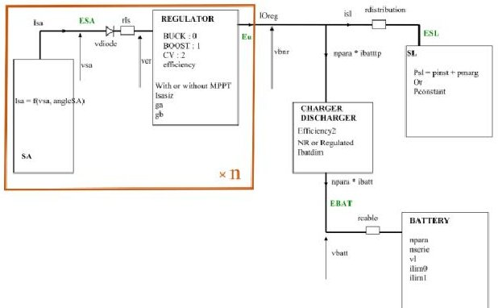

Fig. 9 - Opalis model principle

Now that a preliminary power subsystem model is defined in Opalis, all the inputs can be set up for simulations:

- Energy flows will determine the power generation capabilities of the system

- The power profile will determine the power needed by the satellite

The ultimate goal of the simulation process is to refine the power subsystem definition and to size elements (in particular cells and accumulators assemblies for solar panels and battery) in order to reach an energy balance between generation, storage and usage. To do so, S and P parameters (amount of elements in Series and Parallel) are readjusted through multiple runs of simulations, until a satisfactory equilibrium state is reached at the power subsystem level. This step is also an opportunity to carry out various trade-offs between technologies and architecture principles (type of battery/solar cell, power bus topologies, control principles, etc.).

As the mission here is a LEO mission with a lot of agility, the battery is anticipated to see a lot of charge/discharge cycles. For this kind of mission, the maximum battery depth of discharge is then normally limited to 25% in order to limit the battery capacity loss over time due to cycling. In that case, a satisfactory equilibrium for the aforementioned power subsystem would thus be defined as a battery cycling between 75% and a bit less than 100% of state of charge, meaning that the energy

<!-- PDF_PAGE: 5 -->

production is sufficient to power the satellite as well as charging the battery during low illumination time windows, while still ensuring a sufficient margin in the eventuality of a satellite malfunction.

After a few runs of simulations by making all the parameters mentioned above vary, here is the result of a stable energy budget:

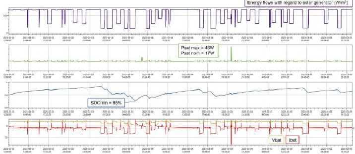

Fig. 10-Result of a stable energy subsystem simulation

- Solar Generator:

These various runs of simulations and tradeoffs finally led to the following final satellite electrical architecture:

O 3G30A cells from AzurSpace,

2 wings of 20 cells each (~80% filling factor),

- Assembly per wing: 5 parallel strings of 4 cells in series for a total max production at around 44W at the end of life.

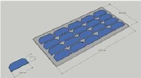

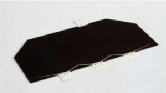

- Battery:

o Li-ion INR 18650 accumulators,

2S8P assembly (8 parallel strings of 2 accumulators in series),

Total available energy storage around 180Wh at the end of life,

160x65x40mm volume with housing margin of 10%.

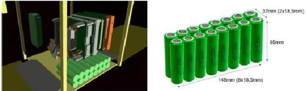

- Regulators:

O Battery charger/discharger: non-regulated architecture, battery follower power bus topology (no need for regulated voltage on the power bus).

o Solar regulator: Direct Energy Transfer (connection/disconnection of solar sections depending of the power needs) system with boost regulators with no MPPT regulation for simplicity and low added value in that case.

One last thing to mention is that the minimum SOC (State Of Charge) reached during the simulation is 85% which is different from the worst acceptable value for nominal operation which is 75% as mentioned previously. This is due to the fact that the battery capacity is mainly sized for the worst discharging case which generally corresponds to the satellite going into survival mode right after an eclipse. This scenario can also be simulated by making the simulation start with an initial SOC of 85% followed by three successive orbits with no illumination that would correspond to a convergence of the satellite towards the survival mode (given by the AOCS expert), with a minimal acceptable SOC of 20% in order to keep an energy margin.

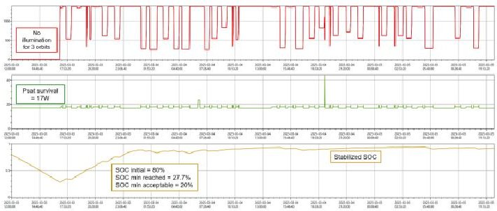

Fig. 11 - Simulation of the battery worst-case scenario

## 4. CONCLUSION

The iterative aspect of the complete workflow including the simulation methodology, coupled with the concurrent engineering process involving each subsystem expert, enables to perform several analyses, trade-off studies comparisons and sizings in parallel by taking into account every constraint and design impact easily. In the context of the satellite use case

<!-- PDF_PAGE: 6 -->

presented in this paper, this made it possible from the electrical perspective to:

- Size the battery and solar generators (type of cells and assemblies) by taking into account worst case conditions (end of life, temperature, orbital constraints).

- Test different stars observation plans in order to validate their feasibility in terms of energy stability and potentially revise scientific ambitions and needs accordingly.

- Perform technical trade-offs like different battery/solar cells, regulator types (MPPT/DET, Buck/Boost, etc.), bus voltages, etc.

- Study architecture opportunities like adding solar cells on the main structure of the satellite in addition to the dedicated wings.

- Study the sensitiveness of the solar panels operating point in function of temperature to make sure that even in harsh temperature conditions the power supply would still be sufficient.

- Study the impact of going from a 2S8P to a 2S7P battery configuration in order to meet the need for volume reduction for accommodation purposes.

Moreover, the interoperability of the different tools and methods, made possible by the standardization of files format, is a real enabler for the concurrent engineering process by making it really easy for each subsystem expert to exchange data and to communicate through engineering models. It allows everyone to use their own dedicated and specialized tools by still ensuring compatibility with inputs/outputs of other tools, leading to a smooth workflow.

The presented use case describes the process for preliminary phases, involving the laboratory and the space agency, but it could also be implemented for phases A/B/C/D by adding a satellite manufacturer/provider in the loop as long as the files standard is still respected.

## ACKOWLEDGMENTS

## CNES Team:

F. ESTEVE, J-F AUBRUN, J-L LE GAL, F. MOLL, R. PINEDE, C-A CHEVRIER, L. DOUMIC, T. JUNIQUE, D. FAYE.

## LESIA Team:

C. NEINER, V. LAPEYRERE, E. PECHEVIS