<!-- PDF_PAGE: 1 -->

## DEVELOPING A MODEL-BASED SYSTEM ENGINEERING METHODOLOGY FOR CUBESAT MISSIONS

<div align="center">

# THESIS SUBMITTED TO THE GRADUATE DIVISION OF THE UNIVERSITY OF HAWAI'I AT MANOA IN PARTIAL FULFILLMENT OF THE REQUIREMENTS FOR THE DEGREE OF

</div>

<div align="center">

# MASTER OF SCIENCE IN MECHANICAL ENGINEERING

</div>

FALL 2025

By Piper L. Kline

Thesis Committee:

Dr. Miguel A. Nunes, Chairperson Dr. Trevor C. Sorensen Dr. Frances Zhu

<!-- PDF_PAGE: 2 -->

Copyright 2025 by Piper L. Kline All Rights Reserved

<!-- PDF_PAGE: 3 -->

## Acknowledgements

I would like to thank my committee chair, Dr. Miguel Nunes, and committee members Dr. Frankie Zhu and Dr. Trevor Sorensen for their support throughout my graduate studies. I would also like to thank Dr. William Edmonson for his feedback and guidance as a specialist in the field of systems engineering. Additionally, I would like to express my gratitude to the University Nanosatellite Program and the Hawai'i Space Grant Consortium for funding my research.

<!-- PDF_PAGE: 4 -->

## Abstract

Cube Satellites (CubeSats) have become increasingly popular, particularly in academic settings, due to their affordability, rapid development timelines, and usefulness as platforms for student training and experimental payloads. Despite these advantages, CubeSat development presents several challenges, including limited resources such as personnel, funding, and time, as well as difficulties in maintaining comprehensive documentation and managing requirement changes. Student-led projects face additional obstacles, including inexperienced team members and high turnover rates, which can hinder effective knowledge transfer.

Model-Based Systems Engineering (MBSE) has emerged as a promising approach to address these challenges and improve the efficiency of CubeSat design and development. Rather than relying on documents to capture system designs, MBSE uses models to represent, analyze, and validate the design. It also emphasizes a strong systems engineering mindset, ensuring a holistic approach and that the optimal system of interest is being developed to meet the project needs. Although MBSE has been applied to satellite missions and domain-agnostic methodologies exist, significant challenges still remain in adapting it, particularly in small groups, due to the steep learning curve and resource requirements for training personnel and model development. Additionally, there is a lack of satellite-specific MBSE methodologies that define thorough steps and methods to design a satellite using MBSE.

<!-- PDF_PAGE: 5 -->

This research develops an approach that integrates the Arcadia MBSE methodology with NASA's Life-Cycle and Space Mission Architecture Framework (SMAF) to create a satellite-specific methodology. The objective is to provide a structure for implementing MBSE while making the design process more effective for small, academic satellite projects. After developing an initial methodology, it was applied to the Neutron-2 (N2) CubeSat Mission to gain a better understanding and refine the approach. While the MBSE methodology offers significant advantages over document-centric engineering, challenges such as steep learning curves and complex tools must be addressed through additional tutorials and a robust library of reusable models. Additionally, dynamic simulations should be derived from the MBSE models to fully leverage digital engineering and validate the design. Future work will involve producing these comprehensive tutorials and developing the supporting simulations to validate the design, as well as implementing the methodology in a classroom setting to refine it.

<!-- PDF_PAGE: 6 -->

## Table of Contents

Acknowledgements . . . . .

<!-- PDF_PAGE: 7 -->

2.4 NASA’s Space Mission Architecture Framework 17

2.5 Project Life-Cycle 18

2.5.1 Key Decision Points 20

Chapter 3: Proposed SmallSat Model-Based System Engineering Methodology 23

3.1 Pre-Phase A: Concept Study 25

3.1.1 Methodology Step PA.1: Define Mission Customers 27

3.1.2 Methodology Step PA.2: Define the Customer’s Needs 29

3.1.3 Methodology Step PA.3: Understand the Customer Needs 30

3.1.4 Methodology Step PA.4: Define the Mission Statement 32

3.1.5 Methodology Step PA.5: Define the Mission Objectives 33

3.1.6 Methodology Step PA.6: Define the Success Criteria 33

3.2 Phase A: Concept and Technology Development 34

3.2.1 Methodology Step A.1: Define the Top-Level Mission Requirements 37

3.2.2 Methodology Step A.2: Define how the System can meet the Top-Level Mission Requirements 39

3.2.3 Methodology Step A.3: Define the System Requirements 41

3.2.4 Methodology Step A.4: Breakdown the System Functions 41

3.2.5 Methodology Step A.5: Define the Logical Subsystems and Allocate the Appropriate Functions 42

3.2.6 Methodology Step A.6: Define the Preliminary System Operation Modes 43

3.2.7 Methodology Step A.7: Define the Subsystems Requirements 43

3.3 Phase B: Preliminary Design and Technology Completion 44

3.3.1 Methodology Step B.1: Refine the Logical Architecture Layer 46

3.3.2 Methodology Step B.2: Supporting Analysis 48

<!-- PDF_PAGE: 8 -->

3.3.3 Methodology Step B.3 Update Verification Status 48

3.4 Phase C: Final Design and Fabrication 48

3.4.1 Methodology Step C.1: Define System and Subsystem Physical Architectures 49

3.4.2 Methodology Step C.2: Conduct Analysis 52

3.4.3 Methodology Step C.3 Update Verification Status 54

Chapter 4: Example Implementation of the MBSE Methodology 55

4.1 Neutron-2 Project Overview 55

4.2 Neutron-2 Example 57

4.2.1 N2 Methodology Step PA.1 58

4.2.2 N2 Methodology Step PA.2 59

4.2.3 N2 Methodology Step PA.3 61

4.2.4 N2 Methodology Steps PA.4, PA.5, and PA.6 65

4.2.5 N2 Methodology Steps A.2 and A.3 66

4.2.6 N2 Methodology Steps A.4, A.5, A.6, and A.7 70

4.2.7 N2 Methodology Step B.1 73

4.2.8 N2 Methodology Step C.1 75

4.2.9 N2 Methodology Step C.2 79

Chapter 5: Conclusion 85

5.1 Discussion 86

5.1.1 Advantages of the SmallSat MBSE Methodology 86

5.1.2 Conditions for Successful Implementation of MBSE 90

5.1.3 Populating Products 92

5.1.4 MBSE within Earth and Planetary Exploration Technology (EPET) 93

5.2 Future Work 94

<!-- PDF_PAGE: 9 -->

Appendix AGlossary 101

Appendix BCapella Requirement Breakdown 104

Appendix CMass Budget Script 105

Appendix DPower Budget Script 109

Appendix EPower Budget Script Output 122

Appendix FExpanded NASA Life-Cycle 126

<!-- PDF_PAGE: 10 -->

## List of Tables

2.1 Satellite Classification by Mass 11

3.1 Pre-Phase A Methodology Steps. 27

3.2 Phase A Methodology Steps. 36

3.3 Phase B Methodology Steps. 46

3.4 Phase C Methodology Steps. 50

<!-- PDF_PAGE: 11 -->

## List of Figures

1. 1 MBSE Pyramid . . . . .

<!-- PDF_PAGE: 12 -->

3.6 Capella Mass Budget add-on example. 53

4.1 N-2 Experiments. 57

4.2 N-2 OEBD for Methodology Step PA.1. 58

4.3 N-2 Operational Capability Breakdown Diagram (OCB) for Methodology Step PA.2. 60

4.4 N-2 customer only OCB for Methodology Step PA.2. 61

4.5 N2 Science Phenomenon Operational Architecture Blank Diagram (OAB) for Methodology Step PA.3. 63

4.6 N2 OAB to capture the specifics of the observations for Methodology Step PA.3. 64

4.7 N-2 Class Diagram Blank (CDB) for Methodology Step PA.3. 65

4.8 N-2 OAB Action Summary Example. 65

4.9 N2 Mission Capability Blank Diagram (MCB) for Methodology Steps PA.4, PA.5, and PA.6. 66

4.10 N2 Concept of Operations (CONOP) System Architecture Blank Diagram (SAB) for Methodology Step A.2. 68

4.11 N2 Experiment 1 SAB with requirements for Methodology Steps A.2 and A.3. 68

4.12 N2 experiment 1 Functional Scenario Diagram part 1 for Methodology Steps A.2 and A.3. 69

4.13 N2 experiment 1 Functional Scenario Diagram part 2 for Methodology Steps A.2 and A.3. 70

4.14 N2 Logical Function Breakdown Diagram (LFBD) for Methodology Step A.4. 71

4.15 N2 Logical Architecture Blank Diagram (LAB) with subsystem requirements for Methodology Steps A.5 and A.7. 72

4.16 N2 Mode & State Machine Diagram (MSM) for Methodology Step A.6. 72

<!-- PDF_PAGE: 13 -->

4.17 N2 LAB showing the logical connections for Methodology Step B.1. 74

4.18 N2 LAB showing the logical functions for Methodology Step B.1. 75

4.19 N2 Physical Architecture Blank Diagram (PAB) functional view for Methodology Step C.1. 77

4.20 N2 PAB electrical view for Methodology Step C.1. 78

4.21 N2 PAB PC104 view for Methodology Step C.1. 79

4.22 Steps to updated the Mass Budget. 82

4.23 Results of the N2 Power Budget using the CubeSpace Attitude Determination and Control Subsystem (ADCS) for Methodology Step C.2. 84

4.24 Results of the N2 Power Budget using the TensorTech ADCS for Methodology Step C.2. 84

5.1 Elements to implement MBSE in an academic setting with current status. 92

B.1 The organizational breakdown of requirement definitions in Capella using the requirement add-on tool. 104

F.1 Detailed NASA Project Life-Cycle. 127

<!-- PDF_PAGE: 14 -->

<div align="center">

# List of Acronyms

</div>

ADCS Attitude Determination and Control Subsystem

AI Artificial Intelligence

ASU Arizona State University

CDB Class Diagram Blank

CDR Critical Design Review

COMM Communication Subsystem

CONOP Concept of Operations

COTS Commercial Off-the-Shelf

CSRM CubeSat Reference Model

CubeSat Cube Satellite

DOD Department of Defense

EE&CO Engineering Evaluation and Checkout

EPET Earth and Planetary Exploration Technology

EPS Electrical Power Subsystem

FlatSat Flat Satellite

FSC Full Success Criteria

xiv

<!-- PDF_PAGE: 15 -->

FSW Flight Software

HIGP Hawai'i Institute of Geophysics and Planetology

HSFL Hawai'i Space Flight Laboratory

HTS Hi-Tech Sat

HyTI Hyperspectral Thermal Imager

ICD Interface Control Document

INCOSE International Council on Systems Engineering

KDP Key Decision Points

LA Logical Architecture

LAB Logical Architecture Blank Diagram

LEOP Launch and Early Operations

LFBD Logical Function Breakdown Diagram

MBSE Model-Based Systems Engineering

MCB Mission Capability Blank Diagram

MCR Mission Concept Review

MDR Mission Design Review

MO Mission Objective

MoE Measures of Effectiveness

MSC Minimum Success Criteria

MSM Mode & State Machine Diagram

N2 Neutron-2

OA Operational Analysis

<!-- PDF_PAGE: 16 -->

OAB Operational Architecture Blank Diagram

OBC Onboard Computer Subsystem

OCB Operational Capability Breakdown Diagram

OEBD Operational Entity Breakdown Diagram

OOSEM Object-Oriented Systems Engineering Method

PA Physical Architecture

PAB Physical Architecture Blank Diagram

PAY Payload

PC Physical Component

PDR Preliminary Design Review

PDU Power Distribution Unit

PMR Project Management Review

PUS Packet Utilization Standard

PVMT Property Value Management Tool

RMD Radiation Monitoring Devices

SA System Analysis

SAB System Architecture Blank Diagram

SC Success Criteria

SCR System Concept Review

SE Systems Engineering

SEP Solar Energetic Particle

SMAF Space Mission Architecture Framework

<!-- PDF_PAGE: 17 -->

S&M Structures & Mechanisms

SOI System of Interest

SRR System Requirements Review

STK System Tool Kit

SWaP Size, Weight, and Power

SysML Systems Modeling Language

TBD To Be Determined

TCS Thermal Control Subsystem

UHM University of Hawai'i at Mānoa

UML Unified Modeling Language

UNP University Nanosatellite Program

VIP Vertically Integrated Projects

WIP Work in Progress

<!-- PDF_PAGE: 18 -->

## Chapter 1 Introduction

## 1.1 Motivation

While CubeSats offer easier access to space than ever before, several challenges remain in developing such complex systems. These challenges are particularly prevalent in teams with limited resources, such as those found within a university environment. By examining CubeSat teams within the University of Hawai'i at Mānoa (UHM), particularly the Hawai'i Space Flight Laboratory (HSFL) and the student aerospace program, Earth and Planetary Exploration Technology (EPET), several key challenges were identified. These challenges include poor and inconsistent documentation; a lack of requirements definition and traceability; defining and developing the payload, operations plan, and software late in the design phase; and not holding formal design reviews.

Poor documentation is a common challenge among small teams. In complex designs, such as satellites, the number of documents grows rapidly as the design develops. As the design evolves, these documents must be continuously updated, a task that can easily become overwhelming for a small team. Additionally, it has been observed that UHM teams often struggle to define requirements from the top-level down to the subsystems early in the design process and to track them throughout development for validation.

<!-- PDF_PAGE: 19 -->

Requirements derive from the customer's needs, and without proper tracking and validation throughout the life-cycle, it cannot be known if the resulting system truly meets those needs. Additionally, if customers' needs change throughout the project, an understanding of how those changes affect lower-level requirements needs to be tracked.

Another lesson learned from previous missions is that the payload, mission operations, and software need to be defined and initiated much earlier in the design process. It is common for engineers to want to dive directly into hardware development. While hardware is a critical aspect of the design, the payload, operations, and software requirements should drive the satellite design. The payload defines the purpose of the satellite; by understanding it early, the most optimal satellite bus to support it can be developed. Furthermore, what ultimately matters is the satellite's functionality, driven by its software and operations. Rather than defining physical components first and forcing the software and systems to conform to the hardware, the software and operations should be determined early and guide the overall system design.

The final challenge identified is the lack of formal design reviews. Streamlining the design process by skipping formal reviews may appear to accelerate progress, but it often leads to missed errors and misalignment with stakeholder expectations. Without these reviews, critical mistakes may go unnoticed, and stakeholders lose the opportunity to confirm that the system under development truly meets their needs. Ultimately, this can result in delays later during integration and testing when these issues are finally discovered.

Student-led missions often face the same issues discussed above, along with additional obstacles such as a lack of experience and frequent turnover. Many university students involved in CubeSat projects lack significant experience in designing, integrating, testing, and operating spacecraft. Some may even lack proper engineering design experience, depending on their class standing and university program. While the goal of these student

<!-- PDF_PAGE: 20 -->

projects is to provide them with the experiences needed for the workforce, completing a satellite mission with no prior experience and within a rapid time frame can be a daunting challenge. While mentors ideally should be guiding them through the process, their resources are often stretched and may not be as accessible as desired. Additionally, student teams experience frequent turnover as students can graduate or leave the team due to a heavy course load. This, combined with poor documentation, leads to a loss of knowledge and often to the rework of design elements.

Model-Based Systems Engineering (MBSE) offers a valuable solution to these issues. Rather than using a document-centric approach, MBSE employs models to capture the system's design, focusing on a holistic systems engineering mindset. MBSE methods emphasize deriving requirements early from customers' needs and tracking them throughout the life-cycle. It emphasizes reusability, meaning the models created during previous missions can be reused and serve as a starting point for new missions, which could be particularly valuable for inexperienced student teams. MBSE can also greatly aid in documentation, creating a single source of knowledge within models that can then be populated to deliverables. Lastly, the overarching goal of any student project is to train and prepare students for the professional world after graduation and to create the next generation of engineers and researchers. According to the 2035 Systems Engineering Vision by the International Council on Systems Engineering (INCOSE), "the future of systems engineering is model-based" [1]. By training students in the art of systems engineering and systems thinking along with the current and future methods, the next generation of engineers will be better equipped for success.

<!-- PDF_PAGE: 21 -->

## 1.2 Current Applications of MBSE for Academic CubeSats

While MBSE offers a promising solution to several challenges, it is not widely used among small CubeSat development teams. Currently, MBSE is utilized by major companies and government laboratories, including NASA [2], the Department of Defense (DOD) [3], and Boeing [4]. One of the significant challenges when implementing MBSE is the resource requirements, particularly in terms of cost and time, often related to training and adoption [5]. To train the necessary personnel in using the MBSE approach and its associated tools, a significant amount of time and, therefore, money must be invested. Typically, the team has ongoing projects that they need to manage while being onboarded to MBSE, making it even more challenging. Since it takes time to learn and implement MBSE, the benefits of it aren't typically recognized at first. Because university groups usually lack both personnel and funding, implementing MBSE in academic settings poses a greater challenge than in larger companies or organizations.

INCOSE has pushed a CubeSat Reference Model (CSRM) that provides Systems Modeling Language (SysML) templates for defining the logical architecture of a CubeSat [6]. Kaslow et al. have focused on expanding the CSRM beyond a logical architecture to an entire mission architecture [7]. Gregory et al. examined the use of the CSRM in conjunction with the NASA Systems Engineering Handbook [8]. Micavapilli and Lavanga, Amato, and Gonzalez et al. have all applied Arcadia/Capella to CubeSat missions [9-11]. While these applications of MBSE to satellite projects have shown promise, they primarily focus on the preliminary design phases and do not present a CubeSat-specific MBSE methodology. Although several general, domain-agnostic MBSE methodologies exist, there remains a lack of a detailed, satellite-oriented process that outlines the steps required to design a satellite along with the methods to complete each step using MBSE.

<!-- PDF_PAGE: 22 -->


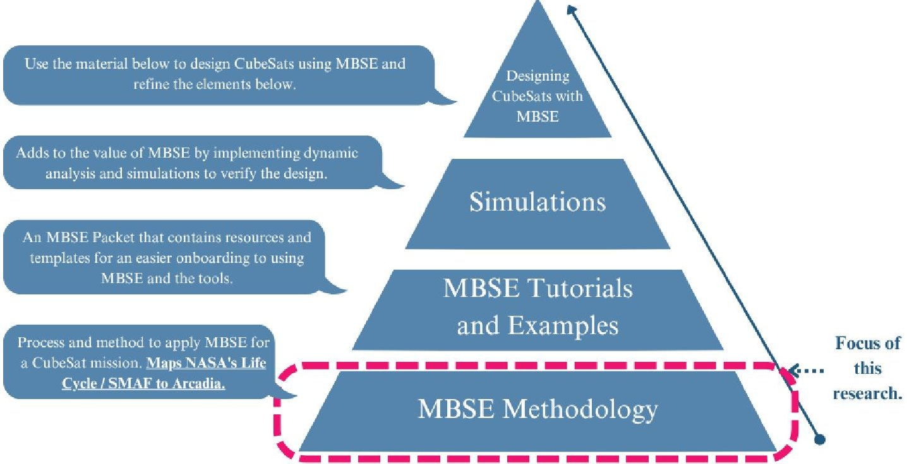


<div align="center">

Figure 1.1: Elements to implement MBSE in an academic setting.

</div>

## 1.3 Proposed Research

This research aims to provide a methodology, comprising processes and methods, to educate students in MBSE and utilize it to enhance the design efficiency of small satellites. Specifically, linking the Arcadia methodology, a general MBSE methodology, to NASA's Space Mission Architecture Framework within the context of an academic project represents a new avenue of research. This thesis proposes that establishing a detailed MBSE methodology that integrates SMAF and Arcadia across the design life-cycle can make the use of MBSE more practical and accessible for small team satellite missions. In essence, this research customizes the existing MBSE methodology, Arcadia, for CubeSat development by integrating it with NASA's SMAF and Life-Cycle Framework. Figure 1.1 highlights the elements that were identified as needed to implement MBSE in an academic setting with the foundation being the Methodology that is the focus of this thesis.

<!-- PDF_PAGE: 23 -->

## 1.4 Scope

The SmallSat MBSE Methodology is being developed for application within an academic setting, specifically at the UHM. Within UHM, the primary users will be the Hawai'i Space Flight Laboratory, the Vertically Integrated Projects (VIP) Aerospace Technologies Course, and the EPET student program. HSFL comprises both professional engineers and students, whereas the EPET and VIP programs primarily consist of engineering and science students along with faculty and staff advisors. As such, the methodology must accommodate a range of experience levels. While its primary intended environment is a university, this methodology can also be applied to other small teams.

## 1.5 Research Objectives

The research objectives are outlined below.

1. Develop a maintainable MBSE methodology specific to designing CubeSats within small teams.

(a) Integrate the Arcadia Methodology, NASA's Mission Life-Cycle, and NASA's Space Mission Architecture Framework together into a methodology that can reduce time and mission risk of a university design project.

2. Implement and refine the methodology for a specific example mission, Neutron-2 (Work in Progress (WIP)).

3. Understand how the proposed MBSE Methodology can be implemented into the four- semester EPET program at UHM, starting the design process at the beginning of the program (WIP).

<!-- PDF_PAGE: 24 -->

4. Develop thorough documentation and tutorials for implementing this methodology, along with reference models that ease the reusability for future missions (WIP).

## 1.6 Organization of Content

This thesis presents the proposed SmallSat MBSE Methodology, which was developed, along with examples of its implementation, the advantages learned, and the necessary future work for its successful application. The chapters are structured as follows:

- Chapter 2: Background - This chapter covers the background information that is required to understand the following chapters and that was used in developing the methodology. It contains information on CubeSats, systems engineering, modelbased systems engineering, architecture frameworks, Arcadia and Capella, and the NASA's Mission Life-Cycle.

- Chapter 3: Proposed SmallSat Model-Based System Engineering Methodology - This chapter introduces the Methodology that was developed through this research, starting with an overview. It then delves into each phase, outlining the steps and models required to reach the Key Decision Points (KDP). It also highlights how the information that is captured in the models maps to the SMAF view products.

- Chapter 4: Example Implementation of the MBSE Methodology - Chapter 4 utilizes the proposed methodology described in the previous chapter and implements the steps for the Neutron-2 CubeSat mission. As the mission is still preparing for Preliminary Design Review (PDR), the entire methodology has not been implemented.

<!-- PDF_PAGE: 25 -->

- Chapter 5: Conclusion - This last chapter discusses what was learned from the methodology's application to Neutron-2, including the advantages, how it can be implemented at UHM, and the future work that is needed for it to be successful. It concludes the work by highlighting what was completed and the challenges that were addressed.

<!-- PDF_PAGE: 26 -->

## Chapter 2

## Background

This chapter aims to provide the background information necessary to understand the context and methodology described in Chapter 3. This includes a description of CubeSats, systems engineering, model-based systems engineering, the systems modeling language, Arcadia and Capella, NASA's Space Mission Architecture, NASA's Project Life-Cycle, and current applications of MBSE for academic CubeSats.

## 2.1 CubeSats

Sending something to space might seem like an unattainable goal for most universities. However, with the growing popularity of small satellites, as seen in Figure 2.1, this ambition has become more realistic. Small satellites are defined as any satellite that is under 180 kg in mass [12]. This can be further categorized into different types, including mini-, micro-, nano-, pico-, and femto-satellites. See Table 2.1 for the exact specifications of these categories. Cube Satellites, or CubeSats, are a form factor for satellites that can fall within the micro- or nano-satellite range. There are several different sizes of CubeSats, but their standard form factors are composed of units, where 1 unit, or 1U, is approximately a 100 x 100 x 113.5 mm cube with a mass of 2 kg [13]. These cube units are then configured to make larger sizes, such as 2U, 3U, and larger. Figure 2.2 illustrates some standard

<!-- PDF_PAGE: 27 -->


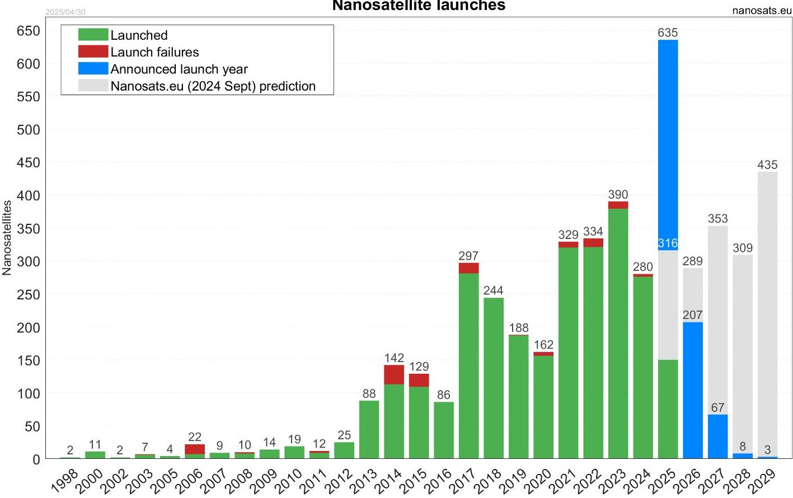


<div align="center">

Figure 2.1: Quantity of nanosatellite launches per year since 1998 [15].

</div>

sizes of CubeSats, and Figure 2.3 shows Neutron-1 (3U) and the Hyperspectral Thermal Imager (HyTI) (6U), both CubeSats developed by HSFL.

Due to CubeSats' small size, the time and money required to develop and operate them are significantly less than those for larger satellites, making them more attractive to amateurs and university groups that may lack resources. On average, CubeSats take less than 2 years to develop, and they tend to be secondary payloads on launches; therefore, the launch cost is significantly lower [14]. Due to their lower cost, CubeSats are seen as an excellent option for testing experimental instruments and technologies, collecting scientific data, and training students in satellite development and operations.

<!-- PDF_PAGE: 28 -->

<div align="center">

Table 2.1: Satellite Classification by Mass [12].

</div>

<table border="1"><tr><td>Satellite Class</td><td>Mass Range(kg)</td></tr><tr><td>Minisatellite</td><td>100-180</td></tr><tr><td>Microsatellite</td><td>10-100</td></tr><tr><td>Nanosatellite</td><td>1-10</td></tr><tr><td>Picosatellite</td><td>0.01-1</td></tr><tr><td>Femtosatellite</td><td>0.001-0.01</td></tr></table>


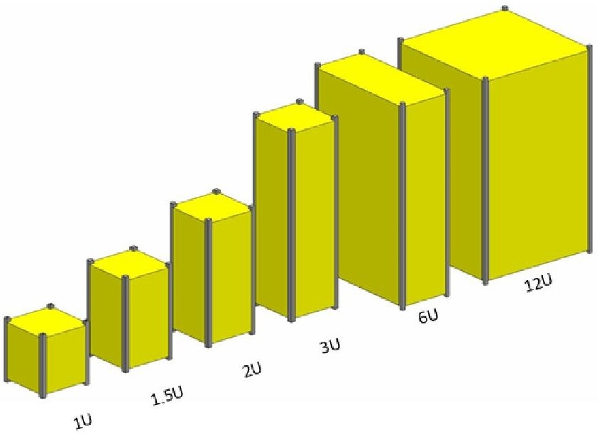


<div align="center">

Figure 2.2: Various CubeSat sizes [13].

</div>

## 2.2 Systems Engineering

Systems engineering is a holistic approach that encompasses the technical and managerial efforts required to address the customer's needs, expectations, and constraints, and to create and support a solution throughout its life-cycle. It focuses on integrating all of the disciplines and subsystems to create an overall successful System of Interest (SOI) [16]. In a satellite, there are several different subsystems. The systems engineer's job is to ensure that all subsystems and components work together correctly to create the most successful satellite, not just an optimal subsystem. Various models have been established for system development, such as the Waterfall, Spiral, and V-models. The former two

<!-- PDF_PAGE: 29 -->


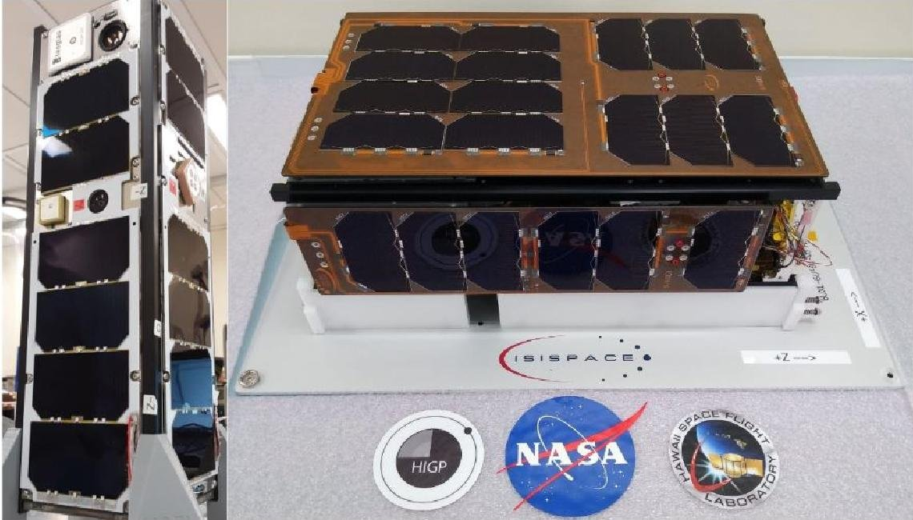


<div align="center">

Figure 2.3: Neutron-1, left, a 3U CubeSat and HyTI, right, a 6U CubeSat. Both were developed at HSFL.

</div>

are primarily used for software development, while the V-model is extensively applied to systems engineering [17]. Figure 2.4 illustrates the V-Model diagram.

Traditionally, systems engineering is document-centric, utilizing documents to manage the entire system. With complex systems, such as satellites, this documentation can easily become overwhelming in both quantity and the maintenance required to keep them up to date with the current design. MBSE is an alternative method that is model-centric and further described below.

## 2.3 Model-Based Systems Engineering

Models, as defined by INCOSE, are essential tools that serve as simplified representations of concepts, phenomena, structures, or systems. They may take various forms, including graphical, mathematical, physical, or logical depictions, all aimed at facilitating understanding, aiding decision-making, and enabling "what-if" analyses [18]. By

<!-- PDF_PAGE: 30 -->


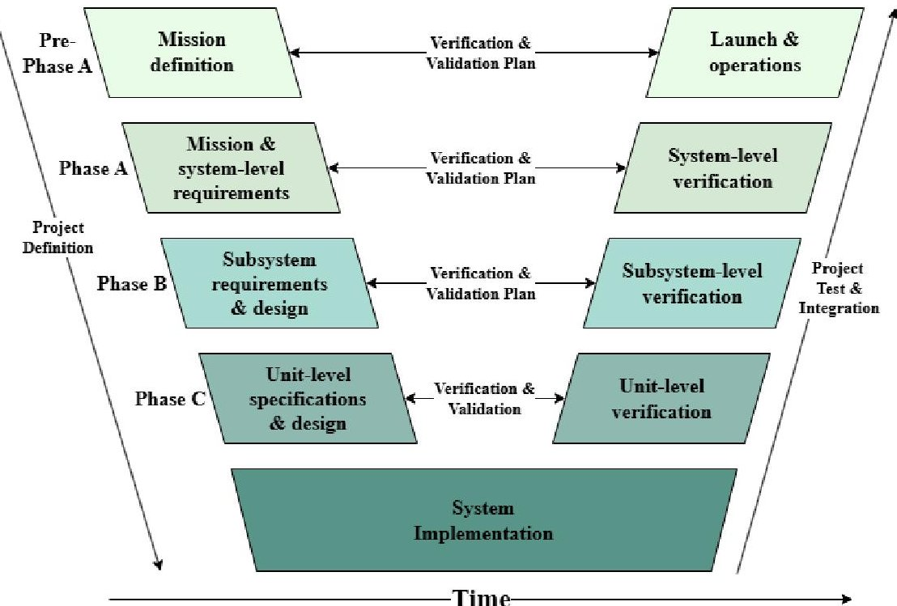


<div align="center">

Figure 2.4: The V-Model is a widely used system development model used in systems engineering.

</div>

simplifying reality and focusing on key drivers and components, models allow engineers to examine, control, and predict events more efficiently. Modeling is particularly valuable in managing complex systems, as it helps anticipate and verify solutions and their associated costs before physical implementation [19].

MBSE extends this approach by applying models to support requirements, analysis, design, implementation, and verification throughout the system's life-cycle [18]. In recent years, the use of MBSE has gained popularity, highlighting its many benefits for designing complex systems [20]. These benefits include improved communication across interdisciplinary teams, increased efficiency in the design process, better risk management, and lower costs by identifying potential issues early, as well as enhanced documentation. MBSE also supports defining strong requirements early that meet the mission's needs

<!-- PDF_PAGE: 31 -->


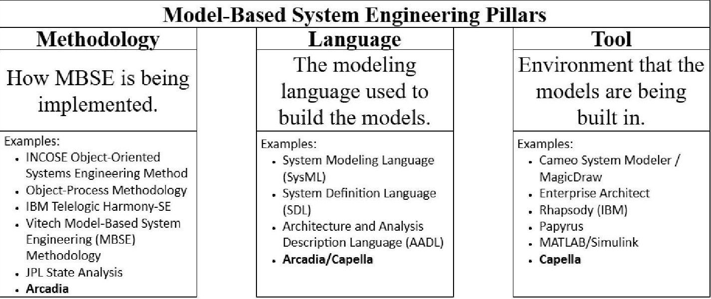


<div align="center">

Figure 2.5: Pillars of MBSE.

</div>

and improve requirement traceability and validation throughout the system's design and integration [21].

In addition to these general advantages, MBSE will play a crucial role in student projects. It will not only train students in widely adopted industry design methods but also facilitate knowledge transfer, which can be a challenge for student teams that experience frequent turnover. Moreover, by reusing elements of models from previous missions, students with limited experience in satellite design would have a strong foundation for their own projects, helping them succeed within short development timelines.

Three pillars of MBSE need to be considered during implementation: methodology, language, and tools. One of the most popular modeling languages is the SysML, which is discussed in more detail below. Examples of MBSE tools include Cameo and Rhapsody, which implement SysML but do not prescribe a specific methodology; however, the method most often used with SysML is the Object-Oriented Systems Engineering Method (OOSEM) [22]. Figure 2.5 provides an overview of the relationship between methodology, language, and tool, along with examples of each.

<!-- PDF_PAGE: 32 -->

## 2.3.1 Systems Modeling Language

The most common modeling language that is used for MBSE is the Systems Modeling Language. It is a language derived from the Unified Modeling Language (UML), which is a software modeling language [23]. Although SysML is very popular, it is purely a language, not a methodology or tool. There are several methodologies, with the OOSEM being the most popular [22]. Additionally, several tools are available, such as Cameo and Rhapsody; however, SysML is not a complete solution on its own.

## 2.3.2 Arcadia and Capella

When examining the three MBSE pillars with respect to Capella and Arcadia, Capella is the tool in which the models are developed, and Arcadia is the implementation methodology and the language, as shown in Figure 2.6. The Arcadia method, also known as the ARChitecture and Design Integrated Approach, is intended to provide structure and define a loose process for creating models of complex systems. The Arcadia methodology is broken down into four main layers: Operational Analysis (OA), System Analysis (SA), Logical Architecture (LA), and Physical Architecture (PA). Each layer addresses the requirements and identifies the necessary actions, entities, or system components required to meet them, utilizing several diagrams (models) to illustrate this. By the end of each layer, multiple viewpoints and an architecture are defined, elaborating on the design of the mission and the SOI [24], [25].

In the Operational Analysis, the needs of stakeholders are examined. Defining these early in the design process ensures that later stages of design fully align with the overall mission goals. The System Analysis then considers the system of interest as a "black box," focusing on what the system must achieve without delving into how these objectives or functions will be implemented. The Logical Architecture expands on this, treating

<!-- PDF_PAGE: 33 -->


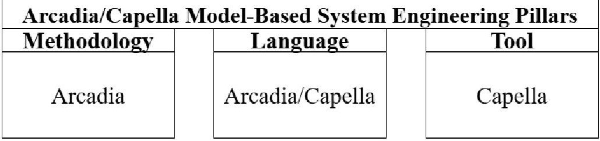


<div align="center">

Figure 2.6: Pillars of MBSE with respect to Arcadia and Capella.

</div>


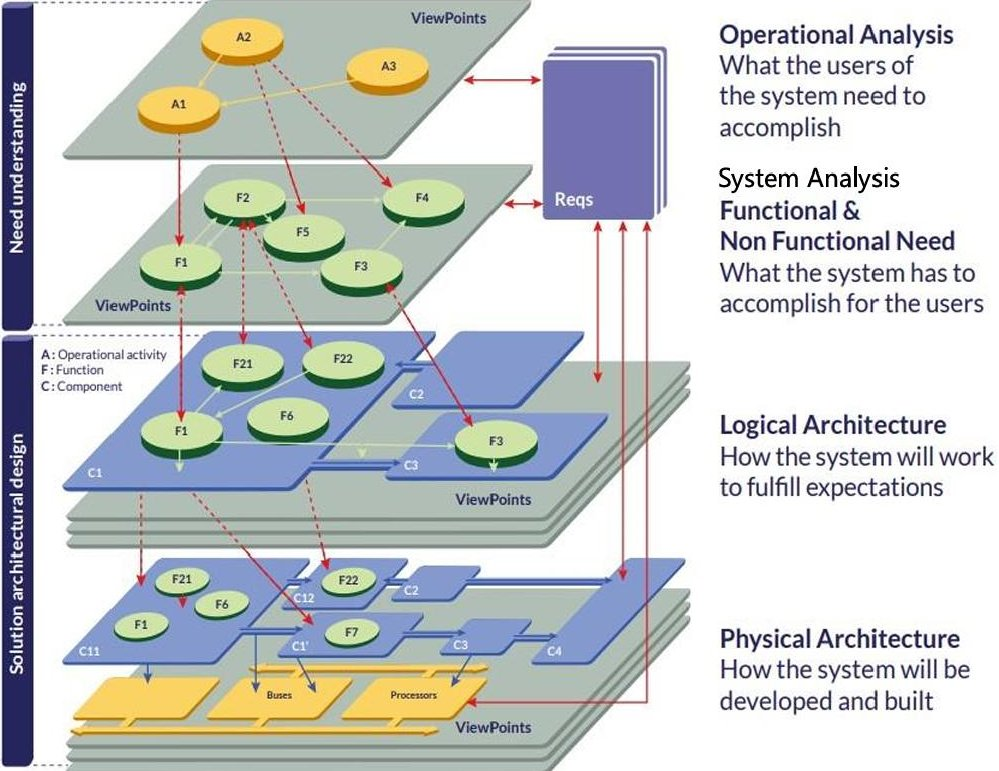


<div align="center">

Figure 2.7: The four layers of the Arcadia Methodology [26].

</div>

the system as a "white box" to define the necessary subsystems, logical components, and their logical functions that will meet the functional requirements. Lastly, the Physical Architecture specifies the actual physical components and how they will be integrated. At the Logical and Physical layers, supporting simulations can be performed, and their results fed into the Arcadia/Capella models to validate that all requirements are being met. This four-layer process is illustrated in Figure 2.7.

<!-- PDF_PAGE: 34 -->

Often, engineers jump into system design without fully understanding what the system must achieve to meet stakeholder needs or even what those needs are. By defining the operational and system requirements early and understanding how these goals can be addressed broadly, teams can improve communication with the stakeholders and reduce design changes later in the process. Within each of these four layers of the Arcadia methodology, several diagrams or models are created to capture these needs and their solutions. Each Arcadia layer has a series of diagrams created using the Arcadia language. The diagrams between the layers are similar but are tailored to provide the appropriate information for the intended goal of that layer.

Arcadia and Capella were chosen for this research for several reasons. Firstly, Arcadia and Capella offer a complete solution for implementing MBSE, whereas SysML is purely a language, and then a tool and methodology need to be chosen separately. Additionally, Arcadia was developed from SysML. SysML, derived from a software modeling language, was found to be less intuitive for engineers without a software engineering background. Therefore, the creators of Arcadia took SysML, simplified it even further, and changed the language to be more intuitive to all, especially systems engineers. Because of this, Arcadia is said to be an easier stepping stone to learning MBSE compared to SysML [19], [25]. The last driving factor for choosing the Arcadia and Capella solution is that Capella is open source, which is an important factor when working with many students and having limited funds.

## 2.4 NASA's Space Mission Architecture Framework

An architecture describes how a system is structured and the guidelines needed to implement it [16]. An architecture framework establishes standard conventions, principles, and methods to describe system architectures, ensuring they are developed consistently

<!-- PDF_PAGE: 35 -->

and understood across a particular domain or community of stakeholders [16]. There are several different architecture frameworks, such as the Department of Defense Architecture Framework (DoDAF) [27] and NASA's Space Mission Architecture Framework (SMAF) [28].

For this research, the NASA SMAF was chosen because it is specifically intended to guide teams in achieving a satellite mission's full capabilities. It applies to uncrewed space missions focused on either scientific research or technological advancements, which meet the needs of the UHM projects. To acquire these capabilities, the architecture encompasses the formulation of the mission idea, bringing it to life, as well as the design, build, integration, testing, and operation of the mission. The architecture categorizes stakeholders, participants, viewpoints, and view products, as shown in Figure 2.8. It also defines what is expected for each view product and the project milestone at which each product should be produced [28].

## 2.5 Project Life-Cycle

A project life-cycle is a key component in the development of a satellite mission. NASA defines it as a framework that organizes all necessary project activities into distinct phases. Transitions between phases are marked by KDPs. This phased approach helps make the project more manageable by structuring progress and reviews. The NASA Project Life-Cycle was chosen for this research because it closely aligns with NASA's SMAF, identifying the phases in which the view products need to be developed. Since this research focuses on the design of a satellite, it only covers Pre-Phase A through Phase C. Below is a list of each phase, as described by NASA [29]. Figures 2.9 and 2.10 illustrate the life-cycle and the corresponding view products that should be delivered at each KDP [29]. Appendix F illustrates a more detailed version of the NASA Project Life-Cycle.

<!-- PDF_PAGE: 36 -->

<table border="1"><tr><td colspan="6">Primary Stakeholders</td></tr><tr><td>Science and Technology Community</td><td colspan="2">Center Engineering Directorate(s)</td><td colspan="2">Center Mission/Project Management Directorate(s)</td><td>Agency, Mission Directorate, Center Director &amp; Staff</td></tr><tr><td colspan="6">Participants</td></tr><tr><td>Principal Investigator &amp; Science Team</td><td colspan="2">Mission Systems Engineer &amp; Engineering Team</td><td>Project Manager &amp; Project Management Team</td><td>Mission Operations Team</td><td>Same as Stakeholders</td></tr><tr><td colspan="6">Viewpoints</td></tr><tr><td>Science</td><td colspan="2">Engineering</td><td>Project Implementation</td><td>Mission Operations</td><td>Enterprise/Mission Concept</td></tr><tr><td colspan="6">Views and View Products</td></tr><tr><td>Science</td><td>Technical Solution</td><td>Product Realization</td><td>Project Implementation</td><td>Mission Operations</td><td>Enterprise</td></tr><tr><td>Sci-1 Science Concept</td><td>Soln-1 Systems Engineering Management Plan (SEMP)</td><td>Real-1 System &amp; Product Specifications (6)</td><td>Proj-1 Stakeholder Expectations Document</td><td>Ops-1 Operational/Mission Plan/Schedule (5)</td><td>Ent-1 Project Scope Document (1)</td></tr><tr><td>Sci-2 Science Traceability Matrix</td><td>Soln-2 Analysis of Alternatives (AoA)</td><td>Real-2 Final MEL</td><td>Proj-2 Project Plan with Project Control Plans</td><td>Ops-2 Observatory Command Sequence</td><td>Ent-2 Concept Study Report (2)</td></tr><tr><td>Sci-3 Science Datasets/Data Products</td><td>Soln-3 System Requirements Document</td><td>Real-3 Standards Profile</td><td>Proj-3 Project Review Data Package</td><td>Ops-3 Conjunction Assessment Risk Analysis</td><td>Ent-3 Decision Memorandum</td></tr><tr><td>Sci-4 Science Data Management Plan</td><td>Soln-4 V&amp;V Plan</td><td>Real-4 Integration Plan</td><td>Proj-4 Project Status Report</td><td>Ops-4 Deep Space Operations Plan</td><td>Ent-4 Strategic Plan</td></tr><tr><td></td><td>Soln-5 Test Plan (4)</td><td>Real-5 Final Interface Control Documents</td><td>Proj-5 Compliance Matrix</td><td>Ops-5 Range Flight Safety Risk Management Process</td><td>Ent-5 Key Decision Point Data Package</td></tr><tr><td></td><td>Soln-6 Architecture Model (3)</td><td>Real-6 Test Procedure</td><td></td><td>Ops-6 Expendable Launch Vehicle Payload Safety Process</td><td>Ent-6 Center Facilities, Equipment, and Staffing Plan</td></tr><tr><td></td><td>Soln-7 Design Specifications</td><td>Real-7 Peer Review Data Package</td><td></td><td></td><td></td></tr><tr><td></td><td>Soln-8 Interface Control Documents</td><td></td><td></td><td></td><td></td></tr><tr><td></td><td>Soln-9 Document Tree</td><td></td><td></td><td></td><td></td></tr><tr><td></td><td>Soln-10 Preliminary Master Equipment List (MEL)</td><td></td><td></td><td></td><td></td></tr><tr><td></td><td>Soln-11 Supporting Analysis</td><td></td><td></td><td></td><td></td></tr><tr><td></td><td>Soln-12 Review Data Package</td><td></td><td></td><td></td><td></td></tr><tr><td></td><td>Soln-13 CONOPS</td><td></td><td></td><td></td><td></td></tr><tr><td></td><td>Soln-14 Technology Readiness Assessment</td><td></td><td></td><td></td><td></td></tr><tr><td></td><td>Soln-15 Technical Risk Analysis</td><td></td><td></td><td></td><td></td></tr><tr><td></td><td>Soln-16 Technology Development Plan</td><td></td><td></td><td></td><td>LEGEND:</td></tr><tr><td></td><td>Soln-17 Software Plans and Documents</td><td></td><td></td><td></td><td>Conceptual View Products</td></tr><tr><td></td><td>Soln-18 Specific Engineering Plans</td><td></td><td></td><td></td><td>Realizational View Products</td></tr></table>

<div align="center">

Figure 2.8: NASA's SMAF stakeholders, participants, viewpoints, views, and view products table [28].

</div>

<!-- PDF_PAGE: 37 -->

- Pre-Phase A - Concept Studies: Develop the mission concepts and understand the technology needs and scope.

- Phase A - Concept and Technology Development: Define final mission concept, system-level requirements, and the technology development needs. The program management plans also need to be developed.

- Phase B - Preliminary Design and Technology Completion: Complete the technology development, prototyping, and risk-mitigation activities. Should demonstrate a preliminary design that complies with the requirements.

- Phase C - Final Design and Fabrication: Complete the system's detailed design, code software, and fabricate the hardware.

- Phase D - System Assembly, Integration & Test, Launch & Checkout: Assemble, integrate, and validate the SOI. Launch the SOI and prepare to operate.

- Phase E - Operations and Sustainment: Conduct the mission operations to fulfill the mission objectives.

- Phase F - Closeout: Decommission the SOI and analyze any data that was received.

## 2.5.1 Key Decision Points

Key Decision Pointss are defined in the NASA Systems Engineering Handbook as "... events at which the decision authority determines the readiness of a program/project to progress to the next phase of the life-cycle (or to the next KDP)" [30]. This could include reviews such as:

- Mission Concept Review (MCR)

<!-- PDF_PAGE: 38 -->

- System Concept Review (SCR)

- System Requirements Review (SRR)

- Preliminary Design Review (PDR)

- Critical Design Review (CDR)


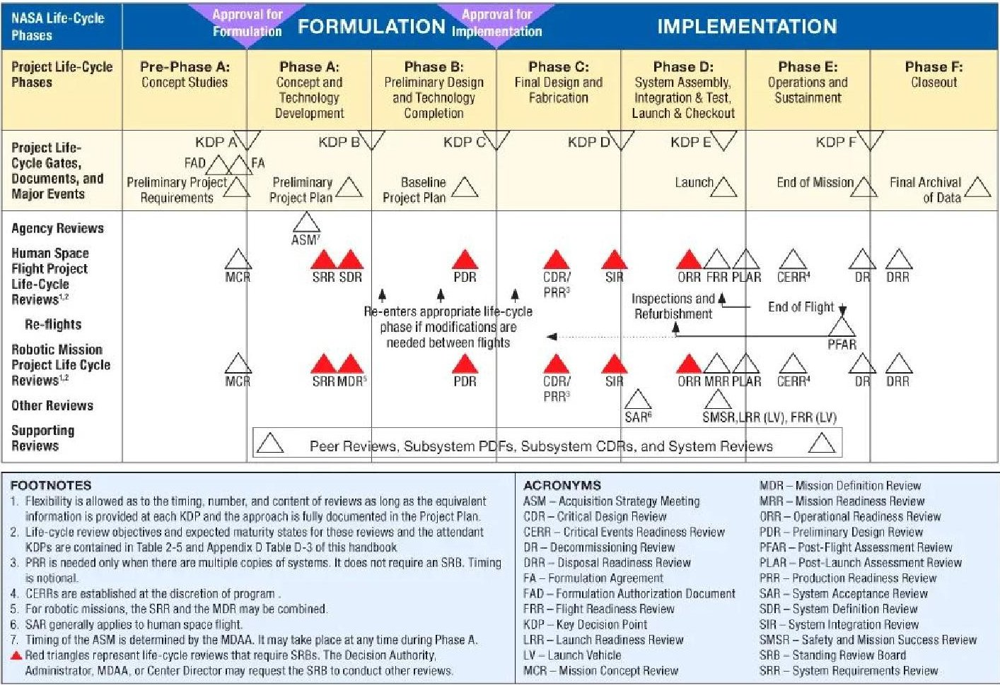


<div align="center">

Figure 2.9: NASA Project Life-Cycle [29].

</div>

<!-- PDF_PAGE: 39 -->

<table border="1"><tr><td colspan="2"></td><td colspan="4">Formulation</td><td colspan="6">Implementation</td></tr><tr><td rowspan="5">Products</td><td>Uncoupled/Loosely Coupled</td><td colspan="2">KDP0</td><td>KDP1</td><td colspan="7">Periodic KDPs</td></tr><tr><td>Tightly Coupled Programs</td><td colspan="3">KDP0</td><td>KDP1</td><td colspan="2">KDPII</td><td colspan="2">KDPIII</td><td colspan="2">Periodic KDPs</td></tr><tr><td rowspan="3">Projects and Single Project Programs</td><td>Pre-PhaseA</td><td colspan="2">PhaseA</td><td>PhaseB</td><td colspan="2">PhaseC</td><td colspan="2">PhaseD</td><td>PhaseE</td><td>PhaseF</td></tr><tr><td>KDPA</td><td colspan="2">KDPB</td><td>KDPC</td><td colspan="2">KDPD</td><td colspan="2">KDPE</td><td>KDPF</td><td></td></tr><tr><td>MCR</td><td>SRR</td><td>MDR/SDR</td><td>PDR</td><td>CDR</td><td>SIR</td><td>ORR</td><td>FRR</td><td>DR</td><td>DRR</td></tr><tr><td colspan="2">Stakeholder identification and</td><td>**Baseline</td><td>Update</td><td>Update</td><td>Update</td><td></td><td></td><td></td><td></td><td></td><td></td></tr><tr><td colspan="2">Concept definition</td><td>**Baseline</td><td>Update</td><td>Update</td><td>Update</td><td>Update</td><td></td><td></td><td></td><td></td><td></td></tr><tr><td colspan="2">Measure of effectiveness definition</td><td>**Approve</td><td></td><td></td><td></td><td></td><td></td><td></td><td></td><td></td><td></td></tr><tr><td colspan="2">Cost and schedule for technical</td><td>Initial</td><td>Update</td><td>Update</td><td></td><td>Update</td><td>Update</td><td>Update</td><td>Update</td><td>Update</td><td>Update</td></tr><tr><td colspan="2">SEMP1</td><td>Preliminary</td><td>**Baseline</td><td>**Baseline</td><td>Update</td><td>Update</td><td>Update</td><td></td><td></td><td></td><td></td></tr><tr><td colspan="2">Requirements</td><td>Preliminary</td><td>**Baseline</td><td>Update</td><td>Update</td><td>Update</td><td></td><td></td><td></td><td></td><td></td></tr><tr><td colspan="2">Technical Performance Measures definition</td><td></td><td></td><td>**Approve</td><td></td><td></td><td></td><td></td><td></td><td></td><td></td></tr><tr><td colspan="2">Architecture definition</td><td></td><td></td><td>**Baseline</td><td></td><td></td><td></td><td></td><td></td><td></td><td></td></tr><tr><td colspan="2">Allocation of requirements to next lower level</td><td></td><td></td><td>**Baseline</td><td></td><td></td><td></td><td></td><td></td><td></td><td></td></tr><tr><td colspan="2">Required leading indicator trends</td><td></td><td></td><td>**Initial</td><td>Update</td><td>Update</td><td>Update</td><td></td><td></td><td></td><td></td></tr><tr><td colspan="2">Design solution definition</td><td></td><td></td><td>Preliminary</td><td>**Preliminary</td><td>**Baseline</td><td>Update</td><td>Update</td><td></td><td></td><td></td></tr><tr><td colspan="2">Interface definition(s)</td><td></td><td></td><td>Preliminary</td><td>Baseline</td><td>Update</td><td>Update</td><td></td><td></td><td></td><td></td></tr><tr><td colspan="2">Implementation plans (Make/code, buy, reuse)</td><td></td><td></td><td>Preliminary</td><td>Baseline</td><td>Update</td><td></td><td></td><td></td><td></td><td></td></tr><tr><td colspan="2">Integration plans</td><td></td><td></td><td>Preliminary</td><td>Baseline</td><td>Update</td><td>**Update</td><td></td><td></td><td></td><td></td></tr><tr><td colspan="2">Verification and validation plans</td><td>Approach</td><td></td><td>Preliminary</td><td>Baseline</td><td>Update</td><td>Update</td><td></td><td></td><td></td><td></td></tr><tr><td colspan="2">Verification and validation results</td><td></td><td></td><td></td><td></td><td></td><td>**Initial</td><td>**Preliminary</td><td>**Baseline</td><td></td><td></td></tr><tr><td colspan="2">Transportation criteria and instructions</td><td></td><td></td><td></td><td></td><td>Initial</td><td>Final</td><td>Update</td><td></td><td></td><td></td></tr><tr><td colspan="2">Operations plans</td><td></td><td></td><td></td><td>Baseline</td><td>Update</td><td>Update</td><td>**Update</td><td></td><td></td><td></td></tr><tr><td colspan="2">Operational procedures</td><td></td><td></td><td></td><td></td><td>Preliminary</td><td>Baseline</td><td>**Update</td><td>Update</td><td></td><td></td></tr><tr><td colspan="2">Certification (flight/use)</td><td></td><td></td><td></td><td></td><td></td><td></td><td>Preliminary</td><td>**Final</td><td></td><td></td></tr><tr><td colspan="2">Decommissioning plans</td><td></td><td></td><td></td><td>Preliminary</td><td>Preliminary</td><td>Preliminary</td><td>**Baseline</td><td>Update</td><td>**Update</td><td></td></tr><tr><td colspan="2">Disposal plans</td><td></td><td></td><td></td><td>Preliminary</td><td>Preliminary</td><td>Preliminary</td><td>**Baseline</td><td>Update</td><td>Update</td><td>**Update</td></tr></table>

** Item is a required product for that review

1 SEMP is baselined at SRR for projects, tightly coupled programs and single-project programs, and at MDR/SDR for uncoupled, and loosely coupled programs.

<div align="center">

Figure 2.10: NASA Project Life-Cycle view products [29].

</div>

<!-- PDF_PAGE: 40 -->

<div align="center">

# Chapter 3 Proposed SmallSat Model-Based System Engineering Methodology

</div>

This chapter presents the proposed SmallSat MBSE Methodology developed in this research. It adapts the Arcadia layers, methods, and process steps to align with NASA's Life-Cycle Phases and describes how Capella models can be used to capture the Space Mission Architecture Framework view products. Figure 3.1 shows the overview of the methodology. Figures 3.2, 3.3, 3.4, and 3.5 each use Capella logical architecture diagrams to capture the methodology of each phase, including the process steps, the method to complete the steps, and the SMAF view products that the steps can populate. The subsequent tables, 3.1, 3.2, 3.3, and 3.4, were derived from these Capella diagrams by creating tables within the tool and exporting them as CSV files. This demonstrates how model data can be exported into a more readable format for stakeholder communication. Each subsequent section explores the individual Life-Cycle Phases and the methodological steps required to complete them. These steps were derived by tailoring the general Arcadia MBSE procedure for application to a satellite mission. It is important to note that this research focuses on academic CubeSat applications; therefore, the Robotic Mission profile

<!-- PDF_PAGE: 41 -->

category was selected from the NASA Life-Cycle. Examples of the methodology steps can be found in Chapter 4.

The Capella models, including the methodology models presented in this chapter and the N2 models explored in Chapter 4, along with any supporting materials developed in this research, are available in a public GitHub repository [31].


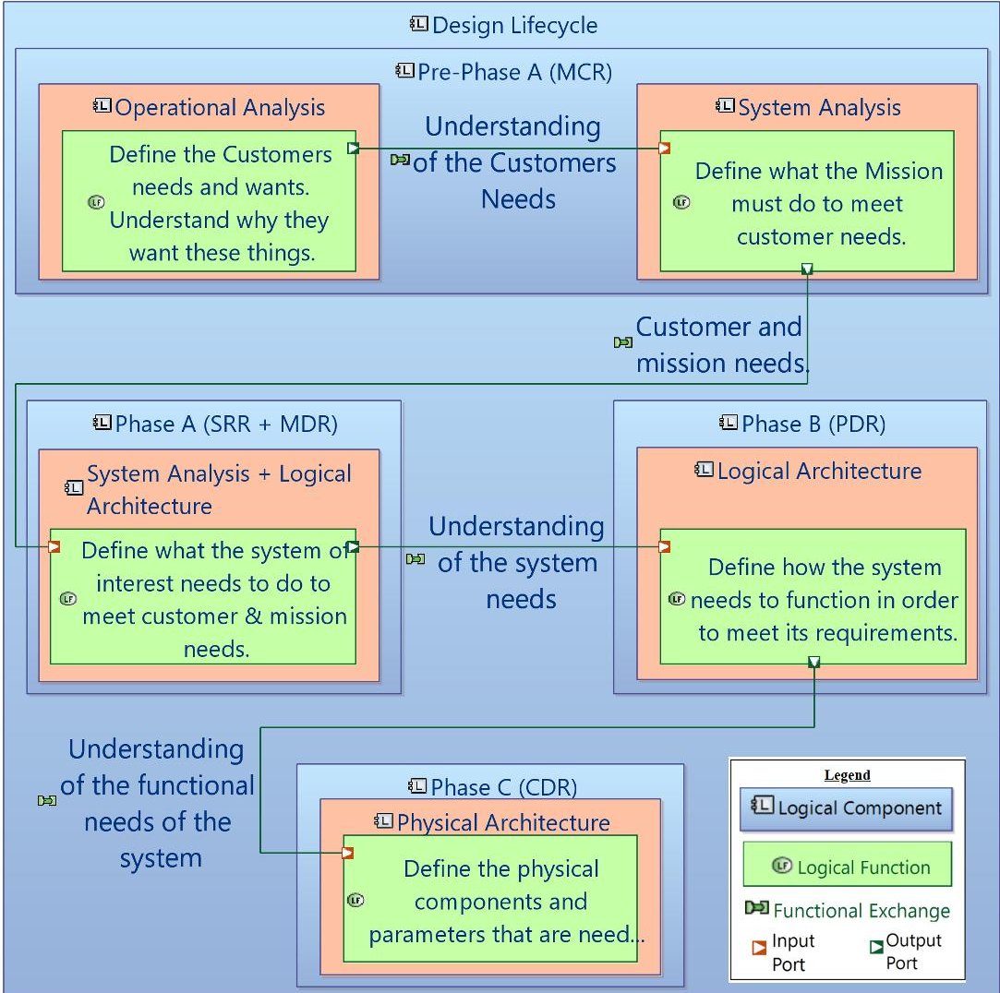


<div align="center">

Figure 3.1: Overview of the proposed MBSE methodology from Pre-Phase A to Phase C. The blue logical components represent the Life-Cycle and its phases, the orange logical components represent the Arcadia layers, and the green logical functions represent the overall goal of the phase and Arcadia layer.

</div>

<!-- PDF_PAGE: 42 -->

## 3.1 Pre-Phase A: Concept Study

Pre-Phase A of the Life-Cycle is a concept study to understand the needs of the customers of the SOI and why it is essential. The KDP at the end of this phase is the MCR. Within the SmallSat MBSE Methodology, Pre-Phase A maps to the entire Operational Analysis layer and part of the System Analysis layer of Arcadia. These Arcadia layers are described in Figure 2.7. The SMAF design view products that should result from this phase include the Stakeholders' Expectation Document, Science Traceability Matrix, Science or Technology Concept, Technical Risk Analysis, and System Requirements Document, which includes the Mission Statement, Mission Objectives, and the Success Criteria.

The following sections break down the process steps needed to complete Pre-Phase A of the proposed methodology, along with the method for completing each step and how it maps to the SMAF view products.

<!-- PDF_PAGE: 43 -->


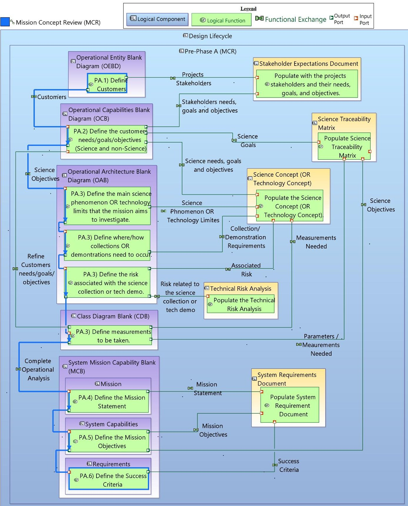


<div align="center">

Figure 3.2: Detailed MBSE methodology for Pre-Phase A. Purple logical components represent the Capella diagrams (method to implement the step), yellow logical components represent the SMAF view products, and green functions represent the process steps and the population of the view products.

</div>

<!-- PDF_PAGE: 44 -->

<div align="center">

Table 3.1: Pre-Phase A Methodology Steps.

</div>

<table border="1"><tr><td>Methodology Step</td><td>Methodology Method(Capella diagram/model element)</td><td>SMAF View Products</td></tr><tr><td>PA.1) Define Customers</td><td>Operational Entity Blank Diagram(OEBD)</td><td>Stakeholder Expectations Document</td></tr><tr><td>PA.2) Define the customers needs/goals/objectives(Science and non-Science)</td><td>Operational Capabilities Blank Diagram(OCB)</td><td>Stakeholder Expectations Document,Science Traceability Matrix,Science or Technology Concept</td></tr><tr><td>PA.3) Define the main science phenomenon OR technology limits that the mission aims to investigate.</td><td>Operational Architecture Blank Diagram(OAB)</td><td>Science or Technology Concept</td></tr><tr><td>PA.3) Define where/how collections OR demonstrations need to occur.</td><td>Operational Architecture Blank Diagram(OAB)</td><td>Science or Technology Concept, Technical Risk Analysis</td></tr><tr><td>PA.3) Define the risk associated with the science collection or tech demo.</td><td>Operational Architecture Blank Diagram(OAB)</td><td>Science or Technology Concept, Science Traceability Matrix</td></tr><tr><td>PA.3) Define measurements to be taken.</td><td>Class Diagram Blank(CDB)</td><td>Science or Technology Concept,Science Traceability Matrix</td></tr><tr><td>PA.4) Define the Mission Statement</td><td>Mission</td><td>System Requirements Document</td></tr><tr><td>PA.5) Define the Mission Objectives</td><td>System Capabilities</td><td>System Requirements Document</td></tr><tr><td>PA.6) Define the Success Criteria</td><td>System Capabilities</td><td>System Requirements Document</td></tr></table>

## 3.1.1 Methodology Step PA.1: Define Mission Customers

The first step within this process is to define the customers of the mission. Stakeholders are defined as organizations, companies, people, or objects that have any stake or impact on the mission. In comparison, a customer is defined as any stakeholder that receives a product or service from the mission [16]. For the full definition of a customer, see Appendix A. For example, a launch provider would be a stakeholder but not a customer. A specific scientist or science community would be a customer for a science payload. It is crucial to

<!-- PDF_PAGE: 45 -->

understand who the customers are, as their needs will drive the mission, whereas the needs of non-customer stakeholders will likely not drive the mission but rather define constraints.

To define the customers, an Operational Entity Breakdown Diagram (OEBD) will be used. All customers can be defined by creating Operational Entities and Actors. If customers are included among other stakeholders, this should be captured using the "Contained in" feature. The focus of this step is to specifically define customers, as the next several steps focus on understanding their needs and why this mission is essential. However, non-customer stakeholders can be defined at this step if they are known. If they are not known, they can be defined as they are realized. This may include anyone developing the SOI, any supporting entities, or the relevant environment. However, do not define the SOI or make any design decisions at this time. For example, defining a satellite launch provider implies that the mission will involve a space-based system rather than a ground-based or near-space system. This should be avoided, as design decisions should not be made before the customer's needs are defined, which is the goal of the Operational Analysis. This means that the SOI should also not be defined at this stage. Capella will automatically generate a SOI entity when the System Analysis begins, but before then, the SOI should not be considered. If non-customer stakeholders are defined, it is recommended to have a specific OEBD to illustrate the customers, as this is the primary objective of this step. The information defined in this step will be used to populate the Stakeholder Expectations SMAF View Product.

When defining different types of stakeholders (e.g., customers, environment, and support), the Property Value Management Tool (PVMT) add-on should be used to assign each entity a type. PVMT allows Capella users to define custom properties that can be associated with model elements. This tool is applied throughout the methodology to enable

<!-- PDF_PAGE: 46 -->

referencing specific model elements and their properties via Python scripts, which can then be used for analysis or propagated into design view products.

## 3.1.2 Methodology Step PA.2: Define the Customer's Needs

After defining the customers, it is vital to identify their needs, goals, and objectives for the project or mission. The customer's needs will drive the mission, making it essential for engineers to spend time identifying and understanding these needs.

To capture the customers' needs, goals, and objectives in Capella, an OCB should be used. The entities captured in the OEBD should be added to the OCB diagram. If noncustomer entities are defined, it is recommended to have a customer-specific OCB and/or represent the different types of entity elements in a different color, ideally using the PVMT add-on tool. The PVMT tool allows for the element block style to be edited based on the properties (i.e. block color, block outline color, line color). Unfortunately, this block style defined by the properties does not apply to select diagrams, including the OCB; therefore, this visual differentiation will need to be manually changed if desired.

Once the entities are in the OCB, the entities' capability needs should be captured as operational capabilities. The customer's capability needs should be the focus of this step; however, other capabilities can also be captured. To complete this diagram, thorough conversations should be had with the customers so that their needs can be thoroughly fleshed out and understood. These diagrams should not be created by a single person, but rather in a collaborative work session where everyone is involved and aims to be on the same page. If a need can be broken down into smaller needs, for instance, if needs A, B, and C feed into a larger need Z, they should all be captured using capability extensions. The focus of this step should be the customer's root needs, not what they want the system to do. For example, the customer may wish to improve radiation models in space. Therefore, a system

<!-- PDF_PAGE: 47 -->

of interest will need to collect neutron count data in space. The former should be defined as the customers' needs, not the latter. In later steps, the type of data required to complete their needs will be determined; however, this step should capture the root of what they want to achieve. The content defined in this step will be used to populate several view products, including the Stakeholder Expectations Document, the Science Traceability Matrix, and the Science or Technology Concept Document.

## 3.1.3 Methodology Step PA.3: Understand the Customer Needs

After identifying the customer's needs, they must be understood. As engineers, it's easy to jump into designing and building the system. However, it is critical to understand the customers' needs to know if the correct system is being designed and built. Having a deep understanding of their needs and why they are important will also be essential to deriving requirements. Commonly, customers may not fully understand their own needs, or they aren't being understood correctly by the engineers. By asking questions to ensure the engineering team understands the customer's needs and why they are necessary, it can also help further define the customer's root needs and ensure that everyone has a shared understanding. Due to this, Methodology Steps PA.2 and PA.3 often will loop back and forth as the project capabilities or needs are better understood and defined.

To understand the customer's needs, several Capella diagrams and steps should be completed. The steps and diagrams are as follows:

- Define the central science phenomenon OR technology limitations that the mission aims to investigate: Completed using the OAB. While doing this, additional entities will likely need to be defined, such as the environment. Functions, functional interactions, and chains can then be used to show the phenomena or

<!-- PDF_PAGE: 48 -->

limitations. This information should be used to populate the Science Concept or Technology Concept View Product.

- Define where/how collections OR demonstrations need to occur: Are there specific orbits, locations, or altitudes that the data collections or demonstrations must occur in? This may need to be its own OAB that captures the specifics of the data collections that the customer needs to collect. This information should be used to populate the Science Concept or Technology Concept View Product.

- Define the risk associated with the science collection or technology demonstration: This can be done by using the PVMT add-on and assigning a risk property to Operational Functions that pose a risk to the mission. The risk can then be further defined in the summary or description of the function. Two properties can be assigned to all functions that pose a risk: probability and consequence. These properties should be defined using PVMT and ideally change the background color of risk functions. This information should be used to populate the Science Concept or Technology Concept View Product and the Technical Risk Analysis View Product.

- Define the necessary data: This should be done by using the CDB and capturing the necessary data to complete the customer's needs. It may be unknown at this point whether the data is measured or calculated, as that can come from the design, which is completed in later phases. However, if it is known, it can be captured by using the PVMT add-on. The information captured in the CDB should populate the Science Concept or Technology Concept View Product and Science Traceability Matrix View Product.

<!-- PDF_PAGE: 49 -->

This list of steps does not need to be done in the order listed above, but should all be captured by the end of the Operational Analysis. Additionally, if the payload is predefined for the mission and the objectives are being tailored around it, then it can be defined during this phase. This should be done using a different Capella Library and defining the Logical and Physical Architecture of the payload. This is not included in the methodology, but is something that can be considered.

With the completion of this step, the Operational Analysis should be complete. After defining the entities, customers, and their mission needs in the Operational Analysis, the System Analysis can be started to understand what the system needs to do to meet these needs. In the System Analysis, the SOI is treated like a black box, and by the end, it should be understood what type of system is needed by identifying what it needs to be capable of. For instance, at the end of the Operational Analysis, it may be unknown whether the payload needs to be flown on a satellite or a high-altitude balloon. System Analysis starts unbiased towards either of these options, but by identifying what the system needs to do to fulfill the customers' needs, it is realized that these needs can only be met by a satellite orbiting the Earth. This approach ensures that needs are defined first. Then a solution is designed to meet those needs, rather than defining solutions before the needs are determined, thereby creating unnecessary constraints.

## 3.1.4 Methodology Step PA.4: Define the Mission Statement

The customer needs determined by the Operational Analysis should be used to derive the Mission Statement. The Mission Statement, as defined by University Nanosatellite Program (UNP), should be a brief statement that captures the entire purpose of the mission and is usually focused on the science or technology needs [32]. In Arcadia and Capella, this statement should be captured using the Mission element in the MCB. The

<!-- PDF_PAGE: 50 -->

Mission Statement will be part of the System Requirements Document SMAF View Product.

## 3.1.5 Methodology Step PA.5: Define the Mission Objectives

The mission objectives are derived from the Mission Statement and define the broad goals that the system must achieve to be successful [33]. To capture these in Capella, the System Capability model element should be used and captured in the MCB. To define them as being derived from the Mission Statement, the Capability Exploitation relationship should be established between the capabilities and the mission. The Mission Objectives will be part of the System Requirements Document SMAF View Product.

## 3.1.6 Methodology Step PA.6: Define the Success Criteria

After capturing what is to be accomplished with the Mission Objectives, the desired performance of these accomplishments should be captured as Success Criteria (SC). These success criteria should be split into Minimum Success Criteria (MSC), which represents the minimum that must be achieved to consider the mission a success, and Full Success Criteria (FSC), which represents the entire performance that is desired to be met.

To capture these in Capella, the System Capability model element should be used. These system capabilities should be included in the same MCB, and the extension relationship from the Mission Objectives to the respective SC should be defined. The Success Criteria will be part of the System Requirements Document SMAF View Product.

The completion of Methodology Step PA.6 defines all necessary tasks in preparation for the MCR. Depending on whether the material presented at the MCR passes the KDP,

<!-- PDF_PAGE: 51 -->

the mission advances on to Phase A. However, the Pre-Phase A steps will likely need to be revisited and iterated throughout the design life-cycle.

## 3.2 Phase A: Concept and Technology Development

The second phase of the Life-Cycle, Phase A, is defined as the concept and technology development. There are two key decision points within this phase: the System Requirements Review and the Mission Design Review (MDR). For the SRR, the requirements are defined. This includes the Top-Level Mission requirements, the system requirements, and the subsystem requirements. This review continues to focus on the mission's needs, specifically what the system must do to meet the customer's needs defined in the previous phase. The MDR is an initial, top-level solution or design of the SOI. For a Robotic Mission, the NASA Life-Cycle states that the SRR and the MDR may be combined. For this methodology, we have chosen to combine the two due to their overlap with the System Analysis and Logical Architecture layers of Arcadia. For this combined review, the design team will initiate System Analysis, defining top-level mission requirements, understanding what the system must do to meet those requirements, and subsequently defining system requirements. After that is complete, the Logical Architecture layer must be initiated to dive into the subsystem requirements. Within the Logical Architecture layer, subsystems will be defined that are needed to meet the top-level and system requirements, along with the functions they must perform to meet them. As a result of this step, subsystem requirements will be derived, along with some logical design decisions that correlate with the MDR view products. Therefore, the SRR and MDR map to the System Analysis and the Logical Architecture layers of Arcadia. Note that the Logical Architecture is not yet complete at the end of this phase and will be further defined in the next one. The design-related view products needed for this combined KDP include

<!-- PDF_PAGE: 52 -->

Architecture Models, Design Specifications, Supporting Analysis, Concept of Operations, System Requirements Document, Interface Control Document, Mission Operations Plan, and a Preliminary Master Equipment List.

The following sections break down the process steps required to complete Phase A of the proposed methodology, along with the method for completing each step and how it aligns with SMAF view products.


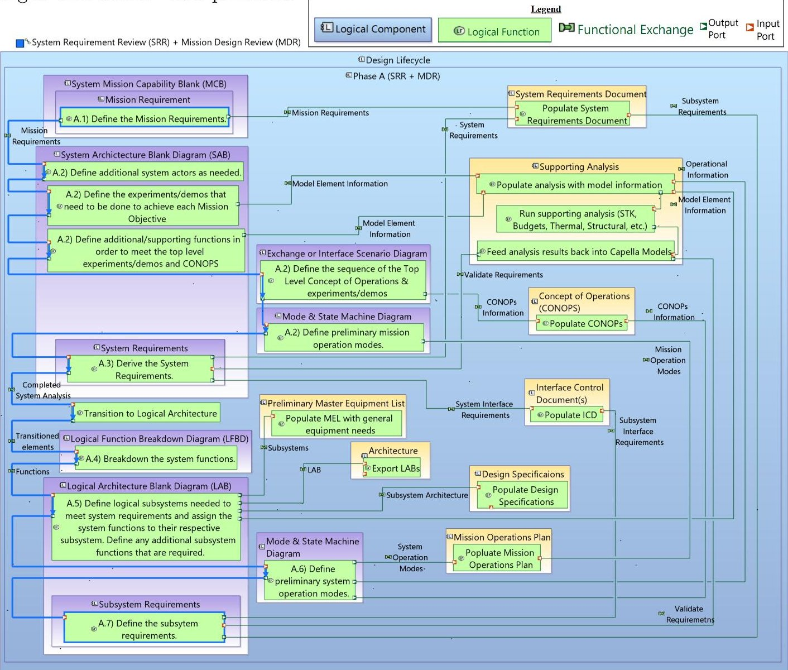


<div align="center">

Figure 3.3: Detailed MBSE methodology for Phase A. Purple logical components represent the Capella diagrams (method to implement the step), yellow logical components represent the SMAF view products, and green functions represent the process steps and the population of the view products.

</div>

<!-- PDF_PAGE: 53 -->

<div align="center">

Table 3.2: Phase A Methodology Steps.

</div>

<table border="1"><tr><td>Methodology Step</td><td>Methodology Method(Capella diagram/model element)</td><td>SMAF View Products</td></tr><tr><td>A.1) Define the Mission Requirements.</td><td>Mission Requirement</td><td>System Requirements Document</td></tr><tr><td>A.2) Define additional system actors as needed.</td><td>System Architecture Blank Diagram(SAB)</td><td></td></tr><tr><td>A.2) Define the experiments/demos that need to be done to achieve each Mission Objective</td><td>System Architecture Blank Diagram(SAB)</td><td>Supporting Analysis</td></tr><tr><td>A.2) Define additional/supporting functions in order to meet the top level experiments/demos and CONOPS</td><td>System Architecture Blank Diagram(SAB)</td><td>Supporting Analysis</td></tr><tr><td>A.2) Define the sequence of the Top Level Concept of Operations&amp;experiments/demos</td><td>Exchange or Interface Scenario Diagram</td><td>Concept of Operations</td></tr><tr><td>A.2) Define preliminary mission operation modes.</td><td>Mode&amp;State Machine Diagram</td><td></td></tr><tr><td>A.3) Derive the System Requirements.</td><td>System Requirements</td><td>Interface Control Document,System Requirements Document</td></tr><tr><td>Transition to Logical Architecture</td><td></td><td></td></tr><tr><td>A.4) Breakdown the system functions.</td><td>Logical Function Breakdown Diagram(LFBD)</td><td></td></tr><tr><td>A.5) Define logical subsystems needed to meet system requirements and assign the system functions to their respective subsystem. Define any additional subsystem functions that are required.</td><td>Logical Architecture Blank Diagram(LAB)</td><td>Preliminary Master Equipment List,Architecture Model,Design Specifications,Supporting Analysis</td></tr><tr><td>A.6) Define preliminary system operation modes.</td><td>Mode&amp;State Machine Diagram</td><td>Mission Operations Plan,Supporting Analysis,Concept of Operations</td></tr><tr><td>A.7) Define the subsystem requirements.</td><td>Subsystem Requirements</td><td>System Requirements Document,Interface Control Document</td></tr></table>

<!-- PDF_PAGE: 54 -->

## 3.2.1 Methodology Step A.1: Define the Top-Level Mission Requirements

From the Mission Objectives and Success Criteria, Top-Level Mission Requirements should be defined that quantify and specify measurable criteria for how well the mission must achieve its objectives. This is still covering the system as a whole and not yet diving into the system. As defined in Appendix A, three different types of requirements should be considered: functional, operational, and constraints. These requirements should be captured as requirement model elements within the same MCB that the Mission Statement, Objectives, and Success Criteria are in, and the derived relationship should be used to capture that these requirements are derived from these previously defined elements. The information defined in this step should be used to populate the System Requirements Document view product.

## Capturing Requirements

Methodology Step A.1 is the first instance in which the Capella requirements add-on tool is being used. The use of Capella features, such as the requirements add-on, is being documented in a Capella Tutorial and User Guide to inform engineers on how to implement this methodology specifically using Capella. However, when defining the requirement definitions, the following should be considered. The requirement definitions are also illustrated in Appendix B.

The requirement module definition in Capella defines the requirement tiers. For this methodology, the following tiers should be defined:

- Top-Level Mission Requirements: Includes the requirements captured in Step A.1.

<!-- PDF_PAGE: 55 -->

- System Requirements: Includes the SOI requirements, along with Ground Station Systems or any other system that needs to be considered.

- Subsystem Requirements: Requirements for subsystems such as Electrical Power Subsystem (EPS), Communication Subsystem (COMM), Onboard Computer Subsystem (OBC), ADCS, Structures & Mechanisms (S&M), etc.

- Component Requirements: Optional, depending on mission.

The Relationship definition defines the relationship between the requirement and other model elements. This could include relationships with functions, components, or other requirements, such as parent-child requirement relationships. The minimum relationships that should be defined are Satisfy and Derived.

The Requirement definition outlines the necessary details for each requirement, including requirement type, status, and verification method. The Requirement definitions that should be defined for this methodology are further explained below:

- Requirement Type: Defines the type of requirement, such as functional, operational, or constraint. See Appendix A for the definition of these types.

- Status: Defines the status of the written requirement. It should include Draft for when the requirement is being written, Ready for Review once the writer is satisfied with it, and Approved after stakeholders and customers have approved it. It is common for the requirement to loop between Draft and Ready for Review several times before settling on a requirement that all stakeholders are satisfied with. Once it is approved, it should not be changed without undergoing a thorough review process and analyzing the resultant impacts of modifying the requirement.

<!-- PDF_PAGE: 56 -->

- Verification Method: Defines how the requirement will be verified to ensure it is being met. This should include the following options: Test, Analysis, Inspection, and Demo.

- Verification Status: Defines whether the requirement has been verified using the previously defined method or not. This should include at least two options: Not Complete and Complete.

- Priority: Defines the criticality of the requirement. Typically includes mandatory, desired, or luxury/low.

Requirements can be directly added to Capella models; however, Capella is not necessarily a tool for managing requirements. It is helpful to illustrate the relationships between the requirements and their design solution, to demonstrate where they originate, or to understand how a change to a requirement impacts the rest of the design and vice versa. However, to edit requirements, an additional requirements tool may be best. Importing and exporting requirements between Capella and this additional tool can then be done to propagate edits. The import of requirements and the best method to capture requirements in Capella are still being explored and will be part of future work.

## 3.2.2 Methodology Step A.2: Define how the System can meet the Top- Level Mission Requirements

After defining the Top-Level Mission Requirements, SABs, Scenario Diagrams, and MSMs should be used to identify how the system can fulfill these requirements. Below are the various steps that may be involved in this process.

- Define Additional System Actors: When a SAB is created, the System of Interest will already be defined as a system actor. Operational entities can be imported, and

<!-- PDF_PAGE: 57 -->

additional system actors should be defined as needed. While this is an explicit step at the beginning of Phase A, additional actors can be added to the models as they are realized and needed throughout the methodology process.

- Define How to Meet the Top-Level Mission Requirements: System functions and functional exchanges should be used to illustrate how the Top-Level Mission Requirements can be met. A functional process can also be used, which demonstrates a chain of functions to show how they work together to fulfill a top-level requirement directly. There will likely be several different views captured here, including one of the overall CONOP, from launch to mission termination, and one of each experiment or demonstration that needs to be completed. Again, this involves considering what the system as a whole needs to do, rather than delving into the subsystem functionalities. This information should be captured in SABs and Scenario Diagrams. The latter can be used to show the sequencing and timing needs. For example, if an experiment requires data collection for a specific duration, or if certain functions need to be executed iteratively. The information defined in this step can be used to populate the Science Traceability Matrix and the Supporting Analysis View Products.

- Define the Preliminary Mission Operation Modes: From the preliminary CONOP, the mission operation modes or phases should be defined using a MSM. The operational modes or phases define distinct periods during which specific events must occur. For a spacecraft mission, this typically includes Launch and Early Operations (LEOP), Engineering Evaluation and Checkout (EE&CO), Nominal Operations, and Mission Termination.

<!-- PDF_PAGE: 58 -->

## 3.2.3 Methodology Step A.3: Define the System Requirements

By understanding the functions that the system or system actors must perform to meet the top-level mission needs, formal system requirements can be derived. This should be done again using the Capella Requirement add-on tool to capture functional, operational, and constraint requirements, but it should be captured in the System Requirements Tier. This information should be used to populate the System Requirements Document and the Interface Control Document (ICD) View Products. Note that for populating the ICD, the system interface requirements are necessary.

Transition to Logical Architecture Once the system and its requirements have been defined, the Logical Architecture can be used to refine the system and its subsystems further. In this layer, the system is treated as a "white box" meaning we analyze its internal structure to understand what each subsystem needs to do. However, the focus remains at a logical level and does not yet concern itself with how the physical hardware is organized. That is addressed in the Physical Architecture layer. Instead, it focuses on the functionality of logical subsystems and logical components. Within the SmallSat MBSE Methodology, there are two sub-layers to the Logical Architecture: defining the subsystem needs, and then defining a design solution. This breakdown is crucial to ensure that the needs and requirements are fully defined before developing solutions to meet them. The first sub-layer, defining the subsystem needs, should be completed for the joint System Requirement and Mission Concept Review. Whereas the second sub-layer, determining a design solution, should be completed in preparation for the PDR.

## 3.2.4 Methodology Step A.4: Breakdown the System Functions

The first step at the logical level is to decompose the previously defined system functions further to identify the needs of the subsystems. This can be completed using a LFBD.

<!-- PDF_PAGE: 59 -->

After importing the functions defined in the previous Arcadia layer, it is recommended to change the color of the functions block so that they can be distinguished from the functions that will be defined during this step. This step should be used to determine needs based on the top-level function, rather than defining design solutions. Further conversations with the customers, along with supporting analysis, will likely be necessary to understand the specifics of these needs.

## 3.2.5 Methodology Step A.5: Define the Logical Subsystems and Allocate the Appropriate Functions

This step includes defining the subsystems for the system of interest. For satellite systems, this will frequently include a combination of the following: S&M, Thermal Control Subsystem (TCS), EPS, OBC, COMM, ADCS, Flight Software (FSW) Subsystem, and a Payload (PAY) Subsystem.

The subsystems should be defined as Logical Components and placed within the SOI component. These components can be represented in various diagram types; however, a LAB should ultimately be developed to depict the system and its subsystems. Also, at this point, the system of interest can be renamed to something that better represents it than "System". For example, the SOI for the Neutron-2 mission is named "Neutron-2" since that is the satellite's name.

Similar to the System Analysis phase, once the subsystems have been defined, logical functions, functional exchanges, and processes should be used to illustrate how the subsystems need to work together to satisfy the system requirements. Multiple Logical Architecture Diagrams may be necessary to represent different system functions or operational phases. This process helps clarify the actual requirements for each subsystem. Note that additional analysis and conversations with the customers will likely be required

<!-- PDF_PAGE: 60 -->

in parallel with this step to determine how well, how long, and under what conditions each function must be performed. There may also be To Be Determineds (TBDs) at this stage in the process, but they will be defined as the design progresses. For example, a satellite must be able to control its attitude to meet the requirements of the chosen communication system. The actual pointing requirements aren't known until the communication subsystem has been selected, but there should be a function that the ADCS needs to point in an optimal attitude for communication with a ground station. The information that is defined in this step can be used to populate the Architecture Models, Supporting Analysis, and the Mission Operations Plan.

## 3.2.6 Methodology Step A.6: Define the Preliminary System Operation Modes

Using the system functions and mission operation phases or modes defined previously, a MSM should be used to illustrate an initial mission operations plan, defining preliminary system operation modes. The same MSM that was used previously in step A.2, which defined the mission operation modes or phases, can be used. System operational modes should be defined and attributed to their respective mission operations phases, and system functions should be distributed among these modes to indicate when their execution is required. The information defined in this step should be used to populate the CONOPs and Mission Operations Plan view products.

## 3.2.7 Methodology Step A.7: Define the Subsystems Requirements

Step A.7 of the Methodology formalizes the functional needs defined in the previous steps into requirements. This should be done, similar to the previous layer, by using the

<!-- PDF_PAGE: 61 -->

requirement add-on tool. These requirements should be defined at the Subsystem level and can be linked in the diagrams showing where or how they were derived.

After the subsystem requirements are defined, the team is ready to complete the joint review of the SRR and MCR. After passing this KDP and the requirements are approved, the design can now transition from identifying the needs to identifying a design solution.

## 3.3 Phase B: Preliminary Design and Technology Completion

Phase B is the Preliminary Design Phase, with its Key Decision Point being the PDR. In the previous phase, the system and subsystem requirements, along with a conceptual design, were explored. Phase B focuses on developing a detailed baseline design of the SOI that satisfies the requirements and mission objectives, however, it is not necessarily optimized. In preparation for the PDR, the Logical Architecture should be completed to capture how the system will fully function. The models created in the logical architecture layer will also be the foundation for dynamic analysis and simulations. By developing simulations, the requirements can be verified, and the design can be improved as needed. This process can also refine component and subsystem requirements that can be used to select the physical components to be implemented in the design in the next phase. The design-related SMAF view products that should be developed from the Capella models are the Architecture Models, Master Equipment List, System Requirements Document, Verification and Validation Plan, Design Specifications, Interface Control Documents, and Supporting Analysis.

<!-- PDF_PAGE: 62 -->

The following sections break down the process steps required to complete Phase B of the proposed methodology, along with the method for completing each step and how it aligns with SMAF view products.


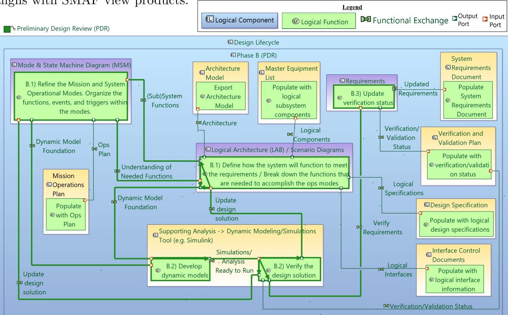


<div align="center">

Figure 3.4: Detailed MBSE methodology for Phase B. Purple logical components represent the Capella diagrams (method to implement the step), yellow logical components represent the SMAF view products, and green functions represent the process steps and the population of the view products.

</div>

<!-- PDF_PAGE: 63 -->

<div align="center">

Table 3.3: Phase B Methodology Steps.

</div>

<table border="1"><tr><td>Methodology Step</td><td>Methodology Method(Capella diagram/model element)</td><td>SMAF View Products</td></tr><tr><td>B.1) Refine the Mission and System Operational Modes. Organize the functions, events, and triggers within the modes.</td><td>Mode&amp;State Machine Diagram(MSM)</td><td>Mission Operations Plan, Supporting Analysis</td></tr><tr><td>B.1) Define how the system will function to meet the requirements/Break down the functions that are needed to accomplish the ops modes</td><td>Logical Architecture(LAB)/Scenario Diagrams</td><td>Supporting Analysis, Architecture Models, Master Equipment List, Design Specifications, Interface Control Document</td></tr><tr><td>B.2) Develop dynamic models</td><td>Supporting Analysis $\rightarrow$ Dynamic Modeling/Simulations Tool(e.g. Simulink)</td><td></td></tr><tr><td>B.2) Verify the design solution</td><td>Supporting Analysis $\rightarrow$ Dynamic Modeling/Simulations Tool(e.g. Simulink)</td><td></td></tr><tr><td>B.3) Update verification status</td><td>Requirements</td><td>System Requirements Document, Verification and Validation Plan</td></tr></table>

## 3.3.1 Methodology Step B.1: Refine the Logical Architecture Layer

In preparation for the PDR, the Logical Architecture diagrams, Mode and State Machine Diagrams, and the Scenario Diagrams should all be refined in parallel with completing analysis, Step B.2, to define how the system will function to meet design needs. This Arcadia layer should connect its architectures to external analysis tools to create dynamic simulations and verify the functional design. This should be an iterative process to refine a successful design for presentation at PDR. By the end of this step, the team should validate that the functional design can fulfill the system's requirements. Currently, the addition of external tools has not been extensively tested, but it will be a key aspect of future work.

<!-- PDF_PAGE: 64 -->

This phase focuses on defining how the system will function, and then the physical components will be chosen based on those that meet the functional needs in the next phase. Traditionally, hardware has often driven the design, sometimes at the expense of optimizing functionality. However, in a satellite system, functionality is critical, and therefore it should guide component selection. As with any engineering process, the functional design will undergo multiple iterations to refine and optimize the system.

Trade studies are an essential part of this step to identify the most effective design options. Traditional satellite trades, often completed in spreadsheets, may still be needed in parallel to the Capella models. However, Capella enables different design options to be modeled, plugged into the overall system, and analyzed, creating a potentially more efficient and in-depth trade study when compared to traditional methods. As part of future work, methods for conducting trade studies within the tool will be explored.

The steps within this phase are broad, but the following diagrams should be developed to capture the logical design.

- Logical Architecture Blank Diagram: Used similarly to previous architecture diagrams to capture the functions that the different components and actors will complete and the interactions or exchanges between the logical functions.

- Scenario Diagrams: Used to capture a sequence of functions. Time can be added to these sequences to capture the duration of events or the time between them.

- Mode & State Machine Diagram: Used to capture how the system will need to operate or be operated. Demonstrates how the functions fit into the big picture. The mission and system operation modes should be refined from the previous phases.

<!-- PDF_PAGE: 65 -->

All of this information will be used to populate the SMAF design documents, including Architecture Models, the Interface Control Document, Mission Operations Plan, Supporting Analysis, Master Equipment List, and the Design Specifications.

## 3.3.2 Methodology Step B.2: Supporting Analysis

Step B.2 of the Methodology requires additional research to understand how to connect Capella to external tools, such as Python, System Tool Kit (STK), or Simulink, for conducting dynamic analysis and developing simulations. However, this step is crucial for fully verifying the logical design and optimizing the benefits of digital engineering. This is where a significant amount of effort should be directed during this phase, and it will be a key feature of future work.

## 3.3.3 Methodology Step B.3 Update Verification Status

The information from the previous steps should be used to update the requirements and their verification status throughout Phase B. This should be done for the requirements defined within the Capella models, but also be propagated to the System Requirements Document and the Verification and Validation Plan view products.

All Phase B steps are iterative and must be repeated until the functional design satisfies the requirements and mission objectives. Phase C will then focus on the physical architecture and optimizing the baseline design captured in this phase.

## 3.4 Phase C: Final Design and Fabrication

Phase C is the Final Design and Fabrication Phase, with its Key Decision Point being the CDR. It further develops the previous phase's design, focusing on optimization. After this review, the design should be fully closed, and only minor changes should occur. This

<!-- PDF_PAGE: 66 -->

phase addresses the last Arcadia layer, the Physical Architecture. It will explore the actual components that will be used, how they will be integrated, and the properties of the system. By defining how the system will function to meet the needs in the previous layer, components can now be selected that fulfill these functional requirements. All the information at this layer should be used to update the simulations initiated in the previous phase, and further analysis should be completed to demonstrate that the system fulfills all of the requirements. The design-related view products from SMAF that should be delivered from the Capella models include the System Requirements Document, Verification and Validation Plan, Supporting Analysis, Design Specifications, Interface Control Document, Master Equipment List, and Architecture Models.

The following sections outline the process steps required to complete the Physical Architecture within the methodology, along with the methods used for each step, and how the information maps to the SMAF view products.

## 3.4.1 Methodology Step C.1: Define System and Subsystem Physical Architectures

The first step in developing the Physical Architecture is to define the actual hardware that will be used for the system. This is typically done after, or in parallel with, trade studies. In Capella, hardware is represented using Physical Node Components, which can be defined in various diagrams but should ultimately be organized in a PAB. When defining the physical hardware, the PVMT add-on should be used to add specifications, such as mass, power values, and data rates, to the components. This information can be read by Python scripts and used in analyses and validation of the design.

Once the individual node components are placed in a PAB, Physical Links should be established between them to illustrate how the elements are physically connected. Multiple

<!-- PDF_PAGE: 67 -->


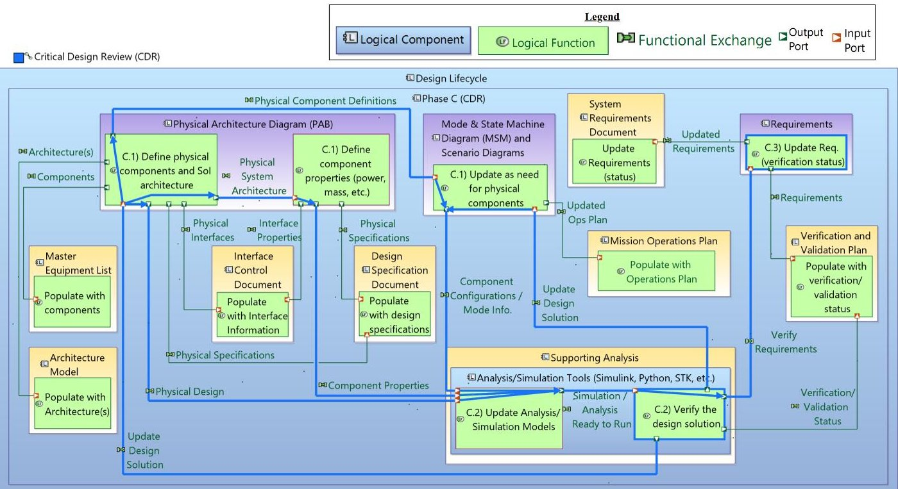


<div align="center">

Figure 3.5: Detailed MBSE methodology for Phase C. Purple logical components represent the Capella diagrams (method to implement the step), yellow logical components represent the SMAF view products, and green functions represent the process steps and the population of the view products.

</div>

<div align="center">

Table 3.4: Phase C Methodology Steps.

</div>

<table border="1"><tr><td>Methodology Step</td><td>Methodology Method(Capella diagram/model element)</td><td>SMAF View Products</td></tr><tr><td>C.1) Define physical components and SoI architecture</td><td>Physical Architecture Diagram(PAB)</td><td>Master Equipment List, Architecture Models, Interface Control Document, Design Specifications, Supporting Analysis</td></tr><tr><td>C.1) Define component properties(power,mass,etc.)</td><td>Physical Architecture Diagram(PAB)</td><td>Interface Control Document, Design Specifications, Supporting Analysis</td></tr><tr><td>C.1) Update as needed for physical components</td><td>Mode&amp;State Machine Diagram(MSM)和Scenario Diagrams</td><td>Supporting Analysis,Mission Operations Plan</td></tr><tr><td>C.2) Update Analysis/Simulation Models</td><td>Analysis/Simulation Tools(Simulink,Python,STK,etc.)</td><td></td></tr><tr><td>C.2) Verify the design solution</td><td>Analysis/Simulation Tools(Simulink,Python,STK,etc.)</td><td></td></tr><tr><td>C.3) Update Req.(verification status)</td><td>Requirements</td><td>System Requirement Document,Verification and Validation Plan</td></tr></table>

<!-- PDF_PAGE: 68 -->

PABs can be used to illustrate connections between boards, but another PAB can be used for different boards to display the specific pin layout.

Additionally, the Behavioral Physical Component (PC), which are equivalent to the Logical Components, along with their associated functions, can be allocated to their respective Node Component. The Component and Function Exchanges should automatically be populated in the diagram when the Behavior PC and functions are added. By the end of this step, a complete system or subsystem block diagram should be available to show how the system will be integrated. Several block diagrams will likely be needed to illustrate different viewpoints. Additionally, the PVMT add-on should be used to define the various types of connectors, and Python scripts can be used to verify that the connections are compatible. The Mode and State Machine Diagrams developed in the previous layers should be updated as needed to reflect the physical components that were decided upon.

One of the key benefits of MBSE is the ability to reuse models across projects. This is especially true for physical component diagrams. If specific subsystems are reusable, such as Commercial Off-the-Shelf (COTS) components, their physical architectures should be created in Capella Libraries rather than in individual Capella Projects. Libraries allow model elements to be reused across multiple projects.

For example, CubeSpace’s ADCS is used in several of HSFL’s CubeSats. To support reuse, a CubeSpace library can be created beginning at the Logical or Physical Architecture layer, with a PAB explicitly built for this ADCS. This can then be imported into multiple projects and connected to mission-specific components, significantly reducing the time required to develop models. Over time, as Capella is used in more projects, these libraries can continue to grow, enabling teams to reuse multiple subsystems from previous projects. This approach is particularly beneficial for student-led projects, where team members may

<!-- PDF_PAGE: 69 -->

lack the necessary experience to create in-depth models from scratch. Additionally, as more of these libraries are developed, it could allow for a quick trade between different subsystems, as you can import several different libraries and see how they fit the system's needs quickly.

## 3.4.2 Methodology Step C.2: Conduct Analysis

After defining the physical components, the satellite budgets (i.e., power, pointing, mass, data, and link) and analysis should be completed to verify the design against the requirements. Ideally, this step should be automated using Capella and linked to other applications, such as STK and Python. It should also build upon the simulations that were created in the previous layer. However, this is still a work in progress and will be a primary focus in future work. Below are examples of how both the Mass and Power budgets can be completed.

## Mass Budget

There is already an add-on tool to Capella to complete the mass budget. With the add-on, the mass of each physical node component can be set along with the maximum allowable mass. If the component is above the maximum, equal to, or below the maximum, it will change its fill color to red, orange, or yellow, respectively. If components are within each other, the component containing the others will add the individual masses to determine if it has met its maximum mass. The mass is unitless, so an appropriate unit needs to be chosen to capture the necessary granularity. Figure 3.6 shows a mass budget done in Capella, with the top being a positive budget and the bottom being a negative budget. Additionally, a Python4Capella script was created, as shown in Appendix C, that can also

<!-- PDF_PAGE: 70 -->


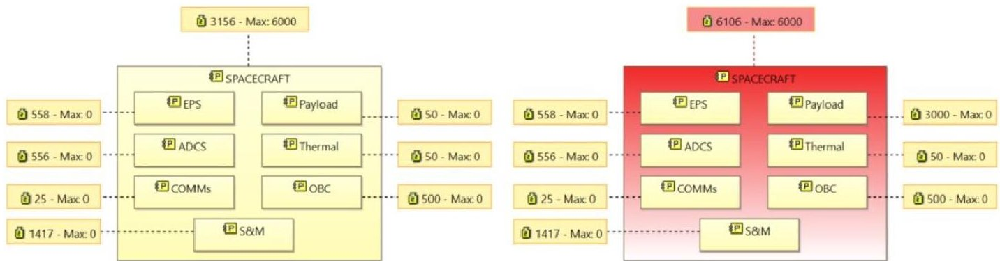


<div align="center">

Figure 3.6: Capella Mass Budget add-on example. Left illustrates a satellite that meets the maximum allowable mass requirement of 6 kg. Right increases the mass of the payload and does not meet the maximum allowable mass requirement.

</div>

retrieve PVMT values, total the mass, add a margin, and verify whether the total mass falls within the maximum allowable mass. An example of this can be seen in Chapter 4.

## Power Budget

There is no inherent add-on tool to complete a power budget. Instead, the Python4Capella add-on has been used to develop a script that reads Capella elements and properties, utilizing them to complete the budget. Properties such as Peak Power and whether a component is on for different operational modes were defined using the PVMT add-on. In previous versions of Capella, a table could be developed from the Modes Diagrams to specify whether specific components are enabled for the different modes. However, for the most recent version of Capella used in this development, v7.10, it was not yet available. In the future, better ways to conduct these budgets will be explored, such as utilizing the mode table feature. The current Power Budget script can be found in Appendix D, and an example of its use is provided in the Neutron-2 example, Chapter 4.

<!-- PDF_PAGE: 71 -->

## 3.4.3 Methodology Step C.3 Update Verification Status

The information from the previous steps should be used to update the requirements and their verification status throughout Phase C. This should be done for the requirements defined within the Capella models, and also be propagated to the System Requirements Document and the Verification and Validation Plan view products.

All the Phase C steps are iterative and must be repeated until the design satisfies the requirements and is optimized to meet mission needs, including considerations for Size, Weight, and Power (SWaP). Additionally, the Phase B steps will also need to be iterated with these steps to find the optimal functional and physical pairing.

<!-- PDF_PAGE: 72 -->

<div align="center">

# Chapter 4 Example Implementation of the MBSE Methodology

</div>

Although the Methodology has not been fully applied to a mission, it has been partially applied to the Neutron-2 project. By applying it to this project, a great deal was learned about the SmallSat MBSE Methodology, both in how a step can be completed and in the advantages and challenges of implementing it. This section provides background information on the N2 mission and presents examples of applying the Methodology to this project.

## 4.1 Neutron-2 Project Overview

Neutron-2 is a CubeSat currently being developed by students at the University of Hawai'i at Mānoa as part of the University Nanosatellite Program Cycle 12 (NS-12). UNP is managed by the U.S. Air Force and Space Force with the goal of training and preparing students for the aerospace workforce, specifically focusing on a proper Systems Engineering (SE) approach. UNP provides funding to several universities for their proposed CubeSat projects during UNP Phase A of the program. UNP defines its own distinct phases

<!-- PDF_PAGE: 73 -->

that differ from NASA's Life-Cycle phases, but the process and KDPs are similar. UNP Phase A includes mission design and the development of a Flat Satellite (FlatSat) to demonstrate mission feasibility. The reviews within this UNP phase includes the MCR, SRR, Project Management Review (PMR), PDR and CDR. At the end of UNP Phase A, UNP selects a few universities to continue into UNP Phases B, C, and D, covering flight model development, satellite testing, and ultimately launch and operations [32].

As a participant in NS-12, the N2 team is following the UNP systems engineering process and phases. In parallel, the MBSE methodology developed through this research is also being applied to the project. This dual approach allows the methodology to be tested on a real CubeSat mission, refine it based on practical application, and evaluate both its strengths and limitations.

The N2 payload is a neutron detector being developed in collaboration with Arizona State University (ASU) and Radiation Monitoring Devices (RMD) Inc. The mission aims to study neutron and gamma-ray fluxes as a function of time, geomagnetic position (latitude, longitude, altitude), and solar activity to gain insights into cosmic ray interactions, solar particle events, and space weather in LEO to make space exploration safer for all [34]. The Mission Objective (MO)s are as follows, and Figure 4.1 illustrates these objectives and their respective experiments.

- MO-1: Measure the flux of secondary neutrons and gamma rays produced by cosmic ray interactions in Low Earth Orbit as a function of time, geomagnetic latitude, and altitude (location-based data).

- MO-2: Measure secondary neutron and gamma-ray flux variations before, during, and after Solar Energetic Particle (SEP) events (event-based data).

<!-- PDF_PAGE: 74 -->


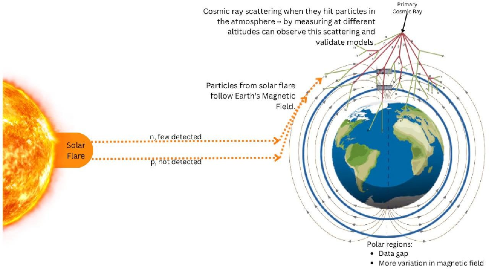


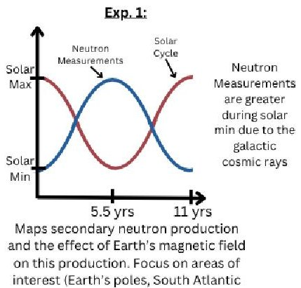


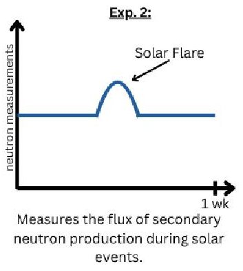


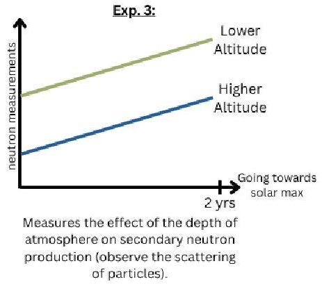


<div align="center">

Figure 4.1: N2 Experiments [34].

</div>

## 4.2 Neutron-2 Example

The N2 team is preparing for the PDR (in UNP Phase A), so for this research, the Logical and Physical Architecture layers examples were not fully completed. Additionally, the methodology was not applied to the project as a team, but rather as an isolated case study. With additional team members completing these steps and diagrams, more information and perspectives can and should be captured. Although it was not the sole design approach,

<!-- PDF_PAGE: 75 -->

lessons were still learned, and the methodology was fine-tuned. The sections below outline each of the methodology steps taken for N2.

## 4.2.1 N2 Methodology Step PA.1

Figure 4.2 illustrates step PA.1 of the methodology as applied to the N2 mission, where customers were identified. The PVMT was used to identify which entities were customers (denoted by green). The tan entities or actors are some already known, non-customer stakeholders. Because students at the UHM are developing the project, which is being funded and managed by UNP, these entities were known from the start of the project. However, the customers are the most important entities to identify at this step. For N2, the science community, ASU, and the Military are the customers because their needs and wants drive the mission. The next step will dive deeper into these needs.


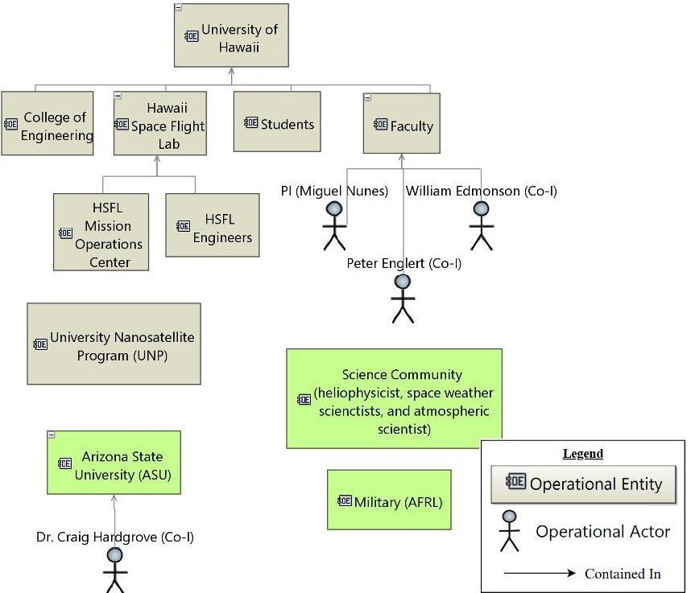


<div align="center">

Figure 4.2: N2 OEBD for Methodology Step PA.1. Green operational entities represent customers and tan operational entities represent non-customer stakeholders.

</div>

<!-- PDF_PAGE: 76 -->

## 4.2.2 N2 Methodology Step PA.2

The next step in the methodology is to identify the customer's needs using an OCB Diagram. When applying this to N2, two OCBs were created: the first, as shown in Figure 4.3, displays all the entities identified during the previous step along with their needs, as well as the support or constraints they provided to the project. Figure 4.4 provides an isolated view of the customer's needs. This provides a good example of how, by using the same model elements, a new diagram can be created with just a couple of steps that shows a specific perspective as needed by a stakeholder. Another thing learned from this diagram is that the Diagram Styler Tool, an add-on to Capella that enables the visualization of properties defined by the PVMT add-on, does not work for all diagrams. The OCB is one in which you cannot change the appearance of model elements based on their properties; however, the properties are still present so that they can be added to the diagrams. The color changes shown in Figures 4.3 and 4.4 were manually applied to match the previous diagram.

<!-- PDF_PAGE: 77 -->


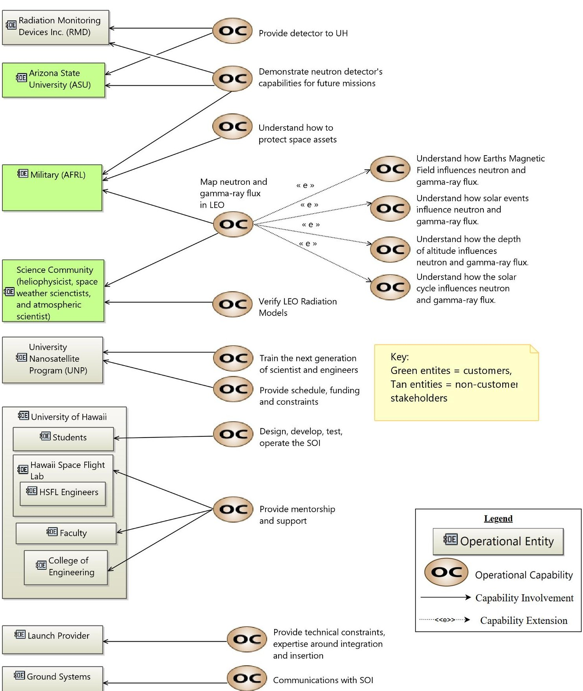


<div align="center">

Figure 4.3: N2 OCB for Methodology Step PA.2, showing all of the operational entities defined at this step.

</div>

<!-- PDF_PAGE: 78 -->


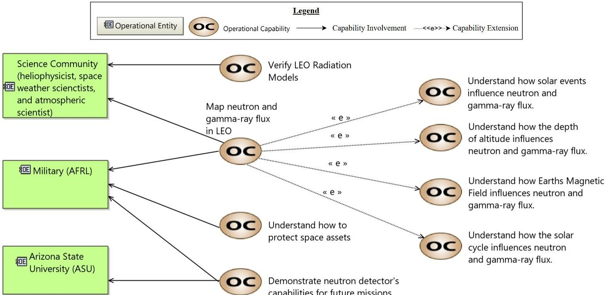


<div align="center">

Figure 4.4: N2 OCB with only customers for Methodology Step PA.2.

</div>

## 4.2.3 N2 Methodology Step PA.3

Methodology Step PA.3, understanding the customers' needs, is captured in Figures 4.5, 4.6, and 4.7. The blue and red operational processes in Figure 4.5 identify how secondary neutrons are produced. This was vital for the engineers to understand what the mission was trying to measure and why the mission objectives were important. Through creating this diagram, thorough conversations were held with the science customers, probing them with questions and fine-tuning their actual needs.

In Figure 4.6, the specifics on where and when observations need to be made were identified. The summary or description of these science community operational activities further defines why those specific measurements are essential. An example of this is shown in Figure 4.8.

Figure 4.7 shows a Class Breakdown Diagram for the N2 project. This diagram was crucial in capturing the necessary data for the science mission. The data captured in a CDB can then be used throughout other diagrams as exchanged items, however, this was

<!-- PDF_PAGE: 79 -->

not fully explored or executed in this example. At this point, the CDB was used to capture information, but it has much greater potential that will be explored in the future.

Throughout these steps, a greater understanding of the scientific phenomenon behind the mission was gained. Following these steps and having to capture the information in a graphic forced the team to engage in lengthy conversations with customers, truly understanding their needs and why those needs were important. Capturing the risks associated with a PVMT property proved to be a challenging process, and there is likely a more effective way to identify these risks, which will be studied. Although this method was only applied for a science mission, it could easily be used to illustrate a technology need for a technology demonstration mission.

<!-- PDF_PAGE: 80 -->


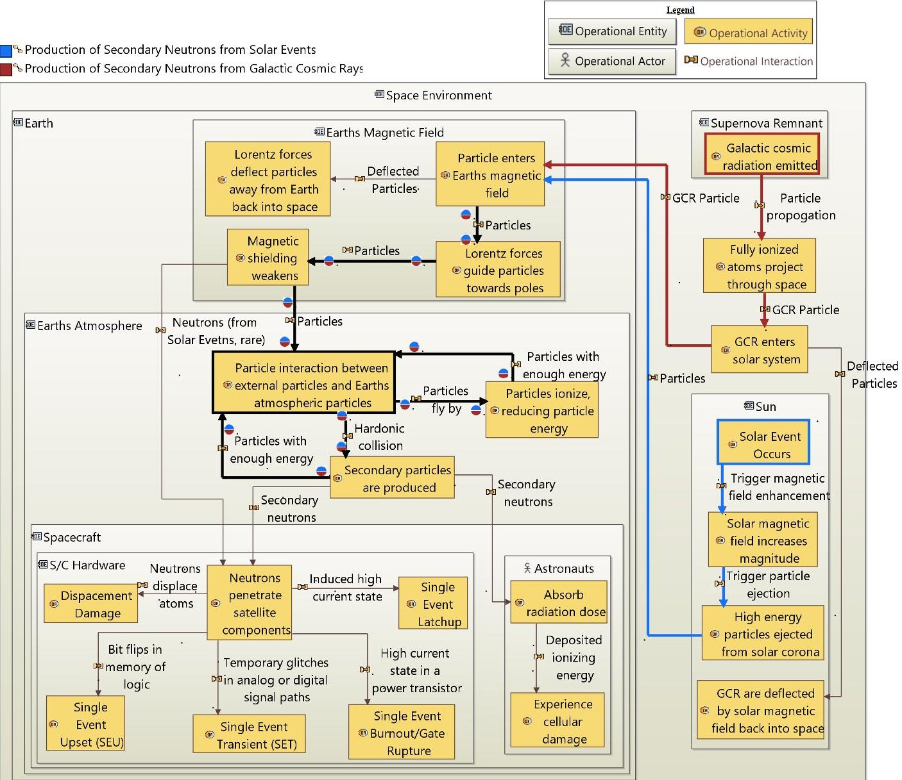


<div align="center">

Figure 4.5: N2 OAB to define the science phenomenon and the resultant satellite and astronaut damage that the customers want to observe and ultimately prevent. Developed for Methodology Step PA.3.

</div>

<!-- PDF_PAGE: 81 -->


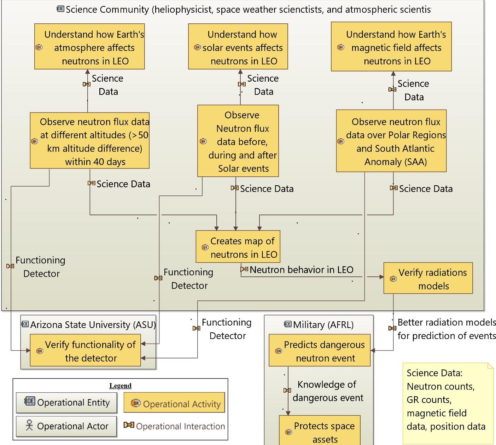


<div align="center">

Figure 4.6: N2 OAB Diagram to define the specifics of the observations that the customers need in order to meet their capability needs. Developed for Methodology Step PA.3.

</div>

<!-- PDF_PAGE: 82 -->


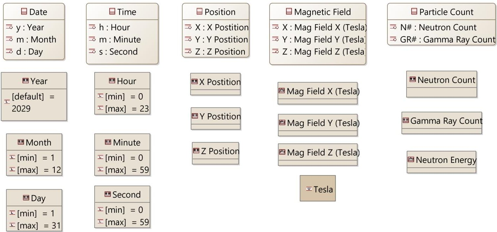


<div align="center">

Figure 4.7: N2 CDB, defining the critical data needed for the customer's science observations. The data within this diagram all represent measured data, not calculated data. Developed for Methodology Step PA.3.

</div>


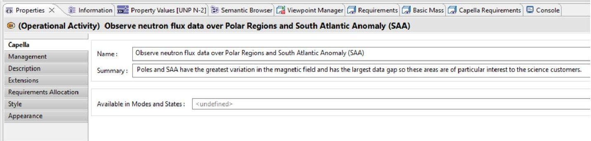


<div align="center">

Figure 4.8: When a model element is selected, this properties pane appears with details on the element. The summary field can be used to add extra details. This example highlights the significance of observations in the polar and South Atlantic anomaly regions.

</div>

## 4.2.4 N2 Methodology Steps PA.4, PA.5, and PA.6

Figure 4.9 shows a Mission Capability Breakdown Diagram, which was used to capture the Mission Statement, Mission Objectives, and Success Criteria defined and entered by the user. Note that both minimum and full success criteria were defined to capture different

<!-- PDF_PAGE: 83 -->

tiers of success. This diagram completes the first three steps of the System Analysis layer, providing a strong foundation for the system moving forward. After completing these steps, the team is prepared for the Mission Concept Review.


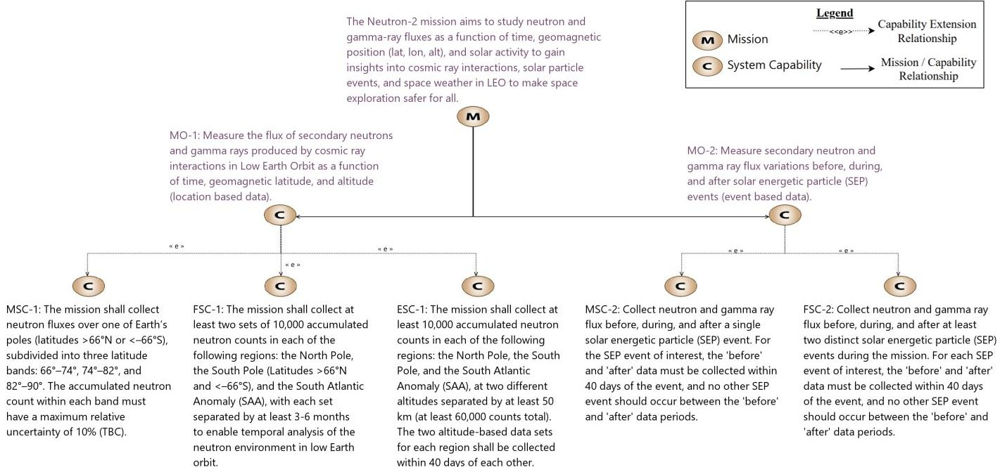


<div align="center">

Figure 4.9: N2 MCB for Methodology Steps PA.4, PA.5, and PA.6. The Mission Statement, Mission Objectives, and Minimum and Full Success Criteria (MSC and FSC, respectively) are all captured in this diagram.

</div>

## 4.2.5 N2 Methodology Steps A.2 and A.3

Figures 4.10 through 4.13 show steps A.2 and A.3 of the methodology. Figure 4.10 uses a System Architecture Diagram to define the top-level functions needed for the CONOPs. Note that this does not provide significant detail because design solutions have not been established at this time. This step involves understanding what the system needs to do or how it needs to operate to fulfill the top-level mission requirements. The amount of detail known at this level will vary based on the mission, but caution must be taken not to lock in design decisions before the system requirements have been determined.

<!-- PDF_PAGE: 84 -->

The system architecture diagrams should also be used to capture the required experiments needed to fulfill the Mission Objectives and Success Criteria. An example of this is shown in Figure 4.11 for Experiment 1 of the N2 mission, which focuses on collecting science data over the polar regions to fulfill Mission Objective 1 and the corresponding Full Success Criteria. Additionally, derived system-level requirements from these functions were captured on the same diagram. Lastly, a functional scenario diagram was used to capture the same experiment and understand the sequence of steps, as well as the timing needs. It can be seen that the data collection duration over the poles will be 15 minutes. Additionally, loops were used to illustrate that this process is repeated throughout the mission. The inner loop, titled LOOP [until neutron_count $ \geq 10,000 $ ], notes that this series of functions needs to be repeated until 10,000 neutron counts are collected based on the Success Criteria for Mission Objective 1. The outer loop, titled LOOP [repeat every 6 months], indicates that 10,000 counts need to be collected after 6 months to understand how the solar cycle impacts neutron flux, as described by the Success Criteria for Mission Objective 1. A requirement for the lifetime of the system was derived from this loop, showing that requirements can be added to different types of diagrams.

These steps are only shown here for one experiment for N2. More details will be added to capture the other experiments required for the mission, as well as any additional functions needed to support these experiments. As mentioned previously, these examples were only completed by one team member. With multiple team members collaborating on these diagrams, significantly more detail and perspectives can be captured.

<!-- PDF_PAGE: 85 -->


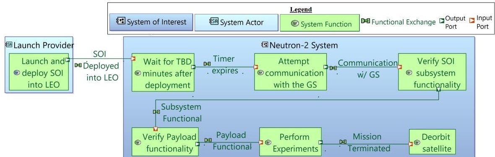


<div align="center">

Figure 4.10: N2 SAB showing the CONOP for the N2 mission. Developed for Methodology Step A.2.

</div>


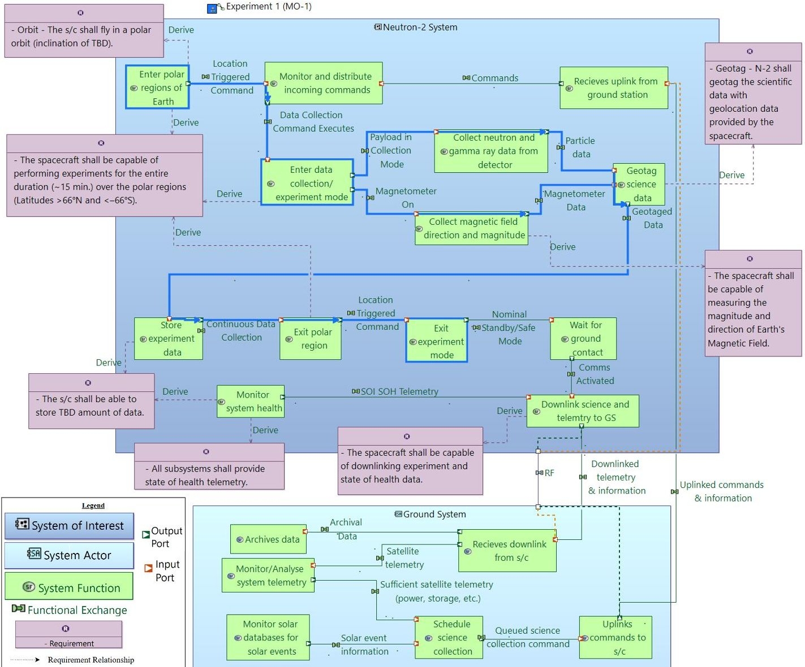


<div align="center">

Figure 4.11: N2 SAB showing the functions needed for experiment 1 of the N2 mission, which is related to MO-1, and the derived system requirements. Developed for Methodology Steps A.2 and A.3.

</div>

<!-- PDF_PAGE: 86 -->


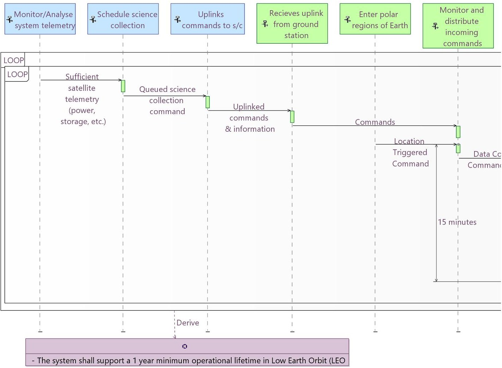


<div align="center">

Figure 4.12: N2 Functional Scenario Diagram showing the sequence of functions for experiment 1. Developed for Methodology Steps A.2 and A.3.

</div>

<!-- PDF_PAGE: 87 -->


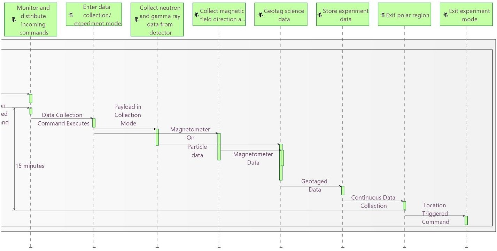


<div align="center">

Figure 4.13: Continuation of the N2 Functional Scenario showing the sequence of functions for experiment 1. Developed for Methodology Steps A.2 and A.3.

</div>

## 4.2.6 N2 Methodology Steps A.4, A.5, A.6, and A.7

To derive the subsystem requirements for the System Requirement Review, the systemlevel functions were broken down into functions that the subsystems must perform. This breakdown is illustrated in Figure 4.14, where the white functions were defined at the System Analysis layer and the green functions were defined during this step.

After breaking down these functional needs, a LAB was used to define the necessary subsystems, allocate their respective functions, and define their requirements. This can be seen in Figure 4.15. As mentioned in the previous section, these steps aim to determine what the system and subsystems need to do and are not focused on making design decisions. Figures 4.14 and Figure 4.15 illustrate how these steps would be achieved, but do not capture as much detail as would be needed. They should both provide much deeper

<!-- PDF_PAGE: 88 -->

detail to capture all subsystem requirements, as well as any operational or ground station requirements. Additionally, it can be seen that the payload contains significantly more detail on how it will actually function. This is because the payload was already selected for this mission at the proposal stage, and the majority of the design is complete, allowing it to be captured. These functions can then be organized into operational modes, as shown in Figure 4.16.


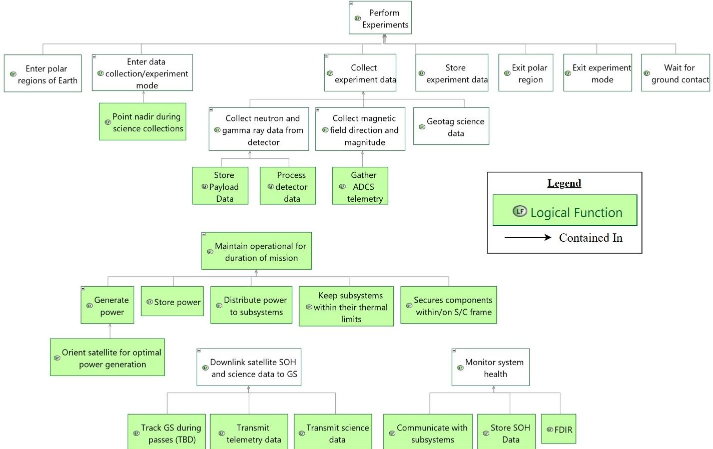


<div align="center">

Figure 4.14: N2 LFBD used to derive the subsystem functions for SRR. White system functions represent the functions defined at the System Analysis layer and the green system functions represent the functions defined at the Logical Architecture (Step A.4). Developed for Methodology Step A.4.

</div>

<!-- PDF_PAGE: 89 -->


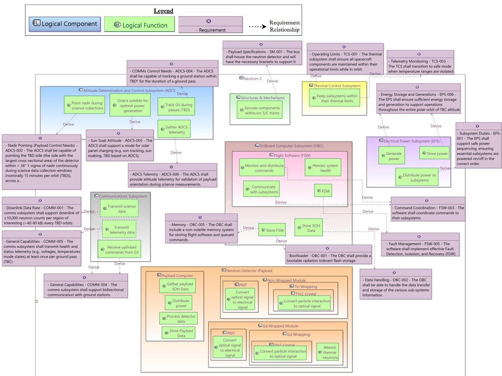


<div align="center">

Figure 4.15: LAB used to capture the N2 subsystems, subsystem functions and subsystem requirements for SRR. The different color logical components represent the different satellite subsystems with blue being the ADCS, green being the S&M, yellow being the TCS, purple being the EPS, red being the OBC, pink being the FSW, grey being the COMM, and orange being the PAY. Developed for Methodology Steps A.5 and A.7.

</div>


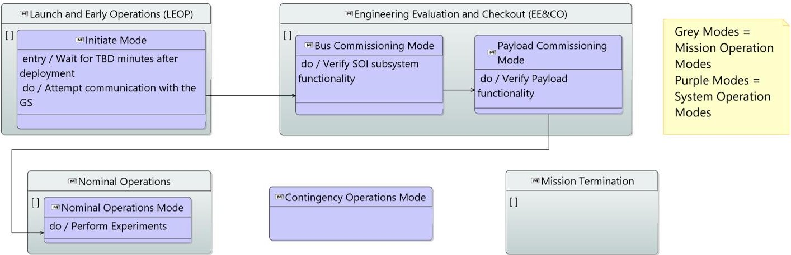


<div align="center">

Figure 4.16: Initial N2 MSM developed for Methodology Step A.6.

</div>

<!-- PDF_PAGE: 90 -->

## 4.2.7 N2 Methodology Step B.1

Step B.1 focuses on the functional design of the system, shifting from defining the requirements to designing how the system will function to meet those requirements. The LABs defined in the previous phase should now be elaborated on and used to support key design decisions. Figures 4.17 and 4.18 illustrate two views of an LAB: the former shows the logical connections between components, while the latter shows the system's functionality. These examples represent relatively simple diagrams, but with additional resources, the diagrams should be expanded to capture the complete functional design of the system. Furthermore, steps B.2 and B.3, which involve using tools beyond Capella to validate the functional design and requirements, were not completed for the N2 example. Developing these additional models will be a primary focus of future work, as they can significantly enhance the value of the methodology and the digital engineering approach.

<!-- PDF_PAGE: 91 -->


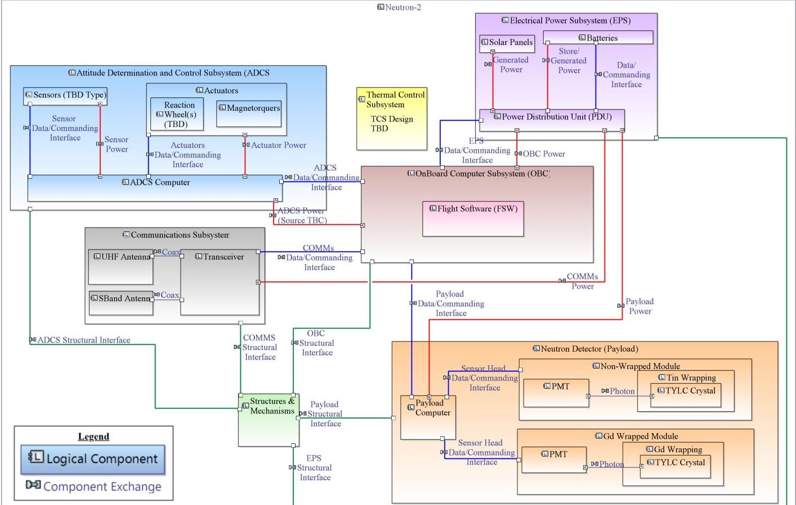


<div align="center">

Figure 4.17: N2 LAB for Methodology Step B.1, highlighting the logical connections between subsystems. The different color logical components represent the different satellite subsystems with blue being the ADCS, green being the S&M, yellow being the TCS, purple being the EPS, red being the OBC, pink being the FSW, grey being the COMM, and orange being the PAY.

</div>

<!-- PDF_PAGE: 92 -->


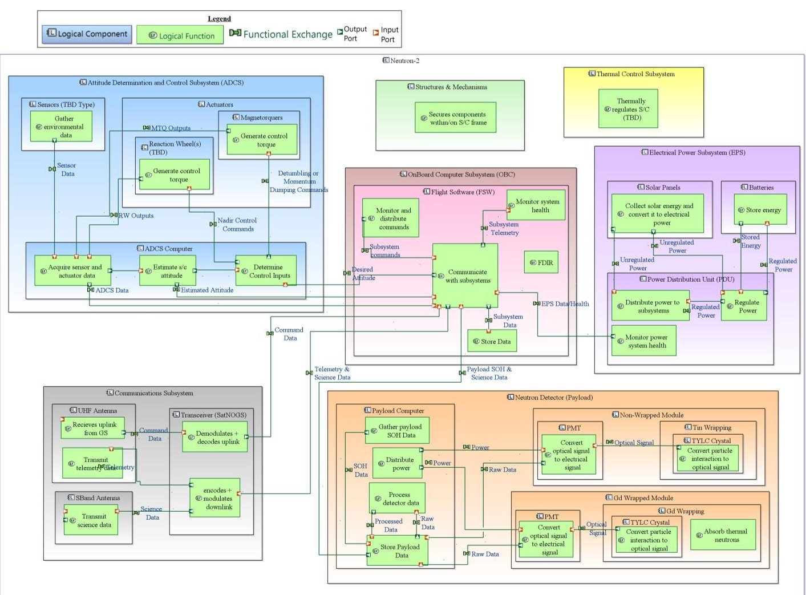


<div align="center">

Figure 4.18: N2 LAB for Methodology Step B.1, highlighting the logical functions of the subsystems. The different color logical components represent the different satellite subsystems with blue being the ADCS, green being the S&M, yellow being the TCS, purple being the EPS, red being the OBC, pink being the FSW, grey being the COMM, and orange being the PAY.

</div>

## 4.2.8 N2 Methodology Step C.1

Figure 4.19 shows an initial PAB diagram that defines the hardware components as Physical Node components and then distributes the Physical Behavior Components to the appropriate hardware components. The Physical Behavior Components are the Logical Components carried over from the previous phase and have been revised to match the hardware selection. The functions defined at the Logical Architecture Layer are also carried over and refined for the hardware selection.

<!-- PDF_PAGE: 93 -->

This view, which includes the Behavior Components and their functions, was fairly busy, so to identify the electrical harnessing between components, another PAB was defined and can be seen in Figure 4.20. This PAB defines additional physical components that represent the different connectors and then physical links to define how they are connected. The PVMT add-on is used to describe the type of connection (i.e., power, command and data, or both). To further understand the connectors and their actual pins, another PAB can be used, and Physical Ports can be added to the connectors to represent the pins. Figure 4.21 shows the PC104 stack that connects N2's radio board, OBC, Power Distribution Unit (PDU), and ADCS computer. The pins are defined, and the PVMT tool is used to describe the type of pin (i.e., 3V3, 5V, VBatt, Ground, I2C, or GPIO).

<!-- PDF_PAGE: 94 -->


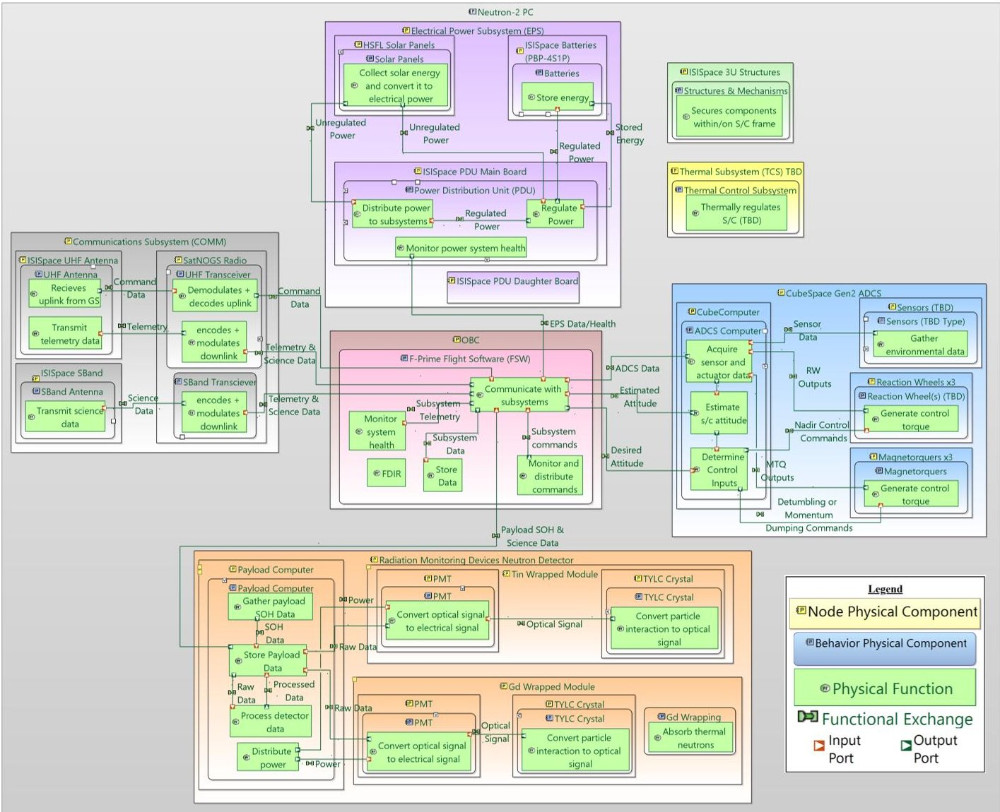


<div align="center">

Figure 4.19: N2 PAB with the Physical Behavior Components and their functions, developed for Methodology Step C.1. The different color logical components represent the different satellite subsystems with blue being the ADCS, green being the S&M, yellow being the TCS, purple being the EPS, red being the OBC, pink being the FSW, grey being the COMM, and orange being the PAY.

</div>

<!-- PDF_PAGE: 95 -->


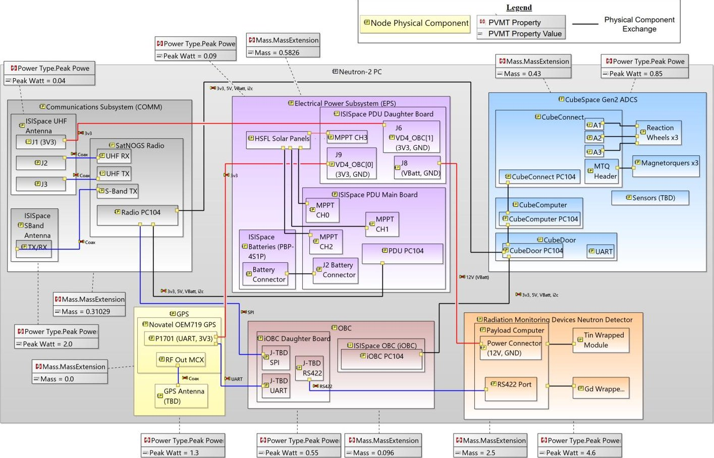


<div align="center">

Figure 4.20: N2 PAB that focuses on the electrical harnessing between physical components, developed for Methodology Step C.1. The different color logical components represent the different satellite subsystems with blue being the ADCS, green being the S&M, yellow being the TCS, purple being the EPS, red being the OBC, pink being the FSW, grey being the COMM, and orange being the PAY.

</div>

<!-- PDF_PAGE: 96 -->


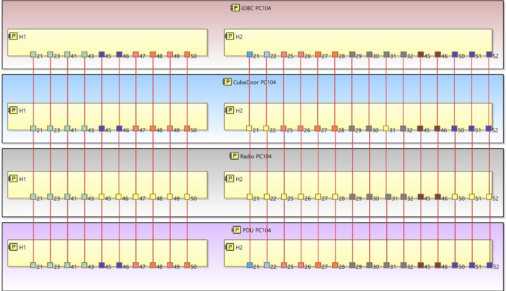


<div align="center">

Figure 4.21: N2 PAB focusing on the PC104 stack and the pins, developed for Methodology Step C.1. The pin colors are as follows: green represents I2C, purple represents GPIO, pink represents 5V, orange represents 3V3, dark blue represents UART RX, light blue represents UART TX, grey represents ground, and dark red represents VBatt.

</div>

## 4.2.9 N2 Methodology Step C.2

For the N2 example, Step C.2 was partially completed by developing a mass budget and a power budget using Python4Capella. Below are the results of these budgets.

Mass Budget: A mass budget, using the Python script found in Appendix C, was generated from the N2 Physical Architecture. A mass property was defined, and mass values were set for the subsystem's physical components. Currently, the total mass of the subsystem is set; however, it can be defined for individual components to add finer detail. The maximum allowable mass and margin are currently hard-coded; however, as future

<!-- PDF_PAGE: 97 -->

work, they should be defined within the model and read by the script. Below is the output of the mass budget:

Project: UNP N-2

=== Mass Budget ===

- Electrical Power Subsystem (EPS): 0.5826 kg

- ISISpace OBC (iOBC): 0.096 kg

- CubeSpace Gen2 ADCS: 0.43 kg

- Radiation Monitoring Devices Neutron Detector: 2.0 kg

- Communications Subsystem (COMM): 0.31029 kg

- ISISpace 3U Structures: 0.404 kg

- Thermal Subsystem (TCS) TBD: 0.05 kg

Total Mass: 3.873 kg

Total Mass + 15% Margin: 4.454 kg

Max Allowable Mass: 6.000 kg

The mass budget above reflects a Payload with two sensor head modules,totaling 2 kg in mass. However, if the team wanted to explore adding another payload module, they would update the Payload physical component and its properties, and then rerun the mass budget, requiring only a few steps. These steps can be seen in Figure 4.22. This allows the engineers to quickly see the updates of a design change and understand if it still meets the requirements. Below is the output of the mass budget with the updated payload:

Project: UNP N-2

<!-- PDF_PAGE: 98 -->

- ISISpace OBC (iOBC): 0.096 kg

- CubeSpace Gen2 ADCS: 0.43 kg

- Radiation Monitoring Devices Neutron Detector: 2.5 kg

- Communications Subsystem (COMM): 0.31029 kg

- ISISpace 3U Structures: 0.404 kg

- Thermal Subsystem (TCS) TBD: 0.05 kg

Total Mass: 4.373 kg

Total Mass + 15% Margin: 5.029 kg

Max Allowable Mass: 6.000 kg

<!-- PDF_PAGE: 99 -->


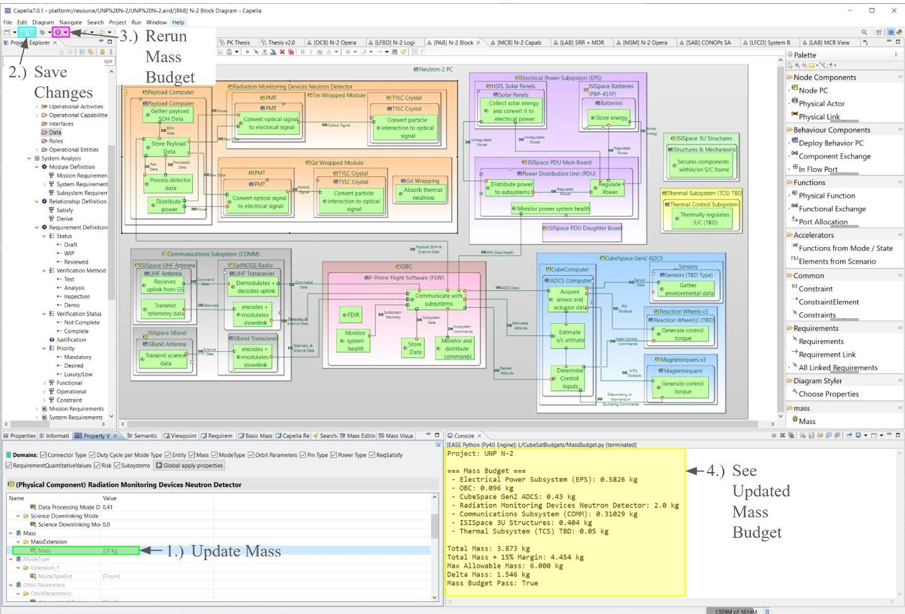


<div align="center">

Figure 4.22: Steps within Capella to rerun the Mass Budget. With four simple steps, a component's mass can be updated, and the Mass Budget Python Script can be rerun to get the new total mass and determine if the current design meets the system requirements.

</div>

Power Budget: A preliminary power budget was completed using the Python script provided in Appendix D to analyze the power usage during the Nominal Operations Phase of the N2 mission. It examines a day period, conducting a 15-minute experiment once per orbit. The script currently determines the power usage for each mode by retrieving the peak power values and duty cycles of each subsystem across different modes from the Capella model elements, using the PVMT add-on. It also reads two CSV files that were populated from a previous power budget: one indicating whether the satellite is in sunlight or eclipse, and another specifying the satellite's mode throughout the day. To calculate power generation at each time interval, the script currently relies on hard-coded values

<!-- PDF_PAGE: 100 -->

for power generation per mode, combined with the eclipse information from the CSV file. These hard-coded values can later be replaced with values extracted directly from the Capella models or generated through a STK simulation. The connection of tools like STK with Capella is a work in progress and will be a critical aspect of future work. For this initial power budget, only the peak power and duty cycle were pulled directly from the Capella models to demonstrate feasibility.

The script outputs key values to the console and also exports a CSV file containing the complete power profile. An example of the script's output is provided in Appendix E.

Figure 4.23 shows a graph of the power budget profile, using the CubeSpace ADCS product for the attitude control subsystem. However, if the team wanted to explore using TensorTech's ADCS, which has a significantly different power draw, the components and properties can be altered in the PAB, and the budget can be rerun. The results of this new power budget are seen in Figure 4.24. Since the TensorTech ADCS consumes significantly more power, it is immediately clear that the budget is unsustainable over time with the current operations plan.

<!-- PDF_PAGE: 101 -->


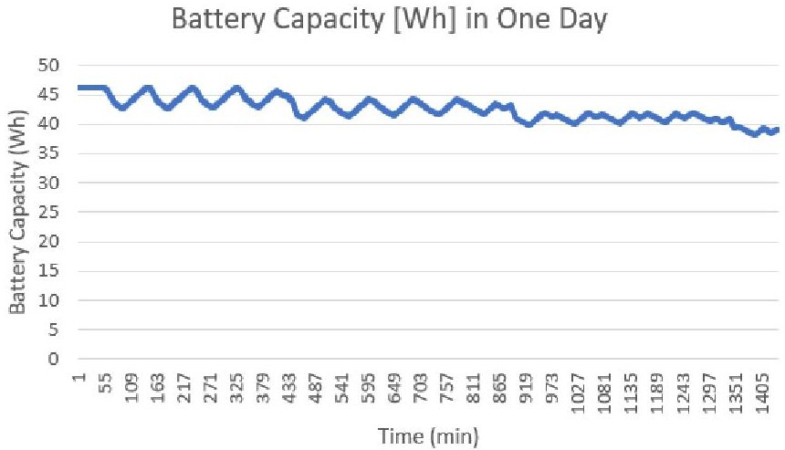


<div align="center">

Figure 4.23: Results of the N2 Power Budget using the CubeSpace ADCS for Methodology Step C.2.

</div>


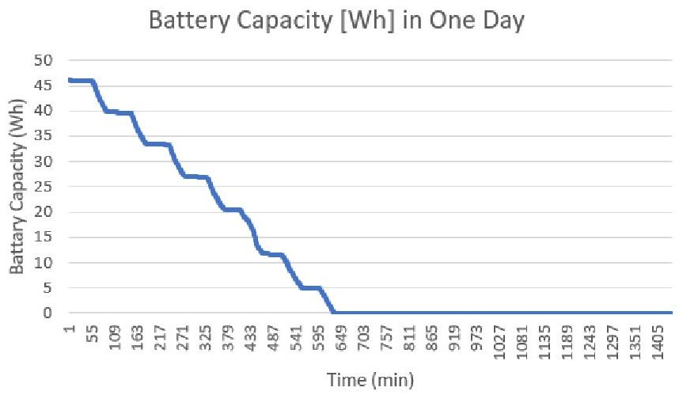


<div align="center">

Figure 4.24: Results of the N2 Power Budget using the TensorTech ADCS for Methodology Step C.2.

</div>

<!-- PDF_PAGE: 102 -->

## Chapter 5 Conclusion

The objectives of this research were to develop a methodology, comprised of a process and correlating methods, for designing CubeSats using MBSE within a small team environment and to integrate the Arcadia method into NASA's Space Mission Architecture Framework and Life-Cycle. The SmallSat MBSE Methodology was then applied to the Neutron-2 CubeSat mission to evaluate and refine its effectiveness. Throughout this process, several advantages and limitations of using MBSE compared to document-centric engineering were identified. This final chapter summarizes the key areas where the proposed MBSE methodology adds value to a CubeSat project, discusses the factors necessary for its successful implementation, outlines how it can be incorporated into the EPET course at University of Hawai'i at Mānoa, and identifies directions for future work.

<!-- PDF_PAGE: 103 -->

## 5.1 Discussion

## 5.1.1 Advantages of the SmallSat MBSE Methodology

## Understanding the Mission's Purpose

Arcadia and the proposed methodology help ensure a clear understanding of the mission's purpose by first identifying the customers and their needs before proceeding to any design-related activities. It emphasizes understanding why a solution is essential, what the customer truly needs, and why they need it. Failing to ask and fully grasp these questions can lead to misunderstandings about the system's purpose, resulting in a solution that is neither appropriate nor optimal for the actual needs. Before considering the system itself, the Operational Analysis must be completed to define what the customer wants and why. Only then should System Analysis begin, ensuring that all decisions are derived from and aligned with the insights gained in the previous steps. Approaching System Analysis with an unbiased perspective allows the design team to focus on optimizing the solution based on the customer's needs, rather than prematurely committing to a specific design.

Similar logic applies to conducting the Logical Architecture before defining specific components at the Physical Architecture. By capturing and validating the system's functionality first, and then selecting components that meet the functional requirements, the system is designed to optimally function to the customer's needs. This still allows constraints to be imposed if specific components need to be used; however, it aims to eliminate the need for functional requirements to bend to meet the constraints of particular components when they may not be mandatory. Likely, there will need to be some give and take when it comes to optimizing functionality and accommodating component constraints. However, this method emphasizes that the system ultimately needs to function to meet

<!-- PDF_PAGE: 104 -->

customers' needs, and components should be selected to fulfill these functional requirements whenever possible.

## Automating Budgets

Another significant benefit of using MBSE for CubeSat design is the automation of satellite budgets based on the model element properties. Using the Python4Capella and the Property Value Management Tool add-ons, an example was made for both the Mass Budget and Power Budget. By assigning the specifications of the physical components, a Python script can read these values and perform the calculations needed to determine if the budgets are sufficient. If components or specifications change, they can be updated within the Capella diagrams, and the budgets can be rerun to quickly conduct an updated budget analysis. One aspect of these budgets that will need to be incorporated into future work is feeding the results of these budgets back into the Capella diagrams and relating them to the requirements, indicating whether they are satisfied or not.

## Deriving and Capturing Requirements

Another strength related to MBSE is its ability to derive, capture, track, and validate requirements. Our methodology reinforces this by structuring requirements into distinct tiers: mission requirements, system requirements, and subsystem requirements, and clearly defines how each tier is derived from the needs defined in the previous Arcadia layer:

- Mission requirements are derived directly from the customer needs, mission statement, mission objectives, and success criteria.

- System requirements are derived from the functions the system must perform to fulfill the mission requirements.

<!-- PDF_PAGE: 105 -->

- Subsystem requirements are derived from the functions needed to satisfy the system requirements.

Within Capella, a Satisfy relationship can be established between a model element and a requirement, indicating that the element fulfills that requirement. As mentioned in the previous section, automating this relationship based on analysis results has not been implemented; however, it will be explored in future research. For example, in the mass budget, the final satellite mass may satisfy a requirement for the maximum allowable mass. The Python script could then write to the Capella models, indicating whether this is true or not.

## Single Source of Information and Improved Documentation

Another key benefit of using MBSE rather than document-centric systems engineering is that it can provide a single source of design information. For academic CubeSat teams, document management can be one of the most significant challenges they face. Typically, source information becomes scattered and inconsistent across documents, and the number of documents often grows to an unmanageable level. Additionally, student teams experience frequent turnover, making it challenging to verify the accuracy of information after team members who wrote the documents have left the team. With MBSE, all of the source design information is contained within the Capella models. The same model elements are used across different models, meaning that if a change is made to an element, it is reflected in every model where it is used, thereby maintaining consistent information. Additionally, the information in the models can be exported to a CSV file or a Word document to deliver to stakeholders at KDPs. This can reduce mistakes related to using inconsistent information across different aspects of the design and also reduce the time spent managing a large number of documents.

<!-- PDF_PAGE: 106 -->

## Highlighting Different Viewpoints

While one of the defined challenges is associated with using the Capella tool, a key benefit is how easily different viewpoints of the models can be made. This refers to the various SMAF viewpoints, including those of the enterprise, mission operator, scientist, or engineer, as well as different engineering viewpoints, such as software, electrical, or mechanical. With a few simple actions, a diagram can be cloned, and specific element types, such as functions or logical connections, can be isolated to show a particular view. For example, suppose your avionics team is only interested in the components' electrical harnessing. In that case, the physical ports and connections can be isolated in a diagram, removing any behavioral and functional elements. The software team, however, may only be interested in the functionality of the components and need an isolated view of those model elements. These different views can easily be developed from the same initial model. Suppose the stakeholders only care about meeting their needs. In that case, components and functions that demonstrate the operational needs or requirements being met can be isolated, without overpopulating a diagram with unnecessary details.

## Reusing Models Across Different Missions

By leveraging Capella libraries, a suite of reusable models can be developed and applied across different projects. Once a comprehensive library has been established and validated, its elements can be reused, ultimately saving time and reducing risk. The Hi-Tech Sat (HTS) program, a small satellite initiative led by HSFL, presents an excellent opportunity to develop a reusable library of models. HTS is a program that aims to design a 3U satellite bus, serving as a baseline design for all HSFL and EPET CubeSat projects, allowing for a mission-specific payload to be easily integrated into the design. If a model library of the HTS bus is developed, it can then be pulled for all future missions that use the design.

<!-- PDF_PAGE: 107 -->

When the payload is added to the Capella projects, Python scripts can be run to assess the compatibility of the payload and identify any design aspects that require rework.

## 5.1.2 Conditions for Successful Implementation of MBSE

To aid in MBSEs success on small team projects, particularly student projects, a few key items have been identified that are critical and can address challenges. Firstly, an understanding of the methodology is vital, ensuring a structured approach to capture the critical aspects of the design. To use it efficiently, a tutorial or user guide is also necessary to explain in detail how to utilize the tool to accomplish the various steps of the methodology. Throughout this research, one of the key challenges identified was using the Capella tool. A handful of basic functions are not automated, making it tedious to work with the tool and maintain organized, easy-to-read models. Additionally, there are an abundance of model elements and element relationships, so many that the tool can be overwhelming and challenging to ensure everything is being captured correctly. By describing in detail how to use the tool, in this case Capella, for the methodology steps, the learning process can be made quicker by having the user only use the aspects of Capella that are needed for the methodology. Additionally, it is essential to teach students the systems engineering mindset rather than focus on teaching them a specific tool. While learning how to use tools is important, the mindset will add value to their career, regardless of what MBSE tool they may encounter in the future. By having a tutorial to follow, they can focus more on the methodology and learning the mindset.

In addition to a tutorial, a tool that facilitates smooth collaboration is also needed. For the version of Capella used in the Neutron-2 example, the models could not be easily collaborated on by more than one user. Without being able to have the whole team collaborate on the design models as they would with a Google Document, Capella is

<!-- PDF_PAGE: 108 -->

not being utilized to its full potential. If one person acts as the lead systems engineer, populating the models with design information, this approach remains partially documentcentric and susceptible to the limitations inherent in it. There are solutions to this, such as the Capella Teams add-on, but they must be implemented before attempting MBSE with Capella for a team project.

Additionally, for MBSE to be successful within a small team, members must remain open-minded and willing to learn the methodology and systems engineering mindset while contributing to its refinement and documentation. Although a strong foundation was established during this research, further development is needed to optimize it for satellite design. This process can only occur through practical application by engineers on real projects. Engineers adopting the methodology should embrace a systems engineering mindset and actively contribute to improving how information is captured in Capella and how dynamic models are developed to validate the design. If engineers remain rooted in traditional, document-centric approaches and resist adopting a systems-oriented perspective, achieving success with MBSE will not be possible. In addition to the teams buy in, management buy in is also critical. Because it takes a significant amount of resources to begin the implementation of MBSE in an environment, management must be willing to supply these resources and invest in the team to learn and transition to this new approach.

This last aspect, although not critical to successful MBSE on its own, significantly contributes to the benefits of MBSE and is crucial in achieving digital engineering. This involves developing analysis and dynamic models that can be used to validate the design. An example of this was demonstrated using Python4Capella by running mass and power budgets. Additionally, tools like Simulink or STK can be connected to Capella to run further simulations, and the results can be fed back into the Capella models to verify

<!-- PDF_PAGE: 109 -->

the requirements. Figure 5.1 revisits these aspects that are necessary for MBSE to be implemented successfully.


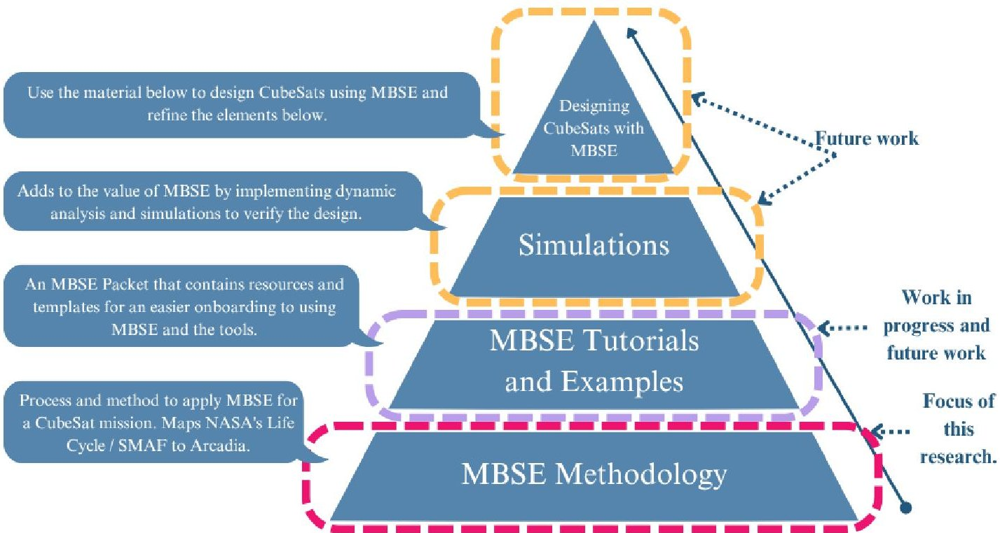


<div align="center">

Figure 5.1: Elements to implement MBSE in an academic setting with current status.

</div>

## 5.1.3 Populating Products

It is essential to note that while MBSE models should be the primary source of information, this is only true for design information, and it will still need to be propagated into formal documents that can be delivered to stakeholders. Capella is a design tool, and while it can capture a lot of information, project management products, such as project schedules or management plans, will not be captured in Capella. Additionally, while tools like M2Doc can populate Word documents with design information from Capella, additional text will need to be added to ensure clarity and maintain document readability. This additional text can be incorporated into the M2Doc templates; however, human review will be necessary

<!-- PDF_PAGE: 110 -->

to ensure readability. The design details, though, if populated from Capella models, will be more consistent than if they were entirely hand-written.

## 5.1.4 MBSE within EPET

To understand how the methodology can be applied to a student satellite project, the integration of the different phases into the Earth and Planetary Exploration Technology program at UH Mānoa was examined. The EPET program aims to give students experience in developing science and technology related to the exploration of our solar system [35]. The program currently comprises four courses, which are described below.

- EPET 201 - Space Exploration: This course introduces the fundamental science and engineering concepts involved in Solar System exploration. Topics include mission trajectories, planning, spacecraft system overview, spacecraft design constraints, and scientific instrumentation.

- EPET 301 - Space Science and Instrumentation: This course focuses on the design of a space flight instrument. It teaches essential topics, such as remote compositional analysis of planets, understanding spectroscopy, mineralogy, and geochemistry of planetary surfaces, as well as their measurement.

- EPET 400 - Space Mission Design: The third course in the program focuses on satellite design, including subsystems and payload. It also aims to teach systems engineering and project management, which are essential to producing a successful mission.

- EPET 401 - Capstone Project: The last course in the EPET program focuses on building and testing the design that was developed in the previous course.

<!-- PDF_PAGE: 111 -->

The current vision of implementing the MBSE methodology is to have EPET 201 cover Pre-Phase A. During this course, students will explore the science, understand the gaps, and identify customers and their needs. In EPET 301, Phase A would dive into what the system is required to do to meet customers' needs. Phases B and C ideally occur during EPET 400, when the students are learning about satellite systems. However, since Phase B and Phase C are potentially the most time-consuming phases, it may be best to start Phase B during EPET 301. More collaboration will be needed with the EPET professors to understand how they can be optimally merged. This will be part of the future work that is done and will be tested throughout the courses.

## 5.2 Future Work

Future work will focus on completing the elements identified as essential for the successful implementation of MBSE in a small team environment. This includes developing a tutorial or user guide that explains how to use Capella and details the steps required to carry out each part of the proposed methodology. The tutorial is currently in progress and will continue to evolve to help mitigate the learning curve associated with the MBSE tool. Additionally, developing and implementing the analysis and dynamic models for methodology steps B.2 and C.2 will be a key focus of future work. This will also involve evaluating the systems performance against defined Measures of Effectiveness (MoE) to provide insight into how well the design satisfies the Mission Objectives. Finally, to test and refine the methodology, it is planned to implement it within a team setting, beginning with the EPET course, likely in the Spring of 2026. This implementation may not follow the sequence described in Section 5.1.4 due to the Spring courses not aligning. However, it will likely be applied to either the Neutron-2 or AERIS student CubeSat missions.

<!-- PDF_PAGE: 112 -->

In addition to the key aspects identified above, future work will also focus on capturing mission elements within the methodology that have not yet been addressed. This includes risk, data, configuration, and change management, as well as exploring how project management products, such as work breakdown structures and schedules, can be developed or linked to the design models. Finally, incorporating Artificial Intelligence (AI) and automation into the methodology to aid in the creation of models or certain design elements should be explored, as these capabilities can greatly enhance the design process.

Even though the methodology is still being tested, refined, and implemented into a team setting, it is helping academic satellite teams achieve a digital engineering design approach, and it is already clear that it can offer significant advantages over document-centric engineering. It adds value by ensuring the purpose of the mission is identified and understood, deriving and tracking requirements, and automating budgets. It also addresses challenges for academic CubeSat development, such as enhancing documentation by using the models as the primary source of information, which keeps information consistent and will ultimately reduce knowledge gaps when students graduate. Additionally, by building these models for various projects, they can be reused, providing support for students with less experience. As MBSE gains traction, having students use it will better prepare them for the workforce. Furthermore, by following NASA's Space Mission Architecture Framework and Life-Cycle, students are being introduced to industry standards. While future work is needed to fully implement and optimize the use of Model-Based Systems Engineering, the potential for MBSE to succeed in academic settings for CubeSat development is promising.

<!-- PDF_PAGE: 113 -->

## References

[1] INCOSE. Systems Engineering Vision 2035: Engineering Solutions for a Better World. Technical report, INCOSE, 2022.

[2] Shira Nadile and Casey Medina. Next-Gen Engineering: Model-Based Systems Engineering at NASA (Quick Webinar). Presentation / Webinar, NASA APPEL, September 2024.

[3] Paul Assef and John Geiger. Adoption of Model-Based Systems Engineering in Traditional DoD Systems. Defense Acquisition Research Journal, 30(1):46-73, 2023.

[4] Brittany Friedland, Robert Malone, and John Herrold. Systems Engineering a Model Based Systems Engineering Tool Suite: The Boeing Approach. INCOSE International Symposium, 26(1):386-398, 2016.

[5] Kaitlin Henderson, Thomas McDermott, and Alejandro Salado. MBSE adoption experiences in organizations: Lessons learned. Systems Engineering, 27(1):214-239, 2024.

[6] Object Management Group (OMG). CubeSat System Reference Model (CSRM) Specification. https://www.omg.org/spec/CSRM/1.1/Beta1/About-CSRM, 2023.

<!-- PDF_PAGE: 114 -->

[7] David Kaslow, Alejandro Levi, Philip T Cahill, Bradley Ayres, David Hurst, and Chuck Croney. Mission Engineering and the CubeSat System Reference Model. In 2021 IEEE Aerospace Conference (50100), pages 1-8, 2021.

[8] John M. Gregory, Ronald M. Sega, Thomas H. Bradley, and Jin S. Kang. A Tailored Systems Engineering Process for Developing Student-Built CubeSat Class Satellites. IEEE Access, 12:73187-73195, 2024.

[9] P. Minacapilli and M. Lavagna. Enhancing CubeSat Design through ARCADIA and Capella: A Concrete Application. In Proceedings of CapellaDays, November 2021. Presented at CapellaDays.

[10] Miriam Amato. Pre-phase A design through MBSE of CUBE Mission. Master's thesis, Politecnico di Milano, 2023.

[11] Juan Jose Mejia Gonzalez. Implementation of agile methodologies and model-based systems engineering for the management, design and development of a low earth orbit cubesat mission. Master's thesis, Universidad de Antioquia, 2024.

[12] NASA. What Are SmallSats and CubeSats? https://www.nasa.gov/what-are-smallsats-and-cubesats/, 2023. Accessed: 2025-05-08.

[13] The CubeSat Program, Cal Poly SLO. CubeSat Design Specification (1U-12U), Rev. 14.1. CP-CDS-R14.1, Cal Poly - San Luis Obispo, CA, February 2022.

[14] NASA Science. 10 Things: CubeSats — Going Farther, 2025. Accessed: 2025-04-15.

[15] Erik Kulu. Nanosats Database. https://www.nanosats.eu, 2025.

[16] SEBoK. Systems Engineering (Glossary). https://sebokwiki.org/, Accessed 2025. Accessed: April 28, 2025.

<!-- PDF_PAGE: 115 -->

[17] Jeff A. Estefan. Survey of Model-Based Systems Engineering (MBSE) Methodologies, Revision B. Technical Report Rev. B (May 23, 2008), INCOSE MBSE Initiative / Jet Propulsion Laboratory, California Institute of Technology, May 2008. Published via OMG / INCOSE.

[18] L. E. Hart. Introduction to Model-Based System Engineering (MBSE) and SysML Presented at the Delaware Valley INCOSE Chapter, July 2015.

[19] S. Bonnet, J.-L. Voirin, D. Exertier, and V. Normand. Not (Strictly) Relying on SysML for MBSE: Language, Tooling and Development Perspectives: The Arcadia/Capella Rationale. In 2016 Annual IEEE Systems Conference (SysCon), pages 1-6, Orlando, FL, USA, 2016. IEEE.

[20] Zihang Li, Guoxin Wang, Jinzhi Lu, Didem Gurdür Broo, Dimitris Kiritsis, and Yan Yan. Bibliometric Analysis of Model-Based Systems Engineering: Past, Current, and Future. IEEE Transactions on Engineering Management, 71:2475-2492, 2024.

[21] Iqtiar Md Siddique. MBSE Implementation in Small Satellite Systems: Rationale for Adoption over Traditional Document-Based Systems Engineering. International Journal of Geoinformatics Science and Technology, 1(1):1-10, 2025.

[22] S. Friedenthal, A. Moore, and R. Steiner. A Practical Guide to SysML: The Systems Modeling Language. Morgan Kaufmann, 2014.

[23] Object Management Group. Unified Modeling Language (UML), Version 2.5.1. https://www.omg.org/spec/UML/2.5.1/PDF, 2017.

[24] Pascal Roques. Systems Architecture Modeling with the Arcadia Method: A Practical Guide to Capella. Elsevier, 2017.

<!-- PDF_PAGE: 116 -->

[25] HCSC Engineering Ltd. SE Arcadia Method. https://iexcelarc.com/model-based system-engineering-with-arcadia/, April 2023. The MBSE partner for system design, accessed on 2025-05-08.

[26] Hélder Castro. MBSE with Arcadia Method Step-by-Step. https://www.slideshare.net /slideshow/mbse-with-arcadia-methodpdf-256664096/256664096, 2023.

[27] U.S. Department of Defense, Deputy Chief Information Officer. DoDAF Version 2.02 - The DoD Architecture Framework. https://dodcio.defense.gov/Library/DoDArchitecture-Framework/, 2010.

[28] NASA. NASA Space Mission Architecture Framework (SMAF) Handbook. Technical Report NASA-HDBK-1005, NASA Technical Standards System, March 2021. Accessed: 2025-04-15.

[29] NASA. 3.0 NASA Program/Project Life Cycle. https://www.nasa.gov/reference/3-0- nasa-program-project-life-cycle/, 2023.

[30] National Aeronautics and Space Administration (NASA). NASA Systems Engineering Handbook. Technical Report NASA SP-2016-6105 Rev2, National Aeronautics and Space Administration, 2016. Revision 2. Washington, DC.

[31] Piper Kline. MS-Thesis-MBSE. https://github.com/pkline11/SmallSat-MBSE, 2025. GitHub repository, version 1.0.

[32] University Nanosatellite Program. UNP Nanosatellite User Guide, 2023. https://universitynanosat.org/downloads/resources/user-guides-and-technical documents/unp-nanosatellite-user-guide.pdf.

[33] James R. Wertz. Space Mission Engineering. In Space Mission Engineering: The New SMAD, volume 28, chapter 3, pages 45-60. Microcosm Press, 2011.

<!-- PDF_PAGE: 117 -->

[34] Miguel Nunes, Piper Kline, Gianna Longo, Peter Englert, Craig Hardgrove, William Edmonson, and Scott Ginoza. Neutron-2: Advancing Space Weather Monitoring and Anomaly Detection with a Dual CubeSat Mission. In Proceedings of the 2025 Advanced Maui Optical and Space Surveillance Technologies (AMOS) Conference, pages 1810- 1819, Kihei, HI, USA, 2025. Maui Economic Development Board.

[35] HIGP, University of Hawaii. Epet certificate program. https://www.higp hawaii.edu/index.php/teaching/epet-certificate-program/, n.d.

[36] Jeff A. Estefan and Tim Weilkiens. MBSE Methodologies. In Handbook of Model-Based Systems Engineering, pages 47-85. Springer, 2023.

[37] Pascal Roques and David J. Hetherington. Simple Arcadia for Beginners: Using Capella. Asatte Press, Inc., 1 edition, 2024.

<!-- PDF_PAGE: 118 -->

## Appendix A Glossary

This section defines key terminology that is used within this research and the MBSE Methodology. Some terminology is taken from industry standards; however, all terms are defined specifically for use within the methodology. Additionally, unless specified below, all Capella elements, such as Physical Node Components and System Capabilities, are based on the definitions in MBSE with Arcadia Method Step-by-Step [26].

Process: A Process is a combination of tasks that are performed in a logical sequence to achieve a particular objective [36]. It is the WHAT that the user of the process is attempting to complete. In the context of the methodology, this refers to the combination of steps that the user must complete, such as "Methodology Step PA.1: Define Mission Customers".

Method: A Method is the technique used to perform a task or a specific step in the process [36]. It is HOW the user will complete the process. Within the context of the methodology, this would be the Capella diagrams used to complete the process steps, such as the Mission Capabilities Blank Diagram.

<!-- PDF_PAGE: 119 -->

Methodology: A Methodology is a collection of related processes, methods, and tools [36]. For this research, the final product is a methodology illustrating how to develop a CubeSat using MBSE.

Stakeholder: Stakeholders are defined as organizations, companies, people, or objects that have any stake or impact on the mission [16].

Customer: A mission customer is a type of stakeholder that can be defined as "the organization or person that receives a product or service" [16]. Satellite missions can typically be categorized as a science mission and/or a technology demonstration. For the former, the scientists who receive the scientific product would be the customers. For a technology demonstration, the customer would generally be the entity whose technology is being demonstrated, and the results of that demonstration would be the product. These customers may be broad or specific, and they may have overlap with the system's users.

System of Interest: The System of Interest is the system being designed throughout the methodology, whose life-cycle is under consideration [16]. For a satellite mission, this would typically refer to a satellite itself, or it may be a subsystem or component that is being developed (e.g., ADCS, reaction wheels). The SOI may be referred to by its actual name later in the design (e.g., Neutron-2); however, initially, when a design is not yet finalized, the term SOI should be used to avoid bias towards a specific design solution.

Capella Library: A Capella Library is a model that can be shared between several projects [37]. A library can contain all of the Arcadia layers and diagrams; however, they are typically used to capture physical architectures.

Mission Objectives: Mission Objectives, which are derived from the mission statement, capture the broad goals that the system must achieve to be successful. Primary mission

<!-- PDF_PAGE: 120 -->

objectives must be captured for a mission, while secondary mission objectives are captured as needed [33].

Requirements: Requirements are quantitative expressions of how well the mission or system needs to meet the objectives, balancing what is wanted and what is allowed via the design and budgets [33]. Below are three different types of requirements that should be defined for the system:

- Functional Requirements: Defines what a system is supposed to do and how well it needs to do it.

- Operational Requirements: Defines how the system is to be used.

- Constraints: Defines limitations that are imposed on the system. This includes things such as the operating environment and requirements imposed by other system elements.

<!-- PDF_PAGE: 121 -->

## Appendix B Capella Requirement Breakdown


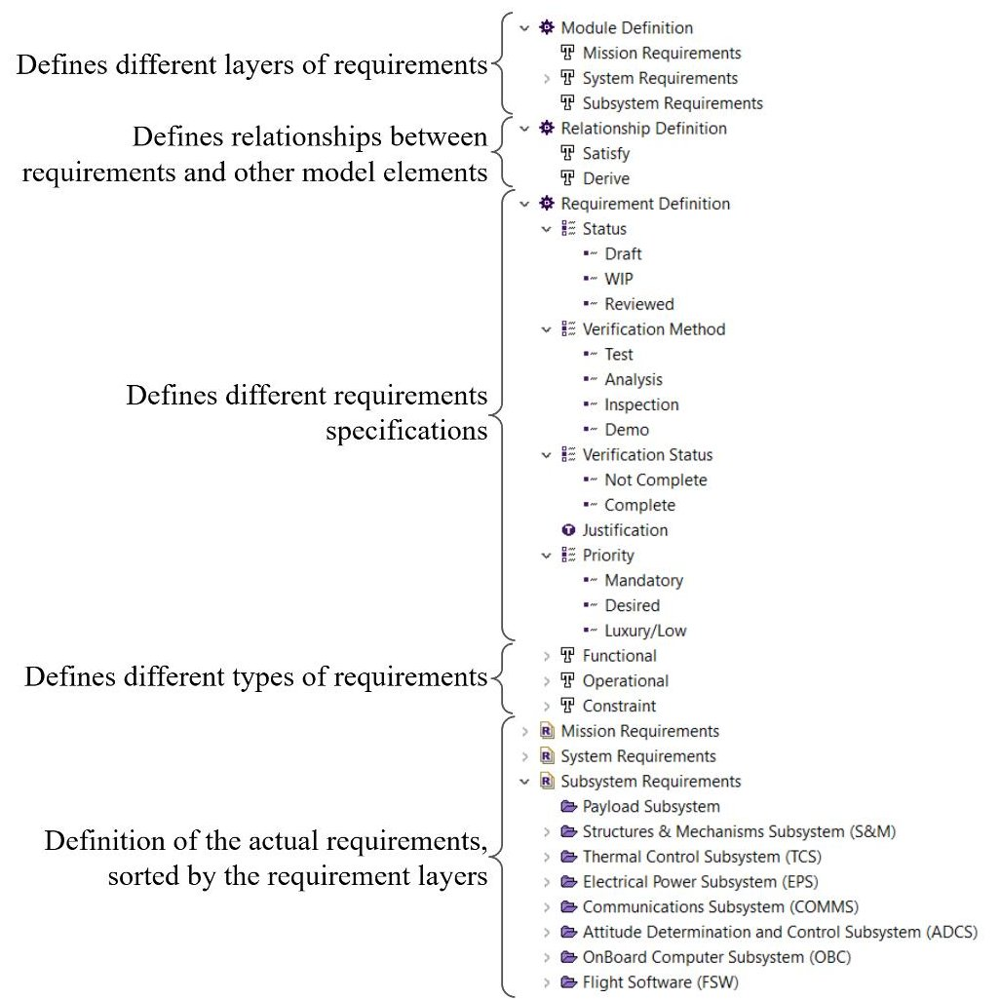


<div align="center">

Figure B.1: The organizational breakdown of requirement definitions in Capella using the requirement add-on tool.

</div>

<!-- PDF_PAGE: 122 -->

## Appendix C Mass Budget Script

This appendix contains the Python4Capella script used to compute the satellite mass budget.

```python

'''

Created on Sep 30, 2025

@author: pkline

'''

# --- Capella + PVMT API imports ---

include('workspace://Python4Capella/simplified_api/capella.py')

if False:

    from simplified_api.capella import *

include('workspace://Python4Capella/simplified_api/pvmt.py')

if False:

    from simplified_api.pvmt import *

# --- Path to your model (.aird file) ---

AIRD_PATH = '/UNP N-2/UNP N-2.aird'

```

<!-- PDF_PAGE: 123 -->

```python

# --- Open the model ---

model = CapellaModel()

model.open(AIRD_PATH)

# --- Get the SystemEngineering root ---

se = model.get_system_engineering()

print(f"Project: {se.get_name()}")

# --- Global dictionary to store PVMT properties per component ---

properties = {}

# --- Recursive function: collect PVMT properties ---

def explore_component(component):

    """Recursively explore PhysicalComponents and collect PVMT properties."""

    name = component.get_name()

    properties[name] = {}

    try:

        for group in component.get_applied_property_value_groups() or []:

            for prop in group.get_owned_property_values():

                pname = prop.get_name().lower()

                pvalue = prop.get_value()

                # Try to cast to float if numeric

                try:

                    pvalue = float(pvalue)

                except (ValueError, TypeError):

                    pass

                properties[name][pname] = pvalue

    except Exception as e:

```

<!-- PDF_PAGE: 124 -->

```python

print(f"    (Could not read PVMT properties for {name}: {e})")

for subcomp in component.get_owned_physical_components():

    explore_component(subcomp)

def get_component_masses(props):

    """Extract numeric 'mass' property values from PVMT data."""

    comp_mass = {}

    for comp, vals in props.items():

        mass = vals.get("mass", 0)

        if isinstance(mass, (int, float)) and mass > 0:

            comp_mass[comp] = mass

    return comp_mass

# --- Traverse model ---

pa = se.get_physical_architecture()

for pc in pa.get_physical_component_pkg().get_owned_physical_components():

    if pc.get_name() == "Neutron-2 PC":

        explore_component(pc)

        break

# --- Compute total mass ---

component_masses = get_component_masses(properties)

total_mass = sum(component_masses.values())

total_margin = total_mass * 1.15

# --- Print results ---

print("\n=== Mass Budget ===")

```

<!-- PDF_PAGE: 125 -->

```python

for comp, mass in component_masses.items():

    print(f" - {comp}: {mass} kg")

print(f"\nTotal Mass: {total_mass:.3f} kg")

print(f"Total Mass + 15% Margin: {total_margin:.3f} kg")

print("Max Allowable Mass: 6.000 kg")

```

<!-- PDF_PAGE: 126 -->

## Appendix D Power Budget Script

```python

'''

Created on Sep 30, 2025

@author: pkline

'''

# --- Capella + PVMT API imports ---

include('workspace://Python4Capella/simplified_api/capella.py')

if False:

    from simplified_api.capella import *

include('workspace://Python4Capella/simplified_api/pvmt.py')

if False:

    from simplified_api.pvmt import *

include('workspace://Python4Capella/utilities/CapellaPlatform.py')

if False:

    from utilities.CapellaPlatform import *

# --- Path to your model (.aird file) ---

```

<!-- PDF_PAGE: 127 -->

```python

aird_path = '/UNP N-2/UNP N-2.aird'

# --- Open the model ---

model = CapellaModel()

model.open(aird_path)

# --- Get the SystemEngineering root ---

se = model.get_system_engineering()

print("Project: ", se.get_name())

# --- Global dictionary to store all PVMT properties per component ---

# Example after collection:

# {

#   "Transceiver": {"peak watt": 0.5, "duty cycle": 0.8},

#   "Onboard Computer": {"peak watt": 0.55}

# }

properties = {}

# --- Simple CSV reader (works in Capella Jython) to get eclipse information ---

eclipse_data = []

eclipse_csv_path = r"C:\Users\pkline.HSFLPC39\Documents\Capella7.0.1\eclipseinfo.csv"

with open(eclipse_csv_path, "r") as f:

    next(f)  # skip header

    for line in f:

        timestep, in_sun_str = line.strip().split(",")

        in_sun = in_sun_str.strip().lower() == "1"

        eclipse_data.append((float(timestep), in_sun))

# --- Simple CSV reader (works in Capella Jython) to get mode information ---

```

<!-- PDF_PAGE: 128 -->

```python

mode_data = []

mode_csv_path = r"C:\Users\pkline.HSFLPC39\Documents\Capella7.0.1\modetimes.csv"

with open(mode_csv_path, "r") as f:

    next(f)  # skip header

    for line in f:

        # Split all 5 columns

        parts = line.strip().split(",")

        if len(parts) < 5:

            continue  # skip malformed lines

        timestep = float(parts[0])

        base_mode = int(parts[1])

        data_collection = int(parts[2])

        data_processing = int(parts[3])

        science_downlink = int(parts[4])

        # store in a dictionary for readability

        mode_data.append({

            "timestep": timestep,

            "base_mode": base_mode,

            "data_collection": data_collection,

            "data_processing": data_processing,

            "science_downlink": science_downlink

        })

print(f"\nLoaded {len(mode_data)} timesteps from modetimes.csv")

# Example printout for first few rows

#for row in mode_data[:63]:

```

<!-- PDF_PAGE: 129 -->

```python

#     print(row)

# --- Recursive function: print tree + collect properties ---

def explore_component(pc, indent=0):

    """Recursively explore PhysicalComponents, print structure,

    and collect PVMT properties into 'properties' dict."""

    # Print the component name and type with indentation

    name = pc.get_name()

    type_name = pc.__class__.__name__

    # print("    " * indent + f"- {name} ({type_name})")

    # Initialize this component in the dictionary

    properties[name] = {}

    # Try to get PVMT property groups

    try:

        groups = pc.get_applied_property_value_groups()

        if groups:

            for group in groups:

                for prop in group.get_owned_property_values():

                    pname = prop.get_name().lower()    # normalize name

                    pvalue = prop.get_value()        # raw value

                    # Try to store as float if numeric

                    try:

                        val = float(pvalue)

                    except:

                        val = pvalue

```

<!-- PDF_PAGE: 130 -->

```python

properties[name][pname] = val

# Print property value inline under the component

# print("    " * (indent+1) + f"{name} {pname} = {val}")

except Exception as e:

    print("    " * (indent+1) + f"(Could not read PVMT properties: {e})")

# Recurse into child PhysicalComponents

for sub in pc.get_owned_physical_components():

    explore_component(sub, indent+1)

# --- Power computation functions ---

def compute_average_power(props, mode="base"):

    """

    Compute average power (peak * duty cycle) for each component.

    Only include components with peak power > 0.

    Mode can be 'base', 'data collection', etc.

    """

    avg_powers = {}

    key_options = [

        f"{mode.lower()} mode duty cycle",

        f"{mode.lower()} mode dc"

    ]  # e.g. "base mode duty cycle"

    for comp, vals in props.items():

        # Look for peak power/watt

        peak = vals.get("peak watt", vals.get("peak power", 0))

        # Skip if peak is not numeric or <= 0

```

<!-- PDF_PAGE: 131 -->

```python

if not isinstance(peak, (int, float)) or peak <= 0:

    continue

# Look for the mode-specific duty cycle

duty = 0.0

for k in key_options:

    if k in vals and isinstance(vals[k], (int, float)):

        duty = vals[k]

        break

avg_powers[comp] = peak * duty

return avg_powers

# --- Find the PhysicalArchitecture root ---

pa = se.get_physical_architecture()

pac = pa.get_physical_component_pkg()

# --- Look for "Neutron-2 PC" and explore it ---

for pc in pac.get_owned_physical_components():

    if pc.get_name() == "Neutron-2 PC":

        explore_component(pc)

# Compute for Base Mode

avg_base = compute_average_power(properties, mode="base")

total_base = sum(avg_base.values())

# Compute for Data Collection Mode

```

<!-- PDF_PAGE: 132 -->

```python

avg_data_collection = compute_average_power(properties, mode="data collection")

total_data_collection = sum(avg_data_collection.values())

# Compute for Data Processing Mode

avg_data_processing = compute_average_power(properties, mode="data processing")

total_data_processing = sum(avg_data_processing.values())

# Compute for Science Downlinking Mode

avg_science_downlink = compute_average_power(properties, mode="science downlinking")

total_science_downlink = sum(avg_science_downlink.values())

print("\n=== Power Usage by Mode ===")

print("\nBase Mode Power Usage:")

for comp, p in avg_base.items():

    print(f" - {comp}: {p} W")

print(f"Total Base Mode Power Usage = {total_base} W")

print("\nData Collection Mode Power Usage:")

for comp, p in avg_data_collection.items():

    print(f" - {comp}: {p} W")

print(f"Total Data Collection Mode Power Usage = {total_data_collection} W")

print("\nData Processing Mode Power Usage:")

for comp, p in avg_data_processing.items():

    print(f" - {comp}: {p} W")

print(f"Total Data Processing Mode Power Usage = {total_data_processing} W")

print("\nScience Downlinking Mode Power Usage:")

for comp, p in avg_science_downlink.items():

```

<!-- PDF_PAGE: 133 -->

```python

print(f" - {comp}: {p} W")

print(f"Total Science Downlinking Mode Power Usage = {total_science_downlink} W")

# --- Quick summary of eclipse vs sunlight periods ---

print(f"\nLoaded {len(eclipse_data)} timesteps from eclipseinfo.csv")

in_sun_count = sum(1 for t, in_sun in eclipse_data if in_sun)

in_eclipse_count = len(eclipse_data) - in_sun_count

percent_sun = (in_sun_count / len(eclipse_data)) * 100.0

percent_eclipse = 100.0 - percent_sun

print("\n=== Eclipse Summary (from csv) ===")

print(f" - Total timesteps: {len(eclipse_data)}")

print(f" - In Sun: {in_sun_count} ({percent_sun:.1f}%)")

print(f" - In Eclipse: {in_eclipse_count} ({percent_eclipse:.1f}%)")

# Print first few entries as sanity check

#print("\nFirst 60 timesteps:")

#for i, (t, in_sun) in enumerate(eclipse_data[:60]):

#    print(f"   Timestep (min) {t}: {'Sunlight' if in_sun else 'Eclipse'}")

# --- Array Power (eventually pull from model BUT right now its hard coded) ---

plus_x_array = 7.45

minus_x_array = 7.45

plus_y_array = 7.45

minus_y_array = 5.32

total_power_gen = plus_x_array + plus_y_array + minus_x_array + minus_y_array

```

<!-- PDF_PAGE: 134 -->

```python

print("\n=== Power Generation ===")

print(f"Total Power Generation for all Solar Panels: {total_power_gen} W")

# --- Power Generation Per Mode (eventually pull from model BUT right now its hard coded)

↳ ---

base_gen = total_power_gen / 4 #one face sun soaking

collect_gen = plus_y_array * (2/3) #nadir pointing

process_gen = total_power_gen / 4 #one face sun soaking

downlinking_gen = total_power_gen / 6 #tumble, average between the 6 faces

print(f"Base Mode Power Generation: {base_gen} W")

print(f"Data Collection Mode Power Generation: {collect_gen} W")

print(f"Data Processing Mode Power Generation: {process_gen} W")

print(f"Science Downlinking Power Generation: {downlinking_gen} W")

# --- Mode Power Status ---

base_power_status = base_gen - total_base

collect_power_status = collect_gen - total_data_collection

process_power_status = process_gen - total_data_processing

downlink_power_status = downlinking_gen - total_science_downlink

print("\n=== Power Status (Power Generation - Power Usage) ===")

print(f"Base Mode Power Status: {base_power_status} W")

print(f"Data Collection Mode Power Status: {collect_power_status} W")

print(f"Data Processing Mode Power Status: {process_power_status} W")

print(f"Science Downlinking Power Status: {downlink_power_status} W")

# --- Energy Balance ---

# --- Compute total power per timestep based on mode activity ---

```

<!-- PDF_PAGE: 135 -->

power_profile = []  # list of tuples (timestep, total_power)

for row in mode_data:

    timestep = row["timestep"]

    # Determine which mode is active (priority order in case of overlap)

    if row["data_collection"] == 1:

        total_power = collect_power_status

        active_mode = "Data Collection Mode"

    elif row["data_processing"] == 1:

        total_power = process_power_status

        active_mode = "Data Processing Mode"

    elif row["science_downlink"] == 1:

        total_power = downlink_power_status

        active_mode = "Science Downlinking Mode"

    elif row["base_mode"] == 1:

        total_power = base_power_status

        active_mode = "Base Mode"

    else:

        total_power = 0.0

        active_mode = "Unknown / Idle"

    power_profile.append((timestep, total_power, active_mode))

# Define timestep (in minutes → hours)

timestep_minutes = 1.0

timestep_hours = timestep_minutes / 60.0

# Initialize arrays to track per-step energy and cumulative total

energy_profile = []  # (timestep, gen, draw, energy, battery)

<!-- PDF_PAGE: 136 -->

total_energy = 0.0    # Wh, cumulative

battery_max = 46.08 #(Wh, right now this is hardcoded but should eventually pull from the

↪ model)

battery_capacity = battery_max

# Nominal total power generation (W)

total_power_gen_nominal = total_power_gen

# Loop over each timestep

for i, (timestep, power_status, active_mode) in enumerate(power_profile):

    if i >= len(eclipse_data):

        break

    in_sun = eclipse_data[i][1]

    # Assign power generation based on whether in sunlight

    if in_sun:

        # Use the same per-mode generation logic

        if active_mode == "Base Mode":

            power_gen = base_gen

        elif active_mode == "Data Collection Mode":

            power_gen = collect_gen

        elif active_mode == "Data Processing Mode":

            power_gen = process_gen

        elif active_mode == "Science Downlinking Mode":

            power_gen = downlinking_gen

        else:

            power_gen = 0.0

    else:

        power_gen = 0.0

<!-- PDF_PAGE: 137 -->

# Use the same per-mode generation logic

```python

if active_mode == "Base Mode":

    power_draw = total_base

elif active_mode == "Data Collection Mode":

    power_draw = total_data_collection

elif active_mode == "Data Processing Mode":

    power_draw = total_data_processing

elif active_mode == "Science Downlinking Mode":

    power_draw = total_science_downlink

else:

    power_draw = 0.0

# Compute net energy change for this timestep (Wh)

energy = (power_gen - power_draw) * timestep_hours

# Update battery capacity

potential_capacity = battery_capacity + energy

if potential_capacity > battery_max:

    battery_capacity = battery_max

elif potential_capacity < 0:

    battery_capacity = 0.0

else:

    battery_capacity = potential_capacity

energy_profile.append((timestep, in_sun, active_mode, power_gen, power_draw, energy,

    → battery_capacity))

```

# --- Print results for verification ---

```python

print("\n=== Energy and Battery Profile (first 70 timesteps) ====")

```

<!-- PDF_PAGE: 138 -->

```python

#for t, in_sun, mode, gen, draw, dE, cap in energy_profile[:80]:

#    print(f"t={t:.0f} min | In Sun: {in_sun} | Mode = {mode} | Gen={gen:.2f} W |

→ Draw={draw:.2f} W | E={dE:+.4f} Wh | Battery={cap:.2f} Wh")

output_csv_path = r"C:\Users\pkline.HSFLPC39\Documents\Capella7.0.1\energy_profile.csv"

with open(output_csv_path, "w") as f:

    f.write("Timestep [min],In Sun,Mode,Power Gen [W],Power Draw [W],Energy [Wh],Battery

→ [Wh]\n")

    for t, in_sun, mode, gen, draw, dE, cap in energy_profile:

        f.write(f"{t},{int(in_sun)},{mode},{gen:.4f},{draw:.4f},{dE:.6f},{cap:.4f}\n")

print(f"\nEnergy profile exported to: {output_csv_path}")

```

<!-- PDF_PAGE: 139 -->

<div align="center">

# Appendix E Power Budget Script Output

</div>

Project: UNP N-2

Loaded 1440 timesteps from modetimes.csv

==== Power Usage by Mode ====

Base Mode Power Usage:

- Neutron-2 PC: 0.0 W

- Communications Subsystem: 0.0 W

- UHF Antenna: 0.004 W

- SBand Antenna: 0.0 W

- UHF Transceiver : 0.769000000000001 W

- Electrical Power Subsystem (EPS): 0.09 W

- Onboard Computer: 0.55 W

- ADCS: 0.85 W

- Neutron Detector: 0.0 W

- GPS: 0.325 W

- SBand Transciever: 0.0 W

Total Base Mode Power Usage = 2.588000000000005 W

<!-- PDF_PAGE: 140 -->

Data Collection Mode Power Usage:

- Neutron-2 PC: 0.0 W

- Communications Subsystem: 0.0 W

- UHF Antenna: 0.004 W

- SBand Antenna: 0.0 W

- UHF Transceiver : 0.7690000000000001 W

- Electrical Power Subsystem (EPS): 0.09 W

- Onboard Computer: 0.55 W

- ADCS: 0.85 W

- Neutron Detector: 4.6 W

- GPS: 1.3 W

- SBand Transciever: 0.0 W

Total Data Collection Mode Power Usage = 8.163 W

Data Processing Mode Power Usage:

- Neutron-2 PC: 0.0 W

- Communications Subsystem: 0.0 W

- UHF Antenna: 0.004 W

- SBand Antenna: 0.0 W

- UHF Transceiver : 0.7690000000000001 W

- Electrical Power Subsystem (EPS): 0.09 W

- Onboard Computer: 0.55 W

- ADCS: 0.85 W

- Neutron Detector: 1.885999999999997 W

- GPS: 0.0 W

- SBand Transciever: 0.0 W

Total Data Processing Mode Power Usage = 4.149 W

Total Data Processing Mode Power Usage = 4.149 W

<!-- PDF_PAGE: 141 -->

Science Downlinking Mode Power Usage:

- Neutron-2 PC: 0.0 W

- Communications Subsystem: 0.0 W

- UHF Antenna: 0.04 W

- SBand Antenna: 1.0 W

- UHF Transceiver : 7.69 W

- Electrical Power Subsystem (EPS): 0.09 W

- Onboard Computer: 0.55 W

- ADCS: 0.85 W

- Neutron Detector: 0.0 W

- GPS: 0.325 W

- SBand Transciever: 4.3 W

Total Science Downlinking Mode Power Usage = 14.84499999999999 W

Loaded 1440 timesteps from eclipseinfo.csv

=== Eclipse Summary (from csv) ===

- Total timesteps: 1440

- In Sun: 900 (62.5%)

- In Eclipse: 540 (37.5%)

=== Power Generation ===

Total Power Generation for all Solar Panels: 27.67 W

Base Mode Power Generation: 6.9175 W

Data Collection Mode Power Generation: 4.9666666666667 W

Data Processing Mode Power Generation: 6.9175 W

Science Downlinking Power Generation: 4.61166666666667 W

<!-- PDF_PAGE: 142 -->

==== Power Status (Power Generation - Power Usage) ====

Base Mode Power Status: 4.3294999999999995 W

Data Collection Mode Power Status: -3.196333333333335 W

Data Processing Mode Power Status: 2.768500000000004 W

Science Downlinking Power Status: -10.233333333333 W

Energy profile exported to:

$ \hookrightarrow $ C:\Users\pkline.HSFLPC39\Documents\Capella7.0.1\energy_profile.csv

<!-- PDF_PAGE: 143 -->

Appendix F Expanded NASA Life-Cycle

<!-- PDF_PAGE: 144 -->


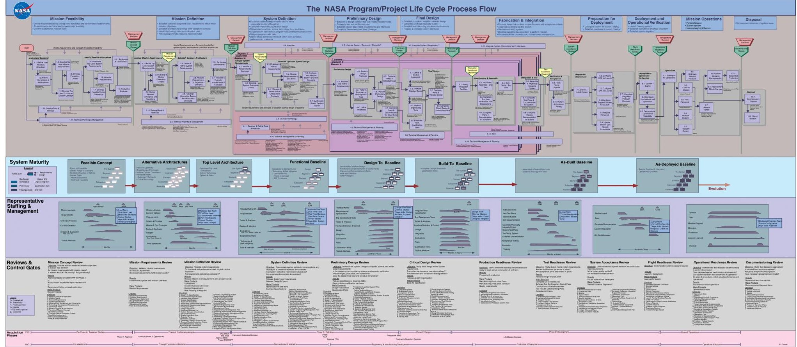


<div align="center">

Figure F.1: Detailed NASA Project Life-Cycle.

</div>