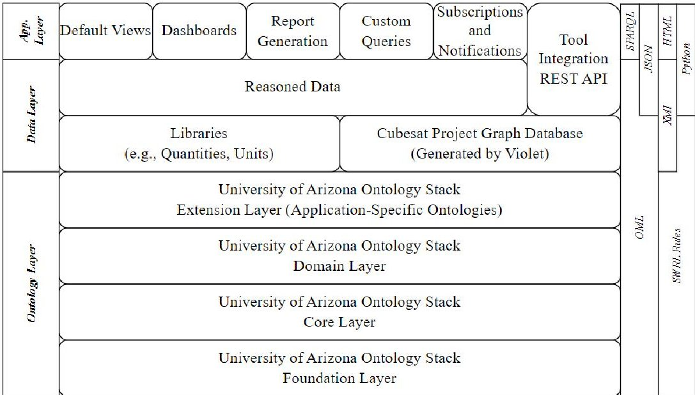
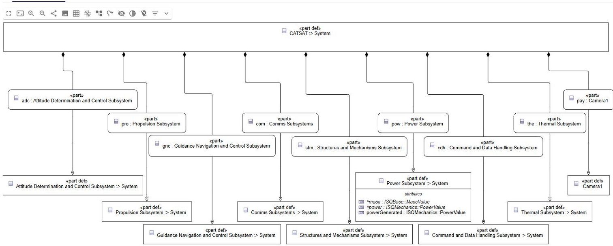
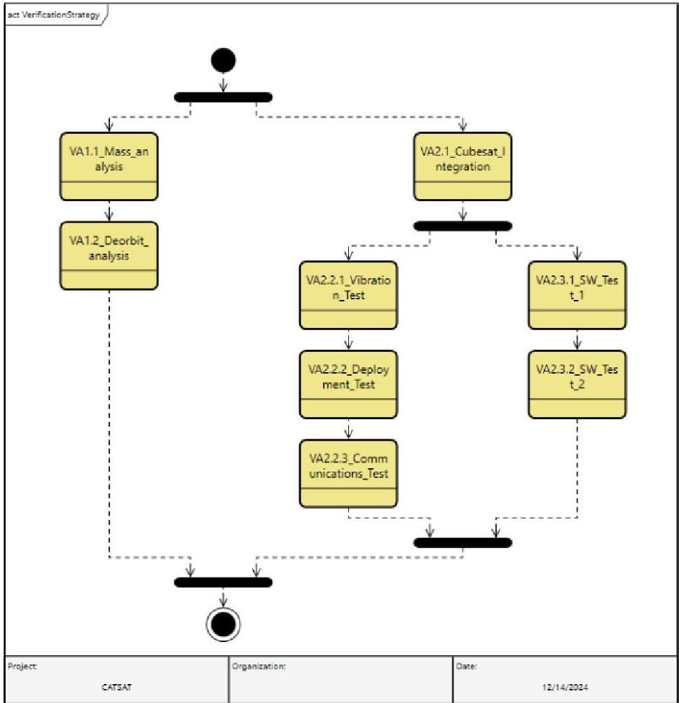
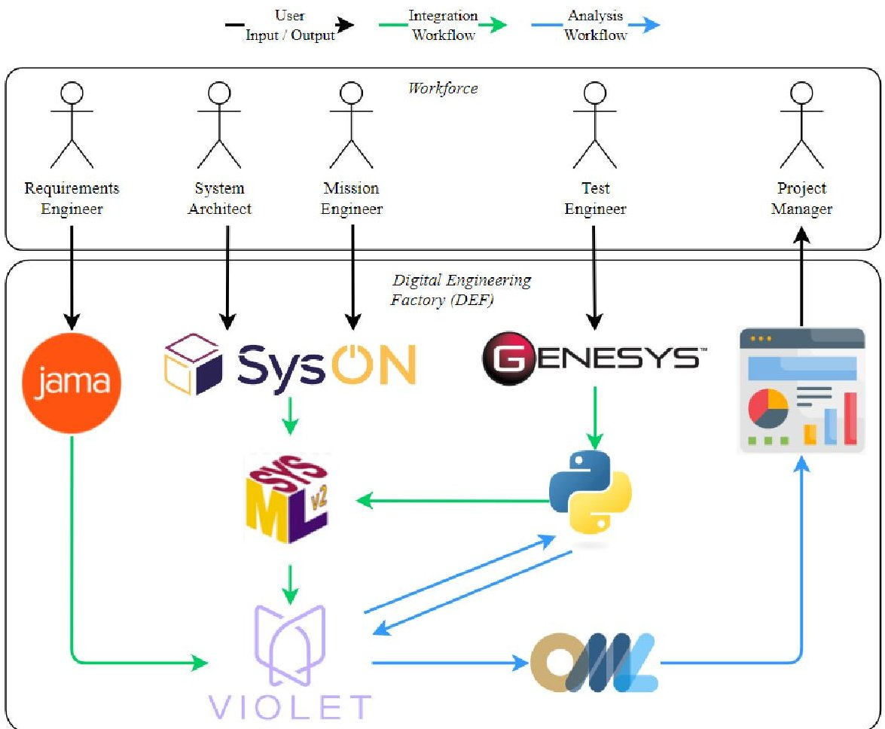
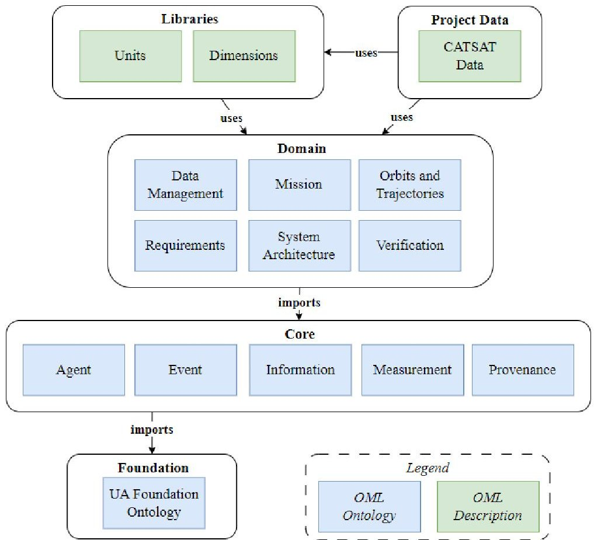
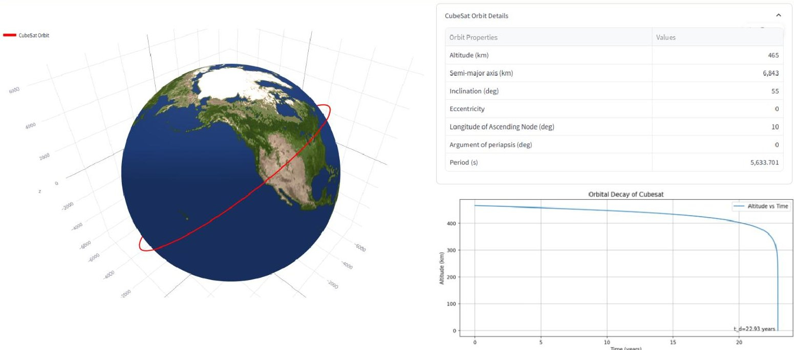

<!-- PDF_PAGE: 1 -->

# Digital Engineering for Cubesats with Semantic Web Technologies

Joe Gregory $ ^{*} $ , Visalakshi Iyer $ ^{\dagger} $ , Andres Galvez $ ^{\ddagger} $ and Alejandro Salado $ ^{\S} $ Department of Systems and Industrial Engineering, 1127 E James E Rogers Way, Tucson, AZ 85721-0020.

Lucy Hoag $ ^{\#} $ , Alisha Zute $ ^{\parallel} $ , Mike Marmar $ ^{**} $ and Barry Jones $ ^{\dagger \dagger} $ Violet Labs Inc., San Francisco, CA, USA.

Digital Engineering (DE) and the digital thread, which integrates information across the system lifecycle, offer transformative opportunities for systems engineering. This paper explores the application of DE principles to cubesat design and development, leveraging the Digital Engineering Factory (DEF) developed at the University of Arizona. The DEF integrates data from multiple engineering tools into a cohesive dataset using the Violet tool, which organizes the data as a graph database aligned with the University of Arizona Ontology Stack (UAOS). We extend prior work by applying the DEF to a cubesat design project. In particular, we develop a Python-based analysis to simulate orbital decay and calculate the time required for the cubesat to deorbit. This analysis uses inputs from multiple sources and is integrated into the workflow to demonstrate how the DEF supports automated traceability and checking of consistency, correctness, and completeness. This paper details the DEF's architecture, the cubesat application, and key findings, providing a pathway for advancing DE practices in cubesat design and development. Limitations and future research directions are discussed to guide further development of semantic web technologies in DE.

## I. Nomenclature

BFO = Basic Formal Ontology

CCO = Common Core Ontologies

CUBRC = Calspan-University of Buffalo Research Center

DE = Digital Engineering

DEF = Digital Engineering Factory

OML = Ontological Modeling Language

OWL = Web Ontology Language

RDF = Resource Description Framework

SDL = Systems Definition Language

SPARQL = SPARQL Protocol and RDF Query Language

SWRL = Semantic Web Rule Language

SWT = Semantic Web Technologies

SysML = Systems Modeling Language

UA = University of Arizona

UAOS = University of Arizona Ontology Stack

<!-- PDF_PAGE: 2 -->

## II. Introduction

The development of complex engineering systems increasingly demands efficient and reliable methods to integrate and manage data across the system lifecycle. Digital Engineering (DE) is emerging as an approach to address this challenge, leveraging the digital thread to ensure seamless connectivity of system data from design to deployment [1]. By integrating traditionally siloed tools and processes, DE aims to reduce the risks associated with manual data handling, such as the use of outdated information and human error. Industry leaders prioritize digital thread initiatives, particularly for their ability to enable traceability across requirements, models, analyses, and test results, thereby fostering informed decision-making and improved system performance [2].

Semantic Web Technologies (SWTs) have the potential to significantly enhance the capabilities of DE by structuring information in a way that enables insight to be automatically attained through reasoning and querying [3]. These technologies, which include ontologies, reasoners, and graph-based query languages, enable the representation of complex relationships across multiple domains in a modular, interoperable manner. Ontologies, in particular, provide a shared conceptual framework that integrates domain knowledge with raw data, enabling cross-domain interoperability and facilitating the validation of knowledge [4,5]. By capturing system-related information in a configuration-managed repository, SWTs not only improve data consistency but also enhance the ability to query and analyze highly connected data efficiently [6].

The design and development of cubesats present unique challenges due to their small size, limited resources, and often aggressive mission timelines. Streamlining the design process is essential to maximize the utility of these systems while minimizing costs and development risks. Traditional approaches to cubesat development can involve inefficiencies and potential inconsistencies in system design and analysis [7]. The integration of DE principles with SWTs has the potential to address these issues, enabling a more cohesive and agile development process.

A critical aspect of cubesat design is the ability to tie together descriptive models with analyses. The seamless integration of descriptive models, such as those defining system architecture, behavior, and requirements, with analytical tools used for simulations, trade studies, and performance evaluations can not only ensure consistency across different stages of development but also enable iterative refinement and rapid exploration of design alternatives. By linking descriptive models to analyses, engineers can leverage DE to validate designs more effectively and make data-driven decisions that optimize system performance [8].

In this paper, we present an approach that combines DE principles with SWTs to support cubesat design and analysis. The underlying technologies and related work are described in Section III. In Section IV, we describe the notional cubesat mission. The results of this case study are presented in Section V, and the limitations of the work and possible of future work are discussed in Section VI. The work is concluded in Section VII.

## III. Background

The University of Arizona (UA) has developed the Digital Engineering Factory (DEF), a digital engineering environment designed to support systems and software engineering students while also serving as a research platform for exploring the potential of DE [9,10]. At the core of the DEF is Violet, a tool that integrates data from software used across the hardware development lifecycle into a centralized platform [11]. Using a 'hub-and-spoke' data integration model, Violet aggregates data from various engineering tools through bidirectional integrations, storing it in a Structured Query Language (SQL) database. This approach minimizes the number of required integrations between tools, reducing complexity while addressing the issue of fragmented information [12].

The DEF has been deployed in systems engineering classrooms [13] and applied to various use cases, including digital test and evaluation [14,15], Bayesian representation of test strategies [16,17], and closed-loop orbital analysis of spacecraft [18,19]. These applications demonstrate the DEF's capability to integrate traditionally siloed data and processes, aligning with DE principles that prioritize technical and data interoperability. A key advantage of Violet's architecture is its flexibility in supporting both relational and graph-based data storage. This enables the application of SWTs, such as ontologies and reasoning systems, to structure, validate, and query the integrated dataset. By employing graph-based representations, the DEF enhances the ability to analyze highly interconnected data efficiently and infer new insights from it [20]. SWTs, particularly ontologies, play a central role in the DEF's framework by enabling the structuring of complex system data. Ontologies provide reusable conceptual frameworks for representing and reasoning across domains, improving interoperability and supporting cross-domain analysis. A common way to organize ontologies and their dependencies is in a layered ontology stack [12]. These layers often incorporate foundational, core and domain ontologies [21]. Libraries of standards instances can also be used. According to Gruber, ontologies play a central role in enabling reuse and interoperability between domains [4,5]. Federating the conceptualization

<!-- PDF_PAGE: 3 -->

Fig.1 University of Arizona Ontology Stack (UAOS) employed by the Digital Engineering Factory (DEF)

of a domain across upper- and lower-level ontologies improves the reusability of higher-level terminology in other domains, and therefore improves interoperability between them. A foundational ontology should be used to define only the most general classes and relations [22] and should unify the lower-level core and domain ontologies [23]. Core ontologies should extend the foundational ontology to describe more specific classes, such as information and events. Core ontologies should still be applicable to a wide range of domains [24]. Domain ontologies formalize the terms that are used in a discipline [25].

The DEF's framework adheres to the University of Arizona Ontology Stack (UAOS), a layered ontology stack designed to ensure coherent data representation [26]. The UAOS incorporates foundational, core, and domain ontologies, reusing existing standards wherever possible. The UAOS has been written in the Ontological Modeling Language (OML). OML is an extension of the Web Ontology Language (OWL) 2 Description Logic profile, developed as part of the OpenCAESAR initiative which is being led by the Jet Propulsion Laboratory (JPL) [27]. OML ontologies are created and managed using the OML Rosetta tool [28]. An overview of the UAOS is presented in Figure 1.

The UAOS currently comprises one foundational ontology, five core ontologies (Information, Agent, Event, Measurement, and Provenance), and 16 domain ontologies. The UAOS foundational ontology is based on the Basic Formal Ontology (BFO) [29,30], which defines general classes and relations applicable across domains. Building on this foundation, core ontologies describe more specific classes, such as information, events, and measurements, that remain broadly applicable. These core ontologies are primarily derived from the Common Core Ontologies (CCO) suite [24]. Additionally, the UAOS includes domain ontologies that formalize discipline-specific terms. Where available, these domain ontologies have been based on existing ontologies or standards. For instance, the System Architecture Ontology is based on ISO/IEC 15288 [31], and the Project Management Ontology is based on PROMONT [32], an ontology developed by Hahn in 2006.

The development of collaborative, digital engineering environments has been a focus of significant research and application in the aerospace sector. JPL pioneered the Team X process in the early 2000s, introducing a "rapid, collaborative design capability to all participating NASA Centers, NASA HQ development and industry partners" [33]. This approach allowed for the rapid conceptualization and evaluation of space missions through integrated tools and processes. Similarly, the European Space Agency (ESA) developed the Concurrent Design Facility (CDF), which facilitates collaborative mission design by integrating expertise and tools within a shared environment. ESA's work in concurrent design remains highly active, and their methodologies have inspired the establishment of concurrent design centers worldwide [34, 35]. By 2021, Rana identified 27 such centers globally, spanning space agencies, industry, and academia, each focused on integrating data from multiple tools to support rapid mission design and analysis [34]. In addition to concurrent design approaches, the application of Model-Based Systems Engineering (MBSE) has gained traction for spacecraft development. Kaslow's CubeSat Reference Model is a notable example, providing a standardized MBSE framework specifically for modeling cubesats [36, 37]. This framework enables the representation of cubesat subsystems and interfaces in a structured, reusable manner, facilitating system-level analysis and interoperability. Kaslow's work underscores the importance of establishing common modeling practices to streamline cubesat design,

<!-- PDF_PAGE: 4 -->

Table 1 CATSAT Mission Requirements

<table border="1"><tr><td>ID</td><td>Name</td><td>Description</td></tr><tr><td>MR1</td><td>Deorbit</td><td>The cubesat shall deorbit within 25 years of the end of its mission.</td></tr><tr><td>MR2</td><td>Downlink</td><td>The cubesat shall download at least 5 GB per day to the ground segment upon command.</td></tr><tr><td>MR3</td><td>Power</td><td>The cubesat shall continuously operate during its orbit.</td></tr><tr><td>MR4</td><td>Image Resolution</td><td>The cubesat shall capture images of the Earth at a resolution of 40m per pixel.</td></tr><tr><td>MR5</td><td>Pointing Accuracy</td><td>The cubesat shall maintain a pointing accuracy of ±2 degrees with respect to the image location during data collection.</td></tr></table>

particularly given the growing adoption of MBSE methodologies in the space domain. Despite the progress in DE and MBSE, many existing efforts focus primarily on the early phases of mission design or rely on tightly coupled tools and workflows. While concurrent design centers and reference models like Kaslow's excel in integrating data for physics-based simulations and trade studies, they often lack a flexible, domain-agnostic framework that extends beyond conceptual design to the full system lifecycle.

The approach we present in this paper builds on these efforts by emphasizing the use of SWTs to create a versatile, interoperable DE environment. Unlike traditional MBSE frameworks or concurrent design centers, our approach focuses on the integration of information using a graph-based data structure enabled by ontologies. Furthermore, our approach extends the application of DE to a broader range of activities, including testing, evaluation, and real-time data analysis, making it a more comprehensive solution for modern cubesat development challenges.

## IV. Application to CATSAT

In this section, we describe the design and analysis of the notional Cloud Analysis and Tracking Satellite (CATSAT) mission. CATSAT is a cubesat that will be used to ascertain cloud types and monitor their movement from low-Earth orbit (LEO). As a 2U cubesat, it will be comprised of two cubesat units and will have dimensions of 20cm x 10cm x 10cm. One unit will contain the payload, a high-resolution camera. The other will contain the supporting systems and will provide functions associated with power, communication and control. The CATSAT mission responds to a set of mission requirements. A subset of the mission requirements (those relevant to this use case), are displayed in Table 1. The Requirements Engineer captures these requirements in Jama Connect, and imports them into Violet.

The System Architect is responsible for modeling the CATSAT mission. To do this, the System Architect uses Obeo's SysON tool. SysON is a web-based, open-source graphical modeling tool designed for authoring Systems Modeling Language (SysML) v2 models [38]. SysON supports the generation of textual notation for SysML v2 models. This feature allows users to import and export models using the SysML v2 textual notation, facilitating sharing and integration with other SysML v2 compatible tools. This is particularly useful in the context of the DEF, as the System Architect can import the textual notation, auto-generated by SysON, into Violet, where it can be linked to information integrated from other tools. The System Architect bases the CATSAT model on the CubeSat Reference Model [37]. Fig. 2 shows how SysON has been used to model the CATSAT architecture in accordance with the CubeSat Reference Model. Note that although the Cubesat Reference Model provides a framework to model cubesats up to and including 'Cubesat Domain' (which includes external constraints, launch services, ground station services, etc.), the System Architect only models the cubesat itself. We assume that the mass of the cubesat bus (i.e., the sum of all components except the camera payload) is 1.7kg.

Another benefit of this approach is that we can use libraries to store and retrieve detailed information about components. While the System Architect has used SysON to define the system architecture, they have also been able to reuse existing models of specific components to ease the design process. For example, consider the three options for cubesat cameras in Table 2. These components have been modeled using SysML v2 and stored in a library of cubesat cameras. When we design our cubesat, we can simply type our 'Camera' part by whichever specific camera we choose.

We assume that the CATSAT orbit is fixed, and that the selection was made to optimize the total land coverage and the revisit time of the cubesat. The orbital elements of CATSAT are displayed in Table 3. Separately from the work that the System Architect is doing, the Mission Engineer models this information using SysON. Note that although it is

<!-- PDF_PAGE: 5 -->

Fig. 2 CATSAT architecture, based on CubeSat Reference Model, modeled in SysON

Table 2 Specifications of cameras that could potentially be used in CATSAT. Ground sample distance and swath are based on an altitude of 465km

<table border="1"><tr><td>Component ID</td><td>Mass(kg)</td><td>Power(W)</td><td>Resolution(m)</td><td>Swath(km)</td><td>CATSAT mass(kg)</td></tr><tr><td>Cubesat Camera1</td><td>0.4</td><td>1.9</td><td>37</td><td>80</td><td>2.1</td></tr><tr><td>Cubesat Camera2</td><td>0.7</td><td>2.3</td><td>16</td><td>32</td><td>2.4</td></tr><tr><td>Cubesat Camera3</td><td>1.1</td><td>4.5</td><td>7</td><td>15</td><td>2.8</td></tr></table>

not relevant in this case, the Mission Engineer may also draw from a library of common orbits (such as geostationary, Molniya, sun-synchronous) if needed.

The Test Engineer also defines a series of verification activities to be performed. These are modeled as activities in GENESYS. GENESYS is a MBSE tool designed to support the entire lifecycle of complex systems using the Systems Definition Language (SDL) [39]. The Test Engineer defines the overall verification strategy in GENESYS. The verification strategy as modeled in GENESYS is presented in Fig. 3. Currently, no built-in integration capability exists between Violet and GENESYS (although this is under development), and so we have developed a Python script that will parse the GENESYS activity model and produce an equivalent SysML v2 model. Note that 'VA1.1_Mass_analysis' and 'VA1.2_Deorbit_analysis' are used to verify 'MR1 - Orbital Decay'. The other verification activities would be used to verify the system requirements. These have been modeled in Jama but are not displayed in this paper.

Once this information has been aggregated in Violet, we are able to begin our analysis. One of the benefits of aggregating information from multiple sources into Violet is that it enables us to conduct analyses that uses inputs from multiple sources. To demonstrate this, we consider mission requirement 'MR1-Deorbit', which states that "the cubesat shall deorbit within 25 years of the end of its mission". The time it will take a cubesat in a circular orbit to deorbit is

Table 3 CATSAT Orbital Elements

<table border="1"><tr><td>Orbital Element</td><td>Value</td><td>Unit</td></tr><tr><td>Altitude</td><td>465</td><td>km</td></tr><tr><td>Inclination</td><td>55</td><td>degrees</td></tr><tr><td>Eccentricity</td><td>0</td><td>n/a</td></tr><tr><td>Longitude of Ascending Node</td><td>10</td><td>deg</td></tr><tr><td>Argument of Periapsis</td><td>0</td><td>deg</td></tr></table>

<!-- PDF_PAGE: 6 -->

Fig. 3 CATSAT verification strategy, modeled using GENESYS

dependent on multiple factors including the altitude of the orbit and the mass, area and drag coefficient of the cubesat itself. We can calculate the total mass of CATSAT by summing the masses of the components, defined in the SysML models. We have developed a Python-based numerical simulation that solves for the orbital decay of a cubesat due to atmospheric drag.

The process followed is outlined in [40] and is summarized as follows. Satellites in a low-Earth orbit experience an atmospheric drag force, resulting in the loss of mechanical energy. This loss in the mechanical energy of the spacecraft can be represented by Eq.1, where G is the gravitational constant, M is the mass of the Earth, m is the mass of the satellite, r is the radius of the orbit, $ \mathbf{F}_{\mathbf{D}} $ is the drag force, and v is the orbital velocity of the satellite.

$$
\frac {d}{d t} \left(- \frac {G M m}{2 r}\right) = \mathbf {F} _ {D} \cdot \mathbf {v}
$$

The drag force can be calculated using Eq. 2, where $ \rho(\mathbf{r}) $ is the atmospheric density given orbital radius $ \mathbf{r} $ $ \mathbf{C}_{\mathbf{D}} $ is the satellite drag coefficient, and A is the cross-sectional area of the satellite.

$$
\mathbf {F} _ {D} = \frac {1}{2} \rho (r) C _ {D} A v ^ {2},
$$

Because the timescale or the orbital decay can be assumed to be orders of magnitude greater than the orbital period, we can assume that the orbit remains circular throughout the orbital decay process. Under this assumption, we can combine Eq. 1 and Eq. 2 to get Eq. 3.

$$
\frac {G M m}{2} \frac {\dot {r}}{r ^ {2}} = - \frac {1}{2} \rho (r) C _ {D} A \left(\frac {G M}{r}\right) ^ {3 / 2}
$$

If we simplify Eq. 3, we get Eq. 4, which allows us to calculate the rate of change of the orbital radius.

$$
\dot {r} = - \sqrt {G M} \cdot \frac {C _ {D} A}{m} \sqrt {r} \rho (r)
$$

<!-- PDF_PAGE: 7 -->

Fig. 4 CATSAT modeling and analysis workflow, enabled by the Digital Engineering Factory (DEF)

To calculate the air density at the given orbital radius r, we use Eq. 5. Eq. 5 is adapted from the Australian Space Weather Agency's model for an isothermal-barotropic model, which is accurate up to an altitude of 500km [41].

$$
\rho (h) = 6 \times 1 0 ^ {- 1 0} \exp \left(- \frac {h - 6 5 5 3}{H}\right) \mathrm {k g / m} ^ {3}
$$

The Python-based orbital decay analysis based on these equations is available for download at [42]).

Once we have completed both the integration of information from the relevant tools and the subsequent analyses, we use Violet to generate an OML representation of our dataset that is structured according to the UAOS. However, raw OML is not a suitable format in which to review this data. Therefore, we have developed dashboards that display information to stakeholders in a clear, convenient way that is tailored to their interests. These dashboards have been defined in Python using the Streamlit, Graphviz and Plotly packages. To generate the data to be displayed in the dashboards, we have defined SPARQL (SPARQL Protocol and RDF Query Language) queries that extract particular views of the OML dataset and present them in a JSON format. The JSON output files are then ingested by the dashboards to be processed and presented.

The overall pipeline is displayed in Fig. 4. In this example, we assume that the Project Manager wishes to review the dashboards to understand the status of the CATSAT project. Note that each user is able to create their own personalized dashboards - with each focusing on the projects that they are involved in and the views that are important to them. In Fig. 4, it can be seen that Violet generates an OML representation of the integrated dataset. The specific ontologies used to structure this dataset are presented in Fig. 5.

## V. Results

In this section, we demonstrate how the combination of DE and SWTs has been used to generate insight into the status of the CATSAT project and present this information to users in a single convenient dashboard environment.

In Fig. 6, the 'Orbit' tab of the user dashboard is presented. In this tab, the orbital elements (originally defined in a SysON by the Mission Engineer) are displayed, and a 3D representation of the orbit has been generated. This 3D

<!-- PDF_PAGE: 8 -->

Fig. 5 University of Arizona Ontology Stack (UAOS) - ontologies relevant to the CATSAT use case

visualization provides an intuitive way to understand the cubesat's trajectory. Additionally, the output of the numerical orbital decay simulation is displayed in this tab. The result of the orbital decay analysis is used to verify 'MR1 - Deorbit', and is dependent on both the orbit and the cubesat design parameters (e.g., its mass, cross-sectional area, and drag coefficient). It is only possible to calculate and display this value because of the integration of these datasets, which have been collated within the DE environment. The dashboard dynamically updates this information when the inputs are changed, allowing stakeholders to explore the effects of design changes on orbital decay predictions.

The value in integrating information from Jama, GENESYS, and multiple SysON models can be further demonstrated when considering the traceability from verification activities through architecture models to the requirements. This information is displayed on the 'Requirements' tab of the dashboard, which is shown in Fig. 7. In this case, we have only focused on modeling the information required to verify 'MR1-Deorbit'. This mission requirement is verified by the verification activity 'VA1.2_Deorbit_analysis'. This analysis uses the mass of the cubesat in its calculations. This value is produced by 'VA1.1_Mass_analysis'. The 'Requirements' tab displays a table of all mission requirements alongside the corresponding verification activities and any available results. Such traceability is essential for ensuring compliance with mission objectives and for identifying potential gaps in the verification process.

In Fig. 2, it can be seen that the Payload is typed by 'Camera 1', which has been defined in Table 2. This represents the use of a specification (i.e., the specification of 'Cubesat Camera 1', represented in Table 2) from a library to define the properties of the Payload. If we use Camera 1 as our Payload, our total cubesat mass is 2.1kg. Our cubesat orbit is circular and has an altitude of 465km. Assuming that CATSAT has a drag coefficient of 2.2 and an area of $ 0.02 \mathrm{~m}^{2} $ (a 2U cubesat is $ 20\mathrm{cm}\times10\mathrm{cm}\times10\mathrm{cm} $ ), the orbital decay analysis calculates that it will take 22.93 years for the cubesat to deorbit, thus verifying 'MR1-Deorbit'.

However, the user may wish to explore whether a different camera might result in a more successful mission. We can make this change and propagate the effects of this through the DE environment. For instance, selecting a camera with a better resolution would directly impact the cubesat's drag coefficient, total mass, and, consequently, its orbital decay rate. These changes would be automatically reflected in the 'Orbit' tab, where the updated simulation results are displayed, and in the 'Requirements' tab, where the verification activities and results are adjusted to account for the new design parameters. For example, the System Architect may wish to determine whether 'Cubesat Camera 2' is a possible alternative. To implement this change, the user would proceed through the following steps:

<!-- PDF_PAGE: 9 -->

Fig. 6 'Orbit' tab on the CATSAT dashboard

1) In SysON, change the specification that types the Payload.

2) Re-upload the cubesat architecture SysML model to Violet. Assuming the model structure is equivalent and the only differences are the attribute values, then the connections to the requirements, Python analyses, etc., will remain unaffected. Changes in the values will trigger the Python analyses to be executed in Violet.

3) In Violet, regenerate the OML representation of the project.

4) Refresh the queries in OML Rosetta.

5) Refresh the dashboard.

This capability allows for controlled propagation of information through the DE environment, which enables users to design trade-offs and understand the impacts on mission success. Additionally, the modular nature of this environment means that users can iterate through multiple design options, exploring various configurations to optimize mission performance. The ability to track how changes in one subsystem ripple through the entire system is one of the strengths of combining DE with SWTs, enabling informed decision-making and streamlined design workflows.

Furthermore, by integrating verification results directly into the dashboard, stakeholders can see, in real-time, how well the system meets its mission requirements. For example, if a new camera configuration introduces additional mass that compromises the deorbit requirement, this issue is immediately flagged in the 'Requirements' tab. This feedback loop ensures that every design decision is grounded in a holistic understanding of its implications, reducing the likelihood of downstream issues and promoting mission success.

In this case, we can determine that while Camera 2 offers improved resolution, the resulting increase in the mass of the cubesat severely impacts the time it would take the cubesat to deorbit. It is calculated that CATSAT would have a mass of 2.4kg and it would take 26.21 years to deorbit. This is outside of the allowable limit defined in 'MR1-Deorbit'. Although Camera 1 does not provide as good a resolution as Camera 2, we can see from Fig. 7 that it still satisfies mission requirement 'MR4-Image Resolution' and so should be selected.

## VI. Discussion and Future Work

The work presented in this paper focuses on one aspect of an approach to DE that remains under development at the University of Arizona. This approach focuses on the integration of data from multiple tools into a single graph database

<!-- PDF_PAGE: 10 -->

Requirements Architecture Orbit Test Strategy Warnings/Issues

Requirements Summary

<table border="1"><tr><td>Requirement ID</td><td>Requirement Name</td><td>Description</td><td>Satisfied By</td><td>Verified By</td></tr><tr><td>MR1</td><td>Deorbit</td><td>The cubesat shall deorbit within 25 years of the end of its mission</td><td>CATSAT_Mission</td><td>VA1.2_Deortbit_Analysis</td></tr><tr><td>MR2</td><td>Downlink</td><td>The cubesat shall download at least 5 GB per day to the ground segment upon command</td><td>CATSAT_Mission</td><td>None</td></tr><tr><td>MR3</td><td>Power</td><td>The cubesat shall continuously operate during its orbit</td><td>CATSAT_Mission</td><td>None</td></tr><tr><td>MR4</td><td>Image Resolution</td><td>The cubesat shall capture images of the Earth at a resolution of 40m per pixel</td><td>CATSAT_Mission</td><td>None</td></tr><tr><td>MR5</td><td>Pointing Accuracy</td><td>The cubesat shall maintain a pointing accuracy of ±2 degrees with respect to the imaged location during data collection</td><td>CATSAT_Mission</td><td>None</td></tr></table>

Fig.7 'Requirements' tab on the CATSAT dashboard

using Violet. The graph representation of the combined dataset can then be validated, reasoned across, and queried in accordance with the UAOS. In this paper, we have extended this approach in three ways. First, we have incorporated SysON into the development pipeline. Users now have the option to create SysML v2 models by drawing diagrams in a way that would be familiar to those who have created SysML v1 models in tools like Cameo Systems Modeler and Enterprise Architect. Second, we have incorporated GENESYS into the pipeline - though this is limited to activity diagrams and will become obsolete when the Violet-GENESYS integration is made available. Third, we have written and incorporated a Python-based numerical orbital decay solver into the DEF, and created an 'Orbits' dashboard that enables the user to visualize the orbit of a spacecraft and related characteristics. More generally, we have demonstrated how our DE approach enables the incorporation of these script-based analyses into the environment by linking the inputs and outputs to entities in the combined dataset. However, there are some limitations associated with this work that must be addressed.

One key area for improvement is the integration of Natural Language Processing (NLP) to make the requirements verification process truly dynamic. Currently, requirements are integrated into the dataset as entities that own string-type attributes (ID, Name, and Description). Users can then connect these requirements to other entities (e.g., system elements and verification activities) in Violet. NLP techniques make it possible to automatically parse natural language requirements, extract relevant constraints and objectives, and dynamically incorporate them into the ontological framework. This enhancement would streamline the requirements integration and verification process.

The orbital decay simulation implemented in this work is currently limited to circular orbits. While this simplification is sufficient for many cubesat missions, it does not fully capture the dynamics of more complex orbital scenarios, such as elliptical orbits or perturbations due to non-uniform gravitational fields. Future work will focus on expanding the simulation capability to accommodate these cases, ensuring the framework can support a broader range of mission profiles and provide more accurate analyses.

Each dashboard tab relies on a set of SPARQL queries to extract the relevant data from the combined OML dataset. We have defined these SPARQL queries - the user would not be expected to create their own queries or modify existing ones. The nature of the UAOS means that regardless of the content of the OML dataset, the same queries can be used each time. We envision the integration of NLP techniques to automatically generate SPARQL queries based on user input. This functionality would lower the barrier to entry for users unfamiliar with the technical details of SPARQL syntax, and enable them to ask very precise questions of the dataset without needing to code. Future work will focus on developing and refining algorithms that can accurately parse user intent and translate it into valid and effective queries.

The reasoning and querying process in the current framework can also be improved through further automation. Currently, users must interact with OML Rosetta to execute the queries required to support the dashboards. As an ontology development tool, many users may not wish to interact with OML Rosetta. By leveraging the OML Rosetta API, we can automate these processes, enabling real-time reasoning and querying as data is updated. This automation would enhance the effectiveness of the environment with regards to the propagation of information through tools.

The framework would benefit from additional enhancements to user experience and accessibility. Integrating institutional single sign-on, personalized dashboards, and collaborative tools could streamline user workflows and improve engagement. These features would support larger, multidisciplinary teams working on concurrent projects,

<!-- PDF_PAGE: 11 -->

thereby scaling the system for broader applications.

## VII. Conclusion

In this paper, we have presented an approach to cubesat design and development that integrates Digital Engineering (DE) principles with Semantic Web Technologies (SWTs). By leveraging the Digital Engineering Factory (DEF) at the University of Arizona, we demonstrated how data from multiple engineering tools can be consolidated into a cohesive dataset using Violet and structured according to the University of Arizona Ontology Stack (UAOS). This integration enables automated traceability and the validation of data for consistency, correctness, and completeness.

We have applied this approach to a notional CATSAT design project to demonstrate the potential of combining DE principles with SWTs. We integrated data from Jama, SysON and GENESYS into a combined graph database and used Python analyses to access this dataset and produce outputs that could be used to verify requirements. In particular, we developed a Python-based analysis to simulate orbital decay and calculate the time required for the cubesat to deorbit. We demonstrated how modelers can draw on SysML libraries to support their design work.

Future work will focus on addressing the limitations identified in this study, including enhancing requirements integration through natural language processing, expanding the orbital decay simulation to include elliptical orbits, and improving the user experience by enabling the generation of queries from natural language questions. Additionally, leveraging the OML Rosetta API will further automate reasoning and querying processes, enabling real-time updates and insights as data evolves.

## Acknowledgments

This material is based upon work supported, in whole or in part, by funds provided by the Arizona Technology and Research Initiative Fund, and by the U.S. Department of Defense through the Office of the Under Secretary of Defense for Acquisition and Sustainment (OUSD(A&S)) and the Office of the Under Secretary of Defense for Research and Engineering (OUSD(R&E)) under Contract HQ0034-19-D-0003, TO#0510. The authors acknowledge Vitech for their provision of an evaluation license for GENESYS 2023. The authors acknowledge Obeo for their provision of an Early Adopter Program (EAP) license for SysON.

## References

[1] Zimmerman, P., Gilbert, T., and Salvatore, F., "Digital engineering transformation across the Department of Defense," The Journal of Defense Modeling and Simulation, Vol. 16, No. 4, 2019, pp. 325-338.

[2] Dertien, S., and Hastings, W., "The State of Digital Thread," PTC White Paper, 2021.

[3] Patel, A., and Jain, S., "Present and future of semantic web technologies: a research statement," International Journal of Computers and Applications, Vol. 43, No. 5, 2021, pp. 413-422.

[4] Gruber, T. R., "A translation approach to portable ontology specifications," Knowledge Acquisition, Vol. 5, No. 2, 1993, pp. 199-220. https://doi.org/10.1006/knac.1993.1008.

[5] Gruber, T. R., "The role of common ontology in achieving sharable, reusable knowledge bases," Principles of Knowledge Representation and Reasoning: Proceedings of the Second International Conference, 1991, pp. 601-602. URL http://www.cin.ufpe.br/$\sim$mtcfa/files/10.1.1.35.1743.pdf.

[6] Medhi, S., and Baruah, H. K., "Relational database and graph database: A comparative analysis," Journal of process management and new technologies, Vol. 5, No. 2, 2017, pp. 1-9.

[7] Böning, S., "The current state of research and technology of digitalization in the space industry," Deutsches Zentrum fur Luft- und Raumfahrt, Report DLR-IB-DW-JE-2021-55, 2021.

[8] Knoll, D. J., and Fortin, C., "Digital engineering information exchange model for space missions architecture: A case study of a cubesat mission," 71st International Astronautical Congress (IAC), 2020.

[9] Gregory, J., and Salado, A., "A Digital Engineering Factory for Students," CSER, Tucson, AZ, USA, 2024.

[10] Gregory, J., and Salado, A., "The Digital Engineering Factory: Considerations, Current Status, and Lessons Learned," INCOSE International Symposium, INCOSE, Dublin, Ireland, 2024.

<!-- PDF_PAGE: 12 -->

[11] Violet Labs, "Violet Labs Tool," 2024. Available at https://violetlabs.com/, Date Accessed: 2024-12-16.

[12] Dunbar, D., Hagedorn, T., Blackburn, M., Dzielski, J., Hespelt, S., Kruse, B., Verma, D., and Yu, Z., "Driving digital engineering integration and interoperability through semantic integration of models with ontologies," Systems Engineering, 2023, pp. 1-14. https://doi.org/10.1002/sys.21662.

[13] Gregory, J., and Salado, A., "Implementing a Student Rover Design Exercise in the Digital Engineering Factory," IEEE Aerospace Conference, Big Sky, MT, USA, 2024.

[14] Gregory, J., and Salado, A., "An Ontology-based Digital Test and Evaluation Master Plan (dTEMP) Compliant with DoD Policy," Systems Engineering, 2024.

[15] Gregory, J., and Salado, A., "dTEMP: From Digitizing to Modeling the Test and Evaluation Master Plan," Naval Engineers Journal, Vol. 136, No. 1, 2024, pp. 134-146.

[16] Gregory, J., and Salado, A., "A Semantic Approach to Spacecraft Verification Planning using Bayesian Networks," IEEE Aerospace Conference, IEEE, Big Sky, MT, USA, 2024.

[17] Gregory, J., and Salado, A., "A Semantic Approach to Spacecraft Verification Planning using Bayesian Networks," IEEE Aerospace Conference, IEEE, Big Sky, MT, USA, 2024.

[18] Gregory, J., Iyer, V., Hoag, L., Zute, A., Marmar, M., Cope, B., Jones, B., and Salado, A., "Leveraging an Integrated Data Platform to Support Satellite Tradespace Analysis," International Astronautical Congress (IAC), Strasbourg, France, 2024.

[19] Gregory, J., Salado, A., Hoag, L., Jones, B., Marmar, M., and Zute, A., "Spacecraft Test and Evaluation using Semantic Web Technologies," AIAA SciTech, Orlando, FL, USA, 2024.

[20] Batra, S., and Tyagi, C., "Comparative analysis of relational and graph databases," International Journal of Soft Computing and Engineering (IJSCE), Vol. 2, No. 2, 2012, pp. 509-512.

[21] Olsina, L., "Applicability of a Foundational Ontology to Semantically Enrich the Core and Domain Ontologies," International Joint Conference on Knowledge Discovery, Knowledge Engineering and Knowledge Management, IC3K - Proceedings, Vol. 2, No. Ic3k, 2021, pp. 111-119. https://doi.org/10.5220/0010641000003064.

[22] ISO/IEC 21838-1, "Information technology Top-level ontologies (TLO) Part 1: Requirements," 2021. URL https://www.iso.org/standard/71954.html.

[23] Orellana, D., and Mandrick, W., "The ontology of systems engineering: towards a computational digital engineering semantic framework," Procedia Computer Science, Vol. 153, 2019, pp. 268-276.

[24] Rudnicki, R., "An Overview of the Common Core Ontologies," CUBRC Report, 2019.

[25] McDaniel, M., and Storey, V. C., "Evaluating domain ontologies: Clarification, classification, and challenges," ACM Computing Surveys, Vol. 52, No. 4, 2019. https://doi.org/10.1145/3329124.

[26] Gregory, J., and Salado, A., "Towards a Systems Engineering Ontology Stack," INCOSE International Symposium, INCOSE, Dublin, Ireland, 2024.

[27] OpenCAESAR, "Ontological Modeling Language 2.0.0," , 2024. Available at http://www.opencaesar.io/oml/, Date Accessed: 2024-12-16.

[28] OpenCAESAR, "GitHub - OML Rosetta," 2024. Available at https://github.com/opencaesar/oml-rosetta, Date Accessed: 2024-12-16.

[29] ISO, "ISO 21838-2: Information technology — Top-level ontologies (TLO) — Part 2: Basic Formal Ontology (BFO) ," Vol. 2010, 2021.

[30] Arp, R., Smith, B., and Spear, A. D., Building Ontologies with Basic Formal Ontology, MIT Press, 2015.

[31] ISO, IEC, and IEEE, "ISO/IEC/IEEE 15288:2015(E) - Systems and software engineering - System life cycle processes,", 2015.

[32] Abels, S., Ahlemann, F., Hahn, A., Hausmann, K., and Strickmann, J., "PROMONT-a project management ontology as a reference for virtual project organizations," On the Move to Meaningful Internet Systems 2006: OTM 2006 Workshops: Proceedings, Part I, Springer, 2006, pp. 813-823.

<!-- PDF_PAGE: 13 -->

[33] Oberto, R. E., Nilsen, E., Cohen, R., Wheeler, R., DeFlono, P., and Borden, C., "The NASA exploration design team: blueprint for a new design paradigm," 2005 IEEE Aerospace Conference, IEEE, 2005, pp. 4398-4405.

[34] Rana, L., "Vision of a next-gen concurrent design facility (cdf-lu)," 2021 International Astronautical Congress (IAC-21), 2021.

[35] Deutsch, M., Hoffmann, J., Bertrand, R., Rometsch, F., Findlay, R., Santos, S., and Wischert, D., "Ground Segment Integration into the Concurrent Design Process: An ESA Academy & TU Darmstadt Study," 2024 IEEE Aerospace Conference, IEEE, 2024, pp. 1-17.

[36] Kaslow, D., Levi, A., Ayres, B., Hurst, D., Croney, C., Cahill, P. T., and MacLaird, S. A., "Mission Engineering and the CubeSat System Reference Model-Status# 2," 36th Annual AIAA/USU Conference on Small Satellites, 2022.

[37] Kaslow, D., Cahill, P. T., and Ayres, B., "Development and application of the CubeSat system reference model," 2020 IEEE Aerospace Conference, IEEE, 2020, pp. 1-15.

[38] Obeo, "SysON - The NextGen SysML Modeling Tool," 2024. Available at https://mbse-syson.org/, Date Accessed: 2024-12-16.

[39] Vitech, "GENESYS 2023," , 2024. Available at https://vitechcorp.com/genesys/, Date Accessed: 2024-12-16.

[40] Fiolhais, M., Gonzalez-Urbina, L., Milewski, T., Chaparro, C., and Ferroglia, A., "Orbital decay in the classroom," The Physics Teacher, Vol. 61, No. 3, 2023, pp. 182-185.

[41] Kennewell, J., "Satellite orbital decay calculations," Australian Space Weather Agency, Vol. 111, 1999.

[42] Gregory, Joe, "Python-based Orbital Decay Numerical Simulation," 2024. Available at https://github.com/joegregoryphd/ OrbitalDecay, Date Accessed: 2024-12-16.