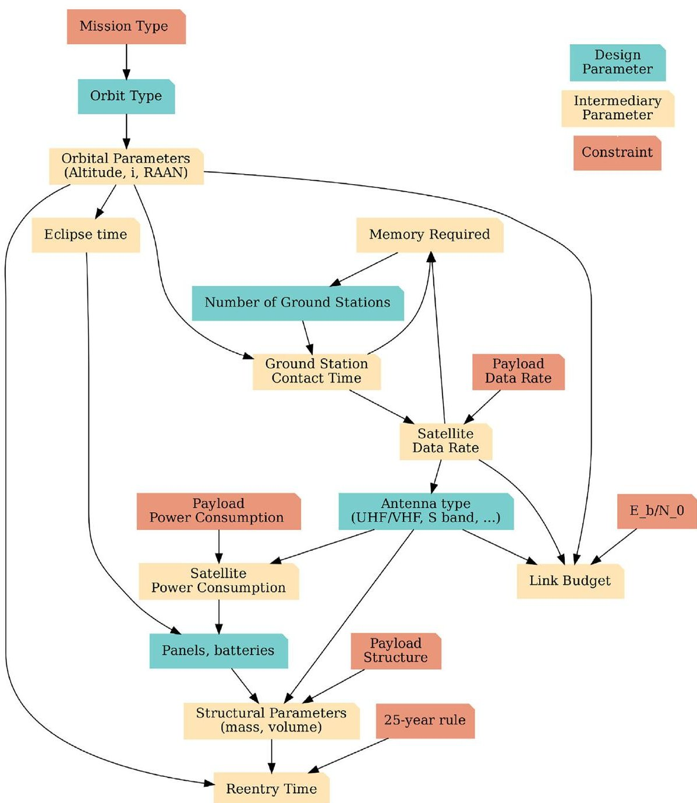
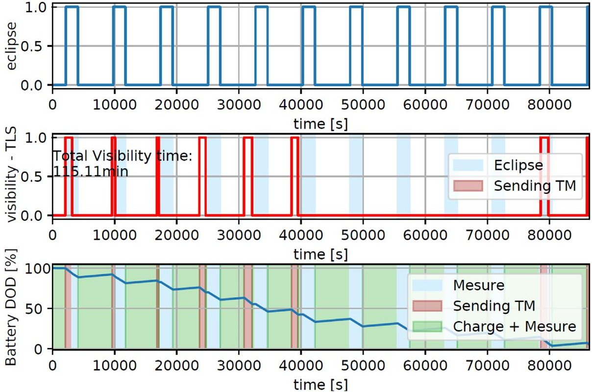
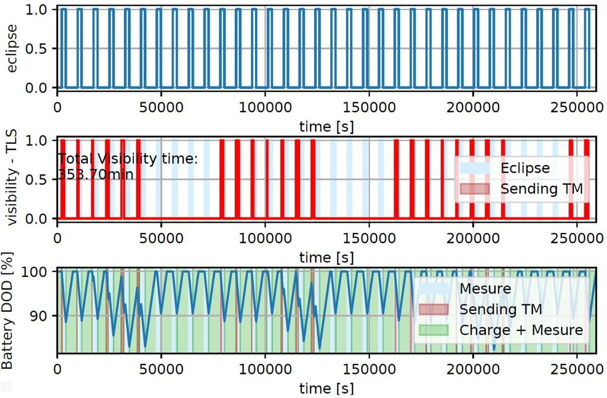
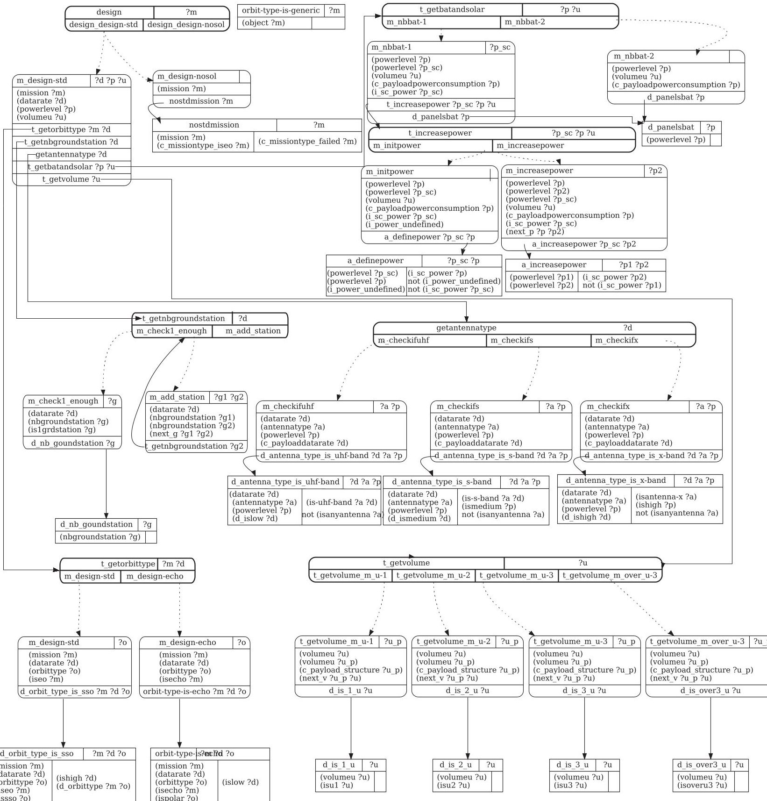
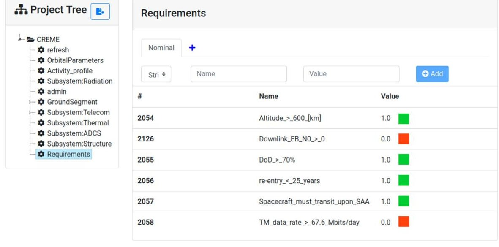
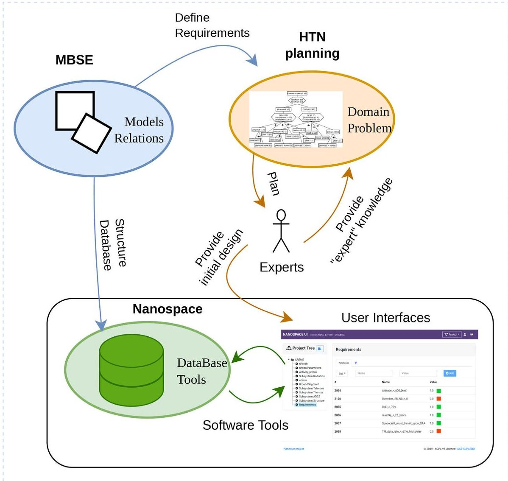

<!-- PDF_PAGE: 1 -->

# Hierarchical Planning Applied to the Preliminary Design of CubeSats: Nanospace Study

Thibault Gateau, Sophia Salas Cordero, Rob Vingerhoeds

To cite this version:

Thibault Gateau, Sophia Salas Cordero, Rob Vingerhoeds. Hierarchical Planning Applied to the Preliminary Design of CubeSats: Nanospace Study. Systems Engineering, 2025, 28 (3), pp.438-452. <10.1002/sys.21803>. <hal-05401641>

HAL Id: hal-05401641

https://hal.science/hal-05401641v1

Submitted on 6 Dec 2025

HAL is a multi-disciplinary open access archive for the deposit and dissemination of scientific research documents, whether they are published or not. The documents may come from teaching and research institutions in France or abroad, or from public or private research centers.

L'archive ouverte pluridisciplinaire HAL, est destinée au dépôt et à la diffusion de documents scientifiques de niveau recherche, publiés ou non, émanant des établissements d'enseignement et de recherche français ou étrangers, des laboratoires publics ou privés.

Distributed under a Creative Commons CC BY-NC-ND 4.0 - Attribution - Non-commercial use - No Derivative Works - International License

<!-- PDF_PAGE: 2 -->

REGULAR ARTICLE OPEN ACCESS

# Hierarchical Planning Applied to the Preliminary Design of CubeSats: Nanospace Study

Thibault Gateau $ ^{1} $ Sophia Salas Cordero $ ^{1,2} $ Rob Vingerhoeds $ ^{1} $

$ ^{1} $Fédération ONERA - ISAE-SUPAERO - ENAC, University of Toulouse, Toulouse, France | $ ^{2} $The CT Engineering Group, Toulouse, France

Correspondence: Rob Vingerhoeds (rob.vingerhoeds@isae-supaero.fr)

Received: 31 May 2024 Revised: 13 December 2024 Accepted: 6 January 2025

Funding: This study was supported by ISAE-SUPAERO.

Keywords: concurrent engineering | CubeSats | hierarchical planning | model-based systems engineering | preliminary design

## ABSTRACT

CubeSat design has been already studied and formalized but knowledge representation remains a challenge. The management of human-learnt knowledge during the process is not an aspect that is often spoken about. This paper discusses the proposal of integrating a hierarchical planning approach with a model-based one to the open-source Nanospace framework, a web-based application for concurrent engineering during the preliminary design phase of CubeSats. Hierarchical planning aids to introduce commonly tacit human expertise, an aspect that the preliminary design of CubeSats can benefit from. The proposed integration could allow a faster design convergence and faster inspection of candidate architectures The Nanospace framework itself may benefit from an approach bringing in model-based efforts and hierarchical planning facilitate knowledge representation and reuse. A use case on the CREME CubeSat project is detailed, emphasizing how to impregnate the design iterations with experts' knowledge.

## 1 Introduction

Concurrent design engineering (CDE) applied to space mission preliminary design [1] is meant to facilitate the design process of converging into key subsystems, preliminary figures, preliminary models, and preliminary architectures required to ensure the space mission feasibility. Usually, such a methodology is supported by a concurrent design facility (CDF) [2]. Several CDE implementations have been proposed over the years by:

- Space agencies—e.g., JPL NASA Team X at the Project Design Center [3], ESA Open Concurrent Design Tool $ ^{1} $ [4], CNES IDM-CIC $ ^{2} $ [5], and DLR Virtual satellite, $ ^{3} $

- Academics—e.g., Nanospace [6], Cedesk $ ^{4} $ [7], $ C^{2} $ ERES DOCKS $ ^{5} $ [8], and FOrPlan [9]

- Private companies—e.g., Rheagroup CDP4, $ ^{6} $ and Valispace $ ^{7} $

A comprehensive recent review of CDE tools can be found in [10].

Despite the availability of CDE implementations, practitioners struggle to find a way to facilitate the interactions and communication between the experts at a system level. This entails monitoring and if necessary correcting steps, ensuring that the process is followed in the correct order, that the data is consistent between subsystems, that up-to-date information is correctly

<!-- PDF_PAGE: 3 -->

shared, and that it is understandable between the different experts. Today this role is mostly ensured manually by the system engineer.

All space missions start with a conceptual design study, involving interdisciplinary teams that work concurrently and co-located. In this article, concurrent engineering (CE) is approached in a space context [11], based on "work in parallel" and "co-located work." A review of CE design practice in the space sector shows that 80% of the respondents have a process for the overall design study and 66% also defined processes for single design sessions [10]. In contrast with big companies, neither "New Space" [12] nor academia are prone to have established "communities of practice" helping throughout the design process. This lack of guidance through concurrent design studies could lead to wrongful project and mission planning, delays in the schedule, and a cost increase [13].

The work presented in this paper considers open-source concurrent design tools to guarantee the accessibility of the further mentioned tools to everyone, which is particularly important for educational purposes. The paper specifically discusses the application of the Nanospace framework, an open-source and web-based CDE, model-based systems engineering (MBSE), and hierarchical planning. MBSE can be defined as "the formalized application of modeling to support system requirements, design, analysis, verification, and validation activities beginning in the conceptual design phase and continuing throughout development and later life cycle phases" [14]. Hierarchical planning is an artificial intelligence (AI) planning technique that breaks with the tradition of classical planning by using hierarchical decompositions [15]. Specifically, hierarchical planning allows adding human expertise considerations to the planning process [16]. The connectivity of Nanospace with the process of system modeling, assessment, and planning is the main focus of this study. The implementation of MBSE has its benefits, some of them having been observed throughout the literature and presented in [17]:

- better communication/information sharing,

- increased traceability and capacity for reuse,

- reduce time and cost,

- improved consistency, and

- system understanding and systems design.

The main contribution of this paper is to assess how to incorporate an approach based on MBSE and hierarchical planning into the concurrent preliminary design of CubeSats. Specifically when using the open-source Nanospace framework. This paper also briefly explains how the design process and parameters are involved in the preliminary design of a CubeSat. As an example, the creation of design structure matrices (DSM), often used in system architecting, is applied to represent parametric dependencies and the preliminary design iterations. DSMs can be clustered and/or sequenced which can bring a lot of insights for the iterations in the design process [13]. Later the constructed DSM is used as a base for the proposal of the CubeSat preliminary design planning approach.

The paper is structured as follows: Section 2 presents an overview of CubeSat preliminary design, inputs/outputs per discipline, and presents the CREME project as the use case. Section 3 illustrates the preliminary design decisions and process with scenario iterations for CREME. Section 4 deepens on how the design iteration process can be seen from a hierarchical planning point of view. Section 5 presents a discussion on the prospects of a model-based/hierarchical planning integration to the Nanospace environment and the questions that arise from their potential integration. Section 6 concludes the paper and presents the motivation for further research in order to attain a better integration between MBSE and hierarchical planning on the one hand and CDE tools, specifically in the scope of Nanospace, on the other hand.

## 2 CubeSat Preliminary Design Overview

With the intent to reduce satellite development time and cost, while at the same time increasing accessibility to space, and sustaining frequent launches, the CubeSat Project was started in 1999 [18]. A CubeSat [19, 20] is a class of satellites that adopts a standard size and form factor, a unit is defined as "U." A 1 U CubeSat is a $ 1 0 \mathrm{c m} \times1 0 \mathrm{c m} \times1 0 \mathrm{c m} $ cube with a mass of up to 2 kg.

In general, when designing a space mission, special "budgets" are identified, e.g., for the satellite mass, the necessary power to execute its intended use, the communication needs (link budget), the radiation, etc. When it comes to designing CubeSats, all of these budgets are crucial for the trade-off assessment between possible architectures for the CubeSat and its disciplines, such as structure, thermal, attitude determination and control, etc. Descriptions of some of these disciplines and simplified list of input/output parameters are given here (for more information, please refer to [21]):

- Mission—Consists of orbit definition, surface coverage, visibility windows, eclipse calculation

- Telecommunications/link—Estimation of the margin for uplink and downlink rates between the spacecraft and ground stations (or another spacecraft) should be computed. These margins usually allow to approximate the useful data flow that can be exploited during the visibility windows of the ground stations (GS).

- On-board computing—The storage capacity of on-board data should be sized according to data produced, the extent of the different telecommunications data streams, and the time between visibility windows to ground stations. The time the spacecraft is not in visibility with the ground station, onboard storage capacity should be sufficient to accommodate produced data until the next visibility window.

- Energy and power—It involves checking the ability of the platform to provide enough power for the mission. For CubeSats, the energy is usually collected with solar panels and stored with batteries. Batteries provide energy during e.g., eclipses, phases of peak demand, or when solar panels have not yet been deployed.

- Structure—A 3D structural model is necessary (at least a simplified version). It defines the distribution of the components

<!-- PDF_PAGE: 4 -->

TABLE 1 Extract of CREME requirements used in this paper.

<table border="1"><tr><td>Requirement ID</td><td>Requirement text</td><td>Rationale</td></tr><tr><td>M-01</td><td>The system shall have an operational mission lifetime of one year.</td><td>Stakeholder needs</td></tr><tr><td>M-02</td><td>The system shall permit the measurement of the radiation environment around the earth.</td><td>Stakeholder needs</td></tr><tr><td>M-03</td><td>The system shall have an altitude of at least 600km.</td><td>Payload Principal Investigator</td></tr><tr><td>M-04</td><td>The system shall be in low Earth orbit.</td><td>Payload Principal Investigator</td></tr><tr><td>M-05</td><td>The system shall be able to transfer data.</td><td>Stakeholder needs</td></tr></table>

of different disciplines throughout the mechanical structure of the CubeSat.

- Payload—The payload is the main motivation of CubeSat missions. It is the medium to achieve the scientific goals of the mission.

- Ground segment—This discipline includes the determination of the number and location of the ground stations by guaranteeing the satellite coverage by the selected GS.

Many constraints need to be considered during the design, for example those that are imposed by the payload, the possible launch dates and available launchers, the specifics of the concept of operations, the activities profiles of the mission, and the compliance with space laws and regulations. Generally, spacecrafts may have different operating modes, that depend on whether the resources of the spacecraft need to be concentrated into a set of functions for a determined period of time. The objective of this paper is to provide a first approximation for design parameter interactions in order to easier understand the design iterations inherent to the preliminary design of a CubeSat. Without loss of complexity, mission modes are not discussed in this paper. However, the concept presented here can be easily extended to take mission modes into account as well.

In an academic context, the use of open-source tools for CubeSat projects [22] has many benefits. Many open-source software, methodologies, and recommendations can be found online e.g., the Libre Space Foundation initiative, full open-source CubeSat projects such as the UPSAT initiative, FloripaSat-I [23], and educational projects [24]. In addition, the initiative "Open Source Satellite" provides a list of teams and software of the Open Source ecosystem, a detailed list of tools for CubeSat projects can also be found in [25].

## 2.1 | CREME Project Description

The organization for economic co-operation and development (OECD) Future Global Shocks identified geomagnetic storms (of solar origin) as one of the five major potential risks for the coming years [26]. Among other things, events related to solar activity can have an impact on civil and military earth satellites for telecommunications, navigation and observation. Communications (HF/VHF/UHF), electromagnetic interference (EMI), GNSS navigation, and radar detection could be disrupted. In order to better understand the space weather around the earth, the CubeSat radiation environment monitoring experiment

(CREME) project was submitted to the Occitanie region in France, received its approval, and started late 2020. $ ^{11} $ Its objective is to measure the radiation environment in low earth orbit (LEO).

CREME's payload is being developed by ONERA, and it aims to be composed of a charged particle detector at a moderate cost. So, the payload must be low cost, have a small footprint, and its design must allow for easy transportation in any type of platform (industrial or scientific). The radiation monitor does not require precise attitude control. The risks are therefore low, which increases the feasibility of the platform. The platform is being developed by ISAE-SUPAERO, based on the expertise and feedback acquired during previous missions, such as EyeSat [27] (CNES) and EntrySat [28] (ISAE-SUPAERO—ONERA) projects. Beyond the framework of the CREME project, it is envisaged that the collected in-flight measurements will be exploited at the CSUT (Centre Spatial Universitaire de Toulouse). These measurements should allow for the validation of the sensor concept in orbit, which has the goal of enriching space weather monitoring services.

One of the perspectives of such a project is to propose to the space industry a low-cost radiation monitor, of small size and mass, and very versatile, so that it can be easily integrated on commercial satellites. The underlying idea is to be able to have a sensor that can be adapted to take measurements of the particles of interest $ ^{5} $ . In this way, in the future, a satellite constellation could allow measuring the space environment as a whole, and enable characterization of orbits until now little described from the radiation point of view.

## 2.2 CREME Preliminary Design Context

Only a subset of the CREME project's requirements and constraints is considered in this paper due to space constraints. They can be found respectively in Tables 1 and 2. In the following paragraphs, an in-depth consideration of the parameters, disciplines requirements, and constraints is presented.

Telecommunication and power are traditionally the most critical subsystems to ensure mission survival. Without communication, mission data would not be able to be retrieved; and without power, the CubeSat would basically become space debris. The payload data recollection function would benefit from the highest possible altitudes of LEO, while it must also visit the South Atlantic anomaly (SAA) as often as possible (as per constraint C02). When active, the payload provides 27.6 Mbits of data per day

<!-- PDF_PAGE: 5 -->

TABLE 2 Extract of CREME constraints used in this paper.

<table border="1"><tr><td>Constraint ID</td><td>Constraint text</td><td>Rationale</td></tr><tr><td>C-01</td><td>The payload data rate shall be considered to be at least 27.6 Mbits per day.</td><td>Payload Principal Investigator</td></tr><tr><td>C-02</td><td>The payload shall visit the South Atlantic anomaly as often as possible.</td><td>M-02</td></tr><tr><td>C-03</td><td>The energy per bit to noise power spectral density ratio margin shall be greater than zero.</td><td>M-05</td></tr><tr><td>C-04</td><td>The Bit error rate (BER) shall be less than $10^{-6}$</td><td>M-05</td></tr><tr><td>C-05</td><td>Orbital lifetime after completion of operations of spacecraft in low Earth orbit is limited to ensure that their spacecraft and/or launch hardware are in an orbit that will decay and cause said object to reenter Earth&#x27;s atmosphere within 25 years to mitigate the creation of more orbital debris.</td><td>IADC-25 year rule[29]</td></tr><tr><td>C-06</td><td>The depth of discharge (DoD) of the batteries shall remain above 70%</td><td>Expert considerations</td></tr><tr><td>C-07</td><td>The payload is 1.5U</td><td>Payload Principal Investigator</td></tr><tr><td>C-08</td><td>The payload power consumption is on average 6W.</td><td>Payload Principal Investigator</td></tr></table>

(see constraint C-01), and the platform produces around 40 Mbits of data per day for housekeeping (known by expertise). Therefore, the data rate value for the initial sizing of the telecommunication subsystem must be higher than an average of 67.6 Mbits per day.

Power is provided by batteries, which, on CubeSats, are usually charged by solar panels. During eclipses, batteries must store enough power to ensure spacecraft survival. Therefore, the battery's depth of discharge (DoD) must remain above a threshold (threshold—under which batteries may deteriorate). If battery recharge does not totally compensate (on average) power consumption of the platform and payload, the spacecraft will shut down and may not wake up (see constraints C-06 in Table 2).

Orbital parameters have a strong impact on mission design. In this paper, the assumption was made that the orbit will be circular (eccentricity equals zero). The altitude of the spacecraft directly impacts telecommunication parameters and reentry time (Figure 1). The less distance to the ground station, the easier it is to communicate (shorter range). Regarding reentry time, in LEO, there are still atmosphere particles that generate some drag on the spacecraft. This drag lowers the altitude of the orbit and, eventually, aids the spacecraft in re-entry. Traditionally, CubeSats take advantage of this drag to ensure the respect of space regulation (as constraint C-05).

Along with the altitude, other orbit parameters such as inclination and right ascension of the ascending node (RAAN) impact the eclipse time of the spacecraft (time spent by the spacecraft in the shadow, or penumbra, of earth). These parameters also define which regions on earth are in the field of view of the satellite when orbiting and at what time, which determines when and for how long the spacecraft will be able to establish contact with ground stations. In this example, it is assumed that the platform will be able to allow a sun-pointing attitude control, ensuring an efficient battery recharge when the satellite is not in eclipse.

The more batteries and solar panels are needed, the more mass increases. In satellite design, the mass is a critical parameter since it is directly proportional to the mission cost. Nonetheless for CubeSats, volume is usually the most limiting factor (e.g.,

constraint C-07). For the calculation of reentry time, mass, volume, and drag must be taken into consideration, as well as the altitude of the spacecraft. The reentry time must remain under 25 years after the mission ends (constraint C-05).

These dependencies are shown in the dependency graph in Figure 1. Analogously, Figure 2 depicts these dependencies as a design structure matrix. In the example presented in this paper, neither attitude determination and control system (ADCS), nor radiation or thermal considerations are included. These elements are of course fundamental during a real CubeSat mission preliminary design, and each of these elements can be easily added since the approach is modular.

## 3 CREME Preliminary Intermediary Design Results

## 3.1 Known Unknowns and Constraint-Lead Design

Many design parameters are unknown when initializing a preliminary design. A general caveat is that experience can provide a starting point (at least an order of magnitude for many of the parameters). In addition, there can be an implicit preference for available flight-proven technology (which is typically the case, as otherwise, the risk related to a technology not being ready to flight needs to be a risk the project is able to manage). In practice, for critical parameters such as mass, margins are used depending on confidence (from 5% to 20%). These parameters can be referred to as known unknowns. In Figure 2 the design structure matrix for the case study is shown. As models are considered the single source of truth from an MBSE perspective they can be used to capture the system dependencies represented in Figures 1 and 2, which allows to reuse of knowledge from previous CubeSat missions. The different system model diagrams can be considered a sort of template; that can be replenished to meet new mission expectations without needing to start from zero, guaranteeing continuity and traceability of success within missions. For instance, MBSE system development could

<!-- PDF_PAGE: 6 -->

FIGURE 1 An extract of the dependency graph of the case study design parameters.

streamline in this manner a more systematic approach to the assessment of projects following such templates.

When determining what sort of platform answers CREME's needs, it is given that at least an on-board computer, a transceiver, a magnetorquer, and radiators are needed. For this particular use case, an average platform consumption of 8 W was estimated (Payload average consumption is set to 6 W, cf. requirement C-08). The average platform consumption value comes from expert considerations, and it is a rough estimation for the platform consumption upper margin. During most of the operational time, the spacecraft will consume an average of 14 W. But during telecommunication events, mainly sending data, higher power consumption may occur, that in the worst case could lead to a consumption of 10 W by the transceiver, leading to a total of 24 W needed for this mission.

Some specific risks, e.g., special deployment of solar panels or antennas, are avoided in projects in general whenever possible except when such features have been flight-proven (TRL 9), or when the purpose of the project is to showcase a certain

technology. For example, the EYESAT mission [27] was able to show that a "flower solar panel" deployment generates almost four times more power than only covering the CubeSat with solar panels.

Another factor is the number of "U" cubes, this is an important criterion for the cost of a CubeSat mission. Usually, a more compact design is favored for this kind of mission, mainly linked with the cost of launch per amount of mass. In a simulation scenario, as a first step, it is verified whether a 2U CubeSat would be feasible in terms of power consumption (see following sections). In a real-world setting, a CubeSat preliminary design is mostly directed by constraints, with not a lot of alternatives (only one type of COTS component available, opportunistic choice for launchers, etc.).

## 3.2 Preliminary Design Iteration

Requirements (see Table 1) are set in the Nanospace application and depending on the known unknowns, design parameters are

<!-- PDF_PAGE: 7 -->

<table border="1"><tr><td></td><td>Mission type</td><td>Orbit type</td><td>Orbital parameters</td><td>Eclipse time</td><td>Memory required</td><td>Number of GS</td><td>GS contact time</td><td>Payload data rate</td><td>Satellite data rate</td><td>Payload power consumption</td><td>Antenna type</td><td>E_b/N_0</td><td>Satellite power consumption</td><td>Link budget</td><td>Panels, batteries</td><td>Structural parameters</td><td>Re-entry time</td><td>25-year rule</td><td>Payload Structure</td></tr><tr><td>Mission type</td><td></td><td>

FIGURE 2 CREME case study design structure matrix.

defined as much as possible. They are automatically updated in the database through the Nanospace API. The dependency graph (Figure 1) or the design structure matrix (Figure 2) are able to show the parametric feedback loops, subsequently allowing to sequence which part of the script should be re-run. Currently, the process is semi-automatic, which allows us to avoid getting stuck in non-converging designs (human expertise is required). Intermediary results are also stored in Nanospace and can therefore be easily shared between experts. As mentioned before, a Python script is used in a semi-automatic process and eases the link to the Nanospace database.

The first consideration of this example iteration comes from constraint C-07 (payload is 1.5U) which means that CubeSat should be at least 2U. Initially, the orbit will be set to 2000 km the maximum according to the M-04 requirement. The fact that the spacecraft shall "fly" over the SAA (Constraint C-02) imposes a high inclination. Since most of the launchers are for spacecraft with a sun synchronous orbit (SSO), this kind of orbit is taken for the first iteration. SSO is commonly used for LEO observation spacecraft since the surface illumination angle on the earth underneath remains the same. Space mechanics physics impose an inclination of 104.85 degrees for an SSO orbit at 2000 km. SSO is a polar orbit, which at the same time also addresses the requirement for the transit upon SAA (C-02).

As described, some design choices can be made when reviewing the mission constraints and requirements. In order to make these design choices—experience is required and at least some knowledge of some orbital mechanics concepts. For selecting the RAAN parameter, basically two options exist:

- dawn/dusk orbit, where the satellites' solar panels can always see the sun;

- other cases: the worst case for solar panel illumination is the noon/midnight orbit, usually taken for simulations.

In CREME, no RAAN constraints exist (as the payload is not related to local ground surface hour), so the worst-case scenario in terms of solar panel illumination is considered as noon/midnight orbit, which would allow a launch on any SSO mission.

The solar panel number and battery are directly related to the available volume. As a first estimation, in a "flower" configuration—deployable panels and sun pointing (when the spacecraft is not in eclipse), such as with the EYESAT platform [27]—it is considered that a 10 $ cm^{2} $ solar "unit" orthogonal exposed to the sunlight will generate 2 W. For a 2U sat, with a flower configuration this would mean 4 W per solar panel, with four arrays it leads to 16 W. The number of accumulators packed in serial and parallel should be optimized. For the first sizing, we will arbitrarily consider one battery block with a specification of the capacity of 80 Wh. Simulation allows for a first check of the order of magnitude of available power: the Eclipse time is needed on a representative number of orbits (e.g: 5 days). The results show that the power input from the solar panels is insufficient (see Figure 3), meaning a violation of constraint C-06 (as batteries are not charging enough during daylight periods).

In this case, two possibilities exist: to reconsider the orbital parameters (SSO dawn/dusk to get no eclipses at all, however this might come with the downside of fewer launch opportunities),

<!-- PDF_PAGE: 8 -->

FIGURE 3 Simulation example: battery remaining power (1 day at 2000 km with an SSO midday/midnight orbit—considering 4 solar arrays of 4 W). Colors in background are highlighting different events (eclipses) or specific activities of the satellite.

FIGURE 4 Simulation example: battery remaining power (3 days at 2000 km with an SSO midday/midnight orbit—4 solar arrays of 6 W).

or to reconsider the solar generator number. For the sake of simplicity of this example, let us suppose here that there is no solution for power input in a 2U CubeSat and the design decision that is taken is to consider a bigger spacecraft: a 3U. It is assumed that 6 W per solar panel will be generated （ $ 3 0 \mathrm{c m}^{2} $ ）on four arrays (four "petals" of the "flower" ). During sunlight, therefore 24W are generated, and simulations shows that, in spite of heavy transceiver data bursts, batteries are able to recharge (as seen in Figure 4).

Another factor to consider is/are the ground station(s). Initially, it is considered that only one ground station $ ^{12} $ is to be used and the feasibility needs to be checked. The easiest solution is to choose one band, the link budget margin is good in both directions. However, the data rate imposes a more advanced transmitter, such as S-Band, to satisfy the payload data rate (constraint C-01).

Simulation with the Stela tool [30] shows that the orbit with an altitude of 2000 km is too far for a re-entry below 25 years after

<!-- PDF_PAGE: 9 -->

mission completion (constraint C-05 is not met). The dependency graph and DSM (Figures 1 and 2) emphasize two main elements that influence re-entry time: altitude and/or structural parameters. Experts must assess either a change in altitude (and re-iterate all previous steps) or whether a change in structure is possible (more challenging).

As it is shown in this subsection, the preliminary design of CubeSat missions possesses an iterative nature. The dependency graph and DSM (Figures 1 and 2) provide guidance on selecting relevant parameters when requirements or constraints are not met. The choice is a matter of trade-offs between each subsystem expert, mission cost, failure probability acceptance, and other factors. Human expertise is required in the process. A single source of truth is required for the team to efficiently share and exchange data while performing the preliminary design. There are too many factors that can influence the final design solution (as shown), for those factors not to be accurate when reviewed.

## 3.3 CREME's Preliminary Design: A Semi-Automated Process

For CREME's preliminary design Python scripts were developed and used; they can be accessed here $ ^{13} $ under the AGPL v3 license. For pedagogical purposes, simple mission analysis scripts are provided in this repository. As well as an example of an input file in .yml format (orbital parameters, power consumption of the platform, etc.) and an example of outputs, which include intermediary results such as remaining power graph and data budget graph and a full report (in Markdown format) required as a light but realistic preliminary design synthesis

Orbit propagation, eclipse determination, and contact with ground station events—are handled with a GMAT script. Link budget analysis is done with Dosa $ ^{14} $ and Luplink. $ ^{15} $ Python scripting is used for miscellaneous computations. The script is self-sufficient for a first step mission analysis preliminary design.

Traditionally, to ensure mission success, the worst-case scenario is considered. This allows considering margins, even if refinement of models may be required when the problem ends up being too constrained.

## 4 Hierarchical Planning and MBSE Integration Efforts

## 4.1 Semi-Automated Process for Leading Preliminary Design First Iteration

As mentioned before the "execution" of the preliminary design analysis can be treated as a semi-automated process, guided by the known unknowns as discussed in Section 3.1. Trade-offs are intrinsic to the preliminary design as showcased in the example in Section 3.2. Trade-offs in multidisciplinary developments can be seen as multi-criteria optimization problems. Dependency graphs (such as the one in Figure 1) can aid multi-criteria optimization problems, often led by financial and practical considerations. Not only the mentioned dependency graph, but of course the dependency structure matrix (Figure 2 can be used for this purpose.

The idea of guiding the iterative nature of the preliminary design through the use of DSMs for instance was explored in [13].

Designing a CubeSat is generally an over-constrained problem for many reasons. For example, for financial considerations, orbits are often restricted by commercial launchers' availability, size is selected to be as reduced as possible, and off-the-shelf components often drive considered characteristics. Usually, the payload owner has an interest in the spacecraft to remain active for as long as possible. All of these considerations and more lead to a multi-criteria optimization problem. In practice, it is the system engineer's expertise that often avoids the exploration of theoretically plausible but in reality inconsistent solutions. Even following the guidelines of the CubeSat standard [31] might lead to some sort of "lacking freedom" decision design.

Some of the classical considerations in a CubeSat project are the following:

- the number of U should be as small as possible (smaller will reduce cost);

- the number of ground stations should be as small as possible;

- the duration of the mission should be maximal.

A possible semi-automated solution for performing trade-offs or design iterations throughout the design process is to consider the dependency graph/matrix as a task-planning problem. As an illustration, and for the sake of clarity, let us consider Figure 1 as a reference. Different "high level" tasks (not necessarily in this order) should be achieved in order to achieve the preliminary design of a CubeSat, such as for example:

- an orbit must be selected;

- a number of ground stations must be defined;

- the type of antenna must be set;

- the number of panels and batteries must be defined.

The next sections describe why we are talking about hierarchical planning when discussing the aforementioned preliminary Cube-Sat design as a semi-automated process that benefits from known unknowns (knowledge that in general arises thanks to expertise in the domain).

## 4.2 Hierarchical Planning Framework

As explained by Bercher et al. [16], hierarchical planning allows adding human expertise considerations to the planning process. Such a hierarchical planning framework seems well adapted for a representation of a CubeSat preliminary design process that includes our expert considerations. It is possible to have multiple abstraction levels to communicate with human users, e.g., for the automated generation of explanations exploiting abstraction [32, 33] and also to exploiting control rules to describe desired solutions [34, 35].

Hierarchical planning is more flexible in comparison to a classical planning approach—as it incorporates procedural expert

<!-- PDF_PAGE: 10 -->

knowledge (such as modeling means, or to speed up search) and allows for the description of more complex behavior (i.e., imposing complex restrictions on the desired solutions). It also incorporates task abstraction to plan explanations. A complete literature overview on the subject of hierarchical planning can be found in [16].

## 4.3 Hierarchical Task Network Domain, Problem and Solution Plan

There are many formalization approaches for hierarchical planning in the literature. Here, we will use classic Hierarchical Task Network (HTN) planning formalism [36]. HTN planners are not so much planning to fulfill a set of goals, but much rather to perform a set of tasks [15]. Concretely, we used HDDL [37] a hierarchical extension of the Planning Domain Definition Language (PDDL) associated with HyperTension planner [38]. A planner uses a domain file (tasks decomposition, actions that exist in the world) and a problem file (instantiation of an initial world state, and goal to achieve) to build a sequence of tasks called a plan.

Classically, an HTN domain is decomposed into a set of abstract tasks, and a set of methods decomposing these abstract tasks into abstract and elementary tasks [36]. In the scope considered for this paper, the preliminary design of CubeSats, it is applied in the following manner:

- Abstract task: High-level task for the choice of design parameters

- Methods: decomposition possibilities of the abstract tasks, i.e., mission will be an Earth observation (EO) mission (and therefore will probably require an SSO) or is a remote sensing mission, with no implication of the type of orbit.

- Elementary tasks: for sake of clarity, "naive" actions are used to get the "value" of the literal directly in the solution plan (ex: d_is_3_u) to make it directly readable in the solution plan.

Figure 5 showcases the graphical representation of the HDDL domain extracted from the dependency graph present in Figure 1. In our example, the definition of the HTN problem consists of:

- setting the intermediary parameters with their initial default value (i.e.: antenna type is undefined, or by default, VHF as we know that it will be the less constrained type of communication);

- setting the constraints values (e.g: size of the payload, required data rate...);

- setting the root task ("design the mission").

- Therefore, from the design point of view:

- Design parameters are to be set through abstract tasks: e.g.: (d_nbGroundStation grd_1)

- Intermediary parameters are initially set in the HTN problem, and solved by the planning process: e.g.: (i_sc_power p_undefined)

LISTING 1 | HTN Problem in HDDL language.

(define (problem leo-eo) (:domain CubeSat)

    (:objects

    eo_mission - mission

    isEO - missionType

    any sso - orbitType

    d1 d2 d3 - dataRate

    grd_1 grd_2 grd_3 - NbGroundStation

    p_undefined p0 p1 p2 - powerLevel

    U0 U1 U2 U3 overU3 - volumeU

    a - antennaType)

(:htn

    :tasks (and (design eo_mission))

    :ordering ()

    :constraints ())

(:init

(altitude alt)

    (next_p p1 p2)(next_p p0 p1)(next_g

    grd_1 grd_2)(next_g grd_2 grd_3)

    (is1GrdStation grd_1)(is2GrdStation

    grd_2)(is3GrdStation grd_3)

    (next_s s2 s1)(next_s s1 s0)

    (next_v U3 overU3)(next_v U2 U3)(next_v

    U1 U2)(next_v U0 U1)

    (isU0 U0)(isU1 U1)(isU2 U2)(isU3

    U3)(isoverU3 overU3)

    (isEO eo_mission)(isEcho echo_mission)

    (isAny any)(isSS0 sso)(isEq eq)(isPolar

    polar)

(c_missionType eo_mission)(c_payloadDataRate d1)

(c_payloadPowerConsumption p1)(c_payload_

structure U2) (c_LOS l2 alt)))

(d_nbGroundStation grd_1)(d_antennaType

a)(d_nbPanelsBatteries p0)

(i_sc_power p_undefined)(i_power_undefined)))

• Constraints are initially set in the HTN problem, and solved

by the planning process: e.g.: (c_missionType eo_mission)

From the dependency graph (Figure 1) we extract an HTN domain (Figure 5). We also define the planning problem, the root task being "design eo_mission," visible in Listing 1. CubeSat domain name refers to the HTN domain used, objects design variable (and associated type) used. For example, sso characterizes a SSO orbit for the orbitType. A number of ground stations (NbGroundStation) is explicitly described by literals (there can be 1,2, or 3 ground stations that can be selected in this example), as well as datarate, maximum power or volume of the CubeSat allowed by

<!-- PDF_PAGE: 11 -->

FIGURE 5 Graphical representation of the HTN domain extracted from the dependency graph (Figure 1). Nomenclature: abstract tasks begin with "t_” and methods begin with "m_." Other tasks are elementary, and/or are used to emphasize design parameter values of the HTN problem (Listing 1). Abstract tasks of the HDDL domain are inferred from design parameters (Figure 1). Note that intermediary parameters and constraints (Figure 1) are initially set in the HDDL problem (Listing 1). This figure was generated and adapted from a visualization tool provided by HyperTension based on graphviz.

the design. htn keyword sets the root task to be "solved," which is the design eo_mission aforementioned root task. Eventually, init keyword sets the initial condition for the problem definition.

With the previously defined Domain and Problem, HyperTension is able to generate a solution plan, here for an earth observation mission visible in Listing 2.

In this example, a 3U CubeSat is required: it should need only one ground station and one battery pack to have a viable design. Only "elementary actions" appear in the solution plan and provide a final proposed value. Note that other solutions may exist. The planner is meant to return the first valid plan found. The problem and domain implementation is open source and available on a gitlab repository. $ ^{16} $

<!-- PDF_PAGE: 12 -->

Nanostar project

$\textcircled{3}$ 2019 - AGPL v3 Licence: ISAE-SUPAERO

FIGURE 6 Nanospace user interface. Part of the requirements are shown. Requirements concerning telecommunication aspects are not compliant yet.

LISTING 2 Solution Plan.

----------------Plan----------------

0: d_orbit_type_is_sso(eo_mission d1 sso)

1: d_nb_goundstation(grd_1)

2: d_antenna_type_is_uhf_band(d1 a)

3: a_definepower(p1)

4: d_panelsbat(p1)

5: d_is_3_u(u3)

## 5 MBSE and Hierarchical Planning-Nanospace Integration Efforts

The lack of data continuity throughout the complete system life cycle is one of the biggest lacks of the mentioned CDE tools, and Nanospace has until here been no exception; as it proposes different tools to be used to achieve different calculations for instance. For example, in the current NanoSpace set-up, GMAT is used for orbitography calculations, Dosa for link budget computation, etc. Which software in the preliminary design of CREME were used for what is explained in more detail in Section 3.3.

Passing the right data from one tool to another, while maintaining good coherence between the data, generates a complex problem that needs to be addressed as it creates certain issues, one of them being the unnecessary overhead when attempting to verify all different teams are using or not the same data for the design iterations. Here is where model-based efforts as a single source of truth in a project can reduce this unnecessary overhead. Besides the clear advantage of model-based displaying information about structural, behavioral, and parametric representations of CubeSats; a question remains regarding the process of the development of the CubeSat: How can we manage the knowledge acquired through the experience of performing the preliminary

design of CubeSats to guide future projects? So far we have called this aspect in this paper as the sequencing or guiding of the preliminary design process. A significant shortcoming is when the lessons learned from previous projects are not exploited in current or future projects. Here lies the potential benefit of exploiting hierarchical planning during the preliminary design of systems, in this paper, we discuss specifically CubeSats.

The open-source Nanospace framework [6] is a dedicated open source concurrent design engineering tool, mainly consisting of a GUI, a database, and an API, designed to facilitate the academic CubeSats preliminary design process. Nanospace allows for direct information exchange between third-party expert software, while allowing transparent data visualization to any team member. It ensures concurrent access to the data. This accessibility detail is relevant in general but even more when teams are working remotely. The GUI provides an intuitive way of visualizing other experts' contributions that can be of high value when looking for project understanding and transparency.

Nanospace can benefit from the change propagation information available from the system models, that can be represented using design structure matrices (DSMs). DSMs can be automatically generated for instance from system modeling language (SysML v1) models by the tool MB2DM $ ^{17} $ [39]. In other words, the dependency paths between data in the system model, shown in this paper with either dependency graphs or matrices can be used to describe change propagation paths to users. For example, the user could be signaled through the Nanospace UI when a requirement is not satisfied (as shown in Figure 6), as well as if a given information regarding a design parameter must be updated. This proposition can be taken further with the usage of hierarchical planning as discussed in this paper. The feature of hierarchical planning as a tool to aid knowledge management in the preliminary design of CubeSats is yet to be implemented in Nanospace, but the authors would like to highlight its potential.

<!-- PDF_PAGE: 13 -->

FIGURE 7 Synthetic view of a possible MBSE and hierarchical planning integration effort in order to ease preliminary design.

MBSE offers a formalized application of modeling to support system design, throughout the life cycle phases [40, 41]. Models are used to represent the system and allow better mastering the design and verification of complex systems [42]. Several system modeling languages exist. SysML [43] is implemented in different software (both open-source and commercial) and its use is more widespread. Object process methodology (OPM) [44] is accompanied by the OPCAT software; ARCADIA (Architecture Analysis and Design Integrated Approach) [45] uses the Capella software. The ontological modeling language (OML) [46] is supported natively by OML Rosetta and OML Luxor. OPM and ARCADIA are more software-dependent in implementation but have a methodology associated with their tools; while SysML is a standardization of a notation, but does not restrict its use. OML can actually be used as a metalanguage to define other modeling languages, so its application is quite flexible. In terms of the usage of modeling languages in the domain of CubeSats, one of the main efforts to apply MBSE began in 2011 [47] using SysML. In the context of Nanospace a work that delves into the usage of the SysML model as the single source of truth during the preliminary design of CubeSats can be found in [48].

As briefly mentioned at the beginning of this section, MBSE can beneficially be used as a back-bone, in particular as shown in this paper for the efforts in the very first stages of the design process. It guides and enables engineers to model requirements, the environment, the system of interest itself (the CubeSat), etc.

Using a system modeling language, a CubeSat design can be performed after a stakeholder needs analysis and formalization of requirements, via functional analysis, a logical architecture, and then an allocation to a physical architecture, which results in an end design. Resulting in a coherent representation of the interactions between all of the concerned design parameters, requirements, functions, components, and sub-systems.

However, depending on the specific goals of the project when implementing model-based approaches, it could be that some data is not captured or "held" throughout the process. During an actual preliminary design, some solutions are actually not explored as they are obviously inconsistent from a human expert's tacit knowledge point of view. From an optimization point of view, it may be tempting to carefully choose each orbital parameter optimally for the mission orbit in order to maximize payload utility and/or return on investment. However, in practice, commercial launches are often a real constraint when setting the final orbit values. Another example of expert knowledge considerations is the fact that there is no use in considering electric propulsion in a 1U CubeSat; when utilizing only off-the-shelf components. At the moment, preliminary design efforts have not actively proposed a solution to manage "experts' opinions besides calling the experts themselves. This paper proposes that hierarchical planning can manage this tacit expertise as portrayed in Section 4. Figure 7 synthesizes the information exchange between Nanospace and the MBSE and HTN features, depicting

<!-- PDF_PAGE: 14 -->

a sort of extended constellation for the Nanospace development. Planning tools can help generate the first iteration of a design plan, which can ease the preliminary design process by pruning inconsistent parameter values or design choices.

When discussing the integration of a model-based/HTN approach to a CDE environment like Nanospace, as shown in Figure 7, several research questions become apparent:

- What is the "best" flow of information/data between the different tools in a design process?—The design logic has an impact on the tool landscape as well as on the database(s).

- Can MBSE be used as a "front-end" for the complete design cycle and if so, what would be the ideal output of the tools? The use of parametric models provides quite an insight into the actual design; and could in addition allow to use optimization set-based design approaches for the next design steps.

- How do concurrent design approaches and associated tools, linked with model-based engineering approaches and their tools, impact the conceptual design phase itself? And in turn, how can the tools be better developed so as to better support the particularities of CubeSat design?

These topics are at the heart of the development of the Nanospace environment. The current structure behind the Nanospace database needs to be integrated with the hierarchical planning approach presented in this paper. Furthermore, the aforementioned research questions need to be addressed by those eager to further develop concurrent engineering design environments.

## 6 Conclusions and Future Work

Even for a "simple" CubeSat, many disciplines are required during the preliminary design process. This paper shows how MBSE-driven system models could enhance the propagation of parameter updates or changes on Nanospace, whether using parametric design structure matrices or dependency graphs. In the simplified, but real, use case of the CREME CubeSat project, a semi-automatic script was used to illustrate the iterative design process, building on the human engineer's experience and knowhow. The approach of hierarchical planning accentuated how to impregnate the design iterations with experts' knowledge. MBSE is in the capacity to help fill the existing gap in regards to archiving and reusing knowledge, as it sets the path for better communication/information sharing, increased traceability and capacity for reuse, reduced time and cost, improved consistency, system understanding, and system design.

Concurrent engineering is facilitated in this work by Nanospace, a database managing data storage and data sharing between the experts. It is worth noting, Nanospace cannot realize a preliminary design autonomously, but needs to work with other tools (in this paper GMAT, Dosa, Stella, Celestlab, and some Python scripting), and project team members.

This paper opens several future-work possibilities. An MBSE- HTN-Nanospace integration to potentially facilitate the automatic application of multi-disciplinary analysis and optimization.

Manually constructing dependency graphs is counter-intuitive so further integration and development of the MB2DM tool need to be carried out, while considering the possibilities of incorporating it into the Nanospace user interface. It also raises the question of how to bring in the aspects of hierarchical planning more in line with the required design decisions throughout the preliminary design of CubeSats. In addition, the current database structure for Nanospace needs to be re-assessed for it to be able to include more parameter details, such as their relations. This could include a data flow for the database to receive and send information to other software while propagating the changes accordingly. Finally, it would be good to compare the performance of Nanospace with and without an MBSE and hierarchical planning vision, both with expert teams and beginners or students.

## Acknowledgments

This paper is a revised and extended version of the paper: "S. Salas Cordero, T. Gateau and R. Vingerhoeds, "MBSE Challenges in the Concurrent Preliminary Design of CubeSats: Nanospace Study," 2022 IEEE International Systems Conference (SysCon), Montreal, QC, Canada, 2022, pp. 1-8, doi: 10.1109/SysCon53536.2022.9773818" [49].

## Conflicts of Interest

The authors declare no conflicts of interest.

## Data Availability Statement

The data on hierarchical planning applied to the preliminary design of CubeSats are openly available in the OPENCAESAR Gitlab repository at https://gitlab.isae-supaero.fr/saclab/cubesatpreliminarydesign/ preliminary-design-planning.

## Endnotes

$ ^{1} $ https://ocdt.esa.int - accessed January 11, 2019.

$ ^{2} $ https://www.clever-age.com/fr/case-studies/cnes-une-application-demodelisation-3d/ - accessed: July 2, 2021.

$ ^{3} $ https://www.dlr.de/sc/en/desktopdefault.aspx/tabid-5135/8645_read- 8374/ - accessed: July 2, 2021.

$ ^{4} $ https://cedesk.github.io/ - accessed: February 25, 2021.

$ ^{5} $ https://gitlab.com/cceres-docks - accessed: February 18, 2021.

$ ^{6} $ https://www.rheagroup.com/fr/news/cdp4-open-source-community edition - accessed: February 18, 2021.

$ ^{7} $ https://www.valispace.com/ - accessed: June 30, 2021.

$ ^{8} $ https://libre.space/ - accessed: June 18, 2021.

$ ^{9} $ https://upsat.gr/ - accessed: June 18, 2021.

$ ^{10} $ https://opensourcesatellite.org/elements-open-source-space- ecosystem/ - accessed: April 18, 2021.

$ ^{11} $ https://www.csut.cnrs.fr/en/cubesat-radiation-environmentmonitoring-experiment/ - accessed: April 2, 2021.

$ ^{12} $ Ground station at ISAE-SUPAERO, with UHF, VHF, and S-Band communication means.

$ ^{13} $ https://gitlab.isae-supaero.fr/creme-project/creme-scripts.

$ ^{1 4} $ https://sourceforge.isae.fr/projects/dosa_link_budget_analysis.

$ ^{1 5} $ https://gitlab.isae-supaero.fr/jsatorb-dev/luplink.

<!-- PDF_PAGE: 15 -->

$ ^{16} $ https://gitlab.isae-supaero.fr/saclab/cubesatpreliminarydesign/ preliminary-design-planning.

$ ^{17} $ https://gitlab.isae-supaero.fr/DSM/dsm-generation.

## References

1. M. Bandecchi, B. Melton, and F. Ongaro, "Concurrent Engineering Applied to Space Mission Assessment and Design," ESA Bulletin 99 (1999).

2. D. Di Domizio and P. Gaudenzi, "A Model for Preliminary Design Procedures of Satellite Systems," Concurrent Engineering 16, no. 2 (2008): 149-159.

3. R. E. Oberto, E. Nilsen, R. Cohen, R. Wheeler, P. DeFlono, and C. Borden, "The NASA Exploration Design Team: Blueprint for a New Design Paradigm," in Aerospace Conference, 2005 IEEE (Piscataway, NJ: IEEE, 2005), 4398-4405.

4. H. P. de Koning, S. Gerené, I. Ferreira, A. Pickering, F. Beyer, and J. Vennekens, "Open Concurrent Design Tool-ESA Community Open Source Ready to Go," in 6th International Conference on Systems and Concurrent Engineering for Space Applications, ESA (Stuttgart, 2014).

5. J.-L. Le Gal, T. Martin, A. Lamy, et al., "IDM-CIC and SIMU-CIC Applications for Setting up a Technical Reference During Design Phases of a Satellite," NA. [Online]. https://logiciels.cnes.fr/sites/default/files/attached_doc/IDM-CIC%5C%20and%5C%20SIMUCIC% 5C%20applications_SECESA2020.pdf%7D.

6. T. Gateau, L. Senaneuch, S. Salas Cordero, and R. Vingerhoeds, "OpenSource Framework for the Concurrent Design of CubeSats," in 2021 IEEE International Symposium on Systems Engineering (ISSE) (Vienna, Austria: IEEE, 2021), 1-8.

7. C. Fortin, G. McSorley, D. Knoll, A. Golkar, and R. Tsykunova, "Study of Data Structures and Tools for the Concurrent Conceptual Design of Complex Space Systems," in IFIP International Conference on Product Lifecycle Management (Cham, Switzerland: Springer, 2017), 601-611.

8. B. Segret, "Algorithmme Embarqué de Navigation Optique Autonome Pour Nanosatellites Interplanétaires" (PhD thesis, Université Paris Sciences et Lettres, 2019).

9. R. A. Chagas, F. L. de Sousa, A. C. Louro, and W. G. dos Santos, "Modeling and Design of a Multidisciplinary Simulator of the Concept of Operations for Space Mission Pre-Phase A Studies," Concurrent Engineering 27, no.1 (2019): 28-39.

10. D. Knoll and A. Golkar, "A Coordination Method for Concurrent Design and a Collaboration Tool for Parametric System Models," Concurrent Engineering 26, no.1 (2018): 5-21.

11. D. Knoll, C. Fortin, and A. Golkar, "Review of Concurrent Engineering Design Practice in the Space Sector: State of the Art and Future Perspectives," in 2018 IEEE International Systems Engineering Symposium (ISSE) (Rome, Italy: IEEE, 2018), 1-6.

12. G. Martin, NewSpace: The Emerging Commercial Space Industry (Washington, DC: NASA, 2016).

13. S. Salas Cordero, C. Fortin, and R. Vingerhoeds, "Concurrent Conceptual Design Sequencing for MBSE of Complex Systems Through Design Structure Matrices," in Proceedings of the Design Society: DESIGN Conference, vol. 1 (Cambridge: Cambridge University Press, 2020), 2375- 2384.

14. D. D. Walden, G. J. Roedler, K. Forsberg, R. D. Hamelin, and T. M. Shortell, Systems Engineering Handbook: A Guide for System Life Cycle Processes and Activities (Hoboken, NJ: Wiley, 2015).

15. M. Ghallab, D. Nau, and P. Traverso, Automated Planning: Theory and Practice (Amsterdam, The Netherlands: Elsevier, 2004).

16. P. Bercher, R. Alford, and D. Höller, "A Survey on Hierarchical Planning-One Abstract Idea, Many Concrete Realizations," in IJCAI International Joint Conference on Artificial Intelligence (IJCAI, 2019), 6267-6275.

17. K. Henderson and A. Salado, "Value and Benefits of Model-Based Systems Engineering (MBSE): Evidence From the Literature," Systems Engineering 24, no.1 (2021): 51-66.

18. A. Johnstone, CubeSat Design Specification Rev. 14 (California: The CubeSat Program, Cal Poly SLO, 2020).

19. H. Heidt, J. Puig-Suari, A. Moore, S. Nakasuka, and R. Twiggs, "CubeSat: A New Generation of Picosatellite for Education and Industry Low-Cost Space Experimentation," in Proceedings of the Small Satellite Conference (Logan, Utah: Utah State University, 2000).

20. C. Cappelletti and D. Robson, "CubeSat Missions and Applications," in CubeSat Handbook (Elsevier, 2021), 53-65.

21. J. R. Wertz, D. F. Everett, and J. J. Puschell, Space Mission Engineering: The New SMAD, Space Technology Library (Microcosm Press, 2011).

22. A. Scholz and J.-N. Juang, "Toward Open Source CubeSat Design," Acta Astronautica 115 (2015): 384-392.

23. M. G. Mariano, F. E. Morsch, M. S. Vega, et al., "Qualification and Validation Test Methodology of the Open-Source CubeSat FloripaSat-I," Journal of Systems Engineering and Electronics 31, no. 6 (2020): 1230-1244.

24. D. Geeroms, S. Bertho, M. De Roeve, R. Lempens, M. Ordies, and J. Prooth, "Ardusat, an Arduino-Based CubeSat Providing Students With the Opportunity to Create Their Own Satellite Experiment and Collect Real-World Space Data," in 22nd ESA Symposium on European Rocket and Balloon Programmes and Related Research, vol. 730 (Citeseer, 2015), 643.

25. T. Gateau, S. Salas Cordero, J. Puech, and R. Vingerhoeds, "Nanospace and Open-Source Tools for CubeSat Preliminary Design: Review and Pedagogical Use-Case," in 4th Symposium on Space Educational Activities, ESA (2022).

26. OECD, OECD/IFP Futures Project on "Future Global Shocks": "Geomagnetic Storms", accessed December 5, 2020, https://www.oecd.org/gov/risk/46891645.pdf.

27. F. Apper, A. Ressouche, N. Humeau, et al., "Eye-Sat: A 3U Student CubeSat From CNES Packed With Technology," in Small Satellite Conference (Logan, Utah: Utah State University, 2019).

28. S. Anthony, G. Raphael, M. David, and C. Jeremie, "Entrysat: A 3U CubeStat to Study the Reentry Atmospheric Environment," in EGU General Assembly Conference Abstracts (Vienna, Austria: European Geosciences Union, 2016), EPSC2016-14735.

29. IADC Space Debris Mitigation Guidelines, Inter-Agency Space Debris Coordination Committee (2007).

30. C. Le Fèvre, H. Fraysse, V. Morand, et al., "Compliance of Disposal Orbits With the French Space Operations Act: The Good Practices and the Stela Tool," Acta Astronautica 94, no. 1 (2014): 234-245.

31. J. Puig-Suari, C. Turner, and W. Ahlgren, "Development of the Standard CubeSat Deployer and a CubeSat Class Picosatellite," in 2001 IEEE Aerospace Conference Proceedings (Cat. No.01TH8542), vol. 1 (Piscataway, NJ: IEEE, 2001), 1/347-1/353.

32. B. Seegebarth, F. Müller, B. Schattenberg, and S. Biundo, "Making Hybrid Plans More Clear to Human Users-A Formal Approach for Generating Sound Explanations," in Proceedings of the International Conference on Automated Planning and Scheduling, vol. 22 (Palo Alto, California: AAAI Press, 2012), 225-233.

33. P. Bercher, S. Biundo, T. Geier, et al., "Plan, Repair, Execute, Explain How Planning Helps to Assemble Your Home Theater," in Proceedings of the International Conference on Automated Planning and Scheduling, vol. 24 (Palo Alto, California: AAAI Press, 2014), 386-394.

34. D. Höller, G. Behnke, P. Bercher, and S. Biundo, "Language Classification of Hierarchical Planning Problems," in European Conference on Artificial Intelligence (Amsterdam, The Netherlands: IOS Press, 2014), 447-452.

35. D. Höller, G. Behnke, P. Bercher, and S. Biundo, "The Panda Framework for Hierarchical Planning," KI-Kunstliche Intelligenz 35, no. 3 (2021): 391-396.

<!-- PDF_PAGE: 16 -->

36. K. Erol, J. Hendler, and D. Nau, "HTN Planning: Complexity and Expressivity," in National Conference on Artificial Intelligence (AAAI) (Seattle, WA, USA: AAAI Press, 1994).

37. D. Höller, G. Behnke, P. Bercher, et al., "HDDL: An Extension to PDDL for Expressing Hierarchical Planning Problems," in Proceedings of the AAAI Conference on Artificial Intelligence, vol. 34 (Palo Alto, California: AAAI Press, 2020), 9883-9891.

38. M. C. Magnaguagno, F. R. Meneguzzi, and L. De Silva, "HyperTensioN: A Three-Stage Compiler for Planning," in Proceedings of the 30th International Conference on Automated Planning and Scheduling (ICAPS), 2020 (France: AAAI Press, 2020).

39. W. Pons, S. Salas Cordero, and R. Vingerhoeds, "Design Structure Matrix Generation From Open-Source MBSE Tools," in 2021 IEEE International Symposium on Systems Engineering (ISSE) (Piscataway, NJ: IEEE, 2021).

40. S. Friedenthal, R. Griego, and M. Sampson, "INCOSE Model Based Systems Engineering (MBSE) Initiative," in INCOSE 2007 Symposium, vol. 11 (San Diego, California: INCOSE, 2007).

41. D. Kaslow, B. Ayres, P. T. Cahill, and L. Hart, "A Model-Based Systems Engineering Approach for Technical Measurement With Application to a CubeSat," in 2018 IEEE Aerospace Conference (IEEE, 2018), 1-10.

42. H. Hick, M. Bajzek, and C. J. Faustmann, "Definition of a System Model for Model-Based Development," Applied Sciences 1, no. 9 (2019): 1074.

43. ISO/IEC-19514:2017, "Information Technology—Object Management Group Systems Modeling Language (OMG SysML)," (2017).

44. D. Dori, Model-Based Systems Engineering With OPM and SysML, vol. 15 (Springer, 2016).

45. P. Roques, Systems Architecture Modeling With the Arcadia Method: A Practical Guide to Capella (Elsevier, 2017).

46. D. Wagner, M. Chodas, M. Elaasar, J. S. Jenkins, and N. Rouquette, "Ontological Metamodeling and Analysis Using Opencaesar," in Handbook of Model-Based Systems Engineering (Cham, Switzerland: Springer, 2023), 925-954.

47. D. Kaslow, L. Anderson, S. Asundi, et al., "Developing a CubeSat Model-Based System Engineering (MBSE) Reference Model-Interim Status," in 2015 IEEE Aerospace Conference (IEEE, 2015), 1-16.

48. G. Luccisano, S. Salas Cordero, T. Gateau, and N. Viola, "OpenSource Data Formalization Through Model-Based Systems Engineering for Concurrent Preliminary Design of CubeSats," Aerospace 11, no. 9 (2024), https://www.mdpi.com/2226-4310/11/9/702.

49. S. Salas Cordero, T. Gateau, and R. Vingerhoeds, "MBSE Challenges in the Concurrent Preliminary Design of CubeSats: Nanospace Study," in 2022 IEEE International Systems Conference (SysCon) (Piscataway, NJ: IEEE, 2022).