<!-- PDF_PAGE: 1 -->

IAC-25,D1,5,1,x95169

# Integrating Concurrent Engineering with Data-Driven and Model-Based Systems Engineering for End-to-End Small-Satellite Design

Ms. Serena Campioli $ ^{a, \dagger} $ Ms. Carlotta Deiana $ ^{a} $ Prof. Sabrina Corpino $ ^{a} $

$ ^{a} $ Department of Mechanical and Aerospace Engineering (DIMEAS), Politecnico di Torino, 10129 Turin, Italy. serena.campioli@polito.it; carlotta.deiana@polito.it; sabrina.corpino@polito.it; $ ^{+} $ Corresponding Author.

## Abstract

Concurrent Engineering (CE) is a collaborative product development approach that emphasizes the parallelization of tasks, and integrates design with other crucial tasks, such as manufacturing planning, quality assurance, and serviceability, to accelerate development, reduce costs, and improve quality. The current application of CE facilitates the reduction of timelines and enhances communication among the various disciplines involved, addressing the complexities of mission analysis and feasibility phases (Phase 0 and Phase A) in space projects, with some application up to Phase B.

However, its full potential is still to be disclosed, to cover the full product lifecycle until the disposal phase. To support this extension of applicability, a critical challenge of the concurrent design approach needs first to be overcome: the seamless integration across organizational borders due to both technical limitations in data exchange systems and the inherent complexity of space systems. Achieving full compatibility between diverse systems and real-time data synchronization remains difficult, primarily due to tool, standard, and process variations across different partners. To address these challenges, an integration of Model-Based Systems Engineering (MBSE) and Data-Driven Systems Engineering (DDSE) has been proposed to further enhance the concurrent design process. While MBSE provides structured modeling for system behavior and requirements management, the introduction of DDSE enables data-driven decision-making and ensures continuous information flow across all phases of the mission. By combining these methodologies, we propose an integrated and agile approach that maintains a single source of truth, ensures continuity of information across the mission lifecycle, and facilitates collaboration among engineering teams and stakeholders.

The integrated approach is currently being successfully applied to small satellite missions and systems design, covering a wide variety of mission concepts from LEO Earth Observation missions to close-proximity operations missions, up to deep-space missions, with a focus to the CubeSat platform. The paper aims to first present the methodology and the integration of tools and subsequently present the result from a case study, showcasing how the efficiency and effectiveness of design and decision-making processes have been improved. This methodology demonstrates how CE, when combined with MBSE and DDSE, can optimize space mission design from concept to manufacturing and testing up to in-orbit operations and disposal, providing a robust solution for small satellite and space systems development.

## Abbreviations

AIV/T Assembly, Integration, Verification and Testing

AOCS Attitude ond Orbit Control System

API Application Programming Interface

CDF Concurrent Design Facility

CE Concurrent Engineering

ConOps Concept of Operations

CSA Context System Actors

DDSE Data-Driven System Engineering

EO Earth Observation

EOL End of Life

ESA European Space Agency

GNC Guidance, Navigation and Control

NASA National Aeronautics and Space Administration

INCOSE International Council on Systems Engineering

I&T Integration & Testing

LA Logical Architecture

LCBD Logical Component Breakdown Diagram

LEO Low Earth Orbit

LEOP Launch and Early Orbit Phase

MBSE Model-Based Systems Engineering

MSM Modes and States Diagrams

OA Operational Analysis

OCB Operational Capabilities Blank

OAB Operational Architecture Blank

SA System Analysis

SAB System Architecture Blank

SE Systems Engineering

SoI System of Interest

TRL Technology readiness Level

UHI Urban Heat Island

## 1 Introduction

According to the International Council on Systems Engineering (INCOSE), Systems Engineering (SE) is a comprehensive and interdisciplinary methodology that sup-

<!-- PDF_PAGE: 2 -->

ports the entire product life cycle, from development to operation and disposal, of complex systems. It relies on systems thinking, established scientific and technical principles, and proven management techniques [1]. More broadly, systems engineering provides a lifecyclespanning perspective that ensures effective coordination and oversight across all contributing domains. Crucially, it is an intrinsically iterative process, fostering continuous refinement, validation, and learning throughout the project, and promoting a culture of improvement.

In space mission design, one of the earliest and most widely adopted frameworks is the traditional sequential approach, typically represented by the V-model [2]. As formalised in ECSS-M-ST-10C Space Project Management [3], this process begins with mission concept formulation, progresses through trade-off studies and preliminary designs, and ultimately selects a preferred option for further development. While robust and widely validated, the sequential approach can be time-consuming when applied to space systems, as strong interdependencies between subsystems often trigger cascading effects: changes in one domain propagate across the entire architecture, increasing the risk of costly iterations.

To address these limitations, Concurrent Engineering (CE) emerged as a more modern methodology. CE integrates manufacturing, planning, quality assurance, and design activities into a simultaneous workflow, accelerating development while reducing costs and enhancing communication across stakeholders. In the space sector, CE has proven particularly valuable during Phase 0 (Mission Analysis/Needs Identification) and Phase A (Feasibility), when designs are still fluid and subject to frequent change [3]. The pioneering adoption of CE in the mid-1990s by National Aeronautics and Space Administration (NASA) JPL's Project Design Center, and the establishment of Team-X [4], demonstrated the effectiveness of multidisciplinary, real-time design sessions. Following JPL's success, other NASA centers created their own concurrent design teams, while in Europe the European Space Agency (ESA) Concurrent Design Facility (CDF) institutionalised the approach, completing more than 300 conceptual mission studies to date [5].

The evolution of SE, however, has not stopped with concurrent design. The increasing complexity of modern space missions, combined with the necessity for tighter integration between the physical and digital domains, is driving the discipline toward new paradigms. In particular, two complementary methodologies—DataDriven System Engineering (DDSE) and Model-Based Systems Engineering (MBSE)are reshaping the practice of SE. Both approaches aim to overcome the limitations of document-centric processes by introducing digital continuity, stronger traceability, and higher consistency across the system life cycle.

The following sections analyse DDSE and MBSE in detail, highlighting their principles, benefits, limitations, and their potential to transform the development of future space missions.

## 2 Context

## 2.1 Data-Driven and Model-Based Systems Engineering

In recent years, two complementary paradigms have emerged to address these challenges: Data-Driven Systems Engineering (DDSE) and Model-Based Systems Engineering (MBSE).

Table 1: Comparison of DDSE and MBSE features. Adapted from [6].

<table border="1"><tr><td>Feature</td><td>DDSE</td><td>MBSE</td></tr><tr><td>Core principle</td><td>Unified database, single source of truth</td><td>Formalised models of requirements and architecture</td></tr><tr><td>Strengths</td><td>Consistency, automation, transparency</td><td>Complexity management, early defect detection, improved communication</td></tr><tr><td>Weaknesses</td><td>Dependence on accurate data, high infrastructure cost, privacy concerns</td><td>Steep learning curve, high training costs, lack of standardisation</td></tr><tr><td>Typical tools</td><td>Valispace, Application Programming Interface (API)-based workflows</td><td>Capella (ARCA-DIA), SysML-based toolchains</td></tr><tr><td>Lifecycle coverage</td><td>Strong in data/budget management and trade-offs</td><td>Strong in requirements management and architecture traceability</td></tr></table>

DDSE places engineering data and its interconnections at the core of the design process. All system values, requirements, and dependencies are stored in a centralised and constantly updated database, ensuring a single source of truth accessible to all stakeholders. This enables realtime collaboration, automation via APIs, and strong traceability of parameters throughout the lifecycle. By linking properties with formulas and simulations, DDSE supports automatic propagation of changes and consistent decisionmaking [6]. Its main advantages include consistency, automation, and transparency, while key limitations are its critical dependence on data accuracy, high infrastructure costs, and the risk of information overload if data governance is insufficient.

MBSE, instead, is defined by the INCOSE as the "formalised application of modelling to support system requirements, design, analysis, verification and validation" [2]. Models serve as the authoritative technical baseline, representing system functions, architectures, and behaviours across lifecycle phases. Tools such as Capella, which implements the ARCADIA method, provide structured workflows from stakeholder needs analysis to logical and physical architectures, enabling consistency and early

<!-- PDF_PAGE: 3 -->

defect detection [7]. MBSE is recognised for its strengths in complexity management, requirements traceability, and communication across disciplines. However, it requires substantial training, tool investments, and still suffers from a lack of standardisation across industrial applications [8].

A comparison of the two approaches, adapted from [6], is provided in Table 1, showing their complementarity.

## 2.2 Enhancement through Concurrent Engineering

CE complements both paradigms by accelerating design cycles through collaborative, multidisciplinary sessions. Unlike the sequential V-model, CE ensures that all domains are engaged in parallel, fostering rapid trade-offs and early detection of inconsistencies. CE has become the standard practice during early phases (0/A), with successful implementations such as NASA's Team-X [4] and ESA's Concurrent Design Facility [5, 9].

Despite its success, CE alone remains largely confined to preliminary phases, as it lacks the digital continuity to extend its benefits across the full lifecycle. Here, the integration with DDSE and MBSE becomes critical:

- CE provides the collaborative and iterative backbone;

- MBSE ensures structured modelling and rigorous traceability;

- DDSE guarantees consistency of engineering data, budgets, and requirements in real time.

This combined approach establishes a comprehensive and agile framework, capable of managing complexity, improving transparency, and extending the benefits of concurrent design to later lifecycle phases. The following section presents the proposed Concurrent Data-Driven Model-Based framework, developed to address these challenges.

## 3 Concurrent Data-Driven Model-Based framework

## 3.1 Data-Driven MBSE Methodology

Building on the complementary principles of DataDriven Systems Engineering (DDSE) and Model-Based Systems Engineering (MBSE), a unified framework has been developed to extend the benefits of Concurrent Engineering (CE) beyond early mission phases. The methodology is based on the integration of two open and widely adopted tools: Valispace, which embodies the DDSE philosophy by managing engineering data within a single source of truth; and Capella, which implements the ARCADIA method to provide structured, model-based representations of system architecture and behaviour [6].

In this approach, Capella is designated as the master environment for mission and system architectures, functional analysis, and operational scenarios, while Valispace serves as the supporting environment for requirements

management, parametric budgets (e.g., mass, power, volume), and trade-off analysis. Information continuity is ensured by synchronisation scripts developed in Python. These scripts exploit the Capella add-on Python for Capella and the Valispace REST API to extract functions, logical components, and operative modes from Capella and import them into Valispace, while preserving hierarchy and consistency. Conversely, Valispace supports the Capella models with concrete engineering data, enabling simulations and trade-offs. This bidirectional workflow guarantees digital continuity and the preservation of a single authoritative dataset throughout the design process.

The integration ensures that the strengths of each paradigm cover the weaknesses of the other: MBSE provides the structured modelling of system architectures, while DDSE supports rapid parameter updates and transparent trade-offs. Together, they form a comprehensive framework capable of supporting the entire lifecycle of small-satellite missions.

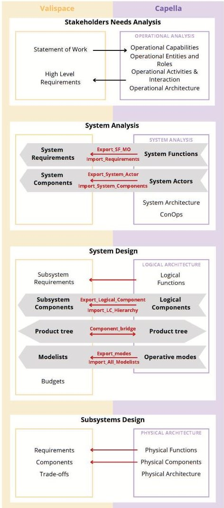

Fig. 1: Tools integration process

## 3.2 Concurrent Setup

The adoption of this integrated methodology is particularly suited to concurrent design environments. At Politec-

<!-- PDF_PAGE: 4 -->

nico di Torino, the CubeSat Concurrent Design Facility has adapted the typical ESA CDF workflow into a compact four-session model for Phase 0/A studies, enabling rapid iteration under time and resource constraints [10].

Within such sessions, Capella and Valispace act as shared backbones for multidisciplinary teams. Capella provides the visual and structural representation of mission and system architectures, enabling stakeholders to validate requirements, operational concepts, and logical/physical architectures. Simultaneously, Valispace ensures that all engineering parameters and budgets remain consistent and accessible to every domain expert. Changes introduced in one environment (e.g., a subsystem redesign in Capella) are immediately propagated into the other, preventing the divergence of data that often characterises document-centric or tool-isolated workflows.

This concurrent setup also facilitates stakeholder participation. Clients and decision-makers can follow the Capella models to understand high-level architecture and operational scenarios, while engineers rely on Valispace to assess the quantitative implications of design changes. The integration thus reinforces CE's collaborative nature by aligning stakeholders around both functional and parametric perspectives of the system.

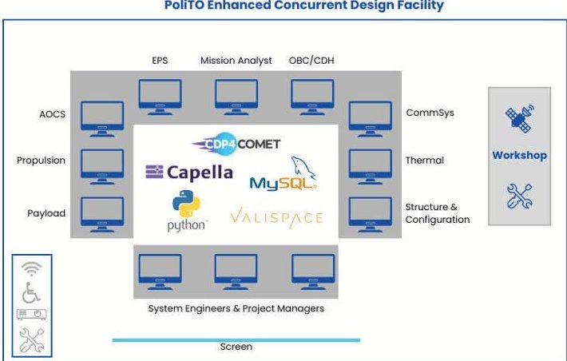

Fig. 2: PoliTo Concurrent Design Facility - Enhanced SetUp

## 3.3 Best Practices

The integrated framework has revealed several best practices for effective adoption.

Early stakeholder analysis and ConOps modelling: Initial mission and customer needs are identified and defined as requirements on Valispace. Then, the stakeholder needs analysis is conducted on Capella, where it is executed more successfully. Another feature offered by Capella is the definition of the Concept of Operations (ConOps), exploiting the VPMS add-on, which offers the capability to create the Configurations.

Consistent requirement management: Valispace handles the management of all the requirements. Functions

defined in Capella at each level can be exported and imported into Valispace as requirements, ensuring that architectural models and engineering data remain aligned. Consequently, the analyses conducted on Capella serve as a means of guaranteeing compliance with the Valispace requirements.

Hierarchy preservation: Logical and physical component trees are synchronised across tools using dedicated scripts, maintaining coherence between system models and data repositories.

Mode-based budgeting: Operative modes defined in Capella are transferred into Valispace, where they support dynamic budget estimations (e.g., power consumption per mode).

Automated verification and trade-offs: Through Valispace, budgets are automatically checked against requirements, enabling rapid trade-off studies (e.g., battery sizing) that are immediately consistent with the architectural model.

Overall, the Concurrent Data-Driven Model-Based framework integrates the collaborative strengths of CE with the digital robustness of DDSE and MBSE. It provides a scalable methodology that ensures transparency, traceability, and efficiency throughout the system lifecycle, paving the way for more agile and reliable satellite mission design.

## 4 Results: Application through representative Case studies

## 4.1 GeoProfundo Small-Satellite Mission

To validate the Concurrent Data-Driven Model-Based framework, the proposed methodology was applied to the design of a representative small-satellite mission, as nowadays the implementation of MBSE in the field of small satellites, with a particular focus to CubeSat, is becoming more and more common [11]. The case study, named GeoProfundo, integrates both scientific and technological objectives:

1. Deep-space technology demonstration in Low Earth Orbit (LEO): emulation of navigation, communication, and autonomous operations capabilities that are critical for future interplanetary missions, within the safer and more cost-effective environment of low Earth orbit.

2. Earth observation objective: monitoring of the Urban Heat Island (UHI) phenomenon in European cities, aimed at providing critical insights for environmental and urban planning stakeholders.

The mission was framed within the dual perspective of advancing technology readiness while responding to scientific needs. The mission statement was defined as:

<!-- PDF_PAGE: 5 -->

"The mission shall act as a technology demonstrator in LEO for deep-space small satellites, focusing on navigation, communication and operations technologies, while simultaneously monitoring environmental parameters to characterise the UHI effect in urban areas."

## 4.2 Stakeholder Needs and Requirements

The process began with a systematic stakeholder needs analysis, using Capella's Operational Analysis (OA) level. Stakeholders included ESA (interested in deep-space technology validation and UHI complementarity with Copernicus services), research institutions, the space industry (seeking to raise Technology readiness Level (TRL) of components), and end-users such as governments, environmental organisations and energy providers.

Operational Capabilities Blank (OCB) and Operational Architecture Blank (OAB) diagrams (figures 3 and 4) were created in Capella to capture stakeholder objectives and the interactions between entities. These outputs were then translated into high-level requirements in Valispace, ensuring consistency between the stakeholder view and engineering data. Therefore, Valispace handled the management of all the requirements.

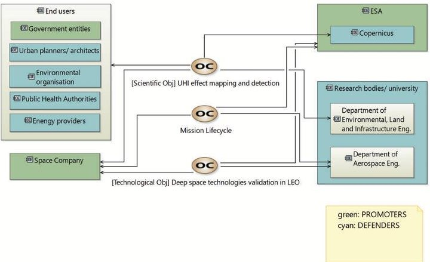

Fig. 3: OCB Operational Capabilities [6].

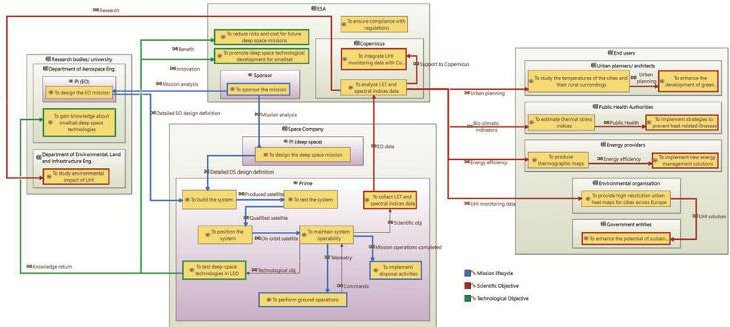

Fig. 4: OAB with Entities and their interactions [6].

## 4.3 System Design

The next step consisted of the System Analysis and Logical Architecture levels in Capella. Functions were broken down into sub-functions and allocated to logical components. Scripts exported these elements and imported them into Valispace, where they became linked requirements and system components, preserving hierarchy, traceability and conformity between the two tools.

## 4.3.1 System Analysis

In the System Analysis (SA), the emphasis was directed towards the system itself, its functionalities and its external interfaces with involved actors.

As an example, in figure 5, a complete overview of the actors involved is reported as a Context System Actors (CSA) diagram, defining the System of Interest (SoI), namely the Space Segment (GeoProfundo), and new System Actors comprising the Launch Site and Launcher (Launch Segment); Mission Control Center for the operations planning, and the Ground Segment, for the management of ground operations; Copernicus, for the integration of collected environmental data with its models; and the space Environment.

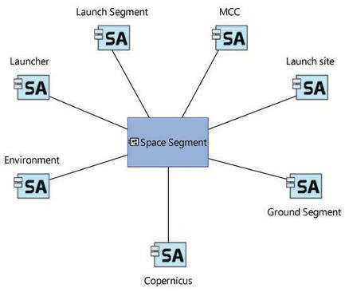

Fig. 5: CSA System [6].

These actors defined in Capella were subsequently imported as Components into Valispace thanks to a Python parser, to ensure consistency between the two tools at an early stage (figure 6).

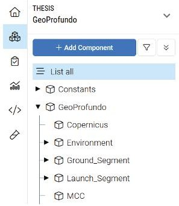

Fig. 6: System Components imported from Capella to Valispace [6].

<!-- PDF_PAGE: 6 -->

Once it was clear all the actors involved and their interaction with the system, based on the knowledge and considerations from the Operational level, a functional analysis was performed. The identified functions were allocated to the SoI and/or the actors, and functional and component exchanges were identified to get a complete picture of the high-level functions needed to satisfy the mission itself.

A good graphical global representation is given in figure 7, which also shows the exchanges that intersect the SoI and the actor boundaries. In addition, the definition of the ConOps was established in the same diagram by assigning a specific colour to the operational status of each function: green indicates an active function, while red indicates an inactive one. The ConOps included Integration & Testing (I&T), Launch and Early Orbit Phase (LEOP), the Operative Phase and End of Life (EOL). In particular, the Operational Phase consisted of two distinct subphases. In the first one, environmental data was collected and a database on Earth mapping was created. In the subsequent sub-phase, the focus shifted to the testing of deep space technologies, while the collection of environmental data for Earth Observation (EO) purposes continued.

Once the preliminary functional analysis was conducted on Capella, new mission requirements were updated on Valispace. By employing the Python scripts, Capella's functions of interest could be imported into Valispace as new requirements.

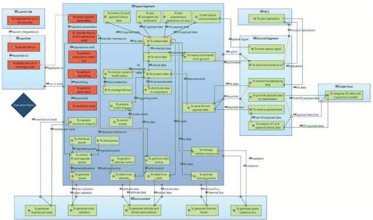

Fig. 7: System Architecture Blank (SAB) Operative Phase [6].

## 4.3.2 Logical Architecture

After the definition of the high-level functions and architecture at the SA level, the subsequent step focused on the Logical Architecture (LA) in Capella. System functions were broken down into sub-functions, and the system was broken down into logical components, as shown in figure 8.

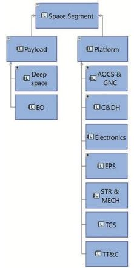

Fig. 8: Logical Component Breakdown Diagram (LCBD) Space Segment [6].

Scripts exported these elements and imported them into Valispace, where logical functions and components became respectively linked requirements and subsystem components, maintaining their hierarchy. As an example, in figure 9, the result of the import of the logical component into the Valispace environment is reported.

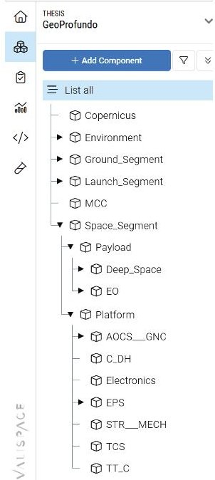

Fig. 9: Logical Components imported from Capella to Valispace [6].

Subsequently, a "bridge" Python script was exploited to involve both tools simultaneously and to verify their compliance in terms of the product tree. The figure 10 shows the output that the code displays in the console when a component apperas to be absent on Valispace. Furthermore, given the adoption of Capella as a master tool, the code automatically updated the component structure in Valispace, restoring conformity between the two.

<!-- PDF_PAGE: 7 -->

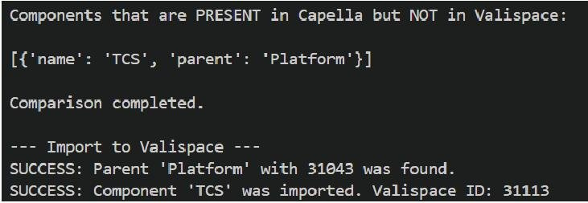

Fig. 10: Python code output when a logical component is missing in Valispace [6].

Following the identification of new components and functions, the logical architecture was modelled, which is the result of design choices and decisions involving all the subsystems.

Another feature that was exploited on Capella is the use of the Modes and States Diagrams (MSM) diagrams to define the operative modes and their triggers, with the purpose of supporting the deep-space demonstration for the autonomous operations. These were subsequently imported into Valispace as Modelists, and associated with the Space Segment and the different subsystems through the use of Python scripts. Although the operative modes were significantly clearer on Capella, the process of importing them into Valispace allowed us to exploit its budget estimation capacity. The creation of a "Power" matrix depending on the operative mode (figure 11) enabled the tool to automatically compute a power budget.

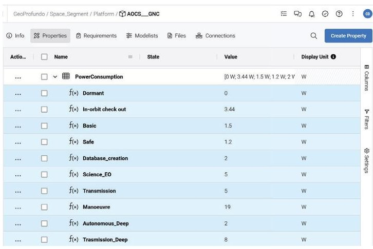

Fig. 11: "Power" property associated with Attitude on Orbit Control System (AOCS) & Guidance, Navigation and Control (GNC) component, depending on the operative modes [6].

The results of the power budget from the Analysis section of Valispace are shown in figure 12.

<table><thead><tr><th colspan="8">In-orbit check out</th></tr><tr><th>Component</th><th>PowerConsumption</th><th>margin +</th><th>total margin +</th><th>worst case +</th><th>margin -</th><th>total margin -</th><th>worst case -</th></tr></thead><tbody><tr><td>✓ Space_Segment</td><td>11.14 W</td><td>+20%</td><td>+27.9%</td><td>14,243 W</td><td>-0%</td><td>0%</td><td>11.14 W</td></tr><tr><td>✓ Payload</td><td>0 W</td><td>+0%</td><td>+0%</td><td>0 W</td><td>-0%</td><td>0%</td><td>0 W</td></tr><tr><td>&gt; Deep_Space</td><td>0 W</td><td>+5%</td><td>+0%</td><td>0 W</td><td>-0%</td><td>0%</td><td>0 W</td></tr><tr><td>&gt; EO</td><td>0 W</td><td>+5%</td><td>+0%</td><td>0 W</td><td>-0%</td><td>0%</td><td>0 W</td></tr><tr><td>✓ Platform</td><td>0 W</td><td>+0%</td><td>+0%</td><td>0 W</td><td>-0%</td><td>0%</td><td>0 W</td></tr><tr><td>&gt; AOCS___GNC</td><td>3.44 W</td><td>+10%</td><td>+10%</td><td>3,784 W</td><td>-0%</td><td>0%</td><td>3.44 W</td></tr><tr><td>&gt; C_DH</td><td>2 W</td><td>+5%</td><td>+5%</td><td>2.1 W</td><td>-0%</td><td>0%</td><td>2 W</td></tr><tr><td>&gt; Electronics</td><td>N/A</td><td>N/A</td><td>N/A</td><td>N/A</td><td>N/A</td><td>N/A</td><td>N/A</td></tr><tr><td>&gt; EPS</td><td>2.7 W</td><td>+5%</td><td>+5%</td><td>2,835 W</td><td>-0%</td><td>0%</td><td>2.7 W</td></tr><tr><td>&gt; STR___MECH</td><td>N/A</td><td>N/A</td><td>N/A</td><td>N/A</td><td>N/A</td><td>N/A</td><td>N/A</td></tr><tr><td>&gt; TCS</td><td>N/A</td><td>N/A</td><td>N/A</td><td>N/A</td><td>N/A</td><td>N/A</td><td>N/A</td></tr><tr><td>&gt; TT_C</td><td>3 W</td><td>+5%</td><td>+5%</td><td>3.15 W</td><td>-0%</td><td>0%</td><td>3 W</td></tr><tr><td>Total</td><td>11.14 W</td><td>+20%</td><td>+27.9%</td><td>14,243 W</td><td>-0%</td><td>0%</td><td>11.14 W</td></tr></tbody></table>

Fig. 12: Power budget estimation on Valispace for In.orbit check-out mode [6].

## 4.4 Subsystem Design and Trade-Offs

The next step consisted of the achievement of a further level of detail by analysing the various subsystems that constitute the satellite. The work started on the Physical Architecture level on Capella with the definition of the concrete physical components of each subsystem.

In Valispace, detailed subsystem design and trade-offs were carried out using imported physical components and associated engineering parameters. For example, a battery trade-off was performed by defining multiple design alternatives, with automatic propagation of impacts on the spacecraft power budget (Figure 13). This ensured that design choices remained consistent with the architectural constraints defined on Capella.

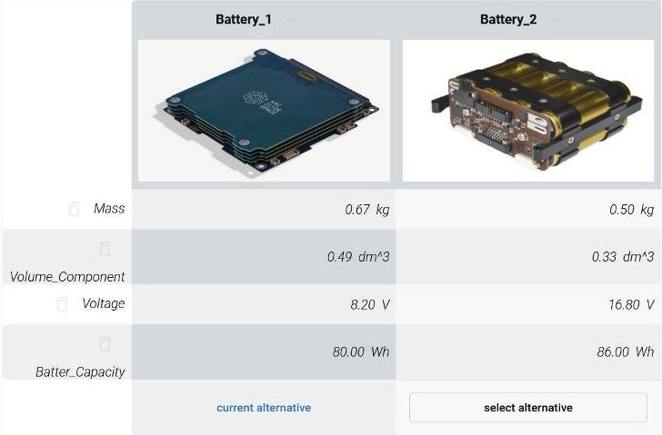

Fig. 13: Battery trade-off analysis in Valispace for the GeoProfundo mission [6].

## 4.5 Outcomes

The case study demonstrated several benefits of the integrated framework.

Firstly, continuity of information is highlighted, as requirements, architectures, and budgets were synchronised across tools, reducing inconsistencies.

Additionally faster iterations were possible, mainly because changes in one domain (e.g., subsystem sizing)

<!-- PDF_PAGE: 8 -->

were immediately propagated to others, accelerating design convergence.

A key aspect was the transparency and traceability, where stakeholders could follow both functional models (Capella) and quantitative budgets (Valispace), fostering clearer decision-making.

Finally, automated budget updates allowed efficient evaluation of design alternatives under real mission constraints, efficiently supporting trade-offs.

Overall, the GeoProfundo mission validated the applicability of the Concurrent Data-Driven Model-Based framework to small-satellite design, illustrating its capacity to support multidisciplinary teams, enhance transparency, and improve efficiency during early lifecycle phases.

## 5 Discussion

This study builds upon the integration of three of the most innovative systems engineering approaches of recent years: CE, DDSE, and MBSE. The proposed methodology leveraged the complementarity of Capella and Valispace, enabling mission analysis from multiple perspectives and optimizing space mission design across the entire product lifecycle. Combined with CE, this integration demonstrated how task parallelization across disciplines allows for the immediate evaluation of design trade-offs, thereby reducing both development time and costs.

Capella proved particularly effective for defining and developing system and subsystem architectures, offering a structured model-based framework well-suited to the management of system complexity. In parallel, Valispace supported the real-time management of requirements and engineering data. Their integration, facilitated through APIbased interoperability, compensated for individual tool limitations and ensured continuity of information. Moreover, the concurrent engineering setup fostered a multidisciplinary environment where design assumptions could be validated in real time, ensuring alignment with mission objectives and stakeholder expectations.

## 6 Conclusions

In conclusion, this work has demonstrated the successful application of a Concurrent Data-Driven Model-Based approach to the preliminary design of a small satellite mission. The methodology proved effective as a foundation for more detailed design activities and shows strong potential for extension to Assembly, Integration, Verification and Testing (AIV/T) management.

Overall, the proposed integration highlights how MBSE and DDSE, when combined with CE, can significantly improve system design workflows. While MBSE tools are often perceived as overly complex due to the wide range of challenges they aim to address, DDSE tools help to mitigate these limitations by streamlining the design

process and enhancing accessibility. The interoperability between Capella and Valispace, enabled through Pythonbased scripting, further reinforces this complementarity and remains adaptable even for users with limited programming expertise.

Future work will focus on the development of a dedicated graphical user interface to simplify tool integration and facilitate wider adoption of the Concurrent Engineering paradigm.

## References

[1] International Council on Systems Engineering (INCOSE). Systems engineering definition., 2025. Available online. url: www.incose.org/about-systems-engineering/systemand-se-definitions/systems-engineering-definition (Accessed on 01 Sept 2025).

[2] G. F. K. H. R. S. T. Walden, D.; Roedler. Systems engineering handbook: a guide for system life cycle processes and activities. Wiley, 2015.

[3] Ecss-m-st-10c rev.1: Project planning and implementation., 2009. Available online. url: https://ecss.nl/standard/ecss-m-st-10c-rev-1-project planning-and-implementation/ (Accessed on 01 Sept 2025).

[4] J. Smith. Concurrent engineering in the jet propulsion laboratory project design center. SAE Transactions, 107: 1106-18, 1998. URL https://www.jstor.org/stable/44735841.

[5] European Space Agency (ESA). Esa concurrent design facility: Studies and reviews, 2025. Available online: https://www.esa.int/Enabling_Support /Space_Engineering_Technology/CDF/Studies_Reviews (Accessed on 12 June 2025).

[6] C. Deiana. Integrating data-driven and model-based systems engineering for end-to-end small-satellite design. Master's thesis, Politecnico di Torino, Turin, Italy, July 2025.

[7] P. Roques, A. Rauzy, et al. Arcadia: Architecture analysis and design integrated approach. Technical report, Thales Group, Paris, France, 2010. Methodological guide.

[8] J. A. Estefan. Survey of model-based systems engineering (mbse) methodologies. Technical Report INCOSE-TD 2007-003-01, International Council on Systems Engineering (INCOSE), Seattle, WA, USA, 2008.

[9] M. Bandecchi, B. Melton, and F. Ongaro. Concurrent engineering applied to space mission assessment and design. ESA Bulletin, 99, 1999.

[10] S. Campioli, F. Stesina, E. La Bella, S. Corpino, L. Niero, and C. My. Concurrent engineering to enhance autonomy for deep-space cubesat mission design. IFAC-PapersOnLine, 58(16):163-168, 2024. doi: 10.1016/j.ifacol.2024.08.480. URL https://doi.org/10.1016/j.ifacol.2024.08.480.

<!-- PDF_PAGE: 9 -->

