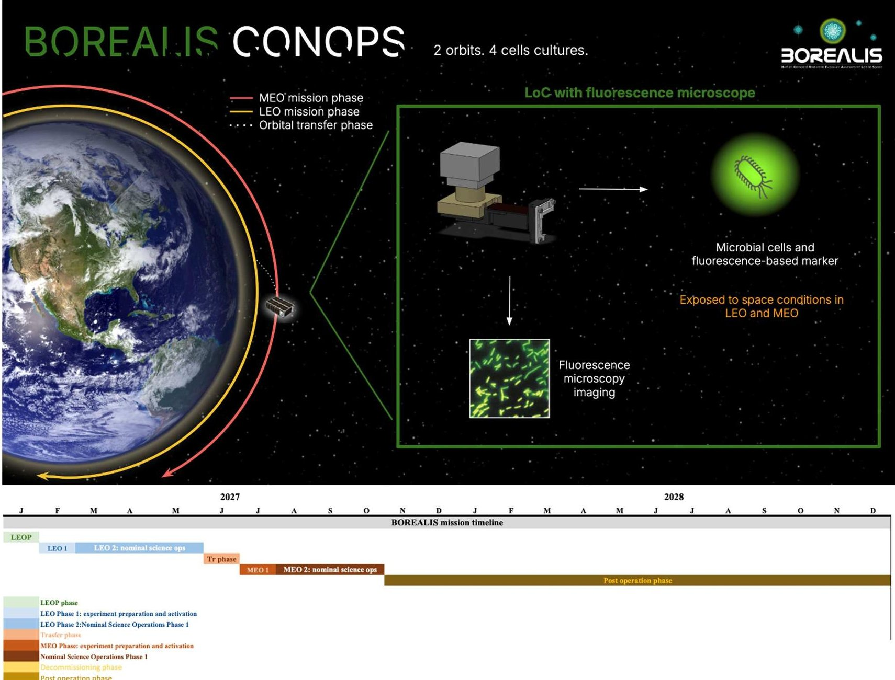
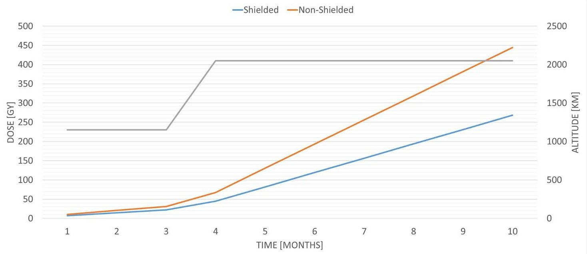
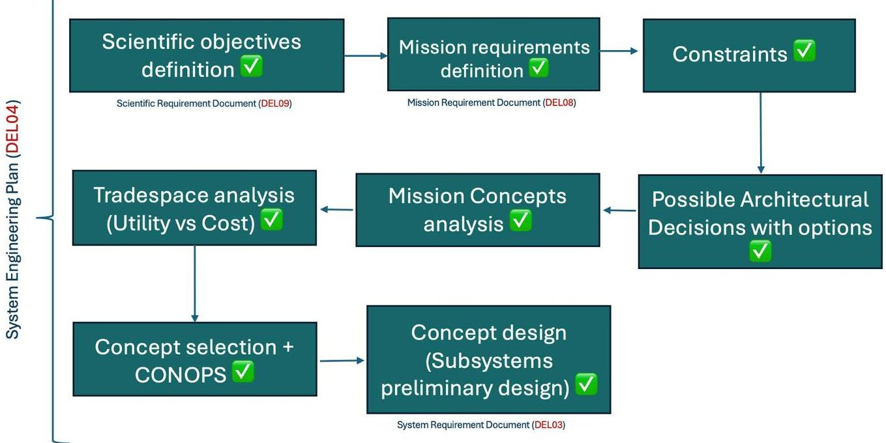
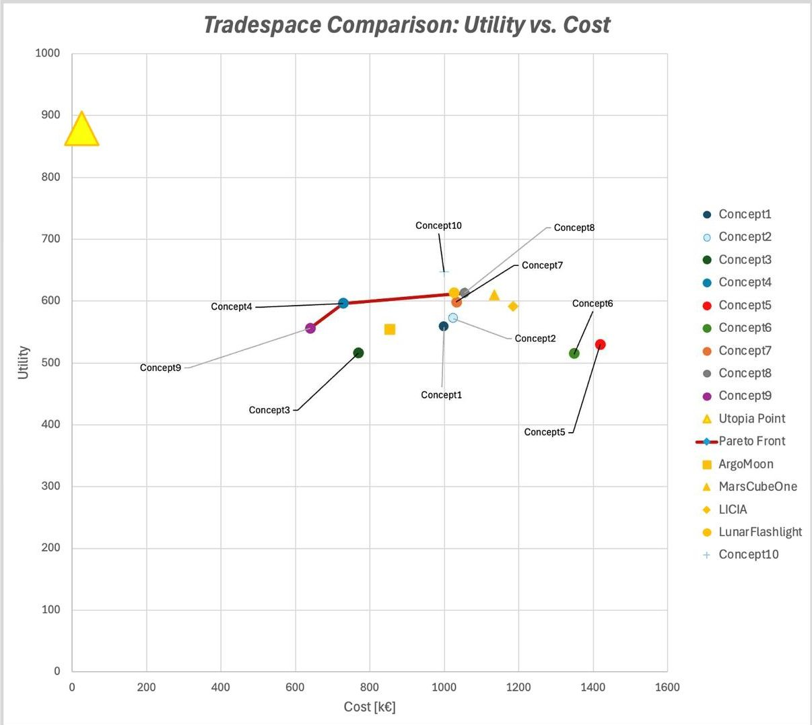
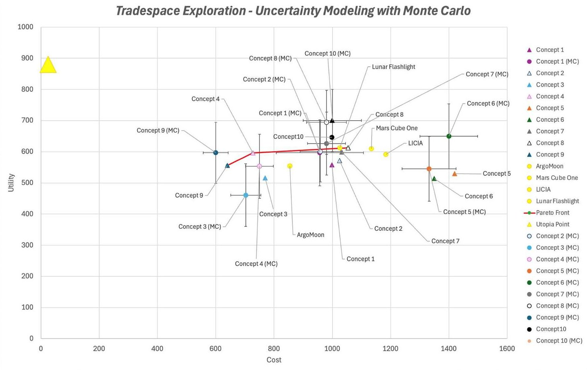
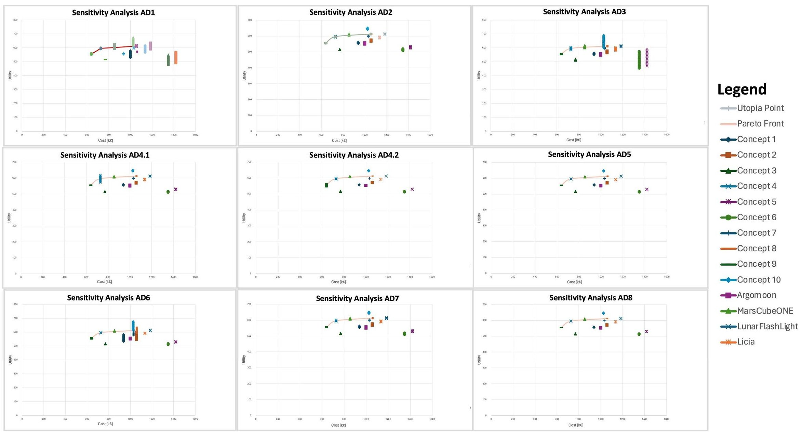
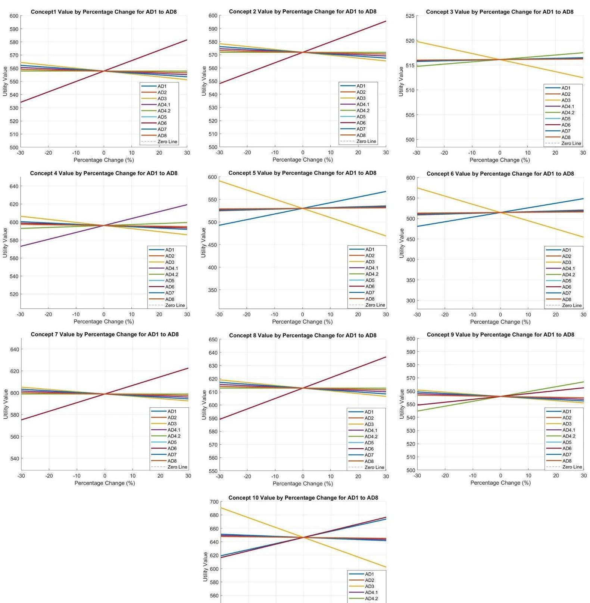

<!-- PDF_PAGE: 1 -->

Article

# Integrating Model-Based Systems Engineering into CubeSat Development: A Case Study of the BOREALIS Mission

Lorenzo Nardi $ ^{1,*} $ , Stefano Carletta $ ^{1} $ , Parsa Abbasrezaee $ ^{1} $ , Giovanni Palmerini $ ^{1} $ , Nicola Lovecchio $ ^{2} $ , Nunzio Burgio $ ^{3,4} $ , Alfonso Santagata $ ^{3,4} $ , Massimo Frullini $ ^{3,4} $ , Donato Calabria $ ^{5,6} $ , Massimo Guardigli $ ^{5,6} $ , Elisa Michelini $ ^{5} $ , Maria Maddalena Calbretta $ ^{5} $ , Martina Zangheri $ ^{5} $ , Elisa Lazzarini $ ^{5} $ , Andrea Pace $ ^{5} $ , Marco Montalti $ ^{5} $ , Dario Mordini $ ^{5} $ , Liyana Popova $ ^{7} $ , Saverio Citraro $ ^{7} $ , Daniela Billi $ ^{8} $ , Fabio Lorenzini $ ^{7} $ , Alessandro Donati $ ^{7} $ , Mara Mirasoli $ ^{5,6} $ and Augusto Nascetti $ ^{1} $

$ ^{1} $ School of Aerospace Engineering, Sapienza University of Rome, Via Salaria 851, I-00138 Rome, Italy; parsa.abbasrezaee@uniroma1.it (P.A.); giovanni.palmerini@uniroma1.it (G.P.); augusto.nascetti@uniroma1.it (A.N.)

$ ^{2} $ Department of Information Engineering, Electronics and Telecommunications, Sapienza University of Rome, Via Eudossiana 18, I-00184 Rome, Italy; nicola.lovecchio@uniroma1.it

3 Italian National Agency for New Technologies, Energy and the Environment, (ENEA) C.R. Casaccia, Via Anguillarese 301, I-00060 Rome, Italy; nunzio.burgio@enea.it (N.B.); alfonso.santagata@enea.it (A.S.); massimo.frullini@uniroma1.it (M.F.)

4 Department of Astronautic, Electric and Energetic Engineering, Sapienza University of Rome, Via Eudossiana 18, I-00184 Rome, Italy

5 Department of Chemistry "Giacomo Ciamician", Alma Mater Studiorum—University of Bologna, Via Piero Gobetti 85, I-40129 Bologna, Italy; donato.calabria2@unibo.it (D.C.); maria.calabretta2@unibo.it (M.M.C.); mara.mirasoli@unibo.it (M.M.)

6 Interdepartmental Centre for Industrial Aerospace Research (CIRI AEROSPACE), Alma Mater Studiorum—University of Bologna, Via Baldassarre Canaccini 12, I-47121 Forlì, Italy

Copyright: 2025 by the authors. Licensee MDPI, Basel, Switzerland. This article is an open access article distributed under the terms and conditions of the Creative Commons Attribution (CC BY) license (https://creativecommons.org/licenses/by/4.0/).

Academic Editor: Jian Guo

7 Kayser Italy S.r.l., Via di Popogna 501, I-57128 Livorno, Italy; l.popova@kayser.it (L.P.); s.citraro@kayser.it (S.C.)

Received: 21 January 2025

Revised: 11 March 2025

Accepted: 12 March 2025

Published: 18 March 2025

Citation: Nardi, L.; Carletta, S.; Abbasrezaee, P.; Palmerini, G.; Lovecchio, N.; Burgio, N.; Santagata, A.; Frullini, M.; Calabria, D.; Guardigli, M.; et al. Integrating Model-Based Systems Engineering into CubeSat Development: A Case Study of the BOREALIS Mission. Aerospace 2025, 12, 256. https://doi.org/10.3390/aerospace12030256

8 Department of Biology, University of Rome Tor Vergata, Via della Ricerca Scientifica 1, I-00133 Rome, Italy; billi@uniroma2.it

* Correspondence: lorenzo.nardi@uniroma1.it

Abstract: The Biofilm Onboard Radiation Exposure Assessment Lab In Space (BOREALIS) mission is a 6U CubeSat initiative funded by the Italian Space Agency under the ALCOR program, executed through a collaboration among the School of Aerospace Engineering of Sapienza University of Rome, Interdepartmental Centre for Industrial Aerospace Research (CIRI Aerospace) of the University of Bologna and Kayser Italia Srl. BOREALIS is equipped with a lab-on-chip payload for studying the effects of microgravity and ionising radiation on microbial biofilms, which are crucial for understanding and preventing persistent infections in space environments. The satellite will operate across multiple orbits, moving from low to medium Earth orbit, to distinctly analyse the impacts of radiation separate from microgravity. The required orbital transfer not only tests the autonomy of its on-board systems in challenging conditions but also places BOREALIS among the first and few CubeSats to have ever attempted such a complex manoeuvre. This study explores the systematic application of Model-Based Systems Engineering to satellite design, from conceptualisation to trade-offs, using a tradespace analysis approach supported by Monte Carlo simulations to optimise mission configurations against performance and cost. Additionally, the adaptability of Model-Based Systems Engineering tools and the reusability of such an approach for other satellite projects are discussed, illustrating the BOREALIS mission as a case study for small mission design considering constraints and requirements.

<!-- PDF_PAGE: 2 -->

Keywords: CubeSat; Model-Based Systems Engineering (MBSE); lab-on-chip; mission analysis; microbial biofilms; tradespace analysis

## 1. Introduction

CubeSats have emerged as vital instruments in space exploration, significantly advancing our ability to conduct high-impact scientific research in deep space with high efficiency in terms of cost and schedule. These miniaturised satellites allow for the rapid validation of innovative technologies and methodologies, which are crucial for addressing traditional space missions' logistical and financial constraints. In addition, as humanity prepares for extended missions to the Moon and Mars [1], CubeSats provide essential capabilities for studying the space environment and testing on-board systems critical for human health and safety.

Historically, missions like GeneSat-1 [2] have utilised CubeSats to investigate the biological effects of microgravity in low Earth orbit (LEO). More recent missions, such as PharmaSat [3] and BioSentinel [4-7], have expanded these studies beyond LEO, specifically investigating biological effects under deep-space radiation conditions. PharmaSat was deployed in a highly elliptical orbit with an apogee of approximately 600 km, while BioSentinel was placed into a heliocentric orbit beyond Earth's magnetosphere, making it the first biological CubeSat to operate in deep space. For the purposes of this study, deep space is defined as any region beyond the sphere of influence of the Earth.

Expanding on this foundation, the Biofilm Onboard Radiation Exposure Assessment Lab In Space (BOREALIS) mission, a 6U CubeSat funded by the Italian Space Agency (ASI) under the ALCOR program, exemplifies the next generation of biological CubeSats designed for autonomous and dual-phase operations in orbit. Indeed, the mission aims to examine the impacts of the space environment conditions on microbial biofilms using advanced bio-imaging techniques and radiation shielding experiments in LEO and medium Earth orbit (MEO). This two-tiered approach allows for a comprehensive study of space environmental stressors on microbial communities, providing insights for developing life support and protective measures for astronauts' long-duration missions to the Moon or Mars. The mission is based on a payload with a miniaturised fluorescence microscope coupled with a lab-on-chip with integrated sensors and actuators, creating a compact biosensor for the real-time monitoring of microbial biofilms in space.

In natural habitats, bacteria often live within matrix-embedded microbial communities, termed biofilms, which are now understood to be a major mode of microbial life [8]. In biofilms, bacterial cells live as structured, frequently multispecies communities of microorganisms in close association with surfaces and interfaces, preferably at the boundary between the liquid medium and the solid material. In biofilms, they live encapsulated in a self-produced matrix of excreted extracellular polymeric substances, which consist of extracellular nucleic acids, polysaccharides, proteins, glycoproteins, and glycolipids. In biofilms, microbial cells display peculiar properties that cannot be predicted by the study of the same cells in the planktonic form.

After reviewing previous biology CubeSat missions, it is evident that while they have successfully achieved scientific results and contributed to the advancement and validation of CubeSat and payload technologies, significant gaps remain that the BOREALIS mission seeks to address. Notably, all prior missions, except for BioSentinel, were confined to LEO, with BioSentinel being the first to operate in deep space. Additionally, among earlier missions, only the SporeSat [9] mission utilised a lab-on-chip device, which employed a different technology (bioCD) from BOREALIS. Moreover, none of the prior missions

<!-- PDF_PAGE: 3 -->

included a miniaturised fluorescence microscope, conducted experiments at varying orbit heights, or investigated biofilms in space or the combined protective effects of passive physical and pharmacological shielding against radiation. Thus, BOREALIS stands out as a pioneering and challenging mission aimed at developing new technologies that enable the study of biofilms in the real space environment.

The choice of lab-on-chip for the main payload enhances the analytical process by reducing the sample size, accelerating response times, and improving cost efficiency, performance, and automation. Historically, lab-on-chip devices have demonstrated their potential for on-Earth applications across numerous biomedical fields [10-18]. However, their use in space missions has been more limited. For instance, NASA LOCAD-PTS [19], a microbial monitoring device, was tested on the International Space Station (ISS) in 2006, utilising lateral flow technology. Subsequently, from 2016 to 2017, the MinION [20,21], a lab-on-chip for nucleic acid sequencing, was deployed on the ISS, showcasing the adaptability of lab-on-chip devices to space conditions. More recently, the "IN SITU Bioanalysis" project marked a significant step forward by developing an autonomous lab-on-chip device capable of measuring cortisol levels, a stress biomarker, directly aboard the ISS [22,23]. Another mission worth mentioning is the AstroBio CubeSat (ABCS) [24,25], launched in July 2022, that successfully tested technological elements in orbit for an autonomous lab-on-chip based on CL measurements, serving as a precursor to more integrated systems that will likely support the BOREALIS main payload.

In this paper, after providing an overview of the BOREALIS mission and its main characteristics and requirements, the system engineering process for the design of the 6U CubeSat will be discussed. Emphasis will be given to the model built for the tradeoff analysis, explaining how it was built and used and providing the reader with all the elements to possibly reuse it for another mission design of the same satellite class.

## 2. The BOREALS Mission

## 2.1. Importance of Biofilms

Over the past 50 years, microorganisms have been used in over 100 spaceflight experiments. An extensive list of changes in a wide variety of microbial cell characteristics has been observed during spaceflight compared with ground controls. Space microgravity can induce microbe mutants at the genome, transcriptome, proteome, and metabolome levels although the exact mechanism for microgravity-inducing mutants remains unclear [26]. Most of the studies showed that microorganisms grow more densely in microgravity conditions, with a growth curve characterised by a decreased lag phase and a prolonged exponential phase, although contrasting results have also been obtained [27]. The effects of space radiation on living cells are mainly due to their ability to interact with DNA/RNA and cause reparable or irreparable damage, depending on the type and energy of the radiation. Such damage has the potential to modify the genetic code through mutations, alter the way DNA functions, and transfer mutations to the next generation(s).

Overall, the need to perform experiments with live cells in a space environment is evident. On the one hand, no simulation setup on Earth would be able to reproduce all the stress factors related to a spaceflight mission. On the other hand, the effects of microgravity on some biological responses induced by radiation in space experiments have not yet been understood, and conflicting results have been reported in the literature [28]. To date, no lab-on-chip device has been employed to conduct biofilm observation in the space environment.

<!-- PDF_PAGE: 4 -->

## 2.2. Past Biofilm Experiments and Findings

Spaceflight, as an environmental stressor, influences biofilm formation, first observed with Pseudomonas aeruginosa on Space Shuttle flight STS-95 and later in NASA's Micro-2 and Micro-2A studies, where biofilms on the ISS showed increased cell viability, biomass, and a unique column-and-canopy architecture, though only in motile strains [29,30]. Confocal microscopy of biofilms grown on polycarbonate membranes in microgravity showed no morphological differences compared to ground samples, attributed to experimental limitations [31]. Burkholderia cepacia biofilms grown in space in sterile water had five-times higher plate counts than controls, while tryptic soy broth (TSB) cultures were reduced [32]. Space conditions also enhanced extracellular matrix protein production in Candida albicans, promoting cell aggregation [33]. Kim et al. conducted the most systematic study, showing increased viable cells, biomass, and biofilm thickness in space across different conditions [34]. The BOSS (Biofilm Organisms Surfing Space) experiment found that biofilms in an extracellular polymeric substance matrix exhibited higher endurance to space and Marslike environments [35]. The ongoing BIOFILMS (Biofilm Inhibition on Flight equipment and on board the ISS using microbiologically Lethal Metal Surfaces) experiment investigates biofilm formation on metal surfaces under varying gravity conditions to inform contamination control in extraterrestrial settings [36].

## 2.3. BOREALIS Mission Overview

The BOREALIS mission, a 6U CubeSat funded by the Italian Space Agency (ASI) under the ALCOR program, aims to study microbial biofilms in a lab-on-chip device at two altitudes (LEO and MEO) to analyse the effects of microgravity and cosmic radiation on microbial communities. The mission, whose CONOPS is provided in Figure 1, involves biofilms with genetically modified cells expressing green fluorescent protein (GFP) and employs fluorescence microscopy and thin-film photosensors for monitoring the cells status on a lab-on-chip. It will test radiation protection strategies using physical shielding and melanin-based pharmacological treatments under varied exposure conditions. The 10-month mission includes a 3-month LEO phase for lower-radiation studies, followed by an MEO phase, where other biofilm cultures are exposed to higher radiation and then reactivated to assess protective strategies. Radiation exposure is expected to be around 100 Gy, with a maximum of 300 Gy, depending on cell sensitivity and radiation environment [7,8].

## 2.4. Orbital Transfer

The flight profile of BOREALIS must fulfil the strict requirements set by (i) mission goals, (ii) performance of commercial off-the-shelf (COTS) components, (iii) launch providers of rideshare opportunities, and in particular for the Vega-C [37,38], and the 5-year rule set by the FCC [39]. These requirements can be translated into the following mission profile specifications:

1. To distinguish the effects associated with microgravity and cosmic radiation, the satellite will have to operate in orbits in which the intensity of the cosmic radiation is significantly different;

2. The deployment orbit must be compatible with the rideshare performance of Vega-C (and eventually other launch vehicles);

3. Within 5 years from the end of the mission, the satellite will no longer have to orbit in LEO (below 2000 km); the TID collected during the operative mission will be limited to ensure the survival of the microbial cultures and the operativity of on-board devices and subsystems.

<!-- PDF_PAGE: 5 -->

Figure 1. BOREALIS CONOPS.

A study dedicated to estimating the dose rate for BOREALIS suggests that the satellite must be released at an altitude of less than 1100 km and then raised to an altitude of 2000 km (or more) in order to satisfy specification (1) [40]. It is worth noting the following:

- Transferring the satellite to an MEO with an altitude of 2000 km or higher also satisfies specification (3);

- Even though Vega-C (and other launchers) can deploy a spacecraft to an altitude of 1100 km, common rideshare opportunities address altitudes between 450 km and 800 km; therefore, selecting such an orbit simplifies satisfying specification (2).

Based on these first results, simulations in General Mission Analysis Tool (GMAT) were performed to determine the transfer time and the propellant mass required for the LEO-MEO transfer considering different deployment altitudes and three different types of propulsion systems compatible with a 6U CubeSat (see Table 1).

Table 1. The performance of three different types of propulsion systems was evaluated in the mission analysis.

<table border="1"><tr><td>Type</td><td>Thrust</td><td>Specific Impulse</td><td>Max Cont. Firing Time</td></tr><tr><td>Monopropellant thruster</td><td>1000mN</td><td>215s</td><td>600s</td></tr><tr><td>Hall-effect thruster</td><td>5mN</td><td>1000s</td><td>900s</td></tr><tr><td>RF ion-thruster</td><td>0.4mN</td><td>2200s</td><td>2500s</td></tr></table>

<!-- PDF_PAGE: 6 -->

The results of mission analysis are reported in the following subsections. For each study case, a wet mass of 14 kg was considered for BOREALIS at the deployment in LEO.

## 2.4.1. Monopropellant Thruster

Monopropellant thrusters currently available for CubeSats use chemical propellants, such as Hydrazine or high-pressure green propellants (i.e., LMP-103S). These systems can provide an average thrust in the order of 1 N and, therefore, do not allow the LEO-MEO transfer to be performed using a traditional two-burn manoeuvre (i.e., Hohmann transfer, etc.).

When a multiple-burn transfer strategy is implemented, the time schedule of ignitions determines the value of the eccentricity (e) of the arrival orbit. To avoid reaching an orbit in which the altitude at the perigee and apogee are significantly different, and, thus, in which the intensity of cosmic radiation changes significantly as the altitude varies, the schedule of the ignitions will have to be selected in order to obtain a low value for e. With the support of numerical simulations, it was shown that ignitions applied every quarter of the orbital period (T) result in an arrival orbit with negligible eccentricity (e < 0.002 and less than 33 km of difference between the apogee altitude and the perigee altitude).

At the same time, since the manoeuvres will be monitored in real time by the ground segment and, at least in the early stages of the orbital transfer, commanded by operators on the ground, a more relaxed schedule for the ignitions would guarantee more time for the ground segment to verify the health status of BOREALIS and identify eventual off-nominal conditions, effectively increasing the reliability of the mission. In fact, adding a delay equal to T between two consecutive ignitions does not change the final value of e; therefore, any solution corresponding to $ \Delta t=(n+0.25)T $ ,where n is any non-null integer number, can be implemented.

The solution corresponding to $ \Delta t=1. 2 5 \cdot T $ is examined here. The results for this study case are collected in Table 2. Even considering the high-density value of $ 1 2 5 0 \mathrm{k g / m^{3}} $ for LMP-103S, the volume of propellant required in the three scenarios investigated would range from a minimum of 2.3 U to a maximum of 3.1 U, which is hardly compatible with the volume budget of a 6U CubeSat.

Table 2. Summary of the LEO-MEO orbital transfer using the chemical propulsion system.

<table border="1"><tr><td>Deployment Altitude</td><td>Transfer Time</td><td>Propellant Mass</td></tr><tr><td>650km</td><td>1.4days</td><td>3.8kg</td></tr><tr><td>850km</td><td>1.2days</td><td>3.2kg</td></tr><tr><td>1050km</td><td>1.0days</td><td>2.8kg</td></tr></table>

## 2.4.2. Hall-Effect Thruster

The use of Hall-effect thrusters is rapidly increasing in the small-satellite industry, and some commercial devices compatible with the CubeSat standard have recently been put on the market. These thrusters use Xenon (Xe) or Iodine (I) as propellants, stored at high pressure to reach density values comparable to those of chemical propellants (i.e., $ 1 6 0 0 \mathrm{k g / m^{3}} $ for Xe and $ 4 9 0 0 \mathrm{k g / m^{3}} $ for I at 14 MPa) [41].

The transfer strategy implemented for this study case consists of applying continuous firings of the maximum possible duration (900 s) once every orbit. The results are collected in Table 3.

<!-- PDF_PAGE: 7 -->

Table 3. Summary of the LEO-MEO orbital transfer using the Hall-effect thruster.

<table border="1"><tr><td>Deployment Altitude</td><td>Transfer Time</td><td>Propellant Mass</td></tr><tr><td>650km</td><td>206 days</td><td>1.0kg</td></tr><tr><td>850km</td><td>178 days</td><td>0.8kg</td></tr><tr><td>1050km</td><td>148 days</td><td>0.6kg</td></tr></table>

The reader will notice that the propellant volume required for each scenario is significantly lower than that computed for chemical thrusters (see Section 2.4.1). In fact, considering a storage pressure of 14 MPa, the required propellant volume does not exceed 0.6 U for Xe and 0.2 U for I. Indeed, the use of a Hall-effect thruster will correspond to a higher power/energy requirement, therefore affecting the design of the electric power system.

## 2.4.3. RF Ion-Thruster

Ion-thrusters are very-low-thrust propulsion systems, in the order of hundredths of a mN. This feature, in addition to contributing to the limited consumption of propellant (together with the high value of the specific impulse), means that, compared to higher-thrust propulsion systems, the parasite torques they introduce, due to the misalignment between the actual thrust axis and the principal axes of inertia of the satellite, are limited or negligible.

The transfer strategy implemented for this study case is the same as the one implemented in the case of using the Hall-effect thruster, differing only for the longer continuous firing time (2500 s). The results collected in Table 4 show dramatically high values for the transfer time, which results in a mission duration of longer than 1.5 years.

Table 4. Summary of the LEO-MEO orbital transfer using the RF ion-thruster.

<table border="1"><tr><td>Deployment Altitude</td><td>Transfer Time</td><td>Propellant Mass</td></tr><tr><td>650km</td><td>823 days</td><td>0.5kg</td></tr><tr><td>850km</td><td>695 days</td><td>0.4kg</td></tr><tr><td>1050km</td><td>571 days</td><td>0.3kg</td></tr></table>

## 2.5. Radiation, Dose, and Shielding Generalities

The calculation methodology has already been used during the design of the shielding for the payload of the Astro Bio CubeSat (ABCS) [41], and in its post-mission analysis where measured and simulated dose responses were compared [42]. The dose estimations presented in this work are based on a preliminary conceptual model of BOREALIS [40] and were obtained, using the same methodology used for ABCS, from the FLUKA [43] Monte Carlo radiation transport code, furnishing as input the following data:

- Orbital radiative sources, such as trapped particles (TPs), galactic cosmic rays (GCRs), and possible emissions of solar energy particles (SEPs), as foreseen by SPENVIS (Space Environment Information System) [44] and IRENE (International Radiation Environment Near Earth) codes [45] at mission epoch (reference period 1 January 2026) at the given altitude and orbital inclination.

- A 3D satellite geometry layout, including all the relevant components (payload, spectrometers, dosimeters, shielding, etc.). The layout definition is, at this stage, significantly simplified, but it will be increasingly detailed as the concurrent design proceeds. The pressurised payload is divided into two regions. The first one, denoted as a nonshielded payload (NS-payload), is protected from the external radiative environment by the external CubeSat shell (including the solar panels) plus the 3 mm of aluminium of the payload shell. The second payload region, the shielded payload (S-payload),

<!-- PDF_PAGE: 8 -->

has an additive multi-layer shielding solution constituted of a first layer of metallic tungsten (thickness = 0.7 mm) to stop charged particles, followed by a second layer of PEEK (Polyether Ether Ketone) that allows for secondary neutrons slowing down and scattering (thickness 15 mm), and a last aluminium layer (thickness 5 mm) to attenuate low-energy charged secondaries. The thickness of each layer has been optimised based on the outcomes of a set of FLUKA simple three-slab problems executed by an automated UNIX shell script, in which material thickness and layer sequence are changed within pre-established limits. Once all the simulations are finished, the sequence of layers of the three materials minimising the ionisation dose has been included in the complete satellite layout. Finally, in both NS and S-payloads, identical cylindrical sample holders filled with a biomaterial (ICRU #37-1984) were located. A RADFET dosimeter modelled according to [42] is located close to each sample holder. The dose responses from the biomaterial and the one obtained from the RADFET allow for the consideration of the coherency between the physical dose absorbed from the biosample (that cannot be measured) and the one estimated by the RADFET dosimeter (that shall be measured).

- A set estimator has been placed in various regions of the satellite layout with the scope of quantifying doses and fluxes of primary and secondary particles and ions. It is intended that a subset of such results will be used to stay within the scope of the present work.

Since a calculation chain for estimating the dose absorbed during the ascending manoeuvre is under development, some preliminary linear extrapolations of the dose delivered during such a mission phase are presented below. Works are also in progress to find an optimal location for at least two PIN-based spectrometers [46] that, coupled with the RADFET dosimeter, allow for inferring the spectral features of the mixed field of primary and secondary particles within the payload regions.

Thus, below is presented a preliminary radiation analysis with respect to the first preliminary mission profile and first evaluation for the dedicated shielding, which have been an important support for the following system engineering studies that will be introduced in Section 3. The radiation accumulated in a 1 h mission at different altitudes and inclinations with respect to the presence of the dedicated shielding (S) or its absence (NS) is examined. The value for the orbit inclination of interest for this preliminary evaluation is $ 9 8^{\circ} $ , representative of sun-synchronous orbits. The rationale for choosing this inclination is the major launch opportunities; it will also be shown that this choice is expected to correspond to lower-dose accumulation before the arrival of the final MEO.

The total dose collected over the missions in non-shielded samples (NS) should not exceed 100 Gy. Therefore, in the NS (here, a structural aluminium shielding of a total of 5 mm is considered only), we consider 100 Gy by default, while the shielded samples (S, where together with structural aluminium shielding of a total of 5 mm, there is in addition a dedicated shielding that will be defined during these phases A/B of the project) are estimated to receive 60-70 Gy. The 1-month dose for different altitudes in S and NS configurations is reported in Table 5.

Table 5. Total dose collected in different orbits at $ 9 8^{\circ} $ of inclination by shielded and non-shielded components for 1-month dose [Gy].

<table border="1"><tr><td>Altitude[km]</td><td>Shielded[Gy]</td><td>Not Shielded[Gy]</td></tr><tr><td>1150</td><td>7.4</td><td>10.3</td></tr><tr><td>2050</td><td>37.3</td><td>62.8</td></tr></table>

<!-- PDF_PAGE: 9 -->

According to Table 1 and Figure 2, it is estimated that a total dose of 60-70 Gy will be collected by the shielded components and 100 Gy will be collected by the non-shielded components given the current mission profile.

Figure 2. Preliminary estimation of the progressive dose delivering vs mission time in the Shielded (S) and Non-Shielded payload (NS). The grey line refers to the dose delivered in a reference mission of 1.5 years in LEO.

It is worth noticing that the total dose collected in the 5 months required to perform both the experiments in LEO and MEO is equivalent to that collected during an ordinary (NS) 1-year CubeSat mission in LEO. CubeSat technology and related COTS components have proven to withstand such a total dose without relevant damage and maintain full operability. The non-shielded components of BOREALIS will collect a total dose equivalent to that of the reference CubeSat mission in 1.5 years (i.e., in LEO). After the transfer to MEO, the dose rate will rapidly increase. It follows that, for what concerns CubeSat bus electronics (while the payload electronics will be all purposively shielded), (i) either COTS components are adequately selected to tolerate the expected dose or (ii) a dedicated shielding is also designed for them. It is worth noting that subsystems required after the orbital transfer are either easy to shield (i.e., electronic boards of the OBC, EPS, etc.) or radiation tolerant (i.e., ADCS sensors/actuators, solar panels). Moreover, the lessons learned in the ABCS mission [23,24], with the 3U CubeSat orbiting in the inner Van Allen belt and accumulating a dose a few orders of magnitude higher than the corresponding one in LEO, indicate that electronic boards based on COTS components can be effectively shielded and survive longer than LEO experience has shown so far.

## 2.6. TID

In the previous sections, the results of mission analysis were processed to estimate the minimum duration of the mission and the propellant mass and volume budgets, the results of which are instrumental for the system engineering analysis that will be presented in the following paragraphs. The transfer time is here used to compute the TID collected by BOREALIS for each transfer, based on the estimated dose rate evaluated for both the nonshielded (NS) components of the 6U CubeSat and for the shielded (S) payload components.

The shielding here is provided by a box, similar to that used for ABCS [24,25], composed of three layers of different materials with different thicknesses: 0.7 mm of tungsten, 15 mm of PEEK and 0.5 mm of aluminium [25]. The values of the dose rates are reported in Tables 6 and 7, and the highest TID （ $ \mathrm{i}=5 1^{\circ} $ ）is reported in Tables 8 and 9.

<!-- PDF_PAGE: 10 -->

Table 6. Dose rate (Gy/hour) for NS components inside BOREALIS for three different values of the inclination.

<table border="1"><tr><td>Dose Rate</td><td>700km</td><td>1150km</td><td>2000km</td></tr><tr><td>$i=51^{\circ}$</td><td>$6\times10^{-3}$</td><td>$3.1\times10^{-2}$</td><td>$1.26\times10^{-1}$</td></tr><tr><td>$i=70^{\circ}$</td><td>$3\times10^{-3}$</td><td>$1.5\times10^{-2}$</td><td>$7.4\times10^{-2}$</td></tr><tr><td>$i=98^{\circ}$</td><td>$3\times10^{-3}$</td><td>$1.4\times10^{-2}$</td><td>$8.7\times10^{-2}$</td></tr></table>

Table 7. Dose rate (Gy/hour) for S components inside BOREALIS for three different values of the inclination.

<table border="1"><tr><td>Dose Rate</td><td>700km</td><td>1150km</td><td>2000km</td></tr><tr><td>$i=51^{\circ}$</td><td>$4\times10^{-3}$</td><td>$1.9\times10^{-2}$</td><td>$8\times10^{-2}$</td></tr><tr><td>$i=70^{\circ}$</td><td>$2\times10^{-3}$</td><td>$9\times10^{-3}$</td><td>$4.7\times10^{-2}$</td></tr><tr><td>$i=98^{\circ}$</td><td>$2\times10^{-3}$</td><td>$1\times10^{-2}$</td><td>$5.2\times10^{-2}$</td></tr></table>

Table 8. TID was collected by NS components during the transfer for each deployment altitude, and $ \mathrm{i}=5 1^{\circ} $

<table border="1"><tr><td>TID</td><td>700km</td><td>1150km</td><td>2000km</td></tr><tr><td>Monopropellant thruster</td><td>2.2Gy</td><td>2.0Gy</td><td>1.8Gy</td></tr><tr><td>Hall-effect thruster</td><td>326Gy</td><td>299Gy</td><td>268Gy</td></tr><tr><td>RT Ion-thruster</td><td>1303Gy</td><td>1168Gy</td><td>1035Gy</td></tr></table>

Table 9. TID was collected by S components during the transfer for each deployment altitude, and $ \mathrm{i}=5 1^{\circ}。 $

<table border="1"><tr><td>TID</td><td>650km</td><td>850km</td><td>1050km</td></tr><tr><td>Monopropellant thruster</td><td>1.4Gy</td><td>1.3Gy</td><td>1.2Gy</td></tr><tr><td>Hall-effect thruster</td><td>208Gy</td><td>190Gy</td><td>171Gy</td></tr><tr><td>RT Ion-thruster</td><td>830Gy</td><td>742Gy</td><td>658Gy</td></tr></table>

For a better understanding of the results in Tables 8 and 9, the reader shall note that the TID collected by an NS satellite after 10 years in LEO (650 km) is in the order of 500 Gy. CubeSats technology, including COTS, has demonstrated that it can remain properly operational even with these TID values. Therefore, considering this value as a threshold of demonstrated reliability, monopropellant or Hall-effect thrusters can provide adequate performance for mission purposes. Nevertheless, due to the high-volume budget required by the former, the use of Hall-effect thrusters (or equivalents) seems to be the preferred solution to ensure compliance with both the mission requirements and the volume and mass budgets of the 6U CubeSat platform.

## 3. System Engineering Process and Model-Based Systems Engineering

In this paragraph, the system engineering (SE) process used to develop the BOREALIS 6U bus is presented. It is a systematic approach that can be reused on other missions with the same or similar CubeSat class by adapting the tools that will be presented. Its foundation is based on the mission profile, analysis and results introduced in the previous paragraphs. All the preliminary mission and dose analyses presented in Section 2 are instrumental in helping the reader understand the design choices of the satellite.

In Figure 3, a summary of the SE process is reported, including the specific deliverables that we chose to manage the mission in accordance with ASI. Mainly, a Scientific Requirement Document (DEL09) delivered by the biology part of the team presents the main scientific objectives, a Mission Requirement Document (DEL08) collects the high-level and system requirement, and a System Requirement Document (DEL03) deals with the subsystem specifications.

<!-- PDF_PAGE: 11 -->

Figure 3. BOREALIS system engineering process.

Regarding the design process, starting from the scientific objectives of the mission, the mission requirements and constraints have been identified to understand the possible choice on each satellite subsystem for the CubeSat configuration. Indeed, the possible architectural decisions with their options were then been identified and, though their combinations, 10 possible mission concepts were created. Subsequently, an analysis through a tailored satellite performance evaluation model was carried out, and a tradespace analysis provided the necessary elements to finally define the mission baseline architecture. The next steps after concept selection are the operations definition (CONOPS) and the detailed design of the satellite subsystems.

## 3.1. System Engineering Inputs

The system engineering process is initiated with a set of detailed inputs that provide the groundwork for all design and development activities within the BOREALIS project. These inputs are essential for defining the scope and requirements of the mission and include the following:

- Scientific Requirements: Detailed scientific objectives set to guide the development of a payload, enabling the exploration of the effects of microgravity and radiation on microbial biofilms, which lead the overall mission goals. They were summed up in Sections 1,2.1 and 2.2.

- Mission Profile Analysis: Operational parameters, such as orbit, timelines, and key mission phases analysis. These inputs come from the Mission Analysis work package, and the main results are presented in Sections 2.3 and 2.4.

- Component Requirements: Specifications for critical components like the fluorescence microscope, propulsion systems, and lab-on-chip device, identified from ongoing or completed work in other specific work packages.

- Test Results: Data from preliminary tests, including biofilm behaviour under simulated conditions, radiation shielding effectiveness, and subsystem prototypes.

Scientific inputs mainly come from literature reviews of previous biofilm experiments and previous biological CubeSat missions. On the other hand, the requirements data are the product of the first phases of the mission development and dedicated deliverables to understand mission needs and constraints.

<!-- PDF_PAGE: 12 -->

## 3.2. System Engineering Outputs

The outputs from the system engineering process provide a robust framework for guiding the project through the implementation phase, including the following:

- System and Subsystem Specifications: Comprehensive documentation detailing the functionalities and integration details of all subsystems addressed in the specific deliverable.

- Mission Concept Evaluation Model: A dedicated analytical model based on the definition of the principal architectural decisions (ADs) according to mission constraints, which will then be combined into different possible satellite configurations. The ADs represent multiple decision points across various subsystems, including primary power sources, communication bands, propulsion systems, and more, each with distinct options ranging from simple to complex setups. For each AD, specific performance variables were identified, and some equations were developed to model the utility and cost of each mission concept. These data have been used to construct a tradespace that visually represents the performance of various concepts, facilitating an informed decision on the baseline architecture. Additionally, the model incorporates some reference 6U CubeSat architectures that are missions already launched, allowing for their performance evaluation within the developed framework and establishing a benchmark for comparing BOREALIS mission concepts. A sensitivity analysis has also been performed to quantify the impact of uncertainties on the parameters on the model outputs. This has also been complemented by a Monte Carlo simulation that incorporated stochastic elements into the input data, enhancing the model reliability by capturing the inherent variability and ensuring robust mission planning. This dual-methodology approach can substantiate the model foundation, allowing for robust, data-driven decisions, which optimize the mission architecture for both performance and cost.

- Integrated Design Model (IDM): Once the mission concept baseline is chosen, a dynamic model hosted within Valispace environment [47] that integrates all subsystems will be developed, facilitating real-time updates and collaborative design efforts across different teams. It will be developed first in a simplified version in Excel, and all the collected data will be used as an input to the Valispace model to track all the mission data and requirements, providing extra technical analysis for requirements, components budgets and data, system development tracking, and more.

- Development and Verification Plans: Strategic documents that outline the procedures for system validation against the mission requirements and operational readiness checks.

## 3.3. Model-Based Systems Engineering

Model-Based Systems Engineering (MBSE) is a methodology that has gained significant importance within the aerospace industry due to its ability to facilitate the development and integration of complex systems. Unlike traditional document-centric approaches, MBSE employs a model-driven framework to manage requirements, design, analysis, and validation within a centralized environment, which greatly enhances collaboration and traceability across multidisciplinary teams. This is achieved with different software platforms, and in the space industry, there is not a standard yet but many possibilities. For space missions, which often involve many interactions between subsystems and strict constraints on mass, power, and reliability, MBSE offers a structured approach to handle complex requirements efficiently and ensures alignment across the system lifecycle. MBSE models serve as a "single source of truth," integrating mission constraints, technical specifications, and performance metrics in real time. This centralized model enables engineers to perform early-stage simulations, identify potential issues, and make informed trade-offs, ultimately reducing development time and mitigating risks associated with late-stage design changes.

<!-- PDF_PAGE: 13 -->

Recent applications of MBSE in space missions demonstrate its effectiveness in managing system complexity and improving resilience in dynamic environments [48,49]. For instance, the European Space Agency (ESA) has leveraged MBSE to support concurrent engineering processes and to optimize system architecture choices by running simulations that consider diverse mission scenarios and environmental factors [50,51]. MBSE allows for the rigorous evaluation of satellite layouts, system interactions, and operational sequences, providing a structured path from conceptual design through to system validation. In missions where resources are constrained, MBSE frameworks also support automated analysis, enhancing the ability to quickly adapt to new findings or mission updates without extensive rework [52].

In the context of the BOREALIS mission, MBSE has been integral to aligning complex biological and engineering requirements within the constraints of a CubeSat platform. In the first stage of the mission, a satellite model to evaluate the performance of its different configurations has been developed, and it is the centre of the following paragraphs. Indeed, this model provides a systematic and quantitative framework to orient engineering decisions, which are usually simply taken by the experience of the system engineer. On the other hand, the tools that will be presented represent a new and additional mean to evaluate the best option for the satellite according to mission constraints, orienting the design of all missions. The developed model may also be used for other CubeSat missions like BOREALIS after some readaptation of the utility and cost functions, which is the centre of this study.

In addition, after the definition of the satellite baseline architecture, Valispace is chosen as the main software platform to manage all mission design data. In the final stage, it will be an interconnected model that enables real-time updates and collaborative input across subsystem teams, from the payload lab-on-chip and fluorescence microscope to the CubeSat bus management. It is worth mentioning that the model under development on Valispace to manage the actual CubeSat data is not the purpose of this article. On the other hand, the focus of the following sections will be on the system engineering process, which led to the definition of the baseline mission architecture and CONOPS. As mentioned before, the tools used to reach this objective, which are considered in the MBSE framework, are tailored to the BOREALIS case but can be adapted to similar missions with the same satellite class.

## 4. BOREALIS 6U CubeSat Design and Development Using MBSE

In this section, the design process from the early stage of BOREALIS CubeSat is presented including the details of the MBSE developed specifically to enhance the system development.

## 4.1. Identifying System Constraints and Requirements

As mentioned, the BOREALIS mission employs an MBSE approach throughout its development lifecycle. This approach starts with an analysis of constraints and requirements, progressing through systematic model development to final system realization.

As a general SE approach, a first analysis on scientific requirements and the identification of mission constraints is conducted with the scientific part of the team, and it is formalized in a specific document. For reader convenience, a summary of the high level mission requirements is reported in Appendix B. Starting from its results, the degrees of freedom of the system have been identified as architectural decisions (ADs) for the BOREALIS 6U CubeSat. These are reported in Table 10.

<!-- PDF_PAGE: 14 -->

Table 10. BOREALIS architectural decisions (ADs).

<table border="1"><tr><td>No.</td><td>Decision</td><td>Option1</td><td>Option2</td><td>Option3</td><td>Option4</td></tr><tr><td>AD1</td><td>Electric Power System</td><td>Body Mounted Solar Array(2×6U+2×3U)</td><td>Large Deployable Solar Array</td><td>Deployable Solar ArrayHigh-capacity Batteries</td><td></td></tr><tr><td>AD2</td><td>Telecommunication System</td><td>2×UHF(TX/RX)S-/X-band(TX)</td><td>UHF(TX/RX)+S-band(TX/RX)</td><td>2×UHF(TX/RX)OpticalCommunication(TX)</td><td></td></tr><tr><td>AD3</td><td>Propulsion System</td><td>Mono-propellant(HPGP)</td><td>Electric thruster(Ion orHall-effect)</td><td>Cold-gas(Prop+ACS)</td><td>Experimental hybrid propulsion</td></tr><tr><td>AD4</td><td>ADCS Sensors</td><td>Gyro4Sun SensorsEarth SensorMagnetometer(BKP)</td><td>GyroStar TrackerMagnetometer(BKP)</td><td>GyroGPS6×Sun SensorMagnetometer(BKP)</td><td>GyroGPSStar TrackerMagnetometer(BKP)</td></tr><tr><td>AD5</td><td>On-board Computer</td><td>SOC</td><td>MCU</td><td>FPGA</td><td>MCU+FPGA(Hybrid)</td></tr><tr><td>AD6</td><td>ADCS Actuators</td><td>3×Reaction Wheels3×Magnetorquers4×Cold Gas</td><td>4×Reaction Wheels3×Magnetorquers4×Cold Gas</td><td>Control Moment Gyro3×Magnetorquers</td><td>3×Reaction Wheels3×Magnetorquers</td></tr><tr><td>AD7</td><td>Data Handling</td><td>On-board Storage</td><td>Real-time Processing</td><td>Delay TolerantNetworking</td><td></td></tr><tr><td>AD8</td><td>Thermal Control System</td><td>Passive(Contact shieldingand box convection)</td><td>Passive(Contact shieldingand box convection)Active(Radio BeaconModulation)</td><td>Passive(Contact shieldingand box convection)Active(Radio BeaconModulation)Louvers</td><td>Passive(Contact shieldingand box convection)Heat pipes</td></tr><tr><td>AD9</td><td>Software</td><td>F-Prime</td><td>FreeRTOS</td><td>Linux</td><td>In-house libraries</td></tr></table>

The ADs represent the degrees of freedom of the system, presenting all the valid options on the main system elements that respect the basic mission constraints and requirements. With respect to each subsystem, the solutions identified for the different ADs can differ significantly from each other, both in terms of budget (volume, mass, cost, power, etc.) and performance. For the model analysis, only ADs 1-8 have been taken into consideration for the satellite architecture model. The AD software is still considered, but, at this stage and for the specific case of BOREALIS, it has no effect on the baseline architecture. It has been decided to keep it so that the reader, who may need to re-adapt the presented model to a different mission, can take it into consideration if applicable. The selection of the optimal AD, once utility and cost have been defined for each, will be the result of an optimization process, discussed in Section 5.

## 4.2. Mission Concepts Generation

Selecting different combinations of one option for each AD, different mission concepts were generated. In fact, these represent potential concept designs of the satellite, whose suitability shall be evaluated quantitatively through the method presented hereafter. Thousands of concepts could be generated from the AD and options listed in Table 10; though not mandatory, engineering intuition (i.e., based on the authors' experience gained in previous missions) can help in reducing the number of concepts to evaluate, speeding up the design process. It is worth noting that if all possible combinations are considered, once excluding non-feasible solutions, the tradespace analysis discussed hereafter would still identify the most suitable concepts from the least suitable ones.

Therefore, without any loss of generality, ten (10) concepts are selected and reported in the following table for a quantitative analysis to evaluate their performance in the context of BOREALIS mission objectives. The 10 concepts were selected based on the peculiar orbital transfer from LEO to MEO characterizing the BOREALIS mission. The rationale behind the selection is briefly explained below. The large orbital transfer to be performed in phase (ii) drives the need for a propulsion system. As shown in Sections 2.4-2.6, the type

<!-- PDF_PAGE: 15 -->

of propulsion system selected affects the transfer time and TID, hence having an impact on the scientific experiment (biological payload). At the same time, the larger the thrust, the larger the parasite torque induced by it and, therefore, the higher the accuracy and slew rate required by the ADCS. Similarly, the higher the power required by the thruster and ADCS, the larger the specific capacity required by the EPS, and the higher the fraction of power converted to heat (i.e., especially by the propulsion system), the larger the thermal stability range to be assessed by the thermal control system. As regards the other AD, the data rate of the telecommunications system determines whether or not it is possible to transmit to the ground all the data collected in a single or limited number of steps, therefore determining the type of data handling and the need for an OBC with a higher processing power (data processed on-board only the processed output delivered to the ground station) or lower (all the data are sent to the ground station and processed on ground).

In the table, the highlighted concepts are the ones that the authors, without looking at the model outputs that will be presented, considered the most suitable for the baseline architecture (in order of importance, from yellow to orange to red). This has been highlighted since in a traditional SE approach, the experience of the engineers would have driven the final decision, without any additional data to support or confute it. In the following paragraph, the model developed to support such an important choice will be presented in detail; as mentioned, it can be adapted to similar missions, providing the reader with a useful tool to support SE early design decisions.

Starting from the ADs in Table 10, the 10 concepts collected in Table 11 were produced. For the BOREALIS mission, the focal AD is the propulsion system (AD3); based on it, the other ADs were selected ensuring that the corresponding concepts are technically feasible. The driving guidelines are reported below:

- AD1 (electric power system) has been selected to guarantee a suitable power/energy budget to the power system (i.e., electric thrusters show a significantly larger power/energy budget compared to monopropellant ones).

- Concepts that include low-thrust propulsion systems have redundant transceivers, in order not to reduce the reliability of the AD2 (telecommunication system) possibly undermined by long mission times (and radiation exposure).

- Concepts that include high-thrust propulsion systems have AD6 (ADCS actuators) that can provide a larger control torque, to be capable of compensating for the large parasite torque eventually generated by the thruster if misaligned.

- Concepts that include electric propulsion systems, introducing high thermal loads, have more effective AD8 (thermal control systems).

<!-- PDF_PAGE: 16 -->

Table 11. BOREALIS mission concepts.

<table border="1"><tr><td></td><td>AD8</td><td>Passive(Contact shielding+box convection)</td><td>Passive(Contact shielding+box convection)+Active(Radio Beacon Modulation)</td><td>Passive(Contact shielding+box convection)</td><td>Passive(Contact shielding+box convection)+Heat pipes</td><td>Passive(Contact shielding+box convection)+Active(Radio Beacon Modulation)+Louvers</td><td>Passive(Contact shielding+box convection)</td><td>Passive(Contact shielding+box convection)+Active(Radio Beacon Modulation)</td><td>Passive(Contact shielding+box convection)</td><td>Passive(Contact shielding+box convection)+Active(Radio Beacon Modulation)+Louvers</td></tr><tr><td></td><td>AD6</td><td>3×Reaction Wheels+3×Magnetorquers+4×Cold Gas</td><td>3×Reaction Wheels+3×Magnetorquers</td><td>3×Reaction Wheels+3×Magnetorquers</td><td>3×Reaction Wheels+3×Magnetorquers</td><td>3×Reaction Wheels+3×Magnetorquers</td><td>3×Reaction Wheels+3×Magnetorquers</td><td>3×Reaction Wheels+3×Magnetorquers</td><td>Control Moment Gyro+3×Magnetorquers</td><td>3×Reaction Wheels+3×Magnetorquers</td></tr><tr><td></td><td>AD5</td><td>MCU+FPGA(Hybrid)</td><td>MCU+FPGA(Hybrid)</td><td>MCU+FPGA(Hybrid)</td><td>MCU+FPGA(Hybrid)</td><td>SOC</td><td>SOC</td><td>SOC</td><td>SOC</td><td>SOC</td></tr><tr><td></td><td>AD4</td><td>Gyro+Star Tracker+6×Sun Sensor+Magnetometer(BKP)</td><td>Gyro+Star Tracker+6×Sun Sensor+Magnetometer(BKP)</td><td>Gyro+4Sun Sensors+Earth Sensor+Magnetometer(BKP)</td><td>Gyro+GPS+Star Tracker+Magnetometer(BKP)</td><td>Gyro+GPS+Star Tracker+Magnetometer(BKP)</td><td>Gyro+Star Tracker+6×Sun Sensor+Magnetometer(BKP)</td><td>Gyro+Star Tracker+6×Sun Sensor+Magnetometer(BKP)</td><td>Gyro+Star Tracker+Magnetometer(BKP)</td><td>Gyro+GPS+3×Sun Sensor+Magnetometer(BKP)</td></tr><tr><td></td><td>AD3</td><td>Hybrid propulsion(experimental)</td><td>Hybrid propulsion(experimental)</td><td>Cold-gas(Prop+ACS)</td><td>Cold-gas(Prop+ACS)</td><td>Electric thruster(Ion Or Hall-effect)</td><td>Electric thruster(Ion Or Hall-effect)</td><td>Mono-propellant(HPGP)</td><td>Mono-propellant(HPGP)</td><td>Mono-propellant(HPGP)</td><td>HET(Hall effect thrust)</td></tr><tr><td></td><td>AD2</td><td>UHF(TX/RX)+S-band(TX/RX)</td><td>UHF(TX/RX)+S-band(TX/RX)</td><td>UHF(TX/RX)+S-band(TX/RX)</td><td>UHF(TX/RX)+S-band(TX/RX)</td><td>2×UHF(TX/RX)+S-/X-band(TX)</td><td>2×UHF(TX/RX)+S-/X-band(TX)</td><td>UHF(TX/RX)+S-band(TX/RX)</td><td>UHF(TX/RX)+S-band(TX/RX)</td><td>UHF(TX/RX)+S-band(TX/RX)</td><td>UHF(TX/RX)+S-band(TX/RX)</td></tr><tr><td></td><td>AD1</td><td>Body Mounted Solar Array</td><td>Body Mounted Solar Array</td><td>Body Mounted Solar Array</td><td>Body Mounted Solar Array</td><td>Deployable Solar Array+Large Batteries</td><td>Large Deployable Solar Array</td><td>Body Mounted Solar Array</td><td>Body Mounted Solar Array</td><td>Body Mounted Solar Array</td><td>Deployable Solar Array</td></tr><tr><td></td><td>Concept Name</td><td>Hybrid+OB Stor</td><td>Hybrid+RE Proc</td><td>ColdGas+HADS</td><td>ColdGas+LADS</td><td>EP1Capacity</td><td>EP2Power</td><td>HPGP+OB Stor</td><td>HPGP+RT Proc</td><td>HPGP+CMG</td><td>HET+RT Proc</td></tr><tr><td></td><td>Concept ID</td><td>Concept1</td><td>Concept2</td><td>Concept3</td><td>Concept4</td><td>Concept5</td><td>Concept6</td><td>Concept7</td><td>Concept8</td><td>Concept9</td><td>Concept10</td></tr></table>

<!-- PDF_PAGE: 17 -->

The concepts highlighted with colours represent the ones that were considered the most efficient by experience of the SE, without consideration of the model output that will be presented.

## 4.3. Development of the BOREALIS System Model

The multiple mission concepts were evaluated using Multi-Attribute Utility (MAU) and cost functions to assess their performance and expense. We present here the two main equations that will then be used to build the tradespace and evaluate each concept.

The first equation quantifies the utility of each subsystem choice through a specific relevant performance parameter:

$$
\begin{array}{l} \mathrm {M A U} = \mathrm {U} _ {\mathrm {s i c e n c e}} \times \left(W _ {\mathrm {p o w e r}} \times P _ {\mathrm {a v g}} + W _ {\mathrm {c o m m}} \times D _ {\mathrm {r a t e}} + W _ {\mathrm {p r o p}} \times E _ {\mathrm {p r o p}} + W _ {\mathrm {A D C S} ^ {\prime} \max } \times A _ {\mathrm {A D C S} ^ {\prime} \max } + W _ {\mathrm {A D C S} ^ {\prime} \mathrm {h i g h}} \times A _ {\mathrm {A D C S} ^ {\prime} \mathrm {h i g h}} + \right. \\ W _ {\mathrm {O B C}} \times P _ {\mathrm {O B C}} + W _ {\mathrm {d a t a}} \times D _ {\mathrm {c a p a c i t y}} + W _ {\mathrm {a c t u a t o r s}} \times A _ {\mathrm {p e r f}} - W _ {\mathrm {t h e r m a l}} \times T _ {\mathrm {s t a b i l i t y}}) - U _ {\mathrm {r i s k}} \\ \end{array}
$$

- $ U_{\mathrm{science}} $ : Base utility from scientific objectives (vote for the scientific value of that specific configuration of the s/c; the value is from 0 to 1 and the ratio is that some configurations may not guarantee the achievement of all the scientific objectives; in the BOREALIS case, all the $ U_{\mathrm{science}} $ is considered 1 since the 10 mission architectures can fulfill all the scientific objectives).

- $ W_{\mathrm{power}} $ $ W_{\mathrm{comm}} $ $ W_{\mathrm{prop}} $ $ W_{\mathrm{ADCS\ high}} $ $ W_{\mathrm{ADCS\ max}} $ $ W_{\mathrm{comp}} $ $ W_{\mathrm{actuators}} $ $ W_{\mathrm{data}} $ $ W_{\mathrm{thermal}} $ Assigned weight of the respective variable; each parameter of the equation is assigned a weight to indicate its relative importance to mission performance. These weights have been determined based on mission requirements and engineering constraints [Annex B]. For example, propulsion $ (W_{\mathrm{prop}}) $ has a higher weight because it directly impacts the orbital transfer and mission duration, which are critical for achieving the scientific goals. Similarly, power $ (W_{\mathrm{power}}) $ is weighted significantly due to the high energy demands of the payload and subsystems.

- $ \mathrm{P_{a v g}} $ : Average power generated (Wh/kg); power generation determines the energy availability for operations, including payload experiments, propulsion, communication, and data processing. A higher $ \mathrm{P_{a v g}} $ ensures system longevity and reduces risks of mission failure due to power shortages, especially during critical phases like orbital transfer.

- $ D_{\mathrm{rate}} $ : Data transmission rate (considering average for UHF/VHF, S-band, X-band, Optical); the capability to transmit scientific and operational data efficiently is crucial for mission success. This parameter considers the average data rate for UHF/VHF, S-band, X-band, and Optical communication. A higher $ D_{\mathrm{rate}} $ ensures that the payload data can be sent back to Earth without excessive delays, which is important for realtime monitoring of biofilm behavior.

- $ \mathrm{E_{prop}} $ : Effectiveness of the propulsion system (transfer time $ ^{*} $ mass system); this metric quantifies the efficiency of the propulsion system in executing the orbital transfer. It accounts for both propellant consumption and transfer duration, impacting mission timeline and overall feasibility considering CubeSat constraints.

- $ A_{\mathrm{ADCS} \mathrm{max}} $ : ADCS accuracy (considering gyroscope and sensor options); the satellite requires precise pointing capabilities. This parameter evaluates how well the ADCS system (e.g., star trackers, gyros, magnetometers) maintains stability for attitude-dependent manoeuvres.

- $ A_{\mathrm{ADCS\ high}} $ : ADCS accuracy at high angular rate (considering gyroscope and sensor options); the satellite requires precise pointing capabilities, and this parameter evaluates it at high angular rates.

- $ \mathrm{P_{O B C}} $ : On-board computer processing power (considering SOC, MCU, FPGA); the OBC determines the ability to process and store scientific and housekeeping data efficiently.

<!-- PDF_PAGE: 18 -->

Higher processing power is critical for autonomous operations, reducing reliance on ground intervention and enabling real-time adjustments to mission conditions.

- $ A_{\mathrm{performance}} $ : Slew rate (max angular velocity managed) for each type of actuator selected; this parameter evaluates the actuators' ability to reorient the CubeSat, which is crucial for precise targeting and orbital transfer manoeuvres.

- $ D_{\mathrm{capacity}} $ : Data handling capacity (on-board storage, real-time processing, cloud, delay-tolerant); given that CubeSats have limited access to ground stations, on-board data handling is crucial for storing and processing experiments locally before transmission. A higher $ D_{\mathrm{capacity}} $ supports larger datasets and more efficient operations, reducing the risk of data loss or latency issues.

- $ T_{\mathrm{stability}} $ : Thermal stability ( $ \Delta T $ considering passive vs. active systems); the parameter assesses temperature fluctuations between passive (radiators, shielding) and active (heaters, thermal coatings) control methods. A more stable thermal system enhances robustness by preventing overheating or extreme cooling failures, which could compromise biofilm viability and payload functionality.

- $ U_{\mathrm{risk}} $ : Based on average Technology Readiness Level (TRL). This accounts for the uncertainty and potential failure rates associated with integrating new technologies. Concepts using lower-TRL components (e.g., novel hybrid propulsion or untested payload subsystems) incur a higher risk factor.

$$
\mathrm {C o s t} = \mathrm {C} _ {\mathrm {H W}} + \mathrm {C} _ {\mathrm {d e v e l o p m e n t}} + \mathrm {C} _ {\mathrm {l a u n c h}} + \mathrm {C} _ {\mathrm {o p e r a t i o n s}} + \mathrm {C} _ {\mathrm {r i s k}}
$$

- $ \mathrm{C_{H W}} $ : Development costs, including design, testing, and assembly of the CubeSat.

- $ C_{\mathrm{development}} $ : HW development costs; it has been considered from a minimum of 1.2 to maximum of $ 2\times C_{\mathrm{HW}} $ in accordance with the TRL and development needed for the specific AD options of that configuration (for example, for Concept 1 and 2, it has been considered with the maximum value of 2 since these concepts employ a novel hybrid propulsor for CubeSat that would mean extensive study and tests).

- $ C_{\mathrm{launch}} $ : Launch costs associated with securing a launch opportunity and integration with the launch vehicle (considered 0 for all the concepts since the launch cost for BOREALIS mission will not change with different AD combinations).

- $ C_{\mathrm{o} \mathrm{p} \mathrm{a} \mathrm{r} \mathrm{a} t i o n s} $ : Operations costs for mission operations, including ground stations and data handling; it has been considered 10% of $ C_{\mathrm{H W}} $ ).

- $ C_{\mathrm{risk}} $ : Additional costs factored in for risks associated with unproven technologies or operational complexities; it has been considered in the range from 10% to 30% of the $ C_{\mathrm{HW}} $ .

The model incorporates normalized data for each variable based on the performance of each subsystem in the reference mission concept [Annex A]. Just as an example, for AD1 in Table 10 (primary power source), the alternatives are body-mounted solar array, large deployable solar array and deployable solar array with large batteries; for AD1, the performance parameter is $ P_{\mathrm{avg}} $ , which for a 6U Cubesat hardware corresponds to 18.88 Wh/kg, 56.66 Wh/kg and 62.11 Wh/kg, respectively. These parameters have been normalized and then multiplied by the assigned weight $ (W_{\mathrm{power}}) $ . The same process is followed for all the variables and parameters, providing a quantitative number for both MAU and cost that has then been plotted with the results presented in Section 5. All the other values used as inputs in the presented formular are reported in Appendix A.

This analysis yields an initial tradespace, illustrating the relative performance of the ten mission concepts that will be presented in Section 5.1. Additionally, three reference architectures from actual 6U CubeSat missions are included in the model and presented in the tradespace as benchmarks for the BOREALIS mission.

The variables of the equations have been chosen according to the mission needs and peculiarities. For a future re-use of this approach and model, the equations need to be tuned

<!-- PDF_PAGE: 19 -->

according to the specific mission case. A key aspect of this approach is the assignment of weights, which reflect their relative importance to mission success. The weighting scheme represents the subjective part of the tool, allowing it to be adapted according to engineering judgment and mission constraints while providing a structured decision support methodology. Initially, all ADs were assigned equal weights, approximately 0.15 each (out of 1), to ensure a balanced starting point. Then, based on preliminary mission analysis and mission requirement definitions, certain subsystems were identified as more critical to mission success, and their weights were adjusted accordingly. In the case of BOREALIS, propulsion was deemed the most crucial subsystem due to the necessity of performing a large orbital transfer, a manoeuvre unprecedented for CubeSats of this class. Consequently, propulsion received a higher weight relative to other subsystems (0.20).

Importantly, the weight assigned to an AD does not depend on the specific configuration but rather represents its fundamental importance to the mission. The performance parameters within each AD vary depending on the different subsystem choices but are evaluated consistently using the assigned weights. For example, thermal management received one of the lowest weights in our case because BOREALIS operates in relatively standard thermal environments (LEO and MEO), where passive thermal control is generally sufficient. However, if the mission involved extreme thermal environments, such as a CubeSat operating near the Sun, thermal management would warrant a significantly higher weight.

A similar rationale was applied to the choice of performance parameters. Many are standard and widely used in satellite engineering, such as Wh/kg for power systems, which effectively distinguishes between different power architectures. For propulsion, the chosen metric was effectiveness (transfer time $ \times $ system mass), as it directly impacts the feasibility of the mission since traditional propulsion systems able to make such a transfer may be incompatible with CubeSat weight/dimension constraints, while electric propulsion may have prolonged the mission lifetime in a non-feasible way (order of years); this is the reason why AD3 was identified in early mission analysis as a key bottleneck for BOREALIS.

These performance metrics ensure the evaluation model remains relevant to the mission objectives while allowing flexibility for adaptation to future CubeSat missions with different constraints. This methodology ensures that the MAU function is mapped effectively to real mission performance, providing a structured yet adaptable tool for evaluating mission concepts. When reusing this framework for other missions, adjustments will be necessary not only in terms of different architectures (ADs) but also in weight assignments and, if needed, modifications to performance parameters to better reflect the specific mission's challenges. For instance, a deep-space CubeSat might prioritize communication system capacity over propulsion, requiring a shift in weighting and potentially introducing a new metric such as latency or signal strength.

## 4.4. Incorporation of Reference Architectures

To benchmark and validate the BOREALIS CubeSat design decisions, several existing 6U CubeSat missions were integrated into the model as reference architectures. These reference missions, ArgoMoon, Mars Cube One (MarCO), LICIACube, and Lunar Flashlight, represent varied objectives and operational environments, from deep-space exploration to interplanetary communication relays, which allow for a comparative assessment across different subsystem configurations.

- ArgoMoon: Developed for ESA Artemis 1 mission, ArgoMoon employs a hybrid propulsion system suitable for deep-space manoeuvres and a comprehensive suite of ADCS sensors, including star trackers and gyros, to maintain high-precision orienta-

<!-- PDF_PAGE: 20 -->

tion. This satellite uses deployable solar arrays and larger batteries to compensate for reduced solar intensity in deep space. The mission robust data handling and thermal management systems provide critical points of reference for BOREALIS planned LEO and MEO operations, offering insights into the endurance of passive thermal control solutions and on-board storage capabilities in extended mission profiles [53].

- Mars Cube One (MarCO): Designed as a communications relay for NASA InSight mission, MarCO is equipped with large deployable solar arrays and cold-gas propulsion for course adjustments, aligning with BOREALIS requirements for flexible power and propulsion options. MarCO's use of star trackers, sun sensors, and real-time data processing capabilities highlights effective subsystems for interplanetary missions. Its thermal management strategy, involving radiators and thermal blanketing, offers a precedent for active thermal control considerations relevant to BOREALIS orbital transitions and high-radiation environments [54].

- LICIACube: The LICIACube mission, which accompanied the NASA DART mission to test asteroid impact redirection, relies on a mono-propellant propulsion system for manoeuvrability. Equipped with a sophisticated ADCS suite to support high-precision imaging, LICIACube design prioritizes data handling and on-board storage for capturing and transmitting high-resolution images. Its deployable solar arrays and thermal management system provide examples of subsystem choices that can be adapted for BOREALIS high-altitude radiation exposure and energy requirements [55].

- Lunar Flashlight: As a mission to detect water ice on the lunar surface, Lunar Flashlight combines large deployable solar arrays with a mono-propellant propulsion system to achieve sustained operations near the Moon. The CubeSat use of FPGA-based on-board computing and passive thermal control, supplemented by heat pipes, underscores a highly efficient configuration for handling the challenging thermal and radiation conditions expected for the BOREALIS MEO phase. Its reliance on on-board storage for data handling aligns with BOREALIS design for storing data before transmission, especially in high-radiation environments, where real-time data transfer may be limited [56].

By analysing these reference missions, BOREALIS design model gains validation against proven architectures, ensuring subsystem choices are informed by operational precedents. Each reference mission design vector has been incorporated into the BOREALIS tradespace model, allowing for a comparative utility and cost analysis.

## 5. Tradespace Analysis and Optimization

In this paragraph, we discuss the results of the tradespace analysis, showing them through some graphs plotting utility versus cost value per each mission concept and making some considerations that were the key driver for our decision making at a system level for the BOREALIS satellite configuration.

As mentioned, here lays the power of the tool presented in this paper: through the following graphs, the system engineering team has a quantitative representation of the performance of each mission concept they built. It provides a solid base for decision making, but it is a tool, not a single source of truth; in the tradespace, a Pareto front will be plotted showing the most efficient solutions according to the model. The chosen concept does not need to be on that front; on the other hand, justifications and considerations should be provided to support a choice that is not on the Pareto front.

In addition, probabilistic analysis and sensitivity analysis can give more insights into the model and its outputs.

<!-- PDF_PAGE: 21 -->

## 5.1. Basic Tradespace

The basic tradespace (Figure 4) provides a deterministic comparison of the ten BOREALIS mission concepts alongside several reference architectures. The utility, plotted on the vertical axis, represents the scientific performance and technical capabilities of each configuration, while the cost, shown on the horizontal axis, reflects the associated expenses for development, launch, operations, and risk.

Figure 4. BOREALIS basic tradespace for mission concept evaluation.

From the analysis, Concept 10 emerges as a standout, positioned prominently on the Pareto front. This concept employs a Hall-effect thruster (HET) for propulsion (AD3), deployable solar arrays (AD1), and a combination of active and passive thermal management (AD8). These decisions make it a highly efficient choice for achieving the mission dualphase LEO and MEO objectives, as it balances high utility with a moderate cost increase. The use of advanced HET propulsion ensures efficient orbital transfer to MEO, supporting the mission-extended radiation exposure experiments.

Other Pareto-efficient solutions include Concept 8 and Concept 7, both of which utilize mono-propellant systems (HPGP) for propulsion (AD3).

Concepts 5 and 6 are characterized by electric propulsion (AD3), and due to its log transfer time, as anticipated in Section 2.4.3, they are logically placed in the low-utility high-cost area of the tradespace with respect to the others.

The reference architectures, such as ArgoMoon, MarCO, and Lunar Flashlight, serve as valuable benchmarks. For instance, Lunar Flashlight demonstrates how deployable solar arrays and mono-propellant propulsion can enable robust operations in deep space, a feature mirrored in Concepts 7 and 8.

This initial tradespace provides a clear visualization of the trade-offs between cost and utility, identifying the most efficient solutions for further evaluation. Concepts on the

<!-- PDF_PAGE: 22 -->

Pareto front are prime candidates for baseline configuration, with Concept 10 standing out for its adaptability and alignment with the mission scientific objectives.

## 5.2. Enhancing Analysis with Monte Carlo Simulations

The enhanced tradespace (Figure 5) incorporates probabilistic analyses using Monte Carlo simulations, accounting for uncertainties in all the cost and utility variables. This approach provides a more robust understanding of the relative performance of each mission concept under varying conditions and evaluates the reliability of each configuration.

Figure 5. BOREALIS tradespace with MC for mission concepts evaluation.

Monte Carlo simulations were performed with 1000 iterations, ensuring statistical significance in capturing the distribution of possible outcomes. The key parameters analysed were as follows:

- Cost Variables: Log-normal distributions were applied to hardware development, risk, and launch costs, reflecting their asymmetric variability, while triangular distributions were used for operational costs, capturing bounded logistical constraints.

- Utility Variables: Normal distributions were applied to subsystem performance metrics, such as power generation, propulsion efficiency, and ADCS accuracy, assuming symmetric variability around nominal values.

A 95% confidence level was set for the Monte Carlo analysis. The resulting error bars in Figure 5 illustrate the range of potential outcomes for each mission concept. Concept 10 maintains its relative position as a robust and cost-effective solution, with minimal variability in both utility and cost with respect to the other concepts. Its combination of deployable solar arrays and HET propulsion ensures stable performance across a wide range of scenarios.

Concept 8 and Concept 7, even with considerable utility variation, keep their relative position as good performers and in close position with Concept 10.

In contrast, Concepts 5 and 6, characterized by electric propulsion, show high variability in both utility and cost but remain stable in the medium-right area of the tradespace. Note

<!-- PDF_PAGE: 23 -->

that the Pareto front in Figure 5 is the same as the one in Figure 4, which is the one without MC; we decided to keep the same Pareto as a reference to understand the relative motion of the concept performance across the tradespace with respect to the deterministic case.

The enhanced tradespace highlights the resilience of Concepts 10 and 8. By incorporating probabilistic elements, the Monte Carlo analysis ensures that the selected concept remains robust against uncertainties in cost and performance, enabling data-driven decision making for the BOREALIS mission.

## 5.3. Sensitivity Analysis

The sensitivity analysis aimed to determine the robustness of the system model by assessing how variations in key subjective parameters influenced the utility of the mission concepts (weights). This approach was chosen because utility, defined as a measure of scientific and operational performance, represents the most critical and insightful aspect for evaluating the effectiveness of different configurations under varying subsystem performance.

## 5.3.1. Methodology

Percentage changes ranging from $ -30\% $ to $ +30\% $ were systematically applied to all the specific parameters related to key architectural decisions (ADs), such as power, propulsion, communication bandwidth, ADCS accuracy, thermal management, and data handling. The analysis was divided into two phases:

- In the first graph set (Figure 6), sensitivity results were grouped by AD, evaluating how changes in a specific AD impacted the utility across all mission concepts.

- In the second graph set (Figure 7), results were grouped by concept, illustrating how each concept utility responded to variations in all ADs.

<!-- PDF_PAGE: 24 -->

Figure 6. Sensitivity analysis by AD.

<!-- PDF_PAGE: 25 -->

Figure 7. Sensitivity analysis by concept.

This dual representation provided a more comprehensive understanding of the sensitivity of individual ADs as well as the overall robustness of each concept.

## 5.3.2. Sensitivity Key Findings

- Criticality of ADs: Across all concepts, variations in propulsion performance (AD3) and power subsystem (AD1) had the most significant impact on utility. These ADs represent critical subsystems for achieving the BOREALIS mission scientific and operational objectives.

- Robustness of Concepts: Concepts 10 and 8, which were identified as Pareto-optimal in the tradespace analysis, showed minimal utility variation across all ADs and, even at their minimum, they still have higher utility with respect to the others.

<!-- PDF_PAGE: 26 -->

- Nonlinear Impacts: Nonlinear utility trends were observed for several ADs. For example, in AD3 (propulsion), small improvements (+10%) for Concept 5 resulted in disproportionately large utility gains, reflecting a propulsion-limited design. Conversely, utility for some simpler configurations dropped dramatically with small performance reductions in propulsion and ADCS, indicating high dependency on these parameters.

- Parameter Prioritization: The analysis confirmed the dominance of AD1 (power subsystem) and AD3 (propulsion system) as the most impactful parameters across all concepts. This finding provides clear guidance for prioritizing engineering efforts and resource allocation to these critical subsystems.

The sensitivity analysis confirms that even varying in a range of $ + / - 30\% $ , the subjective part of the model (weights), no significant changes come out of it. In particular, all the utilities stay in the range of $ + / - 8\% $ without dramatic increases or drops that could have meant an unstable model due to its reliance on the weight value choices. This approach ensures data-driven decision making and aligns subsystem design with the mission scientific and operational objectives.

## 5.4. Results Discussion

The complete tradespace evaluation provided essential insights for selecting the BOREALIS baseline system architecture. By systematically analysing and comparing mission concepts across utility and cost metrics, complemented by Monte Carlo and sensitivity studies, a well-informed configuration was identified that balances performance, cost, and robustness.

The methodology introduced in this paper is not meant to replace engineering intuition but to complement it with a data-driven approach that provides objective comparisons across multiple architectural configurations. This is particularly relevant given the lack of standardized procedures for CubeSat mission design in the literature. The structured workflow we present, from defining architectural decisions (ADs) based on mission constraints, brainstorming viable subsystem options, generating feasible mission concepts, to finally evaluating them through a quantitative framework, ensures traceability and repeatability, making the methodology reusable for future CubeSat missions.

A concrete example of how this methodology impacted the BOREALIS design is evident in the evolution of the propulsion subsystem. Initially, the preferred configuration was Concept 8, featuring a high-thrust monopropellant system. However, as we examined the performance variables in the model, particularly the $ E_{\mathrm{prop}} $ parameter (transfer time $ \times $ mass system), we identified it as the key one that needed to be optimized. This led to the consideration of different propulsion systems, like the low-thrust Hall-effect thruster, which was not in the initial trade study. After incorporating it into the model and creating Concept 10, the results demonstrated a clear performance improvement, confirming that this alternative architecture was superior. This case exemplifies how the MBSE approach can not only validate engineering intuition but also provides insights that can lead to better-informed design choices.

While the model incorporates some level of subjectivity, as the weights assigned to different parameters are based on engineering judgment, the Monte Carlo simulations and sensitivity analysis demonstrated that the relative performance ranking of mission concepts remained stable despite variations in these inputs. This confirms that the model is robust against potential biases in weight assignment, ensuring that the results provide reliable guidance for decision making. Of course, if misused or constructed without logical constraints, the model could yield misleading results, just as any engineering tool

<!-- PDF_PAGE: 27 -->

would, but the structured methodology outlined in this paper provides a clear roadmap for correctly implementing the approach.

Ultimately, the chosen baseline configuration aligns with Concept 10, which balances mission performance with feasibility:

- Power Subsystem: Deployable solar arrays (AD1), providing enhanced power generation necessary for high-performance payload operations and propulsion requirements.

- Communication Subsystem: Dual UHF (TX/RX) and S-band (TX/RX) transceivers (AD2), ensuring reliable data transmission with flexibility for different mission phases.

- Propulsion Subsystem: Hall-effect thruster (HET) propulsion system (AD3), enabling efficient orbital transfer and supporting the complex mission profile.

- ADCS Subsystem: A comprehensive suite of gyroscopes, star trackers, and sun sensors (AD4), coupled with reaction wheels and magnetorquers for precise attitude control and stability in both LEO and MEO environments.

- Thermal Management: A combination of passive and active thermal management (AD8), ensuring temperature stability, which is critical for payload and electronic systems.

- Data Handling: On-board storage with real-time processing capability (AD7), allowing for effective data management and transmission during limited communication windows.

- On-Board Computer (OBC): A hybrid architecture using an MCU and FPGA (AD5), offering the computational flexibility required for payload operations and system management.

## 6. Conclusions

The BOREALIS mission SE approach exemplifies the power of applying Model-Based Systems Engineering to the design and optimization of a 6U CubeSat. By integrating parametrized tradespace evaluation, Monte Carlo and sensitivity analysis into the system engineering process, this study demonstrated the effectiveness of a data-driven approach to guide the satellite configuration. The chosen baseline structure, Concept 10, reflects a balance between performance, cost, and robustness, incorporating advanced propulsion, ADCS, and thermal management technologies. Utility emerged as a central metric in the evaluation process, providing a clear understanding of the dependencies between subsystem performance and overall mission success.

The MBSE framework developed for BOREALIS also highlights its adaptability and scalability for other CubeSat missions and, potentially, more complex ones. The integration of sensitivity analysis and Monte Carlo simulations added value to the design process, enabling informed decision making and enhancing the reliability of the chosen architecture. The ability to benchmark against reference CubeSat missions further validated the design choices, aligning the mission goals with proven technologies and operational strategies.

Finally, BOREALIS aims to make significant scientific contributions to astrobiology, life support systems, and space radiation research. Its innovative payload and operational profile will not only provide valuable data for mitigating risks in future deep-space missions but also potentially advance Earth-based biomedical applications. The project represents a new step for integrating biological research with cutting-edge CubeSat technologies and MBSE methodologies, demonstrating the transformative potential of small satellites for impactful science in challenging environments.

Author Contributions: Conceptualization, all authors; methodology, L.N., S.C. (Stefano Carletta), P.A. and A.N.; software, A.N. and M.M.C.; validation, all authors; formal analysis, L.N., S.C. (Stefano Carletta), P.A. and A.N.; investigation, E.L., A.P., D.C., M.G. and M.M. (Mara Mirasoli); resources, all authors; data curation, L.N., S.C. (Saverio Citraro), P.A. and A.N.; writing—original draft preparation, L.N., S.C. (Stefano Carletta), P.A. and A.N.; writing—review and editing, L.N., S.C. (Stefano Carletta), P.A., A.N. and M.M. (Mara Mirasoli); visualization, All authors; supervision, M.M. (Mara Mirasoli), A.N. and A.D.; project administration, M.M. (Mara Mirasoli) and A.N.; funding acquisition, M.M.

<!-- PDF_PAGE: 28 -->

(Mara Mirasoli), A.N. and A.D. All authors have read and agreed to the published version of the manuscript.

Funding: Contract ASI No. 2024-2-I.0, Tender Identification Code (CIG) A0277F7460, Unique Project Code (CUP) F33C24000040005.

Data Availability Statement: Data is contained within the article.

Acknowledgments: The authors acknowledge ASI for funding, support, and fruitful discussion in the development of the BOREALIS project; in particular, we acknowledge Silvia Natalucci, Marta Albano, Daniele Urban, Rino Lorusso and Fabio Evangelisti. During the preparation of this work, the authors used QuillBot AI and Grammarly in order to improve readability and language. After using this tool, the authors reviewed and edited the content as needed and take full responsibility for the content of the publication.

Conflicts of Interest: Authors L.P., S.C., F.L. and A.D. were employed by the company Kayser Italy S.R.L. The remaining authors declare that the research was conducted in the absence of any commercial or financial relationships that could be construed as a potential conflict of interest.

## Abbreviations

<table border="1"><tr><td>ABCS</td><td>AstroBio CubeSat</td></tr><tr><td>AD</td><td>Architectural Decisions</td></tr><tr><td>ADCS</td><td>Attitude Determination and Control Subsystem</td></tr><tr><td>ASI</td><td>Agenzia Spaziale Italiana</td></tr><tr><td>BOREALIS</td><td>Biofilm Onboard Radiation Exposure Assessment Lab In Space</td></tr><tr><td>CIRI</td><td>Centro Interdipartimentale di Ricerca Industriale Aerospaziale—UNIBO</td></tr><tr><td>COTS</td><td>Commercial off the shelf item</td></tr><tr><td>ECSS</td><td>European Cooperation for Space Standardization</td></tr><tr><td>ESA</td><td>European Space Agency</td></tr><tr><td>EPS</td><td>Electric Power System</td></tr><tr><td>GFP</td><td>Green Fluorescent Protein</td></tr><tr><td>GS</td><td>Ground Segment</td></tr><tr><td>H/W</td><td>Hardware</td></tr><tr><td>HET</td><td>Hall Effect Thruster</td></tr><tr><td>HPGP</td><td>High Performance Green Propulsion</td></tr><tr><td>IDM</td><td>Integrated Design Model</td></tr><tr><td>KI</td><td>Kayser Italia S.r.l.</td></tr><tr><td>LEO</td><td>Low Earth Orbit</td></tr><tr><td>MAU</td><td>Multi-Attribute Utility</td></tr><tr><td>MBSE</td><td>Model-Based Systems Engineering</td></tr><tr><td>MC</td><td>Monte Carlo</td></tr><tr><td>MEO</td><td>Medium Earth Orbit</td></tr><tr><td>MRD</td><td>Mission Requirement Document</td></tr><tr><td>NS</td><td>Non-shielded</td></tr><tr><td>OBC</td><td>On-Board Computer</td></tr><tr><td>S</td><td>Shielded</td></tr><tr><td>S/W</td><td>Software</td></tr><tr><td>SE</td><td>System Engineering</td></tr><tr><td>SIA</td><td>Scuola di Ingegneria Aerospaziale—Sapienza Università di Roma</td></tr><tr><td>SOC</td><td>System on Chip</td></tr><tr><td>SRD</td><td>System Requirements Document</td></tr><tr><td>TID</td><td>Total Ionizing Dose</td></tr><tr><td>TRL</td><td>Technology Readiness Level</td></tr><tr><td>TRR</td><td>Test Readiness Review</td></tr><tr><td>UNIBO</td><td>Università di Bologna</td></tr></table>

<!-- PDF_PAGE: 29 -->

Appendix A

In this Appendix, the input data to the model to evaluate the BOREALIS mission concepts are reported as referenced in Section 4.3. The assigned values reported in the table were derived from the datasheets of COTS components applicable to a 6U CubeSat compatible with BOREALIS system.

<table border="1"><tr><td rowspan="2" colspan="3">Option ID</td><td colspan="14">UTILITY SCORE-performance variables</td><td>COST
ATTRIBUTES</td></tr><tr><td>P_avg
(Wh/kg)</td><td>Normalization</td><td>D_rate
[Mbps]</td><td>Normalization</td><td>E_prop
[days/kg]</td><td>Normalization</td><td>A_ADCS^max</td><td>Normalization</td><td>A_ADCS^h
igh</td><td>Normalization</td><td>P_OBC
(MIPS)</td><td>Normalization</td><td>A_perf</td><td>Normalization</td><td>D_capac
ity</td><td>Normalization</td><td>T_stabil
ity(ΔT)</td><td>Normalization</td><td>Normalization</td><td>TRL(forU_risk)</td><td>UtilityMultiplier(W)</td><td>C_HW
(*1000€)</td></tr><tr><td rowspan="4">1. Primary Power Source</td><td>1</td><td>Body Mounted</td><td>18.888888</td><td></td><td></td><td></td><td></td><td></td><td></td><td></td><td></td><td></td><td></td><td></td><td></td><td></td><td></td><td></td><td></td><td></td><td>9</td><td rowspan="4">0.15</td><td>38.40€</td></tr><tr><td>2</td><td>Large Deployable Solar Array</td><td>89</td><td>0</td><td></td><td></td><td></td><td></td><td></td><td></td><td></td><td></td><td></td><td></td><td></td><td></td><td></td><td></td><td></td><td>9</td><td rowspan="4">82.00€</td></tr><tr><td>3</td><td>Deployable Solar Array+large batteries</td><td>67</td><td>22</td><td></td><td></td><td></td><td></td><td></td><td></td><td></td><td></td><td></td><td></td><td></td><td></td><td></td><td></td><td></td><td>8</td><td rowspan="4">107.00€</td></tr><tr><td></td><td></td><td>62.111801</td><td>0.6958888</td><td></td><td></td><td></td><td></td><td></td><td></td><td></td><td></td><td></td><td></td><td></td><td></td><td></td><td></td><td></td><td>8</td></tr><tr><td rowspan="3">2. Communication frequency band</td><td>1</td><td>2xUHF(TX/RX)+S-/X-band(TX)</td><td></td><td></td><td>30</td><td>0.025</td><td></td><td></td><td></td><td></td><td></td><td></td><td></td><td></td><td></td><td></td><td></td><td></td><td></td><td>9</td><td rowspan="3">0.15</td><td>37.40€</td></tr><tr><td>2</td><td>UHF(TX/RX)+S-band(TX/RX)</td><td></td><td></td><td>5</td><td>0</td><td></td><td></td><td></td><td></td><td></td><td></td><td></td><td></td><td></td><td></td><td></td><td></td><td></td><td>9</td><td rowspan="3">16.20€</td></tr><tr><td>3</td><td>2xUHF(TX/RX)+Optical Communication(TX)</td><td></td><td></td><td>1000</td><td>0.995</td><td></td><td></td><td></td><td></td><td></td><td></td><td></td><td></td><td></td><td></td><td></td><td></td><td></td><td>7</td><td rowspan="3">25.00€</td></tr><tr><td rowspan="4">3. Propulsion system</td><td>1</td><td>Mono-propellant(HPGP)</td><td></td><td></td><td>0</td><td></td><td>0.363636364</td><td>0</td><td></td><td></td><td></td><td></td><td></td><td></td><td></td><td></td><td></td><td></td><td></td><td>7</td><td rowspan="4">0.20€</td><td>120.00€</td></tr><tr><td>2</td><td>Electric thruster(Ion Or Hall-effect)</td><td></td><td></td><td></td><td></td><td></td><td></td><td></td><td></td><td></td><td></td><td></td><td></td><td></td><td></td><td></td><td></td><td></td><td>9</td><td rowspan="4">250.00€</td></tr><tr><td>3</td><td>Cold-gas(Prop+ACS)</td><td></td><td></td><td></td><td></td><td></td><td></td><td></td><td></td><td></td><td></td><td></td><td></td><td></td><td></td><td></td><td></td><td></td><td>9</td><td rowspan="4">150.00€</td></tr><tr><td>4</td><td>Hybrid propulsion(experimental)</td><td></td><td></td><td></td><td></td><td></td><td></td><td></td><td></td><td></td><td></td><td></td><td></td><td></td><td></td><td></td><td></td><td></td><td>3</td><td rowspan="4">50.00€</td></tr><tr><td rowspan="4">4. ADCS sensors</td><td>1</td><td>Gyro+4Sun Sensors+Earth Sensor+Magnetometer(BKP)</td><td></td><td></td><td>0</td><td></td><td></td><td></td><td>1</td><td>0.97</td><td>2</td><td>0.36</td><td></td><td></td><td></td><td></td><td></td><td></td><td>9</td><td rowspan="4">0.10€</td><td>18.30€</td></tr><tr><td>2</td><td>Gyro+Star Tracker+Magnetometer(BKP)</td><td></td><td></td><td></td><td></td><td></td><td></td><td>0.03</td><td>0</td><td>5</td><td>0.96</td><td></td><td></td><td></td><td></td><td></td><td></td><td>9</td><td rowspan="4">0.05€</td><td>17.40€</td></tr><tr><td>3</td><td>Gyro+Star Tracker+6xSun Sensor+Magnetometer(BKP)</td><td></td><td></td><td></td><td></td><td></td><td></td><td>0.03</td><td>0</td><td>0.7</td><td>0.1</td><td></td><td></td><td></td><td></td><td></td><td></td><td>9</td><td rowspan="4">36.90€</td></tr><tr><td>4</td><td>Gyro+GPS+Star Tracker+Magnetometer(BKP)</td><td></td><td></td><td></td><td></td><td></td><td></td><td>0.03</td><td>0</td><td>0.2</td><td>0</td><td></td><td></td><td></td><td></td><td></td><td></td><td>8</td><td rowspan="4">19.30€</td></tr><tr><td rowspan="4">5. On-board computer</td><td>1</td><td>SOC</td><td></td><td></td><td>0</td><td></td><td></td><td></td><td></td><td></td><td></td><td>0</td><td></td><td></td><td></td><td></td><td></td><td></td><td>8</td><td rowspan="4">0.05€</td><td>4.00€</td></tr><tr><td>2</td><td>MCU</td><td></td><td></td><td></td><td></td><td></td><td></td><td></td><td></td><td></td><td>0</td><td></td><td></td><td></td><td></td><td></td><td></td><td>9</td><td rowspan="4">2.00€</td></tr><tr><td>3</td><td>FPGA</td><td></td><td></td><td></td><td></td><td></td><td></td><td></td><td></td><td></td><td>0</td><td></td><td></td><td></td><td></td><td></td><td></td><td>8</td><td rowspan="4">6.00€</td></tr><tr><td>4</td><td>MCU+FPGA</td><td></td><td></td><td></td><td></td><td></td><td></td><td></td><td></td><td></td><td>0</td><td></td><td></td><td></td><td></td><td></td><td></td><td>7</td><td rowspan="4">8.00€</td></tr><tr><td rowspan="4">6. ADCS actuators</td><td>1</td><td>3xReaction Wheels+3xMagnetorquers+4xCold Gas</td><td></td><td></td><td>0</td><td></td><td></td><td></td><td></td><td></td><td></td><td></td><td>0.99388888</td><td></td><td></td><td></td><td></td><td></td><td>9</td><td rowspan="4">0.10€</td><td>147.12€</td></tr><tr><td>2</td><td>4xReaction Wheels+3xMagnetorquers+4xCold Gas</td><td></td><td></td><td></td><td></td><td></td><td></td><td></td><td></td><td></td><td></td><td>36</td><td>89</td><td></td><td></td><td></td><td></td><td>8</td><td rowspan="4">154.66€</td></tr><tr><td>3</td><td>Control Moment Gyro+3xMagnetorquers</td><td></td><td></td><td></td><td></td><td></td><td></td><td></td><td></td><td></td><td></td><td>36</td><td>89</td><td></td><td></td><td></td><td></td><td>6</td><td rowspan="4">26.50€</td></tr><tr><td>4</td><td>3xReaction Wheels+3xMagnetorquers</td><td></td><td></td><td></td><td></td><td></td><td></td><td></td><td></td><td></td><td></td><td>12</td><td>22</td><td></td><td></td><td></td><td></td><td>9</td><td rowspan="4">34.66€</td></tr><tr><td rowspan="4">7. Data Handling</td><td>1</td><td>On-board Storage</td><td></td><td></td><td>0</td><td></td><td></td><td></td><td></td><td></td><td></td><td></td><td></td><td></td><td></td><td></td><td></td><td></td><td>9</td><td rowspan="4">3.00€</td></tr><tr><td>2</td><td>Real-time Processing</td><td></td><td></td><td></td><td></td><td></td><td></td><td></td><td></td><td></td><td></td><td></td><td></td><td></td><td></td><td></td><td></td><td>8</td><td rowspan="4">6.00€</td></tr><tr><td>3</td><td>Delay Tolerant Networking</td><td></td><td></td><td></td><td></td><td></td><td></td><td></td><td></td><td></td><td></td><td></td><td></td><td></td><td></td><td></td><td></td><td>7</td><td rowspan="4">7.00€</td></tr><tr><td rowspan="4">8. Thermal Management</td><td>1</td><td>Passive(Contact shielding+box convection)</td><td></td><td></td><td>0</td><td></td><td></td><td></td><td></td><td></td><td></td><td></td><td></td><td></td><td></td><td></td><td></td><td></td><td>9</td><td rowspan="4">0.05€</td></tr><tr><td>2</td><td>Passive(Contact shielding+box convection)+Active(Radio Beacon Modulation)</td><td></td><td></td><td></td><td></td><td></td><td></td><td></td><td></td><td></td><td></td><td></td><td></td><td></td><td></td><td></td><td></td><td>8</td><td rowspan="4">8.00€</td></tr><tr><td>3</td><td>Passive(Contact shielding+box convection)+Active(Radio Beacon Modulation)+ Louvers</td><td></td><td></td><td></td><td></td><td></td><td></td><td></td><td></td><td></td><td></td><td></td><td></td><td></td><td></td><td></td><td></td><td>7</td><td rowspan="4">12.00€</td></tr><tr><td>4</td><td>Passive(Contact shielding+box convection)+Heat pipes</td><td></td><td></td><td></td><td></td><td></td><td></td><td></td><td></td><td></td><td></td><td></td><td></td><td></td><td></td><td></td><td></td><td>8</td><td rowspan="4">10.00€</td></tr><tr><td rowspan="4">9. Software</td><td>1</td><td>F-Prime</td><td></td><td></td><td></td><td></td><td></td><td></td><td></td><td></td><td></td><td></td><td></td><td></td><td></td><td></td><td></td><td></td><td>7</td><td rowspan="4">0.00€</td></tr><tr><td>2</td><td>FreeRTOS</td><td></td><td></td><td></td><td></td><td></td><td></td><td></td><td></td><td></td><td></td><td></td><td></td><td></td><td></td><td></td><td></td><td>9</td><td rowspan="4">0.00€</td></tr><tr><td>3</td><td>Linux</td><td></td><td></td><td></td><td></td><td></td><td></td><td></td><td></td><td></td><td></td><td></td><td></td><td></td><td></td><td></td><td></td><td>9</td><td rowspan="4">0.00€</td></tr><tr><td>4</td><td>In-House Libraries</td><td></td><td></td><td></td><td></td><td></td><td></td><td></td><td></td><td></td><td></td><td></td><td></td><td></td><td></td><td></td><td></td><td>6</td></tr></table>

<!-- PDF_PAGE: 30 -->

## Appendix B. BOREALIS Mission, Scientific and System Requirements

In this Appendix, we report the mission goals (L0) and the specific scientific requirements (L1) for the BOREALIS project. These requirements are derived from the Scientific Requirement Document (DEL09) mentioned in Section 3, produced by our dedicated scientific team. This fundamental document outlines the primary scientific objectives that the BOREALIS mission aims to achieve, serving as the benchmark for the engineering and operational parameters we establish. By integrating these mission requirements, we ensure that the mission design and subsequent phases are rigorously aligned with the anticipated research goals, enabling precise and valuable scientific outcomes.

## L0—Mission Goals

BOR-L0-MIS-010: BOREALIS, as a 6U CubeSat mission, shall conduct scientific research focused on understanding the formation, development, and survival strategies of microbial biofilms in space, including the effects of microgravity and ionizing radiation.

BOR-L0-MIS-020: Through the use of dedicated shielding solutions and bioinspired pharmacological agents, BOREALIS shall evaluate and enhance current strategies for radiation protection, contributing to safer long-duration human spaceflight missions.

BOR-L0-MIS-030: The mission shall contribute significantly to the understanding of secondary particle generation mechanisms when shielding and structural materials interact with cosmic radiation, providing valuable data for spacecraft design and crew protection in deep space missions.

BOR-L0-MIS-040: BOREALIS shall develop enabling technologies to conduct the scientific research of interest and perform in-flight analyses.

BOR-L0-MIS-041: The BOREALIS enabling technologies comprise lab-on-chip to grow biofilms, thin-film photosensors to evaluate optical (e.g., bulk fluorescent) signal, and miniaturized fluorescence microscope.

BOR-L0-MIS-050: BOREALIS, as a typical 6U CubeSat mission, should be low cost and short schedule by exploiting an extensive use of commercial off-the-shelf elements.

## L1—Scientific and System Requirements

BOR-L1-SCI-010: BOREALIS shall accommodate and work with at least one microbial population detected by means of fluorescent markers.

BOR-L1-SCI-020: BOREALIS shall accommodate experiments with the aim to evaluate three variables (presence/absence of radiation shielding; presence/absence of pharmacological radiation protection; LEO/MEO radiation environment) on cell growth and biofilm formation.

BOR-L1-SCI-021: BOREALIS shall accommodate one set of experiments to be performed in LEO and one set of experiments to be performed in MEO.

BOR-L1-SCI-022 For each orbit (LEO and MEO), BOREALIS shall accommodate at least one microbial population treated with melanin nanoparticles plus one microbial population not treated with melanin nanoparticles within a shielded environment and one microbial population treated with melanin nanoparticles plus one microbial population not treated with melanin nanoparticles within a non-shielded environment.

BOR-L1-SCI-030: BOREALIS instrumentation (microscope and photosensors) shall be capable to spatially (for microscope) or quantitatively (for photosensors) evaluate fluorescent markers.

BOR-L1-SCI-040: The timeline of scientific data acquisition for a given experiment shall be 24-48 h according to the cellular growth curves.

BOR-L1-SCI-050: BOREALIS payload shall accommodate quiescent microbial cell samples, preserve them before the scientific operations start, be capable to reactivate the cell populations at defined stages of the mission, and keep them in optimal conditions until the end of the experiment.

<!-- PDF_PAGE: 31 -->

BOR-L1-SCI-060: BOREALIS shall utilize fluorescence microscopy to evaluate biofilms formation.

BOR-L1-SCI-070: BOREALIS shall utilize an optical sensor to evaluate cell growth either in planktonic or biofilm form, by acquiring the bulk fluorescence signal.

BOR-L1-SYS-010: BOREALIS shall be injected into a low Earth orbit (LEO) where initial operations, tests, and a first set of science experiments will be run.

BOR-L1-SYS-011: Following successful LEO operations, BOREALIS shall transit to MEO to complete the second set of science experiments.

BOR-L1-SYS-020: The operational orbits shall be designed to support the CubeSat's scientific mission, ensuring sufficient power generation and avoiding eclipses to the greatest extent practical.

## References

1. ISECG. Global Exploration Roadmap, 3rd ed.; ISECG: Illkirch-Graffenstaden, France, 2018. Available online: https://www. globalspaceexploration.org/wordpress/wp-content/isecg/GER_2018_small_mobile.pdf (accessed on 12 December 2024).

2. Ricco, A.J.; Beasley, C.; Giovangrandi, L.; Henschke, M.; Kitts, C.; Levine, L.; Luzzi, E.; Ly, D.; Mas, I.; McIntyre, M.; et al. Autonomous Genetic Analysis System to Study Space Effects on Microorganisms: Results from Orbit. In Proceedings of the TRANSDUCERS 2007-2007 International Solid-State Sensors, Actuators and Microsystems Conference, Lyon, France, 10-14 June 2007; IEEE: Lyon, France, 2007; pp. 33-37.

3. Ricco, A.J.; Parra, M.; Niesel, D.; Piccini, M.; Ly, D.; McGinnis, M.; Kudlicki, A.; Hines, J.W.; Timucin, L.; Beasley, C.; et al. PharmaSat: Microfluidics, BioMEMS, and Medical Microsystems IX. In Proceedings of the Microfluidics, BioMEMS, and Medical Microsystems IX, San Francisco, CA, USA, 14 February 2011. [CrossRef]

4. Ricco, A.J.; Maria, S.R.S.; Hanel, R.P.; Bhattacharya, S. BioSentinel: A 6U Nanosatellite for Deep-Space Biological Science. IEEE Aerosp. Electron. Syst. Mag. 2020, 35, 6-18. [CrossRef]

5. Padgen, M.R.; Liddell, L.C.; Bhardwaj, S.R.; Gentry, D.; Marina, D.; Parra, M.; Boone, T.; Tan, M.; Ellingson, L.; Rademacher, A.; et al. BioSentinel: A Biofluidic Nanosatellite Monitoring Microbial Growth and Activity in Deep Space. Astrobiology 2023, 23, 637-647. [CrossRef] [PubMed]

6. Santa Maria, S.R.; Marina, D.B.; Massaro Tieze, S.; Liddell, L.C.; Bhattacharya, S. BioSentinel: Long-Term Saccharomyces Cerevisiae Preservation for a Deep Space Biosensor Mission. Astrobiology 2023, 23, 617-630. [CrossRef]

7. Liddell, L.C.; Gentry, D.M.; Gilbert, R.; Marina, D.; Massaro Tieze, S.; Padgen, M.R.; Akiyama, K.; Keenan, K.; Bhattacharya, S.; Santa Maria, S.R. BioSentinel: Validating Sensitivity of Yeast Biosensors to Deep Space Relevant Radiation. Astrobiology 2023, 23, 648-656. [CrossRef] [PubMed]

8. Flemming, H.-C.; Wingender, J.; Szewzyk, U.; Steinberg, P.; Rice, S.A.; Kjelleberg, S. Biofilms: An Emergent Form of Bacterial Life. Nat. Rev. Microbiol. 2016, 14, 563-575. [CrossRef]

9. Park, J.; Salmi, M.L.; Wan Salim, W.W.A.; Rademacher, A.; Wickizer, B.; Schooley, A.; Benton, J.; Cantero, A.; Argote, P.F.; Ren, M.; et al. An Autonomous Lab on a Chip for Space Flight Calibration of Gravity-Induced Transcellular Calcium Polarization in Single-Cell Fern Spores. Lab Chip 2017, 17, 1095-1103. [CrossRef]

10. Burklund, A.; Tadimety, A.; Nie, Y.; Hao, N.; Zhang, J.X.J. Advances in Diagnostic Microfluidics. In Advances in Clinical Chemistry; Elsevier: Amsterdam, The Netherlands, 2020; Volume 95, pp. 1-72, ISBN 9780128211656.

11. Nascetti, A.; Mirasoli, M.; Marchegiani, E.; Zangheri, M.; Costantini, F.; Porchetta, A.; Iannascoli, L.; Lovecchio, N.; Caputo, D.; De Cesare, G.; et al. Integrated Chemiluminescence-Based Lab-on-Chip for Detection of Life Markers in Extraterrestrial Environments. Biosens. Bioelectron. 2019, 123, 195-203. [CrossRef] [PubMed]

12. Martinez-Cisneros, C.; Da Rocha, Z.; Seabra, A.; Valdés, F.; Alonso-Chamarro, J. Highly Integrated Autonomous Lab-on-a-Chip Device for on-Line and in Situ Determination of Environmental Chemical Parameters. Lab Chip 2018, 18, 1884-1890. [CrossRef] [PubMed]

13. Petrucci, G.; Caputo, D.; Lovecchio, N.; Costantini, F.; Legnini, I.; Bozzoni, I.; Nascetti, A.; De Cesare, G. Multifunctional System-on-Glass for Lab-on-Chip Applications. Biosens. Bioelectron. 2017, 93, 315-321. [CrossRef]

14. Narayanamurthy, V.; Jeroish, Z.E.; Bhuvaneshwari, K.S.; Bayat, P.; Premkumar, R.; Samsuri, F.; Yusoff, M.M. Advances in Passively Driven Microfluidics and Lab-on-Chip Devices: A Comprehensive Literature Review and Patent Analysis. RSC Adv. 2020, 10, 11652-11680. [CrossRef]

15. Akgönullu, S.; Denizli, A. Molecular Imprinting-Based Sensors: Lab-on-Chip Integration and Biomedical Applications. J. Pharm. Biomed. Anal. 2023, 225, 115213. [CrossRef]

16. Azizipour, N.; Avazpour, R.; Rosenzweig, D.H.; Sawan, M.; Ajji, A. Evolution of Biochip Technology: A Review from Lab-on-a-Chip to Organ-on-a-Chip. Micromachines 2020, 11, 599. [CrossRef]

<!-- PDF_PAGE: 32 -->

17. Gupta, S.; Ramesh, K.; Ahmed, S.; Kakkar, V. Lab-on-Chip Technology: A Review on Design Trends and Future Scope in Biomedical Applications. Int. J. Bio-Sci. Bio-Technol. 2016, 8, 311-322. [CrossRef]

18. Sengupta, P.; Khanra, K.; Chowdhury, A.R.; Datta, P. Lab-on-a-Chip Sensing Devices for Biomedical Applications. In Bioelectronics and Medical Devices; Elsevier: Amsterdam, The Netherlands, 2019; pp. 47-95, ISBN 9780081024201.

19. Maule, J.; Wainwright, N.; Steele, A.; Gunter, D.; Flores, G.; Effinger, M.; Danibm, N.; Wells, M.; Williams, S.; Morris, H.; et al. LOCAD-PTS: Operation of a New System for Microbial Monitoring Aboard the International Space Station (ISS). In Proceedings of the AIAA SPACE 2008 Conference & Exposition, San Diego, CA, USA, 9-11 September 2008.

20. Castro-Wallace, S.L.; Chiu, C.Y.; John, K.K.; Stahl, S.E.; Rubins, K.H.; McIntyre, A.B.R.; Dworkin, J.P.; Lupisella, M.L.; Smith, D.J.; Botkin, D.J.; et al. Nanopore DNA Sequencing and Genome Assembly on the International Space Station. Sci. Rep. 2017, 7, 18022. [CrossRef]

21. Stahl-Rommel, S.; Jain, M.; Nguyen, H.N.; Arnold, R.R.; Aunon-Chancellor, S.M.; Sharp, G.M.; Castro, C.L.; John, K.K.; Juul, S.; Turner, D.J.; et al. Real-Time Culture-Independent Microbial Profiling Onboard the International Space Station Using Nanopore Sequencing. Genes 2021, 12, 106. [CrossRef]

22. Roda, A.; Mirasoli, M.; Guardigli, M.; Zangheri, M.; Caliceti, C.; Calabria, D.; Simoni, P. Advanced biosensors for monitoring astronauts' health during long-duration space missions. Biosens. Bioelectron. 2018, 111, 18-26. [CrossRef]

23. Zangheri, M.; Mirasoli, M.; Guardigli, M.; Di Nardo, F.; Anfossi, L.; Baggiani, C.; Simoni, P.; Benassai, M.; Roda, A. Chemiluminescence-based biosensor for monitoring astronauts' health status during space missions: Results from the International Space Station. Biosens. Bioelectron. 2019, 129, 260-268. [CrossRef]

24. Calabria, D.; Trozzi, I.; Lazzarini, E.; Pace, A.; Zangheri, M.; Iannascoli, L.; Maipan Davis, N.; Gosikere Matadha, S.S.; Baratto De Albuquerque, T.; Pirrotta, S.; et al. AstroBio-CubeSat: A Lab-in-Space for Chemiluminescence-Based Astrobiology Experiments. Biosens. Bioelectron. 2023, 226, 115110. [CrossRef]

25. Nascetti, A.; Carletta, S.; Schirone, L.; Caputo, D.; Lovecchio, N.; de Cesare, G.; Davis, N.M.; Albuquerque, T.B.D.; Granello, P.; Iannascoli, L.; et al. In-Orbit Characterization of a Lab-on-Chip Payload with Integrated Thin-Film Photosensors for Chemiluminescent Immunoassays Aboard the AstroBio CubeSat Mission. In Proceedings of the 2023 9th International Workshop on Advances in Sensors and Interfaces (IWASI), Monopoli (Bari), Italy, 8-9 June 2023; pp. 246-250.

26. Corydon, T.J.; Schulz, H.; Richter, P.; Strauch, S.M.; Böhmer, M.; Ricciardi, D.A.; Wehland, M.; Krüger, M.; Erzinger, G.S.; Lebert, M.; et al. Current Knowledge about the Impact of Microgravity on Gene Regulation. Cells 2023, 12, 1043. [CrossRef]

27. Senatore, G.; Mastroleo, F.; Leys, N.; Mauriello, G. Effect of Microgravity & Space Radiation on Microbes. Future Microbiol. 2018, 13, 831-847. [CrossRef]

28. Nadell, C.D.; Drescher, K.; Foster, K.R. Spatial Structure, Cooperation and Competition in Biofilms. Nat. Rev. Microbiol. 2016, 14, 589-600. [CrossRef]

29. Micro-2 STS-132-NASA. Available online: https://www.nasa.gov/ames/space-biosciences/micro-2-sts-132/ (accessed on 10 January 2025).

30. Micro-2A STS-135-NASA. Available online: https://www.nasa.gov/ames/space-biosciences/micro-2a-sts-135/ (accessed on 10 January 2025).

31. McLean, R.J.; Cassanto, J.M.; Barnes, M.B.; Koo, J.H. Bacterial biofilm formation under microgravity conditions. FEMS Microbiol. Lett. 2001, 195, 115-119. [CrossRef]

32. Pyle, B.H.; McFeters, G.A.; Broadaway, S.C.; Johnsrud, C.K.; Storga, R.T.; Borkowski, J. Bacterial Growth on surfaces and in suspensions. In Biorack on Spacehab- Biological Experiments on Three Shuttle-to-Mir Missions (A 00-30676 07-51); European Space Agency: Noordwijk, The Netherlands, 1999; Volume 1999, pp. 95-99.

33. Crabbe, A.; Nielsen-Preiss, S.M.; Woolley, C.M.; Barrila, J.; Buchanan, K.; McCracken, J.; Inglis, D.O.; Searles, S.C.; Nelman-Gonzalez, M.A.; Ott, C.M.; et al. Spaceflight enhances cell aggregation and random budding in Candida albicans. PLoS ONE 2013, 8, e80677. [CrossRef]

34. Kim, W.; Tengra, F.K.; Young, Z.; Shong, J.; Marchand, N.; Chan, H.K.; Pangule, R.C.; Parra, M.; Dordick, J.S.; Plawsky, J.L.; et al. Spaceflight Promotes Biofilm Formation by Pseudomonas aeruginosa. PLoS ONE 2013, 8, e62437. [CrossRef]

35. Cottin, H.; Rettberg, P. EXPOSE-R2 on the International Space Station (2014-2016): Results from the PSS and BOSS Astrobiology Experiments. Astrobiology 2019, 19, 975-978. [CrossRef]

36. Siems, K.; Müller, D.W.; Maertens, L.; Ahmed, A.; Van Houdt, R.; Mancinelli, R.L.; Baur, S.; Brix, K.; Kautenburger, R.; Caplin, N.; et al. Testing Laser-Structured Antimicrobial Surfaces Under Space Conditions: The Design of the ISS Experiment BIOFILMS. Front. Space Technol. 2022, 2, 773244. [CrossRef]

37. Arianespace Group, Vega C User's Manual, Is.0, Rev. 0, May 2018. Available online: https://ariane.group/app/uploads/sites/ 4/2024/10/Vega-C-users-manual-Issue-0-Revision-0-1.pdf (accessed on 15 March 2024).

38. Arianespace Group, SSMS Vega C User's Manual, Is.1, Rev. 0, September 2020. Available online: https://ariane.group/app/uploads/sites/4/2024/10/SSMS-Vega-C-UsersManual-Issue-1-Rev0-Sept2020.pdf (accessed on 15 March 2024).

<!-- PDF_PAGE: 33 -->

39. Federal Communications Commission. Mitigation of Orbital Debris in the New Space Ag e (FCC 22-74). Fed. Regist. 2022, 47, 4742-4757.

40. Burgio, N.; Carletta, S.; Santagata, A.; Tedde, T.; Nascetti, A.; Frullini, M.; Mirasoli, M.; Natalucci, S.; Albano, M.; Urban, D. Modelling the irradiation experiments of microbic films within the BOREALIS payload. In Proceedings of the 75th International Astronautical Congress, Milan, Italy, 14-18 October 2024.

41. Szabo, J.; Robin, M.; Paintal, S.; Pote, B.; Hruby, V.; Freeman, C. Iodine Propellant Space Propulsion. In Proceedings of the 33rd International Electric Propulsion Conference, Washington, DC, USA, 6-10 October 2013.

42. Burgio, N.; Cretara, L.; Corcione, M.; Frullini, M.; Iannascoli, L.; Nascetti, A.; Santagata, A.; Palmerini, G.; Quintino, A.; Brucato, J.R.; et al. Modelling the interaction of the Astro Bio Cube Sat with the Van Allen's Belt radiative field using Monte Carlo transport codes. Radiat. Detect. Technol. Methods 2022, 6, 262-279. [CrossRef]

43. Burgio, N.; Santagata, A.; Nascetti, A.; Carletta, S.; Brucato, J.R.; Corcione, M.; Frullini, M.; Iannascoli, L.; Impresario, G.; Meneghin, A.; et al. Comparison of the measured and simulated dose responses within the AstroBio CubeSat payload during its mission in the Van Allen Belt. Radiat. Detect. Technol. Methods 2025, 1-11. [CrossRef]

44. Battistoni, G.; Boehlen, T.; Cerutti, F.; Chin, P.W.; Esposito, L.S.; Fasso, A.; Ferrari, A.; Lechner, A.; Empl, A.; Mairani, A. "Overview of the FLUKA code". Ann. Nucl. Energy 2015, 82, 10-18. [CrossRef]

45. The Space Environment Information System-SPENVIS. Available online: https://www.spenvis.oma.be/ (accessed on 3 September 2024).

46. International Radiation Environment Near Earth. Available online: https://www.vdl.afrl.af.mil/programs/ae9ap9/ (accessed on 14 February 2024).

47. Valispace. Available online: https://www.valispace.com (accessed on 10 January 2025).

48. Crawley, E.F.; Cameron, B.; Selva, D. System Architecture: Strategy and Product Development for Complex Systems; Always Learning; Global Edition; Pearson: Edinburgh, Scotland, 2016; ISBN 9781292110844.

49. Ross, A.M.; Hastings, D.E.; Warmkessel, J.M.; Diller, N.P. Multi-Attribute Tradespace Exploration as Front End for Effective Space System Design. J. Spacecr. Rocket. 2004, 41, 20-28. [CrossRef]

50. ESA MBSE Approach. Available online: https://www.esa.int/Enabling_Support/Preparing_for_the_Future/Discovery_and Preparation/Model-based_system_engineering (accessed on 10 January 2025).

51. Chhaniyara, S.; Saaj, C.M.; Maediger, B.; Althoff-Kotzias, M.; Ahrns, I. Model based system engineering for space robotics systems. In Proceedings of the Symposium on Advanced Space Technologies in Robotics and Automation, Noordwijk, The Netherlands, 12-14 April 2011.

52. Wang, J.; Jing, F.; Xia, Y.; Xu, C. Study on Model-Based System Engineering in Satellite Layout. MATEC Web Conf. 2020, 316, 04001. [CrossRef]

53. Lombardo, M.; Zannoni, M.; Gai, I.; Gomez Casajus, L.; Gramigna, E.; Manghi, R.L.; Tortora, P.; Di Tana, V.; Cotugno, B.; Simonetti, S.; et al. Design and Analysis of the Cis-Lunar Navigation for the ArgoMoon CubeSat Mission. Aerospace 2022, 9, 659. [CrossRef]

54. Asmar, S.W.; Matousek, S. Mars Cube One (MarCO) Shifting the Paradigm in Relay Deep Space Operation. In Proceedings of the SpaceOps 2016 Conference, Daejeon, Republic of Korea, 16-20 May 2016; American Institute of Aeronautics and Astronautics: Daejeon, Republic of Korea, 2016.

55. Dotto, E.; Della Corte, V.; Amoroso, M.; Bertini, I.; Brucato, J.R.; Capannolo, A.; Cotugno, B.; Cremonese, G.; Di Tana, V.; Gai, I.; et al. LICIACube-The Light Italian Cubesat for Imaging of Asteroids In Support of the NASA DART Mission towards Asteroid (65803). Didymos Planet. Space Sci. 2021, 199, 105185. [CrossRef]

56. Cohen, B.A.; Hayne, P.O.; Greenhagen, B.; Paige, D.A.; Seybold, C.; Baker, J. Lunar Flashlight: Illuminating the Lunar South Pole. IEEE Aerosp. Electron. Syst. Mag. 2020, 35, 46-52. [CrossRef]

Disclaimer/Publisher's Note: The statements, opinions and data contained in all publications are solely those of the individual author(s) and contributor(s) and not of MDPI and/or the editor(s). MDPI and/or the editor(s) disclaim responsibility for any injury to people or property resulting from any ideas, methods, instructions or products referred to in the content.