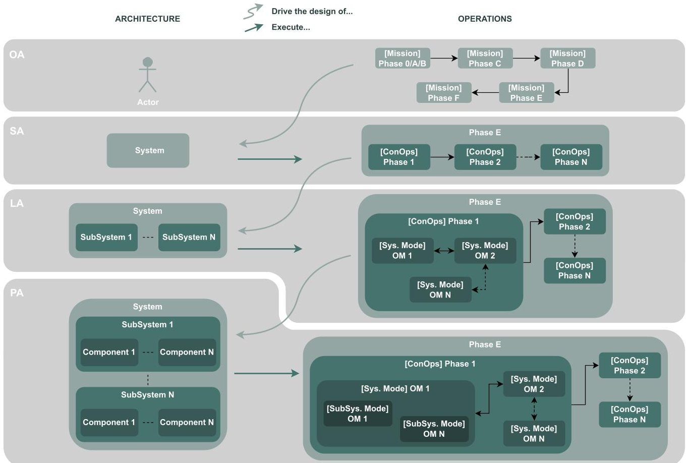
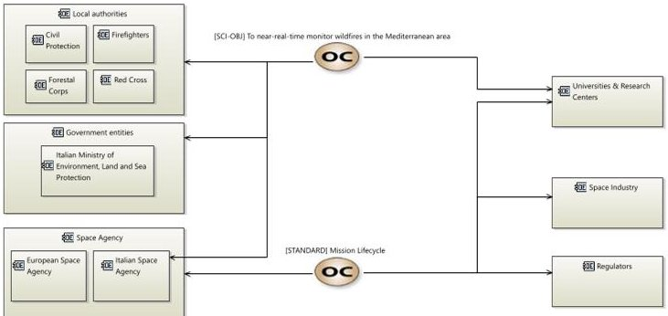
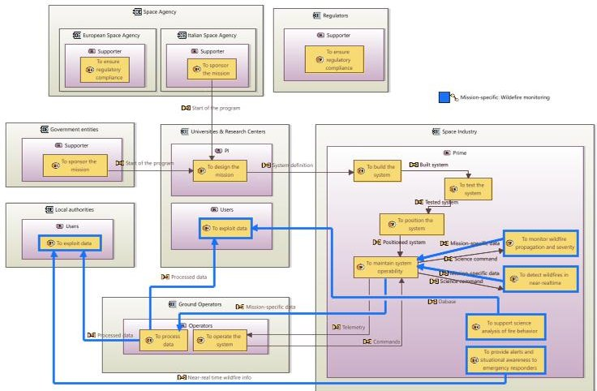
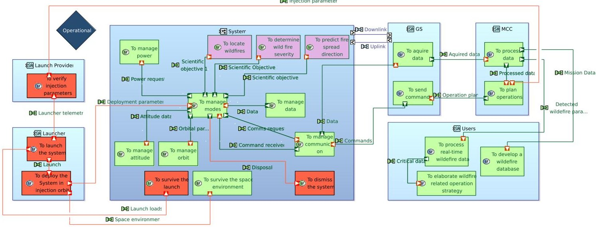
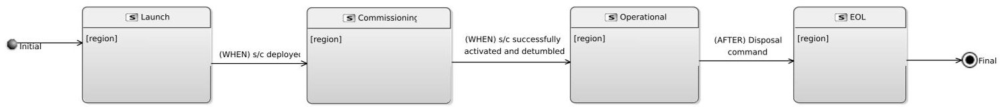
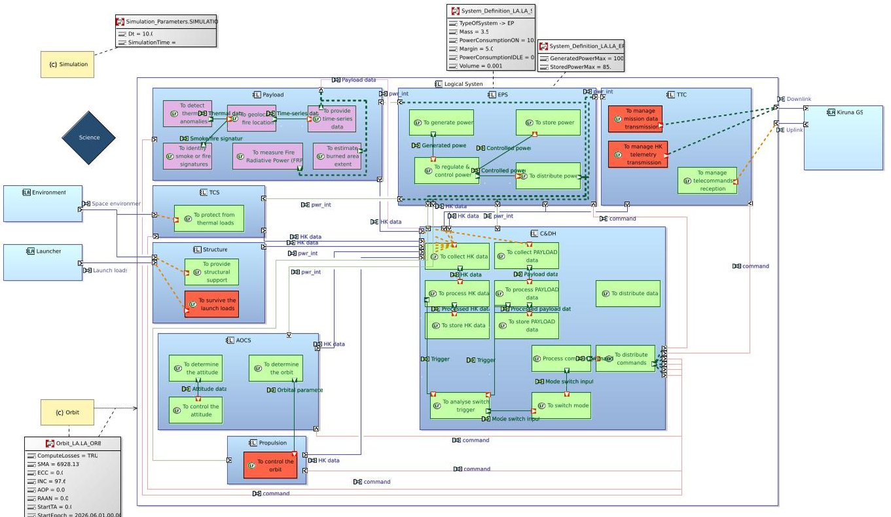
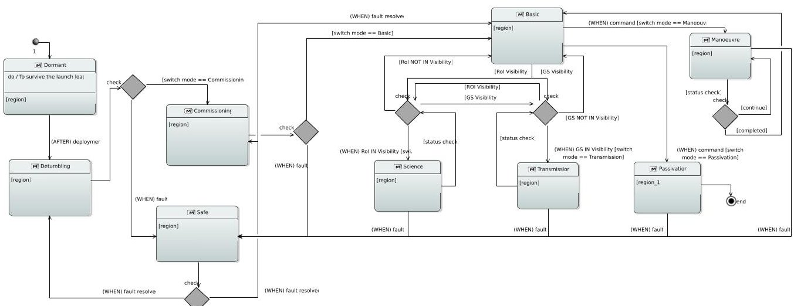
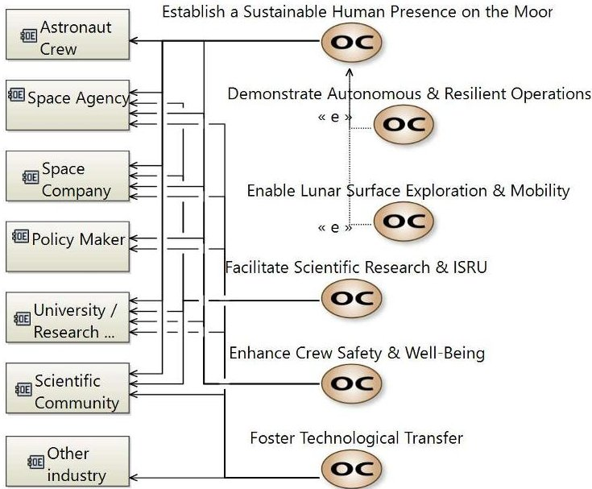
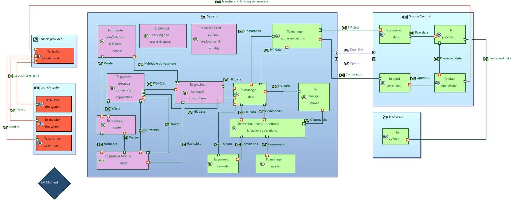
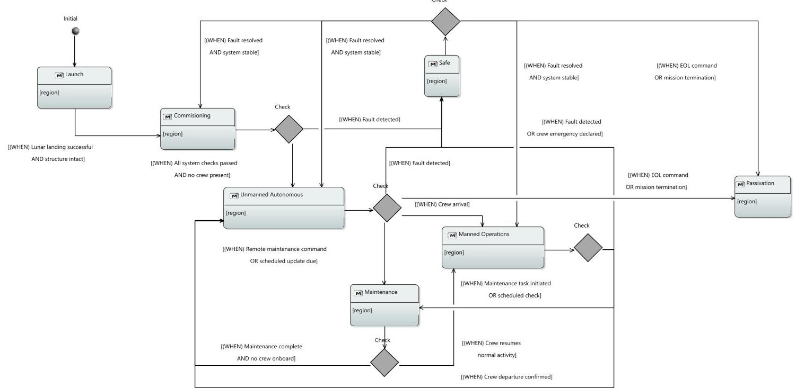

<!-- PDF_PAGE: 1 -->

IAC-25,D1,5,6,x99547

# Model-Based Systems Engineering approach in Capella for Concept of Operations and Operating Modes: Methodology Comparison across Space Systems Domains

Giacomo Luccisano $ ^{a, *} $ , Serena Campioli $ ^{a, *} $ , Sophia Salas Cordero $ ^{b} $ , Nicole Viola $ ^{c} $ , Sabrina Corpino $ ^{a} $

$ ^{a} $ Department of Mechanical and Aerospace Engineering (DIMEAS), Politecnico di Torino, 10129 Turin, Italy. sabrina.corpino@polito.it (S.Co.).

$ ^{b} $ The CT Engineering Group, 31770 Colomiers, France. sophia.salas@ctengineeringgroup.com (S.S.C.).

$ ^{c} $ Department of Management and Production Engineering (DIGEP), Politecnico di Torino, 10129 Turin, Italy. nicole.viola@polito.it (N.V.).

$ ^{*} $ Corresponding Authors: giacomo.luccisano@polito.it (G.L.); serena.campioli@polito.it (S.Ca.).

## Abstract

In recent years, it has become more and more evident how Model-Based Systems Engineering (MBSE) has emerged as a key approach to managing system complexity and ensuring rigorous traceability throughout the lifecycle of a system. When working particularly in highly constrained and mission-critical domains such as space exploration - where a high number of stakeholders and actors are to be involved and/or updated on various aspects MBSE plays a vital role in enhancing system consistency, collaboration, and validation.

This paper focuses on modeling the Concept of Operations (ConOps) and Operating Modes (OMs) using Capella an MBSE tool widely used by space domain actors. This work emphasizes their role in defining system behavior and mission scenarios from the early design stages. ConOps and OMs form the backbone of mission planning, enabling engineers to foresee system responses under nominal and non-nominal conditions, optimize resource allocation, and improve system resilience.

We present a methodology comparison for defining and modeling ConOps and OMs within the MBSE framework, where flexibility is the key to adapting to different mission architectures and dynamic operational constraints. Our approach application is illustrated through two different case studies - a lunar habitat and a small-satellite - showing how MBSE can be leveraged to develop robust, adaptable, mission-ready systems.

Through these examples, the benefits of integrating ConOps and OM early in the design phase are highlighted, improving decision-making, requirements validation, and mission assurance. The paper concludes with a discussion of the scalability of the approach and potential advances of MBSE methodologies for future space exploration missions.

Keywords: Systems Engineering, Model-Based Systems Engineering, Capella, Preliminary Design, Concept of Operations

## Abbreviations

ADM Architecture Development Method

AOCS Attitude and Orbit Control System

ARCADIA Architecture Analysis & Design Integrated Approach

CDH Command & Data Handling

ConOps Concept of Operations

ECLSS Environmental Control and Life Support System

EPS Electrical Power System

INCOSE International Council on Systems Engineering

LA Logical Architecture

LH Lunar Habitat

MBSE Model-Based Systems Engineering

MOSAiC Modeling & Simulation Architecture for integrated Complex systems

OA Operational Analysis

OM Operating Mode

PA Physical Architecture

PVMT Property Values Management Tool

SA System Analysis

SE Systems Engineering

TCS Thermal Control System

TTC Telemetry, Tracking & Control

## 1 Introduction

The increasing complexity of modern space missions has driven the evolution of Systems Engineering (SE) away from traditional document-centric methodologies toward digital, model-driven approaches. Indeed, traditionally document-centric approach manages information in the format of documents using standard office software, and ties the content to a specific viewpoint intended for a specific audience or stakeholder. When working in highly-constrained and mission critical-domain such as space exploration with its wide involvement of a great number of stakeholders and actors, Model-Based Systems Engineering (MBSE) has become instrumental for addressing these challenges by providing structured, visual, and executable representations of system elements across the entire lifecycle from conceptualization to decommissioning [1]. The transition towards MBSE, as articulated in the International Council on Systems Engineering (INCOSE) SE

<!-- PDF_PAGE: 2 -->

Vision 2020 [2], reflects an industry-wide paradigm shift aiming for enhanced communication, improved traceability, reduced redundancy, and greater consistency throughout the system development process. However, despite these recognized advantages, the potential of MBSE remains under-exploited in certain crucial areas, particularly in the early integration of operational concepts and detailed system behaviors into system architectures.

Historically, in the aerospace sector, the development of the Concept of Operations and Operating Modes has often occurred parallel to, yet distinct from, core system design activities. Such separation frequently leads to the late-stage identification of design flaws and mismatches between stakeholder expectations and implemented architectures. Zonnenshain et al. [3] stress that a more integrated approach - one that aligns operational scenarios and system modes from the earliest stages of design can significantly mitigate these risks, ensuring early validation, reducing expensive rework, and enhancing overall mission resilience.

In recent years, methodologies such as Architecture Analysis & Design Integrated Approach (ARCADIA) [4] have gained substantial traction within the aerospace community. ARCADIA, put in place through tools like Capella [5], provides structured frameworks to manage complex system designs from stakeholder needs down to physical architectures. It explicitly integrates multiple system views - such as operational analysis, system needs, logical architecture, and physical architecture to maintain coherence across all stages of development, thereby enabling early and continuous validation.

Capella's capability to systematically bridge conceptual design and detailed engineering has been effectively demonstrated across various aerospace scenarios. The integration of MBSE within Capella facilitates early representation of system architectures, enhancing communication and understanding among engineers during the conceptual design phase [6]. Additionally, the development of scenario frameworks allows for comprehensive problem-space descriptions, enabling trade-space exploration and robust analysis of system effectiveness [7]. Furthermore, methodologies for transforming system models into formal verification frameworks, such as Event-B, ensure that complex designs maintain safety and reliability throughout the engineering process [8].

Moreover, recent advances have begun to integrate MBSE methodologies with multi-domain simulations. Dano and Lacrampe [9] emphasize the integration of decision analysis and requirements derivation into all steps of the ARCADIA Architecture Development Method (ADM) to create a robust, trans-disciplinary system architecture. Ross et al. [10] discuss the application of MBSE methods, including the integration of shared systems architecture with system simulation and analysis. While it does not specifically mention ARCADIA, it emphasizes the importance of managing design properties between model-based architectures and simulations. This integration aims to enhance communication, manage complexity, and address the challenges posed by multi-domain systems-of-systems, ultimately facilitating more effective system development and analysis in a rapidly evolving technological landscape.

Such efforts underscore the growing recognition that both statical analyses (e.g., budgeting activities) and dynamic simulations (e.g., time-aware simulations [11]) are essential to fully exploit MBSE's advantages, allowing iterative refinements and reducing downstream risks through early-stage analysis [12].

Nonetheless, a significant research gap persists. While literature acknowledges the value of early ConOps integration (e.g., Rimani et al. [13]; Cohen et al. [14]), systematic comparisons and methodological best practices specifically tailored for defining and evaluating ConOps and OMs within MBSE frameworks remain relatively scarce. Notably, few studies have addressed detailed methodological comparisons or established clear criteria for effectively capturing and modeling operational concepts in scenarios marked by high variability in constraints, dynamic mission conditions, or distinct operational environments (e.g., Rimani et al. [13], SEAM case study in Gregory [15]).

Early incorporation of ConOps into MBSE processes has been shown to facilitate clear alignment with stakeholder expectations, improve operational effectiveness, optimize resource allocation, and strengthen design resilience [11]. However, existing research tends to focus primarily on descriptive, rather than executable, models, potentially missing opportunities to dynamically evaluate operational scenarios under realistic conditions. Consequently, there is a pressing need for methodologies that explicitly consider the variability and adaptability required in modern space missions, especially as operational complexity and mission architectures evolve.

To address this research gap, the present study builds upon established methodologies, specifically those articulated by Bonnet et al. [16] and Luccisano et al. [17, 18], to propose a structured methodological comparison focused explicitly on modeling ConOps and OMs using Capella. The analysis is illustrated through two contrasting case studies: a small-satellite mission, characterized by stringent resource constraints and rapid development cycles, and a lunar habitat mission, characterized by complex stakeholder interactions and extended operational phases. Through these cases, this paper not only highlights the advantages of integrating operational modeling at early stages but also provides practical guidance for selecting appropriate modeling strategies that align with mission-specific needs and constraints.

Ultimately, this paper contributes to the MBSE body of knowledge by delivering scalable methodologies to integrate operational concepts directly into system modeling, addressing existing gaps and laying robust foundations for future advancements in digital engineering

<!-- PDF_PAGE: 3 -->

Fig. 1: Inter-dependencies between Architectural model and Operational model.

and space mission design.

This paper is structured as follows: Section 2 presents the proposed operational scenario modeling coupled with architectural definition; while Section 3 compares the two case studies as an end-to-end validation of the proposed methodology.

Section 4 discusses the main outcomes of this work and lessons learned. Finally, Section 5 summarizes the proposed work and provides directions for future work.

## 2 Proposed Operations modeling

This section presents a modeling approach for ConOps and OMs as integral part of the system architecture modeling within the newly developed Modeling & Simulation Architecture for integrated Complex systems (MOSAiC) MBSE framework [11, 19]. The methodology builds upon the ARCADIA method and uses the Capella toolset, while proposing the co-development of system behavior and architecture through formal abstractions and state-based modeling. Unlike conventional practices where to the authors' best knowledge mostly only architectural models are developed, the proposed approach establishes a continuous and traceable linkage between system structure and mission execution logic, ensuring consistency throughout the lifecycle.

## 2.1 Methodological Foundations

The modeling process follows ARCADIA's layered abstraction, beginning with Operational Analysis (OA), which defines mission goals and stakeholder interactions, and advancing through System Analysis (SA),

Logical Architecture (LA), and Physical Architecture (PA) [4]. At each stage, the architecture is incrementally refined - from functional groupings to subsystem allocations and finally to component - level instantiations.

ConOps elements are modeled concurrently with this structural development. Mission phases - such as launch, commissioning, or nominal operations - define the operational timeline. Within each phase, the system may adopt different internal configurations or behaviors - captured as Operating Modes. These OMs, defined through Capella's state machine diagrams, represent both the system's status (e.g., Safe Mode, Science Mode) and the conditions under which transitions occur (e.g., power thresholds, visibility events, fault recovery). At the subsystem level, Modes represent variations in functional behavior (e.g., Payload Active, TTC Idle) based on the current mission phase and system objectives.

Using add-ons like the Property Values Management Tool (PVMT) [20] within Capella, quantitative data such as power consumption and relative margins are assigned to components and subsystems based on their active mode. These parameters are crucial for performance simulations and for assessing the validity of operational scenarios within design constraints. The tight coupling between state-based logic and physical properties allows designers to directly simulate mission execution and verify design compliance at early stages $ ^{1} $

$ ^{1} $All data and models are available in a public repository under GPLv3 license at [19].

<!-- PDF_PAGE: 4 -->

## 2.2 Interconnection Between Architectural and Operational Models

The core of the proposed methodology is its emphasis on the interconnection between the architectural and operational models. This relationship is captured in a layered model framework (see Fig. 1), which illustrates how operational definitions and architectural abstractions evolve in parallel, influencing and constraining one another across the system lifecycle.

On the architectural side, the model progresses from OA through SA, LA, and PA. Each level introduces greater design specificity - from abstract functions to logical subsystems to physical components. In parallel, the operational model introduces corresponding layers of behavioral detail: from broad ConOps phases to detailed system modes and subsystem-level variations.

This bidirectional structure supports both design derivation and behavioral execution. The required operations "drive the design of" the architecture by defining available capabilities and constraints; conversely, the architectural elements "execute" the operations, activating specific functions and behaviors in time. For instance, an OM such as "Science Acquisition" will dictate the active configuration of subsystems, turning on payload components, activating data storage, and powering down nonessential services. These behavioral requirements must be anticipated and satisfied by the architectural layout defined at the LA and PA levels.

Capella enables this integration through explicit cross-model references. OMs are not modeled in isolation; rather, they are embedded in the same environment as architectural elements, allowing mode-specific behavior to be tied directly to component definitions and mission scenarios. Transitions between modes (and thus different behaviors that a component might have) are governed by environmental or system triggers - visibility conditions, battery levels, or ground station access and reflect the actual execution environment of the spacecraft. Because these transitions are stored alongside component-level data and system structure, simulations can leverage the complete model for performance assessment.

## 3 Case studies comparison

## 3.1 Satellite Case Study

To validate this integrated modeling methodology, it was firstly applied to the FIRE-EYE mission - a multisatellite CubeSat constellation designed for near-realtime wildfire monitoring in the Mediterranean region, already presented in a preparatory work [11]. The mission was selected as a representative case due to its operational complexity, resource constraints, and need for mode-driven autonomy across multiple mission phases.

The system consists of 48 16U CubeSats equipped with multi-spectral imaging payloads. Each satellite operates autonomously and undergoes a structured lifecycle composed of launch, commissioning, nominal operation, science acquisition, and data transmission phases. These phases were modeled as discrete ConOps stages,

each linked to specific OMs that reflected the system's intended behavior.

In the OA phase, the primary stakeholders - including civil protection agencies, regional authorities, and the mission operators - were modeled with their associated operational capabilities, as shown in Fig. 2.

Fig. 2: Main project capabilities and Stakeholders identification

A primary operational capability was identified to represent the mission goal: [SCI-OBJ] To near-realtime monitor wildfire in the Mediterranean area. This capability encompasses the system's core function of detecting, mapping, and alerting wildfire events with minimal latency.

In parallel, a second capability was defined: [STANDARD] Mission Lifecycle, which represents the set of standardized processes and lifecycle phases required to design, develop, launch, operate, and dispose of the space segment. This capability supports alignment with established space mission development practices (e.g., ECSS standards) and enables long-term roadmapping.

Subsequently, stakeholder activities and interactions were modeled to clarify user needs and objectives, as shown in Fig. 3. The Capella OA enables the creation of a domain model - abstracted from the future system to focus on the stakeholders' real-world needs, independently of any technical implementation [21].

Fig. 3: FireEYE Operational Architecture.

These activities, such as "to detect wildfires" or "to provide alerts and situational awareness", were used to drive the system analysis and function breakdown.

<!-- PDF_PAGE: 5 -->

Fig. 4: FireEYE System Architecture - Operational Configuration. Red indicate deactivated functions, pink payload-related functions and green general functions.

Fig. 5: FireEYE Mission Phases.

Capella was employed to map such stakeholder expectations into formal scenarios and identify functional needs. During System Analysis, these capabilities were translated into system-level functions, and allocated to actors and functional exchanges as shown in Fig. 4.

The state diagram in Fig. 5 outlines the mission's main operational phases - Launch, Commissioning, Operational, and End-of-Life - highlighting key transitions driven by critical mission events. This structured approach enabled a preliminary ConOps definition and the derivation of high-level mission and functional requirements, supporting clear traceability between system behavior and lifecycle functions.

Following the completion of the SA, which provided a high-level functional view, the LA phase introduced initial design choices by transitioning to a "white-box" approach. This involved identifying logical components Payload, Electrical Power System (EPS), Telemetry, Tracking & Control (TTC), Attitude and Orbit Control System (AOCS), and Command & Data Handling (CDH) - and allocating system functions to them, while defining low-level requirements. In parallel, functional and component exchanges were modeled (see Fig. 6), supporting the definition of internal and external interfaces for the subsequent physical design.

Each of these subsystems was assigned a set of OMs reflecting functional behavior under different mission phases, as shown in Fig. 7. For instance, the Payload operated in modes such as "Standby", "Science Acquisition", and "Calibration", with corresponding differences in power use and data output. These modes were

not defined in isolation but were linked to the overarching ConOps phases and system-level states.

All mode definitions included associated property values, modeled using Capella's PVMT tool. These properties included real-time power consumption, energy margins, and activation criteria. This structured data was exported via a custom Python parser and fed into a simulation environment capable of validating the behavior of the system over the mission timeline.

The simulations validated system readiness and feasibility across key domains. Power budget analyses confirmed that the battery and solar panel configurations were sufficient to support operation across eclipse periods and peak payload usage. Communication simulations confirmed that data uplink and downlink were feasible within available visibility windows, factoring in orbital constraints and station availability. Crucially, these simulations relied on dynamically activated modes and transitions derived directly from the Capella model, ensuring that operational behavior matched the intended architecture.

Furthermore, the model supported hybrid-resolution simulation, where some subsystems (e.g., EPS and TTC) were fully refined in the PA layer, while others remained abstracted at the logical level. The framework automatically adjusted simulation granularity based on model completeness, enabling early and continuous system-level validation without waiting for full architectural convergence.

The tight interlinking of architectural and operational layers proved critical to identifying issues early in the

<!-- PDF_PAGE: 6 -->

Fig. 6: FireEYE Logical Architecture - Science Configuration. Red indicate deactivated functions, pink payload-related functions and green general functions.

Fig. 7: FireEYE Operating Modes.

lifecycle. For example, an initial inconsistency in power mode transitions during the Science Acquisition phase highlighted the need to revise the timing of mode shifts to avoid battery depletion during eclipse periods. These adjustments, informed by simulation feedback, were implemented directly within the Capella model, completing the loop between design, behavior, and validation.

Overall, the FIRE-EYE case study demonstrated how integrated ConOps and OM modeling within an MBSE environment enhances traceability, supports early decision-making, and allows simulation-based validation of system behavior. By anchoring operational logic directly into the system architecture, the methodology ensures that mission needs are fully realized in the implemented design and that operational reliability can be assured from the earliest stages of development.

## 3.2 Lunar Habitat case study

To validate the flexibility and applicability of the proposed integrated MBSE framework, a Lunar Habitat (LH) case study was developed. The LH mission was selected as a representative scenario characterized by substantial operational complexity, stringent environmental constraints, and prolonged autonomous operations in a challenging extraterrestrial setting. The habitat system comprises interconnected modules, including a main habitation module, service and logistics modules, and critical support infrastructure such as power generation, thermal control, and life support systems. Each module hosts a set of functional subsystems, rigorously modeled and progressively detailed across OA, SA, LA, and PA levels within Capella. Consistent with the FIREEYE case study, the LH's OA phase initially defined high-level mission capabilities - shown in Fig. 8- , in-

<!-- PDF_PAGE: 7 -->

cluding the "Establish a Sustainable Human Presence on the Moon", "Enhance Crew Safety & Well-Being", "Facilitate Scientific Research & ISRU", as well as the "Mission Lifecycle", capturing standard mission lifecycle phases for development, operation, and disposal aligned with established space mission practices. Subsequently, stakeholder interactions and operational scenarios were identified to capture explicit user needs and system interactions, guiding detailed functional decomposition at the SA level.

Fig. 8: Lunar Habitat Mission Objectives & Stakeholders.

At the architectural level, the LH shares significant similarities with the small satellite scenario regarding non-payload-related functions. Specifically, as can be noted from Fig. 9, it incorporates foundational subsystems such as the EPS, Thermal Control System (TCS), Environmental Control and Life Support System (ECLSS), CDH, and TTC. These subsystems handle critical tasks like power distribution, environmental management, communication with Earth-based operators, system autonomy, and operational management independent of scientific payload activities.

Moreover, as shown in Fig. 10 OMs were explicitly modeled using Capella's state machine diagrams, closely mirroring the methodology and structure employed in the FIRE-EYE study. Modes defined included "Manned Operations", "Safe", "Maintenance", etc., which closely parallel the modes identified for the satellite constellation. Each of these modes dictates subsystem-specific configurations, resource usage strategies, and conditional transitions driven by realtime data such as power availability, environmental conditions, subsystem status, and emergency protocols. As in the spacecraft case study, quantitative operational parameters such as power consumption, system redundancy levels, and margins were assigned using Capella's PVMT, enabling dynamic simulations to validate operational robustness and performance consistency under realistic mission scenarios. The integrated modeling approach proved essential for ensuring early identification of functional and operational inconsistencies, providing a robust validation mechanism that supports traceability and informed decision-making throughout the design and mission planning phases.

## 4 Discussion

A key outcome emerging from the comparison between the two case studies - the FIRE-EYE satellite constellation and the Lunar Habitat system - is the extensive structural and behavioral convergence observed in their non-payload-related subsystems and Operating Modes. Despite the clear differences in mission objectives and operational environments, both systems exhibit a high degree of similarity in their core functional architectures and operative logic. This convergence indicates the potential value of defining a generic, reusable "space system template" that could serve as a foundation for various mission types.

In both case studies, the subsystems responsible for essential spacecraft or habitat operations - such as electrical power generation and distribution, thermal control, command and data handling, and communication with ground operators - were consistently present and demonstrated comparable behaviors. These subsystems performed fundamental roles that are largely independent of specific mission goals, suggesting that their architecture and interaction patterns could be formalized into a common baseline. Their shared logic reinforces the notion that a significant portion of space system functionality is inherently domain-generic and thus well-suited for reuse.

A similar pattern was observed in the design and implementation of Operating Modes such as Launch, Commissioning, Unmanned Autonomous, Safe, and Passivation appeared in both systems, each with consistent triggers, transitions, and internal behaviors. These modes were governed by recurring types of system events, including subsystem faults, command inputs, environmental changes, and crew activity status. Even where domain-specific modes were required - such as Manned Operations for the habitat or Science Acquisition for the satellite - they could be interpreted as modular extensions of a shared behavioral core rather than entirely distinct constructs.

These observations support the hypothesis that a large portion of space system modeling can be standardized into a template that is both payload-agnostic and structurally flexible. Such a template would encapsulate recurring system architecture and operational logic, while allowing mission-specific payload functions and behaviors to be added or modified as required. This approach would offer a practical method for reducing development time, improving cross-mission consistency, and strengthening system-level traceability.

Beyond its practical advantages, the adoption of a reusable system template also aligns with broader methodological shifts in the space sector. As agencies and industry increasingly adopt digital engineering

<!-- PDF_PAGE: 8 -->

Fig. 9: Lunar Habitat System Architecture - Manned Configuration. Red indicate deactivated functions, pink payload-related functions and green general functions.

Fig. 10: Lunar Habitat Operating Modes.

tools and MBSE workflows, the availability of validated architectural baselines becomes essential for maintaining design coherence across large and distributed teams. Within Capella and the ARCADIA framework, such a template would enable early instantiation of complete system models - including operative modes and behavioral parameters - even before all mission-specific elements are defined. This would facilitate early simulation, verification, and validation, while also improving communication between engineering domains.

The proposed template-based modeling approach does not aim to constrain innovation or limit mission customization. Instead, it provides a stable architectural and behavioral scaffold that supports tailored extensions without sacrificing consistency or traceability. By initializing the system model from a validated operational core and progressively enriching it with mission-

specific details, engineering teams can ensure both flexibility and reliability throughout the design lifecycle.

Given these findings, the development of a formal Space System Template Library represents a promising direction for future work. Such a library would consolidate reusable architectural components, standardized operative modes, and associated behavioral data into a structured modeling resource accessible to designers across domains. This would be particularly beneficial for missions with constrained development timelines, evolving requirements, or a need for cross-system interoperability.

Further research should explore the application of this approach to additional mission classes, such as deep space orbiters, planetary landers, or robotic surface systems, in order to confirm the generality of the proposed model. There is also potential to enhance the robustness

<!-- PDF_PAGE: 9 -->

of mode transitions and system responses through integration with formal logic and verification frameworks ensuring that template-based models meet both design intent and safety requirements.

As space missions continue to grow in complexity and scope, the ability to model and validate common system behaviors efficiently and consistently will become increasingly important. Establishing a reusable MBSE framework that captures the shared backbone of space systems offers a concrete step toward scalable, interoperable, and resilient mission design in the digital engineering era.

## 5 Conclusions

This work presented and compared a methodology for expressing the Concept of Operations (ConOps) and Operating Modes (OMs) as first-class, state-based artifacts that co-evolve with architectural views from Operational level through System and Subsystem levels. By tightening the coupling between behavior and structure - enriched with quantitative properties added to the model - the approach enables early, model-driven validation, improves traceability from stakeholder intent to component behavior, and creates a continuous digital thread for mission design and assurance.

This cohesive relationship between structure and behavior resulted in a model that was not only architecturally complete but also operationally executable. It supported vertical consistency from stakeholder needs to system modes, horizontal coherence across mission phases, and dynamic validation throughout the design process. It also facilitated incremental development: as new components were added or subsystem designs evolved, their operational implications were automatically reflected in the behavior model.

Application to two contrasting case studies - a resource-constrained wildfire-monitoring CubeSat constellation (FIRE-EYE) and a Lunar Habitat with prolonged autonomous and crewed operations - demonstrated that the method scales across domains and maturities. In both cases, mission phases and OMs were encoded as executable state machines linked to architecture and parameters, supporting simulation-backed checks on power, communications, and operational feasibility; this enabled to surface issues (e.g., unsafe power transitions) early enough to be resolved directly in the model.

A central outcome is the observed convergence of non-payload subsystems and recurrent OMs (e.g., Launch/Commissioning, Safe, Transmission/Maintenance) across otherwise dissimilar missions. This points to the feasibility and value of a reusable, payload-agnostic "space system template" that packages canonical subsystems, interfaces, and behavioral patterns, onto which mission-specific extensions can be composed. Such a template would reduce time-to-model, strengthen consistency, and make simulation-ready architectures available earlier in the lifecycle.

The study also clarifies boundaries and next steps. While the MOSAiC framework and PVMT-driven properties facilitated early quantitative checks, fidelity still depends on the availability and quality of early data; hardware-in-the-loop and operations feedback remain future integration points. Expanding the comparison to additional mission classes (e.g., deep-space orbiters, landers, robotic surface systems) and hardening mode logic with formal methods (e.g., transformations to verification frameworks) will further increase robustness and reuse.

In summary, integrating ConOps and OMs within Capella rather than treating them as parallel documents proved effective for aligning stakeholder intent, architectural decisions, and mission execution logic from the outset. The cross-domain commonalities identified here motivate a Space System Template Library as a practical vehicle for reuse and scalability. Adopting such templates within MBSE workflows could accelerate design convergence, enhance mission assurance, and support resilient, traceable architectures for upcoming space exploration programs.

Future works might consolidate the identified crossdomain commonalities into a publicly curated Space System Template Library - capturing canonical subsystems and Operating Modes with explicit extension points - and subjected to systematic evaluation across additional mission classes (e.g., deep-space orbiters, landers, robotic surface systems) to assess generality. Portability and reuse at scale would be supported by standardizing PVMT property profiles (power, communications, thermal, redundancy) and by establishing quality gates - coverage metrics, requirement-to-mode traceability, and simulation pass criteria - prior to template release. In parallel, code generation and model transformations should be investigated to derive executable state machines for test harnesses and operational scripts, promoting single-source behavior across design, verification, and validation. Finally, the development of pedagogical reference models (e.g., FIRE-EYE and Lunar Habitat) with step-by-step instantiation guidance is encouraged to facilitate onboarding and to promote a consistent, verifiable, and operations-ready MBSE practice.

## Acknowledgements

G.L. research was carried out within the Space It Up project funded by the Italian Space Agency (ASI) and the Italian Ministry of University and Research (MUR), under contract n. 2024-5-E.0 - CUP n. I53D24000060005.

## References

[1] S. Friedenthal, A. Moore, and R. Steiner. A practical guide to SysML. The MK/OMG Press. Elsevier/Morgan Kaufmann, Waltham, MA, 3rd edition, 2015. ISBN 9780128008003. doi: 10.1016/C2013-0-14457-1.

[2] International Council on Systems Engineering (INCOSE). Systems Engineering Vision 2020

<!-- PDF_PAGE: 10 -->

(Version 2.03), 2007. Available online. url: https://www.incose.org/docs/default-source/aboutse/sevision-2020.pdf (Accessed on 25 Jul 2025).

[3] A. Zonnenshain and A. Harel. A practical guide to assuring the system resilience to operational errors. INCOSE International Symposium, 25(1):538-552, 2015. ISSN 2334-5837. doi: 10.1002/j.2334-5837.2015.00080.x.

[4] J.-L. Voirin. Model-based system and architecture engineering with the ARCADIA method. Implementation of model based system engineering set. ISTE Press, London, 2018. ISBN 0081017944. doi: 10.1016/C2016-0-00862-8.

[5] Eclipse Foundation. Capella MBSE tool. Available online. URL: https://mbse-capella.org/ (Accessed on 04 Aug 2025).

[6] A. K. Jeyaraj. A Model-Based Systems Engineering Approach for Efficient System Architecture Representation in Conceptual Design: A Case Study for Flight Control Systems. Master's thesis, Concordia University, 2019. Available online. url: https://spectrum.library.concordia.ca/985353/ (Accessed on 28 Jul 2025).

[7] K. Kindström Andersson and K. E. Andersson. Development of Scenarios as Problem-Space Descriptions in Aerospace Conceptual Design. Aerospace, 11(7):565, 2024. ISSN 2226-4310. doi: 10.3390/aerospace11070 565.

[8] K. Bouba, A. Ait Wakrime, Y. Ouhammou, and R. Benaini. A transformation methodology for Capella to Event-B models with DSL verification. Journal of Computer Languages, 77:101241, 2023. ISSN 2590-1184. doi: 10.1016/j.cola.2023.101241.

[9] E. B. Dano and S. Lacrampe. A Model Based System Architecture Methodology Leveraging the ARCA-DIA Method. In 2023 IEEE International Conference on Recent Advances in Systems Science and Engineering (RASSE), pages 1-8. IEEE, 8-11 Nov 2023. doi: 10.1109/rasse60029.2023.10363621.

[10] J. Ross, M. Vinarcik, C. Caron, C. Craft, S. Pien, and A. Prajapati. Applying Model-Based Systems Engineering Methods to a Novel Shared Systems Simulation Methodology. INCOSE International Symposium, 32(1):1303-1319, July 2022. ISSN 2334-5837. doi: 10.1002/iis2.12996.

[11] S. Campioli, G. Luccisano, D. Ferretto, and F. Stesina. Towards a Unified Modeling and Simulation Framework for Space Systems: Integrating Model-Based Systems Engineering with Open Source Multi-Domain Simulation Environments. Aerospace, 12(8), 2025. ISSN 2226-4310. doi: 10.3390/aerospace12080745.

[12] J. Hooman, K. Kanters, A. Vasenev, and J. Verriet. MBSE-Based Design Space Exploration for Productivity Improvement Using Workflow Models, pages 35-46. Springer Nature Switzerland, 2024. ISBN 9783031491795. doi: 10.1007/978-3-031-49179-5_3.

[13] J. Rimani, N. Viola, and S. Lizy-Destrez. Simulating Operational Concepts for Autonomous Robotic Space Exploration Systems: A Framework for Early Design Validation. Aerospace, 10(5):408, April 2023. ISSN 2226-4310. doi: 10.3390/aerospace10050408.

[14] J. Cohen, M. S. Kaetzer, S. Lumpkins, D. Rubin, and K. McGuire. A Model-Based Systems Engineering Journey to Developing a Concept of Operations (ConOps). In 2022 IEEE Aerospace Conference (AERO), pages 1-14. IEEE, March 2022. doi: 10.1109/aero53065.2022.9843691.

[15] J. Gregory. A Model-Based Framework for Early-Stage Analysis of Spacecraft. PhD thesis, University of Bristol, 2022.

[16] S. Bonnet, J. Voirin, D. Exertier, and V. Normand. Modeling system modes, states, configurations with arcadia and capella: method and tool perspectives. INCOSE International Symposium, 27(1):548-562, July 2017. ISSN 2334-5837. doi: 10.1002/j.2334-5837.2017.00378.x.

[17] G. Luccisano, S. Salas Cordero, T. Gateau, and N. Viola. Open-Source Data Formalization through Model-Based Systems Engineering for Concurrent Preliminary Design of CubeSats. Aerospace, 11(9):702, 2024. ISSN 2226-4310. doi: 10.3390/aerospace11090702.

[18] G. Luccisano, S. Salas Cordero, T. Gateau, and N. Viola. Formalization of cubesat data and mission parameters through sysml for preliminary design. In IAF Space Systems Symposium, IAC 2024, pages 440-447. International Astronautical Federation (IAF), 2024. doi: 10.52202/078372-0045.

[19] G. Luccisano and S. Campioli. MOSAiC - Modeling & Simulation Architecture for integrated Complex systems (v 0.1), 2025. Available online. url: https://gitlab1.polito.it/aer-se-public/MOSAiC (Accessed on 29 Jul 2025).

[20] J. Navas. Easily enrich Capella models with your domain extensions (by Thales) — Webinar Capella, 2018. Available online. URL: https://youtu.be/ieVmw54YE94?si=KljxfbC- Qn6LscCH (Accessed on 27 Jul 2025).

[21] P. Roques. Systems Architecture Modeling with the Arcadia Method: A Practical Guide to Capella. ISTE Press: London, UK and Elsevier: Amsterdam, NL, 2017. ISBN 978-1-78548-168-0. doi: 10.1016/C2016-0-00854-9.