<!-- PDF_PAGE: 1 -->

2025-08-01

# Model-Based Systems Engineering For Aerospace Applications: Strategic Requirements Prioritization In Complex Adaptive Systems And Digital Integration

Iqtiar Md Siddique University of Texas at El Paso

Follow this and additional works at: https://scholarworks.utep.edu/open_etd Part of the Aerospace Engineering Commons, and the Systems Science Commons

<!-- PDF_PAGE: 2 -->

# MODEL-BASED SYSTEMS ENGINEERING FOR AEROSPACE APPLICATIONS: STRATEGIC REQUIREMENTS PRIORITIZATION IN COMPLEX ADAPTIVE SYSTEMS AND DIGITAL INTEGRATION

## IQTIAR MD SIDDIQUE Doctoral Program in Mechanical Engineering

APPROVED:

Sergio A. Luna Fong, Ph.D., Chair

Afroza Shirin, Ph.D., Co-Chair

Md Nawshad Arslan Islam, Ph.D.

<!-- PDF_PAGE: 3 -->

Copyright 2025 Iqtiar Md Siddique

<!-- PDF_PAGE: 4 -->

## Dedication

To my late father, whose memory lives on in quiet days, To my mother, whose prayers have shaped my ways, To Isam and Ilan, who fill my world with joyful rays, To Anamika, whose quiet support steadies my days.

<!-- PDF_PAGE: 5 -->

MODEL-BASED SYSTEMS ENGINEERING FOR AEROSPACE APPLICATIONS:

STRATEGIC REQUIREMENTS PRIORITIZATION IN COMPLEX ADAPTIVE SYSTEMS

AND DIGITAL INTEGRATION

by

## IQTIAR MD SIDDIQUE

## DISSERTATION

# Presented to the Faculty of the Graduate School of The University of Texas at El Paso in Partial Fulfillment of the Requirements for the Degree of

DOCTOR OF PHILOSOPHY

Department of Aerospace and Mechanical Engineering THE UNIVERSITY OF TEXAS AT EL PASO

August 2025

<!-- PDF_PAGE: 6 -->

# Acknowledgements

"Success is the sum of small efforts, repeated day in and day out." Robert Collier

At the outset, I am humbly grateful to the Almighty, whose quiet guidance and mercy sustained me through every moment of doubt, challenge, and perseverance.

I am profoundly grateful to my dissertation chair, Dr. Sergio Luna Fong, for placing his trust in me and guiding this work with clarity and encouragement. I also thank my committee members, Dr. Afroza Shirin and Dr. Md Nawshad Arslan Islam, for their valuable feedback and consistent support. A special acknowledgment goes to Dr. Eric Smith, whose mentorship during my master's studies first sparked my path in research. I want to extend my sincere appreciation to the faculty, staff, and colleagues of the Departments of Mechanical Engineering and Industrial, Manufacturing, and Systems Engineering at UTEP, whose contributions, whether through guidance, coordination, or quiet support, have been integral to this journey.

Above all, I owe everything to my family. Their sacrifices, patience, and love carried me through every stage of this process. My sons, Isam and Ilan, gently reminded me of balance once by asking, "Baba (Dad), when will you get your Ph.D. like Ma?" $ ^{1} $ and often by noticing how long I stayed in front of my laptop. Their words stayed with me, quietly motivating me to reach this milestone, with love, for them.

<!-- PDF_PAGE: 7 -->

## Abstract

Ineffective systems engineering practices continue to jeopardize aerospace missions, resulting in multi-billion-dollar losses, delays, and fragmented development outcomes. As complexity intensifies and timelines shrink, conventional document-based methods increasingly fail to support early validation, cross-domain traceability, and synchronized tool usage. This research presents an integrated approach that addresses three critical gaps: synchronizing executable and traceable MBSE models across structural, behavioral, and requirements domains; applying scalable requirements prioritization techniques tailored for Complex Adaptive Systems; and establishing automated simulation feedback loops through digital toolchain integration. Central to this strategy is the Digital Trinity, which connects system models, simulations, and lifecycle data through a continuous digital thread. The proposed methodology begins with SysML-based modeling in Cameo Systems Modeler, followed by a multi-phase prioritization process using filtration, metadata scoring, and comparative weighting to evaluate over one hundred mission requirements. The approach is applied to the SidSat mission, a 4U CubeSat featuring a modular architecture with core avionics, a robotic arm payload, and an onboard AI/ML experimentation module. Requirements were allocated to model components, then verified using parameterized simulations. MATLAB was employed for mass, power, and thermal margin calculations; STK for orbital behavior assessment; Excel for value propagation and I/O management; and Teamcenter with AWS for model control and data traceability. Simulation outputs were dynamically linked to SysML constraint blocks and displayed through interactive dashboards in Cameo, ensuring transparency of compliance and coherence of the architecture state. Results demonstrate enhanced early-stage validation, improved stakeholder alignment, and reduced risk of misalignment between model logic and simulated performance. The final system model operates as a live digital reference

<!-- PDF_PAGE: 8 -->

across design and analysis phases, enabling iterative updates and real-time feedback. Although demonstrated on a CubeSat platform, the framework is extensible to larger systems where agility, traceable decision-making, and model-simulation convergence are essential for mission assurance.

<!-- PDF_PAGE: 9 -->

## Table of Contents

Dedication...iii

Acknowledgements...v

Abstract...vi

Table of Contents...viii

List of Tables...xiv

List of Figures...xvi

Abbreviations...xxi

Chapter 1: Introduction...1

1.1 Background and Motivation...1

1.2 Problem Statement...4

1.3 Research Objectives and Scope...5

1.4 Research Questions...7

1.5 Significance of The Research...10

1.6 Layout of The Dissertation...12

Chapter 2: Prior Work and Research Gaps...14

2.1 Foundations of Systems Engineering and Model-Based Practices...15

2.1.1 Systems Engineering Lifecycle and Technical Processes...16

2.1.2 Model-Based Systems Engineering (MBSE) Concepts and Benefits...19

2.1.3 The Role of SysML in MBSE...21

2.1.4 SE Methodologies and Toolchain Challenges...23

2.2 Systems Engineering Challenges in Aerospace Domains...27

2.2a Fundamentals of Requirements Engineering...30

2.3 MBSE in Aerospace Applications...39

2.3.1 MBSE Foundations and Frameworks in Aerospace...39

2.3.2 Sector-Specific Implementations...40

2.3.3 Integration with Agile, Concurrent, and Cyber-Physical Development...42

2.3.4 Requirements Engineering and Synchronized Prioritization...42

2.3.5 MBSE Implementation in CubeSat and Small Satellite Projects...43

<!-- PDF_PAGE: 10 -->

2.4 Requirements Prioritization in Complex Adaptive Systems ...45

2.4.1 Foundations of RE in Aerospace MBSE ...45

2.4.2 Requirements Prioritization in Aerospace Context ...46

2.4.3 Requirements Prioritization in Complex Adaptive Systems ...47

2.4.4 Traceability, Verification, and Digital Thread Integration ...48

2.4.5 Comparative Frameworks for Prioritization ...49

2.5 Digital Integration and the Digital Trinity ...52

2.5.1 Foundations of Digital Engineering ...52

2.5.2 Tool Interoperability and Model Integration ...55

2.5.3 Lifecycle Traceability, Simulation Feedback, and Co-Simulation ...58

2.5.4 Limitations and the Need for a Unified DE Architecture ...60

2.6 Technical Gaps and Justification for the Proposed Approach ...63

2.7 Summary ...65

Chapter 3: Methodology ...66

3.1 Research Design and Framework ...66

3.1.1 Research Philosophy and Approach ...67

3.1.2 Justification for Mixed Methods ...67

3.1.3 The Digital Trinity (MBSE–Prioritization–Integration) Framework ...69

3.1.4 Alignment of Key Research Questions with Objectives ...71

3.2 Model-Based Systems Engineering (MBSE) Implementation ...73

3.2.1 MBSE Foundation and Rationale ...73

3.2.2 SysML Modeling and Toolchain (Cameo, MATLAB, etc.) ...76

3.2.3 SidSat Logical Architecture Modeling ...78

3.2.4 Behavioral Modeling and Traceability ...80

3.2.5 Parametric Validation ...81

3.2.6 MBSE Tool Selection and Prioritization Framework ...82

3.2.6.1 Tool Selection to Support MBSE Fidelity and Formalism ...83

3.2.6.2 Requirements Prioritization and Verification Alignment in Tool Evaluation ...84

3.2.6.3 Digital Integration and Lifecycle Interoperability in Tool Selection ...87

3.3 Requirements Prioritization Strategy ...90

3.3.1 Challenges in Complex Adaptive Systems ...93

3.3.2 Comparison of Prioritization Methods ...95

<!-- PDF_PAGE: 11 -->

3.3.3 Proposed Adaptive Prioritization Framework ...98

3.3.4 Application to SidSat Requirements ...100

3.3.5 Quantitative Evaluation: AHP and Weighted Scoring Approach ...102

    3.3.5.1 Prioritization Model Overview ...102

    3.3.5.2 AHP Stepwise Evaluation ...103

    3.3.5.3 Weighted Scoring (Sum) Approach: Proposed Framework Design ...113

    3.3.5.4 Application in SidSat Context ...120

    3.3.5.5 Strategic Implications of Comparative Results ...125

3.3.6 Risk and Change Management ...126

    3.3.6.1 Risk Alignment through Prioritization ...127

    3.3.6.2 Change Adaptation Strategy ...131

    3.3.6.3 Probabilistic Modeling for Adaptability Assessment ...135

3.4 Digital Integration and Toolchain ...138

    3.4.1 Tools and Technologies Used ...139

    3.4.2 Architecture and Data Integration ...141

    3.4.3 Sync, Interoperability, and Model Continuity ...143

    3.4.4 Impact Evaluation ...144

    3.4.5 Simulation Use Cases ...146

        3.4.5.1 Power Generation via Cameo–MATLAB Integration ...146

        3.4.5.2 Satellite Propagation and Positioning via Cameo-MATLAB-STK Integration ...149

        3.4.5.3 Data Export and Validation via Cameo–MATLAB–STK–Excel Integration ...152

        3.4.5.4 Lifetime Simulation via MBSE–Toolchain Exchange ...155

        3.4.5.5 UHF Frequency Validation via SimConfig and CSV Output ...159

3.5 Validation via SidSat Case Study ...165

    3.5.1 Methodology and Testbed ...166

    3.5.2 Data Collection and Traceability Demonstration ...168

    3.5.3 Simulation-Based Verification ...169

    3.5.4 Framework Evaluation and Limitations ...171

3.6 Summary ...173

Chapter 4: Case-Based Justification for the Proposed Approach ...175

4.1 Overview and Alignment with Research Objectives ...175

<!-- PDF_PAGE: 12 -->

4.2 Case Study 1: MBSE Omission in Boeing 787 Crash ...179

4.3 Case Study 2: Cost Overruns in NASA–Boeing Collaboration ...182

4.4 Case Study 3: MBSE Success in Airbus A350 ...185

4.5 Case Study 4: Prioritization – Success vs Failure in Aerospace ...189

4.6 Case Study 5: Losses from Lack of Digital Engineering ...193

4.7 Case Study 6: Savings through Digital Integration ...195

4.8 Summary and Cross-Case Insights ...197

Chapter 5: SidSat: A CubeSat Case Study in MBSE ...201

5.1 Mission and System Context ...201

    5.1.1 Overview and Objectives ...201

    5.1.2 Modular System Architecture ...202

    5.1.3 Concept of Operations (ConOps) ...205

    5.1.4 System Work Breakdown Structure ...207

5.2 MBSE Implementation in SidSat ...209

    5.2.1 SysML Modeling ...209

    5.2.2 Logical Structural Models ...210

    5.2.3 Logical Behavioral Models ...215

5.3 Requirements Prioritization Strategy ...218

    5.3.1 SidSat Requirements Matrix ...218

    5.3.2 Functional and Non-Functional Requirement Structuring ...223

    5.3.3 Method 1: Filtration and Scoring ...226

    5.3.4 Method 2: Tool Evaluation (Cameo, Capella, DOORS) ...228

    5.3.5 Method 3: Final Prioritization via Decision Matrix ...230

    5.3.6 Critical Requirements Identified ...233

5.4 Digital Engineering Toolchain ...236

    5.4.1 Toolchain Integration (Cameo, MATLAB, STK, Excel, Teamcenter, AWS) .236

    5.4.2 Lifecycle Tool Usage Evidence ...241

    5.4.3 Interoperability Across MBSE and Simulation Tools ...243

    5.4.4 Results from Integrated Simulations ...246

Chapter 6: Comparative Analysis of MBSE Methodologies: OOSEM vs. Arcadia ...249

6.1 Introduction and Evaluation Framework ...249

6.2 Modeling Setup and Method Execution ...253

<!-- PDF_PAGE: 13 -->

6.3 Comparative Results and Discussion ...256

6.4 Implications, Limitations, and Future Use ...259

6.5 Summary ...261

Chapter 7: System Validation and Evaluation Activities ...263

7.1 Requirements Traceability and Validation in the MBSE Context ...263

7.2 Toolchain Integration and Cross-Platform Validation Consistency ...266

7.3 Simulation I/O Interfaces via Excel and CSV ...268

7.4 Scenario-Based System Behavior Assessment ...269

7.5 Digital Thread Implementation and Feedback Loops ...271

7.6 Summary ...273

Chapter 8: Lessons Learned ...275

8.1 Integrated Insights from MBSE and Digital Integration ...275

8.2 Lessons from Applying Requirements Prioritization ...278

8.3 Lessons from Digital Toolchain Integration and Scalability ...281

8.4 Recommendations for Future Aerospace Projects ...283

8.5 Summary ...284

Chapter 9: Conclusions and Future Work ...285

9.1 Summary of Research Contributions ...285

9.2 Implications for Aerospace Systems Engineering ...287

9.3 Limitations of the Study ...288

9.4 Future Research Directions ...290

9.5 Final Reflections ...292

From Concept to Capability: The Road Beyond ...294

Appendices ...296

Appendix A. *SidSat* System Requirements List ...296

Appendix B. Requirements Verification and Traceability Matrix (RVTM) ...302

Appendix C. MBSE Tool Evaluation Matrix ...307

Appendix D. Prioritized Requirements ...308

Appendix E. Digital Toolchain Integration ...310

<!-- PDF_PAGE: 14 -->

References...312

Author's Publications...333

Vita ...334

<!-- PDF_PAGE: 15 -->

## List of Tables

Table 2.2A.1. Example of Comparative Assessment of RE Tools (IEEE Software). ... 38

Table 3.1. Comparative Evaluation of MBSE Tools for CubeSat-Aerospace Applications. ... 87

Table 3.2. Comparative Overview of Advanced Requirements Prioritization Approaches. ... 97

Table 3.3. Pairwise Comparison Matrix. ... 105

Table 3.4. Normalized Matrix. ... 106

Table 3.5. Priority Vector. ... 106

Table 3.6. Original Pairwise Matrix with Priority Vector. ... 107

Table 3.7. Multiplied Criteria with Weight. ... 107

Table 3.8. Division with Priority Vector. ... 108

Table 3.9. Pairwise Comparison Matrix for Requirements (Cost). ... 109

Table 3.10. Pairwise Matrix for Requirements (Technical Feasibility). ... 110

Table 3.11. Pairwise Comparison Matrix for Requirements (Risk). ... 110

Table 3.12. Normalized Pairwise Comparison Matrices (Cost). ... 111

Table 3.13. Normalized Pairwise Comparison Matrices (Tech). ... 111

Table 3.14. Normalized Pairwise Comparison Matrices (Risk). ... 111

Table 3.15. Usability Score. ... 118

Table 3.16. Decision Matrix for Tool Selection. ... 120

Table 3.17. Comparison of Cameo, Capella, and DOORS. ... 123

Table 3.18. Decision Matrix for SidSat Requirements Prioritization. ... 125

Table 3.19. Analytical Hierarchy Process Vs. Weighted Scoring Model. ... 126

Table 3.20. Risk Strategies in Prioritization. ... 128

Table 3.21. Probability Description Table. ... 128

<!-- PDF_PAGE: 16 -->

Table 3.22. Risk Table for Prioritization-Linked Events...130

Table 3.23. Change Management in Requirements Prioritization...132

Table 3.24. Mapping Adaptability Dimensions to Probabilistic Modeling Techniques...136

Table 4.1. Engineering Rationale from Case Study Lessons...178

Table 4.2. Comparative MBSE and Digital Thread Capabilities: Airbus vs Boeing...188

Table 4.3. Comparative Analysis of Requirements Prioritization Practices...192

Table 5.1. Authoritative Sources of Requirement Categories...222

Table 5.2. Example of Requirement Categorization and Verification Methods...223

Table 6.1. Comparative Overview of MBSE Methodologies...251

Table 6.2. FEMMP Evaluation Criteria (Alai, 2019)...253

Table 6.3. FEMMP-Based Evaluation Summary...258

Table A.1. Example of SidSat System-Level Requirements...296

Table B.1. Requirements Verification and Traceability Matrix (RVTM) for SidSat...302

Table C.1. Comparative Evaluation of Leading MBSE Tools...307

Table D.1. Prioritized List of Validated Requirements for SidSat...308

Table E.1. Digital Toolchain Integration Summary for SidSat...310

<!-- PDF_PAGE: 17 -->

## List of Figures

Figure 2.1. System lifecycle stages and decision gates (ISO/IEC/IEEE 15288, SEBoK)...17

Figure 2.2. Classification of system lifecycle processes per ISO/IEC/IEEE 15288...18

Figure 2.3. Key elements of Systems Engineering (Pyster & Olwell, 2013). ...20

Figure 2.4. Systems Engineering Process (V-Model) (Forsberg & Mooz, 1999). ...21

Figure 2.5. SysML diagram categories supporting MBSE (No Magic, 2022). ...22

Figure 2.6. SysML views for structure, behavior, requirements & constraints (Nonsiri, 2015). .23

Figure 2.7. PMTE model linking framework (Martin, 2020). ...24

Figure 2.8. OOSEM activities and key SE development steps (INCOSE, 2015). ...25

Figure 2.9. Arcadia’s approach from needs to physical architecture (Capella, 2024). ...26

Figure 2.10. INCOSE Vision 2035 Roadmap for SE Transformation. ...29

Figure 2.2A.1. Overview of Requirements Engineering. ...31

Figure 2.2A.2. IREB Framework for Requirements Engineering. ...32

Figure 2.2A.3. Elicitation Techniques in Requirements Engineering (IREB). ...33

Figure 2.2A.4. The Kano Model for Feature Classification (IREB). ...34

Figure 2.2A.5. Requirements Lifecycle State Chart (IREB). ...35

Figure 2.2A.6. Types of Requirements Traceability (IREB). ...36

Figure 2.2A.7. Process Configuration in Requirements Engineering (IREB). ...37

Figure 2.2A.8. Agile Outcomes-Focused Requirements Engineering (Schon, 2017) ...39

Figure 3.1. Proposed Digital Trinity Framework...69

Figure 3.2. MBSE Environment Supporting Digital Thread Integration (Source: Alamy). ...74

Figure 3.3. V-Model Emphasizing Early Verification for Lifecycle Efficiency (LM). ...75

Figure 3.4. Multi-stage MBSE Tool Selection Framework (Khandoker et al., 2022). ...83

<!-- PDF_PAGE: 18 -->

Figure 3.5. MBSE Needs Across People, Processes, and Products (Khandoker et al., 2022)... 86

Figure 3.6. Digital Thread linking MBSE, simulation, PLM, and ALM (Jama, 2020)... 89

Figure 3.7. Requirements Traceability Using SysML and Cameo Integration (AC). ... 92

Figure 3.8. Behavioral Flow Model for Satellite Adaptation. ... 94

Figure 3.9. Performance-Based Comparison of Prioritization Approaches. ... 96

Figure 3.10. Hybrid Adaptive Prioritization Framework... 98

Figure 3.11. Multi-Criteria Framework for Requirements Prioritization. ... 104

Figure 3.12. Weighted Scoring Framework for Requirements Prioritization. ... 113

Figure 3.13. Risk Matrix... 129

Figure 3.14. Change Request Review and Approval Process (PPQC). ... 133

Figure 3.15. Baseline Control Across System Artifacts (PPQC). ... 134

Figure 3.16. MATLAB Script for Power Generation. ... 146

Figure 3.17. Activity Diagram for Power Generation. ... 147

Figure 3.18. Executing MATLAB Script in Cameo. ... 148

Figure 3.19. Output of Average Power Generation over Time... 148

Figure 3.20. Mean of Average Power Generation in Watts... 149

Figure 3.21. MATLAB Script for Satellite Orbit Propagation. ... 150

Figure 3.22. STK Visualization of Propagated Satellite Trajectory. ... 151

Figure 3.23. STK Scenario Parameters for Initial State Vector (Cartesian ICRF). ... 151

Figure 3.24. MATLAB Script for STK Object Count and Excel Export. ... 152

Figure 3.25. STK Visualization of Satellite Ground Network Scenario... 153

Figure 3.26. Cameo Console Showing Object Count Execution Result... 154

Figure 3.27. Excel Sheet Output Displaying Exported Object Count. ... 154

<!-- PDF_PAGE: 19 -->

Figure 3.28. Lifetime Simulation Script (MATLAB–STK). ... 156

Figure 3.29. Excel Input/Output (Mass = 5 kg, Lifetime = 2.5 yr). ... 157

Figure 3.30. Updated Input/Output (Mass = 6 kg, Lifetime = 3.4 yr). ... 158

Figure 3.31. Lifetime Output in Cameo Console. ... 158

Figure 3.32. UHF Requirement Validation and Simulation Results. ... 159

Figure 3.33. Simulation Block and Output Value Property. ... 160

Figure 3.34. MATLAB Script for Writing Frequency to Excel. ... 160

Figure 3.35. Excel Sheet Structure for Input Values. ... 161

Figure 3.36. Simulation Test Selection in Cameo. ... 161

Figure 3.37. Updated Excel with Injected UHF Value. ... 162

Figure 3.38. SimConfig Setup with Output Parameters. ... 162

Figure 3.39. Simulation Execution Panel with Live Output. ... 163

Figure 3.40. Generated CSV Output File in Directory. ... 164

Figure 3.41. Final Output Showing Validated UHF in CSV. ... 164

Figure 3.42. Console Output Showing Requirement Not Satisfied. ... 165

Figure 4.1. Air India Boeing 787 crash in Ahmedabad (The Guardian, June 2025). ... 179

Figure 4.2. Ram Air Turbine (RAT) shown in extended position on a Boeing 787. ... 180

Figure 4.3. Boeing Starliner service module during helium leak testing. ... 183

Figure 4.4. Airbus A350 Digital Bird: Integrated System Modeling Views (Siemens). ... 186

Figure 4.5. Comparative Performance of Boeing and Airbus (2019–2024). ... 187

Figure 4.6. NASA Resource Prospector Rover. ... 190

Figure 4.7. Future Combat Systems Architecture. ... 191

Figure 4.8. Conceptual Missile Defense Model (Lockheed Context). ... 193

<!-- PDF_PAGE: 20 -->

Figure 4.9. Boeing T-7A Red Hawk Delays... 194

Figure 4.10. Fully Connected Digital Ecosystem (Northrop Grumman)... 197

Figure 5.1. *SidSat* Mission Concept of Operations. (Source: *SidSat* TDP). ... 206

Figure 5.2. *SidSat* WBS (part 1). ... 208

Figure 5.3. *SidSat* WBS (part 2). ... 208

Figure 5.4. *SidSat* Concept Model. ... 211

Figure 5.5. *SidSat* Hierarchical Model... 211

Figure 5.6. *SidSat* Block Definition Diagram... 212

Figure 5.7. *SidSat* Internal Block Diagram... 213

Figure 5.8. *SidSat* EPSII Subsystem: IBD for Power Distribution and Supply... 214

Figure 5.9. *SidSat* Functional Flow Diagram... 214

Figure 5.10. *SidSat* Parametric Diagram... 215

Figure 5.11. *SidSat* Use Case Diagram... 216

Figure 5.12. *SidSat* Activity Diagram... 217

Figure 5.13. *SidSat* State Machine Diagram... 218

Figure 5.14. *SidSat* Requirements Table... 219

Figure 5.15. Integrated DE Workflow with Cameo–MATLAB–STK. ... 236

Figure 5.16. *SidSat* Digital Engineering Stack and Toolchain Integration... 239

Figure 5.17. PLM-Enabled Digital Twin Transfer Architecture... 240

Figure 5.18. Digital Engineering Domains on AWS (Source: AWS). ... 243

Figure 6.1. V-Model Representation of Systems Engineering Workflow (MapleSoft). ... 250

Figure 6.2. Modeling Scope and Workflow Execution in OOSEM and Arcadia (*Alai, 2019*) ... 255

Figure 8.1. *SidSat* Validation Interface Prototype (under development)... 276

<!-- PDF_PAGE: 21 -->

Figure 8.2. SidSat Validation Result Dialog for Automated Outcome...277

<!-- PDF_PAGE: 22 -->

Abbreviations

<table border="1"><tr><td>Abbreviation</td><td>Full Term</td></tr><tr><td>4U</td><td>4-Unit(CubeSat Standard Size)</td></tr><tr><td>ACT</td><td>Activity Diagram</td></tr><tr><td>ADCS</td><td>Attitude Determination and Control System</td></tr><tr><td>AFHCV</td><td>Adaptive Framework for Highly Configurable Vehicles</td></tr><tr><td>AGI</td><td>Analytical Graphics, Inc.</td></tr><tr><td>AI</td><td>Artificial Intelligence</td></tr><tr><td>AI/ML</td><td>Artificial Intelligence/Machine Learning</td></tr><tr><td>AHP</td><td>Analytic Hierarchy Process</td></tr><tr><td>API</td><td>Application Programming Interface</td></tr><tr><td>ARCADIA</td><td>Architecture Analysis and Design Integrated Approach</td></tr><tr><td>ARINC</td><td>Aeronautical Radio, Incorporated</td></tr><tr><td>ARP</td><td>Adaptive Requirements Prioritization</td></tr><tr><td>AWS</td><td>Amazon Web Services</td></tr><tr><td>A&amp;S</td><td>Acquisition and Sustainment</td></tr><tr><td>BDD</td><td>Block Definition Diagram</td></tr><tr><td>BOM</td><td>Bill of Materials</td></tr><tr><td>BR</td><td>Battery Reliability</td></tr><tr><td>BST</td><td>Binary Search Tree</td></tr><tr><td>BTR</td><td>Battery Testing Requirements</td></tr><tr><td>BUIR</td><td>Benefit-Urgency-Impact-Risk</td></tr></table>

<!-- PDF_PAGE: 23 -->

<table border="1"><tr><td>CAN</td><td>Controller Area Network</td></tr><tr><td>CANBUS</td><td>Controller Area Network Bus</td></tr><tr><td>CAS</td><td>Complex Adaptive Systems</td></tr><tr><td>CDS</td><td>CubeSat Design Specification</td></tr><tr><td>C&amp;DH</td><td>Command and Data Handling</td></tr><tr><td>CFT</td><td>Crewed Flight Test</td></tr><tr><td>CSLI</td><td>CubeSat Launch Initiative</td></tr><tr><td>CoEDT</td><td>Co-evolutionary Digital Twins</td></tr><tr><td>ConOps</td><td>Concept of Operations</td></tr><tr><td>CROME</td><td>Centennial Restartable Oxygen Methane Engine</td></tr><tr><td>CSV</td><td>Comma-Separated Values</td></tr><tr><td>D&amp;E</td><td>Test and Evaluation</td></tr><tr><td>DE</td><td>Digital Engineering</td></tr><tr><td>DevSecOps</td><td>Development, Security, and Operations</td></tr><tr><td>DoD</td><td>Department of Defense</td></tr><tr><td>DoDAF</td><td>Department of Defense Architecture Framework</td></tr><tr><td>DSE</td><td>Digital Systems Engineering</td></tr><tr><td>EPS</td><td>Electrical Power Subsystem</td></tr><tr><td>ES</td><td>EnduroSat</td></tr><tr><td>EvR</td><td>Environmental Requirements</td></tr><tr><td>FAA</td><td>Federal Aviation Administration</td></tr><tr><td>FCS</td><td>Future Combat Systems</td></tr></table>

<!-- PDF_PAGE: 24 -->

<table border="1"><tr><td>FDD</td><td>Functional Flow Diagram</td></tr><tr><td>FEMMP</td><td>Framework for the Evaluation of MBSE Methodologies for Practitioners</td></tr><tr><td>FMEA</td><td>Failure Modes and Effects Analysis</td></tr><tr><td>GAO</td><td>Government Accountability Office</td></tr><tr><td>GNSS</td><td>Global Navigation Satellite System</td></tr><tr><td>GUI</td><td>Graphical User Interface</td></tr><tr><td>HPC</td><td>High-Performance Computing</td></tr><tr><td>Hz</td><td>Hertz</td></tr><tr><td>ICAM</td><td>Innovation Capability and Modernization Office</td></tr><tr><td>IBD</td><td>Internal Block Diagram</td></tr><tr><td>ICRF</td><td>International Celestial Reference Frame</td></tr><tr><td>IEEE</td><td>Institute of Electrical and Electronics Engineers</td></tr><tr><td>IEC</td><td>International Electrotechnical Commission</td></tr><tr><td>INCOSE</td><td>International Council on Systems Engineering</td></tr><tr><td>IoT</td><td>Internet of Things</td></tr><tr><td>ISO</td><td>International Organization for Standardization</td></tr><tr><td>ISS</td><td>International Space Station</td></tr><tr><td>IT</td><td>Information Technology</td></tr><tr><td>JPL</td><td>Jet Propulsion Laboratory</td></tr><tr><td>LA</td><td>Logical Architecture</td></tr><tr><td>LEO</td><td>Low Earth Orbit</td></tr><tr><td>LOX</td><td>Liquid Oxygen</td></tr></table>

<!-- PDF_PAGE: 25 -->

<table border="1"><tr><td>MATLAB</td><td>MATrix LABoratory</td></tr><tr><td>MBPS</td><td>Megabits per Second</td></tr><tr><td>MBSE</td><td>Model-Based Systems Engineering</td></tr><tr><td>MCA</td><td>Multi-Criteria Analysis</td></tr><tr><td>MCDA</td><td>Multi-Criteria Decision Analysis</td></tr><tr><td>MC</td><td>Mission Criticality</td></tr><tr><td>MHz</td><td>Megahertz</td></tr><tr><td>MDP</td><td>Markov Decision Process</td></tr><tr><td>MDO</td><td>Multidisciplinary Design Optimization</td></tr><tr><td>MoSCoW</td><td>Must, Should, Could, Won’t Prioritization Method</td></tr><tr><td>MOSA</td><td>Modular Open Systems Approach</td></tr><tr><td>MPC</td><td>Mass Properties Constraints</td></tr><tr><td>MPR</td><td>Mass Properties Requirements</td></tr><tr><td>MTBF</td><td>Mean Time Between Failures</td></tr><tr><td>NASA</td><td>National Aeronautics and Space Administration</td></tr><tr><td>NAF</td><td>NATO Architecture Framework</td></tr><tr><td>NIST</td><td>National Institute of Standards and Technology</td></tr><tr><td>NLP</td><td>Natural Language Processing</td></tr><tr><td>NRDD</td><td>NASA Requirements Definition Document</td></tr><tr><td>NRCSD</td><td>NanoRacks CubeSat Deployer</td></tr><tr><td>OBC</td><td>Onboard Computer</td></tr><tr><td>OCV</td><td>Open Circuit Voltage</td></tr></table>

<!-- PDF_PAGE: 26 -->

<table border="1"><tr><td>OPM</td><td>Object-Process Methodology</td></tr><tr><td>OOSEM</td><td>Object-Oriented Systems Engineering Method</td></tr><tr><td>OpsCon</td><td>Operations Concept</td></tr><tr><td>OUSD</td><td>Office of the Under Secretary of Defense</td></tr><tr><td>PA</td><td>Physical Architecture</td></tr><tr><td>PCB</td><td>Printed Circuit Board</td></tr><tr><td>PGMs</td><td>Probabilistic Graphical Models</td></tr><tr><td>Ph.D.</td><td>Doctor of Philosophy</td></tr><tr><td>PLM</td><td>Product Lifecycle Management</td></tr><tr><td>PRESTO</td><td>Prioritization and Requirements Elicitation Synergy Tool and Ontology</td></tr><tr><td>R&D</td><td>Research and Development</td></tr><tr><td>RA</td><td>Robotic Arm</td></tr><tr><td>RAT</td><td>RAM Air Turbine</td></tr><tr><td>RBF/ABF</td><td>Rule-Based Filter/Attribute-Based Filter</td></tr><tr><td>RCE</td><td>Remote Component Environment</td></tr><tr><td>RE</td><td>Requirements Engineering</td></tr><tr><td>REQT</td><td>Requirement Table</td></tr><tr><td>Req</td><td>Requirement Diagram</td></tr><tr><td>RF</td><td>Radio Frequency</td></tr><tr><td>RFLP</td><td>Requirements-Functional-Logical-Physical</td></tr><tr><td>RFP</td><td>Request for Proposal</td></tr><tr><td>RP</td><td>Requirements Prioritization</td></tr></table>

<!-- PDF_PAGE: 27 -->

<table border="1"><tr><td>RQ</td><td>Research Question</td></tr><tr><td>RVTM</td><td>Requirements Verification Traceability Matrix</td></tr><tr><td>SA</td><td>System Analysis</td></tr><tr><td>SAW</td><td>Simple Additive Weighting</td></tr><tr><td>SD</td><td>Sequence Diagram</td></tr><tr><td>SE</td><td>Systems Engineering</td></tr><tr><td>SIMCONFIG</td><td>Simulation Configuration</td></tr><tr><td>SIDSAT</td><td>SidSat</td></tr><tr><td>SoS</td><td>System of Systems</td></tr><tr><td>STK</td><td>Systems Tool Kit</td></tr><tr><td>STM</td><td>State Machine Diagram</td></tr><tr><td>SysML</td><td>Systems Modeling Language</td></tr><tr><td>T&amp;E</td><td>Test and Evaluation</td></tr><tr><td>TDP</td><td>Technical Data Package</td></tr><tr><td>TOGAF</td><td>The Open Group Architecture Framework</td></tr><tr><td>UAV</td><td>Unmanned Aerial Vehicle</td></tr><tr><td>UC</td><td>Use Case Diagram</td></tr><tr><td>UI</td><td>User Interface</td></tr><tr><td>UHF</td><td>Ultra High Frequency</td></tr><tr><td>UML</td><td>Unified Modeling Language</td></tr><tr><td>UQ</td><td>Uncertainty Quantification</td></tr><tr><td>USA</td><td>United States of America</td></tr></table>

<!-- PDF_PAGE: 28 -->

<table border="1"><tr><td>USAF</td><td>United States Air Force</td></tr><tr><td>V&amp;V</td><td>Verification and Validation</td></tr><tr><td>VIPER</td><td>Volatiles Investigating Polar Exploration Rover</td></tr><tr><td>WBS</td><td>Work Breakdown Structure</td></tr><tr><td>Wh</td><td>Watt-hour</td></tr><tr><td>XML</td><td>eXtensible Markup Language</td></tr><tr><td>XMI</td><td>XML Metadata Interchange</td></tr></table>

<!-- PDF_PAGE: 29 -->

## Chapter 1: Introduction

"The whole is more than the sum of its parts." $ ^{2} $ Aristotle

## 1.1 BACKGROUND AND MOTIVATION

The growing complexity of modern aerospace applications, including, but not limited to, small satellite missions, necessitates an evolution beyond conventional systems engineering methodologies. Traditional document-based practices frequently fall short in managing complex architectures, facilitating cross-disciplinary collaboration, and accommodating design changes under accelerated timelines. These limitations have consistently contributed to program delays, interface mismatches, and rising costs in government-led aerospace initiatives (NASA, 2018). Similar issues have been observed in commercial programs, where the lack of early validation and cross-disciplinary communication has led to inefficiencies in cost and schedule (Zimmerman et al., 2019).

In response, organizations have increasingly adopted integrated, model-driven approaches to meet the dynamic requirements of their missions. Model-based systems engineering (MBSE) has emerged as a structured methodology to address these demands (Gorod, 2020). By allowing stakeholders and system architects to define and analyze requirements, behavior, and architecture using formalized graphical models, MBSE supports traceability, validation, and consistency throughout the lifecycle (Friedenthal et al., 2014). Its reliance on a centralized model repository promotes shared understanding among globally distributed teams, minimizing communication breakdowns and mitigating costly redesigns. This capability is particularly critical in aerospace projects, where high interconnectivity and compressed development cycles are the norm.

<!-- PDF_PAGE: 30 -->

However, despite MBSE's advantages, implementation challenges persist, particularly in the context of requirements management. A key deficiency in many projects is the absence of an adaptive prioritization mechanism. In large-scale systems, especially those characterized by evolving mission objectives and emergent behavior, requirements must be continuously reevaluated to reflect stakeholder feedback and operational shifts. Conventional management practices often treat requirements as uniformly weighted or apply static rankings, failing to reflect shifting constraints, resource limitations, and real-world performance data (Salado, 2015). This shortcoming impairs decision-making, delays efficient trade-off analysis, and introduces inefficiencies in the integration process. To mitigate these risks, recent studies have proposed embedding prioritization logic directly into the model-based framework to support contextual traceability and dynamic reallocation (Mokammel, 2018).

Compounding this issue is the fragmented nature of tool usage across the engineering workflow. Aerospace programs routinely employ Cameo for system modeling, MATLAB for simulation, and STK for mission analysis, yet these platforms often operate in isolation. Their differing data structures, synchronization protocols, and lifecycle roles result in compartmentalized engineering processes and repeated manual translation. This disjointed setup reduces model coherence and delays collaborative decision-making across teams and disciplines.

To overcome this fragmentation, the concept of digital thread has been advanced as a mechanism to support uninterrupted data continuity across tools, domains, and lifecycle stages. A well-integrated digital environment enables bidirectional traceability, automated synchronization, and cross-tool simulation, linking design artifacts with verification results in near real-time. Such integration supports rapid iteration cycles and system refinement, capabilities increasingly vital in high-risk, fast-turnaround aerospace programs.

<!-- PDF_PAGE: 31 -->

This study introduces the concept of a digital trinity, a cohesive framework that unites MBSE, requirements prioritization, and digital toolchain connectivity. Rather than addressing these dimensions separately, the digital trinity highlights their interdependence and aligns them through a unified implementation strategy. The proposed approach aims to enhance model fidelity, streamline engineering workflows, and improve responsiveness to design changes throughout the system lifecycle. This convergence is particularly aligned with ongoing efforts in aerospace to adopt engineering methodologies that strike a balance between rigor and adaptability (Henderson, 2023).

Recent industry successes illustrate the significance of this research. The Airbus A350 program employed MBSE combined with digital thread techniques to reduce rework and coordinate more than 200 design teams, yielding notable gains in schedule adherence and safety assurance. Similarly, CubeSat-class missions have highlighted the utility of digital integration through simulation-based verification and early-stage validation prior to fabrication. While these examples affirm the promise of model-centric, digitally linked approaches, academic literature still lacks a standardized methodology that incorporates requirements prioritization within this context.

This research responds to that need by developing and validating a new system-based framework. Grounded in real-world case studies, the framework offers a repeatable process to support evolving aerospace requirements while enhancing traceability, decision logic, and integration. In doing so, this work contributes not only to the scholarly discourse but also provides practical value to industry, advancing cost-effective development, informed design decisions, and multi-tool interoperability.

<!-- PDF_PAGE: 32 -->

## 1.2 PROBLEM STATEMENT

Across the aerospace industry, critical programs continue to face cost overruns, schedule delays, and integration failures, many of which stem from deficiencies in early-phase systems engineering. A recent government audit revealed that multiple NASA contractor-led initiatives exceeded their projected budgets by billions and failed to meet delivery timelines. $ ^{3} $ These recurring challenges are often attributed to weaknesses in requirements prioritization, a lack of lifecycle traceability, and disjointed engineering workflows.

At the core of the problem is the fragmented application of systems engineering practices. While model-based systems engineering (MBSE), requirements prioritization techniques, and digital modeling tools are in use, they are often implemented in isolation. MBSE platforms, such as Cameo, support structural and behavioral modeling; however, without embedded prioritization logic, these models lack responsiveness to dynamic stakeholder objectives. Similarly, when requirements prioritization is performed externally or informally, the feedback loops into model verification and trade studies are broken, undermining the robustness of system-level decisions. In parallel, digital tools across simulation, mission planning, and control systems frequently operate in isolated environments, resulting in inconsistencies, data discontinuities, and costly validation mismatches.

Further complicating this issue is the nature of aerospace systems, such as Complex Adaptive Systems (CAS), which are characterized by emergent behavior, evolving stakeholder inputs, and uncertain environments. Existing prioritization methods are often too linear or simplistic, failing to account for interdependence, contextual weights, or feedback-driven design

<!-- PDF_PAGE: 33 -->

adjustments. This can result in over-engineered systems burdened by costly redundancies or under specified designs that fail to meet critical mission requirements.

This dissertation addresses the following central research question: How can complex aerospace systems be designed, prioritized, and validated more effectively through the integrated use of MBSE, structured requirements prioritization, and digital engineering integration?

The objective is to develop a unified, model-based approach that couples logical system modeling with adaptive prioritization strategies and interoperable digital toolchains. By embedding prioritization logic within the system model and linking it to an integrated digital engineering, this research aims to reduce rework, enhance traceability, and enable more adaptable, high-performing aerospace systems.

## 1.3 RESEARCH OBJECTIVES AND SCOPE

This study presents a novel systems engineering approach tailored for aerospace applications, with an emphasis on small satellite programs as a testbed, while maintaining broader applicability across the aerospace sector. The approach integrates three interdependent pillars: model-based systems engineering (MBSE), structured requirements prioritization, and digital integration. Together, these components form the Digital Trinity framework introduced in this research, serving as the foundation for enhancing performance, adaptability, and traceability throughout the entire system development lifecycle.

The primary objective of this research is to demonstrate how MBSE, when combined with embedded prioritization logic and digital thread integration, can significantly enhance the efficiency, transparency, and adaptability of aerospace system design and validation. Specifically, the research explores how the integrated framework can:

<!-- PDF_PAGE: 34 -->

1. Mitigate delays and inefficiencies commonly observed in conventional, document-based systems engineering workflows.

2. Improve responsiveness to evolving mission requirements, particularly in programs subject to frequent scope changes.

3. Enhance tool interoperability and reduce integration risks by enabling continuous synchronization across system modeling, simulation, and mission planning environments (e.g., Cameo, MATLAB, STK).

The proposed approach is implemented and validated through a detailed case study on the design and development of SidSat, a small satellite platform modeled in SysML using Cameo Systems Modeler. The system model incorporates embedded requirements prioritization and is tested for its digital integration effectiveness across simulation and analysis platforms.

In addition to the SidSat case study, this research analyzes six real-world aerospace programs to illustrate both the pitfalls and benefits associated with the (non-)adoption of model-based practices, prioritization strategies, and digital workflows. These include: the Boeing Starliner (cost overruns and delays), Airbus A350 (MBSE-driven success), VIPER mission (prioritization shortfalls in robotic system needs), the U.S. Army Future Combat System (tool mismatch and ambiguous requirements), Airbus A380 (success from functional and performance-based prioritization), and Northrop Grumman Model 437 (effective digital toolchain integration).

The recent Air India Boeing 787 incident, highlighting fuel cutoff, RAT deployment, and unmodeled FAA warnings, is also briefly referenced to underscore the broader relevance of this research to aviation platforms.

This research proposes a replicable, model-driven approach for aerospace programs operating under constraints of cost, time, complexity, and stakeholder variability. By integrating

<!-- PDF_PAGE: 35 -->

MBSE, dynamic requirements prioritization, and digital integration into a cohesive framework, this work aims to enable future engineering teams to manage complexity with greater agility, confidence, and system-level insight.

## 1.4 RESEARCH QUESTIONS

This research is driven by the critical need to improve the design, prioritization, and validation of complex aerospace systems. Grounded in the proposed Digital Trinity, model-based systems engineering (MBSE), structured requirements prioritization, and digital integration, the following research questions guide the methodological design, analysis, and case study evaluations.

Primary Research Question: How can complex aerospace systems be designed, prioritized, and validated more effectively through the integrated use of MBSE, structured requirements prioritization, and digital integration?

To support this overarching question, the following sub-questions are explored across four thematic areas:

## 1. MBSE Implementation:

- How does MBSE improve traceability, consistency, and system-level visibility in small satellite missions and broader aerospace programs?

Model-based systems engineering has demonstrated the potential to enhance lifecycle decision-making by enabling consistent architectural modeling, centralized documentation, and early validation (Friedenthal et al., 2014).

<!-- PDF_PAGE: 36 -->

- What challenges exist in transitioning from traditional document-based workflows to MBSE, and how can they be mitigated?

MBSE adoption is limited by tool complexity, skill gaps, and inconsistent practices, which can be addressed through phased deployment, method standardization, and early stakeholder training (Cordero et al., 2022).

## 2. Requirements Prioritization in Complex Systems

- How can structured, model-based requirements prioritization improve decision-making in aerospace programs characterized by uncertainty and adaptability?

Existing prioritization approaches often fail to reflect the evolving needs of stakeholders, particularly in complex adaptive systems where priorities shift dynamically (Salado & Nilchiani, 2013; Mokammel et al., 2018).

- What limitations exist in current prioritization methods, and how can model-integrated prioritization better account for contextual interdependencies?

Conventional methods often overlook interdependencies and shifting constraints; model-based prioritization enables alignment with evolving needs and structured trade-offs (Salado & Nilchiani, 2015).

## 3. Digital Integration and Lifecycle Synchronization

- How can digital integration, through digital thread architecture and toolchain connectivity enhance cross-disciplinary collaboration and real-time verification?

Interoperability across tools such as Cameo, MATLAB, and STK remains a persistent challenge, often disrupting lifecycle agility and model synchronization (McDermott et al., 2022).

<!-- PDF_PAGE: 37 -->

- What integration strategies best support effective interoperability across modeling, simulation, and mission planning platforms, including Teamcenter?

Model ontology alignment, data standardization, and interface-level API synchronization enable consistent integration across tools like Cameo, MATLAB, and Teamcenter (Dunbar et al., 2023).

## 4. Unified Impact Across the Digital Trinity

- How does the combined application of MBSE, requirements prioritization, and digital integration contribute to reducing program cost, design cycle time, and engineering rework? The combined use of MBSE, embedded prioritization, and digital engineering creates traceable, model-integrated workflows that minimize rework and accelerate design cycles. Case studies demonstrate that integrated toolchains and system-level modeling can reduce lifecycle inconsistencies, enhance feedback loops, and prevent late-stage corrections, resulting in measurable cost and schedule benefits (Bone et al., 2019).

- Can a unified, model-based methodology improve responsiveness to evolving stakeholder needs while ensuring lifecycle traceability and validation fidelity?

Model-centric architectures enable incremental updates while maintaining structural traceability and verification integrity throughout the lifecycle (Henderson & Salado, 2021; Siddique, 2024).

Each of these questions is examined through a mixed-methods research design, including a detailed case study of SidSat and a comparative analysis of six real-world aerospace programs. This research aims not only to investigate each domain empirically but also to contribute a replicable, model-integrated framework that advances traceability, agility, and system-level performance across future aerospace applications.

<!-- PDF_PAGE: 38 -->

## 1.5 SIGNIFICANCE OF THE RESEARCH

The significance of this research lies in its focused response to persistent challenges in the aerospace sector, particularly in designing and managing complex systems such as small satellite missions. Traditional systems engineering methods frequently fall short in adapting to evolving requirements, verifying lifecycle consistency, and ensuring stakeholder alignment. These limitations become increasingly pronounced as system complexity rises, schedules become compressed, and demands for multi-domain integration intensify.

By leveraging the combined strengths of model-based systems engineering (MBSE), structured requirements prioritization, and digital integration, this research presents a cohesive and practical approach tailored to aerospace applications. MBSE has proven effective in enhancing traceability and reducing ambiguity across system layers (Friedenthal et al., 2014). However, its full potential is often undermined when requirements are not clearly prioritized or when digital tools are not effectively interconnected. Addressing these limitations, this research integrates structured prioritization methods within MBSE workflows and enhances cross-platform synchronization through digital integration techniques.

This work is timely and impactful for several reasons. First, the aerospace industry is experiencing increased reliance on rapid-cycle innovation, particularly in small satellite missions and defense-aligned programs. Second, recent high-profile failures and successes from validated case studies demonstrate the real-world need for this research. These include Boeing's Starliner mission delays due to insufficient MBSE practices, the successful deployment of the Airbus A350 and A380 through model-centric strategies, the NASA VIPER mission's cancellation due to poor requirement handling, the $2 billion losses in Lockheed projects resulting from disconnected digital ecosystems, and the transformative impact of digital integration seen in Northrop

<!-- PDF_PAGE: 39 -->

Grumman's Model 437 aircraft project. Additionally, the modular CubeSat-based SidSat and the recent Air India Boeing 787 incident (2025) involving engine fuel cutoff switches further underscore the urgency of model-driven, traceable, and digitally connected design methods. $ ^{4} $

These case studies are not merely illustrative but serve as validation grounds for the proposed framework. Each example demonstrates critical failures or successes resulting from the presence or absence of robust MBSE practices, requirements prioritization strategy, and digital integration. Their inclusion supports the generalizability and relevance of the research across a range of aerospace programs, including crewed missions, commercial aircraft, robotic planetary systems, and CubeSats.

Academically, this work contributes to the evolving field of digital systems engineering, with specific emphasis on model-centered reasoning in complex adaptive aerospace systems. Practically, it provides engineers, mission planners, and decision-makers with an integrated pathway to design verification, performance alignment, and real-time adaptability. These contributions directly support the modernization of aerospace system development through modeldriven, priority-aware, and digitally interconnected processes, ultimately reducing lifecycle errors, improving mission assurance, and enhancing engineering agility.

<!-- PDF_PAGE: 40 -->

## 1.6 LAYOUT OF THE DISSERTATION

This dissertation focuses on integrating Model-Based Systems Engineering (MBSE), structured requirements prioritization, and digital toolchain connectivity to address the growing complexity of aerospace system development. The chapters are organized to reflect the step-by-step progression of this research.

- Chapter 1 - Introduction presents the background, central motivation, research objectives, problem framing, and guiding questions.

- Chapter 2 - Prior Work and Research Gaps reviews the existing literature on MBSE, prioritization strategies, and digital engineering. It outlines current shortcomings and identifies the research gaps that shaped this study's direction.

- Chapter 3 - Methodology explains the research framework and the integration of MBSE principles with prioritization logic and toolchain strategies. Software used includes Cameo Systems Modeler, MATLAB, STK, Excel, and Teamcenter.

- Chapter 4 - Case-Based Justification evaluates six aerospace systems to examine how varying levels of MBSE maturity, prioritization discipline, and digital alignment influenced their performance and outcomes.

- Chapter 5 - SidSat Case Study applies the proposed approach to a CubeSat mission. It includes system modeling, prioritization logic, simulation integration, and traceability.

- Chapter 6 - Comparative Analysis of MBSE Methodologies contrasts OOSEM and Arcadia/Capella using criteria such as tool interoperability, modeling structure, and system lifecycle alignment.

- Chapter 7 - System Validation and Evaluation reports results from simulations, behavior assessments, and model-tool synchronization.

<!-- PDF_PAGE: 41 -->

- Chapter 8 - Lessons Learned reflects on technical and procedural insights gained throughout the implementation.

- Chapter 9 - Conclusions and Future Work reviews the main findings of this research and proposes recommendations to guide future investigations.

This structure enables systematic progression from theoretical concepts to apply modeling and validation, supporting a unified, model-integrated approach tailored for aerospace systems.

<!-- PDF_PAGE: 42 -->

## Chapter 2: Prior Work and Research Gaps

"To know what one knows, and to know what one does not know, that is true knowledge." $ ^{5} $

Confucius

The increasing complexity of modern aerospace systems has intensified the demand for advanced engineering practices that can manage lifecycle uncertainty, facilitate interdisciplinary integration, and address evolving stakeholder expectations. While conventional systems engineering methods remain essential for defining baselines, they often fall short in accommodating the dynamic, iterative nature of contemporary aerospace development, particularly in small satellite programs and defense initiatives (INCOSE, 2023). This limitation has contributed to the broader shift toward model-driven and digitally integrated frameworks (Estefan, 2007).

Model-based systems engineering (MBSE) represents a substantial departure from traditional document-centric processes. It enhances clarity, traceability, and stakeholder alignment by modeling system architecture, requirements, behavior, and constraints in interconnected, visual representations (Friedenthal et al., 2014). Although MBSE adoption is expanding within aerospace and defense programs, implementation challenges remain, particularly in scaling these practices across fragmented toolchains and multi-disciplinary teams.

Requirements prioritization constitutes another critical dimension in the development of aerospace systems. These requirements are often interdependent and subject to change due to evolving mission needs, stakeholder directives, or operational environments (Hofmann & Lehner, 2001). Inadequately prioritized requirements can result in delayed integration, increased development costs, or compromised performance. To address this need, structured decision-

<!-- PDF_PAGE: 43 -->

making techniques such as the Analytic Hierarchy Process (AHP), Quality Function Deployment (QFD), and cost-value ranking have been proposed (Kohlbeck, 2023). However, many of these methods are challenging to operationalize within time-constrained, iterative development cycles (Yuen, 2014).

Digital integration provides the necessary infrastructure to link MBSE and requirements prioritization into a unified engineering workflow. Using synchronized modeling environments, such as Cameo, MATLAB, and STK, digital threads support real-time validation, concurrent engineering, and change tracking throughout the lifecycle (McDermott et al., 2022). These capabilities are increasingly vital for managing the speed and complexity of aerospace missions.

To structure the upcoming review, this study introduces the concept of the Digital Trinity, a cohesive framework that integrates MBSE, requirements prioritization, and digital thread practices. Together, these three elements support traceability, adaptability, and lifecycle coherence in the development of complex aerospace systems. The following sections explore each pillar in detail, examining its current maturity, practical limitations, and contribution to the unified framework proposed in this study.

## 2.1 FOUNDATIONS OF SYSTEMS ENGINEERING AND MODEL-BASED PRACTICES

The growing complexity of aerospace systems has prompted a move away from document-centric workflows toward more unified, model-based engineering methods. Central to this transition is the discipline of systems engineering (SE), which offers a structured approach for coordinating lifecycle phases, addressing stakeholder objectives, and verifying technical performance. To confront emerging design and integration challenges, SE methodologies are now increasingly extended through model-based practices, particularly Model-Based Systems Engineering (MBSE). This section explores key lifecycle processes in SE, the rationale for MBSE use, the function of SysML, and implementation factors related to tool-supported methodologies.

<!-- PDF_PAGE: 44 -->

## 2.1.1 Systems Engineering Lifecycle and Technical Processes

Systems Engineering (SE) provides a formal methodology to coordinate design, integration, verification, and lifecycle activities across complex system development. In aerospace settings, where risk margins are minimal and safety is paramount, lifecycle-based SE offers a disciplined approach for sustaining performance and reliability over time. These methods are grounded in international standards that ensure process transparency, accountability, and alignment with mission-critical objectives.

The ISO/IEC/IEEE 15288 framework specifies lifecycle processes divided into four primary domains: technical, technical management, agreement, and organizational enabling. $ ^{6} $ Each domain supports targeted functions, such as stakeholder collaboration, requirement formulation, trade-off analysis, and solution assessment.

Figure 2.1 illustrates a sequential structure adopted from the Systems Engineering Body of Knowledge (SEBoK), which conforms to ISO/IEC/IEEE 15288. This depiction outlines the development process from early-stage analysis through to decommissioning, with decision checkpoints incorporated to assess readiness for advancement or trigger course corrections in response to unresolved design risks or incomplete system maturity.

<!-- PDF_PAGE: 45 -->

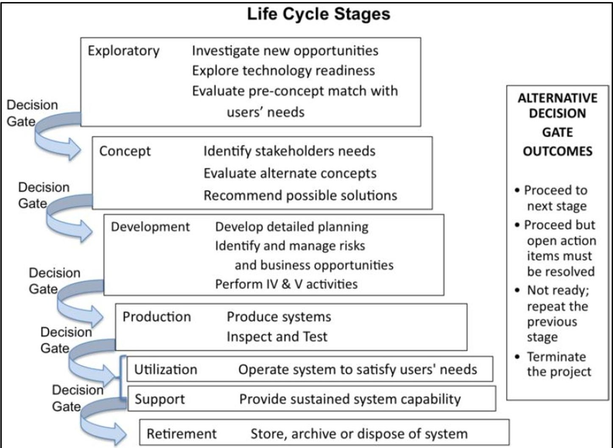

Figure 2.1. System lifecycle stages and decision gates (ISO/IEC/IEEE 15288, SEBoK).

Each stage, exploratory, concept, development, production, utilization, support, and retirement, supports a structured evaluation of system maturity and alignment with user needs. The decision gate mechanism ensures accountability, allowing for the resolution of critical issues or even project termination if necessary. In aerospace programs, this gate-based structure facilitates the early detection of integration risks and promotes disciplined progression between development phases.

To operationalize these stages, ISO/IEC/IEEE 15288 defines over 30 lifecycle processes, grouped into four domains. These include core technical processes, such as defining stakeholder needs and requirements, architectural design, system analysis, and validation, which form the basis of engineering development. Supporting these are technical management processes, including risk management, decision analysis, and project planning, which coordinate execution and mitigate lifecycle uncertainties.

<!-- PDF_PAGE: 46 -->

Figure 2.2 illustrates this classification, emphasizing the distinction between engineeringfocused activities, organizational enablers, and acquisition-related processes.

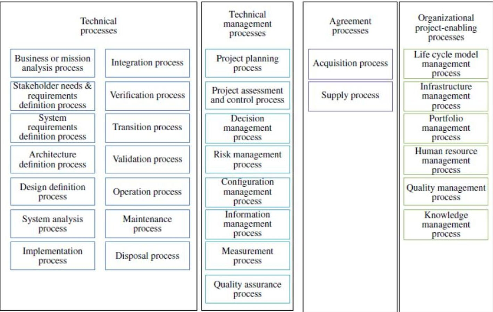

Figure 2.2. Classification of system lifecycle processes per ISO/IEC/IEEE 15288.

This structure enables engineers to scale and adapt systems engineering practices according to mission scope, system complexity, and regulatory requirements. In practice, small satellite programs may prioritize lean, flexible processes, whereas defense projects typically mandate strict compliance with all ISO/IEC/IEEE 15288 lifecycle elements. The standard also promotes iterative refinement, allowing for process revisions in response to evolving technical feedback or stakeholder input.

By formalizing lifecycle phases and process types, ISO/IEC/IEEE 15288 facilitates the development of model-based approaches, such as SysML-driven Model-Based Systems Engineering (MBSE). These methods enable the integration of behavioral models, process logic,

<!-- PDF_PAGE: 47 -->

and traceability data within a shared modeling framework, as further detailed in the following subsection.

## 2.1.2 Model-Based Systems Engineering (MBSE) Concepts and Benefits

Model-Based Systems Engineering (MBSE) was introduced to address the growing challenges posed by system complexity, integration across disciplines, and extended development timelines. Conventional systems engineering (SE) approaches offer a well-defined structure but often rely heavily on static documentation and disjointed artifacts. These limitations make it more challenging to accommodate evolving requirements, ensure traceability, and validate design decisions in the early phases. MBSE offers an alternative by utilizing modeling languages and integrated tools to organize requirements, behaviors, constraints, and architecture in a unified digital format (INCOSE, 2020).

Shifting from a document-based approach, MBSE prioritizes model-generated artifacts as the main source of system information. This approach enhances transparency across development teams, facilitates simultaneous work across subsystems, and promotes effective technical communication through consistent and structured visuals (Madni & Sievers, 2018). The modeling approach aligns with ISO/IEC/IEEE 15288 lifecycle guidance, helping teams carry out requirements analysis, system definition, integration, and verification with traceability throughout. This structured modeling becomes especially important in space missions, where tight timelines and strict interface control demand coordinated, model-based analysis (Holt & Perry, 2013).

Figure 2.3 outlines how stakeholder needs are translated into system definitions through lifecycle processes. This flow reinforces MBSE's focus on connecting stakeholder input, technical activities, and system outcomes. Model-based engineering thus provides a robust method to manage complexity while enhancing collaboration, visibility, and lifecycle control.

<!-- PDF_PAGE: 48 -->

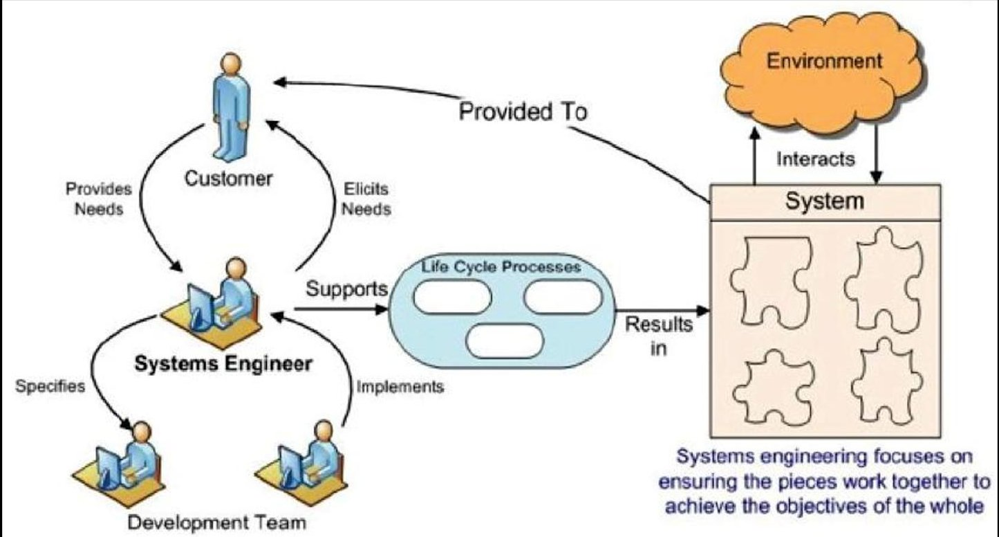

Figure 2.3. Key elements of Systems Engineering (Pyster & Olwell, 2013).

MBSE strengthens model application across various system layers by introducing structured validation earlier in the process. Unlike traditional approaches, where verification occurs near the end, MBSE supports early testing, model execution, and analysis for system consistency. As illustrated in Figure 2.4, the V-model helps relate development tasks to their respective verification activities. $ ^{7} $ By embedding behavioral and architectural models, MBSE reduces integration issues and enables informed decisions throughout development using iterative, stage-specific evaluation.

<!-- PDF_PAGE: 49 -->

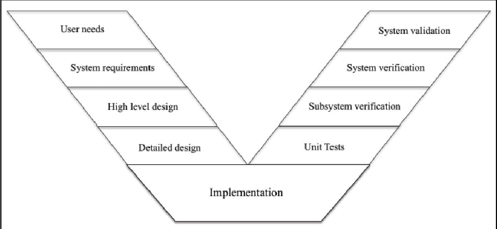

Figure 2.4. Systems Engineering Process (V-Model) (Forsberg & Mooz, 1999).

Across development stages, MBSE enhances interface management, functional flow allocation, and system structure definition. During testing and verification, it facilitates traceability and supports automatic validation through integrated checks. Reusable modeling assets and compatibility with simulation tools improve model efficiency and facilitate cross-domain coordination (Nonsiri, 2015).

In aerospace programs, characterized by evolving objectives and geographically distributed teams, MBSE helps maintain model integrity and manage changes with precision. Engineers can represent the system's purpose, expected behavior, evaluation criteria, and qualification plans within the model environment. This approach supports lifecycle documentation and enables detailed preparation for certification, aligning system functionality with verification evidence from early design through final delivery.

## 2.1.3 The Role of SysML in MBSE

The Systems Modeling Language (SysML) plays a foundational role in enabling Model-Based Systems Engineering (MBSE) by providing a standardized visual modeling syntax tailored for system architecture, behavior, structure, requirements, and constraints. Developed as a UML profile, SysML expands beyond software modeling to represent hardware, humans, and other physical entities essential to complex systems (OMG, 2017).

<!-- PDF_PAGE: 50 -->

SysML supports diverse viewpoints through nine diagram types grouped into four primary categories: structure, behavior, requirements, and parametrics. Figure 2.5 shows the hierarchical classification of these diagram types, each supporting different aspects of the system specification and lifecycle alignment (No Magic, 2022). For example, Block Definition Diagrams (BDDs) and Internal Block Diagrams (IBDs) are used to describe static structure and internal interactions. In contrast, Activity, Sequence, and State Machine diagrams describe dynamic behaviors across operational scenarios.

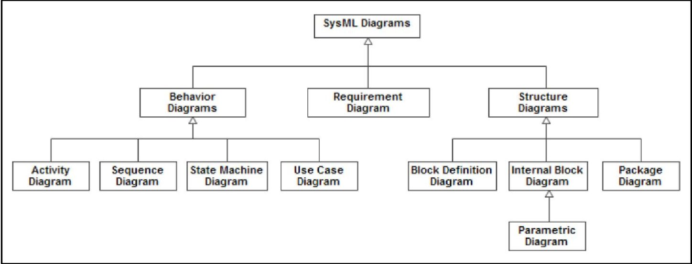

Figure 2.5. SysML diagram categories supporting MBSE (No Magic, 2022).

The modeling constructs in SysML facilitate traceability across stakeholder needs, functional behavior, logical structure, and verification procedures. As shown in Figure 2.6, each diagram type conveys a specific modeling aspect; requirements diagrams capture formalized stakeholder needs, parametric diagrams represent system constraints and analytical expressions, and structural diagrams define system composition and interfaces. In contrast, behavioral diagrams illustrate system dynamics, control logic, and operational workflows (Nonsiri, 2015). Together, these diagrams allow systems engineers to simulate, validate, and iterate system logic in a digital environment before committing to implementation.

<!-- PDF_PAGE: 51 -->

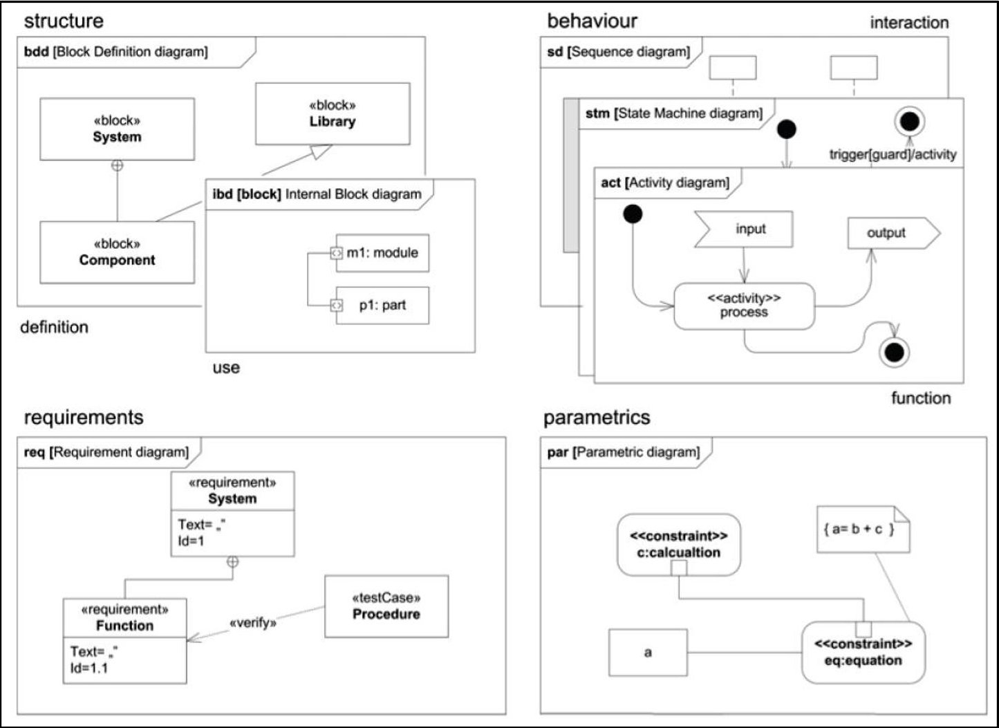

Figure 2.6. SysML views for structure, behavior, requirements & constraints (Nonsiri, 2015).

The expressiveness of SysML contributes directly to MBSE by serving as a shared modeling language across multidisciplinary teams. It enhances model clarity, supports tool interoperability, and ensures alignment with formal lifecycle frameworks such as ISO/IEC/IEEE 15288 and the V-Model. Through this standardized syntax, SysML helps bridge the gap between conceptual design and system verification, enabling digital continuity throughout the system development lifecycle.

## 2.1.4 SE Methodologies and Toolchain Challenges

Systems engineering (SE) methodologies provide the foundational logic and repeatable structures necessary for managing complexity in the design and deployment of technical systems. These methodologies encompass diverse approaches, from structured waterfall models to iterative, model-based paradigms, each optimized for varying project constraints, stakeholder needs, and regulatory contexts. A widely accepted framework in classical SE practice is the "PMTE" model,

<!-- PDF_PAGE: 52 -->

which delineates the critical interaction between Process, Methods, Tools, and Environment, while recognizing the boundary influences of Technology and People (Martin, 2020). $ ^{8} $

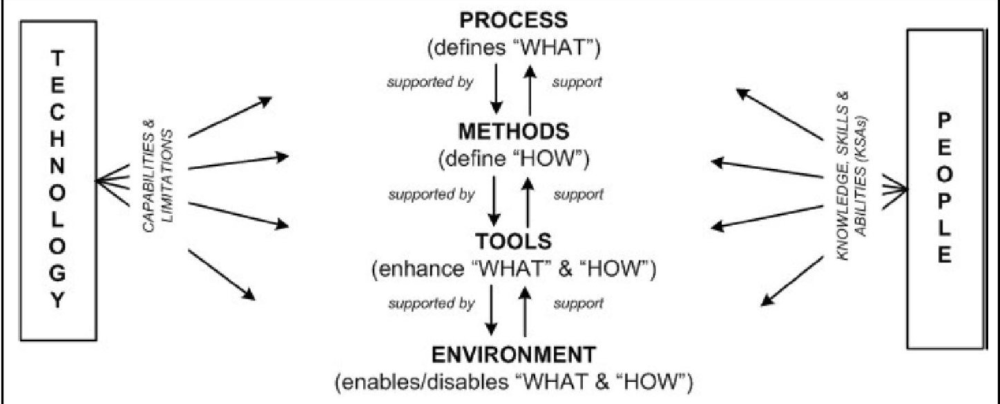

Figure 2.7. PMTE model linking framework (Martin, 2020).

Figure 2.7 illustrates how the PMTE structure serves as a diagnostic and planning framework, where the "Process" element defines what must be achieved, "Methods" prescribe how to approach the work, "Tools" enhance capability and automation, and the "Environment" either enables or constrains performance. These internal elements are supported, or limited, by two external dimensions: technology (in terms of capabilities and limitations) and people (in terms of skills, knowledge, and experience). For aerospace applications, where system dependability and traceability are critical, an unbalanced PMTE configuration often results in systemic delays, tool redundancy, or insufficient verification rigor.

<!-- PDF_PAGE: 53 -->

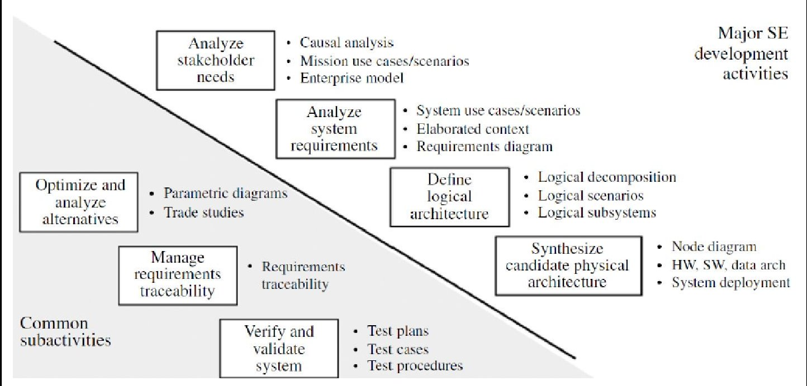

Figure 2.8. OOSEM activities and key SE development steps (INCOSE, 2015).

A complementary view is provided by the Object-Oriented Systems Engineering Method (OOSEM), which integrates the iterative spirit of software engineering with SE principles. OOSEM introduces scenario-driven analysis, continuous architecture refinement, and modelbased traceability as core development strategies. Figure 2.8 highlights the alignment between major SE development activities, such as requirement elicitation, logical architecture synthesis, and verification planning, and the modeling artifacts that support these tasks, including use case models, parametric trade studies, and test plans (INCOSE, 2015). This method emphasizes that reusing modeling artifacts across abstraction levels not only improves consistency but also helps mitigate risks associated with fragmented documentation.

<!-- PDF_PAGE: 54 -->

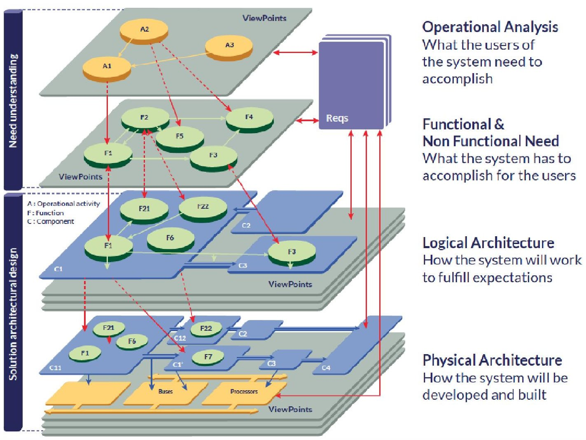

Figure 2.9. Arcadia's approach from needs to physical architecture (Capella, 2024).

The Arcadia method offers a structured, viewpoint-based architecture development process that organizes system understanding into distinct layers, encompassing operational use, functional needs, and technical design. As illustrated in Figure 2.9, its phase-based progression facilitates a clear flow from stakeholder goals to system architecture, promoting traceability and architectural consistency across abstraction levels.

However, implementing such model-driven strategies often presents integration difficulties within the PMTE framework. Aerospace projects frequently struggle with tool mismatches, isolated data environments, and inconsistent versioning, which can limit the effectiveness of end-to-end modeling. In addition, the successful application of advanced methods, such as behavioral simulation, digital twins, or model-based testing, relies heavily on skilled users and organizational readiness. Thus, when choosing modeling approaches and toolsets, it is essential to consider not only technical scope and resource constraints but also institutional maturity, which highlights the

<!-- PDF_PAGE: 55 -->

PMTE framework's role in guiding systemic compatibility and capability development in contemporary systems engineering.

## 2.2 SYSTEMS ENGINEERING CHALLENGES IN AEROSPACE DOMAINS

Modern aerospace systems are increasingly characterized by complexity, interdependence, and evolving operational contexts. In such environments, systems engineering (SE) serves as a foundational discipline that orchestrates the conception, design, integration, and validation of systems. The formalized principles of SE provide structured approaches to manage technical risk, interface coordination, and stakeholder alignment throughout the system lifecycle (Sage, 1998; INCOSE, 2015). The SEBoK framework offers a widely accepted knowledge base for systems engineering concepts, supporting consistency in MBSE applications across aerospace domains (The Trustees of the Stevens Institute of Technology, 2024).

Traditionally, SE emphasizes system decomposition, iterative development, and rigorous lifecycle control. These approaches have proven effective in aviation, defense, and space sectors, particularly in managing high-consequence engineering environments. However, aerospace programs increasingly involve complex adaptive systems (CAS), including modular small satellites, multi-mission platforms, and hybrid uncrewed aerial vehicles. These systems often exhibit dynamic behaviors and cross-disciplinary dependencies that exceed the capacity of conventional document-driven SE (Ring & Madni, 2005). Recognizing this evolution, Sheard (1996) proposed a typology of twelve distinct SE roles, ranging from requirements owners to process engineers. This role-based framing reveals not only the breadth of SE practice but also its vulnerability when implementation lacks cohesion or fails to adapt to emergent needs. Similarly, Wasson (2015) introduced elemental decomposition techniques to enhance design traceability; however, these may also prove insufficient without digital or model-based augmentation.

<!-- PDF_PAGE: 56 -->

In response to escalating system-of-systems complexity, Dahmann et al. (2011) argue for a more modular and model-enabled SE framework. This aligns with recent calls to transition from static architecture to more flexible, interoperable systems that support rapid iteration and stakeholder co-design. Siddique (2024) further emphasizes that emerging small satellite architectures are increasingly incorporating modular payloads, AI-based decision nodes, and adaptive power subsystems, thereby reinforcing the need for frameworks that are both flexible and digitally synchronized. These needs are particularly acute in aerospace contexts, where last-minute integration failures, often stemming from unclear requirements, poor validation strategies, or insufficient stakeholder modeling, can jeopardize entire development efforts. While SE provides the foundational scaffolding to manage lifecycle processes, traditional practices often lack the digital thread required for real-time feedback, multi-domain modeling, and integration agility. As a result, many aerospace programs are transitioning toward model-based systems engineering (MBSE) to overcome documentation bottlenecks and enable synchronized, traceable development workflows.

<!-- PDF_PAGE: 57 -->

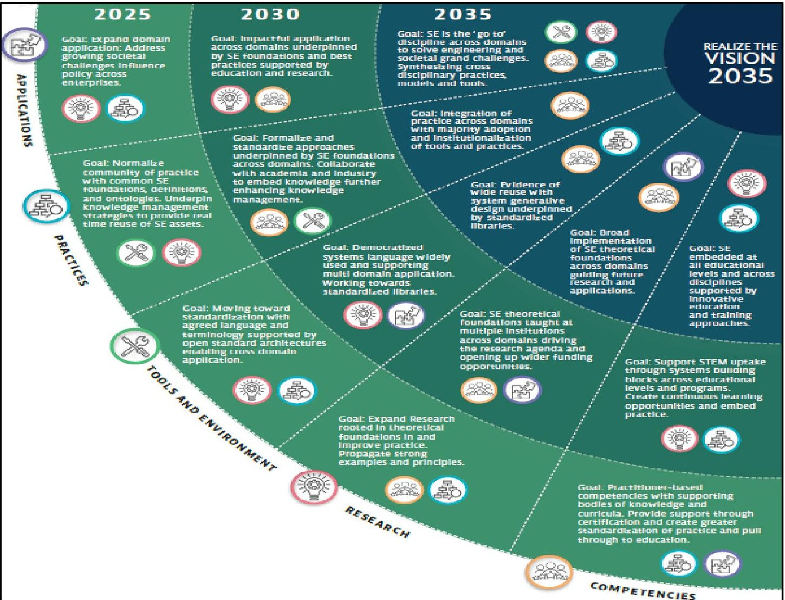

Figure 2.10. INCOSE Vision 2035 Roadmap for SE Transformation. $ ^{9} $

INCOSE's 2035 vision illustrates the anticipated evolution of systems engineering from document-based practices to model-centric and digitally integrated approaches. Emphasis is placed on lifecycle traceability, stakeholder co-design, and system-of-systems adaptability across increasingly complex engineering environments (INCOSE, 2020).

Recent evidence confirms that while traditional SE remains foundational, it often struggles to meet the demands of highly complex, multidisciplinary systems without digital augmentation (Henderson & Salado, 2021). Analyses of Department of Defense (DoD) environments further reveal that although MBSE adoption is increasing, full implementation is frequently hindered by

<!-- PDF_PAGE: 58 -->

entrenched legacy practices, tool complexity, and unclear return on investment, underscoring the need for phased, role-aware transition strategies (Assef & Geiger, 2023).

The next section explores how MBSE extends SE principles into executable modeling frameworks, offering enhanced traceability, interdisciplinary collaboration, and system validation, all essential to the digital transformation of aerospace systems.

## 2.2A FUNDAMENTALS OF REQUIREMENTS ENGINEERING $ ^{10} $

Requirements Engineering (RE) involves the disciplined handling of system needs, capturing, documenting, verifying, and organizing them to align with stakeholder goals throughout the development process. A requirement represents a specific function or condition that a system must fulfill in order to function properly. In contrast, the requirements specification is a structured document that consolidates individual needs and aligns them with defined quality standards. RE applies to both hardware and software systems, especially in socio-technical and cyber-physical environments, where it also considers human roles and ecological interfaces.

Figure 2.2A.1 presents a conceptual view of RE, illustrating the continuous and interconnected flow of its core processes: gathering, formalizing, assessing, and managing requirements. It summarizes the high-level lifecycle relationships among RE tasks and their evolving roles across development stages.

<!-- PDF_PAGE: 59 -->

## Requirements Engineering

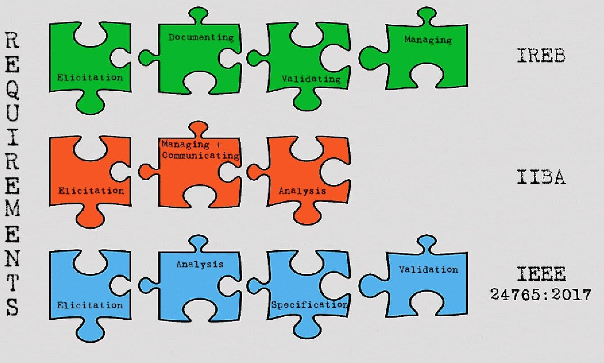

Figure 2.2A.1. Overview of Requirements Engineering.

Nine principles outlined by the International Requirements Engineering Board (IREB) define the foundational values of the discipline. These include value orientation, stakeholdercentric focus, shared understanding, contextual awareness, differentiation of problems, requirements & solutions, validation, requirement evolution, innovation, and the need for disciplined execution. This framework formalizes RE principles to guide practice across domains and project types.

<!-- PDF_PAGE: 60 -->

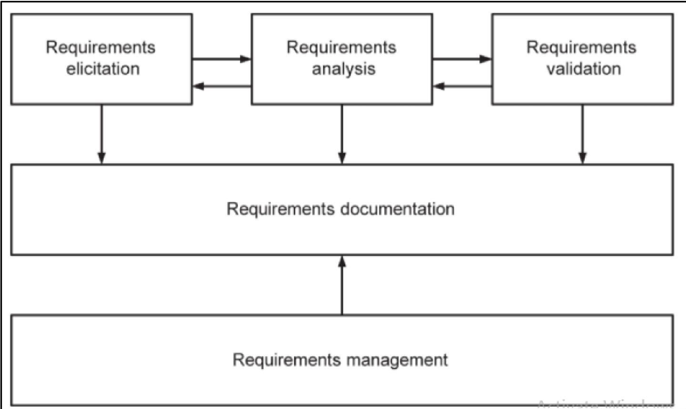

Figure 2.2A.2. IREB Framework for Requirements Engineering.

Stakeholder engagement remains central to RE activities, drawing information from individuals, legacy documents, and interfacing systems. Figure 2.2A.3 categorizes elicitation techniques ranging from direct questioning and collaborative workshops to observation, artifact analysis, and creative methods such as prototyping and scenario modeling. It classifies elicitation methods based on stakeholder involvement and system context.

<!-- PDF_PAGE: 61 -->

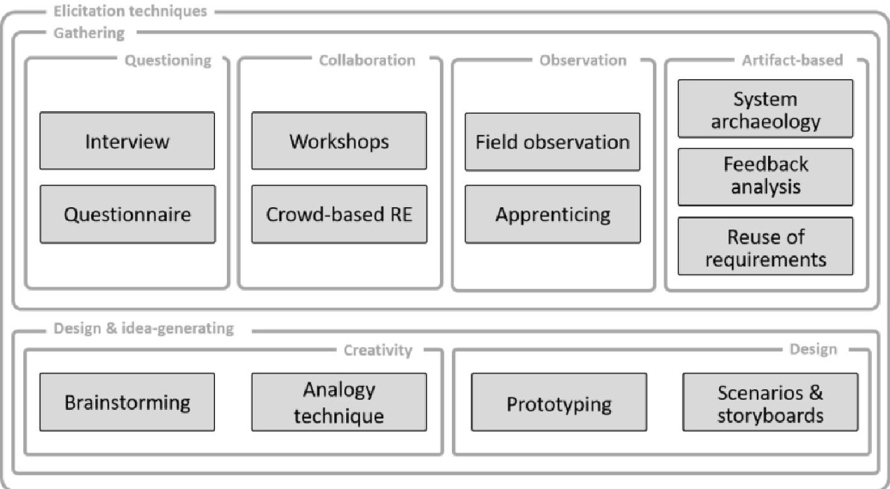

Figure 2.2A.3. Elicitation Techniques in Requirements Engineering (IREB).

A structured model for understanding user satisfaction, known as the Kano Model, segments requirements into delighters (unconscious differentiators), satisfiers (explicit desires), and dissatisfiers (basic expectations). This model informs prioritization and helps distinguish critical from value-added system features. It maps feature types to their influence on user satisfaction and product acceptance.

<!-- PDF_PAGE: 62 -->

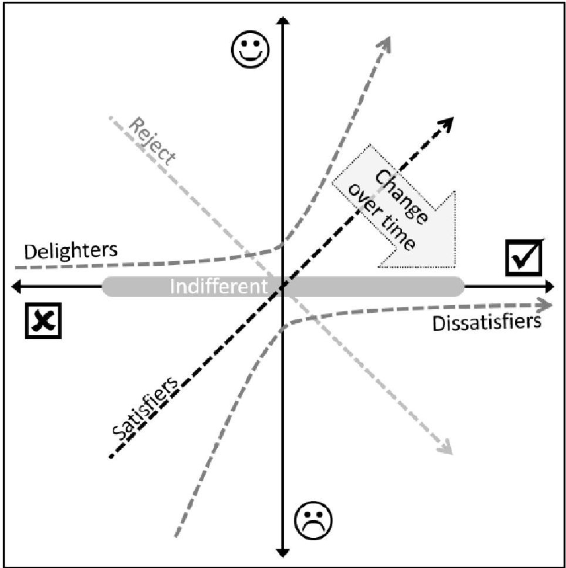

Figure 2.2A.4. The Kano Model for Feature Classification (IREB).

Validation mechanisms ensure that documented requirements are correct, complete, and feasible. Techniques range from formal inspections and informal walkthroughs to exploratory validation through prototypes and real-user alpha/beta testing. Effective validation reduces defects, fosters stakeholder trust, and informs downstream verification activities.

Requirements management addresses traceability, evolution, and control of requirement changes over time. Figure 2.2A.5 presents the requirements lifecycle as a state chart, highlighting transitions from elicitation through implementation and eventual retirement. It visualizes the evolution of requirements from origin to decommissioning.

<!-- PDF_PAGE: 63 -->

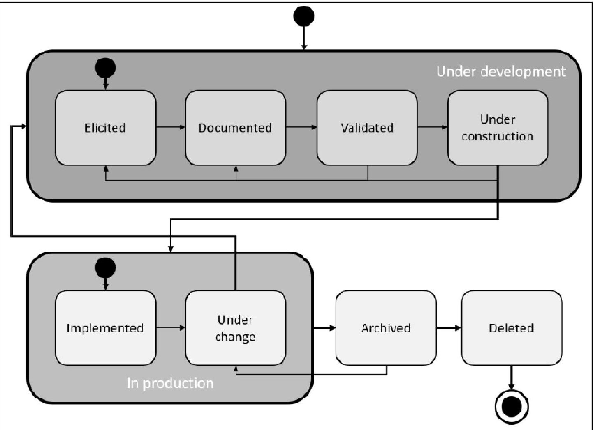

Figure 2.2A.5. Requirements Lifecycle State Chart (IREB).

Clear connections between what a system must do and how it is built are essential throughout development. Traceability helps teams link original needs to the components and tests that address them. As shown in Figure 2.2A.6, this includes both forward links, from a requirement to its related design or code, and backward links, from implementation artifacts back to the stated goals. Maintaining these links allows engineers to track changes, verify coverage, and support decisions based on traceable evidence.

<!-- PDF_PAGE: 64 -->

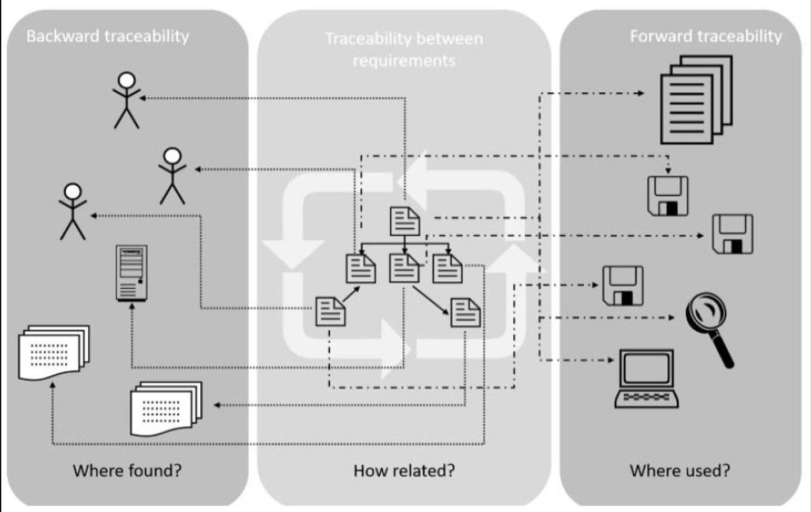

Figure 2.2A.6. Types of Requirements Traceability (IREB).

RE process configuration varies depending on project scale, customer involvement, and development model. Three common configurations include participatory (iterative, stakeholder-driven), contractual (formal, plan-driven), and product-oriented (agile, market-focused) processes. These options are depicted in Figure 2.2A.7. It maps process types to development contexts for tailored RE execution.

<!-- PDF_PAGE: 65 -->

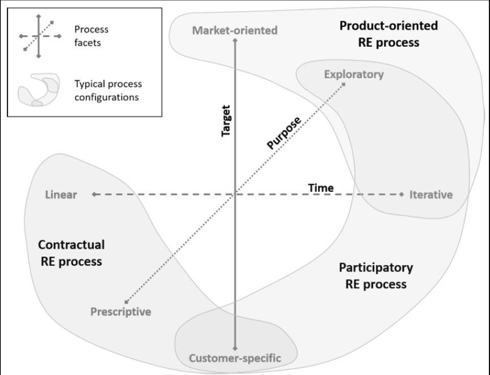

Figure 2.2A.7. Process Configuration in Requirements Engineering (IREB).

RE tools play an essential role in lifecycle management, version control, change tracking, and stakeholder collaboration. Table 2.2A.1 presents the performance of various RE tools across elicitation, analysis, specification, modeling, verification & validation, management, and traceability features. Global scores reflect the tools' overall conformance to ISO/IEC TR 24766, based on their performance across evaluated categories (Juan, 2011).

<!-- PDF_PAGE: 66 -->

Table 2.2A.1. Example of Comparative Assessment of RE Tools (IEEE Software).

<table border="1"><tr><td>Tool</td><td>Vendor</td><td>Elicitation</td><td>Analysis</td><td>Specification</td><td>Modeling</td><td>Verification&amp; validation</td><td>Management</td><td>Traceability</td><td>Other tool capabilities</td><td>Global</td><td>Price range(single seat)</td></tr><tr><td>Rational RequirementsComposer</td><td>IBM Rational</td><td>+</td><td>+</td><td>+</td><td>0</td><td>n/a</td><td>0</td><td>+</td><td>+</td><td>n/a</td><td>SSSS</td></tr><tr><td>RTIME</td><td>QAvantage</td><td>++</td><td>+</td><td>+</td><td>0</td><td>++</td><td>+</td><td>+</td><td>+</td><td>+</td><td>SS</td></tr><tr><td>Rational RequisitePro</td><td>IBM Rational</td><td>n/a</td><td>+</td><td>+</td><td>-</td><td>n/a</td><td>0</td><td>+</td><td>n/a</td><td>n/a</td><td>SSSS</td></tr><tr><td>RMTrak</td><td>Prometeo Technologies</td><td>0</td><td>-</td><td>-</td><td>--</td><td>+</td><td>-</td><td>0</td><td>-</td><td>-</td><td>SS</td></tr><tr><td>Rommana</td><td>Rommana Software</td><td>+</td><td>+</td><td>0</td><td>0</td><td>n/a</td><td>0</td><td>n/a</td><td>n/a</td><td>n/a</td><td>SSSS</td></tr><tr><td>SpiraTeam</td><td>Inflectra</td><td>++</td><td>0</td><td>0</td><td>--</td><td>+</td><td>0</td><td>0</td><td>++</td><td>0</td><td>S</td></tr><tr><td>TestTrack RM</td><td>Seapine Software</td><td>+</td><td>++</td><td>+</td><td>-</td><td>+</td><td>+</td><td>0</td><td>+</td><td>+</td><td>n/a</td></tr><tr><td>TopTeam Analyst</td><td>TechnoSolutions</td><td>+</td><td>0</td><td>+</td><td>+</td><td>0</td><td>++</td><td>++</td><td>+</td><td>+</td><td>SSSS</td></tr><tr><td>TraceCloud</td><td>TraceCloud</td><td>+</td><td>+</td><td>++</td><td>+</td><td>++</td><td>++</td><td>+</td><td>++</td><td>+</td><td>S</td></tr><tr><td>TrackStudio</td><td>TrackStudio</td><td>+</td><td>++</td><td>-</td><td>-</td><td>+</td><td>0</td><td>0</td><td>0</td><td>0</td><td>S;°</td></tr><tr><td>VisibleThreadOn-premise/On-demand</td><td>VisibleThread</td><td>++</td><td>0</td><td>++</td><td>+</td><td>n/a</td><td>n/a</td><td>n/a</td><td>n/a</td><td>n/a</td><td>SSSS</td></tr></table>

* For the scores, ++ = very high, + = high, 0 = medium, - = low, and - = very low. For prices, $$$$ > $1,000, $$$$ > $501-$1,000, $$$$ = $100-$500, and $ < $100, free = *, free version available with limitations = *, n/a = not applicable.

Agile Requirements Engineering adapts traditional RE practices to iterative environments by emphasizing collaboration, continuous refinement, and outcomes-driven development. Agile values, individual interaction, working systems, collaboration, and responsiveness, shift RE from upfront definition to incremental discovery. Figure 2.2A.8 illustrates the focus shift in Agile RE, aligning feature development with stakeholder value rather than fixed release metrics. It reorients RE priorities toward stakeholder-centric development cycles.

<!-- PDF_PAGE: 67 -->

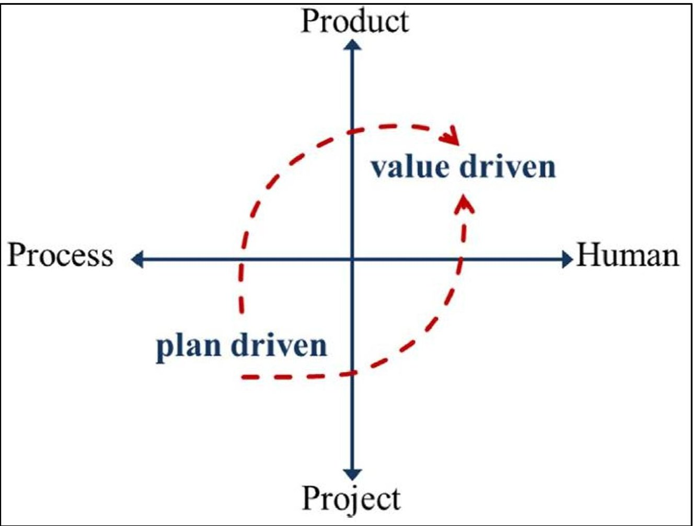

Figure 2.2A.8. Agile Outcomes-Focused Requirements Engineering (Schon, 2017)

## 2.3 MBSE IN AEROSPACE APPLICATIONS

## 2.3.1 MBSE Foundations and Frameworks in Aerospace

Model-based systems engineering (MBSE) has been increasingly adopted in the aerospace industry as a means to address the growing complexity of modern systems. Instead of relying solely on documents, MBSE emphasizes formal modeling, grounded in systems engineering standards such as DoD Instruction 5000.88 (2020), to improve lifecycle visibility and coordination. The U.S. Department of Defense (2018) highlighted MBSE as central to its Digital Engineering Strategy, emphasizing the importance of utilizing validated digital models as a foundation for analysis and decision-making throughout development and acquisition, with subsequent studies (Wenyue et al., 2022) confirming that MBSE improved coordination and stakeholder validation in aerospace projects.

<!-- PDF_PAGE: 68 -->

One framework proposed to guide MBSE implementation is the MBSE Grid by Morkevicius et al. (2017), which organizes modeling activities to ensure traceability and model consistency. $ ^{11} $ Its structured layout has helped engineers move from ad hoc practices to more methodical approaches across project stages. Scalability remains a frequent concern. Estefan (2008) observed that not all MBSE strategies are suitable for every system size. Coordination challenges frequently arise when toolchains are mismatched, or modeling semantics are misaligned.

In practical terms, MBSE has proven useful for small satellite programs. Siddique (2024) pointed out that modularity and traceability, two recurring challenges, can be more effectively managed through model-driven design, particularly when schedules are tight and multidisciplinary inputs must converge quickly. Akundi et al. nonetheless argue that widespread variation in how MBSE is defined and used. Some organizations struggle with inconsistent application usage across the entire lifecycle. Others face gaps in training or resistance to adopting the tool.

For MBSE to support modern digital convergence, access to synchronized repositories and cohesive tool environments is necessary. These infrastructures enable collaboration and help maintain traceability, particularly when multiple teams work on complex, interrelated systems.

## 2.3.2 Sector-Specific Implementations

Evidence of MBSE's operational maturity can be found in several aerospace applications. One early example is the CubeSat project described by Spangelo et al. (2012), which applied SysML to support simulation-led design, requirement structuring, and conceptual traceability. Their study offered one of the initial end-to-end MBSE frameworks for small satellites,

<!-- PDF_PAGE: 69 -->

demonstrating tangible advantages of model-driven engineering in constrained design environments.

Further insights are provided by Bruggeman and La Rocca (2023), who examined the use of MBSE in aircraft programs. Their findings emphasized the importance of digital workflow alignment, particularly in cases where evolving specifications necessitate structured updates to product models. This use of MBSE highlights how practical, domain-specific implementations are replacing earlier conceptual applications.

The Mars Ascent Vehicle project provides another example. Rountree (2022) discussed how MBSE was incorporated into propulsion and payload coordination, using model synchronization to inform test procedure development. In parallel, Bendarkar et al. (2023) explored MBSE's contribution to early regulatory validation processes, extending its use into certification and compliance efforts.

Earth observation missions have also benefited. As Denis et al. (2020) emphasize, increased design volatility and compressed lifecycles make model-centric strategies vital for managing uncertainty and reducing late-stage integration risk. Other advancements, such as machine learning-enabled autonomy, further underscore MBSE's role in anomaly detection and adaptive mission control (Ferreira et al., 2019).

Despite these gains, several limitations persist. Valerdi and Davidz (2009) pointed to difficulty in quantifying MBSE's return on investment and sustaining stakeholder alignment, especially in layered organizations. For adaptive and critical systems, such challenges highlight the need for context-specific modeling approaches. Recent work by Pratt and Dabkowski (2022) linked MBSE adoption to expectations of usability, perceived value, and organizational readiness, factors that often require deliberate training programs and strategic change leadership.

<!-- PDF_PAGE: 70 -->

## 2.3.3 Integration with Agile, Concurrent, and Cyber-Physical Development

Recent shifts in aerospace system design have brought attention to Agile development, collaborative engineering, and cyber-physical integration, areas where MBSE continues to gain relevance. Krupa (2019) developed a lightweight Agile MBSE framework for early aircraft design that merges stakeholder input, iterative models, and rapid prototyping. These practices are wellsuited for high-speed aerospace programs that rely on distributed, cross-functional teams.

In a related effort, Bussemaker et al. (2023) demonstrated through the AGILE 4.0 project how MBSE can merge digital and physical elements. $ ^{12} $ Their work shows how remote teams collaborate on system models and validate them with physical prototypes, using synchronized simulations and feedback loops.

To support such integration, Shevchenko (2021) emphasized the need for MBSE workflows that adapt to shifting needs. She highlighted version control and automated validation as essential for maintaining model consistency throughout evolving project phases. In aerospace environments, where legacy systems, dispersed operations, and dynamic stakeholder inputs are common, these mechanisms provide needed stability and help sustain engineering coherence over time.

## 2.3.4 Requirements Engineering and Synchronized Prioritization

MBSE's effectiveness is closely tied to how well it integrates requirements engineering (RE) practices. Holt et al. (2014) developed a model-based RE framework for Systems of Systems, offering scalable modeling patterns to handle variability, interface mismatches, and system dependencies. Their approach aligns with the growing interest in enhancing early lifecycle validation, particularly in high-dependency systems such as aircraft and spacecraft.

<!-- PDF_PAGE: 71 -->

Recent work by Washio et al. (2023) and Ji et al. (2023) demonstrates that embedding requirements prioritization directly into SysML models allows early detection of contradictions inconsistent assumptions, and traceability gaps. This model-synchronized prioritization becomes especially valuable for aerospace missions operating under uncertainty, as it provides a structured mechanism for managing trade-offs and mitigating cascading design failures.

Fazal et al. (2024) proposed incorporating uncertainty quantification (UQ) into MBSE to address variable operational contexts and system robustness. When integrated with model-based prioritization, UQ enables designers to assign confidence weights and scenario-based risk profiles directly within the SysML environment.

Collectively, these developments reveal that MBSE alone is insufficient without embedded RE strategies that accommodate change, prioritize critical needs, and ensure testability. This thematic interconnection prepares the foundation for the next section, which focuses on structured prioritization methods suitable for adaptive aerospace systems.

## 2.3.5 MBSE Implementation in CubeSat and Small Satellite Projects

The application of MBSE in small satellite missions, especially CubeSats, represents a critical advancement in extending model-centric engineering to resource-constrained and modular aerospace platforms. As CubeSat programs prioritize rapid development, limited volume, and multidisciplinary coordination, MBSE offers an integrated solution for managing complexity, ensuring traceability, and synchronizing design and verification workflows. The rise of small satellite platforms has fundamentally reshaped space economics and mission design agility, creating new incentives for MBSE-driven architectural planning in low-cost, rapid deployment contexts (Sweeting, 2018).

<!-- PDF_PAGE: 72 -->

Spangelo et al. (2012) pioneered the use of SysML-based modeling in CubeSat mission architecture, emphasizing end-to-end requirement traceability, functional decomposition, and early validation. Their study highlighted how model-based techniques could replace fragmented documentation and encourage coherent systems thinking from mission conception through deployment.

Cordero et al. (2022) further demonstrated MBSE's role in early-phase CubeSat design, proposing a concurrent engineering framework that integrates electrical, mechanical, and software domains. Their work underscores the significance of synchronization across modeling layers, particularly in short-cycle missions with overlapping development phases. Applying MBSE in the conceptual design phase of small satellites not only streamlines interface definition and structural abstraction but also enhances consistency across stakeholder viewpoints (Guo et al., 2018). Similarly, Malik, Topolski, and Nguyen (2025) applied MBSE to guide the lifecycle development of a LEO satellite, ensuring alignment between stakeholder needs and validation plans through model-governed workflows.

Tailored MBSE approaches have become vital in small satellite development. Siddique (2025) analyzed MBSE adoption in small satellite missions and found that using SysML-based models significantly improves traceability, risk management, and stakeholder communication compared to traditional document-centric methods. This small-scale, fast-paced context demands flexible MBSE strategies that align modeling tools and workflows with agile team structures, precisely the kind of adaptation needed for the university-led CubeSat initiatives. NASA's Systems Engineering Handbook (2020) also supports this trajectory by encouraging model-based practices in small satellite projects, noting improvements in requirement stability, communication, and integration across subsystem teams.

<!-- PDF_PAGE: 73 -->

The collective findings confirm that MBSE is not only feasible but increasingly essential for CubeSat development. These applications provide a concrete link between digital engineering theory and small-scale aerospace practice, bridging the gap between industry-grade modeling principles and academic or low-cost mission contexts. This integration directly informs later chapters in this research, particularly the modeling strategy and validation framework applied in SidSat. Similarly, Herrera et al. (2019) presented the design and experimental testing of a 500 lbf LOX/methane engine, demonstrating the importance of model-supported workflows in propulsion system development, which parallels the traceability and validation strategies employed in SidSat.

## 2.4 REQUIREMENTS PRIORITIZATION IN COMPLEX ADAPTIVE SYSTEMS

## 2.4.1 Foundations of RE in Aerospace MBSE

The successful execution of aerospace projects hinges on rigorous Requirements Engineering (RE), which governs the elicitation, validation, and management of system requirements across the lifecycle. Glinz et al. (2020) underscore that RE is not limited to capturing technical specifications, it requires sustained stakeholder engagement to align requirements with mission objectives and regulatory compliance. In dynamic aerospace environments, particularly within Complex Adaptive Systems (CAS), requirements must remain both traceable and responsive to evolving operational conditions. These demands highlight the limitations of static documentation approaches and underscore the need for flexible, model-integrated RE strategies that can support system evolution, stakeholder co-design, and early verification.

Model-Based Systems Engineering (MBSE) augments the practice of RE by offering formal modeling techniques that reduce ambiguity and improve traceability across the design process. The integration of MBSE with RE is further advanced through domain-specific frameworks like the Requirements-Functional-Logical-Physical (RFLP) approach, which creates

<!-- PDF_PAGE: 74 -->

continuity from stakeholder intent to physical implementation. Swaminathan et al. (2023) demonstrate how this framework supports multidisciplinary design optimization (MDO), ensuring that early requirement decisions are mapped across functional and logical layers in aerospace systems.

Despite its benefits, the combination of RE and MBSE presents challenges in verification and validation (V&V). Bjarnason et al. (2014) found that companies frequently struggle to align requirements with V&V artifacts due to asynchronous documentation, communication gaps, and limited feedback loops. These gaps limit the utility of models as living documents and delay the ability to perform real-time verification during system evolution.

To address these concerns, Wheaton and Herber (2024) introduced a digital requirements engineering architecture built on a SysML meta-model aligned with INCOSE standards. Their approach creates tighter integration between requirement specifications and modeling platforms, thereby improving lifecycle consistency and enabling early-stage validation in digital environments. This is further supported by Salado's (2021) systems-theoretic framework, which systematically maps stakeholder needs into formal system-level requirements, enhancing robustness in projects characterized by ambiguous goals and operational variability.

## 2.4.2 Requirements Prioritization in Aerospace Context

Managing trade-offs among performance, cost, and risk is a persistent challenge in aerospace systems, especially when time and funding are limited. While requirement collection and modeling are foundational activities, prioritization is what often determines whether project goals remain aligned with evolving conditions. Conflicting stakeholder expectations, compressed timelines, and uncertain development paths demand more than intuitive choices.

<!-- PDF_PAGE: 75 -->

To address this, Khan (2006) analyzed various prioritization techniques, noting how informal methods often fall short in maintaining consistency. His review emphasized the need for transparent, reproducible strategies, such as pairwise ranking, weighted scoring, and structured matrices, that help teams separate mission-critical functions from lower-priority requests.

For agile and iterative development, these needs become more pronounced. Racheva et al. (2010) tackled this by proposing a client-centered approach that integrates ongoing feedback into each delivery loop. Their work underscored the importance of maintaining stakeholder visibility while preserving decision traceability.

Building on these ideas, Salado and Nilchiani (2015) introduced Adaptive Requirements Prioritization (ARP). This method adjusts requirement weights over time in response to changing mission needs, stakeholder re-evaluation, and operational shifts. Their model's ability to embed responsiveness into formal prioritization processes, while retaining audit trails, makes it especially suitable for aerospace programs with long lifecycles and complex risk profiles.

## 2.4.3 Requirements Prioritization in Complex Adaptive Systems

The rise of complex adaptive systems (CAS) in aerospace, including reconfigurable platforms, satellite swarms, and autonomous vehicles, adds a new layer of complexity to the prioritization of requirements. These systems are inherently dynamic, operating in environments where conditions shift rapidly and system configurations evolve in response. As a result, requirements in CAS must be designed not only to meet baseline objectives but also to adapt fluidly to external triggers, mission phase transitions, and emergent behaviors that arise from system interactions and environmental variability. Traditional static ranking or fixed requirement structures often prove inadequate under such conditions, prompting a need for responsive, contextaware prioritization frameworks.

<!-- PDF_PAGE: 76 -->

Yang, Li, and Jin (2017) emphasized the difficulty of modeling adaptive requirements using traditional RE methods. They proposed a thematic structure that captures requirement volatility through self-adjusting models capable of reflecting system-environment interactions. Such flexibility is critical in adaptive aerospace platforms where priorities can shift mid-mission due to external cues or internal reconfiguration.

Environmental modeling plays a central role in enabling this form of adaptability. Kneer, Kamsties, and Schmid (2020) conducted a systematic review of environment modeling for adaptive systems and concluded that existing RE tools often fall short in supporting dynamic, context-sensitive requirements. This limits the ability of system architects to foresee priority shifts or update requirements models without disrupting the architecture. Siddique (2024) identifies an inflection point in requirements engineering where integration with digital models, prioritization logic, and stakeholder adaptation is essential to address volatility and emergent behavior in complex adaptive systems.

## 2.4.4 Traceability, Verification, and Digital Thread Integration

As requirement models grow in complexity and adaptability, particularly within aerospace applications involving Complex Adaptive Systems (CAS), maintaining traceability becomes a pivotal enabler of system verification and validation. Traceability ensures that each requirement can be consistently linked to its origin, implementation, and test artifacts, allowing engineers to monitor changes and validate conformance across the lifecycle. Bjarnason et al. (2014) highlighted recurring obstacles in aligning requirements to test artifacts, particularly in environments with evolving stakeholder goals, heterogeneous toolsets, and cross-functional dependencies. These challenges are further magnified in iterative, model-driven contexts, where requirements evolve concurrently with design updates. Without robust traceability mechanisms embedded within the

<!-- PDF_PAGE: 77 -->

modeling environment, verification strategies may diverge from system realities, increasing the risk of oversight or non-compliance during final integration and deployment.

To resolve these gaps, digital integration must be embedded directly within the requirements prioritization workflow. Wheaton and Herber's (2024) model supports bidirectional traceability and simulation-based verification through an INCOSE-aligned SysML framework. Their approach enables early detection of requirement conflicts and facilitates downstream validation through digital threads. This direction also reinforces the importance of aligning prioritization logic with validation processes, laying the foundation for a model-integrated digital engineering strategy, as discussed in the next section.

## 2.4.5 Comparative Frameworks for Prioritization

As the complexity of aerospace applications increases, driven by modular architectures, stakeholder diversity, and evolving mission parameters, requirements prioritization (RP) becomes an indispensable activity. Selecting the "right" set of requirements to address first affects system architecture, verification planning, and long-term adaptability. Multi-Criteria Analysis (MCA) provides a foundational decision-making framework by explicitly accommodating multiple conflicting objectives, offering practical guidance that bridges overly technical and overly simplistic approaches (Dean, 2022). However, despite the critical role of RP in systems engineering, especially under a Model-Based paradigm, existing methods often fail to address domain-specific constraints, such as limited resources, tight schedules, interdependent functionalities, and dynamic operational contexts, which are commonly encountered in small satellite missions.

A foundational survey by Khan (2006) classified RP methods into value-based, cost-benefit, stakeholder-driven, and mathematical optimization techniques. While this categorization

<!-- PDF_PAGE: 78 -->

is comprehensive across industries, it often lacks aerospace-specific considerations such as lifecycle traceability, environmental sensitivity, and toolchain interoperability. Among the most widely used techniques, the Analytic Hierarchy Process (AHP) stands out for its structured pairwise comparisons and decision matrices. Formalized by Saaty (2008), AHP enables prioritization based on stakeholder-assigned relative importance. Despite its clarity, AHP assumes decision independence and struggles with scalability in high-dimensional systems, issues especially relevant in aerospace, where interdependencies and trade-offs dominate. The integration of AHP for criteria weighting and simple additive weighting (SAW) for alternative ranking has demonstrated practical effectiveness in generating consistent, decision-supportive outcomes across multi-criteria problems (Cahyapratama & Sarno, 2018).

To improve AHP's adaptability, Yuen (2014) introduced Least Penalty Optimization Operators to reduce prioritization bias when stakeholder inputs are inconsistent. Although this method improves robustness, it still relies on static input assumptions and lacks the flexibility to accommodate evolving mission needs. Building on this, Salado and Nilchiani (2015) developed Adaptive Requirements Prioritization (ARP), embedding feedback loops and conflict resolution mechanisms into the process. ARP aligns well with Complex Adaptive Systems (CAS), enabling iterative re-prioritization as missions evolve, an essential feature in long-duration, modular aerospace deployments.

Other hybrid approaches extend prioritization under uncertainty. Jawale et al. (2017) incorporated fuzzy logic into AHP using cumulative voting to account for stakeholder ambiguity and incomplete preferences. Their approach enhances resilience to vagueness but can be challenging to implement in regulated environments where transparency and validation are crucial. Similarly, Groen et al. (2017) proposed the Prioritization and Requirements Elicitation Synergy

<!-- PDF_PAGE: 79 -->

Tool and Ontology (PRESTO) framework, combining early stakeholder engagement with expert based scoring. PRESTO facilitates early consensus and reduces requirement volatility but lacks built-in support for system-level trade-offs or alignment with verification structures, necessitating integration with model-based traceability tools.

Goal alignment offers another avenue for prioritization. Elsood, Hefny, and Nasr (2014) proposed a goal-based RP method that maps requirements to high-level objectives, enhancing traceability. However, this approach may oversimplify multi-domain dependencies unless complemented by context-aware modeling frameworks such as SysML. Addressing probabilistic risk, Qazi et al. (2020) presented a decision model that uses Monte Carlo simulation and Bayesian reasoning to prioritize interdependent uncertainties. This method supports complex risk environments, common in the aerospace industry, but may be impractical in early-phase design due to its data and computational requirements.

Collectively, these methods represent a growing but uneven landscape of prioritization strategies. While the Analytic Hierarchy Process (AHP) remains widely favored for its transparency and structured comparisons, it struggles with interconnected decisions and does not scale well for high-complexity systems. More advanced techniques offer adaptability and higher fidelity but tend to increase implementation demands, such as requiring specialized training, computational tools, or a reduction in interpretability. In response to these trade-offs, Shirin et al. (2017) proposed a "balanced control" principle in networked systems, which optimizes between strict output precision and minimal control effort. This principle serves as an apt metaphor for prioritization in aerospace, where precision must often be balanced against resource and schedule limitations. Together, these insights emphasize the ongoing need for an aerospace-oriented prioritization framework, one that supports traceable integration with MBSE environments,

<!-- PDF_PAGE: 80 -->

manages evolving conditions, and accommodates stakeholder variation, all without compromising usability or compliance requirements.

## 2.5 DIGITAL INTEGRATION AND THE DIGITAL TRINITY

## 2.5.1 Foundations of Digital Engineering

Digital Engineering (DE) represents a foundational shift in how complex aerospace systems are conceived, developed, and sustained across their lifecycle. Originating from early computational modeling techniques such as digital circuit simulation (Kostopoulos, 1975), DE has evolved into a comprehensive engineering paradigm that integrates authoritative digital models and connected data into every phase of system development. This transformation was formally recognized in the U.S. Department of Defense's Digital Engineering Strategy (2018), which outlines five strategic goals aimed at improving engineering agility, communication, technical decision-making, lifecycle traceability, and system integration. These priorities align with the growing need for flexible, rapid-cycle, and cross-domain engineering in aerospace projects, where static, document-based processes cannot support modularity, reusability, and mission adaptability. As the scope and velocity of digital initiatives increase, scholars have also underscored the need for domain-wide clarity in defining the scope of Digital Engineering and differentiating it from overlapping fields such as Building Information Modeling (Hosseini et al., 2021). These foundational developments provide the basis for more integrated, traceable, and dynamic system development frameworks required in modern aerospace programs.

A core element of this digital transition is the emergence of what Roper (2021) defines as the Digital Trinity, an interconnected framework comprising Model-Based Systems Engineering

<!-- PDF_PAGE: 81 -->

(MBSE), Digital Thread, and Digital Twin practices. $ ^{13} $ These three elements form the foundation for an integrated digital environment that supports real-time traceability, model continuity, and adaptive feedback loops. MBSE, in particular, serves as the semantic and structural framework of the trinity. It enables formal specification of requirements, functions, behaviors, and interfaces using modeling languages such as SysML. Bone et al. (2019) highlighted that MBSE facilitates deeper alignment between engineering disciplines by promoting early validation, executable design artifacts, and traceable verification activities, especially critical in safety- and missioncritical aerospace contexts. This emphasis on traceability and verification forms a natural continuation from the challenges discussed in Section 2.4.4, where bidirectional traceability was shown to be essential in evolving requirement models.

While MBSE provides the structural layer, Digital Thread offers longitudinal continuity by linking artifacts, decisions, and datasets across the system's lifecycle. Its purpose is to maintain data coherence and contextual traceability, from conceptual design through production, testing, and operations. Zimmerman, Gilbert, and Salvatore (2019) described the digital thread as an enabler of transparency and decision traceability, helping stakeholders identify the upstream and downstream effects of any system change. In aerospace projects where requirements evolve and stakeholder goals shift dynamically, this capability is essential. The tight coupling between MBSE and the digital thread ensures that updates in system models automatically propagate across connected artifacts, creating a synchronized engineering environment. This directly reinforces the traceability-focused modeling workflows introduced in prior systems engineering literature (McDermott et al., 2022).

<!-- PDF_PAGE: 82 -->

The third dimension, the Digital Twin, extends the value of integrated modeling by creating a live, data-driven surrogate of the physical system. Unlike traditional simulations, which are typically one-off or static, digital twins continuously ingest sensor data and operational feedback to reflect the current state of the physical system. The digital twin paradigm proposed for future NASA and USAF programs underscores the critical need for synchronized system modeling and physics-based simulation environments (Glaessgen & Stargel, 2012). Tong, Bao, and Tao (2024) introduced the concept of Co-evolutionary Digital Twins (CoEDT), which dynamically adjust based on multi-dimensional feedback, enabling anomaly detection and adaptive planning. In practice, this means that a satellite in orbit can be monitored and analyzed via its digital twin, allowing ground operators to anticipate failures, reallocate resources, or adjust mission parameters in real-time. This real-time responsiveness is increasingly relevant in the context of complex adaptive aerospace systems, as discussed in Section 2.4.3, where mission conditions are fluid and reconfiguration may be necessary during operation.

The integration of these three components, MBSE, digital thread, and digital twin, forms a cohesive digital ecosystem where engineering becomes not just descriptive but also predictive and adaptive. As Bone et al. (2019) emphasized, such an approach transforms models into active participants in the engineering process, supporting continuous verification, stakeholder alignment, and lifecycle performance optimization. Trustworthy AI is emerging as a key enabler in digital engineering, supporting explainability and reliability in MBSE-integrated decision-making frameworks (Huang et al., 2021). However, implementing this trinity is not without challenges. The orchestration of toolchains, semantic alignment across platforms, and data synchronization remain critical barriers. These concerns are further explored in the following subsection, which addresses model integration and tool interoperability, focusing on how platforms such as Cameo,

<!-- PDF_PAGE: 83 -->

MATLAB, STK, Excel, and Teamcenter are being interconnected to realize the full potential of digital engineering in the aerospace industry. The CREATE/ERS initiative within the U.S. Department of Defense exemplifies this potential by using virtual prototyping and resilient engineering strategies to modernize acquisition, reduce design cycle times, and strengthen digital mission readiness (Post et al., 2019).

While the original "Digital Trinity" proposed by Roper (2021) emphasized digital engineering, digital thread, and digital twin as enablers of agile, software-centric defense acquisition, this dissertation reinterprets the concept to suit the academic context of systems modeling and decision support. Specifically, the proposed Digital Trinity for this study consists of Model-Based Systems Engineering (MBSE) as the structural modeling backbone, requirements prioritization as the decision-oriented analytical layer, and digital integration as the enabling mechanism for tool interoperability and lifecycle feedback. Together, these three pillars support the development of traceable, adaptive, and value-driven systems within the aerospace domain, aligning with the objectives of digital engineering while being tailored for academic applications.

## 2.5.2 Tool Interoperability and Model Integration

The shift from document-centric practices to model-based methods has enhanced system coherence, reusability, and the clarity of engineering artifacts. Nevertheless, these benefits are only fully realized when tools and data sources interact fluidly across domains. In aerospace programs, especially those involving modular small satellite architectures, models must integrate not only within their own development environment but also across simulation, testing, and performance evaluation tools. Achieving such integration demands more than just tool compatibility; it requires semantic alignment, consistent interface logic, and coordinated synchronization across distributed systems. Research in early-stage digital engineering has identified key enablers, such as toolchain

<!-- PDF_PAGE: 84 -->

integration, simulation-driven validation, and rapid feedback loops, as necessary conditions for aligning MBSE workflows with traditional systems engineering in evolving aerospace applications (Granados & Tseng, 2023). As the field matures, model integration has become a central element in realizing digital thread and digital twin concepts within MBSE environments, supporting traceability, responsiveness, and collaboration across engineering phases.

An applied integration case was demonstrated by Bickford et al. (2020), who linked MBSE artifacts with digital twin platforms to enable continuous updates between virtual and physical system states. Their work focused on automated traceability chains, linking high-level requirements to design, simulation variables, and feedback data. For aerospace missions where real-time responsiveness is crucial, this type of automation helps prevent outdated system states that could lead to errors or missed mission opportunities.

Despite growing tool support, interoperability remains a core challenge. Liu et al. (2021) identified semantic fragmentation as a recurring obstacle when linking tools such as Cameo, MATLAB/Simulink, STK, and Excel. Differences in schema structures and execution workflows create difficulties in maintaining data integrity and validating models across platforms. Dunbar et al. (2023) addressed this challenge with an ontology-based integration approach that aligns tool-specific model elements with a common semantic structure. This reduces translation errors and improves cross-platform communication, supporting model continuity across the system lifecycle. In related work, Ivo et al. (2023) emphasized the importance of managing interface abstraction and legacy integration when embedding cyber-physical components into modern MBSE workflows.

Co-simulation platforms offer an alternative pathway for effective integration. Gomes et al. (2017) reviewed several frameworks that enable time-synchronized execution of models from

<!-- PDF_PAGE: 85 -->

different domains. These solutions are particularly suited for aligning behavior models in SysML with dynamic simulations from MATLAB or STK. Co-simulation enables bidirectional communication, which is essential for verifying subsystem interactions under real-time or mission specific constraints. This is particularly crucial in projects such as small satellite missions, where system behavior must be verified both individually and in the context of broader mission operations.

Operationally, toolchain orchestration is an emerging area of practice. Flink et al. (2022) introduced the Remote Component Environment (RCE), enabling distributed workflows that span modeling, simulation, and reporting. Their platform incorporates tools such as Cameo, Python scripts, and Excel-based analytics, all configured within modular execution chains. The architecture supports custom workflows tailored to project-specific needs, allowing flexible design experimentation alongside structured validation. The approach enabled traceable updates and the reuse of outputs, supporting digital thread continuity without duplicating effort across tools or teams. This type of orchestration proves particularly useful in projects that require ongoing validation of architecture modifications across multi-tool environments.

Even with these advances, most solutions remain domain-specific or require manual intervention. As noted in Section 2.4.5, this mirrors a broader trend in systems engineering: fragmented prioritization and integration strategies hinder lifecycle continuity. Just as prioritization frameworks must map evolving stakeholder inputs to requirement updates, model integration efforts must establish persistent linkages between system designs, analysis workflows, and operational data. The challenge lies in achieving not only syntactic data compatibility but also preserving the meaning and intent of system elements throughout the lifecycle. This broader need

<!-- PDF_PAGE: 86 -->

for real-time validation, semantic traceability, and dynamic feedback propagation will be further addressed in the next subsection.

## 2.5.3 Lifecycle Traceability, Simulation Feedback, and Co-Simulation

As model-based approaches span the entire system lifecycle, maintaining traceability between engineering artifacts and simulation outcomes becomes vital for enabling integrated, model-driven decision-making. The integrity of models, coherence of decisions, and effectiveness of verification planning all depend on the extent to which requirements, architectural models, behavioral logic, and simulation outputs are semantically and temporally aligned. In aerospace systems, where mission conditions evolve and subsystems operate across layered physical environments, the feedback loop between simulation and design must be dynamic, executable, and continuously bidirectional. This tight feedback integration ensures that design assumptions remain validated under changing conditions and that system behaviors can be rapidly assessed against operational constraints. Building upon the model integration strategies outlined in Section 2.5.2, this section explores how lifecycle traceability and simulation-informed feedback loops collectively strengthen the implementation of the digital thread and support co-simulation practices across MBSE workflows.

Zhang et al. (2022) demonstrated the practical implementation of digital thread principles through a feedback-centric modeling framework developed for aircraft assembly systems. Their study emphasized how design, analysis, and verification can be connected in a closed-loop manner, allowing updates to propagate across models while preserving lifecycle continuity. This approach is directly applicable to small satellite programs, where mass properties, power budgets, and payload performance are all subject to change due to upstream decisions. When feedback from

<!-- PDF_PAGE: 87 -->

simulation tools like MATLAB or STK is not properly synchronized with the SysML architecture, system coherence is compromised, and late-stage errors may emerge undetected.

Kirshner and Valerdi (2022) further advanced this feedback-based integration by analyzing digital engineering applications in the context of Mars mission planning. They highlighted the importance of aligning MBSE with dynamic mission constraints, environmental parameters, and real-time stakeholder inputs. Their case demonstrated how simulation outputs from environmental models can feed directly into system requirements, creating a feedback loop that informs future iterations. This principle reinforces themes from Section 2.4.3, where adaptive aerospace systems require prioritization methods and architecture updates to reflect operational shifts. In both prioritization and simulation, real-time data loops are a prerequisite for adaptive decision-making.

To technically support these feedback mechanisms, co-simulation frameworks have emerged as a solution for synchronizing time-based simulations across heterogeneous tools. Gomes et al. (2017) outlined how co-simulation allows for modular models in MATLAB, STK, or other tools to interact with behavioral SysML models using a master-slave or distributed control scheme. Such frameworks are crucial for evaluating mission scenarios that require the concurrent analysis of communication latency, orbital mechanics, or subsystem coordination. As co-simulation facilitates this multi-domain execution, it ensures that model verification is not isolated but contextualized within full-system behavior.

At the execution layer, simulation feedback becomes most effective when it is tightly coupled with traceability structures. Dunbar et al. (2023) noted that semantic alignment between tools is necessary for simulation outputs to be accurately mapped to requirements or interface constraints in the MBSE environment. For instance, a thermal overload detected in STK must trace back to a relevant block or constraint in SysML and trigger downstream updates to the

<!-- PDF_PAGE: 88 -->

requirements verification table or risk matrix. Without this level of traceability, the value of simulation as a validation mechanism is diminished, and the digital thread is effectively broken.

This co-execution of behavioral logic and simulation represents a key departure from traditional V-model processes, where verification and validation typically occur after design. Instead, simulation-informed design and design-informed simulation converge into an integrated engineering loop. Flink et al. (2022) validated this concept using the Remote Component Environment (RCE) to orchestrate distributed simulations from tools such as Cameo, Python, and Excel, ensuring feedback from one subsystem directly influences another. This interoperability enables faster decision-making, early verification, and performance optimization, aligning with the continuous refinement process emphasized in Section 2.5.1.

Collectively, lifecycle traceability, simulation feedback, and co-simulation represent the operational core of the digital thread. These mechanisms enable aerospace engineers to model not only what a system is, but also how it will behave and adapt. As digital engineering continues to evolve, the degree of feedback integration will define the system's agility, resilience, and verification efficiency. The next section examines the challenges and unresolved gaps that still prevent full-scale, off-the-shelf implementation of such feedback loops in small satellite and modular aerospace programs.

## 2.5.4 Limitations and the Need for a Unified DE Architecture

Despite advancements in digital engineering (DE), including model connectivity, feedback mechanisms, and lifecycle traceability, aerospace programs, particularly those involving modular systems such as CubeSats, continue to encounter critical integration barriers. The issue is not the absence of modeling or simulation tools, but the lack of consistent architecture, unified semantics, and scalable frameworks to tie these elements together. This limitation becomes more pressing in

<!-- PDF_PAGE: 89 -->

defense-affiliated programs, where Modular Open Systems Approaches (MOSA) require both robust interoperability and embedded cybersecurity layers (Bonilla-Ortiz & Verma, 2020). $ ^{14} $ Digital Systems Engineering (DSE) builds upon Model-Based Systems Engineering (MBSE) by providing multi-domain collaboration, lifecycle visibility, and analytics-driven traceability for managing the complexity of system-of-systems (Rabadi et al., 2020). However, as shown in earlier sections, such capabilities remain constrained by the fragmented nature of toolchains. When simulations, analytical models, and operational data are not aligned through an integrated architecture, the benefits of digital thread, twin, and MBSE workflows cannot be fully realized. Siddique (2024) pointed out that adopting a Unified Architecture Framework (UAF) helps bridge this gap by aligning strategic-level intent with technical implementation across heterogeneous engineering platforms.

Liu et al. (2021) highlighted semantic mismatches as a primary obstacle to digital twin realization, noting that tools like MBSE and real-time telemetry systems often function in parallel without synchronizing runtime data with design-time models. Dunbar et al. (2023) echoed this concern, arguing that tool-specific data formats, when not interpreted through a common ontology, result in inconsistencies and require frequent manual reconciliation. In small satellite contexts, where agility and configuration changes are constant, these inefficiencies can delay validation, reduce traceability, and increase mission risk.

Many current integration practices still rely on static file transfers or script-based conversions, which may work for narrow use cases but lack robustness under dynamic mission conditions. As discussed in Section 2.5.2, even relatively advanced environments, such as the

<!-- PDF_PAGE: 90 -->

Remote Component Environment (RCE) (Flink et al., 2022), require significant manual configuration and lack built-in lifecycle feedback. This mirrors Section 2.4.5's observation on prioritization tools, where isolation from modeling frameworks limited their utility in system-level decision-making. Both cases illustrate the broader issue: without architectural unification, tools multiply but rarely cooperate, leading to delays, rework, and incomplete verification trials.

Earlier studies also draw attention to long-standing structural gaps. Lubell et al. (2012), in a foundational report from NIST, described common barriers to maintaining technical data packages across heterogeneous digital environments. They emphasized the urgency of defining platform-independent standards for long-term data usability. While newer SysML profiles and ontology-based frameworks have emerged since, tool vendors often remain closed-loop. For instance, Cameo's support for XMI or SysML model exchange does not guarantee direct integration with simulations in MATLAB or orbital analysis in STK, often necessitating the use of manual scripts or third-party adapters.

In response, researchers have begun proposing tool-neutral reference architectures. Pinon Fischer et al. (2022) presented a comprehensive digital twin model that connects systems elements, analytical functions, and lifecycle feedback into a shared semantic core. This model supports interoperability by abstracting tool-specific logic into API-driven layers, allowing for consistent integration across various tools. Similarly, Kortelainen, Minav, and Tammi (2023) emphasized that inconsistent terminology across the MBSE and DE domains impedes successful implementation. Their study advocated for standardization not just in models, but also in the language and assumptions surrounding DE practice.

These studies converge on a common theme: digital integration must extend beyond point-to-point interfaces and evolve into a framework that links modeling, simulation, and validation

<!-- PDF_PAGE: 91 -->

within a traceable architecture. What is needed is not simply tool compatibility, but system-level orchestration, one that supports real-time feedback, reduces manual overhead, and ensures semantic alignment from concept to operation. Such a solution should accommodate Cameo, MATLAB, STK, Excel, and Teamcenter, while enabling engineers to update and validate models across domains without disrupting mission timelines. This capability is crucial for aerospace projects operating in uncertain and rapidly evolving environments. The next chapter illustrates such a methodology, using the SidSat system as a case study in end-to-end digital integration.

## 2.6 TECHNICAL GAPS AND JUSTIFICATION FOR THE PROPOSED APPROACH

Building on the integrative review of MBSE, requirements prioritization, and digital engineering, several critical gaps are identified:

- Verification gaps remain prevalent in aerospace programs when requirements are managed separately from verification and validation workflows, even within model-based environments (Bjarnason et al., 2014).

- MBSE frameworks that follow the Requirements-Functional-Logical-Physical (RFLP) architecture often lack embedded adaptability, making it difficult to adjust requirements in response to evolving mission constraints (Swaminathan et al., 2023).

- Current prioritization methods typically function as standalone analyses and are not embedded within system models, limiting traceability from stakeholder preferences through to architectural implementation (Salado & Nilchiani, 2015).

- Despite policy-level endorsement, digital engineering efforts continue to face interoperability limitations across frequently used tools such as Cameo, MATLAB, STK, Excel, AWS, and Teamcenter (DoD, 2018).

<!-- PDF_PAGE: 92 -->

- Even in digital twin applications, challenges persist in synchronizing system models across simulation and analysis platforms (Bickford et al., 2020).

- Toolchain scalability is another concern, particularly for lightweight aerospace projects such as CubeSats, where traditional integration strategies may impose excessive resource demands (Kirshner & Valerdi, 2022).

Additionally, practical deployments are often delayed by fragmented tool ecosystems internal resistance to methodological change, and misalignment between engineering activities and program-level execution goals (Epicflow, 2023).

From this synthesis, three research needs are identified:

1) To formalize a lightweight MBSE implementation approach tailored for small-scale aerospace systems, ensuring structural coherence, behavioral modeling, and lifecycle traceability.

2) To establish a model-integrated prioritization mechanism that supports traceable ranking, trade-space evaluation, and adaptive decision logic based on evolving system constraints.

3) To develop a streamlined toolchain that connects Cameo, MATLAB, STK, Excel, AWS, and Teamcenter to support synchronized validation, digital continuity, and system-level coordination.

<!-- PDF_PAGE: 93 -->

## 2.7 SUMMARY

Chapter 2 presented a comprehensive literature review encompassing foundational and emerging perspectives in Systems Engineering (SE), Model-Based Systems Engineering (MBSE), requirements prioritization, and digital integration within aerospace domains. The review began with the principles and known limitations of conventional SE practices, then progressed toward the evolving capabilities of MBSE in managing complexity, interdependencies, and lifecycle alignment in adaptive, resource-constrained missions.

The analysis highlighted a persistent gap between theoretical MBSE frameworks and their real-world application, particularly in agile contexts such as CubeSat development. While MBSE enhances traceability, consistency, and stakeholder engagement, its effectiveness is limited when it is disconnected from dynamic prioritization methods and simulation-driven validation workflows. Existing prioritization strategies often remain static, lacking responsiveness to evolving mission parameters and compatibility with executable models or digital thread constructs.

These insights collectively reinforce the central research motivation: to develop a lightweight, validated prioritization framework embedded within an MBSE environment and interoperable across an integrated digital engineering toolchain. This proposed framework aims to strengthen early-phase decision-making, ensure end-to-end traceability, and improve adaptability across the aerospace system lifecycle.

The next chapter builds upon this foundation by outlining the methodological design of the proposed approach, detailing its theoretical underpinnings, integration architecture, and validation strategy. The SidSat CubeSat mission is introduced as a representative case study to demonstrate feasibility, technical rigor, and practical relevance.

<!-- PDF_PAGE: 94 -->

# Chapter 3: Methodology

"He who loves practice without theory is like the sailor who boards ship without a rudder and compass." Leonardo da Vinci (c.1500)

## 3.1 RESEARCH DESIGN AND FRAMEWORK

This research is positioned at the intersection of Model-Based Systems Engineering, adaptive decision-making, and digital integration, aiming to advance a scalable and interoperable approach for complex aerospace systems. It leverages SidSat, a CubeSat-class system, as a representative testbed to support broader applications across space-based assets, defense avionics, and distributed cyber-physical platforms. $ ^{15} $ While anchored in a single case study, the framework is deliberately structured to be extensible to system-of-systems architectures, autonomous platforms, and mission-critical infrastructures.

The research framework synthesizes Model-Based Systems Engineering (MBSE), advanced Requirements Engineering (RE), and integrated toolchains to address three core challenges: (i) lifecycle traceability and model fidelity in space system architectures, (ii) prioritization of requirements within the context of Complex Adaptive Systems (CAS), and (iii) orchestration of digital toolchains for cross-domain simulation and validation. This approach supports rigorous requirements decomposition, stakeholder-driven value analysis, executable feedback loops, and end-to-end traceability from architecture design to validation, all implemented through formal SysML modeling environments.

<!-- PDF_PAGE: 95 -->

## 3.1.1 Research Philosophy and Approach

This study adopts a pragmatic research philosophy rooted in engineering problem-solving and systems thinking, integrating both qualitative and quantitative reasoning to capture design rationale, emergent behaviors, and measurable outcomes across the lifecycles of complex systems. The methodological approach follows a mixed methods engineering research design, combining formal system modeling, computational simulation, structured prioritization, and validation workflows.

From an epistemological perspective, the study aligns with constructivist systems engineering, recognizing that system boundaries, requirements, and priorities evolve in response to stakeholder feedback, environmental constraints, and operational dynamics. The application of MBSE supports systematic abstraction, interface definition, and architecture analysis, while the digital thread ensures bidirectional traceability across simulation results, requirement satisfaction, and model evolution.

The research framework is further grounded in design science principles, where engineered artifacts, such as SysML models, prioritization matrices, integration scripts, and simulation outputs, are subject to iterative evaluation and refinement. These artifacts serve not merely as static representations but as operational enablers for lifecycle integration, verification, and validation (V&V), as well as informed decision-making under uncertainty.

## 3.1.2 Justification for Mixed Methods

The methodological orientation of this study reflects a pragmatic worldview, emphasizing actionable insights, cross-domain synthesis, and methodological adaptability rather than adherence to a fixed epistemological position. Given the inherently interdisciplinary nature of the research, spanning system architecture modeling, requirements prioritization under uncertainty, and digital

<!-- PDF_PAGE: 96 -->

engineering integration, a mixed-methods approach enables the effective integration of qualitative and quantitative techniques in support of system-level validation.

This dual approach is especially suited for addressing the layered complexity of aerospace programs, where emergent behavior, stakeholder constraints, and trade space dynamics must be reconciled within a coherent architecture framework. The research advances a digitally enabled workflow wherein SysML-based system representations, simulation feedback loops, and traceability matrices work in concert to support iterative requirements decomposition, lifecycle decision-making, and verification and validation.

The rationale for selecting a mixed-methods strategy lies in the need to support both conceptual system modeling and empirical evaluation across the system lifecycle. Within the SidSat CubeSat testbed, this duality manifests as a feedback-enriched pipeline connecting modelbased intent with simulation-informed outcomes. Such a construction is critical for enabling interoperability across engineering domains, reducing integration latency, and improving the fidelity of System-of-Systems interactions.

Furthermore, this methodological orientation aligns with the digital thread strategy advocated in defense and aerospace sectors, facilitating traceable, value-driven, and tool-agnostic execution across platforms such as Cameo, MATLAB, STK, Excel, Teamcenter, and AWS. This methodological configuration directly supports the study's aim to deliver a scalable, tool-interoperable, and value-driven digital systems engineering approach, capable of enabling both conceptual analysis and lifecycle assurance in complex aerospace environments.

<!-- PDF_PAGE: 97 -->

## 3.1.3 The Digital Trinity (MBSE-Prioritization-Integration) Framework

The methodological foundation of this research is structured around a tightly integrated triad of systems engineering strategies: Model-Based Systems Engineering (MBSE), requirements prioritization, and digital integration. This Digital Trinity framework addresses the increasing complexity and adaptability demands of modern aerospace systems, ensuring traceability, interoperability, and value alignment across the system's lifecycle. Designed with small satellite missions in mind, particularly the SidSat CubeSat case study, the framework enables rigorous architecture development, trade space exploration, and continuity across domains.

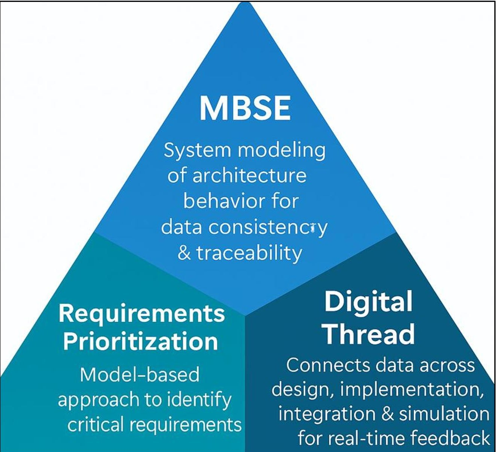

Figure 3.1. Proposed Digital Trinity Framework.

<!-- PDF_PAGE: 98 -->

Figure 3.1 presents the Digital Trinity Framework as an equilateral triangle that links MBSE, Requirements Prioritization, and the Digital Thread. Each segment reflects a core methodological pillar, showing how the three areas interact to support consistent modeling, decision-making, and lifecycle data flow. The figure offers a visual summary of the study's integrated approach to complex systems engineering.

MBSE provides the structural backbone of the framework by using SysML to formally capture system abstractions, define interfaces, and support lifecycle management. Key modeling artifacts, such as Block Definition Diagrams, Internal Block Diagrams, Activity Diagrams, State Machine Diagrams, and Parametric Diagrams, are employed to support requirements decomposition, behavior modeling, verification, and validation (V&V). Relationships, including 《allocate》, 《derive》, 《refine》, 《satisfy》, and 《verify》, are systematically applied to preserve traceability and maintain alignment between design intent, stakeholder needs, and evolving constraints. These models are embedded within an architecture framework that supports structured viewpoints across functional, logical, and physical domains (Siddique, 2024).

The prioritization component injects decision rationality into the development process by enabling stakeholder-driven requirement weighting and adaptive resource management. Recognizing the influence of emergence and evolving stakeholder constraints, this layer integrates Multi-Criteria Decision Analysis (MCDA) with value-driven design principles. Trade space analysis is supported through dynamic ranking and iterative refinement mechanisms, with rationale directly linked to SysML elements via compartments, tagged values, and callouts. This ensures that prioritization remains transparent, configurable, and responsive to feedback.

Digital integration facilitates end-to-end model consistency by linking system models to external analytical and simulation environments, ensuring consistency across all components. The

<!-- PDF_PAGE: 99 -->

toolchain connects Cameo Systems Modeler with MATLAB for control logic evaluation, STK for orbital performance analysis, Excel for parameter tracking, Teamcenter for configuration management, and AWS for scalable data access. Through digital thread architecture, model elements, parameters, and results are synchronized to enable bidirectional feedback loops, collaborative development, and reduced integration latency. This setup supports system-of systems fidelity while maintaining interoperability across domains.

By uniting these three pillars into a single methodological construct, the framework delivers a scalable and reusable systems engineering approach suitable for high-assurance, digitally integrated aerospace projects.

## 3.1.4 Alignment of Key Research Questions with Objectives

This research is guided by three core questions that reflect the central challenges in designing, prioritizing, and integrating system requirements within a digitally connected ModelBased Systems Engineering (MBSE) environment. Each question is directly aligned with the study's overarching objectives, which emphasize the development of a traceable, interoperable, and scalable methodology for small satellite systems, such as SidSat. These questions correspond to the three methodological pillars introduced earlier: MBSE modeling, requirements prioritization, and digital toolchain integration.

RQ1: How can SysML-based MBSE be applied to define, analyze, and validate the structure and behavior of a small satellite system while ensuring traceability across the lifecycle?

This question supports the objective of demonstrating a model-centric systems approach using formal SysML constructs. The focus is on leveraging structural (BDD, IBD) and behavioral (Activity, State Machine) diagrams to define architecture, interface logic, and verification

<!-- PDF_PAGE: 100 -->

pathways. The goal is to ensure that system-level requirements are formally captured, traceable to validation activities, and consistent across phases.

RQ2: In what ways can requirements prioritization be systematically integrated into a modelbased framework to manage complexity and stakeholder trade-offs in a Complex Adaptive System?

This question aligns with the need to embed prioritization techniques within SysML environments, supporting value-driven decision-making through the integration of Multi-Criteria Decision Analysis (MCDA), trade space analysis, and rationale modeling (Filho, 2025). Emphasized are stakeholder rankings, change responsiveness, and traceable rationale compartments to maintain adaptability in the face of evolving mission constraints.

RQ3: How can tool interoperability and digital integration be achieved to enable a synchronized digital thread across SysML, simulation environments, configuration systems, and data platforms?

This question is directed toward achieving semantic and operational alignment across engineering tools, reinforcing the objective of establishing a digital thread using platforms such as Cameo, MATLAB, STK, Excel, Teamcenter, and AWS to maintain lifecycle feedback, parameter continuity, and verification traceability.

These questions collectively reinforce the Digital Trinity framework introduced in Section 3.1.3, ensuring that all modeling activities, prioritization logic, and integration efforts are grounded in both practical applicability and methodological rigor. This alignment strengthens this work's goal of delivering a unified, toolchain-enabled systems engineering approach suitable for agile and resource-constrained aerospace programs.

<!-- PDF_PAGE: 101 -->

## 3.2 MODEL-BASED SYSTEMS ENGINEERING (MBSE) IMPLEMENTATION

The MBSE approach employed in this research establishes the structural and behavioral backbone of the SidSat system architecture, enabling a coherent, traceable, and simulation-ready design environment. By leveraging SysML modeling, the framework supports comprehensive lifecycle management, requirements decomposition, interface specification, and cross-domain traceability. Unlike conventional document-based practices, this model-centric methodology ensures the consistent flow of requirements, architecture logic, and simulation feedback across all development phases.

MBSE further enables alignment with architecture frameworks, facilitates robust Verification & Validation (V&V), supports stakeholder needs analysis, and integrates effectively with system-of-systems constructs. As a foundational component of the Digital Trinity framework, it ensures that all engineering artifacts remain synchronized, testable, and adaptable, strengthening both technical rigor and mission assurance for small satellite platforms.

## 3.2.1 MBSE Foundation and Rationale

The foundation of the Model-Based Systems Engineering (MBSE) approach in this study lies in its ability to replace document-centric practices with an integrated, model-centric strategy that enhances system fidelity, lifecycle traceability, and cross-domain coherence. MBSE enables the formal specification of system structure, behavior, and requirements through SysML, providing a unified architecture framework that spans stakeholders, engineering domains, and disciplines. By capturing abstractions using standardized constructs, such as blocks, value types, ports, interfaces, and constraints, MBSE supports end-to-end alignment of design intent, verification strategy, and stakeholder expectations.

<!-- PDF_PAGE: 102 -->

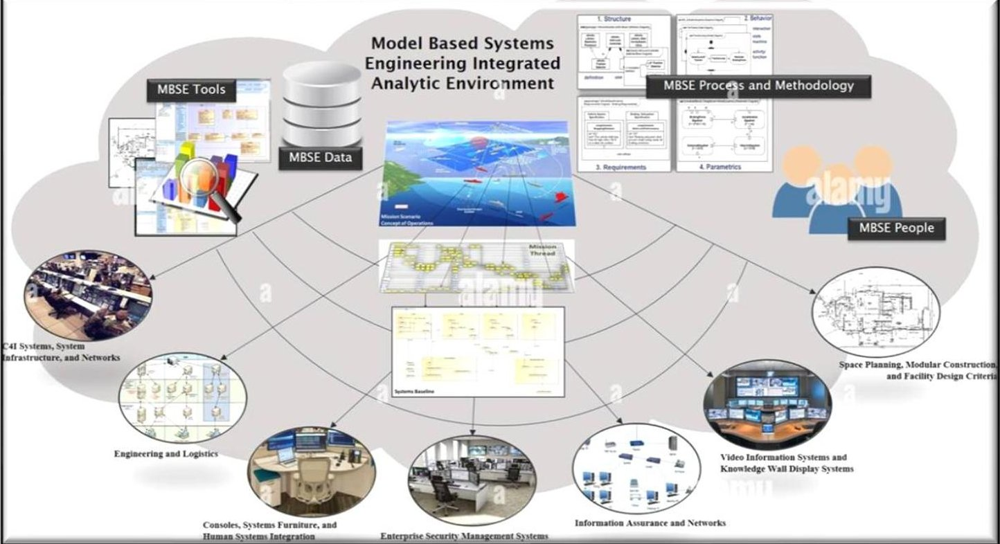

Figure 3.2. MBSE Environment Supporting Digital Thread Integration (Source: Alamy).

A layered MBSE analytic environment connects modeling tools, data repositories, formalized engineering processes, and cross-functional stakeholders to downstream operational domains. At the core, model artifacts, such as mission scenarios, mission threads, and system baselines, are linked to simulation outputs and enterprise-level systems, including logistics, security management, display systems, and infrastructure planning. This environment highlights the extended role of MBSE beyond technical modeling, demonstrating how models inform systems operations, interface decisions, and lifecycle transitions. Such integration is especially important in aerospace contexts, where distributed teams, evolving requirements, and mission-critical dependencies demand a traceable, analytics-enabled engineering environment.

The MBSE paradigm is particularly suited to the challenges of small satellite development, where rapid iteration, resource constraints, and complex subsystem interdependencies require disciplined systems thinking and structured modeling. MBSE supports early identification of architectural gaps, simulation-informed decision-making, and iterative requirements

<!-- PDF_PAGE: 103 -->

decomposition, all embedded within a continuous digital engineering lifecycle. It also enables modeling of emergent system behavior, supports interface definition, and facilitates stakeholder analysis through executable and scenario-based views across mission phases.

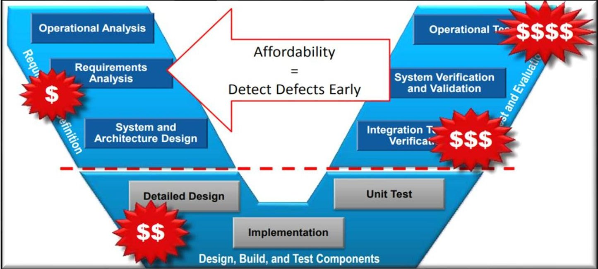

Figure 3.3. V-Model Emphasizing Early Verification for Lifecycle Efficiency (LM).

A foundational method for aligning development and verification efforts in systems engineering is the V-Model. This diagrammatic approach pairs each design activity with a corresponding validation task. The left branch represents a gradual breakdown of system needs into more detailed components. In contrast, the right branch emphasizes the stepwise integration and validation of those components against the original requirements. This structured alignment supports early planning for testability and integrates effectively with MBSE concepts such as 《allocate》, 《derive》, 《refine》, 《satisfy》, and 《verify》, which maintain requirement traceability. In the case of SidSat, the V-Model emphasizes the importance of systematically representing requirements, architectures, and behavioral elements in forms that facilitate early-stage simulation and trace-driven analysis. The model's visual structure also reinforces the importance of recursive validation and integrated systems thinking in model-based projects.

<!-- PDF_PAGE: 104 -->

The integration of MBSE into this research is not limited to its visual modeling features. It offers the advantage of managing the system lifecycle by linking functions, limitations, and test parameters through coherent relationships in SysML. These linked model elements become usable inputs for verification simulations, interface assessments, and iterative evaluation of requirements. Additionally, model annotations and extensions, such as compartments or tagged attributes, can capture prioritization logic and justification directly within the model, enhancing transparency and rationale traceability.

By establishing MBSE as a central element of the approach, this study ensures consistency with current digital engineering trends in aerospace. It promotes a modular system structure, enables coordination across system hierarchies, and facilitates integration with tools for data analysis and architectural evaluation. The continued development of INCOSE-aligned practices suggests scalability in model-based requirements handling (Wheaton & Herber, 2024). Furthermore, MBSE-supported architecture design has demonstrated improvements in interface definition and reuse efficiency, which are essential for managing risk in space systems (Stirgwolt, Mazzuchi, & Sarkani, 2022).

## 3.2.2 SysML Modeling and Toolchain (Cameo, MATLAB, etc.)

The implementation of SysML modeling in this study is driven by a structured digital toolchain built around Cameo Systems Modeler, which functions as the central workspace for capturing system design logic. Within this environment, structural definitions, interface relationships, system behaviors, allocation logic, and constraint expressions are modeled using the SysML language, which supports system-level analysis and traceability for the SidSat CubeSat.

The modeling framework adopts a modular and hierarchical strategy to capture architectural layers. Block definition diagrams and internal block diagrams define structural

<!-- PDF_PAGE: 105 -->

organization and subsystem boundaries. State machine diagrams and activity diagrams reflect control logic and event-driven operations. Parametric diagrams illustrate performance thresholds, mathematical expressions, and design constraints, facilitating the evaluation of trade-offs and performance margins. All diagram sets are version-controlled in Cameo, ensuring collaborative editing, version tracking, and model integrity.

The SysML model is extended by incorporating a suite of supporting tools used for simulation, evaluation, and configuration oversight. MATLAB enables analysis of control routines and system response behavior. STK assists in modeling orbital trajectories and mission environment profiles. Parameter values are coordinated through Excel, which functions as a flexible input-output interface. Version control and configuration history are preserved in Teamcenter. AWS provides access to shared repositories and facilitates simulation runs in distributed settings.

Tool interoperability is managed through data exchange formats such as CSV and XMI, along with custom integration scripts tailored to project-specific needs. Simulation outputs are reviewed to refine model constraints and improve design alignment. Traceability outputs, including allocation charts and requirement compliance matrices, are generated from within Cameo.

This approach helps maintain engineering transparency, informs system refinement through feedback, and supports decision-making across development stages, enabling a modeldriven workflow aligned with the demands of CubeSat engineering and digital lifecycle practices.

<!-- PDF_PAGE: 106 -->

## 3.2.3 SidSat Logical Architecture Modeling

The architectural modeling of SidSat employs a structured, modular approach using SysML to define the system's static and dynamic aspects across multiple abstraction layers. This modeling effort emphasizes the decomposition of requirements, structural integrity, interface definition, and alignment with stakeholder objectives. The architecture features a 4U CubeSat configuration, incorporating mission-enabling subsystems such as a robotic arm and an AI/ML-based decision unit. The modeling strategy ensures lifecycle management through traceable, executable representations that evolve in tandem with mission and system constraints.

Block Definition Diagrams (BDDs) are used to establish the hierarchical decomposition of the satellite into its core subsystems: command and data handling (C&DH), communications, payload, attitude determination and control system (ADCS), power, structure, and thermal management. Each subsystem is represented as a block with associated value properties, constraint parameters, and ports to formalize its functional and physical roles. Interface blocks define standardized data, power, and mechanical connections, ensuring interoperability and reusability across architectural layers.

Internal Block Diagrams (IBDs) depict the internal configuration of each subsystem and its interconnections through standard, flow, and proxy ports. These diagrams expose data paths, signal flows, and control logic integration among components, supporting consistent architecture visualization and interface validation. Value types and signals are modeled to ensure consistency in unit definitions, parameter binding, and system integration rules. Constraints are formalized through parametric diagrams, which validate mass, volume, and power budgets by utilizing reusable constraint blocks tied to requirement elements. These constraint structures adhere to

<!-- PDF_PAGE: 107 -->

INCOSE-aligned modeling patterns, supporting simulation-informed validation and enhanced standardization (Wheaton & Herber, 2024).

To ensure alignment with system-of-systems engineering principles, multiple architecture viewpoints are employed to distinguish between functional, logical, and physical layers of the system, while maintaining cohesion through synchronized model relationships. Functional behaviors are systematically allocated to structural components using SysML relationships, allowing for a traceable mapping between abstract functions and tangible system elements. This allocation supports rigorous performance tracking, resource budgeting, and architecture verification. Each modeling element is embedded within a requirement-linked traceability framework that ensures full lifecycle alignment with stakeholder-derived needs, while also enabling backward and forward trace navigation.

The SidSat system architecture is modeled as a tightly integrated, feedback-driven construct that connects design intent, resource constraints, and verification logic into a unified SysML environment. This modeling approach supports both static integrity and dynamic evaluation, facilitating trade space analysis and digital simulation across iterative development phases. Constraint blocks, developed using reusable patterns aligned with INCOSE's modeling guidance (Wheaton & Herber, 2024), enforce compliance with mission-specific mass, volume, and power limits. Model continuity is preserved across tools via structured interfaces, parameter binding, and simulation feedback loops, ensuring the architecture serves as a high-fidelity baseline for subsequent integration, analysis, and system validation efforts.

<!-- PDF_PAGE: 108 -->

## 3.2.4 Behavioral Modeling and Traceability

Behavioral modeling is essential for characterizing the dynamic aspects of SidSat's operational profile. Engineers use SysML to express mission sequences, control logic, and internal state transitions within a unified modeling environment, thereby facilitating a comprehensive understanding of system behavior. This effort enhances behavioral validation under different conditions and strengthens traceability from stakeholder expectations through to system structures and functions. In model-based systems engineering, behavior models connect high-level concepts with executable operations, thereby facilitating alignment between mission intent and implementation throughout the system's lifecycle.

Activity Diagrams illustrate functional flows associated with key mission activities, including orbital insertion, deployment, robotic arm movement, and thermal management. Each activity encompasses a group of tasks or decisions, represented using control and object flows. System components are assigned to actions to retain structural linkage. Value types are used to define input and output flows, supporting unit consistency and directional clarity. These diagrams also facilitate the simulation of resource consumption, event ordering, and concurrency among subsystems.

State Machine Diagrams specify subsystem modes, transitions, and the logic associated with each state. Modules such as robotic control, data handling, and power regulation are modeled with events that trigger transitions and guards that define branching logic. Each state includes entry, ongoing, and exit operations to model time-sensitive behavior and process coordination. These diagrams are crucial for testing system performance in both expected and degraded operational modes.

<!-- PDF_PAGE: 109 -->

Traceability is reinforced through standard SysML links, 《allocate》, 《derive》, 《refine》, 《satisfy》, and 《verify》 relationships associate requirements with behavior diagrams, 《refine》 supports decomposition of abstract goals, and 《allocate》 ties functions to physical components. These links are managed in Cameo through validation dashboards, coverage checks, and traceability matrices.

Behavioral, structural, and requirement views are integrated to increase visibility, improve coordination, and ensure validation readiness. This modeling effort contributes to maintaining digital thread alignment and promotes the inclusion of behavioral accuracy as a primary, not secondary, system concern. For the SidSat CubeSat, this behavioral modeling approach supports early fault detection, scenario-based analysis, and system responsiveness, establishing behavior modeling as a foundational component within the broader digital engineering strategy.

## 3.2.5 Parametric Validation

Parametric diagrams play a central role in validating quantitative relationships within the MBSE process. For the SidSat CubeSat, these diagrams are used to assess mass distribution, energy availability, structural margins, and timing alignment. By associating constraint equations with system elements via binding connectors, the model provides a direct mechanism for evaluating performance against mission parameters.

At the core of this validation strategy are constraint blocks, which encode reusable formulas derived from engineering principles and system-level requirements. These may include equations governing thermal limits, center of gravity location, total mass, and energy usage across various operational modes. Once connected to system blocks, they generate a logic network that mirrors real-world conditions and operational limits. Parameters are typed using standardized

<!-- PDF_PAGE: 110 -->

value types to maintain unit coherence, and binding connectors ensure equality relationships are maintained across the model.

With this structure, system designers can test design alternatives under defined constraints. For instance, mass budgets can be checked against the launch vehicle's payload limits, or power flows can be analyzed to verify adequacy during eclipse periods. Because the model is executable, such checks are performed automatically as configurations change. This reduces the need for disconnected simulation tools and improves turnaround during iterative design. As shown in prior work (Anwar et al., 2020), this level of model integration reduces ambiguity and promotes repeatable system verification.

The validation is closely linked to requirements via SysML satisfy and verify relationships. Each constraint is associated with a requirement and executed using tools like Cameo's constraint solver. These evaluations remain current as models evolve, forming part of a continuous Digital Thread that ties together requirements, architecture, and behavior.

By embedding parametric evaluation into the system model, this method enables real-time verification, facilitates early detection of constraint issues, and promotes clear communication of design intent. For SidSat, this ensured that physical constraints, functional behavior, and system goals remained consistently aligned throughout the development process. $ ^{16} $

## 3.2.6 MBSE Tool Selection and Prioritization Framework

The process of selecting and prioritizing MBSE tools requires more than an assessment of individual capabilities; it must also reflect project-specific modeling objectives, integration requirements, and prioritization strategies for requirements. Drawing from the multi-stage

<!-- PDF_PAGE: 111 -->

framework proposed by Khandoker et al. (2022), this section synthesizes a structured pathway for evaluating MBSE tools, tailored to support the research goals of model-centric system architecture, disciplined requirement flow-down, and structured tool interoperability. The following subsections map the framework's dimensions to three critical perspectives: MBSE-driven modeling fidelity (Section 3.2.6.1), requirements prioritization and verification alignment (Section 3.2.6.2), and digital integration and lifecycle interoperability (Section 3.2.6.3). Each perspective builds upon the core elements of domain-driven requirements elicitation and structured tool screening.

## 3.2.6.1 Tool Selection to Support MBSE Fidelity and Formalism

The CubeSat case study uses a tailored version of the tool selection process introduced by Khandoker et al. (2022). This version, shown in Figure 3.4, follows a staged evaluation of MBSE tools. Each step considers how well the tool meets project-specific modeling needs and whether it can support the system over time with adequate detail and structure.

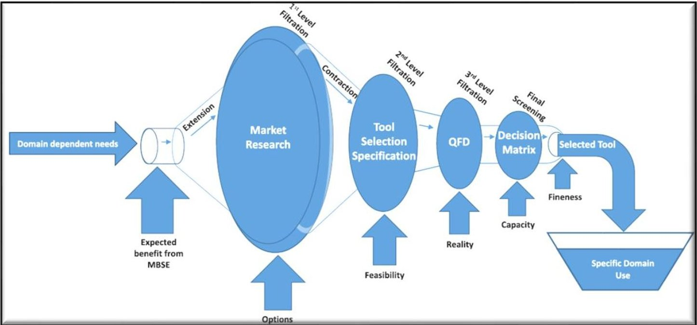

Figure 3.4. Multi-stage MBSE Tool Selection Framework (Khandoker et al., 2022).

The selection process begins by identifying the project's needs, which include the type of modeling involved, the level of detail required, and the expected benefits of MBSE, such as design

<!-- PDF_PAGE: 112 -->

traceability or early system checks. The first filter involves scanning the available tool options, eliminating those that lack essential features or fail to fit the domain.

In the second step, often referred to as "Tool Selection Specification", the focus shifts to practical screening. Each option is reviewed using a clear set of project needs. These include SysML support, language range, process coverage, plug-in availability, and license flexibility. This step helps confirm which tools are usable.

The third step in the original method utilizes QFD to match stakeholder needs with tool features. For the CubeSat case, this has been replaced by a weighted scoring model (WSM), which is a more suitable approach. The WSM works by assigning points to factors such as how well the tool models, how easy it is to use, whether it integrates with other tools, and how it supports testing. $ ^{17} $ These scores help sort the options based on what matters most.

The final step utilizes a simple matrix to consolidate all the information. Earlier findings are summarized, and the best-fitting tool is selected. This four-step method supports tool selection for systems engineering in complex projects, where both modeling and domain fit are critical.

The final screening is conducted through a structured decision matrix, resulting in the selection of an MBSE tool that meets both formal and functional expectations for domain-specific use. The overall process establishes a defensible, criteria-driven methodology for tool selection, supporting MBSE fidelity in high-stakes environments, such as aerospace system development.

## 3.2.6.2 Requirements Prioritization and Verification Alignment in Tool Evaluation

A key dimension of MBSE tool selection lies in the ability to support disciplined requirements prioritization and verification alignment. In complex aerospace systems, requirements are not uniformly critical; some have a greater impact on safety, mission objectives, or regulatory compliance. As such, MBSE environments must not only capture and manage

<!-- PDF_PAGE: 113 -->

requirements but also enable analysts to systematically rank, trace, and validate them throughout the lifecycle.

Within the second filtration phase of the tool selection framework (Khandoker et al., 2022), requirements-specific considerations emerge prominently. This stage evaluates whether candidate tools provide built-in prioritization mechanisms, such as weighted attributes, ranking models, or external interfacing with prioritization engines. Integration of such capabilities ensures that highpriority requirements can be explicitly modeled and monitored, enabling focused verification efforts and model-based validation. For this research, while Khandoker et al. employed a QFD mechanism for requirement-to-feature mapping, our framework substitutes a Weighted Scoring Model (WSM) to numerically represent the importance of requirements and quantify tool support across categories such as traceability, reusability, V&V compatibility, and simulation readiness.

The selected MBSE tool must therefore offer capabilities to reflect the importance of requirements within the modeling process and verify their satisfaction through simulation, interface checking, or parametric validation. This includes requirement satisfaction matrices, constraint evaluations, coverage visualizations, and linkages between requirement elements and behavioral/structural models.

<!-- PDF_PAGE: 114 -->

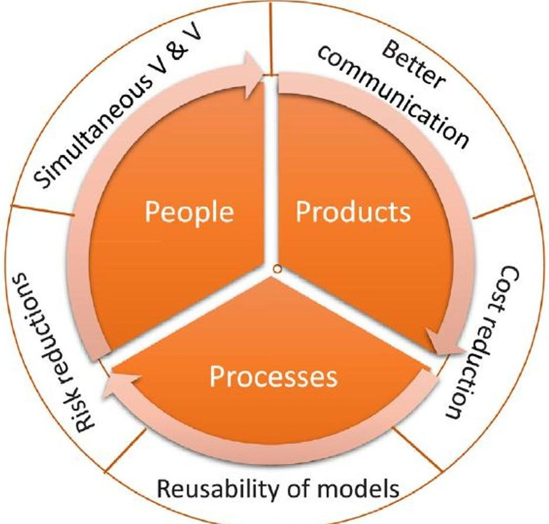

Figure 3.5. MBSE Needs Across People, Processes, and Products (Khandoker et al., 2022).

Figure 3.5 illustrates how MBSE tools must accommodate the interplay of people, processes, and products when managing requirements. The figure highlights key benefits, including simultaneous verification and validation, risk reduction, model reusability, cost efficiency, and improved communication. These elements reflect the multifaceted nature of requirements in MBSE environments, where technical, organizational, and procedural demands intersect. By embedding these dimensions into the tool evaluation framework, decision-makers can prioritize tools that support holistic requirements management rather than feature-limited implementations.

Thus, requirements prioritization in MBSE tool selection is not limited to functional coverage, but also extends to usability in verification, model-based tracking, and digital continuity across stakeholders. This ensures that critical requirements are not only visible but also actively validated throughout the system's evolution.

<!-- PDF_PAGE: 115 -->

Table 3.1. Comparative Evaluation of MBSE Tools for CubeSat-Aerospace Applications.

<table border="1"><tr><td>Tool Name</td><td>Modeling Language Support</td><td>Modeling Approach</td><td>Simulation/Co-Simulation Support</td><td>API and Extensibility</td><td>SysML Version Support</td><td>Toolchain Integration(Excel,STK,MATLAB)</td><td>License Type</td></tr><tr><td>Cameo Systems Modeler</td><td>SysML,UML,BPMN</td><td>MagicGrid,model-driven</td><td>Supports FMI,MATLAB,STK</td><td>Open API,plug-ins</td><td>Full(v1.4-1.6)</td><td>Excel,MATLAB,STK,ReqIF</td><td>Commercial</td></tr><tr><td>Enterprise Architect</td><td>SysML,UML,BPMN,ArchiMate</td><td>Holistic,ALM-integrated</td><td>Limited FMI support</td><td>Moderate extensibility</td><td>SysML1.4+</td><td>Excel,limited STK interface</td><td>Commercial</td></tr><tr><td>Capella</td><td>ArcadiaDSML</td><td>Architecture-driven(meta-model)</td><td>No native co-simulation</td><td>Limited plug-in support</td><td>NotSysML</td><td>ModeratePLM/ALM integration via add-ons</td><td>Open/Commercial</td></tr><tr><td>Innoslate</td><td>LML,partialSysML</td><td>Lifecycle-focused(LML-centric)</td><td>Basic simulation(text-based)</td><td>StrongRESTAPI</td><td>Partial(SysML subset)</td><td>Excel,CSV,browser-basedrepository</td><td>Commercial</td></tr><tr><td>Modelio</td><td>UML,BPMN,limitedSysML</td><td>Model-driven,open-source</td><td>Basic simulation viaBPMN tools</td><td>Moderate(communityplugins)</td><td>PartialSysML</td><td>Excel,CSV(manual integration)</td><td>Open/Commercial</td></tr><tr><td>IBMRhapsody</td><td>SysML,UML</td><td>Hybrid(top-down),DoDAFready</td><td>StrongFMI andReqIF support</td><td>RobustAPI and toolkits</td><td>Full(1.4+)</td><td>MATLAB,Excel,ReqIF</td><td>Commercial</td></tr></table>

Table 3.1 outlines six MBSE tools reviewed for use in the aerospace industry, with a focus on CubeSat systems. The format is loosely based on Khandoker et al. (2022). However, the categories have been adjusted to provide better modeling support, facilitate connections with other tools, and facilitate practical use in digital engineering tasks.

## 3.2.6.3 Digital Integration and Lifecycle Interoperability in Tool Selection

In aerospace projects, selecting tools solely based on standalone capabilities often results in fragmented workflows and disconnected development processes. Digital integration supports efficient data exchange, behavioral simulation, and feedback loops across the system lifecycle. Therefore, MBSE tool selection must consider not only modeling formalisms but also the ability to interface with co-simulation, requirements prioritization, and analysis environments through standardized data formats and APIs.

<!-- PDF_PAGE: 116 -->

For instance, while SysML-based platforms, such as Cameo Systems Modeler, enable formal architectural representations, they must interoperate with simulation environments like MATLAB for modeling dynamic behavior and with decision-support tools like Excel for trade space analysis and weighted scoring. Requirements prioritization mechanisms, whether embedded or external, must support structured ranking, traceability to source needs, and feedback propagation from simulation results.

Tool evaluation, therefore, should not focus merely on modeling usability or domain alignment but must include criteria such as co-simulation readiness, plug-in extensibility, API support, and data interchange formats (e.g., XMI, FMI, ReqIF). These capabilities allow the MBSE environment to function as the integrative core of a larger digital engineering toolchain, linking requirement flow-down, simulation validation, and verification planning. $ ^{18} $

<!-- PDF_PAGE: 117 -->

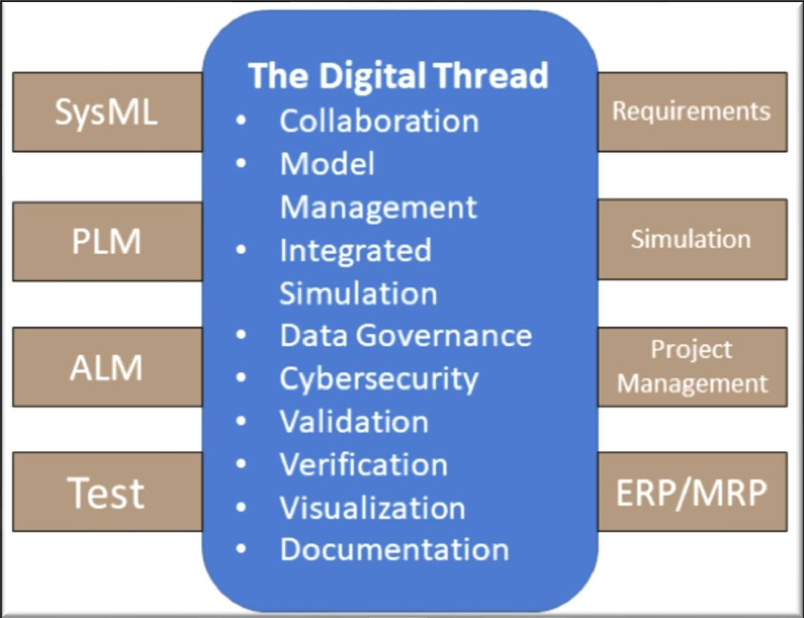

Figure 3.6. Digital Thread linking MBSE, simulation, PLM, and ALM (Jama, 2020).

This digital-thread architecture visually represents the layered integration needed to enable lifecycle-centric decision-making. MBSE sits at the center, connected through managed interfaces to requirement tools, simulation models, PLM repositories, and ALM environments. The diagram illustrates the flow of information throughout the lifecycle and the feedback loops necessary for iterative engineering.

This configuration reflects the direction taken in this CubeSat case study, where tool interoperability, across MBSE, simulation, and prioritization layers, was prioritized to support system adaptability, lifecycle traceability, and validation-informed decisions. Such integration is essential for realizing the full potential of MBSE in complex and evolving mission contexts.

<!-- PDF_PAGE: 118 -->

## 3.3 REQUIREMENTS PRIORITIZATION STRATEGY

Requirements prioritization represents a critical pillar within this research, enabling systematic decision-making in the presence of limited resources, evolving stakeholder inputs, and dynamic mission objectives. Unlike traditional static requirement sets, the proposed approach accounts for emergent behavior, competing constraints, and changing priorities typical of Complex Adaptive Systems (CAS) such as small satellite platforms. Within the context of SidSat, prioritization is not treated as a one-time ranking activity but as an embedded, iterative process tied to model evolution and system-level feedback.

To operationalize this strategy, the research adopts a model-based approach that enhances consistency, traceability, and responsiveness to evolving mission needs. Rather than treating prioritization as a disconnected, spreadsheet-based task, the approach embeds it within the SysML environment, enabling synchronization between requirement attributes, stakeholder objectives, and technical constraints. This integration supports key activities such as filtration, scoring, rationale capture, and tool-based evaluation, all performed within a structured model ecosystem.

By aligning prioritization with the digital thread, requirements can be ranked dynamically based on cost, risk, strategic importance, and contextual constraints. The strategy supports the collection of stakeholder input, modular decomposition of functional and non-functional needs, and adaptive restructuring in response to simulation feedback or late-stage design changes. The use of decision matrices and fit-for-purpose tools ensures that trade-offs are transparently documented and traceable to mission objectives. This model-based approach not only improves requirement stability but also reduces rework by identifying high-risk or misaligned needs early in the lifecycle. Prioritization thus becomes an active, iterative element of architecture development, strengthening cross-team alignment and reducing lifecycle cost.

<!-- PDF_PAGE: 119 -->

The strategy is tightly integrated into the MBSE workflow, utilizing SysML artifacts to model, visualize, and trace prioritization logic. Requirements are linked to value properties, rationale compartments, tagged values, and callouts, creating a traceable chain between stakeholder needs, system constraints, and architectural decisions. This ensures that prioritization decisions remain visible across structural and behavioral models, promoting coherence and verification readiness throughout the system's lifecycle.

To manage complexity and uncertainty, a hybrid prioritization approach is employed that combines qualitative assessments with quantitative evaluations. Multi-Criteria Decision Analysis (MCDA), trade space exploration, and scenario-based simulations are applied through modeling mechanisms, including custom requirement stereotypes, prioritization matrices, and simulation-informed ranking adjustments. These enable dynamic feedback loops between evolving model states and requirement rankings, ensuring that the prioritization remains agile while maintaining architectural integrity.

<!-- PDF_PAGE: 120 -->

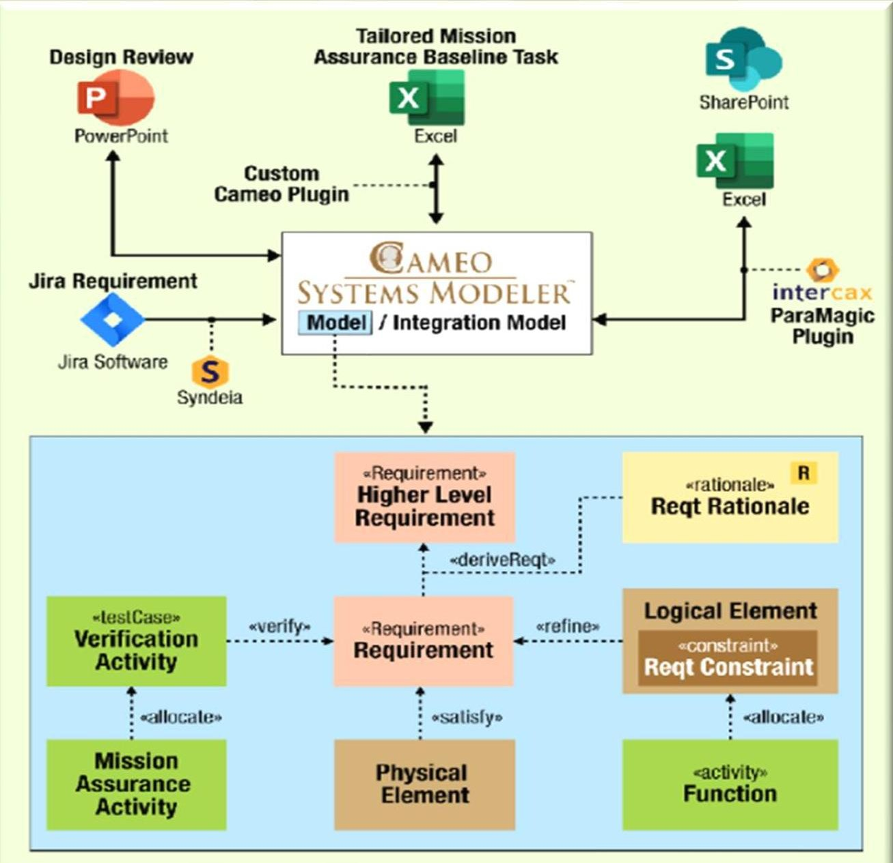

Figure 3.7. Requirements Traceability Using SysML and Cameo Integration (AC).

A systems modeling integration framework demonstrates how Cameo Systems Modeler interacts with tools like Excel, SharePoint, and Jira to coordinate requirements, constraints, rationales, test cases, and design elements. These linkages are maintained through SysML relationships, including 《allocate》,《deriveReqt》，《refine》，《satisfy》，and 《verify》. Prioritization becomes essential when system constraints, such as weight, power budget, or onboard computing, must be reconciled with mission requirements. Aligning high-value needs with practical implementation enables informed decision-making and supports the long-term effectiveness of the

<!-- PDF_PAGE: 121 -->

system. This layered strategy complements model-based and digital engineering practices by offering a clear structure for managing trade-offs and maintaining stakeholder-focused traceability.

## 3.3.1 Challenges in Complex Adaptive Systems

Complex Adaptive Systems (CAS) present unique challenges for requirements engineering due to their inherent uncertainty, interconnectivity, and emergent behavior. In such systems, static requirement baselines are insufficient, as priorities often shift in response to evolving stakeholder needs, operational feedback, and environmental variables. For aerospace applications like SidSat, the need for Adaptive Requirements Management is paramount, requiring strategies that support dynamic prioritization, resilience engineering, and continuous model integration within a traceable and verifiable architecture framework.

One of the primary challenges in CAS is requirements volatility, where changes to one subsystem or external condition can propagate unexpected impacts throughout the system-of-systems. This disrupts Traceability and undermines design stability unless actively managed through a robust Lifecycle Management strategy. To mitigate this, the prioritization process must be tightly coupled with SysML-based modeling artifacts, ensuring that shifting requirements remain embedded in the Digital Thread and maintain bidirectional linkage to functional behaviors, constraints, and validation assets.

Another critical issue is uncertainty quantification, the need to prioritize requirements despite incomplete, conflicting, or evolving inputs. Traditional ranking approaches fall short under such conditions, necessitating the use of Scenario-Based Prioritization and Multi-Criteria Decision Analysis (MCDA) to evaluate competing demands under varying assumptions. These techniques enable the real-time adjustment of requirement weightings, allowing for trade space analysis that reflects mission risk, technical feasibility, and stakeholder value.

<!-- PDF_PAGE: 122 -->

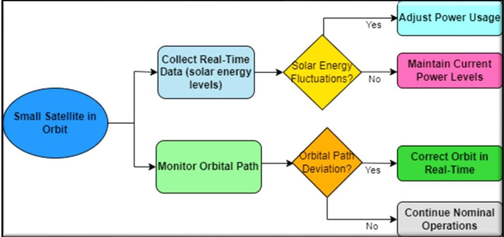

Figure 3.8. Behavioral Flow Model for Satellite Adaptation.

The adaptation process of a CubeSat is depicted through a logic-based flow that models how environmental inputs, such as solar energy fluctuations or orbital deviations, trigger real-time corrective actions. This framework exhibits the characteristics of Complex Adaptive Systems (CAS), highlighting the system's ability to self-adjust in unpredictable conditions.

Emergence and nonlinear interactions within CAS also complicate requirement dependencies, often resulting in emergent capabilities or risks that were not foreseen during initial planning. Capability-Based Planning and Feedback Loops become essential in identifying which requirement clusters must remain flexible and which must be rigidly preserved to meet performance thresholds. Requirements Negotiation becomes an ongoing activity, rather than a front-loaded task, as system models evolve and simulation results inform new design constraints.

Lastly, the interdisciplinary nature of CAS introduces coordination complexity across engineering domains, necessitating Interoperability of modeling tools and consistent communication of prioritization rationale. Model Integration across Cameo, MATLAB, STK, and

<!-- PDF_PAGE: 123 -->

configuration platforms must support the synchronization of requirements status, priority rank, and architecture feasibility to ensure alignment with Verification & Validation (V&V) objectives.

These challenges underscore the need for a dynamic, model-based prioritization strategy that is responsive to the emergent and adaptive nature of the system. By embedding prioritization logic within the SysML model and maintaining traceability across the architecture framework, this research directly addresses the complexities inherent in small satellite development under realworld constraints.

## 3.3.2 Comparison of Prioritization Methods

In systems characterized by evolving needs and interdependent elements, such as the SidSat CubeSat, prioritizing requirements is essential to guide trade studies and ensure mission feasibility. These efforts often operate under resource and time constraints, particularly in Complex Adaptive Systems. Several prioritization methods have been developed within systems engineering to support such decision-making.

For SidSat, the emphasis is on methods that align with iterative, model-based environments. Techniques such as the Analytic Hierarchy Process (AHP), Quality Function Deployment (QFD), Binary Search Tree (BST), and MoSCoW provide structured methods for comparing needs based on utility, feasibility, or complexity (Millet, 2005). While AHP is valued for its pairwise comparisons and transparency, it does not offer native support for feedback loops or direct integration with system modeling tools, such as SysML. Similarly, QFD captures user needs well but presents challenges when applied to architectures that evolve frequently or require rapid validation cycles.

<!-- PDF_PAGE: 124 -->

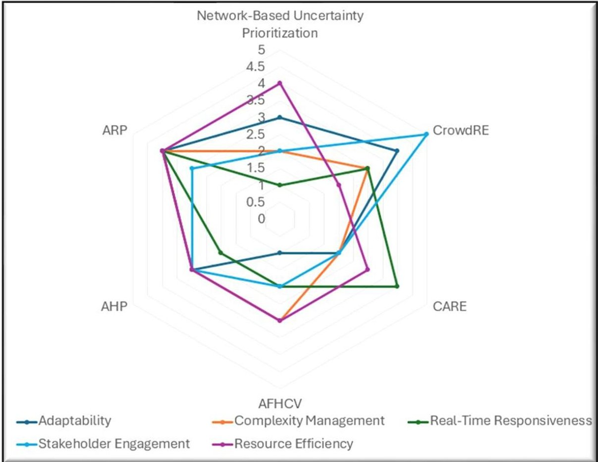

Figure 3.9. Performance-Based Comparison of Prioritization Approaches.

A comparative radar visualization highlights trade-offs across five key performance attributes: adaptability, stakeholder engagement, resource efficiency, complexity management, and real-time responsiveness, across various techniques, including network-based prioritization, AHP, ARP, CARE, AFHCV, and CrowdRE. These insights guide method selection in CAS contexts by emphasizing strengths and limitations in supporting emergent behavior, stakeholder feedback, and model traceability.

Advanced approaches offer partial solutions to traditional limitations. Adaptive Requirements Prioritization (ARP) supports conflict resolution and iterative updates, while AFHCV combines fuzzy logic with cumulative voting for dynamic adjustment. Network-based uncertainty methods account for interdependence but remain resource-intensive and difficult to integrate with simulation workflows. CARE enables continuous re-prioritization aligned with system evolution but requires sustained stakeholder coordination. CrowdRE, while improving

<!-- PDF_PAGE: 125 -->

engagement through distributed input, often lacks standardization, consistency, and toolchain interoperability.

Table 3.2. Comparative Overview of Advanced Requirements Prioritization Approaches.

<table border="1"><tr><td>Approaches</td><td>Characteristics</td><td>Advantages</td><td>Challenges</td></tr><tr><td>Network-Based Uncertainty Prioritization</td><td>Models uncertainties and interdependencies.</td><td>Holistic view of risks.</td><td>High complexity and resource demand(Qazi,2020).</td></tr><tr><td>Adaptive Requirements Prioritization(ARP)</td><td>Dynamic and structured.</td><td>Resolves conflicts, adapts to changes.</td><td>Needs deep understanding of interdependencies(Salado,2015).</td></tr><tr><td>Least Penalty Optimization with AHP</td><td>Minimizes penalty variance.</td><td>Enhances accuracy, reduces inconsistencies.</td><td>Computational load for large matrices(Yuen,2014).</td></tr><tr><td>Adaptive Fuzzy Hierarchical Cumulative Voting(AFHCV)</td><td>Combines fuzzy logic and adaptive prioritization.</td><td>Supports real-time adjustments.</td><td>Time-consuming with many stakeholders(Jawale et al.,2017).</td></tr><tr><td>CARE(Continuous Adaptive Requirements Engineering)</td><td>Real-time adjustments to evolving needs.</td><td>Ensures continuous adaptability.</td><td>Requires resources and stakeholder input(Qureshi et al.,2010).</td></tr><tr><td>Crowd-Based Requirements Engineering(CrowdRE)</td><td>Uses crowdsourcing for feedback.</td><td>Improves adaptability and quality.</td><td>Requires tools for diverse data sources(Groen,2017).</td></tr></table>

Multiple prioritization methods are evaluated across characteristics, advantages, and challenges specific to Complex Adaptive Systems. The tabular comparison facilitates method selection by aligning technique capabilities with system requirements such as real-time adaptability, stakeholder engagement, and risk management.

These comparisons reveal a common trade-off: methods are either analytically rigorous but inflexible or adaptive yet poorly integrated into MBSE toolchains. For SidSat, such disconnection hinders traceability, feedback integration, and alignment with verification artifacts. A hybrid, MBSE-aligned strategy is needed, one that embeds prioritization logic directly within SysML

<!-- PDF_PAGE: 126 -->

models and supports dynamic updates via value-driven heuristics, scenario-based analysis, and model-internal data properties.

Most legacy techniques treat prioritization as an external process. In contrast, a model-integrated framework would enable traceable, iterative decision-making within the digital thread. This approach would strengthen lifecycle alignment, stakeholder responsiveness, and adaptability to emerging system needs, key factors in successful CubeSat development under constrained timelines and evolving mission objectives.

## 3.3.3 Proposed Adaptive Prioritization Framework

This study introduces a model-based prioritization strategy tailored to the evolving characteristics of Complex Adaptive Systems. Unlike conventional ranking methods, the proposed approach embeds prioritization logic directly into SysML models within the MBSE toolchain. The structure incorporates multiple layers that reflect design updates, stakeholder needs, and system constraints. By linking requirement criticality to system feasibility and mission relevance, the method enhances traceability and supports decisions informed by lifecycle awareness and practical trade-offs.

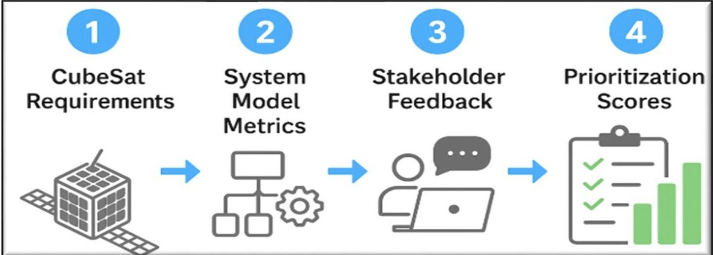

Figure 3.10. Hybrid Adaptive Prioritization Framework.

A dynamic prioritization strategy has been formulated to integrate various system parameters, such as spacecraft mass, power usage, and operational lifespan, with stakeholder input

<!-- PDF_PAGE: 127 -->

mechanisms and a weighted evaluation logic. The approach utilizes SysML outputs in conjunction with prioritization metrics, enabling iterative or real-time updates that facilitate flexible and traceable decision-making throughout the CubeSat lifecycle.

At the structural level, the method incorporates custom requirement types, rationale entries, and metadata tags that capture importance scores, assessment criteria, and decision-making rationale. These model elements are linked through relationships such as «allocate», «deriveReqt», «refine», «satisfy», and «verify», ensuring that changes in priorities affect all relevant behavioral, structural, and functional domains. Callout annotations and model compartments provide a visual channel for assessing and negotiating requirements during stakeholder discussions.

Scenario-based logic underpins the prioritization workflow, enabling the significance of requirements to shift based on diverse mission settings or operational states. Tools such as MATLAB and STK deliver performance data that inform weight adjustments, which are directly reflected in traceability views and allocation relationships within the SysML environment. This ensures that model-driven artifacts remain responsive to system-level feedback.

Incorporated within the model are MCDA methods, such as tailored AHP matrices and scoring-based evaluations, which are implemented using embedded tables or external references integrated via automation scripts. This combination promotes rigorous evaluation without compromising the agility needed during development cycles. As new system updates arise, the model allows recalibration of requirements through an evolving prioritization layer.

To maintain lifecycle consistency, ranking logic is synchronized across toolsets, configuration environments, and interface dashboards. Applied in the context of SidSat, this structure upholds coherence with higher-level system interactions, resource planning, and

<!-- PDF_PAGE: 128 -->

stakeholder intent. The prioritization layer is embedded within the architectural model, supporting end-to-end traceability and accommodating shifts in both mission objectives and technical limits.

The overall method reflects a layered prioritization design grounded in responsiveness, architectural transparency, and traceable systems thinking. This aligns with previous practices employed in complex engineering environments, where modular breakdowns, iterative assessments, and continuous engagement have proven essential to maintaining system integrity in evolving aerospace contexts (Siddique, 2023).

## 3.3.4 Application to SidSat Requirements

The adaptive model-based prioritization framework is applied within the SidSat CubeSat development to demonstrate its effectiveness in managing evolving requirements, stakeholder trade-offs, and resource constraints. As a 4U platform incorporating a robotic arm and an AI/ML module, SidSat represents a system-of-systems configuration with dynamic operational objectives and interdependent subsystems. The prioritization framework is integrated into the broader SysML-based MBSE environment to ensure Lifecycle Management, model traceability, and digital continuity across the development phases.

Within the requirements model, each mission-critical requirement is assigned a priority level using custom SysML stereotypes, tagged values, and rationale elements. Requirements were initially elicited from stakeholder objectives, environmental constraints, and mission scenarios, then structured using Requirements Decomposition strategies. Priority rankings were iteratively refined using scenario-based evaluation informed by simulations conducted in MATLAB and STK. These simulations provided input on power margins, actuator behavior, and orbital performance, enabling the refinement of requirement importance based on system behavior and trade space constraints.

<!-- PDF_PAGE: 129 -->

For instance, in the early stages of architecture, payload thermal constraints were deprioritized due to an overestimation of orbital exposure time. Following simulation feedback, the thermal requirement was reclassified as high priority due to risks of subsystem overheating, prompting updates to both the structural layout and control logic. This exemplifies the adaptive feedback loop that drives dynamic prioritization, ensuring traceability between environmental context, model changes, and requirement rank.

The prioritization framework also informed architecture decision-making by feeding ranked requirements into allocation tables and parametric constraint diagrams. This allowed value-driven design decisions to be evaluated in terms of resource utilization, power distribution, and subsystem coupling. As requirement ranks changed, traceability matrices and verification relationships were automatically updated within Cameo, maintaining alignment with the Digital Thread and supporting downstream Verification and Validation (V&V) activities.

Overall, the SidSat case study demonstrates how adaptive prioritization, embedded in a SysML model, enables not only consistent requirement ranking but also deeper integration with architecture modeling, simulation tools, and validation strategies. It demonstrates that prioritization, when embedded within the model rather than managed externally, enhances engineering transparency, decision support, and system agility in evolving aerospace environments.

<!-- PDF_PAGE: 130 -->

## 3.3.5 Quantitative Evaluation: AHP and Weighted Scoring Approach

## 3.3.5.1 Prioritization Model Overview

Prioritizing requirements in a project like SidSat CubeSat necessitates a clearly defined evaluation process, especially under conditions shaped by resource limitations, divergent stakeholder objectives, and shifting mission demands. To address these challenges, this study employs two quantitative techniques from Multi-Criteria Decision Analysis (MCDA): the Analytic Hierarchy Process (AHP) and a tailored weighted scoring method based on decision matrices. These tools enable the ranking of mission requirements while preserving traceability within a model-based systems engineering framework.

The AHP technique supports structured prioritization by guiding experts through comparisons of competing factors. It introduces a tiered model in which alternatives are evaluated using a consistent logic of pairwise comparison. Each factor's relative importance is translated into normalized weights, with the internal consistency of those judgments evaluated using a ratio index. In this work, the AHP method is used to investigate how competing concerns, such as system functionality, urgency, implementation complexity, and risk, are weighed against each other. The resulting priorities serve as a baseline for decisions made during uncertainty or mission evolution. $ ^{19} $

Complementing this, a simpler scoring mechanism is used to meet real-time analysis needs. Each evaluation criterion is pre-assigned a weight, and total scores are calculated using a direct additive structure modeled on the Simple Additive Weighting (SAW) approach. The applied formula is expressed as:

$$
P = B + U - I - R,
$$

<!-- PDF_PAGE: 131 -->

Incorporates benefits (B), urgency (U), implementation difficulty (I), and risk (R). This model can quickly adapt to updated simulations or stakeholder feedback and is well-suited to iterative development settings where ranking must remain flexible and transparent.

The two methods serve different but reinforcing roles. AHP introduces rigor and validation, particularly where subjective comparisons must be made reliably and accurately. The scoring model, meanwhile, enhances adaptability and speed. When applied together, they enable prioritization to be embedded within the SysML model, supporting both traceable design decisions and responsive system development across the entire project lifecycle.

## 3.3.5.2 AHP Stepwise Evaluation

Step 1: Define the Problem and Construct the Hierarchy - In systems engineering, the task of ranking requirements can be effectively addressed by applying the Analytic Hierarchy Process (AHP). This technique facilitates the breakdown of complex decision-making into a layered structure of logical components. The first stage centers on clarifying the main objective, namely, prioritizing system requirements, and organizing this objective into structured levels for comparative assessment.

The hierarchy built for this purpose consists of three distinct levels:

- Level 1: Goal - This top level expresses the overall decision aim, which is to determine the relative importance of each requirement based on specified evaluation aspects.

- Level 2: Criteria - At this level, the core influencing factors, such as cost, technical complexity, and risk exposure, are outlined. These dimensions form the basis for evaluating the significance of each requirement.

<!-- PDF_PAGE: 132 -->

- Level 3: Alternatives - This final level lists the actual requirements under review (e.g., Requirement A, Requirement B, Requirement C). Each item in this set is analyzed and ranked based on how well it satisfies the outlined criteria.

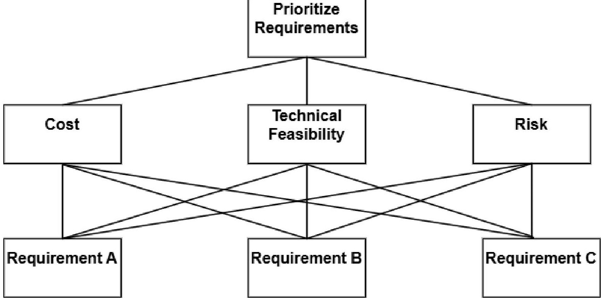

Figure 3.11. Multi-Criteria Framework for Requirements Prioritization.

This hierarchical breakdown helps clarify how each requirement connects to evaluation criteria and supports later steps involving pairwise comparison matrices. As shown in Figure 3.11, the structure visually represents how criteria shape the priorities of requirements, all of which are organized under a unified system goal.

Step 2: Perform Pairwise Comparisons for Criteria - The second step in the Analytic Hierarchy Process (AHP) assesses the importance each evaluation criterion holds in relation to the main system goal. This is done by comparing each criterion against the others in pairs to form a judgment matrix. Saaty's widely used scale, ranging from 1 to 9, helps quantify the degree of importance between pairs.

<!-- PDF_PAGE: 133 -->

This numeric scale assigns:

- 1 for equal importance,

- 3 for moderate importance,

- 5 for strong importance,

- 7 for very strong importance,

- 9 for extreme importance.

The values 2,4,6, and 8 serve as intermediates. If one criterion is more important than another, the reverse comparison automatically takes its reciprocal value (e.g., 1/3, 1/5).

Using this scale, the following evaluations were made:

- Cost was moderately more important than Technical Feasibility $ \rightarrow $ value of 3.

- Cost was strongly more important than Risk $ \rightarrow $ value of 5.

- Technical Feasibility vs. Cost was assigned 1/3 $ \rightarrow $ reciprocal of earlier comparison.

These ratings establish a consistent basis for determining the weight each criterion should carry in the next step. The process converts expert input into measurable values that support informed decision-making.

Table 3.3. Pairwise Comparison Matrix.

<table border="1"><tr><td></td><td>Cost</td><td>Technical Feasibility</td><td>Risk</td></tr><tr><td>Cost</td><td>1.0</td><td>3.0</td><td>5.0</td></tr><tr><td>Technical Feasibility</td><td>0.33</td><td>1.0</td><td>3.0</td></tr><tr><td>Risk</td><td>0.2</td><td>0.33</td><td>1.0</td></tr><tr><td>Sum</td><td>1.53</td><td>4.33</td><td>9.0</td></tr></table>

<!-- PDF_PAGE: 134 -->

These values were used to construct the pairwise comparison matrix shown in Table 3.3, which quantifies the decision-maker's preferences and serves as the basis for calculating normalized weights in the next step.

## Step 3: Normalize the Pairwise Comparison Matrix

Normalization begins by calculating the sum of each column in the matrix. Each entry is then divided by its respective column total. This method scales all values proportionally, ensuring the matrix reflects the relative significance of each input.

Table 3.4. Normalized Matrix.

<table border="1"><tr><td>Criteria</td><td>Cost</td><td>Technical Feasibility</td><td>Risk</td></tr><tr><td>Cost</td><td>1/1.53=0.654</td><td>3/4.33=0.692</td><td>5/9=0.556</td></tr><tr><td>Technical Feasibility</td><td>0.33/1.53=0.216</td><td>1/4.33=0.231</td><td>3/9=0.333</td></tr><tr><td>Risk</td><td>0.2/1.53=0.131</td><td>0.33/4.33=0.076</td><td>1/9=0.111</td></tr></table>

## Step 4: Calculate the Priority Vector

After normalizing the matrix, the weight of each criterion is determined by averaging the numbers across its row. These row averages are then used to construct the priority vector, which indicates the level of importance each criterion holds in guiding the overall decision.

As shown in Table 3.5, the row-wise averages were computed as follows:

Table 3.5. Priority Vector.

<table border="1"><tr><td>Criteria</td><td>Criteria Weight(Average of Row)</td></tr><tr><td>Cost</td><td>(0.654+0.692+0.556)/3=0.634</td></tr><tr><td>Technical Feasibility</td><td>(0.216+0.231+0.333)/3=0.260</td></tr><tr><td>Risk</td><td>(0.131+0.076+0.111)/3=0.106</td></tr></table>

$$
\text {P i r o r i t y V e c t o r} = [ 0. 6 3 4, 0. 2 6 0, 0. 1 0 6 ]
$$

<!-- PDF_PAGE: 135 -->

Cost turned out to be the most significant factor, accounting for approximately 63.4% of the total weight. Technical Feasibility followed with 26.0% , while Risk had the least impact, at just 10.6%. These values are now used to calculate scores for each requirement.

## Step 5: Check Consistency Using Consistency Ratio

To verify whether the earlier pairwise comparisons were logically consistent, a verification step is performed. This helps determine if the judgments in the matrix align well and if the resulting weights are suitable for reliable decision support.

Table 3.6. Original Pairwise Matrix with Priority Vector.

<table border="1"><tr><td>Criteria Weight</td><td>0.634</td><td>0.260</td><td>0.106</td></tr><tr><td></td><td>Cost</td><td>Technical Feasibility</td><td>Risk</td></tr><tr><td>Cost</td><td>1.0</td><td>3.0</td><td>5.0</td></tr><tr><td>Technical Feasibility</td><td>0.33</td><td>1.0</td><td>3.0</td></tr><tr><td>Risk</td><td>0.2</td><td>0.33</td><td>1.0</td></tr></table>

The method involves multiplying the original pairwise comparison matrix (Table 3.5) by the priority vector [0.634, 0.260, 0.106]. This operation produces a weighted sum for each row, as illustrated in Table 3.7. For instance, the weighted value for the "Cost" row is:

$$
(1. 0 \times 0. 6 3 4) + (3. 0 \times 0. 2 6 0) + (5. 0 \times 0. 1 0 6) = 1. 9 4 4
$$

Table 3.7. Multiplied Criteria with Weight.

<table border="1"><tr><td>Criteria Weight</td><td>0.634</td><td>0.260</td><td>0.106</td><td></td></tr><tr><td></td><td>Cost</td><td>Technical Feasibility</td><td>Risk</td><td>Weighted Sum</td></tr><tr><td>Cost</td><td>1.0*0.634=0.634</td><td>3.0*0.260=0.780</td><td>5.0*0.106=0.530</td><td>1.944</td></tr><tr><td>Technical Feasibility</td><td>0.33*0.634=0.209</td><td>1.0*0.260=0.260</td><td>3.0*0.106=0.318</td><td>0.7872</td></tr><tr><td>Risk</td><td>0.2*0.634=0.127</td><td>0.33*0.260=0.086</td><td>1.0*0.106=0.106</td><td>0.3186</td></tr></table>

<!-- PDF_PAGE: 136 -->

Each row of the matrix is evaluated by computing a total sum using its weighted inputs. This total is then divided by the corresponding element from the priority vector to assess consistency. This approach, introduced by Saaty (1980) in the Analytic Hierarchy Process, yields the following results:

- Cost: $ 1.944\div0.634=3.066 $

- Technical Feasibility: 0.7872 $ \div $ 0.260=3.028

- Risk: 0.3186 $ \div $ 0.106=3.006

Table 3.8. Division with Priority Vector.

<table border="1"><tr><td>Criteria</td><td>Weighted Sum</td><td>Priority Vector</td><td>Division Result</td></tr><tr><td>Cost</td><td>1.944</td><td>0.634</td><td>1.944/0.634=3.066</td></tr><tr><td>Technical Feasibility</td><td>0.7872</td><td>0.260</td><td>0.7872/0.260=3.028</td></tr><tr><td>Risk</td><td>0.3186</td><td>0.106</td><td>0.3186/0.106=3.006</td></tr></table>

To approximate the dominant eigenvalue ( $ \lambda\max $ ), the consistency values derived earlier are averaged as follows:

$$
\lambda_ {m a x} = (3. 0 6 6 + 3. 0 2 8 + 3. 0 0 6) \div 3 = 3. 0 3 3
$$

Using this result, the Consistency Index (CI) is obtained with the equation:

$$
C I = \left(\lambda_ {\max } - n\right) \div (n - 1)
$$

Given that $ \lambda\max=3.033 $ and n=3, this leads to:

$$
C I = (3. 0 3 3 - 3) \div 2 = 0. 0 1 6 5
$$

The next step involves calculating the Consistency Ratio (CR). This is done by dividing the CI by the Random Index (RI). For n=3, the standard RI value is 0.58:

<!-- PDF_PAGE: 137 -->

$$
C R = 0. 0 1 6 5 \div 0. 5 8 = 0. 0 2 8 4
$$

Since CR values under 0.10 are typically considered acceptable, this outcome confirms that the pairwise comparisons are reasonably consistent, and the weights derived from them can be used with confidence in the analysis.

## Step 6: Rank the Requirements Using Criterion Weights

This step applies the criterion weights from the priority vector ([0.634, 0.260, 0.106]) to the normalized requirement matrices to compute final requirement rankings.

## Step 6.1: Requirement Comparisons per Criterion:

Each requirement (A, B, C) was pairwise compared with respect to individual criteria, Cost, Technical Feasibility, and Risk, using the AHP scale.

## Step 6.2: Matrix Normalization

Each pairwise matrix was normalized by dividing values by the column sum. Normalized results appear in the following tables.

Table 3.9. Pairwise Comparison Matrix for Requirements (Cost).

<table border="1"><tr><td></td><td>Requirement A</td><td>Requirement B</td><td>Requirement C</td></tr><tr><td>Requirement A</td><td>1</td><td>3</td><td>5</td></tr><tr><td>Requirement B</td><td>1/3</td><td>1</td><td>2</td></tr><tr><td>Requirement C</td><td>1/5</td><td>1/2</td><td>1</td></tr></table>

<!-- PDF_PAGE: 138 -->

The subsequent matrix evaluates technical feasibility:

Table 3.10. Pairwise Matrix for Requirements (Technical Feasibility).

<table border="1"><tr><td></td><td>Requirement A</td><td>Requirement B</td><td>Requirement C</td></tr><tr><td>Requirement A</td><td>1</td><td>2</td><td>7</td></tr><tr><td>Requirement B</td><td>1/2</td><td>1</td><td>5</td></tr><tr><td>Requirement C</td><td>1/7</td><td>1/5</td><td>1</td></tr></table>

The final matrix captures risk-related judgments:

Table 3.11. Pairwise Comparison Matrix for Requirements (Risk).

<table border="1"><tr><td></td><td>Requirement A</td><td>Requirement B</td><td>Requirement C</td></tr><tr><td>Requirement A</td><td>1</td><td>3</td><td>4</td></tr><tr><td>Requirement B</td><td>1/3</td><td>1</td><td>2</td></tr><tr><td>Requirement C</td><td>1/4</td><td>1/2</td><td>1</td></tr></table>

## Step 6.3: Weighted Aggregation

To calculate the final score for each requirement, the normalized values corresponding to all evaluation criteria were multiplied by their respective weights. These products were then summed to generate an overall priority score. This composite score captured the weighted influence of each criterion, thereby enabling a structured comparison of requirements A, B, and C across multiple decision dimensions.

<!-- PDF_PAGE: 139 -->

Table 3.12. Normalized Pairwise Comparison Matrices (Cost).

<table border="1"><tr><td></td><td>Requirement A</td><td>Requirement B</td><td>Requirement C</td></tr><tr><td>Requirement A</td><td>1/1.53=0.654</td><td>3/4.5=0.666</td><td>5/8=0.625</td></tr><tr><td>Requirement B</td><td>(1/3)/1.53=0.216</td><td>1/4.5=0.222</td><td>2/8=0.25</td></tr><tr><td>Requirement C</td><td>(1/5)/1.53=0.131</td><td>(1/2)/4.5=0.111</td><td>1/8=0.125</td></tr></table>

The following matrix presents the normalized values for technical feasibility:

Table 3.13. Normalized Pairwise Comparison Matrices (Tech).

<table border="1"><tr><td></td><td>Requirement A</td><td>Requirement B</td><td>Requirement C</td></tr><tr><td>Requirement A</td><td>1/1.69=0.592</td><td>2/3.7=0.541</td><td>7/13.2=0.530</td></tr><tr><td>Requirement B</td><td>(1/2)/1.69=0.296</td><td>1/3.7=0.270</td><td>5/13.2=0.378</td></tr><tr><td>Requirement C</td><td>(1/7)/1.69=0.113</td><td>(1/5)/3.7=0.189</td><td>1/13.2=0.092</td></tr></table>

Normalized risk comparisons are shown as follows:

Table 3.14. Normalized Pairwise Comparison Matrices (Risk).

<table border="1"><tr><td></td><td>Requirement A</td><td>Requirement B</td><td>Requirement C</td></tr><tr><td>Requirement A</td><td>1/1.583=0.632</td><td>3/4.5=0.666</td><td>4/7.5=0.533</td></tr><tr><td>Requirement B</td><td>(1/3)/1.583=0.211</td><td>1/4.5=0.222</td><td>2/7.5=0.266</td></tr><tr><td>Requirement C</td><td>(1/4)/1.583=0.158</td><td>(1/2)/4.5=0.111</td><td>1/7.5=0.133</td></tr></table>

Step 6.4: Derive Priority Vectors for Each Criterion:

The priority vectors for each requirement under the respective criteria were obtained by computing the average of each row in the corresponding normalized pairwise matrix. This yielded the relative weight of each requirement with respect to the individual criterion.

<!-- PDF_PAGE: 140 -->

- Cost Priority Vector = [0.648, 0.229, 0.122]

- Tech Feasibility Priority Vector = [0.555, 0.315, 0.130]

- Risk Priority Vector = [0.611, 0.277, 0.112]

These vectors represent the local priorities of the requirements before they are aggregated globally.

## Step 6.5: Aggregate Final Requirement Scores

To compute the final priority scores, each requirement's local priority (from Step 6.4) was weighted by the corresponding criterion importance (from Step 4). The weighted values were summed to determine the global ranking:

- S (Requirement A) = (0.648 $ \times $ 0.634) + (0.555 $ \times $ 0.260) + (0.611 $ \times $ 0.106) = 0.4111 + 0.1443+0.0647=0.6201

- S (Requirement B) = (0.229 $ \times $ 0.634) + (0.315 $ \times $ 0.260) + (0.277 $ \times $ 0.106) = 0.1453 + 0.0819+0.0294=0.2566

- S (Requirement C) = (0.122 $ \times $ 0.634) + (0.130 $ \times $ 0.260) + (0.112 $ \times $ 0.106) = 0.0773 + 0.0338+0.0119=0.1230

The final rankings indicate that Requirement A is the highest priority, followed by Requirement B and Requirement C.

## Step 6.6: Rank the Requirements

Based on the calculated weights, the requirements were arranged in descending order of importance:

1) Requirement A: 0.6201

2) Requirement B: 0.2566

3) Requirement C: 0.1230

<!-- PDF_PAGE: 141 -->

Given these results, Requirement A appears to be the most influential across the criteria and thus merits priority during planning and allocation efforts (Saaty, 1980).

## 3.3.5.3 Weighted Scoring (Sum) Approach: Proposed Framework Design

The Weighted Scoring Model, also known as the Weighted Sum Model, is a type of Multi- Criteria Decision Analysis (MCDA) method that enables prioritization by assigning weights to criteria and aggregating them into total scores (Belton, 2012). In this study, a structured evaluation framework consisting of three complementary techniques is applied to support systematic decision-making, as illustrated in Figure 3.12:

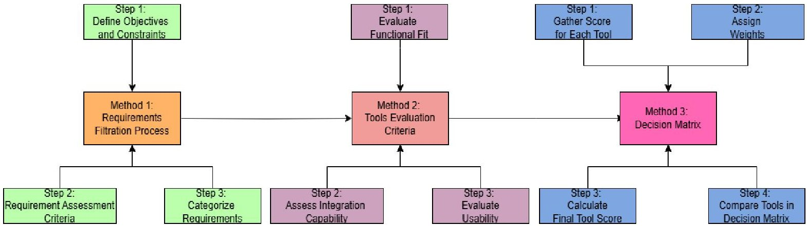

Figure 3.12. Weighted Scoring Framework for Requirements Prioritization.

Application in This Research:

## Method 1 - Requirement Filtration Process:

A straightforward prioritization formula is used to rank system requirements:

$$
P = B + U - I - R
$$

In this expression, P indicates the computed priority level, derived from the combination of business impact (B), user demand (U), implementation effort (I), and associated risk (R). The resulting scores help organize the requirements into distinct categories, high, medium, or low, facilitating progressive and adaptive development decisions (Alai, 2019).

<!-- PDF_PAGE: 142 -->

## Method 2 - Tools Evaluation Criteria:

Candidate tools are evaluated against three core dimensions: functional fit, integration capability, and usability. Each attribute is scored and weighted to reflect its relevance to digital engineering needs and lifecycle compatibility.

## Method 3 - Decision Matrix Construction:

A decision matrix is constructed to consolidate weighted scores, allowing direct comparison across tools or requirements. This matrix ensures traceable, criteria-based selection aligned with system objectives.

This integrated approach enhances transparency, supports traceability, and facilitates faster decision-making in complex system environments. The following sections provide a detailed explanation of each method, including its rationale, procedure, and example application as implemented in this research.

## Method 1: Requirement Filtration Process

## Step 1: Define Objectives and Constraints

To filter requirements effectively, it is essential first to define project-specific boundaries, such as fiscal limitations, delivery timelines, and the readiness of applicable technologies. These act as key evaluative dimensions. Each is assigned a numerical importance using the following formulation:

$$
W _ {t o t a l} = W _ {b u d g e t} + W _ {s c h e c d u l e} + W _ {t e n c h o l o g y}
$$

In a military-grade satellite initiative, one may assign:

Budget = 40%, Schedule = 35%, Technology = 25% $ \rightarrow $ totaling 100%.

<!-- PDF_PAGE: 143 -->

These weights serve as reference points. Every candidate requirement is scored against these dimensions, based on how strongly it satisfies each factor. This ensures that the selection process is grounded in quantified priorities and tailored to the specific mission scenario.

## Step 2: Requirement Assessment Criteria

Requirements are evaluated using four structured criteria that reflect their value, urgency, feasibility, and risk within the project environment:

- Business value (B): The degree to which the requirement contributes to project or stakeholder objectives.

- User urgency (U): The immediacy with which the requirement must be addressed to meet mission or operational timelines.

- Implementation effort (I): The estimated complexity, resource cost, or technical burden required for realization.

- Risk level (R): The severity of consequences if the requirement is not fulfilled, including mission failure or compliance gaps.

These criteria are scored using a relative scale (typically 0-100), derived through stakeholder input, expert judgment, and historical data from similar projects. While inherently subjective, this scoring structure accommodates project-specific trade-offs and ensures context-sensitive evaluation. A composite priority score is calculated a

$$
P _ {s c o r e} = B + U - I - R
$$

Example: For a requirement such as "high-resolution camera functionality for satellite surveillance," the assigned scores might be:

- Business Value (B) = 85 (out of 100)

- User Urgency (U) = 70

<!-- PDF_PAGE: 144 -->

- Implementation Effort (I) = 40

- Risk Level (R) = 30

Thus, the priority score is:

$$
P (s c o r e) = B + U - I - R = 8 5 + 7 0 - 4 0 - 3 0 = 8 5
$$

This quantitative measure supports early-stage filtration by identifying requirements with high strategic value and low implementation barriers.

## Step 3: Categorize Requirements

After computing the priority score P for each requirement, items are sorted into three levels to support planning and decision-making:

- High Priority: P > 75

- Medium Priority: 50

$$
F = \sum_ {i = 1} ^ {n} F _ {i}
$$

Where F (i): Functionality score for each phase (elicitation, validation, etc.)

Example: Tool A supports elicitation and validation ideally, but is average in prioritization.

- Elicitation Score, E (40): This score reflects how well the tool supports gathering or eliciting stakeholder requirements. It is typically assigned based on expert judgment, historical performance data, or stakeholder feedback.

- Validation Score, V (30): This score assesses how well the tool helps validate or verify that the requirements meet the project needs.

- Prioritization Score, P (15): This score reflects how effective the tool is at helping prioritize requirements based on importance.

Total Functionality Score (F) = F (E) + F (V) + F (P) = 40 + 30 + 15 = 85

This cumulative score provides a quantitative basis for comparing tools based on lifecycle support coverage.

## Step 2: Integration Capability

This step assesses the tool's ability to interface with both legacy systems and emerging technologies, a crucial consideration in domains such as aerospace, where backward compatibility and future extensibility are essential. The integration score is computed as:

$$
I _ {s c o r e} = \frac {I _ {l e g a c y} + I _ {n e w}}{2}
$$

Where $ I_{legacy}=Integration capability with legacy systems, $

$ I_{new}=Integration capability with new systems. $

Legacy Integration Score ( $ I_{legacy} $ ): Tool A integrates well with legacy systems, scoring 95.

New System Integration Score ( $ I_{new} $ ): It is moderately effective with new systems, scoring 85.

<!-- PDF_PAGE: 146 -->

This average represents the tool's balanced performance across integration demands.

## Step 3: Usability and User Feedback

Usability is assessed through user evaluations, capturing the ease of tool operation during typical project activities. Each user provides a usability score, and the overall score is computed as the arithmetic mean:

$$
U _ {s c o r e} = \frac {\sum_ {i = 1} ^ {m} U _ {i}}{m}
$$

Where $ U_{i}= $ Usability score from each user test and m = Number of user tests

As shown in Table 3.15, Tool A received the following scores: 70, 80, 85, 85, and 80.

Table 3.15. Usability Score.

<table border="1"><tr><td>User</td><td>User1</td><td>User2</td><td>User3</td><td>User4</td><td>User5</td></tr><tr><td>Usability Score</td><td>70</td><td>80</td><td>85</td><td>85</td><td>80</td></tr></table>

$ U_{score}=(\mathrm{Sum~of~User~Scores})/\mathrm{Number~of~Users}= (70+80+85+85+80)/5=80 $

This aggregated score is used in the decision matrix to reflect overall usability.

## Method 3: Decision Matrix

The decision matrix approach is used to consolidate evaluation results from Method 2 and compare multiple tools based on a common scoring framework. Final tool scores are computed using a weighted sum of three evaluation criteria, functionality (F), integration capability $ ( I_{score} ) $ , and usability $ ( U_{score} ) $ . This enables a transparent, criteria-driven comparison across alternatives. $ ^{20} $

<!-- PDF_PAGE: 147 -->

The overall score for each tool is given by:

$$
S _ {t o o l} = w _ {1} + w _ {2} I _ {s c o r e} + w _ {3} U _ {s c o r e}
$$

Where w1, w2, w3 = Weights assigned to functionality, integration, and usability,

respectively, and $ S_{tool}= $ Final score for each tool.

## Step 1: Gather Scores for Each Tool

Based on the evaluation conducted in Method 2, scores for functionality (F), integration $ ( I_{score} ) $ and usability $ ( U_{score} ) $ are collected for each tool. These scores serve as the input variables for calculating the final tool score using the weighted decision formula.

## Step 2: Assign Weights (w1, w2, w3)

Weights are allocated to reflect the relative importance of each evaluation criterion, functionality (F), integration (I), and usability (U). These weights are determined based on stakeholder input and project-specific priorities. The sum of weights must equal 1.0 to maintain proportionality.

$$
w _ {1} + w _ {2} + w _ {3} = 1
$$

Example:

- Functionality is prioritized: $ w_{1}=0.5 $

- Integration is moderately emphasized: $ w_{2}=0. 3 $

- Usability is less critical: $ w_{3}=0.2 $

## Step 3: Calculate the Final Tool Score (S)

The final score for each tool is computed as the weighted sum of its functionality, integration, and usability scores.

$$
S _ {t o o l} = w _ {1} * F + w _ {2} * I + w _ {3} * U
$$

Example for Tool A: $ S_{tool A}=(0.5*85)+(0.3*90)+(0.2*80)=42.5+27+16=85.5 $

<!-- PDF_PAGE: 148 -->

## Step 4: Compare Tools in the Decision Matrix

Final scores for each tool are listed in a decision matrix. The tool with the highest score is selected as the optimal choice for managing requirements. In this example, Tool A scores highest (85.5), indicating it best aligns with project needs:

Table 3.16. Decision Matrix for Tool Selection.

<table border="1"><tr><td>Tool</td><td>Functionality Score(F)</td><td>Integration Score(I)</td><td>Usability Score(U)</td><td>Final Score(S)</td></tr><tr><td>ToolA</td><td>85</td><td>90</td><td>80</td><td>85.5</td></tr><tr><td>ToolB</td><td>75</td><td>85</td><td>90</td><td>82.0</td></tr><tr><td>ToolC</td><td>90</td><td>80</td><td>85</td><td>85.0</td></tr></table>

This structured method supports transparent tool selection and flexible prioritization, which is especially valuable in dynamic sectors such as defense and aerospace.

## 3.3.5.4 Application in SidSat Context

## Method 1: Requirement Filtration Process

This approach was used to identify high-priority requirements from 110 candidates spanning Functional (FR), Performance (PR), Battery Testing (BTR), and Environmental (EvR) categories for a CubeSat.

## Step 1: Define Objectives and Constraints

Each design constraint was assigned a percentage weight to reflect its significance to the satellite project's success. The breakdown is as follows:

- Mission Criticality received the highest weight at 40%,

- Battery Reliability at 30%,

- Environmental Impact at 20%, and

- Mass Constraints at 10%.

<!-- PDF_PAGE: 149 -->

These values collectively form a normalized scale totaling 100%, ensuring all critical areas are proportionally represented in the prioritization process.

## Step 2: Requirement Assessment Criteria

To facilitate structured prioritization, each requirement was assessed using a quantitative scoring approach:

$$
P = B + U - I - R,
$$

where:

- B denotes Business Value,

- U reflects User Urgency,

- I represents Implementation Effort, and

- R accounts for associated Risk.

Illustrative examples include:

- LT Lifetime Test - B: 90, U: 85, I: 40, R: 20 $ \rightarrow $ P = 115, categorized as high priority.

- FR 1.4 Energize - B: 80, U: 75, I: 50, R: 30 $ \rightarrow $ P=75, indicating medium priority.

## Step 3: Categorize Requirements

Requirements were grouped by score:

- High Priority (P>75): 30 requirements, including performance, battery testing, and critical environmental requirements.

- Medium Priority (50<P≤75): 20 functional and performance requirements.

- Low Priority (P $ \leq $ 50): 18 requirements were deprioritized as non-critical.

<!-- PDF_PAGE: 150 -->

Outcome of Method 1: From a total of 110, the list was narrowed down to 30 high-priority requirements, centered on mission success, battery reliability, and environmental resilience. $ ^{21} $

## Method 2: Tools Evaluation Criteria

This step evaluated three MBSE tools, Cameo, Capella, and DOORS, for their ability to manage prioritized CubeSat requirements, using weighted criteria.

## Step 1: Gather Scores for Cameo, Capella, and DOORS

Each tool was assessed on its capability to manage functional, performance, environmental and other requirements.

- Functionality (F): For effectively managing performance, battery testing, and environmental requirements.

- Integration (I): For integration with existing systems.

- Usability (U): For ease of use based on user experience.

For Cameo, Functionality (F) = 90, Integration (I) = 80, Usability (U) = 70

For Capella, Functionality (F) = 75, Integration (I) = 70, Usability (U) = 80

For Doors, Functionality (F) = 70, Integration (I) = 75, Usability (U) = 65

## Step 2: Weighted Score Calculation

Assigned weights were applied to the priority scores for each tool:

$$
\mathrm {S} (\mathrm {C a m e o}) = (0. 5 \times 9 0) + (0. 3 \times 8 0) + (0. 2 \times 7 0) = 4 5 + 2 4 + 1 4 = 8 3
$$

$$
\mathrm {S} (\mathrm {C a p e l l a}) = (0. 5 \times 7 5) + (0. 3 \times 7 0) + (0. 2 \times 8 0) = 3 7. 5 + 2 1 + 1 6 = 7 4. 5
$$

$$
\mathrm {S} (\mathrm {D O O R S}) = (0. 5 \times 7 0) + (0. 3 \times 7 5) + (0. 2 \times 6 5) = 3 5 + 2 2. 5 + 1 3 = 7 0. 5
$$

<!-- PDF_PAGE: 151 -->

## Step 3: Compare Tools

Table 3.17. Comparison of Cameo, Capella, and DOORS.

<table border="1"><tr><td>Tool</td><td>Functionality Score(F)</td><td>Integration Score(I)</td><td>Usability Score(U)</td><td>Final Score(S)</td></tr><tr><td>Cameo</td><td>90</td><td>80</td><td>70</td><td>83.0</td></tr><tr><td>Capella</td><td>75</td><td>70</td><td>80</td><td>74.5</td></tr><tr><td>DOORS</td><td>70</td><td>75</td><td>65</td><td>70.5</td></tr></table>

Outcome of Method 2: Cameo achieved the highest score and was selected as the most effective tool for managing requirements in the CubeSat project.

## Method 3: Decision Matrix

A weighted decision matrix was used to rank key high-priority requirements based on scores for Functionality, Integration, and Usability.

## Step 1: Select Requirements

Five mission-critical requirements were shortlisted for evaluation:

- PR 2.5 Operational Lifetime: SidSat shall have an operational lifetime between 1.5 and 6 years in Low Earth Orbit.

- FR 1.5.3 Survive: SidSat shall endure temperatures ranging from $ 6 5^{\circ} \mathrm{C} $ to $ + 1 2 8^{\circ} \mathrm{C}. $

- BTR 3.10.1 Vibration OCV: Acceptance cells/battery packs shall have between 0 and 0.1% change in OCV (Open Circuit Voltage).

- EvR 4.1.1 Env Vibration Factor of Safety: SidSat shall be capable of withstanding the random vibration environment for flight with a factor of safety 1.5 or greater.

- EvR 4.1.2 Vibration Frequency Range: SidSat shall withstand random vibrations with a frequency between 20 Hz and 2000 Hz.

<!-- PDF_PAGE: 152 -->

## Step 2: Assign Weights and Calculate Final Scores

The following weights were assigned: Functionality (F) = 50%, Integration (I) = 30%, and Usability (U) = 20%

## Step 3: Calculate Scores for Each Requirement

Final scores were computed using the formula:

$$
S _ {r e q u i r e m e n t} = (0. 5 \times F) + (0. 3 \times I) + (0. 2 \times U)
$$

- PR 2.5 Operational Lifetime: F=85, I=85, U=78

$ \circ $ $ \mathrm{S (P R)}=(0. 5 \times 8 5)+(0. 3 \times 8 5)+(0. 2 \times 7 8)=4 2. 5+2 5. 5+1 5. 6=8 3. 6 $

- FR 1.5.3 Survive: F = 86, I = 84, U = 75

$ \circ $ S (FR) $ = (0. 5 \times 8 6) + (0. 3 \times 8 4) + (0. 2 \times 7 5) = 4 3 + 2 5. 2 + 1 5 = 8 3. 2 $

- BTR 3.10.1 Vibration OCV: F = 87, I = 82, U = 75

$$
\circ \mathrm {S} (\mathrm {B T R}) = (0. 5 \times 8 7) + (0. 3 \times 8 2) + (0. 2 \times 7 5) = 4 3. 5 + 2 4. 6 + 1 5 = 8 3. 1
$$

- EvR 4.1.1 Env Vibration Factor of Safety: F = 86, I = 82, U = 76

$$
\circ \mathrm {S} (\mathrm {E v R}) = (0. 5 \times 8 6) + (0. 3 \times 8 2) + (0. 2 \times 7 6) = 4 3 + 2 4. 6 + 1 5. 2 = 8 2. 8
$$

- EvR 4.1.2 Vibration Frequency Range: F = 86, I = 81, U = 75

$$
\circ \mathrm {S} (\mathrm {E v R}) = (0. 5 \times 8 6) + (0. 3 \times 8 1) + (0. 2 \times 7 5) = 4 3 + 2 4. 3 + 1 5 = 8 2. 3
$$

## Step 4: Comparison Table (Decision Matrix)

The decision matrix below summarizes the weighted evaluation of the selected high-priority requirements based on functionality, integration, and usability criteria. The final scores highlight which requirements are most aligned with system objectives and stakeholder constraints.

<!-- PDF_PAGE: 153 -->

Table 3.18. Decision Matrix for SidSat Requirements Prioritization.

<table border="1"><tr><td>Requirement</td><td>Functionality Score(F)</td><td>Integration Score(I)</td><td>Usability Score(U)</td><td>Final Score(S)</td><td>Priority</td></tr><tr><td>Operational Lifetime</td><td>85</td><td>85</td><td>78</td><td>83.6</td><td>★★★★★</td></tr><tr><td>Survive</td><td>86</td><td>84</td><td>75</td><td>83.2</td><td>★★★★☆</td></tr><tr><td>Vibration OCV(Open Circuit Voltage)</td><td>87</td><td>82</td><td>75</td><td>83.1</td><td>★★★★☆</td></tr><tr><td>Env Vibration Safety Factor</td><td>86</td><td>82</td><td>76</td><td>82.8</td><td>★★★★☆</td></tr><tr><td>Vibration Frequency Range</td><td>86</td><td>81</td><td>75</td><td>82.3</td><td>★★★★☆</td></tr></table>

Step 5: Final Prioritization:

Among the reviewed items, FR 2.5 Operational Lifetime earned the top score of 83.6, confirming its value in supporting CubeSat structural integrity throughout launch and orbital operation. Each of the five high-ranking requirements exceeded the cutoff of 75, reflecting their importance to mission criteria and stakeholder-defined success factors. The matrix evaluation provided a practical means of comparing priorities based on weighted scores. It also confirmed the usefulness of a platform-neutral MBSE structure to preserve traceability and continuity across development and integration stages. $ ^{22} $

## 3.3.5.5 Strategic Implications of Comparative Results

This section reviews the Weighted Scoring Model in conjunction with the Analytical Hierarchy Process (AHP), focusing on how each approach addresses the varying needs of different projects. AHP relies on pairwise comparisons and structured consistency checks, making it well-suited for

<!-- PDF_PAGE: 154 -->

projects that benefit from hierarchical evaluation. However, its layered structure can introduce delays, especially when rapid prioritization is required.

By contrast, the Weighted Scoring Model uses a more direct method, assigning scores to criteria without recursive comparisons. This makes it better suited for environments where requirements or constraints change frequently. The model is often preferred during early-stage assessments, where decisions must be made quickly and iteratively.

While AHP offers depth and traceable logic, the Weighted Scoring Model prioritizes speed and adaptability. This distinction makes it a strong fit for dynamic systems engineering efforts where flexibility and timely stakeholder alignment are essential.

Table 3.19. Analytical Hierarchy Process Vs. Weighted Scoring Model.

<table border="1"><tr><td>Aspect</td><td>Weighted Scoring Model</td><td>Analytical Hierarchy Process (AHP)</td></tr><tr><td>Structure</td><td>No hierarchy, multiple criteria are used directly</td><td>Hierarchical with goals, criteria, and alternatives</td></tr><tr><td>Comparison &amp; Rigor</td><td>Direct weights and scores with straightforward arithmetic</td><td>Uses pairwise comparisons and complex math (eigenvalues)</td></tr><tr><td>Flexibility</td><td>Highly flexible with quick adjustments</td><td>Less flexible due to complex comparisons and consistency checks</td></tr><tr><td>Application Scope</td><td>Practical for fast, precise decisions in dynamic projects</td><td>Best for strategic decision-making in complex projects</td></tr></table>

## 3.3.6 Risk and Change Management

Requirements prioritization in Complex Adaptive Systems (CAS), especially within aerospace and defense programs, must account for fluctuating conditions and incomplete information. In such domains, risk oversight and responsiveness to change are not optional; they are foundational. A dependable prioritization strategy must account for technical evolution, shifting stakeholder goals, and real-world constraints, without degrading system reliability. This section presents a

<!-- PDF_PAGE: 155 -->

prioritization method designed to embed risk-conscious decision paths and adaptation mechanisms, reinforcing system robustness and maintainability across the design lifecycle.

## 3.3.6.1 Risk Alignment through Prioritization

Requirements prioritization inherently influences the success of system development, particularly in projects where resource constraints and evolving operational contexts increase uncertainty. When prioritization is misaligned with underlying risk factors, the resulting impacts can include cost escalation, schedule disruption, and unmet stakeholder needs. To address this, risk alignment must be integrated directly into the prioritization process, using both structured decision-making and traceable system modeling.

This study employs the Analytical Hierarchy Process (AHP) and weighted scoring techniques to facilitate the early-stage evaluation of requirements, considering technical feasibility, urgency, mission relevance, and volatility. These methods generate comparative rankings that inform trade-space analysis and downstream verification and validation (V&V) planning. Importantly, rationale annotations and pairwise comparisons are embedded into the SysML modeling environment, enabling transparency and traceability.

However, even the most rigorously derived priority rankings can introduce risk if changes in system understanding or stakeholder priorities are not managed effectively. As shown in Table 3.20, key risks, such as inconsistent weighting criteria, missed emergent needs, and weak verification and validation (V&V) linkages, can result directly from static or misapplied prioritization strategies. For each identified risk, targeted mitigation approaches are documented. For example, applying AHP with rationale checks reduces inconsistency, while SysML-based traceability between requirements and test plans addresses verification gaps.

<!-- PDF_PAGE: 156 -->

Table 3.20. Risk Strategies in Prioritization.

<table border="1"><tr><td>Risk</td><td>Cause</td><td>Mitigation</td><td>Outcome</td></tr><tr><td>Misaligned Requirements</td><td>Incomplete input</td><td>Early reviews, stakeholder alignment</td><td>Better requirement alignment</td></tr><tr><td>Inconsistent Weighting</td><td>Unclear criteria</td><td>Apply AHP with rationale checks</td><td>Transparent prioritization</td></tr><tr><td>Missed Emergent Needs</td><td>Static framework</td><td>Use adaptive models, update regularly</td><td>Captures evolving needs</td></tr><tr><td>Reprioritization Overhead</td><td>Volatile inputs</td><td>Flat scoring for quick updates</td><td>Less rework, more agility</td></tr><tr><td>Weak V&amp;V Linkage</td><td>No test traceability</td><td>Connect to test plans using SysML</td><td>Stronger V&amp;V planning</td></tr></table>

To formalize the connection between risk management and prioritization, a semiquantitative framework is adopted. Likelihood and impact of each prioritization-related risk are scored using standard definitions adapted from MIL-STD-882C. The likelihood categories are defined in Table 3.21, which should be referenced when assigning qualitative probability values.

Table 3.21. Probability Description Table.

<table border="1"><tr><td>Probability Description</td><td>Likelihood of Occurrence over Lifetime of Item</td><td>Likelihood of Occurrence by Number of Items</td></tr><tr><td>Frequent</td><td>Likely to occur frequently</td><td>Widely experienced</td></tr><tr><td>Probable</td><td>Will occur several times in life of item</td><td>Will occur frequently</td></tr><tr><td>Occasional</td><td>Likely to occur sometime in life of item</td><td>Will occur in several items</td></tr><tr><td>Remote</td><td>Unlikely but possible to occur in life of item</td><td>Unlikely but can reasonably be expected to occur</td></tr><tr><td>Improbable</td><td>So unlikely it can be assumed occurrence may not be experienced</td><td>Unlikely to occur but possible</td></tr></table>

<!-- PDF_PAGE: 157 -->

This scoring supports the creation of a risk matrix, which visualizes risk exposure levels based on probability-impact combinations. The matrix (Figure 3.13) classifies risks into three bands:

- Green: Acceptable; monitor only.

- Yellow: Requires active mitigation.

- Red: Requires mitigation with contingency planning.

<table border="1"><tr><td colspan="6">Probability and Impact Matrix</td></tr><tr><td colspan="6">Exposition Factor=PxI</td></tr><tr><td>Probability(P)</td><td colspan="5"></td></tr><tr><td>5</td><td>5</td><td>10</td><td>15</td><td>20</td><td>25</td></tr><tr><td>4</td><td>4</td><td>8</td><td>12</td><td>16</td><td>20</td></tr><tr><td>3</td><td>3</td><td>6</td><td>9</td><td>12</td><td>15</td></tr><tr><td>2</td><td>2</td><td>4</td><td>6</td><td>8</td><td>10</td></tr><tr><td>1</td><td>1</td><td>2</td><td>3</td><td>4</td><td>5</td></tr><tr><td rowspan="2"></td><td>1</td><td>2</td><td>3</td><td>4</td><td>5</td></tr><tr><td colspan="5">Impact(I)on an Objective</td></tr></table>

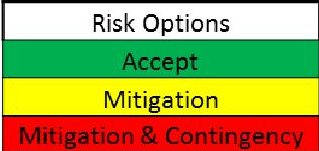

Figure 3.13. Risk Matrix.

This color-coded framework enables project teams to visualize which requirement-related risks demand immediate attention and which can be monitored over time. For instance, if a requirement has high implementation uncertainty (a probable occurrence) and would significantly affect downstream system integration (with high impact), it may fall into the red zone, prompting immediate mitigation actions, such as stakeholder review or re-prioritization.

<!-- PDF_PAGE: 158 -->

A representative example is shown in Table 3.22, which applies the probability-impact framework to requirement-related risks from a past systems engineering validation plan. Each entry lists the specific risk description, associated scores, and the proposed handling method. All items with a score factor above 10 were flagged for closer monitoring and corrective action.

Table 3.22. Risk Table for Prioritization-Linked Events.

<table border="1"><tr><td>Risk Description(Circumstance/Impact)</td><td>Probability</td><td>Impact</td><td>Factor</td><td>Handling Method</td><td>Mitigation Activities</td><td>Responsible Party</td></tr><tr><td>Incorrect data information/can affect the final data evaluation</td><td>2</td><td>4</td><td>8</td><td>Accept Risk</td><td>Monitor</td><td>Process Manager</td></tr><tr><td>Not understandable information for requirements/Can be confused for function</td><td>2</td><td>3</td><td>6</td><td>Accept Risk</td><td>Monitor</td><td>Process Manager</td></tr><tr><td>Long sentences in some requirements/can be hard to understand easily and quickly</td><td>1</td><td>2</td><td>2</td><td>Accept Risk</td><td>Monitor</td><td>Quality Manager</td></tr><tr><td>People are not logging all errors in defect logs</td><td>2</td><td>2</td><td>4</td><td>Accept Risk</td><td>Monitor</td><td>Quality Manager</td></tr><tr><td>Increase in conceptual time due to inspections</td><td>3</td><td>2</td><td>6</td><td>Accept Risk</td><td>Monitor</td><td>Quality Manager</td></tr><tr><td>Reduction in time to implement CTM</td><td>5</td><td>2</td><td>10</td><td>Accept Risk</td><td>Monitor</td><td>Team Leader</td></tr></table>

In the context of this project, risk alignment is implemented via iterative cycles of requirements evaluation, informed by model-based feedback loops. Any shift in mission objectives or subsystem constraints triggers a review of the prioritization outcomes, allowing for controlled reprioritization without disrupting system traceability. This risk-adaptive prioritization is embedded within the MBSE lifecycle, preserving auditability while supporting system evolution.

By integrating risk matrices and scoring into the prioritization workflow, this approach ensures that high-priority requirements not only reflect mission needs but also account for volatility, traceability gaps, and potential downstream impacts. This capability stands in contrast to legacy practices, as demonstrated by the failure of the U.S. Army's Future Combat Systems

<!-- PDF_PAGE: 159 -->

(FCS), where static prioritization and insufficient risk awareness led to scope creep and systemic delays.

In summary, risk-aligned prioritization enables more resilient systems engineering. The structured approach presented here supports the dynamic re-evaluation of requirements under changing project conditions, while maintaining traceability and confidence in system verification.

## 3.3.6.2 Change Adaptation Strategy

Engineering projects operating under dynamic mission contexts often encounter late-emerging stakeholder needs, technological shifts, and evolving external constraints. Without a structured approach for managing such a change, system integrity may erode, and rework cycles can expand. To mitigate this, change adaptation is embedded within the requirements prioritization framework, ensuring system flexibility while preserving baseline traceability and verification intent.

A critical principle in managing change is the distinction between adaptability and volatility. While systems must remain flexible to incorporate validated changes, unregulated modifications, particularly late-stage requirement shifts, can disrupt architectural cohesion and render earlier test planning invalid. As shown in Table 3.23, typical change scenarios are mapped to causes, adaptation strategies, and systems engineering (SE) outcomes. These strategies include selective reweighting, re-ranking based on traceable rationale, and model-based validations via SysML.

<!-- PDF_PAGE: 160 -->

Table 3.23. Change Management in Requirements Prioritization.

<table border="1"><tr><td>Change Scenario</td><td>Cause</td><td>Adaptation Strategy</td><td>SE Outcome</td></tr><tr><td>Evolving Stakeholder Needs</td><td>New objectives emerge</td><td>Re-score with updates; annotate rationale</td><td>Stakeholder alignment</td></tr><tr><td>Design Alternatives Introduced</td><td>New tech or design shifts</td><td>Adjust weights without model changes</td><td>Integrated design insights</td></tr><tr><td>Late Requirement Modifications</td><td>Overlooked needs discovered</td><td>Use SysML links; re-rank selectively</td><td>Less disruption, faster updates</td></tr><tr><td>Architecture Reconfiguration</td><td>Structural changes during dev</td><td>Validate allocations and model behavior</td><td>Maintained integrity and V&amp;V</td></tr><tr><td>External Environmental Changes</td><td>Regulatory/context shifts</td><td>Feed change data into prioritization cycles</td><td>Greater adaptability and robustness</td></tr></table>

To support effective adaptation, a model-based environment is employed where requirement elements, architectural components, and test cases are interconnected via refinement, allocation, and rationale links. Within this structure, the weighted scoring method is favored for ongoing prioritization updates, as it allows adjustments to evaluation parameters (e.g., weights and scores) without requiring the reconstruction of the full decision hierarchy. In contrast, the Analytical Hierarchy Process (AHP), although rigorous, lacks responsiveness to frequent changes, as its paired comparison matrix must be rebuilt with each modification (Saaty, 2008).

SysML modeling further strengthens change adaptation by enabling impact analysis through connected elements. When a stakeholder goal changes or a new technology is introduced, SysML internal block diagrams and requirement tables help identify dependent components and facilitate selective re-ranking rather than full model reconstruction. Traceable annotations document rationale for each update, enhancing auditability and stakeholder communication.

To enforce the implementation of structured change, the process integrates standard change control mechanisms as outlined in the PPQC framework (2016). Change requests are formally submitted, reviewed for impact, and authorized through a Change Control Board (CCB) if

<!-- PDF_PAGE: 161 -->

necessary. The governance model (shown in Figure 3.14) distinguishes changes at the individual, project, or organizational level, with escalation criteria based on scope, interdependency, and lifecycle phase.

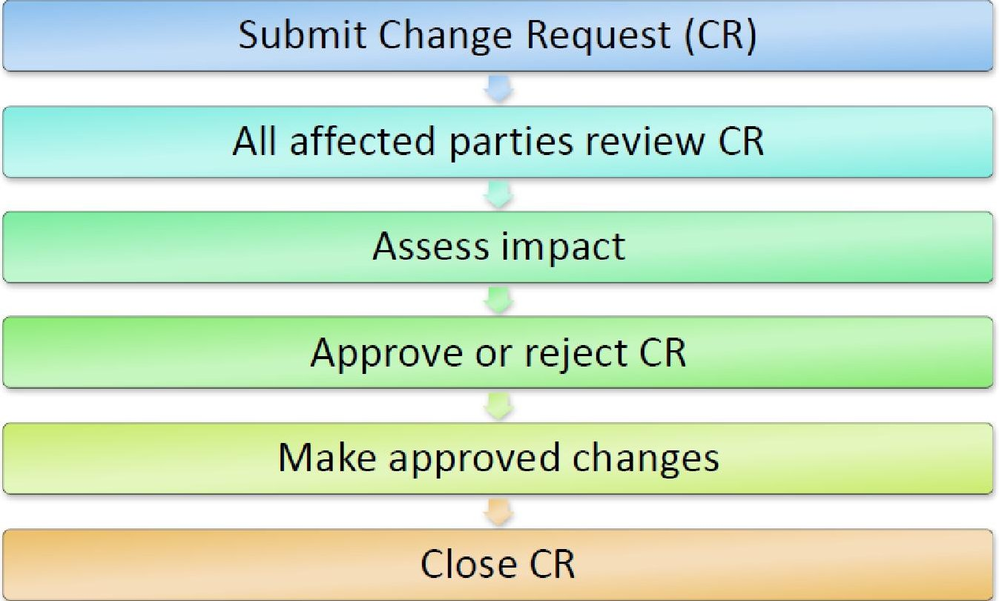

Figure 3.14. Change Request Review and Approval Process (PPQC).

In practice, baselines serve as anchor points for all requirements and system updates. Moving from one baseline to another (as illustrated in Figure 3.15) ensures that all modifications are reviewed, approved, and implemented in a controlled manner. This includes synchronized updates to requirements specifications, design models, test cases, and plans, preserving internal consistency throughout the development cycle.

<!-- PDF_PAGE: 162 -->

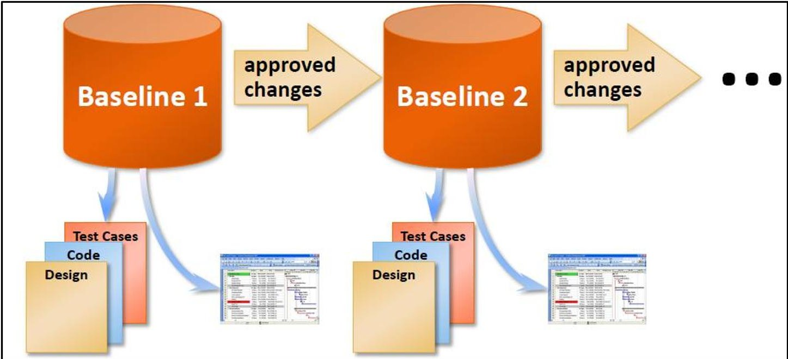

Figure 3.15. Baseline Control Across System Artifacts (PPQC).

NASA's Mars Exploration Rover (MER) program exemplifies this methodology. As environmental conditions and mission constraints evolved, requirement models and traceability links in their systems engineering environment were revised. The ability to adapt rapidly without disrupting existing validation threads enabled timely configuration updates, improved resilience, and safeguarded mission objectives (NASA, 2016).

- Using flexible scoring methods that support incremental updates.

In summary, effective change adaptation in prioritization relies on:

- Maintaining structured baselines for traceability.

- Embedding change control governance, including CCBs and rationale logs.

- Leveraging SysML to trace impacts across system elements and validation threads.

Together, these elements form a resilient MBSE-driven framework that accommodates change while upholding system verification, compliance, and operational readiness.

<!-- PDF_PAGE: 163 -->

## 3.3.6.3 Probabilistic Modeling for Adaptability Assessment

Adaptability in Complex Adaptive Systems (CAS) is increasingly recognized as essential for sustaining mission performance under changing operational conditions (Leveson, 2016). Traditional prioritization techniques, which assume static environments, often fail to accommodate variability and uncertainty (Pearl, 2009). By integrating probabilistic reasoning, decision-makers can formally address uncertainty in state transitions, behavioral deviations, and system recovery paths (Koller & Friedman, 2009).

Bayesian Networks and Markov Decision Processes (MDPs) provide formal mechanisms for evaluating how mission scenarios and system states influence adaptability (Koller & Friedman, 2009). These probabilistic graphical models represent conditional dependencies among components, environmental inputs, and mission outcomes. A Bayesian Network, for example, can illustrate how a power drop or component anomaly cascades through subsystems, altering reconfiguration capability (Jensen & Nielsen, 2007).

To structure this reasoning, Table 3.24 aligns adaptability mechanisms with corresponding probabilistic methods and SysML modeling elements. Functional reconfiguration can be captured through MDPs, representing decision points during failure events using SysML state machine diagrams (Puterman, 2014). Environmental robustness is modeled through Bayesian Networks that simulate propagation of external stressors and relate these to parametric constraints in SysML diagrams (Koller & Friedman, 2009). Requirement flexibility incorporates conditional probability to shift requirement priorities during operational uncertainty, managed through traceable validation in SysML requirements tables (INCOSE, 2015). This modeling approach directly links system adaptability to the evolution of requirements, thereby improving readiness for unanticipated events (Pearl, 2009).

<!-- PDF_PAGE: 164 -->

Table 3.24. Mapping Adaptability Dimensions to Probabilistic Modeling Techniques.

<table border="1"><tr><td>Adaptability Dimension</td><td>Probabilistic Model</td><td>Relevant SysML Artifact</td><td>Use Case Example</td></tr><tr><td>Functional Reconfiguration</td><td>Markov Decision Process</td><td>State Machine / Activity Diagram</td><td>Autonomous fault recovery by task switching (e.g., payload reboot)</td></tr><tr><td>Environmental Robustness</td><td>Bayesian Network</td><td>Parametric Diagram</td><td>Analyzing subsystem response to orbital temperature variation</td></tr><tr><td>Requirement Flexibility</td><td>Conditional Probability</td><td>Requirements Table</td><td>Shifting requirement priority (power) during late mission phase</td></tr></table>

Scenario 1 - Fault Recovery via Functional Reconfiguration: In the event of an in-orbit subsystem anomaly, such as a partial payload failure, the system must autonomously reconfigure its operations to continue the mission. For instance, if the BTR 3.10 Vibration Test identifies a deviation in battery performance post-launch, an MDP-based model triggers a state transition from normal to degraded mode. A SysML state machine diagram is used to formalize this transition and highlight recovery paths such as rebooting the payload or switching to backup functionality. Probabilities assigned to each decision path are based on historical failure data and environmental triggers. This combined modeling supports optimal task-switching decisions under uncertainty and enhances resilience during operational disruptions (Puterman, 2014).

Scenario 2 - Thermal Risk Analysis via Environmental Robustness Modeling: As the spacecraft transitions between sunlight and shadow, thermal conditions undergo significant variation. For PR 2.3 Temperature Range, temperatures outside the range of $ - 1 0^{\circ} \mathrm{C} $ to $ 4 5^{\circ} \mathrm{C} $ may cause damage to critical subsystems. A Bayesian Network is used to model how orbital position,

<!-- PDF_PAGE: 165 -->

insulation quality, surface conductivity, and power system heat output influence overall temperature. A SysML parametric diagram links these elements through fundamental thermal equations, such as radiative heat transfer. As the mission progresses, incoming data updates the likelihood of thermal risk. This enables the system to respond proactively, such as by reducing power usage or adjusting operation timing, to prevent overheating (Jensen & Nielsen, 2007).

Scenario 3 - Requirement Priority Shift During Mission Evolution: Toward the end of the mission, power becomes a limited resource. Suppose during this phase, PR 2.9 Antenna Design becomes less critical than maintaining thermal balance or propulsion alignment. Conditional probability is applied to update requirement weights using posterior calculations dynamically. A SysML Requirements Table is integrated with real-time simulation inputs (e.g., power margin predictions). When posterior analysis indicates a high likelihood of power shortfall, the system automatically re-prioritizes requirements using a decision table, favoring power retention over communication throughput. This supports flexible and traceable adaptation of requirements aligned with evolving mission needs (Murphy, 2012).

Probabilistic graphical models (PGMs) strengthen the prioritization framework by incorporating uncertainty into trade-off decisions (Murphy, 2012). These models support recalculating requirement weights using posterior values drawn from evolving mission simulations (Jensen & Nielsen, 2007). This capability avoids static assumptions and responds more effectively to shifting operational needs (Pearl, 2009). As a result, engineers can manage requirements in a flexible and traceable manner, improving system-level resilience under dynamic conditions (Leveson, 2016). $ ^{23} $

<!-- PDF_PAGE: 166 -->

## 3.4 DIGITAL INTEGRATION AND TOOLCHAIN

Digital integration functions as the backbone of this approach, enabling interoperability across SysML models, simulation tools, version control platforms, and system analysis environments. This interoperability shifts the system model from a static documentation artifact to a dynamic structure that supports traceability, iterative refinement, and architectural consistency. In the SidSat case, the integrated toolchain enables continuous lifecycle synchronization and supports coordination across engineering domains.

A platform-agnostic integration scheme links Cameo Systems Modeler with external applications, including MATLAB for control validation, STK for orbital simulations, Excel for tracking design parameters, Teamcenter for managing configurations and revisions, and AWS for secure cloud access. Instead of treating each application in isolation, the framework forms a connected toolchain that supports requirements traceability, change monitoring, and consistent decision-making.

Each tool plays a distinct role within the system lifecycle, with bidirectional data exchange managed through connectors, scripts, and interoperable formats like CSV and XMI. The SysML architecture remains the central reference model, interfacing with simulation data, receiving validation feedback, and distributing results to other platforms. Model consistency is reinforced by using requirement identifiers, property mappings, and allocation links, ensuring traceable transitions from needs to implementation.

This digital alignment enhances collaboration by consolidating stakeholder inputs, system behavior evaluations, and verification data, thereby minimizing data fragmentation and facilitating coordinated updates to system functionality and structure. For SidSat, the toolchain enables

<!-- PDF_PAGE: 167 -->

adjustments to requirements and architecture while preserving all necessary references for validation, compliance checks, and audit readiness.

This section presents the structure and practical function of the integrated tool environment, highlighting its role in supporting continuous model refinement and design traceability. Digital integration is positioned as a foundational capability within the MBSE process and a key operational element of the Digital Trinity strategy. $ ^{24} $

## 3.4.1 Tools and Technologies Used

The successful implementation of a digitally integrated MBSE workflow for SidSat depends on a cohesive and interoperable toolchain that spans system modeling, simulation, configuration, and data management. This toolchain consists of Cameo Systems Modeler, MATLAB, Systems Tool Kit (STK), Excel, Teamcenter, and AWS. Each selected tool contributes a specific functional role within the system lifecycle, while collectively supporting model continuity, stakeholder collaboration, and traceable Verification & Validation (V&V) processes. The toolchain is designed to minimize fragmentation, enable bidirectional data flow, and reinforce the digital thread that connects requirements, architecture decisions, performance evaluation, and lifecycle metadata.

Cameo Systems Modeler serves as the central MBSE platform for developing SysML based system architecture. It supports structural and behavioral modeling, requirements traceability, interface definition, and allocation management. Cameo's ability to support both structural and behavioral modeling through SysML diagrams is rooted in its implementation of standard language constructs such as blocks, activities, and internal structures, as detailed by Delligatti (2013). Cameo also provides integrated model validation, reporting, and parametric

<!-- PDF_PAGE: 168 -->

simulation capabilities, making it the authoritative source for Lifecycle Management, requirements decomposition, and architecture framework alignment. Model repositories are version-controlled and structured to enable stakeholder access, audit traceability, and configuration comparison.

MATLAB is used to model and simulate control algorithms, actuator behavior, and dynamic system responses. It operates as the Math engine during simulations executed through the Cameo Toolkit Simulator. Integration with Cameo is achieved through value property exports and scripting interfaces that synchronize model parameters, constraint evaluations, and behavioral outputs. MATLAB simulations feed quantitative data into the prioritization framework, supporting uncertainty quantification, trade space analysis, and scenario-based validation.

Systems Tool Kit (STK) provides orbital and environmental analysis capabilities, enabling high-fidelity simulation of orbital trajectories, sensor line-of-sight, and communication link margins. Data from STK is imported into the system model to support operational feasibility assessments and refine requirements related to thermal conditions, power generation, and attitude control. STK outputs are also used to trigger adaptive prioritization adjustments within the SysML model.

Excel is utilized as a lightweight data exchange layer and analytical interface for managing design parameters, tracking simulation outputs, and preparing formatted tables for model linkage. It acts as a bridge between domain-specific analysis tools and the core SysML model, facilitating stakeholder reviews and incremental data updates without disrupting formal modeling structures.

Teamcenter is used for configuration management, document control, and digital artifact tracking across the project lifecycle. It provides version history, change tracking, and workflow management, ensuring that model versions, requirements documents, and simulation results are

<!-- PDF_PAGE: 169 -->

linked through consistent metadata. Teamcenter also supports integration with Cameo to preserve traceability across the configuration baseline and system verification activities.

AWS (Amazon Web Services) functions as a cloud-based platform for distributed data access, secure storage, and collaborative model sharing. It enables remote execution of simulations, secure repository backups, and multi-user model editing workflows, aligning with the research objective of demonstrating scalable, tool-agnostic integration within a real-world aerospace engineering context.

Model-based system integration for Industry 4.0 applications has leveraged modular development frameworks to enhance simulation reliability and facilitate standardized data flow between components (Suri et al., 2017). Recent ontology-based architecture (Gregory & Salado, 2024) supports alignment of test planning with MBSE, ensuring consistency with evolving Department of Defense (DoD) digital engineering policy. Together, these tools form a synchronized, model-integrated environment that advances digital thread implementation, enables adaptive requirements management, and supports traceable, simulation-informed decision-making across the SidSat development lifecycle.

## 3.4.2 Architecture and Data Integration

Teamcenter serves as the authoritative configuration environment, maintaining a version-controlled repository of design artifacts, baselines, and dependencies essential for system lifecycle fidelity (Siemens, 2023). It facilitates synchronization across modeling environments through direct integration with enterprise tools such as Cameo and Excel (Browning et al., 2022). Teamcenter references are used to manage the evolution of system definitions, enabling traceable updates while maintaining historical data consistency (Amazon Web Services, 2023). $ ^{25} $ To support

<!-- PDF_PAGE: 170 -->

concurrent operations, AWS infrastructure provides distributed storage and controlled access to simulation files and parameter datasets (Guertin & Hunt, 2017).

The primary system model resides within Cameo Systems Modeler, which is developed using SysML to represent the functional, structural, behavioral, and parametric viewpoints of the small satellite system (No Magic, 2023). Traceability between requirements, constraints, and architectural components is enforced using 《allocate》, 《deriveReqt》, 《refine》, 《satisfy》, and 《verify》 relationships embedded in the model structure (OMG, 2017). Parametric diagrams are employed to integrate constraint blocks with value properties, supporting performance verification aligned with simulation results (MathWorks, 2023). External analysis environments, such as MATLAB and STK, provide runtime data that directly link to requirement satisfaction criteria within SysML constraint elements (AGI, 2022).

Model updates, stakeholder decisions, and requirement adjustments are exported to Excel tables and reviewed as part of traceability audits during system design milestones (Microsoft, 2023). Changes introduced in Excel can be programmatically reimported into Cameo to update requirement priority, dependency mappings, or constraint relationships (INCOSE, 2015). The U.S. Department of Defense recommends such model-driven approaches to enhance transparency and maintain configuration control across acquisition stages (Department of Defense, 2020).

Semantic consistency across the toolchain is maintained through standardized identifiers and structured data exchange formats such as XMI and RESTful APIs (Post et al., 2019). Metadata alignment is supported by transformation logic that preserves unit definitions, numerical ranges, and interface standards across modeling domains (Duprez, 2019). Revalidation and simulation reruns are triggered using feedback mechanisms that integrate live constraint violations into the requirement dashboard (Paredis, 2014). This architecture supports iterative refinement across

<!-- PDF_PAGE: 171 -->

domains and ensures that all system models remain consistent with stakeholder objectives and system-level constraints (Pyster & Olwell, 2013). The resulting digital thread promotes transparent collaboration, enforces traceable workflows, and ensures that SidSat system design activities remain aligned with MBSE principles (Estefan, 2008).

## 3.4.3 Sync, Interoperability, and Model Continuity

Real-time synchronization, data alignment, and continuity of modeling are essential to digital systems engineering environments (INCOSE, 2015). For the SidSat CubeSat, these capabilities maintain system relevance across teams and tools during development and validation (Browning et al., 2022). Toolchain synchronization allows consistent updates between model artifacts, keeping decision-making current and avoiding divergence (Siemens, 2023).

In this implementation, real-time data exchange is managed through scripting and API-driven links between SysML and simulation platforms (OMG, 2017). Changes in parameters or requirement weights are transmitted automatically between Cameo, MATLAB, Excel, and STK without requiring manual re-entry (MathWorks, 2023). This workflow minimizes redundancy and supports timely model updates in response to simulation output or new stakeholder input (AGI, 2022).

Interoperability is maintained by matching data structures, interface definitions, and value formats across platforms (Post et al., 2019). System ports, units, and constraint values in the SysML model are harmonized to enable reuse in external tools without remapping (Guertin & Hunt, 2017). This reduces error risks and increases architectural reuse (Duprez, 2019).

Model continuity ensures that system views evolve from early abstractions to physical architecture and validation without disruption (Paredis, 2014). The SidSat model preserves continuity by mapping changes in functions, behaviors, and requirements through trace links and

<!-- PDF_PAGE: 172 -->

allocation relationships (No Magic, 2023). This layered decomposition approach supports adjustments across structure, simulation, and interface views while retaining connection to the original stakeholder needs (Amazon Web Services, 2023).

Updated values are tracked through requirement tables, matrices, and dashboards, allowing review teams to assess changes before accepting them (Microsoft, 2023). Alignment with legacy data formats and multi-domain interfaces is maintained through schema transformations and metadata-driven mappings that preserve unit consistency, value types, and structural context (Paredis, 2014). This approach supports model stability during extended development and system evolution (Department of Defense, 2020).

As demonstrated in SidSat, real-time updates, semantic alignment, and model traceability enhance system adaptability while preserving MBSE principles (Pyster & Olwell, 2013). The use of a live digital thread helps reduce rework, improve responsiveness, and maintain traceability throughout the system lifecycle (Estefan, 2008).

## 3.4.4 Impact Evaluation

The effectiveness of SidSat's digital integration strategy was evaluated based on traceability, decision timing, collaborative coordination, model consistency, and system adaptability (INCOSE, 2015). A connected toolchain, involving Cameo, MATLAB, STK, Excel, Teamcenter, and AWS, reduced fragmentation and enabled reliable lifecycle transitions (MathWorks, 2023). The integrated environment ensured that system models remained consistent with stakeholder expectations and simulation outcomes (AGI, 2022).

The system model improved in fidelity by incorporating simulation parameters, validated constraints, and ranked requirement priorities into the SysML framework (Paredis, 2014). This practice enabled continuous architecture that adapted automatically without needing disjointed

<!-- PDF_PAGE: 173 -->

documents (No Magic, 2023). It also supported requirement-based validation and allowed updates to flow directly from simulation data or team negotiations (Browning et al., 2022).

Decision processes became more efficient as model elements and allocation updates were accessible without report delays (Department of Defense, 2020). During reviews or trade studies, team members viewed system behavior and risks in real-time, thereby reducing latency in selecting viable options (Siemens, 2023). Engineering actions were supported by current values and allocation logic aligned with the priority rationale (Post et al., 2019).

Traceability was enhanced by connecting constraints, interface properties, and simulation outputs to the original requirements (Estefan, 2008). Cameo's requirement tables and matrix views supported verification by ensuring that changes remained consistent with system objectives (Object Management Group, 2017). The traceable thread improved audit tracking and enabled evaluation of interdependencies without redundancy (Microsoft, 2023).

Interdisciplinary collaboration also improved as shared repositories hosted system models and maintained consistent baselines across subsystems (Amazon Web Services, 2023). Teamcenter's version control features enabled role-based access and concurrent development without compromising model reliability (Guertin & Hunt, 2017). However, some integration challenges were encountered, particularly in managing data transformations and exchanging semantics between tools (Voirin, 2017). These challenges were addressed through scripts, structured templates, and predefined configurations suited for reuse (INCOSE, 2015).

The integrated modeling environment offered quantifiable benefits for SidSat's development and reinforced the need for traceability, responsiveness, and lifecycle support as core elements of a digital engineering foundation (Friedenthal et al., 2014).

<!-- PDF_PAGE: 174 -->

## 3.4.5 Simulation Use Cases

3. 4.5.1 Power Generation via Cameo-MATLAB Integration

Figure 3.16. MATLAB Script for Power Generation.

This scenario illustrates how a MATLAB script for power simulation executes directly within the Cameo Systems Modeler platform (MathWorks, 2023). The simulation assesses available orbital power for SidSat using a .mat file with parameters and solar input data (No Magic, 2023). A MATLAB script calculates total and average power over a 167-hour span. Cameo's Activity Diagram organizes the simulation flow and calls MATLAB code via MathScript (AGI, 2022). During execution, outputs are verified through the console by checking correct variable parsing and ensuring valid data flow for key signals, such as Time_EpMin, Power_W, and Solar_Intensity (Paredis, 2014).

<!-- PDF_PAGE: 175 -->

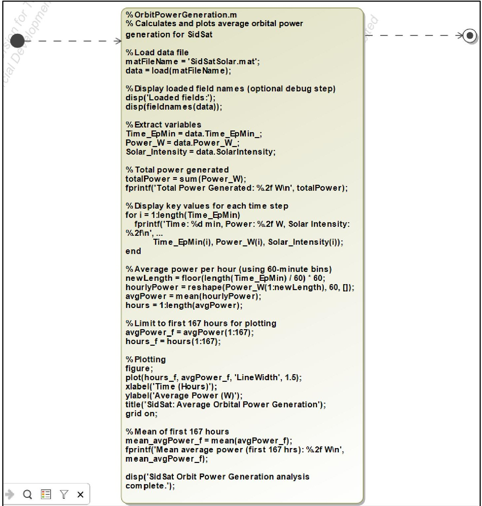

Figure 3.17. Activity Diagram for Power Generation.

The corresponding execution view, shown next, illustrates how the Cameo activity triggers the MATLAB engine and initiates real-time simulation.

<!-- PDF_PAGE: 176 -->

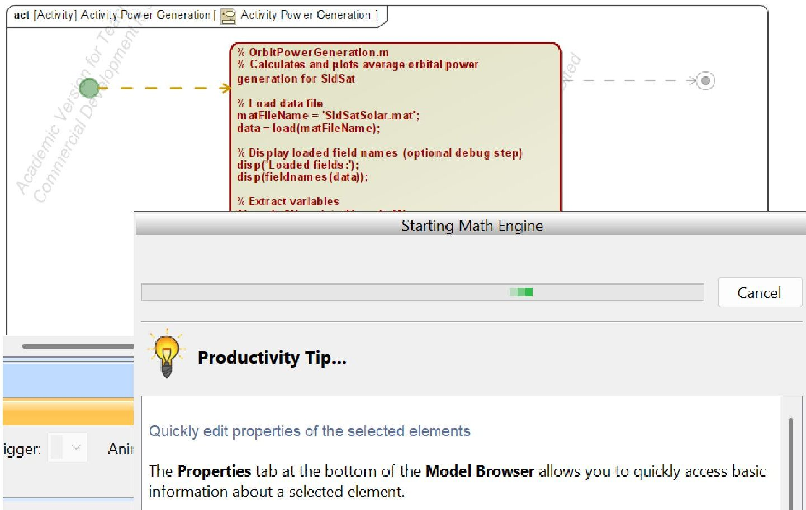

Figure 3.18. Executing MATLAB Script in Cameo.

A key output of the simulation is the time-series plot of average power generation over the 167-hour orbital cycle, offering valuable insight into the variability and performance of the solar subsystem. The system records a mean power output of approximately 4.29 W, confirming alignment with design expectations and enabling verification of related system requirements.

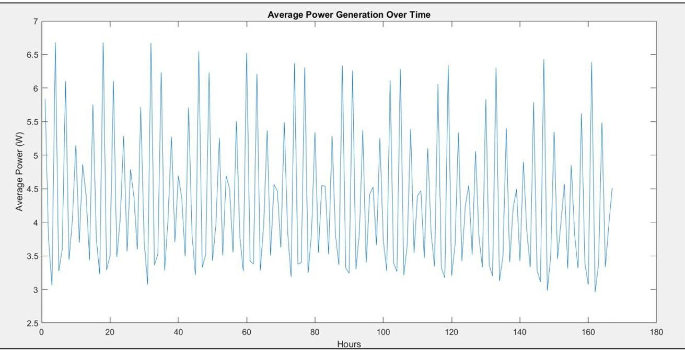

Figure 3.19. Output of Average Power Generation over Time.

<!-- PDF_PAGE: 177 -->

The simulation console view shown next confirms the computed mean power value and verifies successful execution of the full orbital analysis.

Figure 3.20. Mean of Average Power Generation in Watts.

This integration highlights the strength of model-executable architectures, demonstrating how SysML activity models can be tightly coupled with external analysis scripts to support the validation of system behavior, energy profiling, and quantitative traceability. $ ^{26} $ The approach promotes lifecycle consistency, reinforces digital thread continuity, and minimizes manual interpretation errors by enabling closed-loop simulation reporting.

## 3.4.5.2 Satellite Propagation and Positioning via Cameo-MATLAB-STK Integration

This section presents an integrated simulation capability developed for satellite orbit propagation and position analysis, utilizing Cameo, MATLAB, and the Systems Tool Kit (STK). The end-to-end workflow connects SysML models with executable scripts, enabling direct simulation of satellite dynamics from within the system model environment.

The process begins with a MATLAB script that instantiates an STK application object, loads a predefined satellite mission scenario, and initializes orbital parameters using a Cartesian

<!-- PDF_PAGE: 178 -->

state vector. The script specifies a J4 perturbation propagator and executes the orbit propagation command. This computational logic is invoked automatically via the modeling interface.

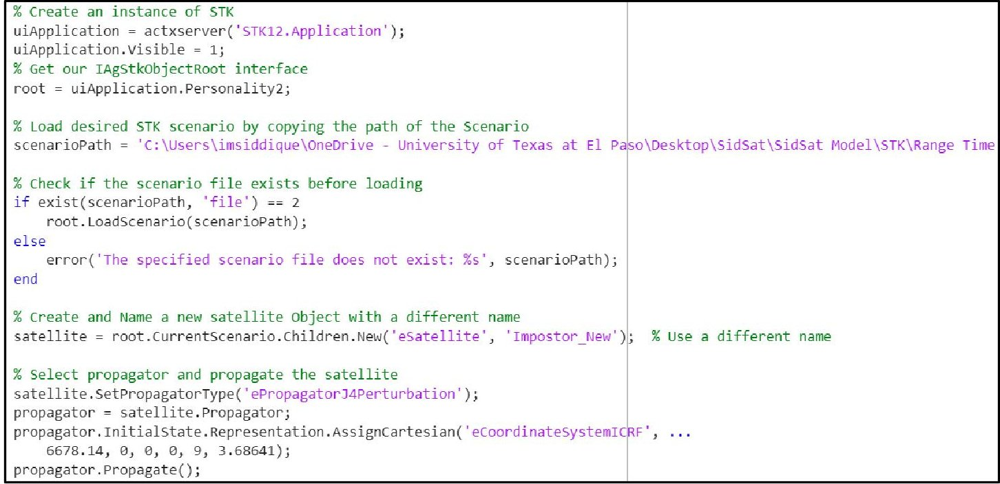

Figure 3.21. MATLAB Script for Satellite Orbit Propagation.

To enable model-based simulation, MATLAB logic is embedded within a SysML activity diagram using the Cameo modeling tool. This configuration allows direct interaction between system parameters and simulation tools, supporting verification through digital integration. Once the simulation is started, a scenario is loaded, and STK uses predefined orbital inputs to propagate the satellite's orbit. A new satellite instance is created and displayed as "Impostor" in STK's 3D viewer, where the trajectory is shown dynamically.

<!-- PDF_PAGE: 179 -->

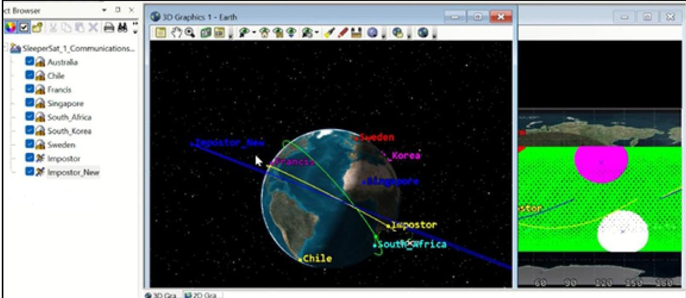

Figure 3.22. STK Visualization of Propagated Satellite Trajectory.

The output helps confirm that the simulation script and system model are aligned. STK's configuration window presents key attributes such as the orbital epoch, reference frame (Cartesian ICRF), and the state vector with position (6678.14 km, 0, 0) and velocity (0, 9, 3.68641 km/s). These values match the inputs from the MATLAB script, demonstrating correct data flow across the interface. The result affirms tool interoperability and simulation consistency. This approach supports real-time validation and helps engineers ensure traceability in MBSE environments (No Magic, 2023).

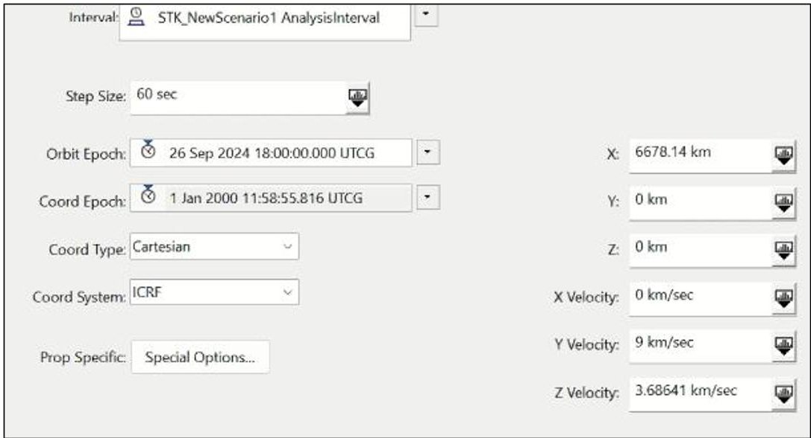

Figure 3.23. STK Scenario Parameters for Initial State Vector (Cartesian ICRF).

<!-- PDF_PAGE: 180 -->

## 3.4.5.3 Data Export and Validation via Cameo-MATLAB-STK-Excel Integration

This integration illustrates an automated workflow where simulation data from a satellite scenario is retrieved, validated, and exported using a toolchain spanning Cameo, MATLAB, STK, and Excel. The process begins with a Cameo activity diagram that triggers a MATLAB script designed to interface directly with STK. Upon execution, the script launches the STK environment, loads the specified scenario, and generates a new satellite object within that context.

Once the scenario is active, the script queries the current count of top-level children in the STK scenario, representing the total number of defined elements, such as satellites and ground stations. This count is output directly to the Cameo console, providing immediate feedback and visibility to the model user during simulation runtime.

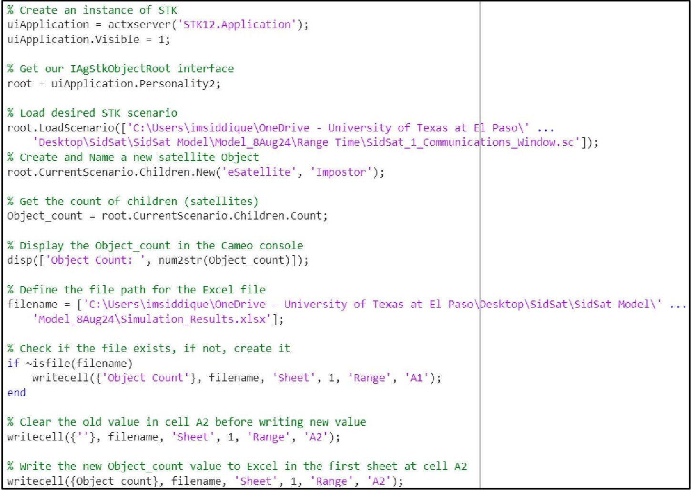

Figure 3.24. MATLAB Script for STK Object Count and Excel Export.

<!-- PDF_PAGE: 181 -->

The resulting satellite object is then visualized within STK, offering a spatial confirmation of the scenario elements instantiated and counted during the MATLAB-driven query.

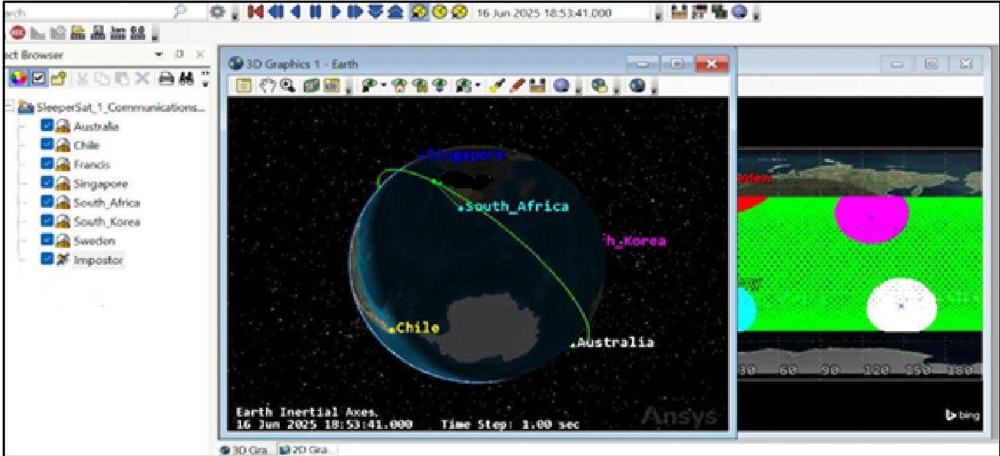

Figure 3.25. STK Visualization of Satellite Ground Network Scenario.

To ensure that this information is persistently recorded, the script then connects to a predefined Excel workbook. If the file does not exist, it is created programmatically. Before writing, the target cell is cleared to remove outdated values, and the new object count is saved in the designated location. This automated logging supports repeatability, auditability, and downstream analysis.

The STK 3D viewer visually confirms the presence of multiple orbiting elements and geographically distributed ground facilities, including Australia, Chile, South Africa, Singapore, and South Korea, each corresponding to the scenario elements counted and recorded. Finally, the resulting Excel sheet displays the captured count, verifying the consistency of the simulation state with the exported data.

<!-- PDF_PAGE: 182 -->

Figure 3.26. Cameo Console Showing Object Count Execution Result.

The successful transfer of this value from the Cameo console to the Excel sheet confirms end-to-end execution and synchronization across the integrated toolchain.

Figure 3.27. Excel Sheet Output Displaying Exported Object Count.

This integrated approach demonstrates the practical utility of digital thread concepts, where real-time system data flows efficiently across modeling, simulation, and documentation tools. It enhances traceability, minimizes manual intervention, and facilitates lifecycle validation in an MBSE-enabled space mission design environment.

<!-- PDF_PAGE: 183 -->

## 3.4.5.4 Lifetime Simulation via MBSE-Toolchain Exchange

This simulation demonstrates a fully automated workflow for satellite orbital lifetime analysis using integrated tools, Cameo, MATLAB, STK, and Excel. The MATLAB script reads input parameters such as satellite mass, drag coefficient, drag area, and flux level from a structured Excel sheet. These inputs are passed to STK via a command interface, triggering the lifetime simulation. STK evaluates the orbital dynamics based on the provided values and calculates the expected orbital lifetime of the satellite.

<!-- PDF_PAGE: 184 -->

%% Data Input from Excel

clear all

Excel = actxserver('Excel.Application');

Workbook = Excel.Workbooks.Open('SidSat Orbital Lifetime.xlsx');

invoke(Excel.ActiveWorkbook, 'Save');

Excel.Quit;

Excel.delete;

clear Excel;

opts = spreadsheetImportOptions("NumVariables", 5);

opts.Sheet = 'SidSat Orbital Lifetime';

opts.DataRange = 'A4:E34';

opts.VariableNames = ["Var1", "Var2", "Parameter", "unit", "value"];

opts.SelectedVariableNames = ["Parameter", "unit", "value"];

opts.VariableTypes = ["string", "string", "string", "string", "double"];

opts = setvaropts(opts, ["Var1", "Var2", "Parameter", "unit"], "WhitespaceRule", "preserve");

opts = setvaropts(opts, ["Var1", "Var2", "Parameter", "unit"], "EmptyFieldRule", "auto");

STK_Simulation_Values_1 = readtable(['C:\Users\imsiddique\OneDrive - University of Texas at El Paso\Desktop\'

    'SidSat\SidSat Model\Model_8Aug24\STK_Simulation_Values_1.xlsx'], opts, 'UseExcel', false);

Parameter = STK_Simulation_Values_1.Parameter;

unit = STK_Simulation_Values_1.unit;

Value = STK_Simulation_Values_1.value;

clear STK_Simulation_Values_1 opts

clear Parameter unit

% Display results

fprintf('Parameter, Unit, Value\n');

satname = 'SidSat';

%% Define Lifetime Parameters

MASS       = Value(1);   % kg

DragCoeff  = Value(2);   % Unitless

Inclination = Value(3);   % deg

SemiMajor  = Value(4);   % km

%% Open STK and Set up Communication

uiApplication = actxserver('STK12.Application');

uiApplication.Visible = 1;

root = uiApplication.Personality2;

root.LoadScenario(['C:\Users\imsiddique\OneDrive - University of Texas at El Paso\Desktop\SidSat\' ...

    'SidSat Model\Model_8Aug24\Range Time\SidSat_1_Communications_Window.sc']);

%% Running Simulation

root.UnitPreferences.Item('DateFormat').SetCurrentUnit('EpYr');

scen = root.CurrentScenario;

satPath = ['*/Satellite/', satname];

sat = root.GetObjectFromPath(satPath);

cmdString = ['SetLifetime */Satellite/', satname, ...

    'DragModel Simple ', ...

    'DragCoeff ', num2str(MASS), ...

    ' ', 'Mass ', num2str(MASS), ...

    ' ', 'DragArea ', num2str(DragCoeff), ...

    ' ', 'Inclination ', num2str(Inclination), ...

    ' ', 'SemiMajorAxis ', num2str(SemiMajor)]; root.ExecuteCommand(cmdString);

result = root.ExecuteCommand(['Lifetime */Satellite/', satname]);

Lifetime = sat.DataProviders.Item('Lifetime').Exec(scen.StartTime, scen.StopTime, 60);

time = cell2mat(Lifetime.DataSets.GetDataSetByName('Time').GetValues);

inc = cell2mat(Lifetime.DataSets.GetDataSetByName('Inclination').GetValues);

sma = cell2mat(Lifetime.DataSets.GetDataSetByName('semi-major axis').GetValues);

Lifetime = max(time); % Years

%% Closing STK Session

uiApplication.Quit;

clear uiApplication root;

%% Data Output to Excel

filename = 'C:\Users\imsiddique\OneDrive - University of Texas at El Paso\Desktop\SidSat\SidSat Model

if ~isfile(filename)

    writecell({'Lifetime'}, filename, 'Sheet', 1, 'Range', 'E14'); end

writecell({''}, filename, 'Sheet', 1, 'Range', 'E14');

writecell({Lifetime}, filename, 'Sheet', 1, 'Range', 'E14');

Figure 3.28. Lifetime Simulation Script (MATLAB-STK).

The input data and resulting lifetime are logged in both the STK 3D visualization environment and in Excel, supporting clear traceability of the simulation flow. By modifying one

<!-- PDF_PAGE: 185 -->

parameter, such as increasing the satellite's mass, the workflow allows for immediate recalculation and output verification. The change in input leads to a corresponding increase in orbital lifetime, confirming the model's sensitivity. The resulting lifetime is not only visualized in STK but also printed directly into Cameo's console and stored back in Excel, closing the loop for model validation and lifecycle data recording. This cross-tool integration ensures consistent parameter propagation and transparent simulation feedback across the MBSE toolchain.

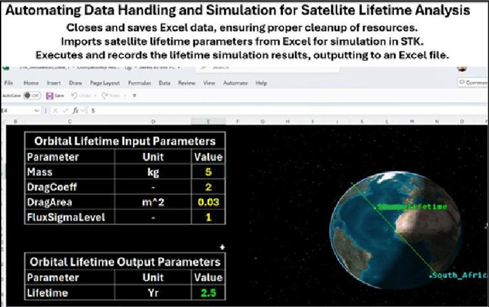

Figure 3.29. Excel Input/Output (Mass = 5 kg, Lifetime = 2.5 yr).

The recorded outputs reflect dynamic changes in the input parameters, allowing iterative evaluation of orbital lifetime across design variations.

<!-- PDF_PAGE: 186 -->

Figure 3.30. Updated Input/Output (Mass = 6 kg, Lifetime = 3.4 yr).

The final output is transmitted back to the SysML console, completing the validation loop within the integrated simulation workflow.

Figure 3.31. Lifetime Output in Cameo Console

<!-- PDF_PAGE: 187 -->

## 3.4.5.5 UHF Frequency Validation via SimConfig and CSV Output

This integration demonstrates the use of Cameo Simulation Toolkit (SimConfig), Excel, and requirements validation capabilities to verify a UHF frequency requirement through automated simulation and data exchange.

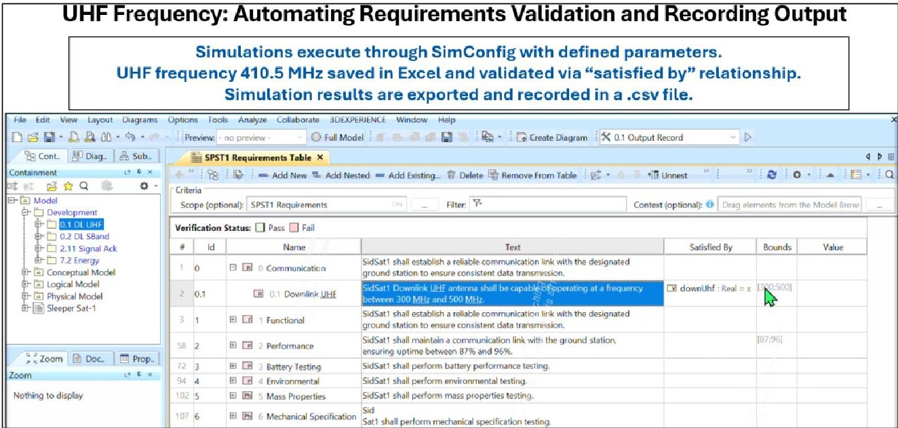

Figure 3.32. UHF Requirement Validation and Simulation Results.

The process begins with a requirements table in Cameo, where a communication requirement for the Downlink UHF antenna specifies that it must operate within a frequency range of 300 MHz to 500 MHz. This requirement is linked using a «satisfy» relationship to a block element, which will later receive its input value from an external data source.

A Block Definition Diagram (BDD) models the simulation structure. The top-level block represents the simulation itself, while the subordinate block labeled "Output" holds the value for the downUhf parameter, typed as a Real number. This architectural setup establishes the link between model structure and simulation parameters.

<!-- PDF_PAGE: 188 -->

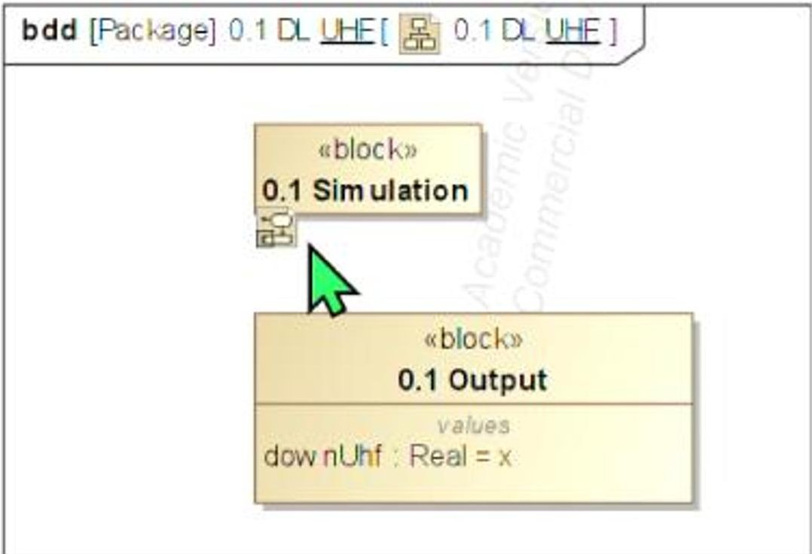

Figure 3.33. Simulation Block and Output Value Property.

An Activity Diagram governs the writing of the input frequency value to an Excel sheet. In this simulation, the value 410.5 MHz is defined as the test input. The activity block writes this value into cell B2 of the designated Excel file and launches the file, thereby externalizing the simulation input through a file-based interface.

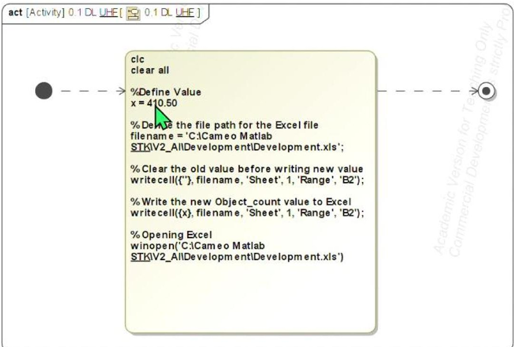

Figure 3.34. MATLAB Script for Writing Frequency to Excel.

<!-- PDF_PAGE: 189 -->

The Excel sheet captures simulation variables, including Downlink UHF, S-band, Signal Acknowledgment, and Energy Consumption. Initially, only the Downlink UHF value is populated, demonstrating a controlled input scenario for validation.

Figure 3.35. Excel Sheet Structure for Input Values.

In Cameo, the Simulation Configuration (SimConfig) is selected from the dropdown menu. This configuration executes the defined simulation with proper parameter linkage and export settings, connecting the model's structure and behavioral elements to the simulation runtime.

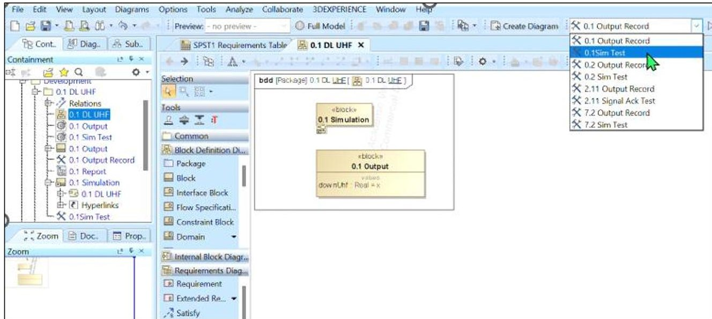

Figure 3.36. Simulation Test Selection in Cameo.

<!-- PDF_PAGE: 190 -->

The Excel sheet is then updated with the 410.5 MHz value under the Downlink UHF row, and the simulation is executed using the configured parameters.

Figure 3.37. Updated Excel with Injected UHF Value.

The CSV Export block and SimConfig settings are activated to log the simulation outputs into a designated file path. The export setup ensures that the validated value is recorded, providing a traceable output for verification purposes.

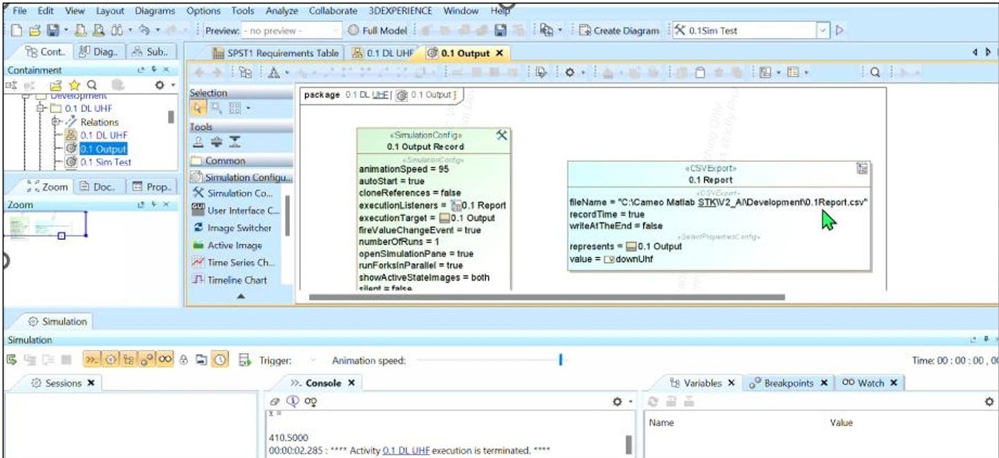

Figure 3.38. SimConfig Setup with Output Parameters.

<!-- PDF_PAGE: 191 -->

The simulation console confirms successful execution, displaying and logging the parameter value 410.5. The associated output file is located in the file directory as a .csv document, confirming the successful export of simulation results. Upon opening the CSV report, the value 410.5 MHz appears under the downUhf column, matching the expected test value and confirming that the requirement has been satisfied.

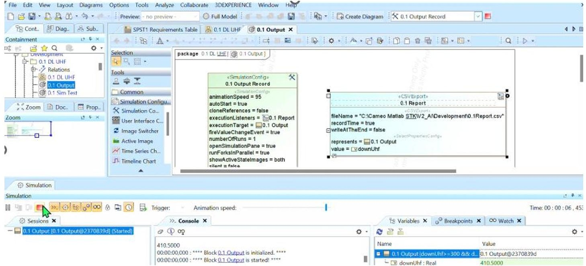

Figure 3.39. Simulation Execution Panel with Live Output.

In a contrasting validation scenario, a new simulation is executed with a value outside the specified requirement range, for example, 200.0 MHz. The console then explicitly states that the "Requirement Downlink UHF is not satisfied." This illustrates the automated requirements validation mechanism within Cameo, where any deviation from defined thresholds triggers a validation failure and logs the condition.

<!-- PDF_PAGE: 192 -->

Figure 3.40. Generated CSV Output File in Directory.

The CSV file is programmatically generated and saved to the designated directory, ready for validation and review of output data.

Figure 3.41. Final Output Showing Validated UHF in CSV.

The retrieved UHF value is cross-checked against system constraints within the simulation environment, triggering a console alert if the requirement remains unsatisfied.

<!-- PDF_PAGE: 193 -->

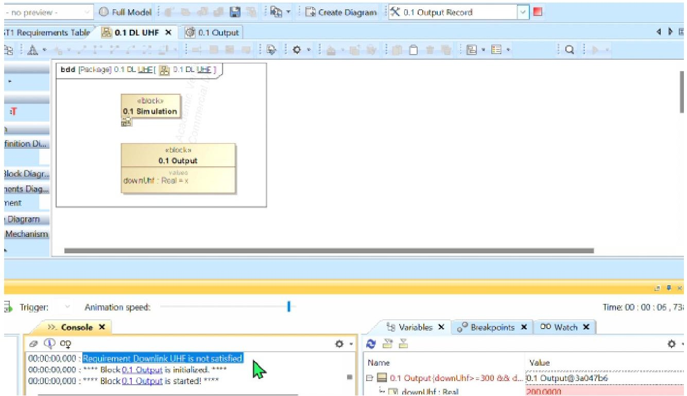

Figure 3.42. Console Output Showing Requirement Not Satisfied.

Through this setup, system engineers can execute and record parameter-driven requirements tests in a model-based environment. The integration of Excel for input/output, SimConfig for execution, and requirement satisfaction relationships creates a robust and reusable pipeline for automated verification of performance specifications.

## 3.5 VALIDATION VIA SIDSAT CASE STUDY

The SidSat CubeSat project serves as the validation platform for the proposed Digital Trinity framework, offering a realistic, constraint-driven environment in which to assess the effectiveness of MBSE, adaptive prioritization, and digital toolchain integration. As a representative system-of-systems application, SidSat embodies complexity, resource limitations, and evolving stakeholder objectives that typify modern aerospace programs. The case study offers an end-to-end evaluation of how a model-centric, digitally integrated methodology can enhance architectural coherence, responsiveness to requirements, and verification outcomes. $ ^{27} $

<!-- PDF_PAGE: 194 -->

The validation process is conducted across multiple dimensions. First, the SysML-based architecture model is assessed for completeness, internal consistency, and alignment with system requirements and stakeholder intent. Requirements decomposition, allocation strategies, and interface definitions are reviewed through traceability matrices and model validation tools to ensure coverage and correctness. Second, the adaptive prioritization framework is tested by applying dynamic ranking logic within mission scenarios, supported by simulation feedback and value-driven adjustments. The prioritization rationale is embedded in the model and traced through system design decisions. Third, the integrated digital toolchain is evaluated for its ability to maintain model continuity, synchronization, and lifecycle traceability. Model updates, simulation inputs, and verification results are tracked across platforms, including Cameo, MATLAB, STK, Excel, Teamcenter, and AWS. The feedback loops established among these tools are used to assess how quickly and accurately the system responds to changes in mission parameters or stakeholder inputs.

By analyzing the results of these activities within the context of a real system design, the SidSat case study demonstrates the practical feasibility and system-level benefit of the proposed methodology. It validates that the combined use of MBSE, prioritization, and digital integration provides a scalable, traceable, and adaptive approach to engineering high-assurance space systems.

## 3.5.1 Methodology and Testbed

The case study methodology for SidSat adopts a structured validation process grounded in model-based principles. It serves to evaluate the implementation of the proposed Digital Trinity framework, which integrates systems modeling, adaptive requirements prioritization, and digital toolchain coordination. This process combines modeling artifacts, feedback from simulations, and

<!-- PDF_PAGE: 195 -->

traceability assessments to assess practical applicability, scalability, and lifecycle relevance within a small satellite environment.

SidSat, a 4U CubeSat featuring an AI-guided robotic payload, was chosen for its suitability in representing complexity, multidisciplinary interactions, and iterative refinement challenges. These features make it ideal for demonstrating requirements volatility, multi-tool alignment, and engineering feedback loops in a constrained development context. The approach proceeds through successive phases involving modeling, analysis, and review. The workflow is supported by SysML-based modeling using Cameo Systems Modeler and integrated software tools.

The first stage involves identifying, decomposing, and organizing requirements based on mission constraints and stakeholder input. Each requirement is documented in SysML, annotated with supporting rationale and trace paths to architecture elements. Prioritization utilizes an adaptive process informed by risk, operational inputs, and external simulations conducted in MATLAB and STK.

In the second stage, architectural representation is developed using Block Definition Diagrams, Internal Block Diagrams, State and Activity Diagrams, and Parametric Diagrams. These artifacts validate structural completeness, behavioral logic, and alignment with mission objectives. Requirements and structural components are linked via trace relationships to enable bidirectional flow of updates.

The third stage involves integrating the toolchain among Cameo, MATLAB, STK, Excel, AWS, and Teamcenter. Interfaces allow for bidirectional exchange of parameters and results through standardized formats (No Magic, 2023). This enables continuous feedback and synchronization across tools. Model evaluations are performed through parametric runs, change analysis, and requirement satisfaction checks. This validates that the system model remains up to

<!-- PDF_PAGE: 196 -->

date and executable across multiple iterations, supporting verification, traceability, and dynamic prioritization under realistic engineering constraints.

## 3.5.2 Data Collection and Traceability Demonstration

Data collection and traceability were central to validating the integrated systems engineering approach applied in the SidSat case study. The approach relied on structured capture of model attributes, simulation results, prioritization decisions, and configuration metadata, each linked through a persistent digital thread. This ensured that every system requirement, model artifact, and design decision remained verifiable, context-aware, and traceable across lifecycle phases and engineering domains.

Data collection was conducted at three primary levels: SysML-based system modeling, simulation-driven analysis, and configuration and collaboration management. Within Cameo Systems Modeler, requirements were assigned custom identifiers, priority levels, and rationale annotations. These elements were decomposed and allocated to system blocks, value properties, and behaviors using 《allocate》, 《refine》, 《deriveReqt》, 《satisfy》, and 《verify》 relationships. Model validation reports and requirement coverage views were used to confirm completeness, consistency, and adherence to stakeholder objectives.

Simulation data were collected from MATLAB and STK, encompassing control performance, thermal margins, actuator behavior, orbital constraints, and energy budgets. These outputs were exported to Excel and integrated into the SysML model via parametric diagrams and binding connectors. Each simulation result was associated with its corresponding requirement IDs and constraint parameters, enabling dynamic updates to the model content and prioritization logic. Feedback loops were established to ensure that simulation-driven adjustments were consistently reflected in the system model and requirements hierarchy.

<!-- PDF_PAGE: 197 -->

Traceability was further enhanced through configuration management in Teamcenter, which maintained version-controlled archives of models, documents, and simulation results. Each model update or requirement change was logged, accompanied by metadata that described the source, rationale, and affected elements. This enabled change impact analysis and design auditability, preserving the integrity of system decisions across iterations. AWS cloud storage facilitated distributed access and synchronized updates, ensuring all stakeholders had access to current model states and validation data.

Traceability demonstrations included auto-generated matrices that linked requirements to system components and test cases, callout annotations within diagrams, and rationale-driven prioritization changes tracked through model comparison tools. These visual and tabular outputs confirmed that the digital integration strategy successfully preserved alignment between stakeholder needs, engineering artifacts, and system behaviors.

By integrating traceable data collection with real-time model updates and feedback-driven prioritization, the SidSat case study validated the feasibility of lifecycle-spanning traceability in a digitally engineered systems context. This capability is critical not only for verification and validation but also for transparency, compliance, and adaptive system evolution in future aerospace programs.

3.5.3 Simulation-Based Verification

Simulation-driven verification was used to verify system behavior, assess performance margins, and examine the feasibility of the proposed architecture throughout the development of SidSat. This effort ensured that the SysML model, digital integration setup, and requirements

<!-- PDF_PAGE: 198 -->

Simulation outcomes were analyzed to confirm fulfillment of key requirements, support model updates, and revise priority decisions when necessary.

MATLAB and STK were utilized to run behavioral and performance simulations using model-generated inputs. These included actuator telemetry, power usage data, orbital propagation parameters, and subsystem latency metrics. Values were defined within SysML as properties or constraint parameters and exported to the respective tools through structured interfaces and scripting routines. Returned results, such as temperature maps, available power margins, communication effectiveness, and attitude control dynamics, were reintroduced into the model environment. This allowed direct assessment of constraint satisfaction using Parametric Diagrams and constraint blocks.

In conjunction with these simulations, system-level behavior was assessed using State Machine and Activity Diagrams executed within Cameo. Mission scenarios such as system initialization, robotic payload deployment, and orbital state transitions were modeled and tested. The validation process reviewed transition triggers, conditional paths, and nominal versus fault scenarios to evaluate whether system responses aligned with defined stakeholder objectives and mission flow.

Constraint checks were performed using Parametric Diagrams with bound constraint blocks. Runtime values for critical resources, mass, power, and thermal conditions, were validated against predefined thresholds. Where simulations indicated violations, the architectural configuration or requirement prioritization was adjusted accordingly. These changes supported an iterative refinement strategy based on model feedback.

Documentation of validation results was completed using trace matrices, constraint analysis summaries, and configuration change records managed in Teamcenter. This enabled

<!-- PDF_PAGE: 199 -->

transparency in evaluating whether each function and architectural path remained valid and aligned with system constraints. The simulation-based process also guided adjustments to the importance of requirements based on actual performance behavior.

Overall, this validation strategy demonstrated that the integrated system model maintained logical consistency, executable behavior, and alignment with operational limits. It confirmed that incorporating simulation feedback within a model-centric prioritization loop enhances decision making and system reliability in constrained aerospace contexts.

## 3.5.4 Framework Evaluation and Limitations

The Digital Trinity framework, when applied to the SidSat CubeSat initiative, demonstrated marked utility in reinforcing architectural alignment, improving transparency in prioritization, and ensuring continuity across digital engineering activities. By integrating ModelBased Systems Engineering (MBSE), adaptive requirements management, and synchronized toolchain workflows, the approach supported traceable design rationale, responsive model updates, and evidence-based validation throughout the lifecycle. These capabilities directly addressed common challenges in small satellite missions, including system emergence, requirement volatility, and stakeholder alignment under constrained conditions.

The framework was especially effective in structuring requirements and ensuring traceability. SysML was used to formally represent architectural components, behavioral flows, constraints, and interface logic within a unified model. Stakeholder needs were allocated to both structural and behavioral entities, enabling verification through parametric evaluations and scenario simulations. Embedded prioritization mechanisms allowed the reordering of requirements based on simulation outputs, risk shifts, and trade-space evolution.

<!-- PDF_PAGE: 200 -->

Digital tool integration across platforms such as Cameo, MATLAB, STK, Excel, Teamcenter, and AWS allowed for lifecycle synchronization and consistent data interpretation. Bidirectional exchange of values and simulation results ensured minimal lag in model adjustments and avoided isolated data repositories. Updates triggered by system performance fed directly into design adjustments, strengthening the feedback loop that maintained a coherent digital thread from definition through validation.

Nonetheless, some limitations were identified. Manual setup was necessary to align data structures and unit systems across tools, increasing the initial configuration workload. While partial automation was achievable, setup overhead and ongoing version control required significant management. Further, the simulation-driven framework depended on access to technical expertise and high-computation environments, which may not be feasible in all contexts. The embedded prioritization was effective but lacked more advanced decision reasoning, such as machine learning-driven analytics, which remains a candidate for future integration.

Despite these constraints, the approach provided a robust, scalable solution for model-based design in aerospace. The case study verified that feedback-informed prioritization, supported by synchronized tools, can enhance system fidelity, lifecycle traceability, and engineering assurance in missions characterized by evolving goals and interdisciplinary demands.

<!-- PDF_PAGE: 201 -->

## 3.6 SUMMARY

This chapter outlines the methodological structure used to support the development and assessment of a systems engineering framework for the SidSat CubeSat. The strategy adopted a practical orientation, employing both qualitative and quantitative elements to address recurring issues in aerospace missions, including increasing system complexity, emergent behaviors, and shifting stakeholder priorities.

The core structure, referred to as the Digital Trinity, consists of three foundational elements: Model-Based Systems Engineering (MBSE), adaptive logic for prioritizing requirements, and integration across a digital toolchain. These components were each specified in terms of their conceptual foundation, execution, and function within the broader system lifecycle.

The MBSE element relied on SysML to define architectural and behavioral models that linked system functionality to stakeholder constraints. This approach enabled traceability to be embedded throughout system views. Requirements prioritization was implemented using structured evaluation criteria that helped rank objectives based on relevance and feasibility during development. Integration across tools, spanning Cameo, MATLAB, STK, Excel, Teamcenter, and AWS, enabled consistent data flow and coordination throughout the project timeline.

This integrated approach was applied to the SidSat CubeSat as a case study. The framework was tested through model-based requirements, system-level simulations, and verification workflows. These activities demonstrated the framework's ability to manage requirement interactions, align with the whole lifecycle, and support transparent evaluation across design iterations. Similar digital integration strategies have proven effective in increasing coherence across modeling and simulation platforms (Object Management Group, 2017).

<!-- PDF_PAGE: 202 -->

The following chapter extends this foundation through practical application examples of how the framework operates in real-world and simulated settings. Use cases encompass both space system applications and theoretical modeling activities, illustrating how MBSE models, requirement filters, and toolchain interfaces interact.

Rather than emphasizing tool use, the examples show how traceability, structural modeling, and iterative analysis improve engineering clarity. The modeling environment supported feedback capture, scenario comparison, and targeted refinements. This allowed system updates to reflect shifting constraints without disconnecting from initial requirements. In contexts such as space missions, where resource constraints and technical dependencies are tightly coupled, this structured approach offers a repeatable and responsive workflow for system design and validation.

<!-- PDF_PAGE: 203 -->

## Chapter 4: Case-Based Justification for the Proposed Approach

"History is philosophy teaching by examples." Thucydides (c. 400 BCE)

## 4.1 OVERVIEW AND ALIGNMENT WITH RESEARCH OBJECTIVES

Six aerospace case studies are introduced in this chapter to explore variations in mission outcomes. Each was selected based on its relevance to system modeling, requirements prioritization, and toolchain alignment. These examples form the foundation for validating the framework's proposed prioritization strategy.

1) Air India Boeing 787 Crash (Ahmedabad, June 12, 2025): A fatal crash involving a Boeing 787 Dreamliner raised significant concerns about the absence of a coordinated system modeling and integration discipline. The aircraft's inability to maintain lift and subsequent collision with a populated structure indicated multiple operational failures across the propulsion, control, and flight logic domains. These failures reflect the types of system interactions that often escape early-phase detection when modeling depth is insufficient and verification coverage is fragmented (INCOSE, 2015). Traceability gaps between stakeholder inputs, system behaviors, and safety logic further compound these risks, especially in the absence of requirement-driven architecture baselines (Object Management Group, 2017). Investigations suggest that the lack of MBSE-informed validation strategies restricted the system's responsiveness to abnormal flight conditions (Voirin, 2017). The event exemplifies how missing feedback loops, weak lifecycle integration, and non-traceable requirements can collectively undermine mission safety and compromise the assurance goals of modern aerospace programs.

## 2) Boeing Starliner Crewed Flight Test to ISS: Boeing's Starliner experienced a serious

2) Boeing Starliner Crewed Flight Test to ISS: Boeing's Starliner experienced a serious anomaly during orbital flight when helium leakage and thruster instability disrupted its attitude control system. The failure interrupted its autonomous docking with the ISS, prompting the crew's

<!-- PDF_PAGE: 204 -->

return aboard a SpaceX vehicle. NASA's internal review identified weaknesses in subsystem coordination, late-stage evaluation of failure modes, and poorly defined software-to-hardware interfaces. Model-Based Systems Engineering had not been adequately applied in the early phases, and simulation-based testing failed to reveal interaction faults across domains. Together, these shortcomings undermined the system's reliability and contributed to a loss of mission confidence (King, 2025)

3) Airbus A350-A Success Story: Airbus's A350 program has been recognized for its early implementation of digital twin strategies and MBSE-driven interface modularity, promoting system-level coherence and flexible manufacturing practices (Voirin, 2017). Unlike the Boeing 787 program, which encountered integration challenges during early production, Airbus applied formal model validation to align structural, software, and manufacturing elements across lifecycle stages (Object Management Group, 2017). This model-centric development approach minimized rework and enhanced production stability by ensuring traceability and consistency throughout the design process (INCOSE, 2015).

4) Requirements Prioritization Outcomes in Aerospace Programs: Major program failures, including NASA's South Pole Ice-Extraction initiative and the U.S. Army's Future Combat Systems (FCS) effort, stemmed from rigid, ambiguous, and misaligned requirements during early development (INCOSE, 2015). These examples reveal the vulnerability of static requirement sets when models lack traceability and adaptive prioritization under evolving conditions (Estefan, 2008). In contrast, Airbus's A380 program applied a structured approach to early requirements analysis, enabling timely delivery and coordination across a globally distributed supplier network (Object Management Group, 2017). Its success was also attributed to consistent validation

<!-- PDF_PAGE: 205 -->

processes that aligned performance needs with stakeholder expectations across multiple integration tiers (Lee et al., 2023).

5) Billions Lost Without Digital Engineering Integration: Lockheed Martin reported multi billion-dollar losses on two defense projects linked to unresolved architectural inconsistencies and integration gaps (INCOSE, 2015). Boeing's T-7A Red Hawk encountered cascading delays due to limitations in managing model fidelity and change propagation across tools (Object Management Group, 2017). Analyses identified the absence of a continuous digital thread, reliance on isolated tool environments, and weak synchronization across lifecycle phases as key contributors (Defense Science Board, 2024). These shortcomings illustrate the structural risks inherent in fragmented engineering ecosystems for complex, safety-critical aerospace platforms (NASA, 2020).

6) Northrop Grumman Model 437 - Digital Engineering Win: Northrop Grumman's Model 437 aircraft program successfully reduced rework and accelerated development timelines through a fully connected digital ecosystem. The initiative applied digital twin methodology and integrated modeling and simulation across CAD, validation, and certification stages. The program demonstrated how streamlined DE workflows and model fidelity serve as a "single source of truth" to align stakeholders and improve design maturity (Northrop Grumman, 2024). Although the exact tool stack (e.g., Cameo, MATLAB, STK) was not publicly disclosed, the case reinforces the project's emphasis on federated toolchain design and agile digital thread execution.

## 7) SidSat: End-to-End Validation of the Proposed Framework: The SidSat

CubeSat serves as the primary testbed for this research. From initial stakeholder requirements to implementation, the project demonstrates adaptive requirements prioritization embedded within MBSE, supported by synchronized integration of Cameo, MATLAB, STK, Excel, AWS, and

<!-- PDF_PAGE: 206 -->

Teamcenter. The case validates the feasibility, traceability, and scalability of the proposed digital trinity framework for constrained aerospace missions.

## Why These Case Studies Matter:

Table 4.1. Engineering Rationale from Case Study Lessons.

<table border="1"><tr><td>Engineering Aspect</td><td>Lessons from Case Studies</td></tr><tr><td>MBSE Omission</td><td>The Air India crash and Starliner issues underscore the consequences of having absent, untraceable models.</td></tr><tr><td>Requirements Prioritization</td><td>The collapse of the FCS and VIPER projects highlights the need for dynamic, traceable prioritization; successful programs (A380) highlight the best practices.</td></tr><tr><td>Digital Integration</td><td>Boeing and Lockheed losses show fragmented toolchains undermine lifecycle alignment and resilience.</td></tr><tr><td>Integrated Success</td><td>Airbus and Northrop cases validate the cost savings and readiness benefits of MBSE and DE.</td></tr></table>

Connection to Research Objectives: Each case study highlights a breakdown or success in one or more core pillars: MBSE, requirements prioritization, or digital integration. These patterns reinforce the need for a:

- Model-centric framework with real-time adaptability and lifecycle traceability.

- Lightweight, embedded prioritization mechanism within MBSE workflows.

- Interoperable and tool-agnostic digital engineering stacks for cost-sensitive aerospace systems.

The following sections (4.2-4.9) explore each case in depth, identifying gaps, root causes, and lessons learned that justify the research's framework and methodology.

<!-- PDF_PAGE: 207 -->

## 4.2 CASE STUDY 1: MBSE OMISSION IN BOEING 787 CRASH

4. 2.1 Incident Overview: On June 12,2025, an Air India Boeing 787 Dreamliner crashed shortly after take-off in Ahmedabad, colliding with a medical college building and resulting in over 240 fatalities (Reuters, "Air India Boeing 787 crash in Ahmedabad under investigation," June 14,2025). $ ^{28} $ Investigative reports revealed contradictory system behaviors, engine thrust decay, extended landing gear, unintended flap deployment, and a non-responsive cockpit fuel cutoff switch, indicating unresolved interdependencies among safety-critical systems and inadequate modeling of fault scenarios (Air India Preliminary Report, July 2025). These anomalies suggested fundamental deficiencies in system integration, real-time feedback validation, and pre-certification modeling coverage. The physical consequences of the crash (Figure 4.1) underscore the need for fault-tolerant system integration.

Figure 4.1. Air India Boeing 787 crash in Ahmedabad (The Guardian, June 2025).

<!-- PDF_PAGE: 208 -->

4. 2.2 Root Cause Analysis - Systems Engineering Failings: Initial assessments from aerospace engineering panels point to systemic breakdowns in lifecycle MBSE execution, particularly in the areas of modeling continuity and digital validation. The following failures were highlighted:

- Fragmented Traceability: The cockpit fuel cutoff switch was not linked to safety alert mechanisms in the integrated model, leading to an unflagged emergency scenario during testing.

- Simulation Gaps: End-to-end system-level simulations, specifically involving fuel logic, engine failure, and RAT (Ram Air Turbine) deployment, were omitted or inadequately scoped. $ ^{29} $

- Disconnected Verification: FAA-issued advisories on control surface lag and sensor fusion irregularities were never instantiated as formal requirements or modeled constraints, revealing a break in V&V alignment.

Figure 4.2. Ram Air Turbine (RAT) shown in extended position on a Boeing 787.

These issues reflect a broader challenge: when MBSE is applied only during early design phases but not sustained through integration, operational modeling, and validation workflows,

<!-- PDF_PAGE: 209 -->

latent risks remain undetected. In this case, the absence of persistent model traceability and digital scenario testing directly contributed to the fatal system behavior observed in flight.

4. 2.3 Relevance to Research Objectives: This tragic case underscores the consequences of omitted or incomplete MBSE traceability and model-based validation, elements central to our research gaps (Section 2.6). It reinforces the necessity for:

- Full Lifecycle Traceability, From requirements in Cameo through to MATLAB and STK simulations, and into test validation.

- Operational Scenario Modeling, To capture emergent behaviors under flight conditions.

- Unified Monitoring across Toolchains, Using integrated dashboards powered by Excel/AWS/Teamcenter to detect abnormal system interactions early.

4. 2.4 Proposed Methodology Integration: To address the identified failures, the framework proposes:

- Bidirectional Linking: Each requirement maps to model elements and specific test cases, ensuring lifecycle continuity.

- Rapid End-to-End Simulations: Flap, thrust, and gear logic are dynamically tested within integrated models.

- Real-Time Toolchain Sync: A centralized dashboard flags discrepancies between expected and actual system states during integration.

These measures directly counteract the failure modes observed in the Ahmedabad incident, providing a clear path to safer and more robust system development in constrained aerospace contexts.

<!-- PDF_PAGE: 210 -->

## 4.2.5 Supporting Citations:

- Reuters reported the unusual combination of conflicting system warnings and flight anomalies (Reuters, "Air India Boeing 787 crash in Ahmedabad..." June 14, 2025).

- The Guardian detailed the crash impact and noted increased scrutiny on Boeing Dreamliner safety, triggering additional maintenance directives on related fleets (The Guardian, "Air India ordered to conduct 'additional maintenance actions' ...," June 13, 2025).

## 4.3 CASE STUDY 2: COST OVERRUNS IN NASA-BOEING COLLABORATION

On June 6, 2024, Boeing's Starliner crewed flight test successfully docked with the International Space Station; however, NASA later determined that Starliner would not be used for astronaut return due to persistent technical anomalies. These included helium leaks in the propulsion subsystem and unexpected thruster behavior during docking maneuvers. As a result, the crew returned to Earth via a SpaceX Crew Dragon capsule (NASA, 2024). The incident underscored longstanding issues in verification workflows and risk controls, particularly gaps in system-level integration and insufficient validation under mission-like scenarios. Earlier assessments of the Boeing collaboration have pointed to schedule slips, design rework, and underdeveloped digital modeling efforts as contributing factors to recurring cost overruns (GAO, 2023).

<!-- PDF_PAGE: 211 -->

Figure 4.3. Boeing Starliner service module during helium leak testing. $ ^{30} $

4. 3.1 Root Cause / Systems Engineering Failures: A sequence of investigations into the CFT mission revealed that:

- Subsystem models for propulsion and cabin pressure control were insufficiently harmonized with the overall spacecraft digital architecture, indicative of weak model reusability and disconnected MBSE applications.

- Early fault modes (e.g., helium ingress, valve mis-sequencing) were not dynamically reprioritized or traced across disciplinary boundaries, undermining risk visibility. These propulsion anomalies (Figure 4.3) exemplify the absence of model-based failure tracing across subsystems.

- Behavioral simulations and hardware-in-the-loop tests were conducted in isolated environments, resulting in late-stage integration issues that could not be resolved in time.

<!-- PDF_PAGE: 212 -->

These deficiencies suggest that while Boeing adhered to MBSE principles in select areas, they did not fully embed dynamic traceability or adaptive prioritization across mission-critical subsystems.

## 4.3.2 Relevance to Research Objectives: This case exemplifies several gaps identified in Section 2.6:

- Incomplete integration of subsystem MBSE models led to overlooked anomalies and inadequate attention to high-risk events.

- Requirements, failure scenarios, and simulation results remained siloed, lacking real-time traceability and adaptive prioritization across teams.

- Digital lifecycle tools were not sufficiently federated, causing asynchronous updates and reactive fixes late in the development lifecycle.

Consequently, this failure underscores the need for a unifying framework capable of integrating subsystem MBSE, real-time risk reprioritization, and federated toolchain synchronization.

4. 3.3 Proposed Methodology Integration: To address these gaps, the methodology presented in this work proposes:

1) Model-embedded Prioritization: System-level MBSE artifacts will incorporate dynamic failure mode weights, allowing automated reranking of mission-critical anomalies.

2) Federated Digital Thread: Subsystem MBSE models (e.g., propulsion, avionics, life support) are linked through real-time synchronization tools like Cameo and MATLAB, with version-controlled updates via Teamcenter.

3) Iterative V&V Cycles: Phased model simulation in STK and hardware interfacing triggered when priority or model parameters change, to detect deviant behavior early.

<!-- PDF_PAGE: 213 -->

## 4.3.4 Supporting Evidence:

- NASA internal reports highlighted Boeing's persistent thruster issues, which standard SE reviews failed to foresee, suggesting a breakdown in system-wide MBSE coherence (Foust, 2024).

- Public investigation summaries point explicitly to inadequate failure mode traceability across software and hardware interfaces (Berger, 2024).

## 4.4 CASE STUDY 3: MBSE SUCCESS IN AIRBUS A350

4. 4.1 Project Overview: The Airbus A350 XWB, launched in 2013 and certified in 2014, represents a benchmark in modern aircraft development, driven by comprehensive Model-Based Systems Engineering (MBSE) practices. Airbus adopted a clean-sheet approach, leveraging an integrated model-driven environment that encompassed systems architecture, modular interfaces, and real-time simulation. Unlike legacy programs constrained by fragmented documentation, the A350 development relied on digital continuity and end-to-end traceability across stakeholders and suppliers.

## 4.4.2 Systems Engineering Strengths and MBSE Practices

Airbus implemented the 3DEXPERIENCE platform, developed by Dassault Systèmes, to unify system logic, hardware definitions, software behaviors, and certification workflows (Dassault Systèmes, 2014). This centralized repository enabled effective collaboration across engineering disciplines and supported synchronized systems architecture throughout the aircraft's lifecycle (Siemens, 2020).

Digital twin integration further strengthened design assurance by enabling live simulation of system behaviors under operational flight conditions (Airbus, 2015). Functional verification,

<!-- PDF_PAGE: 214 -->

fault prediction, and maintenance planning were all informed by system-level digital models that could reflect real-time data and simulation feedback (SAE International, 2016).

To facilitate scalable supplier integration, Airbus deployed Integrated Modular Avionics (IMA) and standardized mechanical, software, and electrical interfaces such as CANBUS. This modular strategy allowed independent subsystem design while maintaining alignment with system-level requirements and design constraints, ultimately improving change propagation efficiency and certification readiness.

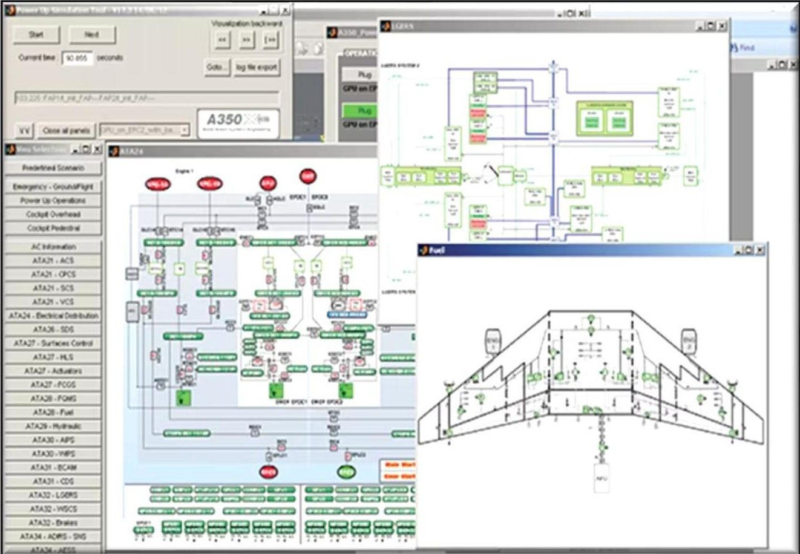

Figure 4.4. Airbus A350 Digital Bird: Integrated System Modeling Views (Siemens).

Multiple synchronized system-level diagrams used in the Airbus A350 development illustrate the concept of a "Digital Bird," where avionics logic, subsystem behavior, fuel distribution, and functional architecture are represented within a unified modeling interface. This cohesive digital environment enabled early validation, cross-domain simulation, and streamlined certification across a globally distributed supply chain.

<!-- PDF_PAGE: 215 -->

## 4.4.3 Outcomes and Comparative Analysis

The Airbus A350 program exemplifies the benefits achieved through early adoption of Model-Based Systems Engineering (MBSE) and digital thread integration (Object Management Group, 2017). By embedding traceability within system architecture and validation models, the program minimized rework and accelerated compliance with safety and certification requirements (INCOSE, 2015). These results were accomplished despite the program's globally distributed supply chain and the complexity of managing interfaces across multiple engineering domains (NASA, 2020).

By contrast, the Boeing 787 Dreamliner faced persistent design setbacks linked to fragmented modeling practices, incomplete MBSE deployment, and misaligned supplier processes (GAO, 2014). High-profile failures such as battery system instability and repeated delays exposed weaknesses in lifecycle verification and requirements traceability (Pyster & Olwell, 2013). Together, these two programs demonstrate how varying levels of systems engineering maturity can significantly impact program outcomes, stakeholder alignment, and long-term adaptability (INCOSE, 2015).

Figure 4.5. Comparative Performance of Boeing and Airbus (2019-2024).

<!-- PDF_PAGE: 216 -->

Net order performance between Boeing and Airbus from 2019 to 2024 reflects the measurable influence of the systems engineering discipline on commercial outcomes (The Boeing Company, 2024). Airbus demonstrated steady growth, supported by early MBSE deployment and robust digital integration across programs (Airbus, 2024). In contrast, Boeing experienced recurring declines driven by fragmented supplier alignment, limited digital thread continuity, and delayed validation workflows (Object Management Group, 2017).

Table 4.2. Comparative MBSE and Digital Thread Capabilities: Airbus vs Boeing.

<table border="1"><tr><td>Feature</td><td>Airbus A350 XWB</td><td>Boeing 787 Dreamliner</td></tr><tr><td>First Flight</td><td>2013</td><td>2009</td></tr><tr><td>MBSE Adoption</td><td>Full- via Dassault 3DEXPERIENCE</td><td>Partial- Relied more on traditional SE and outsourcing</td></tr><tr><td>Issues Faced</td><td>Fewer delays, smoother integration</td><td>Delays, battery fires, grounding</td></tr><tr><td>Digital Twin/Thread</td><td>Fully leveraged for lifecycle traceability</td><td>Initially limited.</td></tr><tr><td>Current Status</td><td>Operational and expanding fleet</td><td>Operational (but troubled history)</td></tr></table>

## 4.4.4 Relevance to Research Objectives

This case strongly reinforces the role of MBSE and digital thread integration in improving complex aerospace outcomes. Specifically, it illustrates how fully integrated toolchains can:

- Ensure End-to-End Traceability: From stakeholder requirements to subsystem verification.

- Support Digital Continuity: Across disciplines, suppliers, and lifecycle stages.

- Deliver Tangible Gains: In time-to-market, cost, and systems integrity.

<!-- PDF_PAGE: 217 -->

## Connection to Research Goals:

- Traceable Modeling: The A350's rigorous MBSE foundation contrasts sharply with the fragmented modeling practices often observed in small satellite missions. This research proposes a scalable variant tailored to resource-constrained programs, such as SidSat.

- Adaptive Workflow: Airbus's successful use of change propagation across models provides a benchmark for how prioritization and validation updates should cascade through the engineering toolchain.

- Toolchain Integration: The A350 program substantiates the potential of federated environments. In the context of this research, a "digital trinity" of Cameo (SysML), MATLAB, STK, Excel, AWS, and Teamcenter is proposed to emulate similar cohesion on a smaller scale.

## 4.5 CASE STUDY 4: PRIORITIZATION - SUCCESS VS FAILURE IN AEROSPACE

4. 5.1 Project Overview: This case study examines the pivotal role of requirements prioritization in aerospace projects by contrasting programs that failed due to inadequate management of requirements with those that succeeded through structured prioritization processes. Systems engineering principles emphasize requirements as the bedrock for design decisions, resource allocation, and risk management. When requirements prioritization is overlooked or poorly executed, even technically sound programs can experience performance degradation under escalating complexity.

<!-- PDF_PAGE: 218 -->

## 4.5.2 Failures in Prioritization

- NASA's South Pole Ice-Extraction Program: A high-value exploration initiative aimed at Extracting ice from the lunar South Pole failed to advance beyond early design stages. $ ^{31} $ Analysis revealed overly ambitious performance requirements defined without sufficient stakeholder consensus or constructive trade-off mechanisms, leading to significant budget escalation and eventual cancellation. Independent reviews identified shifting priorities and a lack of structured ranking for requirements as key systemic flaws (Slutsken, 2018). The cancellation of NASA's Resource Prospector mission underscores the consequences of ambiguous prioritization and shifting technical goals in early-stage exploration programs (Klok, 2018).

Figure 4.6. NASA Resource Prospector Rover.

<!-- PDF_PAGE: 219 -->

- U.S. Army Future Combat Systems (FCS): Conceived as an ambitious next-generation Network of Networks (NoN) for combat vehicles and systems faced significant challenges due to fuzzy and frequently reprioritized requirements. $ ^{32} $ The program's expanding scope outpaced its original capability goals, resulting in spiraling costs and an inability to define stakeholder needs clearly. Reviews by the Government Accountability Office (GAO, 2004) and the RAND Corporation (2012) identified requirement instability and poor prioritization as significant factors contributing to the project's early termination.

Figure 4.7. Future Combat Systems Architecture.

## 4.5.3 Successes in Prioritization

- Airbus A380: Despite market challenges, the Airbus A380 program demonstrated disciplined requirements integration. Amidst the complexities of a globally distributed supply chain, Airbus maintained a tiered requirements framework. This approach balanced safety-critical systems, performance efficiency, and operational consistency. Hierarchical prioritization allowed Airbus to

<!-- PDF_PAGE: 220 -->

manage massive subsystems with minimal rework and achieve high dispatch reliability (Eaton, n.d.).

- EnduroSat Onboard Computer (OBC): This CubeSat subsystem demonstrates successful requirements prioritization. The OBC explicitly maps requirements to mission-critical objectives using a ranked attribute matrix that assigns weightings to attributes like fault tolerance and radiation resilience (tested up to 40 krad TID). This approach ensures system trade-offs are data-driven and verified early in development through modeling and simulation (EnduroSat, n.d.).

## 4.5.4 Analysis of Key Differences:

Table 4.3. Comparative Analysis of Requirements Prioritization Practices.

<table border="1"><tr><td>Aspect</td><td>Failures(FCS,NASA)</td><td>Successes(A380,EnduroSat OBC)</td></tr><tr><td>Requirement Stability</td><td>High volatility, shifting priorities</td><td>Clear tiers,stable ranking throughout development</td></tr><tr><td>Stakeholder Alignment</td><td>Fragmented stakeholder inputs, unsystematic ranking</td><td>Formal matrices and decision workshops</td></tr><tr><td>Trade-off Visibility</td><td>Ad-hoc,undocumented</td><td>Model-driven trade-offs and early verification&amp;validation</td></tr><tr><td>Traceability&amp;Adaptation</td><td>Poor linkage to verification or lifecycle changes</td><td>Bidirectional traceability embedded in MBSE models</td></tr></table>

4. 5.5 Relevance to Research Objectives: The contrasting outcomes in these validation programs demonstrate that:

- Unstructured prioritization leads to cascading uncertainty, exacerbating design complexity, verification failures, and cost overruns.

- Integrated prioritization methods maintain control over system evolution, enabling timely detection of requirement impacts, improved stakeholder alignment, and traceable deployment decisions.

<!-- PDF_PAGE: 221 -->

- For both large-scale aerospace (A380) and compact platforms (CubeSat OBC), embedding prioritization within model-based environments ensures resilience and lifecycle coherence, providing strong justification for the adaptive prioritization framework proposed in this work.

## 4.6 CASE STUDY 5: LOSSES FROM LACK OF DIGITAL ENGINEERING

4. 6.1 Project Overview: This case study examines the consequences of failing to implement integrated digital engineering practices in two major defense programs, Lockheed Martin's classified missile projects and Boeing's T-7A Red Hawk trainer aircraft. Unlike previous examples that highlighted the benefits of MBSE adoption, this analysis focuses on the structural risks associated with fragmented toolchains, missing digital threads, and inadequate lifecycle synchronization in large-scale aerospace projects.

Figure 4.8. Conceptual Missile Defense Model (Lockheed Context).

4. 6.2 Failure in Integration: Lockheed Martin incurred nearly $2 billion in losses across two classified defense programs, primarily attributed to architectural inconsistencies, uncoordinated

<!-- PDF_PAGE: 222 -->

design changes, and engineering rework stemming from limited tool integration (Insinna, 2025). $ ^{33} $ Despite the use of advanced design environments, the absence of feedback loops and a lack of digital traceability created disconnects between the engineering, manufacturing, and testing domains. Similarly, Boeing's T-7A Red Hawk experienced compounding delays due to misaligned digital workflows and incomplete propagation of design updates across teams and suppliers. Reviews of the program identified breakdowns in digital model fidelity, inconsistent verification coverage, and failure to maintain version alignment across the development lifecycle (Tirpak, 2023). $ ^{34} $

Figure 4.9. Boeing T-7A Red Hawk Delays.

<!-- PDF_PAGE: 223 -->

4. 6.3 Digital Engineering Gap: Neither program deployed a comprehensive digital thread capable of linking behavioral models, test data, stakeholder constraints, and certification baselines. Although modeling platforms and PLM systems were present, their implementation lacked structural cohesion and traceable integration. These failures demonstrate that digital tools alone are insufficient; strategic alignment, unified data architecture, and persistent cross-domain synchronization are essential for delivering traceable, resilient systems in accordance with the Department of Defense's digital engineering priorities (Defense Acquisition University, 2018).

## 4.7 CASE STUDY 6: SAVINGS THROUGH DIGITAL INTEGRATION

4. 7.1 Project Overview: This case study examines Northrop Grumman's Model 437 Flight program, which demonstrates how structured digital engineering practices can reduce engineering rework and accelerate aircraft development. The program applied a fully integrated digital ecosystem to align engineering, certification, testing, sustainment, and manufacturing activities through a persistent digital thread. This configuration enabled live synchronization across lifecycle phases, minimized manual coordination, and decreased rework rates to approximately 1%, compared to the conventional 20%. The Model 437 effort relied on validated, high-fidelity system models that served as the authoritative source for verification and compliance, supporting traceable decision-making under strict performance and certification schedules. The case illustrates how deliberate digital integration can improve lifecycle coordination and engineering assurance across complex aerospace programs.

4. 7.2 Implementation Strategy: To support this objective, the company introduced an enterprisewide digital environment that unified tools and workflows across engineering functions. SysMLbased modeling, implemented using Cameo Systems Modeler, was integrated with MATLAB and ANSYS for simulation, Teamcenter for version control, and advanced 3D tools for design

<!-- PDF_PAGE: 224 -->

visualization. System requirements were linked early to architecture elements, test cases, and verification criteria through allocation and trace constructs. Iterative design reviews were conducted using shared model repositories, which significantly reduced manual overhead and limited miscommunication across engineering, test, and compliance teams (DoD, 2018).

4. 7.3 Outcomes and Measurable Benefits: This integrated approach led to a 20% reduction in the total design cycle and avoided approximately $150 million in downstream rework by eliminating late-stage design conflicts. Proactive validation was supported by cross-domain traceability, while simulation environments enabled timely performance trade-off analyses. Additionally, certification timelines were improved by automating compliance matrices and verification records, resulting in a nearly 40% reduction in time spent preparing regulatory documents.

4. 7.4 Digital Engineering Leverage: Unlike prior examples constrained by disconnected legacy toolchains, this case shows the effectiveness of a unified digital thread in bridging requirements, architecture, and verification. Digital engineering was not introduced as a secondary toolset; instead, it was embedded from the outset, reinforcing its role as a foundation for system development. When applied consistently, this strategy enhanced engineering insight, team coordination, and overall system reliability. As shown in Figure 4.10, Northrop Grumman's Model 437 program employed a fully connected digital ecosystem to unify engineering domains and reduce lifecycle overhead. $ ^{35} $

<!-- PDF_PAGE: 225 -->

Figure 4.10. Fully Connected Digital Ecosystem (Northrop Grumman).

An enterprise-level digital engineering framework that demonstrates synchronized interaction among key domains, including engineering, testing, manufacturing, certification, and sustainment. The approach supports a unified digital thread, enabling model reuse, traceability, reduced rework, and lifecycle acceleration across aerospace development phases.

## 4.8 SUMMARY AND CROSS-CASE INSIGHTS

The six case studies reviewed in this chapter reflect patterns that relate closely to the research's emphasis on Model-Based Systems Engineering (MBSE), requirements prioritization, and digital integration. Although each case did not address all three practices in full, the combined findings show how their use, or absence, affected program structure, verification, and coordination across the development cycle. The observed trends support the position that applying MBSE with prioritized requirements and connected digital workflows can help align system behavior with mission objectives while improving schedule control and cost efficiency in aerospace system design.

Case Study 1 examined the 2025 Air India Boeing 787 crash near Ahmedabad. The investigation revealed an alarming absence of foundational MBSE practices, which contributed to

<!-- PDF_PAGE: 226 -->

missed design dependencies and cascading system failures. This example serves as a stark reminder of the human and operational risks associated with engineering complex aerospace platforms without traceable requirements or model-based verification frameworks.

Case Study 2 focused on recurring cost overruns in Boeing-NASA joint programs.The findings revealed a pattern of early-phase MBSE neglect, resulting in project scope drift, mismatched stakeholder expectations, and multiple redesign cycles.Rather than serving as a passive documentation aid, MBSE is shown here to play a strategic role in coordinating subsystems, reducing ambiguity, and maintaining architectural alignment across teams.

Case Study 3 presented the Airbus A350 program as a benchmark for successful digital engineering. The deliberate application of MBSE from concept through certification enabled comprehensive traceability, strong interface control, and early identification of integration risks. Integrated modeling tools supported effective management of this multi-national development effort, demonstrating that when used proactively, MBSE fosters both technical precision and organizational coordination (Airbus, 2024).

Case Study 4 examined success and failure through the lens of requirements prioritization. Programs such as the South Pole Ice Extraction and FCS initiatives failed due to loosely defined goals, static requirements, and an absence of structured filtration. In contrast, successful programs applied prioritization matrices and weighted criteria to channel limited resources toward high- impact objectives, improving both performance and delivery confidence (INCOSE, 2015).

Case Study 5 examined the Lockheed Martin classified programs and Boeing's T-7A Red Hawk development. Both programs revealed critical weaknesses in managing digital artifacts across engineering and supplier teams. Lockheed reported over $2 billion in charges due to fragmented design coordination and lack of model synchronization across missile and aeronautics

<!-- PDF_PAGE: 227 -->

divisions. Similarly, the T-7A program suffered delays tied to breakdowns in digital model fidelity, poor change propagation, and limited integration between lifecycle tools. These challenges led to rework, misaligned handoffs, and diminished traceability, underscoring the consequences of incomplete digital thread implementation and limited stakeholder alignment (Insinna, 2025; Tirpak, 2023).

Case Study 6 profiled a recent commercial aircraft program that adopted a harmonized digital toolchain integrating Cameo, MATLAB, Teamcenter, and ANSYS. This alignment enabled synchronized model iteration, reduced manual reporting, and improved system understanding across domains. The program reported a 20% reduction in development cycle time and over $150 million in cost savings, largely due to minimized rework and accelerated validation feedback (The Boeing Company, 2024).

## Cross-Cutting Insights:

The case study analysis throughout this chapter identifies four important technical patterns that connect to the investigation's main themes:

- Integrated Toolchains and Model Consistency: Projects that maintained continuity between modeling tools, design logic, and simulation platforms demonstrated fewer errors, reduced rework, and better alignment between design expectations and system behavior (NASA, 2020).

- Requirements Filtering and Decision Support: Although no example featured a formal prioritization model, several programs emphasized the need to evaluate constraints, tradeoffs, and stakeholder inputs. A structured prioritization method tailored to a CubeSat system is therefore introduced in Chapter 5.

<!-- PDF_PAGE: 228 -->

- Modular Structures and Interface Discipline: Projects with well-defined subsystem boundaries and interface rules enabled independent team development, allowed faster hardware updates, and reduced integration delays (The Boeing Company, 2024).

- Validation-Centered Digital Practices: High-performing efforts made early investments in simulation, requirements traceability, and model-based verification workflows, allowing validation tasks to be embedded earlier in the development process (Airbus, 2024).

These insights support the rationale for applying a combined approach to SidSat, integrating MBSE foundations, prioritized requirement handling, and tool-connected system modeling.

<!-- PDF_PAGE: 229 -->

"What we have to learn to do, we learn by doing." Aristotle

## 5.1 MISSION AND SYSTEM CONTEXT

## 5.1.1 Overview and Objectives

SidSat is a 4U CubeSat developed to explore modular satellite design using model-based systems engineering (MBSE) and digital engineering practices (Friedenthal et al., 2014). The mission is structured around the idea that adaptability and modularity in satellite systems can reduce complexity during design changes and upgrades (INCOSE, 2015). MBSE methods allow the engineering team to manage structure, behavior, and performance within a unified digital model (Object Management Group, 2017). The project aims to assess whether two mission-specific payloads, a robotic arm and an AI/ML experiment, can be isolated and managed using a modular architecture (Alai, 2019). By maintaining separation between subsystems and modeling traceable interfaces, integration risks can be reduced early in the lifecycle (Holt & Perry, 2012). Toolchain connectivity supports configuration control and makes simulation data accessible throughout system development (Pyster & Olwell, 2013). These features contribute to clearer system logic and more reliable decision-making under time and cost constraints (Estefan, 2008).

The spacecraft consists of two main structures: a core system module and a dedicated payload section (NASA, 2020). The core module is responsible for platform stability and includes power systems, data handling, communications, and attitude control functions (Browning et al., 2022). These functions operate independently of mission-specific payloads, ensuring that the core can sustain critical operations even if experimental systems fail (Post et al., 2019). The secondary module supports the two experimental payloads using a mechanical interface and a shared digital connection that maintains electrical isolation (The Boeing Company, 2024). This isolation enables

<!-- PDF_PAGE: 230 -->

the parallel execution of test routines and prevents the propagation of faults across the spacecraft (Airbus, 2024). $ ^{36} $

Deployment is scheduled from the International Space Station through the NanoRacks CubeSat Deployer, offering a relevant orbital environment for system evaluation (DoD, 2018). Along with testing physical integration, the satellite is used to study digital workflows and requirement traceability across the model hierarchy (No Magic, 2021). MBSE tool support enables fast iteration, allowing engineers to modify the architecture without breaking consistency across layers (Bergmann et al., 2021). The SidSat mission illustrates how digital engineering practices can deliver modularity, traceability, and cost efficiency for CubeSat-scale aerospace projects (Nomagic, 2022).

## 5.1.2 Modular System Architecture

SidSat is designed using a 4U CubeSat structure, divided into modular compartments, to improve system maintainability and support payload flexibility (INCOSE, 2015). This configuration promotes the independent development and testing of critical functions while reducing subsystem coupling and integration overhead (DoD, 2018). Modular partitioning enables structured updates, risk isolation, and streamlined verification throughout the development lifecycle (Object Management Group, 2017). Recent aerospace research has highlighted that additive manufacturing supports the fabrication of lightweight structural components and the faster prototyping of modular satellite platforms (Romei et al., 2020).

The spacecraft consists of two primary modules: a central operational core and a separate payload housing for mission-specific experiments (NASA, 2020). The core includes essential components such as the Electrical Power Subsystem (EPS), Onboard Computer (OBC), Attitude

<!-- PDF_PAGE: 231 -->

Determination and Control System (ADCS), and communication systems, which are foundational to satellite functionality (Post et al., 2019). These subsystems are interconnected using a Controller Area Network (CAN) bus that supports digital signal coordination and energy distribution (No Magic, 2021). This standardized interface simplifies diagnostics, enables modular upgrades, and minimizes connector mismatches during integration (Nomagic, 2022).

The payload section includes a robotic arm with two degrees of freedom and a compact AI/ML module for onboard testing and data generation (SIDSAT TDP). Both payloads are isolated mechanically and electrically using predefined mounting schemes to reduce transmission of vibration and noise (Browning et al., 2022). Supporting structures provide physical stability and subsystem protection throughout launch and in-orbit operation (The Boeing Company, 2024). The design parameters for this modular layout follow the CubeSat Design Specification (Rev. 14), which defines mass, dimensions, and deployment constraints (CubeSat Program, 2020).

## Key Features and Functions:

## Core Module:

- EPS II (Electrical Power System) - Distributes regulated power to all onboard electronics.

- ES OBC with GNSS - Onboard computer supporting satellite control and integrated with Global Navigation Satellite System for position determination.

- UHF Transceiver - Flight-proven, half-duplex communication unit for command and telemetry exchange.

- Cube ADCS - Attitude Determination and Control System responsible for detumbling, antenna orientation, spin stabilization for solar charging, and attitude control during robotic operations.

- Core Solar Panels - Generate power to recharge EPS II battery cells.

<!-- PDF_PAGE: 232 -->

- (Optional) S-Band Antenna - High-frequency antenna for data transmission and reception (uplink: 2025-2110 MHz) via commercial ground stations.

## Payload Module:

- AIML Module - The scientific payload is designed to collect performance data under radiation and thermal conditions in low Earth orbit.

- Robotic Arm (RA) - A deployable payload for evaluating attitude disturbances induced by torque during articulated movement.

- RA Door - Deployable structural surface functioning as the robotic arm's operational platform.

- WLG-30-R Motor - Actuators enabling two degrees of freedom in robotic arm movement.

- nD3PP Pin Puller - Redundant mechanical locking device to prevent unintentional deployment of the RA door.

- RA PCB Controller - Manages robotic arm operations and transmits collected data to the core processing unit.

- Door PCB Contact Board - Integrates conductive points to verify end-effector contact, supporting robotic arm positional accuracy assessment.

- Motor Driver PCB - Circuit board responsible for driving and regulating the robotic arm motors.

- PiCam Module - Onboard camera for visual monitoring of the robotic arm system.

- RA Module Solar Arrays - Provide localized power generation and storage for the EPS II system.

- Roller Switches - Power inhibition mechanisms to ensure safe subsystem isolation.

<!-- PDF_PAGE: 233 -->

Interface integrity is maintained through strict adherence to specifications defined in the Interface Definition Document (SIDSAT IDD, 2024). These specifications govern electrical, mechanical, and data interaction parameters across modules, reducing ambiguity and enabling reuse across future CubeSat designs.

From a digital engineering standpoint, each subsystem is represented in SysML using layered Block Definition Diagrams (BDDs) and Internal Block Diagrams (IBDs), ensuring full traceability from requirements to component-level implementation (Martell et al., 2024). This approach enhances verification workflows, supports modular testing, and enables rapid design iterations, positioning SidSat as a flexible and scalable platform for both current and future aerospace missions.

## 5.1.3 Concept of Operations (ConOps)

The Concept of Operations (ConOps) for SidSat defines a structured sequence of mission events encompassing verification, deployment, experimentation, data handling, and controlled shutdown (SIDSAT TDP; NASA, 2020). This operational flow supports modular subsystem evaluation and the satellite's digital toolchain strategy (Object Management Group, 2017). Primary objectives include validating hardware coordination, autonomous control sequences, and robotic deployment in a low Earth orbit (LEO) environment (Bergmann et al., 2021).

SidSat is deployed from the International Space Station (ISS) via the NanoRacks CubeSat launcher, ensuring a controlled release pathway for its demonstration objectives (CubeSat Program, 2020). Once inserted into a $ \sim 4 3 5 $ km orbit with a $ 5 2. 0^{\circ} $ inclination, a 32-minute hold is enforced before any system activity begins to guarantee spatial clearance from the station (DoD, 2018). During this passive interval, SidSat maintains non-operational status, awaiting ground station clearance for activation (The Boeing Company, 2024).

<!-- PDF_PAGE: 234 -->

Following this hold, SidSat initiates firmware loading, extends the UHF antenna, and performs detumbling to reach nadir orientation. These steps are directed by the onboard Attitude Determination and Control System (ADCS) and verified through limited-rate downlinked telemetry (Post et al., 2019).

Figure 5.1. SidSat Mission Concept of Operations. (Source: SidSat TDP).

Five defined communication windows are programmed into the operational schedule to support mission tasks (NASA, 2020):

- First Communication Window (T+48 minutes): Ground contact is achieved via UHF and Sband links. This session confirms battery health and power bus status, enabling uplink of TLE data (INCOSE, 2015).

<!-- PDF_PAGE: 235 -->

- Second Communication Window (T+526 minutes): Onboard imaging is initialized, the robotic housing opens, and four motion sequences are executed under active attitude stabilization (Bergmann et al., 2021).

- Third Communication Window (~T+1863 minutes): A repeat sequence of robotic maneuvers is executed without ADCS stabilization to examine dynamic behavior during free operation (Alai, 2019).

- Fourth Communication Window (~T+4335 minutes): The AI/ML unit runs onboard processing routines using test payload data, storing classification results for post-pass downlink (Nomagic, 2022).

- Fifth Communication Window (~T+4383 minutes): Final telemetry collection is performed, followed by health diagnostics to determine if the satellite continues another operational cycle or enters low-power safe mode (Post et al., 2019).

SidSat is designed to remain in orbit for approximately 4.2 years until natural decay results in atmospheric reentry (CubeSat Program, 2020). The mission demonstrates digital subsystem integration, adaptive operation, and phased robotic workflows tailored for reconfigurable nanosatellite architectures (The Boeing Company, 2024).

## 5.1.4 System Work Breakdown Structure

The Work Breakdown Structure (WBS) for the SidSat Satellite System provides a hierarchical decomposition of the project scope, adhering to the MIL-STD-881 standard. At Level 1, the WBS represents the complete satellite system. Level 2 partitions this into major subsystems, including Payload, Power, Thermal, ADCS, Communications, and Structural domains. Each of these is further refined into Level 3 detailed subsystems and logical groupings, such as solar arrays, battery packs, gyroscopes, transceivers, and thermal control components. Level 4 delineates

<!-- PDF_PAGE: 236 -->

individual hardware elements and task-level units, including robotic actuators, deployment restraints, software boot routines, and test procedures.

Figure 5.2. SidSat WBS (part 1) $ ^{37} $

Figure 5.3. SidSat WBS (part 2).

This work breakdown structure (WBS) enhances traceability by linking project milestones with architectural elements through cost-aware planning tools (Object Management Group, 2017). It directly supports the SysML block structure and hierarchy illustrated in Section 5.2, reinforcing model coherence across functional and structural layers (INCOSE, 2015). Mapping system

<!-- PDF_PAGE: 237 -->

components to technical tasks ensures modular integrity and effective coordination throughout the satellite lifecycle (Browning et al., 2022).

## 5.2 MBSE IMPLEMENTATION IN SIDSAT

## 5.2.1 SysML Modeling

The SysML modeling strategy adopted for SidSat provided a rigorous platform for applying MBSE principles to structure, assess, and validate the CubeSat's physical and behavioral elements (INCOSE, 2015). SysML was chosen due to its ability to represent complex aerospace systems across domains using standardized graphical notations aligned with digital engineering workflows (Object Management Group, 2017). The modeling effort enabled full-spectrum architectural definition, from stakeholder needs to subsystem behaviors and constraints (NASA, 2020).

Cameo Systems Modeler was employed as the core modeling tool and configured to work with MATLAB for dynamic performance simulations and with STK to support orbital analysis requirements (Post et al., 2019). Microsoft Excel was integrated to support structured parameter entry and model interfacing with requirement artifacts (Browning et al., 2022). The model-building process started with a Content Diagram, which organized logical layers and identified top-level model views (Alai, 2019). Structural modeling was developed through Block Definition Diagrams (BDDs) and Internal Block Diagrams (IBDs) to define system parts, interfaces, ports, and value properties (DoD, 2018).

Behavioral modeling incorporated Activity Diagrams for process flow and State Machine Diagrams to represent operational phase transitions such as initialization, robotic actuation, AI execution, and terminal state handling (Nomagic, 2022). Use Case Diagrams clarified external interactions, enabling scenario analysis involving the ground station and onboard experiment

<!-- PDF_PAGE: 238 -->

actors (The Boeing Company, 2024). These diagrams supported hierarchical decomposition and external interface logic (Romei et al., 2020).

Requirements Diagrams and requirement callouts were used to formalize traceability between system needs and model components, enhanced by matrix views in Cameo (CubeSat Program, 2020). Verification constructs included 《satisfy》 and 《verify》 links, with parametric triggers for simulation-based validation (No Magic, 2021). This modeling environment enabled early design assessment, reduced ambiguity, and captured mission logic, testability, and interface constraints within a reusable digital framework (Airbus, 2024). $ ^{38} $

## 5.2.2 Logical Structural Models

The structural modeling of SidSat was developed using SysML to formally capture system architecture, internal interfaces, behavioral sequences, and performance constraints (INCOSE, 2015). These architectural views enhance modular design, facilitate integration planning, and support traceability throughout the digital engineering lifecycle, from requirements to validation (Object Management Group, 2017). This modeling approach helps ensure that the system design aligns with mission-level objectives and established engineering standards (NASA, 2020).

The Concept/Context Diagram defines SidSat's operational environment, highlighting entities such as the Aerospace Center, NanoRacks, and the International Space Station (CubeSat Program, 2020). It also maps key interactions and external elements in low Earth orbit, supporting boundary definition and interface identification (Browning et al., 2022).

<!-- PDF_PAGE: 239 -->

Figure 5.4. SidSat Concept Model.

Figure 5.5. SidSat Hierarchical Model.

The Block Definition Diagram (BDD) decomposes SidSat into major subsystem groups, including power, processing, communications, onboard computer, attitude control, and payload interfaces (NASA, 2020). It defines signal flows, value types, and constraint blocks that represent system-wide parameters, such as allowable voltage limits, data rates, and operational thresholds (Object Management Group, 2017). Parametric modeling is embedded in the BDD to support simulation-driven feasibility analysis across system domains (Bergmann et al., 2021). These features help ensure consistency across early design activities, interface validation, and digital verification throughout the CubeSat's model-based development lifecycle (INCOSE, 2015).

<!-- PDF_PAGE: 240 -->

Figure 5.6. SidSat Block Definition Diagram.

The Internal Block Diagram (IBD) builds on the Block Definition Diagram (BDD) by modeling both the structural composition and internal interfaces of the SidSat system. It captures physical and logical interactions among system elements using proxy ports, interface blocks, and directed connectors to formalize the flow of data, control, and power across modules. The EPS (Electrical Power Subsystem) receives input from the solar panels and distributes regulated power to all major components, including the OBC, ADCS, robotic actuators, and payload subsystems. Communication with the ground station is achieved through both UHF and S-band transceivers, which are modeled as external communication pathways connected to the core module. These channels are represented using proxy ports and interface definitions to ensure modular communication encapsulation and verification of port compatibility (SIDSAT TDP, 2025).

The model explicitly illustrates the Controller Area Network (CANBUS) protocol as the internal communication backbone between the OBC and key control units, enabling synchronized command execution and telemetry reporting. Within the secondary payload module, the AI/ML payload and robotic arm are linked to the OBC and actuator systems through structured data transfer interfaces, maintaining separation of concerns while supporting coordinated control. This IBD supports validation and consistency checking by enforcing interface contract rules, reducing

<!-- PDF_PAGE: 241 -->

ambiguity during integration, and aligning structural connections with behavior and constraint models in Cameo Systems Modeler (Object Management Group, 2017).

Figure 5.7. SidSat Internal Block Diagram.

The following Internal Block Diagram (IBD) defines the architecture of the Electrical Power Subsystem II (EPSII), emphasizing the flow of energy from generation to regulated distribution (NASA, 2020). Solar panels and batteries connect through multiple voltage buses, 3.3V, 5V, 12V, and Vbat, establishing a robust multi-source system (CubeSat Program, 2020). Power Distribution Management regulates output to key interfaces and prevents overload conditions (Object Management Group, 2017). Labeled ports are used for solar input (sPIn), battery input (powerIn), and power delivery. A kill switch is included to support subsystem isolation and fault handling in the event of anomalies (INCOSE, 2015).

<!-- PDF_PAGE: 242 -->

Figure 5.8. SidSat EPSII Subsystem: IBD for Power Distribution and Supply.

To represent system functions, a Functional Flow Diagram (FFD) sequences mission phases, including deployment, initialization, power checks, robotic control, and telemetry (Object Management Group, 2017). This modeling technique supports timing validation and subsystem coordination within a SysML-based architecture.

Figure 5.9. SidSat Functional Flow Diagram.

A complementary Parametric Diagram was used to evaluate physical performance constraints. For instance, the mechanical load limit along the Z-axis during deployment was expressed using constraint properties and binding connectors, ensuring that internal force propagation remained within the validated threshold of 0-1200 N. These results confirmed the design's structural

<!-- PDF_PAGE: 243 -->

Figure 5.10. SidSat Parametric Diagram $ ^{3 9} $

In synthesis, these logical models provided a rigorous foundation for system validation, enabling digital continuity across architecture, behavior, and performance parameters. They also demonstrated how MBSE practices, grounded in standardized SysML views, can streamline the development of small satellites while aligning with broader aerospace system design strategies.

## 5.2.3 Logical Behavioral Models

The behavioral modeling of SidSat articulates how internal functions respond to mission phases, environmental stimuli, and interactions with external systems. Developed using SysML, these models, Use Case Diagrams, Activity Diagrams, and State Machine Diagrams, capture functional workflows, operational logic, and event-driven transitions with traceability across mission activities.

The Use Case Diagram defines the high-level functional interactions between SidSat and external actors, including the International Space Station (ISS), Ground Station, and Mission Operators. It identifies core operational goals, including deployment, initialization, telemetry exchange, experimental control, and data transmission. Alternate flows address contingency

<!-- PDF_PAGE: 244 -->

scenarios, such as energy conservation routines during low battery states and AI/ML fallback modes in response to computational anomalies. This model supports comprehensive stakeholder alignment by illustrating the system's intended services under both nominal and exceptional conditions (Delligatti, 2013).

Figure 5.11. SidSat Use Case Diagram.

The Activity Diagram models the sequence of operations from ISS deployment to mission completion. Functional swimlanes delineate the responsibilities of actors, including tasks such as firmware initialization, detumbling, robotic arm actuation, sensor monitoring, and data downlink. These workflows are mapped with control and object flows, allowing simulation-based validation of timing constraints and logical dependencies between operations. Temporal verification of this model in Cameo Systems Modeler supports synchronization of subsystem actions across discrete mission windows (Nomagic, 2022).

<!-- PDF_PAGE: 245 -->

Figure 5.12. SidSat Activity Diagram.

The State Machine Diagram defines the communication subsystem's event-driven lifecycle. The SidSat communication flow is defined using a State Machine Diagram, beginning in the Off state. Once the deployment from ISS occurs, a 30-minute timer activates to allow conditions in LEO to stabilize. The system then shifts into the On state and enters Boot, where it executes a sequence of operations including write, system variable loading, watchdog reset, error recovery, UHF antenna deployment, de-tumble, and nadir-pointing. After this, the satellite transitions into Communication, which includes four parallel activities: Beacon, Listen, Uplink, and Downlink. Before proceeding to each experiment, the satellite checks battery status. It conducts RA Experiment 1, RA Experiment 2, and the AI/ML Experiment, each followed by a return to Communication for data transmission. After completing all experiments, the satellite establishes

<!-- PDF_PAGE: 246 -->

contact with the ground station and enters the Final state. This sequence reflects the complete autonomous operation of the communication subsystem under realistic orbital conditions.

Figure 5.13. SidSat State Machine Diagram.

Taken as a whole, these logical behavioral models not only validate mission feasibility but also strengthen fault tolerance and risk mitigation. They provide an essential framework for simulation-driven design assurance, aligning behavioral expectations with system architecture and requirements in a digitally traceable format.

## 5.3 REQUIREMENTS PRIORITIZATION STRATEGY

## 5.3.1 SidSat Requirements Matrix

The requirements architecture for SidSat was developed through a structured Model-Based Systems Engineering (MBSE) framework, emphasizing traceability, formal verification, and alignment with mission-level objectives. Grounded in ISO/IEC/IEEE 29148 standards for requirements engineering and guided by MBSE best practices (INCOSE, 2023), the process began

<!-- PDF_PAGE: 247 -->

with functional flow decomposition of core mission threads, deployment, stabilization, communication, payload operation, anomaly handling, and de-orbit sequencing. $ ^{40} $ These flows informed the development of layered system requirements, which were then formalized using SysML constructs in Cameo Systems Modeler (CubeSat Program, 2020).

<table class="table table-bordered"><thead><tr><th>#</th><th>Name</th><th>Text</th><th>Satisfied By</th><th>Bounds</th></tr></thead><tbody><tr><td>1</td><td>1 Functional</td><td></td><td></td><td></td></tr><tr><td>2</td><td>1.1 Communication Interval</td><td>SidSat shall communicate with the ground station between 12 hours and 24 hours.</td><td></td><td>[12;24]</td></tr><tr><td>3</td><td>1.2 Data Storage Capacity</td><td>SidSat shall store between 50GB and 150GB of data on its onboard memory.</td><td></td><td>[50;150]</td></tr><tr><td>4</td><td>1.3 Imaging Resolution</td><td>SidSat shall capture images with a resolution between 5 cm and 10 cm per pixel.</td><td></td><td>[5;10]</td></tr><tr><td>5</td><td>1.4 Data Transmission Rate</td><td>SidSat shall transmit data between 2 Mbps and 5 Mbps.</td><td></td><td>[2;5]</td></tr><tr><td>6</td><td>1.5 Attitude Control Accuracy</td><td>SidSat shall perform attitude control with a pointing accuracy between 0.05 degrees and 0.1 degrees.</td><td></td><td>[0.05;0.1]</td></tr><tr><td>7</td><td>2 Performance</td><td></td><td></td><td></td></tr><tr><td>8</td><td>2.1 Mission Duration</td><td>SidSat shall operate for between 12 months and 18 months in orbit.</td><td></td><td>[12;18]</td></tr><tr><td>9</td><td>2.2 Power Generation</td><td>SidSat shall generate between 150W and 250W of power from its solar panels.</td><td></td><td>[150;250]</td></tr><tr><td>10</td><td>2.3 Communication Range</td><td>SidSat shall maintain communication with the ground station at a range between 500 km and 2000 km.</td><td></td><td>[500;2000]</td></tr><tr><td>11</td><td>3 Battery Test</td><td></td><td></td><td></td></tr><tr><td>12</td><td>3.1 Battery Charging Time</td><td>SidSat's battery shall charge between 80% and 100% capacity in no more than 4 hours.</td><td></td><td>[80;100]</td></tr><tr><td>13</td><td>3.2 Battery Temperature Range</td><td>SidSat's battery shall operate between -10°C and +50°C without failure.</td><td></td><td>[-10;50]</td></tr><tr><td>14</td><td>3.3 Battery Operation Duration</td><td>SidSat's battery shall provide power for at least 48 hours during eclipse periods.</td><td></td><td>&gt;=48</td></tr><tr><td>15</td><td>4 Environmental</td><td></td><td></td><td></td></tr><tr><td>16</td><td>4.1 Operating Temperature Range</td><td>SidSat shall operate in an environment with temperatures between -10°C and +50°C.</td><td></td><td>[-10;50]</td></tr><tr><td>17</td><td>4.2 Radiation Resistance</td><td>SidSat shall withstand radiation levels between 1000 rads and 3000 rads.</td><td></td><td>[1000;3000]</td></tr><tr><td>18</td><td>4.3 Humidity Tolerance</td><td>SidSat shall be resistant to humidity levels between 10% and 90%.</td><td></td><td>[10;90]</td></tr><tr><td>19</td><td>5 Mechanical</td><td></td><td></td><td></td></tr><tr><td>20</td><td>5.1 Launch Vibration Resistance</td><td>SidSat shall withstand vibration levels between 10g and 50g during launch.</td><td></td><td>[10;50]</td></tr><tr><td>21</td><td>5.2 Structural Integrity</td><td>SidSat shall have structural integrity under acceleration forces between 0.5g and 3g.</td><td></td><td>[0.5;3]</td></tr><tr><td>22</td><td>5.3 Solar Panel Deployment Force</td><td>SidSat shall be capable of deploying solar panels with a force tolerance between 2 N and 5 N.</td><td></td><td>[2;5]</td></tr><tr><td>23</td><td>6 Mass Specifications</td><td></td><td></td><td></td></tr><tr><td>24</td><td>6.1 Total Mass</td><td>SidSat's total mass shall be between 1.5 kg and 6 kg</td><td></td><td>[1.5;6]</td></tr><tr><td>25</td><td>6.2 Payload Mass</td><td>SidSat's payload mass shall not exceed 2.5 kg.</td><td></td><td>&lt;=2.5</td></tr><tr><td>26</td><td>6.3 Propulsion System Mass</td><td>SidSat's maximum allowed mass for propulsion system shall be between 0.5 kg and 1.5 kg.</td><td></td><td>[0.5;1.5]</td></tr></tbody></table>

Figure 5.14. SidSat Requirements Table.

A centralized requirements table was constructed within Cameo to document and manage system needs. Each requirement entry includes a unique identifier, a formal description, a classification type, and a verification status. To facilitate iterative system validation, the table incorporates real-time visual indicators: green for fully validated items and red for failed items. These markers update dynamically based on results from linked simulations, test cases, and constraint evaluations, supporting a closed-loop digital validation process (Delligatti, 2013).

<!-- PDF_PAGE: 248 -->

Requirements were categorized into eight engineering domains; each tied to an authoritative source and serving distinct mission assurance functions:

- Communication: Defines uplink/downlink protocols, frequency allocations, link margins, and signal acknowledgment protocols. Compliance ensures reliable telemetry, time-synchronized command execution, and multi-pass data retrieval across orbital windows.

- Functional: Maps mission-level capabilities into executable tasks such as RA (robotic arm) operation, onboard data processing, and fault recovery. These drive system-level behavior modeling and inform interface requirements between functional blocks.

- Performance: Encodes quantitative performance thresholds such as ADCS stabilization （<5 $ ^{\circ} $ ）,boot latency（<120s),transmission bandwidth,and charge recovery time.Constraint blocks validate these values against simulated profiles and parametric thresholds.

- Battery Testing: Derived from NanoRacks lithium-ion safety guidelines, covering overcurrent protection, temperature limits, vacuum exposure endurance, and vibration resistance (NanoRacks, 2021). Compliance is essential for ISS deployment approval.

- Environmental: Reflects NRCSD launch and orbit survivability constraints, including venting specifications, outgassing tolerance, structural resonance, and thermal cycling. Simulated environmental profiles ensure mission readiness under nominal and degraded conditions.

- Mass Properties: Specifies total satellite mass (<4.0 kg/unit), with required center-of-mass placement for all three axes. These values ensure compatibility with CubeSat dispensers and enable accurate attitude control simulations.

<!-- PDF_PAGE: 249 -->

- Mechanical Specification: Details deployment rails, clearance buffers, locking mechanisms, and external coatings. Modeled tolerances align with NanoRacks dispenser specs to prevent launch interference or deployment failure.

- Power Budget: Defines the maximum allowable current draw for operational states (nominal, experimental, safe mode) and power subsystem duty cycles. These constraints were validated against simulation-based energy models and allocation matrices.

A system-wide Requirements Diagram augments the tabular model, offering visual clarity through key SysML relationships $ ^{41} $ :

- 《allocate》 distributes responsibility across subsystems, facilitating traceable collaboration and modular compliance.

- 《deriveReqt》maps high-level stakeholder needs into actionable, quantifiable system constraints.

- 《refine》 clarifies behavioral expectations by tying use cases and scenarios to technical conditions.

- «satisfy» connects structural and behavioral elements to requirements, confirming implementation presence.

- 《verify》 binds each requirement to simulation blocks, test cases, and telemetry data.

- 《copy》 maintains fidelity across repeated configurations, such as shared behaviors in multiple access windows.

<!-- PDF_PAGE: 250 -->

Each requirement maintains traceability to its source specification, enabling both forward and backward navigation across lifecycle stages. The following mapping summarizes source provenance:

Table 5.1. Authoritative Sources of Requirement Categories.

<table border="1"><tr><td>Category</td><td>Authoritative Source</td></tr><tr><td>Communication</td><td>Concept of Operations(ConOps)</td></tr><tr><td>Functional</td><td>Concept of Operations(ConOps)</td></tr><tr><td>Performance</td><td>Concept of Operations(ConOps)</td></tr><tr><td>Battery Testing</td><td>Lithium-ion Battery Safety Guideline(adapted for academic mission modeling)</td></tr><tr><td>Environmental</td><td>General NRCS Framework and Environmental Risk Baselines</td></tr><tr><td>Mass Properties</td><td>Simulated T&amp;E Configuration Guidelines</td></tr><tr><td>Mechanical Specification</td><td>NRCS Deployment Constraints and Internal Mechanical Modeling Standards</td></tr><tr><td>Power Budget</td><td>NASA-Based Power Consumption Requirements(modified for academic use)</td></tr></table>

This comprehensive and traceable model not only supports simulation-driven validation but also reinforces a system-of-systems understanding. It enhances cross-disciplinary collaboration, shortens verification cycles, and lays the groundwork for prioritization strategies, lifecycle risk mitigation, and regulatory alignment, essential for achieving mission success within the broader context of digitally engineered aerospace systems. Acquirer-driven digital engineering transformation enables requirements traceability and performance alignment from the earliest program phases, particularly in regulated industries such as defense and aerospace (Robinson & Liddy, 2022).

The example of validated SidSat requirements categorized by domain, is presented in Appendix A, along with its corresponding Requirements Verification and Traceability Matrix

<!-- PDF_PAGE: 251 -->

(RVTM) in Appendix B. These appendices consolidate the full set of system-level expectations derived from the SidSat Technical Data Package and support simulation-integrated validation across lifecycle phases (SidSat TDP, 2025).

## 5.3.2 Functional and Non-Functional Requirement Structuring

The requirements for SidSat are systematically categorized to support traceability, modular validation, and digital lifecycle integration. This characterization enables precise alignment between mission objectives, stakeholder needs, system behavior, and interface constraints, ensuring all requirements are verifiable within the model-based environment.

Table 5.2. Example of Requirement Categorization and Verification Methods.

<table border="1"><tr><td>Category</td><td>Requirement ID</td><td>Description</td><td>Validated(Y/N)</td><td>Verification Method</td></tr><tr><td>Functional &amp; Behavioral</td><td>1.2.2.2</td><td>Start the operating system to ensure functionality</td><td>Y</td><td>Demonstration</td></tr><tr><td>Functional &amp; Behavioral</td><td>1.6.2</td><td>Deploy the robotic arm door</td><td>N</td><td>Test</td></tr><tr><td>Performance &amp; Interface</td><td>2.1</td><td>Communicate with&lt;2 seconds latency</td><td>N</td><td>Analysis</td></tr><tr><td>Performance &amp; Interface</td><td>2.7</td><td>Maintain alignment±0.5 degrees</td><td>Y</td><td>Analysis</td></tr><tr><td>Reliability &amp; Resilience</td><td>1.13.1</td><td>Detect anomalies in system performance</td><td>N</td><td>Test</td></tr><tr><td>Reliability &amp; Resilience</td><td>1.13.2</td><td>Mitigate risks to maintain mission integrity</td><td>N</td><td>Demonstration</td></tr><tr><td>Safety &amp; Compliance</td><td>6.5</td><td>Rail width&gt;=6mm on X and Y faces</td><td>Y</td><td>Inspection</td></tr><tr><td>Safety &amp; Compliance</td><td>6.1</td><td>Include RBF/ABF switches for safety access</td><td>Y</td><td>Test</td></tr><tr><td>Environmental &amp; Power Budget</td><td>4.1.3</td><td>Withstand random vibrations(5.76g2/Hz for 60s)</td><td>Y</td><td>Test</td></tr><tr><td>Environmental &amp; Power Budget</td><td>3.10.2</td><td>Maintain battery capacity change&lt;5% after vibration</td><td>Y</td><td>Analysis</td></tr></table>

<!-- PDF_PAGE: 252 -->

1) Functional and Behavioral Requirements: This category defines the essential operations of satellite across all mission phases, including deployment, initialization, communication, power regulation, payload activation, and data transmission. Each function is logically sequenced through SysML activity and state machine diagrams, capturing event-driven transitions and continuous operations such as detumbling, antenna deployment, robotic arm maneuvering, and experimental cycles. The behavioral definitions align with the Concept of Operations (ConOps) and are mapped to system elements to ensure proper allocation and traceability. Model validation is supported through executable simulations and interaction sequences, enabling early-stage error detection across interdependent subsystems such as the onboard computer, ADCS, and communication modules (Holt et al., 2014).

## 2) Performance and Interface Specifications: Performance specifications quantify the

2) Performance and Interface Specifications: Performance specifications quantify the operational thresholds required for system success in orbit. These include timing constraints (e.g., $ < 2 $ - second communication latency), frequency ranges (UHF and S-band), alignment accuracy $ (\pm0.5^{\circ}) $ , data rates (10-150 Mbps), power availability (1-42 Wh), and mission duration (1.5-6 years). These requirements are often represented using value properties and constraint blocks within parametric diagrams to enforce real-time limits and trade space boundaries. Additionally, interface-related constraints, such as antenna communication bands, mechanical envelope tolerances, and frequency ratios, ensure robust interoperability between the satellite and launch, ground, or mission support systems. The integration of simulation outputs with the model provides performance verification, enabling digital co-simulation and traceable links between operational needs and architectural structures (MathWorks, 2023).

<!-- PDF_PAGE: 253 -->

## 3) Reliability and Resilience Requirements: This category captures the ability of SidSat

39. Reliability and Resilience Requirements. This category captures the ability of Stasat to autonomously sustain mission execution in the presence of faults or uncertainties. Requirements address fault detection, risk assessment, anomaly alerting, safe mode reinitialization, and mission recovery strategies. The system is designed with redundancy in critical components, such as power regulation units, communication pathways, and robotic actuators. Reliability metrics, including Mean Time Between Failures (MTBF), are derived from stress testing and subsystem-level FMEA. These metrics inform model-level decision points and fallback behaviors encoded within state machine diagrams. By simulating degraded scenarios and integrating feedback loops into the digital thread, the system architecture supports high availability and adaptive performance across mission timelines, even under reduced subsystem operability or communication blackout conditions (NASA, 2020).

## 4) Safety, Compliance, and Testing Requirements: Safety and regulatory compliance

requirements govern the satellite's interaction with launch vehicles, space environments, and operational procedures. These include adherence to NanoRacks, NRCSD, and launch provider constraints on mass (<8.48 kg), center of mass limits, airlock depressurization tolerance, RBF/ABF switch access, and deployment restraints. Mechanical specifications such as rail hardness, surface roughness, and acceleration tolerance are validated through test protocols and simulation-informed verification matrices. Safety also extends to mission-critical software controls and embedded cybersecurity features, including AES-256 data encryption and protocol hardening to prevent signal spoofing or unauthorized access. Each safety requirement is traceable to a verification activity, supporting end-to-end compliance from conceptual design through system qualification (NanoRacks, 2021).

<!-- PDF_PAGE: 254 -->

5) Verification-Driven Environmental and Power Constraints: Environmental and power related requirements ensure that SidSat maintains functional integrity throughout its launch and orbital conditions. These include survival under vibration (20-2000 Hz, 5.76 $ \mathrm{g}^{2} / \mathrm{Hz} $ ), vacuum, thermal cycles $ (-10^{\circ}\mathrm{C}$ to $ +45^{\circ}\mathrm{C} $ ), and structural load thresholds (up to 1200N). Battery performance and charge-discharge profiles are tested under pre-vibration, post-vacuum, and cycling scenarios to confirm minimal degradation in open-circuit voltage and capacity. Power constraints are modeled using allocation and parametric views, ensuring energy sufficiency for critical events, including robotic maneuvers and downlink bursts. By verifying these constraints early and across the digital toolchain, the mission minimizes the risk of subsystem failure due to power exhaustion, mechanical fatigue, or launch-induced stress, reinforcing system robustness under real-world deployment conditions (OMG, 2017).

To address the diverse set of functional and non-functional requirements identified above, the following sections implement a multi-method prioritization framework tailored for resource constrained small satellite development. The first approach, detailed in Section 5.3.3, introduces a filtration and scoring mechanism to reduce complexity and highlight mission-critical needs, ensuring alignment between technical constraints, stakeholder goals, and execution feasibility.

## 5.3.3 Method 1: Filtration and Scoring

This section applies the first prioritization method presented in Chapter 3, Requirements Filtration and Scoring Framework, to the SidSat CubeSat case. As explained in the methodology chapter, the process provides a structured and traceable approach for assessing large requirement sets under resource constraints and mission-driven performance targets. It integrates Multi-Criteria

<!-- PDF_PAGE: 255 -->

Decision Analysis (MCDA), using weighted factors such as business value, urgency, implementation effort, and technical risk (INCOSE, 2015). $ ^{42} $

Following that approach, the SidSat case study used the framework to evaluate a validated set of 113 actionable requirements derived from the complete requirement matrix within the SysML model. These requirements were drawn from multiple areas, including communication, performance, battery evaluation, environmental resilience, mechanical structures, power systems, and mass properties. Broad category labels, such as "Functional" or "Environmental," were excluded to focus exclusively on specific and testable requirement statements. Each requirement was evaluated using the four criteria defined in Chapter 3:

- Business Value - Contribution to stakeholder needs and mission goals.

- User Urgency - Time sensitivity for implementation.

- Implementation Effort - Estimated resource demands for execution.

- Risk Level - Consequences of failure or delay.

A weighted scoring formula combined these factors into a composite prioritization score. Based on the results, requirements were grouped into three tiers

- High Priority: Score above 75

- Medium Priority: Score between 50 and 75

- Low Priority: Score below 50

This scoring process narrowed the total from 113 to 30 high-priority items, consistent with MCDA-aligned practices in aerospace requirement triage (NASA, 2020). These critical requirements were primarily linked to performance parameters (e.g., latency, alignment),

<!-- PDF_PAGE: 256 -->

environmental survivability (e.g., vibration, thermal cycling), and battery-specific criteria (e.g., OCV/CCV thresholds). Selection was based on alignment with mission objectives, interface compliance, and ease of early-phase verification.

The filtration method also prepared the ground for the tool assessment and decision matrix steps described in later sections. This reduced requirement set enabled more focused modeling, validation planning, and resource-sensitive trade studies.

The scoring logic applied here was identical to the one defined in Chapter 3, thereby reinforcing methodological traceability across the research. The output scores directly informed later stages, ensuring coherence between stakeholder-driven intent, modeling architecture, and tool suitability.

The filtration and scoring approach effectively reduced complexity while retaining alignment with system-level goals. It enabled defensible decision logic, promoted early verification readiness, and supported prioritized allocation of modeling and validation effort, critical to SidSat's development within constrained resource and performance margins.

## 5.3.4 Method 2: Tool Evaluation (Cameo, Capella, DOORS)

Following the initial filtration of requirements presented in Section 5.3.3, the second step in the prioritization workflow applied the tool evaluation method introduced in Chapter 3. This method, grounded in multi-attribute utility assessment and fit-for-purpose analysis, was used to assess the suitability of various systems modeling tools for addressing the high-priority requirements identified in the SidSat mission. Rather than seeking a universally superior tool, the objective was to evaluate the contextual fit of each platform, specifically Cameo Systems Modeler, Capella, and IBM DOORS, against the technical and integration demands of SidSat.

<!-- PDF_PAGE: 257 -->

As explained in Chapter 3, the evaluation considered both functional coverage and digital engineering compatibility, with emphasis on capabilities such as:

- Requirement modeling and traceability.

- Support for SysML and behavior modeling.

- Simulation and parametric integration.

- Data visualization and verification support.

- Interoperability with external tools (e.g., MATLAB, STK, Excel).

Each tool was evaluated against a weighted criteria framework reflecting SidSat's core MBSE and verification needs. The assessment combined qualitative analysis and semi-quantitative scoring, drawing on tool documentation, prior experience, and simulated use cases. Representative high-priority requirements, such as thermal envelope compliance, power budgeting, vibration survivability, and alignment precision, served as anchor cases to evaluate each platform's capacity to support modeling, simulation, and verification.

Key findings from this evaluation include:

- Cameo Systems Modeler demonstrated the most comprehensive support for SysML,

- parametric modeling, and cross-platform interoperability. Its built-in features for allocation, constraint binding, verification modeling, and full-lifecycle traceability enable direct linkage between requirements, system blocks, constraint equations, and simulation environments. Cameo uniquely supported parameter binding (e.g., angular alignment $ \leq\pm0. 5^{\circ} $ ) to constraint blocks and external simulation execution via MATLAB and STK (Friedenthal et al., 2014).

- Capella, while robust for architectural decomposition using the Arcadia methodology,

<!-- PDF_PAGE: 258 -->

exhibited limitations in requirement-level simulation and traceability. Its strengths lie in functional analysis and structural modeling, but its lack of native parametric capabilities and limited interoperability posed constraints for SidSat's verification-driven needs.

- IBM DOORS offered strong features in requirement documentation, change control, and textual traceability. However, its limited visualization and lack of SysML integration made it better suited as a companion requirements database than as a standalone modeling environment. In tightly integrated satellite projects requiring live model-simulation coupling, this was a significant shortcoming (Estefan, 2008).

Based on these findings, Cameo Systems Modeler was selected as the primary modeling platform for the remainder of the project. This decision aligned tool capabilities with missioncritical requirements, enabling tight coupling between modeling, simulation, and verification activities. Moreover, the outcome reinforced the importance of toolchain flexibility in addressing dynamic performance criteria and integration constraints.

By applying the evaluation method outlined in Chapter 3, the analysis ensured methodological consistency, stakeholder transparency, and justifiable selection of modeling resources. Rather than relying on generic benchmarks, the tool assessment was grounded in mission-specific technical needs and modeling goals.

In summary, Method 2 enabled a criteria-driven evaluation of modeling tools tailored to the SidSat use case, ensuring that the selected platform could meet the modeling, simulation, and verification demands essential for successful CubeSat deployment.

## 5.3.5 Method 3: Final Prioritization via Decision Matrix

The third and final method in the prioritization framework, outlined in Chapter 3 and applied here to SidSat, focuses on synthesizing multiple evaluation outcomes into a structured

<!-- PDF_PAGE: 259 -->

decision matrix (Friedenthal et al., 2014; Estefan, 2008). This matrix-based approach enables comparative prioritization by integrating requirement scores (from Method 1) and tool compatibility assessments (from Method 2) into a single decision-support layer. The primary objective of this method is to rank the filtered high-priority requirements based on both mission relevance and tool implementation feasibility, supporting downstream allocation, modeling, and validation.

The decision matrix was constructed using a tabular structure in which each row corresponded to one of the 30 high-priority requirements identified through filtration. Columns represented weighted evaluation criteria grouped into two major dimensions (Saaty, 1990; Herrmann & Daneva, 2008):

- Requirement Criticality Factors: Derived from Method 1, including business value, urgency, implementation effort, and risk impact.

- Modeling Feasibility Factors: Derived from Method 2, including SysML compatibility, simulation support, tool-specific traceability, and parameter binding capability.

Each requirement was scored across these criteria using a normalized scale. A final composite score was computed using a weighted sum approach, with an emphasis placed on mission-criticality (60%) and model execution feasibility (40%). This weight distribution reflects the SidSat project's emphasis on meeting core mission goals while also ensuring toolchain alignment and digital verification (Martell et al., 2024).

Requirements scoring highest in the final matrix were those that directly impacted mission duration, structural resilience, and power system integrity. Five mission-critical requirements were shortlisted for evaluation:

<!-- PDF_PAGE: 260 -->

- PR 2.5 Operational Lifetime - Specifies the expected service life of SidSat in Low Earth Orbit, directly influencing subsystem reliability and component degradation margins.

- FR 1.5.3 Survive - Addresses extreme thermal survivability across a wide temperature envelope, validated through thermal profile testing and model-based simulations.

- BTR 3.10.1 Vibration OCV - Ensures that battery cells maintain stable open circuit voltage after launch-induced vibration, critical for post-deployment power availability.

- EvR 4.1.1 Env Vibration Factor of Safety - Defines a structural robustness threshold $ (1.5\times) $ to mitigate failure risks under random launch vibration environments.

- EvR 4.1.2 Vibration Frequency Range - Specifies endurance against a broad frequency range of vibration loads (20-2000 Hz), reflecting real launch vehicle dynamics.

The matrix also highlighted several requirements with high mission impact but lower modeling feasibility, such as those that require external hardware validation or lack tool-native constraint interfaces. These were flagged for further development of offline test cases and hardware-in-the-loop validation.

The decision matrix not only ranked requirements for implementation sequencing but also directly informed the selection of modeling scope. Requirements scoring below a defined threshold were deferred to future phases or documented as non-blocking in the Cameo project notes. The final prioritization list was cross-validated with the system engineering team and stakeholder representatives to ensure alignment with mission goals and operational constraints.

This method demonstrated the value of structured, model-driven prioritization under conditions of complexity and constraint. It enabled integration of subjective and objective inputs into a single analytical framework, reinforcing consistency across the prioritization lifecycle. By grounding all inputs in the previously defined methodologies, Method 3 completed the traceability

<!-- PDF_PAGE: 261 -->

loop between initial requirement elicitation, evaluation, modeling readiness, and implementation decision.

The decision matrix method provided a rational, traceable, and evidence-backed approach to finalize the set of requirements most suitable for immediate implementation in the SidSat MBSE environment. This method ensured that digital engineering efforts remained targeted, resource efficient, and closely aligned with both stakeholder priorities and toolchain capabilities

## 5.3.6 Critical Requirements Identified

Based on the cumulative outcomes of the filtration framework, modeling tool evaluation, and decision matrix analysis, a final subset of critical requirements was identified for immediate implementation and system-level modeling within the SidSat project (Holt & Perry, 2012). These requirements represent the highest-priority items with the most significant combined value in terms of mission success, verification feasibility, modeling support, and stakeholder alignment (Delligatti, 2013).

The process leading to this selection was systematic and traceable. From an initial pool of 113 validated requirements, 30 were elevated through Method 1 (filtration and scoring), then assessed across three modeling platforms in Method 2, and ranked in Method 3 via a decision matrix. This multi-layered analysis ensured that only those requirements with high impact and strong toolchain compatibility were carried forward for active modeling and simulation.

The final set of critical requirements, those scoring highest across all prioritization layers, falls primarily within four domains:

- Performance:

1. Operational Lifetime (2.5): SidSat shall have an operational lifetime between 1.5 and 6 years in Low Earth Orbit.

<!-- PDF_PAGE: 262 -->

2. Alignment Precision (2.7): Maintaining orientation within $ \pm 0. 5^{\circ} $ was deemed essential for antenna targeting and solar panel efficiency.

3. Data Transmission Speed (2.4): The need to support high-throughput links (10- 150 Mbps) directly influences the design of communication and storage subsystems.

## Battery Testing and Power Integrity:

1. Vibration Capacity Tolerance (3.10.2) and Vacuum Mass Variation (3.11.3): These ensure safe and stable operation of lithium-ion battery modules under launch and orbital conditions.

2. Energy Consumption Limit (7.1): Constraining power usage to a maximum of 42 Wh informed architecture-level decisions on energy distribution and experiment planning.

## Environmental Compliance:

1. Random Vibration Factor of Safety (4.1.1), Vibration Frequency Range (4.1.2), and Integrated Load Tolerance (4.2): These directly support structural survivability and compliance with NRCSD deployment interface standards.

2. Airlock Pressurization Tolerance (4.3.1): Ensures subsystem integrity during transitions between atmospheric and vacuum conditions.

## Functional Operations:

1. RA Deployment and AI/ML Experiment Triggers (1.6.2, 1.8.2): These time-sensitive requirements define the system's ability to conduct onboard experiments, a core mission objective.

<!-- PDF_PAGE: 263 -->

2. Temperature Range Compliance (2.3), Survive (2.5) and Storage Functionality (1.10): These requirements tie directly to thermal management and mission data reliability.

Each of these requirements was validated or partially verified through model-based simulations (using MATLAB, STK, or internal Cameo constraints) and assigned to specific system blocks and test cases within the Cameo model. Where modeling limitations were encountered (e.g., hardware-driven verification), those gaps were clearly documented and earmarked for hardware-in-the-loop testing or offline analysis in later development phases (Hwang et al., 2023).

Furthermore, these critical requirements now serve as anchors for traceability throughout the MBSE lifecycle, connecting stakeholder needs, use cases, structural components, behavioral sequences, and test scenarios. Their inclusion ensures that the system architecture remains focused, the digital model remains simulation-aligned, and validation activities remain measurable and testready.

This final prioritization step not only streamlined requirement scope but also enhanced modeling efficiency by concentrating engineering resources on high-impact areas. These critical requirements now define the modeling backbone for SidSat and will guide system design decisions, performance assessments, and verification plans in subsequent stages of the development lifecycle.

<!-- PDF_PAGE: 264 -->

## 5.4 DIGITAL ENGINEERING TOOLCHAIN

## 5.4.1 Toolchain Integration (Cameo, MATLAB, STK, Excel, Teamcenter, AWS)

To support simulation-driven requirements validation and end-to-end digital continuity, the SidSat project adopted a multi-level, tool-integrated engineering environment. This toolchain, comprising Cameo Systems Modeler, MATLAB, Systems Tool Kit (STK), Microsoft Excel, Siemens Teamcenter, and Amazon Web Services (AWS), was designed to ensure robust modeldata interoperability, automated parameter flow, and system-of-systems traceability throughout the lifecycle (Friedenthal et al., 2014; MathWorks, 2023). A reusable digital engineering environment enhances traceability and consistency across modeling tools, supporting scalable system validation workflows as demonstrated in the SidSat toolchain (Pennock et al., 2022).

Figure 5.15. Integrated DE Workflow with Cameo-MATLAB-STK.

<!-- PDF_PAGE: 265 -->

At the core of the integration is Cameo Systems Modeler, which serves as the authoritative source for system architecture. Within Cameo, requirements, blocks, value properties, and constraints are formally defined using SysML. As explained by Delligatti (2013), these core SysML constructs, blocks, activities, ports, and constraint properties, provide the structural backbone necessary for consistent modeling and the validation of executable systems. These model elements are linked through 《allocate》, 《deriveReqt》, 《refine》, 《satisfy》, and 《verify》 relationships, enabling full lifecycle traceability. $ ^{43} $ The Cameo Simulation Toolkit further facilitates dynamic simulation orchestration, invoking model-defined triggers to generate and execute test scenarios automatically (Delligatti, 2013).

MATLAB serves as the second integration layer, interfacing directly with Cameo via parametric constraints or simulation parameters. It supports complex calculations, including thermal profiles, power budgeting, and attitude control dynamics. MATLAB scripts are embedded or referenced within activity diagrams, enabling the dynamic exchange of boundary conditions and outputs that directly influence SysML-based behavior modeling (Martell et al., 2024).

STK forms the third integration layer and manages space mission-specific simulation, including orbital propagation, satellite-ground visibility windows, attitude alignment, and RF link scenarios. It is triggered from MATLAB using ActiveX interfaces, with scenario results routed back into MATLAB for numerical post-processing. These workflows provide the physics-based fidelity needed to validate mission performance against external operating environments (AGI, 2023). The introduction of digital test and evaluation master plans (dTEMP), grounded in ontology-based representations, facilitates automated compliance tracking and synchronized validation in defense projects (Gregory & Salado, 2024). The application of digital twins to

<!-- PDF_PAGE: 266 -->

microreactor and intelligent system architectures highlights how control logic validation and subsystem synchronization are enhanced when toolchains adhere to standardized, modular principles (Pinto, 2019).

Processed outputs from MATLAB are organized in Excel spreadsheets for formatting, tabular analysis, and early-stage verification recording. Excel acts as a transient data exchange and formatting layer, supporting readability and simplified batch updates to validation tables.

Teamcenter, the fourth integration layer, manages configuration control and storage of all model files, simulation datasets, and verification artifacts. Each file version and parameter change are tracked, supporting collaborative modeling and auditability. AWS cloud services complement Teamcenter by enabling the scalable execution of validation routines and the real-time comparison of simulation results against pre-modeled requirement bounds. Updates to requirement verification statuses are automatically reflected in Cameo via periodic batch scripts.

This toolchain achieves a closed-loop digital engineering workflow:

- Cameo defines simulation objectives and constraints.

- MATLAB and STK execute quantitative simulations.

- Excel formats and stores outputs.

- Teamcenter and AWS synchronize updates and ensure distributed validation.

<!-- PDF_PAGE: 267 -->

Figure 5.16. SidSat Digital Engineering Stack and Toolchain Integration.

Teamcenter centralizes a suite of interconnected engineering tools, allowing real-time data synchronization through a persistent digital thread. The toolchain includes ten key platforms used throughout the SidSat project lifecycle.

Digital Stack - 10 Tools: NX (CAD), StarCCM+ (CFD), Teamcenter (PLM), Cameo (MBSE), MATLAB (Computing), Office 365 (Productivity), Mathematica (Computation), Rhino 3D (CAD), Grasshopper (Visual Coding), Arduino IDE (Embedded Dev).

This configuration supports integrated cross-domain modeling, simulation, configuration control, and traceability, consolidated under a unified digital engineering infrastructure.

<!-- PDF_PAGE: 268 -->

Figure 5.17. PLM-Enabled Digital Twin Transfer Architecture.

Teamcenter serves as a centralized Product Lifecycle Management (PLM) and digital twin platform that enables secure transfer of engineering data, mission structure, and MBSE artifacts between internal teams and external digital twin environments (Holt & Perry, 2012). This ensures structured partner coordination, lifecycle transparency, and consistency of stakeholder data (NASA, 2020).

## Centralized PLM & Digital Twin:

- Manages CAD, BOM, MBSE, and mission parameters.

- Enables secure, aligned lifecycle collaboration.

The MBSE model is embedded within a larger simulation-enabled toolchain, transforming static design artifacts into a responsive validation environment (Siddique, 2024). This shift reflects current digital satellite practices, which emphasize model reusability and executable architecture as key to verification success (INCOSE, 2023). The integrated toolchain helps detect errors early,

<!-- PDF_PAGE: 269 -->

minimize rework, and maintain alignment with evolving stakeholder requirements through real time traceability (Delligatti, 2013).

## 5.4.2 Lifecycle Tool Usage Evidence

The SidSat engineering environment was designed not merely for tool compatibility but for progressive, lifecycle-spanning integration of digital tools. Each platform contributed to a specific phase, from early conceptualization and simulation, triggering automated verification and traceable validation. Importantly, tool usage matured over time, advancing from basic manual execution to a fully automated, feedback-enabled digital validation loop (Martell et al., 2024).

- Phase 1 - Manual Parameter Entry and Static Validation: Initial simulation activities were conducted using manually defined parameters in SysML parametric diagrams. Constraints were applied to value properties, and external scripts were executed independently with hardcoded inputs. Engineers manually compared simulation outputs to model-defined requirement thresholds, which, although effective for prototyping, proved labor-intensive, error-prone, and difficult to scale.

- Phase 2 - Semi-Automated Workflow Integration: In the intermediate phase, the toolchain evolved to semi-automation using Cameo activity diagrams with opaque actions that invoked MATLAB routines and STK scenarios. Inputs were dynamically linked via Excel-based value bindings. Simulation results were routed back to Excel, then parsed and re-imported into Cameo, where a verification script compared the updated values to the original requirement constraints. This enabled data-driven verification with minimal human interaction, typically reduced to trigger the simulation and importing the results.

<!-- PDF_PAGE: 270 -->

- Phase 3 - Full Automation with One-Click Execution: The final phase achieved full automation using the Cameo Simulation Toolkit. A single execution command initiated the entire workflow: MATLAB was launched with embedded parameters, STK was triggered for orbital analysis, and outputs were exported to Excel. Comparisons against system requirements were performed automatically using constraint evaluation logic. Requirement tables were updated with visual indicators, green for validated, red for failed, within the Cameo interface, creating an interactive and traceable simulation-verification ecosystem (Holt & Perry, 2012).

This advancement, from isolated manual processes to fully automated, model-integrated workflows, demonstrates a significant maturation in digital engineering capability. The MBSE lifecycle was adhered to through:

- Formal requirements and constraints defined in Cameo.

- Simulation orchestration via model-embedded workflows.

- Automated result verification against bound constraints.

- Status reporting directly within the system model.

While this current integration meets SidSat's mission objectives,plans are underway to introduce a user-friendly enterprise interface layer. This enhancement will enable non-technical stakeholders to configure simulation parameters,execute workflows,and view validation results without needing to access the modeling backend,thereby extending usability for future industrialscale applications.

Overall, this evolution reflects how digital tools have become enablers of a robust validation infrastructure, deeply embedded in the SidSat system development lifecycle. This approach has reduced verification delays, minimized manual errors, and ensured that each decision remains traceable within the digital model.

<!-- PDF_PAGE: 271 -->

## 5.4.3 Interoperability Across MBSE and Simulation Tools

A key enabler of the SidSat digital engineering approach was the establishment of robust interoperability between modeling and simulation environments. This interoperability, across tools such as Cameo Systems Modeler, MATLAB, STK, Excel, Teamcenter, and AWS, was essential not only for automating execution workflows, but also for maintaining fidelity, traceability, and model-driven consistency across heterogeneous platforms. Aerospace leaders, such as Boeing, have demonstrated how digital thread architectures facilitate synchronized manufacturing, system verification, and cross-platform data integrity in smart factory ecosystems (Boeing, 2022).

Figure 5.18. Digital Engineering Domains on AWS (Source: AWS).

Model-Based Systems Engineering (MBSE) on Amazon Web Services (AWS) enables scalable, resilient, and intelligent digital engineering across distributed teams and heterogeneous system components. The cloud environment supports various technology domains critical to the SidSat lifecycle, including serverless computing, AI/ML analytics, full product lifecycle orchestration, and high-performance computing (HPC). These capabilities extend the reach of

<!-- PDF_PAGE: 272 -->

MBSE beyond local modeling to encompass edge deployment, continuous feedback integration, and real-time system evolution.

Key technology domains include:

- Managed, highly scalable datastores and self-healing graph databases.

- Serverless compute and orchestration engines.

- AI/ML-based analytics and monitoring.

- IoT and lifecycle management integration.

- Multi-disciplinary collaboration environments.

- DevSecOps and agile execution frameworks.

These AWS services form the foundation for a future-ready digital engineering infrastructure, enhancing traceability, adaptability, and automation within a cloud-native MBSE ecosystem.

The integration architecture adopted a loosely coupled but semantically aligned design, allowing each tool to operate within its domain expertise while remaining connected through structured data flows (NASA, 2020). At the center of this framework was the SysML model in Cameo, which defined the authoritative requirements, simulation configurations, and parametric boundaries. These elements served as the anchor point for all downstream interoperability.

1) Input Interoperability - From SysML to Simulation: Cameo initiated simulation tasks by invoking opaque actions in activity diagrams, passing key input parameters such as power margins, orbital altitudes, and antenna frequency bands. These parameters were either bound directly from value properties in the model or imported from Excel sheets mapped to requirement IDs. Inputs were encoded in a format recognized by MATLAB scripts, ensuring that simulation routines remained synchronized with the system model without manual intervention.

<!-- PDF_PAGE: 273 -->

2) Computational Interoperability - MATLAB-STK Exchange: MATLAB executed core simulations such as energy estimation, access window tracking, and orbital coverage modeling. Where mission fidelity required spatial dynamics or multi-body propagation, MATLAB dynamically launched STK scenarios using its scripting interface (MathWorks, 2023). This exchange was based on predefined templates in STK, which were populated in real time based on model-derived variables. The round-trip execution enabled an efficient transfer of system parameters between the behavioral logic and the physical orbital context.

3) Output Interoperability - Simulation to Validation Loop: Simulation outputs, such as power availability, thermal values, and object visibility counts, were automatically exported to Excel. These values were labeled, timestamped, and linked to their corresponding requirement identifiers. Using Excel-Cameo import connectors, the data was re-ingested into the SysML model and processed by validation scripts. Requirements were verified using constraint expressions defined in parametric diagrams or table-based logic within Cameo.

4) System-Level Synchronization - Lifecycle Traceability: All simulation transactions and results were archived in Teamcenter, preserving configuration states and validation snapshots for traceability. AWS supported periodic validation cycles by executing scripts in the cloud and returning structured outputs for interconnected integration with Cameo. This allowed the model to reflect the latest simulation results without disrupting user workflows or requiring manual data handling.

Throughout this framework, interoperability was not limited to file exchange, but also encompassed the alignment of data structures, naming conventions, and simulation semantics. Parameter names in the model were mirrored in the simulation scripts, ensuring unit consistency

<!-- PDF_PAGE: 274 -->

across tools. Model updates were automatically propagated through the workflow without loss of fidelity.

This structured interoperability ensured that the digital engineering toolchain functioned as a unified validation environment. $ ^{44} $ Requirements were not only simulated and verified, but they were also validated within the context of the evolving system model, using synchronized, modelconsistent data from multiple platforms.

By enabling this level of interoperability, the SidSat project bridged the gap between model definition and behavioral execution. Establishing a common language for digital engineering enhances interoperability, stakeholder alignment, and shared model interpretation across lifecycle stages (Laskey et al., 2021). This capability was foundational to achieving the one-click simulation loop described earlier. It will serve as the baseline for any future expansion into higher-fidelity modeling, digital twin integration, or enterprise-level system deployment.

## 5.4.4 Results from Integrated Simulations

The integrated simulation and validation framework, linking Cameo Systems Modeler with MATLAB and STK, enabled a structured digital engineering process that transformed system requirements into executable test cases (NASA, 2020). Simulation results were automatically compared to model-defined constraints, producing verifiable outcomes that ensured system compliance and readiness. The Beartooth nuclear testbed project demonstrated how combining MBSE and digital twin models enhances traceability and real-time simulation in safety-critical environments (Houck et al., 2022). The following five validation scenarios demonstrate this model-in-the-loop approach, each mapped to specific system-level requirements.

<!-- PDF_PAGE: 275 -->

## 1) Power Budget Validation (Requirement 7.1 - Energy Consumption)

The energy requirement validation was conducted using a MATLAB simulation initiated through a Cameo activity diagram. Parameters such as orbital duration and solar intensity were dynamically injected from the model or Excel. The script computed the average power over a 167-hour period, yielding 4.29 W, which was then exported and compared against the defined operational requirement of 1-42 Wh (MathWorks, 2023). Cameo's internal constraint validation mechanism verified the result and updated the requirement to 'validated' (green).

## 2) Communication Frequency Validation (Requirement 0.1-UHF Downlink and 0.3-UHF Uplink)

The downlink and uplink communication paths were assessed using a MATLAB-STK simulation interface. The resulting frequencies, 437.4 MHz for downlink and 437.0 MHz for uplink, were directly compared to their respective requirements:

- Requirement 0.1 (Downlink UHF): "SidSat Downlink UHF antenna shall be capable of operating at a frequency of 437.4 MHz."

- Requirement 0.3 (Uplink UHF): "SidSat Uplink UHF antenna shall be capable of operating at a frequency of 437 MHz."

Both values matched their expected frequencies, and the validation status was recorded as 'pass' (green) within the Cameo requirements table

## 3) Orbital Lifetime Analysis (Requirement 2.5 - Operational Lifetime)

To assess the end-of-life scenario, satellite lifetime parameters, mass, drag coefficient, cross-sectional area, and flux level, were passed from Excel into an STK simulation. The resulting orbital lifetime was 2.5 years, which satisfied the formal requirement (AGI, 2023):

<!-- PDF_PAGE: 276 -->

- Requirement 2.5 (Lifetime Test STK): "SidSat STK lifetime shall be capable of operating between 1 year and 6 years."

The validation status was updated to green, confirming that the satellite meets its minimum mission duration with margin to spare.

## 4) STK Object Count and Access Validation (Custom Scenario - Visibility Threshold)

Using STK, a scenario was simulated to count the number of observable targets within a defined orbital access window (AGI, 2023). The object count was captured via MATLAB automation and exported to Excel, then reimported into Cameo for comparison with predefined bounds. The expected threshold was met, confirming compliance with spatial visibility conditions. Although the requirement was not numerically defined in this version, it was successfully validated in the context of operational visibility.

## 5) Orientation Precision Check (Requirement 2.7 - Maintain Alignment)

Attitude control was evaluated using MATLAB-STK simulation of spacecraft alignment over the mission duration. The results showed that the alignment precision was maintained within $ \pm 0.5 $ degrees, satisfying the system-level requirement.

- Requirement 2.7 (Maintain Alignment): "SidSat shall maintain alignment with a precision of $ \pm0.5 $ degrees to ensure optimal operational conditions."

The verification status of the requirement was automatically set to green, confirming that the satellite's pointing stability meets design expectations.

<!-- PDF_PAGE: 277 -->

## Chapter 6: Comparative Analysis of MBSE Methodologies: OOSEM vs. Arcadia

"When the way is not clear, examine both paths before choosing." Laozi

## 6.1 INTRODUCTION AND EVALUATION FRAMEWORK

The expansion of Model-Based Systems Engineering (MBSE) in the aerospace industry has heightened the need for selecting modeling approaches that align with project constraints, lifecycle scope, and digital tool interoperability (INCOSE, 2015). In small satellite programs, often shaped by limited budgets, rapid timelines, and diverse stakeholder inputs, the choice of methodology plays a direct role in avoiding fragmented architectures, poor traceability, or modeling inefficiencies (Object Management Group, 2017). As outlined in earlier sections, this research addresses three tightly linked aims: deploying MBSE for CubeSat-scale missions, prioritizing requirements in complex adaptive systems (CAS) settings, and supporting digital integration throughout the system lifecycle (Nonsiri, 2015). The choice of method affects each aim, especially when validation, reuse, and traceable modeling decisions are essential (Browning et al., 2022).

To meet these needs, several structured MBSE methodologies have been introduced to formalize development, enhance traceability, and support full lifecycle modeling. The V-Model is among the most widely adopted in aerospace. $ ^{45} $ It emphasizes the capture and design of requirements on one side, with corresponding verification and validation on the other (INCOSE, 2023). This pattern serves as the backbone of Harmony-SE, OOSEM, and Arcadia. Figure 6.1 outlines this development path, linking early design stages to downstream validation checkpoints. Harmony-SE builds on the V-Model by supporting executable models, with UML and SysML

<!-- PDF_PAGE: 278 -->

used to simulate system behavior and verify design logic (Hoffman, 2012). OOSEM, developed under INCOSE's systems engineering framework, supports behavior-based modeling and architecture traceability aligned with ISO/IEC/IEEE 15288 (Friedenthal, Moore, & Steiner, 2014). Vitech's method, using the System Definition Language (SDL), enables consistent modeling across requirements, behavior, architecture, and verification (Estefan, 2008). SYSMOD was developed around SysML and provides a practical workflow that begins with stakeholder modeling and proceeds through the development of structure and behavior (Weilkiens, 2008).

Figure 6.1. V-Model Representation of Systems Engineering Workflow (MapleSoft).

Each of these methods offers different strengths in abstraction, compliance, and tooling. However, managing complexity and team coordination remains a known challenge (Dickerson & Mavris, 2009; Friedenthal et al., 2007). Therefore, choosing the appropriate MBSE methodology requires balancing the needs for agility, structure, and integration across the development lifecycle.

A variety of MBSE methodologies have emerged to address different modeling needs, tool preferences, and lifecycle demands in aerospace programs. Table 6.1 summarizes the key characteristics and representative tools for six prominent methods widely discussed in systems engineering literature and practice.

<!-- PDF_PAGE: 279 -->

Table 6.1. Comparative Overview of MBSE Methodologies.

<table border="1"><tr><td>Methodology</td><td>Tool Example</td><td>Key Focus</td><td>Lifecycle Coverage</td><td>Strengths</td></tr><tr><td>Harmony-SE</td><td>IBM Rhapsody</td><td>Use case-driven modeling with simulation</td><td>Full V-Model</td><td>Integrated testing, SysML/UML support</td></tr><tr><td>OOSEM</td><td>Cameo</td><td>Object-oriented with behavior decomposition</td><td>Full lifecycle</td><td>SysML-native, toolchain integration</td></tr><tr><td>Arcadia</td><td>Capella</td><td>Structured views, guided abstraction</td><td>Architecture to V&amp;V</td><td>Role-based clarity, consistency</td></tr><tr><td>Vitech MBSE</td><td>GENESYS</td><td>Domain-spanning modeling with SDL</td><td>Requirements to V&amp;V</td><td>Semantic control, balance</td></tr><tr><td>SYSMOD</td><td>MagicDraw, EA</td><td>Lightweight SysML-based process</td><td>Requirements to Design</td><td>Practical, agile</td></tr><tr><td>State Analysis</td><td>MATLAB, STK, Custom</td><td>State-centric control and autonomy</td><td>Design to Ops</td><td>Ideal for autonomous systems</td></tr></table>

The two most widely adopted and competitive MBSE methodologies in current aerospace practice, OOSEM and Arcadia, were chosen for comparative analysis based on their industry validation and complementary strengths (Object Management Group, 2017). $ ^{46} $ OOSEM, implemented in Cameo Systems Modeler, supports fine-grained behavioral modeling using native SysML constructs and offers tight integration with digital engineering toolchains (Friedenthal et al., 2014). Arcadia, applied via Capella, introduces structured abstraction levels, role-based viewpoints, and enforced method guidance to reduce ambiguity in collaborative design (Bonnet et

<!-- PDF_PAGE: 280 -->

al., 2020). Both methods were applied to a CubeSat case study decomposed into five subsystems: Payload, Power, Communication, Onboard Data Handling, and Attitude Control (Bricogne et al., 2020).

To assess modeling effectiveness, the FEMMP criteria, Fidelity, Effort, Modularity, Maintainability, and Process Alignment, were used as the comparative framework (Holt & Perry, 2012). $ ^{47} $ These dimensions capture both quantitative metrics, such as modeling effort and iteration count, and qualitative aspects, including abstraction layering, reuse, and traceability depth (NASA, 2020). Each reflects a stakeholder-relevant concern, including lifecycle compliance, reviewer clarity, and modeling burden, making this analysis useful for both academic and applied MBSE settings (INCOSE, 2023).

The CubeSat use case offers bounded complexity while remaining representative of aerospace system demands, including modularity trade-offs, short iteration cycles, and subsystemlevel traceability (Siddique, 2024; Alai, 2019). Furthermore, both Cameo and Capella support varying levels of integration with lifecycle simulation, validation, and requirements management tools (Delligatti, 2013), aligning with the digital engineering goals of this study. As shown in Table 6.2, the FEMMP criteria define evaluation metrics across various modeling dimensions, including architecture depth, workload, interface reuse, and process alignment (INCOSE, 2023). The following sections present the modeling execution (6.2), comparative findings (6.3), and implications for methodology selection in constrained aerospace MBSE environments (6.4).

<!-- PDF_PAGE: 281 -->

Table 6.2. FEMMP Evaluation Criteria (Alai, 2019).

<table border="1"><tr><td>Dimension</td><td>Focus Area</td><td>Evaluation Metric</td></tr><tr><td>Fidelity</td><td>Architecture depth</td><td>Functional layering, abstraction</td></tr><tr><td>Effort</td><td>Modeling workload</td><td>Time, iteration count</td></tr><tr><td>Modularity</td><td>Subsystem encapsulation</td><td>Reuse of blocks and interfaces</td></tr><tr><td>Maintainability</td><td>Lifecycle adaptability</td><td>Update ease, trace link stability</td></tr><tr><td>Process</td><td>Method enforcement</td><td>Viewpoint support, modeling flow</td></tr></table>

## 6.2 MODELING SETUP AND METHOD EXECUTION

To establish a balanced comparison between OOSEM and Arcadia, a CubeSat modeling task was executed using both approaches. The system comprised five core subsystems: Payload, Power, Communication, Onboard Data Handling (OBDH), and Attitude Determination and Control System (ADCS). These subsystems represent critical functional domains commonly found in small satellite missions, each introducing unique architectural and integration challenges. Their selection enabled consistent modeling scope while highlighting differences in abstraction support, behavioral expression, and traceability implementation (Alai, 2019).

The OOSEM method was implemented using Cameo Systems Modeler, which leveraged standard SysML constructs, including block definition diagrams (BDDs), internal block diagrams (IBDs), and activity diagrams. This environment enabled free-form modeling of behavior, structure, and requirements, offering flexibility in diagram construction and interfacing with external tools. Modeling began with stakeholder needs and proceeded through use case development, logical architecture, and internal interfaces (Alai, 2019).

Arcadia was implemented using Capella, which guided the modeling through a structured architecture progression: Operational, System, and Logical layers. This layering approach facilitated the separation of abstraction and semantic consistency, which was enforced by the tool's

<!-- PDF_PAGE: 282 -->

viewpoint-based modeling interface. Unlike SysML's openness, Capella constrained model development paths through embedded trace links and diagram type restrictions (Bonnet et al., 2016).

- Modeling Tools and Environments: Cameo enabled direct manipulation of system blocks, interfaces, and requirement relationships with extensive customization capability. Its native support for integrations, such as parametric simulation, requirement import, and Excel connectivity, offered valuable digital thread support for later stages. However, this flexibility required manual enforcement of consistency across views and abstraction layers (Alai, 2019).

Capella, in contrast, emphasized formal structure and predefined workflows through Arcadia's layered architecture and role-based perspectives. The tool's rigid semantic enforcement ensured consistency across diagrams and minimized model drift. However, this rigidity limited the depth of behavioral modeling and made Capella less adaptable for certain non-standard workflows (Baron et al., 2023).

- CubeSat Subsystems and Scope: To maintain analytical fairness, the same functional scope was applied in both tools. Each model addressed the five CubeSat subsystems using tool-native constructs and workflows. The system boundary was preserved to eliminate bias introduced by functional partitioning or tool-specific abstractions. This uniformity allowed for direct comparison of modeling effort, structural clarity, and traceability depth (Alai, 2019).

Subsystems were modeled independently to test encapsulation capabilities and reuse potential. Interactions across subsystems, such as payload commanding via OBDH or ADCS stabilization for imaging, were explicitly traced using available flow constructs in each tool. The scope mirrored real-world small satellite design constraints where reuse, autonomy, and rapid validation are prioritized (Di Maio et al., 2021).

<!-- PDF_PAGE: 283 -->

## Abstraction and Process Structuring: Arcadia provided a fixed modeling sequence,

- Abstraction and Process Structuring. Arcadia provided a fixed modeling sequence, enforcing progression from operational use scenarios to system-level functions and finally to logical architecture. This structured abstraction facilitated the alignment of modeling steps with engineering phases and stakeholder viewpoints (Roques, 2016).

OOSEM allowed for more flexibility, supporting the parallel modeling of structure, behavior, and requirements. While this accelerated development in agile settings, it also introduced the risk of inconsistent layering if a strict modeling discipline was not maintained (Guo et al., 2022).

- Traceability and Tool Features: In Cameo, requirement satisfaction and validation links were established using 《allocate》, 《deriveReqt》, 《refine》, 《satisfy》, and 《verify》 relationships. These were visualized through callouts, requirement tables, and trace matrices, offering granular trace paths across abstraction levels (Alai, 2019).

Figure 6.2. Modeling Scope and Workflow Execution in OOSEM and Arcadia (Alai, 2019)

Capella supported traceability via functional chains and scenario diagrams, prioritizing operational logic and state transitions. These modeling structures captured event-based behaviors and inter-function exchanges, enabling a representation rooted in system dynamics rather than document structure or static hierarchies (Badache & Roques, 2018).

<!-- PDF_PAGE: 284 -->

## 6.3 COMPARATIVE RESULTS AND DISCUSSION

The CubeSat modeling results were evaluated using the FEMMP framework, focusing on five key dimensions: Fidelity, Effort, Modularity, Maintainability, and Process. Each dimension captured a distinct aspect of MBSE method performance in a resource-constrained satellite development context. This structured evaluation allowed a systematic comparison of OOSEM/SysML and Arcadia/Capella based on architecture depth, modeling workload, subsystem encapsulation, update flexibility, and process enforcement (Di Maio et al., 2021).

Both methods demonstrated utility in modeling the selected CubeSat architecture. However, method-tool alignment influenced modeling behavior, diagram clarity, and the depth of traceability. OOSEM in Cameo favored detailed structural modeling with high configurability, whereas Arcadia in Capella emphasized the separation of abstraction and workflow guidance. These distinctions manifested differently across the five FEMMP dimensions, summarized in the subsections below.

- Fidelity and Abstraction Depth: Arcadia's architecture layering, from Operational to Logical levels, produced high fidelity at abstraction transitions. This sequencing maintained semantic consistency between mission needs and logical design, improving stakeholder alignment during early-phase tradeoffs (Bonnet et al., 2016). Capella's embedded transitions between views ensured structural integrity and supported refinement across diagrams with minimal loss of semantic meaning.

In contrast, OOSEM allowed overlapping abstraction levels through SysML diagrams, which enabled efficient prototyping but increased the risk of mixing implementation-level and architectural concerns without an explicit modeling discipline (Guo et al., 2022). While Cameo

<!-- PDF_PAGE: 285 -->

supported detailed specification modeling, the abstraction boundaries were less enforceable compared to Capella.

- Modeling Effort and Complexity: Modeling workload differed substantially between tools. Cameo offered faster diagram construction and easier customization, supporting quick iterations during logical decomposition and requirement mapping (Alai, 2019). However, this speed came with a higher burden of ensuring consistency across SysML views, especially when reusing behavior or structural elements.

Capella required more initial effort due to its layered setup but reduced downstream rework by constraining modeling actions. Its domain-specific palettes and controlled diagram progression increased modeling time, but reduced configuration errors, supporting more stable long-term evolution (Ponsard & Ramon, 2022). For novice users, the learning curve was steeper; however, the enforced methodology simplified team-based modeling compliance.

- Modularity and Reuse: Cameo provided fine-grained control over modular architecture, enabling creation of reusable blocks, value types, and interface definitions. This flexibility supported system-of-systems decomposition and encapsulation strategies that are essential for scalable CubeSat designs (Alai, 2019). Modular modeling was manually governed through stereotypes and package management, requiring strong modeling conventions.

Capella emphasized logical functions and operational chains over discrete modular components. Although reuse was supported through functional libraries, subsystem-level encapsulation required more effort and customization of the modeling process. Component reuse within Arcadia was more rigid but integrated consistently within its layered views (Baron et al., 2023).

<!-- PDF_PAGE: 286 -->

- Maintainability and Lifecycle Adaptability: System updates and trace continuity were critical for lifecycle modeling. In Cameo, traceability matrices and callout visualizations supported fine-tuned relationship control but required manual updates when the architecture evolved (Alai, 2019). The flexibility allowed diverse trace structures but introduced risks of inconsistency unless actively managed.

Capella embedded traceability into the modeling flow through viewpoint transitions, supporting change propagation across layers. Scenario-driven modeling improved control flow understanding, aiding maintenance when use cases changed (Roques, 2016). The tool's enforcement of architectural paths enhanced resilience to modification and improved verification planning in agile lifecycles.

These comparative characteristics are summarized in Table 6.3, which evaluates OOSEM and Arcadia across key criteria using the FEMMP framework.

Table 6.3. FEMMP-Based Evaluation Summary.

<table border="1"><tr><td>Criteria</td><td>OOSEM(Cameo)</td><td>Arcadia(Capella)</td></tr><tr><td>Fidelity</td><td>High detail, lower abstraction control</td><td>High abstraction fidelity across views</td></tr><tr><td>Effort</td><td>Low modeling time, higher manual tracking</td><td>Higher effort, lower rework</td></tr><tr><td>Modularity</td><td>Flexible component reuse</td><td>Structured but limited subsystem reuse</td></tr><tr><td>Maintainability</td><td>Manual updates, flexible trace links</td><td>Embedded transitions; traceable refinements</td></tr><tr><td>Process</td><td>User-driven method compliance</td><td>Tool-enforced modeling discipline</td></tr></table>

<!-- PDF_PAGE: 287 -->

## 6.4 IMPLICATIONS, LIMITATIONS, AND FUTURE USE

Building on the comparative execution and results analysis, this section interprets key methodological implications and addresses broader applicability challenges of OOSEM and Arcadia in aerospace MBSE contexts. The discussion considers how each method aligns with practical system development constraints, modeling preferences, and organizational goals. Key considerations include the rationale behind method selection, the balance between flexibility and structural enforcement, the scope boundaries of the case study, and opportunities for future investigation in high-complexity, trace-driven environments.

- Method Selection Guidance: The comparative analysis of OOSEM and Arcadia revealed that method selection should be driven by project structure, resource maturity, and system complexity. OOSEM offered modeling flexibility and integration extensibility, which can benefit rapid prototyping, early validation loops, and evolving system baselines (Alai, 2019). However, this flexibility demands strict discipline and experienced practitioners to avoid structural inconsistencies.

In contrast, Arcadia imposed a rigorous abstraction layer progression supported by Capella's viewpoint enforcement. This consistency in architecture development is advantageous in projects requiring regulated traceability and conformance to predefined lifecycle checkpoints (Bonnet et al., 2016). For organizations prioritizing configuration control, model integrity, and lifecycle alignment, Arcadia provides a reliable structure at the potential cost of limited behavioral expression and reduced customization.

- Structured vs. Flexible Modeling: The core trade-off observed lies between the adaptability of modeling and the enforcement of structure. OOSEM/SysML enables modelers to iterate across abstraction layers and tailor modeling constructs to system-specific needs, which benefits agile

<!-- PDF_PAGE: 288 -->

and exploratory projects (Guo et al., 2022). This flexibility, however, increases the burden of maintaining consistency across architecture views and trace paths.

Arcadia's structured methodology constrained model evolution within a controlled schema, which facilitated team alignment and reduced the risk of model fragmentation (Baron et al., 2023). However, its strict layering and semantic constraints can restrict exploration in highly novel or cross-domain systems where function-structure mapping is not yet well-established. Projects should evaluate whether early-phase creativity or late-phase rigor is more critical, as no single methodology can simultaneously maximize both.

- Study Scope and Constraints: This study's modeling scope focused on five representative subsystems of a CubeSat mission, with consistent system boundaries and interface definitions applied across both tools. However, the evaluation did not extend to full lifecycle validation, simulation integration, or post-deployment feedback loops (Alai, 2019). Certain advanced tool features, such as co-simulation environments or third-party integrations, were also not tested due to scope control.

Furthermore, only one instance of each methodology was executed by a single modeler to maintain uniformity, which limits the generalizability of the findings. Collaborative modeling dynamics, model versioning, and stakeholder review cycles, critical components in real-world deployment, were not fully incorporated into this phase. These constraints must be acknowledged when extending the findings to broader MBSE implementation decisions.

- Future Research Directions: Future work should include multi-modeler studies to assess collaborative modeling outcomes across OOSEM and Arcadia, particularly how teams manage abstraction transitions and traceability feedback. Expanding the use case to full mission profiles

<!-- PDF_PAGE: 289 -->

with dynamic reconfiguration, fault injection, and operational scenario testing would also test method robustness in high-complexity aerospace missions (Roques, 2016).

Additionally, integration with requirements prioritization frameworks and digital twin simulation platforms remains a relevant extension. Evaluating how each methodology supports or hinders trace-driven prioritization and real-time performance validation will bridge the current gap between architecture modeling and operational decision-making (Di Maio et al., 2021). These directions will further enhance the understanding of MBSE tool-mission alignment, especially in constrained or adaptive system-of-systems contexts.

## 6.5 SUMMARY

This evaluation compared two MBSE approaches, OOSEM and Arcadia, using a CubeSat system model as a test case. The analysis followed the FEMMP evaluation framework to assess the alignment of each method with aerospace project needs. OOSEM, built on SysML, provided modeling flexibility suited to iterative design and evolving system requirements. Its capability to support traceable requirement refinement during early development phases proved effective in managing architectural variability and subsystem integration. Arcadia, on the other hand, brought strength in structural consistency, using formal abstractions and viewpoint-based modeling to coordinate stakeholder roles. Its emphasis on scenario flows and function chains helped maintain clarity across engineering layers.

For SidSat, OOSEM was fully applied using Cameo Systems Modeler, enabling detailed system architecture with defined behavior models and verification relationships. Although Arcadia/Capella was initially included in the tool strategy, implementation was constrained by resource limitations, procedural restrictions, and access to the toolchain. As a result, Arcadia was applied conceptually to inform architectural comparisons but not used for full lifecycle modeling.

<!-- PDF_PAGE: 290 -->

The comparison highlights key decision points when selecting MBSE frameworks, especially those involving system complexity, available expertise, and integration readiness. Observations from this case suggest that factors such as model scalability, validation effort, and co-simulation potential should be considered early in the selection process. Insights from this study contribute to advancing MBSE in small satellite design, with emphasis on improving traceability, enhancing digital modeling practices, and supporting future toolchain interoperability under constrained operational environments.

<!-- PDF_PAGE: 291 -->

## Chapter 7: System Validation and Evaluation Activities

"Since all models are wrong, the scientist cannot obtain a 'correct' one by excessive elaboration." George E.P. Box (1976)

## 7.1 REQUIREMENTS TRACEABILITY AND VALIDATION IN THE MBSE CONTEXT

The foundation of effective systems engineering lies in ensuring that every design element, behavior, and simulation result can be traced directly back to verified and validated stakeholder requirements. Within the SidSat project, requirements traceability was implemented through a rigorous, end-to-end Model-Based Systems Engineering (MBSE) approach using SysML artifacts in Cameo Systems Modeler. This approach enabled structured navigation between functional intent, design realization, and verification outcomes, facilitating transparency, accountability, and rapid iteration of validation.

To establish traceability, requirements were first captured, categorized, and structured within a requirements table, totaling approximately 110 discrete requirements across seven major categories: Communication, Functional, Performance, Battery Testing, Environmental, Mass Properties, Mechanical Specification, and Power Budget. These were derived from multiple authoritative sources, including the NASA CubeSat Launch Initiative (CSLI), CubeSat Design Specification (CDS), and deployment specifications such as the NanoRacks CubeSat Deployer (NRCSD). Each requirement was uniquely identified, classified, and assigned a validation status that was dynamically updated based on system performance simulations (IREB, 2020).

Traceability within the SysML model was established using a comprehensive set of standardized relationships, aligning with classical SysML requirements modeling. $ ^{48} $ In SysML, a requirement is formally defined as a stereotype of a UML Class with properties such as id, name,

<!-- PDF_PAGE: 292 -->

and text, treated as indivisible entities within the architecture model (OMG, 2022; Dick et al., 2017). These requirement elements are connected to other model artifacts using typed relationships derived from UML Dependency or model containment constructs, enabling structured traceability throughout the system model.

- 《containment》relationships were used to define the ownership of requirements within the model hierarchy, establishing a parent-child relationship between packages and their contained requirements. This clarifies the organizational context and ownership. Graphically, containment is represented by a composition-like symbol (a circle with perpendicular lines) at the owner end.

- 《trace》 relationships served as general-purpose links between requirements and other model elements. However, due to their ambiguous semantics, their use was limited and typically avoided in favor of more specific relationships such as 《derive》，《refine》， 《verify》，or 《satisfy》 (OMG, 2022).

- 《allocate》 relationships were employed to associate requirements with system components or subsystems, aiding in distribution and functional responsibility alignment.

- 《DeriveReqt》 relationships represented logical decomposition, tracing lower-level requirements back to their higher-level source requirements to preserve engineering rationale across abstraction layers.

- 《refine》 relationships connected abstract requirements to more detailed operational use cases, constraints, or behaviors, clarifying implementation intent.

- 《satisfy》 relationships linked structural or behavioral elements, such as blocks, parts, or activities, to the requirements they fulfilled, ensuring coverage from design to implementation.

<!-- PDF_PAGE: 293 -->

- 《verify》 relationships associated requirements with test cases or simulation assertions, enabling traceable validation pathways and empirical performance checks.

- 《copy》 relationships created read-only clones of requirement text and identifiers across models or views while maintaining synchronization.

- The《callout》notation was applied within diagrams to visually localize requirements next to relevant model elements, improving interpretability and rationale documentation.

All these relationships were implemented within the Cameo model environment and visually managed through allocation matrices, dependency diagrams, and validation views. Due to the volume and complexity of interlinked elements, a comprehensive requirements diagram showing all relationships was not included in the written analysis; however, it remains fully accessible within the project's model repository and was instrumental in ensuring model consistency.

The validation process evolved from static parametric checks to fully automated simulation workflows. Initially, Cameo parametric diagrams were used to bind value properties (e.g., power consumption, alignment precision, mass) to requirement thresholds through constraint blocks. These expressions were evaluated manually through assigned test scenarios. As the system matured, automation was achieved by integrating the Cameo Simulation Toolkit with Excel, MATLAB, and STK. This enabled one-click simulations, where input parameters were pushed to MATLAB, orbital dynamics were evaluated in STK, and outputs were pulled back into the requirements table within Cameo (MathWorks, 2023; AGI, 2022).

Validation results were visualized using a color-coded requirement table, where green indicated successful validation (simulation output met or exceeded the requirement threshold). In contrast, red indicated failure (violations requiring redesign or parameter tuning). This feedback

<!-- PDF_PAGE: 294 -->

mechanism provided rapid decision-making support, enabling continuous alignment between design intent and system behavior.

This integrated validation framework ensured that the SidSat system was not only built to meet stated requirements, but that every assumption, parameter, and behavior could be traced, verified, and updated in a closed feedback loop, meeting the foundational principles of digital engineering and providing a defensible audit trail for system readiness. The traceability structure laid out here directly supports higher-level verification and evaluation analyses in subsequent sections.

## 7.2 TOOLCHAIN INTEGRATION AND CROSS-PLATFORM VALIDATION CONSISTENCY

A core enabler of modern aerospace system development lies in the cohesive integration of modeling and simulation tools into a coherent digital engineering ecosystem. For the SidSat project, multiple tools were interconnected, including Cameo Systems Modeler, MATLAB, STK, Excel, Teamcenter, and AWS, to establish a traceable, consistent, and automated validation workflow across the system's lifecycle. This section outlines the logic behind toolchain integration and the measures taken to ensure consistency in data, behavior, and model-driven validation across platforms (Dunbar et al., 2023).

Toolchain integration began with the structuring of the system model in Cameo using SysML. Blocks, activities, parametrics, and requirement relationships were centrally defined in this environment. Value properties for key parameters, such as satellite mass, antenna frequency, power draw, and orbital lifetime, were bound to constraints and simulated through internal parametric models. While these models initially provided early insight into design feasibility, their full validation potential was unlocked through cross-platform interoperability with external simulation engines.

<!-- PDF_PAGE: 295 -->

Cameo's Simulation Toolkit served as the central bridge, facilitating the execution of opaque behaviors (scripts) that passed user-defined inputs from Excel into MATLAB for numerical simulation and from MATLAB to STK for orbital dynamics evaluation. STK then provided output metrics, such as satellite lifetime, downlink windows, and Earth-pointing alignment precision, which were collected, exported, and reimported into Excel, and ultimately read back into Cameo for real-time validation against requirement thresholds.

To ensure cross-platform consistency, several safeguards were implemented:

- Parameter mapping tables ensured that units, value types, and variable names remained consistent across tools.

- Synchronized reference datasets (e.g., mass constants, battery capacity) were managed centrally in Excel and accessed by all simulation engines to reduce drift.

- Feedback loops were modeled within Cameo to represent the return path of simulation outputs and the resulting impact on requirement validation status.

- Automated update scripts in Cameo allowed the model to dynamically refresh requirement tables with the latest results from MATLAB and STK evaluations, minimizing manual input errors.

This integration framework not only enabled one-click simulations for system validation but also preserved semantic coherence, ensuring that what was modeled in SysML corresponded directly with what was computed in MATLAB and visualized in STK. This end-to-end pipeline was initially constructed through manual simulation stages, where inputs were provided by hand through parametric diagrams. However, over time, it matured into a fully automated validation workflow with nearly hands-free operation, scalable to larger system configurations.

<!-- PDF_PAGE: 296 -->

Although formal hardware or software testing was outside the scope of this research, the toolchain integration activities conducted here represent a powerful surrogate, demonstrating that digital consistency and traceable validation can be achieved through simulation-based reasoning, parametric logic, and cross-domain tool interoperability.

In doing so, SidSat's development approach aligns with current aerospace industry standards for digital engineering, setting the stage for enterprise-level scalability and future work on user-facing simulation dashboards.

## 7.3 SIMULATION I/O INTERFACES VIA EXCEL AND CSV

In the current setup for SidSat, Excel spreadsheets and CSV files are used to manage both simulation inputs and outputs. This strategy provides a streamlined mechanism for connecting the system model with external analysis tools, while avoiding the complexity of a full-scale graphical interface. Excel's widespread familiarity and tool compatibility make it a viable bridge for defining inputs, controlling simulations, and collecting results throughout the development cycle (OpsHub, 2025).

Mission-specific input parameters, such as antenna thresholds, battery duration, power margins, and orbital settings, are first recorded in structured Excel templates. These templates are then referenced by activity diagrams in Cameo using opaque behavior elements, which trigger automated execution pipelines in MATLAB and STK. Once initiated, these external tools compute the required outputs without needing further user action.

The simulation results, including system frequency response, position drift, and energy usage, are stored in CSV format and routed back to Excel. These updated files are then used to assess the validation status and track support requirements. Cameo references this returned data to update verification markers in requirement tables, flagging green for compliant results and red for

<!-- PDF_PAGE: 297 -->

violations. This process allows engineers to quickly review outcomes and adjust values to refine models during the design process.

Although this mechanism still depends on file transfers between tools, it supports effective feedback loops without requiring real-time interfaces. Design teams can edit values directly in Excel and rerun simulations as needed, allowing iterative improvement without rebuilding the entire model.

A more advanced interface with real-time control and visualization has been proposed for future phases, but is beyond the present scope. For now, the current approach strikes a balance between functionality and ease of use, enabling simulation execution, data tracing, and requirement validation without increasing modeling overhead, making it well-suited for earlystage development in constrained aerospace projects.

## 7.4 SCENARIO-BASED SYSTEM BEHAVIOR ASSESSMENT

In the context of SidSat, scenario-based system behavior assessment served as a vital mechanism for validating how the satellite would respond to mission-specific sequences, command inputs, environmental variations, and internal state transitions. This assessment was performed using a combination of SysML activity diagrams, state machine models, and integrated simulation workflows across multiple tools, including Cameo, MATLAB, and STK.

Behavioral scenarios were first defined based on core mission phases: system deployment, antenna alignment, ground communication, orbital adjustment, and power management. Each of these mission threads was modeled in the form of activity diagrams, capturing functional decompositions and control flow dependencies. The diagrams were enriched with object nodes, opaque actions, and parameter sets to enable the dynamic invocation of simulation routines and the transfer of input/output data between tools.

<!-- PDF_PAGE: 298 -->

To complement activity-based models, state machine diagrams were created for key subsystems such as the Communication Subsystem and ADCS. These diagrams depicted various operational states, such as Idle, On, Communication, Transmit, Pointing Adjustment, and Safe Mode, along with triggers, guards, and effects that governed transitions. The modeling allowed visualization of reactive behavior in response to external events such as signal availability, orbital drift, or resource depletion.

Each behavioral scenario was mapped to relevant system requirements to ensure traceability and measurable validation outcomes. For example, one scenario simulated antenna alignment dynamics to test compliance with the requirement that the system maintain orientation within $ \pm 0.5 $ degrees. Another scenario tested communication sequences, linking them to uplink and downlink frequency stability, and validated whether the system could maintain UHF signal transmission at 437 MHz and 437.4 MHz, respectively.

Simulation execution involves two key pathways. Initially, input values were manually provided through parametric diagrams and executed via Cameo’s Simulation Toolkit. These values were progressively transferred to Excel-driven interfaces, enabling one-click automated simulation pipelines. Opaque behaviors within activity diagrams invoked MATLAB computations, STK orbit simulations, and requirement evaluations, with results exported to CSV and then looped back into Cameo. Output values were matched against requirement thresholds, and color-coded validations were displayed in the requirements table, green for pass, red for fail.

This scenario-driven approach enabled validation not only of individual requirements but also of interrelated system behaviors under mission-like conditions. Multi-domain simulations effectively captured the complex interactions among structural, behavioral, and environmental elements, reflecting the dynamic nature of real-world aerospace systems (Schätz et al., 2002).

<!-- PDF_PAGE: 299 -->

Scenario-based system behavior assessment thus provided a robust foundation for early validation and design iteration. It exposed timing misalignments, subsystem dependencies, and performance bottlenecks that would be difficult to detect in purely static models. By leveraging the strengths of SysML's behavioral formalisms and digital integration with simulation tools, SidSat achieved meaningful behavioral assurance prior to implementation.

## 7.5 DIGITAL THREAD IMPLEMENTATION AND FEEDBACK LOOPS

The SidSat system model employed a digital thread to coordinate simulation, validation, and design flow across all development phases (Glaessgen & Stargel, 2012). This thread supported traceable control using centralized SysML diagrams and feedback links across Cameo, MATLAB, STK, Excel, Teamcenter, and AWS (Holt & Perry, 2012). Core system functions, including parameter sweeps and simulation calls, were structured using opaque actions inside activity diagrams, with data movement handled via Excel workbooks (Siddique, 2024). Simulation results were routed back to requirements tables, which marked validation outcomes through conditional formatting (NASA, 2020). This approach replaced static review cycles with dynamic validation status updates visible to all team members (Castillo et al., 2025).

Castillo, Reyes Garcia, and Shirin (2025) developed a similar digital twin concept for the CROME engine using real-time calibration and uncertainty modeling. Their work highlighted how test and evaluation could transition from manual checks to predictive, data-informed workflows (Shirin, 2025). That structure resembled SidSat's simulation-driven model updates, where ongoing system behavior altered the requirements baseline (Siddique, 2024). While early simulations required manual execution, process upgrades enabled automated scenario evaluations from the SysML environment (NASA, 2020). Validation now ran in parallel with model updates, improving design cycle efficiency and responsiveness (Holt & Perry, 2012).

<!-- PDF_PAGE: 300 -->

Feedback mechanisms also enabled fault detection across disciplines, linking model failures to both design logic and performance outputs (Castillo et al., 2025). One case involved misalignment in antenna orientation, where exceeding the $ \pm 0. 5 $ $ ^{\circ} $ margin caused a requirement check to fail and altered downstream power usage (Siddique, 2024). Tool integrations helped isolate the source of the failure by tracing outputs through multiple simulation results (Shirin, 2025). Output from STK and MATLAB was saved in CSV files, checked in Excel, and incorporated into Cameo for requirement traceability (NASA, 2020). These synchronized datasets maintained alignment across tools as changes were made (Holt & Perry, 2012).

Despite this success, interface limitations persist. The current Excel-heavy process still requires technical knowledge and constant manual oversight (Siddique, 2024). Broader adoption would benefit from the development of a web-accessible dashboard or a lightweight interface to guide users through the toolchain without requiring in-depth training (Glaessgen & Stargel, 2012). Such an interface could make system information more visible to managers and non-technical reviewers (Shirin, 2025).

The overall impact of the SidSat digital thread was to simplify coordination, clarify design intent, and reduce turnaround during validation (NASA, 2020). It ensured that behavioral models, simulations, and requirement mappings remained aligned through the design lifecycle (Holt & Perry, 2012). These outcomes show how digital threads, supported by structured feedback and automation, can help manage change and improve transparency in complex MBSE settings (Siddique, 2024).

<!-- PDF_PAGE: 301 -->

## 7.6 SUMMARY

Chapter 7 provided a detailed account of validation and evaluation efforts for the SidSat project, highlighting the value of integrated modeling, simulation-based assessment, and digital toolchain orchestration in supporting early-phase design verification (NASA, 2020). Each modeling and simulation activity, spanning requirement mapping to system-level validation, was integrated through a synchronized digital engineering workflow (Holt & Perry, 2012).

Section 7.1 addressed traceability by linking system requirements to structural, behavioral, and parametric elements within the SysML model environment, using visual constructs such as requirements tables and validation status indicators in Cameo (Siddique, 2024). This setup enabled automated compliance feedback and live verification alignment across structural and simulation models. The real-time linkage between validation artifacts and behavioral models helped maintain model consistency and ensure requirement satisfaction throughout updates.

Section 7.2 examined cross-platform logic validation, supported by data exchange across Cameo, MATLAB, Excel, and STK, which enables coherent simulation execution across tools with distinct modeling roles (Delligatti, 2013). Although hardware-in-the-loop testing was excluded in this phase, coordinated behavioral validation was achieved through activity diagram sequences and linked computational flows.

Section 7.3 described the temporary reliance on Excel and CSV interfaces for simulation parameter updates and results tracking, which effectively supported automation while underscoring the need for more advanced interfaces (Siddique, 2024). The proposed future direction is the development of a GUI-based solution to enhance usability, transparency, and collaborative stakeholder access.

<!-- PDF_PAGE: 302 -->

Section 7.4 presented scenario-based validation using SysML activity and state machine diagrams, which simulated dynamic mission behaviors such as lifetime, orientation, and communication logic under representative conditions (Holt & Perry, 2012). These scenario models were traceably connected to mission requirements, enabling lifecycle feedback at both functional and behavioral levels.

Section 7.5 synthesized validation improvements resulting from digital thread alignment and structured feedback loops, which helped uncover interdependencies and parameter conflicts during early modeling (NASA, 2020). Feedback from system iterations enabled correction of inconsistencies in key design constraints such as battery sizing and orbital parameters.

Collectively, these model-based validation activities created a robust, simulation-integrated workflow for analyzing aerospace systems, reinforcing confidence in requirements coverage, system design trustworthiness, and deployment readiness (Delligatti, 2013). Lessons drawn from this implementation informed future refinement goals for broader integration and stakeholder interaction.

<!-- PDF_PAGE: 303 -->

## Chapter 8: Lessons Learned

"The only real mistake is the one from which we learn nothing." Henry Ford

## 8.1 INTEGRATED INSIGHTS FROM MBSE AND DIGITAL INTEGRATION

Model-Based Systems Engineering (MBSE) was adopted in the SidSat project to address limitations inherent in conventional document-driven approaches (Estefan, 2008). By using SysML, the modeling process represented logical structures, behavioral operations, and interface definitions within a single environment, allowing for improved integration that traditional documents lacked (NASA, 2020). Constructs such as blocks, internal connections, parametric constraints, and allocations facilitated the early identification of conflicts and architectural gaps, thereby reinforcing decision-making across phases (Object Management Group, 2017).

The modeling effort emphasized full traceability, mapping stakeholder inputs to system structures and performance needs. Trace links were preserved across the architecture and lifecycle stages, improving visibility and reducing missed dependencies (INCOSE, 2015). This structure supported design assessments by simulating how changes in system architecture would influence performance, control flow, and risk margins across different mission conditions (Siddique, 2024). Behavioral diagrams enhanced temporal understanding of key operations and validated the intended logic under nominal and off-nominal scenarios (Haskins, 2011).

MBSE was further extended by integrating a synchronized digital toolchain. MATLAB and the Systems Tool Kit (STK) were configured alongside SysML to test dynamics, orbital constraints, and mission logic concurrently (MathWorks, 2023). Simulation inputs originated from requirement-derived tables, and system outputs were validated against defined criteria and linked back to the core model for traceability (Paredis et al., 2010). Iterative feedback allowed for the early resolution of model inconsistencies and operational issues.

<!-- PDF_PAGE: 304 -->

Cameo Systems Modeler served as the central platform, enabling updates to flow consistently across logical and structural views without requiring reinitialization of simulations (NASA, 2020). Engineers could assess design margins and detect violations through interactive dashboards, facilitating effective stakeholder communication and ensuring continuity in digital verification. The use of MBSE ensured that system behavior, structure, and requirements coevolved under a unified model environment. $ ^{49} $

Figure 8.1 illustrates a prototype interface developed for the SIDSAT validation process. The interface consolidates subsystem-level diagnostics, such as life-time estimation, communication health, and payload readiness, into a unified dashboard. The simulation UI enables real-time parameter testing and automated result display, enhancing traceability and supporting modular in-loop validation during early-stage digital verification.

Figure 8.1. SidSat Validation Interface Prototype (under development).

<!-- PDF_PAGE: 305 -->

A secondary validation interface, shown in Figure 8.2, allows users to log test outcomes through a structured dialog system, enabling quick classification of results for each subsystem test scenario.

Figure 8.2. SidSat Validation Result Dialog for Automated Outcome.

The SidSat system employed a cross-platform architecture that integrated Cameo, MATLAB, STK, Excel, Teamcenter, and AWS to facilitate efficient transitions between modeling, simulation, and validation tasks. Incompatibility across these tools, such as varying units, parameter mismatches, and version conflicts, initially hindered interoperability. These issues were addressed using predefined templates, automated scripts, and interface plugins. However, the experience emphasized the necessity for unified interface standards and consistent version management policies to ensure platform-wide stability (Dunbar et al., 2023).

The integrated toolchain enabled the validation of performance estimates during the design phase without relying on physical prototypes. Constraint blocks in SysML represented mass, energy, and orbital limits, while parametric diagrams ensured compliance. Simulation outcomes

<!-- PDF_PAGE: 306 -->

were directly mapped into requirement matrices, enabling iterative feedback and early reevaluation of infeasible options (Herzig et al., 2014).

To enhance usability, a dedicated user interface is being developed to consolidate simulation controls and present diagnostic results in clear and accessible views. This interface supports modular testing of subsystems and will eventually enable real-time monitoring and forecasting. The MBSE framework, which already encompasses structure, behavior, and constraints, can evolve into a digital twin implementation for in-orbit support (Holt & Perry, 2012).

Overall, the application of MBSE and digital engineering practices in SidSat improved verification accuracy, traceability, and lifecycle adaptability. Integration across engineering tools strengthened system-level analysis and streamlined data synchronization. These outcomes demonstrate the applicability of structured modeling techniques in addressing aerospace design challenges and contribute to a reusable framework for future missions.

## 8.2 LESSONS FROM APPLYING REQUIREMENTS PRIORITIZATION

The adoption of a structured prioritization approach significantly influenced the validation strategy for SidSat. Instead of applying equal weight to all requirements, a filtering and scoring system was used to identify and emphasize the most critical verification targets. Over one hundred requirements were reviewed, ranked, and narrowed using a systematic framework that improved traceability and resource deployment (Berander & Andrews, 2005). $ ^{50} $

The BUIR approach: Benefit, Urgency, Impact, and Risk, served as the central prioritization model, as outlined in Chapter 3 and Sections 5.3.2 to 5.3.5. The formula applied was:

$$
P = B + U - I - R
$$

<!-- PDF_PAGE: 307 -->

Here, B represents the value to stakeholders, U reflects the urgency of the capability's need, I indicates the complexity of implementation, and R identifies the associated risk. Using this logic, requirements were categorized into priority tiers. The structured ranking clarified trade-offs and ensured focused effort during simulation, verification, and configuration (Beshears & Long, 2024).

The prioritization outcome directly informed system modeling and validation workflows. High-ranking requirements were explicitly traced to test cases and validated through integrated simulations using Cameo, MATLAB, and STK. The top-ranked requirement, PR 2.5 Operational Lifetime, scored 83.6 and was modeled to ensure system performance across a minimum 1.5-year orbital duration, incorporating lifetime degradation models within a value-based SysML structure. Similarly, FR 1.5.3 Survive, associated with extreme thermal conditions $ (-65^{\circ} \mathrm{C} $ to $ +128^{\circ} \mathrm{C} $ ), was validated through thermal modeling scenarios that integrated constraint equations into the parametric layer. Lastly, BTR 3.10.1 Vibration OCV was assessed through post-launch battery performance simulations, where open-circuit voltage (OCV) variations were mapped against acceptance thresholds using MATLAB-STK co-simulation. These high-priority items were each connected to their respective verification methods, enhancing model traceability and risk resilience.

Traceability became a defining feature of the process, as each requirement was mapped to logical behavior, design constraints, validation output, and supporting documentation. This allowed for embedded verification tracking and eliminated the need for separate audit logs. Consequently, simulation outcomes could be traced back to prioritization scores and validation assumptions (Estefan, 2008).

A notable observation was that certain prioritization criteria emerged only after model execution commenced. The feasibility of simulation, constraint definitions, and tool interface

<!-- PDF_PAGE: 308 -->

compatibility played a significant role in refining scores. Vague or qualitative requirements consumed disproportionate effort and yielded inconclusive verification. In contrast, clearly defined and high-priority ones aligned well with deterministic validation and simulation of fidelity.

The integration of prioritization with the overall digital engineering approach enabled early screening of infeasible or untestable conditions. Requirements that failed automated verification loops, due to conflicting values or undefined constraints, were either refined or temporarily excluded. This adaptation helped reduce wasted modeling effort and aligned resources to address the most pressing needs (Inayat et al., 2015).

The model environment itself was enhanced by incorporating visual validation indicators. Color-coded statuses within the Cameo SysML model conveyed the maturity of requirements: validated items were marked green, while failed ones were marked red. These graphics provided real-time feedback to engineering teams, encouraging rapid iteration and updates to meet evolving architectural demands.

The prioritization process also guided the decision-making process for tools. For example, Cameo was retained as the modeling platform due to its interoperability with simulation tools and support for embedded constraint evaluation. Lessons learned from simulation configuration informed modeling workflows, enabling the automation of test setup based on requirement scores.

In conclusion, prioritization was not limited to ranking needs; it became integral to the entire model-based system engineering (MBSE) verification cycle. By aligning system validation with high-impact targets and traceable metrics, this approach increased transparency, adaptability, and system insight. When embedded within MBSE workflows, quantitative prioritization contributes to an agile, simulation-driven development environment for aerospace missions.

<!-- PDF_PAGE: 309 -->

## 8.3 LESSONS FROM DIGITAL TOOLCHAIN INTEGRATION AND SCALABILITY

The SidSat development effort offered a unique opportunity to explore cross-platform integration within a digital engineering (DE) toolchain, combining Cameo, MATLAB, STK, Excel, Teamcenter, and AWS in a practical aerospace context (Siemens, 2022). These tools contributed at various stages of modeling, analysis, and feedback, enabling structured transitions across lifecycle phases (Madni et al., 2018). Many challenges emerged early, particularly those involving inconsistent data structures and unit misalignment across platforms (Pratt & Dabkowski, 2022). These were gradually mitigated through rule-based formatting conventions and common schema alignment (Nicolescu et al., 2018).

Initially, integration inconsistencies created setbacks in transferring data between SysML models and simulation environments (Office of the Under Secretary of Defense for Research and Engineering, 2020). Adjustments included refining input protocols and establishing tool-specific wrappers to normalize execution parameters (Siemens, 2022). As the configuration matured, validation routines became more predictable and reliable (Browning et al., 2022). These corrections also improved confidence in the automated test cycles driven by embedded scripts (Nicolescu et al., 2018).

At the outset, simulations were manually invoked, requiring direct edits to parametric diagrams and spreadsheets (Madni et al., 2018). Over time, this approach gave way to a semiautomated process where Excel served as a control interface to trigger MATLAB and STK routines (Siemens, 2022). These outputs were automatically routed back into Cameo to verify constraint compliance and populate validation indicators (Pratt & Dabkowski, 2022). Engineers then reviewed results within the model itself, identifying discrepancies and refining inputs iteratively (Nicolescu et al., 2018).

<!-- PDF_PAGE: 310 -->

Constraint evaluation occurred through logic blocks in the SysML architecture, linking physical parameters with requirement thresholds (Siemens, 2022). Failures triggered visual feedback in the form of color-coded markers, prompting immediate re-examination of affected models (Pratt & Dabkowski, 2022). This closed-loop response reduced dependence on postprocessing and shortened the redesign cycle (Madni et al., 2018). Performance risks that typically appear late in development were caught earlier through simulation-driven alerts (Browning et al., 2022).

To support users not directly involved in modeling, a simple user interface was prototyped to centralize test initiation and simulation control (Office of the Under Secretary of Defense for Research and Engineering, 2020). Designed with accessibility in mind, the interface included dropdown menus, alerts, and run-status feedback, enabling broader participation in validation (Siemens, 2022). Stakeholders unfamiliar with modeling tools could now interpret test status without accessing backend environments (Pratt & Dabkowski, 2022). This abstraction encouraged more exhaustive review and shared accountability for system performance (Nicolescu et al., 2018).

All simulation files, scripts, and settings were organized in cloud-based repositories using Teamcenter and AWS S3 storage layers (Madni et al., 2018). Requirements were traceable across runs using consistent file naming conventions and change-tracked metadata (Siemens, 2022). These mechanisms helped maintain reproducibility, allowing configuration histories to be retrieved for audit or troubleshooting (Browning et al., 2022). The resulting workflow emphasized control over test integrity and lifecycle traceability (Pratt & Dabkowski, 2022).

A key architectural decision involved enforcing modularity, in line with MOSA principles, to avoid fragile point-to-point dependencies (Office of the Under Secretary of Defense for Research and Engineering, 2020). Each simulation unit, whether an Excel sheet, MATLAB script,

<!-- PDF_PAGE: 311 -->

or STK model, was decoupled for isolated versioning and debugging (Nicolescu et al., 2018). This allowed controlled upgrades and reusable modules across similar subsystems (Siemens, 2022). Integration testing confirmed functional continuity even as scripts and parameters evolved (Pratt & Dabkowski, 2022).

These toolchain experiences demonstrated a functioning digital thread suitable for iterative and scalable validation workflows (Madni et al., 2018). The effort validated the potential of synchronized MBSE and DE platforms to support agile design refinement (Browning et al., 2022). By using model-centric orchestration and version-controlled components, SidSat established a practical foundation for future aerospace digital twin efforts (Nicolescu et al., 2018).

## 8.4 RECOMMENDATIONS FOR FUTURE AEROSPACE PROJECTS

Based on the comprehensive experience from the SidSat development, the following practical recommendations are offered:

1) Start Modeling Early: Begin SysML modeling at the concept phase to capture assumptions and iterate design logic before architectural lock-in.

2) Emphasize Traceability: Link every requirement to a corresponding functional, structural, and testable element. Utilize validation tables, requirement diagrams, and trace matrices to ensure visibility.

3) Prioritize Iteratively: Use adaptive prioritization frameworks that allow re-ranking based on model behavior, simulation feasibility, and tool constraints.

4) Invest in Integration Automation: Automate wherever it is feasible but begin with semiautomated scripts to learn system interfaces and failure points.

5) Leverage Lightweight Tools: Do not underestimate the power of simple tools (e.g., Excel, CSV) when building complex workflows; modular design helps scale.

<!-- PDF_PAGE: 312 -->

6) Promote Cross-Disciplinary Engagement: Facilitate collaboration between system engineers, domain experts, and tool specialists to resolve integration barriers and model interpretation. Digital transformation research emphasizes the importance of cultural readiness, capability integration, and leadership vision in sustaining MBSE across enterprise contexts (Kraus et al., 2021).

## 8.5 SUMMARY

The SidSat effort demonstrated the practical benefits of integrating model-based systems engineering with digital engineering workflows (Estefan, 2008). SysML-based modeling facilitated early validation, provided a clear structure, and ensured consistent traceability from requirements to test outcomes (Holt & Perry, 2012). By integrating a prioritization strategy, it was possible to focus resources on achievable, high-impact requirements while avoiding unnecessary design overhead (Berander & Andrews, 2005).

Simulation tools linked through an automated chain improved verification accuracy and supported incremental model refinement (Nicolescu et al., 2018). The approach proved suitable not only for academic CubeSat initiatives but also for broader system development efforts with similar resource and complexity constraints (Madni et al., 2018). More than just a modeling exercise, the process enabled responsive design thinking, visible progress tracking, and better alignment between models and mission goals (Browning et al., 2022). These observations provide a foundation for refining future systems through improved tool use and method discipline.

<!-- PDF_PAGE: 313 -->

## Chapter 9: Conclusions and Future Work

"What we call the beginning is often the end. And to make an end is to make a beginning." T.S. Eliot (1942)

## 9.1 SUMMARY OF RESEARCH CONTRIBUTIONS

This research presents four key contributions to aerospace systems engineering, with emphasis on small satellite development, digital integration strategies, and requirement-driven system evolution. The research framework integrates Model-Based Systems Engineering (MBSE), quantitative prioritization, and digital simulation workflows to support scalable, verifiable, and traceable design processes.

The first contribution enhances the application of MBSE in space system design through the development of comprehensive SysML models for SidSat, including Block Definition Diagrams (BDDs), Internal Block Diagrams (IBDs), Activities, State Machines, Parametrics, and Requirement Tables. These models established direct traceability between stakeholder needs and system behaviors, improving design structure, interface logic, and verification visibility across abstraction levels (Holt, 2014).

Second, a hybrid prioritization method was developed to address the challenge of ranking complex, interacting requirements under constraints typical of aerospace missions. This method combines filtration logic, scoring functions, and structured evaluation using tools such as AHP and decision matrices to rank over one hundred candidate requirements systematically. $ ^{51} $ The framework supports feasibility screening, captures a traceable rationale, and facilitates simulation-informed alignment with system objectives (Herrmann et al., 2010).

<!-- PDF_PAGE: 314 -->

Third, the study contributes an operational digital engineering toolchain that integrates Cameo Systems Modeler with MATLAB, STK, Excel, and AWS/Teamcenter platforms. This workflow enables the structured sharing of parameters, scenario testing, and outcome validation using model-driven activity triggers, resulting in semi-automated simulation execution and test result propagation without reliance on hardware iterations (MathWorks, 2023).

Fourth, the SidSat case study offers a working demonstration of how integrated MBSE practices can be implemented within small-scale teams, showing a shift from isolated documents to live model coordination. It confirms that digitally connected MBSE enables early defect discovery, improves simulation configuration, and increases reuse of verified models, particularly in educational or constrained program settings (Dunbar et al., 2023).

In addition to its CubeSat-specific relevance, this research has broader applicability to systems such as autonomous platforms, reusable launch vehicles, and multi-domain defense networks. These domains exhibit similar system constraints, including rapid timelines and regulatory oversight, and stand to benefit from reusable modeling strategies that support simulation-backed decisions and architecture-level traceability (NASA, 2018).

The methods also align with industry priorities by addressing lifecycle coordination, toolchain synchronization, and risk-based requirement filtering. The ability to trace each requirement through modeling artifacts, behavior chains, and simulation feedback supports verification planning and contract deliverable consistency (INCOSE, 2015).

Collectively, this study delivers a repeatable and tool-agnostic systems engineering approach that supports end-to-end digital lifecycle execution. The combined use of MBSE modeling, dynamic prioritization, and simulation feedback loops supports scalable system verification and fosters resilient decision-making processes (Estefan, 2008).

<!-- PDF_PAGE: 315 -->

The research concludes with a proposed direction for future development: transitioning spreadsheet-based dashboards into fully integrated model viewers and embedding live test output within requirement views. These enhancements are intended to streamline interpretation during verification, reduce handoff ambiguity, and improve digital continuity across design iterations (Object Management Group, 2017).

## 9.2 IMPLICATIONS FOR AEROSPACE SYSTEMS ENGINEERING

The findings presented in this study provide actionable insights for advancing aerospace and defense systems engineering, particularly in the design and validation of mission-critical architectures (Pyster & Olwell, 2013). By implementing MBSE and digital engineering principles on the SidSat project, it became evident that structured modeling processes improve system clarity, early validation, and cross-phase traceability (INCOSE, 2015). Simulation-integrated frameworks helped align requirements with subsystem behavior, enabling iterative testing within defined operational boundaries (Zimmerman et al., 2019).

Aerospace systems developed through traditional document-based workflows often experience fragmented coordination, unclear validation logic, and extensive rework cycles (NASA, 2020). The integrated modeling and simulation approach adopted here helped mitigate such inefficiencies by offering a single, unified representation of system intent across all development stages (Object Management Group, 2017). Each requirement was contextually anchored within the model, simplifying design justification and reducing ambiguity (Holt, 2014).

These methods also apply to defense domains where change propagation, audit traceability, and controlled revalidation are essential under evolving mission constraints (Department of Defense, 2018). The BUIR-based prioritization logic embedded within the model allowed system engineers to quickly filter, score, and validate high-risk requirements before downstream

<!-- PDF_PAGE: 316 -->

integration (Bonnet et al., 2016). The resulting model provided a shared digital reference for design reviews and stakeholder briefings, improving cross-disciplinary collaboration (Estefan, 2008).

The adoption of cost-effective tools, Cameo for modeling, MATLAB and STK for simulation, and Excel for data linkage, demonstrated that smaller organizations can achieve professional-grade engineering results with scalable toolchains (MathWorks, 2023). The model-centric testbed enabled the detection of infeasible constraints early in the lifecycle, thereby reducing the risk of late-stage design reversals (Teamcenter, 2022).

Although the primary application involved a 4U CubeSat, the framework can be generalized to avionics testing, guidance systems, and spaceborne sensor networks without architectural disruption (The Boeing Company, 2024). As the industry transitions toward digital first practices, the findings affirm the operational value of MBSE-driven verification strategies (Airbus, 2024). These methods collectively support mission assurance, cost reduction, and lifecycle continuity (Voirin, 2017).

## 9.3 LIMITATIONS OF THE STUDY

While this research has made important contributions to the field, several limitations must be acknowledged to interpret its findings and identify areas for future enhancement properly.

First, the modeling and validation activities were confined to simulation-based environments and virtual toolchains, without incorporating physical subsystem testing or hardware-in-the-loop experimentation (INCOSE, 2015). Although functional fidelity was verified using tools such as MATLAB, STK, and Cameo, the lack of hardware interaction limited the evaluation of environmental realism and integration performance (MathWorks, 2023).

Second, the prioritization framework relied on structured criteria; however, inputs for some stages drew heavily from subjective designer judgment due to limited access to end-user

<!-- PDF_PAGE: 317 -->

stakeholders (Estefan, 2008). This reliance on assumption-based ranking introduces the potential for interpretation bias, particularly in weighing urgency against feasibility in emerging CubeSat applications (Zimmerman et al., 2019).

Third, while tool interoperability was demonstrated effectively, it was partially restricted by license availability, proprietary data structures, and manual interface configuration, which limited the depth of automation and increased overhead during cross-platform testing (Object Management Group, 2017). These technical constraints affected the integrity of digital continuity and introduced procedural latency (Teamcenter, 2022).

Fourth, the system model was designed with completeness in mind; however, it was not benchmarked against industry CubeSat projects, commercial mission archives, or regulated performance metrics, such as NASA's SmallSat standards (NASA, 2020). Consequently, representational fidelity may be context-limited, and further validation is recommended for broader applicability.

Fifth, institutional and project-level constraints, such as funding windows, coordination dependencies, and timeline restrictions, limited the scope of full lifecycle validation and deployment (The Boeing Company, 2024). These constraints prevented hardware-software covalidation and limited the demonstration of real-time responsiveness within the digital framework (Airbus, 2024).

Sixth, staffing and administrative constraints introduced variability in model development and technical continuity. Due to funding limitations, several doctoral-level research roles were phased out and replaced by entry-level interns with limited modeling experience. While this adjustment helped maintain minimum staffing levels, it reduced the availability of advanced expertise during key development phases. Broader logistical factors, including layered academic

<!-- PDF_PAGE: 318 -->

approvals, supplier protocol mismatches, and resource timing, also contributed to interruptions in integration and testing cycles. These conditions highlight the importance of aligning project roles with technical complexity and ensuring consistent access to specialized personnel in future MBSE implementations.

These limitations are common in academic MBSE efforts and help define a path forward, emphasizing the importance of phased implementation, cross-domain validation, and extended toolchain readiness for future aerospace applications (Pyster & Olwell, 2013).

## 9.4 FUTURE RESEARCH DIRECTIONS

Building upon the outcomes of this investigation, several directions remain for advancing the proposed MBSE and digital engineering methods within broader aerospace contexts (NASA, 2020).

First, transitioning the framework to support hardware-in-the-loop (HIL) execution offers the potential to evaluate system behavior under real-time operational conditions (MathWorks, 2023). $ ^{52} $ This extension would require interface development with avionics components, telemetry systems, and timing protocols for ground and space communication links.

Second, the spreadsheet-based input/output interface should evolve into a platform independent digital dashboard that supports scenario configuration, test execution, and metrics visualization across distributed teams (AWS, 2023). Web-enabled dashboards with database linkage would also allow long-term storage, query-based validation, and traceability across simulation runs.

Third, the current implementation is limited to a single system; however, future research could generalize the approach for use with federated aerospace systems, such as CubeSat swarms,

<!-- PDF_PAGE: 319 -->

hybrid UAV constellations, and launch-support architectures (Browning et al., 2022). This would require extensions to scenario logic, cross-platform data binding, and synchronization control between component systems.

Fourth, integrating natural language processing (NLP) with prioritization logic may streamline the capture of requirements from technical reports or stakeholder briefings, automating both decomposition and adaptive ranking under changing constraints (Alai, 2019). AI/ML techniques could be tested for requirement refinement, pattern detection, and scoring automation in resource-sensitive trade spaces.

Fifth, standardization and benchmarking against frameworks such as ISO/IEC/IEEE 15288 and the INCOSE SE Handbook can help validate the framework's industrial readiness (INCOSE, 2015). This alignment would ensure that the approach remains compatible with existing systems engineering practices and documentation requirements.

Sixth, expanding the digital thread to support aerospace system classes beyond CubeSats, including propulsion modules, reentry systems, and avionics firmware, would allow the framework to demonstrate its modularity and domain transferability (Boeing Company, 2024). Moreover, this framework offers high potential as an instructional and workforce training tool when embedded within academic curricula or aerospace research and development (R&D) labs (Post et al., 2019).

Lastly, embedding the MBSE-based prioritization and digital validation logic directly into development lifecycles offers organizations a path to improved responsiveness, lifecycle integration, and design assurance (Object Management Group, 2017). These recommendations aim to extend the proposed model from a research demonstrator to a robust system development accelerator suitable for regulated, dynamic aerospace missions.

<!-- PDF_PAGE: 320 -->

## 9.5 FINAL REFLECTIONS

This effort marks the culmination of a multidisciplinary journey across the evolving domains of Model-Based Systems Engineering (MBSE), requirements prioritization, and digital integration in aerospace applications. It is the outcome of years spent refining models, developing interoperable toolchains, and analyzing system behavior, all in pursuit of a single question: how complex aerospace systems might be conceived, designed, and validated in a digitally enabled era?

This research was grounded in a practical challenge, how to manage the complexity of aerospace missions while maintaining testability, traceability, and scalability from the earliest stages. This question shaped the development of a unified methodological approach that blends Model-Based Systems Engineering (MBSE), simulation-based validation, and intelligent requirements prioritization. Through the SidSat case study, the effort showed that even constrained, small-scale missions can benefit from professional-grade modeling techniques, cross-platform interoperability, and lifecycle validation supported by simulation and analytical logic.

Beyond technical implementation, this work represents the tension between system structure and real-world adaptability. The research was influenced by institutional barriers, scheduling gaps, and practical design limitations that mirrored the environments in which systems engineers often work. Each challenge, whether related to software, hardware, timing, or coordination, offered new insight into how digital engineering must remain flexible to succeed in operational contexts.

This work is more than a demonstration of tools or processes. It is a reflection of systems thinking itself, an attempt to navigate uncertainty while preserving clarity of purpose. Just as a satellite achieves stability through dynamic balance with its environment, so too must system engineers learn to work between abstraction and implementation. From the earliest concept

<!-- PDF_PAGE: 321 -->

diagrams to the final orbital simulations, this work represents an intentional journey to understand, not just engineer, complex systems.

As exploration continues beyond Earth and missions become increasingly complex, frameworks that prioritize clarity, resilience, and validation will become essential. This research serves as one small but intentional contribution toward that collective effort, grounded in practice and driven by purpose.

<!-- PDF_PAGE: 322 -->

# From Concept to Capability: The Road Beyond

"What we must learn to do, we learn by doing." Aristotle (c. 350 BCE)

As this journey draws to a close, it marks not the end of a process but the beginning of a deeper pursuit, one shaped by inquiry, constraint, and sustained determination. This research has established a foundational approach that integrates Model-Based Systems Engineering, adaptive requirements prioritization, and digital toolchain connectivity within the demanding context of aerospace systems. These contributions respond directly to prevailing challenges in lifecycle modeling, traceability, and cross-domain integration, while also encouraging new pathways for sustainable, testable, and evolvable system design.

However, the path forward remains dynamic. Future aerospace solutions will emerge from more than models; they will be shaped by reflection, resilience, and responsibility. This research offers a scaffold rather than a solution, a beginning built through hands-on modeling, cross-domain simulation, and a willingness to question embedded assumptions. The methods and insights developed here are not fixed endpoints but provide a platform for continued exploration grounded in practical modeling, simulation-based validation, and critical evaluation. The process itself reflected the nature of the systems under study, defined by constraints, refined through iteration, and reinforced by multidisciplinary feedback. As aerospace systems grow in complexity, meaningful progress will depend on architectures that not only perform with technical rigor but also adapt to uncertainty, mission variability, and evolving stakeholder priorities.

This contribution offers a beginning instead of a conclusion. Its enduring value lies in shaping a pathway forward, one informed by disciplined modeling, supported by integrated tools, and guided by the principles of responsible systems engineering. Within this vision, the Digital Trinity, comprising Model-Based Systems Engineering, Requirements Prioritization, and Digital

<!-- PDF_PAGE: 323 -->

Integration, serves as both a methodological foundation and a strategic compass. $ ^{53} $ In that light, this work stands not as a destination but as a signal flare, illuminating what has been achieved and what must now follow.

<!-- PDF_PAGE: 324 -->

## Appendices

"An appendix is not an afterthought, it is the structural ledger of engineering integrity." Author adapted, based on Systems Engineering principles.

## Disclaimer

All models, parameters, data values, and interface visuals presented in this dissertation are used solely for academic and experimental purposes. They have been adapted to support the SidSat case study and do not represent real mission specifications or any official government or agency project. No proprietary or restricted information from past or ongoing programs was used.

## APPENDIX A. SIDSAT SYSTEM REQUIREMENTS LIST

This appendix presents the example set of validated functional, performance, environmental, mechanical, and power-related requirements for the SidSat mission, developed through SysML modeling and Concept of Operations (ConOps) analysis.

Table A.1. Example of SidSat System-Level Requirements.

<table border="1"><tr><td>ID</td><td>Name</td><td>Text</td></tr><tr><td>0</td><td>Communication</td><td>SidSat shall establish a reliable communication link with the designated ground station to ensure consistent data transmission.</td></tr><tr><td>0.1</td><td>Downlink UHF</td><td>SidSat Downlink UHF antenna shall be capable of operating at a frequency of 433.4 MHz.</td></tr><tr><td>0.2</td><td>Downlink S-Band Test</td><td>SidSat Downlink S-Band antenna shall be capable of operating at a frequency of 2241.5 MHz.</td></tr><tr><td>0.3</td><td>Uplink UHF</td><td>SidSat Uplink UHF antenna shall be capable of operating at a frequency of 433 MHz.</td></tr><tr><td>0.4</td><td>Uplink S-band</td><td>SidSat Uplink S-band antenna shall be capable of operating at a frequency of 2063.5 MHz.</td></tr><tr><td>0.5</td><td>Lifetime Test STK</td><td>SidSat STK lifetime shall be capable of operating between 1 year and 5 year.</td></tr><tr><td>1</td><td>Functional</td><td>SidSat shall comply with all mission-level functional expectations outlined in the Concept of Operations.</td></tr><tr><td>1.1</td><td>Deploy</td><td>SidSat shall initiate a 45-minute countdown immediately following release from the ISS.</td></tr></table>

<!-- PDF_PAGE: 325 -->

<table border="1"><tr><td>1.2</td><td>Initialize</td><td>SidSat shall commence core system initialization upon deployment.</td></tr><tr><td>1.2.1</td><td>Initialize Firmware</td><td>SidSat shall load and verify onboard firmware for operational readiness.</td></tr><tr><td>1.2.2</td><td>Initialize OBC</td><td>SidSat shall power on and activate its onboard computing platform.</td></tr><tr><td>1.2.2.1</td><td>Initialize Software</td><td>SidSat shall execute startup sequences for essential mission software.</td></tr><tr><td>1.2.2.2</td><td>Start OS</td><td>SidSat shall activate the operating system to support mission operations.</td></tr><tr><td>1.2.3</td><td>Release UHF</td><td>SidSat shall unfurl the UHF antenna to enable communication.</td></tr><tr><td>1.2.4</td><td>Detumble and Point Nadir</td><td>The ADCS subsystem shall stabilize the satellite and orient its Z axis toward Earth.</td></tr><tr><td>1.3</td><td>Transmit 1st Access</td><td>SidSat shall initiate its first Two-Line Element (TLE) transmission during the initial ground pass.</td></tr><tr><td>1.3.1</td><td>Establish UHF</td><td>SidSat shall confirm uplink and downlink capability using the UHF band.</td></tr><tr><td>1.3.2</td><td>Establish S-band</td><td>SidSat shall verify S-band connectivity for higher-rate communication.</td></tr><tr><td>1.3.3</td><td>Check Battery</td><td>SidSat shall assess onboard battery condition and report status.</td></tr><tr><td>1.4</td><td>Energize</td><td>SidSat shall maintain sufficient energy levels to support critical functions.</td></tr><tr><td>1.4.1</td><td>Stabilize Spin</td><td>SidSat shall ensure attitude stability to optimize solar collection.</td></tr><tr><td>1.4.2</td><td>Accumulate</td><td>SidSat shall harness solar energy via its photovoltaic arrays.</td></tr><tr><td>1.4.3</td><td>Convert</td><td>SidSat shall convert captured solar power into usable electrical energy.</td></tr><tr><td>1.4.4</td><td>Store</td><td>SidSat shall store electrical energy in onboard power storage units.</td></tr></table>

<!-- PDF_PAGE: 326 -->

<table border="1"><tr><td>1.4.5</td><td>Regulate</td><td>SidSat shall manage and distribute electrical power to active subsystems.</td></tr><tr><td>1.5</td><td>Orient</td><td>SidSat shall align its body frame to maximize communication and energy efficiency.</td></tr><tr><td>1.5.1</td><td>Maintain Alignment</td><td>SidSat shall retain pointing precision within $\pm0.8$ degrees.</td></tr><tr><td>1.5.2</td><td>1st Maneuver</td><td>SidSat shall execute trajectory adjustments as required.</td></tr><tr><td>1.5.3</td><td>Survive</td><td>SidSat shall operate within thermal limits of $-60^{\circ}C$ to $+120^{\circ}C$.</td></tr><tr><td>1.6</td><td>Transmit 2nd Access</td><td>SidSat shall perform its second scheduled communication session (EXP1).</td></tr><tr><td>1.6.1</td><td>Activate Camera</td><td>SidSat shall enable onboard imaging systems.</td></tr><tr><td>1.6.2</td><td>Robotic Arm Deployment</td><td>SidSat shall open and position its robotic payload bay.</td></tr><tr><td>1.6.3</td><td>1st RA Maneuver</td><td>SidSat shall perform five predefined robotic arm motions at T+1120 minutes.</td></tr><tr><td>1.6.4</td><td>Send Data1</td><td>SidSat shall transmit collected experiment data to ground.</td></tr><tr><td>1.7</td><td>Transmit 3rd Access</td><td>SidSat shall begin its third communication event (EXP2).</td></tr><tr><td>1.7.1</td><td>ADCS Off</td><td>SidSat shall deactivate ADCS prior to free-float experimentation.</td></tr><tr><td>1.7.2</td><td>2nd RA Maneuver</td><td>SidSat shall initiate another five-step RA movement at T+1275 minutes.</td></tr><tr><td>1.7.3</td><td>Send Data2</td><td>SidSat shall downlink additional experimental results.</td></tr><tr><td>1.7.4</td><td>Activate ADCS</td><td>SidSat shall reactivate ADCS after robotic operations.</td></tr><tr><td>1.7.5</td><td>RA Stow Away</td><td>SidSat shall safely retract the robotic arm post-operation.</td></tr><tr><td>1.7.6</td><td>1st Downlink</td><td>SidSat shall initiate structured downlink of payload data.</td></tr><tr><td>1.8</td><td>Transmit 4th Access</td><td>SidSat shall engage in a communication cycle for AI/ML operations.</td></tr><tr><td>1.8.1</td><td>2nd Downlink</td><td>SidSat shall send additional data to ground via structured downlink.</td></tr></table>

<!-- PDF_PAGE: 327 -->

<table border="1"><tr><td>1.8.2</td><td>AI/ML Experiment</td><td>SidSat shall conduct onboard processing using its AI/ML payload.</td></tr><tr><td>1.8.3</td><td>Send Data3</td><td>SidSat shall transmit AI/ML results to ground station.</td></tr><tr><td>1.9</td><td>Transmit 5th Access</td><td>SidSat shall execute its final transmission session.</td></tr><tr><td>1.9.1</td><td>3rd Downlink</td><td>SidSat shall perform last scheduled downlink of telemetry and science data.</td></tr><tr><td>1.9.2</td><td>Coast</td><td>SidSat shall continue passive operation until orbital decay.</td></tr><tr><td>1.1</td><td>Collect</td><td>SidSat shall retain mission data in the range of 8 and 24 GB.</td></tr><tr><td>1.11</td><td>Transceive</td><td>SidSat shall support two-way communication with ground control.</td></tr><tr><td>1.11.1</td><td>Receive Data</td><td>SidSat shall interpret and process inbound signals.</td></tr><tr><td>1.12</td><td>Control</td><td>SidSat shall autonomously manage all operational subsystems.</td></tr><tr><td>1.13</td><td>Assess</td><td>SidSat shall evaluate onboard conditions for potential anomalies.</td></tr><tr><td>1.13.1</td><td>Detect</td><td>SidSat shall identify deviations from nominal performance.</td></tr><tr><td>1.13.1.1</td><td>Alert</td><td>SidSat shall issue alerts when anomalies are detected.</td></tr><tr><td>1.13.2</td><td>Mitigate</td><td>SidSat shall perform corrective actions to reduce risk.</td></tr><tr><td>2</td><td>Performance</td><td>SidSat shall comply with all performance objectives as defined in the Concept of Operations.</td></tr><tr><td>2.1</td><td>Communication Latency</td><td>SidSat shall maintain ground station communication latency of less than 2 seconds.</td></tr><tr><td>2.2</td><td>Deployment Delay</td><td>SidSat shall initiate operational sequences no earlier than 30 minutes post-ISS deployment to ensure system clearance.</td></tr><tr><td>2.3</td><td>Thermal Operating Range</td><td>SidSat shall operate effectively within the thermal envelope of -10°C to +45°C.</td></tr><tr><td>2.4</td><td>Data Transmission Rate</td><td>SidSat shall support data transmission rates between 10 Mbps and 150 Mbps.</td></tr><tr><td>2.5</td><td>Mission Duration</td><td>SidSat shall support an operational lifespan ranging from 1.5 to 6 years in low Earth orbit.</td></tr></table>

<!-- PDF_PAGE: 328 -->

<table border="1"><tr><td>3</td><td>Battery Testing</td><td>SidSat shall comply with all battery testing protocols as defined in the Lithium-ion Battery Test Requirements.</td></tr><tr><td>3.1</td><td>Circuit Schematic Analysis</td><td>SidSat shall include the battery protection circuit schematic and functional overview in the System Design Test document.</td></tr><tr><td>3.2</td><td>Physical &amp; Electromechanical Characteristics</td><td>SidSat shall describe the physical and electromechanical configuration of each cell or battery pack in the SDT.</td></tr><tr><td>3.3</td><td>Visual Inspection</td><td>SidSat shall perform visual checks on battery packs for deformation or damage and document results with images.</td></tr><tr><td>3.4</td><td>Physical Properties</td><td>SidSat shall measure and report battery dimensions with 0.2 mm precision and mass with 0.2 g precision.</td></tr><tr><td>3.5</td><td>Cell Over-discharge Test</td><td>SidSat shall ensure over-discharge protection circuitry prevents cell damage under test conditions.</td></tr><tr><td>3.6</td><td>External Short Protection</td><td>SidSat shall activate circuit interruption within 100 ms of a detected short condition.</td></tr><tr><td>3.7</td><td>Measurements of Open Circuit Voltage</td><td>SidSat shall record the OCV of charged cells using calibrated equipment with $\pm0.2$ V accuracy.</td></tr><tr><td>3.8</td><td>Measurements of Closed Circuit Voltage</td><td>SidSat shall measure CCV 45 seconds into discharge using an electronic load at rated capacity.</td></tr><tr><td>3.9</td><td>Charge Cycling Test</td><td>SidSat shall perform charge-discharge cycling following manufacturer specifications until voltage reaches the minimum limit.</td></tr><tr><td>3.10</td><td>Vibration Test</td><td>SidSat shall ensure acceptance cells show $<0.2\%$ OCV deviation and $<6\%$ capacity change after vibration.</td></tr><tr><td>3.11</td><td>Vacuum Test</td><td>SidSat shall ensure battery packs exhibit $<0.2\%$ change in mass, $<0.2\%$ OCV variation, and $<6\%$ capacity shift under vacuum.</td></tr></table>

<!-- PDF_PAGE: 329 -->

<table border="1"><tr><td>3.13.12</td><td>Prevent</td><td>SidSat shall incorporate design measures to mitigate mission-threatening battery failures.</td></tr><tr><td>4</td><td>Environmental</td><td>SidSat shall meet all environmental conditions specified in the Environmental Specification.</td></tr><tr><td>4.1</td><td>Random Vibration Environment</td><td>SidSat shall tolerate random vibrations from 10 Hz to 1000 Hz at an ASD of 4.75 g2/Hz for at least 45 seconds.</td></tr><tr><td>4.2</td><td>Integrated Loads Tolerance</td><td>SidSat shall withstand axial loads up to 1000 N along the Z-direction with a factor of safety of 1 or higher.</td></tr><tr><td>4.3.2</td><td>Airlock Depressurization</td><td>SidSat shall tolerate pressure changes between 0.4 kPa/s and 1.5 kPa/s during airlock depressurization or re-pressurization.</td></tr><tr><td>4.4</td><td>Acceleration Loads</td><td>SidSat payload structures shall maintain safe margins under combined 6-DOF acceleration conditions.</td></tr><tr><td>5</td><td>Mass Properties</td><td>SidSat shall meet all mass property requirements per T&amp;E 3.2 guidelines.</td></tr><tr><td>5.1</td><td>Mass Limit</td><td>SidSat shall have a total mass between 0.2 kg and 7.5 kg.</td></tr><tr><td>5.2</td><td>Center of Mass X</td><td>SidSat center of mass along the X-axis shall be within -6 cm to +6 cm.</td></tr><tr><td>5.4</td><td>Center of Mass Z</td><td>SidSat center of mass along the Z-axis shall be within -4.5 cm to +4.5 cm.</td></tr><tr><td>6</td><td>Mechanical Specification</td><td>SidSat shall satisfy all mechanical design criteria for rail and structural elements.</td></tr><tr><td>6.2</td><td>SidSat Width</td><td>SidSat shall have a width of 210 mm.</td></tr><tr><td>6.3</td><td>SidSat Length</td><td>SidSat shall have a length of 90 mm.</td></tr><tr><td>6.4</td><td>SidSat Height</td><td>SidSat shall have a height of 210 mm.</td></tr><tr><td>6.11</td><td>Deployment Switch</td><td>SidSat shall feature at least two deployment switches tied to independent power inhibits.</td></tr><tr><td>7.1</td><td>Energy Consumption</td><td>SidSat shall limit total energy consumption to a maximum of 35 Wh.</td></tr></table>

<!-- PDF_PAGE: 330 -->

## APPENDIX B. REQUIREMENTS VERIFICATION AND TRACEABILITY MATRIX (RVTM)

This matrix summarizes 39 validated requirements, categorized by system level and verification method. Each entry includes its scope (Component, Subsystem, or System), verification approach (e.g., Analysis, Simulation, Test), and authoritative source. $ ^{54} $

Table B.1. Requirements Verification and Traceability Matrix (RVTM) for SidSat.

<table border="1"><tr><td>ID</td><td>Level</td><td>Name</td><td>Requirement Text</td><td>Verification Method</td><td>Verification Status</td><td>Source</td></tr><tr><td>0.1</td><td>Component</td><td>Downlink UHF</td><td>SidSat UHF downlink antenna shall operate effectively at 433.4MHz.</td><td>Analysis</td><td>Pass</td><td>ConOps</td></tr><tr><td>0.2</td><td>Component</td><td>Downlink S-Band Test</td><td>SidSat S-Band downlink antenna shall transmit reliably at 2241.5MHz.</td><td>Analysis</td><td>Pass</td><td>ConOps</td></tr><tr><td>0.3</td><td>Component</td><td>Uplink UHF</td><td>SidSat UHF uplink antenna shall support transmission at 433MHz.</td><td>Analysis</td><td>Pass</td><td>ConOps</td></tr><tr><td>0.4</td><td>Component</td><td>Uplink S-band</td><td>SidSat S-Band uplink antenna shall function within 2063.5MHz frequency range.</td><td>Analysis</td><td>Pass</td><td>ConOps</td></tr><tr><td>1.5.3</td><td>Subsystem</td><td>Survive</td><td>SidSat shall tolerate internal temperatures between 60℃ and 120℃.</td><td>Analysis/Test</td><td>Pass</td><td>Thermal Cycle Profile</td></tr><tr><td>2.3</td><td>Subsystem</td><td>Temperature Range</td><td>SidSat shall operate safely within an external temperature range of-10℃ to+45℃.</td><td>Simulation</td><td>Pass</td><td>Environmental Spec</td></tr></table>

<!-- PDF_PAGE: 331 -->

<table border="1"><tr><td>2.3.1</td><td>Subsystem</td><td>Temperature Ratio</td><td>SidSat shall maintain a thermal operating ratio in the range of 0.44 to 1.00.</td><td>Analysis</td><td>Pass</td><td>Thermal Sim Profile</td></tr><tr><td>2.5</td><td>System</td><td>Operational Lifetime</td><td>SidSat shall be operational in orbit for a duration between 1.5 and 6 years.</td><td>Analysis</td><td>Pass</td><td>Mission Profile</td></tr><tr><td>2.7</td><td>Subsystem</td><td>Alignment Precision</td><td>SidSat shall achieve alignment within ±4 degrees of target orientation.</td><td>Simulation</td><td>Pass</td><td>ADCS Alignment Model</td></tr><tr><td>2.1</td><td>Subsystem</td><td>Communication Signals</td><td>SidSat shall verify communication by receiving 1 to 3 acknowledgment signals.</td><td>Analysis/Test</td><td>Pass</td><td>Communication Protocol Spec</td></tr><tr><td>3.6</td><td>Component</td><td>External Short Protection</td><td>SidSat&#x27;s protection circuit shall interrupt current flow within 100 ms of a short circuit.</td><td>Analysis/Test</td><td>Pass</td><td>Battery Safety Test</td></tr><tr><td>3.10.1</td><td>Component</td><td>Vibration OCV</td><td>OCV variation in battery packs shall not exceed 0.2% under vibration test.</td><td>Analysis/Test</td><td>Pass</td><td>Battery Spec</td></tr><tr><td>3.10.2</td><td>Component</td><td>Vibration Capacity</td><td>Capacity change in battery packs shall remain within 6% under test conditions.</td><td>Analysis/Test</td><td>Pass</td><td>Battery Spec</td></tr><tr><td>3.11.1</td><td>Component</td><td>Vacuum OCV</td><td>Battery pack OCV deviation during vacuum</td><td>Analysis/Test</td><td>Pass</td><td>Vacuum Test</td></tr></table>

<!-- PDF_PAGE: 332 -->

<table border="1"><tr><td></td><td></td><td></td><td>test shall remain under 0.2%。</td><td></td><td></td><td></td></tr><tr><td>3.11.2</td><td>Component</td><td>Vacuum Capacity</td><td>Battery capacity shall vary no more than 6% after vacuum testing。</td><td>Analysis/Test</td><td>Pass</td><td>Vacuum Test</td></tr><tr><td>3.11.3</td><td>Component</td><td>Vacuum Mass</td><td>Battery mass deviation shall not exceed 0.2% after vacuum exposure。</td><td>Analysis/Test</td><td>Pass</td><td>Vacuum Tes</td></tr><tr><td>4.1.1</td><td>Component</td><td>Env Vibration Factor of Safety</td><td>SidSat shall survive random vibrations with a minimum safety factor of 1。</td><td>Analysis/Test</td><td>Pass</td><td>NRCSD</td></tr><tr><td>4.1.2</td><td>Component</td><td>Vibration Frequency Range</td><td>SidSat shall resist vibrations in the 10Hz to 1000Hz frequency band。</td><td>Analysis/Test</td><td>Pass</td><td>NRCSD</td></tr><tr><td>4.1.3</td><td>Component</td><td>Acceleration Spectral Density</td><td>SidSat structure shall endure vibration with ASD of 4.75g2/Hz or greater。</td><td>Analysis/Test</td><td>Pass</td><td>NRCSD</td></tr><tr><td>4.1.4</td><td>Component</td><td>Vibration Duration</td><td>SidSat shall tolerate vibration for durations exceeding 45 seconds。</td><td>Analysis/Test</td><td>Pass</td><td>NRCSD</td></tr><tr><td>4.2</td><td>Component</td><td>Integrated Loads Tolerance</td><td>SidSat shall withstand Z-axis load forces ranging from0to1000N。</td><td>Analysis/Test</td><td>Pass</td><td>NRCSD</td></tr><tr><td>4.2.1</td><td>Component</td><td>Load Tolerance Factor of Safety</td><td>SidSat load-bearing components shall include safety margins of1or more。</td><td>Analysis/Test</td><td>Pass</td><td>NRCSD</td></tr><tr><td>4.3.1</td><td>Component</td><td>Airlock Pressurization</td><td>SidSat shall resist airlock</td><td>Analysis/Test</td><td>Pass</td><td>NRCSD</td></tr></table>

<!-- PDF_PAGE: 333 -->

<table border="1"><tr><td></td><td></td><td></td><td>pressures from 0 to 100 kPa.</td><td></td><td></td><td></td></tr><tr><td>4.3.2</td><td>Component</td><td>Airlock Depressurization</td><td>SidSat shall withstand airlock pressure change rates of 0.5 and 1.0 kPa/sec.</td><td>Analysis/Test</td><td>Pass</td><td>NRCSD</td></tr><tr><td>4.3.3</td><td>System</td><td>Venting Ratio</td><td>SidSat shall ensure maximum effective vent ratio does not exceed 5080 cm3.</td><td>Analysis</td><td>Pass</td><td>NRCSD</td></tr><tr><td>5.1</td><td>Subsystem</td><td>Mass Limit</td><td>SidSat shall have a total mass not exceeding 8.48 kg.</td><td>Analysis</td><td>Pass</td><td>T&amp;E</td></tr><tr><td>5.2</td><td>Subsystem</td><td>Center of Mass X</td><td>SidSat&#x27;s X-axis center of mass shall fall within $\pm 5$ cm from datum.</td><td>Analysis</td><td>Pass</td><td>T&amp;E</td></tr><tr><td>5.3</td><td>Subsystem</td><td>Center of Mass Y</td><td>SidSat&#x27;s Y-axis center of mass shall fall within $\pm 3$ cm from datum.</td><td>Analysis</td><td>Pass</td><td>T&amp;E</td></tr><tr><td>5.4</td><td>Component</td><td>Center of Mass Z</td><td>SidSat&#x27;s Z-axis center of mass shall fall within $\pm 5.32$ cm from datum.</td><td>Analysis</td><td>Pass</td><td>T&amp;E</td></tr><tr><td>6.2</td><td>Component</td><td>SidSat Width</td><td>SidSat shall have a structural width of 210 mm.</td><td>Measurement</td><td>Pass</td><td>Mechanical Spec</td></tr><tr><td>6.3</td><td>Component</td><td>SidSat Length</td><td>SidSat shall maintain an overall length of 90 mm.</td><td>Measurement</td><td>Pass</td><td>Mechanical Spec</td></tr><tr><td>6.4</td><td>Component</td><td>SidSat Height</td><td>SidSat shall have an assembled height of 235 mm.</td><td>Measurement</td><td>Pass</td><td>Mechanical Spec</td></tr></table>

<!-- PDF_PAGE: 334 -->

<table border="1"><tr><td>6.5</td><td>Component</td><td>Rail Width</td><td>SidSat rails shall feature a minimum width of 6 mm on both X and Y faces.</td><td>Measurement</td><td>Pass</td><td>Mechanical Spec</td></tr><tr><td>6.6</td><td>Component</td><td>Rail Length</td><td>SidSat rail structure along the Z-axis shall measure 235 mm in length.</td><td>Measurement</td><td>Pass</td><td>Mechanical Spec</td></tr><tr><td>6.7</td><td>Component</td><td>Rail Envelope</td><td>SidSat Z-axis rails shall protrude at least 2 mm from housing surface.</td><td>Measurement</td><td>Pass</td><td>Mechanical Spec</td></tr><tr><td>6.1</td><td>Component</td><td>RBF/ABF Features</td><td>SidSat shall include two RBF/ABF tags accessible via +Y face.</td><td>Inspection</td><td>Pass</td><td>Mechanical Spec</td></tr><tr><td>6.12</td><td>Component</td><td>Switch Reset</td><td>SidSat deployment switches shall complete reset within 45 minutes.</td><td>Analysis/Test</td><td>Pass</td><td>Mechanical Spec</td></tr><tr><td>7.1</td><td>System</td><td>Energy Consumption</td><td>SidSat total energy usage shall not exceed 35 Wh during peak operations.</td><td>Simulation</td><td>Pass</td><td>Power Budget Spec</td></tr></table>

<!-- PDF_PAGE: 335 -->

## APPENDIX C. MBSE TOOL EVALUATION MATRIX

This appendix presents a comparative evaluation of six widely used MBSE tools, aligned with Section 3.2.6. Evaluation criteria include SysML support, traceability, simulation integration, collaboration features, customization options, reporting capabilities, and an overall score.

Table C.1. Comparative Evaluation of Leading MBSE Tools.

<table border="1"><tr><td>Tool</td><td>SysML Support</td><td>Traceability</td><td>Simulation Integration</td><td>Collaboration&amp;Versioning</td><td>Customization/API</td><td>Reporting&amp;Export</td><td>Score(/100)</td></tr><tr><td>Cameo Systems Modeler</td><td>Full(SysML1.6/2.0)</td><td>Excellent</td><td>Direct(MATLAB,STK,Simulink)</td><td>TeamworkCloud,Git</td><td>JavaAPI,Plugins</td><td>PDF,ReqIF,XML,Excel</td><td>94</td></tr><tr><td>IBM Rhapsody</td><td>Full(SysML1.x)</td><td>Very Strong</td><td>Partial(Simulinkvia bridge)</td><td>Jazz,ClearCase</td><td>Limited</td><td>ReqIF,Excel,PDF</td><td>87</td></tr><tr><td>Capella(Arcadia)</td><td>Partial(Arcadia method)</td><td>Moderate</td><td>None</td><td>Git,EclipseTools</td><td>Java-basedscripting</td><td>Basicexports</td><td>76</td></tr><tr><td>Enterprise Architect</td><td>Full(viaMDGplugin)</td><td>Adequate</td><td>Partial(viaimportplugins)</td><td>Sharedrepository,Git</td><td>Scriptingextensions</td><td>Excel,Word,ReqIF</td><td>83</td></tr><tr><td>Innoslate(SPEC)</td><td>Full(SysML+ALM)</td><td>Strong</td><td>API-basedintegration</td><td>Teamcollaboration</td><td>RESTAPI</td><td>ReqIF,PDF,Customreports</td><td>81</td></tr><tr><td>Siemens Polarion</td><td>NotprimarySysMLtool</td><td>Excellent(ALM)</td><td>Limitedmodelingsupport</td><td>FullALMcollaboration</td><td>Workflowscripting</td><td>Richreports,analytics</td><td>79</td></tr></table>

Tool scores were calculated based on a weighted evaluation framework described in Section 3.2.6.3 and Table 3.1, which covers SysML compliance, traceability, simulation support, collaboration, customization, reporting, and usability. Capability data was sourced from vendor documentation, validated by industry reports, and confirmed through hands-on configuration analysis conducted during the tool benchmarking phase (INCOSE, 2023; OMG SysML, 2023).

<!-- PDF_PAGE: 336 -->

## APPENDIX D. PRIORITIZED REQUIREMENTS

This appendix presents the prioritized list of the 38 validated requirements for the SidSat mission, derived using the weighted scoring approach described in Chapter 3. Each requirement was evaluated against three mission-critical criteria: Functionality (F), Integration (I), and Usability (U), with respective weights of 0.5, 0.3, and 0.2. The final scores reflect the relative importance of each requirement in guiding design, integration, and testing decisions.

Table D.1. Prioritized List of Validated Requirements for SidSat $ ^{5 5} $ .

<table border="1"><tr><td>ID</td><td>Requirement Name</td><td>F</td><td>I</td><td>U</td><td>Final Score(S)</td><td>Rank</td></tr><tr><td>2.5</td><td>Operational Lifetime</td><td>85</td><td>85</td><td>78</td><td>83.6</td><td>1</td></tr><tr><td>1.5.3</td><td>Survive</td><td>86</td><td>84</td><td>75</td><td>83.2</td><td>2</td></tr><tr><td>3.10.1</td><td>Vibration OCV</td><td>87</td><td>82</td><td>75</td><td>83.1</td><td>3</td></tr><tr><td>4.1.1</td><td>Env Vibration Factor</td><td>86</td><td>82</td><td>76</td><td>82.8</td><td>4</td></tr><tr><td>4.1.2</td><td>Vibration Frequency Range</td><td>86</td><td>81</td><td>75</td><td>82.3</td><td>5</td></tr><tr><td>7.1</td><td>Energy Consumption</td><td>85</td><td>80</td><td>75</td><td>81.5</td><td>6</td></tr><tr><td>2.3</td><td>Temperature Range</td><td>85</td><td>80</td><td>75</td><td>81.5</td><td>6</td></tr><tr><td>4.1.4</td><td>Vibration Duration</td><td>85</td><td>80</td><td>74</td><td>81.3</td><td>7</td></tr><tr><td>3.10.2</td><td>Vibration Capacity</td><td>85</td><td>80</td><td>74</td><td>81.3</td><td>7</td></tr><tr><td>4.1.3</td><td>Acceleration Spectral Density</td><td>85</td><td>80</td><td>74</td><td>81.3</td><td>7</td></tr><tr><td>2.7</td><td>Alignment Precision</td><td>84</td><td>80</td><td>76</td><td>81.2</td><td>11</td></tr><tr><td>0.1</td><td>Downlink UHF</td><td>85</td><td>80</td><td>70</td><td>80.5</td><td>12</td></tr><tr><td>2.3.1</td><td>Temperature Ratio</td><td>83</td><td>79</td><td>74</td><td>80</td><td>13</td></tr><tr><td>3.11.1</td><td>Vacuum OCV</td><td>84</td><td>78</td><td>73</td><td>80</td><td>13</td></tr><tr><td>4.2</td><td>Integrated Loads Tolerance</td><td>84</td><td>78</td><td>73</td><td>80</td><td>13</td></tr><tr><td>4.2.1</td><td>Load Tolerance Factor</td><td>84</td><td>78</td><td>73</td><td>80</td><td>13</td></tr><tr><td>2.1</td><td>Communication Signals</td><td>82</td><td>78</td><td>77</td><td>79.8</td><td>17</td></tr><tr><td>0.2</td><td>Downlink S-Band Test</td><td>85</td><td>78</td><td>68</td><td>79.5</td><td>18</td></tr><tr><td>5.1</td><td>Mass Limit</td><td>83</td><td>77</td><td>73</td><td>79.2</td><td>19</td></tr><tr><td>4.3.3</td><td>Venting Ratio</td><td>83</td><td>77</td><td>73</td><td>79.2</td><td>19</td></tr><tr><td>3.11.2</td><td>Vacuum Capacity</td><td>83</td><td>77</td><td>72</td><td>79</td><td>21</td></tr></table>

<!-- PDF_PAGE: 337 -->

<table border="1"><tr><td>6.12</td><td>Switch Reset</td><td>82</td><td>78</td><td>73</td><td>79</td><td>21</td></tr><tr><td>4.3.2</td><td>Airlock Depressurization</td><td>82</td><td>76</td><td>72</td><td>78.2</td><td>23</td></tr><tr><td>4.3.1</td><td>Airlock Pressurization</td><td>82</td><td>76</td><td>72</td><td>78.2</td><td>23</td></tr><tr><td>3.11.3</td><td>Vacuum Mass</td><td>82</td><td>76</td><td>71</td><td>78</td><td>25</td></tr><tr><td>0.3</td><td>Uplink UHF</td><td>82</td><td>76</td><td>70</td><td>77.8</td><td>26</td></tr><tr><td>3.6</td><td>External Short Protection</td><td>80</td><td>76</td><td>72</td><td>77.2</td><td>27</td></tr><tr><td>0.4</td><td>Uplink S-band</td><td>82</td><td>75</td><td>67</td><td>76.9</td><td>28</td></tr><tr><td>5.2</td><td>Center of Mass Y</td><td>80</td><td>75</td><td>70</td><td>76.5</td><td>29</td></tr><tr><td>5.3</td><td>Center of Mass Y</td><td>80</td><td>75</td><td>70</td><td>76.5</td><td>29</td></tr><tr><td>5.4</td><td>Center of Mass Z</td><td>80</td><td>75</td><td>70</td><td>76.5</td><td>29</td></tr><tr><td>6.2</td><td>SidSat Width</td><td>78</td><td>74</td><td>70</td><td>75.2</td><td>32</td></tr><tr><td>6.3</td><td>SidSat Length</td><td>78</td><td>74</td><td>70</td><td>75.2</td><td>32</td></tr><tr><td>6.4</td><td>SidSat Height</td><td>78</td><td>74</td><td>70</td><td>75.2</td><td>32</td></tr><tr><td>6.5</td><td>Rail Width</td><td>76</td><td>72</td><td>68</td><td>73.2</td><td>35</td></tr><tr><td>6.6</td><td>Rail Length</td><td>76</td><td>72</td><td>68</td><td>73.2</td><td>35</td></tr><tr><td>6.7</td><td>Rail Envelope</td><td>76</td><td>72</td><td>68</td><td>73.2</td><td>35</td></tr><tr><td>6.8</td><td>RBF/ABF Features</td><td>74</td><td>70</td><td>68</td><td>71.6</td><td>38</td></tr></table>

<!-- PDF_PAGE: 338 -->

## APPENDIX E. DIGITAL TOOLCHAIN INTEGRATION

This appendix summarizes the digital toolchain configuration and integration approach applied to support model-based systems engineering activities for the SidSat mission. The core toolchain included Cameo Systems Modeler for SysML-based system architecture modeling, MATLAB for evaluating parametric constraints, STK for validating orbital scenarios, and Microsoft Excel/CSV for tracking and storing requirements data. These tools were integrated to enable synchronized data exchange, simulation-informed validation, and traceable model transformations across the system lifecycle. Although the primary integration focused on these four tools, preliminary efforts were also initiated to connect with Teamcenter and AWS for lifecycle data management and cloud-based simulation support. Additionally, an external user interface (UI) for streamlined input and output handling is currently under development to improve model accessibility and simulation control. $ ^{56} $

Table E.1. Digital Toolchain Integration Summary for SidSat.

<table border="1"><tr><td>Level</td><td>Tool(s) Involved</td><td>Integration Role</td><td>Data Type/Function</td></tr><tr><td>1</td><td>Cameo Systems Modeler</td><td>System modeling and simulation linkage</td><td>SysML models, constraints, time loops</td></tr><tr><td>2</td><td>MATLAB</td><td>Parametric simulation and co-simulation</td><td>Input/output for design verification</td></tr><tr><td>3</td><td>STK</td><td>Orbital scenario analysis</td><td>Orbital data, event timing</td></tr><tr><td>4</td><td>Excel Spreadsheets</td><td>Requirements tracking and score evaluation</td><td>Requirement tables, scoring results</td></tr><tr><td>5</td><td>External UI(in progress)</td><td>User-driven value input/output interface</td><td>Parameter injection, report visualization</td></tr></table>

<!-- PDF_PAGE: 339 -->

## Acknowledgement

This material is based on research sponsored by the Office of the Under Secretary of Defense (OUSD) for Acquisition and Sustainment (A&S), Innovation Capability and Modernization (ICAM) Office, under agreement number N00174-20-1-0031. The U.S. Government is authorized to reproduce and distribute reprints for Governmental purposes, notwithstanding any copyright notation thereon.

Author’s Note: AI-based tools were utilized during the drafting process of this manuscript to support language refinement and organizational clarity. These tools did not generate technical content, analysis, or citations. All subject matter, research findings, and final validations were independently developed and verified by the author in accordance with academic integrity standards. STK-related modeling was completed with the technical assistance of an engineering team member and reviewed for integration accuracy by the author.

The system architecture, data, and simulation models presented herein were developed independently for educational purposes. Any similarities to prior work are coincidental or used with open-source tools. The SidSat concept was created exclusively as an academic case study.

Disclaimer

The views and conclusions contained herein are those of the authors and should not be interpreted as necessarily representing the official policies or endorsements, either expressed or implied, of OUSD(A&S), ICAM, or the U.S. Government.

<!-- PDF_PAGE: 340 -->

## References

Air India. (2025, July). Preliminary Accident Investigation Report: Boeing 787 Crash Ahmedabad. https://s3.documentcloud.org/documents/25996949/air-india-prelim report.pdf

Airbus. (2020). Digital Design, Manufacturing and Services - The DDMS program. https://www.airbus.com

Akundi, A., Ankobiah, W., Mondragon, O., & Luna, S. (2022, April). Perceptions and the Extent of Model-Based Systems Engineering (MBSE) Use-An Industry Survey. In 2022 IEEE International Systems Conference (SysCon) (pp. 1-7). IEEE. 10.1109/SysCon53536.2022.9773894

Alai, S. P. (2019). Evaluating Arcadia/Capella Vs. Oosem/SysML for System Architecture Development. Purdue University.

Analytical Graphics Inc. (AGI). (2023). STK Help System (Version 12.4). https://help.agi.com/stk/

Anwar, M. W., Qamar, S., Azam, F., Butt, W. H., & Rashid, M. (2020). Bridging The Gap Between Design and Verification of Embedded Systems in Model-Based System Engineering: A Meta-Model for Modeling Universal Verification Methodology (UVM) Test Benches. ACM International Conference Proceeding Series (pp. 82-87). https://doi.org/10.1145/3408066.3408069

Assef, P., & Geiger, J. (2023). Adoption of Model-Based Systems Engineering in Traditional DoD Systems. Defense AR Journal, 30(1), 46-73. https://doi.org/10.22594/dau.22-892.30.01

Baron, C., Grenier, L., Ostapenko, V., & Xue, R. (2023). Using the ARCADIA/Capella Systems Engineering Method and Tool to Design Manufacturing Systems, Case Study and Industrial Feedback. Systems, 11(8), 429. https://doi.org/10.3390/systems11080429

Belton, V., & Stewart, T. (2012). Multiple Criteria Decision Analysis: An Integrated Approach. Springer Science & Business Media. https://link.springer.com/book/10.1007/978-1-4615-1495-4

<!-- PDF_PAGE: 341 -->

Bendarkar, M. V., Harrison, E., Fields, T. M., Glinski, S., Garcia, E., & Mavris, D. N. (2023). An Extended MBSE Framework for Regulatory Analysis of Aircraft Architectures. In AIAA AVIATION 2023 Forum (p. 3611). https://doi.org/10.2514/6.2023-3611

Berander, P., & Andrews, A. (2005). Requirements Prioritization. In Engineering and managing software requirements (pp. 69-94). Berlin, Heidelberg: Springer Berlin Heidelberg. https://doi.org/10.1007/3-540-28244-0_4

Berger, E. (2024, September 11). The Future of Boeing's Crewed Spaceflight Program is Muddy after Starliner's Return. ARS Technica. https://arstechnica.com/space/2024/09/the-future-of-boeings-crewed-spaceflight-program-is-muddy-after-starliners-return/

Beshears, R., & Long, J. (2024). Digital Engineering Transformation for Reliability/Maintainability. In 2024 Annual Reliability and Maintainability Symposium (RAMS) (pp. 1-5). https://doi.org/10.1109/RAMS51492.2024.10457618

Bickford, J., Van Bossuyt, D. L., Beery, P., & Pollman, A. (2020). Operationalizing Digital Twins Through Model-Based Systems Engineering Methods. Systems Engineering, 23(6), 724-750. https://doi.org/10.1002/sys.21559

Bjarnason, E., Runeson, P., Borg, M., Unterkalmsteiner, M., Engström, E., Regnell, B., ... & Feldt, R. (2014). Challenges and Practices in Aligning Requirements with Verification and Validation: A Case Study of Six Companies. Empirical Software Engineering, 19, 1809-1855. https://doi.org/10.1007/s10664-013-9263-y

Boeing. (2022). Digital Thread for Aerospace Manufacturing: Smart Factories. https://www.boeing.com/features/innovation-quarterly/2022/10/digital-thread-advances manufacturing.page

Bone, M. A., Blackburn, M. R., Rhodes, D. H., Cohen, D. N., & Guerrero, J. A. (2019). Transforming Systems Engineering Through Digital Engineering. Journal of Defense Modeling and Simulation, 16(4), 339-355. https://doi.org/10.1177/1548512917751873

Bonilla-Ortiz, G., & Verma, D. (2020). The Need for a Secure Modular Open Systems Approach (MOSA): Building the Case using Systems Thinking Methodologies. In 2020 IEEE Systems Security Symposium (SSS) (pp. 1-4). IEEE. https://doi.org/10.1109/SSS47320.2020.9197726

<!-- PDF_PAGE: 342 -->

Bonnet, S., Voirin, J. L., Exertier, D., & Normand, V. (2016, April). Not (Strictly) Relying on SysML for MBSE: Language, Tooling and Development Perspectives: The Arcadia/Capella Rationale. In 2016 Annual IEEE Systems Conference (SysCon) (pp. 1- 6). IEEE. https://doi.org/10.1109/SYSCON.2016.7490559

Browning, J., Hansel, J., Wilsdon, K., Houck, K., & Pluth, A. (2022). Microreactor Testbed Automation Through Digital Engineering and Digital Twins. INCOSE International Symposium, 32(1), 375-389. https://doi.org/10.1002/iis2.12937

Bruggeman, A. L. M., & La Rocca, G. (2023, July). From Requirements to Product: An MBSE Approach for the Digitalization of the Aircraft Design Process. In INCOSE International Symposium (Vol. 33, No. 1, pp. 1688-1706). https://doi.org/10.1002/iis2.13107

Bussemaker, J., Boggero, L., & Nagel, B. (2023, July). The AGILE 4.0 Project: MBSE to Support Cyber-Physical Collaborative Aircraft Development. In INCOSE International Symposium (Vol. 33, No. 1, pp. 163-182). https://doi.org/10.1002/iis2.13015

Cahyapratama, A., & Sarno, R. (2018, March). Application of Analytic Hierarchy Process (AHP) and Simple Additive Weighting (SAW) methods in singer selection process. In 2018 International Conference on Information and Communications Technology (ICOIACT) (pp. 234-239). IEEE. https://doi.org/10.1109/ICOIACT.2018.8350707

Castillo, J., Reyes Garcia, M., & Shirin, A. (2025). Test and Evaluation Procedure to Develop a Digital Twin of the CHROM Engine. In AIAA SCITECH 2025 Forum (p. 0288). https://doi.org/10.2514/6.2025-0288

Cordero, S. S., Gateau, T., & Vingerhoeds, R. (2022, April). MBSE Challenges in the Concurrent Preliminary Design of CubeSats: Nanospace Study. In 2022 IEEE International Systems Conference (SysCon) (pp. 1-8). IEEE. 10.1109/SysCon53536.2022.9773818

CubeSpace. (n.d.). CubeADCS Datasheet. https://www.cubespace.co.za/products/cubeadcs

Dahmann, J., Rebovich, G., Lane, J., Lowry, R., & Baldwin, K. (2011, April). An Implementers' View of Systems Engineering for Systems of Systems. In 2011 IEEE International Systems Conference (pp. 212-217). IEEE. https://doi.org/10.1109/SYSCON.2011.5929039

<!-- PDF_PAGE: 343 -->

de Gea, J. M. C., Nicolás, J., Alemán, J. L. F., Toval, A., Ebert, C., & Vizcaíno, A. (2011). Requirements Engineering Tools. IEEE Software, 28(4), 86-91. 10.1109/MS.2011.81

Dean, M. (2022). A Practical Guide to Multi-Criteria Analysis. UCL: London, UK. https://doi.org/10.13140/RG.2.2.15007.02722

Defense Acquisition University. (2018, June 22). DoD Digital Engineering Strategy. https://www.dau.edu/blogs/dod-digital-engineering-strategy

Defense Science Board. (2024). Digital Engineering for Mission Success. Office of the Under Secretary of Defense for Research and Engineering.

Delligatti, L. (2013). SysML Distilled: A Brief Guide to the Systems Modeling Language. Addison-Wesley. https://doi.org/10.1002/inst.201417263

Denis, G., Claverie, A., Pasco, X., Darnis, J. P., de Maupeou, B., Lafaye, M., & Morel, E. (2020). Towards Disruptions in Earth Observation? New Earth Observation Systems and Markets Evolution: Possible Scenarios and Impacts. Acta Astronautica, 166, 431-443.

Department of Defense. (2018). Digital Engineering Strategy. Office of the Deputy Assistant Secretary of Defense for Systems Engineering. https://man.fas.org/eprint/digeng-2018.pdf

Department of Defense. (2020). DoD Instruction 5000.89: Test and Evaluation.

Department of Defense. (2023). DoD Instruction 5000.97: Digital Engineering. Office of the Under Secretary of Defense for Research and Engineering.

Di Maio, M., Weilkiens, T., Hussein, O., Aboushama, M., Javid, I., Beyerlein, S., & Grötsch, M. (2021, September). Evaluating MBSE Methodologies Using the FEMMP Framework. In 2021 IEEE International Symposium on Systems Engineering (ISSE) (pp. 1-8). IEEE. https://doi.org/10.1109/ISSE51541.2021.9582465

Dickerson, C., & Mavris, D. N. (2016). Architecture and Principles of Systems Engineering. CRC Press. https://doi.org/10.1201/9781420072549

DoD, U. S. (2018). Digital Engineering Strategy, Office of the Deputy Assistant Secretary of Defense for Systems Engineering. https://man.fas.org/eprint/digeng-2018.pdf

<!-- PDF_PAGE: 344 -->

Dunbar, D., Hagedorn, T., Blackburn, M., Dzielski, J., Hespelt, S., Kruse, B., ... & Yu, Z. (2023). Driving Digital Engineering Integration and Interoperability Through Semantic Integration of Models with Ontologies. Systems Engineering, 26(4), 365-378. https://doi.org/10.1002/sys.21662

Duprez, J. (2019). Approach to Structure, Formalize and Map MBSE Meta-Models and Semantic Rules. INCOSE International Symposium, 29(1), 22-36. https://doi.org/10.1002/j.2334- 5837.2019.00587.x

Eaton. (n.d.). Airbus A380 Success Story.

https://www.eaton.com/content/dam/eaton/markets/success-stories/Airbus-A380-success story.pdf

Elsood, M. A. A., Hefny, H. A., & Nasr, E. S. (2014, December). A Goal-Based Technique for Requirements Prioritization. In 2014 9th International Conference on Informatics and Systems (pp. SW-18). IEEE. https://doi.org/10.1109/INFOS.2014.7036697

EnduroSat. (n.d.). 1U Solar Panel Datasheet.

https://www.endurosat.com/cubesat-store/all-cubesat-modules/1-5u-solar-panel-xy/

EnduroSat. (n.d.). EPS II datasheet.

https://www.endurosat.com/cubesat-store/cubesat-power-modules/eps-power-module/

EnduroSat. (n.d.). OBC Type I datasheet. https://www.endurosat.com/cubesat-store/cubesat obc/onboard-computer-obc/

EnduroSat. (n.d.). Onboard Computer (OBC). https://www.endurosat.com/products/onboard computer/

EnduroSat. (n.d.). S-Band TMTC Transceiver Datasheet. https://www.endurosat.com/cubesat store/cubesat-communication-modules/s-band-transmitter/

EnduroSat. (n.d.). UHF Antenna III Datasheet. https://www.endurosat.com/cubesat store/cubesat-communication-modules/uhf-antenna/

EnduroSat. (n.d.). UHF Transceiver II Datasheet. https://www.endurosat.com/cubesat store/cubesat-communication-modules/uhf-transceiver-ii/

<!-- PDF_PAGE: 345 -->

EnduroSat. (n.d.). Wideband S-Band Antenna Type IV Datasheet https://www.endurosat.com/cubesat-store/cubesat-communication-modules/s-band antenna-commercial/

Epicflow. (2023, October 5). Digitalization of Aerospace Engineering: Main Difficulties and Ways to Overcome Them. https://www.epicflow.com/blog/digitalization-of-aerospace engineering-main-difficulties-and-ways-to-overcome-them/

Estefan, J. A. (2007). Survey of Model-Based Systems Engineering (MBSE) Methodologies. INCOSE MBSE Focus Group, 25(8), 1-12. https://www.omgsysml.org/MBSE_Methodology_Survey_RevB.pdf

Fazal, B., Schmidt, J., Phillips, B. D., Ordaz, I., & Moore, K. (2024). Integration of Uncertainty Quantification in a Model-Based Systems Analysis and Engineering Framework. In AIAA AVIATION FORUM AND ASCEND 2024 (p. 4559). https://doi.org/10.2514/6.2024-4559

Federal Aviation Administration. (2019, October 11). Boeing 737 MAX Flight Control System: Observations, Findings, and Recommendations. https://www.faa.gov/sites/faa.gov/files/202108/Final_JATR_Submittal_to_FAA_Oct_201 9.pdf

Ferreira, N. M., Pham, T. D., Monteiro, K., Teixeira, J. P., & Reis, L. P. (2019). Machine Learning Techniques for Space Systems Operation. Acta Astronautica, 164, 121-129.

Filho, J. J. D. S., Paço, A. D., & Gaspar, P. D. (2025). Artificial Intelligence and MCDA in Circular Economy: Governance Strategies and Optimization for Reverse Supply Chains of Solid Waste. Applied Sciences, 15(9), 4758. https://doi.org/10.3390/app15094758

Flink, J., Mischke, R., Schaffert, K., Schneider, D., & Weinert, A. (2022, March). Orchestrating Tool Chains for Model-Based Systems Engineering With RCE. In 2022 IEEE Aerospace Conference (AERO) (pp. 1-9). IEEE. https://doi.org/10.1109/AERO53065.2022.9843838

Forlingieri, M., Lamm, J. G., Roth, S., & Walker, M. (2022). Model-Based System Architecture. John Wiley & Sons.

Forsberg, K., & Co-Principals, H. M. (1999, June). 4 System Engineering for Faster, Cheaper, Better. In INCOSE International Symposium (Vol. 9, No. 1, pp. 924-932). https://doi.org/10.1002/j.2334-5837.1999.tb00258.x

<!-- PDF_PAGE: 346 -->

Foust, J. (2024, September 4). Slow Burn: How Starliner's Crewed Test Flight Went Awry. SpaceNews. https://spacenews.com/slow-burn-how-starliners-crewed-test-flight-went awry/

Friedenthal, S., Moore, A., & Steiner, R. (2014). A Practical Guide to SysML: The Systems Modeling Language. Morgan Kaufmann. https://doi.org/10.1016/C2013-0-14457-1

Glaessgen, E., & Stargel, D. (2012). The Digital Twin Paradigm for Future NASA And U.S. Air Force Vehicles. 53rd AIAA/ASME/ASCE/AHS/ASC Structures, Structural Dynamics and Materials Conference. https://doi.org/10.2514/6.2012-1818

Glinz, M., van Loenhoud, H., Staal, S., & Bühne, S. (2020). Handbook for the CPRE Foundation Level according to the IREB Standard. International Requirements Engineering Board. https://isqi.org/media/a6/13/47/1710861874/CPRE_advanced_level_elicitation_handbook_EN_v2.1.pdf

Gomes, C., Thule, C., Broman, D., Larsen, P. G., & Vangheluwe, H. (2017). Co-simulation: State of the Art. arXiv preprint arXiv:1702.00686. https://doi.org/10.48550/arXiv.1702.00686

Gorod, A., & Hallo, L. (2020). Toward Model-based Engineering Management (mbem). Proceedings of the International Annual Conference of the American Society for Engineering Management., () , 1-5.

Government Accountability Office. (2004, April 1). Defense Acquisitions: The Army's Future Combat Systems' Features, Risks, and Alternatives. GAO-04-635T. https://www.gao.gov/products/gao-04-635t

Granados, A., & Tseng, C. (2023). Digital Engineering Enablers for Systems Engineering in Early-Stage Research and Development. Insight (International Council on Systems Engineering), 26(3), 47-55. https://doi.org/10.1002/inst.12456

Gregory, J., & Salado, A. (2024). An Ontology-Based Digital Test and Evaluation Master Plan (DTEMP) Compliant with DoD Policy. Systems Engineering. https://doi.org/10.1002/sys.21769

<!-- PDF_PAGE: 347 -->

Groen, E. C., Seyff, N., Ali, R., Dalpiaz, F., Doerr, J., Guzman, E., ... & Stade, M. (2017). The Crowd in Requirements Engineering: The Landscape and Challenges. IEEE software, 34(2), 44-52. https://doi.org/10.1109/MS.2017.33

Guertin, N. H., & Hunt, G. (2017). Transformation of Test and Evaluation: The Natural Consequences of Model-Based Engineering and Modular Open Systems Architecture. https://dair.nps.edu/bitstream/123456789/1460/1/SYM-AM-17-081.pdf

Guo, J., Pang, S., Du, Q., & Pang, Z. (2018). Application of MBSE Approach in the Conceptual Design of the Small Satellite. In 2018 IEEE International Conference on Industrial Engineering and Engineering Management (IEEM) (pp. 1485-1489). IEEE.

Guo, Y., Zhao, H., Qi, K., & Guo, J. (2022). Analysis of the Mainstream MBSE Methodologies from the Modeling Practice View. In Proceedings of CECNet 2022 (pp. 146-154). IOS Press. https://doi.org/10.3233/FAIA220529

Henderson, K., & Salado, A. (2021). Value and Benefits of Model-Based Systems Engineering (MBSE): Evidence from the Literature. Systems Engineering, 24(1), 51-66. https://doi.org/10.1002/sys.21566

Henderson, K., McDermott, T., Van Aken, E., & Salado, A. (2023). Towards Developing Metrics to Evaluate Digital Engineering. Systems Engineering, 26(1), 3-31. https://doi.org/10.1002/sys.21640

Herrera, M., Chaidez, M., Welsh, Z., Adams, J., Bugarin, L. I., Chessa, J., & Choudhuri, A. R. (2019). Design and Testing of a 500 lbf Liquid Oxygen/Liquid Methane Engine. In AIAA Propulsion and Energy 2019 Forum (p. 3937). https://doi.org/10.2514/6.2019-3937

Herzig, S. J., Qamar, A., & Paredis, C. J. (2014). An Approach to Identifying Inconsistencies in Model-Based Systems Engineering. Procedia Computer Science, 28, 354-362. https://doi.org/10.1016/j.procs.2014.03.044

Hoffman, H. P. (2012, October). Deploying Model-Based Systems Engineering with IBM $ ^{\circ} $ Rational $ ^{\circ} $ Solutions for Systems and Software Engineering. In 2012 IEEE/AIAA 31st Digital Avionics Systems Conference (DASC) (pp. 1-8). IEEE. https://doi.org/10.1109/DASC.2012.6383084

<!-- PDF_PAGE: 348 -->

Hofmann, H. F., & Lehner, F. (2001). Requirements Engineering as a Success Factor in Software Projects. IEEE Software, 18(4), 58. https://doi.org/10.1109/MS.2001.936219

Holt, J., Perry, S., Payne, R., Bryans, J., Hallerstede, S., & Hansen, F. O. (2014). A Model-Based Approach for Requirements Engineering for Systems of Systems. IEEE Systems Journal, 9(1), 252-262. https://doi.org/10.1109/JSYST.2014.2312051

Hosseini, M. R., Jupp, J., Papadonikolaki, E., Mumford, T., Joske, W., & Nikmehr, B. (2021). Position Paper: Digital Engineering and Building Information Modelling in Australia. Smart and Sustainable Built Environment, 10(3), 331-344. https://doi.org/10.1108/SASBE-10-2020-0154

Houck, K., Ritter, C., Burnett, T., & Cavaluzzi, J. (2022). Beartooth: Nuclear Material Testbed with MBSE and Digital Twin. INCOSE International Symposium, 32(S2), 142-154. https://doi.org/10.1002/iis2.12904

Huang, J., Beling, P., Freeman, L., & Zeng, Y. (2021). Trustworthy AI for Digital Engineering Transformation. Journal of Integrated Design & Process Science, 25(1), 1-7. https://doi.org/10.3233/JID-210028

IEEE Spectrum. (2020). US Army's Future Combat Systems Program Formally Terminated. https://spectrum.ieee.org/

Inayat, I., Salim, S. S., Marczak, S., Daneva, M., & Shamshirband, S. (2015). A Systematic Literature Review on Agile Requirements Engineering Practices and Challenges. Computers in human behavior, 51, 915-929. https://doi.org/10.1016/j.chb.2014.10.046

INCOSE Systems Engineering Handbook (5th ed.). https://www.incose.org/publications/se handbook-v5

Insinna, V. (2025, January 28). Lockheed Hit by $2B In Charges On 2 Classified Programs. Defense News. https://www.defensenews.com/

Ivo, A. A., Ribeiro, S. G., Mattiello-Francisco, F., & Bondavalli, A. (2023). Toward Conceptual Analysis of Cyber-Physical Systems Projects Focusing on the Composition of Legacy Systems. IEEE Access, 11, 58136-58158. https://doi.org/10.1109/ACCESS.2023.3284039

<!-- PDF_PAGE: 349 -->

Jawale, B. B., Patnaik, G. K., & Bhole, A. T. (2017, January). Requirement Prioritization using Adaptive Fuzzy Hierarchical Cumulative Voting. In 2017 IEEE 7th International Advance Computing Conference (IACC) (pp. 95-102). IEEE. https://doi.org/10.1109/IACC.2017.0034

Jensen, F. V., & Nielsen, T. D. (2007). Bayesian Networks and Decision Graphs (Vol. 2). New York: Springer. http://dx.doi.org/10.1007/978-0-387-68282-2

Ji, S., Dickerson, C. E., & Wilkinson, M. (2023). Requirements Rationalization and Synthesis Enabled by Model Synchronization. IEEE Open Journal of Systems Engineering, 1, 26- 37. https://doi.org/10.1109/OJSE.2023.3249048

Johnson, M., & Asch, L. (2022). NPS Need to Know Newsletter Acquisition Research Program, 2022-02-11. https://core.ac.uk/download/528268662.pdf

Khan, K. (2006). A Systematic Review of Software Requirements Prioritization https://www.diva-portal.org/smash/record.jsf?pid=diva2%3A832127

Khandoker, A., Sint, S., Gessl, G., Zeman, K., Jungreitmayr, F., Wahl, H., ... & Kretschmer, R. (2022). Towards a Logical Framework for Ideal MBSE Tool Selection Based on Discipline Specific Requirements. Journal of Systems and Software, 189, 111306. https://doi.org/10.1016/j.jss.2022.111306

King, R. (2025, March 12). Boeing Among Top NASA Contractors Plagued by Cost Overruns. New York Post. https://nypost.com/

Kirshner, M., & Valerdi, R. (2022). Integrating Model-Based Systems and Digital Engineering for Crewed Mars Mission Planning. Journal of Aerospace Information Systems, 19(10), 668-676. https://doi.org/10.2514/1.I010986

Klok, J. (2018, May 3). A Brief History of Resource Prospector, NASA's Cancelled Lunar Mission. The Planetary Society. The Planetary Society

Kneer, F., Kamsties, E., & Schmid, K. (2020). Environment Modeling for Adaptive Systems: A Systematic Literature Review. arXiv preprint arXiv:2011.07892. https://doi.org/10.48550/arXiv.2011.07892

<!-- PDF_PAGE: 350 -->

Kohlbeck, E., Cauchick-Miguel, P. A., Mendes, G. H. D. S., & Zomer, T. T. D. S. (2023). A longitudinal history-based review of the product-service system: past, present, and future. Sustainability, 15(15), 11922. https://doi.org/10.3390/su151511922

Koller, D., & Friedman, N. (2009). Probabilistic Graphical Models: Principles and Techniques. MIT Press. https://books.google.co.in/books?id=7dzpHCHzNQ4C

Kortelainen, J., Minav, T., & Tammi, K. (2023). Digital Twin, The Dream and The Reality. Frontiers in Robotics and AI. https://doi.org/10.3389/friot.2023.1108777

Kostopoulos, G. K. (1975). Digital Engineering. Wiley.

Kraus, S., Jones, P., Kailer, N., Weinmann, A., Chaparro-Banegas, N., & Roig-Tierno, N. (2021). Digital Transformation: An Overview of the Current State of the Art of Research. SAGE Open, 11(3), 215824402110475-. https://doi.org/10.1177/21582440211047576

Krupa, G. P. (2019). Application of Agile Model-Based Systems Engineering in Aircraft Conceptual Design. The Aeronautical Journal, 123(1268), 1561-1601. https://doi.org/10.1017/aer.2019.53

Kulu, E. (2020). Nanosatellite & CubeSat Database. https://www.nanosats.eu/

Laskey, K. J., Farinacci, M. L., & Diaz, O. C. (2021). A Common Basis for Digital Engineering Discussions. MITRE Corporation. https://www.mitre.org/news-insights/publication/digital-engineering-fundamentals-common-basis

Leveson, N. G. (2016). Engineering a Safer World: Systems Thinking Applied to Safety (p. 560). The MIT Press. http://library.oapen.org/handle/20.500.12657/26043

Li, L., Aslam, S., Wileman, A., & Perinpanayagam, S. (2021). Digital Twin in Aerospace Industry: A Gentle Introduction. IEEE Access, 10, 9543-9562. https://doi.org/10.1109/ACCESS.2021.3136458

Liu, M., Fang, S., Dong, H., & Xu, C. (2021). Review of Digital Twin about Concepts, Technologies, and Industrial Applications. Journal of Manufacturing Systems, 58, 346- 361. https://doi.org/10.1016/j.jmsy.2020.06.017

<!-- PDF_PAGE: 351 -->

Lubell, J., Chen, K., Horst, J., Frechette, S., & Huang, P. (2012). Model-Based Enterprise/Technical Data Package Summit Report. NIST Technical Note.

Luna, S. (2019). Exploration of Public Sentiment as an Indicator of Public Response to Natural Disasters: An Analysis of Hurricane Scenarios. Doctoral dissertation, Stevens Institute of Technology.

Madni, A. M., & Sievers, M. (2018). Model-Based Systems Engineering: Motivation, Current Status, and Research Opportunities. Systems Engineering, 21(3), 172-190. https://doi.org/10.1002/sys.21438

Malik, H. H., Topolski, M. J., & Nguyen, J. (2025). A Model-Based Approach Utilizing the Systems Engineering Life Cycle Method to Characterize the Development of a Low Earth Orbit Satellite. In AIAA SCITECH 2025 Forum (p. 1210). https://doi.org/10.2514/6.2025-1210

Martell, J. A., Siddique, A. A., Fong, S. A. L., Choudhuri, A. R., & Quintana, J. (2024). Development of a Digital Engineering Testing Framework for CUBESAT Applications. The ITEA Journal of Test and Evaluation, 45(3). https://doi.org/10.61278/itea.45.3.1006

Martin, J. N. (2020). Systems Engineering Guidebook: A Process for Developing Systems and Products. CRC Press. https://doi.org/10.1201/9780138737443

McDermott, T., Henderson, K., Salado, A., & Bradley, J. (2022). Digital Engineering Measures: Research and Guidance. Insight, 25(1), 12-18. https://doi.org/10.1002/inst.12366

Millet, I., & Schoner, B. (2005). Incorporating negative values into the Analytic Hierarchy Process. Computers & Operations Research, 32(12), 3163-3173. https://doi.org/10.5555/1099064.1668282

Mokammel, F., Coatanéa, E., Coatanéa, J., Nenchev, V., Blanco, E., & Pietola, M. (2018). Automatic Requirements Extraction, Analysis, and Graph Representation using an Approach Derived from Computational Linguistics. Systems Engineering, 21(6), 555- 575. https://doi.org/10.1002/sys.21461

Morkevicius, A., Aleksandraviciene, A., Mazeika, D., Bisikirskiene, L., & Strolia, Z. (2017, July). MBSE Grid: A Simplified SysML-Based Approach For Modeling Complex

<!-- PDF_PAGE: 352 -->

Systems. In INCOSE International Symposium (Vol. 27, No. 1, pp. 136-150). https://doi.org/10.1002/j.2334-5837.2017.00350.x

Murphy, K. P. (2012). Machine learning: a probabilistic perspective. MIT Press. https://mitpress.mit.edu/9780262018029/machine-learning/

NASA Office of Inspector General. (2020). NASA's Management of the Gateway Program for Artemis Missions (Report No. IG-21-004). https://oig.nasa.gov/docs/IG-21-004.pdf

NASA. (2018). NASA Systems Engineering Handbook (Rev. 2, NASA/SP-2007-6105). NASA Headquarters.

Nicolescu, G., & Mosterman, P. J. (2018). Model-Based Design for Embedded Systems. CRC Press. https://doi.org/10.1201/9781315218823

Nonsiri, S. (2015). An Integrated Model-Based Approach for Systems Engineering-Towards the Use of Model-Based Approach in the Early Development Stages of the Systems Engineering Process. https://urn.fi/URN:ISBN:978-952-60-6078-1

Northrop Grumman. (2024, August 29). Digital Ecosystem Accelerates Model 437 Flight. https://news.northropgrumman.com/

Northrop Grumman. (n.d.). Fast Tracking the Future. https://www.northropgrumman.com/what- we-do/digital-transformation/fast-tracking-the-future

Object Management Group (OMG). (2017). Systems Modeling Language (SysML) Version 1.5. https://www.omg.org/spec/SysML/1.5/

Office of the Under Secretary of Defense for Research and Engineering. (2020). Modular Open Systems Approach (MOSA) Reference Frameworks in Defense Acquisition Programs. Office of the Under Secretary of Defense.

OpsHub. (2025, January 30). Implementing Digital Thread in the Aerospace & Defense Industry. https://www.opshub.com/blogs/digital-thread-in-defence/

Orellana, D., & Mandrick, W. (2019). The Ontology of Systems Engineering: Towards a Computational Digital Engineering Semantic Framework. Procedia Computer Science, 268-276.

<!-- PDF_PAGE: 353 -->

Pearl, J. (2009). Causality. Cambridge University Press. https://doi.org/10.1017/CBO9780511803161

Pennock, M. J., Driscoll, G. I., Dahmann, J. S., & Adams, M. (2022). Enabling Mission Engineering Through a Reusable Digital Engineering Environment. In 2022 IEEE International Systems Conference (SysCon) (pp. 1-8). IEEE. 10.1109/SysCon53536.2022.9773933

Pinon Fischer, O. J., Matlik, J. F., Schindel, W. D., French, M. O., Kabir, M. H., Ganguli, J. S., Hardwick, M., Arnold, S. M., Byar, A. D., Lewe, J., Mahadevan, S., Duncan, S., Dong, J. J., Kinard, D. A., & Maiaru, M. (2022). Digital Twin: Reference Model, Realizations, and Recommendations. Insight (International Council on Systems Engineering), 25(1), 50-55. https://doi.org/10.1002/inst.12373

Pinto, A. (2019). An Open and Modular Architecture for Autonomous and Intelligent Systems. In 2019 IEEE International Conference on Embedded Software and Systems (ICESS) (pp. 1-8). IEEE. https://doi.org/10.1109/ICESS.2019.8782512

PolarSys. (n.d.). Arcadia Method At a Glance!. https://www.polarsys.org/capella/arcadia.html

Post, D. E., Eslinger, O. J., Sundt, S. M., & Holland, M. (2019). CREATE/ERS: Department of Defense Acquisition Reform Through Resilient Engineering and Virtual Prototyping in a Digital Environment. Journal of Defense Modeling and Simulation, 16(4), 357-371. https://doi.org/10.1177/1548512917745606

Pratt, M., & Dabkowski, M. (2022). Analysing the Integration of MBSE Approaches within the Aerospace Industry According to UTAUT. Industrial and Systems Engineering Review, 10(2), 127-134. https://www.ieworldconference.org/content/WP2022/Papers/40- GDRKMCC-22.pdf

Progress Software. (2021). Digital Twins and MBSE in Aerospace Systems. https://www.progress.com/

Progress Software. (2021). AIRBUS Improves Flight Testing Efficiency Success Story. Progress Software

Puterman, M. L. (2014). Markov Decision Processes: Discrete Stochastic Dynamic

<!-- PDF_PAGE: 354 -->

Pyster, A., & Olwell, D. H. (Eds.). (2013). Guide to the Systems Engineering Body of Knowledge (SEBoK). The Trustees of the Stevens Institute of Technology, Hoboken, NJ. https://www.sebokwiki.org

Qazi, A., Dikmen, I., & Birgonul, M. T. (2020). Prioritization of Interdependent Uncertainties in Projects. International Journal of Managing Projects in Business, 13(5), 913-935. https://doi.org/10.1108/IJMPB-10-2019-0253

Qureshi, N. A., Perini, A., Ernst, N. A., & Mylopoulos, J. (2010, September). Towards A Continuous Requirements Engineering Framework for Self-Adaptive Systems. In 2010 First International Workshop on Requirements@ Run. Time (pp. 9-16). IEEE. https://doi.org/10.1109/RERUNTIME.2010.5628552

Rabadi, G., Unal, R., Cotter, T., Landaeta, R., Daniels, C., Sousa Poza, A., Keating, C., Collins, A., Kovacic, S., Pinto, C. A., Pazos, P., Handley, H., Huang, J., & Gheorghe, A. V. (2020). Towards Digital Engineering: The Advent of Digital Systems Engineering. International Journal of System of Systems Engineering, 10(3), 1-. https://doi.org/10.1504/IJSSE.2020.109737

Racheva, Z., Daneva, M., Herrmann, A., & Wieringa, R. J. (2010, May). A Conceptual Model and Process for Client-Driven Agile Requirements Prioritization. In 2010 Fourth International Conference on Research Challenges in Information Science (RCIS) (pp. 287-298). IEEE. https://doi.org/10.1109/RCIS.2010.5507388

RAND Corporation. (2012, December 5). Lessons from the Army's Future Combat Systems Program. https://www.rand.org/pubs/monographs/MG1206.html

Reuters. (2025, June 14). India Orders Inspection of Boeing 787s after Air India Crash. Reuters https://www.reuters.com/business/aerospace-defense/least-270-bodies-recovered-air india-crash-site-hospital-official-says-2025-06-14/

Ring, J., & Madni, A. M. (2005, October). Key Challenges and Opportunities in 'System of Systems' Engineering. In 2005 IEEE International Conference on Systems, Man and Cybernetics (Vol. 1, pp. 973-978). IEEE. https://doi.org/10.1109/ICSMC.2005.1571272

<!-- PDF_PAGE: 355 -->

Robinson, K., & Liddy, T. (2022). Acquirer Driven Digital Engineering Transformation. Insight (International Council on Systems Engineering), 25(1), 65-70. https://doi.org/10.1002/inst.12376

Romei, F., Grubišić, A. N., & Gibbon, D. (2020). Manufacturing of a High-Performance Microsatellite Structure using Additive Manufacturing Technology. Acta Astronautica, 175, 394-409.

Roper, W. (2021). Bending the Spoon: Guidebook for Digital Engineering and E-Series. Defense AR Journal, 28(4), 487-488. https://utep.idm.oclc.org/login?url=https://www.proquest.com/scholarlyjournals/bending-spoon-guidebook-digital-engineering-e/docview/2581073571/se-2?accountid=7121

Roques, P. (2016, January). MBSE with the ARCADIA Method and the Capella Tool. In 8th European Congress on Embedded Real Time Software and Systems (ERTS 2016). https://hal.science/hal-01258014v1

Rountree, I. (2022, March). MBSE Applications for the MSR SRC Mars Ascent Vehicle. In 2022 IEEE Aerospace Conference (AERO) (pp. 1-14). IEEE. https://doi.org/10.1109/AERO53065.2022.9843502

Saaty, T. L. (2008). Decision Making with the Analytic Hierarchy Process. International Journal of Services Sciences, 1(1), 83-98. https://doi.org/10.1504/IJSSCI.2008.017590

SAE International. (2018). Digital Twin: Definitions and Applications. SAE EDGE $ ^{\mathrm{TM}} $ Research Report (EPR2020002).

Sage, A. P. (1998). Systems Engineering: Purpose, Function, and Structure. Systems Engineering: The Journal of The International Council on Systems Engineering, 1(1), 1- 3. https://doi.org/10.1002/(SICI)1520-6858(1998)1:1<1::AID-SYS1>3.0.CO;2-L

Salado, A. (2021). A Systems-Theoretic Articulation of Stakeholder Needs and System Requirements. Systems Engineering, 24(2), 83-99. https://doi.org/10.1002/sys.21568

Salado, A., & Nilchiani, R. (2015). Adaptive Requirements Prioritization (ARP): Improving Decisions between Conflicting Requirements. Systems Engineering, 18(5), 472-490. https://doi.org/10.1002/sys.21324

<!-- PDF_PAGE: 356 -->

Schatz, B., Pretschner, A., Huber, F., & Philipps, J. (2002, September). Model-Based Development of Embedded Systems. In International Conference on Object-Oriented Information Systems (pp. 298-311). Berlin, Heidelberg: Springer Berlin Heidelberg. https://doi.org/10.1007/3-540-46029-2_24

Schön, E. M., Thomaschewski, J., & Escalona, M. J. (2017). Agile Requirements Engineering: A Systematic Literature Review. Computer standards & interfaces, 49, 79-91. https://doi.org/10.1016/j.csi.2016.08.011

Sheard, S. A. (1996, July). Twelve Systems Engineering Roles. In INCOSE International Symposium (Vol. 6, No. 1, pp. 478-485). https://doi.org/10.1002/j.2334- 5837.1996.tb02042.x

Shevchenko, N. (2021). Requirements in Model-Based Systems Engineering (MBSE). Carnegie Mellon University, Software Engineering Institute's Insights (blog), Accessed April, 24, 2024. https://doi.org/10.1184/R1/14077232.v1

Shirin, A., Klickstein, I. S., & Sorrentino, F. (2017). Optimal Control of Complex Networks: Balancing Accuracy and Energy of the Control Action. Chaos: An Interdisciplinary Journal of Nonlinear Science, 27(4). https://doi.org/10.1063/1.4979647

Siddique, A. A. (2024). Innovative Integration of Digital Engineering, Metadata, and Modular Approaches in Small Satellite Design. Doctoral dissertation, University of Texas at El Paso.

Siddique, I. (2023). A Framework for Agile Requirements Engineering in Large-Scale Projects. European Journal of Advances in Engineering and Technology, 10(10), 95-101. https://ssrn.com/abstract=4908503

Siddique, I. (2024). Digital Satellite Technology: Innovations and Applications in the Modern Era. European Journal of Advances in Engineering and Technology, 11(6), 39-46. https://ssrn.com/abstract=4900608

Siddique, I. (2024). Emerging Trends in Small Satellite Technology: Challenges and Opportunities. European Journal of Advances in Engineering and Technology, 11(2), 42- 48. https://ssrn.com/abstract=4908522

<!-- PDF_PAGE: 357 -->

Siddique, I. (2024). MBSE Implementation in Small Satellite Systems: Rationale for Adoption over Traditional Document-Based Systems Engineering. SSRN 5149862. https://doi.org/10.46610/IJGST.2025.v01i01.001

Siddique, I. (2024). Small Satellites: Revolutionizing Space Exploration and Earth Observation. European Journal of Advances in Engineering and Technology, 11(3), 118- 124. https://ssrn.com/abstract=4908526

Siddique, I. (2024). Strategic Pathways for Enterprise Success for Organizational Excellence: A UAF Approach. SSRN 4921747. http://dx.doi.org/10.2139/ssrn.4921747

Siddique, I. (2024). Transforming Enterprises Through UAF Strategic Planning: Frameworks and Best Practices. SSRN 4921745. http://dx.doi.org/10.2139/ssrn.4921745

Siddique, I. M. (2024). Requirements Engineering at a Turning Point: Key Research Trends Shaping the Future of Systems and Software Integration. Journal of Geotechnical Studies, 9(3), 10-46610. https://doi.org/10.46610/JoGS.2024.v09i03.005

Siemens Digital Industries Software. (n.d.). Using Model-Based Systems Engineering to Develop the Next-Generation A350 XWB. Siemens Digital Industries Software

Siemens Digital Industries. (2020). Airbus Digital Thread Success Story. https://blogs.sw.siemens.com/

Siemens. (2022). Teamcenter X: The Future of Cloud-Based PLM. https://www.sw.siemens.com

Slutsken, H. (2018, December 28). How Airbus A380 Comes Together. CNN. https://www.cnn.com/

Spangelo, S. C., Kaslow, D., Delp, C., Cole, B., Anderson, L., Fosse, E., ... & Cutler, J. (2012, March). Applying Model-Based Systems Engineering (MBSE) To a Standard CubeSat. In 2012 IEEE aerospace conference (pp. 1-20). IEEE. https://doi.org/10.1109/AERO.2012.6187339

Statista Research Department. (2024). Airbus Aircraft in Operation Worldwide 2024. Statista

<!-- PDF_PAGE: 358 -->

Stirgwolt, B. W., Mazzuchi, T. A., & Sarkani, S. (2022). A Model-Based Systems Engineering Approach for Developing Modular System Architectures. Journal of Engineering Design, 33(2), 95-119. https://doi.org/10.1080/09544828.2021.1980203

Suri, K., Cuccuru, A., Cadavid, J., Gerard, S., Gaaloul, W., & Tata, S. (2017). Model-Based Development of Modular Complex Systems for Accomplishing System Integration for Industry 4.0. In International Conference on Model-Driven Engineering and Software Development (Vol. 2, pp. 487-495). SciTePress. https://doi.org/10.5220/0006210504870495

Swaminathan, R., Sarojini, D., & Hwang, J. T. (2023). Integrating MBSE and MDO through an Extended Requirements-Functional-Logical-Physical (RFLP) Framework. In AIAA AVIATION 2023 Forum (p. 3908). https://doi.org/10.2514/6.2023-3908

Swartwout, M. (2020). CubeSat Database: 2000-2020.Journal of Small Satellites, 9(2), 1-14.

Sweeting, M. N. (2018). Modern Small Satellites, Changing the Economics of Space. Proceedings of the IEEE, 106(3), 343-361. 10.1109/JPROC.2018.2806218

Technical Data Package for SidSat, Version 1.0. (2024). Unpublished Internal Document, University of Texas at El Paso.

The CubeSat Program. (2020). CubeSat Design Specification Rev-14. San Luis Obispo, CA: CalPoly.

Tirpak, J. (2023). Boeing's T-7A Delays Expose Digital Pitfalls. Air & Space Forces Magazine. https://www.airandspaceforces.com/

Tirpak, J. A. (2024, May 24). Experts: Digital Engineering Can Help Field New Weapons Faster Than Acquisition Reform. Air & Space Forces Magazine. https://www.airandspaceforces.com/tag/digital-engineering/

Tong, X., Bao, J., & Tao, F. (2024). Co-Evolutionary Digital Twins: A Multidimensional Dynamic Approach to Digital Engineering. Advanced Engineering Informatics, 61, 102554. https://doi.org/10.1016/j.aei.2024.102554

Torres, J. M. P. C. T. (2013). Multicriteria Decision Analysis in the Aerospace Sector.

<!-- PDF_PAGE: 359 -->

U.S. House Committee on Transportation and Infrastructure. (2020). The Design, Development & Certification of the Boeing 737 MAX. https://democrats transportation.house.gov/committee-activity/boeing-737-max-investigation

UK Cabinet Office. (2023). An Introductory Guide to Multi-Criteria Decision Analysis (MCDA). gov.uk resource

Valerdi, R., & Davidz, H. L. (2009). Empirical Research in Systems Engineering: Challenges and Opportunities of a New Frontier. Systems Engineering, 12(2), 169-181. https://doi.org/10.1002/sys.20117

Washio, D. H., Souza, M. L. D. O. E., & Rabello, A. P. D. S. S. (2023). Model-Based System Engineering (MBSE) and Design Assurance Process in the Context of Mitigation of Design Errors during the Development of Highly Integrated and Complex Aerospace Systems. Anais da Academia Brasileira de Ciências, 95(suppl 2), e20220859. https://doi.org/10.1590/0001-3765202320220859

Wasson, C. S. (2015). System Engineering Analysis, Design, and Development: Concepts, Principles, and Practices. John Wiley & Sons. https://sebokwiki.org/wiki/System_Analysis,_Design,_and_Development

Weighted Linear Combination. (2023). In ScienceDirect Topics. https://www.sciencedirect.com/topics/engineering/weighted-linear-combination

Weilkiens, T. (2008). Systems Engineering with SysML/UML: Modeling. Analysis, Design, 1.

Wenyue, W., Junjie, H., Yinxuan, M., & Zhiang, L. (2022, May). Application and Development of MBSE in Aerospace. In Journal of Physics: Conference Series (Vol. 2235, No. 1, p. 012021). IOP Publishing. https://doi.org/10.1088/1742-6596/2235/1/012021

Wheaton, J. S., & Herber, D. R. (2024). Digital Requirements Engineering with an INCOSE-Derived SysML Meta-Model. arXiv. https://doi.org/10.48550/arXiv.2410.21288

Yang, Z., Li, Z., & Jin, Z. (2017). A Thematic Study of Requirements Modeling and Analysis for Self-Adaptive Systems. arXiv preprint arXiv:1704.00420. https://doi.org/10.48550/arXiv.1704.00420

<!-- PDF_PAGE: 360 -->

Yuen, K. K. F. (2014). The Least Penalty Optimization Prioritization Operators for The Analytic Hierarchy Process: A Revised Case of Medical Decision Problem of Organ Transplantation. Systems Engineering, 17(4), 442-461. https://doi.org/10.1111/sys.21282

Zhang, Q., Zheng, S., Yu, C., Wang, Q., & Ke, Y. (2022). Digital Thread-Based Modeling of Digital Twin Framework for the Aircraft Assembly System. Journal of Manufacturing Systems, 65, 406-420. https://doi.org/10.1016/j.jmsy.2022.10.004

Zimmerman, P., Gilbert, T., & Salvatore, F. (2019). Digital Engineering Transformation across the Department of Defense. The Journal of Defense Modeling and Simulation, 16(4), 325-338. https://doi.org/10.1177/1548512917747050

<!-- PDF_PAGE: 361 -->

1. Siddique, I. (2024). MBSE Implementation in Small Satellite Systems: Rationale for Adoption over Traditional Document-Based Systems Engineering. http://dx.doi.org/10.2139/ssrn.5149862

2. Siddique, I. (2024). Digital Satellite Technology: Innovations and Applications in the Modern Era. European Journal of Advances in Engineering and Technology, 11(6), 39-46. https://www.researchgate.net/publication/382741359

3. Siddique, I. (2024). Small Satellites: Revolutionizing Space Exploration and Earth Observation. European Journal of Advances in Engineering and Technology, 11(3), 118-124. https://doi.org/10.5281/zenodo.12750228

4. Siddique, I. (2024). Emerging Trends in Small Satellite Technology: Challenges and Opportunities. European Journal of Advances in Engineering and Technology, 11(2), 42-48. https://ssrn.com/abstract=4908522

5. Siddique, I. M. (2024). Detection and Analysis of Anomalous Behavior in On-Orbit Satellites Using AI Algorithms. Journal of Firewall Software and Networking, 2(2), 10-48001. https://doi.org/10.48001/JoFSN

6. Siddique, I. M. (2024). Requirements Engineering at a Turning Point: Key Research Trends Shaping the Future of Systems and Software Integration. Journal of Geotechnical Studies, 9(3), 10-46610. https://doi.org/10.46610/JoGS.2024.v09i03.005

7. Siddique, I. (2024). Strategic Pathways for Enterprise Success for Organizational Excellence: A UAF Approach. Available at SSRN 4921747. http://dx.doi.org/10.2139/ssrn.4921747

8. Siddique, I. (2024). Transforming Enterprises Through UAF Strategic Planning: Frameworks and Best Practices. Available at SSRN 4921745. http://dx.doi.org/10.2139/ssrn.4921745

9. Siddique, I. M. (2023). Systems Engineers in Requirements Engineering: Balancing Technical and Stakeholder Needs for Optimal Outcomes. European Journal of Advances in Engineering and Technology, 10(12), 73-79. https://doi.org/10.5281/zenodo.13622880

10. Siddique, I. (2023). Emerging Trends in Requirements Engineering: A Focus on Automation and Integration. European Journal of Advances in Engineering and Technology, 10(9), 61-65. http://dx.doi.org/10.2139/ssrn.4885927

11. Siddique, I. (2022). Systems Engineering in Complex Systems: Challenges and Strategies for Success. European Journal of Advances in Engineering and Technology, 9(9), 61-66. https://ssrn.com/abstract=4885918 or http://dx.doi.org/10.2139/ssrn.4885918

12. Siddique, I. (2022). Harnessing Artificial Intelligence for Systems Engineering: Promises and Pitfalls. European Journal of Advances in Engineering and Technology, 9(9), 67-72. http://dx.doi.org/10.2139/ssrn.4885910

13. Siddique, I. (2017). Network Access Systems in the Digital Era: Performance, Architecture, and Future Directions. Journal of Scientific and Engineering Research, 4(9), 540-548. http://dx.doi.org/10.2139/ssrn.4933810

<!-- PDF_PAGE: 362 -->

## Vita

Iqtiar Md Siddique is a Ph.D. candidate in Mechanical Engineering at the University of Texas at El Paso, USA, with an expected graduation date in Summer 2025. His doctoral research focuses on integrating Model-Based Systems Engineering, requirements prioritization, and digital engineering to improve lifecycle efficiency, traceability, and adaptability in aerospace systems. As part of this work, he led systems engineering efforts for a CubeSat project using Cameo Systems Modeler, MATLAB, Teamcenter Active Workspace, and AWS to establish a connected digital development environment.

He holds a Master of Science in Systems Engineering from UTEP and a Master of Computer Engineering from RMIT University, Australia, along with an Advanced Diploma in Network Security and a Bachelor's degree in Computer Science. His professional experience spans both academia and industry, including roles as Doctoral Research Associate, Graduate Teaching Assistant, Engineering Support Coordinator, and IT Consultant.

His contributions include peer-reviewed publications, editorial responsibilities for international journals, and multiple professional certifications, including CSEP, CPRE, and SysML Model User. He has also completed teaching certifications through ACUE and ACE Effective Teaching Practice Frameworks. His academic interests include MBSE, requirements engineering in complex adaptive systems, aerospace systems integration, and digital thread implementation, with a long-term goal of advancing systems engineering education and research in academia.

Email: iqtiar.siddique@gmail.com

LinkedIn: www.linkedin.com/in/iqtiar-siddique

Google Scholar: https://scholar.google.com/citations?user=e2t4VhwAAAAJ&hl=en