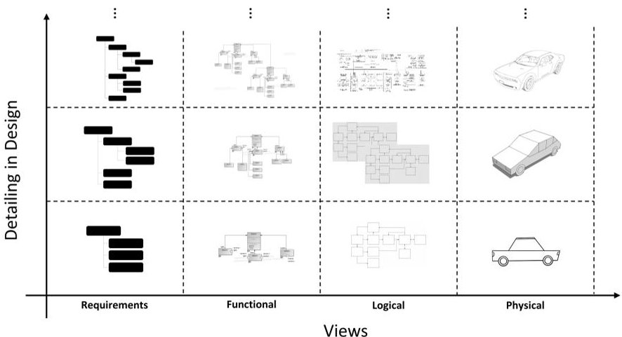
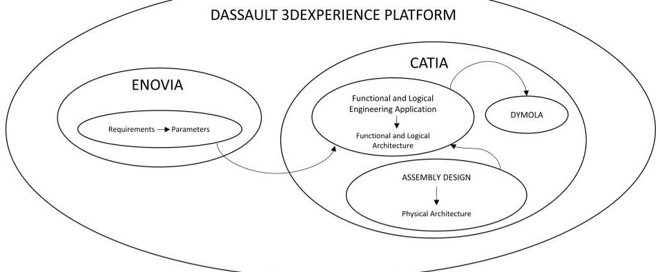
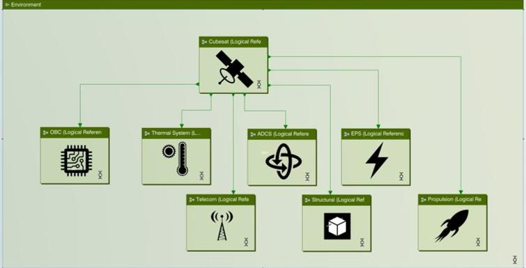
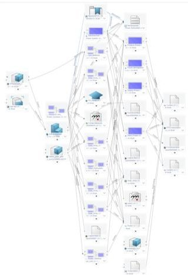
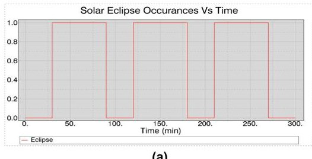
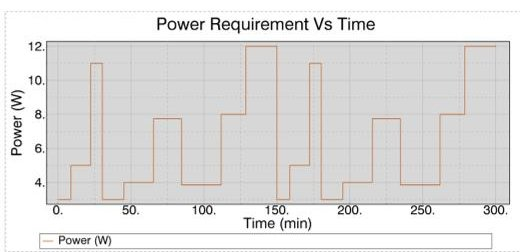
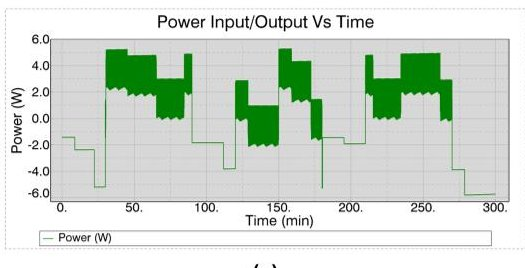
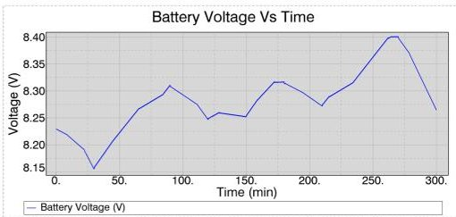
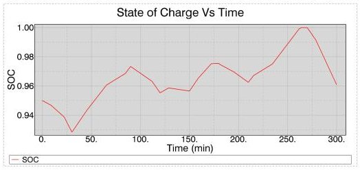

<!-- PDF_PAGE: 1 -->

# An Implementation of Integrated Approach in Product Life-cycle Management Tool to Ensure Requirements-In-Loop during Complex Product Development: A Cubesat Case Study

Mubeen Ur Rehman and Clement Fortin

Skolkovo Institute of Science and Technology, 121205, Moscow, Russia Mubeenur.Rehman@skoltech.ru C.Fortin@skoltech.ru

Abstract. The complexity of innovative products is increasing due to implementation of emerging technologies and rise in system complexity because of greater system and software functionality and inter connectivity, to address the challenge, multiple engineering disciplines must be well-coordinated in product lifecycle management tools. Complexity of novel products have also demanded the establishment of life cycle spanning development from the conceptualization till product realization. The application of MBSE inside PLM tools to keep requirements-in-loop becomes paramount for timely decision support. Unfortunately, keeping a requirements traceability within product development is still a challenge. In aerospace domain, due to innate complexity results in huge number of mission critical requirements which need to be verified and validated to make well informed design decisions throughout the product development process. In this paper, we have proposed a method to implement MBSE using RFLP approach in PLM tool using a Cubesat case study, to keep requirements-in-loop during initial phase of product development.

Keywords: Model Based Systems Engineering·RFLP·Requirementsin-Loop·Product Life-cycle Management·Decision Support

## 1 Introduction and Problem Description

The purpose of this paper is to see the capability of the modern PLM tools to allow the requirements traceability during the development of complex products especially in the conceptual phase of the product development. As the expectations of the stakeholders is on the rise due to advancements in the emerging technologies, the requirements which are getting stringent and complexer too. Requirement traceability through out the development of complex products is seen to be paramount in the successful development of the product.

Due to the potential for trade offs and conflicts in technical specifications, it is crucial to integrate requirement management tools and methodologies into PLM platforms. This integration can lead to better efficacy and more successful product development, resulting in greater customer satisfaction [1].

<!-- PDF_PAGE: 2 -->

The requirement traceability refers to the ability to describe and follow the life of a requirement in a both forward and backward direction [2]. The need for traceability is there because numerous changes are made by product development teams to various subsystems during the system life-cycle.

Altough, optimal usage of PLM tools in a relatively less complex product may lead to successful execution of the project. But especially in space domain, where the products are getting extremely complex needs an integrated approach instead of stand along tools for requirement traceability. This integrated approach can be incorporated by applying MBSE. As described by the [3], that the integration of MBSE and PLM are not aligned. Yet it in its current form it provides solution to some industries especially automotive industry [4] but not to all especially space industry. Due to intrinsic nature of the space domain, still domain specific tools are used which may not be able to fully integrate with current versions of PLM tools.

Application of MBSE in PLM tool can be performed using an approach called RFLP. This approach is called on the four modelling pillars of MBSE [5]. RFLP approach aligns itself well with the modified V-model. In this paper an innovation method especially for space sector is defined to keep requirements-in-loop during the product development cycle. It is done by verifying each requirement during each phase by assigning a numerical parameter to each requirement. The functional, logical and physical simulations are performed with Design of experimentation intend and checked whether the design conforms to the requirements. The product being design is optimized using design of experiments tools which allows to built a web of different configurations and test each of them out to provide decision support [6] during the product developmental cycle. It allows to timely manage changes and reduce the complexity of configuration management all along the way.

The RFLP approach is implemented using Dassault Systemes 3DExperience platform to simulate a single viewpoint of a Cubesat, focusing on the electrical power view. The model is simulated and results are obtained, with issues faced during the exercise discussed in a later section of the paper.

## 2 Research Methodology

This research follows the design research methodology framework presented by Blessing and Chakrabarti [7]. The prescriptive study is based on the actual implementation of the approach to evaluate how to keep requirements in loop during complex product development using the modified V-model of product development.

According to Kleiner and S Kramer [8] RFLP approach is derived from the V-Model. Original V-model lacks the functional and logical architectures framework between the requirements and the physical 3D aspect of the product. RFLP approach tends to combine them.

The incorporation of RFLP approach in PLM tools also helps to apply MBSE. Although there are alot of integration issues but it provides the ba-

<!-- PDF_PAGE: 3 -->

sic framework. PLM in automobile sector is particularly very well suited but aerospace products presents different set of issues. This research papers shows the implementation of RFLP approach to a aerospace related product to evaluate the domain specific nature of RFLP along with the integration of MBSE in it.

The requirements are associated with parameters that measure whether the current system configuration satisfies them. A simulation scenario is created to assess the system's performance against these criteria. The RFLP approach consists of four methodological stages, represented by its acronym: requirement specification, functional, logical, and physical. These stages are followed sequentially to ensure that the requirements are effectively incorporated into the system design and development process.

Here we want to discuss the model structuring strategies. Purpose is to understand the usefulness of RFLP for detail design of the product.

The level of abstraction decreases and the applied models in RFLP tends to represent the model systems in more details as the product development progresses. This also depends upon the decisions made upon the information from the more abstracted models. Another model structuring strategy is based on systems views. There can be multiple views of each system. Logical, functional an physical, all are different viewpoints each modeled to represent the system in different form. These are defined in the fig.1. RFLP allows to view the system from various perspectives or viewpoints [9]. This approach allows systems engineers to perceive the product in high level of abstraction and then gradually adding more details and refining the model as needed. This allows deeper understanding of the system and its behavior, as well as the identification of potential issues and design trade-offs [10].

Fig.1. Level of abstraction in RFLP in the form of viewpoints

<!-- PDF_PAGE: 4 -->

Dassault 3DExperience allows the implementation of RFLP approach. The tool in the study is extensively used in the industry and remains the preferred choice to develop complex product portfolio,

3DExperience is a product life-cycle management tool which supports the model based development processes. It uses functional and logical design engineering tools to support RFLP approach. It aims to provide the ability to link requirements with functional and logical architectures to provide consistency. Functional and logical viewpoints are in SysML language and physical aspect of the product developments uses CAD-models.

Fig. 2. Applications to support RFLP in 3DExperience platform

The fig.2 shows that the 3DExperience platform uses different applications to support RFLP approach. Requirements structure is defined in ENOVIA environment and numerical parameters are appended to the requirements. Functional and logical engineering application in CATIA environment is made to read the requirement parameters which it then uses in behavioral modelling in Dymola. Using Assembly/part design application, physical architectural is connected with functional and logical architectures using implement relations.

## 3 Case Study: Cubesat

RFLP approach has been used in a case study of Cubesat where the aim is to study the power curves of the onboard battery and optimize the sequence of operations to make sure the batteries does replenish after eclipse. It is particularly important as irradiation is the only source of energy harvesting in space and optimal usage of power is crucial for the success of the mission.

In the study we have investigated the classical subsystems of the Cubesat mission: mission design, systems engineering, propulsion, OBC, ADCS, EPS, thermal, communication and structural sub systems. We did not considered on launch segment since we have concentrated on the spacecraft part.

<!-- PDF_PAGE: 5 -->

Concurrent product development lies at the heart of RFLP approach. Therefore a simulation scenario is created to keep track of the requirements during design of experiments. The scenario was built in which the Cubesat after releasing into designated orbit had already detumbled and stabilized. The simulation scenario illustrates the digital test to confirm that the performance requirements have been satisfied.

## 3.1 Requirements Definition Modelling

Requirements are gathered from stakeholder analysis and integrated into the PLM environment to ensure traceability throughout the product development phase. Numerically measurable requirements are used to verify that the current system configuration satisfies the requirements. To this end, variables such as voltage value and depth of discharge/state-of-charge (SoC) have been introduced into the requirements. The primary energy storage requirement specifies that the battery's SoC should not fall below 60% during mission operation, even under worst-case power requirements. This is crucial to ensure that the battery retains enough energy reserve to power the system during the mission without running out of power.

One way to meet this requirement is to oversize the energy storage capacity to handle the worst-case power requirement scenario without dropping below the 60% SoC threshold. However, this approach is constrained by the system's mass limit, which prohibits the use of a larger battery. Therefore, alternative approaches, such as optimizing the battery management system to maximize the battery's efficiency and ensuring that the system's power requirements are well within the battery's capacity, need to be considered.

To ensure that the energy storage system could meet the requirement, the design process took into account the expected usage patterns and mission duration through simulation.

## 3.2 Systems Functional and Logical Architecture

The RFLP approach was further implemented to formulate the logical and functional architecture that provides a comprehensive overview of the system, with the requirement specification being an integral part of it. This architecture helps to ensure that the requirements are accounted for throughout the system design process.

The functional architecture of the system was defined using SysML, which captures the system's behavior, structure, and functionality. This approach facilitated the identification and analysis of relationships between various components and interactions among different sub-systems of the Cubesat.

The Cubesat is composed of various subsystems, each with unique functionalities that contribute to the mission objectives. The architectural design of these subsystems is defined based on the SysML standard, which captures their behavior, structure, and functionality. However, SysML alone cannot compute the behavior of the Cubesat.To address the limitation of SysML in computing the

<!-- PDF_PAGE: 6 -->

behavior of the Cubesat, a Dymola model was created for each logical component within the system. The Dymola model uses numerical methods to simulate and evaluate the behavior of the component. The model compares its computational results against the numerical parameters of the specified requirements to determine if the current configuration satisfies the requirements. This integration of SysML and Dymola enables a comprehensive evaluation of the Cubesat's behavior and helps ensure that the requirements are met.

The RFLP approach relies on the use of implementation functions to enable the flow of information between the requirements defined in ENOVIA and the Dymola model. These implementation functions act as the foundation for the seamless transfer of information between the two systems throughout the entire product development life cycle.

The schematic representation of the Cubesat focuses on the electrical and power aspects of the spacecraft, providing a specific viewpoint for analyzing its behavior. This representation is just one of many possible perspectives, as multiple viewpoints at varying levels of abstraction can be employed to gain a deeper understanding of the Cubesat's behavior.

Fig. 3. Logical System Model of the Cubesat

In the schematic shown in fig.3, each subsystem of the Cubesat is represented by a Dymola behavior model, enabling simulation of the system. The interfaces between each subsystem are defined to transfer data in a specified manner, allowing for seamless communication between subsystems.

To perform the simulation, a global environment is created with parameters that represent the dynamics of the Low Earth Orbit (LEO). The Cubesat is comprised of seven subsystems, each connected to exchange information and quantities with one another. These subsystems include communication, attitude control, power, thermal control, command and data handling, payload, and structure. Through the exchange of information and quantities, the Dymola behavior models of each subsystem work together to simulate the behavior of the entire Cubesat.

<!-- PDF_PAGE: 7 -->

Following a simulation, the parameters obtained are compared to the required parameters to determine if they meet the necessary requirements. If the requirements are not satisfied, the next experiment with different configuration is conducted as the earlier configuration is deemed infeasible. The Design of Experiments (DOE) technique is employed to modify the battery parameters associated with the EPS and power requirement parameters. An experiment matrix consisting of hundreds of potential configurations is created to evaluate and identify the optimal battery parameters that fulfill the desired power requirement. This technique guarantees that all requirements are met and is an effective tool for tracing the requirements.

## 3.3 Web of Connections

"Web of Connections" refers to the interconnected relationships between various modeling domains, such as requirements, behavior, structure, and verification, to cover all aspects of a system design.

Fig. 4. Connections between different modelling domains

The fig.4 depicts the web of connections. It shows how entities in different modelling domains are connected. These connections enable the sharing of data and information between different domains, facilitating the analysis, validation, and verification of system requirements.

## 3.4 Results

The utilization of DOE to generate a pool of configurations and the integration of a mission planning tool specifically designed to predict the behavior of Cubesats in orbit has facilitated the development of an effective behavioral model for the Cubesat.

<!-- PDF_PAGE: 8 -->

(a)

(b)

(c)

Fig. 5. Solar eclipse occurrences, Power production, Net power

In particular, the behavioral model was supplied with essential mission planning data, such as solar eclipse data shown in Figure 5(a), and the desired power profile depicted in Figure 5(b), to calculate the power production from the solar panels. The surplus power, as seen in Figure 5(c), was used to charge the batteries for use during solar eclipse. A power management and distribution unit manages the power mixture of the Cubesat.

The voltage of a battery is one of the key indicators of its SoC. Generally, the higher the SoC of a battery, the higher its voltage. Conversely, as the SoC decreases, the voltage of the battery will also decrease. Here, the relationships is linear. The Voltage of the battery initially is approx. 8.226V which is about 95% state of charge. In 6(a) it can be seen that the voltage varies and dips down when the Cubesat is in eclipse as all of the power requirement is fulfilled by the battery. Similarly, when the power is in excess the battery is charged using surplus power. The important information that is visually depicted is that after 300 minutes the battery has replenished to its initial value. It shows that the the Cubesat will have no trouble during its operation. It also verifies that the battery capacity is sufficient and power management unit is working as intended.

One of the key requirements for the battery operation in a particular application is that its SoC shall remain above 60% even during the worst-case scenario with respect to power requirements. In order to ensure compliance with this requirement, it is necessary for the battery to remain charged above the specified threshold at all times during operation. Analysis of the SoC data in 6(b) reveals that the SoC of the battery remained above 90% for a period of 300 minutes, which indicates that the margin is well-suited to satisfy the SoC requirement. It is important to note, however, that during the period of operation, both the battery and solar panels will degrade, which may have implications for long-term battery performance. Therefore, it is important to consider the long-term effects

<!-- PDF_PAGE: 9 -->

(a)

(b)

Fig. 6. Graph showing Voltage and State of Charge of Battery

of battery and solar panel degradation when evaluating the suitability of the margin for meeting the SoC requirement.

## 4 Conclusion

In conclusion, the implementation of the RFLP approach in Dassault Systemes 3DExperience tool has proven to be highly effective in ensuring requirements-in-loop during complex product development. By following the RFLP approach, all requirements are captured and addressed across various stages of development, ensuring that the final product meets all necessary requirements and functions as intended.

This approach has the potential to revolutionize the way complex product development, ensuring that all requirements are accounted for at each level of development, including the functional, logical, and physical levels during the early phase of product development. The success of this implementation highlights the importance of comprehensive requirements management in ensuring the success of a product or system.

Additionally, while the implementation of the RFLP approach in PLM tools is an effective way to ensure requirements-in-loop during complex product development, there are some challenges that need to be addressed. Modelling the behavior of systems in logical architectures can be challenging, and although Dymola is a useful tool, many domain-specific tools are widely used in industries. The closed nature of PLM tools can make it difficult to integrate these domain-specific tools, leading to increased complexity and costs.

To address these challenges, it is important to encourage collaboration and standardization across different tools and systems. Open standards and protocols can help to enable the seamless integration of domain-specific tools into PLM systems, reducing complexity and improving interoperability. Furthermore, the development of more flexible and customizable PLM systems can also help to address these challenges, allowing organizations to tailor their PLM tools to their specific needs and integrate different domain-specific tools.

Overall, while there are challenges associated with implementing the RFLP approach in PLM tools for complex product development, these challenges can be addressed through collaboration, standardization, and the development of

<!-- PDF_PAGE: 10 -->

more flexible and customizable PLM systems. With these solutions in place, the benefits of the RFLP approach, such as improved requirements traceability, can be fully realized in multiple engineering domains.

## References

1. Violante, M.G., Vezzetti, E. & Alemanni, M. "An integrated approach to support the Requirement Management (RM) tool customization for a collaborative scenario". "International Journal on Interactive Design and Manufacturing" vol 11, pp.191-204 (2017). https://doi.org/10.1007/s12008-015-0266-3

2. Olly Gotel and A. C. W. Finkelstein: "An analysis of the requirements traceability problem". "Proceedings of IEEE International Conference on Requirements Engineering", pp. 94-101. (1994). https://doi.org/10.1109/ICRE.1994.292398

3. Menshenin, Yaroslav and Moreno, Carolina and Brovar, Yana and Fortin, Clement: "Integration of MBSE and PLM: complexity and uncertainty". "International Journal of Product Lifecycle Management", vol 13. pp. 66-88. (2021). https://doi.org/10.1504/IJPLM.2021.115701

4. J. Krog, A. T. Suden, D. Schneider and T. Vietor, "Definition and use of logical and physical architecture within vehicle concept development," 2022 IEEE International Symposium on Systems Engineering (ISSE), Vienna, Austria, 2022, pp. 1-8, https://doi.org/10.1109/ISSE54508.2022.10005374

5. Viapiana, D., Riggio, G., Barbieri, L., Bruno, F. (2022): "An Integrated Approach to Ensure Requirements Traceability During the Product Development Process": "Design Tools and Methods in Industrial Engineering II. ADM 2021.https://doi.org/10.1007/978-3-030-91234-5_33

6. Fourgeau, E., Gomez, E., Adli, H., Fernandes, C., Hagege, M. (2016): "System Engineering Workbench for Multi-views Systems Methodology with 3DEXPERIENCE Platform. The Aircraft RADAR Use Case". "Complex Systems Design & Management Asia. Advances in Intelligent Systems and Computing", vol 426. Springer, Cham. https://doi.org/10.1007/978-3-319-29643-2_21

7. LTM Blessing & A.Chakrabarti . DRM: "A Design Research Methodology". In: "DRM, a Design Research Methodology". Springer 2009, London. https://doi.org/10.1007/978-1-84882-587-1_2

8. Kleiner, S., Kramer, C. (2013). "Model Based Design with Systems Engineering Based on RFLP Using V6". "Smart Product Engineering". Springer, Berlin, Heidelberg. https://doi.org/10.1007/978-3-642-30817-8_10

9. Jain Rashmi, Chandrasekaran Anithashree, Elias George, Cloutier Robert. (2008): "Exploring the Impact of Systems Architecture and Systems Requirements on Systems Integration Complexity". "Systems Journal, IEEE. vol 2 pp.209-223. https://doi.org/10.1109/JSYST.2008.924130

10. Price, M., Raghunathan, S., & Curran, R. (2006). "An Integrated Systems Engineering Approach to Aircraft Design". "Progress in Aerospace Sciences", 42(4)(4), pp.331-376. https://doi.org/10.1016/j.paerosci.2006.11.002

11. Promyoo, Rapeepan & Alai, Shashank & El-Mounayri, Hazim. (2019). "Innovative Digital Manufacturing Curriculum for Industry 4.0". "Procedia Manufacturing". vol 34. pp.1043-1050. https://doi.org/10.1016/j.promfg.2019.06.092

12. Donoghue, I.D.M. & Hannola, Lea & Papinniemi, Jorma & Mikkola, Aki. (2018). "The Benefits and Impact of Digital Twins in Product Development Phase of PLM": "15th IFIP WG 5.1 International Conference", PLM 2018, Turin, https://doi.org/10.1007/978-3-030-01614-2_40