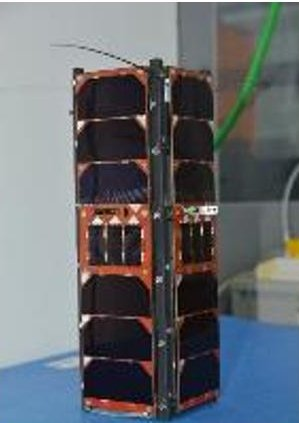
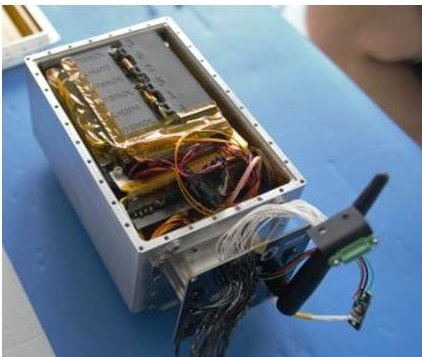
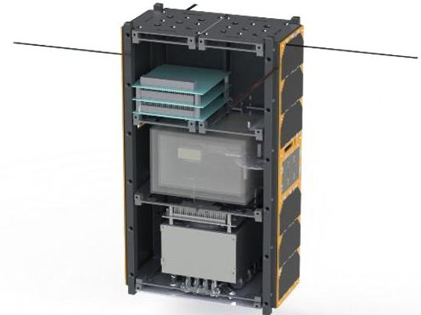
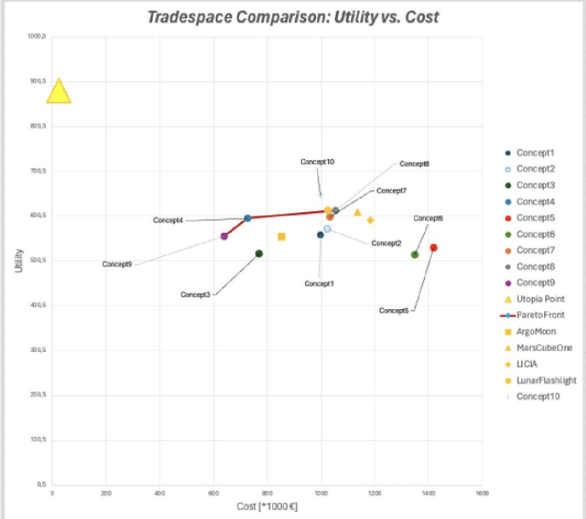
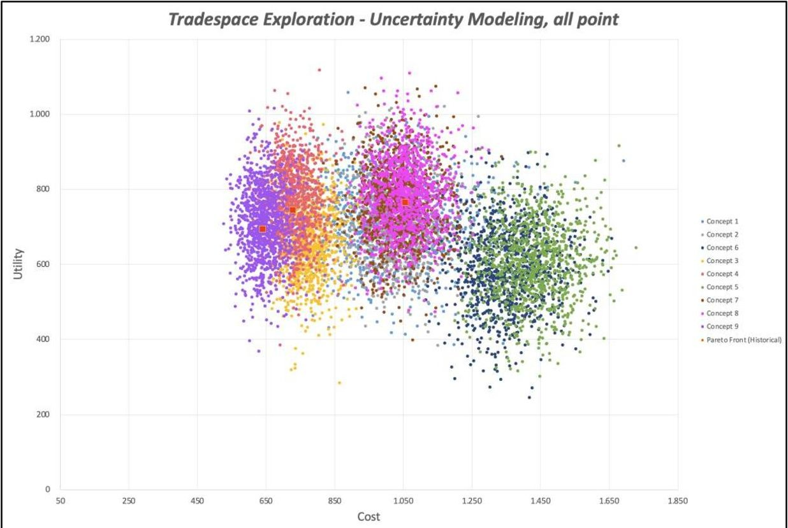

<!-- PDF_PAGE: 1 -->

IAC-24-B4.2

BOREALIS: A Multidisciplinary CubeSat Mission to Investigate Biofilm Radioprotection and Particle Interaction in Space

Nardi L. $ ^{a} $ , Abbasrezaee P. $ ^{a} $ , Carletta S. $ ^{a,*} $ , Maipan Davis N. $ ^{a} $ , Palmerini G. B. $ ^{a} $ , Lovecchio N. $ ^{b} $ , Burgio N. $ ^{b} $ Calabria D. $ ^{c,d} $ , Guardigli M. $ ^{c,d} $ , Michelini E. $ ^{c} $ , Calabretta M. M. $ ^{c} $ , Lazzarini E. $ ^{c} $ , Zangheri M. $ ^{c} $ , Montalti M. $ ^{c} $ Mordini D. $ ^{c} $ , Popova L. $ ^{e} $ , Balsamo M. $ ^{e} $ , Lorenzini F. $ ^{e} $ , Donati A. $ ^{e} $ , Nascetti A. $ ^{a} $ , Mirasoli M. $ ^{c,d} $ , Natalucci S. $ ^{f} $ Albano M. $ ^{f} $ , Urban D. $ ^{f} $ , Lorusso R. $ ^{f} $ , Evangelisti F. $ ^{f} $

$ ^{a} $ School of Aerospace Engineering, Sapienza University of Rome, Via Salaria 851, 00138, Rome, Italy

$ ^{b} $ Department of Information Engineering, Electronics and Telecommunications, Sapienza University of Rome, Via Eudossiana 18, 00184, Rome, Italy

$ ^{c} $ Department of Chemistry "Giacomo Ciamician", Alma Mater Studiorum - University of Bologna, Via Selmi 2, 40126, Bologna, Italy

$ ^{d} $ Interdepartmental Centre for Industrial Aerospace Research (CIRI AEROSPACE), Alma Mater Studiorum - University of Bologna, Via Baldassarre Canaccini 12, 47121 Forlì, Italy

$ ^{e} $ Kayser Italia S.r.l. unipersonale, Via di Popogna 501, 57128, Livorno, Italy

f ASI, Italian Space Agency, Via del Politecnico, 00133 Rome, Italy

* Corresponding Author

## Abstract

BOREALIS is a 6U CubeSat mission funded by the Italian Space Agency within the ALCOR programme and being developed by Bologna University, the School of Aerospace Engineering of Sapienza University of Rome and Kayser Italia Srl. In this paper, we implement model-based systems engineering on the 6U CubeSat concept design and select appropriate mission profiles to pursue the project objectives. The primary scientific goal of BOREALIS is to assess the combined impact of microgravity and ionizing radiation onto the growth and evolution of genetically modified microbial biofilms. Utilizing fluorescence microscopy, the mission will offer unprecedented insights into biofilm dynamics, cell-cell interactions in a space environment, and the effectiveness of radioprotection strategies, including both physical shielding and a novel bioinspired pharmacological treatment using melanin nanoparticles. To achieve this goal, the BOREALIS CubeSat will be deployed in LEO, where the shielding by the geomagnetic field leads to a dominant effect of microgravity and will be later transferred to a MEO of altitude of 2000 km, enabling an extensive examination of the effects of increased radiation exposure. This mission profile will also allow pursuing a secondary mission objective, within nuclear science, by investigating different shielding techniques. The mission analysis and selection of propulsion system for the BOREALIS CubeSat have been conducted to select the best configuration of the system and fulfill the mission's requirements. Eventually, the trade-off analysis of the BOREALIS CubeSat, utilizing the Valispace software, Monte Carlo analysis, and sensitivity analysis is presented to achieve the best concept by analyzing multiple utilities versus cost.

Keywords: BOREALIS; astrobiology; Model-Based Systems Engineering (MBSE); lab-on-chip; microbial biofilms; mission analysis; CubeSat

## 1. Introduction

The Biofilm Onboard Radiation Exposure Assessment Lab In Space (BOREALIS) is a 6U CubeSat mission designed to autonomously study the formation and survival of microbial biofilms in space. The goal of the mission is to develop the required technology to explore how microorganisms within biofilms respond to the stress of microgravity and cosmic radiation and to evaluate different kinds of countermeasures, investigating both shielding and pharmaceutical solutions.

BOREALIS has been funded by the Italian Space Agency (ASI) within its ALCOR program and is

currently being developed by a team including CIRI Aerospace and the Department of Chemistry "G. Ciamician" of Bologna University, the School of Aerospace Engineering of Sapienza University of Rome and Kayser Italia [1].

The scientific goals pursued by BOREALIS are: (i) study the formation and growth of bacterial biofilms in the space environment, highlighting the effects of microgravity and cosmic radiation on these processes, (ii) evaluate the effectiveness of different degrees of shielding and "bioinspired" radioprotection solutions and (iii) investigate how the interaction between the high-

<!-- PDF_PAGE: 2 -->

energy cosmic radiation and the satellite shield/structure generates high dose factor secondary particles.

To pursue these goals, and in particular to distinguish the effects associated with the microgravity and the cosmic radiation, the 6U CubeSat will first be deployed in a Low Earth Orbit (LEO), where the cosmic radiation is shielded by the geomagnetic field, and later be transferred to a Medium Earth Orbit (MEO) with a target altitude of 2000 km, where this shielding effect is much weaker. Such an orbital transfer is not trivial when performed by a CubeSat and, following an extensive literature review, the authors found it has never been performed before by such a satellite. Indeed, the design of flight operations and the 6U CubeSat platform that allows the achievement of this mission profile is itself a secondary and technological objective of BOREALIS.

In this paper, we discuss the approach followed to design the 6U CubeSat platform and select a suitable flight profile. In particular, model-based systems engineering (MBSE) was implemented for the preliminary selection the on-board subsystems and devices, defining the concept design of the satellite platform. MBSE was integrated with the results obtained using the General Mission Analysis Tool (GMAT) by NASA to simulate mission profiles associated with different types of propulsion systems. The analysis also led to the definition of the acceptable altitude for the deployment orbit (LEO) and transfer time (LEO-MEO). Moreover, the dose rates estimated by numerical simulations for different orbits allowed computing the total ionizing dose (TID).

The paper is organized as follows, in Section 2 we discuss the state of the art of astrobiology missions using CubeSats, with a focus on the AstroBio CubeSat mission developed in the past by the BOREALIS team and introduce the use of MBSE. Sections 3-4 present the results from mission analysis and the implementation of MBSE leading to the concept design of BOREALIS. Final remarks are reported in Section 5.

## 2. Mission background and methods

## 2.1 State of the art of astrobiology missions using CubeSats

Nowadays, to explore human science in space, the need for low-cost, compact and rapidly developing space platforms is fulfilled by nano or micro satellites, typically developed using the CubeSat standard. The use of CubeSat platforms is well established for the new scientific subjects such as astrobiology to further investigate the effects of space radiation and

microgravity on the different microorganisms and ultimately on the human body cells. Since 2006, NASA's Ames Research Center has launched a series of CubeSats equipped with microbial organisms, including GeneSat-1, O/OREOS (Organism/Organic Exposure to Orbital Stresses), PharmaSat, SporeSat, and EcAMSat (E. coli Antimicrobial Satellite) [2-6]. Each of these five missions conducted autonomous experiments in Low Earth Orbit (LEO), with data being transmitted back to Earth for analysis. In 2022, the BioSentinel, a 6U CubeSat, was sent to study the effects of deep space radiation on biology [7]. In 2026, the LEIC, a 4U CubeSat, is planned to be launched, with the aim of landing on the Moon with a suite of instruments similar to BioSentinel CubeSat to investigate how lunar surface environment affects biological responses [8].

The primary goal of GeneSat-1, a 3U CubeSat, was to explore how microgravity affects gene expression in two strains of genetically modified Escherichia coli bacteria that produce a green fluorescent protein continuously [2]. The O/OREOS mission, a 3U CubeSat, was distinctive for its dual experimental payloads: one focusing on the space environment's effect on organic materials and the other on the survivability of living organisms (SESLO) [3]. PharmaSat aimed to investigate the response of Saccharomyces cerevisiae yeast cells to antifungal treatment in microgravity [4]. SporeSat's mission sought to measure the germination of fern spores (Ceratopteris richardii) under varying gravity conditions using calcium ion-sensitive electrodes and artificial gravity [5]. The goal of EcAMSat was to assess cell growth and antibiotic resistance in uropathogenic E. coli in microgravity [6]. BioSentinel, a 6U CubeSat, was the first to carry biological organisms into space, with the main objective of investigating how budding yeast (S. cerevisiae) responds to deep space radiation [7]. Similarly, the LEIA mission aims to study the biological responses of organisms to the lunar environment [8].

## 2.2 The AstroBio CubeSat mission

The AstroBio CubeSat (ABCS) is a 3U CubeSat developed through a collaboration between the INAF Italian National Institute of Astrophysics, the School of Aerospace Engineering at Sapienza University of Rome, and the Department of Chemistry "G. Ciamician" of Bologna University. It was launched on the Vega C Maiden Flight, with support from the European Space Agency (ESA) and the Italian Space Agency (ASI). The project aimed to test an automated onboard laboratory in space using Lab-on-Chip (LoC) technology, the primary payload of the mission, creating a highly integrated, in-

<!-- PDF_PAGE: 3 -->

situ multiparameter platform that employs bioassays for chemiluminescence detection [9-11].

The LoC tested onboard ABCS consisted of a glass substrate integrated with a-Si:H thin-film photodiodes coupled with a microfluidic chip and interfaced with a custom low-noise front-end readout board. The LoC front-end as well as all the various sensors were interfaced with the on-board computer for information storage, telemetry forwarding as well as system's control purposes. The front-end board, MARIE (Multichannel Array Readout Integrated Environment), was a 32-channel, low-noise, and high dynamic range readout electronics developed at SIA. The microfluidic chip manufacturing method and material, the shape of channels and numbers of them highly depend on the biological reagents needs and survival requirements. To guarantee it operated at a pressure of 1 atmosphere and a temperature between 5 $ ^{\circ} $ C and 30 $ ^{\circ} $ C, the payload was housed inside a hermetically sealed box designed ad-hoc for the mission [12].

Deployed in an orbit with an altitude of 5900 km and inclination of $ 7 0^{\circ} $ , ABCS crossed the core region of the inner Van Allen belt, characterized by a harsh radiative environment and time-varying thermal cycles, that led to the development of a peculiar 3U CubeSat platform and innovative shielding solutions at support of the primary payload, shown in Figures 1-2 [13].

Fig. 1. The AstroBio CubeSat

Flight data collected during ABCS mission proved that both the payload and supporting devices (i.e. sealed box and shield) operated correctly and the dose rate estimation and flight firmware programmer development were also appropriate, ensuring satellite operation under nominal conditions [14].

Successfully validating this technology in orbit marked a significant advancement for performing autonomous bio-analytical experiments in space. The ABCS mission provided pivotal information to develop

the BOREALIS satellite platform, embarking a similar primary payload and shields [14].

Fig. 2. The payload box during the integration of the AstroBio CubeSat

## 2.3 Model-Based Systems Engineering

Model-based systems engineering (MBSE) is a modern approach to systems engineering that uses graphical models for system representation and design, unlike traditional methods which depend on documentbased specifications and drawings [15].

A significant difference is in the level of abstraction used in design representation. Traditional systems engineering tends to focus on detailed descriptions of individual components and their specific attributes, while MBSE adopts a top-down approach, presenting designs at a higher level of abstraction. This allows designers to see the overall system and understand how components interact more effectively. MBSE also promotes better collaboration and communication among team members by offering a unified language and system representation, which is especially useful for large, complex systems with many stakeholders. Additionally, MBSE incorporates computer-aided tools and techniques to enhance the design process, whereas traditional methods often rely on manual calculations and drawings. These tools can automate and streamline various design aspects, improving efficiency and accuracy. Overall, MBSE provides a more integrated, collaborative, and efficient approach to systems engineering compared to conventional methods [15].

MBSE is implemented for BOREALIS to use numerical tools, such as the browser-based software Valispace, that turn MBSE into Data-driven systems engineering (DDSE) through linking requirements and components with engineering data (budgets of power, mass, volume, storage, etc.) Thus, Valispace has been used for BOREALIS to design the 6U CubeSat system model, link the scientific, system and subsystem requirements, conduct the concurrent engineering by sharing the data and informing team members about the system and subsystems changes, and finally checking for

<!-- PDF_PAGE: 4 -->

any interference of the system between the subsystems mass, power, volume and dimensions.

## 3. Mission analysis

## 3.1 Orbital transfer

The flight profile of BOREALIS must fulfil the strict requirements set by

- performance of Commercial Off-The-Shelf (COTS) devices/subsystems currently on the market

- mission goals (see Section 1),

- launch vehicles providing rideshare and in particular the Vega-C [16-17]

- the 5-year rule set by the FCC [18].

These requirements can be translated into the following mission profile specifications

1. to distinguish the effects associated with microgravity and cosmic radiation, the satellite will have to operate for a relevant amount of time (enough to perform the experiments and collect data) on orbits in which the intensity of the cosmic radiation is significantly different

2. the deployment orbit must be compatible with the rideshare performance of Vega-C (and eventually other launch vehicles)

3. within 5 years from the end of the mission, the satellite will no longer have to orbit in LEO (below 2000 km)

4. the TID collected during the operative mission will be limited to ensure the survival of the microbial cultures and the operativity of onboard devices and subsystems

A study dedicated to estimating the dose rate for BOREALIS suggests that the satellite must be released at an altitude of less than 1200 km and then raised to an altitude of 2000 km (or more) in order to satisfy the specification (1) [19]. It is worth noting that

- transferring the satellite to a MEO of 2000 km or higher also satisfies the specification (3)

- even though Vega-C (and other launchers) can deploy a spacecraft to an altitude of 1200 km, common rideshare opportunities address altitudes between 450 km and 800 km; therefore, selecting such an orbit simplifies satisfying the specification (2)

Based on these first results, simulations in GMAT were performed to determine the transfer time and the propellant mass required for the LEO-MEO transfer considering different deployment altitudes and three

different types of propulsion systems compatible with a 6U CubeSat (see Table 1).

Table 1. Performance of three different types of propulsion systems evaluated in the mission analysis

<table border="1"><tr><td>Type</td><td>Thrust</td><td>Specific impulse</td><td>Max cont. firing time</td></tr><tr><td>Monopropellant thruster</td><td>1000mN</td><td>215s</td><td>600s</td></tr><tr><td>Hall-effect thruster</td><td>5mN</td><td>1000s</td><td>900s</td></tr><tr><td>RF ion-thruster</td><td>0.4mN</td><td>2200s</td><td>2500s</td></tr></table>

The results of mission analysis are reported in the following subsections. For each study case it was considered a wet mass of 14 kg for BOREALIS at the deployment in LEO.

## 3.1.1 Monopropellant thruster

Monopropellant thrusters currently available for CubeSats use chemical propellants, such as Hydrazine or high-pressure green propellants (i.e. LMP-103S). These systems can provide an average thrust in the order of 1 N and, therefore, to do not allow to perform the LEO-MEO transfer using a traditional 2-burn manoeuvre (i.e. Hohmann transfer, etc.).

When a multiple-burn transfer strategy is implemented, the time schedule of ignitions determines the value of the eccentricity (e) of the arrival orbit. To avoid reaching an orbit in which the altitude at the perigee and apogee are significantly different, thus in which the intensity of cosmic radiation changes significantly as the altitude varies, the schedule of the ignitions will have to be selected in order to obtain a low value for e. With the support of numerical simulations, it was shown that ignitions applied every quarter of the orbital period (T) result in an arrival orbit with negligible eccentricity （ $ e<2\cdot10^{-3} $ and less than 33 km of difference between the apogee altitude and the perigee altitude).

At the same time, since the manoeuvres will be monitored in real-time by the ground segment and, at least in the early stages of the orbital transfer, commanded by operators on the ground, a more relaxed schedule for the ignitions would guarantee more time for the ground segment to verify the health status of BOREALIS and identify eventual off-nominal conditions, effectively increasing the reliability of the

<!-- PDF_PAGE: 5 -->

mission. In fact, adding a delay equal to T between two consecutive ignitions does not change the final value of e, therefore any solution corresponding to $ \Delta t=(n+ 0.25) T $ ,where n is any non-null integer number, can be implemented.

The solution corresponding to $ \Delta t=(n+0.25)T $ is examined here, the results for this study case are collected in Table 2. Even considering the high density value of 1250 $ kg/m^{3} $ for LMP-103S, the volume of propellant required in the three scenarios investigated would range from a minimum of 2.3 U to a maximum of 3.1 U, which is hardly compatible with the volume budget of a 6U CubeSat.

Table 2. Summary of the LEO-MEO orbital transfer using the chemical propulsion system

<table border="1"><tr><td>Deployment Altitude</td><td>Transfer time</td><td>Propellant mass</td></tr><tr><td>650km</td><td>1.4 days</td><td>3.8kg</td></tr><tr><td>850km</td><td>1.2 days</td><td>3.2kg</td></tr><tr><td>1050km</td><td>1.0 days</td><td>2.8kg</td></tr></table>

## 3.1.2 Hall-effect thruster

The use of Hall-effect thrusters is rapidly increasing in the small-satellite industry and some commercial devices compatible with the CubeSat standard have been recently put on the market. These thrusters use Xenon (Xe) or Iodine (I) as propellant, stored at high pressure to reach density values comparable to those of chemical propellants (i.e. $ 1 6 0 0 \ k g / m^{3} $ for Xe and $ 4 9 0 0 \ k g / m^{3} $ for I at 14 MPa) [20].

The transfer strategy implemented for this study case consists of applying continuous firings of the maximum possible duration (900 s) once every orbit. The results are collected in Table 3.

The reader will notice that the propellant volume required for each scenario is significantly lower than that computed for chemical thrusters (see Section 3.1.1). In fact, considering a storage pressure of 14 MPa, the required propellant volume does not exceed 0.6 U for Xe and 0.2 U for I. Indeed, the use of a Hall-effect thruster will correspond to a higher power/energy requirement, therefore affecting the design of the electric power system (see Section 4).

## 3.1.3 RF ion thruster

Ion thrusters are very low thrust propulsion systems, on the order of hundredths of a mN. This feature, in addition to contributing to the limited consumption of propellant (together with the high value of the specific impulse) means that, compared to higher thrust propulsion systems, the parasite torques they introduce, due to the misalignment between the actual thrust axis and the principal axes of inertia of the satellite, are limited or negligible.

The transfer strategy implemented for this study case is the same as the one implemented in case of using the Hall-effect thruster, differing only for the longer continuous firing time (2500 s). The results collected in Table 4 show dramatically high values for the transfer time which result in a mission duration longer than 1.5 years.

Table 3. Summary of the LEO-MEO orbital transfer using the Hall-effect thruster

<table border="1"><tr><td>Deployment Altitude</td><td>Transfer time</td><td>Propellant mass</td></tr><tr><td>650km</td><td>206 days</td><td>1.0kg</td></tr><tr><td>850km</td><td>178 days</td><td>0.8kg</td></tr><tr><td>1050km</td><td>148 days</td><td>0.6kg</td></tr></table>

Table 4. Summary of the LEO-MEO orbital transfer using the RF ion-thruster

<table border="1"><tr><td>Deployment Altitude</td><td>Transfer time</td><td>Propellant mass</td></tr><tr><td>650km</td><td>823 days</td><td>0.5kg</td></tr><tr><td>850km</td><td>695 days</td><td>0.4kg</td></tr><tr><td>1050km</td><td>571 days</td><td>0.3kg</td></tr></table>

## 3.2 Total ionizing dose collected

In the previous sections the results of mission analysis have been processed to estimate the minimum duration of the mission and the propellant mass and volume budgets. The transfer time is here used to compute the TID collected by BOREALIS for each transfer, based on the estimated dose rate evaluated for both the non-

<!-- PDF_PAGE: 6 -->

shielded (NS) components of the 6U CubeSat and for the shielded (S) payload components.

The shielding here is provided by a box, similar to that used for ABCS (see Section 2.2) composed of three layers of different materials with different thickness: 0.7 mm of tungsten, 15 mm of PEEK and 0.5 mm of aluminium [19]. The values of the dose rates are reported in Tables 5-6 and the highest TID $ ( i=51^{\circ} ) $ is reported in Table 7.

Table 5. Dose rate for NS components inside BOREALIS for three different values of the inclination

<table border="1"><tr><td>Dose rate</td><td>700km</td><td>1150km</td><td>2000km</td></tr><tr><td>$i=51^{\circ}$</td><td>$6\cdot10^{-3}$</td><td>$3.1\cdot10^{-2}$</td><td>$1.26\cdot10^{-1}$</td></tr><tr><td>$i=70^{\circ}$</td><td>$3\cdot10^{-3}$</td><td>$1.5\cdot10^{-2}$</td><td>$7.4\cdot10^{-2}$</td></tr><tr><td>$i=98^{\circ}$</td><td>$3\cdot10^{-3}$</td><td>$1.4\cdot10^{-2}$</td><td>$8.7\cdot10^{-2}$</td></tr></table>

Table 6. Dose rate for S components inside BOREALIS for three different values of the inclination

<table border="1"><tr><td>Dose rate</td><td>700km</td><td>1150km</td><td>2000km</td></tr><tr><td>$i=51^{\circ}$</td><td>$4\cdot10^{-3}$</td><td>$1.9\cdot10^{-2}$</td><td>$8\cdot10^{-2}$</td></tr><tr><td>$i=70^{\circ}$</td><td>$2\cdot10^{-3}$</td><td>$9\cdot10^{-3}$</td><td>$4.7\cdot10^{-2}$</td></tr><tr><td>$i=98^{\circ}$</td><td>$2\cdot10^{-3}$</td><td>$1\cdot10^{-2}$</td><td>$5.2\cdot10^{-2}$</td></tr></table>

For a better understanding of the results in Tables 7-8, the reader shall note that the TID collected by a NS satellite after 10 years in LEO (650 km) is on the order of 500 Gy. CubeSats technology, including COTS, has demonstrated that it can remain properly operational even with these TID values. Therefore, considering this value as a threshold of demonstrated reliability, monopropellant or Hall effect thrusters seem to provide adequate performance for mission purposes. Nevertheless, due to the high-volume budget required by the former, the use of a Hall effect thruster seems to be the preferred solution to ensure compliance with both the mission requirements and the volume and mass budgets of the 6U CubeSat platform.

Table 7. TID collected by NS components during the transfer for each deployment altitude and $ i=5 1^{\circ} \mathrm{G y} $

<table border="1"><tr><td>TID</td><td>650km</td><td>850km</td><td>1050km</td></tr><tr><td>Monopropellant thruster</td><td>2.2Gy</td><td>2.0Gy</td><td>1.8Gy</td></tr><tr><td>Hall-effect thruster</td><td>326Gy</td><td>299Gy</td><td>268Gy</td></tr><tr><td>RT Ion-thruster</td><td>1303Gy</td><td>1168Gy</td><td>1035Gy</td></tr></table>

Table 8. TID collected by S components during the transfer for each deployment altitude and $ i=5 1^{\circ} \mathrm{G y} $

<table border="1"><tr><td>TID</td><td>650km</td><td>850km</td><td>1050km</td></tr><tr><td>Monopropellant thruster</td><td>1.4Gy</td><td>1.3Gy</td><td>1.2Gy</td></tr><tr><td>Hall-effect thruster</td><td>208Gy</td><td>190Gy</td><td>171Gy</td></tr><tr><td>RT Ion-thruster</td><td>830Gy</td><td>742Gy</td><td>658Gy</td></tr></table>

4. Trade-off analysis of the spacecraft configuration

4.1 BOREALIS concept designs

The BOREALIS mission employs a MBSE approach throughout its development lifecycle with the support of a specific software platform (Valispace) and some dedicated data sheets for first iterations and initial budgeting. This approach starts with an analysis of constraints and requirements, progressing through systematic model development, to final system realization. MBSE helps in visualizing, analysing, and managing the complexities of system design, particularly beneficial in the intricate environment of space missions.

All the BOREALIS system is based on the payload specifications and on the requirements of the mission analysis, specifically on the two target orbits and the consequences they have mainly on the propulsion system choice. Volume and mass of the propulsion system is one of the key driver of the system design, since such a large orbit transfer has hardly been performed with CubeSats platform. This is then one of the main challenges of BOREALIS mission design and execution. After the definition of these key system elements, all the other main subsystem choices have been designed around, including Electric Power System (EPS), Attitude Determination and Control System (ADCS) sensors and actuators, communication system, On-Board Computer (OBC), and Thermal Control System (TCS).

<!-- PDF_PAGE: 7 -->

As a general System Engineering approach, a first analysis on scientific requirements and the identification of mission constraints has been conducted. Starting from its result, the degrees of freedom of the system have been identified as architectural decisions (ADs) for the BOREALIS 6U CubeSat. These are reported in Table 9.

Starting from the combinations of the different options for each architectural decisions different mission concepts were generated. Nine (9) of these concepts were selected and reported in the table shown in Figure 3 for a quantitative analysis, to evaluate their performance in the context of BOREALIS mission objectives.

Table 9. BOREALIS system architectural decision list log and options.

<table border="1"><tr><td>No.</td><td>Decision</td><td>Option1</td><td>Option2</td><td>Option3</td><td>Option4</td></tr><tr><td>AD1</td><td>Primary Power Source</td><td>Body-mounted solar array</td><td>Large deployable solar array</td><td>Deployable solar array+Large batteries</td><td>-</td></tr><tr><td>AD2</td><td>Communication Frequency Band</td><td>2xUHF(TX/RX)+S/X-band(TX)</td><td>UHF(TX/RX)+S-band(TX/RX)</td><td>2xUHF(TX/RX)+Optical Communication(TX)</td><td>-</td></tr><tr><td>AD3</td><td>Propulsion System</td><td>Monopro pellant(HPGP)</td><td>Electric thruster(ion or Hall-effect)</td><td>Cold-gas(Prop+ACS)</td><td>Experimental propulsion</td></tr><tr><td>AD4</td><td>ADCS Sensors</td><td>Gyro+4Sun Sensors+Earth Sensor+Magnetometer(BKP)</td><td>Gyro+Star Tracker+Magnetometer(BKP)</td><td>Gyro+GPS+6xSun Sensor+Magnetometer(BKP)</td><td>Gyro+GPS+Star Tracker+Magnetometer(BKP)</td></tr><tr><td>AD5</td><td>On-board Computer</td><td>SOC</td><td>MCU</td><td>FPGA</td><td>MCU+FPGA</td></tr><tr><td>AD6</td><td>ADCS Actuators</td><td>3xReaction Wheels+3xMagnetorquers+4xCold Gas</td><td>4xReaction Wheels+3xMagnetorquers+4xCold Gas</td><td>Control Moment Gyro+3xMagnetorquers</td><td>3xReaction Wheels+3xMagnetorquers</td></tr><tr><td>AD7</td><td>Data Handling</td><td>On-board storage</td><td>Real-time processing</td><td>Delay tolerant networking</td><td>-</td></tr><tr><td>AD8</td><td>Thermal Management</td><td>Passive</td><td>Passive+Active(Radio Beacon Modulation)</td><td>Passive+Active(Radio Beacon Modulation)+Louvers</td><td>Passive+Heat pipes</td></tr><tr><td>AD9</td><td>Software</td><td>F-Prime</td><td>FreeRTOS</td><td>Linux</td><td>In-house libraries</td></tr></table>

The multiple mission concepts were evaluated using Multi-Attribute Utility (MAU) and cost functions to assess their performance and expense.

MAU equation:

$$
\begin{array}{l} \mathrm {M A U} = \mathrm {U} _ {\mathrm {s i c e n i e}} \cdot \left(\mathrm {W} _ {\mathrm {p o w e r}} \cdot \mathrm {P} _ {\mathrm {a v g}} + \mathrm {W} _ {\mathrm {c o m m}} \cdot \mathrm {D} _ {\mathrm {r a t e}} - \right. \\ W _ {\mathrm {p r o p}} \cdot E _ {\mathrm {p r o p}} + W _ {\mathrm {A D C S m a x}} \cdot A _ {\mathrm {A D C S m a x}} + W _ {\mathrm {A D C S h i g h}} \cdot A _ {\mathrm {A D C S h i g h}} + W _ {\mathrm {O}} \\ \mathrm {B C} \cdot \mathrm {P} _ {\mathrm {O B C}} + W _ {\mathrm {d a t a}} \cdot D _ {\mathrm {c a p a c i t y}} + W _ {\mathrm {a c t u a t o r s}} \cdot A _ {\mathrm {p e r f}} - W _ {\mathrm {t h e r m a l}} \cdot T _ {\mathrm {s t a b i l i t y}}) - \\ U _ {\mathrm {r i s k}} \\ \end{array}
$$

- $ U_{\mathrm{science}} $ : Base utility from scientific objectives. (Vote for the scientific value of the PL $ ^{*}1+ $ Vote for the scientific value of the BUS $ ^{*}0.3 $ )

- $ W_{\mathrm{power}} $ , $ W_{\mathrm{comm}} $ , $ W_{\mathrm{prop}} $ , $ W_{\mathrm{ADCS\ high}} $ , $ W_{\mathrm{ADCS\ max}} $ , $ W_{\mathrm{comp}} $ , $ W_{\mathrm{actuators}} $ , $ W_{\mathrm{data}} $ , $ W_{\mathrm{thermal}} $ : Assigned weight of the respective variable;

- $ P_{\mathrm{avg}} $ : Average power generated (Wh/kg);

- $ D_{\mathrm{rate}} $ : Data transmission rate (considering average for UHF/VHF, S-band, X-band, Optical);

- $ E_{\mathrm{prop}} $ : Effectiveness of the propulsion system (- transfer time / mass system = -1 $ ^{*} $ to/kg)

- $ A_{\mathrm{ADCS} \mathrm{max}} $ : ADCS accuracy (considering gyroscope and sensor options).

- $ A_{\mathrm{ADCS\ high}} $ ADCS accuracy at high angular rate (considering gyroscope and sensor options).

- $ P_{\mathrm{O B C}} $ : On-board computer's processing power (considering SOC, MCU, FPGA).

- $ A_{\mathrm{performance}} $ : Slew Rate (max angular velocity managed) for each type of actuator selected

- $ D_{\mathrm{capacity}} $ : Data handling capacity (on-board storage, real-time processing, cloud, delay-tolerant).

- $ T_{\mathrm{stability}} $ : Thermal stability ( $ \Delta\mathrm{T} $ considering passive vs. active systems).

- $ U_{\mathrm{risk}} $ : Based on average Technology Readiness Level (9-TRLSystem)

Cost equation:

$$
C = C _ {H W} + C _ {\mathrm {d e v e l o p m e n t}} + C _ {\mathrm {l a u n c h}} + C _ {\mathrm {o p e r a t i o n s}} + C _ {\mathrm {r i s k}}
$$

- Development costs including design, testing, and assembly of the CubeSat.

- Launch Costs associated with securing a launch opportunity and integration with the launch vehicle.

- Operations Costs for mission operations, including ground stations and data handling.

- Additional costs factored in for risks associated with unproven technologies or operational complexities.

The model incorporates normalized data for each variable based on the performance of each subsystem in the reference mission concept. This analysis yields an initial tradespace illustrating the relative performance of the nine mission concepts. Additionally, three reference

<!-- PDF_PAGE: 8 -->

architectures from actual 6U CubeSat missions are included in the model and presented in the tradespace as benchmarks for the BOREALIS mission. A yellow triangle denotes the utopia point, representing the ideal mission with maximum utility and minimum cost. Quantitative analyses on the model output, including Monte Carlo simulations and sensitivity analysis on the

variable's weights, were conducted to include uncertainty in the model output and verify if any concept changed its relative utility and cost with respect to the others. The results are reported in the following tradespace as a summary.

<table border="1"><tr><td colspan="8">CONCEPT SELECTION</td></tr><tr><td>Concept ID</td><td>Concept Name</td><td>AD1</td><td>AD2</td><td>AD3</td><td>AD4</td><td>AD5</td><td>AD6</td><td>AD8</td></tr><tr><td>Concept1</td><td>Hybrid+OB Star</td><td>Body Mounted Solar Array</td><td>UHF(TX/RX)+S-band(TX/RX)</td><td>Hybrid propulsion(experimental)</td><td>Gyro+Star Tracker+6xSunSensor+Magnetometer(BKP)</td><td>MCU+FPGA(Hybrid)</td><td>3xReaction Wheels+3xMagnetorquers+4xCold Gas</td><td>Passive(Contact shielding+box convection)</td></tr><tr><td>Concept2</td><td>Hybrid+RE Proc</td><td>Body Mounted Solar Array</td><td>UHF(TX/RX)+S-band(TX/RX)</td><td>Hybrid propulsion(experimental)</td><td>Gyro+Star Tracker+6xSunSensor+Magnetometer(BKP)</td><td>MCU+FPGA(Hybrid)</td><td>3xReaction Wheels+3xMagnetorquers+4xCold Gas</td><td>Passive(Contact shielding+box convection)+Active(Radio Beacon Modulation)</td></tr><tr><td>Concept3</td><td>ColdGas+HADS</td><td>Body Mounted Solar Array</td><td>UHF(TX/RX)+S-band(TX/RX)</td><td>Cold-gas(Prop=ACS)</td><td>Gyro+Star Tracker+6xSunSensor+Magnetometer(BKP)</td><td>MCU+FPGA(Hybrid)</td><td>3xReaction Wheels+3xMagnetorquers</td><td>Passive(Contact shielding+box convection)</td></tr><tr><td>Concept4</td><td>ColdGas+LADS</td><td>Body Mounted Solar Array</td><td>UHF(TX/RX)+S-band(TX/RX)</td><td>Cold-gas(Prop=ACS)</td><td>Gyro+4Sun Sensors+Earth Sensor+Magnetometer(BKP)</td><td>MCU+FPGA(Hybrid)</td><td>3xReaction Wheels+3xMagnetorquers</td><td>Passive(Contact shielding+box convection)</td></tr><tr><td>Concept5</td><td>EP1Capacity</td><td>Deployable Solar Array+Large Batteries</td><td>2xUHF(TX/RX)+S-O-band(TX)</td><td>Electric thruster(Ion Or Hall-effect)</td><td>Gyro+GPS+Star Tracker+Magnetometer(BKP)</td><td>SOC</td><td>3xReaction Wheels+3xMagnetorquers</td><td>Passive(Contact shielding+box convection)+Heat pipes</td></tr><tr><td>Concept6</td><td>EP2Power</td><td>LargeDeployable Solar Array</td><td>2xUHF(TX/RX)+S-O-band(TX)</td><td>Electric thruster(Ion Or Hall-effect)</td><td>Gyro+GPS+Star Tracker+Magnetometer(BKP)</td><td>SOC</td><td>3xReaction Wheels+3xMagnetorquers</td><td>Passive(Contact shielding+box convection)+Active(Radio Beacon Modulation)+Louvers</td></tr><tr><td>Concept7</td><td>HPGP+OB Star</td><td>Body Mounted Solar Array</td><td>UHF(TX/RX)+S-band(TX/RX)</td><td>Mono-propellant(HPGP)</td><td>Gyro+Star Tracker+6xSunSensor+Magnetometer(BKP)</td><td>SOC</td><td>3xReaction Wheels+3xMagnetorquers+4xCold Gas</td><td>Passive(Contact shielding+box convection)</td></tr><tr><td>Concept8</td><td>HPGP+RT Proc</td><td>Body Mounted Solar Array</td><td>UHF(TX/RX)+S-band(TX/RX)</td><td>Mono-propellant(HPGP)</td><td>Gyro+Star Tracker+6xSunSensor+Magnetometer(BKP)</td><td>SOC</td><td>3xReaction Wheels+3xMagnetorquers</td><td>Passive(Contact shielding+box convection)+Active(Radio Beacon Modulation)</td></tr><tr><td>Concept9</td><td>HPGP+CHG</td><td>Body Mounted Solar Array</td><td>UHF(TX/RX)+S-band(TX/RX)</td><td>Mono-propellant(HPGP)</td><td>Gyro+Star Tracker+Magnetometer(BKP)</td><td>SOC</td><td>Control Moment Gyro+3xMagnetorquers</td><td>Passive(Contact shielding+box convection)</td></tr><tr><td>Concept10</td><td>HET+RT Proc</td><td>Deployable Solar Array</td><td>UHF(TX/RX)+S-band(TX/RX)</td><td>HET(Hall effect thrust)</td><td>Gyro+GPS+3xSunSensor+Magnetometer(BKP)</td><td>SOC</td><td>3xReaction Wheels+3xMagnetorquers</td><td>Passive(Contact shielding+box convection)+Active(Radio Beacon Modulation)+Louvers</td></tr></table>

Fig. 3. BOREALIS mission concepts table

## 4.2 Analysis results on the concept designs

The tradespace analysis plots MAU against cost for each concept, ultimately leading to the selection of Concept 10 (HET+RT Proc). This concept features a particular electric propulsion unit which is a balance between the critical propulsion volume and mass constraints and the transfer time which is typically increased using this class of propulsion units. At a first stage, Concept 8 (HPGP+RT Proc) was considered to be the most suitable as baseline. This concept, featuring body-mounted solar arrays, UHF and S-band transceivers, a mono-propellant HPGP system, and realtime data processing, offered the best balance between high utility and manageable cost, ensuring the mission's scientific and operational success. With a second iteration, having verified the availability of HET propulsors with compatible TRL on the market, concept 10 has been introduced in the model and it presented better performance as showed in Figure 5.

In addition, a Monte Carlo analysis has been performed (see Figure 6) to account for the data variability and check for the relative performance of the concepts. The results reported below show that the relative output of the concepts is unchanged. In addition, a sensitivity analysis on each weight has also been performed by varying all of them of 30% obtaining the same results.

In the graphs, it is reported the utopia point which is the ideal case of maximum utility at minimum cost; in addition, the Pareto front indicates the level of the most efficient concepts among which the optimal solution is then chosen, note that since concept 10 has been added in a second iteration it has not been included in the former Pareto front to clearly show its superior performance.

## 4.3 Borealis baseline concept

According to the analyses discussed in the previous sections, a preliminary selection of key subsystems was

<!-- PDF_PAGE: 9 -->

completed providing the following functional architecture of the Borealis 6U CubeSat:

- Power Subsystem: The primary power source will consist of body-mounted solar panels. This setup ensures adequate power generation to support all onboard systems.

- Communication Subsystem: Communication s/s will be based on dual UHF (TX/RX) and S-band (TX/RX) transceivers, ensuring reliable data transmission and command reception throughout the mission duration. The preferred choice according to the analysis discussed in this paper

- Propulsion Subsystem: Hall-effect thruster providing efficient orbit transfer and manoeuvring capabilities

- Attitude Determination and Control Subsystem (ADCS): The ADCS will comprise a suite of sensors, including gyroscopes, star trackers, sun sensors, and magnetometers, along with actuators such as reaction wheels and magnetorquers. This configuration ensures precise orientation control and stability.

- On-board Computer (OBC): The computing architecture will employ a SOC (System on Chip), offering robust processing power for real-time data handling and system management.

- Thermal Management: A combination of passive and active thermal management techniques will be employed to maintain optimal operating temperatures for all components.

- Data Handling: The CubeSat will feature onboard storage capabilities, allowing for the

collection and temporary storage of scientific data before transmission during communication windows. The real-time processing capability might enable on-board data handling and analysis.

- Payload: The primary scientific payload will include a fluorescence microscope and lab-on-chip with integrated sensors for studying biofilm growth and behavior, supplemented by radiation sensors and other scientific instruments for scientific payload control and.

Fig. 4. Preliminary sketch of the BOREALIS 6U CubeSat

<!-- PDF_PAGE: 10 -->

Fig. 5. BOREALIS mission concepts trade-off analysis.

Fig. 6. BOREALIS mission concepts trade-off analysis with Monte Carlo.

<!-- PDF_PAGE: 11 -->

## 5. Final remarks

The BOREALIS CubeSat mission represents a significant step forward in the study of live cells in space through a lab-on-chip platform and the validation of new technologies within CubeSats.

The BOREALIS CubeSat implemented MBSE with the support of Valispace, Monte Carlo analysis to select the best concept and model among the presented ones with the specific variables of utility and cost, conducted mission analysis for its specific LEO-MEO mission requirements, propulsion selected regarding mission performance and TID accumulation considering the needed propellent mass and volume.

Through the presented comprehensive system analysis, including the exploration of alternative mission concepts and the incorporation of a MBSE provided insightful results defining a preliminary mission baseline concept. Among the main highlights, we highlight how the HET propulsion alternative offers substantial benefits over the HPGP, including a lower initial orbit requirement, improved volume efficiency, and a more manageable orbit transfer time. These advantages directly address the initial challenges of the mission and align more closely with the mission's scientific and operational objectives.

The system engineering approach and tools used in this first part of the mission have been presented with detail, including the trade-space analysis and the additional quantitative analysis used to validate the model (Monte Carlo and sensitivity analysis).

The BOREALIS mission is set to have an impact beyond space applications. The in-depth study of biofilms, responsible for the majority of persistent infections, and the validation of radioprotection strategies hold promise for advancing medical diagnostics, radiation therapy, and nuclear medicine on Earth. In conclusion, BOREALIS embodies a dual purpose: ensuring human well-being and productivity in space while simultaneously enhancing the quality of life on Earth through space-induced scientific advancements.

The next steps will involve implementing the detailed design of all the subsystems, procurement activities of the main parts, payload manufacturing and testing, and maintaining close collaboration with stakeholders to ensure the mission's continued success.

## Acknowledgements

The project "Biofilm Onboard Radiation Exposure Assessment Lab In Space (BOREALIS)" is supported by the Italian Space Agency (ASI), Contract ASI n. 2024-2-

1. 0, Codice Identificativo Gara (CIG) A0277F7460 Codice Unico di Progetto (CUP) F33C24000040005.

[1] G. Leccese, A. Fedele, S. Natalucci, Overview and Roadmap of Italian Space Agency Activities in the Micro- and Nano-Satellite Domain, Proceedings of the 73rd International Astronautical Congress, Paris, France, 18-22 September 2022, Paris, France

[2] C. Kittis, K. Ronzano, R. Rasay, I. Mas, P. Williams, P. Mahacek, G. Minelli, Flight Results from the GeneSat-1 Biological Microsatellite Mission, Proceedings of the 21st Annual AIAA/USU Conference on Small Satellites, 13-16 August 2007, Logan (UT), USA.

[3] P. Ehrenfreund, A.J. Ricco, R. Quinn, N. Bramall, K. Bryson, J. Chittenden, A. Cook, R. Mancinelli, A. Mattioda, G. Minelli, W. Nicholson, O. Santos, D. Squires, C. Kitts, R. Rasay, A. Young and the O/OREOS-Sat Engineering Team at NASA Ames, The O/OREOS Mission-Astrobiology Data Collected in Low Earth Orbit, Proceedings of the 42 $ ^{nd} $ Lunar and Planetary Science Conference, 7-11 March 2011, The Woodlands (TX), USA.

[4] A.J. Ricco, M. Parra, M. Niesel, M. Piccini, D. Ly, M. McGinnis, A. Kudlicki, J.W. Hines, L.Timucin, C. Beasley, R. Ricks, M. McIntyre, C. Friedericks, M. Henschke, R. Leung, M. Diaz-Aguado, C. Kitts, I. Mas, M. Rasay, E. Agasid, E. Luzzi, K. Ronzano, D. Squires, B. Yost, PharmaSat: drug dose response in microgravity from a free-flying integrated biofluidic/optical culture and-analysis satellite, Proceedings SPIE 7929, Microfluidics, BioMEMS and Medical Microsystems IX, 79290T (14 February 2011).

[5] W.W.A. Wan Salim, J. Park, J.L. Rickus, A. Rademacher, A.J. Ricco, A. Schooley, J. Benton, B. Wickizer, A. Martinez,N. Mai, M. Rasay, D.M. Porterfield, L. Brownston, M. Cote, G. Defouw, M. Henschke, C. Kitts, E. Luzzi, M. Perez, S. Roux, M. Salmi, A. Sweet, SporeSat: A nanosatellite platform lab on-chip system for investigating gravity threshold of fern-spore single-cell calcium ion currents, Proceedings of Solid-State Sensor, Actuators and Microsytem Workshop, 8-12 June, 2014, Hilton Head Island (SC), USA.

[6] M.R. Padgen, M.P. Lera, M.P. Parra, A.J. Ricco, M. Chin, T.N. Chinn, A.Cohen, C.R. Friedericks, M.B. Henschke, T.V. Snyder, S.M. Spremo, J.-H.Wang, A.C. Matin, EcAMSat spaceflight measurements of the role of os in antibiotic resistance of stationary phase Escherichia coli in microgravity, Life Sciences in Space

<!-- PDF_PAGE: 12 -->

Research, Vol. 24, 2020, 18-24 https://doi.org/10.1016/j.lssr.2019.10.007.

[7] S.M Tieze, L.C. Liddell, S.R. Santa Maria, S. Bhattacharya, BioSentinel: A Biological CubeSat for Deep Space Exploration, Astrobiology, Vol. 20, No. 8, 2020, 631-636, https://doi.org/10.1089/ast.2019.2068.

[8] C. Cappelletti, F. Branz, A. J. Ricco, J. Hines, Next generation of CubeSats and SmallSats, Microbial biology on CubeSats, Elsevier, (2023), pp. 645-655.

[9] L. Iannascoli, A. Nascetti, S. Carletta, S. L. Schirone, A. Meneghin, J.R. Brucato, D. Paglialunga, G. Poggiali, S. Pirrotta, G. Impresario, et al. AstroBio CubeSat: Enabling technologies for astrobiology research in space, Proceedings of the 71st International Astronautical Congress—The CyberSpace Edition, Virtual Online, 12-14 October 2020, p. x60795

[10] N. Burgio , L. Cretara, M. Corcione, Modelling the interaction of the Astro Bio Cube Sat with the Van Allen's Belt radiative field using Monte Carlo transport codes, Radiation Detection Technology and Methods, Springer, (2022), volume 6, pp 262-279.

[11] D. Calabria, I. Trozzi, E. Lazzarini, A. Pace, M. Zangheri, L. Iannascoli, N. Maipan Davis, S.S. Gosikere Matadha, T. Baratto De Albuquerque, S. Pirrotta, M. Del Bianco, G. Impresario, L. Popova, N. Lovecchio, G. de Cesare, D. Caputo, J. Brucato, A. Nascetti, M. Guardigli, M. Mirasoli, AstroBio-CubeSat: A lab-inspace for chemiluminescence-based astrobiology experiments. Biosens. Bioelectron. 2023, 226, 115110.

[12] A. Nascetti, S. Carletta, L. Schirone, D. Caputo, N. Lovecchio, G. de Cesare, N. Maipan Davis, T. Baratto de Albuquerque, P. Granello, L. Iannascoli, S. Sansolini, M. Mirasoli, In-orbit Characterization of a Lab-on-Chip Payload with Integrated Thin-Film Photosensors for Chemiluminescent Immunoassays aboard the AstroBio CubeSat Mission, Proceedings of the 9th International Workshop on Advances in Sensors and Interfaces, 8-9 June 2023, Monopoli (BA), Italy.

[13] S. Carletta, S. A. Nascetti, S.S. Gosikere Matadha, L. Iannascoli, T. Baratto de Albuquerque, N. Maipan

Davis, L. Schirone, G. Impresario, S. Pirrotta, J.R. Brucato, Characterization and Testing of the Passive Magnetic Attitude Control System for the 3U AstroBio CubeSat, Aerospace, Vol. 9:723, 2022 https://doi.org/10.3390/aerospace9110723.

[14] S. Carletta, A. Nascetti, T.Baratto de Albuquerque, L.Iannascoli, N. Maipan Davis, L. Schirone, M. Parisse, D. Pagliaunga, M. Mirasoli, D. Caputo, G. de Cesare, A. Meneghin, J.R. Brucato, N. Burgio, G. Impresario, S. Pirrotta, A nanosatellite operating in the Van Allen belt: The lessons learned from the AstroBio CubeSat mission, Proceedings of the 74th International Astronautical Congress, 2-6 October 2023, Baku, Azerbaijan.

[15] M. Peres, (17/01/2023), The complete guide to Model Based System Engineering (MBSE), https://www.valispace.com/the-complete-guide-to-model-based-systems-engineering-mbse/ (accessed 13/09/2024)

[16] Arianespace Group, Vega C User's Manual, Is.0 Rev.0, May 2018

[17] Arianespace Group, SSMS Vega C User's Manual, Is.1, Rev. 0, September 2020

[18] Federal Communications Commission, Mitigation of Orbital Debris in the New Space Ag (FCC 22-74), 29 September 2022

[19] N. Burgio, S. Carletta, A. Santagata, T. Tedde, A. Nascetti, M. Frullini, M. Mirasoli, S. Natalucci, M. Albano, D. Urban, Modelling the irradiation experiments of microbic films within the BOREALIS payload, Proceedings of the 75th International Astronautical Congress, 14-18 October 2024, Milan, Italy

[20] J. Szabo, M. Robin, S. Paintal, B. Pote, V. Hruby, C. Freeman, Iodine Propellant Space Propulsion, Proceedings of the 33rd International Electric Propulsion Conference, 6-10 October 2013, Washington D.C., USA