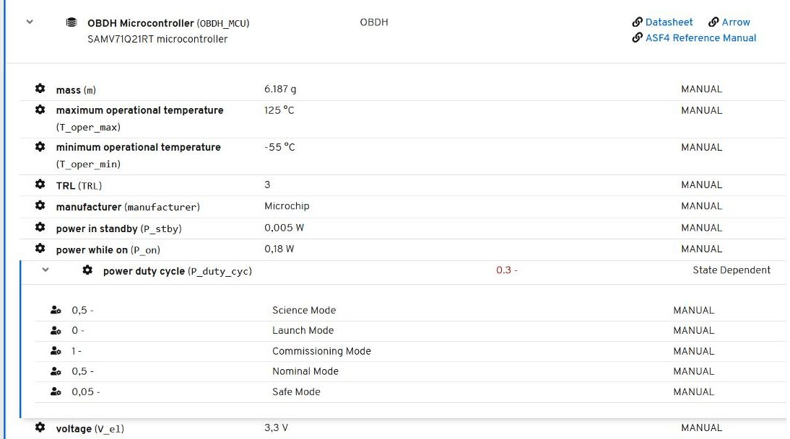
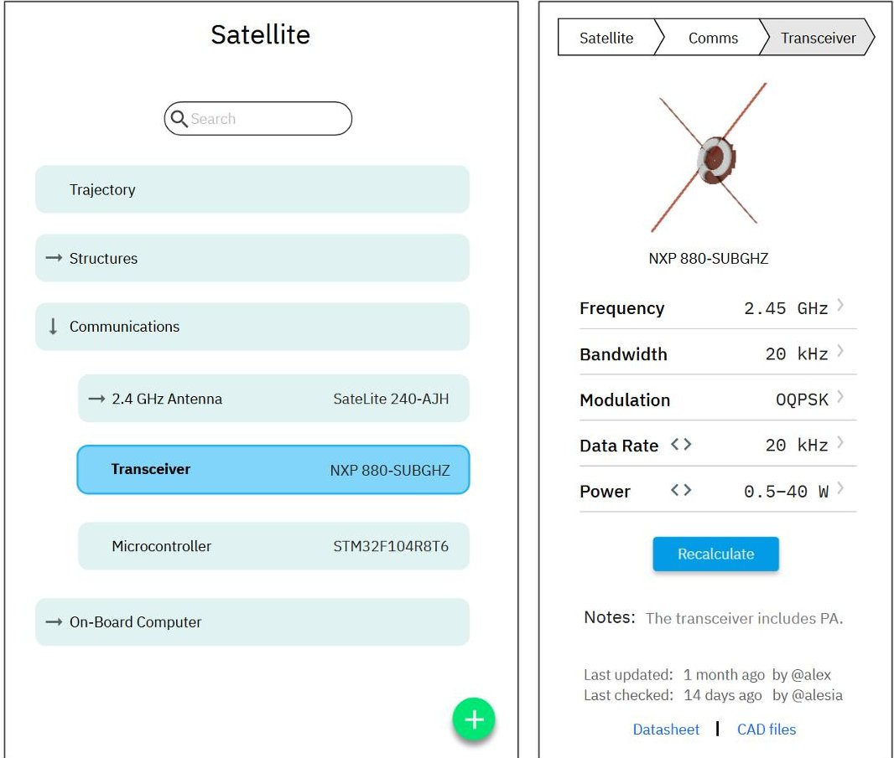
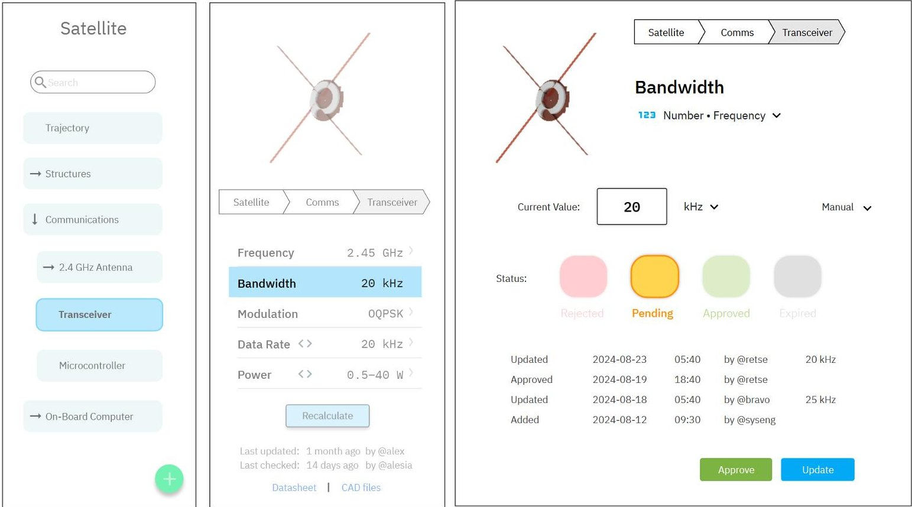
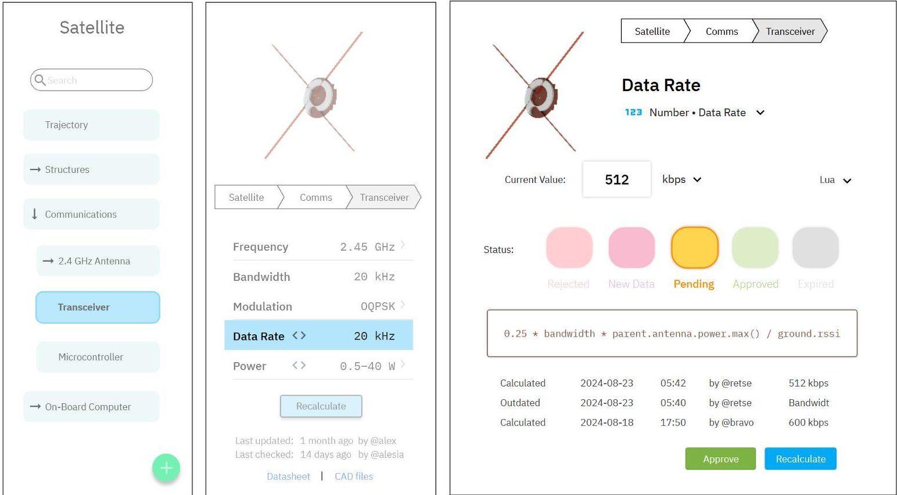
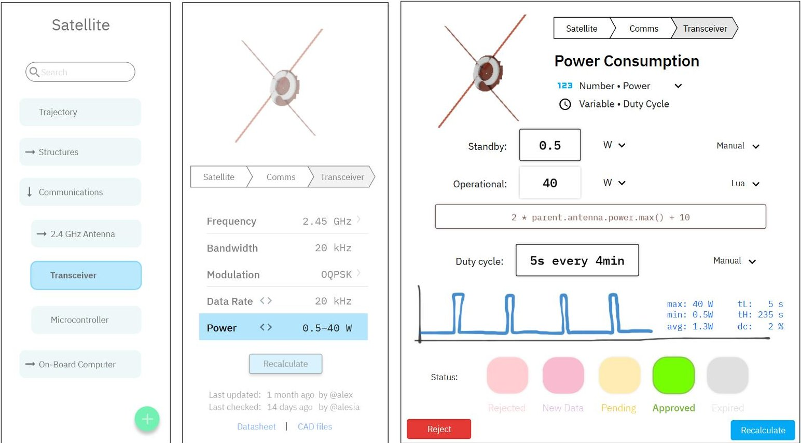
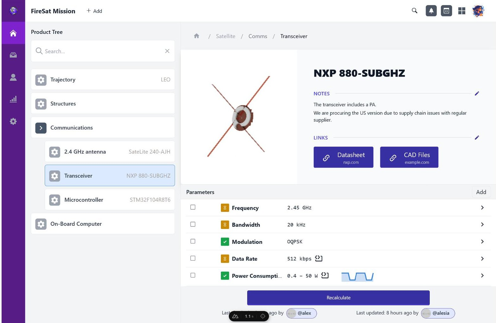

<!-- PDF_PAGE: 1 -->

$ 7 5^{\mathrm{th}} $ International Astronautical Congress (IAC), Milan, Italy, 14-18 October 2024. Copyright $ \textcircled{c} $ 2024 by Mr. Konstantinos Kanavouras. Published by the IAF, with permission and released to the IAF to publish in all forms.

IAC-24-D1,6,10,x89104

# Building a Lightweight Data Management Tool for Small Satellite Missions

Konstantinos Kanavouras $ ^{1} $ konstantinos.kanavouras@uni. lu

Alexander Bühler $ ^{1} $

alexander.buehler@uni.lu

Andreas M. Hein $ ^{1} $ andreas.hein@uni.lu

$ ^{1} $ : Interdisciplinary Centre for Security, Reliability and Trust, University of Luxembourg

## Abstract

Model-Based Systems Engineering (MBSE) has received widespread adoption in the space industry, allowing engineers to develop, design and validate their activities through formal models. MBSE's perceived benefits include enhanced communication, complexity management, knowledge transfer, and improved verification capabilities through traceability. However, generic or tailored MBSE tools have not yet found such widespread adoption in small satellite missions, such as CubeSats. Drawing from a review of previous and current missions, we postulate that many MBSE tools and processes add a considerable overhead in terms of time, cost and effort to establish and maintain models. On the other hand, Document-Based Systems Engineering, often used on such projects, may suffer from inconsistency, lack of detail, and difficulty in accessing reliable and up-to-date engineering data. In this paper, we propose a concept and design for a new software tool for small spacecraft engineering, focused on engineering parameter management and sharing. This design is based on modern design and user experience principles, with a basic requirement of allowing users to access any engineering parameter within 20 seconds of having access to a web browser. The tool uses a standard block-based structure to describe the hierarchy of a space system, with modifiable parameters and content assigned to each block. This structure is stored under a version-controlled database (such as git or dolt), allowing history tracking, merging, auditing and real-time collaboration. Ready-made templates can also be used to produce aggregate values, such as mass or cost budgets. A REST API allows integration with different external tools, such as MS Excel Power Query, and an integration with an AI-based copilot is envisioned. To complement the design concept of our tool, we additionally provide User Interface mockups of key actions, as well as an early functional proof-of-concept developed with a Python backend. We use data from the POQUITO mission from the University of Luxembourg to emulate a use case in our proof-of-concept. This implementation is also released as free software to allow future users to modify and extend our tool. We conclude with a roadmap for the potential future development of the tool, with an aim of improving the engineering data management workflow for small satellite missions and surpass the limits of document-based information tracking, without the added burden of industrial modelling processes.

Keywords: cubesat, testing, design, FYS, on-board computer

## 1. Introduction and Background

One of the main disciplines of Systems Enginering is Configuration Management. As defined in the NASA Systems Engineering Handbook [1], " [Configuration Management] enables all stakeholders in the technical effort, at any given time in the life of a product, to use identical data for development activities and decision-making".

Configuration and Technical Data Management may refer to spacecraft data managed during the entire lifetime of a space project. This data is usually refined or updated from one phase to the next, while engineers might event need to consider alternative options for the product.

Technical data of a spacecraft may include product trees, equipment specifications, numerical values, emulation models, interfaces and more.

Spacecraft configuration data may come in the type of "strings" (text), numbers, hierarchies (e.g. for a product

tree), tables and more. (e.g. for a failure mode analysis).

Information about spacecraft configuration can range from between a few spreadsheets to thousands of pages of text-based documentation, depending on the size and complexity of the project. What we call "Engineering Data" may be combined with project documentation, or be stored in an independent format, in a structured manner or a domain-specific model. Kanavouras et al. [3] separate spacecraft documentation into two types:

- Text-based documentation, where text is written, usually in a rich-text format, and stored in a central repository or printed. Content is usually edited using a specific format, such as Office Open XML (used by Microsoft Word) or Markdown (used by online software).

- Model-based documentation, where system parameters and technical data are stored in a structured

<!-- PDF_PAGE: 2 -->

Fig. 1: Example parameters of a spacecraft component [2]

format or language, specifically designed to allow description of the system.

As space projects usually involve collaboration between multiple teams and stakeholders, technical data must also be shareable between participants. This must be done so that engineering data is kept up-to-date across team members, with additional approval or authorisation pipelines when required. The process of sharing happens in one of the following ways:

- Manual file sharing, usually through e-mail or a file-sharing service

- Tool-specific collaboration tools, such as those offered by Microsoft Sharepoint, Google Workspace, or wikis. This might include real-time change tracking.

- An independent version control system with difference and author tracking

Specifically for small space missions, such as CubeSat methods with less overhead are typically used. [4] In fact, Honoré-Livermore [4] specifically identified the need to develop improved information systems for documentation and data management, specifically for CubeSat missions.

CubeSat missions specifically have employed both document-based and model-based documentation [5, 6, 7].

A noteworthy platform for document-based documentation are spreadsheets, which allow representing information in a semi-structured format, without imposing a specific arrangement on users. Spreadsheets also typically allow a range of calculations to be performed in-application,

making them convenient as a centralised source of automatically updated data and results.

Given the major time and effort required for project documentation (Sanchez-Rosado et al. [8] estimated that estimated that 12% to 35% of a software project's development time is spent on documentation), its criticality in space projects, and the wide variety of different tools available for this purpose, it is essential to investigate ways of improving documentation effectiveness, speed and correctness for space projects. Ambler [9] proposed the following formula to measure documentation effectiveness:

Potential value $ = $ Produced value $ \cdot $ C $ \cdot $ R $ \cdot $ U $ \cdot $ F $ \cdot $ T (1)

- Produced value is guesstimated by the producers of the artifact.

- C is the percentage of the artifact that is currently "correct".

- R = The chance that the artifact will be read by the intended audience.

- U = The chance that the document that is actually understood by the intended audience.

- F = The chance that the advice contained in artifact will be followed.

- $ T $ = The chance that the advice will be trusted.

Different project classes combined with inappropriate documentation or Engineering Data Management (EDM) tools can lead to significant inefficiencies in one of the above factors, for example:

- Academic/educational missions using formal MBSE tools may not have the personnel or capacity to keep engineering data up-to-date, reducing the C and T parameters.

<!-- PDF_PAGE: 3 -->

- Academic/educational missions using a nonstructured way of storing engineering data may reduce the parameter R and the produced value of the documentation, as useful information is usually stored in unstructured folders and documents without central control, making data retrieval difficult, unreliable and slow.

- Small industrial missions may avoid the generation of documentation altogether, reducing the produced value of documentation.

While Model-Based Systems Engineering (MBSE) is generally perceived to increase documentation consistency and verification & validation verifiability [10, 11], users have associated increased complexity and worse understandability with it [10].

MBSE users also report mixed conclusions connected to the results on development time, cost and effort [10]. This discrepancy can be explained as the overhead of implementing a new, often unknown management methodology, outweighs the potential gains, especially in smaller projects. For each system or team, there exists an ideal trade-off between Systems Engineering (SE) effort and SE benefit that optimises parameters such as development time [12].

In smaller space projects, such as CubeSat missions, the overhead added by MBSE methods is more evident, as teams prefer to work in a more agile fashion, favouring high responsiveness to change and rapid information sharing. In this case, tool selection can play an equally important role as methodology selection [13].

## 1.1 Available MBSE platforms

MBSE tools for configuration and technical data management can be separated into two categories: [3]:

- Informal, where only limited parts of a system may be modelled based on an opinionated structure defined by a tool or process. Examples include Starion Group's COMET (formerly associated with RHEA Group's CDP4 and ESA's OCDT), Valispace, Duro PDM One, ISAE Supaero's Nanospace [14] and more.

## Formal.

Formal MBSE methods are typically tied to the tools they use. Examples include ARCADIA/Capella [15], Papyrus, Rhapsody, CATIA, Enterprise Architect and more [10].

Developers can also choose to implement a formal or informal model-based ecosystem by manually adapting

generic, commercially available tools or Enterprise Resource Planning (ERP) systems, such as Microsoft Sharepoint, Eclipse, Odoo or others. This approach trades a significant deployment and maintenance effort for slightly more flexibility on the model structure.

Based on the above, we claim that the development of a novel Engineering Data Management (EDM) tool, combined with a suitable data management process, can significantly reduce the organisational overhead of EDM for small satellite missions (focused on CubeSats). We will therefore present requirements, concepts and mockups for a new software tool, used to manage engineering parameters of a hierarchical space system

The rest of this work is structured as follows: In Section 2, we present the basic requirements and justification that differentiate our tool from the state of the art. In Section 3, we present the functionality and mock-ups of our tool. Finally, Section 4 shows the next steps in the tool's development. It is important to clarify that this work does not introduce a new software tool itself, but rather the concept of one, following a typicall User Interface (UI) design workflow, with our aim being to guide software development for future tools.

## 2. Requirements

For the development of a prototype concept for engineering data management, we consider the following requirements and their rationale:

- RQ-1: The tool shall represent a spacecraft in a hierarchical tree-like structure of multiple entities containing multiple parameters each.

This generic requirement defines the core functionality of our tool: To store spacecraft engineering data in a hierarchical format. A tree-like structure is indeed a common method of representing a product and its details, which is already common in most EDM tools. It also allows extending functionality beyond what is offered by a grid-like data representation, as used in a spreadsheet.

Product tree structures are usually asked to represent different types of repetition or instantiation inside a product. For example, a type of fastener, electrical connector or integrated circuit may be shared across different subsystems and assemblies. While we don't specify explicitly how to handle these cases as a requirement, we note that many MBSE tools clearly differentiate between an "element template" and an "element instance" which can be repeated. However, we do note that most elements of a small spacecraft are rarely duplicated; therefore the process of instantiating an element should not require duplicate effort

<!-- PDF_PAGE: 4 -->

to create and store a template representation for it.

## RQ-2: The complete functionality of the tool shall be accessible from the web.

In essence, any device with a web browser should be able to read, edit and manage engineering data with no restrictions. This ensures that access is not limited by technical or hardware limitations, and that engineers have quick access to data through their computer, a mobile device when in the field, or even embedded systems.

Accessibility should ideally be extended to formats beyond personal devices as well; this includes paper printouts (for use during laboratory work), digital signage and more.

## RQ-3: Stored data shall be version controlled.

On a rapidly-changing or short-duration project, it is essential that all changes are traceable in terms of people, time and reason.

## RQ-4: Each action shall be easily accessible.

This requirement follows a heuristic known as the "three-click rule", suggesting that no function or page on a User Interface should take more than 3 clicks to access [16]. While this is not a hard rule or requirement, it can still provide a ballpark on how to simplify user interaction.

Ideally, the common example of creating or updating a parameter through such a tool will be no harder than responding to an inquiry about this parameter on an online communication platform. As a performance criterion, we can specify that users should be allowed to access any engineering parameter within 20 seconds of having access to a web browser.

## RQ-5: The tool shall provide an Application Programming Interface (API).

Space Engineering often involves the combination of multiple pieces of software. Therefore, a solution hosting engineering data should offer a method of fetching and updating this data programmatically.

This will also allow engineers to create integrations and automations that can update engineering values based on other values.

Such an API will have to be properly documented in order to reasonably reduce the overhead added by such implementations.

- RQ-6: The tool shall be extensible by code.

Informal MBSE platforms often have limited flexibility/modularity as a result of an opinionated layout or limited feature set. On the other hand, formal MBSE platforms provide a much larger. This expects users to implement the structure of their model themselves, and format it as they see fit.

As an example, an informal MBSE platform may already have a position parameter defined for components, which includes 3 integers (for each axis) and can be state dependent (e.g. stowed/deployed). In a formal MBSE platform, the use will have to create the position parameter and associate it with a product, including the appropriate representation for each axis and state. On the other hand, an informal MBSE platform may have no way to attach an interface link or an image file to a component.

A solution would be to implement an opinionated system that is built from the ground-up to allow extensibility. An efficient method to facilitate this extensibility would be an embedded scripting language, such as Lua . If a Turing-complete language is combined with the appropriate storage and visualisation procedures, the user would then have a.

The choice of language(s) that are officially supported for extensibility also plays an important role. A language that is inherently simple, or that many spacecraft engineers are familiar with, is more likely to get used compared to alternatives.

In any case, extensibility should be provided, within a reasonable degree, to a large number of aspects on such a tool. For example, by including a multi-line "Justification" or "Notes" field for parameter or entity, users can describe complex concepts that would need to be modelled independently if not represented with prose. For example, users might need to specify uncertainties in data sources, descriptive parameters (such as colour), rationale for the selected value, acceptable limits and more.

## RQ-7: The tool shall notify users on changes.

Introducing a new tool to a development environment has the risk of exacerbating tool fatigue . Especially when users are asked to switch between different platforms, it may be difficult to maintain awareness of changes at the right time.

As engineering teams typically focus around a software communication platform (such as E-Mails, Slack or Github) to share information [13,17], it logically follows that a tool should have the capability of announcing draft or released changes in real-time on that platform. This feature can also encourage

<!-- PDF_PAGE: 5 -->

additional synergies, by allowing users to discuss or dispute changes in Engineering Data in context.

- RQ-8: The tool shall be available as Free and Open Source software with a focus on Developer Experience.

While the choice of making technology available as open-source depends on the team and stakeholders of this project, we believe that a FOSS tool would higher value to its users.

The discussion of Developer Experience has to inadvertently focus on software development trends in the industry. For example, while an interpreted language (such as Python) is usually regarded as less performant than a compiled language (such as C++), it is more likely that engineering graduates are familiar with the former, which in turn increases the chances that they will interact with the codebase and be familiar with any errors caused.

## 2.0.1 Non-Requirements

- Analysis and emulation. Analysis is often performed by domain-specific tools which handle the numerous complexities associated with.

While we intend for our concept to be usable as a centre for small spacecraft development, its functionality has to be limited in this area. To this end, we feel important to clarify features not targeted by our proposal:

- Requirement management and validation. While requirements solicitation, processing and realisability checking has already been demonstrated in low-overhead tooling [18], we prefer to keep it outside our proposed solution for an early demonstration. Space mission requirements tend to be complex and usually not unambiguously specified, making manual verification efforts overshadow many automatic works.

- Test management and Risk/failure management, on the grounds of being out-of-scope.

## 3. Prototype

Following a typical UI prototyping flow, we created a set of mockups of our front-end interface, showing its main features (Figures 2 to 5). The primary tool used for this purpose was Moqups (https://moqups.com).

We furthermore developed a proof-of-concept frontend using Nuxt.js to demonstrate the applicability of a web interface for our tool, as shown in Figure 6.

## 3.1 Requirements Compliance

In the following section we will investigate the applicability of the aforementioned requirements to our tool:

- RQ-1: The tool shall represent a spacecraft in a hierarchical tree-like structure of multiple entities containing multiple parameters each.

The hierarchy shown in Figure 2 represents a typical product tree of a satellite, showing a high-level view of subsystems that can be expanded into their child components. Note that abstract subsystems can be represented as well, such as software or trajectories. The latter example can indicatively cover values such as altitude, inclination and other trajectory parameters that are commonly requested but also frequently updated in missions.

Each "entity" can therefore represent a subsystem an assembly, or any other product within a satellite. Some additional opinionated attributes are optionally available for each entity:

- Product Name

- Image

- Links (to datasheets, engineering files, user manuals or others)

- Notes (to provide information not representable by parameters)

Each entity can be associated with many parameters of different types, as described in Section 3.2.

- RQ-2: The complete functionality of the tool shall be accessible from the web.

Our prototype tool is designed with a web-first view able to run on a local server or the cloud. We have developed a prototype front-end using Nuxt.js and Tailwind CSS, as shown in Figure 6, which has no requirements from the user's side apart from a web server, and is therefore usable by desktop and handheld devices.

- RQ-3: Stored data shall be version controlled.

Version control of data can be performed by either:

- Using a plain database and implementing versioning features on it (such as MySQL or MongoDB)

- Using a plain Version Control System (VCS) and implementing data storage features (such as Git or SVN)

- Using a tailored solution for versioned data storage (such as DVC or Dolt)

<!-- PDF_PAGE: 6 -->

Fig. 2: Entity view mockup

While any of the above solutions will be suitable, the ideal one would combine low overhead with data storage in a human-readable format, so that project models can easily be inspected or transferred in their raw form.

Our proposed solution is to use the Git VCS, by representing each entity as a YAML file [19]. Git has been chosen thanks to its wide support, with advanced change management tools available. YAML files were chosen because they are human and machine-readable and editable, with a flexible structure and low processing overhead. By default, they also represent values on different lines, which is compatible with most Git difference viewers. A user could then also theoretically create a spacecraft model entirely by hand, by creating the appropriate YAML files, with no tool interaction required.

## RQ-4: Each action shall be easily accessible.

A few design principles can be devised to maintain quick access to most interface elements. While these are hard to implement for small-screen (mobile) devices, they can be reasonably achieved on desktop screens, which are our main focus:

- All actions on the current context should be

visible on the screen.

This principle discourages the excessive use of information-hiding components, such as tab groups or accordions, which may hide critical functionality from the user.

- All entities and parameters should be accessible via search.

A fuzzy, interactive search box should be the main focus of the tool landing page. This search should allow users to locate parameters to preview or edit at will. For example, by searching "ant band" a user can have immediate access to the Antenna Bandwidth parameter. Actions such as creating or editing parameters can also be accessible through search.

## Context should be visible.

Users should have a clear idea of the context of their current selection. As shown in Figure 3, we can achieve this by maintaining "panels" of the user's navigation flow. This makes it clear where in the spacecraft hierarchy the user is, and avoids the need for context switch when navigating to another entity, parameter or action.

<!-- PDF_PAGE: 7 -->

Fig. 3: Parameter view mockup

Fig. 4: Script-based parameter mockup

<!-- PDF_PAGE: 8 -->

Fig. 5: Time-variable parameter mockup

- RQ-5: The tool shall provide an Application Programming Interface (API).

The backend of our prototype tool is envisioned to provide a Representational State Transfer (REST) API, through which the front-end will also receive values, thus guaranteeing functional completeness.

## RQ-6: The tool shall be extensible by code.

A simple form of extendability is demonstrated in Figure 4, where a simple, interpreted programming language is used to generate dependent parameter values. In the example, it is shown how the Data Rate parameter depends on the Antenna Power and Ground Station RSSI parameters through a simple math calculation.

However, a naive attachment of scripts cannot cover all extensibility use cases, such as integration with external tools (e.g. CAD or trajectory analysis). While no-code (e.g. node based), low-code or integrated development options can be integrated within our tool, these often provide an additional degree of complexity with questionable usability.

A proposed solution would be to allow for easy integration of our back-end with external software suites through the use of a simple API, as described in RQ- 5. For example, a REST query to update a parameter

could look as follows:

PUT https://spardata.company.com/api/spacecraft /transceiver/data_rate

{"value": 512, "unit": "kbps"}

Such an integration would also be natively compatible with Microsoft Excel through Web Data Queries, which allow reading and keeping data up-to-date through a simple UI. However, we note that Excel does not allow saving/updating online data through its interface only.

Back-end frameworks, such as Python's Django, also provide significant built-in extensibility capabilities through plugins that can be made by users, in the native programming language of the tool.

## RQ-7: The tool shall notify users on changes.

While webhook-based integrations for systems like Microsoft Teams, Slack or Mattermost are simple to implement, we note that users can also utilise integrations of the chosen VCS solution. For example, online Git repositories already offer integrations with most messaging and notification tools. This solution can be especially convenient for teams that already have a software development workflow set up.

<!-- PDF_PAGE: 9 -->

Fig. 6: Example front-end implementation using Nuxt.js

## 3.2 Parameter Representation

The concept of the "Parameter" is at the core of our proposed tool, as it is the main unit of data storage within an entity.

Parameter values are sometimes provided explicitly by developers, having been specified in requirements or extracted through manual calculation. However, parameters may also depend on other parameters or be the results of automated analysis by another tool. Our platform should be flexible enough to support different parameter sources, the following of which we have identified:

- Manual — typed by the user on the interface

- External — imported into the interface by an external tool through an API

- Calculated using an expression — for parameters that depend on other parameters or simple calculations, made through a programming or expression language, such as Lua

As the model representation of a rapidly-evolving system can rarely be absolutely correct, we can provide a

method of identifying the confidence of a parameter's correctness. This can be visualised by parameter states which follow a workflow process:

- Rejected someone has identified that the parameter is incorrect

- Pending — the parameter value has been updated, but a reviewer needs to approve it

- Approved — the parameter has been approved and is most likely correct

- Expired — a specific amount of time has passed since the parameter was last checked; a second look is needed to ensure it is not outdated.

- New Data (only for calculated parameters) — the dependents of this parameter have been updated, but this one hasn't; it is most likely incorrect.

The main aspect of parameter representation is their type, which can be a:

- Number — a simple floating point number with no limits. Can be associated with a respective unit,

<!-- PDF_PAGE: 10 -->

using an off-the-shelf unit conversion platform to ensure API consistency.

- String — single or multi-line text. This can be used as a wildcard by users if other parameter types are not suitable.

- Enumeration one of many possible values (e.g. TRL)

- Reference to entity — this essentially allows describing interfaces between modules, by modelling "ManyToOne" relationships.

- Table — an arbitrary matrix of descendant parameter types

- Function an operator that acts on a parameter value to produce another parameter value based on simple scripts; useful to represent e.g. efficiency curves.

Finally, we define an additional "variable" modifier for parameters, in order to represent numbers which typically change over time, such as power consumption, ground station coverage and others. A time-variable parameter can generate a graph in time of this parameter's trend, and programmatically generate statistics such as min(), max(), mean(), time_low(), time_high(), and others. Time-variable parameters can be represented with one of the following ways:

- Duty cycle — by defining a minimum, maximum, and percentage duty cycle

- On/off duration — by defining a minimum, maximum, and off/on or off/total duration

- Sinusoidal — by providing the frequency, phase and amplitude of a sinusoid

- Arbitrary graph — by linearly interpolating across a periodic set of fixed points provided by the user

We note that this approach, compared to the defining just two edge values and a duty cycle, allows specifying the exact time durations of each state and can provide more flexibility in calculations.

To comply with RQ-6, plugins should be able to augment parameters by implementing any more of the above modifiers.

## 4. Conclusion

Through this pleiminary User Interface study, we formulated requirements for a modern Engineering Data Management tool developed for the space industry and focused on small satellite engineering. While the objective of our study was not to present a production-ready

concept, we expect that our results will be useful to developers of MBSE data management tools, with a focus on the CubeSat (and smaller) ecosystem, for both academic and industrial teams.

Future work on the tool itself includes the exploration of main features, such as entity templates, parameters dependent on state (e.g. Nominal mode vs Safe mode), automatic generation of aggregate reports (e.g. budgets) and well-defined integration and scripting capabilities. The tool also calls for at least targeted use of simple Artificial Intelligence (AI) and/or Large Language Models (LLMs), in parts such as expression generation, parameter guesstimation, image/icon generation, quick search and more. After the conceptual studies, an actual back-end and front-end implementation can commence, along with case studies in real-world usage and comparisons to other tools.

Additional steps beyond software development can include surveying satellite developers regarding their needs and preferences on EDM, with a focus on practicality and low overhead, as well as a rigorous investigation of the critical positive and negative aspects of MBSE tools [10, 11].

## References

[1] Garrett Shea. NASA Systems Engineering Handbook Revision 2. NASA. Jan. 27, 2020. URL: http://www.nasa.gov/connect/ ebooks/nasa-systems-engineering-handbook (visited on 07/05/2022).

[2] AcubeSAT Team. AcubeSAT OBDH DDJF. 2021.

[3] Konstantinos Kanavouras et al. "Agile Development of subCubeSat Spacecraft". In: under review (2024).

[4] Evelyn Honoré-Livermore. "Integrating Agile Systems Engineering and Project Management in Small Satellites Development". Accepted: 2022-07-14T09:22:11Z ISBN: 9788232661800 ISSN: 2703-8084. Doctoral thesis. NTNU, 2022.

[5] Sean Coyle et al. "EECSat: CubeSat Development". In: 2020 Annual General Donald R. Keith Memorial Capstone Conference. West Point, New York, USA, Apr. 30, 2020, p. 6.

[6] Manuel Czech. "A First-MOVE in satellite development at the TUM". 7th IAA Symposium on Small Satellites for Earth Observation.

[7] Andris Slavinskis et al. "ESTCube-1 in-orbit experience and lessons learned". In: IEEE Aerospace and Electronic Systems Magazine 30.8 (Aug. 2015). Conference Name: IEEE Aerospace and Electronic Systems Magazine, pp. 12-22. ISSN: 1557-959X. DOI: 10.1109/MAES.2015.150034.

[8] Isaac Sánchez-Rosado et al. "Assessing the Documentation Development Effort in Software Projects". In: Software Process and Product Measurement. Ed. by Alain Abran et al. Lecture Notes in Computer Science. Berlin, Heidelberg: Springer, 2009, pp. 337-346.ISBN: 978-3-642-05415-0.DOI: 10.1007/978-3-642-05415-0_24.

[9] Scott Ambler. Strategies for Agile Software Development - The Agile Modeling (AM) Method. Essays. 2008. URL: https:// agilemodeling.com/essays/agiledocumentation.htm (visited on 08/24/2023).

<!-- PDF_PAGE: 11 -->

[10] Kelly X. Campo et al. "Model-based systems engineering: Evaluating perceived value, metrics, and evidence through literature". In: Systems Engineering 26.1 (2023). _eprint: https://incose.onlinelibrary.wiley.com/doi/pdf/10.1002/sys.21644, pp.104-129. ISSN: 1520-6858. DOI: 10.1002/sys.21644.

[11] Kaitlin Henderson et al. "Value and benefits of modelbased systems engineering (MBSE): Evidence from the literature". In: Systems Engineering 24.1 (2021). _eprint: https://onlinelibrary.wiley.com/doi/pdf/10.1002/sys.21566, pp. 51-66. ISSN: 1520-6858. DOI: 10.1002/sys.21566.

[12] Barry Boehm et al. "The ROI of systems engineering: Some quantitative results for software-intensive systems". In: Systems Engineering 11.3 (2008). _eprint: https://incose.onlinelibrary.wiley.com/doi/pdf/10.1002/sys.20096, pp. 221-234. ISSN: 1520-6858. DOI: 10.1002/sys.20096.

[13] Evelyn Honoré-Livermore et al. "Managing Product Development and Integration of a University CubeSat in a Locked down World". In: 2021 IEEE Aerospace Conference (50100). 2021 IEEE Aerospace Conference (50100). ISSN: 1095-323X. Mar. 2021, pp. 1-12. DOI: 10.1109/AER050100.2021.9438490.

[14] Thibault Gateau et al. "Open-source Framework for the Concurrent Design of CubeSats". In: 2021 IEEE International Symposium on Systems Engineering (ISSE). Vienna, Austria: IEEE, Sept. 13, 2021, pp. 1-8. ISBN: 978-1-66543-168-2. DOI: 10.1109/ISSE51541.2021.9582549.

[15] Pascal Roques. "MBSE with the ARCADIA Method and the Capella Tool". In: 8th European Congress on Embedded Real Time Software and Systems (ERTS 2016). Toulouse, France, Jan. 2016.

[16] Olivier Glassey et al. "A Proximity Indicator for e-Government: The Smallest Number of Clicks". In: Journal of E-Government 1.4 (June 14, 2005). Publisher: Routledge _eprint: https://doi.org/10.1300/J399v01n04_02, pp. 5-20. ISSN: 1542-4049. DOI: 10.1300/J399v01n04_02.

[17] Anastasios-Faidon Retselis et al. "Adaptation of the AcubeSAT nanosatellite project into remote working during the COVID-19 era". In: 4th Symposium on Space Educational Activities. Symposium on Space Educational Activities (SSAE). Universitat Politècnica de Catalunya, Apr. 2022. DOI: 10.5821/conference-9788419184405.093.

[18] Andreas Katis et al. "Capture, Analyze, Diagnose: Realizability Checking Of Requirements in FRET". In: Computer Aided Verification. Ed. by Sharon Shoham et al. Cham: Springer International Publishing, 2022, pp. 490-504. ISBN: 978-3-031-13188-2. DOI: 10.1007/978-3-031-13188-2_24.

[19] YAML Ain't Markup Language (YAML $ ^{TM} $ ) revision 1.2.2. URL: https://yaml.org/spec/1.2.2/ (visited on 09/27/2024).