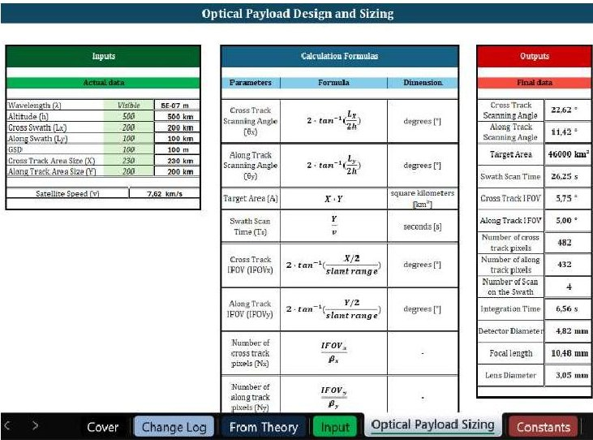
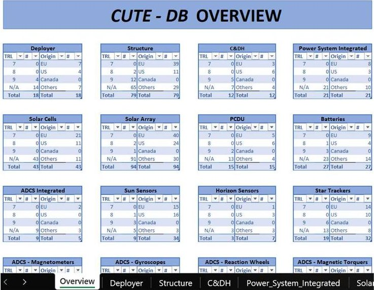
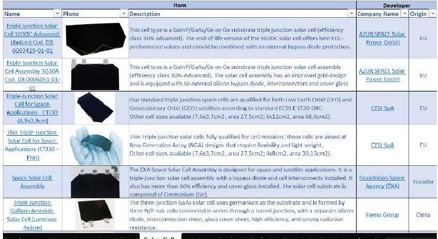
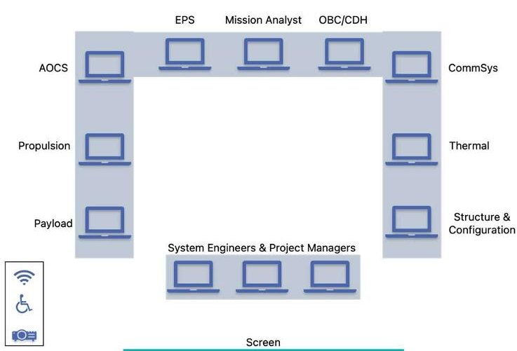

<!-- PDF_PAGE: 1 -->

# 75th International Astronautical Congress (IAC), Milan, Italy, 14-18 October 2024. Copyright ©2024 by Ms. Emanuela La Bella. Published by the IAF, with permission and released to the IAF to publish in all forms.

IAC-24-D3.3

# Concurrent Model-Based Approach for CubeSat Mission Design

Emanuela La Bella $ ^{a*} $ , Serena Campioli $ ^{a} $ , Luisa Iossa $ ^{a} $ , Sabrina Corpino $ ^{a} $ , Fabrizio Stesina $ ^{a} $

$ ^{a} $ Department of Mechanical and Aerospace Engineering (DIMEAS), Politecnico di Torino, Corso Duca degli Abruzzi 24, 10129, Torino (TO), Italy, emanuela.labella@polito.it, serena.campioli@polito.it, luisa.iossa@polito.it, sabrina.corpino@polito.it, fabrizio.stesina@polito.it

* Corresponding Author

## Abstract

The SPACE4YOU (SPace Activities and CompEtences for industrY bOost in bUsiness) project aims at enhancing existing skills, and realities, but also at creating novel ideas and stimulating technological transfer between the Academia, large system integrators, and small-medium enterprises. This project promotes collaboration and open knowledge sharing to accelerate the development of forthcoming space technologies and applications, providing a common environment and shared tools and methods for designing, simulating, developing, and testing new space systems. One of the research contributions resulted in a Concurrent Model-Based approach based on digital tools for designing and developing missions and services of micro and nanosatellites.

This paper presents an innovative approach that combines the concurrent engineering paradigm with standardized calculation sheets linked to a CubeSat Technologies Database, facilitating the preliminary design process and enabling component selection based on applicable specifications and performance data of available technology. This combined concurrent design approach offers faster, more flexible, and transparent design management compared to traditional methods, simplifying the system design flow and the decision-making process in the early phases of a space mission project. This approach has been implemented and tested during several CubeSats projects, among them an in-orbit servicing cis-lunar mission and a CubeSat constellation around Bennu asteroid, emphasizing collaborative learning through concurrent design sessions, and encouraging both communication and resource sharing across different technical fields. The research team worked simultaneously tackling the various aspects of space mission design, from conceptual design up to subsystem sizing, supported by both standardized calculation sheets and CubeSat Technologies Database. The effectiveness of the new Concurrent Model-Based approach in achieving accurate and efficient results has been determined by assessing the design outcomes against appropriate figures of merit.

Therefore, this work contributes to the development of best practices and tools in space technology and system management, exploiting the results and outcomes of an innovative approach to small satellite design for space exploration, and promoting lessons learned within the space engineering community.

Keywords: CubeSat - Concurrent Engineering - MBSE - SPACE4YOU - NODES

## Acronyms/Abbreviations

ADCS - Attitude Determination and Control System

BOSS-Bennu Observer Small Satellites

C&DH-Command and Data Handling

C $ ^{2} $ DF-CubeSat Concurrent Design Facility

CDF- Concurrent Design Facility

CE-Concurrent Engineering

CommSys - Communication System

ConOps - Concepts of Operations

COTS - Commercial Off-The-Shelf

CUTE-DB-CubeSat Technologies Database

DIMEAS - Department of Mechanical and Aerospace Engineering

Aerospace Engineering

EPS - Electrical Power System

ESA-European Space Agency

ESTEC - European Space research and Technology Centre

LEO - Low Earth Orbit

MBSE - Model-Based Systems Engineering

NEO - Near-Earth Object

MUR - Ministry of University and Research

NODES - Nord-Ovest Digitale E Sostenibile

PCDU - Power Conditioning and Distribution Unit

PNRR - National Recovery and Resilience Plan

PoliTo - Politecnico di Torino

S3D - Small-Satellite System Design

SPACE4YOU - SPace Activities and CompEtences for industrY bOost in bUsiness

STAR - System and Technologies for Aerospace Research

STK - Systems Tool Kit

TCS-Thermal Control System

TRL - Technology Readiness Level

## 1. Introduction

The increasing demand for fast, cost-effective, and innovative space missions has boosted the development of small satellites, particularly CubeSats [1]. Efficient and effective design methodologies are crucial to ensure

<!-- PDF_PAGE: 2 -->

the success of these missions. In recent years, Concurrent Engineering (CE) and Model-Based Systems Engineering (MBSE) [2] have become increasingly important and employed in the design of CubeSats missions [3]. Concurrent Engineering is a product development approach that aims to reduce mission design time and development costs while increasing the system development quality, by carrying out tasks in parallel with near-real-time teamwork and using modern design tools. In the design of space missions and systems, CE is mainly applied at the phase 0/A and is defined by ESA as "a systematic approach to integrated product development that emphasises meeting customer expectations. It embodies the values of cooperation, trust and team sharing so that decision-making is consensual, involving all perspectives in parallel, from the very beginning of the product life cycle" [4]. On the other hand, Model-Based Systems Engineering is a model-centric system engineering approach for representing complex systems that has recently gained attention and importance for its contribution to reducing development time and improving cost efficiency in space systems design [5]. In contrast to traditional document-centric systems engineering methods, CE and MBSE rely on computer-based tools and procedures to improve the design, development, and verification process of space systems by enabling a structured and digitally processable expression of information through digital models and tools, which are used as the primary means of information exchange.

This paper presents a novel Concurrent Model-Based approach for CubeSat mission design, developed by the STAR (Systems and Technologies for Aerospace Research) [6] research group from Politecnico di Torino (PoliTo) within the framework of the flagship project SPACE4YOU (SPace Activities and CompEtences for industrY bOost in bUsiness) [7]. As part of the Spoke 1 Industry 4.0 for sustainable mobility and aerospace of the innovation ecosystem NODES-Nord-Ovest Digitale E Sostenibile (Digital and Sustainable North-Western Italy) which involves the North-Western Italian regions of Piemonte, Valle d'Aosta and the bordering provinces of Lombardia, the SPACE4YOU project aims at enhancing existing skills, and realities, but also at creating novel ideas and fostering collaboration, knowledge sharing, and technological transfer between the Academia, large system integrators, small-medium enterprises, accelerators, and incubators within the space ecosystem. One of the objectives of the SPACE4YOU project is to accelerate the development of forthcoming space technologies and applications by providing a common environment and shared techniques, methodologies, models, procedures, and tools for the design, simulation, development, and testing of new space systems.

The Concurrent Model-Based approach combines the principles of CE and MBSE to achieve a more efficient and effective system design process for micro and nanosatellite missions and services, offering several advantages over conventional methods, including faster design processes, enhanced flexibility, and improved transparency.

This paper delves into the details of the Concurrent Model-Based approach, explaining the principles and benefits of this methodology in section 2, as well as the implementation of two specific tools. Section 3 will present the application of the approach to a specific case study through Concurrent Design Sessions. The results of the mission design and an assessment of the effectiveness of the approach used will be discussed in section 4, together with recommendations according to lessons learned and possible future implementations. Finally, conclusions on the methodology used in space missions design are given in section 5.

## 2. Concurrent Model-Based Methods & Tools

One of the key contributions to the SPACE4YOU project to support the design phases of space missions and systems is the Concurrent Model-Based approach, a design methodology particularly suitable for the phase 0/A [8] of a space project. This methodology combines the CE paradigm with system models and tools, aiming to improve the design process and facilitate cooperation among team members and collaboration of scientific communities. The fundamental principles of the Concurrent Model-Based approach are simultaneous system modelling and iterative design refinement: multiple teams work concurrently on various aspects of the system, using models and tools to represent their respective disciplines. This allows teams to collaborate effectively by sharing and exchanging models, ensuring consistency and alignment across the system. Parallel system development and early identification of potential issues and risks ensures a continuous refinement of the models and leads to optimized system design. Furthermore, by integrating the models early in the development process, the system compatibility can be assessed, reducing errors and minimising potential conflicts, and the verification process can begin in advance with respect to traditional methodologies.

By combining the strengths of CE and MBSE, promoting simultaneous engineering, early integration, iterative design, communication and risk management, and providing a structured framework for modelling analysis and verification, the Concurrent Model-Based approach can significantly reduce the development time of complex systems, improve their efficiency, quality, and overall performance, as well as reduce cost and risk. In addition, the constant support of the models and tools provide a clear view of design iterations, facilitating both decision-making, through a comprehensive

<!-- PDF_PAGE: 3 -->

understanding of the system behaviour and interactions and the transition of design from one phase to the next.

In order to effectively implement the design approach, it is important to complement it with digital tools and standardized procedures: the STAR team at PoliTo focused on the development of suitable tools for the preliminary design of CubeSats, in particular a digital tool, named Small-Satellite System Design (S3D) Tool, and a comprehensive database, named CubeSat Technologies Database (CUTE-DB).

## 2.1 Small-Satellite System Design (S3D) Tool

The S3D Tool is intended to facilitate the design process, by performing the CubeSat subsystems sizing and evaluating the system budgets. It consists of a set of calculation sheets implemented in Microsoft Excel dedicated to the main disciplines of the preliminary design phase of a CubeSat project: Attitude Determination and Control System (ADCS), Communication System (CommSys), Electrical Power System (EPS), Propulsion System, Thermal Control System (TCS), Optical Payload, Risk, and Cost. Each discipline corresponds to a spreadsheet, which is generally organised into several sheets as in the following order: (i) Cover, (ii) Change log, which contains changes and updates to the spreadsheet, (iii) From Theory, which collects the objectives of the discipline, the theoretical definitions and equations, and typical values of specific parameters from the literature [9,10], (iv) Input, where the user can enter the inputs for that discipline, values typically coming from mission analysis and system parameters, (v) Sizing and Budget, one or more sheets are dedicated to the calculations, a table collects the outputs and some graphs give a visual representation of the results, and (vi) Constants, which contains all the constants needed for the calculations in the previous sheets.

An example of a spreadsheet of the S3D Tool is shown in Fig. 1.

Fig. 1. Optical Payload spreadsheet of the S3D Tool

Each spreadsheet is described in detail in a user manual, from the assumptions used to the mathematical formulas employed to a step-by-step guide to compiling the different sheets.

In addition, a central repository, called Central Data Exchange System, was created to facilitate communication and information management during the design process.

This repository is linked to the other spreadsheets and allows for both automated and manual data input. Its purpose is to ensure that up-to-date information and data are shared across different disciplines and levels (mission, system, subsystem, component) while verifying that all disciplines operate on the same assumptions. Indeed, an alert system consisting of a Check column for the input values in common between two or more disciplines has been implemented in the central repository. The Central Data Exchange System consists of 12 sheets: (i) Cover, (ii) Mission Design, (iii) Mission Analysis, (iv) Launch Vehicle, (v) Structure & Configuration, (vi) ADCS, (vii) CommSys, (viii) EPS, (ix) Propulsion, (x) Thermal, (xi) Payload, and (xii) Mass&Volume Budget. Each sheet is organised in 'Inputs' and 'Outputs' tables, except for the Cover, Mission Design, and Mass&Volume Budget sheets.

The Mission Design sheet contains the mission timeline and the operative modes of the spacecraft, which can be entered as user input, and the mission cost, which is automatically taken from the Cost spreadsheet.

The Mission Analysis and the Structure & Configuration sheets are not linked to any spreadsheet because external software (e.g. Systems Tool Kit (STK), SolidWorks) are used for specific analyses. Therefore, the 'Inputs' and 'Outputs' tables of both sheets must be filled in by the user.

The inputs of the Launch Vehicle sheet are left to the user, while the outputs are partially manual and partially automated.

The ADCS, CommSys, EPS, Propulsion, Thermal, and Payload sheets are linked to the corresponding spreadsheet, allowing an automatic filling of the 'Inputs' and 'Outputs' tables and ensuring a consistency check on the inputs.

The Payload sheet allows the sizing of optical payload. If different payloads are required, the users can manually insert the data according to their design.

Lastly, the Mass&Volume Budget sheet allows the mass and volume of each spacecraft component to be collected, giving the user the option of choosing the margins to be applied to each component. Thus, a mass budget and a volume budget of the CubeSat are automatically calculated.

## 2.2 CubeSat Technologies Database (CUTE-DB)

The CUTE-DB provides immediate access to specifications and performance data of commercially

<!-- PDF_PAGE: 4 -->

available components, supporting not only the component selection during the design process but also ensuring that CubeSat projects are based on current technological realities. The current version of the CUTE-DB is an Excel-based database, covering several CubeSat technologies such as Deployers, Structures, Command and Data Handling (C&DH) systems, EPS, ADCS, CommSys, Propulsion Systems, Navigation Systems, Optical Payloads, TCS, Docking Systems, Mechanisms, and Platforms. The first sheet gives an overview of the abovementioned technologies, highlighting their Technology Readiness Level (TRL) and the country of origin, as illustrated in Fig. 2.

Fig. 2. CUTE-DB Overview sheet

Instead, the following sheets are dedicated to the different technologies listed in the following order: Deployer, Structure, C&DH, Power System Integrated, Solar Cells, Solar Array, Power Conditioning and Distribution Unit (PCDU), Batteries, ADCS Integrated, Sun Sensors, Horizon Sensors, Star Trackers, Magnetometers, Gyroscopes, Reaction Wheels, Magnetic Torquers, Transceiver, Antenna, Cold Gas Propulsion System, Chemical Propulsion System, Electrical Propulsion System, Others Propulsion System, Relative Navigation System, Absolute Navigation System, Optical Payload, Thermal Active Systems, Thermal Passive Systems, Docking Systems, Mechanisms, and Platforms. The database structure is kept consistent throughout the different sheets, where the properties of each technology and their relationships are highlighted, representing a picture of what is currently available in the market. In particular, each sheet contains the following sections: (i) Item (name, photo, brief description, reference link), (ii) Developer (company name, country of origin), (iii) Physical properties (unit, size, mass, material, other specific physical parameters), (iv) Functional properties (technology-dependent), (v) Environmental properties (survival temperatures, operational temperatures, radiation tolerance, vibration tolerance), (vi) Power

properties (supply current, nominal power, peak power voltage supply, other electrical interfaces), (vii) Flight Heritage (TRL, Heritage), (viii) Price (if available).

An extract from the CUTE-DB is shown in Fig. 3, highlighting the Solar Cells sheet layout, and in particular its Item and Developer sections.

Fig. 3. Solar Cells Item and Developer sections of the CUTE-DB

The CUTE-DB has been populated using several sources available online [11, 12], as well as official developer websites, and it is currently updated to June 2024.

## 3. Concurrent Design Sessions

Once both tools for the preliminary design of CubeSats have been developed, the Concurrent Model-Based approach has been applied to several case studies through concurrent design sessions.

## 3.1 Concurrent Sessions organisation

The standard ESA ESTEC Concurrent Design Facility (CDF) process [4] consists of multiple sessions usually a pre-study phase, 8 sessions of 4 hours each performed over a month (2 sessions per week) and post-study activities. As per [13, 14], this process has been adapted, reducing the workflow into four, 4-hour sessions, structured as follows: (i) Session 1: Kick-off & Start of mission design - the mission objectives, study requirements and drivers are presented. A preliminary mission analysis is performed, and different Concepts of Operations (ConOps) and mission architectures are identified. In addition, a preliminary cost and risk assessment is initiated; (ii) Session 2: Mission design ConOps and mission architecture are consolidated, while the mission analysis is iterated, defining the Delta-V. The system architecture is defined, and the preliminary subsystem architectures are outlined. Cost and risk assessments are further elaborated; (iii) Session 3: System design - system and subsystem budgets are computed, and preliminary subsystems sizing is carried out; (iv) Session 4: Consolidation of baseline - finalization of the iteration(s), up to the selection of the subsystem-level components.

<!-- PDF_PAGE: 5 -->

Each session starts with a 15-minute kick-off, in which an overview/summary of the project status is given to enable everyone to start with a clear idea of the assumptions to be used. In addition, the main objectives of the session are explained, and the main tasks are presented. The kick-off is followed by 3.5 hours of iteration work, during which the baseline study is performed, following the previously presented objectives and tasks, and the team continuously communicates, discusses, and takes decisions by consensus. Finally, the last 15 minutes of the session are dedicated to an internal presentation where each expert presents their work, the results are discussed and the next steps of the study are defined, to be carried out in the next concurrent session.

Concurrent design sessions have been conducted by the STAR team in the PoliTo CubeSat Concurrent Design Facility $ \mathrm{C^{2} D F} $ , a conference room currently hosted by the Department of Mechanical and Aerospace Engineering (DIMEAS) at PoliTo, and equipped with the necessary hardware, software, and dedicated seats for each discipline (as shown in Fig. 4).

PoliTO CubeSat Concurrent Design Facility

Fig. 4. PoliTo $ C^{2} $ DF [13]

Although the Concurrent Model-Based approach can be applied to multiple teams, the concurrent design sessions have been managed by a single team of 12 members, each with a specific role and tasks to be accomplished during the sessions. The different roles and the corresponding software tools used during the concurrent sessions are shown in Table 1.

Table 1. Team members role - specific tools

<table border="1"><tr><td>Role</td><td>Tools used</td></tr><tr><td>1 Project Manager</td><td>Jira/Miro</td></tr><tr><td>1 System Engineer</td><td>S3D Tool-Central Data Exchange System Valispace</td></tr></table>

<table border="1"><tr><td>1 Payload Engineer</td><td>S3D Tool-Optical Payload spreadsheet/CUTE-DB</td></tr><tr><td>1 Mission Analyst</td><td>STK S3D Tool-Central Data Exchange System</td></tr><tr><td>1 Propulsion Engineer</td><td>S3D Tool-Propulsion spreadsheet/CUTE-DB</td></tr><tr><td>1 ADCS Engineer</td><td>S3D Tool-ADCS spreadsheet/CUTE-DB</td></tr><tr><td>1 EPS Engineer</td><td>S3D Tool-EPS spreadsheet/CUTE-DB</td></tr><tr><td>1 C&amp;DH Engineer</td><td>CUTE-DB</td></tr><tr><td>1 CommSys Engineer</td><td>S3D Tool-CommSys spreadsheet/CUTE-DB</td></tr><tr><td>1 TCS Engineer</td><td>S3D Tool-Thermal spreadsheet/CUTE-DB/Solidworks</td></tr><tr><td>1 Structure&amp;Configuration Engineer</td><td>Solidworks S3D Tool-Central Data Exchange System</td></tr><tr><td>1 Risk&amp;Cost Engineer</td><td>S3D Tool-Risk and Cost spreadsheets</td></tr></table>

The System Engineer is the primary user of the central repository of the S3D Tool, though it is accessible to all team members. It allows automated data transfer from the other spreadsheets of the S3D Tool and enables faster validation of the sizing, budgets and design, reducing manual effort and minimizing errors.

The CUTE-DB has been used since Session 3, allowing the selection of one or more component options that meet mission-specific criteria and requirements.

Moreover, all team members have used Microsoft PowerPoint as a tool for the internal presentation during the last 15 minutes of each session.

Therefore, the Concurrent Model-Based approach and the related tools (both S3D Tool and CUTE-DB) have been implemented and tested in several case studies, including the Bennu Observer Small Satellites (BOSS) mission, the Geo-Profundo mission [13], and the Cislunar mission [15].

## 3.2 BOSS Mission

The BOSS mission is a feasibility study of a CubeSat mission, with the aim to conduct in-situ observations of the Bennu asteroid, a near-Earth object (NEO). The

<!-- PDF_PAGE: 6 -->

mission goals are (i) to map the asteroid from a relatively close distance, retrieving crucial data of Bennu surface composition at high resolution, (ii) to characterize the environment in close proximity of the asteroid, and (iii) to demonstrate the utilisation of small satellite technologies in deep space.

The mission architecture is based on a motherdaughter configuration, in which the mothercraft provides the interplanetary transfer of the small satellite(s) to the asteroid, a safe deployment in the proximity of the asteroid, and relays communications to/from Earth.

By implementing the Concurrent Model-Based approach, four concurrent design sessions have been carried out. Session 1 started by presenting the mission and system drivers and constraints, followed by a brainstorming activity to identify the main challenges in a deep space mission and systems design and the potential stakeholders, which led to the definition of the mission statement and mission objectives.

The mission statement of the BOSS mission has been defined as follows: "The mission aims to develop a lowcost and fast delivery deep space mission to characterize the topography, composition and environment of the Bennu asteroid, to improve scientific knowledge about the early Solar System and contribute to planetary defence studies. The mission additionally aims to demonstrate small satellite technologies in deep space through a mother-daughter configuration.".

Several ConOps and the mission architecture have been drafted and a preliminary trajectory analysis has been carried out. In addition, preliminary cost and risk assessments have been conducted.

Table 2. BOSS mission ConOps trade-off

In Session 2, from the various ConOps identified a trade-off assessment has been performed, shown in Table 2, leading to the consolidation of ConOps #2.

<table border="1"><tr><td></td><td>ConOps1</td><td>ConOps2</td><td>ConOps3</td><td>ConOps4</td><td>Weights</td></tr><tr><td>Objectives</td><td>5</td><td>9</td><td>2</td><td>6</td><td>23,41%</td></tr><tr><td>TRL</td><td>8</td><td>8</td><td>8</td><td>8</td><td>7,74%</td></tr><tr><td>Complexity</td><td>3</td><td>3</td><td>6</td><td>5</td><td>12,24%</td></tr><tr><td>Operations</td><td>3</td><td>3</td><td>6</td><td>5</td><td>19,86%</td></tr><tr><td>Risks</td><td>6</td><td>9</td><td>1</td><td>5</td><td>14,62%</td></tr><tr><td>Costs</td><td>4</td><td>6</td><td>4</td><td>4</td><td>22,14%</td></tr><tr><td>Total</td><td>4,52</td><td>6,33</td><td>4,05</td><td>5,25</td><td></td></tr></table>

The mission architecture has also been consolidated and further iterations on mission analysis have continued, resulting in the calculation of a required Delta-V.

The mission schedule and the operative mode of the spacecraft(s), as well as the system architecture, have been defined, and preliminary subsystem architectures has been started. Iterations on costs and risk assessments have been performed.

During Session 3, the subsystems sizing and the preliminary selection of Commercial Off-The-Shelf

(COTS) components have been addressed, concurrently with mission analysis iterations. In addition, system budgets have been computed.

Finally, Session 4 allowed iterations to be concluded, the subsystem components selected, and the final system budgets computed, consolidating the baseline. The cost budget and the risk assessment, including the mitigation actions to be applied, have been finalized.

The final mass and volume budgets calculated using the Central Data Exchange System of the S3D Tool are reported in Fig. 5.

<table class="table table-bordered"><thead><tr><th></th><th>Subsystem</th><th>Components</th><th>Mass [g]</th><th>Volume [mm³]</th><th>#Components</th><th>Margin</th><th>Mass with Margin [g]</th><th>Volume with Margin [mm³]</th></tr></thead><tbody><tr><td rowspan="18">Spacecraft bus</td><td rowspan="3">EPS</td><td>PCDU + Battery pack</td><td>675</td><td>246950</td><td>1</td><td>20%</td><td>810</td><td>296340</td></tr><tr><td>6Ux2 Deployable Solar Array</td><td>678</td><td>529700</td><td>4</td><td>10%</td><td>29832</td><td>2330680</td></tr><tr><td>1.5U Solar Array</td><td>65</td><td>29390</td><td>1</td><td>10%</td><td>711.5</td><td>32329</td></tr><tr><td rowspan="4">CommSys</td><td>Moshed patch antenna</td><td>20</td><td>1089</td><td>2</td><td>20%</td><td>48</td><td>2613.6</td></tr><tr><td>S-Band Antenna ISM</td><td>64</td><td>114290</td><td>4</td><td>5%</td><td>2658.8</td><td>480018</td></tr><tr><td>S-Band Transmitter</td><td>180</td><td>201550</td><td>2</td><td>5%</td><td>378</td><td>423255</td></tr><tr><td>S-Band Receiver</td><td>180</td><td>201550</td><td>2</td><td>5%</td><td>378</td><td>423255</td></tr><tr><td rowspan="2">TCS</td><td>Peltier module</td><td>6</td><td>300</td><td>5</td><td>5%</td><td>31.5</td><td>1575</td></tr><tr><td>Heat sink</td><td>4</td><td>9670</td><td>5</td><td>5%</td><td>21</td><td>50767.5</td></tr><tr><td rowspan="2">STR</td><td>Main structure</td><td>1807</td><td>709470</td><td>1</td><td>20%</td><td>2165.4</td><td>850164</td></tr><tr><td>External panels</td><td>821</td><td>292120</td><td>1</td><td>20%</td><td>985.2</td><td>350544</td></tr><tr><td rowspan="5">ADCS</td><td>Star Trackers</td><td>42</td><td>32040</td><td>2</td><td>5%</td><td>88.2</td><td>67284</td></tr><tr><td>Sun Sensors</td><td>3</td><td>1290</td><td>6</td><td>5%</td><td>15.9</td><td>8127</td></tr><tr><td>IMU</td><td>55</td><td>37180</td><td>2</td><td>5%</td><td>115.5</td><td>78078</td></tr><tr><td>Reaction Wheel</td><td>55</td><td>16200</td><td>4</td><td>5%</td><td>231</td><td>68040</td></tr><tr><td>Laser RangeFinder</td><td>45</td><td>42330</td><td>1</td><td>20%</td><td>54</td><td>50796</td></tr><tr><td rowspan="2">PROP</td><td>Thrusters NanoFEEP</td><td>160</td><td>59750</td><td>8</td><td>20%</td><td>1536</td><td>573600</td></tr><tr><td>Fuel</td><td>104</td><td></td><td>2%</td><td></td><td>192</td><td></td></tr><tr><td rowspan="9">Payload</td><td colspan="2">C&DH</td><td>94</td><td>107140</td><td>2</td><td>10%</td><td>205.8</td><td>235708</td></tr><tr><td colspan="2">Spectrometer (BIRCHES)</td><td>2500</td><td>1500000</td><td>1</td><td>10%</td><td>2750</td><td>1850000</td></tr><tr><td colspan="2">Mantis Imager</td><td>500</td><td>650000</td><td>1</td><td>10%</td><td>525</td><td>682500</td></tr><tr><td colspan="2">X-Ray Spectrometer</td><td>180</td><td>175000</td><td>2</td><td>5%</td><td>378</td><td>367500</td></tr><tr><td colspan="2">LIDAR camera</td><td>1590</td><td>1481540</td><td>1</td><td>5%</td><td>1669.5</td><td>1555617</td></tr><tr><td colspan="2">Radiometer (CIRIS)</td><td>950</td><td>3078000</td><td>1</td><td>20%</td><td>1140</td><td>3693600</td></tr><tr><td colspan="2">RGB camera (ECAM-C50)</td><td>351</td><td>289970</td><td>1</td><td>5%</td><td>368.55</td><td>272968.5</td></tr><tr><td colspan="2">Relativistic Electron and Proton Telescope (REPTile)</td><td>1250</td><td>300000</td><td>1</td><td>10%</td><td>137.5</td><td>330000</td></tr><tr><td></td><td colspan="2">Dosimeter</td><td>32</td><td>23740</td><td>1</td><td>5%</td><td>33.6</td><td>24927</td></tr><tr><td></td><td></td><td></td><td></td><td></td><td></td><td></td><td>18825.65</td><td></td></tr><tr><td></td><td></td><td></td><td></td><td></td><td></td><td></td><td>20%</td><td></td></tr><tr><td></td><td></td><td></td><td></td><td></td><td></td><td></td><td>Tot mass with margins [g]</td><td>22590.78</td></tr></tbody></table>

Fig. 5. Mass and volume budgets results

At the end of the concurrent study, a detailed final presentation has been conducted to review the results achieved and lessons learned have been collected, allowing for a subsequent iteration of the Concurrent Model-Based approach and the related digital tools.

To sum up, the final mission will consist of this concept of operation involving a 12U CubeSat launched on Falcon Heavy inside a mothercraft towards Bennu. After a heliocentric transfer of 2 years and 3 months, both satellites will rendezvous with the Bennu asteroid. BOSS will be deployed from the mothercraft, about 2 months after arrival, in an orbit around Bennu at approximately 1.6 to 2.1 km from the surface with a Delta-V of 1 cm/s in the Nadir direction.

The Deployment & Commissioning phase will ensure the primary systems and payload checkout followed by the instrument calibration, to go through the Remote Sensing scenario where the scientific goals will be fulfilled. During this phase, the CubeSat will communicate with ground stations using the mothership as a relay, control its attitude and trajectory autonomously, generate maps for navigation, and produce power using the solar panels. A 6-month operational terminator orbit at 1 km from the surface, followed by a lower 500 m distance 6-month extension of on-orbit operations is planned and controlled with

<!-- PDF_PAGE: 7 -->

station-keeping manoeuvres. Finally, the BOSS satellite will be disposed with a hyperbolic scape into a heliocentric orbit.

## 3.3 Other Missions

Besides the BOSS mission, another case study for the Concurrent Model-Based approach explores the feasibility of a 6U CubeSat mission in Low Earth Orbit (LEO), named Geo-Profundo [13], designed to monitor the urban growth of the Piedmont region, in Italy, and to demonstrate technologies for future deep-space CubeSat missions.

The methodology has also been applied to the feasibility study of the in-orbit servicing of multi-purpose autonomous CubeSat inspectors in proximity of the Lunar Gateway [15].

## 4. Results and Discussion

The results of the concurrent design sessions of the BOSS mission were presented in 3.2, and now the effectiveness of the Concurrent Model-Based approach is discussed, comparing the feasibility study results obtained from the concurrent design sessions with the same study conducted with the traditional methodology.

## 4.1 Comparison with Traditional Methodology

The mission design results for comparison are shown in Table 3.

Table 3. BOSS mission design results' comparison

<table border="1"><tr><td></td><td>CE-MBSE Methodology</td><td>Traditional Methodology</td></tr><tr><td>Mass budget</td><td>22.59kg</td><td>26.6kg</td></tr><tr><td>Delta-V budget</td><td>1.33m/s</td><td>0.68m/s</td></tr><tr><td>Cost assessment</td><td>15M€</td><td>22M€</td></tr><tr><td>Feasibility analysis duration</td><td>1month</td><td>3months</td></tr></table>

The CE-MBSE methodology resulted in a spacecraft mass of 22.59 kg, which is approximately 15% lower than the 26.6 kg calculated using the traditional methodology. This reduction in mass is likely due to the integrated, iterative nature of the concurrent approach, allowing design teams to identify and eliminate inefficiencies earlier in the process. In contrast, the traditional method, which is typically more segmented and sequential, has less real-time feedback between subsystems, leading to an overall heavier final design.

The Delta-V budget is another critical parameter in mission design. The CE-MBSE approach produced a Delta-V budget of 1.33 m/s, nearly double the 0.68 m/s calculated using the traditional methodology. This may be due to the time allocated for the feasibility analysis, which, using the traditional methodology, allowed for more iteration and refinement in the trajectory analysis.

However, the shown results only take into account the 4 sessions results and not the post-study refinement.

The cost assessment shows a difference between the two methodologies. The CE-MBSE approach projected a total mission cost of 15 million euros, which is significantly lower than the 22 million euros estimated through the traditional approach. This cost efficiency likely stems from the concurrent design's ability to minimize redesigns, optimize resources, and reduce the need for extensive iterations across different teams. In contrast, the traditional method, with its longer timelines and potentially higher number of revisions, contributes to a higher overall cost.

The time taken to conduct the feasibility analysis is perhaps one of the most striking differences. Using the CE-MBSE methodology, the feasibility study was completed in one month, compared to the three months required when using the traditional approach. This shortened timeline reflects the enhanced collaboration and integration made possible by concurrent engineering, where multiple teams work in parallel rather than waiting for sequential handoffs.

## 4.2 Lessons Learned and Way Forward

Several lessons learned have been drawn by the firsthand experiences of the authors as well as the case studies delivered.

Firstly, the S3D Tool needs to be improved and optimised. A preliminary calculation sheet for the Optical Payload has been developed to support initial design and performance evaluations. However, this sheet needs to be updated to reflect the latest design changes and integrated into the central repository to ensure alignment with the overall system design and easy access by all team members. In addition, dedicated spreadsheets for other kinds of payloads for CubeSat missions need to be developed.

Beyond the Optical Payload, a similar calculation sheet dedicated to the Command & Data Handling (C&DH) subsystem must also be created to standardize performance calculations and requirements tracking across all key systems. This will improve the consistency and efficiency of the design process.

Additionally, alternative environments are currently under investigation to complement or replace the current tools in use. Specifically, software environments such as Comet and Matlab's System Composer are being explored for their potential to offer enhanced systems engineering capabilities, such as improved model-based design, architecture definition, and real-time collaboration features. These tools may provide additional flexibility and robustness in handling the complex integration and coordination tasks required for the mission, as well as

<!-- PDF_PAGE: 8 -->

possible enhancements to make the methodology suitable also for the later phases of a space project.

Furthermore, a discussion on CUTE-DB is open among the research team: to optimize the database management system used in the project, other environments are being evaluated, with MySQL being a key candidate under investigation [16]. The choice of database will be crucial in managing the large amounts of data generated and processed during the design and testing phases, ensuring that information is stored, retrieved, and managed efficiently. By exploring MySQL and other database solutions, the project aims to establish a more scalable and reliable system for data management.

Finally, one of the main goals of the project is to develop and refine best practices and tools for space technology and systems management. This involves exploiting the results and outcomes of this approach to small satellite design for space exploration and promoting lessons learned within the space engineering community.

## 5. Conclusions

This paper highlights the significant potential of a Concurrent Model-Based approach in CubeSat mission design, highlighting the essential need for shared models and tools within the space ecosystem. By integrating the principles of Concurrent Engineering and Model-Based Systems Engineering, this methodology not only streamlines the design process but also enhances collaboration among diverse stakeholders, fostering a more efficient development environment.

The SPACE4YOU initiative serves as a prime example of how a collaborative environment not only fosters synergy but also ensures that valuable lessons learned from previous missions are effectively documented and utilized, paving the way for continuous improvement in space exploration and development. This approach accelerates innovation and promotes best practices across the space sector, reinforcing the importance of collective expertise.

In conclusion, the Concurrent Model-Based approach represents a transformative shift in CubeSat mission design, playing a crucial role in shaping the future of space exploration, enabling more efficient, innovative, and sustainable mission outcomes.

## Acknowledgements

This work is part of the project NODES - Spoke 1 Aerospace and sustainable mobility, and the authors would like to acknowledge the NODES ecosystem for the support and the funding received from the MUR-M4C2 1.5 of PNRR with grant agreement no. ECS00000036.

## References

[1] S. Bollattino, F. Stesina, Fast development and validation of a Sensing Suite system for CubeSats, Acta Astronautica Vol 223 (2024) 342-354.

[2] S. Cresto Aleina, D. Ferretto, F. Stesina, N. Viola, A model-based approach to the preliminary design of a space tug aimed at early requirement's verification, $ 6 7^{th} $ International Astronautical Congress, Guadalajara, Mexico, 2016, 26-30 September.

[3] S. Corpino, L. Franchi, D. Calvi, S. Sette, F. Stesina, Small satellite mission design supported by tradespace exploration with concurrent engineering: Space Rider Observer Cube case study, $ 70^{\mathrm{th}} $ International Astronautical Congress, Washington DC, United States, 2019, 21-25 October.

[4] M. Bandecchi, B. Melton, F. Ongaro, Concurrent Engineering Applied to Space Mission Assessment and Design, ESA bulletin 99, 1999.

[5] E. Brusa, A. Calà, D. Ferretto, Systems Engineering and Its Application to Industrial Product Development, Springer, 2018.

[6] L. Franchi, F. Feruglio, S. Corpino, A knowledge based tool-kit for collaborative tradespace exploration: A front-end support to concurrent decision making, $ 6 8 ^{th} $ International Astronautical Congress, Adelaide, Australia, 2017, 25-29 September.

[7] HUB NODES, SPACE4YOU project, https://www.ecs-nodes.eu/en/1-aerospace-and sustainable-mobility/spoke-1-flagship projects/space4you-project, (accessed 17.09.2024).

[8] ECSS-M-ST-10C Rev.1, Space project management, 2009.

[9] W. J. Larson, J. R. Wertz, Space Mission Analysis and Design, third ed., Space Technology Library, El Secundo, California, 2005.

[10] NASA Small Spacecraft Systems Virtual Institute, Ames Research Center, State-of-the-Art Small Spacecraft Technology, 2024.

[11] The global marketplace for the space industry, https://satsearch.co/, (accessed 12.09.2024).

[12] E. Kulu, Nanosats Database, https://nanosats.eu/, (accessed 12.09.2024).

[13] S. Campioli, F. Stesina, E. La Bella, S. Corpino, L. Niero, C. My, Concurrent Engineering to Enhance Autonomy for Deep-Space CubeSat Mission Design, 2024 IFAC Workshop on Aerospace Control Education, Bertinoro, Italy, 2024, 22-24 July.

[14] S. Campioli, E. La Bella, A. D'Ortona, S. Corpino, F. Stesina, Concurrent Model-Based Approach for Project-based Education, $ 1 1^{\mathrm{th}} $ International Systems & Concurrent Engineering for Space Applications Conference (SECESA Conference 2024), Strasbourg, France, 2024, 25-27 September.

<!-- PDF_PAGE: 9 -->

[15] S. Corpino, F. Stesina, Inspection of the cis-lunar station using multi-purpose autonomous Cubesats, Acta Astronautica Vol 175 (2020) 591-605.

[16] S. Campioli, V. Borio, E. La Bella, S. Corpino, F. Stesina, Database-Driven Concurrent Model-Based System Engineering For Space Mission And Systems Design, $ 11^{\mathrm{th}} $ International Systems & Concurrent Engineering for Space Applications Conference (SECESA Conference 2024), Strasbourg, France, 2024, 25-27 September.