<!-- PDF_PAGE: 1 -->

# Contributions to eco-friendly satellite lean design for a sustainable space environment

Jeimmy Nataly Buitrago Leiva

ADVERTIMENT La consulta d’aquesta tesi queda condicionada a l’acceptació de les següents condiciones d’ús: La difusió d’aquesta tesi per mitjà del repositori institucional UPCommons (http://upcommons.upc.edu/tesis) i el repositori cooperatiu TDX (http://www.tdx.cat/) ha estat autoritzada pels titulars dels drets de propietat intel·lectual únicament per a usos privats emmarcats en activitats d’investigació i docència. No s’autoritza la seva reproducción amb finalitats de lucre ni la seva difusió i posada a disposición des d’un lloc aliè al servei UPCommons o TDX. No s’autoritza la presentació del seu contingut en una finestra o marc aliè a UPCommons (framing). Aquesta reserva de drets afecta tant al resum de presentació de la tesi com als seus continguts. En la utilització o cita de parts de la tesi és obligat indicar el nom de la persona autora.

ADVERTENCIA La consulta de esta tesis queda condicionada a la aceptación de las siguientes condiciones de uso: La difusión de esta tesis por medio del repositorio institucional UPCommons (http://upcommons.upc.edu/tesis) y el repositorio cooperativo TDR (http://www.tdx.cat/?locale- attribute=es) ha sido autorizada por los titulares de los derechos de propiedad intelectual únicamente para usos privados enmarcados en actividades de investigación y docencia. No se autoriza su reproducción con finalidades de lucro ni su difusión y puesta a disposición desde un sitio ajeno al servicio UPCommons No se autoriza la presentación de su contenido en una ventana o marco ajeno a UPCommons (framing). Esta reserva de derechos afecta tanto al resumen de presentación de la tesis como a sus contenidos. En la utilización o cita de partes de la tesis es obligado indicar el nombre de la persona autora.

WARNING On having consulted this thesis you’re accepting the following use conditions: Spreading this thesis by the institutional repository UPCommons (http://upcommons.upc.edu/tesis) and the cooperative repository TDX (http://www.tdx.cat/?locale- attribute=en) has been authorized by the titular of the intellectual property rights only for private uses placed in investigation and teaching activities. Reproduction with lucrative aims is not authorized neither its spreading nor availability from a site foreign to the UPCommons service. Introducing its content in a window or frame foreign to the UPCommons service is not authorized (framing). These rights affect to the presentation summary of the thesis as well as to its contents. In the using or citation of parts of the thesis it’s obliged to indicate the name of the author.

<!-- PDF_PAGE: 2 -->

<!-- PDF_PAGE: 3 -->

ESCUELA DE

DOCTORADO DE LA UPC

# Contributions to Eco-Friendly Satellite Lean Design for a Sustainable Space Environment

Doctoral thesis by:

Jeimmy Nataly BUITRAGO LEIVA

Thesis advisor:

Prof. Adriano José CAMPS CARMONA Ph.D. TELECOMMUNICATIONS ENGINEERING

## Degree:

Doctorate program in Aerospace Science and Technology Department of Signal Theory and Communications Technical University of Catalonia - BarcelonaTech

A dissertation submitted for the degree of Doctor of Philosophy

Examination session:

July, 2024. Barcelona, Spain.

<!-- PDF_PAGE: 4 -->

## Acknowledgements

First and foremost, I want to express my deep gratitude to God for His faithfulness and companionship during my doctoral academic journey. I am thankful for His help, love, and for surpassing my expectations, fulfilling His promise in my life (Psalm 138:8).

I want to extend my sincere appreciation to my family: my mother, Leonor Leiva; father, Jaime Buitrago; little sister, Suanny; and my grandmothers María Díaz and Bertha Cárdenas (RIP). Thank you for being my unwavering support and strength along this path. I also appreciate my entire family in Colombia for their constant support during my study process.

Special thanks go to my thesis advisor, Professor Adriano Camps. I thank God for giving me the opportunity to be guided by the best professor I have ever known. I admire his work, dedication, and humanity. I am especially grateful for his support and encouragement to successfully complete this journey.

I also acknowledge and appreciate the opportunity to have been part of the extraordinary satellite team, NanoSat Lab. This place is filled with knowledge, passion, effort, and the achievement of the impossible. I feel very fortunate to have been part of this exceptional team.

I express my gratitude to the reviewers for their time, dedication, and feedback on reading my thesis. I greatly valued the feedback they provided to strengthen its content.

I am thankful to my colleagues and friends from NanoSat Lab who have been and have passed through this magnificent place.

I want to give special thanks to Ines Terraza for her friendship and work on the thermal analysis of mission $ ^{3} $Cat-4, to Luis Contreras for his leadership in missions $ ^{3} $Cat-4 and $ ^{3} $Cat-8, and to Ksenia Osipova for her friendship and support in mission $ ^{3} $Cat-8.

I also thank Adrián Perez for his availability at all times and for his assistance during my academic journey. I express my gratitude to Guillem, Stefan, Amadeu, Martina, Lara, Albert, Elena, Oscar, Adrià, Emilio, Pol, Changyand Wang, and Zhongmin Ma for their generous friendship and help, as well as for their support in the thermal analysis of mission $ ^{3} $Cat-4, $ ^{3} $Cat-8 mision ADCS development, and other aspects of my academic process.

I appreciate Mohamed El Khayathi for his responsibility and work, which allowed the development of the "Zombie Satellites" theme, significantly contributing to my study.

I recognize and appreciate all the professors at UPC who were part of this invaluable experience, as well as all the Ph.D., master, and undergraduate students who participated in missions $ ^{3} $Cat-4 and $ ^{3} $Cat-8. I also want to express my gratitude to the secretariat office of the Aerospace Science and Technology program, especially to Mari Cruz, for her patience, willingness, and administrative support during my doctoral process.

I express my gratitude to the ESA Educational Office, especially to Cristina and Lily, for their support in the process of mission $ ^{3} $Cat-4.

I want to thank the Colombian Air Force for giving me the opportunity to train in this area. I especially thank General Eliot Benavidez, General Ramses Rueda, General Edgar Mauricio Falla, Captain de Navio Jorge Herrera, Captain de Navio Jaime Torres, Chief Technician Omar Moreno, and all the officers, noncommissioned officers, and civilian personnel who were relevant on this journey. I also thank officers and individuals from the Colombian Air Force who believed in me and supported me in carrying out my doctoral studies, including Colonel Rodrigo Mezu, Lieutenant Colonel Sonia Rincón, Major Carly Mejia, Major German Rodriguez, Major Alicia Niño, Captain Diego Cortés, Lieutenant Neidy Toloza, Lieutenant Santiago

<!-- PDF_PAGE: 5 -->

Salazar, Lieutenant Dib Salek, Lieutenant Joseph Zequeda, Professor Alvaro Moncada, and Yilma Adames. I would also like to thank Ph.D. Candidate David Mateus from University of North Dakota.

I thank COLFUTURO Foundation and the Ministry of Science, Technology, and Innovation of Colombia, as well as the Zonta International Amelia Earhart Fellowship, for trusting in my abilities by selecting me as one of the benefiting doctoral students.

I also want to thank the entire Colombian team of mission $ ^{3} $ ColStar for their support and trust in the proposal of this mission to the KiboCUBE call from Japan Aerospace Exploration Agency (JAXA) and the United Nations Office for Outer Space Affairs (UNOOSA). Thanks to all the Colombian members and institutions of $ ^{3} $ ColStar KiboCUBE who participated: Universidad EAN, Universidad Industrial de Santander, Universidad Sergio Arboleda, Universidad de Antioquia, Universidad del Valle, Universidad de Los Andes, Universidad Pedagógica y Tecnológica de Colombia, Universidad Distrital Francisco José de Caldas, Universidad Militar Nueva Granada, Fuerza Aérea Colombiana, IEEC Institut d'Estudis Espacials de Catalunya (Institute for Space Studies of Catalonia), Universidad de Barcelona, Universitat Universitat Politècnica De Catalunya, Universidad Popular Autónoma del Estado de Puebla (UPAEP), Corporación Científica del Sector Aeroespacial (COCSA) (Scientific Corporation of the Aerospace Sector- SCAS), company Sycamore, and SENA. In particular, I appreciate the support of Professors Felipe Guarnizo, Ignacio Acero, Francisco Puerta, and Juan José Mejia.

I want to highlight in a significant and special way all those people who became my closest family in Barcelona: Janeth, Valentina, Helena and Roger, Lucia, Marcela, Andrés, Pipe e Isa, Margarita and Liliana, Paula Espinal, Pablo and Maria Paula, Carolina, Carola, July, Dylan, Orlando, Dirlenis, and my entire family from Casa Roca Barcelona. It was an immense pleasure to meet them and share special moments during this period of my life, and I am sure there will be many more in the future.

I also thank my friends and colleagues who were part of these magnificent years of life and with whom I shared trips and unique experiences during my years of study: Maria Fernanda, Paulino, Lina, and Pamela. I hope that our friendship continues to transcend borders.

Thanks to all the people who in some way participated in this life experience.

I am grateful to all space sector enthusiasts who see my document as an opportunity to contribute significantly to this area of knowledge.

Sic Itur Ad Asta

So one goes to the stars

Així se'n va a les estrelles

Así se va a las estrellas.

<!-- PDF_PAGE: 6 -->

## Abstract

Currently, half of the satellites do not reach 20% of their expected lifetime. The possibility of recycling these "zombie satellites" (ZS) with limited capabilities would lead to an optimization of this on-orbit infrastructure, reducing unnecessary launches, and being more cost-effective, as for example, a 12U CubeSat costs around €2.5 million to manufacture and launch. In this way, it will not be necessary to launch some new satellites for these new missions, with the corresponding positive environmental and economic impact. Based on the ZS concept, this research proposed an eco-friendly satellite design and exploitation approach, centered on integrating space sustainability strategies, adopting green practices, within the NewSpace paradigm. For a complete analysis of the whole satellite life process, it is necessary to integrate eco-friendly and lean manufacturing characteristics. As a result, this concept is defined to bring together the numerous efforts for a sustainable space and considers the innovative technologies to be created for this kind of standard satellites.

To address this subject, this doctoral thesis undertakes a research study and practical experiences focused on small satellites. This Ph.D. thesis is divided into 6 parts comprising 12 chapters.

The first part contains two chapters. Chapter one, provides a general introduction to the topic of space sustainability, highlighting the importance of this Ph.D. thesis, linking it to the research objectives, and conducting a state-of-the-art study through a bibliometric analysis reviewing trends in academic literature on the development, advances, and research of space sustainability. The second chapter is focused on introducing the development of the Eco-LeanSat concept, emphasizing a sustainable approach to satellite manufacturing and the repurposing of remaining satellite capabilities after failure. This chapter addresses the evolution of smallsat capabilities, highlighting disruptive events that have facilitated access to and exploration of capabilities in space, as well as efforts made by leading space institutions to promote space sustainability strategies.

The second part of the thesis deals with proposals for reusing satellites that have experienced in-orbit failure but can still be repurposed for other purposes or complementary missions. To address this topic, this part is divided into two chapters. The third chapter presents a statistical study using the SeraData and Telastra databases and a compilation of information gathered from the web, examining the most frequent failures in smallsats, conducting an anomalies evaluation, and characterizing satellites based on the most common failures in large constellations, proposing future research in this area to consider these capabilities in satellite mission design so that a satellite, if it fails, does not become space debris but can be reused for other missions. The fourth chapter contains a study of the causes of failures arising from the space environment, analyzing the impact of indicators such as sunspots, K-index, Disturbance Storm Time (DST), Coronal Mass Ejection (CME), X-Ray, and electron and proton fluxes that can influence electrical damage to satellite components.

Taking into account the information from the second chapter, the third part of this research comprises a proposal for satellite manufacturing considering agile methodologies, Lean Six Sigma and software for Model-Based System Engineering (MBSE) that optimize not only technical aspects but also administrative aspects and timelines. These studies are carried out practically in the missions of NanoSat Lab: $ ^{3} $Cat-4 and $ ^{3} $Cat-8, and in the Colombian mission $ ^{3} $ColStar. This third part contains 4 chapters. The fifth chapter presents the application of Lean Six Sigma in the $ ^{3} $Cat-8 mission, with the aim of simulating the mission using Bizagi software to identify bottlenecks and optimize mission execution in terms of time and human resources. Continuing under this optimization perspective in satellite mission design, the sixth chapter presents the preliminary design of the $ ^{3} $ColStar mission, a proposal developed by different institutions from Colombia, Spain, and Mexico, which was submitted to the $ 8^{th} $ Round KiboCUBE call granted by the Japan Aerospace Exploration Agency (JAXA) and the United Nations Office for Outer Space Affairs (UNOOSA). This chapter presents the general considerations taken into account for the mission proposal, also applying

<!-- PDF_PAGE: 7 -->

Capella's Model Based System Engineering software to improve and optimize the technical, and administrative development processes of the mission. In this line, chapter seven presents the development of algorithms for the Attitude Control System for SmallSats with Low-Thrust Propulsion Systems in the $ ^{3} $Cat-8 mission, highlighting the importance of designing sustainable missions that guarantee satellite life extension through the implementation of novel engineering proposals. Similarly, chapter eight presents the thermal analysis of the $ ^{3} $Cat-4 mission, the fourth member of UPC's NanoSat Lab CubeSat series, selected by the ESA Academy's Fly Your Satellite! program in 2017, aiming to present the results of the thermal analysis carried out for this mission, evaluating different scenarios, including the most critical cases at both high and low temperatures. The results consider different albedos and orbital parameters to establish the optimal temperatures to achieve the best mission performance within nominal temperatures and in all operational modes of the satellite. Results evaluating the thermal performance of other materials, such as Kapton, as well as the redesign of the optical properties of the satellite's solar panels, are also included.

The fourth part of the doctoral thesis includes chapter 9, which addresses legal considerations identified throughout the study to highlight key aspects for conducting sustainable missions in the future, such as regulations to be considered for reusing satellites in orbit, given that it was identified that there are currently no specific regulations for developing this type of missions, identifying a relevant consideration for future legal studies. Chapter 10 consists of future studies proposed to be developed through this proposed sustainability approach.

The fifth part of the thesis consists of the appendices of the mentioned chapters, and finally, the sixth part of the document considers the list of publications and other academic activities carried out during the doctoral study.

<!-- PDF_PAGE: 8 -->

## Contents

I Introduction 1

1 Approach to Space Sustainability 3

1.1 PhD Research Goals 5

1.2 Summary of the State of the Art 6

    1.2.1 On-Orbit Servicing Spacecraft 11

    1.2.2 Technology for Space debris removal 11

    1.2.3 Space Sustainability and Lean Satellite Systems Concept 11

1.3 Outline 12

2 Considerations for Eco-LeanSat Satellite Manufacturing and Recycling 17

2.1 Introduction 17

2.2 Sustainability Concept: Implementing a Zero Debris Approach 23

    2.2.1 The Zero Debris Approach 23

    2.2.2 Implementation Strategy 24

    2.2.3 Towards a Sustainable Orbital Environment 26

    2.2.4 Efforts towards a sustainable supply chain 30

    2.2.5 Highlighting progress in applying this concept 30

    2.2.6 Challenges 31

    2.2.7 What actions can be taken today with the existing space debris? 32

2.3 Eco-LeanSat Proposal 32

    2.3.1 Preliminary context of smallsat capabilities evolution 32

    2.3.2 First Period: Early Development of Small Satellites and CubeSats (1999–2003) 33

    2.3.3 Second Period: Technology Demonstrations (2004–2009) 34

    2.3.4 Third Period: Technology Demonstrations (2010–2014) 35

    2.3.5 Fourth Period: Novel Applications (2015–Present) 36

        2.3.5.1 CubeSats: Global Advances and Scientific Applications from 2015 to 2018 36

        2.3.5.2 Satellite Technology Breakthroughs: 2019–2020 Achievements and Developments 37

        2.3.5.3 Space Technology Innovations: Advancements and Sustainability 37

        2.3.5.4 CubeSats and Beyond: Advances and Future Initiatives 38

2.4 Identified Small Satellite Features 39

2.5 Conclusions and Future Research 41

II Redefining Space Sustainability: Recycling and Repurposing Second-Hand Satellites 55

3 Towards a Second Life for Zombie Satellites: Anomaly occurrence and potential recycling assessment 57

3.1 Introduction 57

3.2 Space Debris Reduction Strategies 58

3.3 Satellites’ anomalies databases 60

3.4 Anomalies evaluation criteria 61

3.5 Satellite Failures Analysis 62

    3.5.1 Satellite anomalies occurrence during lifetime 62

<!-- PDF_PAGE: 9 -->

3.5.2 Satellite anomalies analysis per subsystem 63

3.5.3 Severity of satellites’ anomalies 65

3.5.4 Characterization of ZSs 66

3.5.4.1 ZSs in Constellations 66

3.6 Conclusions 68

4 Statistical Relationship Analysis Between LEO and GEO Satellite Anomalies and Space Radiation 73

4.1 Introduction 73

4.2 Space Weather Effects on Satellite Systems 74

4.3 Data and Methodology 75

4.3.1 LEO and GEO satellite anomalies 75

4.3.2 Space Radiation Indicators 76

4.4 Results 77

4.4.1 Monthly analysis 77

4.4.1.1 Seasonal Variations 79

4.4.2 Daily analysis 80

4.4.2.1 Solar and Magnetic Activity Assessment 80

4.4.2.2 Particles Flux Density Assessment 81

4.4.3 Orbit Inclination’s Impact on Anomaly Rate 82

4.5 Conclusions 83

III Effective and Sustainable: Advancing Satellite Manufacturing for a Greener Space Environment 89

5 Integrating Lean Six Sigma Methodology in the Optimization of Satellite Manufacturing Process: Application to the $^3$Cat-8 mission 91

5.1 Introduction 91

5.1.1 Lean Manufacturing and Six Sigma Methodologies 91

5.1.2 Bibliographic Study: Emerging Trends in Lean Six Sigma focused in Small Satellites 92

5.2 $^3$Cat-8 Satellite Mission 95

5.3 DMAIC Methodology 96

5.4 Enhancing Lean Six Sigma in the $^3$Cat-8 mission 97

5.4.1 Application of DMAIC methodology 97

5.4.1.1 DEFINE Stage 97

5.4.1.2 MEASURE Stage 106

5.4.1.3 ANALYZE Stage 109

5.4.1.4 IMPROVEMENT Stage 111

5.4.1.5 CONTROL Stage 112

5.5 Conclusions 112

6 Preliminary Design of Satellite Systems Through the Integration of Model-Based System Engineering and Agile Methodologies: Application to the $^3$ColStar Mission 115

6.1 Introduction 115

6.2 The $^3$ColStar Satellite Mission 118

6.2.1 Concept of operations (ConOps) 121

6.2.2 $^3$ColStar Main Requirements 124

6.2.3 Preliminary Design 124

6.2.3.1 EPS- Power Budget 125

6.2.3.2 Thermal Subsystem 126

6.2.3.3 OBC 128

6.2.3.4 ADCS 129

6.2.3.5 COMMS 130

6.2.3.6 Payload 133

6.3 MBSE for Preliminary Design. 134

6.3.1 Brief overview of existing MBSE methods and techniques 134

6.3.1.1 Systems Engineering. 134

6.3.1.2 The V-Model. 135

<!-- PDF_PAGE: 10 -->

6.3.1.3 Digital Engineering. 135

6.3.1.4 Model Based Systems Engineering 136

6.3.2 Arcadia Method and Capella modelling tool. 136

6.4 Preliminary Design of the $^3$ColStar KiboCUBE mission. 137

6.4.1 $^3$ColStar KiboCUBE Agile Methodology Implementation 137

6.4.2 $^3$ColStar KiboCUBE MBSE Architecture with Capella Modelling Tool 140

6.5 Discussion 143

6.6 Conclusion 144

# 7 Novel Magnetic Attitude Control System for SmallSats with Low-Thrust Propulsion Systems 151

7.1 Introduction 151

7.2 Physical Model of the Spacecraft 152

7.2.1 Mass properties 153

7.2.1.1 Spacecraft mass 153

7.2.1.2 Center of mass and inertia tensor 153

7.2.2 Thruster model 153

7.2.2.1 Thruster position 153

7.2.2.2 Propulsive thrust 153

7.2.2.3 Limit and offset thrust angles 154

7.2.3 TVP control mode 154

7.3 Actuators modeling 155

7.4 Simulation Environment 156

7.4.1 Operational description 156

7.4.2 Configuration 158

7.4.3 Determining and Variables 158

7.4.3.1 Determination and Control 159

7.4.3.2 Disturbances 159

7.4.3.3 Dynamic Solver 161

7.4.4 Performance assessment 161

7.5 Results 162

7.5.1 TVP mode controller performance 163

7.5.1.1 Response against misalignment of the velocity vector with the thrust 163

7.5.2 Control Margin of Safety 164

7.5.3 Minimum saturation needed 165

7.6 Conclusions 166

# 8 $^3$Cat-4 Thermal Analysis and Thermal Vacuum Test Campaign Results 169

8.1 Introduction 169

8.1.1 Definition and Structure of $^3$Cat-4 170

8.1.2 Power Consumption and Modes 171

8.2 Analysis assumptions 172

8.3 Scenarios and Modelling 174

8.3.1 Hot and Cold Worst scenarios 174

8.3.1.1 External Heating Environment 174

8.3.1.2 Orbit configuration 175

8.3.1.3 Satellite Internal Heat Dissipation and Attitude 176

8.3.2 Thermal Desktop Model and Setup 177

8.3.2.1 Material Properties and Contacts 177

8.3.2.2 CAD Thermal Model 178

8.3.2.3 Passive thermal control (Battery heaters inactive) 179

8.3.2.4 Model Updates Validation 180

8.4 Simulation Results 180

8.4.1 Heater Duty Cycle Trade-off Analysis Results 180

8.4.2 Solar Panels colors and finishes analysis 182

8.4.3 Final Simulation Results 184

8.5 Thermal Vacuum Test Campaign 184

<!-- PDF_PAGE: 11 -->

8.5.1 Test Overview 184

8.5.2 TVAC test campaign flowgraph 185

8.5.3 DUT Thermocouple (TC) placement: 186

8.5.4 Test Levels and Test Parameters 187

    8.5.4.1 Bake-out 187

    8.5.4.2 Test Levels and Conditions 187

8.5.5 Test Campaign Results 191

    8.5.5.1 Test Execution 192

    8.5.5.2 Temperatures at the TVAC Test thermocouple placements 194

    8.5.5.3 Post Test Review (PTR), chamber re-pressurization and post test Reduced Functional Test (RFT): 197

8.5.6 Correlation of the Thermal Model with Test Campaign Results 198

8.6 Conclusions 200

IV Other Considerations 203

9 Operational and Regulatory Assessment for Satellites Recycling 205

9.1 Introduction 205

9.2 Characterization of ZSs 206

9.3 Operational Assessment of ZSs 206

    9.3.1 ZSs for Communication Purposes 207

    9.3.2 ZSs for EO and Navigation Systems 207

    9.3.3 On-Board Reconfiguration of ZS 208

9.4 Regulations and Legal Constraints 208

    9.4.1 UN Space Law concerning ZSs 208

    9.4.2 Regulatory Approach for ZS 209

9.5 Standardization of Future Satellites 209

9.6 Conclusions 210

10 Conclusions Future research lines 217

10.1 Ph.D. Conclusions 217

10.2 Future Research Lines 219

V Appendices 221

10.3 Appendix A. 223

10.4 Appendix B. 232

    10.4.1 $^3$ColStar Main Requirements. 232

    10.4.2 Power Consumption for $^3$ColStar Modes. 233

    10.4.3 Equations used for the preliminary analysis of the thermal subsystem. 235

    10.4.4 $^3$ColStar Subsystems Physical Architecture. 236

10.5 Appendix C. 238

VI List of Publications and Other Academic Activities 239

11 Publications 241

11.1 Article Status Chapter 2. 241

11.2 Article Status Chapter 3. 241

11.3 Article Status Chapter 4. 241

11.4 Article Status Chapter 6. 241

11.5 Article Status Chapter 7. 241

11.6 Article Status Chapter 8. 241

12 Other Academic Activities 243

12.1 Other Publications 243

12.2 Other Activities 243

<!-- PDF_PAGE: 12 -->

## List of Figures

1.1 Evolution of the launch traffic near $LEO_{IADC}$ per mission type (left) and mass category (right) 4

1.2 ESA’s Clean Space initiative 4

1.3 Network Map- On-Orbit Servicing Spacecraft. 6

1.4 Factorial Analysis- On-Orbit Servicing Spacecraft. 7

1.5 Thematic Evolution - Satellites Repairing On-Orbit. 8

1.6 Topic Dendrogram- Satellites Repairing On-Orbit. 8

1.7 Thematic Map- Technology for Space debris removal. 9

1.8 Most Global Cited Documents- Technology Space debris removal. 9

1.9 Most Global Cited Documents- Technology Space debris removal. 10

1.10 Network and density visualization- All categories together. 10

2.1 Scatterplot between Mass category and primary mission group. 19

2.2 Launched CubeSat and Total Small Satellites related with their mass. 19

2.3 Analysis and Forecasting of Space Traffic and Orbital Debris Evolution. 20

2.4 Breakdown of observed behavioural classes for disposal at EOL (< 25 years) per satellite mass 21

2.5 Number of fragmentation events by their cause 21

2.6 Relative number of objects in space 22

2.7 The 8 pillars of the Zero Debris Approach. 24

2.8 Proposed Circular Economy Supply Value Chain for Small Satellites. 28

2.9 Graphical summary of the relationships between sustainability activities for a satellite mission. Note: The arrows indicate the relationships between categories, with each color representing the influence one category may have on another. 29

2.10 Highlight satellite missions before 1999. 33

2.11 Small satellites evolution since the innovation of the Cubesat. 34

2.12 Proposed future satellite missions for space sustainability. (Credits: information sources [187, 188, 189] compiled by the authors). 40

3.1 Causes that end a satellite’s mission. 58

3.2 Historical fragmentation events until 2021. 58

3.3 Satellite recycling approaches and proposals. 59

3.4 Number of anomalies and satellites reported in each of the databases used. 60

3.5 Classification of the analyzed satellites per orbit (left) and mass (right). 60

3.6 GEO/LEO satellites failures as a function of satellite lifetime. 63

3.7 Failures’ percentage per subsystem for LEO and GEO orbits. 65

3.8 Anomalies’ severity. 66

3.9 Anomalies’ and their severity (1963-2021). 67

4.1 Radiation particles and their effects on spacecraft systems. 75

4.2 Anomalies selection criteria and their categorization per subsystem. $F_i$ corresponds to the filters described in 4.3.1. 76

4.3 LEO/GEO satellites’ anomalies and solar and geomagnetic activity correlation (2010-2022). Sunspot count and CME linear velocity are used to quantify solar activity, whereas Kp-index and DST are used to quantify geomagnetic activity. Despite using a monthly timescale for analysis, this figure is plotted by grouping four months for visual simplicity. 78

<!-- PDF_PAGE: 13 -->

4.4 Relationship between LEO anomalies and average sunspots, CME linear velocity, Kp, and DST of the month the anomaly occurred and the previous three months, respectively (a,b,c,d). Relationship between GEO anomalies and average sunspots, CME linear velocity, Kp, and DST of the month the anomaly occurred and the previous three months, respectively (e,f,g,h). Note: M-1,2,3 indicate the months before the anomalous event, respectively. Additionally, LV is an abbreviation of Linear Velocity. 79

4.5 Relationship between LEO (a,b,c) and GEO (d,e,f) anomalies and number of days per month with Kp-index ≥ 5 and DST ≤ -16 of the month the anomaly occurred and the prior three months, respectively. 80

4.6 LEO/GEO anomaly rate correlation with average sunspots, CME linear velocity, Kp-index, and DST monthly, computed for every month by averaging the 13 samples throughout the study period (2010 - 2022). 81

4.7 Assessment of solar and geomagnetic indicators during seven days (Anomaly day + 6 prior days), for those days (Anomaly Day, D) with LEO and GEO anomalies ≥ 3. 82

4.8 Proton, electron, and X-ray flux time series comparison between days with no reported anomalies (see Table 4.2) and those selected days with A≥3 during a seven-day window (see Table 4.1). Given that one or a few days can have significantly higher particle concentrations than others, logarithmic charts are employed to respond to the large value ranges. Before the log() application, proton (P), electron (E), and X-ray flux (X) were in protons/(cm·day·sr), electrons/(cm·day·sr), and W/m², respectively. 83

4.9 Orbital inclination classification for LEO and GEO satellites whose anomalies were selected for the analysis. The satellites failures percentage in each orbit inclination range is normalized by dividing the total number of satellites failed by active satellites in that range from 2010 to 2022 according to Seradata [38]. 84

5.1 VOSviewer software results. 93

5.2 RStudio software results. 93

5.3 RStudio thematic map results. 94

5.4 VOSviewer Year trend chart. 94

5.5 $^3$Cat-8 stages operations. 95

5.6 Mission Expanded design process. 98

5.7 Pre-Phase Modeling. 99

5.8 Phase A. Modeling. 99

5.9 Phase B. Definition (System Design). 99

5.10 System Architecture Diagram. 100

5.11 Development phase. Expanded process. 101

5.12 Phase C: Final Design and Fabrication. Modeling in Bizagi. 102

5.13 Phase D System Assembly, Integration and Test, Launch. 102

5.14 Phase E. Operations and Sustained. Modeling in Bizagi. 104

5.15 Phase F: Closeout. Modeling in Bizagi. 104

5.16 Sustainable Space. 104

5.17 Mission Average Time. 107

5.18 Lead and Cycle Time. 108

5.19 Pareto charts. 108

5.20 Simulation of the process optimizing the administrative management process between phases. 109

5.21 Simulation of the objectives definition phase of Phase A. 110

5.22 Identification of the critical path of the process. 110

5.23 Simulation process of both scenarios. 111

6.1 INCOSE MBSE Roadmap and Future state. Compiled by the authors [6, 7, 8, 9]. 116

6.2 EoL. $^3$ColStar simulations 119

6.3 Visualization of each satellite components. 120

6.4 KiboCUBE Team Colombia $^3$ColStar Mission Concept. 122

6.5 Launch (Fig. 6.5(a)), LEOP (Fig. 6.5(b)). IOP (Fig. 6.5(c)), FOP (Fig. 6.5(d)), and DECO (Fig. 6.5(e)) Phases. 123

6.6 Temperature profiles for WHC and WCC. 128

6.7 $^3$ColStar OBC Architecture. 129

6.8 $^3$ColStar ADCS Interfaces. 130

<!-- PDF_PAGE: 14 -->

6.9 Schematic for $^3$ColStar communication System. 131

6.10 Uplink and downlink characteristics. 132

6.11 Schematic for $^3$ColStar communication. 133

6.12 Astrodev Hellium Features 133

6.13 Instrument architecture. 134

6.14 Arcadia method for System Architecture Development. 137

6.15 $^3$ColStar General structure of the subsystems. 138

6.16 Scrum methodology. 140

6.17 MBSE Tool Ecosystem. 141

6.18 Main Operational Entities of $^3$ColStar KiboCUBE Project. 141

6.19 $^3$ColStar Logical Architecture Diagram. 143

7.1 $^3$Cat-8 in middle stage configuration dimensions, body axes, Thruster Position ($TP$) and Center of Mass ($CoM$). 152

7.2 Definition of the thruster angles in the body reference frame. 154

7.3 Loop Simulation Process. 156

7.4 ADCS Operation Description Block Diagram. 159

7.5 Evolution of the quaternion error for different controller’s parameters. 162

7.6 Disturbance torques and actuators response. 163

7.7 Angular rate variations in TVP mode. 164

7.8 Evolution from initial misalignment. 164

7.9 Control Margins of Safety. 165

7.10 Minimum saturation needed. 166

8.1 Image of $^3$Cat-4 during its integration. 170

8.2 Internal stack of $^3$Cat-4. 170

8.3 Temperature definitions for the TCS. 174

8.4 Results during the Thermal Simulation: The figures 8.4(a), 8.4(b), 8.4(c), and 8.4(d) 179

8.5 Thermal design proposal workflow. 182

8.6 Test Campaign Flowchart. 185

8.7 Set-up for the first Healthcheck, with the blue not vacuum compliant TC connectors. 186

8.8 TRP (green) and TC (blue) placement over $^3$Cat-4. 187

8.9 Thermal vacuum test campaign. ESA’s facilities of ESEC, Belgium. 187

8.10 TVAC test sequence diagram. 191

8.11 Thermal test (satellite front view) 191

8.12 Thermal test (satellite lateral view) 192

8.13 Test Execution 193

8.14 Hot Thermal Balance: Different thermal dissipation cases 194

8.15 Cold Thermal Balance: At heater nominal operating temperature 194

8.16 Pre and post venting temperature profiles. 198

8.17 Hot Thermal Balance: Results Test VS Thermal Model. 199

8.18 Cold Thermal Balance: Results Test VS Thermal Model. 199

8.19 Temperature difference between the Hot Thermal Balance and the Cold Thermal Balance correlation. 200

10.1 $^3$ColStar Physical Architecture. 237

<!-- PDF_PAGE: 15 -->

## List of Tables

2.1 Increase in the percentage of small satellites between the years 2012–2023. 18

2.2 Evolution of EO technologies for CubeSat-based missions (from [129], p. 12). 35

2.3 Summary of the most notable Small Satellites trends 39

3.1 The remaining capability to perform some applications in the case of different satellite equipment failure. No capability (Orange), Capability Limited (Yellow), Full Capability (Green). 62

3.2 Failures per subsystem. 64

3.3 Some large constellations status. 68

3.4 ZSs in large constellations. 68

4.1 Days selected to conduct the diel analysis that exhibited three or more anomalies. 81

4.2 Days with no reported anomalies selected to compare their average particle flux with those days with $A \geqslant 3$. 82

6.1 Environment orbit parameters 121

6.2 Power Consumption for Standby and Operative Modes (W) 125

6.3 Pmax (W) with Deplotable solar panels 126

6.4 Results of maximum power demand by subsystem and modes per time. 126

6.5 Thermal Breakdown for Effective Heat Capacity Determination. 127

6.6 Selected parameters for the WHC and WCC cases [56]. 127

6.7 Thermal requirements of satellite subsystems. 127

6.8 Design-related phases of the NASA Systems Engineering Project Life Cycle [80] 135

7.1 Spacecraft Center of Mass, inertia tensor and Thruster Position. 153

8.1 Table with the sum of all the power of the Power Budget and then divided by the consumption of each subsystem 172

8.2 Acceptance and Design temperature ranges of all satellite subsystems, in operating mode 173

8.3 Thermal Margin Values 174

8.4 Design hot and cold external heating environments 175

8.5 Orbital parameters comparison 176

8.6 Cases, modes & rotations 176

8.7 Summary of the different contacts between subsystems 177

8.8 Table with the conductance values of the screwed contact or Al-Al snail union 178

8.9 Temperature values obtained for the EPS batteries in the non-compliant cases. 180

8.10 Simulation in Sun Safe Mode in Deployed configuration, with 2.5 °/s Z axis rotation, heater not active. 181

8.11 Obtained temperatures and corresponding heater duty cycle without the proposed remanufacturing models 181

8.12 Spacecraft power consumptions and unused power in detumbling mode. 182

8.13 Obtained temperatures and corresponding heater duty cycle, **cold case**. 183

8.14 Obtained temperatures and corresponding heater duty cycle, **hot case**. 183

8.15 Worst Hot case with satellite in Nadir Pointing, Nominal Mode, and Deployed config. in 2.5 °/s Z spin scenario. 188

8.16 Worst Cold case with satellite in Nadir Pointing, Sun Safe Mode, and Deployed config. in 6 °/s Z-spin scenario, with battery heaters activated. 189

<!-- PDF_PAGE: 16 -->

8.17 Subsystem status for worst hot and cold cases. 190

8.18 Limit Operational and Non-Operational Temperatures 190

8.19 Temperature levels 192

8.20 Detumbling Worst Cold Case, $ 0^{\circ} $ /s spin, at thermocouple locations 195

8.21 SunSafe Cold Case, $ 2.5^{\circ} $ /s spin, at thermocouple locations 195

8.22 Nominal Mode Worst Hot Case, $ 6^{\circ} $ /s spin, at thermocouple locations 196

8.23 Maximum temperatures of the analysis and tests, at thermocouple locations 196

8.24 Minimum temperatures of the analysis and tests, at thermocouple locations 197

10.1 Management and Manufacturing. 224

10.2 Disruptive Technologies, Planetary Defense, Biology & Science, Communication/Data Transfer, Support, Earth Observation, Earth Sciences & Interplanetary Probes, and Military Security, Intelligence Surveillance & Reconnaissance (ISR). 226

10.3 Navigation, Science, Technology & Education, Sustainable Space, Maneuvers, On-orbit activities, and Unconventional satellite mission proposals 228

10.4 Supply Chain Stages Trends for satellite development 230

10.5 $ ^{3} $ ColStar Requirements 232

10.6 Launch and Early Orbit Phase 233

10.7 Operational Phase 233

10.8 Other Modes 234

10.9 Final results - Cold and Hot cases: Heater power consumption for heater ON/OFF temperatures of 4-5 $ ^{\circ} $ C 238

<!-- PDF_PAGE: 17 -->

## Glossary

<table border="1"><tr><td>A</td><td>Anomalies</td></tr><tr><td>ADCS</td><td>Attitude Determination And Control System</td></tr><tr><td>ADR</td><td>Active Debris Removal</td></tr><tr><td>AKM</td><td>Apogee Kick Motor</td></tr><tr><td>ASIC</td><td>Application-Specific Integrated Circuit</td></tr><tr><td>CD</td><td>Compliant with Direct</td></tr><tr><td>CDHS</td><td>Command and Data Handling System</td></tr><tr><td>CME</td><td>Coronal Mass Ejection</td></tr><tr><td>COLAF</td><td>Colombian Aerospace Force</td></tr><tr><td>COMM</td><td>Communications</td></tr><tr><td>ConOps</td><td>Concepts of Operations</td></tr><tr><td>COSMIC</td><td>Cleaning Outer Space Mission through Innovative Capture</td></tr><tr><td>CSF</td><td>CubeSat Support Facilities</td></tr><tr><td>CWFB</td><td>Compliant With attempt False Before</td></tr><tr><td>CWO</td><td>Compliant WithOut Attempt</td></tr><tr><td>CWTB</td><td>Compliant With attempt True Before</td></tr><tr><td>DARPA</td><td>Defense Advanced Research Projects Agency</td></tr><tr><td>Dd</td><td>Detumbling</td></tr><tr><td>DECO</td><td>Decommissioning</td></tr><tr><td>DoD</td><td>Department of Defense</td></tr><tr><td>DoDAF</td><td>Department of Defense Architecture Framework</td></tr><tr><td>DRAMA</td><td>Debris Risk Assessment and Mitigation Analysis</td></tr><tr><td>DST</td><td>Disturbance Storm Time</td></tr><tr><td>DUT</td><td>Device Under Test</td></tr><tr><td>ECSS</td><td>European Cooperation for Space Standardization</td></tr><tr><td>EGSE</td><td>Electrical Ground Support Equipment</td></tr><tr><td>EO</td><td>Earth Observation</td></tr><tr><td>EPS</td><td>Electrical Power System</td></tr><tr><td>ESA</td><td>European Space Agency</td></tr><tr><td>ESD</td><td>Electrostatic Discharge</td></tr><tr><td>ESEC</td><td>European Space Security and Education Centre</td></tr><tr><td>ESV</td><td>Earth Station on Vessels</td></tr><tr><td>FAC</td><td>Fuerza Aérea Colombiana</td></tr><tr><td>FECF</td><td>Frame Error Control Field</td></tr><tr><td>FOP</td><td>Full Operations</td></tr><tr><td>FPGA</td><td>Field Programmable Gate Arrays</td></tr><tr><td>FW</td><td>Firmware</td></tr><tr><td>FYS</td><td>Fly Your Satellite</td></tr></table>

<!-- PDF_PAGE: 18 -->

GCRs Galactic Cosmic Rays

GEO Geostationary Orbit

GLONASS Global Navigation Satellite System

GPS Global Positioning System

GS Ground Station

HW Hardware

IAC IoT Access Code

IADC Inter-Agency Debris Committee

IMU Inertial Measurement Unit

INCOSE International Council on Systems Engineering

IOP Initial Operations

IOS In-Orbit Servicing

IoT Internet Of Things

ISAM In-orbit Servicing, Assembly and Manufacturing

ISL Inter-Satellite Links

ISS International Space Station

ITU International Telecommunication Union

ITU-RR ITU Radio Regulations

IVVQ Integration, Validation, Verification, and Qualification

JAXA Japan Aerospace Exploration Agency

LA Logical Architecture

LEO Low Earth Orbit

LEOP Launch and Early Orbit Phase

LV Linear Velocity

MASTER Meteoroid and Space Debris Terrestrial Environment Reference

MB Mother Board

MBSE Model-Based Systems Engineering

MBU Multiple Bit Upset

MCU Microchip Microcontroller

MEGSE Mehcanical Ground Support Equipment

MEO Medium Earth orbit

MEV Mission Extension Vehicle

MIFR Master International Frequency Register

MRM Modular Refueling Module

MTQs Magnetorquers

NASA National Aeronautics and Space Administration

NCWFB Not Compliant With attempt False Before

NCWO Not Compliant WithOut attempt

NCWTB Not Compliant With attempt True Before

NOAA National Oceanic and Atmospheric Administration

NTIA National Telecommunications and Information Administration

OBC On-Board Computer

OMG Object Management Group

OOS On-Orbit Servicing

PCU Power Conditioning Unit

PTR Post Test Review

RAAN Right Ascension of the Ascending Node

RAC Remote Control Access Code

<!-- PDF_PAGE: 19 -->

RadHard Radiation Hardened

ReMaP Reuse Market Place

RFT Reduced Functional Test

R&M Reliability and Maintainability

S2WG Sustainability Working Group

SAA South Atlantic Anomaly

SD Secure Digital

SDR Software Defines Radio

SDM Space Debris Mitigation

SDRAM Synchronous Dynamic Random-Access Memories

SE Systems Engineering

SEB Single Event Burnout

SEL Single Event Latch-up

SEFI Single Event Functional Interrupt

SEU Single Event Upset

SH Segment Header

SpOC Space Operations Center

SPE Solar Particle Event

SPOF Single Point-of-Failure

SRAM Static random-access memory

SS Sun Safe

SSs SunSpots

SSO Sun-synchronous orbit

SSPA Solid State Power Amplifier

STM Space Traffic Management

SW Software

SysML Systems Modeling Language

TC Thermocouple

TCS Thermal Control Subsystem

TD Total Dose

TFPH Transfer Frame Primary Header

TRC Telemetry, Ranging, and Command

TRP Temperature Reference Point

TT&C Telemetry, Tracking and Command

TVAC Thermal Vacuum Test Campaign

TWTA Traveling Wave Tube Amplifier

UHF Ultra High Frequency

UK United Kingdom

UN United Nations

UNOOSA United Nations Office for Outer Space Affairs

UV Ultraviolet

VHF Very High Frequency

VRFT Very Reduced Functional Test

WSTF White Sands Test Facility

ZS Zombie Satellite

<!-- PDF_PAGE: 20 -->

Part I

Introduction

<!-- PDF_PAGE: 21 -->

<!-- PDF_PAGE: 22 -->

## Chapter 1

# Approach to Space Sustainability

During the fourth quarter of 2023, a record number of launches was registered for the third consecutive year, with a total of 223 attempts and 212 successful launches [1]. This increase was driven by a 50% rise in commercial launch activity compared to the previous year. The United States experienced a 33% increase in launch attempts, with China, India, and Japan also increasing their space activity. Additionally, over 2800 satellites were deployed into orbit, marking a 23% increase from 2022 and setting a record for the number of payloads launched in a year [1]. In the first quarter of 2024, 8 Extra Large Satellites (> 5000kg), 3 Very Large Satellites (3500.01 - 5000kg), 4 Large Satellites (2500.01 - 3500kg), 8 Medium Satellites (1000.01 - 2500kg), 433 Small Satellites (500.01 - 1000kg), 25 Minisatellites (100.01 - 500kg), 40 Microsatellites - Large (40.01 - 100kg), 27 Microsatellites - Small (10.01 - 40kg), 47 Nanosatellites (1 - 10kg), and 1 Picosatellite (0.1 - 0.99kg) were launched [2]. The number of satellites launched shows an exponential growth in the sector and rapid expansion in the satellite space market.

This revolution has received the name of "NewSpace," characterized by a collaborative work among diverse disciplines, the gradual implementation of the Sustainable Development Goals in the short and medium terms [3], and the accelerated progress of science and engineering benefiting from the miniaturization of technology under an efficient, low-cost [4], and quality-controlled methodology, allowing more actors to participate in the aerospace sector.

For the specific case of the satellite industry, the CubeSat standard [5] has facilitated the access to space to more public and private institutions. However, as this number grows, the number of space debris increases, and so the chances of satellite collisions [6]. According to data from the European Space Agency (ESA) and the Inter-Agency Debris Committee (IADC) with the Space Debris Mitigation Guidelines, more than 30,000 pieces of space debris have been recorded, although the number of objects larger than a centimeter in size is likely to exceed a million. As seen in Fig 1.1 [7]; many unidentified objects (UIs) are being detected and tracked through space surveillance networks [7]. The graph shows the amount of UI between the years 1960 and 2023, considering the payload launch traffic within 200 km with a perigee height [hp] less than or equal to 1750 km. Note: Consider payload launch traffic within 200 km with a perigee height (hp) less than or equal to 1750 km.

As it can be seen, a significant increase in the number of commercial satellites launched to low Earth orbits (LEO) has taken place in the last two years, the vast majority weighting between 100 and 1000 kg. Although most constellations have been launched to offer valuable and necessary telecommunications services, they will challenge long-term sustainability issues. To address this problem, numerous efforts have been made worldwide. One of them is the ESA's Clean Space initiative [8], started in 2012 to consider the environmental impact of the entire life cycle of space missions. Clean Space's activities fall into three principal areas [8] (Fig 5.2.) [8]:

- Eco-Design: addressing environmental impacts and fostering green technologies.

- Space Debris Mitigation: minimizing the production of space debris.

- On-orbit servicing/Active Debris Removal: removing spacecraft from orbit and demonstrating on-orbit

<!-- PDF_PAGE: 23 -->

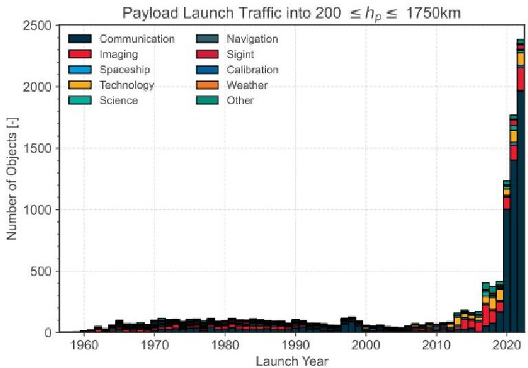

Figure 1.1: Evolution of the launch traffic near $ L E O_{I A D C} $ per mission type (left) and mass category (right)

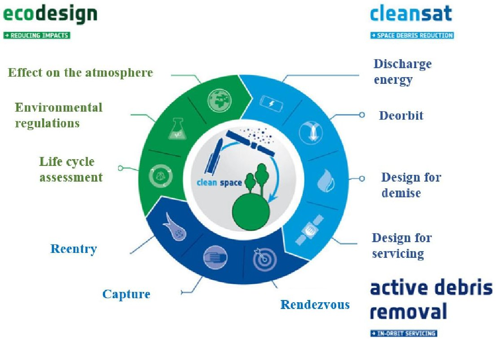

Figure 1.2: ESA's Clean Space initiative

servicing of spacecraft.

Currently, half of the satellites do not reach 20% of their expected lifetime. Recycling "zombie satellites" will optimize this on-orbit infrastructure, reducing unnecessary launches and being more cost-effective, as a 12U CubeSat costs around €2.5 million to be manufactured and launched [9]. In this way, it will not be necessary to launch so many new satellites for these new missions, with the corresponding positive environmental and economic impact. The project proposal "Second Life for Zombie Satellites (2L4ZS)" [9] was formulated to study how to recycle "zombie satellites" (i.e., partially operative satellites currently orbiting in space) to perform new missions with their remaining capabilities, how new satellites had to be designed so that they could be more easily "recycled", including all the legal implications.

2L4ZS was planned as a sustainable response to the deployment of new satellite mega-constellations (i.e. the recent launches of Starlink, OnWeb, Telesat, Kuper, etc.) [10], aiming at generating and strengthening innovative concepts related to satellite repair services on-orbit to carry out processes of reconfiguration, updating and standardization of hardware and software. Based on the "zombie satellite" concept, this research proposes the eco-friendly satellite concept, which is centered on integrated space business strategies for sustainability environmental by adopting green practices [11] within the NewSpace paradigm.

1. Durability and reliability: Benefiting from the OldSpace know-how, the product is designed and manufactured to meet the objectives for which it was created, and for this purpose, it must be designed and manufactured following quality processes that ensure its compliance. The business models depend

<!-- PDF_PAGE: 24 -->

on reliable and high-quality space asset operation for a variety of purposes. [12]

2. Re-entry: The aim is to design structures that can remove the spacecrafts from orbit (Active Debris Removal) and demonstrate on-orbit servicing.

3. Re-use: Implies the creation of a new generation of multi-purpose satellites so that they are not limited in their capacity to develop a few tasks but can perform other activities autonomously and collaboratively with other satellites (such as services on orbit for sharing information between satellite constellations) thus optimize the use of space.

In order to develop a proposal that incorporates the eco-friendly satellite concept, it is necessary to analyze the efficiency of all the processes involved in the lifetime of the satellite (from mission planning to the end of its useful life and subsequent processes). For this reason, it is required to incorporate a lean design throughout the satellite manufacturing system to improve and optimize its production system by eliminating activities that do not generate value for the process or the customer. The concept of "lean satellites" [13] was adopted in 2014 to characterize satellites that are developed fast, and at low-cost, independently of their size and/or mass. The "lean satellite" concept is nowadays under discussion within International Academy of Astronautics (IAA) study group, and an International Organization for Standardization (ISO) working group to define the requirements a satellite must satisfy to be classified as lean, not only in terms of project cost or development time, but also in terms of project management strategy [14, 15]. The lean satellite's philosophy development is driven by fast delivery and low-cost; however, the reliability of the developed space systems should be enough to operate them in space, and achieve, at least, the mission minimum success criteria to prevent it from becoming a useless space debris [15].

## 1.1 PhD Research Goals

To fulfill the General Objective of the research, the following specific objectives were established, which are described below:

General Objective: Contribute to Eco-Friendly Satellite Lean- Design for a Sustainable Space Environment.

A. First Goal: To conduct a study on satellite missions and relevant use cases that can be based on recycled "zombie satellites" (e.g. small imaging satellites without attitude control reused for IoT communications). The intention was to explore and promote this definition as a proposal for a future satellite mission standard, generating awareness to include recycling as part of the product life cycle, by incorporating it in the design of future satellite missions.

B. Second Goal: Characterization of the capabilities and limitations of "zombie satellite" architectures. The identification of services for the "zombie satellites" was performed across two components (type and severity of damage), through a statistical study. This led to trends associated to specific technologies or quality control processes. This exercise analyzed an extensive database of reported failures, damage, probability, time of occurrence, etc. Additionally, the causes of the most common damages incurred by satellites due to space weather were evaluated.

C. Third Goal: Proposal of an Eco-Friendly Satellite. Lean-Design To define the requirements that a satellite should have as a lean design proposal, not only in terms of project cost or development time span but also in terms of project management strategy.

D. Fourth Goal: To Define the Added-Value Chain to Lean-Manufacturing of Eco-Friendly Satellites. Propose this value chain in a real case, for the Colombian Air Force Satellite project FACSAT, with the $ ^{3} $ColStar mission that is part of the Japan Aerospace Exploration Agency (JAXA) and United Nations Office for Outer Space Affairs (UNOOSA) call for proposals.

E. Fifth Goal: Identification of technological, operational, and regulatory gaps to repair "zombie satellites". Repairing a "zombie satellite" poses numerous challenges involving several variables. New innovative technologies must ensure the flexibility of the satellite's hardware and software architecture. Similarly, it is essential to assess the regulatory aspects to ensure that satellites can be used for other purposes (e.g., frequency filling

<!-- PDF_PAGE: 25 -->

with ITU, country and UN registrations, liability issues, etc.).

## 1.2 Summary of the State of the Art

A clustering study was carried out based on the keywords of scientific articles published in the bibliographic database Scopus. Subsequently, the information was analyzed in the R-Studio-Bibliometrix and VOSviwer tool software based on citation, bibliographic coupling, co-occurrence networks, co-citation, or co-authorship relations [16], obtaining three query categories:

- On-orbit servicing spacecraft

- Technology for space debris removal

- Space sustainability - satellite repair

The Network Map analysis in Fig 1.3.; presents three clusters generated by the most researched topics in the scientific papers corresponding to the on-orbit servicing spacecraft category. The red group indicates that most of the research was based on orbit-related issues, and the most frequently related subtopics with this first cluster are: "space debris" and "satellites".

The red group indicates that most of the research was based on orbit-related issues, and the most frequently related subtopics with this first cluster are: "space debris" and "satellites". Robotics was the second most frequented topic in the analysis of this category and is represented by the blue cluster, with relevant subtopics such as "non-operational target" and "space robots". In addition, to a lesser extent, the green cluster represents the "manipulator" theme, which links other research topics such as spacecraft equipment and robotic arms.

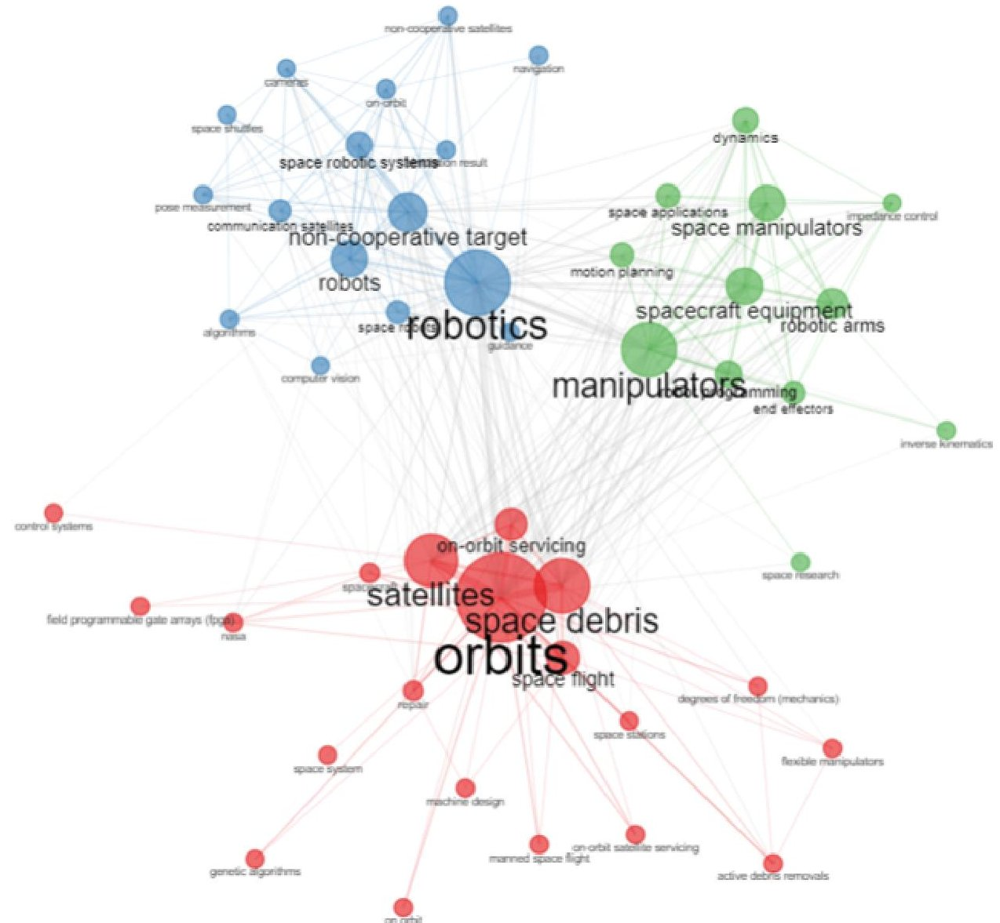

Figure 1.3: Network Map- On-Orbit Servicing Spacecraft.

<!-- PDF_PAGE: 26 -->

Fig 5.4; represents a factor analysis map using the Multiple Correspondence Analysis (MCA) method, a data reduction technique used to find homogeneous groups of variables from a large data set. Its ultimate purpose is to find the minimum number of dimensions capable of explaining the maximum amount of information in the data. In this case, the relationship between the ideas (represented in hierarchically structured nodes) and the concepts (represented by lines) is explained for the papers selected in the On-Orbit Servicing Spacecraft category. The figure with the most significant area represents the associated concepts that define the idea of "orbit" as the most representative parameter. Some of the concepts are space systems, algorithms, and guidance.

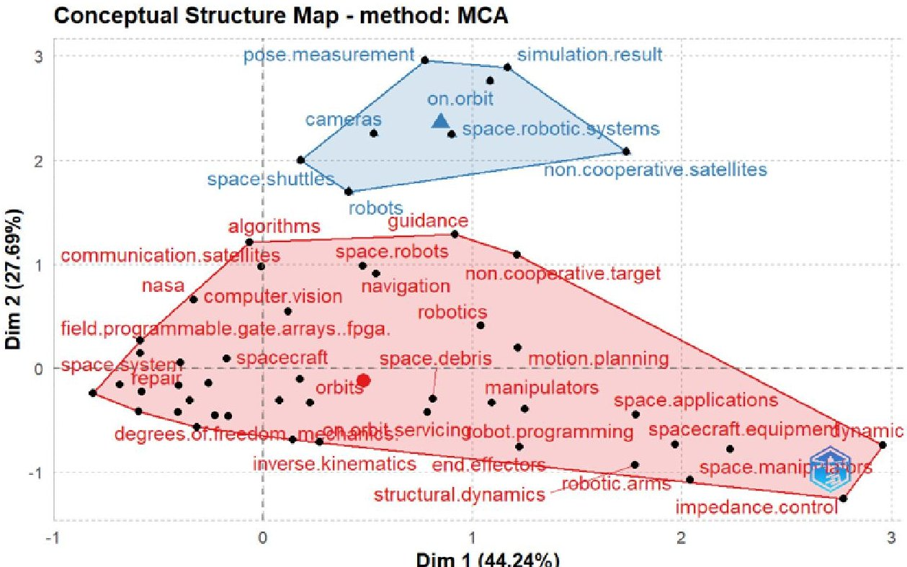

Figure 1.4: Factorial Analysis- On-Orbit Servicing Spacecraft.

Fig 1.5; shows a thematic evolution graph analysis, based on selected articles on on-orbit satellite repair, and relates the associated concepts by year. This exercise makes it possible to determine with greater precision the scientific research on these topics and optimize the search with relevant and updated information. For this particular topic, an evolution over time of concepts such as "manned space flight" incorporated into space industry topics has taken place in the last five years. The orbits topic has been maintained, but in the course of its evolution, it has been incorporated into other study fields, such as satellites and control and attitude topics. Another relevant aspect to mention is the evolution of the robotics area to orbit and satellites.

<!-- PDF_PAGE: 27 -->

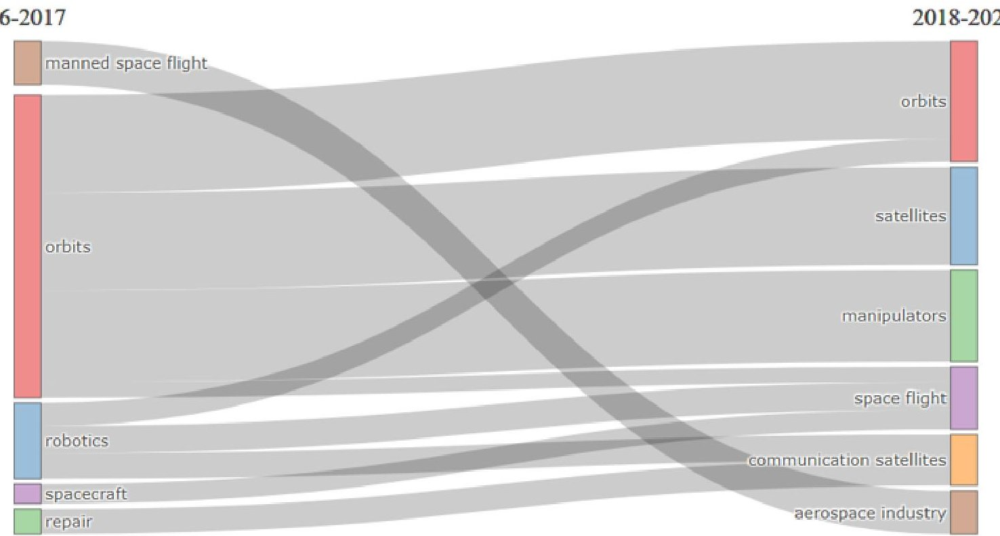

Figure 1.5: Thematic Evolution - Satellites Repairing On-Orbit.

Another example of the analysis performed was a dendrogram through a graphical data representation in a tree form (Fig. 1.6) that organized the data of the category "Satellites Repairing On-Orbit" into subcategories. These are divided into others until reaching the desired level of detail (resembling the branches of a tree that are divided into others successively). It is observed that, within the two main categories, the first one (blue color - with less research related to these topics) relates to research on space robots. In contrast, the second one (red color) incorporates topics about space rendezvous, collision, remote sensing, control systems, and debris removal.

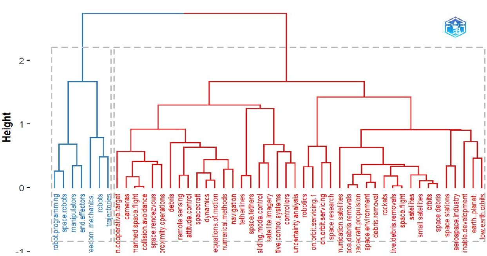

Figure 1.6: Topic Dendrogram- Satellites Repairing On-Orbit.

The analysis of the Technology Space debris removal category is visualized through a thematic map (Fig. 1.7) that presents the emerging topics with a tendency to grow or the basic ones with a tendency to stabilize. This classification depends on the impact, the number of citations, and the authors, among other bibliographic factors. In this example, it is observed that the topics of orbits, space debris, and satellites (red circle) are frequent in this category; in contrast, topics related to robotics and on-orbit servicing (purple circle) are classified as emerging, showing a lower number of research in this topic, but with a potential future growth.

<!-- PDF_PAGE: 28 -->

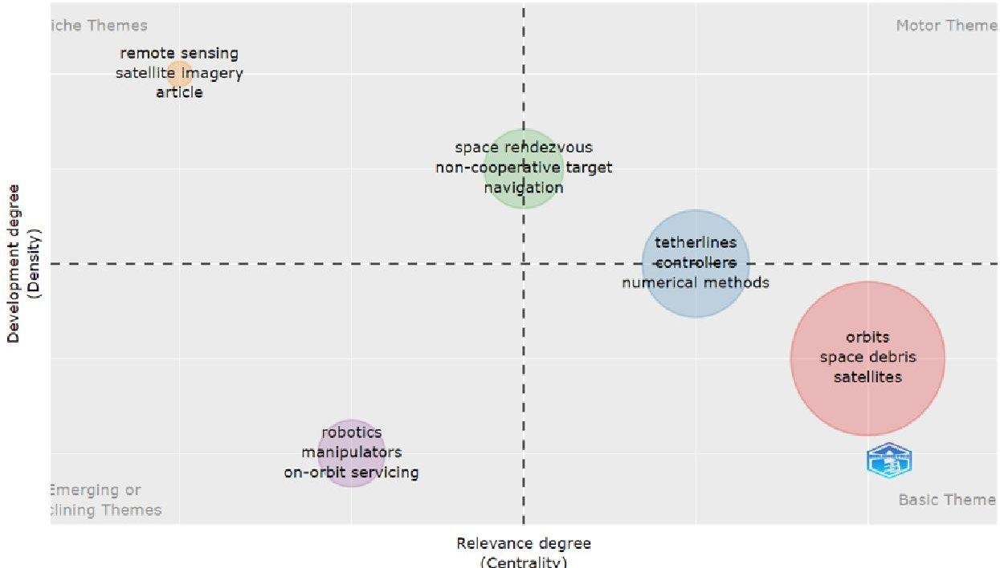

Figure 1.7: Thematic Map- Technology for Space debris removal.

Results in Fig 1.8; present a relationship graph between the number of citations and document, which had the objective of identifying the papers and authors with the highest number of citations to recognize the most representative research on this topic and consider them within the development of the research project. For the category of Space Technology, it was observed that Klionsky Dj and Best J are leading authors on this topic.

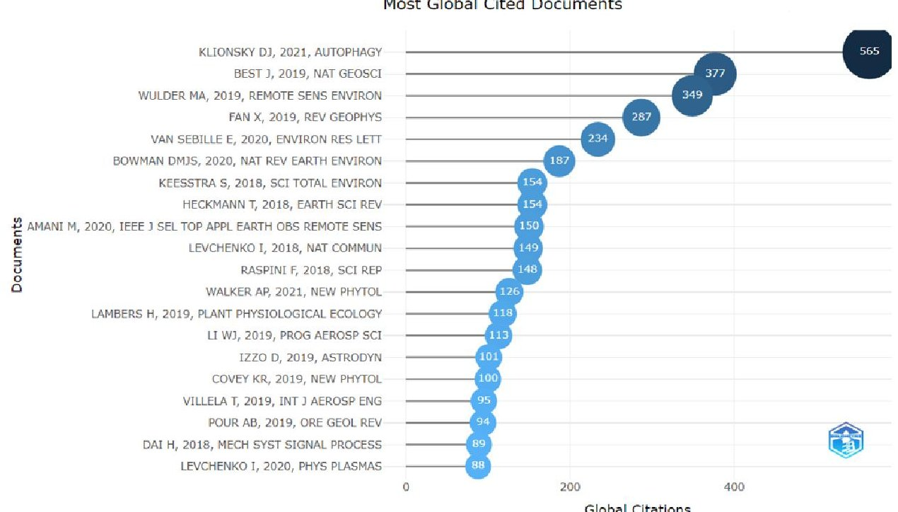

Figure 1.8: Most Global Cited Documents- Technology Space debris removal.

For the Space Sustainability - Satellite Repair category, Fig 1.9; shows the topics analysis identified in this category and their frequency in the papers. It can be seen that orbits and satellites are the topics that lead the number of research papers.

<!-- PDF_PAGE: 29 -->

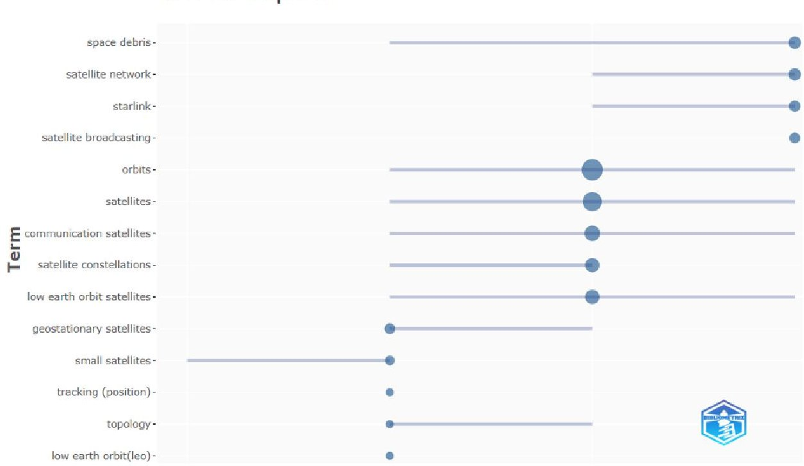

Figure 1.9: Most Global Cited Documents- Technology Space debris removal.

For a general analysis of all the categories, a clustering exercise was carried out using network graphics and density visualization (Fig. 1.10), which made it possible to establish the main interconnected themes and to identify the secondary themes that were generated.

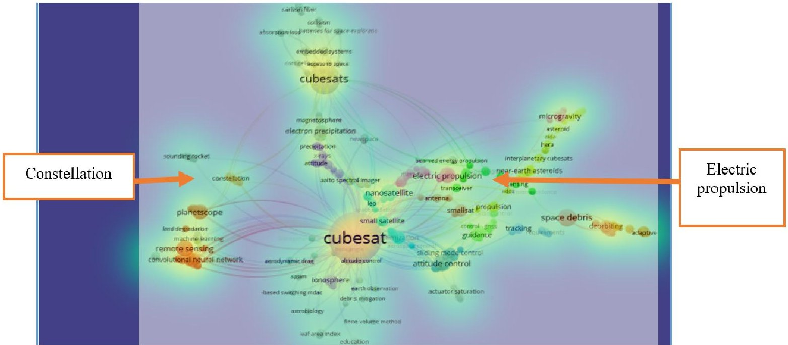

Figure 1.10: Network and density visualization- All categories together.

As a result, two large categories with the same name, "CubeSat," are established; however, their difference lies in the types of related topics, generating a distant connection between topics and various aspects of research that have been carried out around CubeSat satellites. The most representative category connects research with topics related to attitude control, debris mitigation, ionosphere, and the related topics with carbon fiber, absorption, collision, and embedded system correspond to the second category. Despite the difference in topics between both categories, there is a standard line that unites both clusters; these topics are related to spectral images, and Earth observation. According to this analysis, it can be concluded that the three selected categories agree on a high number of research related to CubeSat satellites. However, within the research on this type of satellite standard, there are two main categories, one more representative than the other (in terms of the more significant number of research carried out on these topics). The largest category is oriented to satellite development, performance, and operation aspects, such as subsystems and

<!-- PDF_PAGE: 30 -->

payload experiments. In contrast, the second category relates to materials and possible sustainable designs. An important aspect is a relationship between the selected categories and their relation to NewSpace's future vision of deploying satellite constellations and developing small satellite technology such as electric propulsion. After this exercise, the most relevant papers were identified according to their relevance, citation, publication, and greater correlation with the topics associated with this research.

## 1.2.1 On-Orbit Servicing Spacecraft

For this first category, research is presented based on an extensive literature review and data analysis of the feasibility of on-orbit servicing spacecraft (OOS) to extend the operational life of satellites. The On-Orbit Servicing, Assembly and Manufacturing (OSAM) 1 spacecraft could then refuel both Sentinels as an alternative option to Landsat 72. For OSAM 1 to refuel Landsat 7, it is $261.91M cheaper than Landsat-7 replacement and the most economically viable and sustainable option, considering the information revealed by the systematic analysis of the Union of Concerned Scientists (UCS) satellite that the Sentinel 1A and 1B satellites orbit at approximately the same altitude as Landsat 7 (700 km), and have a collective propulsion mass (MProp) of 308 kg, which is lower than the 544 kg of Landsat 7.

OSAM 1 will mitigate the immediate space debris problem. However, a new model of standardized cooperative satellites with pluggable external interfaces could facilitate planned and unplanned upgrades, modifications, and repairs for future missions and technology upgrades [17].

Another recent study highlights a geostationary satellite project called the "Recycler" [18]. that can collect cooperative satellite components. The Recycler can open a second-hand market for waste-efficient on-orbit servicing (OOS) by reusing existing hardware. This study provides a strategic analysis on how to reuse missions using an approach drawn from Game Theory. This allows a unique guidance on which aspects of the "Recycler" project should be targeted. Starting from an economic problem, the model is gradually complexified to accommodate future standard Recycler contracts [18]. A sensitivity analysis and a case study are conducted to assess the project's feasibility. It is concluded that the main obstacles of the Recycler are:

- the number of customers it can reach with its fuel constraints,

- the overall cost of the reused components, and

- the long-term degradation rate of the components in the space environment.

## 1.2.2 Technology for Space debris removal

For this category of technologies for space debris removal, an article is presented that gives an overview of the methods and techniques used to remove space debris in debris orbits using a flexible or virtual connection between debris and service spacecraft. Likewise, the conditions for the degradation of spacecraft performance characteristics, and even the complete loss of their performance, are pointed out [19].

## 1.2.3 Space Sustainability and Lean Satellite Systems Concept

In the category of Space Sustainability - Satellite Repair, a study is reviewed that proposes to conceptualize space orbit and radio frequency spectrum as essential commons, the governance of which requires international cooperation. In examining the possibilities and challenges of space orbit governance, the paper focuses mainly on ensuring the safety and sustainability of space through the introduction of on-orbit servicing operations (OOS) [20]. The report identifies aspects of OOS that warrant new collaborations, notably the standardization of docking and rendezvous practices that could facilitate future space activities. Recognizing the potential for future commercialization of on-orbit refueling, repair, and debris removal operations, this paper argues that standardization practices would be the first step in enhancing international cooperation and strengthening the existing regime for the peaceful use of outer space. These future collaborations and space activities are part of the topics addressed within the Chapter 9, regulatory and Legal Gaps will be considered to analyze regulatory aspects for commercializing space services or activities on orbit, which is one of the tasks the eco-friendly satellite prototype plans to perform.

Another relevant study about the lean satellite system concept shows the monitored failures occurring during the development of the lean satellite HORYU-IV to identify the evolution of the cumulative number of failures against cumulative testing time. Moreover, the subsystems driving the failures depending on the different development phases were identified. The results showed that 1/2 to 2/3 of the failures are discovered during

<!-- PDF_PAGE: 31 -->

the early testing stage. Moreover, when the mean time before failure was calculated, it appeared that for any development phase considered, a new failure appears on average every 20 h of testing. Simulations were also performed, showing that for an initial testing time of 50 h, reliability after a 1-month launch could be improved by nearly six times compared to an initial testing time of 20 h. Through this work, the authors aim to provide a qualitative reference for lean satellite developers to help better manage resources to develop lean satellites following a fast delivery and low-cost philosophy while ensuring sufficient reliability to achieve minimum mission success [15].

In the same study analyzed, Dubos [21] showed that small satellites have the highest infant mortality rate. This points out that insufficient testing is carried out prior to launch. Thus, there is a need to identify critical tests to improve lean satellites' reliability. Moreover, some studies [22] [23] [24] surveyed on-orbit failures. They identified that solar array deployment mechanisms and telemetry tracking and command (TTC) sub-system were the two main drivers of satellite infant mortality, regardless of the satellite category. To identify critical testing to carry out before launch, it is also necessary to assess the criticality of the testing depending on the considered sub-system and its impact on the lean satellite mission success [15].

## 1.3 Outline

This Ph.D. thesis has been divided in 6 parts, containing a total of twelve chapters with the bibliography for each one, including the main contributions of the Ph.D. thesis, other considerations including a review of regulation for satellite recycling, a number of Appendices, and the list of publications and other academic activities other activities carried out during the doctoral study. The online of the thesis is the following:

## Part I: Introduction and Theorical Background

## Chapter 1. Approach to Space Sustainability

Introduces the concept of space sustainability, highlighting the importance of this doctoral thesis, establishing connections with the research objectives, and conducting an extensive literature review using bibliometric analysis. This analysis explores trends in academic publications concerning advancements, innovations, and investigations in the field of space sustainability. In addition, the goals of the thesis are presented. Finally, the outline of the Ph.D. thesis is started.

## Chapter 2. Considerations for Eco-LeanSat Satellite Manufacturing and Recycling

Shows an introduction and brief review of the Eco-LeanSat idea, stressing the importance of adopting a sustainable methodology in satellite production and repurposing the residual functionalities of satellites post-failure. This segment delves into the evolution of small satellite capabilities, spotlighting pivotal events that have eased accessibility to and exploitation of space capabilities. Additionally, it outlines endeavors undertaken by prominent space entities to advance strategies for space sustainability.

## Part II. Redefining Space Sustainability: Recycling and Repurposing Second-Hand Satellites

## Chapter 3. Towards a Second Life for Zombie Satellites: Anomaly occurrence and potential recycling assessment

Presents an analytical investigation utilizing the SeraData and Telastra databases along with a compilation of web-sourced data. This study explores the most common failures observed in small satellites, conducts an assessment of anomalies, and categorizes satellites based on prevalent failures in extensive constellations. It proposes future research directions in this domain to incorporate these capabilities into satellite mission designs, ensuring that a satellite, in the event of failure, avoids contributing to space debris and can instead be repurposed for alternative missions.

## Chapter 4. Statistical Relationship Analysis Between LEO and GEO Satellite Anomalies and Space Radiation

Encompasses an examination of failure causes stemming from the space environment, scrutinizing the influence of various indicators such as sunspots, K-index, Disturbance Storm Time (DST), Coronal Mass Ejection (CME), X-Ray, electron, and proton fluxes, which have the potential to impact the electrical integrity of satellite components.

<!-- PDF_PAGE: 32 -->

## Part III. Effective and Sustainable: Advancing Satellite Manufacturing for a Greener Space Environment

Considering the insights gleaned from the lasts chapters, the third section of this study entails a proposition for satellite production, integrating agile methodologies, Lean Six Sigma principles, and Model-Based System Engineering (MBSE) software. These approaches aim to enhance not just technical elements but also administrative processes and project timelines. These methodologies are practically applied in missions conducted at the NanoSat Lab, including $ ^{3} $Cat-4 and $ ^{3} $Cat-8, as well as in the Colombian mission $ ^{3} $ColStar.

## Chapter 5. Integrating Lean Six Sigma Methodology for Optimization Satellite Manufacturing Process: $ ^{3} $Cat-8 mission

Presents the Lean Six Sigma methodologies applied to the $ ^{3} $Cat-8 mission. The objective is to simulate the mission using Bizagi software, aiming to identify bottlenecks and enhance mission execution efficiency in terms of both time management and human resources utilization.

## Chapter 6. Preliminary Design of Satellite Systems Through the Integration of ModelBased System Engineering and Agile Methodologies: Application to the $ ^{3} $ColStar Mission

Describes a case study on the integration of Agile Systems Engineering methodologies in the preliminary design phase of satellite systems. Using Model-Based Systems Engineering (MBSE), technical consistency was managed across various architectural documents, minimizing errors. The preliminary design was developed using the Arcadia Method, supported by the Capella modeling tool, enabling the digitization of the system.

## Chapter 7. Novel Magnetic Attitude Control System for SmallSats with Low-Thrust Propulsion Systems

Introduces the creation of algorithms for the Attitude Control System in SmallSats equipped with Low-Thrust Propulsion Systems within the $ ^{3} $Cat-8 mission. It emphasizes the significance of crafting sustainable missions that ensure satellite longevity by integrating innovative engineering solutions.

## Chapter 8. $ ^{3} $Cat-4 Thermal Analysis and Thermal Vacuum Test Campaign Results

Presents the thermal analysis conducted for the $ ^{3} $Cat-4 mission, which is part of the CubeSat series developed by UPC's NanoSat Lab and was selected for the ESA Academy's Fly Your Satellite! program. Its primary aim is to present the outcomes of the thermal analysis conducted for this mission, which involved assessing various scenarios, including extreme temperature conditions. The analysis takes into account different factors such as albedos and orbital parameters to determine the optimal temperatures required for optimal mission performance under standard conditions and across all satellite operational modes. Additionally, the results encompass an evaluation of the thermal behavior of alternative materials like Kapton, along with proposed modifications to enhance the optical properties of the satellite's solar panels.

## Part IV. Other Considerations

## Chapter 9. Operational and Regulatory Assessment for Satellites Recycling

Discusses legal aspects identified during the study, emphasizing important elements for conducting sustainable missions in the future. It underscores the need for regulations regarding the reuse of satellites in orbit, noting that there are currently no specific guidelines for such missions. This highlights a crucial area for future legal research and consideration.

## Chapter 10. Conclusions and Future research lines

States the main conclusions and contributions of this Ph.D. thesis. Finally, presents future research lines to continue with the work of this Ph.D. thesis.

## Part V. Appendices

- Part VI. List of Publications and Other Academic Activities

<!-- PDF_PAGE: 33 -->

Finally, it is important to remark that this Ph.D. thesis is composed of several peer-reviewed and under-reviewed journal manuscripts, contain adapted contents form peer-reviewed and under-reviewed journal manuscripts, being the Ph.D. candidate one of the main contributors. Moreover, its is important to remark that all the manuscripts forming this Ph.D. thesis have been published under the CC-BY 4.0 license, and they are open access for everyone.

With the aim of introducing the development of this Ph.D. thesis and delving into the topic of space sustainability, it was considered to present in the following chapter an exploratory study investigating a proposal for sustainable satellite manufacturing and the utilization of remaining satellite capabilities postfailure for new applications. This proposal initially identifies innovative applications of ecological design and then delves into sustainability across the satellite lifecycle supply chain, focusing on four main methods: active debris removal, transportation logistics, mission extension, and repair and construction. The chapter also examines future trends in space activities with the aim of optimizing the potential of satellites to offer new services. Additionally, it outlines a potential efficient manufacturing process that includes logistical aspects to support a more sustainable space economy. Ultimately, the chapter concludes with a technological study that tracks the evolution of Smallsats and Cubesat platforms, identifying innovative designs for a sustainable space environment.

<!-- PDF_PAGE: 34 -->

## Bibliography

[1] Space Foundation. (2024, January 23). The Space Report 2023 Q4. Retrieved from https://www.spacefoundation.org/2024/01/23/the-space-report-2023-q4/

[2] Seradata SpaceTrack. "Number of spacecraft's launches 2022-2023." Disponible en: https:// spacetrak.seradata.com/Queries. (accedido: 31.01.2023).

[3] United Nations. (2023). The Sustainable Development Goals Report 2022. New York: United Nations.

[4] S. Rodriguez-Donaire, M. Sureda, D. Garcia-Alminana, E. Sierra, J. S. Perez, P. C. Roberts, J. Becedas, G. H. Herdrich, D. Kataria, R. Outlaw, & L. Ghizoni, "Earth Observation Technologies: Low-end-market Disruptive Innovation," in Satellites Missions and Technologies for Geosciences, London: InTech, 2020, pp. 1-15.

[5] M. Sureda, M. Sobrino, O. Millan, A. Aguilella, A. Solanellas, M. Badia, J. F. Munoz- Martin, L. Fernandez, J. A. Ruiz-De-Azua, and A. Camps, Design and Testing of a Helix Antenna Deployment System for a 1U CubeSat, IEEE-Multidisciplinary, vol. 9, pp. 66103-66114, 2021.

[6] Lorenzo Giudici, Camilla Colombo, André Horstmann, Francesca Letizia, and Stijn Lemmens, Densitybased evolutionary model of the space debris environment in low-Earth orbit, Acta Astronautica, vol. 219, pp. 115-127, 2024, Elsevier.

[7] European Space Agency, "Statistic and thematic satellite accounts for measuring the Space Economy", presented at the 73rd International Astronautical Congress (IAC), Paris, 2022.

[8] European Space Agency, Clean and eco-friendly space, ESA, May 07, 2019. [Online]. Available: https://www.esa.int/Enabling_Support/Preparing_for_the_Future/Discovery and_Preparation/Clean_and_eco-friendly_space. [Last accessed: February 12, 2024].

[9] Fundacio Privada I2CAT, Internet I, Universitat Politecnica de Catalunya (UPC), Golbriak Space OU (GOL), Deimos Engineering and Systems SLU (DEI), Ennovatic OU (ENN), Cranfield University (CRA), Institut National de Recherche en University of Luxembourg., Second Life for Zombie Satellites, 2021.

[10] C. Giannopapa, A. Staveris-Poykalas, and S. Metallinos, "Space as an enabler for sustainable digital transformation: The new space race and benefits for newcomers," Acta Astronautica, vol. 198, pp. 728-732, 2022.

[11] C. Candrianto, H. Aimon, and S. U. Sentosa, "The role of knowledge, awareness and environmental attitudes in green product management," Global Journal of Environmental Science and Management, vol. 9, no. 1, pp. 101-112, 2023.

[12] O. Sokolova and M. Madi, "A View of the New Space Sector Resilience," Proceedings of the 30th European Safety and Reliability Conference and the 15th Probabilistic Safety Assessment and Management Conference, Research Publishing, Singapore, pp. 3798-3805, 2020.

[13] LeanSat, "Proceedings of International Workshop on Small-scale Satellite Standardization (IWS4)," Kyushu Institute of Technology, Kitakyushu, Japan, 2014.

[14] M. Cho y F. Graziani, "International standardization on lean satellites: definition and requirements," de 7th International Conference on Recent Advances in Space Technologies, Istanbul, Turkey, 2015.

[15] P. Faure, A. Tanaka y M. Cho, "Toward lean satellites reliability improvement using HORYU-IV project as case study," Acta Astronautica, vol. 133, pp. 33-49, 2017.

<!-- PDF_PAGE: 35 -->

[16] VOSviewer.com, "Welcome to VOSviewer," 2022. [Online]. Available: https://www.vosviewer.com/.

[17] I. Hatty, "Viability of On-Orbit Servicing Spacecraft to Prolong the Operational Life of Satellites," Journal of Space Safety Engineering, vol. 9, no. 2, pp. 263-268, 2022.

[18] P. Letellie and S. Lizy-Destrez, "Debris-efficient On-Orbit-Servicing: Assessing the techno-economic viability of the "Recycler" GEO satellite," Acta Astronautica, vol. 200, pp. 253-261, 2022.

[19] V. V. Svotina and . V. Cherkasova, "Space debris removal - Review of technologies and techniques. Flexible or virtual connection between space debris and service spacecraft," Acta Astronautica, vol. 201, pp. 1-14, 2022.

[20] C. Giannopapa, A. Staveris-Poykalas, and S. Metallinos, "Space as an enabler for sustainable digital transformation: The new space race and benefits for newcomers," Acta Astronautica, vol. 198, pp. 728-732, 2022.

[21] G. F. Dubos, J.-F. Castet, and J. H. Saleh, "Statistical reliability analysis of satellites by mass category: Does spacecraft size matter?" Acta Astronautica, vol. 67, pp. 584-595, 2010.

[22] J.-F. Castet and J. H. Saleh, "Satellite Reliability, Statistical data analysis and modeling," Journal of Spacecraft and Rockets, vol. 46, no. 5, pp. 1065-1076, 2009.

[23] M. Tafazoli, "A study of on-orbit spacecraft failures," Acta Astronautica, vol. 64, pp. 195-205, 2009.

[24] J. Guo, L. Monas, and E. Gill, "Statistical analysis and modeling of small satellite reliability," Acta Astronautica, vol. 98, pp. 97-110, 2014.

<!-- PDF_PAGE: 36 -->

Chapter 2

# Considerations for Eco-LeanSat Satellite Manufacturing and Recycling

## Abstract

This research aims to contribute to the development of the Eco-LeanSat concept, focusing on a sustainable approach to satellite manufacturing, and the repurposing of remaining satellite capabilities after failure. Despite no longer being suitable for their original purpose, these remaining capabilities can find new applications. The study begins by identifying relevant innovative Eco-designs applications. Subsequently, it examines sustainability within the satellite lifecycle supply chain, categorizing it into four methods: 1) active debris removal (ADR), 2) transport logistics, 3) mission extension, and 4) repair and construction. Aligned with emerging trends in space activities, the study also considers future developments to maximize satellite potential to provide new services. Additionally, the research includes a description of a potential lean manufacturing process, encompassing logistic chain, to support the development of a more sustainable space economy. Finally, the study concludes with a technology survey tracing the evolution of Smallsats and Cubesat platform developments, identifying relevant innovative designs for a sustainable space environment.

Keywords—Eco-LeanSat, Sustainable Space Environment; Satellite Lifecycle Supply Chain.

## 2.1 Introduction

In the last decades, the space sector market has experienced fast growth. The Space Foundation team [1] estimated that the global space industry, valued at approximately USD 366 billion in 2020, could potentially surpass USD 1 trillion by 2040 [2].

Between 2013 and 2022, a total of 8396 satellites were launched, and in just the first quarter of 2023, 1649 spacecraft were added to this count [3]. The space industry has witnessed profound transformations driven by the emergence of private companies pioneering innovative approaches, including the development of reusable rockets, small satellites, and even space tourism [4]. This transformative movement has been coined "NewSpace" [5], and it is characterized by rapid progress in science and engineering facilitated by technology miniaturization, cost-efficient business models, and rigorous quality control methodologies [6]. These factors have enabled a broader spectrum of participants to engage in the aerospace sector [7, 8].

In the past years, the accelerated achievements of NewSpace have contributed to global growth and have led to advancements in the economic, technological, academic, and societal aspects of the space sector [9]. Notably, in the realm of satellite technology, significant strides have been made [10]. Ambitious proposals, driven by the collaborative efforts of the University-Business-States triad, have played a pivotal role in enabling various countries to initiate, develop, and sustain their involvement in the space race [11]. The launch of

<!-- PDF_PAGE: 37 -->

large constellations, exemplified by recent initiatives such as Starlink, OneWeb, Telesat, Kuiper, and others, serves as compelling evidence of this industry's substantial growth [12].

As shown in Table 2.1, the trend of small satellites has witnessed significant growth from 2012 to 2023, and this trend is expected to continue, particularly in the areas of communications, Earth observation (EO), and technology demonstration missions. Table 2.1 compares the data from four different databases. (As per various sources, the notable variations in percentage values across different databases can be ascribed to the distinct mission classifications in their primary categories. Each database employs different classification parameters, resulting in the consideration of the general mission purpose under the broader category.) The primary missions have been classified into four groups: communications, EO/remote sensing, novel applications/unknown, and scientific and technology development. Almost 60% of the technology demonstration missions have as a primary purpose the maturing of specific components or subsystems, with communications and avionics components being the ones with the largest investments in 2021.

Table 2.1: Increase in the percentage of small satellites between the years 2012-2023.

<table border="1"><tr><td>Primary Mission Group</td><td>Small SatMarket[13]</td><td>Bryce[14]</td><td>Seradata[3]</td><td>SpaceWorks[15]</td></tr><tr><td>Communications</td><td>23%</td><td>11%</td><td>42%</td><td>13%</td></tr><tr><td>Technology Development</td><td>28%</td><td>40%</td><td>25%</td><td>26%</td></tr><tr><td>Scientific</td><td>23%</td><td>8%</td><td>12%</td><td>13%</td></tr><tr><td>Novel Applications/Other-Unknown</td><td>3%</td><td>3%</td><td>1%</td><td>2%</td></tr><tr><td>Earth Observation/Remote Sensing</td><td>23%</td><td>38%</td><td>20%</td><td>46%</td></tr></table>

Source: analysis of SpaceWorks, BryceTech, and Small SatMarket Intelligence databases and Seradata [3, 13, 14, 15].

As seen in Figure 5.1, regarding mass, most nanosatellites (1-10 kg) are commonly used for scientific, EO, and technological applications, while minisatellites (100-500 kg) are more often used for communication purposes, and small satellites (500-1000 kg) are more typically used for navigation missions, despite being less numerous so far. This ranking may change in the future with planned LEO PNT [16] and air traffic control [17] constellations.

Within the mass classification, it is worth mentioning that CubeSats have enabled more participants to actively engage in the space economy. Figure 2.2 illustrates the number of CubeSats and small satellites launched, along with the mass trends. The most noticeable increases are in the use of nanosatellites, weighing 1-10 kg, and satellites weighing 500-1000 kg.

<!-- PDF_PAGE: 38 -->

Mass Category & Primary Mission Group 2012 to 2022

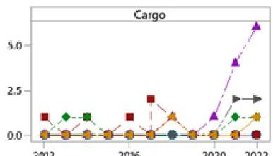

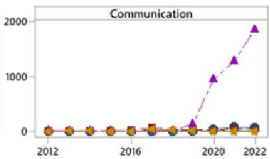

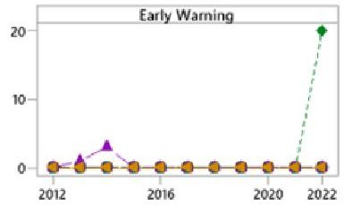

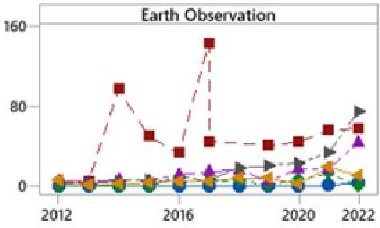

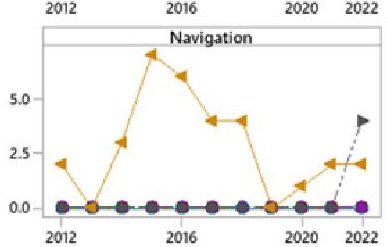

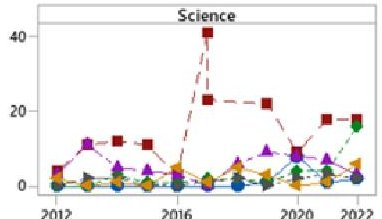

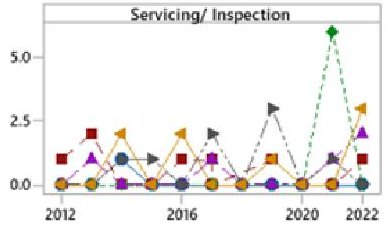

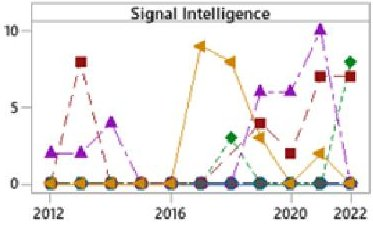

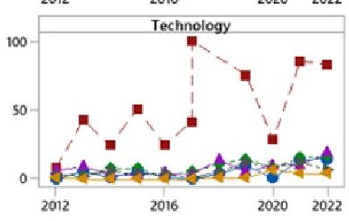

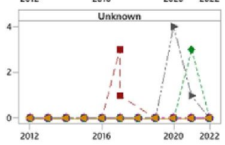

Mass Category

0.1 -- 0.99kg Picosatellite

1.0 -- 10kg Nanosatellite

10.01 -- 40kg Microsatellite (Small)

100.01 -- 500kg Minisatellite

40.01 -- 100kg Microsatellite (Large)

500.01 -- 1000kg Small Satellite

Figure 2.1: Scatterplot between Mass category and primary mission group.

Credits: plot created by the authors with data from the Seradata Database and Minitab 21.4.2 software.

Cubesat VS Total Small Satellites Launches (by mass) 2012 to 2022

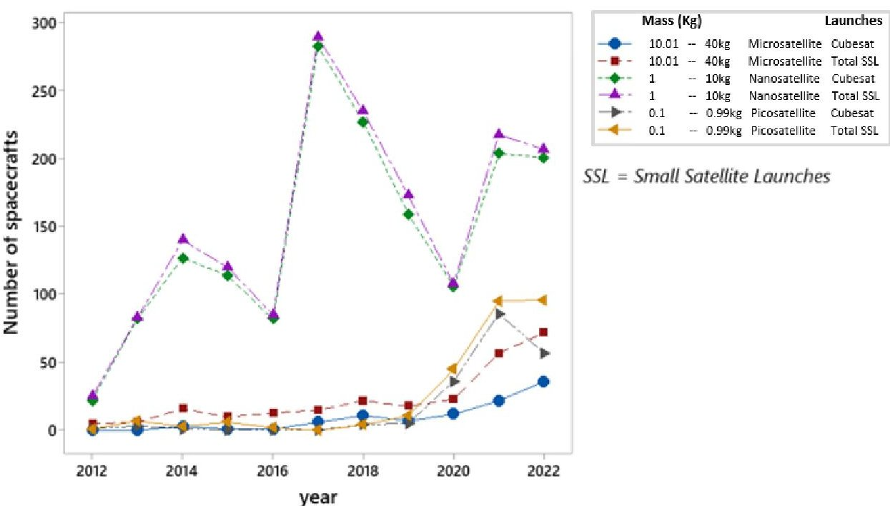

Figure 2.2: Launched CubeSat and Total Small Satellites related with their mass. Source: N. Buitrago, extracted data from Seradata at 01 March, 2023.

As the space sector has grown to meet the demands of NewSpace actors, the number of non-functioning space assets in orbit, the risk of debris and space junk collisions between spacecraft have also increased [18] [19]. The European Space Agency (ESA) has recorded over 30,000 pieces of space debris [20]. However, it is likely that the number of objects larger than a centimeter exceeds one million. Figure 2.3(a) displays numerous unidentified objects (UIs) that are detected and tracked through space surveillance networks [20], between 1960 and 2022, taking into account payload launch traffic within 200 km, and a perigee height (hp) of less than or equal to 1750 km. As seen, more than 95% of satellites launched in 2021 were < 1000kg. As for the percentage of fragmentation events.

As compared to the projections of Euroconsult (see Fig 2.3(b)), "A total of 3335 smallsats (<10kg) are

<!-- PDF_PAGE: 39 -->

expected to launch throughout the next decade, which is more than twice the 1656 launched over 2012-2021” [21].

As of November 1st, 2016, ESA's MASTER model estimated the following numbers of space debris objects in orbit: 34,000 objects larger than 10 cm, 900,000 objects between 1 cm and 10 cm, and 128 million objects from 1 mm to 1 cm [20]. The distribution of objects by size is depicted in Figure 2.3(c), showing the number of objects larger than each size threshold across all Earth orbits. Figure 2.3(d) presents the density profiles at different altitudes in the LEO region for debris sizes of 10 cm and 1 cm, using a logarithmic scale to represent the vast difference in the quantities of these two groups. Figure 2.3 shows a schematic view of the evolution and Projections of Space Traffic and Orbital Debris Distribution with a Data Analysis and Predictive Models.

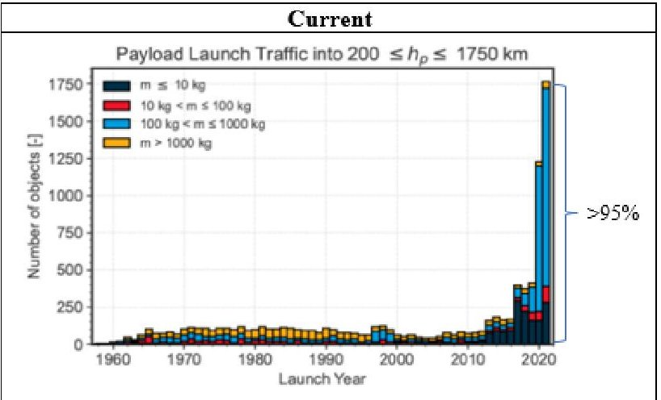

((a)) Objects launched per year and the relationship with mass.

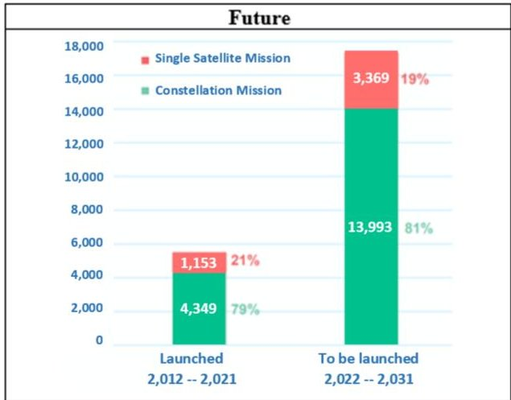

((b)) Number of smallsats (<500 kg) per type of mission.

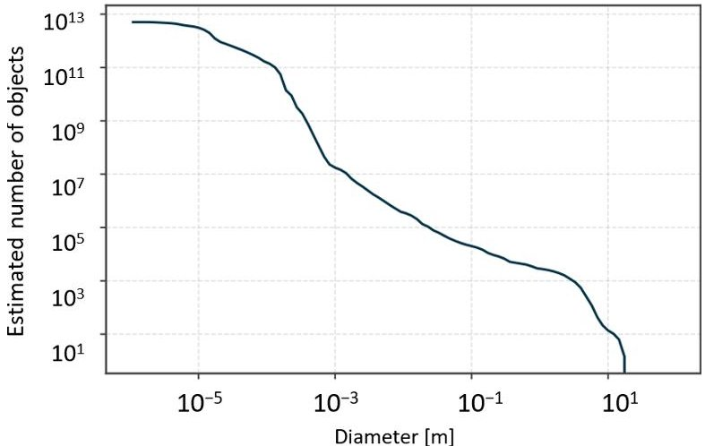

((c)) Estimated number of space debris objects as function of the object size in Earth orbit.

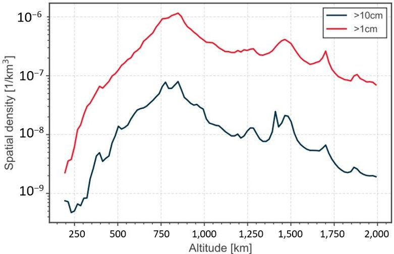

((d)) Density profiles in LEO for different space debris size ranges.

Figure 2.3: Analysis and Forecasting of Space Traffic and Orbital Debris Evolution. Source: [20] [21] [22].

As illustrated in Figure 2.4. Fragmentation events $ ^{1} $ , aside from collisions, currently represent the primary source of space debris. The increase in launch activities and the persistence of space debris incidents in Low Earth orbit (LEO) pose a significant conjunction risk in the most congested Earth orbits. Notably, approximately 93% of small payloads, those below 10.0 kg in mass, that concluded their missions in the last decade and were injected into the LEO protected region, operated in orbits naturally adhering to space debris mitigation measures. It is relevant to note that more than 50% of satellites in the range of 10-100 kg are not compliant with Space Debris Mitigation (SDM) requirements, and approximately 93% of SmallSats $ < 10 $ kg are operating in naturally compliant orbits (i.e., orbital lifetime < 25 years).

<!-- PDF_PAGE: 40 -->

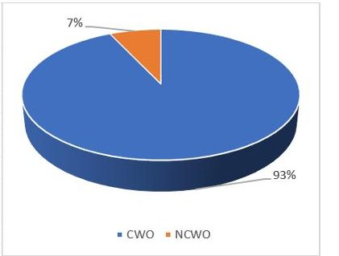

((a)) < 10 Kg LEO Compliances (Payloads, EOL $ \geqslant $ 2010, m $ \leqslant $ 100 Kg).

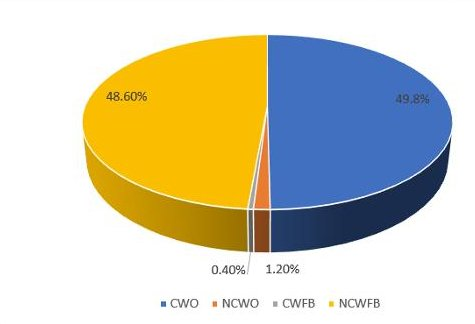

((b)) 10-100 Kg LEO compliances (Payloads, EOL $ \geqslant $ 2010, 10<m $ \leqslant $ 100 Kg).

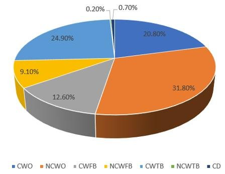

((c)) 100-1000 Kg LEO compliances (Payloads, EOL $ \geqslant $ 2010, 10 < m $ \leqslant $ 100 Kg).

Figure 2.4: Breakdown of observed behavioural classes for disposal at EOL (< 25 years) per satellite mass [20].

Note: $ ^{1} $The end-of-life behavior of space objects can be categorized in seven behavioral classes to illustrate disposal success rates:

- NCWO (Not Compliant WithOut attempt): the 25-year rule is not met by the mission orbit and no disposal action has been taken;

- NCWFB (Not Compliant With attempt False Before): the 25-year rule is not met by the mission orbit, a disposal action has been attempted but it was unsuccessful or insufficient;

- NCWTB (Not Compliant With attempt True Before): the 25-year rule was met by the initial mission orbit, a disposal action has been attempted but it was unsuccessful or the mission orbit was otherwise altered, and the new orbit is not compliant;

- CWFB (Compliant With attempt False Before): the 25-year rule is not met by the mission orbit, but a disposal action has been taken and was successful;

- CWTB (Compliant With attempt True Before): the mission orbit allowed to meet the 25-year guideline, but a disposal action has been taken nonetheless;

- CWO (Compliant WithOut attempt): the mission orbit allowed to meet the 25-year guideline, no action was taken (nor needed);

- CD (Compliant With Direct Re-entry): a controlled re-entry has been performed.

While this percentage is substantial when compared to higher mass categories, it indicates a growing contingent of small payloads that require active means for disposal from the LEO protected region. Conversely, since 2010 the majority of the large payloads that reached the end of their missions, did so in orbits where they failed to successfully remove themselves. Figure 2.5 underscores propulsion-related events and anomalies as the categories exhibiting a higher percentage of fragmentation.

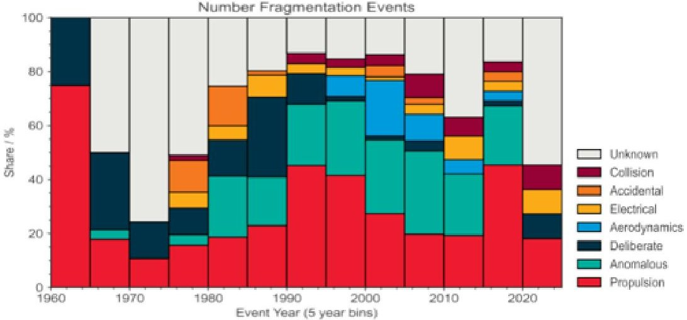

Figure 2.5: Number of fragmentation events by their cause [20].

<!-- PDF_PAGE: 41 -->

Figure 2.6 highlights propulsion-related events and anomalies as the categories that have exhibited a higher percentage of fragmentation. As it can be seen, a significant increase in the number of commercial satellites launched into low Earth orbits (LEO) has taken place in the last few years, the vast majority weighting between 100 and 1000 kg. This trend is reflected also in the growing number of objects in orbit (see Fig 2.6), which increases the probability of collisions and fragmentation.

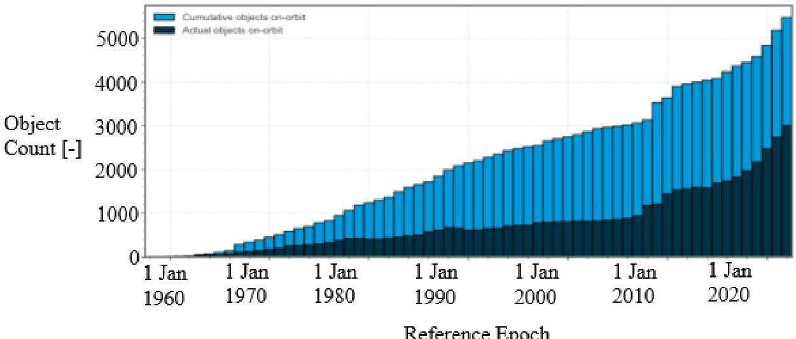

Figure 2.6: Relative number of objects in space [20].

Although most constellations have been launched to offer valuable and necessary services, they may create long-term sustainability issues. In the same way, various sustainable strategies have been developed worldwide to address short-, medium-, and long-term solutions aimed at mitigating unsustainable practices in the space sector. One example is the Committee on the Peaceful Uses of Outer Space of the United Nations, which discusses matters related to space and sustainable development [23].

Another example is NASA's sustainability report and future plans [24], which ensure adherence to the sustainability goals outlined in Executive Order 14057 and NASA policies, with a primary focus on reducing environmental risks and promoting sustainable practices throughout all stages of work [25]. NASA's sustainability route plan involves the White Sands Test Facility (WSTF), which operates an Environmental Management program. The facility prioritizes waste minimization through the promotion of recycling, reuse, and the Reuse Market Place (ReMaP) software application to divert materials away from landfills. Furthermore, the WSTF is committed to sustainable acquisition, favoring eco-friendly products and services. The Site-wide Sustainability Working Group (S2WG) actively engages employees in initiatives aimed at enhancing water and energy efficiency while meeting mission goals. The facility encourages green projects and relies on S2WG to evaluate funding proposals, encompassing categories like sustainable acquisition, waste reduction, recycling, hazardous waste management, and pollution prevention [26, 27]. These endeavors collectively reduce the facility's environmental impact and cultivate a culture of sustainability [28].

Additionally, numerous other efforts have been undertaken worldwide to address this issue, such as the Cleaning Outer Space Mission through Innovative Capture (COSMIC) from Astroscale Ltd., the UK Space Agency's mission to remove defunct satellites from low earth orbit [29, 30], and the ESA's Clean Space Initiative [31], which was started in 2012 and considers the environmental impact of the entire lifecycle of space missions [32]. Clean space activities fall into three main areas:

- Eco-design: addressing environmental impacts and fostering green technologies;

- Space debris mitigation: minimizing the production of space debris;

- On-orbit servicing/ADR: removing spacecraft from orbit and demonstrating on-orbit servicing of spacecraft.

Therefore, to ensure the sustainability of future space infrastructure and exploration, it is of paramount importance to consider the removal of human-made space debris through collaborative efforts [33, 34]. To contribute to this global initiative, this study aims to formulate a more sustainable approach to space through the Eco-LeanSat concept. This concept entails leveraging satellite characteristics in a sustainable

<!-- PDF_PAGE: 42 -->

manner to develop reconfigurable satellites during their nominal lifespans and beyond. To achieve this goal, the Eco-LeanSat concept integrates profitability, efficiency, technology, innovation, and environmentally friendly practices through the application of lean methodologies and lean maintenance and repair approaches. The next section examines a sustainability concept approach that incorporates eco-friendly ideas across the supply chain stages for small satellite manufacturing and highlights recent innovative trends. The following section outlines and explains in detail the key characteristics of the evolution of SmallSat capabilities, with thirteen specific mission objectives, including Management and Manufacturing, Disruptive Technologies, Planetary Defense, Sustainable Space, and In-orbit Activities. The final section focuses on the capabilities utilized in SmallSats and CubeSats over their histories. This analysis aims to identify their strengths, key contributors, and significant technological advancements. The purpose of this analysis is to propose optimal features for future Eco-LeanSat designs; it introduces innovative methods to enhance satellite capabilities and manufacturing processes.

## 2.2 Sustainability Concept: Implementing a Zero Debris Approach

The proliferation of space debris in Earth's orbit presents a significant threat to operational satellites and the future of space missions [35] [36]. With approximately 128 million debris objects larger than 1 millimeter, including 34,000 exceeding 10 centimeters [37], the potential for collisions and their subsequent detrimental effects is a pressing concern [38] [39] [40].

The exponential growth of space debris, exacerbated by incidents such as the 2009 collision between a defunct Russian satellite and a U.S. satellite, underscores the critical need for proactive measures [41] [42]. Operational satellites, fundamental for telecommunications, Earth observation, weather forecast, navigation, and scientific research, face heightened risks from even small debris fragments due to their substantial velocities [43] [44] [45] [46].

## 2.2.1 The Zero Debris Approach

Aiming to prevent the cascading effects of debris and ensure the integrity of the space environment, a zero debris approach becomes imperative [47]. In 2022, ESA proposed eight technical recommendations to attain zero debris by 2030 [31] [48]. These recommendations encompass ensuring successful disposal, improving orbital clearance, avoiding collisions, preventing internal break-ups, addressing intentional debris release, assessing on-ground casualty risk, guaranteeing dark and quiet skies, and safeguarding other valuable orbits. Figure 2.7 provides a summary of each of these pillars.

<!-- PDF_PAGE: 43 -->

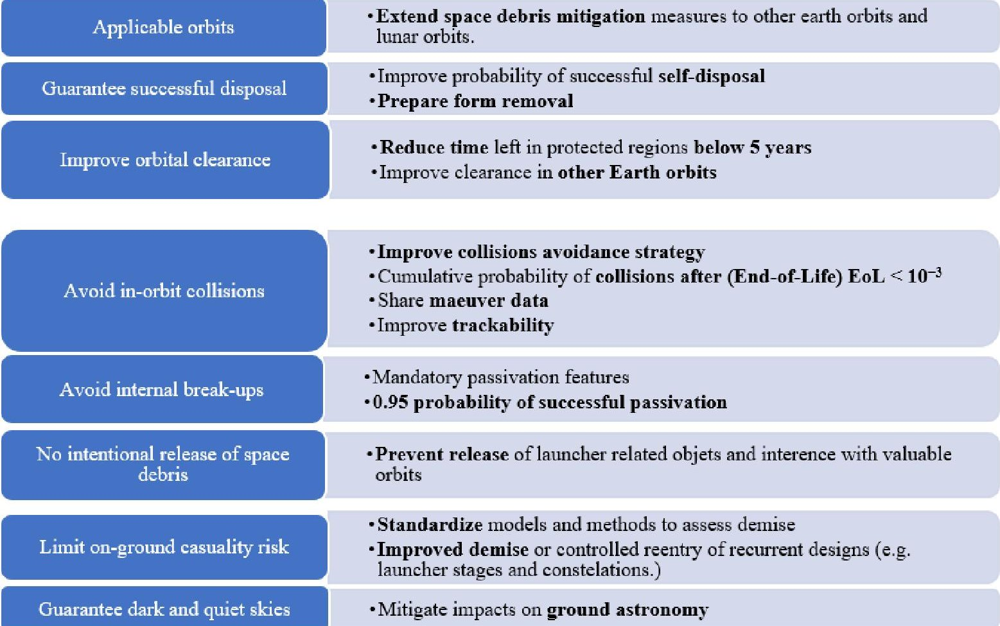

Figure 2.7: The 8 pillars of the Zero Debris Approach.

Source: Assessing impacts of Zero Debris approach on CubeSats: A System Analysis. ESA 2023 [31] [41].

This section underscores the pressing need to address space debris amid the burgeoning space industry. The ESA Zero Debris approach, introduced through the Clean Space initiative, is a pivotal initiative aiming to eliminate debris production in key orbits by 2030 [31]. The multifaceted strategy involves policy evolution, platform upgrades, removal services development, and improved space operations. With approximately 30,000 pieces of space debris [31] [49], effective debris management is paramount to safeguard operational satellites and ensure the uninterrupted provision of essential services. The outlined recommendations for achieving zero debris present a comprehensive framework, including disposal assurance, enhanced orbital clearance, collision avoidance, and the protection of valuable orbits [50] [51].

## 2.2.2 Implementation Strategy

To implement the zero debris approach, the ESA has devised a transversal action plan structured around four main pillars:

- ESA Policy Evolution: Recognizing the need for policy alignment with international guidelines, the ESA is updating its policy to incorporate short-term zero debris recommendations. This stepwise approach aims to achieve zero debris by 2030.

- Upgrade Platforms: Efforts are underway to enhance spacecraft platforms by integrating end-of-life technologies effectively. Key technology developments include deorbiting systems, passivation functions, design for demise, and design for removal.

- Removal Services: ESA is actively developing removal services, including technology development, missions, and standards. Embedding removal interfaces in Copernicus Expansion missions is a crucial step towards fail-safe debris disposal.

- Improved Operations: Enhancing space surveillance and tracking, space traffic coordination, collision avoidance, and close-proximity operations is essential for a successful zero debris implementation. The ESA engages with stakeholders through workshops to enhance satellite operations in these critical areas.

In keeping with this approach, NASA has identified main constraints that prevent speedy action on space

<!-- PDF_PAGE: 44 -->

sustainability in Earth's orbit. These challenges include the absence of a unified framework for space sustainability, insufficient metrics and models to support holistic frameworks, uncertainties in the space environment and operations, conflicts between sustainability and other mission interests, and the need for a coordinated global response. To overcome these difficulties, NASA, in its "Space Sustainability Strategy, Volume 1: Earth Orbit, 2024" [52], intends to pursue a series of objectives that build on one another yet can be implemented concurrently.

## Goal 1: Develop a Framework for Assessing Space Sustainability at NASA

NASA intends to develop an entity relationship model that specifies all quantities of interest and their interdependencies, which will be operationalized through measurements, modeling, and assessments. This approach will aid with defining the existing space traffic and debris environment, developing metrics to assess the long-term viability of orbital activities, and establishing goal values for these metrics. The goals are to define the framework, determine tolerable and desired risk levels, and publicize NASA's influence on space sustainability on an annual basis.

## Goal 2: Prioritize Efficient Ways to Minimize Uncertainties

Using the methodology developed, NASA will identify important uncertainties that pose hazards to robotic spacecraft as well as study the effects of orbiting objects on scientific observations and devise cost-effective solutions to eradicate potential negative effects. The goals include identifying opportunities for breakthrough improvements in sensing and anticipating the operating environment, exploring new operational approaches, and developing prioritized approaches to managing current debris challenges.

## Goal 3: Lower Barriers to Space Sustainability Through Technology Development and Transfer

Based on the lessons gathered from Goal 2, NASA will invest in technologies that promote space sustainability. These expenditures will enhance the capabilities required for long-term operations in Earth's orbit and will help other U.S. space operators. The goals include investing in early-stage orbital debris management, expanding investments in space situational awareness and traffic coordination, and facilitating debris-related technological demonstrations with possible transition partners.

## Goal 4: Update or Develop Policies to Support Space Sustainability

NASA will improve space sustainability via policy modifications and advancements. The objectives include updating NASA's rules and standards based on the results of prior goals, amending debris remediation policies, supporting economic and policy research on space sustainability, and resolving international orbital debris remediation challenges.

## Goal 5: Improve Coordination and Collaboration Outside of NASA

NASA will continue to lead both domestically and internationally by exploring opportunities for increased information sharing and collaboration with academic institutions, industry, interagency partners, and the global space community. The objectives include collaborating with interagency partners, interacting with space-sustainability-focused communities, exchanging best practices and tools, and capitalizing on technology advancements from the greater space community.

## Goal 6: Enhance NASA's Internal Organization to Support Space Sustainability

NASA will establish an entity to supervise the day-to-day coordination and accountability for the agency's space sustainability activities. This organization will guarantee that NASA meets its sustainability goals, prioritizes related work and funding, and maintains a consistent voice in space sustainability issues.

To achieve space sustainability and ensure a safe orbital environment around the Earth, JAXA, a significant contributor in this arena, is actively engaged in developing technologies to manage space debris and enhance space operation safety. JAXA endeavors to mitigate the risks posed by space debris and foster a sustainable space environment through pioneering research and the creation of groundbreaking technologies. Key objectives for JAXA include advancing rendezvous and capture technologies to handle uncooperative objects and eliminate non-stationary debris from orbit. Additionally, JAXA is at the forefront of low-power electric propulsion technology, enabling smaller spacecraft to effectively remove larger debris from orbit [53].

Facilitating the study of space debris, JAXA's Space Tracking and Communications Center utilizes radar and optical telescopes to monitor near-Earth space and calculate the orbits of debris. These data enable predictive

<!-- PDF_PAGE: 45 -->

analyses of debris trajectories, allowing for preemptive measures to safeguard satellites and reduce collision risks [53]. Moreover, JAXA's Safety and Mission Assurance Department is actively involved in developing international standards to reduce space debris, drawing upon frameworks established by organizations such as the Inter-Agency Space Debris Coordination Committee (IADC) [54] and the International Organization for Standardization (ISO) [55]. Instruments like the Risk Avoidance Assist Tool Based on Debris Collision Probability (RABBIT) [56] enhance satellite safety and contribute to the long-term sustainability of space activities.

Recognizing the paramount importance of space debris mitigation, JAXA has launched the "Commercial Removal of Debris Demonstration (CRD2)" [57] program in collaboration with private business operators. This initiative aims to eliminate large debris from orbit, paving the way for a debris-free and pristine space environment. By fostering new markets and leading international discussions, JAXA endeavors to propel global efforts towards space sustainability and safety.

Involving other relevant institutions of the sector in the implementation of the strategy, the Inter-Agency Space Debris Coordination Committee (IADC) "Report on the Status of the Space Debris Environment 2024" [54] underscores the importance of achieving zero debris in space through sustainable practices. Sustainability in space, defined by the United Nations as serving current requirements without jeopardizing future generations' demands, requires establishing criteria to measure a viable space environment [54]. While the report acknowledges the effectiveness of space debris mitigation guidelines, it also highlights the need for further adoption and stricter adherence to these measures. Despite efforts to slow the growth of the space debris population, the report warns of a potential doubling of orbital objects within 50 years if current trends persist. Moreover, without additional measures such as active debris removal technology, collisions among existing space debris objects could exacerbate the problem.

Furthermore, prestigious institutions in this field, such as the IAF Space Traffic Management Technical Committee, have conducted research into various aspects of space traffic management (STM) in order to promote safe space exploration and use while minimizing risks to people and property on Earth. This initiative, established through a collaborative effort between the IAA (International Academy of Astronautics), the IISL (International Institute of Space Law), and the IAF (International Astronautical Federation), aims to develop comprehensive recommendations on STM behaviors as well as proposals addressed to decision makers at both national and international levels [58]. The IAF STM TC's research activities cover a broad spectrum of technical challenges within the STM environment. These include operational coordination services, collision avoidance (both in orbit and during launch and reentry), frequency management and coordination, space hardware disposal, space situational awareness (SSA), space surveillance and tracking (SST), space weather (SWE), space environment management (SEM) for space debris mitigation and remediation, and space operations assurance (SOA), which combines SEM, SSA, and STM. Recent publications from the IAF STM TC emphasize the need for space object monitoring data as the cornerstone of any space traffic management system [58]. The UN Long-Term Sustainability Standards emphasize the need to gather and accurately retain orbital data as well as the development of related technologies in order to support long-term space activities. Ongoing developments in the field include implementing optical surveys in LEO, laser ranging of non-cooperative targets, developing techniques for attitude determination, implementing active LED systems for satellite identification, and addressing challenges in cis-lunar applications [58]. The goal is to identify technological advancements that increase the volume and accuracy of observations, such as ground-based laser tracking to improve ranging accuracy, passive optical systems to supplement radar visibility zones, passive RF systems to improve data timeliness, space-based measurements to collect data on small objects, and attitude motion standards to support emerging missions like active debris removal and on-orbit servicing. These efforts aim to improve STM capabilities and contribute to the long-term management of space activities [58].

Together, these initiatives mark significant progress toward creating a cleaner and safer space environment for future generations, fostering sustained growth in the space industry.

## 2.2.3 Towards a Sustainable Orbital Environment

It is crucial to recognize that addressing this challenge necessitates the coordination of various stakeholders to establish standards for maintenance, manufacturing, and space waste management [27, 59]. This presents a significant technological challenge, as it involves the advancement of monitoring, synchronization, and comprehensive satellite lifecycle tracking [60]. To tackle these issues, we have introduced a proposal for "Life Extension" into the satellite manufacturing logistics chain, integrating the methods presented as a pivotal and operational part of the satellite's lifecycle [61, 62, 63]. This proposal introduces the concept of sustainability

<!-- PDF_PAGE: 46 -->

as a fundamental addition to the satellite lifecycle supply chain. As depicted in Figure 2.8, we outline each stage of the satellite supply chain process:

- Manufacturing (comprising components, subsystems, and system integration): It is essential to highlight the advances made in ISO standards for small satellites. The ISO/TC20/SC14 committee [64] began efforts in 2014 to produce standards that define and regulate the use of small satellites, resulting in work item ISO/WD/20991, "Requirements for Small Spacecraft" [65]. This standard seeks to lay the groundwork for the responsible deployment and operation of tiny satellites, with a focus on sustainability and space debris mitigation. In March 2016, the study group presented a report to the IAA, concluding that small satellites should be identified by their design and management philosophy, not their size. The term "lean satellite" has been used to describe satellites that use creative, low-cost ways to enable rapid delivery with small teams. The group developed a scaling system to measure adherence to the lean satellite concept, which was tested on nearly 30 satellites worldwide [66]. In 2019, the Kyushu Institute of Technology (Kyutech), with Japanese government assistance, launched a project to standardize the CubeSat electrical interface [67]. This initiative uses the lean satellite community to get worldwide feedback and build the standard. Activities include editing drafts, coordinating with ISO/TC20/SC14, and organizing international workshops. The standard document, "Space Systems—CubeSat Interface", is currently being developed. This standard specifies the interface and the documentation required to enable integration and reduce compatibility difficulties, resulting in a substantially shorter process of selecting and testing CubeSat components.

- Operations (involving launch providers and services, space operations, and the ground segment).

- Change of applications.

- Life Extension: A novel proposal that takes into account future missions and emerging technologies. This phase involves evaluating satellite health and operational status in orbit. In case of any failure, two options are considered: (1) in-orbit repair through activities such as rendezvous and docking or (2) active debris removal (ADR), which includes the sustainable waste management techniques mentioned earlier. This proposal also addresses a sustainable final disposal system and the potential for reusing materials for other missions.

The motivation for this sustainable approach arises from identified concerns, where satellites are sometimes decommissioned or abandoned for various reasons, including economic factors, mission completion, or political considerations. In certain instances, new satellites are launched instead of leveraging the capabilities of existing satellites, even in cases of unexpected anomalies. The probability of satellite failure vs. time and subsystem was analyzed in [63]. The probability of failure in the first quarter of its life is three times higher than in the second quarter, and it seven times higher than in the last quarter. Since not all failures in the first quarter are catastrophic and many systems could be repurposed (but are not), this means that their remaining capabilities are underutilized.

In this context, Figure 2.8 graphically shows the flow to recycle partially failed satellites, or "Zombie Satellites", to reuse their remaining potential for alternative applications beyond their original design.

Building upon a comprehensive approach that integrates the stages of the satellite logistics chain with the trends examined in the previous sections, Figure 2.9 provides a summary of the identified emerging trends in space activities, categorized into four primary domains. This figure offers a relational map that encompasses activities on Earth (manufacturing), the ground segment (operations), launch processes, the space segment (mission development), and the interconnections between various activities within each category. During this process, the interconnections between various sustainable methods were identified, offering complementary support to their primary mission objectives. The manufacturing activities on Earth are depicted in yellow, while ground segment activities are marked in red, and launch segment activities are indicated in grey. In the space segment, orange represents activities related to ADR, green represents Mission Extension activities, and blue represents repair and construction activities.

Figure 2.9 shows the most relevant sustainable proposals, and their interactions with other stages of the chain are highlighted. Based on the analysis conducted in preceding sections, each of these proposals results from the identification of satellite missions that currently possess these capabilities or are expected to acquire them in the near future. Each circle represents the classification within the supply chain stages. Concerning the sustainable supply chain proposal for on-Earth manufacturing, it broadly emphasizes activities that involve: (1) the utilization of new resources, such as recycled materials, miniaturized components, and 3D printing, (2) the implementation of agile methodologies and standardization to reduce costs and time, and (3)

<!-- PDF_PAGE: 47 -->

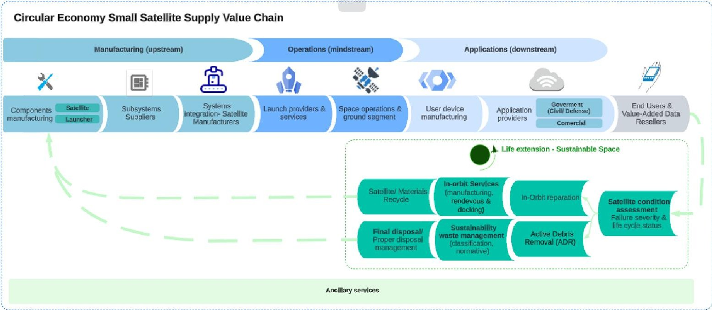

Figure 2.8: Proposed Circular Economy Supply Value Chain for Small Satellites.

the incorporation of new technologies and materials in the manufacturing process. As an example of the incorporation of new sustainable materials, there is a collaboration between NASA and Japan to test an ecofriendly satellite made of wood [68]. This groundbreaking initiative, known as LignoSat, represents a significant step towards eco-friendly space exploration. Unlike traditional satellites built with aluminum, LignoSat will burn completely during re-entry into Earth's atmosphere, leaving no harmful particles behind [68]. This innovative approach addresses concerns about space debris and contributes to a more sustainable future in orbit. For the launch stage, the selected capability considers the use of platforms that facilitate multiple launches for different orbits, avoiding the generation of multiple launches from the ground, reducing the ecological impact.

In the operations phase, the mission involves integrating various technological developments, which presents multiple challenges related to ground station operations and communications. Achieving this type of operations allows greater versatility and efficiency in communications, data processing, and information gathering, which are fundamental for the success of a satellite mission in a variety of applications: from Earth observation to space exploration and communications. Within the realm of space missions, various proposals have been put forward to enhance the adaptability and efficiency of satellite operations in diverse missions and scenarios. These propositions offer numerous advantages, including:

- Deep Space Exploration: Enabling the execution of missions that venture beyond Earth's orbit, thereby expanding the scope of space exploration capabilities.

- Autonomous Removal and Earth Re-Entry: Simplifying the process of retiring satellites at the end of their operational life, either through mechanical structures or autonomous means, thereby contributing to the reduction of space debris and facilitating payload recovery.

- Autonomous Rendezvous Operations: Equipping satellites with the capability to autonomously approach and engage with cooperative or non-cooperative objects in the vastness of space.

- Conducting Experiments: Enabling the broadening of our knowledge and the enhancement of our capabilities across various scientific domains.

- Multi-Satellite Missions: This encompasses the deployment of satellite constellations and fractionated missions [69] that provide extended coverage and increased operational redundancy.

- In-Orbit Manufacturing and Assembly: The ability to craft components or conduct assembly in the space environment, thereby reducing reliance on Earth-based resources and adapting to unforeseen circumstances.

- Satellite Recycling: The potential to recover and repurpose satellites, thereby contributing to cost reduction and the mitigation of space debris concerns.

<!-- PDF_PAGE: 48 -->

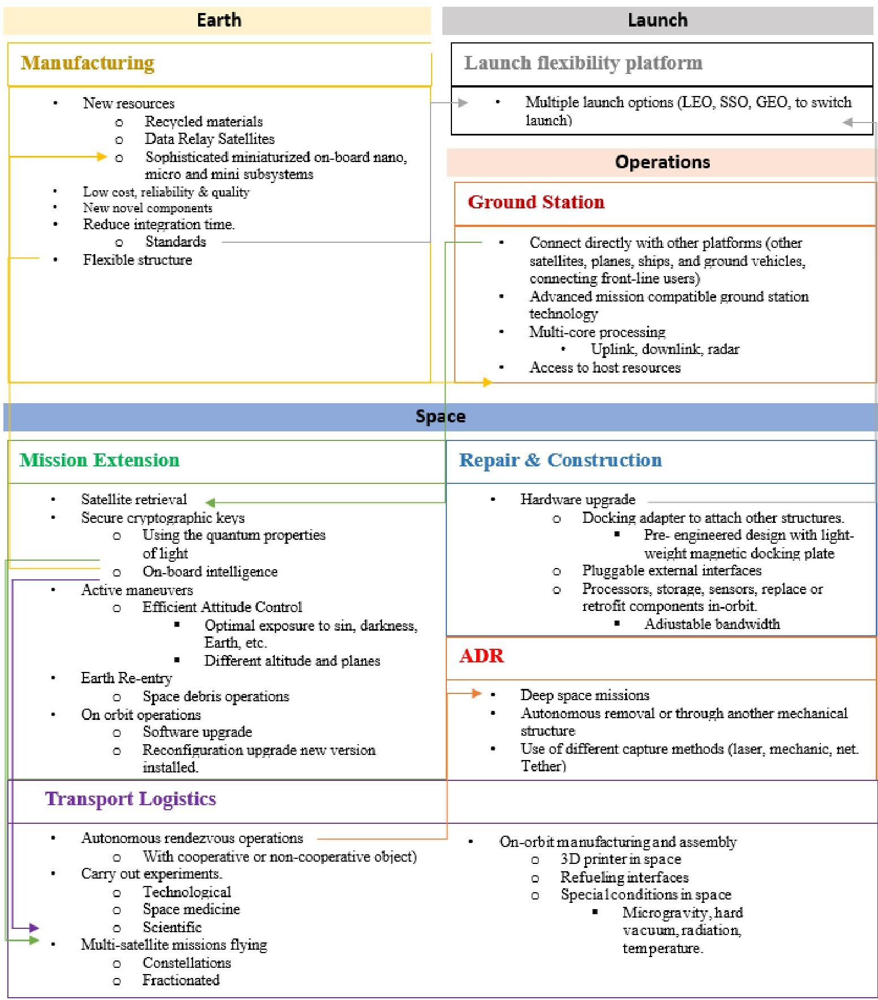

Figure 2.9: Graphical summary of the relationships between sustainability activities for a satellite mission. Note: The arrows indicate the relationships between categories, with each color representing the influence one category may have on another.

<!-- PDF_PAGE: 49 -->

- Active Maneuvers: Empowering satellites to execute more efficient attitude control and optimize their positioning with regard to factors such as solar exposure, darkness, Earth orientation, and more.

- Secure Cryptographic Keys: Leveraging the unique quantum properties of light and onboard intelligence to secure space-based communications.

- On-Orbit Operations: The capacity to carry out updates to software and hardware while in orbit, ultimately enhancing satellite flexibility and longevity. OSS facilitates the extension of satellite lifespans by allowing for inspection, refueling, maintenance, and upgrades, which improves the performance and Return of Investment (ROI). It promotes space sustainability by reusing, refurbishing, and recycling materials while also reducing orbital congestion through deorbiting technology and prolonged satellite lifetimes: hence, reducing the demand for new launches. However, current OSS technologies face several challenges, including the lack of a successful demonstration track record, an insufficient legal framework to address liability issues, the cost-effectiveness of replacing satellites versus servicing them, and the need for industry consensus on interoperability standards. Furthermore, the dual-use nature of ISAM technology raises concerns about anti-satellite capabilities, which could jeopardize space sustainability initiatives [70].

These capabilities play a pivotal role in enhancing the versatility and efficiency of satellite missions while simultaneously addressing the challenges within the realms of space exploration, space debris management, and the security of space-based communication.

## 2.2.4 Efforts towards a sustainable supply chain

Collective efforts by various national and international organizations actively contribute to the sustainability of satellite technology and supply chains [71, 72]. This section details key trends in the supply chain phases, encompassing satellite reliability and maintainability, with a strong focus on eco-efficient methodologies and materials. While challenges persist in the manufacturing phase, this section emphasizes the necessity to adopt a holistic approach for materials assessments and environmentally responsible disposal practices. In a world with finite resources, it underscores the growing recognition of environmental sustainability within satellite supply chains, urges efficient resource management throughout the satellite mission lifecycle, and facilitates the transition towards a fully sustainable satellite supply chain [73, 74].

## 2.2.5 Highlighting progress in applying this concept

In relation to the management and operations within a satellite supply chain, NASA has taken the lead in advancing a reliability and maintainability (R&M) program to ensure that systems within NASA's spaceflight programs and projects perform as intended throughout their lifecycles, thus achieving mission objectives related to safety, mission success, and sustainability [75, 76]. The program emphasizes innovation and continuous enhancement to meet the ever-evolving requirements of NASA's programs and projects [77, 78].

Parallel initiatives exist among major space agencies across the globe, reflecting a shared commitment to enhance the reliability and maintainability of space missions. The European Space Agency (ESA) places a significant emphasis on these critical engineering aspects within their space missions. The ESA's collaborations with industry partners revolve around the development of advanced technologies and materials specifically engineered to withstand the harsh environmental conditions of space while adhering to stringent environmental impact mitigation strategies [79,80].

Similarly, JAXA proactively prioritizes the reliability and maintainability of its satellite missions, adhering to an engineering approach and materials selection that are not only instrumental to ensure mission success but also align with their overarching commitment to environmental responsibility [79, 81].

These endeavors within space agencies underscore the paramount importance of engineering excellence in space missions with a concurrent focus on environmental stewardship.

One of the projects contributing to that is the SCHUMANN project [62]. Co-funded by EC (DG DEFIS) within the Horizon Europe framework and coordinated by Space Applications Services (Belgium), it aims to strengthen Europe's leadership in NewSpace and in-orbit servicing, assembly and manufacturing (ISAM) applications [82].

NewSpace is the new "space industry and applications" paradigm that was established a few years ago and which is progressively evolving. Applications such as satellite life extension, refueling, in-space assembly, in-

<!-- PDF_PAGE: 50 -->

space reconfigurable mechanisms, and in-space recycling will offer substantial revenue opportunities exceeding EUR 10 billion by 2030 [83].

SCHUMANN is looking to simplify the integration of modular spacecraft elements for satellite manufacturers as well as to drive reductions in the costs of doing so. The first path involves the design and maturation of a modular refueling module (MRM) to give satellites extra life, while the other path, called the satellite construction kit (SCK), will see the creation of a software toolkit that will help developers of functional satellite modules (FSM) demonstrate compliance for the necessary subparts [83].

In addition, numerous national and international organizations are actively involved in advancing satellite technology and supply chain sustainability [44, 71]. Their collective efforts contribute to the ongoing development of reliable, maintainable, and environmentally conscious satellite systems that benefit scientific research, Earth observation, and space exploration [72, 84, 85]. For manufacturing processes and associated activities in orbit to be sustainable, it is crucial to evaluate the properties and behavior of components or materials in the space environment [86, 87]. These efforts collectively promote the responsible use of space resources and foster collaboration on a global scale to address the challenges of satellite supply chain sustainability [88, 89]. Table 10.4 (Appendix V) illustrates the most notable trends observed in the various stages of the supply chain for satellite development.

In the Manufacturing stage, there are proposals [32] that encompass new methodologies for cost-efficiency, rapid delivery, and waste reduction. This includes the incorporation of new engineering methods and technologies like Industry 4.0 as well as space infrastructures for robotic in-orbit assembly and component manufacturing [90, 91]. Moving to the Launch stage, we find developments related to orbital transfer vehicles, in-space transportation services [92], separation systems, and cluster capabilities [93]. In the Satellite Operation stage, with a focus on sustainability, there are advancements in spacecraft docking and connection devices [94, 95] as well as for the refueling of satellites in space [96, 97]. Finally, in the Satellite Life Extension proposal stage, we consider developments in recycling space debris into raw materials and active debris removal (ADR) [98, 99, 100].

## 2.2.6 Challenges

One segment that has presented significant challenges within the supply chain is the manufacturing stage processes. Efforts to enhance reliability during this stage have led to advances in the performance of new materials, technologies, software, and more for space applications [101]. Consequently, there has been a concerted effort to improve the performance of satellite subsystems and extend their missions [102]. Over the years, the satellite industry has witnessed a significant evolution in its supply chain dynamics. Earlier, the supply chain for satellite missions was primarily characterized by long lead times, high costs, and limited suppliers [6,72]. However, with technological advances and the emergence of a more competitive space industry, supply chain management for satellites has evolved. This evolution includes streamlined manufacturing processes, improved component standardization, and the diversification of suppliers, resulting in reduced costs and increased accessibility to satellite technology [103].

In a sustainable approach, the evaluation of these new materials should not only encompass their performance within the satellite structure, but it should also consider their impact when used in space (e.g., for repairs or in-orbit manufacturing) or upon re-entry into the Earth's atmosphere. Additionally, the final disposal of these materials at the end of their useful life should be considered, including options for recycling or utilization in other processes [104, 105]. This holistic approach to supply chain management in the satellite industry reflects the growing awareness of environmental sustainability and the need to manage resources efficiently throughout the entire lifecycle of satellite missions [106, 107].

The primary hurdles for future CubeSat and small satellite technologies include coordination, data processing, propulsion, de-orbiting devices, and large deployable structures. Coordinating huge constellations of small satellites poses significant challenges, which can be solved via inter-satellite link (ISL) communications and satellite docking programs. Furthermore, the use of artificial intelligence (AI) will allow for autonomous diagnostics, on-board data processing, and constellation management, all of which improve operating efficiency. Increasing data processing and transmission capabilities necessitates the use of modern communication technologies such as Ku-band and Ka-band transmitters or laser communication, but with careful power management concerns. Furthermore, the utilization of propulsion systems, particularly those based on electricity, chemicals, or water, allows for controlled satellite movement and orbital modifications. Improvements in active and passive de-orbiting systems, such as electric and chemical propulsion, as well as passive systems like air drag augmentation devices (DADs), help to reduce the risks associated with space

<!-- PDF_PAGE: 51 -->

debris. Additionally, novel solutions such as origami-inspired antenna designs improve space utilization and communication capabilities. Finally, CubeSats are increasingly being used for space exploration missions, which provide chances for scientific inquiry and technology development. However, the proliferation of CubeSats requires the development of new laws to assure safe and interference-free operation. To overcome these obstacles and achieve long-term space exploration goals, stakeholders such as governments, industry, and academia must work together.

## 2.2.7 What actions can be taken today with the existing space debris?

The increasing deployment of satellites is essential to meet diverse user needs in daily life. However, a substantial number of launched satellites, despite the increasing volume, do not operate throughout their expected lifespans. This is often due to various reasons, such as economic constraints, mission completion, or political considerations [108, 109]. In certain instances, new satellites are launched to replace those experiencing unexpected anomalies rather than leveraging their residual capabilities.

Observations indicate that failed satellites are often decommissioned, moved to graveyard orbits, or allowed to drift without re-evaluating the anomaly for potential alternative uses. However, failed satellites experiencing non-fatal anomalies can be repurposed depending on their remaining capabilities [63]. For instance, data link anomalies may allow the satellite to support low-rate applications like IoT, environmental monitoring, asset tracking, etc.

For current space debris, there are studies considering potential in-orbit recycling: involving an analysis of operable capabilities that could be somehow reused for other purposes. These satellites, known as zombie satellites, require a detailed examination of each satellite, subsystem, and mission [63]. However, this proposal is accompanied by various challenges that are still being addressed globally.

Prospective initiatives ought to focus on providing comprehensive anomaly descriptions to better grasp their implications on satellite architectures. Overcoming the challenges associated with reviving failed satellites demands addressing technological, regulatory, liability, legal, and ownership barriers. The design and technology of forthcoming satellites should prioritize flexibility in both hardware and software architectures [110, 111]. Furthermore, it is crucial to heighten awareness within the industry about the economic and environmental advantages of repurposing satellites, encompassing the reduction of orbital congestion, the minimization of unnecessary launches, the mitigation of space debris, and the alleviation of ecological impacts on the planet [112]. Notably, the Eco-LeanSat proposal lays the groundwork for a potential future satellite infrastructure, facilitating the execution of reuse operations for both hardware and software. Considering the previous study of sustainable proposals for eco-design and their application in the supply chain, and with a view towards applying them to future satellites, the following chapter conducts a technology survey. This survey traces the evolution of SmallSat and CubeSat platform developments, identifying relevant innovative designs and highlighting applications oriented towards sustainable space practices.

## 2.3 Eco-LeanSat Proposal

A proposal to develop satellites that can incorporate a sustainable approach from the manufacturing process, involves first the identification of the most disruptive capabilities of small satellites so that they can be implemented in an Eco-LeanSat.

## 2.3.1 Preliminary context of smallsat capabilities evolution

Since the launch of Sputnik in 1957, continuous efforts have been dedicated to develop more capable satellites in smaller form factors. Figure 2.10 illustrates select examples of successful missions and space probes over time before 1999. A total of 28 missions have been selected, and among them, those considered by the authors as milestones have made pioneering contributions to specific aspects of satellite development, thus representing significant advancements in the field.

In 1999 the CubeSat concept was introduced by Professors Robert Twiggs and Jordi Puig-Suari [114]. It was originally a new educational tool proposed for "low-cost" satellite design, but later on, CubeSat become a "de facto" standard that opened new technological and scientific venues leading to the development of new satellite capabilities. In the following subsections, four main "periods" in the development of satellite capabilities since 1999 have been identified, and they are graphically summarized in Figure 2.11. A total

<!-- PDF_PAGE: 52 -->

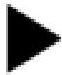

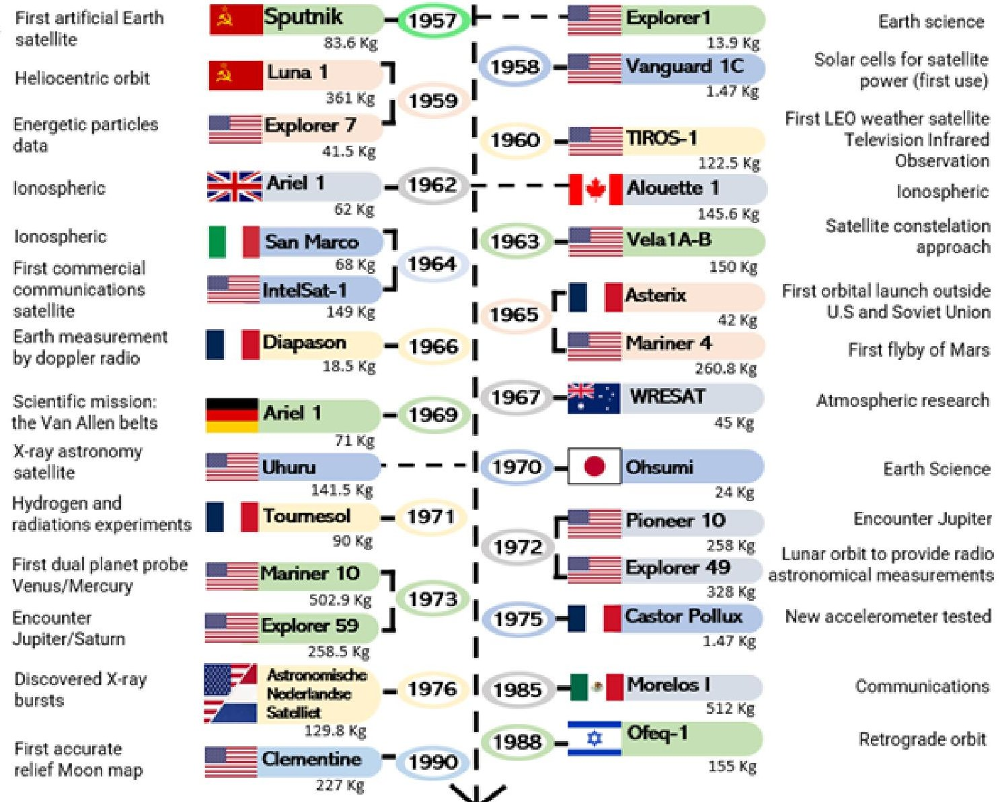

Figure 2.10: Highlight satellite missions before 1999. Source: N. Buitrago, 2023 [113].

of 28 missions, either fully successful or partially successful, have been meticulously selected and analyzed, and those that were milestones because of their innovative processes are included.

## 2.3.2 First Period: Early Development of Small Satellites and CubeSats (1999- 2003)

Thanks to the development of the CubeSat concept, new technologies were tested, avoiding the economic risk of tests using large satellites. In addition, among other significant innovations originated by this concept, new structural and mission design models were introduced, new proposals for launches and operations of space systems were planned, and new payloads for scientific and academic experiments were designed.

Gradually, new players began to promote the commercialization of these structures to turn them into potentially profitable products [115, 116].

Based on the authors' opinion, some of the most important milestones of this period are summarized below.

(a) Hyperion, the first in-orbit hyperspectral imager, was launched in 2000 on board the LEO-1 spacecraft [117]. It had a spectral resolution of 10 nm in both the visible near-infrared (VNIR) and short-wave infrared (SWIR) regions [118].

(b) In 2002, JAXA launched three satellites, two of which were small. The first of these, TSUBASA (MDS-1), was designed to verify the necessary technologies in space based on three keywords: faster operation, lower cost, and increased reliability [119]. The satellite demonstrated primary data collection, allowing scientists to experiment before implementing the payloads in larger satellites. Additionally, the satellite contained complex parts developed by the industry to assess their performance and produce

<!-- PDF_PAGE: 53 -->

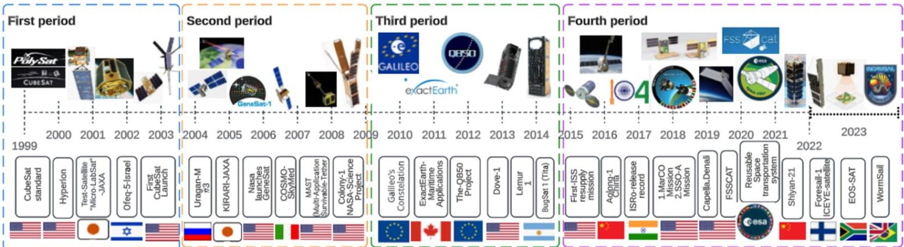

Figure 2.11: Small satellites evolution since the innovation of the Cubesat. Source: Compiled from different web sources by the author.

smaller and lighter components at a lower cost. The second satellite was a small research satellite that established small satellite spin bus technologies and offered opportunities for in-space verification [119]. This satellite was unique in the sense that it was "handmade" and was fabricated mainly by young JAXA engineers. The project served as a test case to produce small satellites more efficiently and at a reduced cost.

(c) Israel has also explored other types of military small satellites. The Ofeq 5 series was part of the Israeli spy optical surveillance satellites [120]. The first launch of this CubeSat was made on June 20, 2003 [121], in Plesetsk, Russia, on a Eurockot rocket using Russia's Multiple Mission Orbit Service. The Ofeq series have retrograde orbits due to Israel's Mediterranean launch path, and they are an upgraded version of the initial Ofeq reconnaissance satellites, which were similar to EROS-A.

(d) A group of CubeSats was launched into a sun-synchronous orbit, which included the Danish AAU CubeSat and DTUSat, Japanese XI-IV and CUTE-1, Canadian Can X-1, and Quakesat. The latter used a series of low-frequency ground sensors designed to detect the energy emitted in the LF part of the electromagnetic spectrum before an earthquake occurs [122].

## 2.3.3 Second Period: Technology Demonstrations (2004-2009)

This period begins with the second generation of the GLONASS constellation and ends with the beginning of the development and launch of the European Galileo satellite constellation.

In the authors' opinion, some of the most important milestones of this period are:

(a) In 2005, Japan launched an optical in-orbit communications engineering test satellite called "KIRARI". This satellite had a large-aperture telescope, a high-power semiconductor laser, and highly sensitive signal detectors. It allowed the testing of operations such as beam acquisition to capture an incoming laser beam, beam tracking to detect and control the angle of the incoming laser, and beam pointing to transmit a laser beam accurately in the right direction [123, 124].

(b) In 2006, NASA launched Genesat 1: a technology demonstration and biological experimentation mission. The satellite integrated a miniaturized life support system and a nutrient delivery system for a colony of Escherichia coli bacteria in order to track genetic changes under space conditions [125].

(c) The Constellation of Small Satellites for Mediterranean Basin Observation (COSMO-SkyMed) was launched in 2007. Each satellite of the constellation is equipped with a SAR-2000: a multi-mode SAR (synthetic aperture radar) instrument with programmable swath size, spatial resolution, and polarization configurations. The SAR transmitter/receiver system operates with an electrically steerable multibeam antenna [126].

Between 2008 and 2009, the first systematic CubeSat-based research program, the Colony-1 CubeSats, were launched by the U.S. National Science Foundation's Geosciences Division, AS&T (Advanced Systems and Technology Directorate) of the National Reconnaissance Office (NRO). The Weather Colony Program demonstrated the feasibility of scientific payloads in CubeSats, such as small, low-power sensors to measure space weather, monitor solar radiation, measure Earth's magnetic field, etc. This project also accelerated aspects of technology

<!-- PDF_PAGE: 54 -->

testing and capabilities with reduced costs and tighter schedules than traditional large satellites [127, 128]. The results in Table 2.2 (from [129], p. 12) summarize the evolution of payload development.

Table 2.2: Evolution of EO technologies for CubeSat-based missions (from [129], p. 12).

2012 technology review 2017 technology review

<table border="1"><tr><td>Technology</td><td>2012 technology review[130]</td><td>2017 technology review[131]</td><td>Justification</td></tr><tr><td>Atmospheric chemistry instruments</td><td>Problematic</td><td>Feasible</td><td>PICASSO, IR sounders</td></tr><tr><td>Atmospheric temperature and humidity sounders</td><td>Feasible</td><td>Feasible</td><td>—</td></tr><tr><td>Cloud profile and rain radars</td><td>Unfeasible</td><td>Feasible</td><td>JPL RainCube demo</td></tr><tr><td>Earth radiation budget radiometers</td><td>Feasible</td><td>Feasible</td><td>SERB, RAVAN</td></tr><tr><td>Gravity instruments</td><td>Feasible</td><td>Feasible</td><td>No demo mission</td></tr><tr><td>Hi-res optical imagers</td><td>Unfeasible</td><td>Feasible</td><td>Planet Labs</td></tr><tr><td>Imaging microwave radars</td><td>Unfeasible</td><td>Problematic</td><td>Ka-Band 12 U design</td></tr><tr><td>Imaging multispectral radiometers(Vis/IR)</td><td>Problematic</td><td>Feasible</td><td>AstroDigital</td></tr><tr><td>Imaging multispectral radiometers(W)</td><td>Problematic</td><td>Feasible</td><td>TEMPEST</td></tr><tr><td>Lidars</td><td>Unfeasible</td><td>Problematic</td><td>DIAL laser occultation</td></tr><tr><td>Lightning imagers</td><td>Feasible</td><td>Feasible</td><td>—</td></tr><tr><td>Magnetic field</td><td>Feasible</td><td>Feasible</td><td>InSPIRE</td></tr><tr><td>Multiple direction/polarization radiometers</td><td>Problematic</td><td>Feasible</td><td>HARP Polarimeter</td></tr><tr><td>Ocean color instruments</td><td>Feasible</td><td>Feasible</td><td>SeaHawk</td></tr><tr><td>Precision orbit</td><td>Feasible</td><td>Feasible</td><td>CanX-4 and CanX-5</td></tr><tr><td>Radar altimeters</td><td>Unfeasible</td><td>Feasible</td><td>Bistatic LEO-GEO/MEO</td></tr><tr><td>Scatterometers</td><td>Unfeasible</td><td>Feasible</td><td>CYGNSS(GNSS-R)</td></tr></table>

In Europe, the construction and launch of the Galileo constellation began. The mass of these satellites is approximately 700 kg [132].

## 2.3.4 Third Period: Technology Demonstrations (2010-2014)

In this period, CubeSat platforms mature and, despite most of the launches still being carried out by academia numerous techdemos see the light of day. Some of the most important milestones are listed below.

(a) In 2011, ExactEarth acquired small satellites for commercial maritime applications [15]. SmallSat launches were primarily augmented with data transmission capabilities for communication or imaging applications [114]. Another significant milestone was the development of the international CubeSat-based QB50 mission led by the Von Karman Institute for Fluid Dynamics. QB50 consisted of a network of 50 CubeSats built by teams of students from universities around the world to conduct multipoint in situ measurements of the lower thermosphere [133, 134].

(b) In 2013, NanoRacks became the first commercial operator to launch from the International Space Station (ISS) [15]. In the same year, the Cosmogia company (now Planet Labs) launched its first Dove pathfinder satellite (Dove 1) [15]. (Planet owns and operates a constellation of more than five hundred 3U imaging satellites with a spacial resolution of $ \sim5 $ m [135,136].) Its goal was to show the performance of a small camera payload and demonstrate the ability to design, produce, and operate satellites in short times and at a low-cost using commercial off-the-shelf components [137]. Planet's primary Earth observation payload is an electro-optical imaging system operating in the visible band and with a ground resolution of approximately 5 m. Its secondary payload is a low-resolution IR imaging system with a ground resolution of approximately 1 km [138].

(c) A year later, Planet launched 93 additional satellites into orbit. Nearly simultaneously, Spire Global, a space-to-cloud data and analytics company, successfully deployed its first satellite model: the Lemur 1. This satellite was equipped with the STRATOS payload, which collects GNSS-RO (radio occultation) for various Earth observation applications, including climate and space weather research by Spire [15]. The Argentinean SAOCOM 1A (Satélite Argentino de Observación Con Microondas) constellation comprises two L-band synthetic aperture radar (SAR) satellites and offer crucial data for applications like measuring Earth surface changes, crop management, and flood monitoring [139, 140].

<!-- PDF_PAGE: 55 -->

## 2.3.5 Fourth Period: Novel Applications (2015-Present)

In this period, the number of CubeSats increased exponentially. Commercial companies entered into the marked, either providing services, satellite subsystems, or fully integrated platforms. Some of the most important milestones are listed below.

## 2.3.5.1 CubeSats: Global Advances and Scientific Applications from 2015 to 2018

(a) In 2015, China launched the first quantum communications satellite together with $ ^{3} $Cat-2—the first CubeSat launched by the Universitat Politecnica de Catalunya (UPC), Spain. It was equipped with a GNSS-reflectometry payload [114].

(b) Orbital ATK (now Northrop Grumman) successfully launched its first ISS resupply mission with the Cygnus spacecraft; it carried more than 20 satellites [15]. From 1999 to 2015, around 80% of all CubeSats were developed in the U.S. Japan launched 18 CubeSats, Germany launched 10, Denmark launched 9, and Italy, the UK, and South Korea launched 4 each. Since then, over 30 other countries have launched at least one CubeSat.

(c) In 2016, the International Space Science Institute in Bern, Switzerland, organized a forum to study the evolution of CubeSats as enabling technology platforms. These institutions identified developments aimed at areas such as space physics, focusing on issues like radiation belt variability and complementing missions such as the Van Allen probes [141]. Additionally, in the fields of planetary sciences and astrophysics, research focused on describing new measurement techniques enabled by CubeSats.

In this period, the CubeSat concept became a powerful tool. Because they can be launched easily, the revisit time can be reduced, and also, they can address specific scientific questions for which traditional satellite approaches are not suitable. In this period, space exploration was more accessible, and scientific and technological developments were encouraged in order to innovate satellite systems and their payloads. According to a study conducted by the U.S. National Academies of Sciences, Engineering, and Medicine, the most significant improvement during this time was the precise control of the CubeSat's attitude [114]. Progress and developments in other satellite subsystems, such as solar panels, organic solar cells, hydrogen cells, and power sources [142], as well as the optimization of communication systems with larger data transmission rates [114], including deployable antennas, optical communications, and inter-satellite links, are noteworthy.

(d) Similarly, between 2016 and 2018, important research efforts were directed towards propulsion technologies for small satellites, enabling them to achieve new scientifically valuable orbits for specialized experiments or to control their trajectories with other platforms. Plasma thrusters and ion engines designed for CubeSat-type structures have been developed [143, 144], and today, thanks to these advances, notable projects like CAPSTONE (Cis-lunar Autonomous Positioning System Technology Operations and Navigation Experiment) [145] have successfully placed spacecraft in a near-rectilinear halo orbit (NRHO).

Recent advances in satellite technology have prompted state policies owing to the high capacities developed in satellites. An example was the announcement on 21 October 2016 by the White House (U.S.) of the "Harnessing the Small Satellite Revolution" initiative, building on a growing wave of private sector interest in miniaturized spacecraft for applications ranging from remote sensing and communications to satellite inspection and repair. One of the opportunities that was raised was NASA's purchase of up to USD 30 million of Earth observation data collected by small satellites and the creation of a new Small Spacecraft Virtual Institute based at the Ames Research Center in Silicon Valley and with the aim of documenting best practices, lessons learned, and standards for all phases of small-satellite development [146].

In the same year, China launched the satellite Tianyuan-1: the country's first in-space refueling system for orbital satellites [147]. Aolong-1 was the world's first active orbital debris removal experimental project. It was equipped with a robotic arm to simulate the grabbing of abandoned satellites and other large pieces of debris in space and could take them to the atmosphere for burning during reentry [148].

(e) In 2017, OneWeb inaugurated a modern satellite production facility, which increased the number of small satellite launches [15], and the Polar Satellite Launch Vehicle (PSLV)-37 program of the Indian Space Research Organization (ISRO) deployed a record number of 104 satellites in a single launch [15]. One year later, NASA's Jet Propulsion Laboratory launched Mars Cube One (MarCO) [149]: a technology

<!-- PDF_PAGE: 56 -->

demonstration mission consisting of two 6U CubeSats, MARCO-A and MARCO-B, which were the first over-interplanetary CubeSats and acted as a data relay for the Mars InSight lander for a short period of time. The MarCO pair conducted communications and navigation while flying independently of the planet Mars [149].

(f) In the same year, Sun-Synchronous Orbit (SSO)-A from SpaceFlight Industries carried 64 satellites from 17 countries into orbit [150].

Regarding the development of new payloads, in 2017, the first Finnish satellite was launched, Aalto 1, with the Aalto Spectral Imager (AaSI): the first hyperspectral imaging system compatible with nanosatellites and the radiation monitor (RADMON) and electrostatic plasma brake (EPB) missions. The latter was a novel deorbiting technology that employed Coulomb drag between the ionospheric plasma and a long, charged tether [151, 152, 153]. A similar experiment was conducted on board ESTCube-1 [154, 155].

(g) In 2018, HyperScout-1 became the first hyperspectral imager for nanosatellites [156]. It is also relevant to mention the TUBSAT-1 mission (1991), which was one of the pioneering satellites for multi-purpose imagery (ocean and land) through the use of high-resolution optical imagers, data collection, and hyperspectral imagers [157].

## 2.3.5.2 Satellite Technology Breakthroughs: 2019-2020 Achievements and Developments

(h) In 2019, Capella Space launched the world's first sub-50 kg SAR satellite (Denali) for a technology demonstration mission. Later versions were designed to operate a constellation of 36 satellites. These satellites were equipped with an X-band SAR boasting a 0.5 m resolution, enabling all-weather imaging through an antenna spanning nearly 100 square feet. These satellites offer hourly images of any location on the surface of the Earth [158].

AstroDigital launched the world's first 16U CubeSat (Palisade) in the same year. It was a technology demonstration satellite with an onboard propulsion system [159]. Also, India developed the Cartosat-3 satellite, which provides very-high-resolution panchromatic imagery with a resolution of 0.28 m and multispectral imagery in four spectral bands with a spatial resolution of 1.12 m; it has a nominal swath of $ \sim17 $ km.

Many new technologies have been developed, such as highly agile structural platforms, payload platforms, higher-rate data handling and transmission systems, advanced onboard computers, new power electronics, and dual-gimbal antennas [159, 160].

(i) In 2020, the UPC Federated Satellite System (FSSCat) mission marked a significant milestone by employing AI for the first time for cloud detection. FSSCat consisted of two 6-unit CubeSats: one of them was equipped with UPC's Flexible Microwave Payload-2 (FMPL-2), featuring an L-band microwave radiometer and a GNSS reflectometer implemented in a Zynq----7045 FPGA for sea ice and soil moisture monitoring. Additionally, the second CubeSat included Cosine's HyperScout-2 visible + near-infrared + thermal infrared hyperspectral imager and included the PhiSat-1 AI board in a Movidius processor. Notably, FSSCat was the first CubeSat-based mission that contributed to the Copernicus program [161]. The application of AI in CubeSat missions has revolutionized the efficiency and accuracy of data processing. By employing AI algorithms, CubeSats can conduct real-time data analysis, make autonomous decisions, and optimize satellite operations, leading to enhanced mission performance and reduced operational costs. For the FSSCat mission, AI was utilized to select data for download based on cloud coverage, optimizing data transmission. This integration of AI in CubeSats exemplifies how advanced technologies enhance the efficiency and effectiveness of space exploration endeavors.

## 2.3.5.3 Space Technology Innovations: Advancements and Sustainability

Governments, universities, and commercial companies in the space sector have been adopting new and innovative solutions to the manufacturing processes of small structures and have been proposing new payloads. For instance, Fleet Space Technologies, an Australian manufacturer, developed the first 3D-printed satellite, Alpha CubeSat, and the first 3D-printed rocket, Terran 1, which was launched on 24 March 2023 by the American company Relativity Space. The use of 3D printing enables the production of custom satellites with a general structure and system parts at a much lower cost than conventional satellites.

<!-- PDF_PAGE: 57 -->

Significant innovations encompass optical and laser technology and AI; these play a crucial role in Earth observation and environmental monitoring. They improve data precision for climate monitoring, disaster detection, and resource management. These advancements also strengthen satellite communications, facilitating high-speed, low-latency transmissions, which are essential for services like Starlink's efficient high-performance satellite network. Currently, Starlink's satellite communications constellation comprises over 4000 satellites in orbit. Yet in the near future, companies such as OneWeb and Telesat plan to establish smaller constellations. Tech giants like Amazon and Samsung have also announced intentions to deploy their own constellations, consisting of 3236 and 4600 broadband satellites, respectively [162].

Moreover, artificial intelligence enhances accuracy and responsiveness in satellite navigation, benefiting both civilian and military navigation. In the field of science and space exploration, advanced optical technologies enable detailed observations of celestial objects and planets, which is essential for space research and exploration. They are also applied for security and defense, precision agriculture, and the exploration of natural resources. These innovations drive satellite efficiency and precision, making a significant impact on society and industry [163, 164].

Another field of sustainable technological development has been the removal of space debris in orbit. In October 2021, China launched the debris mitigation technology satellite Shijian-21, which uses its propulsion to circularize its orbit more than 22,000 miles over the equator. Since then, it has been conducting rendezvous and proximity operations (RPO) with other objects [165].

Furthermore, the Finnish company ICEYE has been a pioneer in the miniaturizing of SAR and deploying it on microsatellites. These satellites have demonstrated their value not only for ice detection but also for a wide range of valuable applications [166, 167, 168].

## 2.3.5.4 CubeSats and Beyond: Advances and Future Initiatives

South Africa has achieved significant progress in camera technology through the EOS-SAT satellite, which was tailor-made for the agricultural sector. This satellite boasts an impressive 40 km swath width and includes 11 band channels, with ground resolutions ranging from 1.5 to 2.8 m [169, 170]. Another noteworthy camera developed in South Africa is the Simera Sense xScape100, which offers multispectral and hyperspectral options [171].

In addition, in the last few years, university projects have been essential to this accelerated progress. One of them is the WormSail satellite: developed via cooperation between the University of Nottingham and the University of Brasilia. The satellite is expected to be launched in 2023 or 2024; if successful, it could be the world's first multicellular organism on a CubeSat flight [172]. Other mission objectives include the in-orbit demonstration of a flight software algorithm to perform packet routing, a set of observation subsystems to collect images and data from on-board sensors, and a new attitude maneuvering subsystem that includes a three-axis magnetorquer and passive deorbiting mechanism based on origami-type structures and atomic oxygen corrosion [173].

To summarize, until 2013, CubeSats were a small field dominated by academic and university projects. After 2013, mostly due to Planet and Spire Global constellations, most CubeSats shifted to the commercial sector. As of 2012, only 72 CubeSats were in orbit, and as of May 2023, more than 2100 CubeSats have been successfully deployed into orbit. Today, the communications field intends to improve the performance of 5G ecosystems and beyond through non-terrestrial networks (NTNs) based on satellite constellations [174]. Furthermore, there is a trend to develop scientific experiments and create space architectures that use reusable vehicles to access space and return to Earth, such as the Space Rider, which has been conceived to provide a space laboratory for payloads to operate in orbit for a variety of applications [175].

Since the introduction of the CubeSat standard, over the last two decades, technology has achieved a high level of maturity, particularly for generating high power using large, deployable solar panels, which is vital for Earth observation and communication missions. However, notable challenges persist, including the need for larger deployable structures to support advanced antennas, high-precision attitude control systems, enhanced RF inter-satellite links, flexible systems for managing diverse payloads, integration of artificial intelligence for onboard processing, and increased reliability for extended missions, including GEO and inter-planetary ones. These challenges and innovations are defining the future of CubeSats and small satellite technologies [27].

To secure the long-term viability of space activities in the face of the development of small satellites and CubeSats, a diversified strategy is required. First and foremost, it is critical to establish comprehensive space traffic control systems [177]. These systems would aid with monitoring and regulating the increasing number

<!-- PDF_PAGE: 58 -->

of satellites in orbit, reducing the risk of collisions and assuring efficient use of orbital space. Furthermore, strong debris mitigation requirements are required to reduce the environmental impact of space activities. This is accomplished by implementing measures to reduce space debris generation, such as designing satellites for safe reentry or deploying deorbiting mechanisms, which will help to maintain orbital environments for future generations [70]. International collaboration on space policy and regulation will be critical for addressing these problems. Harmonizing standards and regulations across nations can establish a unified framework for sustainable space activities and ensure equitable access to space resources while safeguarding the Earth's environment. Also, investing in the development of technology for debris removal and satellite recycling is critical [63]. Efforts to develop and deploy spacecraft capable of actively removing debris from orbit as well as repurposing or recycling decommissioned satellites can help to reduce the environmental impact of space activities and contribute to the long-term viability of space operations.

## 2.4 Identified Small Satellite Features

The changes highlighted in the previous section improve the technical capabilities of small satellites; Table 2.3 shows a summary of the main characteristics and challenges for future generations of small satellites to contribute to a sustainable space.

Table 2.3: Summary of the most notable Small Satellites trends

<table border="1"><tr><td>Features</td><td>Characteristics identified in small satellites missions</td><td>Challenges and contributions to a sustainable space</td></tr><tr><td>Technology Miniaturization</td><td>More powerful and smaller systems</td><td>Reduced volume of space debris</td></tr><tr><td>Multiple mission objectives</td><td>Satellites with multiple or complementary mission&#x27;s objectives (i.e., constellations)</td><td>Flexibility for multi-purpose and reconfigurable missions</td></tr><tr><td>Involve high risk missions</td><td>Uses for scientific experiments in risky orbits (i.e., inter-planetary, asteroids)</td><td>Satellite mission with high risk, but reliability and reusable satellites</td></tr><tr><td>Low-cost trend</td><td>Multidisciplinary projects, University-Government-Space companies working together, exchange knowledge and experiences</td><td>Use new materials and reduce manufacturing times through innovative methodologies(e.g additive manufacturing)</td></tr><tr><td>Novel developments</td><td>Promotes more open space access through standardized platforms and reduced satellites sizes</td><td>Development of new capabilities for space architectures.</td></tr></table>

Additionally, Tables 10.1-10.3 in Appendix V present a comprehensive historical study analyzing the most significant technology demonstrations and their respective purposes. The selection of relevant technologies was based on their development nature and applicability to specific missions.

The types of development are categorized into thirteen distinct classifications; each is described and detailed in the corresponding column. In some cases, the category column includes further subdivisions based on the mission's specific objectives. The thirteen types of development classified are as follows:

Table 10.1:

- Management and Manufacturing: satellite missions focused on introducing novel components, materials, and manufacturing techniques as primary or secondary goals [178, 179, 180, 181, 182];

Table 10.2:

- Disruptive Technologies: satellite missions that test new technological capabilities [183];

- Planetary Defense: satellite missions designed to protect Earth from potential celestial bodies that could have negative impacts in the event of a collision [178, 184];

- Biology and Science: missions involving scientific experiments that explore the behavior of microorganisms in a space environment;

- Communication/Data Transfer: missions primarily aimed at developing new communication methods in space;

- Support: satellites serving as assistance for other satellites with payloads, focusing on supporting primary objectives;

<!-- PDF_PAGE: 59 -->

- Earth Observation, Earth sciences and interplanetary probes [185];

- Military Security, Intelligence Surveillance and Reconnaissance (ISR);

## Table 10.3:

- Navigation [186];

- Science, Technology and Education: this classification serves educational purposes, primarily targeting leadership in universities and research centers, with objectives centered around scientific and technological demonstrations;

- Sustainable Space: satellite missions focused on facilitating initial space pollution mitigation efforts and establishing a foundation for ongoing space sustainability initiatives;

- In-orbit Activities: missions aiming to utilize existing satellite capabilities for operations in the space environment;

- Unconventional Satellite Missions: showcasing novel capabilities and structures within satellite technology.

Considering the features identified in Tables 10.1-10.3, they can be classified into four methods: (1) ADR, (2) transport logistics, (3) mission extension, and (4) repair and construction, as illustrated in Figure 2.12. These methods could be considered for future developments, with a focus on maximizing the potential of satellites to provide services and technologies.

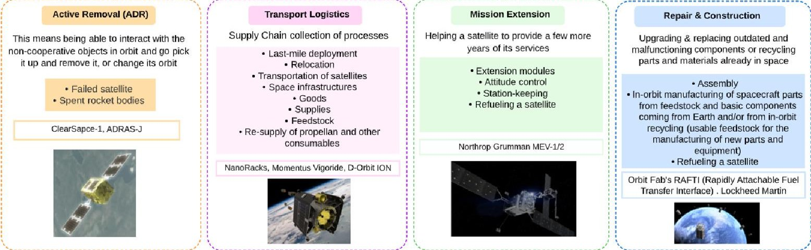

Figure 2.12: Proposed future satellite missions for space sustainability. (Credits: information sources [187, 188, 189] compiled by the authors).

(a) Active Debris Removal (ADR): Space debris, which includes decommissioned satellites and other fragments, presents a growing threat to the safety and functionality of operational satellites. The implementation of effective active debris removal (ADR) methods is vital for establishing and maintaining a sustainable space environment. In Table 10.3, this is categorized as Active Debris Removal (ADR)/Docking, and we delve into state-of-the-art ADR technologies and strategies, such as deorbiting with no pre-installed docking interface, capture systems with integrated propulsion, self-destructing magnetic tugboats, space transportation systems, and space debris "Gobblers", among others. This examination underscores the significance of proactive debris management for mitigating collision risks and preserving orbital space for future satellite deployments.

(b) Transport Logistics: Efficient logistics and transportation systems are important for ensuring the successful launching, deployment, and repositioning of satellites. In Table 10.1, categorized under "Management and Manufacturing Techniques", we delve into cutting-edge logistics solutions, including technologies like orbit-reconfigurable satellites, radiation-resistant components, 3D printing, and other innovative approaches. These solutions are purposefully designed to not only reduce the environmental impact of satellite launches but also to optimize satellite placement for maximum efficiency.

(c) Mission Extension: Extending the operational life of satellites is not only an economically sound approach, but it also environmentally responsible. We delve into innovative mission extension technologies, such as satellite servicing and in-orbit refueling, as sustainable methods for prolonging the lifespans of satellites and reducing the necessity for new deployments. In Table 10.2, we showcase a range of developments

<!-- PDF_PAGE: 60 -->

(e.g., disruptive technologies, communication and data transfer advancements, and innovations in military security and intelligence surveillance and reconnaissance (ISR)). These developments encompass innovative payloads aimed at optimizing satellite performance and ensuring the continued success of missions.

(d) Repair and Construction: Satellite repair and in-orbit construction capabilities are imperative for mitigating the environmental impact caused by outdated and malfunctioning satellites. In Table 10.4, we explore the development of autonomous construction and repair techniques, encompassing on-orbit assembly and component replacement [187, 188, 189]. These approaches are instrumental for extending the operational lifespan of satellites while concurrently minimizing the generation of space debris [190].

As depicted in Figure 2.12, these parameters collectively represent a comprehensive framework for advancing the sustainability of satellite architectures. Future developments in these areas hold the promise of more reliable and environmentally friendly satellite technologies that are well-equipped to meet the growing demands for space-based services and technologies [191] .

## 2.5 Conclusions and Future Research

The design of an eco-friendly logistics satellite supply chain requires the collaboration of multiple stakeholders. This study has highlighted the significant technological advances within specific sections of the supply chain. For instance, in the manufacturing stage, the proposal of utilizing new materials with sustainable characteristics for space applications shows promising progress. In the launch stage, the implementation of intelligent dispenser technology enhances satellite deployment accuracy, thereby reducing the risk of mission failure. Additionally, the operation stage has witnessed the emergence of projects aimed not only at fulfilling scientific objectives but also at prolonging the satellite's lifespan. Sustainable practices such as in-orbit repair, ADR, and environmentally responsible satellite disposal methods following mission completion are proposed in this segment.

Future research on this subject must consider political, legal, economic, and security consequences. The concept of a satellite "as a service", similar to a multi-owner property, offers potential to reduce the number of space assets by allowing satellite resources to be reconfigured in orbit for different customers at different times. Furthermore, the rapid evolution of on-orbit servicing (OSS) creates several obstacles and opportunities. OSS technologies such as in-space repairs, refueling, refurbishing, and service have the potential to dramatically extend satellite lifecycles while also addressing space debris concerns. For example, more than half of GEO satellites are predicted to have operational issues owing to fuel depletion, but refueling can extend their operational life, keep orbital slots, and benefit both governmental and commercial operators. Companies such as SES and Intelsat are incorporating OSS life extension capabilities into their business models, demonstrating increased customer confidence [70,192]. Recent investments have highlighted the importance of these technologies. The launch deal between SpaceLogistics and SpaceX as well as the U.S. Air Force's investment in Orbit Fab's refueling interface demonstrate the strategic value of OSS. Refueling improves mobility, allowing satellites to retain or alter orbits, respond to threats, and avoid collisions, all of which are critical for the resilience and agility of space infrastructure [192]. The rapid evolution of OSS presents numerous challenges and opportunities. Recent initiatives such as Clean Space by the ESA and collaborations on projects like Astroscale, ClearSpace, D-Orbit, and Telespazio, alongside Thales Alenia Space, demonstrate a growing commitment to advancing OSS technologies [193]. These initiatives have received funding to mature their ideas, and their results were presented in preparation of the 2022 ESA council at the ministerial level [193]. Additionally, the development of modular spacecraft designed for serviceability, including refueling and upgrades, can further extend the lifespans of satellites and improve functionality as technology evolves. This modularity reduces costs and launch weights while enabling on-orbit assembly and repair, fostering a robust secondary market for older-but-functional spacecraft. This shift towards modular and serviceable designs will likely become standard by the end of the 2020s, driven by initiatives like the U.S. Defense Innovation Unit's Modularity for Space Systems (M4SS) project [194]. Furthermore, the adoption of safety standards, exemplified by the JAXA's JERG-2-026 "SAFETY STANDARD FOR ON-ORBIT SERVICING MISSIONS" [195], underscores the importance of establishing regulatory frameworks to ensure the safe and effective operation of OSS missions. Exploring these topics in depth will provide significant insights for policymakers, legal experts, and industry professionals as they navigate the changing landscape of sustainable space logistics.

<!-- PDF_PAGE: 61 -->

The research outlines critical methods for future Eco-LeanSat designs that balance environmental responsibility and performance enhancement. Primarily, the adoption of sustainable materials and manufacturing processes assumes an important role in mitigating the ecological footprint associated with satellite production. This necessitates the sourcing of materials from renewable or recycled sources and the minimization of waste throughout the manufacturing process. To accomplish this, rigorous material testing and the establishment of regulations conducive to the integration of these novel materials into space missions are imperative. For example, the LignoSat mission [68], as mentioned in the article, employs wood in satellite construction, exemplifying an innovative approach to sustainability. Moreover, research into advancements in 3D-printing technology for satellite fabrication is underway, furthering the development of environmentally friendly satellite designs that leave no harmful particles on Earth or in space. Demonstrating the successful adoption and implementation of these materials opens the door to further exploration and study in the realm of spatial sustainability. Second, boosting energy efficiency is critical for maintaining environmental responsibility. Eco-LeanSat designs might include innovative energy management systems and energy-efficient components to reduce power usage during satellite operation. Additionally, incorporating solar panels or other renewable energy sources can help to lessen dependency on nonrenewable energy sources. Furthermore, using eco-friendly propulsion solutions, such as electric propulsion, might improve environmental sustainability.

Considering the exploration of sustainability in space discussed in this chapter, particularly in relation to satellites, the subsequent chapter of this thesis delves into an analysis of the myriad objects comprising space debris, with a focus on disused satellites commonly abandoned in space due to various anomalies. While these satellite failures may not always result in catastrophic outcomes, certain subsystems possess potential for reuse, extending beyond their initial design, thus opening avenues for studying their potential repurposing for future purposes and missions. The primary objective of this study is to assess the feasibility of "recycling" partially failed satellites, often referred to as "Zombie Satellites," through a statistical evaluation of the severity of their anomalies and an examination of their residual capabilities and limitations. Through a comprehensive statistical analysis, anomalies are meticulously categorized based on subsystem, orbit type, occurrence date during the satellite's lifespan, and severity. Additionally, the study presents an analysis aimed at identifying failed satellites within some of the current large constellations.

<!-- PDF_PAGE: 62 -->

## Bibliography

[1] Space Foundation. Space Foundation Releases the Space Report 2022 Q2 Showing Growth of Global Space Economy. Available online: https://www.spacefoundation.org/2022/07/27/the-space-report-2022-q2/ (accessed on 27 May 2022).

[2] Parishanmahjuri, H. Development of the Global Value Chains in the Space Industry. Università Ca'Foscari Venezia, 2022. Available online: http://hdl.handle.net/2117/385417 (accessed on 1 March 2020.).

[3] Seradata SpaceTrack. Number of Spacecraft Launches 2022-2023. Available online: https:// spacetrak.seradata.com/Queries (accessed on 31 January 2023).

[4] Foreman Campins, L. NewSpace and the European Space Economy. Master's Thesis, Universitat Politècnica de Catalunya, Barcelona, Spain, 2023. ( accessed on 10 September 2023.).

[5] Parrella, R.M.; Spirito, G.; Cirina, C.; Falvella, M.C. The New Space Economy and New Business Models. New Space 2022, 10, 291-297. ( accessed on April 2023.).

[6] Ghidini, T.; Grasso, M.; Gumpinger, J.; Makaya, A.; Colosimo, B.M. Additive manufacturing in the new space economy: Current achievements and future perspectives. Prog. Aerosp. Sci. 2023, 142, 100959. https://doi.org/10.1016/j.paerosci.2023.100959.

[7] United Nations. Department of Economic and Social Affairs. The Sustainable Development Goals: Report 2022; United Nations: San Francisco, CA, USA, 2022. ( accessed on March 2023.).

[8] Rodriguez-Donaire, S.; Sureda, M.; Garcia-Almiñana, D.; Sierra, E.; Perez, J.S.; Roberts, P.; Heißerer, B. Earth observation technologies: Low-end-market disruptive innovation. In Satellites Missions and Technologies for Geosciences; IntechOpen: London, UK, 2020. ( accessed on January 2022.).

[9] Cloitre, A.; Dos Santos Paulino, V.; Theodoraki, C. The quadruple/quintuple helix model in entrepreneurial ecosystems: An institutional perspective on the space case study. R&D Manag. 2023, 53, 675-694.

[10] Tucker, B.P.; Alewine, H.C. Everybody's Business to Know About Space: Cross-Disciplinarity and the Challenges of the New Space Age. Space Policy 2023, 66, 101573.

[11] Paravano, A.; Locatelli, G.; Trucco, P. What is value in the New Space Economy? The end-users' perspective on satellite data and solutions. Acta Astronaut. 2023, l210, 554-563. (accessed on November 2023.).

[12] Christina, G.; Staveris-Poykalas, A.; Metallinos, S. Space as an enabler for sustainable digital transformation: The new space race and benefits for newcomers. Acta Astronaut. 2022, 198, 728-732.

[13] Catapult Satellite Applications. Small Satellite Market Intelligence Report 2022. Available online: https://sa.catapult.org.uk/news-comment/market-reports/ small-satellite-market-intelligence-report/ (accessed on 15 June 2022).

[14] BryceTech. 2022 State of the Satellite Industry Report. Disponible en. Available online: https: //brycetech.com/reports (accessed on 2 October 2022).

[15] SpaceWorks. A Decade in Review: The Evolution of the Small Satellite Sector. Available online: https://www.spaceworks.aero/evolution-of-the-small-satellite-sector/ (accessed on 13 November 2022).

<!-- PDF_PAGE: 63 -->

[16] European Space Agency. ESA Plans for Low-Orbiting Navigation Satellites. Available online: https://www.esa.int/Applications/Navigation/ESA_plans_for_low-orbiting navigation_satellites (accessed on 26 October 2022).

[17] Startical. Enaire and Indra will Launch a Constellation of Satellites into Orbit to Improve Air Traffic Management. Available online: https://www.startical.com/wp-content/uploads/2021/05/press-release.pdf (accessed on 14 October 2023).

[18] Kulu, E. In-Space Economy in 2023-Statistical Overview and Trends. In Proceedings of the 74th International Astronautical Congress (IAC 2023), Baku, Azerbaijan, 2-6 October 2023. (accessed on November 2023.).

[19] Dignam, A.; Harris, T.; Brydon, G.; Charls, K. In-Space Situational Awareness: Developing Spaceborne Sensors for Detecting, Tracking and Characterising Space Debris. In Proceedings of the 2nd NEO and Debris Detection Conference, Darmstadt, Germany, 24-26 January 2023. ( accessed on September 2023.).

[20] European Space Agency. ESA's Space Environment Report 2022. Available online: https:// www.esa.int/Space_Safety/Space_Debris/ESA_s_Space_Environment_Report_2022 (accessed on 11 October 2022).

[21] Euroconsult. 8th Edition July 2022. Available online: https://digital-platform euroconsult-ec.com/product/prospects-for-the-small-satellite-market/ (accessed on July 2023).

[22] Suriani, L. Clean Space Industry Days- European Space Agency. Available online: https://indico.esa.int/event/450/contributions/?config= af229948-496e-4a06-bb6c-2431f1d0c940 (accessed on 27 October 2023).

[23] Martinez, P. Space Sustainability. Handbook of Space Security: Policies, Applications and Programs; Springer: Berlin/Heidelberg, Germany, 2020; pp. 319-340. (accessed on March 2022.).

[24] NASA. Sustainability Report and Future Plan 2021. Available online: https://www.nasa.gov/wp-content/uploads/2015/05/2021_sustainability_report_pdfv2.pdf (accessed on 8 October 2023).

[25] NASA. Sustainability NASA 8 August 2018. Available online: https://www.nasa.gov/ centers-and-facilities/white-sands/sustainability/ (accessed on 10 September 2023).

[26] Li, C.; Ahmad, S.F.; Ayassrah, A.Y.B.A.; Irshad, M.; Telba, A.A.; Awwad, E.M.; Majid, M.I. Green production and green technology for sustainability: The mediating role of waste reduction and energy use. Heliyon 2023, 9, E08694. (accessed on December 2023.).

[27] Jones, K.L.; Jain, A.K. The green circularity: Life cycle assessments for the space industry. J. Space Saf. Eng. 2023, 10, 340-350. (accessed on November 2023.).

[28] Kumar, A.; Thakur, A.K.; Gaurav, G.K.; Klemeš, J.; Sandhwar, V.K.; Pant, K.K.; Kumar, R. A critical review on sustainable hazardous waste management strategies: A step towards a circular economy. Environ. Sci. Pollut. Res. 2023, 30, 105030-105055.

[29] UK Space Agency. Taking Action on Space Sustainability, UK Space Agency. 10 October 2022. Available online: https://space.blog.gov.uk/2022/10/10/ taking-action-on-space-sustainability/ (accessed on 5 February 2023).

[30] Arney, D.; Mulvaney, J.; Williams, C.; Stockdale, C.; Gelin, N.; le Gouellec, P. In-space Servicing, Assembly, and Manufacturing (ISAM) State of Play-2023 Edition. In Consortium for Space Mobility and ISAM Capabilities (COSMIC) Kickoff; Consortium for Space Mobility and ISAM Capabilities (COSMIC): College Park, MD, US, Publisher NASA, 2023.

[31] European Space Agency. Clean and Eco-Friendly Space. ESA, 7 May 2019. Available online: https://www.esa.int/Enabling_Support/Preparing_for_the_Future/Discovery and_Preparation/Clean_and_eco-friendly_space (accessed on November 2023.).

[32] Norman, A.; Das, S.; Rohr, T.; Ghidini, T. Advanced manufacturing for space applications. CEAS Space J. 2023, 15, 1-6.

<!-- PDF_PAGE: 64 -->

[33] Cianca, E.; Morosi, S.; Ruggieri, M. Technologies and Infrastructures for a Sustainable Space. In A Roadmap to Future Space Connectivity: Satellite and Interplanetary Networks; Springer: Berlin/Heidelberg, Germany, 2023; pp. 185-200. (accessed on December 2023.)

[34] Varun Shah. Next-Generation Space Exploration: AI-Enhanced Autonomous Navigation Systems. Journal of Environmental Sciences and Technology, 3(1):47-64, 2024. (accessed on December 2023.)

[35] Carns, M.G. The Debris Problem. In Orbital Debris Prevention and Mitigation Efforts among Major Space Actors; Brill Nijhoff: Leiden, The Netherlands, 2023; pp. 5-30. ( accessed on December 2023.)

[36] Putro, Y.M.; Andriani, P.; Salsabila, G.; Asyari, H.A. Satellite Mega Constellations: Conflict between Freedom of Exploration and Unsustainable Outer Space Activities. Brawijaya Law J. J. Leg. Stud. 2023, 10, 89-105. (accessed on December 2023.)

[37] European Space Agency. Towards a Clean Space: ESA's Zero Debris Approach. ESA, 16 June 2023. Available online: https://blogs.esa.int/cleanspace/2023/06/16/ a-clear-path-to-a-sustainable-space-esas-zero-debris-approach/ (accessed on 12 December 2023).

[38] Bigdeli, M.; Srivastava, R.; Scaraggi, M. Dynamics of space debris removal: A review. arXiv 2023 arXiv:2304.05709.

[39] Carbognani, A.; Buzzoni, A.; Cortecchia, F.; Di Luca, R.; Diolaiti, E.; Galleti, S.; Lombini, M.; Schreiber, L.; Stirpe, G. Astrometry of Satellites and Space Debris Tracks. 2023. Available online: https:// papers.ssrn.com/sol3/papers.cfm?abstract_id=4377129 (accessed on September 2023).

[40] Slonina, M. Dangerous Space Debris. Acad. Mag. Pol. Acad. Sci. 2023, ISSN 1731-7401, 12-15. https://doi.org/10.24425/academiaPAS.2023.147016.

[41] Jakhu, R.S. Iridium-Cosmos collision and its implications for space operations. In Yearbook on Space Policy 2008/2009: Setting New Trends; Springer: Berlin/Heidelberg, Germany, 2010; pp. 254-275. (accessed on March 2023.).

[42] Bogari, M.F. Exploring the Relationship Between the Growing Number of Satellites and Space Debris in Low Earth Orbit, and People's Perception of Space Debris Environmental Impacts. Doctoral Dissertation, The University of Tennessee at Chattanooga, Chattanooga, TN, USA, 2023. ( accessed on November 2023).

[43] Eberle, C.; Sebesvari, Z. Technical Report: Space Debris; United Nations University-Institute for Environment and Human Security (UNU-EHS): Bonn, Germany, 2023. (accessed on December 2023).

[44] Yue, P.; An, J.; Zhang, J.; Ye, J.; Pan, G.; Wang, S.; Xiao, P.; Hanzo, L. Low earth orbit satellite security and reliability: Issues, solutions, and the road ahead. IEEE Commun. Surv. Tutor. 2023, 25, 1604-1652. (accessed on December 2023).

[45] Nomura, K.; Rella, S.; Merritt, H.; Baltussen, M.; Bird, D.; Tjuka, A.; Falk, D. Tipping points of space debris in low earth orbit. Int. J. Commons 2024, 18., 1-9..

[46] Guyot, J.; Rao, A.; Rouillon, S. Space Exploration: Economics, Technologies, and Policies: Oligopoly competition between satellite constellations will reduce economic welfare from orbit use. Proc. Natl. Acad. Sci. USA 2023, 120, e2221343120. (accessed on November 2023).

[47] Nozawa, W.; Kurita, K.; Tamaki, T.; Managi, S. To What Extent Will Space Debris Impact the Economy? Space Policy 2023, 66, 101580.

[48] Horbachova, A.S.; Bazyey, O.A. From the launch of the first satellite to the global problem of space debris. Astron. Astrophys. Trans. (AApT r) 2023, 34, 11-26.

[49] Muciaccia, A.; Giudici, L.; Trisolini, M.; Colombo, C.; del Campo Lopez, B.; Letizia, F.; Lemmens, S. Space environment investigation using a space debris index. In Proceedings of the 9th Annual Space Traffic Management Conference, Austin, TX, USA, 1-2 March 2023. ( accessed on June 2023).

[50] Zona, D.; Zavoli, A.; Federici, L.; Avanzini, G. Evolutionary Optimization for Active Debris Removal Mission Planning. IEEE Access 2023, 11, 41019-41033. (accessed on November 2023).

[51] Bernhard, P.; Deschamps, M.; Zaccour, G. Large satellite constellations and space debris: Exploratory analysis of strategic management of the space commons. Eur. J. Oper. Res. 2023, 304, 1140-1157.

<!-- PDF_PAGE: 65 -->

[52] National Aeronautics and Space Administration (NASA), NASA's Space Sustainability Strategy Volume 1: Earth Orbit 2024. (20 March 2024). Available online: https://www.nasa.gov/wp-content/uploads/2024/04/nasa-space-sustainability-strategy-march-20-2024-tagged3.pdf?emrc=9a7020 (accessed on 18 May 2024).

[53] Japan Aerospace Exploration Agency (JAXA). Space Debris Monitoring and Removal Project. Available online: https://global.jaxa.jp/projects/debris/index.html (accessed on 18 May 2024).

[54] Inter-Agency Space Debris Coordination Committee (IADC). IADC Space Debris Mitigation Guidelines. Available online: https://iadc-home.org/documents_public/view/id/291#u, (accessed on 18 May 2024).

[55] International Organization for Standardization (ISO). Environment. Available online: https://www. iso.org/sectors/environment, (accessed on 18 May 2024).

[56] Japan Aerospace Exploration Agency (JAXA). Rabbit: Real-Time Analysis Box for Internet of Things. Available online: https://track.sfo.jaxa.jp/en/project/rabbit.html (accessed on 18 May 2024).

[57] Japan Aerospace Exploration Agency (JAXA). KENKAI: Ku and E-Band Multilink Communication System for 6G and Beyond. Available online: https://www.kenkai.jaxa.jp/eng/crd2/project/ (accessed on 18 May 2024).

[58] International Astronautical Federation (IAF). Space Traffic Management Committee. Available online: https://www.iafastro.org/about/iaf-committees/technical-committees/ space-traffic-management-committee.html (accessed on 18 May 2024).

[59] Runnels, M.B. On Launching Environmental Law into Orbit in the Age of Satellite Constellations. J. Air Law Commer. 2023, 88, 181.

[60] Hassan, M.; Kowalska, A.; Ashraf, H. Advances in deep learning algorithms for agricultural monitoring and management. Appl. Res. Artif. Intell. Cloud Comput. 2023, 6, 68-88.

[61] Zhang, X.; Liu, Y.; He, Z.; Tan, C. Commercialization analysis of on-orbit servicing for spacecraft. In Proceedings of the AOPC 2023: Laser Technology and Applications; and Optoelectronic Devices and Integration, Beijing, China, 25-27 July 2023; SPIE: Bellingham, WA, USA, 2023; Volume 12959, pp. 205-219. (accessed on November 2023).

[62] Schuman Project, SCHUMANN Satellite Construction Kit for Highly Unified Modular Assembly in Newspace Application. Available online: https://www. horizon-schumann.eu/ (accessed on 8 March 2024).

[63] Buitrago-Leiva, J.N.; El Khayati Ramouz, M.; Camps, A.; Ruiz-de-Azua, J.A. Towards a second life for Zombie Satellites: Anomaly occurrence and potential recycling assessment. Acta Astronaut. 2024, 217, 238-245. https://doi.org/10.1016/j.actaastro.2024.01.048.

[64] International Organization for Standardization (ISO). Technical Committee ISO/TC 20/SC 14 Space Systems and Operations. Available online: https://www.iso.org/committee/46614.html (accessed on 18 May 2024).

[65] Cho, M.; Masui, H.; Graziani, F. Introduction to Lean Satellite and ISO Standard for Lean Satellite. In Proceedings of the 2015 7th International Conference on Recent Advances in Space Technologies (RAST), Istanbul, Turkey, 12-14 June 2013; IEEE: Piscataway, NJ, USA, 2015; pp. 789-792. ( accessed on February 2023).

[66] Faure, P.; Tanaka, A.; Cho, M. Toward lean satellites reliability improvement using HORYU-IV project as case study. Acta Astronaut. 2017, 133, 33-49.

[67] Lean Satellite Design and Implementation Working Group. Lean Satellite Systems: Design and Implementation Final Report. 2018. Available online: https://lean-sat.org/images/pdf/sg418finalreport.pdf (accessed on 18 May 2024).

[68] World Economic Forum. (n.d.). LignoSat: The Wooden Satellite Collaboration between Japan and NASA. Available online: https://www.weforum.org/videos/ lignosat-wooden-satellite-japan-nasa/ (accessed on November 2023).

<!-- PDF_PAGE: 66 -->

[69] McCormick, D.; Barrett, B.; Burnside-Clapp, M. Analyzing fractionated satellite architectures using RAFTIMATE: A Boeing tool for value-centric design. In Proceedings of the AIAA SPACE 2009 Conference & Exposition, Pasadena, CA, USA, 14-17 September 2009; p. 6767. (accessed on April 2023).

[70] Cavaciuti, A.J.; Heying, J.H.; Davis, J. In-Space Servicing, Assembly, and Manufacturing for the New Space Economy; Aerospace Center for Space Policy and Strategy: Crystal City, VA, USA, 2022. (accessed on June 2023).

[71] Heldt, L.; Beske-Janssen, P. Solutions from space? A dynamic capabilities perspective on the growing use of satellite technology for managing sustainability in multi-tier supply chains. Int. J. Prod. Econ. 2023, 260, 108864.

[72] Sawik, B.; Risk, S.M. Sustainability and Supply Chain: Review, Multi-Objective Optimization Model and Practical Approach. Sustainability 2023, 15, 11002.

[73] Maury, T.; Loubet, P.; Serrano, S.M.; Gallice, A.; Sonnemann, G. Application of environmental life cycle assessment (LCA) within the space sector: A state of the art. Acta Astronaut. 2020, 170, 122-135.

[74] Le Blévennec, K.; Vercalsteren, A.; Boonen, K. Ecodesign as a new lever to enhance the global value proposition: From space to corporate. In Towards a Sustainable Future-Life Cycle Management: Challenges and Prospects; Springer International Publishing: Berlin/Heidelberg, Germany, 2022; pp. 3-13. (accessed on November 2023).

[75] National Aeronautics and Space Administration, Reliability and Maintainability. National Aeronautics and Space Administration. Available online: https://sma.nasa.gov/sma-disciplines/ reliability-and-maintainability (accessed on 21 March 2023).

[76] Jones, H.W. The New NASA Approach to Reliability and Maintainability. In Proceedings of the 2020 Annual Reliability and Maintainability Symposium (RAMS), Palm Springs, CA, USA,27-30 January 2020; IEEE: Piscataway, NJ, USA, 2020; pp. 1-6. ( accessed on November 2023).

[77] Groen, F.J.; Evans, J.W.; Hall, A.J. A vision for spaceflight reliability: NASA's objectives based strategy. In Proceedings of the 2015 Annual Reliability and Maintainability Symposium (RAMS), Palm Harbor, FL, USA, 26-29 January 2015; IEEE: Piscataway, NJ, USA, 2015; pp. 1-6. ( accessed on November 2023).

[78] Lindsey, N.J. NASA Methodology for Physics of Failure-Based Reliability Assessments Handbook; NASA: Washington, DC, USA, 2023. ( accessed on November 2023).

[79] Viikari, L. Environmental aspects of space activities. In Handbook of Space Law; Edward Elgar Publishing: Cheltenham, UK, 2015; pp. 717-768.

[80] Rathnasabapathya, M.; Wood, D.; Jah, M.; Howard, D.; Christensen, C.; Schiller, A.; Soshkin, M. Space sustainability rating: Towards an assessment tool to assuring the long-term sustainability of the space environment. In Proceedings of the 70rd international Astronautical Congress, Washington, DC, USA, 21-25 October 2019.

[81] Keles, O.F. Telecommunications and Space Debris: Adaptive Regulation Beyond Earth. Telecommun. Policy 2023, 47, 102517.

[82] European Commission. Satellite Construction Kit for Highly Unified Modular Assembly in Newspace Applications. Available online: https://cordis.europa.eu/project/id/101082449 (accessed on 8 March 2024).

[83] European Space Agency. SCHUMANN—Fostering Satellite Modularity in the NewSpace Landscape. Available online: https://robotics.estec.esa.int/ASTRA/Astra2023/2023%20PAPERS/ 37_Letier_SCHUMANN%20-%20Fostering%20Satellite%20Modularity%20in%20the% 20NewSpace%20Landscape.pdf (accessed on 8 March 2024).

[84] Raj, A.T.; Thangavelautham, J. A Case for Space Platforms: A Comparative Analysis of Spacecraft Architectures for Deep Space Observation. In Proceedings of the AIAA SCITECH 2024 Forum, Orlando, FL, USA, 8-12 January 2024; pp. 1149.

[85] Baima, R.L.; Chovet, L.; Hartwich, E.; Bera, A.; Sedlmeir, J.; Fridgen, G.; Olivares-Mendez, M.A. Trustful Coopetitive Infrastructures for the New Space Exploration Era. arXiv 2024, arXiv:2402.06014.

<!-- PDF_PAGE: 67 -->

[86] Makaya, A.; Pambaguian, L.; Ghidini, T.; Rohr, T.; Lafont, U.; Meurisse, A. Towards out of earth manufacturing: Overview of the ESA materials and processes activities on manufacturing in space. CEAS Space J. 2023, 15, 69-75.

[87] Zhang, Y.; Li, P.; Quan, J.; Li, L.; Zhang, G.; Zhou, D. Progress, challenges, and prospects of soft robotics for space applications. Adv. Intell. Syst. 2023, 5, 2200071.

[88] Varughese, C.; Henry, L.; Morris, A.; Bickerton, S.; Rattenbury, N.; Mankelow, C.; Dhopade, P. The intersection of space and sustainability: The need for a transdisciplinary and bi-cultural approach. Acta Astronaut. 2023, 211, 684-701.

[89] Link, M.; Martin, G.; Mousel, J. The Economics of Space Resources: Future Markets and Value Chains. In Handbook of Space Resources; Springer: Berlin/Heidelberg, Germany, 2023; pp. 1023-1051.

[90] Obenchain, M.B.; Rome, J.; Hartney, C.; Chen, K.; Trujillo, A.; Villegas, A.; Goyal, V.; Strizzi, J.; Taylor, D. Technology Roadmap for the Development of an Orbital Smallsat Factory. In Proceedings of the AIAA SCITECH 2024 Forum, Orlando, FL, USA, 8-12 January 2024; p. 1274.

[91] Estable, S.; Ahrns, I.; Regele, R.; Jankovic, M.; Brinkmann, W.; Gancet, J.; Barrio, A.M.; Leiter, P.; Colmenero, F.J.; Ampe, A.; et al. Outcomes of the PERIOD project on in-space manufacturing, assembly and refuelling technologies. J. Phys. Conf. Ser. 2023, 2526, 012121. https://doi.org/ 10.1088/1742-6596/2526/1/012121.

[92] Dankanich, J. 2050 Vision for In-Space Transportation and Logistics. In Logistics Discussion; NASA: Washington, DC, USA, 2023.

[93] He, Y.; Sheng, B.; Yin, H.; Liu, Y.; Zhang, Y. Distributed satellite cluster laser networking algorithm with double-layer markov drl architecture. Space Sci. Technol. 2023, 3, 0012.

[94] Aresi, T. A Multibody Approach for Spacecraft Docking. Doctoral Thesis, Politecnico di Milano, Italy, May 4, 2023. Available at: https://hd1.handle.net/10589/202955.

[95] Zhang, Z.; Li, X.; Li, Y.; Hu, G.; Wang, X.; Zhang, G.; Tao, H. Modularity, reconfigurability, and autonomy for the future in spacecraft: A review. Chin. J. Aeronaut. 2023, 36, 282-315.

[96] Cocco, F.; Olivieri, L. Mechanisms for CubeSats and SmallSats. In Next Generation CubeSats and SmallSats; Elsevier: Amsterdam, The Netherlands, 2023; pp. 181-200.

[97] Mohammadamin, A.; Baris Can, Y.; Mahya, R.; Miguel Angel, O.M.; Jan, T.; Andre, H. Mitigating fuel sloshing disturbance in on-orbit satellite refueling: An experimental study. In Proceedings of the International Astronautical Congress IAC, Baku, Azerbaijan, 2-6 October 2023.

[98] Colvin, T.J.; Karcz, J.; Wusk, G. Cost and Benefit Analysis of Orbital Debris Remediation; NASA: Washington, DC, USA, 2023.

[99] Sinha, Roy, S.; Shi, Q.; Guariniello, C.; DeLaurentis, D.A. Analysis of the Business Case for an On-orbit Space Debris Recycling Facility. In Proceedings of the AIAA SCITECH 2023 Forum, National Harbor, MD, USA, 23-27 January 2023.

[100] Hartney, C.; Toda, L.; Chen, K.; Rome, J. Hybrid Additively-Manufactured Satellite Technology Experiments (HASTE) (2024). In Proceedings of the AIAA SCITECH 2024 Forum, Orlando, FL, USA, 8-12 January 2024; p. 2292.

[101] Chetty, P.R.K. Satellite Technology and Its Applications; Notion Press: Chennai, India, 2023.

[102] Di Roberto, R.; Brandolini, E.; Sparvieri, G.; Graziani, F. Best practices on adopting open-source and commercial low-cost devices in small satellites missions. Acta Astronaut. 2023, 211, 37-48.

[103] Gronert, J.; Royle, A. Satellite Operations in a Future Cloud Based Ground System Architecture. In Proceedings of the 2023 IEEE Aerospace Conference, Big Sky, MT, USA, 4-11 March 2023; IEEE: Piscataway, NJ, USA, 2023; pp. 1-7.

[104] Leonard, R.; Williams, I.D. Viability of a circular economy for space debris. Waste Manag. 2023, 155, 19-28.

[105] Svotina, V.V.; Cherkasova, M.V. Space debris removal-Review of technologies and techniques. Flexible or virtual connection between space debris and service spacecraft. Acta Astronaut. 2023, 204, 840-853.

<!-- PDF_PAGE: 68 -->

[106] Hu, P. SatAIOps: Revamping the Full Life-Cycle Satellite Network Operations. In Proceedings of the NOMS 2023-2023 IEEE/IFIP Network Operations and Management Symposium, Miami, FL, USA, 8-12 May 2023; pp. 1-5.

[107] Wilson, A.R.; Vasile, M.; Maddock, C.; Baker, K. Implementing life cycle sustainability assessment for improved space mission design. In Integrated Environmental Assessment and Management; Wiley Online Library: Hoboken, NJ, USA, 2023.

[108] Wilson, A.R.; Vasile, M. Life cycle engineering of space systems: Preliminary findings. Adv. Space Res. 2023, 72, 2917-2935.

[109] Gao, S.; Cao, Y.; Li, Y.; Chen, Y.; Jin, S.; Xie, S.; Liu, J. Reusability, Reconfigurability and Efficiency Optimization of Satellite Network Modeling and Simulation. IEEE Access 2023, Volume 4, pp. 1-25.

[110] Jones, K.L. Space Sustainability: A Circular Approach to Mitigating Environmental Impacts. In Proceedings of the AIAA SCITECH 2024 Forum, Orlando, FL, USA, 8-12 January 2024; p. 2167.

[111] Rapp, L. Towards a Space Sustainability Taxonomy. Available at SSRN 4578670. SSRN, https: //ssrn.com/abstract=4578670. Published 27 Jan 2021.

[112] Rudico, J.; Nichols, J.T.; Rogers, G. Potential United States Space Force Mission Life Extension Applications. In Proceedings of the AIAA SCITECH 2024 Forum, Orlando, FL, USA, 8-12 January 2024; p. 1067.

[113] Green, Constance McLaughlin; LOMASK, Milton. In Project Vanguard: The NASA History; Courier Corporation: North Chelmsford, MA, USA, 2012.

[114] Zurbuchen, T.H.; von Steiger, R.; Bartalev, S.; Dong, X.; Falanga, M.; Fléron, R.; Gregorio, A.; Horbury, T.S.; Klumpar, D.; Küppers, M.; et al. Performing high-quality science on cubesats. Space Res. Today 2016, 196, 11-30.

[115] Langer, M.; Bouwmeester, J. Reliability of cubesats-statistical data, developers' beliefs and the way forward. In Proceedings of the 30th Annual AIAA/USU Conference on Small Satellites, Utah, UT, USA, 6-11 August 2016.

[116] Cappelletti, C.; Battistini, S.; Malphrus, B. Cubesat Handbook: From Mission Design to Operations; Academic Press: Cambridge, MA, USA, 2020.

[117] National Aeronautics and Space Administration—NASA. Hyperspectral Systems Increase Imaging Capabilities. NASA Technology Transfer Program, 2010. Available online: https://spinoff.nasa.gov/Spinoff2010/hm_4.html (accessed on 16 December 2022).

[118] Wang, Y.; Zhang, X.; Sun, W.; Wang, J.; Ding, S.; Liu, S. Effects of hyperspectral data with different spectral resolutions on the estimation of soil heavy metal content: From ground-based and airborne data to satellite-simulated data. Sci. Total Environ. 2022, 838, 156129.

[119] Japan Aerospace Exploration Agency (JAXA). About Mission Demonstration test Satellite-1 TSUBASA (MDS-1). JAXA, 2003. Available online: https://global.jaxa.jp/projects/sat/mds1/index.html (accessed on 22 November 2022).

[120] Kahana, E.; Suwaed, M. Historical Dictionary of Middle Eastern Intelligence; Scarecrow Press: Lanham, MD, USA, 2009; Volume 10.

[121] Government of Canada. CubeSats in a Nutshell, 6 May 2022. Available online: https:// www.asc-csa.gc.ca/eng/satellites/cubesat/what-is-a-cubesat.asp (accessed on 8 November 2022).

[122] Si, H.L. Effect of nonstationary extreme wind speeds and ground snow loads on the structural reliability in a future Canadian changing climate. Struct. Saf. 2023, 101, 102296.

[123] Zhang, X.; Wang, F.; Wang, W.; Huang, F.; Chen, B.; Gao, L.; Wang, S.; Yan, H.; Ye, H.; Si, F.; et al. The development and application of satellite remote sensing for atmospheric compositions in China. Atmos. Res. 2020, 245, 105056.

[124] Krebs, G.D. Orbital Launches of 2004. 2004. Available online: https://space.skyrocket.de/doc_chr/1au2004.htm (accessed on 24 November 2022).

<!-- PDF_PAGE: 69 -->

[125] Beegle, L.W.; Wilson, M.G.; Abilleira, F.; Jordan, J.F.; Wilson, G.R. A concept for NASA's Mars 2016 astrobiology field laboratory. Astrobiology 2007, 7, 545-577.

[126] Torre, A.; Capece, P. COSMO-SkyMed: The advanced SAR instrument. In Proceedings of the 5th International Conference on Recent Advances in Space Technologies-RAST2011, Istanbul, Turkey, 9-11 June 2011; IEEE: Piscataway, NJ, USA, 2011; pp. 865-868.

[127] Sandau, R.; Briess, K.; D'Errico, M. Small satellites for global coverage: Potential and limits. ISPRS J. Photogramm. Remote Sens. 2010, 65, 492-504.

[128] eoPortal. Satellite Missions Catalogue. eoPortal Powered by European Space Agency, 2022. Available online: https://eoportal.org/satellite-missions/colony-1# colony-1-cubesats-of-nro (accessed on 8 November 2022).

[129] Adriano Camps. Chapter 9—Nanosatellites and applications to commercial and scientific missions. In Satellites Missions and Technologies for Geosciences; Demyanov, V., Becedas, J., Eds.; IntechOpen: London, UK, 2020; pp. 145-169. https://doi.org/10.5772/intechopen.90039.

[130] Daniel Selva and David Krejci. (2012). A survey and assessment of the capabilities of Cubesats for Earth observation. Acta Astronautica, 74, 50-68. Elsevier.

[131] Tony Freeman. (2017). Deep Space cubesats and nanosats at JPL. iCubeSat Cambridge.

[132] Duan, B.; Hugentobler, U.; Montenbruck, O.; Steigenberger, P. Performance of Galileo satellite products determined from multi-frequency measurements. J. Geod. 2023, 97, 32.

[133] European Commission. An International Network of 50 CubeSats for Multi-Point, In-Situ Measurements in the Lower Thermosphere and Re-Entry Research (2 July 2019). Available online: https://cordis.europa.eu/project/id/284427/reporting. (accessed on 30 October 2022).

[134] Downey, F.W. Progress Towards Controlled Re-entry and Recovery of CubeSats. Ph.D. Thesis, Curtin University, Perth, Australia, 2023.

[135] Camps, A.; Muñoz-Martín, J.F.; Ruiz-de-Azua, J.A.; Fernández, L.; Perez-Portero, A.; Llaveria, D.; Herbert, C.; Pablos, M.; Golkar, A.; Gutierrrez, A.; et al. FSSCat mission description and first scientific results of the FMPL-2 onboard 3CAT-5/A. In Proceedings of the 2021 IEEE International Geoscience and Remote Sensing Symposium IGARSS, Brussels, Belgium, 11-16 July 2021; IEEE: Piscataway, NJ, USA, 2021; pp. 1291-1294.

[136] Massachusetts Institute of Technology. MIT New on Campus and around the World. Surprisingly Simple Scheme for Self-Assembling Robots. 4 October 2023. Available online: https://news.mit edu/2013/simple-scheme-for-self-assembling-robots-1004 (accessed on 15 September 2023).

[137] Erickson, Z.K.; Fields, E.; Johnson, L.; Thompson, A.F.; Dove, L.A.; D'Asaro, E.; Siegel, D.A. Eddy tracking from in situ and satellite observations. J. Geophys. Res. Oceans 2023, 128, e2023JC019701.

[138] Cappaert, J. The spire small satellite network. In Handbook of Small Satellites: Technology, Design, Manufacture, Applications, Economics and Regulation; Springer: Berlin/Heidelberg, Germany, 2020; pp. 1101-1121.

[139] Euillades, J.A.; Roa, Y.L.; Euillades, L.D.; Euillades, P.A.; Rosell, P.A.; Solarte, E.A.; Perna, S. Interferometric Assessment of SAOCOM-1 TOPSAR Data. IEEE Geosci. Remote Sens. Lett. 2024, 21, 1-5.

[140] Talledo, D.A.; Miano, A.; Bonano, M.; Di Carlo, F.; Lanari, R.; Manunta, M.; Meda, A.; Mele, A.; Prota, A.; Saett, A.; et al. Satellite radar interferometry: Potential and limitations for structural assessment and monitoring. J. Build. Eng. 2022, 46, 103756.

[141] Hörmer, A.J.; Wenger, M.; Zeif, R. An innovative FDIR approach for the power supply of the PRETTY SDR satellite payload. E I Elektrotechnik Informationstechnik 2022, 139, 33-40.

[142] Kühn, M.; Schein, J. Development of a High-Reliability Vacuum Arc Thruster System. J. Propuls. Power 2022, 38, 752-758.

<!-- PDF_PAGE: 70 -->

[143] Pettersson, G.M.; Jia-Richards, O.; Lozano, P.C. Development and Laboratory Testing of a CubeSatCompatible Staged Ionic-Liquid Electrospray Propulsion System. In Proceedings of the AIAA SCITECH 2022 Forum, San Diego, CA, USA, 3-7 January 2022; p. 0040.

[144] NASA. What is CAPSTONE?. NASA's Artemis Program. 29 April 2022. Available online: https: //www.nasa.gov/directorates/spacetech/small_spacecraft/capstone (accessed on 15 May 2022).

[145] Cheetham, B. Cislunar autonomous positioning system technology operations and navigation experiment (Capstone). In Proceedings of the ASCEND 2021, Online, 15-17 November 2021; p. 4128.

[146] The White House President Barack Obama. Blog. Harnessing the Small Satellite Revolution. 21 October 2016. Available online: https://obamawhitehouse.archives.gov/blog/2016/10/ 21/harnessing-small-satellite-revolution (accessed on 13 November 2022).

[147] Li, G.; Huang, Y.; Han, W.; Wu, Z.; Yang, Y. Space Liquid Transport Experiments in Tianyuan-1. Microgravity Sci. Technol. 2022, 34, 100.

[148] Yang, K. Chinese perspective on an international regime of space traffic management. J. Space Saf. Eng. 2019, 6, 156-160.

[149] Asmar, S.W.; Matousek, S. Mars Cube One (MarCO) shifting the paradigm in relay deep space operation. In Proceedings of the 14th International Conference on Space Operations, Daejeon, Republic of Korea, 16-20 May 2016; p. 2483.

[150] Richard, E.; Harber, D.; Drake, G.; Rutkowski, J.; Castleman, Z.; Smith, M.; Sprunck, J.; Zheng, W.; Smith, P.; Fisher, M.; et al. Compact spectral irradiance monitor flight demonstration mission. CubeSats SmallSats Remote Sens. III 2019, 11131, 15-34.

[151] Janhunen, P. Simulation study of the plasma-brake effect. Ann. Geophys. 2014, 32, 1207-1216.

[152] Khurshid, O.; Tikka, T.; Praks, J.; Hallikainen, M. Accommodating the plasma brake experiment on-board the Aalto-1 satellite. Proc. Est. Acad. Sci. 2014, 63, 258-266.

[153] Mughal, M.R.; Praks, J.; Vainio, R.; Janhunen, P.; Envall, J.; Näsilä, A.; Oleynik, P.; Niemelä, P.; Nyman, S.; Slavinskis, A.; et al. Aalto-1, multi-payload CubeSat: In-orbit results and lessons learned. Acta Astronaut. 2021, 187, 557-568.

[154] Lätt, S.; Slavinskis, A.; Ilbis, E.; Kvell, U.; Voormansik, K.; Kulu, E.; Pajusalu, M.; Kuuste, H.; Sünter, I.; Eenmäe, T.; et al. ESTCube-1 nanosatellite for electric solar wind sail in-orbit technology demonstration. Proc. Est. Acad. Sci. 2014, 63, 200-209.

[155] Olesk, A. Media coverage of a strongly mediatized research project: The case of the Estonian satellite ESTCube-1. Mediálni Stud. 2019, 13, 7-27.

[156] Esposito, M.; Marchi, A.Z. In-orbit demonstration of the first hyperspectral imager for nanosatellites. In Proceedings of the International Conference on Space Optics—ICSO 2018, Chania, Greece, 9-12 October 2018; SPIE: Bellingham, WA, USA, 2019; Volume 11180, pp. 760-770.

[157] Portal, E. TUBSAT (Technical University of Berlin Satellite) Program. European Space Agency (18 June 2012). Available online: https://www.eoportal.org/satellite-missions/tubsat# eop-quick-facts-section (accessed on 10 September 2023).

[158] Castelletti, D.; Farquharson, G.; Stringham, C.; Duersch, M.; Eddy, D. Capella space first operational SAR satellite. In Proceedings of the 2021 IEEE International Geoscience and Remote Sensing Symposium IGARSS, Brussels, Belgium, 11-16 July 2021; IEEE: Piscataway, NJ, USA, 2021; pp. 1483-1486.

[159] Jena, P.P.; Panigrahi, B.; Chatterjee, C. Assessment of Cartosat-1 DEM for modeling floods in data scarce regions. Water Resour. Manag. 2016, 30, 1293-1309.

[160] Indian Space Research Organization. Cartosat-3 Satellite Is a Third Generation Agile Advanced Satellite Having High Resolution Imaging Capability. Department of Space (23 September 2012). Available online: https://www.isro.gov.in/Cartosat_3.html (accessed on 16 December 2022).

[161] Camps, A.; Munoz-Martin, J.F.; Ruiz-de-Azua, J.A.; Fernandez, L.; Perez-Portero, A.; Llaveria, D.; Herbert, C.; Pablos, M.; Golkar, A.; Gutiérrez, A.; António, C. FSSCat: The Federated Satellite Systems 3Cat Mission: Demonstrating the capabilities of CubeSats to monitor essential climate variables

<!-- PDF_PAGE: 71 -->

of the water cycle [Instruments and Missions]. IEEE Geosci. Remote Sens. Mag. 2022, 10, 260-269. https://doi.org/10.1109/MGRS.2022.3219778.

[162] Mróz, P.; Otarola, A.; Prince, T.A.; Dekany, R.; Duev, D.A.; Graham, M.J.; Groom, S.L.; Masci, F.J.; Medford, M.S. Impact of the SpaceX starlink satellites on the Zwicky transient facility survey observations. Astrophys. J. Lett. 2022, 924, L30.

[163] Labrador, V. Satellite Industry Trends to Watch in 2022, 2008-2022 Satellite Markets & Research. Available online: http://satellitemarkets.com/news-analysis/satellite-industry-trends-watch-2022 (accessed on 14 November 2022).

[164] Samal, S.K.; Vishwanatha, H.M.; Saxena, K.K.; Behera, A.; Nguyen, T.A.; Behera, A.; Prakash, C.; Dixit, S.; Mohammed, K.A. 3D-printed satellite brackets: Materials, manufacturing and applications. Crystals 2022, 12, 1148.

[165] Li, X.; Yang, D.; Liu, H. China's space robotics for on-orbit servicing: The state of the art. Natl. Sci. Rev. 2023, 10, nwac129.

[166] Palmroth, M.; Praks, J.; Vainio, R.; Janhunen, P.; Kilpua, E.K.J.; Afanasiev, A.; Ala-Lahti, M.; Alho, A.; Asikainen, T.; Asvestari, E.; et al. FORESAIL-1 CubeSat Mission to measure radiation belt losses and demonstrate deorbiting. J. Geophys. Res. Space Phys. 2019, 124, 5783-5799.

[167] Praks, J.; Niemelä, P.; Anger, M.; Fetzer, A.; Clayhills, B.; Cheremetiev, K.; Lundén, V.; Jovanovic, N.; Vainio, R.; Janhunen, P.; et al. Foresail-CubeSat platform and missions to higher orbits. In Proceedings of the 2023 XXXVth General Assembly and Scientific Symposium of the International Union of Radio Science (URSI GASS), Sapporo, Japan, 19-26 August 2023; IEEE: Piscataway, NJ, USA, 2023; pp. 1-4.

[168] Laurila, P.; Modrzewski, R.; Cheng, T.; Campbell, B.; Yanni, V.G. Validation of ICEYE small satellite SAR design for ice detection and imaging. In Proceedings of the Arctic Technology Conference, St. John's, NL, Canada, 24-26 October 2016; OnePetro: Richardson, TX, USA, 2016.

[169] Foreman, V.L. Emergence of Second-Generation Low Earth Orbit Satellite Constellations: A Prospective Technical, Economic, and Policy Analysis. Ph.D. Thesis, Massachusetts Institute of Technology, Cambridge, MA, USA, 2018.

[170] Thomas, N.; Cremonese, G.; Ziethe, R.; Gerber, M.; Brändli, M.; Bruno, G.; Erismann, M.; Gambicorti, L.; Gerber, T.; Ghose, K.; et al. The colour and stereo surface imaging system (CaSSIS) for the ExoMars trace gas orbiter. Space Sci. Rev. 2017, 212, 1897-1944.

[171] Brouwer, H.S.B.; Oei, H.Y.; Aalbers, G.T.; Garcia, L.; Verdugo, M.; Cavalli, D.; Strobino, L.; Cronje, T. Earth through the Eyes of NAPA-1: Commissioning Results and the Next Steps in CubeSat Earth Observation; Utah State University: Logan, UT, USA, 2021.

[172] University of Nottingham. Institute for Aerospace Technology, 2022. Available online: https://www.nottingham.ac.uk/aerospace/space/student-space-programme missions/index.aspx (accessed on 16 December 2022).

[173] Laboratório de Simulação e Controle de Sistemas Aeroespaciais (LODESTAR), Projects. Available online: https://lodestar.aerospace.unb.br/projects (accessed on 16 December 2022).

[174] Ramos, A.; Varum, T.; Matos, J.N. Compact Circularly Polarized Aperture Fed Patch Antenna for LEO Satellite Constellations. In Proceedings of the 2021 IEEE International Symposium on Antennas and Propagation and USNC-URSI Radio Science Meeting (APS/URSI), Marina Bay Sands, Singapore, 4-10 December 2021; IEEE: Piscataway, NJ, USA, 2021; pp. 379-380.

[175] Figueroa-Gonzalez, A.; Cacciatore, F.; Haya-Ramos, R. Landing guidance strategy of space rider. J. Spacecr. Rocket. 2021, 58, 1220-1231.

[176] Camps, A.J.; Ruiz-de-Azua, J.A.; Perez-Portero, A.; Fernandez, L.; Munoz-Martin, J.F. Evolving capabilities and limitations of future CubeSat missions. In Next Generation CubeSats and SmallSats; Elsevier: Amsterdam, The Netherlands, 2023; pp. 79-120.

[177] Ochuba, N.A.; Olutimehin, D.O.; Odunaiya, O.G.; Soyombo, O.T. Sustainable Business Models in Satellite Telecommunications. Eng. Sci. Technol. J. 2024, 5, 1047-1059.

<!-- PDF_PAGE: 72 -->

[178] Krebs, G.D. Hera, Gunter's Space Page, 2022. Available online: https://space.skyrocket.de/doc_sdat/hera.htm (accessed on 16 December 2022).

[179] National Aeronautics and Space Administration-NASA. NASA Prepares Three More CubeSat Payloads for Artemis I Mission. (29.07.2021). Available online: https://blogs.nasa.gov/artemis/tag/ argomoon/ (accessed on 16 December 2022).

[180] Crane, L. What We Learned from NASA's Asteroid-Smashing DART Mission; New Scientist Ltd 25 Bedford St: London, UK, 2023.

[181] Ahmed, W.; Huma, S. Impact of lean and agile strategies on supply chain risk management. Total Qual. Manag. Bus. Excell. 2021, 32, 33-56.

[182] Kulu, E. Nanosats Database, Planet Labs. Planet Labs, (4 June 2023). Available online: https: //www.nanosats.eu/org/planet-labs (accessed on 14 September 2023).

[183] Committed to Excellence in Defense of the Nation, Challenges to Security in Space 2022. Available online: www.dia.mil/Military-Power-Publications (accessed on 26 December 2022).

[184] National Aeronautics and Space Administration, Centennial Challenges, Cube Quest Challenge. (2 May 2022). Available online: https://www.nasa.gov/cubequest/about (accessed on 16 December 2022).

[185] Krebs, G. XPNAV 1 (Maichong Xing Shiyan Weixing), Gunter's Space Page, 2022. Available online: https://space.skyrocket.de/doc_sdat/xpnav-1.htm (accessed on 16 December 2022).

[186] Haitaamar, Z.; Sulaiman, A.; Bendoukha, S.A.; Rodrigues, D. Lower Inclination Orbit Concept for Direct-Communication-To-Satellite Internet-of-Things Using Lean Satellite Standard in Near-Equatorial Regions. Appl. Sci. 2023, 13, 5654.

[187] Fernández-Vidal, J.; González, R.; Gasco, J.; Llopis, J. A case study of corporate diversification and vertical integration in Africa. Econ. Res. Ekon. Istraživanja 2023, 36, 2185792{.

[188] SpaceWorks. A Different Approach: Vertical Integration in Satellite Manufacturing. (28 January 2018). Available online: https://www.spaceworks.aero/a-different-approach-vertical-integration-in-satellite-manufacturing/ (accessed on 10 October 2022).

[189] Swartwout, M. CubeSat Database. Available online: https://sites.google.com/a/slu.edu/swartwout/cubesat-database/census (accessed on 3 November 2022).

[190] Mellden, C. Tolerance design approach to meet Zero defect requirements on aerospace components. Mechanical Engineering, master's level, Lulea University of Technology, Department of Engineering Sciences and Mathematics. 2022.

[191] Hatty, I. Viability of On-Orbit Servicing Spacecraft to Prolong the Operational Life of Satellites. J. Space Saf. Eng. 2022, 9, 263-268.

[192] National Academies of Sciences, Engineering, and Medicine and others. In Logistics and Manufacturing under Attack: Future Pathways: Proceedings of a Workshop; National Academies Press: Cambridge, MA, USA, 2023.

[193] European Space Agency. (n.d.). ESA Moves ahead with In-Orbit Servicing Missions. Available online: https://www.esa.int/Enabling_Support/Preparing_for_the_Future/Discovery and_Preparation/ESA_moves_ahead_with_In-Orbit_Servicing_missions2 ( accessed on September 2023). ).

[194] Defense Innovation Unit. (n.d.). Modularity for Space Systems (M4SS) [Press Release]. Available online: https://www.diu.mil/latest/ modularity-for-space-systems-m4ss-press-release (accessed on November 2023).).

[195] Japan Aerospace Exploration Agency. (n.d.). Enhanced On-Orbit Servicing System Concept of Operations. Available online: https://sma.jaxa.jp/TechDoc/Docs/E_JAXA-JERG-2-026.pdf (accessed on November 2023).

<!-- PDF_PAGE: 73 -->

[196] Lockheed Martin News. Lockheed Martin CubeSats Successfully Validate Essential Maneuvers for On-orbit Servicing, [online] Available: https://news.lockheedmartin.com/ 2023-04-18-Lockheed-Martin-CubeSats-Successfully-Validate-Essential-Maneuvers-for-On [Accessed: 2-April-2023].

[197] Oxford Space Systems. Innovation, [online] Available: https://oxford.space/innovation/ [Accessed: 4-Jun-2023].

[198] Universitat Politècnica de Catalunya. En órbita la misión FSSCat del Nanosat Lab, [online] Available: https://www.upc.edu/es/sala-de-prensa/noticias/en-orbita-la-mision-fsscat-del-nanosat-lab [Accessed: 5-July-2023].

[199] European Space Agency. Space for 5G, [online] Available: https://artes.esa.int/space-5g [Accessed: 20-November-2023].

[200] NASA. NASA's DART Mission Hits Asteroid in First-Ever Planetary Defense Test, [online] Available: https://www.nasa.gov/press-release/ nasa-s-dart-mission-hits-asteroid-in-first-ever-planetary-defense-test [Accessed: 21-September-2023].

[201] NASA. BioSentinel, [online] Available: https://www.nasa.gov/centers/ames/engineering/ projects/biosentinel.html [Accessed: 10-Jun-2023].

[202] Thales Alenia Space. Thales Alenia Space and Partners Sign Contract with European Space Agency for TeQuantS, [online] Available: https://www.thalesaleniaspace.com/en/press-releases thales-alenia-space-and-partners-sign-contract-european-space-agency-tequants [Accessed: 4-November-2023].

[203] European Space Agency. Magnetic Space Tug Could Target Dead Satellites, [online] Available: https://www.esa.int/Enabling_Support/Space_Engineering_Technology/ Magnetic_space_tug_could_target_dead_satellites [Accessed: 10-July-2023].

[204] European Space Agency. Space Rider: Europe's Reusable Space Transportation System, [online] Available: https://www.esa.int/Enabling_Support/Space_Transportation/Space Rider_Europe_s_reusable_space_transport_system [Accessed: 3-Jun-2023].

[205] European Space Agency. Proba-3 Mission, [online] Available: https://www.esa.int/Enabling Support/Space_Engineering_Technology/Proba_Missions/Proba-3_Mission3 [Accessed: 9-July-2023].

[206] Gunter's Space Page. Andesite, [online] Available: https://space.skyrocket.de/doc_sdat/ andesite.htm [Accessed: 7-Jun-2023].

[207] Van Wynsberghe, V. (s.f.). Aerospace Logistics - Van Wynsberghe [online] Disponible en: https: //www.vanwyn.com/aerospacelogistics.html [Accedido: 23-Jun-2023].

[208] MIT News. (2013). Simple scheme for self-assembling robots [online]. Disponible en: https:// news.mit.edu/2013/simple-scheme-for-self-assembling-robots-1004 [Accedido: 7- Jun-2022].

<!-- PDF_PAGE: 74 -->

Part II

Redefining Space Sustainability: Recycling and Repurposing Second-Hand Satellites

<!-- PDF_PAGE: 75 -->

<!-- PDF_PAGE: 76 -->

# Chapter 3

# Towards a Second Life for Zombie Satellites: Anomaly occurrence and potential recycling assessment

## Abstract

Thousands of rockets, spaceships, and satellites have been launched, resulting in a steady increase in the number of space debris notably in Low Earth Orbit (LEO) and Geostationary Orbit (GEO). Among the objects comprising space debris, defunct satellites are commonly found, which may have been abandoned in space due to various anomalies. While these satellite failures may not be catastrophic, certain subsystems could still be repurposed for alternative uses beyond their initial design. This study aims to assess the feasibility of "recycling" partially failed satellites, also known as "Zombie Satellites," by statistically evaluating the severity of their anomalies and quantifying their remaining capabilities and limitations.

By conducting a comprehensive statistical analysis, the anomalies have been categorized based on subsystem, orbit type, occurrence date during the satellite's lifespan, and severity. Additionally, an analysis is presented to identify failed satellites from some of the current large constellations.

Keywords Space Debris Population, Space Ecosystem, Satellite Failures, Recyclable Satellites.

## 3.1 Introduction

Since 1957 until the beginning of 2023, approximately 11000 small spacecrafts (between 100 g to 1000 kg), and 4900 large ones (between 1001 kg and 5000 kg) have been launched [1]. Satellite payloads are conceived and designed to fulfill a specific mission and to satisfy the requirements for several applications (e.g., communications, Earth observation, navigation, astronomy, etc.). While often the payload works for the entire lifetime of the satellite, and sometimes it even exceeds its nominal lifetime, not all missions reach the initially expected lifetime and goals. Hence, satellites can end their mission when one of the scenarios presented in the scheme of Fig.3.1 occurs.

The first scenario occurs when a satellite successfully achieves its initial expected goals. In such cases, the mission may be extended or terminated, leading to the decommissioning of the satellite. If the satellite is in a Low Earth Orbit (LEO), as specified by the European Cooperation for Space Standardization (ECSS) standard ECSS-U-AS-10C and ISO 24113 Fourth edition [2, 3], it is required to decay within 25 years. In the case of a GEO satellite, after decommissioning, and only if the satellite has fuel, it will be retired to a graveyard orbit to reduce any inconvenience to other operational missions. Another scenario occurs when the mission is stopped because the business model is no longer economically profitable, as it happened with the Iridium constellation, which was then used by the US DoD for military purposes [4]. The third and last case, which is the aim of this study, is when a satellite experiences unexpected failures during orbit operations

<!-- PDF_PAGE: 77 -->

affecting temporarily or permanently the capabilities of satellite subsystems, thus ending abruptly the mission for which the satellite was initially conceived.

In these three cases, satellites in orbit that still have operational resources and capabilities remain inoperative in space and are exposed to radiation, wasting their potential lifetime, while waiting for natural re-entry. These unused ZSs orbiting in space increase the debris population, thus increasing the risks to the space ecosystem, and even endangering other active missions [5, 6], while they could potentially be reused for other purposes. By analyzing three different databases, the main objective of this study is to perform an in-depth analysis of the taxonomy of satellite anomalies, their severity, and their impact on satellite performance. In addition, an assessment of the possibility of leveraging ZSs that have partially failed is performed.

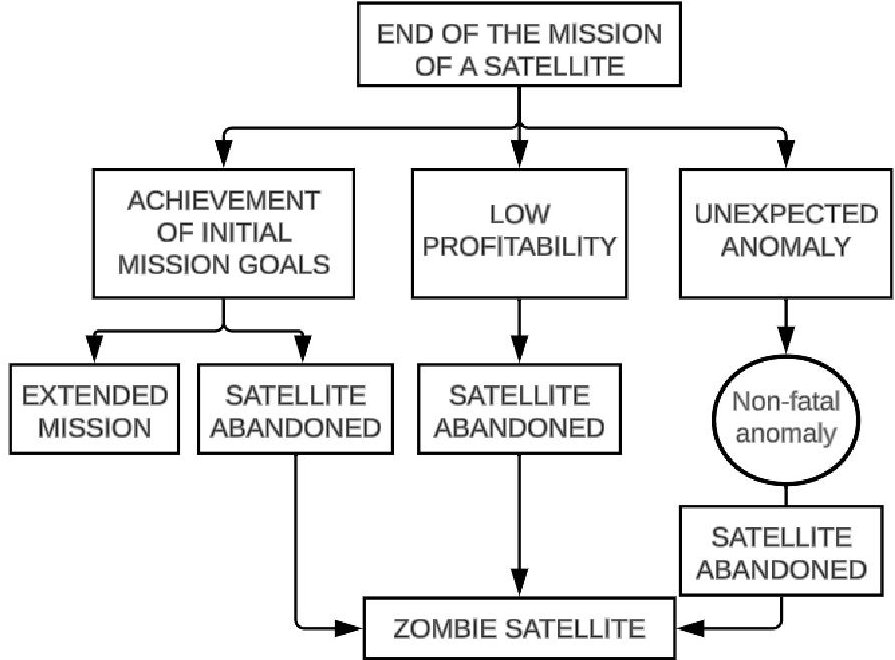

Figure 3.1: Causes that end a satellite's mission.

## 3.2 Space Debris Reduction Strategies

Space debris is an increasing cause of concern. Since the beginning of the space era, thousands of rockets, spaceships, and satellites have been launched, and at least initially, no one foresaw what to do with them at the end of their useful life. As a result, the number of space debris in notably LEO [7] and GEO orbits has been steadily increasing. In the last two decades, non-deliberate fragmentations continue to occur at about 11.7 events per year as shown in Fig 3.2 [8].

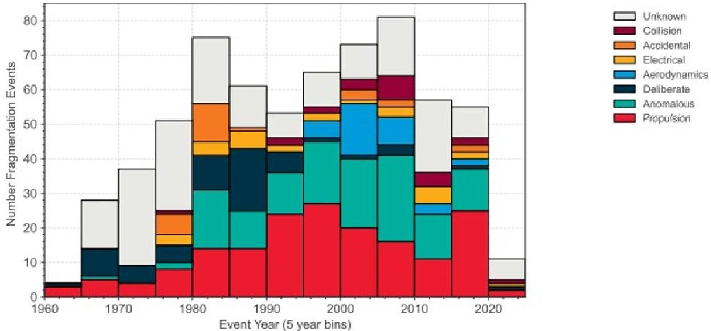

Figure 3.2: Historical fragmentation events until 2021.

Hence, different approaches have been followed to address this situation. The most common strategies have

<!-- PDF_PAGE: 78 -->

focused on ensuring a natural reentry in less than 25 years or forcing the controlled re-entry of satellites by their own or external means (if they cannot re-enter by themselves) [9]. In this case, for example, the UK Space Agency, in 2021, conducted a feasibility study on how to deorbit two defunct LEO satellites that were not built with retrieval and removal mechanisms in mind by 2025 [10], proposing the development of a system with propulsion capabilities. From the outcome of this study, on 25 August 2021, the End-of-Life Services by Astroscale-demonstration (ELSA-d) was conducted to capture and remove objects in orbit [11]. This design evolved during the ELSA-m mission, a public-private partnership with the ESA and OneWeb. ELSA-m will use a magnetic capture mechanism, and therefore, it can only capture satellites equipped with a docking plate before launch.

Another proposal is the COSMIC [12] initiative which proposes a spacecraft to capture and deorbit three or four objects in a single mission for a constellation customer.

In contrast to ELSA-m, COSMIC will use a robotic arm or gripping mechanism, which would enable to capture a defunct satellite not originally built to be grabbed. Another approach that has been considered by the JAXA is to de-orbit a discarded upper stage of a rocket without a docking plate. The next launch of the Active Debris Removal by Astroscale-Japan (ADRAS-J) [13] mission was in February 2024 when Rocket Lab launched its spacecraft to inspect the spent of the upper stage ahead of a removal attempt that could take place in 2025.

In addition to developing propulsion systems to re-enter defunct satellites, another strategy focuses on refueling satellites to maintain their orbits. For example, Northrop Grumman's Mission Extension Vehicle-2 (MEV-2) [14], a satellite life extension vehicle, completed on 12 April 2021 its first docking to the Intelsat 10-02, a GEO satellite launched in 2004. The MEV was designed to dock to GEO satellites, whose fuel is nearly depleted. MEV-2 does not move the satellite into a different orbit, instead, it acts as a new engine and fuel tank to extend the spacecraft's lifetime, enabling aging GEO communication satellites to continue operations for up to five more years each. Another approach was developed by Lockheed Martin [15], who plans to launch two CubeSats to demonstrate how small satellites can be used to upgrade GEO satellites or provide life-extension services such as refueling.

Moreover, investigations have been conducted on OOS and satellite life extension. Among these proposals, DARPA Phoenix program [16], which seeks to demonstrate that a robotic servicing vehicle can perform reliable and useful operations in GEO, such as the correction of some mission-ending mechanical anomalies, assistance in orbital maneuvers, and installation of attachable payloads. Subsequently, [17] proposed a robotic spacecraft to harvest components to repair existing satellites.

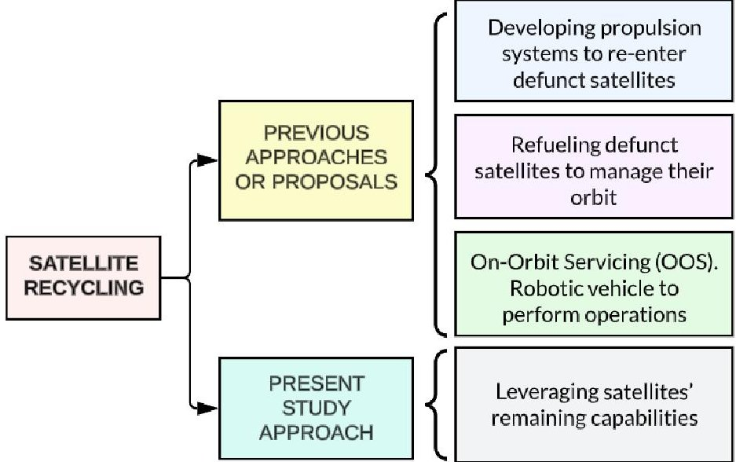

Figure 3.3: Satellite recycling approaches and proposals.

These approaches have focused on cleaning the space ecosystem by de-orbiting inoperative satellites, refueling satellites to provide services, and developing robotic spacecraft to repair, move, and/or assist aging satellites [9] (Fig. 3.3). However, to the best of our knowledge, no approach has been considered to recycle satellites that have partially failed so as to provide new services by leveraging their remaining capabilities. The possibility to recycle ZSs will optimize the in orbit infrastructure, reducing unnecessary launches, thus,

<!-- PDF_PAGE: 79 -->

mitigating directly the debris population, and contributing to the space ecosystem protection. Therefore, this work will: 1. analyze and assess the possibility of reusing failed satellites by analyzing their anomalies' severity, status, and 2. perform a feasibility study to conduct other services, especially for Earth observation and communication purposes.

## 3.3 Satellites' anomalies databases

Three different databases have been analyzed to study to analyze the satellites' anomaly. The first database is Telastra [18], which contains entries for over 1500 anomalies experienced by satellites from 1963 to 2021, mostly in GEO. Seradata database [1] provides anomalies experienced by over 1000 spacecraft in LEO, GEO, MEO, and other orbits.

Alongside the previous databases, a custom database has been built compiling additional satellite anomalies especially for small satellites (less than 1000 kg) anomalies reported in the Gunter Space Page, in the eoPortal [19], and by NASA [20].

The three databases include the orbit of the satellite that failed, launch and anomaly date, failure description, satellite mass, and anomaly cause, among other parameters. After filtering and selecting from each database the relevant information and eliminating duplicates, the final database includes a total of 3879 anomalies from 2577 different satellites, as sketched in Fig. 4.2.

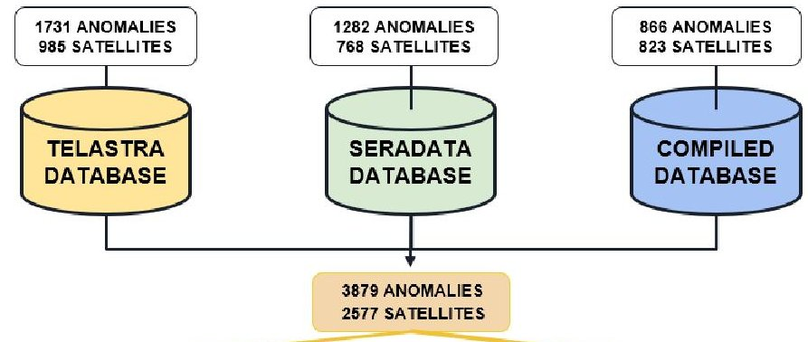

<table border="1"><tr><td>SATELLITE NAMES</td><td>LAUNCH DATE</td><td>STATUS</td><td>ORBIT</td><td>MASS</td><td>ANOMALY DATE</td><td>D_FRAG</td><td>ANOMALY DESCRIPTION</td><td>SYSTEMS DAMAGED</td><td>ANOMALY SEVERITY</td><td>CAUSE</td></tr></table>

Figure 3.4: Number of anomalies and satellites reported in each of the databases used. [?] Note: D_FRACTION is (Anomaly Date - Launch Date)/Expected lifetime.

Hence, from the 2577 satellites that experienced an anomaly, 56% are LEO, 36% are GEO, 3% are MEO and 5% correspond to satellites in other orbits (Fig. 3.5).

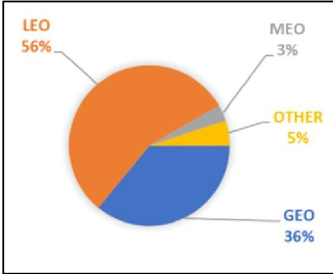

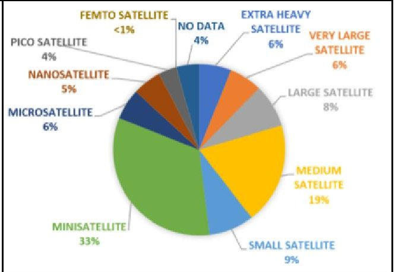

Figure 3.5: Classification of the analyzed satellites per orbit (left) and mass (right).

Credits: Plot created by the authors with data from Seradata [1], Telastra [18], and the custom Database compiled.

<!-- PDF_PAGE: 80 -->

## 3.4 Anomalies evaluation criteria

All subsystems are responsible for a specific task on the satellite. Some of these subsystems are indispensable, while others are not, and despite being disabled, the satellite can continue partially functioning. Hence, Table 3.1 analyses the remaining satellite's capability to perform several applications in case an anomaly impacts each subsystem. Table 3.1 distinguishes three different cases:

- Satellite without capabilities: Lack of, at least, one of its indispensable subsystems or components and, therefore, the satellite will not be able to perform either its initial mission or any other.

- Satellite with limited capabilities: The lack of certain subsystems or components implies that the satellite can operate, but with certain limitations.

- Satellite with full capability: Despite the lack or unavailability of certain subsystems, the satellite will continue to operate without limitations (e.g. failure is in a redundant subsystems).

Communication equipment such as the antenna, duplexer, amplifiers, telemetry transmitter, command receiver, encoders, and decoders are essential for communication and controlling the satellite. Nevertheless, in case of command receivers or demodulators failures in the TRC system, the communication system (data link) can receive commands and demodulate them before being executed by the onboard computer. In case an anomaly disables the communication system, by using the telemetry link, the satellite can still perform other services such as Earth observation, space observation, meteorology, and scientific research (e.g., biology, physics). The new service will be selected according its to appropriateness requirements, such as the power needed, and the amount of ground station transmitting and receiving the data, among others. Thrusters provide a fast reaction to stabilize satellites during orbit, and may be indispensable for some specific missions. Nevertheless, a satellite with no thrusters, but with reaction wheels combined with magnetorquers may provide full attitude stabilization of the satellite. The attitude reference sensor depends on mission accuracy. For instance, Earth sensors (with an accuracy around $ 1^{\circ} $ ) may be unsuitable for space observation satellites, since they require the high accuracy achieved by star trackers. Hence, in case of a failure of some attitude sensors, since generally a satellite is equipped with more than one type, it will be assessed if the satellite has the capability for other uses. Regarding electrical power, all the subsystem equipment is essential to generate, store, and distribute the power to the entire satellite. At least one solar panel is required to generate power. Batteries may not be essential, as some satellites were operational only during sunlight after battery failure. However, this study considers the EPS as a critical subsystem to provide a continuous and reliable service. As for the thermal control system, although passive thermal stabilization may be properly achieved, a satellite without the capability to control and maintain actively its temperature exhibits important limitations for an extended life.

<!-- PDF_PAGE: 81 -->

Table 3.1: The remaining capability to perform some applications in the case of different satellite equipment failure. No capability (Orange), Capability Limited (Yellow), Full Capability (Green).

<table border="1"><tr><td rowspan="2">Systems\Uses</td><td colspan="5">Earth Observation</td><td colspan="2">Comm. isolated areas</td><td>Navigational Assistance</td><td>Broadcast services</td></tr><tr><td colspan="5">Space Observation</td><td colspan="2">IoT and M2M comm.</td><td>Meteorology</td><td></td><td></td></tr><tr><td>Data Transmitter</td><td></td><td></td><td></td><td></td><td></td><td></td><td></td><td></td><td></td><td></td></tr><tr><td>Data Modulator</td><td></td><td></td><td></td><td></td><td></td><td></td><td></td><td></td><td></td><td></td></tr><tr><td>Data Demodulator</td><td></td><td></td><td></td><td></td><td></td><td></td><td></td><td></td><td></td><td></td></tr><tr><td>Data Receiver1</td><td></td><td></td><td></td><td></td><td></td><td></td><td></td><td></td><td></td><td></td></tr><tr><td>Telem. Transmitter2</td><td></td><td></td><td></td><td></td><td></td><td></td><td></td><td></td><td></td><td></td></tr><tr><td>Telemetry Modulator</td><td></td><td></td><td></td><td></td><td></td><td></td><td></td><td></td><td></td><td></td></tr><tr><td>Comm. Demodulator3</td><td></td><td></td><td></td><td></td><td></td><td></td><td></td><td></td><td></td><td></td></tr><tr><td>Command Receiver</td><td></td><td></td><td></td><td></td><td></td><td></td><td></td><td></td><td></td><td></td></tr><tr><td>Command Decoder</td><td></td><td></td><td></td><td></td><td></td><td></td><td></td><td></td><td></td><td></td></tr><tr><td>Telemetry Encoder</td><td></td><td></td><td></td><td></td><td></td><td></td><td></td><td></td><td></td><td></td></tr><tr><td>Antenna/Amplifiers</td><td></td><td></td><td></td><td></td><td></td><td></td><td></td><td></td><td></td><td></td></tr><tr><td>On-Board Computer</td><td></td><td></td><td></td><td></td><td></td><td></td><td></td><td></td><td></td><td></td></tr><tr><td>Thrusters4</td><td></td><td></td><td></td><td></td><td></td><td></td><td></td><td></td><td></td><td></td></tr><tr><td>Heaters/Coolers</td><td></td><td></td><td></td><td></td><td></td><td></td><td></td><td></td><td></td><td></td></tr><tr><td>Solar Panels/Batteries</td><td></td><td></td><td></td><td></td><td></td><td></td><td></td><td></td><td></td><td></td></tr><tr><td>Attitude Sensors5</td><td></td><td></td><td></td><td></td><td></td><td></td><td></td><td></td><td></td><td></td></tr><tr><td>Attitude Processor</td><td></td><td></td><td></td><td></td><td></td><td></td><td></td><td></td><td></td><td></td></tr><tr><td>Reaction Wheels</td><td></td><td></td><td></td><td></td><td></td><td></td><td></td><td></td><td></td><td></td></tr><tr><td>Momentum Wheels</td><td></td><td></td><td></td><td></td><td></td><td></td><td></td><td></td><td></td><td></td></tr><tr><td>Magnetorquers</td><td></td><td></td><td></td><td></td><td></td><td></td><td></td><td></td><td></td><td></td></tr></table>

$ ^{1} $ Not required for applications in which no data is transmitted from the ground, but only commands.

$ ^{2} $ Essential to report the status of the subsystems to the ground control station. In addition, a telemetry link can be an important communication backup, in case of data link unavailability.

$ ^{3} $ Essential to demodulate the commands transmitted from the ground control. In case it experiences an anomaly, the data demodulator becomes fundamental since at least one demodulator is required.

$ ^{4} $ Not necessary since magnetorquers, and reaction momentum wheels can provide satellite stabilization.

$ ^{5} $ It depends on the attitude sensors in the satellite.

## 3.5 Satellite Failures Analysis

## 3.5.1 Satellite anomalies occurrence during lifetime

From the analysis conducted, in which only 55% anomalies report the failure date, 31% of the anomalies in orbit occurred during the first quarter of the nominal satellite's useful life. This result confirms the starting point of this study, since an early anomaly of the payload leads to a waste of the remaining capabilities of the satellite for the rest of the original mission lifetime. During the second, third, and fourth quarters, the probability of anomaly decreases drastically, indicating that the most critical stage is the first quarter, when the satellite must perform some crucial functions, such as deployments (solar panels, antennas, tethers, etc.), perform the initial attitude stabilization and orientation, thruster ignition to reach an accurate orbit position, etc. In addition, it can also be related to a lack of comprehensive ground tests ("infancy failures"). It must

<!-- PDF_PAGE: 82 -->

be emphasized that launch failures have been excluded from the analyzed anomalies. Furthermore, as shown in Fig.3.6, the occurrence of an anomaly is independent of the orbit in which it has been launched LEO and GEO.

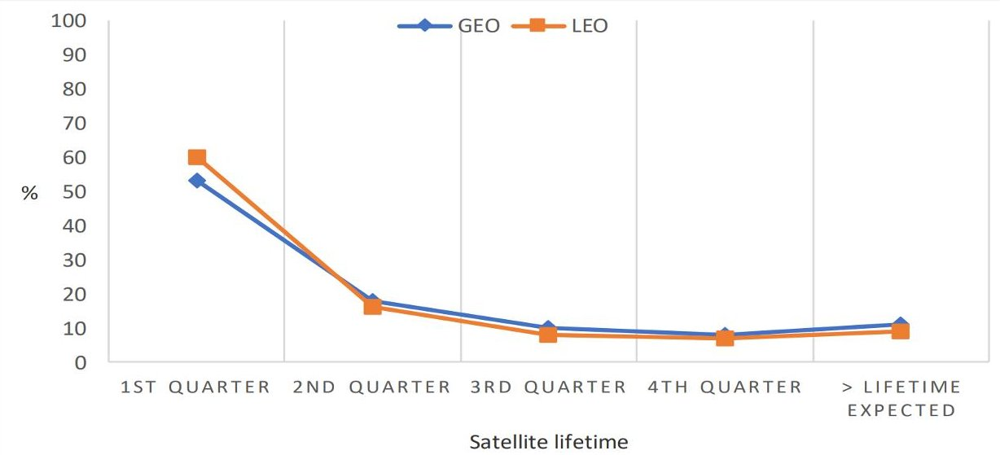

Figure 3.6: GEO/LEO satellites failures as a function of satellite lifetime.

Credits: Plot created by the authors with data from Seradata [1], Telastra [18], and the Database compiled.

## 3.5.2 Satellite anomalies analysis per subsystem

It has been found that the communications subsystem turned out to be the one with most failures:12% (Table 3.2), which is consistent with the fact that 36% of the analyzed satellites are GEO, and for telecommunication purposes. Communication anomalies include failures in the amplifier (TWTA or SSPA), channel power gain drop, the appearance of spurious signals, noise and interference, transmitter and receiver failures, and some other communication anomalies in which the component is not specified.

After the communications system, the ADCS presents the second largest percentage of anomalies (10%). Reference sensors (e.g., spurious inhibition and bias shift in their output voltages), and reaction wheel failures are among the most common failures.

The EPS and payloads are also among the subsystems with a significant anomaly percentage (8%). The solar arrays' degradation, circuit failures, and the batteries' decline to store power are the most frequent failures in the EPS. Regarding payloads, failures are directly related to the mission instrument (e.g. atomic clocks, radiometers, and cameras).

Propulsion failures (4%) include thrusters and apogee kick motors (especially for GEO satellites), thrust decay, low or high impulse, burning fuel too quickly, fuel leak, low pressure in the fuel tanks, propellant lower or greater than expected, ignition delays, etc. As for the mechanisms (3%) , solar arrays and reflectors not deployed, are among the typical failures, while for TT&C the commands decoders and telemetry coders, spurious commands, and command processors are among the most common failures.

<!-- PDF_PAGE: 83 -->

Table 3.2: Failures per subsystem.

<table border="1"><tr><td>Subsystem</td><td>Equipment</td></tr><tr><td>Communication(12%)</td><td>Amplifiers(TWTA/SSPA)(29%)Channel(15%)Antenna(6%)Transmitter(6%)Receiver(4%)Spurious(2%)Noises and Interferences(2%)Unspecified(36%)</td></tr><tr><td>AttitudeDetermination andControl(10%)</td><td>AttitudeReference Sensors(30%)ActuatorSystem(18%)AttitudeControlProcessor(6%)Unspecified(46%)</td></tr><tr><td>ElectricalPowerSystem(9%)</td><td>Solararrays(37%)Batteries(36%)Unspecified(27%)</td></tr><tr><td>Payloads(8%)</td><td>Instruments(70%)AtomicClock(18%)ScanMirrors(4%)Unspecified(8%)</td></tr><tr><td>Propulsion(4%)</td><td>Thrusters/AKM(61%)FuelSystem(22%)Unspecified(17%)</td></tr><tr><td>Telemetry,command,and ranging(3%)</td><td>Encoders/Decoders(18%)Transmitters/Receivers(12%)TelemetryData(11%)PhantomCommands(7%)Unspecified(52%)</td></tr><tr><td>Mechanisms(3%)</td><td>SolarPanelsDeployment(41%)AntennaDeployments(24)Others(35%)</td></tr><tr><td>On-BoardComputer(2%)</td><td>Softwareerrors(21%)Tape recorder(27%)Data handling system(5%)Unspecified(47%)</td></tr><tr><td colspan="2">ThermalControl(1%)</td></tr><tr><td colspan="2">Unspecifiedanomalies(48%)</td></tr></table>

(48%)

Since most GEO satellites are equipped with communication payloads, and the anomalies related to these payloads have been considered part of the communication subsystem, LEO presents more payload failures than GEO, while GEO does present more failures in the communication subsystem (Fig.3.7). GEO satellites have more propulsion failures, mostly because of the apogee kick motors that need to reach a circular geosynchronous orbit, the amount of fuel, and the fuel tank environment considering the solar and cosmic radiation effects on the GEO orbit over the LEO. Computers on GEO satellites fail less than LEO ones, possibly because the former are RadHard, have redundancy, and are designed for a lifetime over 10 or 15 years.

<!-- PDF_PAGE: 84 -->

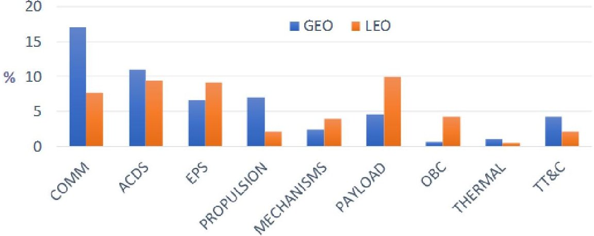

Figure 3.7: Failures' percentage per subsystem for LEO and GEO orbits.

Credits: Plot created by the authors with data from Seradata [1], Telastra [18], and the Database compiled.

## 3.5.3 Severity of satellites' anomalies

The impact of an anomaly on a mission can vary significantly. For this analysis, the effects and severity of the anomalies were determined according to the following classification:

- Work Around: This category encompasses the anomalies whose effects were (or were almost) negligible in the satellite. Moreover, for simplicity, it also encompasses those satellites that kept working after the occurrence of an anomaly despite some limitations. For instance, due to limited electrical power, some transponders may be switched off, limiting the service of the satellite.

- Redundant Subsystem or Component: Normally a redundant subsystem or component is used when the anomaly affects permanently or temporarily the initial system. For various factors, such as space and mass requirements, not all satellites have the possibility to have redundant component or subsystems.

- Subsystem Temporarily Disabled: The subsystem was temporarily disabled after experiencing the anomaly.

- Satellite Temporarily Disabled: The satellite was temporarily not operational after experiencing the anomaly.

- Subsystem Permanently Disabled: The subsystem was permanently disabled after experiencing an anomaly. If the disabled subsystem corresponds to the EPS or to any other crucial equipment (e.g., the command decoder, attitude control processor, etc.) with no redundancy, the satellite is considered permanently disabled. Most of the anomalies that lead to ZSs (Fig.3.1), present this type of severity.

- Satellite Permanently Disabled: This category represents the worst scenario that a given anomaly can mean to a satellite. Generally, the satellite becomes useless at this stage, and nothing can be done to get it back to life. However, in some cases, because the satellite cannot carry out the specific mission launched for, it remains abandoned although still has some capabilities to offer other services besides the one initially designed to become a ZS.

The results obtained from the analysis indicate that 24% of the anomalies in orbit led to a total loss hence, disabling permanently the satellite (Fig. 3.8), whereas 23% of the anomalies did not affect the satellite; therefore, it was able to resume the mission totally or partially. 10% of the failures disabled the satellites temporarily, 4% affected the subsystems temporarily and, 8% of the anomalies led the satellite to switch to the redundant system or component. In addition, 9% disabled permanently a subsystem, while 22% correspond to an unknown severity of unspecified anomalies.

Throughout history, continuous improvements have been implemented to have more reliable, effective, and long-lasting systems. In Fig. 3.9, an evolution of the anomalies' severity is presented yearly. From 1963 to 1970, most of the anomalies that occurred, disabled the satellite permanently. However, from 1970 to 1986 satellites with redundant component or subsystems after an anomaly appeared (41 anomalies), increasing significantly from 1987 to 2000 (98 anomalies).

In addition, from 1997 to 2012, the anomalies disabling satellites remained almost constant, while from 2013 onwards, coinciding with the "New Space" era, the number of satellites disabled after experiencing an

<!-- PDF_PAGE: 85 -->

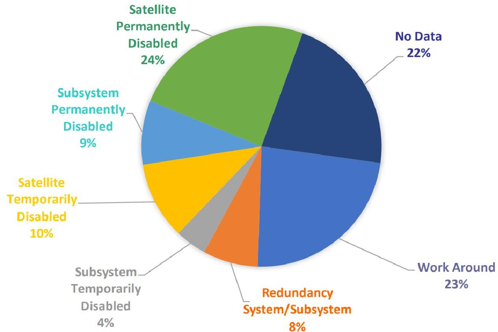

Figure 3.8: Anomalies' severity.

Credits: Plot created by the authors with data from Seradata [1], Telastra [18], and the Database compiled.

anomaly increases again gradually until 2021. The majority of the satellites disabled permanently in 2021, as it is shown in Fig. 3.9, which correspond to Starlink, are related to a solar storm that increased the solar radiation pressure, pushing the satellites down and lowering their orbit until re-entry [21].

The lack of information on the typology of the anomaly, does not allow us to evaluate the remaining capabilities that these satellites had and that could be reused. Most LEO satellites, after experiencing a failure, cannot resume their mission and are decommissioned and abandoned rapidly before evaluating their remaining subsystems and capabilities.

## 3.5.4 Characterization of ZSs

Once the anomalies and their different impacts on the satellite have been analyzed, in this section the conditions for a satellite to be considered a ZS are discussed. Firstly, a reassessment of the impact of the anomaly on the satellite is necessary to study the feasibility of being reused. As indicated in Table 3.1, depending on the systems and equipment affected by an anomaly, it will be necessary to find out whether it is a fatal anomaly or whether the satellite, despite experiencing anomalies, continues to gather certain capabilities. Once the anomaly experienced has been evaluated as well as its effects on the systems, the next aspect to consider is the year the satellite or constellation was launched. Besides the accumulated radiation effects on the satellite after being exposed for an extended period, this is extremely important because of the technological innovation experienced in this last decade since the systems of a reused satellite must guarantee compatibility with other terrestrial and space architectures. Apart from the previous considerations, the satellite must still be orbiting in a usable orbit, not decayed, or moved to the graveyard orbit.

## 3.5.4.1 ZSs in Constellations

Considering that since 2013 at least 62% of satellites launched are part of constellations (5824 launches of 120 constellations versus a total of 9356 spacecraft launched in that period) [1], in most cases, of private companies, to demonstrate the presence of the so-called ZSs, this section focuses on analyzing the status of the some of the largest constellations by assessing their current active, inactive, and failed satellites. According to Seradata's database, and as reported in Table 3.3, currently, of the ten longest constellations, there are 956 inactive satellites orbiting, of which 347 and 349 correspond to Space X and Planet Labs, respectively. Considering that the hibernated satellites are already excluded, the number of failed satellites reported as compared to the number of inactive satellites appears to be low, indicating that not all failed satellites are reported, as for instance, Space X and Planet Labs, in which only 262 and 27 satellites are reported to have

<!-- PDF_PAGE: 86 -->

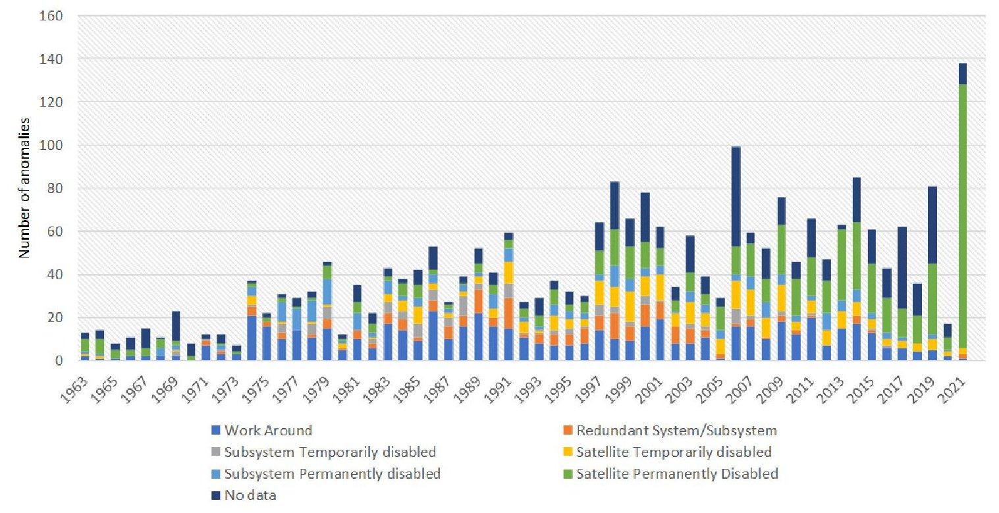

Figure 3.9: Anomalies' and their severity (1963-2021).

Credits: Plot created by the authors with data from Seradata [1], Telastra [18], and the Database compiled.

failed. An inactive satellite does not imply being a ZS. To affirm which inactive satellites are possible zombies, an anomaly reassessment is required to quantify the capabilities and limitations of the satellite. Hence, those inactive satellites with or over 25% capability are selected. Satellites with at least 25% the non-fatality of the anomaly is indicated, thus, it is guaranteed that at least the essential subsystems and components can still be reused. The higher this percentage, the more capabilities the satellite has, and fewer subsystems have been affected after the anomaly. In addition, it must be taken into consideration that there are inactive satellites, that unlike those ones analyzed after an in-orbit anomaly, they may have suffered unreported anomalies or been abandoned because of different causes as depicted in Fig 3.1, thus, the number of zombie inactive satellites increases significantly. Finally, to ensure the viability of those selected satellites, only those launched in 2010 onwards are selected and considered ZSs. In this regard, the analysis shows that Space X and Planet Labs constellations do have 85 and 322, respectively, inactive failed satellites with operational capabilities of more than or equal to 25%, while only 29 for ORBCOMM as indicated in Table 3.3 [1]. Unspecified anomalies in those constellations must be taken into account, as they hinder and limit the consideration and assessment of most of those satellites. As for the other constellations, such as Iridium communications and Satellogic, the non-specification and uncertainty of the anomalies' severity has totally limited the identification of those inactive satellites with remaining capabilities. Thus, besides the potential ZSs identified, Table 3.3 also reports possible ZSs, which are cases of inactive satellites with unknown remaining capabilities. Moreover, those satellites that before being decayed or moved to the graveyard orbits were possible ZSs that have also been included.

<!-- PDF_PAGE: 87 -->

Table 3.3: Some large constellations status.

<table border="1"><tr><td colspan="6">Nanosats.eu</td><td colspan="6">Seradata</td></tr><tr><td></td><td>Company</td><td>Constellation</td><td>Mission</td><td>Launched</td><td>Planned size</td><td>Spacecraft launched</td><td>Active</td><td>Inactive/(\%)</td><td>1Backlog</td><td>Failures reported</td><td>Satellites failed</td></tr><tr><td>1</td><td>SpaceX</td><td>Starlink Gen1</td><td>Internet</td><td>3580</td><td>4408</td><td>4215(0 hibernation)</td><td>3868</td><td>347(8%)</td><td>7885</td><td>269</td><td>262</td></tr><tr><td>2</td><td>Planet(Labs)</td><td>Flock/Dove/SuperDove</td><td>Earth observation/Optical</td><td>519</td><td>150</td><td>541(0 hibernation)</td><td>192</td><td>349(64%)</td><td>32</td><td>27</td><td>27</td></tr><tr><td>3</td><td>OneWeb</td><td>OneWeb</td><td>Internet</td><td>504</td><td>648</td><td>620(0 hibernation)</td><td>617</td><td>3(1%)</td><td>36</td><td>3</td><td>3</td></tr><tr><td>4</td><td>Spire</td><td>Lemur</td><td>Weather/GNSS</td><td>160</td><td>150</td><td>151(0 hibernation)</td><td>108</td><td>43(28%)</td><td>3</td><td>1</td><td>1</td></tr><tr><td>5</td><td>Chang Guang</td><td>Jillin,Daoda,Tianfu</td><td>Earth observation/Optical</td><td>83</td><td>300</td><td>89(0 hibernation)</td><td>88</td><td>1(1%)</td><td>8</td><td>Not reported</td><td>Not reported</td></tr><tr><td>6</td><td>Iridium Communications Inc</td><td>Original and next Iridium</td><td>Internet,IoT/M2M,Orbital Data Relay</td><td>75</td><td>75</td><td>155(0 hibernation)</td><td>75</td><td>80(51%)</td><td>6</td><td>53</td><td>39</td></tr><tr><td>7</td><td>ORBCOMM</td><td>OG2</td><td>IoT/M2M</td><td>50</td><td>52</td><td>58(0 hibernation)</td><td>11</td><td>47(81%)</td><td>0</td><td>27</td><td>18</td></tr><tr><td>8</td><td>Satellogic</td><td>Satellogic</td><td>Earth observation/hyperspectral/Optical</td><td>31</td><td>90</td><td>39(0 hibernation)</td><td>37</td><td>1(2%)</td><td>240</td><td>Not reported</td><td>Not reported</td></tr><tr><td>9</td><td>Global Start Inc.</td><td>Global Start Inc.</td><td>Internet,IoT/M2M,Orbital Data Relay</td><td>25</td><td>41</td><td>83(0 hibernation)</td><td>31</td><td>52(62%)</td><td>17</td><td>62</td><td>52</td></tr><tr><td>10</td><td>SES S.A</td><td>O3b</td><td>Internet</td><td>22</td><td>70</td><td>69(0 hibernation)</td><td>42</td><td>33(47%)</td><td>20</td><td>76</td><td>37</td></tr></table>

$ ^{1} $The "Backlog" column refers to the satellites planned to be launched in the future for each of the constellations considered.

Note: Table based on data provided by Nanosats.eu and Seradata databases [1] [22] [23] [24].

Table 3.4: ZSs in large constellations.

<table border="1"><tr><td>Constellation name</td><td>Current Inactive Satellites</td><td>Reported Inactive Satellites:1) Launched in 2010 onwards2) Capability≥25%</td><td>Reported Inactive Satellites:1) Launched in 2010 onwards2) Unknown Capability</td><td>$ ^{2} $ Retired satellites with capability≥25%</td></tr><tr><td>SpaceX</td><td>347</td><td>85</td><td>2</td><td>260</td></tr><tr><td>Planet(Labs)</td><td>349</td><td>322</td><td>2</td><td>25</td></tr><tr><td>OneWeb</td><td>3</td><td>Not reported</td><td>Not reported</td><td>Not reported</td></tr><tr><td>Spire</td><td>43</td><td>Not reported</td><td>$ 25^{1} $</td><td>Not reported</td></tr><tr><td>Chang Guang</td><td>1</td><td>Not reported</td><td>Not reported</td><td>Not reported</td></tr><tr><td>Iridium Communications Inc</td><td>80</td><td>Not reported</td><td>Not reported</td><td>Not reported</td></tr><tr><td>ORBCOMM</td><td>47</td><td>29</td><td>7</td><td>11</td></tr><tr><td>Satellogic</td><td>1</td><td>Not reported</td><td>Not reported</td><td>Not reported</td></tr><tr><td>Global Start Inc.</td><td>52</td><td>34</td><td>18</td><td>0</td></tr><tr><td>SES S.A</td><td>33</td><td>18</td><td>4</td><td>11</td></tr></table>

$ ^{1} $Based on the reception report of occultation profile data from 25 satellites of the Spire constellation [25] $ ^{2} $The retired satellites include decayed or those satellites moved to graveyard orbits.

Note: Table created by the authors based on data provided by Seradata [1].

## 3.6 Conclusions

The importance of satellites in daily life is out of question; hence, an increasing number of satellites are being launched to meet the needs of different users. However, of the hundreds (and in recent years, thousands) of satellites launched each year, only a few operate at the end of their expected lifetime. In some cases, satellites are decommissioned and/or abandoned for different reasons (economic, end mission, political, etc.). On some occasions, it is decided to launch new ones owing to unexpected anomalies instead of leveraging the capabilities they still have. In the analysis presented, the probability of a satellite failing in the first quarter of its life is three times larger than in the second quarter, and seven times more than in the last quarter of its life, evidencing the waste of satellites' capabilities, since not all the failures experienced during the first quarter are catastrophic and many systems can be leveraged. Most of the frequent failures correspond to crucial equipment for the satellite such as output amplifiers, reference sensors, batteries, and solar panels. Nevertheless, payload instruments, do also present a high probability of failure, leading in some extreme cases, to the end of the initial mission. During the analysis, it has been observed that some failed satellites tend to be decommissioned early, to decay (LEO orbits), to be moved to a graveyard orbit (GEO orbits), drifting completely from their orbit, instead of re-assessing the anomaly and raising the possibility of using the satellite for other purposes.

A failed satellite that has experienced a non-fatal anomaly and cannot perform the initial mission can be reused for other purposes depending on the remaining capabilities. For instance, in case of a data link

<!-- PDF_PAGE: 88 -->

anomaly, using the telemetry link, the satellite can still be capable to offer some low-rate applications such as: 1) the Internet of Things (IoT), by connecting low-bandwidth IoT devices in remote areas where traditional terrestrial networks are unavailable, 2) environmental monitoring, and selected remote sensing applications [26], which typically require low data rates and low-speed radios to transmit efficiently the data collected, 3) asset trackings, such as ships or cargo containers in remote areas, among others. On the other hand, assuming an anomaly in the ADCS which results in an undesired pointing, the satellite can be leveraged on applications that do not require a high pointing accuracy such as IoT devices, which do not require a high pointing precision as their antennas have a wide radiation pattern. Some failures in the storage systems may be critical to resume some services which require the processing of large data quantities; hence, the satellite may be still exploitable in those applications, but with limited data storage capability. Navigation purposes, for instance, require limited data storage as GPS and GLONASS satellites do only need to store satellite ephemeris data and clock corrections. Similarly, satellites used for weather monitoring typically only need to store images and other data related to weather patterns.

According to the authors' knowledge, this study is the first approach to how leverage failed satellites. A significant limitation encountered during this study is the number of unreported anomalies. To achieve more extensive and detailed results, a detailed description of the anomalies would be necessary for future projects so as to determine the effects of anomalies on the satellite architecture. Moreover, more research must be conducted, because bringing a ZS back to life poses multiple technology challenges, and also barriers regarding regulations, liabilities, and legal and technological aspects [27]. They may require a different frequency filling to reuse the communication devices for other purposes, a transfer of ownership, a reconfiguration, access to their operations, etc. Future designs and new technologies must ensure the flexibility of the hardware and software satellite architecture. In addition, it is essential to raise awareness in the sector about the economic and environmental impact that ZSs can provide by reducing the saturation in orbit, unnecessary launches, space debris originating, and ecological effects on the planet.

Given that an Eco-Lean proposal must address not only mechanical or manufacturing-related issues in orbiting satellites, but also factors that, according to the previous study, can cause severe partial or total failures in satellite systems, this thesis encompasses, in the following chapter, a statistical analysis of various space weather indicators. These indicators may be directly linked to the deterioration of spacecraft systems due to exposure to space radiation. Electrostatic discharges (ESD), single event latch-up (SEL), and single event upsets (SEU) are among the most frequent causes of reported anomalies in satellites. The aim is to quantify how concentrations and fluctuations of space radiation around Earth can damage spacecraft equipment and jeopardize mission continuity.

<!-- PDF_PAGE: 89 -->

## Bibliography

[1] SpaceTrack, SpaceTrack database: number of spacecraft's launches 2022-2023, (accessed: 17.02.2023).

[2] European Space Agency, ESA Space Debris Mitigation Compliance Verification Guidelines, (accessed: 14.05.2023), https://sdup.esoc.esa.int/documents/download/ ESSB-HB-U-002-Issue214February2023.pdf.

[3] National Aeronautics and Space Administration, Process for Limiting Orbital Debris, (accessed: 14.05.2023), https://standards.nasa.gov/sites/default/files/standards/NASA/C/0/ nasa-std-871914c.pdf.

[4] Forbes, Iridium Rising, (03.26.2009), https://www.forbes.com/forbes/2009/0413/ 036-wireless-satellites-iridium-rising.html.

[5] National Aeronautics and Space Administration, The Orbital Debris Quarterly News (ODQN), (accessed: 11.01.2023), https://orbitaldebris.jsc.nasa.gov/quarterly-news/#.

[6] Liou, J.C. and Johnson, N.L., Risks in space from orbiting debris, Science, 311(5759), 340-341, 2006.

[7] Liu, Yongjie, Yu Jiang, and Hengnian Li, Analytical propagation of space debris density for collisions near sun-synchronous orbits, Space: Science & Technology, 2022, AAAS.

[8] ESA Space Debris Office, ESA'S ANNUAL SPACE ENVIRONMENT REPORT, 6.0, The European Space Agency, ESA ESOC, Germany, 2022.

[9] Zhang, Jingrui, Yifan Cai, Chenbao Xue, Zhirun Xue, and Han Cai, LEO mega constellations: review of development, impact, surveillance, and governance, Space: Science & Technology, 2022, AAAS.

[10] Rainbow, J., UK funds studies to remove two spacecraft from LEO, (accessed: 26.08.2021), https://acortar.link/AilluW.

[11] Foust, J., After technical demonstrations, satellite servicing grapples other issues, 2021, (accessed: 09.09.2021), https://acortar.link/8wSY8s.

[12] Institution of mechanical engineers, Astroscale targets two satellites for capture in government-backed mission, (accessed: 03.12.2022), https://acortar.link/8wSY8s.

[13] Institution of mechanical engineers, Astroscale Selects Rocket Lab to Launch Phase I of JAXA's Debris Removal Demonstration Project, (accessed: 24.12.2022), https://acortar.link/IfRc41.

[14] Rainbow Jason SpaceNews, Northrop's MEV-2 servicer closing in on Intelsat-10-02 docking attempt, (accessed: 06.10.2022), https://acortar.link/KX7cew.

[15] Erwin Sandra SpaceNews, Lockheed Martin takes aim at satellite servicing market, (accessed: 16.12.2022), https://spacenews.com/ lockheed-martin-takes-aim-at-satellite-servicing-market/.

[16] DARPA, DARPA, (accessed: 24.10.2022), https://www.darpa.mil/.

[17] Barbaraa, N.H., Lizy-Destreza, S., Guardabassoa, P., Alary, D., New GEO paradigm: Re-purposing satellite components from the GEO graveyard, Space: Science & Technology, 173, 155-163, 2020.

[18] Telastra Inc., Public Record Satellite Anomaly Database (PRSADB), 2021, http://telastra.com/.

[19] Agency European Space, EO PORTAL, (accessed: 30.11.2022), https://www.eoportal.org/.

<!-- PDF_PAGE: 90 -->

[20] National Aeronautics and Space Administration- NASA, Small Satellites Mission Failures Rate [Online]., (accessed: 12.12.2022), https://ntrs.nasa.gov/api/citations/20190002705/downloads/ 20190002705.pdf.

[21] Robin George Andrews, The New York Times, Solar Storm Destroys 40 New SpaceX Satellites in Orbit, (02.09.2022), https://www.nytimes.com/2022/02/09/science/ spacex-satellites-storm.html.

[22] Nanosats, Nanosats Constelation database, (accessed: 04.12.2023), https://www.nanosats.eu/ tables#constellations.

[23] New Space Index, Constalletion Orbcomm (OG2), (accessed: 04.21.2023), https://www.newspace im/constellations/orbcomm.

[24] Rod Sladen's Home Page, Iridium Constellation Status, (accessed: 04.21.2023), http://www.rod sladen.org.uk/iridium.htm.

[25] EUMETSAT ROM SAF Radio Occultation Meteorology, Monitoring of NRT Products: NWP Model and Data Flow, 2023. [Online]. Available: https://www.romsaf.org/monitoring/index.php. [Accessed: 30-May-2023].

[26] L. Fernandez, M. Sobrino, A. Rodriguez, A. Gonga, C. Molina, L. Rayón, M. Badia, P. Fabregat, A. Perez-Portero, J. Ramos-Castro, J. A. Ruiz-de-Azua, A. Calveras, A. H. Jallad, and Z. Abdul Aziz, "SDR-Based Lora Enabled On-Demand Remote Acquisition Experiment On-Board the Alainsat-1," in 2021 IEEE International Geoscience and Remote Sensing Symposium IGARSS, 2021, pp. 8111-8114. doi: 10.1109/IGARSS47720.2021.9553020.

[27] Blount, PJ, Space traffic coordination: developing a framework for safety and security in satellite operations, Space: Science & Technology, 2021, AAAS.

<!-- PDF_PAGE: 91 -->

<!-- PDF_PAGE: 92 -->

# Chapter 4

# Statistical Relationship Analysis Between LEO and GEO Satellite Anomalies and Space Radiation

## Abstract

Exposure to space radiation degrades substantially satellite systems, provoking severe partial or in some extreme cases, total failures. Electrostatic discharges (ESD), single event latch-up (SEL), and single event upsets (SEU) are among the most frequent causes of those reported satellite anomalies. The impact of space radiation dose on satellite equipment has been studied in-depth. This study conducts a statistical analysis to explore the relationships between Low-Earth Orbit (LEO) and Geostationary Orbit (GEO) satellite anomalies and particle concentrations, solar and geomagnetic activity in the period 2010-2022. Through a monthly and daily timescale analysis, the present work explores the temporal response of space disturbances on satellite systems and the periods when satellite are vulnerable to those disturbances.

Keywords Satellite Anomalies, Space Radiation, Solar Activity, Geomagnetic Disturbances.

## 4.1 Introduction

Besides the technical specifications and the fulfillment of functional capabilities of electronic components, their durability, and resilience in space conditions are a major concern for the space industry. Over time, substantial evidence has been accumulated relating an important amount of satellite anomalies to space environment conditions. For example, in Telastra database [1], which lists over 1500 anomalies primarily associated with GEO satellites, sample reported failures suspected to be related to radiation effects are TDRS-1 in 1983, TDF-1 in 1989, Telecom 2A in 1994, and Thaicom-5 in 2011. More satellite failures associated to space weather have been reported on several studies such as [2, 3, 4, 5, 6, 7]. Thus, understanding the space environment's effects is essential to advance towards more robust designs and operational strategies [8, 9].

In this regard, several studies, mostly based on statistical analysis and primarily focused on GEO anomalies [10,11], have been carried out to figure out the temporal response of space disturbances on satellite equipment, the most susceptible periods by which the anomaly rate increases, and the effects of the different radiation particles upon several systems. For instance, [12] analyzed 95 commercial satellite anomalies in 1997-2009, obtaining a strong correlation between anomaly rate and geomagnetic activity, and interesting seasonal variations in the occurrence of GEO anomalies. Similarly, [13] investigated potential statistical correlations between electron/proton flux data and GEO satellite anomalies for the period 1986-1994, showing the susceptibility of GEO satellites to solar protons during solar maximum activity, and relativistic electrons during the minimum activity. However, the majority of research, including the aforementioned studies, consider only GEO anomalies in their analysis, which restricts our understanding to high orbits only. In

<!-- PDF_PAGE: 93 -->

addition, according to authors' knowledge, no similar analysis has been performed for anomalies that occurred in the last years, to evaluate the effectiveness and evolution of Radiation Hardened (RadHard) components. Furthermore, considering the "New Space Era" from 2013, onwards and the revolution towards small satellites (e.g. CubeSats) [14], it is critical to understand how the minimization of satellite mechanical structure and electronic components mitigates radiation exposure [15, 16]. In that regard, this study presents a statistical analysis that compares reported anomalies of LEO ( $ \leqslant $ 1000 kg) and GEO satellites ( $ \leqslant $ 5000 kg) spanning the period from 2010 to 2022 with four variables: sunspots (SS), coronal mass ejections (CME), Kp-index, and the Disturbance Storm-Time (DST). Moreover, it investigates the connection between satellite anomalies and the flux of protons, electrons, and X-ray particles. In particular, this study aims to: 1) understand the temporal response of space weather disturbances and satellite anomalies occurrence, 2) ascertain how solar and geomagnetic storms affect satellites based on their orbit, thus, LEO and GEO anomalies are analyzed separately, 3) identify susceptible periods of time when the anomaly rate fluctuates significantly, 4) determine the most suitable timescale to evaluate anomalies and space weather depending on the orbit and disturbance indicator, and 5) examine the effects on satellite systems that increasing fluxes of particles have.

This manuscript is organized as follows: space radiation characteristics and their potential impact on spacecraft systems are briefly introduced in Section 4.2. Section 4.3 describes the anomalies database, the space radiation indicators used, and the methodology followed to carry out the analysis. Section 4.4 presents the results of the statistical analysis, while in Section 4.5 the results are discussed and summarized.

## 4.2 Space Weather Effects on Satellite Systems

Space weather phenomena and their related particle properties can affect different satellite systems. The primary sources of radiation in Earth's satellite orbits proceed from solar event particles (SPE particles), galactic cosmic rays (GCR), and auroral particles (mostly low-energy electrons) [17]. High-energy charged particles known as GCRs originate outside the solar system and are composed of protons, electrons, and heavy ions. GCRs and solar activity have a negative correlation, which means that, when solar activity is at its lowest and the Sun's magnetic field is weaker, more GCRs enter into the inner solar system [18]. As for solar radiation, SPEs occur when charged particles in the Sun's atmosphere are accelerated at very high velocities, escaping to the interplanetary space [19, 20]. In case those particles have enough energy to penetrate the Earth's magnetic field, they reach the Earth's magnetosphere and ionosphere surrounding mainly, the North and South poles. SPEs have a mean composition of 96.4% protons, 3.5% alpha particles, and 0.1% heavier ions [21], where the peak flow of particles with energies above 10 MeV per nucleon can surpass $ 1 0^{5} \mathrm{c m}^{-2} s^{-1} $ [22].

The radiation intensity that a satellite may encounter during its lifetime depends significantly on its orbit attitude and inclination [23]. For example, orbits with low altitudes are often attained by less radiation flow due to the shielding effects of Earth's magnetic field and atmosphere thus, providing better safety for LEO satellites [23, 24, 25]. However in LEO, satellites that, for example, orbit across the inner Van Allen belt, where the Earth's magnetic field traps the high-energy protons, will still be substantially exposed to high dosages [26, 27, 28]. In addition, the radiation in orbit also varies depending on the temporal fluctuations of several space phenomena such as the regular solar cycles, sporadic solar flares, solar wind, and geomagnetic storms. Hence, the satellite subsystems may experience a variety of effects and disruptions based on the particles' characteristics (e.g. typology, energy levels) derived from those space weather events (see Fig. 4.1) [29, 30]. The main radiation effects on satellite systems as well as those particles causing them can be summarized in the following points:

- Surface charging of satellite: Caused by low-energy electrons ( < 100 keV), observed typically in the inner magnetosphere during storms [12].

- satellite internal electrostatic discharge: Caused by high-energy electrons (>100 keV), observed in Earth's dynamic outer radiation belt.

- Single event effects: Caused by high-energy protons (>10 MeV) and heavier ions, derived solar flares, and Coronal Mass Ejection (CME).

- Total dose effects: Caused by cumulative charged protons and electrons during space weather storms.

- Others: Other effects such as those related to communications and attitude control failures, due to magnetic field variations, and ionospheric anomalies, among others [31].

<!-- PDF_PAGE: 94 -->

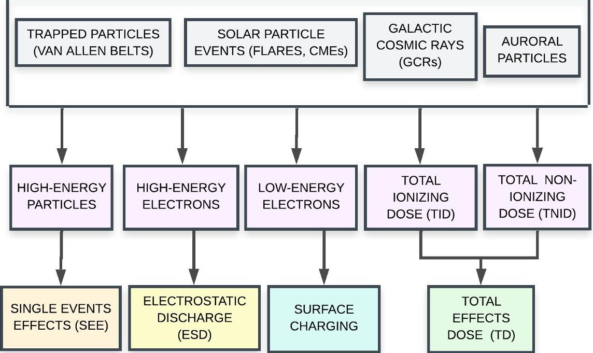

Figure 4.1: Radiation particles and their effects on spacecraft systems.

Although satellites are conceived to operate in the space environment, some of those particles can interact with the satellites' surfaces, and damage the electronics, creating a serious damage to the system [32, 33]. Within this context, numerous subsystems and equipment in the satellite are significantly vulnerable to radiation effects [33]. For instance, solar arrays are susceptible to ultraviolet (UV) radiation, polymers are vulnerable to high-energy photons [34], and high-energy electrons may provoke severe electrical discharges. In addition, high-energy protons and ions can substantially affect sensitive electronic components by changing bits (SEU) and disabling device capabilities (Single event Latchup or Burnout, SEL or SEB, respectively) [35, 36, 37].

## 4.3 Data and Methodology

## 4.3.1 LEO and GEO satellite anomalies

Anomalies associated with GEO satellites have been extracted from Seradata database [38]. Regarding anomalies corresponding to LEO orbit, besides those reported in Seradata [38], additional LEO anomalies reported in the Gunter Space Page, eoPortal [39], and NASA [40] have been assembled in a custom database. Only those anomalies that occurred from January 1, 2010, to December 31, 2022, have been considered, regardless of the satellite's launch year. In addition, to remove any potential outliers that may introduce bias and influence the results, several filters have been introduced in the databases. In particular:

1. Anomalies lacking a clear specification of the month and day of occurrence in their description were discarded, given the significance of the anomalies' date in the analysis.

2. Launch failures were removed as their occurrence is typically attributed to mechanical or procedural errors unrelated to space radiation.

3. Unless the cause of the specified anomaly is closely related to radiation effects (e.g. ESD), failures occurring within the first month after launch were excluded, as they may be due to "infancy failures" [41] or lack of testing processes.

4. Anomalies that their cause is not exclusively attributable to radiation effects are discarded. Clear examples are those anomalies related to specific mechanical failures (e.g. related to antenna and solar panel deployment), propulsion systems (e.g. fuel loss), and data misinterpretation by operators, among others.

5. Only one anomaly—the first failure, if specified—is taken into consideration for satellites that have multiple reported failures in a single day. Thus, anomalies that can be derived from the malfunctioning

<!-- PDF_PAGE: 95 -->

of the initial one are removed.

Thus, considering the previously defined filters, 518 and 511 anomalies of LEO and GEO satellites, respectively, are considered in the analysis (see Fig. 4.2).

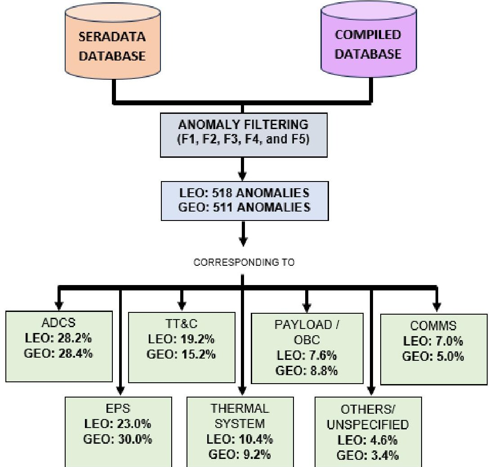

Figure 4.2: Anomalies selection criteria and their categorization per subsystem. $ F_{i} $ corresponds to the filters described in 4.3.1.

## 4.3.2 Space Radiation Indicators

On one hand, the Sun does provide most of the particle flow reaching the Earth. However, its low magnetic field during minimal sunspot number facilitates GCRs' access to the solar system. On the other hand, Earth's magnetic field is crucial to shield or trap radiation particles that can affect satellite missions. Thus, the solar cycle and geomagnetic activity play a fundamental role in the Earth's orbit radiation density and appear to be the most convenient radiation and perturbation indicators. In this regard, and following previous research, [6, 12, 42, 43], the sunspots number, CMEs linear velocity, the Kp-index, and the DST have been considered in this analysis.

Sunspots are regions on the Sun's surface cooler than others, where the magnetic fields are so extremely strong that they keep some of the heat within the Sun from reaching the surface. The magnetic field lines near sunspots often tangle and cross, causing energy explosions and releasing a lot of radiation into space. Those explosions, also known as solar flares, are sometimes accompanied by huge bubbles of radiation and particles from the Sun that explode into space at very high speeds when the Sun's magnetic field lines suddenly reorganize [44]. Thus, sunspots are closely linked to solar activity, resulting in an important indicator to identify and interpret satellite anomalies. Sunspot data has been obtained from the Royal Observatory of Belgium website [45, 46], which provides daily sunspot activity from January 1, 1818 onwards.

CMEs consist of the expulsion of a vast amount of plasma from the solar corona into space at speeds reaching hundreds of kilometers per second. Primarily composed of electrons and protons, these ejections also contain traces of helium, oxygen, and iron in ion form [47]. This wave of radiation and solar wind, when detached from the Sun, poses a significant risk when directed towards Earth [48]. If its magnetic field is oriented southward, it could cause significant damage to electrical circuits, transformers, and communication systems,

<!-- PDF_PAGE: 96 -->

as well as affect the Earth's magnetic field for a period [49]. Each CME is characterized by parameters such as the date and time of its appearance in the field of view (FOV) of the LASCO/C2 telescope and the central position angle (CPA), the latter being crucial for distinguishing between multiple simultaneous CMEs. CMEs with an apparent width of 360 degrees are marked as Halo and can be symmetric (S) or asymmetric, with brightness asymmetry (BA) or outline asymmetry (OA). Additionally, they are defined by three speeds: linear, quadratic evaluated at the time of the last measurement, and quadratic at 20 solar radii, as well as by their acceleration, which can be positive, negative, or close to zero. The mass of a CME, taken as representative when it reaches a quasi-constant value after increasing in the first few solar radii, along with the linear speed, allows for the calculation of its kinetic energy [50]. But, given that the linear velocity parameter CMEs refers to the speed at which material ejected from the Sun moves into space, this study used this parameter as a relevant comparison metric to determine the speed at which this material moves in a straight line away from the Sun. This is an essential element because it can alter how CMEs interact with the Earth's magnetosphere, thereby influencing space weather. Thus, CMEs linear velocities data during the study period were extracted from the NASA SOHO LASCO CME Catalog, Version 2 [50]. This catalog categorizes all daily CME records collected by the ESA/NASA SOHO satellite, dedicated to solar observation. The main instrument used, called LASCO, enables the observation of the solar corona [51]. The methodology adopted in the analysis was to select the record with the highest linear speed [km/s] for each day between January 1, 2010, and December 31, 2022, when multiple data points were available on the same day.

Regarding the geomagnetic activity, two variables have been used. The first one, the K-index, also known as the planetary K-index, is an indicator that quantifies the disturbances in the horizontal component of the Earth's magnetic field with an integer between 0 and 9, with 1 indicating low magnetic activity and 5 or more indicating a geomagnetic storm [11, 52]. The Kp-index, which is updated every three hours, is calculated by averaging the K-indices from a network of thirteen geomagnetic observatories located in mid-latitude regions. As sunspots data, the Kp-index has been acquired from the Royal Observatory of Belgium website [45] [46], covering daily Kp-Index information from January 1, 2009 onwards. As for the second indicator, unlike the Kp-index which offers general information about the geomagnetic activity, the DST assesses disturbances in the Earth's magnetic field induced by geomagnetic storms [53]. A higher negative value of the DST index indicates more severe geomagnetic disruptions [54]. This could be due to increased solar activity, such as solar flares or CME, which produce stronger solar winds, and hence cause greater disruption in the Earth's magnetic field [55]. Whereas the Kp-index provides a comprehensive assessment of geomagnetic activity on Earth, the DST differs by especially targeting disturbances induced by geomagnetic storms. DST data has been obtained from the Geomagnetic Equatorial DST index Home Page, providing information dating back to 1953 [56].

As mentioned before, the solar corona is primarily composed of plasma, an atmosphere of ionized gas that is not static and can even detach from the star [57]. This movement of the corona is known as solar wind, a stream of charged particles released from the Sun's upper atmosphere. This plasma consists mainly of electrons, protons, and alpha particles, with thermal energies ranging from 1.5 to 10 eV [58]. To assess the risk that particle fluxes pose to Earth, especially in a satellite environment, this study also assesses the effects that several particle fluxes such as proton, electron, and X-rays can have upon satellite equipment. The corresponding data was extracted from weekly reports in the historical repository of the National Oceanic and Atmospheric Administration's Space Weather Prediction Center (NOAA), provided by the GOES-14 and GOES-15 satellites from January 1, 2010, to December 31, 2022 [59, 60]. For the analysis, protons with energy larger than 10 MeV (proton Fluence - protons/cm $ ^{2} $ -day-steradian) and electrons with energies of more than 2 MeV (Electron Fluence - electrons/cm $ ^{2} $ -day-steradian) were considered. For the X-ray analysis, the weekly report from NOAA was also utilized, specifically the section on Daily Solar Data: X-ray Background Flux, identified by a letter indicating the level of solar activity. During periods of low solar activity, such as during solar minimum, the X-ray background flux falls within the A (between $ 10^{-8} $ and $ 10^{-7} $ protons/m $ ^{2} $ ) or B (between $ 10^{-7} $ and $ 10^{-6} $ protons/m $ ^{2} $ ) range. During periods of increased activity, the background rises to approximately level C (between $ 10^{-6} $ and $ 10^{-5} $ protons/m $ ^{2} $ ). Within these ranges, a numerical value is used to specify the flux measured in watts per square meter [61].

## 4.4 Results

## 4.4.1 Monthly analysis

Fig. 4.3 presents the relationship between the space weather variables and satellite in-orbit anomalies. Regarding solar activity, it can be seen that in some periods, during the ascending phase of the solar activity,

<!-- PDF_PAGE: 97 -->

the anomalies number also rises considerably. For the GEO case, this can be seen in periods such as Sept 2011 - Dec 2011, Jan 2014 - Apr 2014, and May 2022- Aug 2022, whereas for LEO this effect is seen during the initial stage of the solar cycle (Sept 2021 - Apr 2022), corresponding to a significant increase of anomalies, from which most correspond to reported Starlink satellites failures [62]. Nevertheless, there are also some periods in which the anomaly rate increases during the descending phase of solar activity such as Sept 2019 - Dec 2019 and Apr 2019 - Aug 2019 for GEO, and LEO orbit, respectively. This uncorrelation during low solar activity has prevented several studies from establishing any clear relationship between satellite failures and solar activity [12]. Several studies, such [13] when investigating the link between solar activity and GEO anomalies from 1986 - 1994, have obtained similar relations, concluding that most satellite failures during maximum solar activity are caused by high solar protons events (SPE) [23]. However, during the solar activity descending phase when solar proton fluxes are minimal, satellite anomalies are mostly due to relativistic electron fluxes which tend to be maximal.

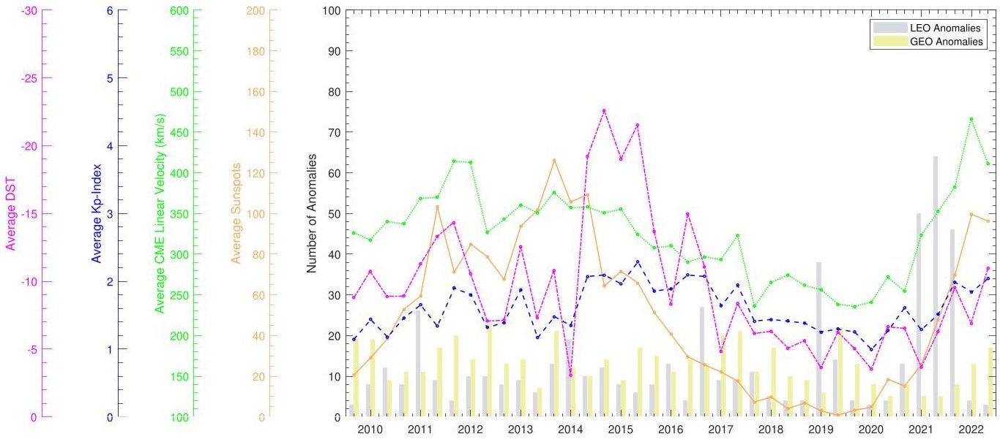

Figure 4.3: LEO/GEO satellites' anomalies and solar and geomagnetic activity correlation (2010-2022). Sunspot count and CME linear velocity are used to quantify solar activity, whereas Kp-index and DST are used to quantify geomagnetic activity. Despite using a monthly timescale for analysis, this figure is plotted by grouping four months for visual simplicity.

As for the geomagnetic activity, GEO and LEO anomalies do present correlation patterns in those months when geomagnetic activity slightly increases (Kp-index increases and DST decreases) such as Jan 2012 - Apr 2012, Jan 2014 - Apr 2014, and Sept 2019 - Dec 2019 for GEO, and Apr 2011 - Aug 2011 and Jan 2022 Apr 2022 in LEO anomalies. However, in some months, even having a low magnetic activity, the number of anomalies rises (e.g. Sept 2012 - Dec 2012 for GEO, and May 2014 - Aug 2014 for LEO). Nevertheless, several cases also show that substantial solar and magnetic activity happens in the months before the anomaly occurrence, rather than within that particular month. This is consistent considering that after an injection of charged particles, they can remain on satellite orbits afterward. Hence, the effects of this radiation on satellite equipment may be not necessarily when the space weather indicators reach their peak, and failures may occur in the upcoming days, weeks, or months. Therefore, it is crucial to consider a time lag, and temporally extend the analysis by including space environment characteristics of the period before the anomalous occurrence month. Thus, every month, spanning from January 2010 to December 2022 has been categorized depending on the number of anomalies that occurred in that month. Then, each group was compared to the average number of sunspots, the average linear velocity of CMEs, the DST, and the Kp-index of the anomaly event month and three prior months to understand the temporal response of satellite equipment due to space environment variations (see Fig. 4.4). Therefore, all months having anomalies within a range have had their SS, CME velocities, Kp, and DST averaged to calculate the mean SS, CME, Kp, and DST of that group.

In the case of GEO anomalies, the average number of sunspots for those months over three anomalies increase significantly (from 40 to 70 sunspots/month), not only for the month in which the anomaly occurs, but also for the three prior months. This suggests that, rather than relativistic electrons, most of the considered anomalies may be caused by solar proton events during maximum solar activity. Furthermore, previous months (M-1,

<!-- PDF_PAGE: 98 -->

Figure 4.4: Relationship between LEO anomalies and average sunspots, CME linear velocity, Kp, and DST of the month the anomaly occurred and the previous three months, respectively (a,b,c,d). Relationship between GEO anomalies and average sunspots, CME linear velocity, Kp, and DST of the month the anomaly occurred and the previous three months, respectively (e,f,g,h). Note: M-1,2,3 indicate the months before the anomalous event, respectively. Additionally, LV is an abbreviation of Linear Velocity.

M-2, M-3) do show even higher solar activity regarding the month in which the failures happened for those months between 3-5 and over 10 anomalies, which may indicate that the temporal response of space conditions on the equipment may not necessarily be instantaneous (Fig. 4.4e). Nonetheless, none of these trends are clearly visible for the examined LEO anomalies (Fig. 4.4a). Concerning CMEs, as for LEO and GEO, their average linear velocity $ \overline{{CME}} $ for months presenting $ 6\leqslant \overline{{A}}\leqslant 9 $ and $ \overline{{A}}\geqslant 10 $ is slightly higher (reaching 340 km/s) than for months with a low anomaly rate. Similarly, considering that CMEs can also cause geomagnetic storms, months with more than ten GEO anomalies show a marginally higher Kp index in the anomaly month (M) as well as reductions for the preceding months. On the other hand, months with anomalies between six and nine also show a lower DST, particularly in the month preceding the anomaly occurrence (M-1) (Fig. 4.4 g, h). Similarly to sunspot trends, those geomagnetic patterns are not very apparent with the LEO anomalies (Fig. 4.4 c,d).

In the analysis to assess the geomagnetic activity in Fig 4.4, the average Kp-Index and DST per month are computed by averaging all the samples within the month. However, this might result in a smoothing process that can hinder certain potential trends. Consequently, a different approach has been used to repeat the analysis by calculating the number of days in a month that exhibit a Kp-index $ \geqslant $ 5 and DST $ \leqslant $ -16 instead of average monthly values. These thresholds were defined considering that $ \overline{K p}=1. 6 $ , and $ \overline{D S T}=-9. 4 9 $ during the study period. Accordingly, for GEO anomalies there are more average days with Kp-index $ \geqslant $ 5 in those months with reported anomalies equal to or higher than 3 (Fig. 4.5). The Kp-index surpasses 5 by an average day of 3.5 in the month of the event (M) and 3 for (M-1) and (M-2) for those months with $ \overline{A} \geqslant1 0 $ . Similar trends are shown for those months where $ 6\leqslant\overline{A}\leqslant9 $ , with the exception that there are more average days with notable geomagnetic activity in the previous month (M-1). Nevertheless, concerning the examination of LEO anomalies, no noteworthy patterns emerge, except for the months in which $ 6\leqslant\overline{A}\leqslant9. $

## 4.4.1.1 Seasonal Variations

In an attempt to determine any seasonal trends, Fig. 4.6 illustrates the relationship between the average number of anomalies and the average number of sunspots, CMEs average linear velocity, Kp-index, and DST of a given month. For the GEO scenario, the anomaly rate increases significantly, but with a temporal delay (e.g., in November), as geomagnetic activity begins to rise in fall along with high solar activity.

However, even in the absence of significant solar activity, the anomaly rate increases in the springtime due to an increase in geomagnetic activity (e.g. Mars). January and June are low magnetic activity months, yet

<!-- PDF_PAGE: 99 -->

Figure 4.5: Relationship between LEO (a,b,c) and GEO (d,e,f) anomalies and number of days per month with Kp-index $ \geqslant $ 5 and DST $ \leqslant $ -16 of the month the anomaly occurred and the prior three months, respectively.

they have significant anomaly rates. This, however, can be explained because of the solar activity increasing phase in January and a delay in the temporal reaction of the strong CMEs and sunspot peak recorded in May and June. These last cases deviate slightly from earlier findings from several research, such as [10] and [12]. Indeed, after examining GEO anomalies throughout several periods those studies concluded that GEO anomalies were less frequent in the summer and winter. Similar to GEO anomalies, LEO anomalies show a strong correlation with geomagnetic activity in spring and fall, which are the seasons in which aurora is at its most active around the equinoxes. As GEO, significant anomaly rates are also observed in summer times.

## 4.4.2 Daily analysis

## 4.4.2.1 Solar and Magnetic Activity Assessment

In the monthly timescale analysis, it was noted that for some particular months the number of anomaly peaks in conjunction with some of the variables considered, notably for GEO anomalies (e.g. Jan 2014 - Apr 2014). This suggests a rapid temporal response of satellite equipment due to some disturbances, such that a monthly examination might not be adequate to identify potential associations. Therefore, considering an average anomaly per day of 1.42 for LEO and 1.49 for GEO over the period (2010-2022), a daily analysis is proposed by selecting the days with three or more anomalies $ (\overline{A}\geqslant3) $ . To avoid such days $ (\overline{A}\geqslant3) $ where disruptions from the same storms might be the source of their anomalies, days within the same month have been removed. For every selected day (Event Day) (see Table 4.1), and the six days before it, the daily average sunspots, CME linear velocity, Kp-index, and DST are calculated and compared with the indicators' mean values.

The average historical sunspots, CMEs velocity, Kp-index, and DST in the anomalous day occurrence and six days prior are shown in Fig. 4.7. In the LEO scenario, geomagnetic indicators show average daily values that are even lower than the mean until the fourth prior day (D-4), when the magnetic perturbations typically surpass the mean. In terms of solar activity, it is evident that during the 7 days under analysis, the average sunspot count consistently surpasses the mean, peaking on the third before the anomalous occurrence. Since the average CME velocity peaks on anomaly days (D), it is challenging to determine any relationship between the CMEs and anomalies on event days since the CME velocity has to exceed 1800 km/s in order to reach Earth in a single day [63]. Furthermore, it peaks three days before the event day, which is very consistent given that CMEs that have a linear velocity of 400-500 km/s need three to four days to reach Earth [64]. For instance, this could explain several recently reported anomalies such as that of FSSCat [65], of which one of the 6U CubeSats that composed it （ $ ^{3} $ Cat-5/A's mission) failed short after three months on a 535-kilometer synchronous orbit with a $ 97.4^{\circ} $ inclination. The FMPL-2 instrument of the $ ^{3} $ Cat-5/A's mission stopped communicating on December 4, 2020, just after the most powerful observed during solar cycle 25 on November

<!-- PDF_PAGE: 100 -->

Figure 4.6: LEO/GEO anomaly rate correlation with average sunspots, CME linear velocity, Kp-index, and DST monthly, computed for every month by averaging the 13 samples throughout the study period (2010- 2022).

Table 4.1: Days selected to conduct the diel analysis that exhibited three or more anomalies.

<table border="1"><tr><td>LEO(9 Days)</td><td colspan="2">GEO(16 Days)</td></tr><tr><td>15-Jul-2014</td><td>15-Mar-2010</td><td>15-Oct-2015</td></tr><tr><td>15-Jul-2017</td><td>30-Jun-2010</td><td>1-Mar-2016</td></tr><tr><td>6-May-2021</td><td>15-Feb-2011</td><td>12-Jun-2017</td></tr><tr><td>23-Aug-2021</td><td>15-Mar-2012</td><td>15-Nov-2017</td></tr><tr><td>21-Nov-2021</td><td>30-Jun-2012</td><td>15-May-2018</td></tr><tr><td>9-Jan-2022</td><td>15-Nov-2012</td><td>15-Jun-2018</td></tr><tr><td>15-Aug-2022</td><td>15-Jan-2013</td><td>5-Nov-2019</td></tr><tr><td>15-Sep-2022</td><td>15-Jan-2014</td><td>-</td></tr><tr><td>15-Dec-2022</td><td>30-Jun-2014</td><td>-</td></tr></table>

29, 2020 [65]. Regarding GEO, the typical magnetic activity is higher than average from the first to the sixth day before any potential response, whereas the sunspots number remains moderately constant.

## 4.4.2.2 Particles Flux Density Assessment

Aside from the potential radiation effects during geomagnetic storms and solar activity fluctuations, examining particle density and distribution around Earth is critical to understanding the causes and frequency of satellite anomalies. Thus, protons, electrons, and X-ray fluxes were compared for days with high and low anomaly rates (see Fig. 4.8). Several conclusions can be extracted from Fig. 4.8. Firstly, for LEO and GEO, days with anomalies show a significant increase in proton flux as compared to days without anomalies. This tendency is not limited to the anomalous day (D), but extends throughout the six days preceding the event day. For LEO, this increment, which is notably larger than for LEO, tends to be maximum on the anomalous day (D), and the day before (D-1), whereas for GEO tends to be at the fifth and sixth days (D-5 and D-6). Those outcomes point out that GEO and LEO anomalies are potentially caused by solar proton events and trapped protons (e.g. inner Van Allen belt). In terms of electron flux, in the GEO scenario, those days with anomalies had a higher average electron flux than those without, not only on the anomaly day but over the entire 7-day span. Nonetheless, for the LEO scenario, and in contrast to what is expected, days with no reported failures had a higher electron flux than days with A $ \geqslant $ 3, not just on the event day, but throughout the 7-day window. Regarding X-ray concentrations, the days presenting LEO anomalies as well as the six days before the anomaly showed larger X-ray particles than the non-anomaly days selected, however, those patterns are

<!-- PDF_PAGE: 101 -->

Figure 4.7: Assessment of solar and geomagnetic indicators during seven days (Anomaly day + 6 prior days), for those days (Anomaly Day, D) with LEO and GEO anomalies $ \geqslant $ 3.

Table 4.2: Days with no reported anomalies selected to compare their average particle flux with those days with A $ \geqslant $ 3.

<table border="1"><tr><td>LEO(6 Days)</td><td>GEO(6 Days)</td></tr><tr><td>15-Jul-2014</td><td>15-Oct-2015</td></tr><tr><td>15-Jul-2017</td><td>1-Mar-2016</td></tr><tr><td>6-May-2021</td><td>12-Jun-2017</td></tr><tr><td>23-Aug-2021</td><td>15-Nov-2017</td></tr><tr><td>21-Nov-2021</td><td>15-May-2018</td></tr><tr><td>9-Jan-2022</td><td>15-Jun-2018</td></tr></table>

not observed for GEO anomalies.

## 4.4.3 Orbit Inclination's Impact on Anomaly Rate

The Earth's magnetic field traps protons and electrons, resulting in radiation belts known as Van Allen belts. Thus, as mentioned before, the radiation density that satellites must cross during their course is significantly influenced by their orbital altitude and inclination. As for orbit altitude, by which the analysis has been simplified by categorizing LEO and GEO satellites, each satellite whose reported anomalies have been considered in this study has had its orbital inclination classified as seen in Fig. 4.9. Regarding LEO, those active satellites whose orbital inclination $ (\theta) $ were within $ 15^{\circ}-30^{\circ} $ and $ 45^{\circ}-60^{\circ} $ ranges presented slightly higher anomaly rate percentages than other ranges such as $ 0^{\circ}-15^{\circ} $ and $ 75^{\circ}-90^{\circ} $ , whereas active satellites orbiting between $ 60^{\circ}-75^{\circ} $ range presented the higher anomaly rate (22.5%) . Unlike the unexpectedly high failure rate presented in the $ 15^{\circ}-30^{\circ} $ range, the rates at $ 45^{\circ}-60^{\circ} $ and $ 60^{\circ}-75^{\circ} $ are highly consistent considering that higher electron concentrations are observed between $ 45^{\circ} $ and $ 85^{\circ} $ while for low inclination orbits $ (\theta\leqslant 30^{\circ}) $ the electron concentrations are relatively low [66]. The high anomaly rate of those satellites whose inclination ranges between $ 45^{\circ} $ and $ 60^{\circ} $ can also be directly linked with the several passes per day through the SAA, situated at 200-800 km over the Earth's surface [67]. Furthermore, as indicated in Fig 4.9, polar and near-polar orbits $ (90^{\circ}\leqslant\theta<105^{\circ}) $ also present moderately high anomaly rates, which is consistent considering that polar-orbiting satellites pass through dangerous charged particle concentrations (e.g. electrons of energy about 1 MeV) several times per day [68]. In addition, with the open magnetic field lines over the poles, polar-orbiting satellites are exposed directly to large solar proton fluxes and lower energy GCRs [69]. As for geosynchronous orbit, considering the operational benefits when $ \theta=0^{\circ} $ (geostationary orbit), 76% of the

<!-- PDF_PAGE: 102 -->

Figure 4.8: Proton, electron, and X-ray flux time series comparison between days with no reported anomalies (see Table 4.2) and those selected days with A $ \geqslant $ 3 during a seven-day window (see Table 4.1). Given that one or a few days can have significantly higher particle concentrations than others, logarithmic charts are employed to respond to the large value ranges. Before the log() application, proton (P), electron (E), and X-ray flux (X) were in protons/（cm $ \cdot $ day $ \cdot $ sr), electrons/（cm $ \cdot $ day $ \cdot $ sr), and W/m $ ^{2} $ , respectively.

active satellites from 2010 to 2022 had an orbit inclination within $ 0^{\circ} $ and $ 15^{\circ} $ [38]. Accordingly, 94.1% of those satellites whose anomalies have been incorporated into the analysis have an orbit inclination between $ 0^{\circ} $ and $ 15^{\circ} $ . As a result, having data concentrated in a single orbit inclination range presents significant challenges when exploring the GEO orbit inclination relationship with satellite anomaly rate. Hence, as depicted in Fig.4.9, for those GEO active satellites within $ 0^{\circ} $ and $ 15^{\circ} $ , 64% (304 satellites) have experienced an anomaly during the period of study, whereas within $ 30^{\circ} $ and $ 45^{\circ} $ , 57% (4 satellites) failed partially or totally.

## 4.5 Conclusions

This study has examined the relationship between space weather and anomalies observed in LEO and GEO small satellites, with a particular emphasis on solar and geomagnetic activity.

The analysis results confirm that solar activity is critical for satellite anomalies. However, as opposed to what is generally thought, the anomaly rate increases do not necessarily coincide with solar activity peaks or during ascending phases. Considering that in those periods presenting low sunspot count, this is consistent, with cosmic ray particles enter the inner solar system, and also the density of relativistic tends to increase substantially. In addition, this suggests that alongside the assessment of solar flares and CMEs emission of radiation fluxes reaching Earth's surroundings, the distribution of those particles in GEO and LEO, and how they are trapped by the Earth's magnetic field (Van Allen belts, SAA) also play a fundamental role. On the other hand, when monthly averaged statistics were evaluated, no significant trends regarding geomagnetic disturbances and storms were found. However, when assessing it by counting the days with intense geomagnetic storms and disturbances within the month, noteworthy trends have emerged. For GEO anomalies, generally, those months with high anomaly rates are associated with high geomagnetic activity, however, for LEO anomalies, no clear patterns can be extracted, which might be due to the high shielding effects of the magnetic field in comparison with GEO orbit.

When exploring the time lag of solar activity on satellite systems (Fig. 4.4), in some cases, there was more solar activity in the month before the month of anomaly occurrence, indicating a non-instantaneous radiation effect on satellites. However, when analyzing sunspots in a daily timescale, only those days with high LEO anomalies present a high solar activity alongside a significant magnetic disturbance during the six days before, whereas, for GEO, the sunspot number remains close to the mean during the days before. According to these findings, radiation effects often take effect on LEO satellites more rapidly than on GEO satellites. When

<!-- PDF_PAGE: 103 -->

Figure 4.9: Orbital inclination classification for LEO and GEO satellites whose anomalies were selected for the analysis. The satellites failures percentage in each orbit inclination range is normalized by dividing the total number of satellites failed by active satellites in that range from 2010 to 2022 according to Seradata [38].

examining the association between different particle concentrations and anomaly occurrence, for LEO and GEO, the days with reported anomalies (A $ \geqslant $ 3) presented larger proton flux than those selected days with no reported failures not even on the day of the event, but during the week before it. Given that the majority of the investigated LEO satellites have orbital inclinations ranging from $ 45^{\circ} $ to $ 75^{\circ} $ and $ 90^{\circ} $ to $ 105^{\circ} $ , this suggests that LEO anomalies may be caused by trapped proton concentrations in the SAA region and solar activity fluctuations reaching the Earth's poles. Furthermore, for GEO, days with A $ \geqslant $ 3 showed higher electron flux than days with A=0 throughout the seven days, whereas, for LEO, days with A $ \geqslant $ 3 presented larger X-ray concentrations than days with A=0 during the complete time window analyzed.

The correlations obtained from this analysis may aid in defining operational strategies (e.g. by switching off some vulnerable systems, and reserve mode, among others) to minimize radiation effects on satellite systems. Future research should delve deeper into several directions. On one hand, it is decisive to advance in monitoring, characterizing, and predicting radiation levels by using, for instance, physics-based, machine-learning models, and real-time satellite observations. On the other hand, it is crucial to investigate novel alternative radiation-hardened and tolerant systems and to assess the robustness of satellite materials.

Taking into consideration the historical study of satellite evolution, which has revealed potential disruptive uses in recent years, the possibility of recycling satellites currently in orbit was subsequently evaluated through studies of causes and failures. In this third part of the Ph.D. thesis, a study is presented on how satellites can be manufactured from their initial stages with the new concept of making them more efficient and reusable, by applying agile methodologies in their development and manufacturing of systems and subsystems. This section first covers the application of agile methodologies that facilitate the design and planning of a space mission. In this case, it was applied to the ongoing $ ^{3} $Cat-8 mission of the Nanosat Lab. Subsequently, another application case was considered for the preliminary design of the $ ^{3} $ColStar mission, which encompasses not only optimization aspects of management parameters but also technical developments of satellite subsystems. Following this, the focus shifts to the application of sustainable manufacturing concepts in two subsystems: ADCS for the $ ^{3} $Cat-8 mission and the thermal system for the $ ^{3} $Cat-4 mission.

<!-- PDF_PAGE: 104 -->

## Bibliography

[1] Telastra Inc. Public Record Satellite Anomaly Database (PRSADB), 2021. Communications Satellite databases.

[2] Stephen A. Jacklin, Small-satellite mission failure rates, 2019.

[3] Quan, Lin, et al., Radiation environment and effect detection based on global navigation constellation, Open Astronomy, vol. 32, no. 1, pp. 20220204, 2023, De Gruyter.

[4] Venkatesan, Aparna, et al., The impact of satellite constellations on space as an ancestral global commons, Nature Astronomy, vol. 4, no. 11, pp. 1043-1048, 2020, Nature Publishing Group UK London.

[5] Novak, Jonathan and Hastings, Daniel, Analysis of proliferated low Earth orbit constellation resilience against solar weather radiation effects, Acta Astronautica, vol. 202, pp. 292-302, 2023, Elsevier.

[6] Ecoffet, Robert, Overview of in-orbit radiation induced spacecraft anomalies, IEEE Transactions on Nuclear Science, vol. 60, no. 3, pp. 1791-1815, 2013, IEEE.

[7] Mullen, E, Assurance Technology Corp Carlisle MA, Space radiation environments for parts selection/test considerations in typical satellite orbits, Assurance Technol. Corp., Carlisle, MA, USA, Tech. Rep, vol. 1, 2003.

[8] Tribble, Alan C, The space environment: implications for spacecraft design-revised and expanded edition, Princeton University Press, 2020.

[9] Purvis, Carolyn K, Garrett, Henry B, Whittlesey, AC, Stevens, N John, Design guidelines for assessing and controlling spacecraft charging effects, 1984.

[10] Jia, Xinyi, Liu, Jing, Zhang, Xuemin, The Analysis of Ionospheric TEC Anomalies Prior to the Jiuzhaigou Ms7. 0 Earthquake Based on BeiDou GEO Satellite Data, Remote Sensing, vol. 16, no. 4, pp. 660, 2024, MDPI.

[11] Iucci, N, Levitin, AE, Belov, AV, Eroshenko, EA, Ptitsyna, NG, Villoresi, G, Chizhenkov, GV, Dorman, LI, Gromova, LI, Parisi, M, et al., Space weather conditions and spacecraft anomalies in different orbits, Space weather, vol. 3, no. 1, 2005, Wiley Online Library.

[12] Choi, Ho-Sung, Lee, Jaejin, Cho, Kyung-Suk, Kwak, Young-Sil, Cho, Il-Hyun, Park, Young-Deuk, Kim, Yeon-Han, Baker, Daniel N, Reeves, Geoffrey D, Lee, Dong-Kyu, et al., Analysis of GEO spacecraft anomalies: Space weather relationships, Space weather, vol. 9, no. 6, 2011, Wiley Online Library.

[13] Pilipenko, V, Yagova, N, Romanova, N, Allen, J, Statistical relationships between satellite anomalies at geostationary orbit and high-energy particles, Advances in Space Research, vol. 37, no. 6, pp. 1192-1205, 2006, Elsevier.

[14] Paladini, Stefania, The New frontiers of space, Springer, 2019.

[15] Foreman Campins, Lluís, NewSpace and the european space economy, Master's thesis, Universitat Politècnica de Catalunya, 2023.

[16] Cloitre, Aveline, Dos Santos Paulino, Victor, Theodoraki, Christina, The quadruple/quintuple helix model in entrepreneurial ecosystems: an institutional perspective on the space case study, R&D Management, vol. 53, no. 4, pp. 675-694, 2023, Wiley Online Library.

<!-- PDF_PAGE: 105 -->

[17] Mertens, Christopher J, Grajewski, Barbara, Kress, Brian T, Wiltberger, Michael, Tobiska, W Kent, Xu, Xiaojing, Atmospheric ionizing radiation from galactic and solar cosmic rays, INTECH Open Access Publisher, 2012.

[18] DE, SINTESE DA LIÇÃO PARA PRESTAÇÃO, DE AGREGAÇÃO, PROVAS, GONÇALVES, PATRÍCIA CARLA SERRANO, The Ionising Radiation Environment in the Solar System, 2021.

[19] Miroshnichenko, Leonty, Energetic Particles in the Geosphere, en Solar-Terrestrial Relations: From Solar Activity to Heliobiology, Springer, 2023, pp. 123-148.

[20] Miroshnichenko, Leontii Ivanovich, Solar cosmic rays: 75 years of research, Physics-Uspekhi, vol. 61, no. 4, pp. 323, 2018, IOP Publishing.

[21] Xu, Jing, Guo, Min, Lu, Ming, He, Hu, Yang, Guang, Xu, Jianwen, Effect of alpha-particle irradiation on InGaP/GaAs/Ge triple-junction solar cells, Materials, vol. 11, no. 6, pp. 944, 2018, MDPI.

[22] Waets, Andreas, Bilko, Kacper, Coronetti, Andrea, Emriskova, Natalia, Barbero, Mario Sacristan, Alia, Rubén García, Durante, Marco, Schuy, Christoph, Wagner, Tim, Esposito, Luigi Salvatore, et al., Very-High-Energy Heavy Ion Beam Dosimetry using Solid State Detectors for Electronics Testing, IEEE Transactions on Nuclear Science, 2024, IEEE.

[23] Lu, Yifan, Shao, Qi, Yue, Honghao, Yang, Fei, A review of the space environment effects on spacecraft in different orbits, IEEE access, vol. 7, pp. 93473-93488, 2019, IEEE.

[24] Barth, Janet L, Space and atmospheric environments: from low earth orbits to deep space, en Protection of Materials and Structures from Space Environment: ICPMSE-6, Springer, 2004, pp. 7-29.

[25] Ya'acob, Norsuzila, Zainudin, Akmarulnizam, Magdugal, R, Naim, Nani Fadzlina, Mitigation of space radiation effects on satellites at Low Earth Orbit (LEO), en 2016 6th IEEE International Conference on Control System, Computing and Engineering (ICCSCE), pp. 56-61, 2016, IEEE.

[26] Baker, DN, Erickson, PJ, Fennell, JF, Foster, JC, Jaynes, AN, Verronen, PT, Space weather effects in the Earth's radiation belts, Space Science Reviews, vol. 214, pp. 1-60, 2018, Springer.

[27] McMurchie, Erin Johnson, Quantifying Radiation Effects of Energetic Electron Precipitation from the Van Allen Radiation Belts into the Earth's Atmosphere, tesis de doctorado, University of Colorado at Boulder, 2022.

[28] Bolin, Jennifer A, Comparative analysis of selected radiation effects in medium earth orbits, tesis de doctorado, Naval Postgraduate School, 1997.

[29] Baker, Daniel N, Satellite anomalies due to space storms: The effects of space weather on spacecraft systems and subsystems, Space storms and space weather hazards, pp. 285-311, 2001, Springer.

[30] Garrett, Henry B, Close, Sigrid, Impact-induced ESD and EMI/EMP effects on spacecraft-A review, IEEE Transactions on Plasma Science, vol. 41, no. 12, pp. 3545-3557, 2013, IEEE.

[31] Jun, Insoo, Garrett, Henry, Kim, Wousik, Zheng, Yihua, Fung, Shing F, Corti, Claudio, Ganushkina, Natalia, Guo, Jingnan, A Review on Radiation Environment Pathways to Impacts: Radiation Effects, Relevant Empirical Environment Models, and Future Needs, Advances in Space Research, 2024, Elsevier.

[32] Nwankwo, VU, Jibiri, Nnamdi N, Kio, Michael T, The impact of space radiation environment on satellites operation in near-Earth space, Satellites Missions and Technologies for Geosciences, vol. 1, pp. 73-90, 2020, IntechOpen London, UK.

[33] Johnson, RE, Carlson, RW, Cooper, JF, Paranicas, C, Moore, MH, Wong, MC, Radiation effects on the surfaces of the Galilean satellites, Jupiter: The planet, satellites and magnetosphere, vol. 1, pp. 485-512, 2004, Cambridge Univ. Press Cambridge, U. K.

[34] Qiu, Feng, Gong, Jiao, Tong, Gangsheng, Han, Sheng, Zhuang, Xiaodong, Zhu, Xinyuan, Near-infrared Light-Induced Polymerizations: Mechanisms and Applications, ChemPlusChem, pp. e202300782, 2024, Wiley Online Library.

[35] Likar, Justin J, Bogorad, Alexander, August, Kevin A, Lombardi, Robert E, Kannenberg, Keith, Herschitz, Roman, Spacecraft Charging, Plume Interactions, and Space Radiation Design Considerations for All-Electric GEO Satellite Missions, IEEE Transactions on plasma science, vol. 43, no. 9, pp. 3099-3108, 2015, IEEE.

<!-- PDF_PAGE: 106 -->

[36] Schwadron, Nathan A, Cooper, John F, Desai, Mihir, Downs, Cooper, Gorby, Matt, Jordan, Andrew P, Joyce, Colin J, Kozarev, Kamen, Linker, Jon A, Mikic, Zoran, y otros, Particle radiation sources, propagation and interactions in deep space, at Earth, the Moon, Mars, and beyond: Examples of radiation interactions and effects, Space Science Reviews, vol. 212, pp. 1069-1106, 2017, Springer.

[37] Fortescue, Peter, Swinerd, Graham, Stark, John, Spacecraft systems engineering, John Wiley & Sons, 2011.

[38] SpaceTrack, SpaceTrack database: number of spacecraft's launches 2010-2023, accessed: 01.04.2024.

[39] Agency European Space, EO PORTAL, (accessed: 30.11.2022), https://www.eoportal.org/.

[40] National Aeronautics and Space Administration- NASA, Small Satellites Mission Failures Rate [Online], (accessed: 12.12.2022), https://ntrs.nasa.gov/api/citations/20190002705/downloads/ 20190002705.pdf.

[41] Buitrago-Leiva, Jeimmy Nataly, Mohamed El Khayati Ramouz, Adriano Camps, and Joan A Ruiz-de-Azua, Towards a second life for Zombie Satellites: Anomaly occurrence and potential recycling assessment, Acta Astronautica, 2024, Elsevier.

[42] Zheng, Yihua, Natalia Yu Ganushkina, Pier Jiggens, Insoo Jun, Matthias Meier, Joseph I Minow, T Paul O'Brien, Dave Pitchford, Yuri Shprits, W Kent Tobiska, and others, Space radiation and plasma effects on satellites and aviation: Quantities and metrics for tracking performance of space weather environment models, Space Weather, vol. 17, no. 10, pp. 1384-1403, 2019, Wiley Online Library.

[43] Stassinopoulos, EG, GJ Brucker, JN Adolphsen, J Barth, Radiation-induced anomalies in satellites Journal of spacecraft and rockets, vol. 33, no. 6, pp. 877-882, 1996.

[44] NASA, Solar Activity, n.d., https://spaceplace.nasa.gov/solar-activity/en/, Accessed: April 23, 2024.

[45] Royal Observatory of Belgium, Royal Observatory of Belgium, 2024, http://www.sidc.be/silso/home, Accessed: April 12, 2024.

[46] NOAA National Centers for Environmental Information, NOAA National Centers for Environmental Information: Kp and Ap indices, 2024, https://www.ngdc.noaa.gov/geomag/indices/kp_ap.html, Accessed: April 12, 2024.

[47] K. Bryant, RP Young, HJ LeFevre, CC Kuranz, JR Olson, KJ McCollam, y CB Forest, Creating and studying a scaled interplanetary coronal mass ejection, Physics of Plasmas, vol. 31, no. 4, 2024, AIP Publishing.

[48] Shantanu Jain, Tatiana Podladchikova, Galina Chikunova, Karin Dissauer, y Astrid M Veronig, Coronal dimmings as indicators of the direction of early coronal mass ejection propagation, Astronomy & Astrophysics, vol. 683, pág. A15, 2024, EDP Sciences.

[49] Rajendra Singh y Vishwas Powar, The Future of Generation, Transmission, and Distribution of Electricity, en The Advancing World of Applied Electromagnetics: In Honor and Appreciation of Magdy Fahmy Iskander, pags. 349-383, 2024, Springer.

[50] NASA, SOHO LASCO CME CATALOG -Version 2, n.d., https://cdaw.gsfc.nasa.gov/CME_ list/UNIVERSAL_ver2/1996_01/univ1996_01.html, Accessed: February 02, 2024.

[51] Sami K Solanki, Luca Teriaca, Peter Barthol, Werner Curdt, Bernd Inhester, European Solar Physics: moving from SOHO to Solar Orbiter and beyond, Memorie della Societa Astronomica Italiana, vol. 84, pág. 286, 2013.

[52] DT Welling, The long-term effects of space weather on satellite operations, Annales Geophysicae, vol. 28, no. 6, pags. 1361-1367, 2010, Copernicus Publications Göttingen, Germany.

[53] J Tacza, G Li, J-P Raulin, Effects of Forbush Decreases on the global electric circuit, Space Weather, vol. 22, no. 4, pags. e2023SW003852, 2024, Wiley Online Library.

[54] Adrija Banerjee, Amaresh Bej, TN Chatterjee, On the existence of a long range correlation in the geomagnetic disturbance storm time (Dst) index, Astrophysics and space science, vol. 337, págs. 23-32, 2012, Springer.

<!-- PDF_PAGE: 107 -->

[55] Tsvetan P Dachev, South-Atlantic Anomaly magnetic storms effects as observed outside the International Space Station in 2008-2016, Journal of Atmospheric and Solar-Terrestrial Physics, vol. 179, págs. 251-260, 2018, Elsevier.

[56] Kyoto University, DST Provisional Values, n.d., https://wdc.kugi.kyoto-u.ac.jp/dst_ provisional/index.html, Accessed: February 1, 2024.

[57] Filippov, Boris Petrovich, Mass ejections from the solar atmosphere, Physics-Uspekhi, vol. 62, no. 9, pp. 847, 2019, IOP Publishing.

[58] Boenig, Herman, Plasma science and technology, Cornell University Press, 2019.

[59] Space Weather Prediction Center National Oceanic and Atmospheric Administration, GOES Electron Flux, 2024, https://www.swpc.noaa.gov/products/goes-electron-flux, Accessed: April 10, 2024.

[60] Space Weather Prediction Center National Oceanic and Atmospheric Administration, GOES Proton Flux, 2024, https://www.swpc.noaa.gov/products/goes-proton-flux, Accessed: April 10, 2024.

[61] The Bureau of Meteorology. Australian Space Weather Forecasting Centre, Meaning of X-Ray Fluxes From the Sun, 2024, https://www.sws.bom.gov.au/Educational/2/1/3, Accessed: April 10, 2024.

[62] Miteva, Rositsa, Susan W. Samwel, and Stela Tkatchova, Space weather effects on satellites, Astronomy, vol. 2, no. 3, pp. 165-179, 2023, MDPI.

[63] Kumar, Nirmal, E. Karthikeyan, M. Nithyasree, and others, Analysis of solar energetic particle (SEP) event on the geomagnetic environment during 24th solar cycle, 2024.

[64] L. Rodriguez, D. Shukhobodskaia, A. Niemela, A. Maharana, E. Samara, C. Verbeke, J. Magdalenic, R. Vansintjan, M. Mierla, C. Scolini, and others, Validation of EUHFORIA cone and spheromak Coronal Mass Ejection Models, arXiv preprint arXiv:2405.04637, 2024.

[65] Adriano Camps, Joan Francesc Munoz-Martin, Joan Adrià Ruiz-de-Azua, Lara Fernandez, Adrian Perez-Portero, David Llaveria, Christoph Herbert, Miriam Pablos, Alessandro Golkar, Antonio Gutiérrez, and others, FSSCat: The Federated Satellite Systems 3 Cat Mission: Demonstrating the capabilities of CubeSats to monitor essential climate variables of the water cycle [Instruments and Missions], IEEE Geoscience and Remote Sensing Magazine, vol. 10, no. 4, pp. 260-269, 2022, IEEE.

[66] NASA, NASA Lesson: Solar Flares and Their Effect on Earth's Magnetosphere, 2024, https://llis. nasa.gov/lesson/824, Accessed: May 12, 2024.

[67] Nasuddin, Khairul Afifi, Mardina Abdullah, and Nurul Shazana Abdul Hamid, Characterization of the South Atlantic anomaly, Nonlinear Processes in Geophysics, vol. 26, no. 1, pp. 25-35, 2019, Publisher: Copernicus Publications, Göttingen, Germany.

[68] Velazco, Raoul, Pascal Fouillat, and Ricardo Reis, Radiation effects on embedded systems, Publisher: Springer Science & Business Media, 2007.

[69] Samwel, Susan W., Esraa A. El-Aziz, Henry B. Garrett, Ahmed A. Hady, Makram Ibrahim, and Magdy Y. Amin, Space radiation impact on smallsats during maximum and minimum solar activity, Advances in Space Research, vol. 64, no. 1, pp. 239-251, Publisher: Elsevier, 2019.

<!-- PDF_PAGE: 108 -->

Part III

Effective and Sustainable: Advancing Satellite Manufacturing for a Greener Space Environment

<!-- PDF_PAGE: 109 -->

<!-- PDF_PAGE: 110 -->

Chapter 5

# Integrating Lean Six Sigma Methodology in the Optimization of Satellite Manufacturing Process: Application to the $ ^{3} $Cat-8 mission

## Abstract

This study describes the application of the Six Sigma, and specifically the DMAIC (Define, Measure, Analyze, Improve, and Control) methodology, to optimize the processes during manufacturing and development of the $ ^{3} $Cat-8 satellite mission in the Nanosatellite Laboratory of the Universitat Politècnica de Catalunya. The results of the application show that this methodology provided an efficient cost reduction and a significant enhancement of production time. The application of Six Sigma in an aerospace engineering case demonstrates its suitability in the field of quality management.

Keywords— Lean Six Sigma, DMAIC Methodology, Satellite, Optimization.

## 5.1 Introduction

## 5.1.1 Lean Manufacturing and Six Sigma Methodologies

In the contemporary landscape of the aerospace sector, characterized by intense competition and exacting performance standards, the adoption of Lean Manufacturing and Six Sigma methodologies has become critical for companies seeking to bolster operational efficiency and facilitate continuous improvement [1]. This necessity is particularly acute among manufacturers of precision aerospace components and integrated motion systems, tasked with meeting stringent criteria for military and commercial aircraft, satellites, space vehicles, missiles, and automated industrial machinery [2]. While historically perceived as distinct strategies with separate toolkits and methodologies, there is a growing recognition among progressive enterprises of the synergistic potential inherent in the harmonious integration of Lean Manufacturing and Six Sigma approaches [3]. Rather than operating in isolation, these methodologies can mutually reinforce each other, yielding superior outcomes when seamlessly integrated into business and management processes.

Critical to ensuring the consistent attainment of quality benchmarks in the engineering innovation process is robust quality assurance through meticulous process analysis [4]. Leveraging principles from Lean Six Sigma, such as measurement and analysis, enables companies to fulfill management information requirements and drive continuous improvement in system engineering processes, particularly evident in nanosatellite

<!-- PDF_PAGE: 111 -->

development endeavors [4]. The historical lessons gleaned from pioneering satellites like Sputnik underscore the imperative of perpetual innovation and improvement in satellite development initiatives [1] [5].

The burgeoning field of nanosatellite development, predominantly fostered within university environments, offers a cost-effective platform for the dissemination of technical knowledge and skills [6]. To maintain competitiveness in this innovation-driven arena, continuous improvement initiatives are imperative. Embracing a systems engineering approach emphasizing process capability measurement, problem-solving, target setting, and progress tracking enables universities and development firms to enhance the efficiency and effectiveness of their nanosatellite projects [7].

Within systems engineering, two critical disciplines, Technical Engineering Management and System Engineering Management, are encapsulated [8]. Embedding effective corrective and preventive measures, alongside risk-based thinking, within the nanosatellite development process is essential for improving human working conditions, fostering innovation, and optimizing operational activities to ensure superior process and product quality [9,10].

Successful improvement endeavors necessitate a flexible approach that identifies and eliminates non-addedvalue activities and waste. Consequently, proactive quality initiatives and risk management strategies must seamlessly integrate into the innovation environment to mitigate risks, seize opportunities, and drive positive development outcomes across all quality dimensions [10, 11, 12]. By integrating both approaches, this framework seeks to enhance production efficiency while effectively addressing variation reduction and Critical to Quality (CTQ) issues [13].

A case study in aerospace manufacturing, focusing on a satellite educational mission, demonstrates the application of this framework, showcasing significant improvements in business performance metrics such as build time reduction, on-time-in-full delivery improvement, and reduction in both value-added and non-value-added time [14]. This underscores the potential of this framework to achieve substantial enhancements in operational efficiency and product quality, ultimately contributing to the success of aerospace engineering projects.

The adoption of emerging methodologies like Lean Six Sigma in small satellite manufacturing processes has emerged as a promising strategy for enhancing quality and optimizing resources [15, 16]. This structured approach, coupled with statistical and process analysis software, strengthens manufacturing processes, enabling more efficient and effective small satellite missions.

Considering the benefits resulting from the application of this methodology in the manufacturing and development engineering process, the following section presents a study that evidences the emerging trends regarding Lean Six Sigma in the aerospace industry, with a spatial emphasis on the development of small satellites.

## 5.1.2 Bibliographic Study: Emerging Trends in Lean Six Sigma focused in Small Satellites

This study has involved a clustering analysis based on keywords extracted from scientific articles available in the Scopus bibliographic database. Subsequently, the gathered data has undergone on analysis using software tools such as VOSviewer [17], and RStudio-Bibliometrix [18] which enabled examination of citation patterns, bibliographic coupling, co-occurrence networks, co-citation, and co-authorship relations. This global approach resulted in several categories of queries, which were compared between the two software tools as shown in the Fig 5.1.

As observed in the Co-occurrence Network analysis (Fig. 5.2), there are approximately five representative clusters for each of the software platforms. These clusters predominantly highlight trends related to cost reduction, small satellites, including standard CubeSat satellites, and applications of agile systems.

Referring to the thematic map, Fig. 5.3 illustrates that the emerging themes are related to lean production commercial iterative methods, and production line.

In Fig. 5.4, it is evident that in recent years the application of agile methodologies in small satellite development has been predominantly focused on areas such as performance, signal receivers, and communication satellites.

Based on the aforementioned analysis, the utilization of emerging methodologies such as Lean Six Sigma in the manufacturing processes of small satellites has become evident. These methodologies represent recent

<!-- PDF_PAGE: 112 -->

Figure 5.1: VOSviewer software results.

Figure 5.2: RStudio software results.

<!-- PDF_PAGE: 113 -->

Figure 5.3: RStudio thematic map results.

Figure 5.4: VOSviewer Year trend chart.

<!-- PDF_PAGE: 114 -->

applications aimed at enhancing quality and optimizing resources. Moreover, this structured approach, when combined with statistical and process analysis software, strengthens the manufacturing processes.

This study presents a proposal for implementing the Lean Six Sigma through the DMAIC methodology, incorporating Bizagi [19, 20] software to modeling the phases of the $ ^{3} $Cat-8 mission.

This chapter is structured as follows: Section 5.1 describes the Six Sigma Methodology and its emerging trend in the aerospace sector through a bibliometric study. Section 5.2 presents a description of the $ ^{3} $Cat-8 mission. Section 5.3 explains the DMAIC Methodology. Section 5.4 delves into the application of DMAIC Methodology in the $ ^{3} $Cat-8 mission. Finally, Section 5.5 provides a summary of the conclusions.

## 5.2 $ ^{3} $Cat-8 Satellite Mission

The $ ^{3} $Cat-8 mission (Fig.5.5) [21], focused on monitoring and characterizing ionospheric scintillation in the aurora and the RFI emissions at L- and Ka-bands [21].

The objectives of the $ ^{3} $Cat-8 mission are numerous and diverse. For example, as an educational initiative, the mission enables students to participate directly in project implementation and brings multiple space companies on board to make valuable contributions. The project is designed not only to give students practical experience, but also to demonstrate how academia and industry can work together.

The mission is strategically aimed at advancing scientific knowledge through innovative research endeavors, serving as a testing ground for pioneering observations of the ionosphere. Leveraging techniques like near-simultaneous surveillance of ionospheric scintillation through GNSS-RO, GNSS-R [22], and multi spectral polarimetric imaging, the mission aims to uncover new insights into the electromagnetic wave propagation behavior of the ionosphere. Additionally, a comprehensive global RFI surveillance study in the L-and Kabands by means of two PocketQubes [23] seeks to deepen our understanding of radio frequency interference phenomena worldwide. Moreover, $ ^{3} $ Cat-8 is not only restricted to educational and scientific goals, but it also serves as a technological demonstration mission. The facet of the mission involves the testing and validation of various critical technologies essential for future space endeavors. From a deployable antenna systems, telemetry systems, the mission explores a wide array of cutting-edge technologies. Furthermore, it delves into evolved techniques in satellite systems, with a particular emphasis on harnessing LoRa for inter-satellite communications [24]. In doing so, $ ^{3} $ Cat-8 contributes significantly to the ongoing advancement of space technology.

$ ((\mathrm{a}))^{3} \mathrm{Cat}-8 $ in early operations deploying the two PocketQubes for L- and Ka-bands RFI monitoring.

$ ((\mathrm{b}))^{3}\mathrm{Cat-8} $ with the antenna deployed.

Figure 5.5: $ ^{3} $Cat-8 stages operations.

The following section describes the DMAIC methodology used in the present study.

<!-- PDF_PAGE: 115 -->

## 5.3 DMAIC Methodology

The DMAIC methodology is a structured approach within the Lean Six Sigma methodology that is used to improve existing processes and solve quality problems [13]. The acronym DMAIC (Define, Measure, Analyze, Improve, and Control) stands for the five stages of the process, each phase plays a crucial role in achieving process optimization and quality enhancement:

1. Define: In this initial phase, the project goals, objectives, and scope are clearly defined. The focus is on understanding customer requirements, identifying critical-to-quality (CTQ) factors, and establishing a project charter to guide the improvement efforts.

2. Measure: The second phase involves quantifying the current state of the process using relevant metrics and data collection methods. Key performance indicators (KPIs) are identified, and baseline measurements are established to assess process performance accurately.

3. Analyze: In the analysis phase, data collected during the measurement phase are analyzed to identify root causes of process inefficiencies, defects, or variations. Tools such as statistical analysis, root cause analysis, and process mapping are employed to gain insights into underlying issues.

4. Improve: Based on the findings from the analysis phase, potential solutions and improvement opportunities are identified and implemented. Lean principles, such as waste reduction and value stream mapping, are often integrated into this phase to streamline processes and eliminate non-value-added activities.

5. Control: The final phase focuses on sustaining the improvements achieved throughout the project. Control measures, including standardization of processes, implementation of monitoring systems, and training of personnel, are put in place to ensure that the gains are maintained over time.

Utilizing the DMAIC methodology in the various phases of a satellite mission is paramount for optimizing its performance and achieving predetermined objectives. This methodology offers a structured and systematic approach to tackling process challenges, from precisely defining requirements to implementing enhancements and controlling outcomes.

During the Define phase, the mission's objectives are distinctly outlined, and any existing issues or areas for potential enhancement are pinpointed. This ensures that all team members are aligned with the objectives and grasp the challenges that necessitate attention.

The Measure phase involves the collection of pertinent data and assessment of the current state of the process. This establishes a solid foundation for comprehending the satellite's present performance and identifying specific areas requiring focus.

Subsequently, in the Analyze phase, exploration into the root cause of identified issues occurs, alongside understanding the relationships between process variables. This facilitates the identification of critical areas for improvement and the formulation of effective solutions.

In the Improve phase, the implementation of solutions aimed at addressing the underlying causes of identified issues takes place. This may encompass adjustments to satellite design, modifications in manufacturing processes, or enhancements in project management practices.

Finally, in the Control phase, measures are instituted to monitor and sustain the achieved results over time. This ensures that the implemented improvements are enduring and that the satellite's performance remains within predefined parameters.

Furthermore, the subsequent section demonstrates the application of this methodology to the $ ^{3} $Cat-8 mission, showcasing how DMAIC principles have been effectively utilized to address challenges, optimize performance, and ensure mission success. Through a detailed examination of each phase of the DMAIC process in the context of the $ ^{3} $Cat-8 mission, valuable insights were gained into the practical application of this methodology in the field of satellite missions. Additionally, the implementation of software tools such as Bizagi and Minitab [25, 26] played a crucial role in facilitating the application of these processes, enabling efficient data analysis, process modeling, and decision-making throughout the mission lifecycle.

<!-- PDF_PAGE: 116 -->

## 5.4 Enhancing Lean Six Sigma in the $ ^{3} $Cat-8 mission

## 5.4.1 Application of DMAIC methodology

## 5.4.1.1 DEFINE Stage

In the development of this stage, the following parameters were considered:

## D1: Purpose clarification Main Objective

- Prepare the satellite for the launch stage.

- Decrease the satellite's risk probability of not being ready for the launch date.

- Reduce lead times in the manufacturing process.

- Optimize costs in the manufacturing stage.

D2: High-Level Process Map (SIPOC) The following items were identified for this phase:

- Suppliers: These include companies providing space components and parts.

- Inputs: Components, payloads, technical standards (NASA, ESA, ECCS).

- Process: Stages of satellite development. The current project will cover the first phase: Mission Design, and the second phase: Mission Development.

- Outputs: The output of this process will be the fully integrated satellite, ready to enter the launch phase.

- Customers: These are the end users who will utilize the satellite in space. For this project, they include universities, companies, and institutions in the space sector interested in the development and earth observation data.

D3. Process Detail To illustrate the development process of the $ ^{3} $Cat-8 mission, the Bizagi simulation software has been selected. For this purpose, the phases and activities described in the NASA Systems Engineering Handbook: NASA/SP-2016-6105 Rev2 [27] were taken into account. This handbook encompasses the entire process involved in an aerospace project, including the regulations and technical standards of the sector. Similarly, these processes were applied to a project for small satellites, following the CubeSats standard, which outlines the configuration of the $ ^{3} $Cat-8 mission satellite. The Figures 5.6 to 5.16 illustrate the entirety of the project with the process of each of the mission phases that were created in Bizagi.

- Pre-Phase A (Fig.5.7) aims to generate a variety of ideas and mission options to select new programs/projects. During this stage, a study or proposal team examines different mission concepts that fit technical, cost, and time constraints, contributing to the goals and objectives of the program and Mission Directorate.

- The purpose of Phase A (Fig.5.8) is to develop a feasible mission architecture proposal that meets the expectations, requirements, and constraints of the project, including resources. The goal is to generate a base mission concept and begin to delineate responsibilities in the development of technologies, as well as identify the necessary work resources to achieve the project's functionality or development, in the case of the $ ^{3} $Cat-8 mission. This phase sets the foundation for subsequent design and development activities, ensuring alignment with project objectives and resource availability.

Furthermore, the design definition chapter includes activities and tasks that encompass various essential elements for the successful execution of the $ ^{3} $Cat-8 mission [21]. These activities involve:

Design Definition: This section of the $ ^{3} $Cat-8 mission provides a comprehensive overview of the system, including subsystem descriptions, budgets, component lists, materials, processes, simulations, analysis, and technological challenges. It outlines the functional description of the 6U mother CubeSat satellite and 2 PocketQubes, detailing their operational, housekeeping, experimental, data processing, and communication functions. Additionally, it describes the ground segment consisting of a Ground Station and a DPGS, highlighting their communication, data processing, repository, and distribution

<!-- PDF_PAGE: 117 -->

Figure 5.6: Mission Expanded design process.

functions. This section serves to define the design aspects and operational capabilities of the $ ^{3} $Cat-8 mission system.

System Description: This section delineates the key functions that the different components must perform, including satellite state evaluation, mode transitions, antenna deployment, subsystem control, payload activation, data processing, and communication tasks. Moreover, it highlights the communication functions of the Ground Station and DPGS, emphasizing their roles in tracking the satellite, sending telecommands, receiving housekeeping and scientific data, and processing and distributing data at different levels.

Functional Description: The functional description of the $ ^{3} $Cat-8 mission outlines the roles and responsibilities of both its space and ground segments. The space segment relies on a 6U mother CubeSat satellite and 2 PocketQubes to perform various critical functions, including operational, housekeeping, experimental, data processing, and communication tasks. The ground segment, on the other hand, consists of a Ground Station located atop Montsec mountain and a Data Processing and Ground Segment (DPGS) at UPC premises. These segments play crucial roles in tracking the satellite, sending telecommands, receiving data, and ensuring effective communication.

DPGS: Data Processing Functions, Repository, and Distribution Center: The DPGS serves as a central hub for data processing, repository management, and distribution. It facilitates data processing across multiple levels, from acquisition to analysis, and serves as a repository and distribution center for collected data. With a user-friendly graphical user interface (GUI), stakeholders can access and utilize this data efficiently, enhancing the overall effectiveness of the mission's ground segment. One of the expected deliverables at this stage is presented in (Fig.5.10) [21], which represents the system architecture diagram in terms of electrical and communication interfaces. This output explicitly shows the interconnection of the components and their respective interaction.

- Phase B (Fig.5.9) is for the project team to complete technological development, engineering prototype creation, evaluations of legacy hardware and software, and other risk mitigation activities identified in the preliminary design. The project demonstrates that its planning bases, cost techniques, and schedule developed during Formulation are complete and consistent; the preliminary design meets its requirements; the project is mature enough to begin Phase C; and that costs and schedule are adequate to allow mission success with acceptable risk. This phase must ensure that the various systems will work together, are compatible, and will likely meet stakeholder expectations and applicable requirements.

<!-- PDF_PAGE: 118 -->

Figure 5.7: Pre-Phase Modeling.

Figure 5.8: Phase A. Modeling.

Figure 5.9: Phase B. Definition (System Design).

<!-- PDF_PAGE: 119 -->

Phase B of the $ ^{3} $Cat-8 mission, which focuses on technological development and risk mitigation, aligns with the detailed design definition and subsystems design of the mission. The $ ^{3} $Cat-8 mission, aimed at monitoring and characterizing ionospheric scintillation of RFI emissions in the L and Ka bands, presents several technical aspects that are addressed during this phase.

Figure 5.10: System Architecture Diagram.

1. Spacecraft System Configuration: The $ ^{3} $Cat-8 main satellite is a 6U CubeSat equipped with deployable Fresnel Zone Plate Antenna and two PocketQubes. Throughout different phases of the mission, such as Launch and Early Orbit Phases (Fig. 5.5), Initial In-orbit Phase, and Orbital Raising, the satellite undergoes configuration changes to optimize its performance and functionality.

2. Subsystems Design Definition: The mission's subsystems are designed to fulfill specific functions within the satellite. These subsystems include the On-Board Computer, Electrical Power Subsystem, Attitude Determination and Control Subsystem, Propulsion Subsystem, Thermal subsytems, and Communication Payloads, among others. Each subsystem comprises various components, such as batteries, solar panels, magnetorques, reaction wheels, and communication modules, meticulously selected to meet mission requirements.

3. Payloads: The $ ^{3} $Cat-8 mission incorporates several payloads essential for data collection and communication. These include the Camera for image capture, XCOMMS Payload for communications via X-band, and COMMS Payload utilizing LoRa, UHF and Iridium for ground communications, additionally, the mission features GPS receivers, antennas, and transmitters for precise positioning and navigation.

4. Ground Segment: The ground segment of the $ ^{3} $Cat-8 mission consists of a Ground Station located atop Montsec mountain, and a Data Processing and Ground Segment (DPGS) at UPC premises. These components perform critical functions such as tracking the satellite, sending telecommands, receiving housekeeping and scientific data, and processing data levels from 0 to 2. Furthermore, the mission leverages the TinyGS network, an open network of ground stations worldwide, to enhance satellite visibility and data transmission capabilities through LoRa.

In Phase B, the project team focuses on completing technological development activities, refining prototype designs, and mitigating risks associated with subsystem integration and functionality. Through rigorous testing, verification, and validation processes, the mission ensures that all components and subsystems function harmoniously to achieve mission objectives. Additionally, Phase B lays the groundwork for Phase C by confirming the project's readiness to advance to the next stage of development and mission execution.

<!-- PDF_PAGE: 120 -->

Figure 5.11: Development phase. Expanded process.

- Phase C of the $ ^{3} $Cat-8 mission (Fig. 5.12) builds upon the foundation laid during Phase B, which focuses on completing technological development, engineering prototype creation, evaluations of legacy hardware and software, and other risk mitigation activities identified in the preliminary design. During this phase, the project team demonstrates that the planning bases, cost techniques, and schedule developed during Formulation are complete and consistent. It ensures that the preliminary design meets its requirements and that the project is mature enough to advance to Phase C. Additionally, Phase C ensures that costs and schedules are adequate to allow mission success with acceptable risk.

In the context of the $ ^{3} $Cat-8 mission, Phase C entails further refinement and integration of various systems to ensure they work together seamlessly and are compatible. It involves rigorous testing and validation procedures to confirm that the systems meet stakeholder expectations and applicable requirements.

Phase C of the $ ^{3} $Cat-8 mission involves several critical activities to ensure the successful transition from the development phase to the operational phase, some of these are mentioned below:

1. System Integration and Testing: This activity involves integrating individual subsystems and components into the complete satellite system and conducting comprehensive testing to verify functionality and performance.

2. Environmental Testing: Environmental tests, including thermal vacuum testing, vibration testing, and electromagnetic compatibility testing, are conducted to ensure that the satellite can withstand the harsh conditions of space.

3. Finalization of Ground Segment: These ground segment infrastructure, including ground stations and data processing facilities, is finalized and prepared to support mission operations.

4. Verification and Validation: This activities are carried out to confirm that the satellite meets all specified requirements and performs as expected in its operational environment.

5. Documentation and Compliance: All necessary documentation, including operational procedures, user manuals, and compliance reports, are finalized to ensure regulatory compliance and facilitate mission operations.

6. Training and Readiness: Training programs are developed and delivered to mission operators and ground support personnel to ensure they are prepared to operate and maintain the satellite and ground infrastructure effectively.

<!-- PDF_PAGE: 121 -->

Figure 5.12: Phase C: Final Design and Fabrication. Modeling in Bizagi.

Figure 5.13: Phase D System Assembly, Integration and Test, Launch.

<!-- PDF_PAGE: 122 -->

7. Launch Preparation: Activities related to launch preparation, including final payload integration, pre-launch testing, and launch vehicle integration, are carried out to prepare the satellite for launch into orbit.

By completing these activities effectively, Phase C ensures that the $ ^{3} $Cat-8 mission is ready for operational deployment and capable of fulfilling its objectives in space.

- Phase D of the $ ^{3} $Cat-8 mission (Fig. 5.12) represents a pivotal stage in the project's timeline, dedicated to the meticulous preparation, integration, verification, validation, and eventual launch of the satellite. The primary goal during this phase is to ensure that the satellite is fully assembled, thoroughly tested, and ready for deployment in space. Taking into account that this phase is not currently being executed at the time of Lean Six Sigma implementation, activities for simulating this phase were considered.

Activities to be undertaken during Phase D will include:

1. System Assembly and Integration: The various subsystems and components of the satellite will be meticulously assembled and integrated to form a cohesive and functional unit. This process will involve the physical integration of hardware and software components according to predefined specifications and integration procedures.

2. Verification and Validation (V&V): Comprehensive testing procedures will be implemented to verify and validate the functionality, performance, and reliability of the integrated 6U satellite system. The satellite will undergo rigorous testing under simulated and anticipated environmental conditions to ensure its resilience and suitability for deployment in space.

The verification process will involve testing each subsystem and component individually to confirm that they meet their specified requirements. This may include electrical testing, thermal vacuum testing, vibration testing, and other environmental tests to assess the performance of the satellite under different conditions.

Once the individual subsystems are verified, the satellite will undergo integration testing to ensure that all components work together seamlessly. This will involve testing the communication interfaces, power distribution systems, attitude control mechanisms, and other integrated functionalities to verify their proper operation.

Validation will be carried out by subjecting the satellite to realistic operational scenarios and environments to ensure that it performs as expected in space. This may involve conducting mission simulations, including orbit maneuvers, payload operations, and communication tests, to validate the satellite's performance under actual mission conditions.

Throughout the verification and validation process, any discrepancies or issues will be identified, documented, and addressed through design modifications or adjustments to ensure that the satellite meets its performance and reliability requirements for successful space deployment.

3. Operational Procedures Update: Operational procedures are reviewed, updated, and finalized to ensure seamless execution of satellite operations during the mission. This includes defining protocols for satellite deployment, data acquisition, communication, and contingency scenarios.

Throughout Phase D, systems engineering will play a central role in overseeing all activities and ensuring alignment with project objectives and requirements. Systems engineers will be actively involved in addressing technical queries, providing guidance, resolving issues, and evaluating the results of verification and validation tests. They will ensure that the satellite system meets the proposed expectations, and complies with applicable regulatory and operational standards.

By meticulously executing activities outlined in Phase D, the $ ^{3} $Cat-8 mission aims to achieve readiness for launch and subsequent mission operations, paving the way for successful data collection and scientific exploration in space.

<!-- PDF_PAGE: 123 -->

Figure 5.14: Phase E. Operations and Sustained. Modeling in Bizagi.

Figure 5.15: Phase F: Closeout. Modeling in Bizagi.

Figure 5.16: Sustainable Space.

<!-- PDF_PAGE: 124 -->

- During Phase E of the $ ^{3} $Cat-8 mission (Fig. 5.14), several technical activities are conducted to ensure the successful execution of the main mission, and the achievement of its objectives. These activities include:

1. Mission Execution: The primary focus of Phase E will is the execution of the main mission of the $ ^{3} $Cat-8 satellite. This involves carrying out the planned operations and tasks outlined in the mission design, including data collection, image processing, communication with ground stations, and payload activation.

2. System Performance Monitoring: Throughout Phase E, continuous monitoring of the satellite's system performance is conducted to ensure that it operates within expected parameters. This involves analyzing telemetry data received from the satellite to assess its health and functionality.

3. Data Processing and Analysis: Data collected by the satellite during the main mission will undergo processing and analysis to extract valuable insights and scientific findings. This includes processing images captured by onboard cameras, analyzing sensor data, and conducting experiments as per the mission objectives.

4. Communication with Ground Stations: Phase E involves regular communication with ground stations, including the primary Ground Station located on Montsec mountain and the Data Processing and Ground Segment (DPGS) at UPC premises. This communication facilitates data transfer, command transmission, and telemetry reception.

5. System Evolution and Optimization: While Phase E primarily focuses on executing the main mission, minor adjustments and optimizations may be made to the satellite system to enhance performance and efficiency. These adjustments are based on insights gained from system monitoring and data analysis.

By conducting these technical activities during Phase E, the $ ^{3} $Cat-8 mission aims to fulfill its objectives, gather valuable scientific data, and contribute to the advancement of space exploration and satellite technology.

- During Phase F of the $ ^{3} $Cat-8 mission (Fig. 5.15), the focus is on the implementation of the planning for decommissioning and satellite disposal. This phase marks the final closure of the system once it has completed its mission objectives. The primary purpose of Phase F is to ensure that all necessary steps are taken to retire the satellite in a safe and controlled manner while properly archiving technical information for future reference. The key activities that will be undertaken during Phase F include:

1. Decommissioning Planning: Detailed planning will be conducted to outline the steps and procedures for decommissioning the satellite. This will include determining the optimal timing for decommissioning based on mission objectives, orbital considerations, and system health.

2. Satellite Disposal: Plans will be developed for the safe disposal of the satellite at the end of its operational life.

3. Archiving Technical Information: All technical information related to the satellite, including design documentation, operational procedures, telemetry data, and mission reports, will be properly identified, organized, and archived. This ensures that valuable knowledge and lessons learned from the mission are preserved for future missions.

4. Regulatory Compliance: Compliance with applicable regulations and guidelines for satellite decommissioning and disposal will be ensured. This may involve obtaining necessary permits or approvals from relevant authorities and adhering to international space debris mitigation guidelines. In the case of $ ^{3} $ Cat-8, the launch permit must be managed with the Spanish Space Agency and the relevant national regulatory authorities. Additionally, the satellite must be registered with the United Nations Office for Outer Space Affairs (UNOOSA), coordinate frequencies with ITU-IARU, and registration at Space Command for tracking.

5. Stakeholder Communication: Clear communication was to be maintained with stakeholders, including mission partners, regulatory agencies, and the general public, regarding the decommissioning process and timeline. This helps to manage expectations and address any concerns related to the

<!-- PDF_PAGE: 125 -->

end-of-life activities of the satellite.

6. Mission Outcome Assessment: The outcomes and achievements of the mission have to be evaluated to assess the overall success and impact of the $ ^{3} $Cat-8 mission. This assessment will help inform future satellite design and mission planning efforts.

Additionally, a sustainable approach (Fig. 5.16) is incorporated into the decommissioning process as part of the mission's commitment to mitigating space debris. By effectively executing these activities during Phase F, the $ ^{3} $Cat-8 mission will ensure a responsible and orderly conclusion to its operational life while preserving valuable technical information for the benefit of future space exploration endeavors.

D4: Voice of the Customer (VOC) and Critical Characteristics (CC) In this stage, technical aspects were analyzed by stakeholders regarding the final development of the satellite's payloads and the information to be utilized. To this end, the following considerations are presented regarding the scientific experiments that the satellite would conduct and the technological demonstration payloads [21].

- Scientific experiments: GNSS-Radio Occultations, and GNSS-Reflectometry Federated Satellites Systems [28], and Multiespectral Polarimetric camera for ionospheric observation [29].

- Payloads: Deployable Fresnel Zone Plate antenna [30], 02 PocketCubes, X-Band Transmitter antenna, $ ^{3} $Cat-Gea camera and on-board data handling system.

D5: Project Charter (PC) The most representative elements of the PC have been selected.

- Problem description: High probability of risk that the satellite will not be fully completed by the proposed launch date in 2024.

- Objective: Decrease the probability of delays and reduce processing times for each team (satellite subsystems).

Expected outcomes:

- Margin time allocated for any unforeseen contingencies (additional tests, etc.).

- Economic savings through rework reduction.

- Metric: Days.

- Baseline value: 720 days in development projection.

- Target value: 648 days (10% reduction from the total projected days to achieve satellite readiness for the launch phase).

Upon concluding the Define stage in the SIPOC process for the $ ^{3} $Cat-8 mission, the project's objectives, scopes, and fundamental requirements were clearly and comprehensively established. This thorough analysis laid down the necessary solid groundwork to confidently proceed into the Measure stage. In this phase, we delved into the collection and evaluation of pertinent data that enabled us to quantify and gain a better understanding of the project's key processes. Through meticulous measurement of variables and the application of suitable analytical tools, we aimed to attain a more precise insight into the then-current performance of the satellite's systems and subsystems. This, in turn, guided us towards identifying areas for improvement and optimization.

## 5.4.1.2 MEASURE Stage

In the development of this stage, the following parameters were considered:

M1: Question posing First, various hypotheses were formulated, which were deemed relevant to address during the measurement process.

- How long does each phase/stage of the process take for each type of activity?

- How long does it take in total?

- How much time is spent on subsystem manufacturing in the process?

- Which subsystems take the longest?

<!-- PDF_PAGE: 126 -->

- What is/are the cause(s) of the delay?

- Are they internal or external causes?

- Is it possible to mitigate them?

- Is there any "invisible" task (being executed but not considered in the process) significantly influencing the process time?

- Is there any trend observed in time (during the measurement phase)?

- What problems does the team encounter?

- Are there duplicate tasks within the same subsystem and among several?

- What is the reason?

- Can it be optimized?

- Do the conditions of the laboratory equipment affect the times?

- Are the times being followed according to international regulations?

- Which process most affects timely completion of the satellite?

M2: Review existing data / Validate measurement systems In this phase of the DMAIC process, data obtained from an application developed at the university to manage the entire mission process was consulted. Following data cleansing and meetings with each team, a preliminary diagnosis of the entire process was conducted.

Figures 5.17 and 5.18 present some of the data obtained from the project management in terms of time.

Figure 5.17: Mission Average Time.

Considering that certain data was found on the platform required validation due to missing content or empty fields, meetings were conducted with the teams of each satellite subsystem to validate the information. After reviewing information and data, the Minitab software was used to analyze the information extracted from the platforms and meetings held with the work team. Figure 5.19(a) shows the tasks that increased the number of days in the "Backlog" (24%) and "Work In Progress" (29%) , as of 2023/03.

<!-- PDF_PAGE: 127 -->

Figure 5.18: Lead and Cycle Time.

((a)) Task Status.

((b)) Team work by subsystems team.

Figure 5.19: Pareto charts.

Figure 5.19(b) shows the work teams by subsystems that had the highest workload. The results revealed that the team from the ADCS subsystem (17 tasks), the payload of $ ^{3} $Cat-Gea (14 tasks), and the communications subsystem (14 tasks) had the highest number of tasks and delays in moving from the "Work in Progress" column to the "Done" column.

Following the completion of the Measure stage, which involved gathering and validating data from various sources including the mission management application developed at the university, the next step in the DMAIC methodology was the Analyze stage. This stage was crucial to identify the root causes of the issues identified during the Measure phase and gaining deeper insights into the factors contributing to these challenges. Through rigorous analysis of the collected data, we aimed to uncover patterns, trends, and correlations that informed our decision-making process and guided us towards effective solutions.

During the Analyze stage, we delved into the data obtained from the mission management application as well as insights gained from meetings with the project team. By applying statistical methods, visualization techniques, and other analytical tools, we sought to gain a comprehensive understanding of the underlying factors influencing the performance and progress of the $ ^{3} $Cat-8 mission. This analysis enabled us to prioritize areas for improvement, identify potential opportunities for optimization, and develop targeted strategies to address the identified issues.

As we transitioned from the Measure to the Analyze stage, our focus shifted from simply gathering data to interpreting and analyzing it to uncover actionable insights. Through collaborative efforts and rigorous analytical techniques, we aimed to unlock the full potential of the data collected thus far and pave the way for informed decision-making in the subsequent stages of the DMAIC process.

<!-- PDF_PAGE: 128 -->

## 5.4.1.3 ANALYZE Stage

Thanks to the results obtained in the previous phase, with the distilled information, an analysis was carried out following the steps below:

Refocusing and confronting the project / Reviewing the Project Charter With respect to the variables defined in the PC, the following aspects were redefined. Based on the collected information, it was decided to add an additional objective addressing the management of human resources involved in the process. An opportunity to optimize the number of people and their workload in the mission was recognized, as it was evident that these additional aspects had not been initially considered. Additionally, with the data obtained, the possibility of being more ambitious in the project scope was considered by increasing the percentage of the mission's day reduction to 20% (corresponding to 577 days).

## Hypothesis generation Within the hypotheses generated, the following were postulated:

1. The activities that took the longest were related to the ACDS and communications teams due to the turnover of students responsible for critical aspects of the system.

2. The delay in activities in the "Work in Progress" column was due to delays in securing suppliers offering the required service or material, or in the arrival of a specific component that delayed the entire process chain.

## Hypothesis Verification Regarding the formulated hypotheses, the following was identified:

Within the proposed phases of analysis, the activities that exhibited the greatest time duration were primarily related to communications. However, it was observed that administrative tasks, which were delineated in the process, sometimes exceeded the time of the technical development itself (Fig.5.20). Consequently, this affected the overall time, as these tasks were repeated approximately 4 to 5 times throughout the process.

<table border="1"><tr><td>Name</td><td>Type</td><td>Instances completed</td><td>Instances started</td><td>Min. time</td><td>Max. time</td><td>Avg. time</td><td>Total time</td><td>Min. time waiting resource</td><td>Max. time waiting resource</td></tr><tr><td>Set the Mission Objectives</td><td>Process</td><td>0</td><td>61</td><td>-1d</td><td>-1d</td><td>0</td><td>444d 6h 13m 56s</td><td></td><td></td></tr><tr><td>Set mission objectives</td><td>Task</td><td>6</td><td>7</td><td>9d</td><td>49d</td><td>29d</td><td>174d</td><td>0</td><td>48d</td></tr><tr><td>Pre-Phase A Mission Definition Review (MDR)</td><td>Task</td><td>0</td><td>0</td><td>0</td><td>0</td><td>0</td><td>0</td><td>0</td><td>0</td></tr><tr><td>Define Preliminary Requirements</td><td>Task</td><td>4</td><td>5</td><td>7d</td><td>13d</td><td>9d 18h</td><td>39d</td><td>0</td><td>8d 23h 37m 20s</td></tr><tr><td>Strawman System Concept</td><td>Task</td><td>5</td><td>5</td><td>7d</td><td>11d 23h 37m 20s</td><td>9d 15h 42m 53s</td><td>48d 6h 34m 27s</td><td>5d</td><td>9d 23h 37m 20s</td></tr><tr><td>Preliminary Requirements (Administrative)</td><td>Task</td><td>3</td><td>4</td><td>8d 8h 32m 31s</td><td>17d 15h 29m 37s</td><td>12d 23h 53m 9s</td><td>38d 23h 39m 29s</td><td>0</td><td>10d</td></tr><tr><td>Preliminary Requirements (Engineering)</td><td>Task</td><td>3</td><td>4</td><td>5d</td><td>12d 23h 37m 20s</td><td>8d 15h 52m 26s</td><td>25d 23h 37m 20s</td><td>0</td><td>9d 15h 29m 37s</td></tr><tr><td>Call the review meeting</td><td>Task</td><td>0</td><td>0</td><td>0</td><td>0</td><td>0</td><td>0</td><td>0</td><td>0</td></tr><tr><td>Define Top-level Mission Concept</td><td>Task</td><td>7</td><td>7</td><td>7d</td><td>15d</td><td>11d 3h 25m 42s</td><td>78d</td><td>0</td><td>8d</td></tr><tr><td>Peer Review</td><td>Task</td><td>2</td><td>2</td><td>8d</td><td>12d 22m 39s</td><td>10d 11m 19s</td><td>20d 22m 39s</td><td>6d</td><td>10d 22m 39s</td></tr><tr><td>Preliminary Requirements (Stakeholders)</td><td>Task</td><td>4</td><td>4</td><td>5d</td><td>5d</td><td>5d</td><td>20d</td><td>0</td><td>0</td></tr></table>

Figure 5.20: Simulation of the process optimizing the administrative management process between phases.

As shown in Fig. 5.21, the identification of these individual times through simulation allowed us to highlight tasks that did not affect the Critical Path of the process and propose improved execution times for these tasks. This new proposal emerged from several meetings among the different teams, where support in administrative management from other team members was considered to aid this process. This approach proved to be quite effective in reducing tasks that did not require specific technical knowledge.

<!-- PDF_PAGE: 129 -->

Figure 5.21: Simulation of the objectives definition phase of Phase A.

The administrative tasks as well as the technical tasks affected by delays from external suppliers were categorized as follows (Fig. 5.22):

- Green: Activities belonging necessarily to the critical path and whose time could not be adjusted (especially, those times established by regulations for the production of certain components).

- Red: Activities for which their times had been modified.

- Blue: Activities that did not represent a critical point within the process and had a maximum operation time.

Figure 5.22: Identification of the critical path of the process.

Additionally, for each phase of the process, two different scenarios were created (Fig. 5.23):

- The first one consists of the actual mission data.

- The second one was structured by adjusting the times of the identified activities, with the intention of

<!-- PDF_PAGE: 130 -->

simulating the improvement in optimizing the analyzed variables.

((a)) Scenario 1.

((b)) Scenario 2.

Figure 5.23: Simulation process of both scenarios.

For the specific case observed in Fig. 5.23(b), it is noted that in the first scenario with actual times in one of the mission phases, the process takes 440 days, 13 hours, and 30 minutes, while in the second scenario containing the proposed improvements in selected activities, the process takes 210 days, 3 hours, and 50 minutes.

This means that with the proposed time improvements, the process could be optimized by 47.7%

These findings underscore the effectiveness of the analytical phase in identifying areas for enhancement and provide a strong foundation for proceeding to the Improve phase of the DMAIC methodology for the $ ^{3} $Cat-8 mission.

## 5.4.1.4 IMPROVEMENT Stage

## Implementation

- To address the delay in activities in the Work in Progress column, the idea of contacting simultaneous suppliers was proposed. This would involve two parties contributing to the process, which would ultimately converge back into the development of the specific subsystem. However, this strategy demonstrated a significant reduction in response time and allowed for more efficient continuation of the development of the subsystem in question.

- As seen in the Analyze stage, it was observed that it was possible to optimize the time in one of the phases of the mission process. Similarly, in response to the questions posed in the Measure stage and with the adjustments to objectives made in the PC in the Analyze stage. It was considered to evaluate whether the time adjustment affected the cost per activity and the amount of human resources available.

Figure 5.23 shows the results in the two mentioned aspects, evidencing a significant difference when applying this improvement proposal to the selected activities.

<!-- PDF_PAGE: 131 -->

Regarding the necessary human resources, there was a reduction of 3.3% , taking into account that fewer working hours were committed to the activities. This value was considered considering the average hourly cost of a Master's/PhD student in engineering in Spain, valued at 20 EUR, and the hourly cost of the teaching and research staff participating in the project, valued at 50 EUR.

Regarding the economic resources, in the scenario with the implemented improvement, a savings of 36,000 EUR was achieved as compared to the initial process.

The implementation of improvements during the DMAIC methodology has yielded significant results for the $ ^{3} $Cat-8 mission. These cost reductions not only contribute to the project's financial efficiency but also reflect a streamlined approach to resource utilization.

Moving forward to the Control phase of the DMAIC methodology, it is imperative to ensure the sustained effectiveness of the implemented improvements. By establishing robust monitoring and control mechanisms, we aim to uphold the gains achieved during the Improve phase and prevent any potential regression. Additionally, continuous performance tracking and periodic reviews will be necessary to identify any deviations from the desired outcomes and promptly implement corrective actions.

## 5.4.1.5 CONTROL Stage

For this stage, it is suggested to continue with the implementation of this proposal for improvements in all phases of the process. It is understood that the dynamics in each phase of the mission are different, but they share similar activities, especially those related to administrative management, which, as evidenced in this exercise, can involve extensive time commitments that directly affect the technical times of satellite development.

## 5.5 Conclusions

The implementation of Lean Six Sigma through the DMAIC methodology has proven to be a highly effective strategy for optimizing the manufacturing process of six-unit CubeSat satellites. The results obtained reflect a positive impact on multiple critical aspects of the mission.

Firstly, a notable reduction in production time has been achieved, which not only accelerates the delivery of the final product, but also maximizes efficiency in the utilization of our resources. This improvement in temporal efficiency directly contributes to our competitiveness and responsiveness in an environment where swiftness is essential.

Furthermore, the implementation of Lean Six Sigma has allowed us to reduce the number of people involved in the manufacturing process. This not only decreases "student's salary", but also simplifies the coordination and supervision of activities, resulting in a more efficient operation that is less prone to errors.

Lastly, according with the simulation's results, we will have significantly reduced costs associated with certain manufacturing process activities, resulting in substantial financial savings. This significantly contributes to improving the profitability and long-term viability of our projects.

Overall, the successful implementation of Lean Six Sigma in these types of missions not only benefits specific projects, but also sets a precedent for future missions in the aerospace field. The space industry is known for its innovative character and willingness to adopt new technologies and approaches, and the incorporation of Lean Six Sigma in this context is evidence of our commitment to continuous improvement and efficiency.

Space exploration is built on innovation, and Lean Six Sigma provides a structured and efficient approach to optimizing processes and reducing costs. By applying this methodology in such a novel and challenging field as the manufacturing of CubeSat satellites, we have not only achieved substantial efficiency improvements but also fostered a culture of innovation and continuous improvement in an environment where precision and reliability are paramount.

<!-- PDF_PAGE: 132 -->

## Bibliography

[1] Gary Pickrell, Harry J Lyons, Judy Shaver, Lean Six Sigma implementation case studies, International Journal of Six Sigma and Competitive Advantage, vol. 1, no. 4, pp. 369-379, 2005, Inderscience Publishers.

[2] Ramamoorthy, Siddhartan, Lean six-sigma applications in aircraft assembly, Phd thesis, 2017.

[3] Manurung, Martin and Anizar, Anizar and Ishak, Aulia Implementation of Lean Manufacturing Methodology and Its Application: A Literature Review, Jurnal Sistem Teknik Industri, vol. 26, no. 1, pp. 35-46, 2024.

[4] Gomaa, Attia H Improving Productivity and Quality of a Machining Process by Using Lean Six Sigma Approach: A Case Study, Engineering Research Journal (Shoubra), Benha University, Faculty of Engineering (Shoubra) vol. 53, no. 1, pp. 1-16, 2024.

[5] Buitrago-Leiva, Jeimmy Nataly and Ramouz, Mohamed El Khayati and Camps, Adriano and Ruiz-de-Azua, Joan A Towards a second life for Zombie Satellites: Anomaly occurrence and potential recycling assessment Acta Astronautica Elsevier 2024.

[6] Wong, Yen and Schaire, Scott and Patel, Chitra and Ambrose, Leslie and Kegege, Obadiah and Thorsen, Denise Nasa leveraging commercial communication ground stations for small satellites 2021.

[7] Camps, Adriano J and Ruiz-de-Azua, Joan A and Perez-Portero, Adrian and Fernandez, Lara and Munoz-Martin, Joan F Evolving capabilities and limitations of future CubeSat missions, Next Generation CubeSats and SmallSats, Elsevier pp. 79-120, 2023.

[8] Pyzdek, Thomas and Keller, Paul Six sigma handbook, McGraw-Hill Education 2014.

[9] Raif, Matthias and Walter, Ulrich and Bouwmeester, Jasper Dynamic system simulation of small satellite projects, Acta Astronautica, Elsevier vol. 67, no. 9-10, pp. 1138-1156, 2010.

[10] Oliveira, Diana and Alvelos, Helena and Rosa, Maria J Quality 4.0: results from a systematic literature review, The TQM Journal, Emerald Publishing Limited, 2024.

[11] Machingura, Tinotenda and Adetunji, Olufemi and Maware, Catherine A comparative review of the complementary and conflicting nature of lean production and green manufacturing implementation, Journal of Manufacturing Technology Management, Emerald Publishing Limited, 2024.

[12] Wong, Yen and Schaire, Scott and Bundick, Steven and Kegege, Obadiah and Altunc, Serhat and Fetterer, Peter and Murbach, Marcus and Priscal, Cedric and Perrotto, Trish and Celeste, Peter NASA Near Earth Network (NEN) DVB-S2 Demonstration Testing for Enhancing Data Rates for CubeSat/SmallSat Missions, Annual Conference on Small Satellites, number=GSFC-E-DAA-TN69152, 2019.

[13] Samaranayake, Premaratne and McLean, Michael W and Weerabahu, Samanthi Kumari Application of lean and quality improvement methods for improving operational performance in coal supply chains: a case study International Journal of Quality & Reliability Management Emerald Publishing Limited 2024.

[14] Tsakalidis, George and Vergidis, Kostas Business Process Redesign: A Systematic Review of Evaluation Approaches Decision Making: Applications in Management and Engineering vol. 7, no. 1, pp. 79-98, 2024.

[15] Salah, Souraj and Rahim, Abdur An integrated company-wide management system: Combining Lean Six Sigma with process improvement Springer 2018.

[16] Dihan, Md Shezad and Akash, Anwar Islam and Tasneem, Zinat and Das, Prangon and Das, Sajal Kumar and Islam, Md Robiul and Islam, Md Manirul and Badal, Faisal R and Ali, Md Firoj and Ahmed,

<!-- PDF_PAGE: 133 -->

Md Hafiz and others Digital Twin: Data Exploration, Architecture, Implementation and Future Heliyon Elsevier 2024.

[17] Welcome to VOSviewer 2024. [Online]. Available: https://www.vosviewer.com/

[18] RStudio 2024. [Online]. Available: https://ftp.cixug.es/CRAN/

[19] Bizagi. "Bizagi Modeler". Recuperado el 21 de marzo de 2024, de https://www.bizagi.com/es/ plataforma/modeler.

[20] A. N. Schamne, A. Nagalli, A. A. V. Soeiro, and J. P. S. P. Martins, "BIM in construction waste management: A conceptual model based on the industry foundation classes standard," Automation in Construction, vol. 159, p. 105283, 2024.

[21] Alejandro Garcia-Morilla, Adrián Márquez, L Contreras-Benito, G Gracia-Sola, D Garcin, R Blas, A Rodriguez-Suarez, and A Camps, "Deployable Fresnel Zone Plate Antenna for CubeSats," in *IGARSS 2023-2023 IEEE International Geoscience and Remote Sensing Symposium $ ^{*} $ , pp. 4340-4343, 2023, IEEE.

[22] C. Molina, B.-E. Boudriki Semlali, H. Park, and A. Camps, "A preliminary study on ionospheric scintillation anomalies detected using GNSS-R data from NASA CYGNSS mission as possible earthquake precursors," Remote Sensing, vol. 14, no. 11, p. 2555, 2022. [Online]. Available: https://www.mdpi.com/2072-4292/14/11/2555

[23] S. Podaru, G. Gracia-Sola, and A. Camps, "The IEEE Geoscience and Remote Sensing Society 'Open PocketQube Kit': An affordable open source approach to Earth observation missions [Education in Remote Sensing]," IEEE Geoscience and Remote Sensing Magazine, vol. 11, no. 4, pp. 163-170, 2023.

[24] L. Fernandez, J. A. Ruiz-De-Azua, A. Calveras, and A. Camps, "Assessing LoRa for satellite-to-earth communications considering the impact of ionospheric scintillation," IEEE Access, vol. 8, pp. 165570- 165582, 2020.

[25] Minitab. "Minitab Statistical Software". Recuperado el 21 de marzo de 2024, de https://www. minitab.com/en-us/products/minitab/.

[26] G. Lupi, R. Accorsi, I. Battarra, R. Manzini, y G. Sirri, "Space efficiency and throughput performance in AVS/RS under variant lane depths," The International Journal of Advanced Manufacturing Technology, pp. 1-18, 2024. Springer.

[27] NASA Systems Engineering Handbook: NASA, Sp-2016-6105 Rev2-Full Color Version, 12th Media Services, 2017.

[28] Towards federated satellite systems and internet of satellites: The federation deployment control protocol, Joan A. Ruiz-de-Azua, Nicola Garzaniti, Alessandro Golkar, Anna Calveras, Adriano Camps, Remote Sensing, vol. 13, no. 5, pp. 982, MDPI, 2021.

[29] Adriano Camps, "Nanosatellites and applications to commercial and scientific missions," *Satellite Mission Technology in Geosciences $ ^{*} $ , pp. 145-169, 2020.

[30] Alejandro Garcia-Morilla, Adrián Márquez, L Contreras-Benito, G Gracia-Sola, D Garcin, R Blas, A Rodriguez-Suarez, and A Camps, "Deployable Fresnel Zone Plate Antenna for CubeSats," in *IGARSS 2023-2023 IEEE International Geoscience and Remote Sensing Symposium* , pp. 4340-4343, 2023, IEEE.

<!-- PDF_PAGE: 134 -->

Chapter 6

# Preliminary Design of Satellite Systems Through the Integration of Model-Based System Engineering and Agile Methodologies: Application to the $ ^{3} $ColStar Mission

## Abstract

This chapter presents a case study on the integration of Agile Systems Engineering methodologies in the preliminary design phase of satellite systems, focusing on the $ ^{3} $ColStar satellite mission. Through Model-Based Systems Engineering (MBSE), technical consistency was rigorously managed across various architectural documents, ensuring coherency and minimizing errors. Furthermore, the preliminary design was developed, with the implementation of the Arcadia Method, supported by the Capella modelling tool. This allowed the digitalization of the system, which was represented by models that contain requirements, architecture, and interfaces between the different parts of the system. At the same time, the preliminary design process was streamlined and completed within an accelerated time frame of 4 months, with weekly sprints driving progress based on the scrum methodology. This case study highlights the effectiveness of Agile Systems Engineering principles to improve the team communication accuracy, communication, and efficiency of satellite systems preliminary design, providing valuable insights for future missions.

Keywords— Agile Systems Engineering, Small Satellite, MBSE, Arcadia, Capella, Preliminary Design.

## 6.1 Introduction

In the last decades, the field of small satellite engineering has undergone a transformative evolution, reshaping space science, communications, Earth observation, and education. This revolution has been facilitated by the widespread availability and miniaturization of low-cost electronics, coupled with increased launch opportunities [1]. What was once solely the domain of governments and large organizations has now been democratized, with small companies, universities, and even low- and middle-income countries actively participating in satellite development [2]. Despite this progress, many satellite missions continue to face challenges, including delays, budget overruns, and sub-optimal performance. In particular, university CubeSat teams, struggle with issues such as high turnover rates, knowledge management, and balancing academic coursework with project responsibilities [3,4].

<!-- PDF_PAGE: 135 -->

In response to these challenges, there has been a growing interest in the adoption of Agile methodologies and Model-Based Systems Engineering (MBSE) techniques within the field of engineering [5]. Based on the definition of MBSE by the International Council on Systems Engineering (INCOSE) [6, 7, 8], MBSE is the formalized application of modeling to support system requirements, design, analysis, verification and validation activities beginning in the conceptual design phase and continuing throughout development and later life cycle phases [9, 10, 11]. The initiative was established in 2007 to realize the MBSE Vision of the "future of systems engineering is model based" to scale systems engineering by replacing document-oriented practices with models (see Fig 6.1). Key concepts for Model-Based Systems Engineering are [6, 7, 8, 9]:

- Model-Centric Approach. Centralizes the development and documentation of systems around models, ensuring consistency and reducing redundancy.

- System Lifecycle Coverage. Supports all phases of the system lifecycle, from requirements analysis and design to verification, validation, and maintenance.

- Interdisciplinary Collaboration. Facilitates a concurrent design process across different engineering disciplines by providing a common language and understanding of the system.

- Traceability. Enhances traceability between requirements, design, implementation, and testing, ensuring that all aspects of the system are aligned.

- Analysis and Simulation. Allows for early and continuous analysis and simulation, enabling engineers to identify and address issues early in the development process.

Figure 6.1: INCOSE MBSE Roadmap and Future state. Compiled by the authors [6, 7, 8, 9].

The key concepts outlined are substantiated by the findings of the existing literature [6, 7, 8, 9, 12, 13] in this field. The authors identified these concepts through their research and integrated them into established theoretical frameworks, such as those outlined by INCOSE [6, 7, 8]. Regarding the issues faced, the authors solved them by combining Agile approaches with MBSE techniques. This method provides iterative and adaptable procedures, which enable quick answers to changing requirements and stakeholder feedback. By integrating these techniques, the study was able to overcome the challenges of traditional, document-oriented practices while also improving the effectiveness of system engineering processes. Incorporating Agile approaches alongside MBSE not only facilitates iterative system development, but it also improves collaboration and traceability across interdisciplinary teams, as underlined by the INCOSE MBSE roadmap [6, 7, 8, 12, 13]. This integration means that all stages of the system lifecycle, from conceptual design to verification and validation, benefit from ongoing improvement and adaption to changing project requirements.

As shown in Fig 6.1, the transition to the future of systems engineering will predominantly rely on models, leveraging next-generation modeling, simulation, and visualization environments. Techniques in artificial intelligence and data science are expected to significantly enhance the efficiency and effectiveness of systems engineers. According to the INCOSE Vision 2035 [12, 13], significant advancements are anticipated in digital transformation, flexible and resilient system architectures, and the integration of human systems. These trends encompass the shift from document-centric practices to model-centric approaches, deemed essential for scaling systems engineering. Additionally, artificial intelligence is expected to support systems engineers and integrate data science techniques for managing large datasets and evaluating complex systems. Digital transformation

<!-- PDF_PAGE: 136 -->

underscores the importance of digital ecosystems and collaborative virtual environments for real-time model updates and simulations. Furthermore, collaboration across different engineering disciplines will be enhanced through shared models and mutual understanding. Lastly, addressing the need for continuous education is crucial to meet the demand for technically proficient systems engineers with leadership capabilities.

This methodology is consistent with industry trends in aerospace and other engineering fields, where the complexity and safety-critical nature of systems require agile and model-centric techniques for effective development and management. Early systems engineering approaches in aerospace often involved extensive documentation and manual processes. The adoption of MBSE in aerospace was bolstered by the development of standards and frameworks [14, 15], such as the Object Management Group's (OMG) Systems Modeling Language (SysML) [16, 17, 18], and the Department of Defense Architecture Framework (DoDAF) [19, 20]. Today, aerospace companies use MBSE to design, analyze, and manage complex systems, including aircraft, spacecraft, and avionics. The use of MBSE helps ensure that these systems meet stringent performance, reliability, and safety requirements.

Agile methodologies, originally developed for software development [21], emphasize iterative and adaptive approaches, enabling teams to respond rapidly to changing requirements and feedback from stakeholders. This shift towards agility in engineering processes holds promise to streamline workflows, optimizing resource allocation, and improving overall project outcomes, particularly within the dynamic context of small satellite development [1].

A careful review of the current state of the research field reveals a growing body of literature exploring the application of Agile methodologies and MBSE in various engineering domains, including aerospace and satellite systems. Key publications, such as [22, 23, 24, 25], have shown the benefits of adopting these approaches, highlighting their effectiveness in managing complexity, mitigating risks, and improving project outcomes.

This chapter explores how an integrated approach to Agile Systems Engineering and Project Management can address the unique challenges faced by small satellite engineering teams. For instance, firstly, these missions operate in dynamic contexts where it is crucial to adhere to "frozen specifications". This ensures stability and consistency despite the quickly changing requirements due to technical breakthroughs, evolving user needs, and shifting scientific goals. Agile techniques enable adaptation to these changes through iterative development cycles and constant stakeholder interaction [26]. Additionally, small satellite projects are often limited in terms of funding, personnel resources, and timescale. Iterative planning, frequent deliverables, and prioritization are examples of agile approaches that help to improve resource allocation and maximize efficiency in managing limited resources [27, 28]. Furthermore, the complexity of integrating multiple subsystems in small satellites while maintaining compatibility, functionality, and reliability presents considerable technical obstacles. Agile Systems Engineering stresses incremental integration and continuous testing, therefore decreasing the risks involved with subsystem integration [29]. Moreover, many small satellite projects require geographically scattered teams from several locations, countries, and time zones. Agile techniques encourage good communication, collaboration technologies, and remote work practices to guarantee smooth coordination and alignment among distributed teams [30, 31]. The literature supports the efficacy of Agile Systems Engineering and Project Management in tackling these issues. Agile approaches improve flexibility, responsiveness, and adaptation in engineering projects, particularly in the aerospace and satellite sectors [32, 33]. Teams can reduce risks, expedite development timeframes, and improve overall project outcomes by implementing agile principles tailored to the unique needs of tiny satellite missions.

Through a detailed examination of the " $ ^{3} $ ColStar" mission, developed collaboratively by the Colombian Aerospace Force (COLAF), Colombian universities, and other international institutions, the study demonstrates the application of Agile methodologies and MBSE in the optimization of the development process [22]. The use of these methodologies allows to accelerate time-to-market, reduce costs, and foster innovation in the small satellite industry, paving the way for future advancements in CubeSat technology.

The requirements for the $ ^{3} $ColStar satellite mission changed dynamically throughout its development, reflecting the Arcadia methodology's iterative and flexible nature. This strategy enabled our team to respond quickly to evolving technological, operational, and stakeholder requirements. For example, initial technical specifications were modified through subsystem tests and simulations, resulting in changes to payload configurations and communication protocols. The adaptability provided by the Arcadia technique was critical in successfully accepting these adjustments. By encouraging regular contact and collaboration among geographically distributed team members, Arcadia facilitated streamlined workflows and faster decision-making. This allowed us to maintain technical accuracy while reducing errors throughout mission development. In

<!-- PDF_PAGE: 137 -->

comparison, without an agile methodology like Arcadia, the iterative nature of requirement changes and their implications for design, integration, and validation phases would have been significantly more difficult to manage within the recommended project planning durations outlined by European Cooperation for Space Standardization (ECSS) [34], NASA [35], and JAXA [36] standards. The capacity to respond swiftly to changing needs highlights the value of agile techniques in optimizing resource allocation and enhancing overall project outcomes in small satellite missions.

This study is organized as follows: Section 6.2 provides a description of the $ ^{3} $ColStar KiboCUBE Colombia mission and the Concept of Operations. Section 6.3 contains the concepts of MBSE, Arcadia Method, and Capella software. Section 6.4 explains the $ ^{3} $ColStar KiboCUBE Systems Engineering Structure by applying the Agile Methodology with Arcadia Method and Capella modelling tool. Finally, Sections 6.6 and 6.5 summarizes the discussion and conclusions.

This proposal has been pre-selected as a finalist for the $ 8^{th} $ KiboCUBE round [37], with the final response expected in July 2024.

## 6.2 The $ ^{3} $ColStar Satellite Mission

The " $ ^{3} $ ColStar KiboCUBE Colombia" CubeSat (1U) mission emerged from the ambitious initiative to design a satellite manufactured up to 70% in Colombia. The $ ^{3} $ ColStar mission aims to produce reliable solar weather data through its primary payload and demonstrate the functionality of an IoT payload in space. This mission stands out in the literature for its unique dual-focus on solar weather monitoring and IoT integration on a small satellite platform. In contrast, existing missions in the literature often prioritize either scientific data collection or technical demonstration, rarely addressing both simultaneously. The dual-purpose approach of $ ^{3} $ ColStar offers distinct advantages by leveraging satellite resources for a diverse range of scientific and technological objectives. One of the primary scientific objectives is the study and analysis of space weather phenomena. Space weather refers to the environmental conditions in space as influenced by the Sun and the solar wind. These phenomena, including solar flares and cosmic rays, can have significant effects on satellite operations, GPS systems, and even terrestrial power grids. In Colombia, studying space weather is particularly crucial due to the country's geographical location near the equator. This region is more susceptible to variations in the Earth's magnetic field, which can affect communication and navigation systems. By advancing our understanding of space weather, the $ ^{3} $ ColStar mission aims to improve the resilience and reliability of these critical systems in Colombia and similar regions [38]. Furthermore, the $ ^{3} $ ColStar mission includes a secondary IoT payload aimed at providing internet access to remote areas where connectivity is scarce. This objective is critical for enhancing internet usage across the majority of regions in Colombia, promoting digital inclusion, and supporting the socio-economic development of underserved communities. Additionally, the mission seeks to develop and integrate locally manufactured space components and subsystems, such as the structure, EPS (Electrical Power System), OBC (On-Board Computer), ADCS (Attitude Determination and Control System), and electronics. These advancements not only contribute to scientific knowledge but also foster technological innovation and collaboration among Colombian academia, industry, and government.

This pioneering endeavor was made possible through the KiboCUBE call, organized jointly by the Japan Aerospace Exploration Agency (JAXA) and the United Nations Office for Outer Space Affairs (UNOOSA) [37]. This initiative provided an unvaluable opportunity to develop a CubeSat and deploy it from the Japanese module "Kibo" onboard the International Space Station (ISS), thereby contributing to the sustainability and advancement of future space activities.

Based on the KiboCUBE opportunity, the constraints for the mission are [37]:

- The satellite must be fully tested for the launch procedure according to the JAXA JEM Payload Accommodation Handbook [39].

- Deployment from the Kibo module in the ISS determines the mission orbit (semi-major axis, eccentricity, inclination, and argument of perigee). For the $ ^{3} $ColStar, the ground segment has been developed around multiple locations to fulfill the payload's objectives and the orbit based on the ISS orbital elements. The ground segment is designed for academic purposes, allowing universities with these capabilities to participate actively by utilizing the ground stations. This method facilitates regular satellite connectivity for uploading communication codes, downloading data from the primary weather sensor payload, and

<!-- PDF_PAGE: 138 -->

managing the secondary IoT payload. The main monitoring and communication station will be centrally located in Bogotá to oversee these operations effectively.

To ensure that the communications between the spacecraft and the different ground stations are correctly estimated, an orbital simulation of the mission profile has been executed by using an astrodynamics propagator (NASA GMAT) [40] to calculate the number of contacts, duration, range, and mission lifetime (re-entry) for the space debris simulation with DRAMA (Debris Risk Assessment and Mitigation Analysis) ESA software [41].

Since the mission needs to be validated not only by running multiple orbital simulations based on the possible future date of launch, but also against past KiboCube missions to compare real data against the computational simulation for $ ^{3} $ColStar, the mission selected is Moldovan's TUMnanoSAT [42], launched on July 15th, 2022. The official duration of the mission was around 200 days. In the case of $ ^{3} $ColStar cubesat, running the same mission launch date, the duration at the same altitude of End of Life (EoL) is 238 days, based on numerical integration errors from the propagator steps and computer models from atmospheric drag (Satellite initial altitude (ISS) (kms): 416.016; Satellite final altitude (EoL) (kms): 161.298). This difference in the perturbations is the result of a static model MSISE90 implemented in the simulation, the spherical ideal model for the solar radiation pressure and the J2 mathematical gravity perturbation (see Fig 6.2). These simulations not only validate our computational models against real-world data, but also ensure robust mission planning and execution.

Figure 6.2: EoL. $ ^{3} $ColStar simulations

Since the mission operations will be located in Colombia (Colombian Air Force SpOC), and due to its proximity to the Equator (0 $ ^{\circ} $ latitude), the number of contacts will be significantly reduced during mission operation. The summary of the ground stations' contacts, and using the Moldovan mission as reference for lifetime (see Fig 6.2), are: Number of Contacts with Satellite: 572; the average contact time with the Satellite is: 284.745 [s].

- The size of the CubeSat must not exceed the 1U standard (Figs 6.3(a) and 6.3(b)).

- Hazardous materials must not be used on the satellite, since it will be deployed from a space crewed research facility such as the ISS.

- The expected profile of applicants is composed of government organizations, research institutes, universities, and other public organizations.

<!-- PDF_PAGE: 139 -->

((a)) Horizontal view.

((b)) Vertical view.

<table border="1"><tr><td>Item</td><td>Subsystem</td><td>Breakdown</td></tr><tr><td>1</td><td>Structure</td><td>Ribs</td></tr><tr><td>2</td><td>Structure</td><td>Side Frames</td></tr><tr><td>3</td><td>Structure</td><td>Kill Switch</td></tr><tr><td>4</td><td>Structure</td><td>Threaded rod</td></tr><tr><td>5</td><td>Structure</td><td>Spacers</td></tr><tr><td>6</td><td>Structure</td><td>Screw-Washers-Nudts</td></tr><tr><td>7</td><td>Payload</td><td>MINIPIX TPX3</td></tr><tr><td>8</td><td>Payload</td><td>Reaction Wheel</td></tr><tr><td>9</td><td>Payload</td><td>Analog sun sensor</td></tr><tr><td>10</td><td>Payload</td><td>GPS Receiver</td></tr><tr><td>11</td><td>OBC</td><td>Mainboard</td></tr><tr><td>12</td><td>OBC</td><td>Daughter Board</td></tr><tr><td>13</td><td>EPS</td><td>MainBoard</td></tr><tr><td>14</td><td>EPS</td><td>Battery Pack</td></tr><tr><td>15</td><td>EPS</td><td>Deployable Solar Panel+X</td></tr><tr><td>16</td><td>EPS</td><td>Deployable Solar Panel-X</td></tr><tr><td>17</td><td>EPS</td><td>Fixed Solar Panel+Y</td></tr><tr><td>18</td><td>EPS</td><td>Fixed Solar Panel-Y</td></tr><tr><td>19</td><td>EPS</td><td>Fixed Solar Panel+Z</td></tr><tr><td>20</td><td>EPS</td><td>Fixed Solar Panel-Z</td></tr><tr><td>21</td><td>ADCS</td><td>MainBoard</td></tr><tr><td>22</td><td>ADCS</td><td>Magnetorquers</td></tr><tr><td>23</td><td>COMM</td><td>Transceiver-IOT</td></tr><tr><td>24</td><td>COMM</td><td>Antenna System</td></tr></table>

Figure 6.3: Visualization of each satellite components.

Equipped with two payloads, this CubeSat will contribute to scientific and technological advancements. Its primary payload features the MiniPIX TPX3 SPACE [44] sensor device, featuring a compact radiation camera tailored specifically for space missions. Designed to fit in the CubeSat 1U platform, this device enables advanced particle tracking with minimal power consumption and weight. Its capabilities are crucial to monitor particles generated by solar storms and mitigate potential damage to critical infrastructure, such as power lines, internet networks, and satellites [44]. Provided by ADVACAM, the device ensures precise particle characterization and real-time analysis, thus enhancing the scientific objectives of the mission [43].

Additionally, the CubeSat will incorporate a secondary payload comprising an IoT device designed for data transmission to a mobile ground station. This facilitates analysis and risk control. Furthermore, the satellite features an in-house developed Fine Sun Sensor, and a proof-of-concept for the research and development of a reaction wheel and magnetorquers [43].

These in-house developments are the evidence of the proof of the collaboration between academia, industry and government. As the structure, IoT and magnetorquers stem from engineering models developed by SpaceTech AESS Uniandes and its start-up NovaOrigin and COCSA-SPACE acceleration scheme.

The $ ^{3} $ColStar mission connects academia, industry, and government, encouraging collaboration among space exploration stakeholders to generate scientific and societal impact. It represents a groundbreaking collaboration in Colombia, uniting various sectors for the first time in a satellite initiative. Socially, the

<!-- PDF_PAGE: 140 -->

mission aims to extend IoT connectivity to remote areas in Colombia, where it is now limited or nonexistent. This endeavor will help to bridge the digital gap by bringing crucial communication capabilities to neglected areas. Additionally, the mission will engage school students with its findings, inspiring the next generation of scientists and engineers. Scientifically, the mission will analyze solar particle behavior through its primary weather sensor payload. This analysis is crucial for understanding space weather and its impact on Earth, contributing valuable data to the global scientific community. Technologically, the $ ^{3} $ ColStar mission will advance Colombia's expertise in developing space components and subsystems, as the majority of these components are manufactured locally. Collaboration among 13 institutions, including professors, researchers, and students at various academic levels, promotes national and international cooperation, boosting Colombia's space technology capabilities [43].

## 6.2.1 Concept of operations (ConOps)

The $ ^{3} $ColStar mission encompasses several key elements essential for its success, outlined here to provide a comprehensive understanding [43] (Fig. 6.4):

1. Users and Technology Transfer: This aspect involves various participating institutions facilitating technology transfer. Additionally, end-users will benefit from data generated by the space weather sensor and IoT information, particularly in remote areas for precision agriculture.

2. Primary and Secondary Payloads: The efficient operation entails the scheduled utilization of the space weather sensor as the primary payload, and the IoT module with store and forward process as the secondary payload.

3. Satellite Platform: The mission includes a 1U satellite with all necessary systems (Structure and Mechanical, Power System, Communication, Command and Data Handling (C&DH), ADCS, Thermal Control, and Onboard Computer and Software).

4. Ground Station: The communication infrastructure is established through a network of ground stations to facilitate efficient and continuous communication with the satellite.

5. Orbital Parameters: The satellite is expected to be launched from Kibo port of ISS to perform a LEO. Tables 6.1 shows the environment orbit parameters.

Table 6.1: Environment orbit parameters

<table border="1"><tr><td>Perigee height</td><td>300-460Km</td></tr><tr><td>Eccentricity(e)</td><td>0.0008103</td></tr><tr><td>Inclination(i)</td><td>51.63°</td></tr><tr><td>RAAN</td><td>174,9779°</td></tr><tr><td>Orbital period</td><td>91-94 minutes</td></tr></table>

6. Mission Operations:

<!-- PDF_PAGE: 141 -->

Figure 6.4: KiboCUBE Team Colombia $ ^{3} $ColStar Mission Concept.

Furthermore, the mission is structured into four distinct stages to ensure a systematic execution (Fig. 6.5):

1. Launch (Fig. 6.5(a)) and Early Orbit Phase (LEOP) Operations (Fig. 6.5(b)): Includes initial satellite operations post-launch, establishing contact with ground stations, and conducting Early Operation Tests. The ground stations of the participating universities and the COLAF located in different parts of Colombian territory are planned to be used for this mission. The first one is situated at the Colombian Air Force Space Operations Center (Spoc) in the city of Cali. Additionally, the other points of contact between the satellite and the ground will be the ground stations of the universities participating in the project, which are located in the city of Bogotá (Universidad Distrital, Universidad Sergio Arboleda), Universidad de Antioquia (Medellin), and in the city of Sogamoso (Universidad Pedagógica y Tecnológica de Colombia).

2. Initial Operations (IOP) (Fig. 6.5(c)): Starts after satellite stabilization, focusing on the initial operations of payloads.

3. Full Operations (FOP) (Fig. 6.5(d)): The satellite enters in its nominal operational phase, executing payload activities and data download.

4. Decommissioning (DECO) (Fig. 6.5(e)): The satellite is safely passivated and manages the end of its useful life through systematic shutdown procedures.

<!-- PDF_PAGE: 142 -->

((a)) Launch Phase.

((b)) LEOP Phase.

((c)) IOP Phase for Sun Sensor and IoT Antenna.

((d)) FOP Phase.

((e)) DECO Phase.

Figure 6.5: Launch (Fig. 6.5(a)), LEOP (Fig. 6.5(b)). IOP (Fig. 6.5(c)), FOP (Fig. 6.5(d)), and DECO (Fig. 6.5(e)) Phases.

Each stage is further defined by specific operational modes tailored to various scenarios. For each stage established, some modes of operation have been established, which are mentioned below:

- Standby (Sb): Period before the satellite is turned on. All subsystems are inactive.

- Released (R): After the standby period, the satellite is turned on, with the EPS and OBC as the only active subsystems.

- Pre-detumbling (PD): UHF antennas are deployed, the EPS, OBC, COMMS and ADCS (only determination for telemetry) are active. The COMMS subsystem starts transmitting beacon.

- Detumbling (D): Same as the pre-detumbling state, with the magnetorquers operating.

- Detumbled (Dd): Once the satellite is detumbled, the ADCS is keeping the desired attitude. The COMMS subsystem is transmitting beacon.

- Basic (Ba): The satellite transmits telemetry exclusively.

- Nominal (N): Satellite is fully operational. The COMMS subsystem is transmitting scientific data in the following scenarios:

- Nominal IoT Dowlink (Nid): IoT application data download.

- Nominal IoT Uplink (Niu): Receiving data from the IoT ground sensors.

<!-- PDF_PAGE: 143 -->

- Nominal Space Weather (Ns): Nominal operation of the Space Weather payload (ON).

- Nominal Space Weather Dowlink (Nsd): Space Weather payload data download.

- Sun Safe (SS): If the battery levels become critically low (below 1.5 V, see Table 10.8), the satellite enters this mode. From the power budget point of view, this mode is identical to the Dd mode.

- Ground Mode (GM): Mode designed for ground testing, but also accessible in orbit. No limitation in terms of function execution, designed for contingency scenarios. It gives to the operator a total control of the spacecraft.

- Survival (Sv): After an unexpected anomaly, the satellite enters in this mode. The payloads are disabled, the ADCS kepts the desired attitude, and COMMS transmits scientific data.

- Satellite Off (OFF): Satellite is turned off during its operation due to unexpected events. EPS, OBC and COMMS are ON. The satellite will receive TCs from ground.

- Decommissioning (DC): The satellite is deactivated and safely manage the end of its useful life. Typical activities in Decommissioning mode include:

- Systems Decommissioning: The satellite's operating systems, such as scientific instruments, transmitters, and other electronic components, are shut down in an orderly fashion [45].

- Battery Passivation: Batteries are discharged to minimize the risk of explosions or malfunctions that could generate more space debris.

- Final Transmission and Power Shutdown: A final transmission is sent and then the satellite power is permanently shut down, disconnecting the solar panels from the EPS.

## 6.2.2 $ ^{3} $ColStar Main Requirements

The $ ^{3} $ColStar mission criteria were designed to outline both the overarching needs and specific requirements that must be fulfilled for the mission to be successful. Needs refer to the broad, high-level objectives that the mission aims to achieve, such as advancing scientific research, fostering technological innovation, and creating social impact. Requirements, on the other hand, are the detailed, quantifiable conditions and specifications derived from these needs, which guide the design, development, operation, and evaluation of the satellite. For instance, one of the needs is to enhance Colombia's expertise in space technology. Corresponding requirements include the development and integration of locally manufactured space components and subsystems, such as the structure, EPS, OBC, ADCS, and electronics. Another need is to foster collaboration among academia, industry, and government. The requirements to meet this need involve involving 13 institutions and ensuring effective communication and collaboration among stakeholders through regular meetings, shared documentation, and coordinated project timelines. Additionally, the need to provide educational and social benefits is translated into requirements like deploying IoT connection points in remote areas and engaging with schools to use mission results for educational purposes. By clearly defining these needs and translating them into specific, measurable requirements, the $ ^{3} $ColStar mission ensures that every aspect of the mission is aligned with its high-level objectives and can be systematically designed, developed, and evaluated for success. The most relevant requirements are described in Table 10.5 (Appendix 10.4.1).

## 6.2.3 Preliminary Design

The preliminary design process for each subsystem of the satellite platform followed a systematic approach aligned with mission requirements. This method ensured that each subsystem was designed to meet specific functional and performance criteria outlined in the mission objectives. While actual manufacturing of all subsystems has not yet commenced, rigorous design activities were undertaken to establish the foundation for future development and integration. This included an integrated yet individually focused subsystem design approach, fostering collaboration among subsystems. Additionally, weekly meetings were held with all subsystem teams to address cross-functional issues and ensure cohesive problem-solving across all parts involved. Regarding the comparison with concurrent methodologies, the approach chosen for the preliminary design phase prioritized sequential development to ensure thorough validation and alignment with mission specifications. This decision aimed to facilitate detailed analysis and verification of each subsystem's functionality before advancing to the next phase. While concurrent methodologies may offer advantages in terms of parallel development and accelerated integration, the selected approach was deemed suitable for ensuring comprehensive validation and minimizing risks associated with subsystem interaction and

<!-- PDF_PAGE: 144 -->

performance. Additionally, the design activities were monitored and controlled by MBSE, providing detailed development information for each subsystem. System Engineering control was made easier throughout the design phase thanks to good documentation and configuration management procedures. Progress on each subsystem's design was constantly documented and updated, ensuring that all stakeholders had access to the most recent information via a common online repository. This method reduces the risks associated with potential discrepancies and promotes efficient integration efforts once subsystem manufacturing and assembly begin.

This section centers on individual subsystem designs aimed at elucidating specific characteristics of each subsystem envisioned for this mission. Next, the Section 6.3, provides a detailed account of our approach using the Capella tool and Arcadia method. Specifically, it illustrates the systematic progression from requirements to Functional, Logical, and Physical architectures. This will encompass a step-by-step explanation of how each architectural level was developed, ensuring traceability and alignment with mission objectives throughout the design process.

The analysis that enables the preliminary design of some subsystems is presented.

## 6.2.3.1 EPS- Power Budget

The power budget computes the power and energy demand; energy generation; storage; distribution, monitoring and control. Based on the technical information provided by the manufacturers, Tables 6.2 to 6.4, and Tables 10.6 to 10.8 show the minimum, nominal and maximum power consumption of each satellite subsystem for each mode.

Table 6.2: Power Consumption for Standby and Operative Modes (W)

<table border="1"><tr><td></td><td colspan="5">Power by operating mode(W)</td><td colspan="3">Power(W)</td></tr><tr><td>Subsystem</td><td>Stanby</td><td>Recharge</td><td>Reception</td><td>Transmission</td><td>P-Solar Wheater</td><td>Min-Standby</td><td>Typ.</td><td>Max.</td></tr><tr><td>OBC[46]</td><td>0.2</td><td>0.2</td><td>0.2</td><td>0.2</td><td>0.2</td><td>0.2</td><td>0.20</td><td>0.20</td></tr><tr><td>EPS[47]:converters,MCU,batteries,heater</td><td>0.26</td><td>0.26</td><td>0.26</td><td>0.26</td><td>0.26</td><td>0.26</td><td>0.26</td><td>3.26</td></tr><tr><td>Deployable Antenna System[48]</td><td>0.04</td><td>0.04</td><td>0.04</td><td>0.04</td><td>0.04</td><td>0.04</td><td>0.00</td><td>2.00</td></tr><tr><td>ADCS Board and sensors[49]</td><td>0.3</td><td>0.3</td><td>0.3</td><td>0.3</td><td>0.3</td><td>0.3</td><td>0.00</td><td>8.84</td></tr><tr><td>ADCS magnetorques[49]</td><td>0</td><td>0.55</td><td>0.55</td><td>0.55</td><td>0.55</td><td>0.55</td><td>0.30</td><td>0.30</td></tr><tr><td>COMMS_Payload IoT SW[50]</td><td>1.4</td><td>1.4</td><td>2.12</td><td>5.35</td><td>1.4</td><td>0.00</td><td>0.55</td><td>0.55</td></tr><tr><td>Payload Weather solar[44]</td><td>0</td><td>0</td><td>0</td><td>0</td><td>2.5</td><td>0.20</td><td>2.12</td><td>5.35</td></tr><tr><td>Payload Electronic WS[44]</td><td>0.2</td><td>0.2</td><td>0.2</td><td>0.2</td><td>0.2</td><td>0.00</td><td>1.50</td><td>2.50</td></tr><tr><td>Payload Single reaction wheel[51]</td><td>0.045</td><td>0.045</td><td>0.045</td><td>0.045</td><td>0.045</td><td>0.20</td><td>0.20</td><td>0.20</td></tr><tr><td>Payload fine sun sensor[52]</td><td>0.0025</td><td>0.01</td><td>0.01</td><td>0.01</td><td>0.01</td><td>0.05</td><td>0.15</td><td>3.25</td></tr><tr><td>GPS[53]</td><td>0</td><td>0</td><td>0</td><td>0</td><td>0</td><td>0.00</td><td>0.01</td><td>0.01</td></tr><tr><td>TOTAL</td><td>24475</td><td>3005</td><td>3725</td><td>6955</td><td>5505</td><td>0.17</td><td>0.17</td><td>0.19</td></tr><tr><td>Energy per orbit Wh(IoT OFF/ON12min)</td><td>270</td><td>357</td><td></td><td></td><td>379</td><td></td><td></td><td></td></tr><tr><td>Energy per orbit Wh30min solar</td><td>459</td><td>546</td><td>371</td><td>436</td><td>671</td><td></td><td></td><td></td></tr></table>

Note: Stand By: Only receives. Is not oriented.

Recharge: Only receives and is oriented with magnetorquers.

Reception & Transmission: In reception, 12 min (7+5), oriented with magnetorques and reaction wheels. TTC or IoT.

Solar: In solar particle sensing 30 min.

Deployment: Power-up, panel deployment and stabilization.

<!-- PDF_PAGE: 145 -->

Table 6.3: Pmax (W) with Deplotable solar panels

<table border="1"><tr><td>Configuration</td><td>Mode</td><td>Energy Per Orbit[Wh]</td><td>Pmax(W)</td><td>Efficiency(Wh)90%</td></tr><tr><td rowspan="2">Using Depoyable Panels</td><td>Sun Pointing</td><td>647</td><td>684</td><td>582</td></tr><tr><td>Nadir Pointing</td><td>272</td><td>354</td><td>245</td></tr><tr><td rowspan="2">No Deployable Panels</td><td>Sun Pointing</td><td>211</td><td>223</td><td>190</td></tr><tr><td>Nadir Pointing</td><td>232</td><td>311</td><td>209</td></tr></table>

Note: Battery capacity: 1300 mAh to 7,4 V.

Now taking into account the satellite operation modes, an orbital period of T=92.47 min, with an eclipse time of Te=35.9 min, and as sun time Ts=56.5 min. The results of maximum power demanded in each mode and the corresponding energy are presented in Table 6.4:

Table 6.4: Results of maximum power demand by subsystem and modes per time.

<table border="1"><tr><td>Mode</td><td>Power(W)</td><td>Energy(Wh)</td></tr><tr><td>Standby(Sb)</td><td>0</td><td>0</td></tr><tr><td>Released(R)</td><td>900</td><td>158</td></tr><tr><td>Pre-detumbling(PD)</td><td>611</td><td>304</td></tr><tr><td>Detumbling(D)</td><td>666</td><td>417</td></tr><tr><td>Detumbled(Dd)</td><td>666</td><td>417</td></tr><tr><td>Basic(Ba)</td><td>719</td><td>453</td></tr><tr><td>Nominal IoT DL(Nid)</td><td>719</td><td>408</td></tr><tr><td>Nominal IoT UL(Niu)</td><td>343</td><td>277</td></tr><tr><td>Nominal SW(Ns)</td><td>454</td><td>509</td></tr><tr><td>Nominal SW DL(Nsd)</td><td>719</td><td>408</td></tr><tr><td>Sun Safe(SS)</td><td>151</td><td>314</td></tr><tr><td>Ground Mode(GM)</td><td>702</td><td>325</td></tr><tr><td>Survival(Sv)</td><td>682</td><td>421</td></tr><tr><td>Satellite Off(OFF)</td><td>187</td><td>348</td></tr><tr><td>Decommissioning(D)</td><td>952</td><td>960</td></tr></table>

Reviewing the technical information of the different subsystems, each one of them is powered with the typical regulated voltages of 5V and 3.3V. For the case of currents, these do not exceed 4 A in any of the buses and the respective protections must be available (see Table 10.6).

## 6.2.3.2 Thermal Subsystem

The thermal design of a satellite is crucial for ensuring the health and longevity of a spacecraft in Earth's orbit. The objectives of the Thermal Subsystem are to analyze the thermal space environment specific to the CubeSat's orbit and identify potential thermal challenges, and to establish survivability and operational temperature limits for every component of the CubeSat [56]. This approach ensures that the CubeSat can withstand the extreme temperature fluctuations experienced in space and maintain optimal operating conditions for its components. In order to conduct a preliminary analysis of the thermal subsystem, a thermal model was developed using the lumped parameter method. This model employed a MATLAB algorithm to estimate radiative heat loads, including solar, terrestrial infrared and albedo radiation. This approach considers the entire satellite as a lumped, isothermal system (represented by a single node) with an effective mass and heat capacity. The equations can be found in Appendix 10.4.3 (Eqns. 10.1 and 10.2).

To determine the effective specific heat parameter, a breakdown of each of the satellite's subcomponents was performed, determining their individual mass and heat capacity as is presented in table 6.5:

<!-- PDF_PAGE: 146 -->

Table 6.5: Thermal Breakdown for Effective Heat Capacity Determination.

<table border="1"><tr><td>Subsystem</td><td>Breakdown</td><td>Material</td><td>Maximum Mass</td><td>Mass Fraction</td><td>Heat Capacity[J/kgK]</td></tr><tr><td>Structure</td><td>Ribs</td><td>Al 6061</td><td>24.31</td><td>1.84%</td><td>961.2</td></tr><tr><td>Structure</td><td>Side Frames</td><td>Al 6061</td><td>57.38</td><td>4.34%</td><td>961.2</td></tr><tr><td>Structure</td><td>Kill Switch</td><td>Al 6061</td><td>3.10</td><td>0.23%</td><td>961.2</td></tr><tr><td>Structure</td><td>Threaded rod</td><td>Al 6061</td><td>6.06</td><td>0.46%</td><td>961.2</td></tr><tr><td>Structure</td><td>Spacers</td><td>Al 6061</td><td>10.60</td><td>0.80%</td><td>961.2</td></tr><tr><td>Structure</td><td>Screw-Washers-Nudts</td><td>Al 6061</td><td>16.00</td><td>1.21%</td><td>961.2</td></tr><tr><td>Payload</td><td>MINIPIX TPX3</td><td>PCB</td><td>45.10</td><td>3.41%</td><td>1544.0</td></tr><tr><td>Payload</td><td>Control moment gyroscope(CMG)</td><td>Steel</td><td>136.50</td><td>10.32%</td><td>500.0</td></tr><tr><td>Payload</td><td>Nano-SSOC-A60 analog sun sensor</td><td>PCB</td><td>4.07</td><td>0.31%</td><td>1544.0</td></tr><tr><td>Payload</td><td>Space weather</td><td>PCB</td><td>3.30</td><td>0.25%</td><td>1544.0</td></tr><tr><td>OBC</td><td>Mainboard</td><td>PCB</td><td>103.40</td><td>7.82%</td><td>1544.0</td></tr><tr><td>OBC</td><td>Daughter Board</td><td>PCB</td><td>6.60</td><td>0.50%</td><td>1544.0</td></tr><tr><td>EPS</td><td>MainBoard</td><td>PCB</td><td>18.00</td><td>1.36%</td><td>1544.0</td></tr><tr><td>EPS</td><td>Battery Pack</td><td>Li-Po</td><td>184.00</td><td>13.91%</td><td>1350.0</td></tr><tr><td>EPS</td><td>PCB+X</td><td>PCB</td><td>77.00</td><td>5.82%</td><td>1544.0</td></tr><tr><td>EPS</td><td>PCB-X</td><td>PCB</td><td>77.00</td><td>5.82%</td><td>1544.0</td></tr><tr><td>EPS</td><td>PCB+Y</td><td>PCB</td><td>55.00</td><td>4.16%</td><td>1544.0</td></tr><tr><td>EPS</td><td>PCB-Y</td><td>PCB</td><td>55.00</td><td>4.16%</td><td>1544.0</td></tr><tr><td>EPS</td><td>PCB+Z</td><td>PCB</td><td>55.00</td><td>4.16%</td><td>1544.0</td></tr><tr><td>EPS</td><td>PCB-Z</td><td>PCB</td><td>38.50</td><td>2.91%</td><td>1544.0</td></tr><tr><td>ADCS</td><td>MainBoard</td><td>PCB</td><td>24.00</td><td>1.81%</td><td>1544.0</td></tr><tr><td>ADCS</td><td>Magnetorquers</td><td>PCB</td><td>130.00</td><td>9.83%</td><td>1544.0</td></tr><tr><td>COMM</td><td>Tranceiver-IOT</td><td>PCB</td><td>85.60</td><td>6.47%</td><td>1544.0</td></tr><tr><td>COMM</td><td>Antenna System</td><td>PCB</td><td>107.00</td><td>8.09%</td><td>1544.0</td></tr><tr><td>Total</td><td></td><td></td><td>1322.53</td><td>100%</td><td></td></tr></table>

To evaluate the satellite's thermal performance under extreme conditions, this analysis considers both the worst hot case (WHC) and worst cold case (WCC). The WHC represents the scenario with maximum solar irradiance and minimum heat dissipation, while the WCC considers minimum solar irradiance and maximum heat dissipation. These cases provide a comprehensive understanding of the satellite's thermal behavior under the most challenging environmental conditions. Table 6.6 presents the parameters considered for each case, including the solar constant, albedo factor, and Earth's effective temperature.

Table 6.6: Selected parameters for the WHC and WCC cases [56].

<table border="1"><tr><td>Parameter</td><td>WHC</td><td>WCC</td></tr><tr><td>Solar Constant($W/m^{2}$)</td><td>1412.5</td><td>1321.7</td></tr><tr><td>Albedo Factor()</td><td>0.39</td><td>0.3</td></tr><tr><td>Earth&#x27;s Effective Temperature(K)</td><td>300</td><td>250</td></tr></table>

Table 6.7 presents the thermal requirements for each subsystem of the satellite. This allows us to ensure that each component operates within its specified temperature.

Table 6.7: Thermal requirements of satellite subsystems.

<table border="1"><tr><td>Payload</td><td>Tmin(°C)</td><td>Tmax(°C)</td></tr><tr><td>OBC</td><td>-20</td><td>70</td></tr><tr><td>EPS</td><td>-40</td><td>80</td></tr><tr><td>ADCS</td><td>-40</td><td>80</td></tr><tr><td>COMM</td><td>-20</td><td>60</td></tr></table>

<!-- PDF_PAGE: 147 -->

The thermal analysis results, shown in the accompanying graph, demonstrate the satellite's temperature behavior under both the WHC and WCC scenarios. As indicated in the graph, the satellite's temperature remains within the acceptable operating limits for all components, never exceeding the established thresholds outlined in Table 6.7.

Figure 6.6: Temperature profiles for WHC and WCC.

These results show that the proposed thermal design effectively addresses the extreme thermal conditions encountered in orbit. However, it is important to emphasize that this analysis is preliminary and further detailed design analysis is crucial to refine the thermal control system and ensure long-term reliable performance.

## 6.2.3.3 OBC

An early version of the OBC from Pumpkin's [55] MISC satellite project [56] is used in the building of the satellite. Executing onboard operations and overseeing communication systems are the OBC's primary responsibilities. The Control and Data Handling (C&DH) subsystem is responsible for managing internal procedures and intersystem communications within the satellite.

Furthermore, most autonomous software maintains satellite components' operational characteristics, which are critical in executing commands from ground control and processing data for transmission to Earth. OBC development will incorporate cybersecurity measures proposed by NIST [57, 58, 59], and CCSDS [60], leveraging insights from the FACSAT-2 mission [61]. FACSAT-2's key conclusions include a complete review of each component across six operational modes. This addressed issues such as power constraints, allowing for the optimal deployment of resources for high-consumption tasks like as X-band communication while optimizing energy utilization during non-sun tracking modes, especially in penumbral environments [62, 63, 64, 65].

To protect command and telemetry lines, these precautions include implementing encryption methods and authorization/authentication systems. For this purpose, CCSDS 350.1-G, CCSDS 350.7-G, CCSDS 350.9-G, and CCSDS 3552.0-B [66] are essential reference resources. For this mission, the OBC will consist of the MotherBoard (MB) and the Pluggable Processor Module (PPM), as shown in Fig. 6.7.

<!-- PDF_PAGE: 148 -->

((a)) Architecture.

((b)) Types of connections in MB.

((c)) OBC subsystem zero-level block diagram.

Figure 6.7: $ ^{3} $ColStar OBC Architecture.

The OBC's ability to withstand single-particle inversions and other radiation-induced flaws is crucial. It uses error detection and correction (EDAC) techniques like as memory scrubbing and parity checks, as well as hardware solutions like Triple Modular Redundancy (TMR) and watchdog timers [67]. Backup systems or components provide redundancy, while radiation-hardened parts lessen the likelihood of errors. These safeguards are complemented by software mitigation strategies such as checkpointing and rollback, as well as voting algorithms. Real-time error correction algorithms and hardware are used, and automatic system reconfiguration switches to backup systems or alternate modes when problems are discovered. These solutions ensure that the OBC can successfully regulate and reduce the effects of single-particle inversions, allowing satellites to operate reliably in the hostile space environment [68].

## 6.2.3.4 ADCS

The ADCS module seeks is in charge of the attitude and orientation control for the CubeSat, hence meeting a variety of operational requirements. These consist of spinning control to reduce orbital disturbances, pointing control for efficient communication with the IoT payload, and detumbling control to manage high rotational speeds after deployment. The performance of the ADCS is not heavily taxed by the space weather sensor, but the IoT payload requires accurate pointing control in order to communicate. The main goal of environment survival is energy production, which calls for deployable solar panels that need pointing control. However, because of the CubeSat's small size, there are few issues about gravity gradient torque or solar pressure. Figure. 6.8(a) shows the centralized architecture, where OBC is in charge of ADCS execution. Fig. 6.8(b) presents the distributed architecture, where a spacialized controller will be in charge of the ADCS execution, both MCU or FPGA technologic choises will be considered.

<!-- PDF_PAGE: 149 -->

((a)) ADCS Centralized Architecture.

((b)) ADCS Distributed Architecture.

Figure 6.8: $ ^{3} $ColStar ADCS Interfaces.

The attitude determination will be carried out by the TRIAD algorithm and attitude control by the control law developed by the group SpaceTech of Universidad de los Andes AESS IEEE. The magnetorquers to be used will be those developed by the SpaceTech AESS IEEE group (TRL=4) of the Universidad de los Andes and the general development of the ADCS will be supported by the previous developments made by the same group [69].

An engineering model of the ADCS is currently being constructed using an FPGA controller under the platform HiLeS Designer 2.0, a propietary and widely-used platform to develop embedded systems, offering advanced features for real-time control and data processing. This platform facilitates the design and implementation of complex control algorithms on FPGA hardware, providing a flexible and efficient solution for aerospace applications such as satellite ADCS [69, 70, 71].

## 6.2.3.5 COMMS

The communications system is important in the design of a CubeSat. To transmit data effectively, the system must take into account the speed of the orbit, the distance and a limited power budget, and the location of the electrical components in the CubeSat is difficult due to its small size, which represents a challenge in the design of the communications system. Satellite communication requires an Automatic Identification System (AIS), this communication system is designed to have three subsystems: AIS, data communication and Telemetry, Tracking and Control (TT&C) [72].

The Cubesat communication system is composed of one dipole antenna compact and efficient with necessary radiation pattern , gain and reconfigurable polarization. The transceiver is capable of VHF and UHF operation, it receives the Telecommand and IoT data and transmits the payload and Iot data to the ground station. The architecture of the communications system is shown in Fig. 6.9(a).

<!-- PDF_PAGE: 150 -->

((a)) CubeSat communication system.

((b)) GS Transmission System.

((c)) GS Reception System.

Figure 6.9: Schematic for $ ^{3} $ColStar communication System.

Satellites operating in LEO orbit have the advantage of affordable launch costs, as well as less stringent communication link power limitations due to the shorter distance for the communication link [72]. However, LEO satellite ground station antennas must track and follow the satellite as it passes the ground station. The Doppler effect present in a satellite communication link, is very harmful for applications based on Frequency Shift Keying. Satellite tracking through specialized software allows to maintain the best transmission and reception characteristics when connecting to the satellite [73, 74]. This tracking is performed in the Ground Station through the use of the following elements:

- SDR: The software defined radio allows to process the message signal improving favorable characteristics for a correct demodulation.

- The general control system: Manages message reception and antenna positioning; often this task is performed by software such as orbitron.

<!-- PDF_PAGE: 151 -->

- Prediction: From the georeferencing of the ground station, it predicts the time and direction of possible links with the satellite.

- Rotator System: Allows to orient the antennas with towards satellite, to ensure the highest power gain in the link.

The communication system for ground station transmission and reception operation is shown in Fig. 6.9.

For the link budget, the VHF uplink and UHF downlink could be used as the communication network for CubeSat in TT&C applications [73, 75, 76], the main characteristics evaluated on the Spacecraft - Ground Station link are shown in Fig. 6.9.

Figure 6.10: Uplink and downlink characteristics.

IoT nodes will be designed for ground segment purposes is a self-development compatible with the commercial transceiver for the operation of this project, portable and with the ability to achieve the Uplink with the satellite.The design parameters are listed below:

- Portable with self-sustaining power supply.

- Operation by reception of satellite alert signals.

- Unique identification code for each node and intercom system with satellite for logging tasks and access for IoT data upload.

The Collect Mission Data Activity is shown in Fig. 6.11.

<!-- PDF_PAGE: 152 -->

Figure 6.11: Schematic for $ ^{3} $ColStar communication.

Accessing the satellite requires the implementation of an identification system, which also allows distinguishing between Telecommand or IoT data upload [77] using the uplink, according to the process shown in Fig. 6.11 [78], where TFPH is the Transfer Frame Primary Header, SH is the Segment Header and FECF the Frame Error Control Field [79]. The RAC (Remote Control Access Code) and IAC (IoT Access Code) allows the OBC to switch between these two uplink tasks. For the satellite construction the Astrodev Hellium from Pumpkin's radio is available, it operates on commercial and amateur radio links and these are low power consumption and low mass budget and the adaptability to change data rate and frequencies in flight mood. Its main technical characteristics are shown in Fig. 6.12:

Figure 6.12: Astrodev Hellium Features

## 6.2.3.6 Payload

The CubeSat's primary objective is to perform solar observations, specifically focusing on the measurement of solar wind particles. Solar wind is a stream of charged particles, primarily electrons and protons, flowing from the Sun into the solar system. By measuring the composition, density, and energy spectrum of these solar wind particles, the mission aims to:

- Enhance our understanding of the Sun's activity and its impact on space weather.

- Collect valuable data for space weather forecasting, which is critical for safeguarding space assets and satellite operations.

- Improve our ability to predict and mitigate space weather-related disruptions to communication, navigation, and satellite systems.

The instrument is composed by the optical system, a surface detector "ADVACAM", and by the main electronics that is currently an on-going project developed by Universidad Industrial de Santander (ASIC,

<!-- PDF_PAGE: 153 -->

memory, secondary computer, main computer). Finally, the payload is connected to the OBC in a bidirectional communication link that lead receive commands from the instruction set and send data sets, the power link to the EPS subsystem (Fig. 6.13).

Figure 6.13: Instrument architecture.

The ADVACAM detector [44] will be used for monitoring cosmic weather. This technology provides timely warnings against increased solar activity, which can pose risks to the health of astronauts and disrupt the functionality of sensitive onboard electronics in satellites and spacecraft. The MiniPIX TPX3 SPACE particle [44] counting camera builds upon technology originally developed for basic particle physics research at the Large Hadron Collider (LHC) at CERN. This lightweight device, weighing just a few tens of grams, can distinguish the type of each individual particle, as well as its energy and direction.

## 6.3 MBSE for Preliminary Design.

Several methods have been proposed for the design of CubeSats. Probably the most well known are systems engineering and Model-Based System Engineering (MBSE). Before detailing our specific methodology, this section presents a brief overview of existing methods that have served as inspiration for the $ ^{3} $ColStar KiboCUBE Agile Methodology Implementation such as the V-Model and Digital Engineering. Subsequently, we delve into the Arcadia Method and Capella modeling tool, emphasizing their role in our approach.

For the last mentioned part, we will delineate the systems engineering design processes utilized for the mission. This includes elements discussed in previous chapters, such as a thorough definition of stakeholder needs and technical requirements (Section 6.2), crucial for guiding the satellite's development. The logical decomposition of the system will be clearly articulated, elucidating how the satellite's subsystems were identified and structured to align with mission objectives. Furthermore, we will present the design solutions adopted for each subsystem, demonstrating how they were derived from the requirements and integrated into the overall satellite architecture. These aspects will be explored within the framework of Capella and Arcadia methodologies, ensuring a systematic and comprehensive examination of the satellite's preliminary design phase.

## 6.3.1 Brief overview of existing MBSE methods and techniques

## 6.3.1.1 Systems Engineering.

Systems Engineering is a multi-disciplinary approach for developing functional and operable systems capable of meeting requirements and design constraints [80]. A "system" is a well defined combination of elements such as hardware, software, and humanware, that working together are expected to produce the capabilities required by a need. Given the multi-disciplinary nature of space assets planning, design, implementation and operation, systems engineering is a holistic and integrative discipline aimed at balancing different professional efforts to produce a coherent system [80]. To this, systems engineering includes three categories of processes that are organized in seven phases. The aforementioned categories of processes are systems design, product

<!-- PDF_PAGE: 154 -->

realization, and technical management; and the seven systems engineering phases goes from the concept studies to system closeout.

In the particular case of design, the systems engineering design processes include the stakeholders expectations and technical requirements definitions, as well as a logical decomposition of the system and a design solution definition. Concerning the project phases suggested by the systems engineering discipline, the design processes are a responsibility of the first four phases: Pre-phase A (concept studies), Phase A (concept and technology development), Phase B (preliminary design and technology completion), Phase C (final design and fabrication); the design-related phases are described in Table 6.8. In case the reader is interested on more details about the systems engineering processes and phases, we refer the interested reader to the NASA Systems Engineering Handbook [80].

Table 6.8: Design-related phases of the NASA Systems Engineering Project Life Cycle [80]

<table border="1"><tr><td>Phase</td><td>Purpose</td><td>Typical outcome</td></tr><tr><td>Pre-Phase A. Concept Studies</td><td>To produce a broad spectrum of ideas and alternatives for missions from which new programs/projects can be selected. Determine feasibility of desired system, develop mission concepts, draft system-level requirements, assess performance, cost, and schedule feasibility; identify potential technology needs, and scope.</td><td>Feasible system concepts in the form of simulations, analysis, study reports, models, and mock-ups</td></tr><tr><td>Phase A. Concept and Technology Development</td><td>To determine the feasibility and desirability of a suggested new system and establish an initial baseline compatibility with NASA&#x27;s strategic plans. Develop final mission concept, system-level requirements, needed system technology developments, and program/project technical management plans.</td><td>System concept definition in the form of simulations, analysis, engineering models and mock-ups, and trade study definition</td></tr><tr><td>Phase B. Preliminary Design and Technology Completion</td><td>To define the project in enough detail to establish an initial baseline capable of meeting mission needs. Develop system structure end product (and enabling product) requirements and generate a preliminary design for each system structure end product.</td><td>End products in the form of mock-ups, trade study results, specification and interface documents, and prototypes</td></tr><tr><td>Phase C. Final Design and Fabrication</td><td>To complete the detailed design of the system (and its associated subsystems, including its operations systems), fabricate hardware, and code software. Generate final designs for each system structure end product.</td><td>End product detailed designs, end product component fabrication, and software development</td></tr></table>

## 6.3.1.2 The V-Model.

The systems engineering "V" model, a.k.a., the V-model, has been widely used in the aerospace and defense industries [81]. It is called V-model because the activities are presented by using a "V" letter metaphor. The left part of the "V" is for the specification activities that go from high level specifications and designs to more detailed and granular ones; there there are the implementation tasks (represented by the foundation of the "V" letter base); and finally the are the testing activities represented by the right part of the "V" letter, that go from more granular tests (e.g., unit level tests) to high level ones (e.g., acceptance tests). The V-model is a systems development process with a heavy a-priori specification and design stage (similarly to the NASA systems engineering); it is also known as the validation-and-verification model.

## 6.3.1.3 Digital Engineering.

It is a cross-disciplinary field that takes advantage of digital tool and processes for the design, development and production of engineering products across the project lifecycle [2]. The main purpose of digital engineering is to improve the efficiency and accuracy of the engineering process, along with reduced project risk. Digital engineering is conceived under the perspective that systems engineering needs to evolve based on current situations such as: (i) systems are becoming increasingly complicated and interconnected; (ii) resources reduction in projects; (iii) project complexity is increasing; (iv) some current practices are not sustainable.

<!-- PDF_PAGE: 155 -->

Therefore, digital engineering aims at effectively managing complexity, reduce cost and schedule, and improve productivity via the integration of processes, digital tools and techniques within the systems development life-cycle [2].

## 6.3.1.4 Model Based Systems Engineering

MBSE is an approach that uses digital models of the system and its engineering aspects as the main way to share and manage information, feedback, and requirements, instead of relying on documents. It covers the whole process of creating, communicating, and ensuring that all the digital models that describe a system are consistent from the conceptual design phase through the later phases of the life cycle, such as the requirements definition, design, analysis, and verification and validation activities [82]. MBSE is based on modeling languages and methods such as the Systems Modeling Language (SysML) [83], which is used in tools like Cameo Systems modeler [84], MagicDraw [85, 86] or the Arcadia method [11], used in Capella [87]. MBSE allows to represent and communicate the structural, functional and dynamic aspects of a complex system and aims to improve the efficiency, quality and traceability of the systems engineering process, as well as to facilitate collaboration between the different actors involved [88].

## 6.3.2 Arcadia Method and Capella modelling tool.

Arcadia enables a thorough modeling of complex systems in the Architecture Engineering context, across multiple levels of abstraction. It is founded on a hierarchical framework that first defines the problem space at the top level, and later defines proposed solutions that traverse the system's various elements. It is bolstered by a viewpoint-centric approach that underscores the need to integrate the many views that are vital to the system's design. It is further reinforced by its support for a thorough trade-off analysis that allows decisions at all levels of architectural design [11, 87, 89].

Arcadia is a tooled method devoted to systems & architecture engineering, supported by the Capella modeling tool. This method is presented in Figure 6.14; Arcadia is built around the following statements [90]:

- Understand the real customer needs.

- Define and share the product architecture among all engineering stakeholders.

- Early validate the design and justify it.

- Ease and master Integration, Validation, Verification, and Qualification (IVVQ).

<!-- PDF_PAGE: 156 -->

Figure 6.14: Arcadia method for System Architecture Development.

Arcadia can be applied to complex systems, equipment, software, or hardware architecture definition especially those dealing with strong constraints to be reconciled (e.g., cost, performance, safety, security, reuse, consumption, weight). It is intended to be used by most stakeholders in system/product/software or hardware definition and IVVQ as their common engineering reference and collaboration support.

The Capella modelling tool is used to define the entities involved in the project, its hierarchy, and capabilities from the Operational Level, and through several systems engineering decision-making criteria, realizing the different analysis until the physical description of the satellite and how it connects to the space and ground segments. The two main analyses in the mission are the Logical and Physical Architecture, where the logical function of the system is defined and the physical definition follows, since technology can get outdated, but the functionality controls the behavior of each system and their integration.

## 6.4 Preliminary Design of the $ ^{3} $ColStar KiboCUBE mission.

## 6.4.1 $ ^{3} $ColStar KiboCUBE Agile Methodology Implementation

Since the Manifesto for Agile Software Development was introduced in 2001, Agile practices have transformed how software teams create products. The Manifesto outlines a series of core values and principles aimed at enhancing software development [91]. It has led to various methodologies and frameworks like Scrum, Kanban, and Lean, along with other terms and techniques [92].

Hardware and software development involve distinct developmental tasks. While Scrum, an Agile process commonly applied to software development, might not initially appear suitable for hardware development, the apparent disparities mainly revolve around the nature and order of deliverables, rather than fundamental constraints on the process itself. Some differences of hardware development with software development are [93]:

- Software is more malleable (easier to change) than hardware. The cost of change is much higher for hardware than for software.

<!-- PDF_PAGE: 157 -->

- Specialized hardware parts may take significantly longer to be procured as compared to software.

- Software products develop over time with successive releases, involving the addition of new features and the refinement of existing ones. In contrast, hardware products primarily comprise physical components that cannot be easily altered after manufacturing like software. They cannot gain new capabilities through simple modifications.

- Architectural decisions heavily influence the design of a hardware product, needing a higher upfront investment in architectural planning due to the high cost of making changes later, unlike in software products.

Although Agile adoption is relatively new for hardware, there are already some proposed frameworks, such as Modified Agile for Hardware Development (MAHD) [94]. In which there is a section of upfront work called MAHD on ramp, and then move on to sprints. Likewise, MAHD is not based on incremental development, but on iterative design and early validation. Another difference is that this framework uses a focus matrix to prioritize product attributes. There are several aerospace based development projects in which the scrum methodology has been applied [95], Other works include manufacturing and launching a cubesat [96, 97, 98]. As a result of works such as this one, a slightly deeper understanding has been gained as to whether Agile methodologies and practices are compatible with space development, given the unique characteristics of hardware development and key aspects of the space sector.

As a way to shed some lights on the use of Agile methods in the space systems engineering domain, we will adopt them in two phases. During the proposal structuring and preliminary design stage of the $ ^{3} $ColStar project, the development team adopted some of the general practices from agile methods like using week sprints , having sprint meetings at the end of each sprint, and working in teams with specific goals; concerning the latter, the fact that we had sub-teams organized around CubeSat sub-systems including ADCS, Thermal, OBC, Systems Engineering (SE), among others, as illustrated in Figure 6.15.

Figure 6.15: $ ^{3} $ColStar General structure of the subsystems.

Concerning, the implementation and testing stages of the $ ^{3} $ColStar project, the development team will adopt a Scrum-inspired methodology, tailored to suit their specific needs. This approach, depicted in Figure 6.16(a), differed slightly from the original Scrum framework. Sprints will be conducted on a weekly basis, with each team maintaining its own product backlog. Additionally, weekly scrum meetings will be held within each team to ensure effective communication and progress tracking. The framework is displayed in Figure 6.16(b) and two parallel processes are shown. In reality, each sub-team or subsystem will operate with its own independent backlog and follows a distinct scrum process, unlike the typical software development approach where there is a single backlog for the whole team. This, and the focus on MBSE, will allow us working in an Agile way and implementing changes quickly [97]. The independent operation of subsystem teams, each with its own backlog and distinct scrum process, is managed to ensure the consistency and benefits of the MBSE approach. In the $ ^{3} $ColStar mission, this is achieved through integration and coordination practices verified

<!-- PDF_PAGE: 158 -->

through weekly meetings. These meetings address cross-functional issues, ensuring that all subsystems are aligned with the overall mission objectives and design requirements. In particular, the management team (that includes members from different universities knowledgeable of the Arcadia method and the Capella tool) was on charge of updating the designs and models based on the discussions during the weekly meetings; with that we had a centralized way for managing the design decision changes. Therefore, the regular meetings are way for presenting the progress and updated models, as well as a way for collecting input for the subsystem teams.

The use of the Capella tool and Arcadia method have provided us a unified model where all subsystem designs are integrated and traceable back to the mission's high-level requirements. This central model enables consistency across subsystems. Changes in one subsystem's design are reflected in the overall model, allowing for continuous verification and validation of the system's coherence. This structured approach ensures that despite the independent operation of subsystems, the MBSE benefits of consistency, traceability, and alignment with mission objectives are maintained throughout the project.

The experiences and lessons learned in other projects [99, 100, 101, 102], for instance, the MBSE for Ariane 6 [11], show that a hybrid approach can be successful.

<!-- PDF_PAGE: 159 -->

((a)) Software development [104] [105].

$ ((\mathrm{b}))^{3}\mathrm{ColStar}\mathrm{KiboCUBE}. $

Figure 6.16: Scrum methodology.

## 6.4.2 $ ^{3} $ColStar KiboCUBE MBSE Architecture with Capella Modelling Tool

Innovation in a space project, not only is based on technology developments, but also on Project Management and Systems Engineering Methodology [103, 104, 105]. The $ ^{3} $ColStar KiboCUBE project is based on the ECSS Space project management- Project planning and implementation (ECSS-M-ST-10C Rev. 1) [34],

<!-- PDF_PAGE: 160 -->

NASA Procedural Requirements (NPR) [35], and JAXA's systems engineering approach with the JEM Payload Accommodation Handbook (JPAH) [36] for a more detailed integration and functionality. The MBSE is implemented by using the Arcadia tooled method focused on systems architecture development; and, as mentioned before, we are utilizing the Capella open source software tool. For instance, Figure 6.17 shows the relationship between Capella architecture with MBSE.

Figure 6.17: MBSE Tool Ecosystem.

In the case of $ ^{3} $ColStar KiboCUBE, Fig. 6.18 represents the main entities for the preliminary design through the Capella modelling tool. There are two primary operational entities: the External institutions contributing to the project, and the KiboCUBE project itself. Six operational entities are derived from the project such as Project management, Financial segment, Science Team, Systems Engineering, Subsystem Research and Development and Testing Facilities. Each of these entities has operational actors, which are represented with the silhouette of people in the figure. Within the Subsystem R & D entity, the actors that will be in charge of each subsystem of the satellite can be found, for example, the Universidad Distrital will be in charge of the OBC subsystem and the Universidad Nueva Granada of the thermal subsystem. Within the IoT & Education entity there are the actors that design the satellite payload and the actors that will make use of it.

Figure 6.18: Main Operational Entities of $ ^{3} $ColStar KiboCUBE Project.

The satellite's logical architecture is depicted in Figure 6.19, the blue and red lines show flow in one direction only, the black line is flow in both directions (both blue and red). The principle of Logical Architecture (LA) begins to "open the box" by implementing the solution's major construction principles and ways to meet

<!-- PDF_PAGE: 161 -->

stakeholder expectations. It is then formalized through a decomposition into abstract structural elements known as Logical Components, which force us to rule out any technological considerations or implementation choices. The primary goal of this picture is to illustrate how logical components interact with one another and behave in accordance with pre-established needs.

Logical Component: Structural element within the System, with structural Ports to interact with the other Logical Components and the external Actors. A Logical Component can have one or more Logical Functions. It can also be subdivided into Logical subcomponents.

- Logical Actor: Any element that is external to the System (human or non-human) and that interacts with it.

- Logical Function: Behavior or service provided by a Logical Component or by a Logical Actor. A Logical Function has Function Ports that allow it to communicate with the other Logical Functions.

- Functional Exchange: A unidirectional exchange of information or matter between two Logical Functions, linking two Function Ports. An example is IoT data between two Logical functions in the IoT module.

In this diagram this architecture is composed of the Ground segment, where there are 3 logical actors, the ground station hub, the mission operations, and the operations support. The logical component in which the diagram revolves around is the $ ^{3} $ColStar Cubesat, within all the subsystems, their functions and how they interact with each other and with the logical actors.

The physical diagram of the satellite subsystems shown in Fig. 10.1(b). Detailed satellite subsystems can be found in Appendix 10.4.4, where the respective architectures are depicted (Figs. 10.1(a), 10.1(b), 10.1(c), and 10.1(d)). The objective of this level is the same as for Logical Architecture, except that it defines the final architecture of the system, and how it must be carried out ("how the system will be built"). The physical diagrams are composed of the following elements:

- Behaviour Physical Component: Physical Component tasked with Physical Functions and therefore carrying out part of the behavior of the System (for example software component, data server, etc.).

- Physical Port : Non-oriented port that belongs to an Implementation Component (or Node). The structural port (Component Port), on the other hand, has to belong to a Behaviour Component;

- Physical Link: Non-oriented material connection between Implementation Components (or Nodes). The Component Exchange remains a connection between Behaviour Components. A Physical Link allows one or several Component Exchanges to take place (for example USB cable, etc.).

<!-- PDF_PAGE: 162 -->

Figure 6.19: $ ^{3} $ColStar Logical Architecture Diagram.

## 6.5 Discussion

Using MBSE allows for a systematic and integration of various technical, operational, and design aspects, resulting in a more comprehensive conception of the $ ^{3} $ ColStar mission. MBSE facilitated the early identification of key requirements, efficient risk management, and the optimization of system performance. Using MBSE allowed for a systematic and integration of various technical, operational, and design aspects, resulting in a more comprehensive conception of the $ ^{3} $ ColStar mission. Specifically, MBSE facilitated the early identification of key requirements, efficient risk management, and optimization of overall system performance. The application of the Capella tool and Arcadia method enabled us to ensure that all subsystem designs were integrated and traceable back to the mission's high-level requirements. Throughout the preliminary design phase, the use of a unified model helped maintain consistency across all subsystems. Changes in one subsystem's design were reflected in the overall model, allowing for continuous verification and validation of the system's coherence. This integration was further supported by weekly meetings and coordination practices that addressed cross-functional issues, ensuring alignment with the mission objectives and design requirements. Additionally, the integration of Capella revealed that we could avoid design rework, streamlining the process and completing this initial phase in a shorter timeframe than anticipated. MBSE systematically captured and managed stakeholder expectations and technical requirements, decomposing them into functional, logical, and physical architectures. This structured approach provided clear traceability from requirements to design solutions, ensuring that every aspect of the mission was meticulously planned and validated. By adopting

<!-- PDF_PAGE: 163 -->

this methodology, we ensured that the $ ^{3} $ColStar mission's technical and operational feasibility was thoroughly assessed and optimized from the early stages of development, leading to a more reliable satellite design.

The application of the Arcadia method for the Preliminary Design of the $ ^{3} $ColStar mission enabled the completion of this process within a remarkable timeframe of just 4 months, facilitated by weekly general sprints. This timeframe compares favorably with the recommendations provided in the Space project management- Project planning and implementation (ECSS-M-ST-10C Rev. 1) [34], and NASA Procedural Requirements (NPR) [35], which suggest a duration of 1 to 6 months for similar processes. The utilization of this methodology in other 1U CubeSat missions has demonstrated improved conceptualization, enhanced communication between subsystems, and technical precision, thereby minimizing errors in mission development [106]. It is worth noting that having a framework process as Arcadia allowed each subsystem team to make progress individually and integrate each team result easily. In the case of the $ ^{3} $ColStar mission, our goal is to allow collaboration among different universities and organizations, particularly because each has different core competencies and resources, and the organizations do not have members with the same skills. Therefore, we assigned subsystems to universities/organizations based on their capabilities/skills/resources/knowledge. Thus, using Arcadia and MBSE allowed us to have a way to centralize the design decisions and progress.

Furthermore, the incorporation of Capella into our approach provided a means to achieve technical consistency through digitalized processes, aligning with the principles of agile methodology. The implementation of Capella facilitated the creation of a Shared system model with multiple views, connected to discipline models, thereby formalizing aspects of systems engineering through model-based systems engineering (MBSE). It is crucial to note that MBSE does not replace traditional systems engineering, but rather complements it with rigorous methods and tools, ensuring coherency within the model and managing technical consistency across various architectural documents.

## 6.6 Conclusion

In summary, in this paper we described our experience of integrating agile systems engineering principles, the Arcadia methodology, and the Capella tool in the preliminary design of the $ ^{3} $ColStar satellite mission. With the presented approach we were able to expedite the design process and enhance the accuracy, communication, and efficiency of mission development, setting a precedent for future CubeSat missions and beyond. It is worth noting that We did not conduct a comparative study of the presented approach versus a traditional one, because of the budget constraints and the burden that implies having two different teams working with different approaches. However, future work could be devoted to have more evidence regarding the implications of using agile methods for space systems engineering.

Based on the analysis conducted in the chapter 3 addressing satellite subsystems prone to failures, it was decided to undertake a detailed examination of the ADCS and Thermal subsystems. Concerning the ADCS subsystem specifically, a segment of this exploration will be outlined in the forthcoming chapter, which centers around an analysis of one of the satellite subsystems as observed during the $ ^{3} $Cat-8 mission. As a doctoral student, I had the privilege of participating in this mission. Collaborating with the entire ADCS team, our focus was on developing a linear magnetic attitude control algorithm customized for a six-unit CubeSat. This algorithm incorporated a low-thrust electrical propulsion system for orbital maneuvering, and we assessed its efficacy. This investigation not only highlights the importance and practicality of sustainable proposals by integrating a trusther for exploring novel activities in orbit for smallsats and optimizing a satellite's capabilities to extend its operational lifespan but also emphasizes their technical feasibility, a perspective enriched by practical involvement in satellite missions.

<!-- PDF_PAGE: 164 -->

## Bibliography

[1] Adams, K.M.; Patrick, T.; Bradley, J.M.; Meyers, T.J.; Keating, C.B. Systems theory as the foundation for understanding systems. In Systems Engineering; Publishing House: Wiley Online Library, 2014; volume 17; number 1; pp. 112-123.

[2] Zimmerman, P.; Gilbert, T.; Salvatore, F. Digital engineering transformation across the Department of Defense. In The Journal of Defense Modeling and Simulation; Publishing House: SAGE Publications Sage UK: London, England, 2019; volume 16; number 4; pp. 325-338.

[3] Geraldi, J.; Maylor, H.; and Williams, T. Now, let's make it really complex (complicated) A systematic review of the complexities of projects. In International journal of operations & production management; Publishing House: Emerald Group Publishing Limited, 2011; volume 31; number 9; pp. 966-990.

[4] Honour, E.C. A historical perspective on systems engineering. In ISystems Engineering; Publishing House: Wiley Online Library, 2018; volume 21; number 3; pp. 148-151.

[5] Honoré-Livermore, E. Integrating Agile Systems Engineering and Project Management in Small Satellites Development. In NTNU, 2022.

[6] INCOSE. Systems Engineering Handbook: A Guide for System Life Cycle Processes and Activities, 5th edition. John Wiley & Sons Inc, June 12, 2023.

[7] Walden, D.; Roedler, G.; Forsberg, K.; Hamelin, D.; Shortell, T. Systems Engineering Handbook, 4th ed.; International Council on Systems Engineering; Wiley: Hoboken, NJ, USA, 2015. [Google Scholar]. (Accessed 20 June 2024).

[8] International Council on Systems Engineering (INCOSE), Model-based systems engineering (mbse) (glossary), 2022. https://sebokwiki.org/wiki/Category:Glossary_of_Terms. (Accessed 9 February 2022).

[9] Hart, Laura E. "Introduction to model-based system engineering (MBSE) and SysML." Delaware Valley INCOSE Chapter Meeting, vol. 30, 2015, Ramblewood Country Club, Mount Laurel, New Jersey.

[10] Bottero, Mattia, and Paola Gualeni. "Systems Engineering for Naval Ship Design Evolution." Journal of Marine Science and Engineering 12, no. 2 (2024): 210. MDPI.

[11] Heibrok, H.; Donner, A.; Edelhäuser, M.; Franz, T. Open-source MBSE workflow for automated spacecraft thermal analyses from a system model IAC-22, D1, 4B, 2, x70017. Acta Astronautica; Publishing House: Elsevier, 2024; volume 214; pages. 253-260.

[12] INCOSE. Systems Engineering Vision 2035. Available at: https://www.incose.org/publications/se-vision-2035 [Accessed: 20-Jun-2024].

[13] Hartmann, Ralf. The Systems Engineering Vision 2035 - Towards the Future of Systems Engineering. Model Based Space Systems and Software Engineering Conference - MBSE2022, Toulouse, 22-24 November 2022. INCOSE President-Elect. Available at: https://indico.esa.int/event/407/contributions/7559/attachments/5007/7808/ Keynote%20-%20The%20Systems%20Engineering%20Vision%202035%20-%20Towards% 20the%20Future%20of%20Systems%20Engineering.pdf [Accessed: 20-Jun-2024].

[14] Kathryn R. Cantu. A framework of methods and process improvements to better align technology development with DoD space enterprise priorities. PhD thesis, Massachusetts Institute of Technology, 2016.

<!-- PDF_PAGE: 165 -->

[15] Steve T. Jaworski. Development of a standard model based system architecture for cubesat missions. PhD dissertation, California State Polytechnic University, 2021.

[16] Kerry M. Gough and Nipa Phojanamongkolkij. Employing Model-Based Systems Engineering (MBSE) on a NASA Aeronautic Research Project: A Case Study. In: 2018 Aviation Technology, Integration, and Operations Conference, pp. 3361, 2018.

[17] S. Subarna, Ankita K. Jawale, Akshay S. Vidap, Subodh D. Sadachar, Shana Fliginger, and Srimannarayana Myla. Using a model based systems engineering approach for aerospace system requirements management. In: 2020 AIAA/IEEE 39th Digital Avionics Systems Conference (DASC), pp. 1-8, IEEE, 2020.

[18] Matthew Hause. Systems interface management with MBSE: from theory to modeling to reality. In: INCOSE International Symposium, vol. 28, no. 1, pp. 1012-1026, 2018. Wiley Online Library.

[19] Dennis M. Buede and William D. Miller. The engineering design of systems: models and methods. John Wiley & Sons, 2024.

[20] Jeff A. Estefan and Tim Weilkiens. MBSE methodologies. In: Handbook of model-based systems engineering edited by T. Weilkiens, pp. 47-85. Springer, 2023.

[21] Sheard, S.A.; and Mostashari, A. Principles of complex systems for systems engineering. In Systems Engineering; Publishing House: Wiley Online Library, 2009; volume 12; number 4; pp. 295-311.

[22] Spangelo, S.C.: Kaslow, D.; Delp, C.; Cole, B.; Anderson, L.; Fosse, E.; Gilbert, B.S.; Hartman, L.; Kahn, T.; Cutler, J. Applying model based systems engineering (MBSE) to a standard CubeSat. In 2012 IEEE Aerospace Conference; month: Mar; 2012; DOI: 10.1109/aero.2012.6187339.

[23] Shoshany-Tavory, S.; Peleg E.; Zonnenshain A.; Yudilevitch G. Model-based-systems-engineering for conceptual design: An integrative approach. Systems Engineering, 2023; 26: 783-799. https://doi.org/10.1002/sys.21688.

[24] Tryfonas, L.; Rossignol, T.; Ludovic, A.F. The long and winding road: MBSE adoption for Functional Avionics of spacecraft.Journal of Systems and Software, 2020; DOI=10.1016/j.jss.2019.110453

[25] Madni, A.M.; Boehm, B.; Erwin, D.; Moghaddam, M.; Sievers, M.; Wheaton, M. Model-based systems engineering for CubeSat FMECA. Recent Trends and Advances in Model Based Systems Engineering. 2022; ;https://doi.org/10.1007/978-3-030-82083-145.

[26] Enrique Rafael García-Sánchez, Héctor Simón Vargas-Martínez, Filiberto Candia-García, and Joel Contreras-Lima. Agile Stage-Gate Approach for Design, Integration, and Testing of a 1U CubeSat. Aerospace, vol. 11, no. 4, p. 324, 2024. MDPI.

[27] Daniel S. Jones, David Tow, and Jason L. Holland. Introduction of an Agile Systems Engineering Process to the NASA Armstrong Flight Research Center. In: AIAA SCITECH 2024 Forum, pp. 2050, 2024.

[28] Ryan de Freitas Bart. Is Hardware Agile Worth It? - Analyzing the SpaceX Development Process. In: AIAA SCITECH 2024 Forum, pp. 2054, 2024.

[29] John M. Gregory, Ronald M. Sega, Thomas H. Bradley, and Jin S. Kang. A Tailored Systems Engineering Process for Developing Student-Built CubeSat Class Satellites. IEEE Access, 2024. IEEE.

[30] Antón Makarov, Carlos Pérez-Herradón, Giacomo Franceschetto, Márcio M. Taddei, Eneko Osaba, Paloma Del Barrio, Esther Villar-Rodriguez, and Izaskun Oregi. Quantum Optimization Methods for Satellite Mission Planning. IEEE Access, 2024. IEEE.

[31] Rafael Camara and Marcelo Marinho. Agile tailoring in distributed large-scale environments using agile frameworks: A Systematic Literature Review. CLEI electronic journal, vol. 27, no. 1, pp. 8-1, 2024.

[32] Hyung-Wan Kim and Jaemyung Ahn. Improvement of Satellite System Integration Process Based on Dummy Panel Method. International Journal of Aeronautical and Space Sciences, vol. 25, no. 2, pp. 716-732, 2024. Springer.

[33] J. Eduardo Ferreira Ribeiro, Joao Gabriel Silva, and Ademar Aguiar. Weaving Agility in Safety-Critical Software Development for Aerospace: from Concerns to Opportunities. IEEE Access, 2024. IEEE.

<!-- PDF_PAGE: 166 -->

[34] Secretariat, ECSS. ECSS-M-ST-10C Rev1, Project planning, and implementation. European Cooperation for Space Standardization (ECSS) ; 2009; Noordwijk.

[35] Osborne, T.L. NASA Space Flight Program and Project Management Handbook. National Aeronautics and Space Administration (NASA); 2022; Noordwijk.

[36] JEM Payload Accommodation Handbook (JPAH). Japan Aerospace Exploration Agency (JAXA); 2023; Updated JPAH version from Vol. 8 Revision D to E on 19 June 2023.

[37] United Nations/Japan Cooperation Programme on CubeSat Deployment from the International Space Station (ISS) Japanese Experiment Module "KiboCUBE". Available online: URL: https://www.unoosa.org/oosa/en/ourwork/access2space4all/KiboCUBE/KiboCUBE_Index.html (accessed on 02 February 2024).

[38] Schrijver, C. J., Kauristie, K., Aylward, A. D., Denardini, C. M., Gibson, S. E., Glover, A., Gopalswamy, N., Grande, M., Hapgood, M., Heynderickx, D., et al. (2015). Understanding space weather to shield society: A global road map for 2015-2025 commissioned by COSPAR and ILWS. Advances in Space Research, 55(12), 2745-2807.

[39] Japan Aerospace Exploration Agency (JAXA). JEM Payload Accommodation Handbook. Vol. 8. Small Satellite Deployment. Interface Control. Document Available online: URL: https://www.unoosa.org/oosa/en/ourwork/access2space4all/KiboCUBE/KiboCUBE_Index.html (accessed on 02 February 2024).

[40] NASA. General Mission Analysis Tool (GMAT) v.R2016a (GSC-17177-1). NASA Technology Transfer Program. Software Details: Design and Integration Tools. Reference Number: GSC-17177-1. Release Type: Open Source. Operating System: Not specified. URL: https://software.nasa.gov/software/ GSC-17177-1.

[41] European Space Agency. (s.f.). Space Debris User Portal (SDUP). Retrieved from https://sdup esoc.esa.int/ (accessed on 02 February 2024).

[42] Bostan, V.; Secrieru, N.; Valentin, I.; Melnic, V.; Martiniuc, A.; Varzaru, and V. "Tumnanosat nanosatellite and kibocube program," in 2020 13th International Conference on Communications (COMM), pp. 503-508, 2020.

[43] $ ^{3} $ColStar KiboCUBE Colombia Team. 8th Round CubeSat Mission Application. KiboCUBE opportunity announced by UNOOSA and JAXA. Internal Document, 2023.

[44] MiniPIX TPX3 SPACE. Available online: URL: https://advacam.com/camera/minipix-space/ (accessed on 02 February 2024).

[45] JAXA. "JAXA - Japan Aerospace Exploration Agency." Humans in Space. https://humans-inspace.jaxa.jp/en/biz-lab/experiment/facility/ef/jssod/. Accessed January 20, 2024.

[46] ISIS - Innovative Solutions In Space. On-Board Computer. https://www.isispace.nl/product on-board-computer/. Accessed on April 2, 2024.

[47] ISIS - Innovative Solutions In Space. Compact EPS. Retrieved from https://www.isispace.nl/ product/compact-eps/. Accessed on April 2, 2024.

[48] ISIS - Innovative Solutions In Space. Cubesat Antenna System 1U-3U. Retrieved from https://www. isispace.nl/product/cubesat-antenna-system-1u-3u/. Accessed on April 2, 2024.

[49] ISIS - Innovative Solutions In Space. Attitude Control Systems. Retrieved from https://www. isispace.nl/product-category/attitude-control-systems/. Accessed on April 2, 2024.

[50] ISIS - Innovative Solutions In Space. VHF uplink/UHF downlink Full Duplex Transceiver. Retrieved from https://www.isispace.nl/product/isis-uhf-downlink-vhf-uplink-full-duplex-transceiver/. Accessed on April 2, 2024.

[51] NanoAvionics, "CubeSat Reaction Wheels Control System (SATBUS-4RW)”, Retrieved from: https://nanoavionics.com/cubesat-components cubesat-reaction-wheels-control-system-satbus-4rw/. Accessed on April 2, 2024.

<!-- PDF_PAGE: 167 -->

[52] CubeSatShop, "Nano-SSOC-A60 Analog Sun Sensor", Retrieved from: https://www.cubesatshop com/product/nano-ssoc-a60-analog-sun-sensor/. Accessed on April 2, 2024.

[53] Satsearch, "WARPSPACE GPS Receiver", Retrieved from: https://satsearch.co/products/warpspace-gps-receiver. Accessed on April 2, 2024.

[54] Fortescue, Peter, Graham Swinerd, and John Stark. Spacecraft Systems Engineering. John Wiley & Sons, 2011.

[55] Pumpkin, "MBM2", [Online]. Available: https://www.pumpkinspace.com/store/p208/mbm2. html. Accessed on April 2, 2024.

[56] Acero, I. F.; Diaz, J.; Hurtado-Velasco, R.; Gonzalez, S.; Rincon, S.; Rodriguez-Ferreira, J.; Gonzalez-Llorente, J.; et al. "A method for validating CubeSat satellite EPS through power budget analysis aligned with mission requirements," *IEEE Access*, 2023.

[57] Krumay, B.; Bernroider, E.W.N.; Walser,and R. "Evaluation of cybersecurity management controls and metrics of critical infrastructures: A literature review considering the NIST cybersecurity framework," in *Secure IT Systems: 23rd Nordic Conference, NordSec 2018, Oslo, Norway, November 28-30, 2018, Proceedings 23*, Springer, 2018, pp. 369-384.

[58] Consultative committee for space data systems. Coding, Telemetry Channel, 1999; CCSDS 101.0-B-4, May.

[59] Plan, NIST Public Access.National Institute of Standards and Technology (NIST), 2010; Retrieved from.

[60] Falco G.; et al. "An international technical standard for commercial space system cybersecurity-a call to action," in *ASCEND 2022*, 2022, pp. 4302.

[61] Gómez J.E.M.; Cheng, A.M.K. "Work-in-Progress: Real-Time On-board Processing for Cloud Detection in FACSAT-2 Multispectral Satellite Imagery," in *2022 IEEE Real-Time Systems Symposium (RTSS)*, 2022, pp. 499-502.

[62] Garzón, A.; Villanueva, Y.A. Thermal analysis of satellite libertad 2: a guide to cubesat temperature prediction. In Journal of Aerospace Technology and Management; Publishing House: SciELO Brasil, 2018; volume 10; pp. e4918.

[63] Barbosa, J.; Gregorio P.; Piñeros, J. Evolución orbital del satélite FACSAT-1 y estimación de su tiempo de reentrada. In Ciencia y Poder Aéreo; Publishing House: Escuela de Posgrados de la Fuerza Aérea Colombiana, 2021; volume 16; number 01; pp. 6-17.

[64] Rincón-Urbina, S.R.; Cárdenas-García, J.M.; Pirazán-Villanueva, K.N.; Acero-Niño, I.F.; Hurtado-Velasco, R.H.; Cortés-García, E.D. Critical design of the CubeSat FACSAT-2 mission for observation and analysis of the Colombian territory. In Revista UIS ingenierías; 2023; volume 22; number 03; pp. 69-86.

[65] Pina, P.; Vieira, Gonçalo. UAVs for science in Antarctica. In Remote Sensing; Publisher: MDPI; 2022; volume 14; number 07; pp. 1610.

[66] Consultative Committee for Space Data Systems (CCSDS), "CCSDS 350.1-G-3: Space Link Extension - Protocol Specification," CCSDS 350.1-G-3, Blue Book, Issue 3, June 2018. [Online]. Available: https://public.ccsds.org/Pubs/350x1g3.pdf

[67] A. Zimmaro, FPGA-MCU design for the performance improvement of a space payload for radiation monitoring, PhD thesis, INFN, Naples, 2020.

[68] R. F. Hodson, J. A. Pellish, R. A. Austin, M. J. Campola, R. L. Ladbury, K. A. LaBel, G. R. Allen, R. Gaza, and E. M. Willis, Avionics Radiation Hardness Assurance (RHA) Guidelines, NESC-RP-19-01489, 2021.

[69] Gomez, C.; Pascal, J.C.; Esteban, P.; Deleris, Y.; Devatine, J.-R. "Embedded Systems Requirements Verification Using HiLeS Designer," 2010. Proceedings of Embedded Real Time Software and Systems.

[70] Gomez, C.E.; Jimenez, J.F.; Pascal, J.C.; Esteban, P. "Hiles Designer: A Modeling Tool for Embedded Systems Design Validation" in 5th Americas International Conference on Production Research, 2015.

<!-- PDF_PAGE: 168 -->

[71] C. Gomez, F. Jimenez, J.-C. Pascal, P. Esteban, "Heterogeneous Systems Verification on HiLeS Designer Tool," in Proceedings of the 36th Annual Conference of the IEEE Industrial Electronics Society, November 2010, doi: 10.1109/IECON.2010.5675186.

[72] Averly M. R.; Suryana, and J. "CubeSat Communication System for Maritime Needs," 2020 27th International Conference on Telecommunications (ICT), Bali, Indonesia, 2020, pp. 1-5, doi: 10.1109/ICT49546.2020.9239508.

[73] Perera, M.T.N.; Manchanayake, M.P.; Gajanayake, I.H.M.; Dayarathna T. L.; Gunawardena, A.U.A.W. "Design and Construction of a Communication Module for Nano-Satellites," 2021 IEEE 16th International Conference on Industrial and Information Systems (ICIIS), Kandy, Sri Lanka, 2021, pp. 341-346, doi: 10.1109/ICIIS53135.2021.9660634.

[74] Doroshkin, A.A.; Zadorozhny, A.M.O.; Kus, N.; Prokopyev V.Y.; Prokopyev,Y. M. "Experimental Study of LoRa Modulation Immunity to Doppler Effect in CubeSat Radio Communications," in IEEE Access, vol. 7, pp. 75721-75731, 2019, doi: 10.1109/ACCESS.2019.2919274.

[75] Rastinasab V.; Weidong, H. "Implementation and Design of RF-Front-End Telemetry Tracking and Command Subsystem of a CubeSat With 500-km Altitude," in IEEE Journal on Miniaturization for Air and Space Systems, vol. 2, no. 1, pp. 43-47, March 2021, doi: 10.1109/JMASS.2020.3026705.

[76] Zadorozhny A. M.; et al. "First Flight-Testing of LoRa Modulation in Satellite Radio Communications in Low-Earth Orbit," in IEEE Access, vol. 10, pp. 100006-100023, 2022, doi: 10.1109/ACCESS.2022.3207762.

[77] Álvarez, G.; Fraire, J.A.; Hassan, K. A.; Céspedes S.; Pesch, D. "Uplink Transmission Policies for LoRa-Based Direct-to-Satellite IoT," in IEEE Access, vol. 10, pp. 72687-72701, 2022, doi: 10.1109/AC-CESS.2022.3189647.

[78] Kaslow, D.; Ayres, B.; Cahill, P.T.; Hart L.; Yntema, R. "A Model-Based Systems Engineering (MBSE) approach for defining the behaviors of CubeSats," 2017 IEEE Aerospace Conference, Big Sky, MT, USA, 2017, pp. 1-14, doi: 10.1109/AERO.2017.7943865.

[79] Shahu, K. "Design of Telecommand Software and Packet Structure for Lunar Landing Mission," 2018 Second International Conference on Electronics, Communication and Aerospace Technology (ICECA), Coimbatore, India, 2018, pp. 1641-1646, doi: 10.1109/ICECA.2018.8474845.

[80] Hirshorn, S.R. (2016). NASA Systems Engineering Handbook. NASA.

[81] Hatakeyama J.; Seal D.; Farr D.; Haase S. (2018). Systems Engineering "V" in a Model-Based Engineering Environment: Is it still relevant?. 2018 AIAA SPACE and Astronautics Forum and Exposition

[82] Kossiakoff, A.; Seymour, S.J.; Flanigan, D.A.; Biemer. S.M. 8.10 Model - Based Systems Engineering (MBSE) . In Systems Engineering Principles and Practice; Andrew P. Sage.; Publishing House: John Wiley & Sons, INC.2020.

[83] Li, Z.; Faheem, F.; Husung, S. Collaborative Model-Based Systems Engineering Using Dataspaces and SysML v2. In Systems; Publishing House: MDPI, 2024; volume 12; number 01; pages. 18.

[84] Crumbly, C.M. Systems Engineering Technology: Closing the MBSE Modeling Gap through Community College. In AIAA SCITECH 2024 Forum; 2024; number: 0918.

[85] Eramo, R.; Nolletti, M.; Pomante, L.; Pasquale, L.; Pascucci, D. Model-driven engineering for simulation models interoperability: A case study in space industry. In Software: Practice and Experience; Publishing House: Wiley Online Library; 2024.

[86] Ravikanti, B.; Ali, H.; Balchanos, M.G. Harrison, E.; Mavris, D.N. MBSE-Enabled System Verification of Unmanned Aerial System (UAS) Noise Certification. In AIAA SCITECH 2024 Forum; 2024; number: 1627.

[87] Arcadia Method and Capella: https://mbse-capella.org/arcadia.html (accessed on 26 February 2024).

[88] Fernandez, J.; Hernandez, C. 3. Model Based Systems Engineering . In Practical Model-Based Systems Engineering; Publishing House: Artech House.2019.

[89] Clément GRISE. Model Based System Engineering for Ariane 6. Ariane Group; 2019.

<!-- PDF_PAGE: 169 -->

[90] VOIRIN, JEAN-LUC. Model-based system and architecture engineering with the arcadia method. Elsevier, 2017.

[91] Manifesto for Agile Software Development. Available online: https://agilemanifesto.org/ (accessed on 26 February 2024).

[92] Estrada-E.; Royer D.; López-Benítez, M.; Matturro, G.; Osorio-Gómez, J.C. Selection of software agile practices using Analytic hierarchy process. Heliyon; Publishing House: Elsevier, 2024; volume 10; number 01.

[93] Agile Processes for Hardware Development. Available online: https:// www.cprime.com/wp-content/uploads/woocommerce_uploads/2015/10/ Agile-Processes-for-Hardware-Development-cPrime.pdf (accessed on 26 February 2024).

[94] An Introduction to Modified Agile for Hardware Development Framework: The Benefits of Agile, the Needs of Physical Product Development. Available online: https://mahdframework.com/ (accessed on 26 February 2024).

[95] Furuhjelm, J.; Segertoft, J.; Justice, J.; Sutherland, J.J. Owning the Sky with Agile: Building a Jet Fighter Faster, Cheaper, Better with Scrum. In Global Scrum Gathering, San Diego, CA; 2017.

[96] Segret, B.; Semery, A.; Vannitsen, J.; Mosser, B.; Miau, J.J.; Juang, J.C.; Deleflie, F. The paving stones: Initial feed-back on an attempt to apply the agile principles for the development of a CubeSat space mission to Mars. In SPIE Proceedings; month: Aug; 2014; DOI: 10.1117/12.2056377.

[97] Garzaniti, N.; Briatore, S.; Fortin, C.; Golkar, A. Effectiveness of the scrum methodology for agile development of Space Hardware. In 2019 IEEE Aerospace Conference; month: Mar; 2019; DOI: 10.1109/aero.2019.8741892.

[98] Wortman, K.; Duncan, B.; Melin, E. Agile methodology for Spacecraft Ground Software Development: A cultural shift. In 2017 IEEE Aerospace Conference; month: Mar; 2017; DOI: 10.1109/aero.2017.7943886.

[99] Schmember, P. (2017). SDB NEXT a step to virtual satellite. En Proc. 10th ESA Workshop on Simulation for European Space Programmes (ESASESP).

[100] Bitetti, L.; De Ferluc, R.; Mailland, D.; Gregoris, G.; Capogna, F. (2019). Model Based approach for RAMS analyses in the Space domain with Capella open-source tool. En Model-Based Safety and Assessment: 6th International Symposium, IMBSA 2019, Thessaloniki, Greece, October 16-18, 2019, Proceedings 6 (pp. 18-31). Springer.

[101] Minacapilli, P.; Zurita, F. C.; Pérez, S.C.; Pérez-Silva, A.R.; Lasheras, D.E. (2022). Small satellites mission design enhancement through MBSE and DDSE toolchain.

[102] Rochford, E. (2023). A Model-Based Systems Engineering Approach to Refueling Satellites. PhD thesis, University of Cincinnati.

[103] Carpenter, S.E.; Dagnino, A. Is agile too fragile for space-based systems engineering?. In 2014 IEEE International Conference on Space Mission Challenges for Information Technology; month: Sep; 2014; DOI: 10.1109/smc-it.2014.13.

[104] Sutherland, J.; Schwaber, K. The scrum papers. In Nuts, bolts and origins of an Agile process; 2007.

[105] Hema, V.; Thota, S.; Kumar, S.N.; Padmaja, C.; Krishna, C.B.R.; Mahender, K. Scrum: An effective software development agile tool. In IOP Conference Series: Materials Science and Engineering; IOP Publishing; 2020; volume 981; number 02; pages 022060.

[106] Buitrago, J.; Terraza I.; Contreras, L.; Fernandez, L.; Garcia, G.; Del Castillo, C.; Ha, L.; Palma, D.; Solyga, M.; Camps, A. $ ^{3} $ Cat-4 Thermal Analysis and Thermal Vacuum Test Campaign Results. In Acta Astronautica; Publishing House: Elseiver, 2024; in the process of publication.

<!-- PDF_PAGE: 170 -->

Chapter 7

# Novel Magnetic Attitude Control System for SmallSats with Low-Thrust Propulsion Systems

## Abstract

This study presents a linear magnetic attitude control algorithm for a six-unit CubeSat, with a low-thrust electrical propulsion system for orbital raising, and assesses the performance of the controller. During the orbital raising maneuver, the Attitude Determination and Control Subsystem (ADCS) will be in Thrust Vector Pointing (TVP) mode, aligning the thrust vector with the orbital velocity vector.

The spacecraft's control system must be sized properly for all the mission phases. Given that the TVP mode is the most demanding one, it will be used as worst case for the performance simulations. To do so, multiple variables are considered, including power consumption, magnetorquers saturation, thrust vector misalignment with the satellite's center of mass, and the desired control capability.

This study presents: 1. the description of the algorithms used to model the satellite, the thruster, and the actuators, 2. the analysis and configuration of the TVP mode, and 3. the performance assessment of the system obtained from the simulation's environment. Without loss of generality, these results can be applied to other CubeSat missions including thrusters.

Keywords CubeSat, Control algorithm, Orbital raising, Magnetorquer, Low thrust propulsion.

## 7.1 Introduction

The space sector has been experiencing an accelerated growth in the last two decades: the global space economy hit $469B in 2021, the Commercial space sector saw a 6.4% revenue growth since 2020 [1], 2,471 spacecrafts were placed in orbit during 2022, and 1006 spacecrafts just from January to April 2023 [2]. The increasing focus on small satellites has led to innovative science and technology demonstration missions and new payloads [3] [4].

In addition to the original educational goal, advances in small satellites have relied to a large extent on the CubeSat standard and miniaturized technology for scientific experiments, remote sensing, and communications [5] [6]. CubeSats have transformed the traditional design approach of space systems by providing low-cost access to space, allowing universities and small companies to design and launch at significantly reduced costs [3].

Following these current trends the UPC NanoSat Lab of the Universitat Politiccnica de Catalunya, Barcelona Spain, is developing the $ ^{3} $Cat-8 mission: a 6-Unit (6U) CubeSat, dedicated to ionospheric research, and

<!-- PDF_PAGE: 171 -->

technology demonstrator. Several of the potential mission's payloads and developments result from cooperation with research institutions and companies, which add significant value to the mission.

One of these technology demonstrators under study is a novel electrospray thruster developed by IENAI SPACE. Since low-thrust propulsion systems for nano-satellites are in their early development stages, it poses new challenges for the Attitude Determination and Control Systems (ADCS) [7, 8].

Section 7.3 describes the CubeSat's actuators and their sizing, i.e. the maximum required magnetic dipole saturation value, based on the calculation of the physical characteristics and interaction between the satellite model and the thruster (Section 7.2).

The control used is described in Section 7.4. Based on the quaternion attitude kinematics (Eqn. 7.12), and Euler's rotational equation of motion (Eqn. 7.13). Finally, Section 7.5 presents the results, and conclusions of the analysis for different saturation values and propulsion system characteristics, considering the generated disturbances and torques.

Simulation results are used to determine the final design value of the magnetorquers' saturation, and to solve for the satellite controllability, depending on the power consumption, the applied thrust, the magnetorquer saturation, and the thruster pitch and offset angles. The lessons learned can also be applied to other nanosatellite missions including thrusters.

This chapter provides a detailed insight highlighting the importance of attitude control for CubeSat missions and its relevance in the current landscape of space exploration. It also underscores the use of novel mechanisms that enable the optimization of satellite operations and functionality in orbit, thereby contributing to the continuous advancement of space technology and sustainability.

## 7.2 Physical Model of the Spacecraft

The satellite has been modelled as a rectangular prism of sides $ 2 2 6. 3 \times1 0 0 \times3 4 6 \mathrm{~ mm}^{3} $ (Standard 6U CubeSat dimensions), as shown in Fig. 7.1. As part of its mission, the spacecraft will eject two PocketQubes from an internal dispenser, the space of the third PocketQube will be occupied by IENAI's ATHENA electrospray thruster (Fig.7.1(a)). Mass and inertia calculations have been performed considering the configuration after the ejection, with the thruster's mass shifted towards the end of the dispenser in its final location.

The reference frame of the simulation coincides with the spacecraft's body axes, with the origin at the geometric center of the satellite. Axes are then established with the +Z axis pointing the face of the thruster (anti-velocity), the +X axis in the upward sense (zenith), and the +Y completing the cross product. Figure 7.1 shows a schematic view of the dimensions and body axes of the satellite.

((b)) Spacecraft body axes, TP and CoM.

Figure 7.1: $ ^{3} $Cat-8 in middle stage configuration dimensions, body axes, Thruster Position (TP) and Center of Mass (CoM).

<!-- PDF_PAGE: 172 -->

## 7.2.1 Mass properties

## 7.2.1.1 Spacecraft mass

The satellite's mass used in this study (Mass Ctrl) corresponds to the total mass after the ejection of the two PocketQubes, prior to the orbital raising maneuver. The stowed mass is 9.37 kg, the total mass of the two PocketQubes is 0.5 kg, and therefore Mass Ctrl = 8.87 kg.

## 7.2.1.2 Center of mass and inertia tensor

The CoM and the inertia tensor $ ( I_{C} ) $ have been calculated from a detailed CAD model. The computed CoM in body axes, and the $ I_{C} $ are given in Table 7.1.

Table 7.1: Spacecraft Center of Mass, inertia tensor and Thruster Position.

## 7.2.2 Thruster model

## 7.2.2.1 Thruster position

The thruster is located in the upper outermost unit of the CubeSat (+X +Z), as shown in Figs. 7.1(a) and 7.1(b). The coordinates of the TP in the satellite body axes are also given in Table 7.1.

## 7.2.2.2 Propulsive thrust

Thruster characteristics can be defined by two variables. The first one is the power dedicated to the thruster $ ( P_{t} ) $ , and the second one is the thruster angle $ (\alpha_{\mathrm{t}}) $ , defined as the thruster inclination with respect to the CoM. The thrust output is linearly proportional to the power delivered to the thruster inclination with respect to the Z direction (Eqn. 7.1). The performance is established by the manufacturer as $ 3 4 \, \mu^{\mathrm{N}} / \mathrm{w} $ , and a maximum of 4 W are assigned from the power budget of the satellite.

$$
T \left[ \mu \mathrm {N} \right] = 3 4 \left[ ^ {\mu} \mathrm {N} / \mathrm {w} \right] \cdot P _ {t} [ \mathrm {W} ].
$$

Therefore, the thrust vector in body axes can be obtained as:

$$
\vec {T} = \left[ \begin{array}{c} - T \cdot \sin \left(\alpha_ {t}\right) \\ 0 \\ - T \cdot \cos \left(\alpha_ {t}\right) \end{array} \right] [ \mu N ].
$$

As described by Eqn. 7.2, the possibility of having a thruster offset in the direction perpendicular to the X-Z plane is not considered. This assumption is based on the fact that IENAI SPACE performs acceptance testing at the emitter level, guaranteeing thrust as close as possible between the two, and at the system level, assuring that the beam vector is indeed planar and aligned with the thrust vector.

<!-- PDF_PAGE: 173 -->

## 7.2.2.3 Limit and offset thrust angles

Two important angles must be established from the control point of view which are directly related to the $ \alpha_{\mathrm{t}} $ These are the limit angle $ (\alpha_{\mathrm{lim}}) $ , and the offset angle $ (\alpha_{\mathrm{off}}) $ .

The $ \alpha_{\mathrm{l i m}} $ is the angle at which the thruster has to be inclined to point directly to the CoM. It defines the maximum angle value that could be adopted. For the considered position of CoM and TP, $ \alpha_{\mathrm{l i m}}=14.7^{\circ}. $

The angle $ \alpha_{\mathrm{o f f}} $ describes how far is the thrust vector $ (\overrightarrow{T}) $ from pointing to the CoM. The three angles are shown in Fig. 7.2, and are related by Eqn. 7.3.

$$
\alpha_ {\mathrm {l i m}} = \alpha_ {\mathrm {o f f}} + \alpha_ {\mathrm {t}}
$$

Figure 7.2: Definition of the thruster angles in the body reference frame.

## 7.2.3 TVP control mode

In order to perform the orbital raising maneuver, a specific control mode has been defined: the Thrust Vector Pointing (TVP). This mode keeps the satellite stable at an attitude where the thrust vector is aligned with the orbital velocity vector, a key factor to extract the maximum performance from the thruster.

As shown in Fig. 7.1(b), the TP (Table 7.1) will cause the thrust to be misaligned with the CoM leading to a constant torque $ (\overrightarrow{\tau}_{T}) $ applied to the spacecraft. This torque is proportional to the intensity and direction of the thrust, and the position of the CoM (Eqns. (7.2) and (7.3)).

For each iteration during TVP control mode, new environment and attitude variables must be computed through the recalculation of two quaternions: the rotation quaternion from the Earth-Centered Inertial (ECI) frame to the LVLH frame $ ( q_{eo} ) $ , and the rotation quaternion from the LVLH to the body frame $ ( q_{ob} ) $ , the multiplication of these two quaternions will give the absolute attitude quaternion from the ECI frame to the body frame $ ( q_{eb} ) $ (Eqn. (7.8)). The first quaternion $ ( q_{eo} ) $ depends on the spacecraft position along the orbit and it is computed by the orbital propagator, while the second $ ( q_{ob} ) $ describes the rotation of the body axes with respect to the local orbital frame (LVLH), this is the one where the condition of the thrust vector and velocity vector alignment is imposed.

The appropriate rotation of the body axes with respect to the LVLH must be applied as a function of the thruster angle $ \left(\alpha_{\mathrm{t}}\right) $ defined in sections 7.2.2.2 and 7.2.2.3, and the flight path angle of the orbit $ \left(\gamma\right) $ (Eqn. (7.4)), computed from the orbit propagation position $ \left(\overrightarrow{r}_{orb}\right) $ and velocity $ \left(\overrightarrow{v}_{orb}\right) $ vectors in ECI coordinates.

$$
\gamma = \arccos \left(\frac {\| \overrightarrow {r} _ {o r b} \times \overrightarrow {v} _ {o r b} \|}{\| \overrightarrow {r} _ {o r b} \| \| \overrightarrow {v} _ {o r b} \|}\right) [ \mathrm {r a d} ].
$$

To this end, the Euler angles $ ( Euler_{ob} ) $ in Eqn. 7.5 can be related to the LVLH attitude quaternion $ ( q_{ob} ) $ by means of Eqns. 7.6 and 7.7 [9].

$$
\left[ \begin{array}{c} \phi_ {E u l e r _ {o b}} \\ \theta_ {E u l e r _ {o b}} \\ \psi_ {E u l e r _ {o b}} \end{array} \right] = \left[ \begin{array}{c} 0 \\ \frac {3 \pi}{2} + \gamma + \alpha_ {\mathrm {t}} \\ 0 \end{array} \right] [ \mathrm {r a d} ],
$$

<!-- PDF_PAGE: 174 -->

$$
q _ {o b} = q _ {o b} \left(\phi_ {E u l e r _ {o b}}\right) \cdot q _ {o b} \left(\theta_ {E u l e r _ {o b}}\right) \cdot q _ {o b} \left(\psi_ {E u l e r _ {o b}}\right),
$$

where:

$$
q _ {o b} \left(\phi_ {E u l e r _ {o b}}\right) = \cos \left(\frac {\phi_ {E u l e r _ {o b}}}{2}\right) \hat {\mathbf {i}} + \sin \left(\frac {\phi_ {E u l e r _ {o b}}}{2}\right) \hat {\mathbf {j}},
$$

$$
q _ {o b} \left(\theta_ {E u l e r _ {o b}}\right) = \cos \left(\frac {\theta_ {E u l e r _ {o b}}}{2}\right) \hat {\mathbf {i}} + \sin \left(\frac {\theta_ {E u l e r _ {o b}}}{2}\right) \hat {\mathbf {k}},
$$

$$
q _ {o b} \left(\psi_ {E u l e r _ {o b}}\right) = \cos \left(\frac {\psi_ {E u l e r _ {o b}}}{2}\right) \hat {\mathbf {i}} + \sin \left(\frac {\psi_ {E u l e r _ {o b}}}{2}\right).
$$

$$
q _ {e b} = q _ {e o} \cdot q _ {o b}
$$

The absolute angular velocity of the satellite $ (\overrightarrow{\omega}) $ while in TVP mode will be related to the time derivative of the absolute attitude quaternion $ (q_{eb}) $ (Eqn. (7.9)).

$$
\overrightarrow {\omega} = 2 \left(q _ {e b} ^ {- 1} \cdot \frac {d q _ {e b}}{d t}\right) _ {v}
$$

In the above equation, $ q_{eb}^{-1} $ is the conjugate of the quaternion $ q_{eb} $ , and the subscript $ v $ denotes that we extract only the vector part of the quaternion resulting from the operation inside the brackets. The scalar part of this result is zero due to the orthogonality between the angular velocity and the attitude quaternion.

## 7.3 Actuators modeling

Several actuator options exist and have been studied, the most popular being the reaction wheels, magnetic torquers and reaction control thrusters [10]. These three types of actuators are significantly different from each other, each one having its own advantages and disadvantages. The actuators for a satellite must be selected according to the mission. The parameters that usually influence the selection are the physical dimensions of the spacecraft, the disturbances that it will encounter in orbit, the orbital altitude, the spacecraft's payload, and the pointing requirements. Other actuator options such as solar radiation pressure control panels and sails [11][12], moving masses [13] or aerodynamic control surfaces [14] can also be used, although they have only been tested as technology demonstrators or in larger missions, thus they are not considered in our case.

From all the actuator options, the ones selected for the $ ^{3} $Cat-8 mission are magnetorquers, one per axis (total of three) and a reaction wheel aligned with the Z-axis not used in the TVP mode, but in the Sun pointing one (not described in this study). The selection of these actuators is based on volume considerations, as they can be fit in a small volume unlike reaction wheels, or thrusters. Moreover, they do not consume a lot of power, and they can actuate against continuous loads such as the thruster firing with an offset with respect to the satellite's center of mass. Looking into other actuator options, the reaction control thrusters are not suitable for the mission, since they are typically used in larger satellites, as they can create significantly larger torques than the magnetorquers or the reaction wheels.

The correct sizing of the magnetorquers is a trade-off between the requirements of the Attitude Determination and Control System (ADCS), the power consumption, and the space available to the actuators. The parameter that has been used to size the magnetorquers is the maximum magnetic dipole they can be generated, referred to as saturation. This parameter is directly proportional to the capacity of the actuator to produce a torque, and also to its size, and power consumption. The magnetic dipole $ (\overrightarrow{m}) $ produced by a magnetorquer is given by:

$$
\overrightarrow {m} = n I \overrightarrow {A} _ {c} [ A \cdot m ^ {2} ],
$$

where n is the number of turns of the coil, I is the intensity of the current, and $ \overrightarrow{A}_{c} $ is the total area of the coil as a vector normal to the surface. The torque $ \left( \overrightarrow{\tau} \right) $ produced by the magnetic dipole of the magnetorquer can be computed as:

$$
\overrightarrow {\tau} = \overrightarrow {m} _ {E C I} \times \overrightarrow {B} _ {E C I} [ N \cdot m ],
$$

<!-- PDF_PAGE: 175 -->

where $ \overrightarrow{B}_{ECI} $ is the Earth's magnetic field vector at the orbital point, and $ \overrightarrow{\tau} $ is the produced torque. The maximum torque that the magnetorquers are able to produce must be enough to compensate for the load of the thruster $ (\overrightarrow{\tau}_{T}) $ , and the rest of the disturbances encountered in orbit $ (\overrightarrow{D}_{d}) $ .

The analysis carried out has tested different saturation values and angles of the thruster, generating different disturbance torques. Each case requires different values of maximum magnetic dipole from the control. The results of this analysis will lead to the design value of the magnetorquers' saturation.

## 7.4 Simulation Environment

## 7.4.1 Operational description

The analysis' goal is to obtain the relationship between the thrust $ (\overrightarrow{T}) $ , and the minimum acceptable thruster inclination towards the CoM. The larger the thrust, the larger the inclination angle needed to control the satellite. The ADCS loop process is composed of the following elements (Fig. 7.3):

Figure 7.3: Loop Simulation Process.

1. The environment configuration, which includes the configuration of the orbit environment and the properties of the satellite itself.

2. The attitude determination, which includes the sensor readings, and the determination algorithm itself.

3. The control system, which calculates the action required by the control algorithm, and the result of the actuators.

4. A disturbances model, which includes all the environmental disturbances that affect the satellite at every iteration.

5. A dynamic solver, that calculates the new position and angular rate of the satellite based on all the information previously calculated.

The control parameters are proposed based on quaternions for the control algorithm, and the sizing of the actuators.

The regulation control [10] is the selected control algorithm to bring the attitude to a fixed value.

The structure of this algorithm is composed of the quaternion attitude kinematics (Eqn. 7.12), and the Euler's rotational equation of motion (Eqn. 7.13), where $ \dot{q} $ is the quaternion attitude kinematics (Eqn. 7.12), $ \Xi(q) $ is a quaternion matrix (Eqn. 7.14), $ \overrightarrow{\omega} $ is the angular velocity vector, $ \Omega(\overrightarrow{\omega}) $ is a quaternion product matrix (Eqn. 7.15), and $ \overrightarrow{J\omega} $ is the Euler's rotational equation of motion, $ \overrightarrow{J\omega} $ is the angular momentum vector, and $ \overrightarrow{L} $ is the net torque (Eqn. 7.13):

$$
\dot {q} = \frac {1}{2} \Xi (q) \overrightarrow {\omega} = \frac {1}{2} \Omega (\overrightarrow {\omega}) q,
$$

$$
\overrightarrow {J \omega} = - \left[ \overrightarrow {\omega} \times \right] \overrightarrow {J \omega} + \overrightarrow {L},
$$

<!-- PDF_PAGE: 176 -->

$$
\Xi (q) \equiv \left[ \begin{array}{c} q _ {4} I _ {3} + \left[ q _ {1: 3} \times \right] \\ - q _ {1: 3} ^ {T} \end{array} \right] = \left[ \begin{array}{c c c} q _ {4} & - q _ {3} & q _ {2} \\ q _ {3} & q _ {4} & - q _ {1} \\ - q _ {2} & q _ {1} & q _ {1} \\ - q _ {1} & - q _ {2} & - q _ {3} \end{array} \right],
$$

$$
\Omega (\overrightarrow {\omega}) \equiv \left[ \begin{array}{c c} \overrightarrow {\omega} & \otimes \end{array} \right] = \left[ \begin{array}{c c} - \left[ \overrightarrow {\omega} \times \right] & \overrightarrow {\omega} \\ - \overrightarrow {\omega} ^ {T} & 0 \end{array} \right].
$$

The angular velocity $ \overrightarrow{\omega} $ must approach zero to bring the real quaternion to some ordered, and constant quaternion denoted by $ (q_{c}^{-1}) $ . Equation 7.16 shows the conformation of the error quaternion, where $ \delta q_{1:3} $ is given in Eqn. 7.17, and $ \delta q_{4} $ is given in Eqn. 7.18:

$$
\delta (q) \equiv \left[ \begin{array}{c} \delta q _ {1: 3} \\ \delta q _ {4} \end{array} \right] = q \otimes q _ {c} ^ {- 1},
$$

$$
\delta q _ {1: 3} = \Xi^ {T} \left(q _ {c}\right) q,
$$

$$
\delta q _ {4} = q ^ {T} q _ {c}.
$$

The use of this control approach was supported by several research papers that have examined the stability conditions of the complete state feedback control law. These studies have demonstrated that the proposed control law displays global asymptotic stability in a torque-free environment, assuming full control availability [15]. They also suggest that attitude stabilization can be achieved without requiring additional active and passive stabilization techniques such as momentum wheels or gravity booms [16]. Furthermore, by incorporating a favorable gravity gradient disturbance torque, it becomes possible to reach an Earth-pointing equilibrium and ensure a state of nearly global stability [17] [18].

To obtain an objective control, it is necessary to drive $ \overrightarrow{\omega} $ to zero, and $ \delta q $ to the identity quaternion (Eqn. 7.19). The first control approach used in this study is the Proportional and Derivative (PD) shown in Eqn. 7.20 [19], where $ K_{p} $ and $ K_{d} $ are positive scalar gains:

$$
I _ {q} = 0 \hat {\mathbf {i}} + 0 \hat {\mathbf {j}} + 0 \hat {\mathbf {k}} + 1 = \left[ 0 0 0 1 \right] ^ {T},
$$

$$
\overrightarrow {L} = - K _ {p} \delta q _ {1: 3} - K _ {d} \overrightarrow {\omega}.
$$

However, the control law in Eqn. 7.20 does not guarantee that the shortest path to the final orientation is provided. This becomes a problem when the fourth component of the initial error quaternion is negative [10]. For this reason, the control used in this study slightly modifies Eqn. 7.20 to obtain Eqn. 7.21 below [19]:

$$
\overrightarrow {L} = - K _ {p} \operatorname {s i g n} \left(\delta q _ {4}\right) \delta q _ {1: 3} - K _ {d} \overrightarrow {\omega}.
$$

This equation facilitates the adjustment of the constants: If $ \delta q_{4}<0 $ , a positive feedback term is introduced, which provides the shortest path to reach the desired equilibrium point [19].

The algorithm used in this study (Eqn. 7.21) is based on several simple control schemes, using quaternion and angular velocity rate feedback to guarantee control stability with linear attitude dynamics.

<!-- PDF_PAGE: 177 -->

## 7.4.2 Configuration

The configuration of the simulator is composed by a set of scripts that define the necessary constants and parameters to correctly simulate the desired scenarios. This section presents the initial configuration of parameters related to orbit, satellite, sensors, actuators, disturbances, and control constants, which were used in the simulation of different polar orbits during the orbit-raising maneuver from 475 km to 600 km. The orbit propagation was calculated using the SGP-4 model [20], and the conditions at each point were determined based on the atmospheric density $ (\rho) $ calculated using the NRLMSISE-00 model [21] for nominal solar activity data from the NOAA [22]. The magnetic field was calculated using the IGRF-13 model [23]. The satellite dimensions, CoM coordinates, mass, and inertia tensor have been defined in Section 7.2.

The attitude disturbances considered include:

1. The gravity gradient disturbance, which considers the Earth gravitational parameter with a value of $ \mu_{E}=398,600.4418\times10^{-9}\mathrm{m}^{3}/\mathrm{s}^{2} $

2. The torque generated by the aerodynamic forces, configured with the maximum expected for small satellites in Low Earth Orbits (LEO), $ C_{D}=2. 2 $ [24].

3. The Solar Radiation Pressure (SRP), where for the Gallium Arsenide solar cells the panels' absorption coefficient, diffuse reflection coefficient, and specular reflection coefficient are respectively $ C_{abs}=0.91 $ $ C_{DR}=0.072 $ , and $ C_{SR}=0.018. $

4. The torque generated by the residual magnetic torque is modelled as a random value of normal distribution for every step. The normal distribution has a mean of $ \mu=0 $ , and a standard deviation equal to the saturation of the magnetorquers. In the current spacecraft design status, it is not possible to assess if the residual magnetic moment will have any significant offset from 0, thus the distribution is assumed to be centered at this value.

In addition to these disturbances, a constant moment generated by the thruster $ (\overrightarrow{\tau}_{T}) $ was calculated as the cross product of the thrust vector, and the vector distance between the TP and the CoM, resulting in a constant positive torque on the Y-axis.

To focus on the actuators' action performance, the sensors are ideal noise-free, and the determination algorithm gives the exact measurements to the control system. Eliminating the random noise is used to get deterministic simulations, but is later added to test the robustness of the control algorithm. Three types of sensors are used:

- Triaxial gyroscope.

- Triaxial magnetometer.

- Six Sun sensors, one in each face of the CubeSat, to estimate the Sun vector in the body reference frame.

The actuators consist of three magnetorquers that are parameterized by their saturation. The value of the saturation is modulated for each thrust and angle case to find which value can control the satellite.

The control algorithm requires setting up the parameters for the TVP control, and the Detumbling (D) mode, as well as the automatic transition between the two modes. The switching from the TVP, and the D modes is based on the angular velocity of the satellite. The limit between the two modes is set to $ 2 \,^{\circ}/\mathrm{s} $ for all the axes. If the value in all axes is below this limit, the TVP mode will be activated. If the value of any of the axes is above the limit, the D mode will be activated.

## 7.4.3 Determining and Variables

For the control in each satellite mode, a simulation parameter was established considering the conditions mentioned in the introduction to this chapter. As explained in Fig. 7.4, the loop starts with the initial configurations loaded. Then, the determination parameters that activate the control mechanisms are configured, taking into account the disturbances presented, and the actual attitude of the satellite is established as a parameter. Then, the new angular velocity and attitude quaternion are calculated by the Dynamic Solver. Finally, after the sensors' readings of these variables, a determination algorithm reduces the errors caused by the noise and other disturbances.

<!-- PDF_PAGE: 178 -->

Figure 7.4: ADCS Operation Description Block Diagram.

## 7.4.3.1 Determination and Control

The sensors' readings are simulated using the propagation of the orbit and the magnetic, Sun and Moon vectors. Also, the attitude quaternion and the angular rate of the satellite are calculated in the body frame.

A set of unitary vectors is required: for the magnetometer, the magnetic vector; for the gyroscope, the angular rate of the satellite; and for the Sun sensors, the Sun vector and whether there is an eclipse or not is used. These last sensors are used to calculate the current attitude of the satellite.

Optimal control techniques can help to solve limit value problems between time and optimal control for predetermined pointing maneuvers. This is especially important when considering maneuvers with large angle turns.

The operation of the control algorithm in Eqn. 7.12. is calculated with the derivative of the kinematic equation for the quaternion.

The control system uses the information of the determination system to calculate the appropriate response and execute it through the actuators.

## 7.4.3.2 Disturbances

Considering the parameters that affect the attitude of the satellite, the four disturbances mentioned in Section 7.4.2 have been taken into account for the simulations:

- The gravity gradient torque $ (\overrightarrow{\tau}_{GG}) $ is computed by using the Earth's gravitational parameter $ \mu_{E} $ the satellite's inertia tensor $ (I_{C}) $ , the nadir vector in the spacecraft's frame $ (\overrightarrow{r}_{nad}) $ and the orbit propagation position vector in the ECI frame $ (\overrightarrow{r}_{orb}) $ .

The nadir vector computation $ (\overrightarrow{r}_{nad}) $ is done by transforming the orbit propagation position vector normalization in the ECI frame $ (\| \overrightarrow{r}_{orb}\|) $ in the direction of the attitude quaternion from the ECI frame to the satellite's frame $ (q_{eb}) $ [10]. Putting it all together, the gravity gradient torque is obtained by applying the Eqn. 7.22.

$$
\overrightarrow {\tau} _ {G G} = \frac {3 \mu_ {E}}{\left\| \overrightarrow {r} _ {o r b} \right\| ^ {3}} \left(\overrightarrow {r} _ {n a d} \times \left(I _ {C} \cdot \overrightarrow {r} _ {n a d}\right)\right) [ N \cdot m ].
$$

<!-- PDF_PAGE: 179 -->

- The aerodynamic disturbance is calculated as the drag force applied in each face, considering the point of application the center of the face. It is computed by modeling the spacecraft as a collection of N flat plates of outward normal vector $ (\overrightarrow{Sat}_{norm}^{i}) $ expressed in the spacecraft's body-fixed coordinate system [10].

The relative velocity in the ECI frame $ (\overrightarrow{V}_{rel}^{eci}) $ is computed to be later combined with the satellite's attitude quaternion $ (q_{eb}) $ , and transformed to the body frame $ (\overrightarrow{V}_{rel}^{b}) $ [25] (Eqn. 7.23). It is composed of the Earth's angular velocity vector $ (\overrightarrow{\omega}_{\oplus}) $ , and the position and velocity of the spacecraft, $ \overrightarrow{r}_{orb} $ and $ \overrightarrow{v}_{orb} $ respectively, both expressed in the ECI coordinate frame.

$$
\overrightarrow {V} _ {r e l} ^ {e c i} = \overrightarrow {v} _ {o r b} - \overrightarrow {\omega} _ {\oplus} \times \overrightarrow {r} _ {o r b} [ m / s ].
$$

Then, the inclination $ ( S a t_{i n c l}{}^{i} ) $ of the $ i^{\mathrm{th}} $ plate to the relative velocity in the body frame $ (\overrightarrow{V}_{rel}^{b}) $ is computed (Eqn. 7.24):

$$
S a t _ {i n c l} ^ {i} = \frac {\overrightarrow {S a t} _ {n o r m} ^ {i} \cdot \overrightarrow {V} _ {r e l} ^ {b}}{\| \overrightarrow {V} _ {r e l} ^ {b} \|} [ r a d ].
$$

Using $ Sat_{incl}^{i} $ , the relative area $ ( A_{rel}^{i} ) $ of the $ i^{\mathrm{th}} $ plate $ ( A_{sat}^{i} ) $ is obtained (Eqn. 7.25):

$$
A _ {r e l} ^ {i} = A _ {s a t} ^ {i} \cos \left(S a t _ {i n c l} ^ {i}\right) \left[ m ^ {2} \right].
$$

Combining the static (Eqn. 7.26) and dynamic (Eqn. 7.27) aerodynamic forces, it is possible to formulate the total aerodynamic torque of the spacecraft for each $ i^{\mathrm{th}} $ plate in the flat plate model (Eqn. 7.28), where $ \overrightarrow{\tau}_{arm}^{i} $ is the satellite's torque arm, from the Center of Pressure (CoP) of each face to the CoM of the satellite, for each $ i^{\mathrm{th}} $ plate:

$$
\overrightarrow {D} _ {s t a t} = - \frac {1}{2} \rho C _ {D} A _ {r e l} \| \overrightarrow {V} _ {r e l} ^ {b} \| \overrightarrow {V} _ {r e l} ^ {b} [ N ],
$$

$$
\begin{array}{l} \overrightarrow {D} _ {d y n} = - \frac {1}{2} \rho C _ {D} \left(\| \overrightarrow {V} _ {r e l} ^ {b} + \overrightarrow {w} \times \overrightarrow {\tau} _ {a r m} \|\right) \\ \left(\overrightarrow {V} _ {r e l} ^ {b} + \overrightarrow {w} \times \overrightarrow {\tau} _ {a r m}\right) \frac {A _ {r e l}}{l e n g t h \left(\overrightarrow {\tau} _ {a r m}\right)} [ N ], \\ \end{array}
$$

$$
\overrightarrow {\tau} _ {a e r} = \sum_ {i = 1} ^ {N} \overrightarrow {\tau} _ {a r m} ^ {i} \times \left(\overrightarrow {D} _ {s t a t} ^ {i} + \overrightarrow {D} _ {d y n} ^ {i}\right) [ N \cdot m ].
$$

- SRP torque is also considered in the disturbance model. The calculation considers the satellite faces' inclinations $ (\overrightarrow{S a t}_{incl}) $ , computed as the scalar product between the spacecraft faces' normals $ (\overrightarrow{S a t}_{norm}) $ , and the spacecraft-to-Sun unit vector in the body frame $ (\overrightarrow{S u n}_{b}) $ . Subsequently, the areas' projection $ (S_{proj}) $ to the Sun's position vector are obtained as a result of the product between the satellite faces' inclinations vector $ (\overrightarrow{S a t}_{incl}) $ , and their corresponding areas $ (A_{sat}) $ .

Diffuse $ C_{DR} $ and specular $ C_{SR} $ reflection optical parameters coefficients are defined by the absorption $ C_{abs} $ optical coefficient which is established as a function of the satellite's outer materials. Later, they are applied to the computation of the alpha $ (\overrightarrow{\alpha}) $ (Eqn. 7.29) and gamma $ (\overrightarrow{\gamma}) $ (Eqn. 7.30) parameters. The SRP force $ (\overrightarrow{F}_{SRP}) $ is calculated considering the sum of the contributions of the reflection radiations (Eqn. 8.1):

$$
\overrightarrow {\alpha} = 2 \overrightarrow {S a t} _ {n o r m} \left(\frac {C _ {D R}}{3} + C _ {S R} \overrightarrow {S a t} _ {i n c l}\right),
$$

$$
\overrightarrow {\gamma} = \left(1 - C _ {S R}\right) \overrightarrow {S u n} _ {b},
$$

$$
\overrightarrow {F} _ {S R P} = - \frac {E A M 0}{c} S _ {p r o j} (\overrightarrow {\alpha} + \overrightarrow {\gamma}) [ N ].
$$

<!-- PDF_PAGE: 180 -->

where EAM0 is the solar irradiance at each orbit point and $ c=2.9979245\cdot10^{8} $ [m/s] is the speed of light.

To conclude, the SRP torque $ (\overrightarrow{\tau}_{SRP}) $ is calculated by the sum of the contributions of the faces as a result of applying the cross-product of the already defined satellite's torque arm $ (\overrightarrow{\tau}_{arm}) $ , and the SRP force $ (\overrightarrow{F}_{SRP}) $ :

- The last modelled disturbance is the residual magnetic torque $ (\overrightarrow{\tau}_{mag}) $ . To calculate it, the Earth's magnetic field in the spacecraft's frame $ (\overrightarrow{B}_{b}) $ and the spacecraft's residual magnetic moment $ (\overrightarrow{m}_{sat}) $ are used (Eqn. 7.32):

$$
\overrightarrow {\tau} _ {m a g} = \overrightarrow {m} _ {s a t} \times \overrightarrow {B} _ {b} [ N \cdot m ]
$$

## 7.4.3.3 Dynamic Solver

The dynamic solver operates the dynamic Euler and quaternion-based kinematic equations through the Dormand-Prince method algorithm [26], a method member of the Runge-Kutta family of ODE (Ordinary Differential Equation) solvers.

The attitude of a space vehicle can be described more intuitively, and conveniently using the Euler angles. The commonly used attitude angles are based on the three ordered Euler angles $ (Euler_{ob}) $ between the orbital frame and the body frame: the rotation around $ OX_{b} $ yields the roll angle $ \phi $ , the one around $ OY_{b} $ yields the pitch angle $ \theta $ , and the one around $ OZ_{b} $ yields the yaw angle $ \psi $ [27].

The attitude matrix $ ( C_{bo} ) $ is defined as:

$$
C _ {b o} = \left( \begin{array}{c c c} 1 & \psi & - \theta \\ - \psi & 1 & \phi \\ \theta & - \phi & 1 \end{array} \right).
$$

The Dynamic Solver is used to calculate the attitude of the satellite in the next cycle. To do this, three elements must be taken as inputs:

1. All considered moments:

- The moment generated by the actuators $ \overrightarrow{\tau} $

- The thrust induced moment $ \overrightarrow{\tau}_{T} $

- The external disturbances $ \overrightarrow{D}_{d} $

2. Spacecraft's angular velocity $ \overrightarrow{w} $

3. Spacecraft's attitude quaternion $ q_{eb} $

The control algorithm considers all the unwanted moments as a single disturbance $ (\overrightarrow{D}_{i}) $

## 7.4.4 Performance assessment

The aim of the study is to classify in which cases the attitude actuators are able to compensate the torque introduced by the thruster. To this end, the control system has to maintain the initial attitude despite the effect of the thruster.

In the simulations, the spacecraft mass, the inertia tensor $ ( I_{C} ) $ , and the CoM are already defined in Section 7.2.1. Without loss of generality, the orbit for the simulations is assumed to be a circular polar orbit of 475 km height, with a $ 90^{\circ} $ inclination and, argument of perigee and right ascension of the ascending node equal to $ 0^{\circ} $ .

The control constants were obtained by Monte Carlo simulations (300 realizations). These constants are the ones used for all the subsequent simulations:

$$
K _ {p} = \left[ \begin{array}{l} 1 \cdot 1 0 ^ {- 1} \\ 1 \cdot 1 0 ^ {- 2} \\ 1 \cdot 1 0 ^ {- 5} \end{array} \right] \quad K _ {d} = \left[ \begin{array}{l} 8 \cdot 1 0 ^ {- 1} \\ 8 \cdot 1 0 ^ {- 1} \\ 8 \cdot 1 0 ^ {- 2} \end{array} \right]
$$

<!-- PDF_PAGE: 181 -->

The temporal extension of the simulations is 24 h., to avoid false positives that could appear for short simulation times, especially if they are of less than one orbit. Albeit in an uncontrolled case the spacecraft will usually become ungoverned in a short time span, with marginal control it can appear as stable during the first orbits or hours. Figure 7.5 shows the comparison between a controlled (Fig 7.5(a)), and an uncontrolled situation (Fig 7.5(b)). For the latter case, the TVP controller is capable of overcoming the disturbances, but after around 4 hours, stability is lost and the spacecraft is no longer pointing along the desired vector, with the controller unable to regain authority. Therefore we consider that in this case, the control system is not able to maintain the attitude. A minimum simulation time is required to avoid false positives and accurately assess the capability of the control system. Figure 7.5(a) shows a clearly controlled case, with the spacecraft correctly oriented throughout the whole simulation.

((a)) Quarternion error in a controlled scenario.

((b)) Quarternion error in an uncontrolled scenario.

Figure 7.5: Evolution of the quaternion error for different controller's parameters.

A series of simulations has been conducted for different thrust offset angles, magnetorquers' saturation, and thrust magnitude. For a given thrust and a set of combinations of offset angle and saturation, a region with control and a region without can be expected. The border between these regions is considered marginal control. It gives the absolute minimum saturation the magnetorquers will need to reach in order to be capable of controlling the spacecraft when the thrust has a certain offset angle. From this border, it is possible to define additional regions for different Control Margin of Safety (CMoS). This value refers to the additional control that the magnetorquers will have to counter perturbations, including the thrust-induced moment. It is defined, for a given offset angle $ \alpha_{\mathrm{off}} $ as:

$$
\mathrm {C M o S} _ {\alpha_ {\mathrm {o f f}}} = \frac {\mathrm {M a r g i n a l c o n t r o l s a t u r a t i o n} \left(\alpha_ {\mathrm {o f f}}\right)}{\mathrm {A c t u a l s a t u r a t i o n}} - 1.
$$

A CMoS = 0 corresponds to marginal control saturation, whereas a CMoS = 1 corresponds to the double of this value. CMoS < 0 are located inside the no-control region. For the final sizing of the magnetorquers, CMoS $ \geqslant $ 2 is required.

Although for $ ^{3} $Cat-8 the propulsion has an already fixed thrust value, the response of the system in front of higher thrust magnitudes should be studied as a more general approach, and as the starting point for other missions that may require higher propulsion capabilities. Therefore, performance maps are presented showing the minimum saturation needed for a given combination of thrust and offset angle, at a certain CMoS.

It must be noted that the simulations are initialized with the satellite already pointing towards the desired direction, with no misalignment between the thrust and velocity vectors. After establishing a set of control constants and magnetorquer saturation, the analysis also includes the scenario where the spacecraft is not in the correct attitude prior to thruster ignition. This is done to evaluate the controller's performance in handling misalignments.

## 7.5 Results

In the following section, the results from the aforementioned simulations are presented. The correct performance of the TVP controller is shown for an initial analysis, which will serve as the basis for the development of the performance and CMoS maps. These will be used in order to define the characteristics of the magnetorquers, given the desired CMoS and the magnitude of the disturbances and the propulsion-induced torque. Lastly, with the selected control parameters, the response of the system to misalignment is assessed.

<!-- PDF_PAGE: 182 -->

## 7.5.1 TVP mode controller performance

For the initial performance assessment of the simulator, the propulsion geometry is defined for the most plausible case, as per thruster's manufacturer specifications. That is, an offset angle of $ 5^{\circ} $ corresponding to a thruster inclination angle of $ 9. 7^{\circ} $ , as described by Eqn. 7.3. The magnetorquers are modelled with a magnetic dipole moment of $ 0. 4 \mathrm{~A} \cdot \mathrm{m}^{2} $ , and the thrust is fixed at $ 1 4 0 \ \mu\mathrm{N}. $

The starting reference quaternion, $ q_{ref}=[0.7369;0;0.6759;0] $ , defines the satellite's pointing which corresponds to a pitch angle of $ 5.2^{\circ} $ , and aligns the thrust vector with the velocity vector. The control must be able to maintain the desired pointing constant at all times.

((a)) Disturbance torques.

((b)) Actuators response.

Figure 7.6: Disturbance torques and actuators response.

Figure 7.5 shows the satellite's quaternion error in TVP mode with an active thruster, with the previously defined specifications. At first glance, the system seems capable to control the spacecraft in TVP mode, and the spacecraft's attitude is as expected, with the vectorial components of the quaternion constant and equal to zero, and the scalar component at one, that is, the identity quaternion, as shown in Eqn. 7.19.

However, knowing that the thrust is on the order of $ 1 0^{-4} $ N, and that the induced torque is on the order of $ 1 0^{-6} $ N $ \cdot $ m, the actual disturbances and actuation torques must also be analyzed. Figure 7.6 shows both the disturbance torque $ \overrightarrow{D} $ , and the control torque $ \overrightarrow{L} $ . It can be seen that the control torque counteracts the effects of the disturbances generated by the thruster and the environment, applying a torque of equal magnitude and opposite sense. The thrust disturbance is an order of magnitude larger than the environmental disturbances, and it mainly affects the Y axis of the spacecraft, given the symmetries involved (very low misalignment of $ CoM_{y} $ ).

It is important to note that at most two magnetorquers are producing torque at any given moment. The share of actuation is determined by the control algorithm. Along the orbit, there are points where the Earth's magnetic field is aligned with the magnetorquer that is commanded to produce the required control torque, and in those cases, the spacecraft would be unable to control itself. However, it was found that these alignments occur twice per orbit, and were sufficiently short for the control system not to lose the required pointing. For larger disturbance torques, and lower saturation, the deviation from the desired attitude may be larger than the required one, and other means of control should be used instead, such as reaction wheels.

Finally, in addition to the pointing accuracy, it is important to assess the spacecraft's angular velocity. Figure 7.7 shows the small amplitude oscillations suffered by the satellite in TVP mode. An initial peak can be observed at the start of the simulation, which corresponds to the initial induced rate by the thruster. However, the magnitude of this peak is sufficiently low, and it is rapidly controlled, and reduced. Overall, the rate around the Y axis is the highest one, with peaks up to $ 2\cdot10^{-6} $ rad/s. It is, nevertheless, well within margins, and at the same order of magnitude as that of the other axes' rates.

## 7.5.1.1 Response against misalignment of the velocity vector with the thrust

Although not planned, it is possible that the spacecraft is not in the desired attitude when the thruster is turned on. Therefore, the response of the system in the presence of a misalignment of the velocity vector with the thrust must also be studied. With the same characteristics as in the previous case, the spacecraft is

<!-- PDF_PAGE: 183 -->

Figure 7.7: Angular rate variations in TVP mode.

positioned in the worst possible orientation, that is, with the thrust vector pointing towards the velocity vector (or the spacecraft pointing retrograde).

From this situation, the control system rapidly accelerates the satellite, as described in Fig. 7.8(a), up to $ 9\cdot10^{-3} $ rad/s ( $ 0.5^{\circ} /\mathrm{s} $ ), and steadily decreases the angular rate when the spacecraft nears the correct orientation, as it can be seen in Fig. 7.8(b). It is important to note that the total re-collocation of the CubeSat lasts around 12 minutes. During this time, the thruster would be pointing towards an unwanted direction, applying an unwanted change in velocity. One of the mission requirements is that, when the thruster is activated, the spacecraft shall be already in TVP mode and pointing towards the desired orientation. This way, the propulsion cosine losses are kept as low as possible, and all the energy from the thruster is effectively used in the orbital raising maneuver.

((a)) Angular velocity.

((b)) Quaternion error.

Figure 7.8: Evolution from initial misalignment.

## 7.5.2 Control Margin of Safety

In this section, the performance of the control system is analyzed in depth, considering variations in thruster offset angle, magnetorquer saturation and thrust. Albeit the propulsion system has an already fixed thrust of 140 $ \mu\mathrm{N} $ , the precise location of the spacecraft's center of mass and the offset angle of the thruster have still some uncertainty. Additionally, the saturation that has been used in the previous simulations has been estimated as a sufficiently high value given the control necessary, but still well within the margins of the spatial dimensions and power budget of the spacecraft.

Figure 7.9(a) shows the CMoS of the system for a thrust of 140 $ \mu $N. The simulated ranges are from 0 to $ 14. 7^{\circ} $ of offset angle $ \alpha_{\mathrm{o f f}} $ , and between 0 and $ 1. 1 \mathrm{~ A} \cdot \mathrm{m}^{2} $ of magnetorquers' saturation. The operating point of previous simulations, at $ 0. 4 \mathrm{~ A} \cdot \mathrm{m}^{2} $ and $ \alpha_{\mathrm{o f f}}=9. 7^{\circ} $ , is well above of the required CMoS of 2. Therefore, it can be stated that the system has sufficient margin to operate safely. The control would be possible with commercially available magnetorquers, that usually range from 0.2 to $ 0. 3 \mathrm{~ A} \cdot \mathrm{m}^{2}. $

<!-- PDF_PAGE: 184 -->

((a)) Thrust of 140 $ \mu\mathrm{N}. $

((b)) Thrust of 400 $ \mu\mathrm{N}. $

((c)) Thrust of 1000 $ \mu\mathrm{N}. $

Figure 7.9: Control Margins of Safety.

Keeping a magnetorquers' maximum dipole moment of $ 0. 4 \mathrm{A} \cdot \mathrm{m}^{2} $ , and an offset angle of $ 9. 7^{\circ} $ , with a thrust of 400 $ \mu\mathrm{N} $ the system would still be compliant with the requirements, with a CMoS=2, as shown in Fig. 7.9(b). However, if a propulsion system with a thrust of 1000 $ \mu\mathrm{N} $ is used as in Fig. 7.9(c), with the same parameters the CMoS would be barely at 0.5, well below one. Therefore, the larger the thruster, the stronger the magnetorquers required. Alternatively, they can be combined with other types of actuators to provide control.

## 7.5.3 Minimum saturation needed

From the previous results, the minimum saturation needed to achieve a given CMoS can be obtained for any combination of thrust and offset angle. The 140 $ \mu $ N thruster appears as a dashed blue horizontal line in Figs. 7.10(a) and 7.10(b). The simulations were run up to a saturation of $ 0. 6 \mathrm{~ A} \cdot \mathrm{m}^{2} $ , from which the size and power requirements were already exceeding the spacecraft capabilities. In Fig. 7.10(b), a region above this value appears for the highest thrusts and offset angles, as expected. For these cases, as already commented in the previous section, additional control means would be preferable.

<!-- PDF_PAGE: 185 -->

((a)) Minimum saturation needed with a CMoS of 0.

((b)) Minimum saturation needed with a CMoS of 1.

Figure 7.10: Minimum saturation needed.

## 7.6 Conclusions

In this study the capabilities of a magnetic control for a 6U CubeSat with a thruster have been presented, including a thrust misalignment. The control was achieved solely by magnetic actuators. It has been shown that the satellite can maintain the desired orientation with sufficiently low angular rates, needed during the orbital raising maneuver.

This study has defined a new configuration of control stability with linear attitude dynamics for a satellite with a thruster, based on a control algorithm using quaternion and angular velocity feedback. The structure ensures the management of the satellite's misalignment by the desired control towards the reference quaternion and therefore, it has the best attitude determination accuracy with a wide margin of security for the attitude control.

An algorithm composed of the quaternion attitude kinematics and Euler's rotational equation of motion has been developed. Numerical results have proven the efficacy of the proposed method.

The required magnetic dipole of the magnetorquers has been determined for the $ ^{3} $Cat-8 satellite, from the maximum offset angle of the thruster, the thrust value, and including a Margin of Safety to cope with the limitations of the simulation, and other possible non-ideal effects.

The study has been completed by analyzing a wider range of the thruster geometry and thrust values, demonstrating that the same controller architecture is valid for larger thrusts up to 1 mili-Newton.

Future refinements of the simulations will include other effects such as the sampling rate of the sensors, which in the present work is equal to the time step of the simulation, and it will be decreased to the expected operating rate of the on-board software. Sensors' noise will also be included in future studies, alongside the actual discretization of the PWM duty cycle of the magnetorquers.

Building upon the comprehensive analysis initiated in Chapters 3 and 4, which explored satellite subsystems vulnerable to failures, and furthering the study of the preceding chapters aimed at enhancing manufacturing and design in new satellite missions, the following chapter specifically concentrates on Thermal Analysis throughout nanosatellite missions. The subsequent chapter presents the outcomes of the investigation carried out during the $ ^{3} $Cat-4 mission.

<!-- PDF_PAGE: 186 -->

## Bibliography

[1] Space Foundation. Space Report 2022 Q2: The Authoritative Guide to Global Space Activity Executive Summary published. Space Foundation, 2022.

[2] U.S. Department of Defense. SpaceTrack database: number of spacecraft's launches 2022-2023. June 2023.

[3] Mughal, M. Rizwan, Jaan Praks, R. Vainio, P. Janhunen, J. Envall, Antti Näsilä, P. Oleynik, P. Niemelä, S. Nyman, A. Slavinskis, and others. Aalto-1, multi-payload CubeSat: In-orbit results and lessons learned. Acta Astronautica, 187:557-568, 2021. Publisher: Elsevier.

[4] Millan, Robyn M, Rudolf von Steiger, Meir Ariel, Sergey Bartalev, Maurice Borgeaud, Stefano Campagnola, Julie C Castillo-Rogez, René Fléron, Volker Gass, Anna Gregorio, and others. Small satellites for space science: A COSPAR scientific roadmap. Advances in space research, 64(8):1466-1517, 2019. Publisher: Elsevier.

[5] Crusan, Jason, and Carol Galica. NASA's CubeSat Launch Initiative: Enabling broad access to space. Acta Astronautica, 157:51-60, 2019. Publisher: Elsevier.

[6] Poghosyan, Armen, and Alessandro Golkar. CubeSat evolution: Analyzing CubeSat capabilities for conducting science missions. Progress in Aerospace Sciences, 88:59-83, 2017. Publisher: Elsevier.

[7] Hwang, Minsig, Tae-Seong Rho, and Hyoung Jin Lee. Conceptual design and performance analysis of water electrolysis propulsion system with catalytic igniter for CubeSats. Acta Astronautica, 200:316-328, 2022. Publisher: Elsevier.

[8] Gabe Xu and Kristina Lemmer. Space Micropropulsion for Nanosatellites Progress, Challenges and Future. Electrostatic microthrusters. In Space Micropropulsion for Nanosatellites Progress, Challenges and Future, chapter 6, pages 151-179. Elsevier, 2022.

[9] J. Diebel, Representing Attitude: Euler Angles, Unit Quaternions, and Rotation Vectors, Elsevier. Matrix, 2006, vol. 58.

[10] F. Landis Markley and John L Crassidis, Fundamentals of spacecraft attitude determination and control, Springer, 2014, vol. 1286.

[11] T R Patel, K D Kumar, K Behdinan, Satellite attitude control using solar radiation pressure based on non-linear sliding mode control, Proceedings of the Institution of Mechanical Engineers, Part G: Journal of Aerospace Engineering, vol. 222, no. 3, pp. 379-392, Marzo 2008, Editorial: SAGE Publications, doi: 10.1243/09544100jaero269.

[12] Vaios Lappas, Nasir Adeli, Lourens Bisagie, Theodoros Theodorou, Juan Fernandez, Willem Steyn, Cubesat Solar Sail Attitude Determination and Control System Hardware Design and Orbital Analysis, En AIAA/AAS Astrodynamics Specialist Conference, Junio 2010, Editorial: American Institute of Aeronautics and Astronautics, doi: 10.2514/6.2010-8135.

[13] Yuandong Hu, Zhengliang Lu, K.V. Ling, Wenhe Liao, Xiang Zhang, Multiplexed MPC attitude control of a moving mass satellite using dual-rate piecewise affine model, Aerospace Science and Technology, vol. 128, pp. 107778, Septiembre 2022, Editorial: Elsevier BV, doi: 10.1016/j.ast.2022.107778.

[14] Camilo Riano-Rios, Runhan Sun, Riccardo Bevilacqua, Warren E. Dixon, Aerodynamic and gravity gradient based attitude control for CubeSats in the presence of environmental and spacecraft uncertainties, Acta Astronautica, vol. 180, pp. 439-450, Marzo 2021, Editorial: Elsevier BV, doi: 10.1016/j.actaastro.2020.12.038.

<!-- PDF_PAGE: 187 -->

[15] F. Landis Markley, John L. Crassidis, Attitude kinematics and dynamics, En Fundamentals of spacecraft attitude determination and control, pp. 67-122, 2014, Editorial: Springer.

[16] Marco Lovera, Alessandro Astolfi, Spacecraft attitude control using magnetic actuators, Automatica, vol. 40, no. 8, pp. 1405-1414, 2004, Editorial: Elsevier.

[17] Marco Lovera, Alessandro Astolfi, Global magnetic attitude control of spacecraft in the presence of gravity gradient, IEEE transactions on aerospace and electronic systems, vol. 42, no. 3, pp. 796-805, 2006, Editorial: IEEE.

[18] Mahmut Reyhanoglu, Chau Ton, Sergey Drakunov, Attitude stabilization of a nadir-pointing small satellite using only magnetic actuators, IFAC Proceedings Volumes, vol. 42, no. 19, pp. 292-297, 2009, Editorial: Elsevier.

[19] Bong Wie, Peter M Barba, Quaternion feedback for spacecraft large angle maneuvers, Journal of Guidance, Control, and Dynamics, vol. 8, no. 3, pp. 360-365, 1985.

[20] D. Vallado, P. Crawford, SGP4 Orbit Determination, AIAA/AAS Astrodynamics Specialist Conference and Exhibit, pp. 6770, 2008. https://celestrak.org/publications/AIAA/2008-6770/AIAA-2008-6770.pdf

[21] J. M. Picone, A. E. Hedin, D. Pj Drob y A. C. Aikin, NRLMSISE-00 empirical model of the atmosphere: Statistical comparisons and scientific issues, Journal of Geophysical Research: Space Physics, vol. 107, no. A12, pp. SIA-15, 2002, Wiley Online Library.

[22] National Oceanic and Atmospheric Administration, Solar Cycle Progression, 2004, https://www. swpc.noaa.gov/products/solar-cycle-progression, último acceso el 4/5/2022.

[23] I. Wardinski, D. Saturnino, H. Amit, A. Chambodut, B. Langlais, M. Mandea y E. Thebault, Geomagnetic core field models and secular variation forecasts for the 13th International Geomagnetic Reference Field (IGRF-13), Earth, Planets and Space, vol. 72, 2020, https://doi.org/10.1186/s40623-020-01254-7.

[24] F. J. Franquiz, P. Edwards, B. Udrea, M. V. Nayak y T. Pueschl, Attitude determination and control system design for a 6u cubesat for proximity operations and rendezvous, AIAA/AAS Astrodynamics Specialist Conference, p. 4421, 2014.

[25] Y. B. Jia, Quaternions and Rotations, Com S, vol. 477-577, p. 15, septiembre de 2013.

[26] Chr Engstler and Chr Lubich, MUR8: a multirate extension of the eighth-order Dormand-Prince method Applied numerical mathematics, vol. 25, no. 2-3, pp. 185-192, 1997.

[27] Yongchun Xie, Yongjun Lei, Jianxin Guo, and Bin Meng, Spacecraft dynamics and control, Springer, 2022.

<!-- PDF_PAGE: 188 -->

Chapter 8

# $ ^{3} $Cat-4 Thermal Analysis and Thermal Vacuum Test Campaign Results

## Abstract

$ ^{3} $Cat-4 is the fourth member of the CubeSat series of UPC's NanoSat Lab, selected by the ESA Academy's Fly Your Satellite! program in 2017. This mission aims at demonstrating the capabilities of nano-satellites, and in particular those based in the 1-Unit CubeSat standard, for challenging Earth Observation (EO) using Global Navigation Satellite System - Reflectometry (GNSS-R) and L-band microwave radiometry, as well as for Automatic Identification Systems (AIS). The following study presents the results of the thermal analysis carried out for this mission, evaluating different scenarios, including the most critical cases at both high and low temperatures. The results consider different albedos and orbital parameters in order to establish the optimal temperatures to achieve the best mission performance within the nominal temperatures, and in all operational modes of the satellite. Simulation results are included considering the thermal performance of other materials, such as Kapton, as well as the redesign of the optical properties of the satellite's solar panels. The correlation with the thermal model and the TVAC test campaign was conducted at the ESA ESEC-GALAXIA facilities in Belgium.

Keywords Thermal Analysis, TVAC, Deployment Systems.

## 8.1 Introduction

$ ^{3} $Cat-4 (Fig. 8.1) [1] is the fourth mission of Universitat Politècnica de Catalunya (UPC) NanoSat Lab's CubeSat series, and aims at demonstrating the capabilities of nano-satellites, particularly those adhering to the 1-Unit CubeSat standard, for some Earth Observation (EO) applications using Global Navigation Satellite System - Reflectometry (GNSS-R), L-band microwave radiometry, as well as Automatic Identification Systems (AIS).

The mission has three key objectives. Firstly, it serves as an educational platform, involving graduate and undergraduate students who have actively contributed to the development, implementation, and validation of the subsystems, as well as conducting mission analysis and test campaigns. Secondly, it serves as a technology demonstration, featuring the Flexible Microwave Payload (FMPL-1), which integrates three EO instruments in a single one, and showcases the feasibility of the deployment of the payload antenna. Lastly, the mission facilitates scientific experiments, including assessing GNSS-R observables' sensitivity at different frequency bands, evaluating ionospheric corrections' impact, exploring GNSS-R applications for soil moisture and vegetation biomass inference, investigating RFI detection and mitigation techniques, and creating RFI maps. Accepted into the European Space Agency (ESA) Academy's "Fly Your Satellite!" program, the $ ^{3} $ Cat-4 mission represents an exciting opportunity for advancement in space education, training, research and technology development [1].

<!-- PDF_PAGE: 189 -->

CubeSat is the generic name for a type of nanosatellites, which in its elementary form (1U =1 unit) has the shape of a 10 cm side cube, which weighs less than 2 kg [2], and are typically constructed with commercial off-the-shelf (COTS) components making it possible to design and produce performance satellites at a low cost [3]. The original objective of the CubeSat standard was to enable university students to design, build, test, and operate an artificial satellite in space during their University studies [4], thanks to the simplification of the satellite structure and its interface with the deployer.

This chapter is organized as follows: Section 8.1 provides a description of the $ ^{3} $Cat-4 mission. Section 8.2 contains the structure of the Analysis assumptions. Section 8.3 explains the thermal scenarios and modeling. Section 8.4 includes the results of the simulations performed. Section 8.5 contains the TVAC Test Campaign results with correlations to the Thermal model. Finally, Section 8.6 summarizes the conclusions.

Figure 8.1: Image of $ ^{3} $Cat-4 during its integration.

## 8.1.1 Definition and Structure of $ ^{3} $Cat-4

CubeSats, as any other satellites, have common subsystems for their proper operation. Additionally, each one has its own payloads according to their mission. Next, a brief introduction to each subsystem of $ ^{3} $Cat-4 (Fig. 8.2) is presented to understand the overall composition of the satellite, and the heat transfer between all its parts.

Figure 8.2: Internal stack of $ ^{3} $Cat-4.

Note: 1. ZADS, 2. COMMS & ADCS board, 3. EPS, 4. OBC, 5. FMPL-1, 6. NADS, 7. Structure and 8. Solar Panels [1].

1. Zenith Antenna Deployment System (ZADS): The ZADS is a commercial off-the-shelf (COTS) component from ISISPACE equipped with a UHF and a VHF deployable antennas. Located on the top face, the VHF antenna is used for the AIS payload. The UHF antenna is used for communications with the ground station [5].

<!-- PDF_PAGE: 190 -->

2. Communications and Attitude Determination and Control System (COMMS & ADCS board): The COMMS subsystem has been fully designed and manufactured by students from the one NanoSat Lab [6]. It provides direct uplink and downlink communications between the CubeSat and the Earth Ground Station. On the other hand, the ADCS provides the required pointing for the payloads and antennas of the satellite during critical spacecraft operations [7], which are crucial for mission success. To perform these functions, three different type of sensors are integrated: magnetometers, photodiodes (located in the SPs), and gyroscopes.

3. Electrical and Power Subsystem (EPS): The EPS is responsible for supplying power to the satellite, and to obtain the energy from the solar cells. It consists of two batteries that store enough energy to operate the spacecraft during the eclipse periods. The batteries are charged when the satellite receives sunlight through solar panels mounted on the sides of the CubeSat.

4. On-Board Computer (OBC): The OBC provides the processing capability, and it is connected to all subsystems, including the EPS to switch on/off the power supply of each subsystem, as needed.

5. Flexible Microwave Payload 1 (FMPL-1): The FMPL-1 is the payload, and it has been designed and manufactured by the UPC NanoSat Lab students [8]. It combines three experiments in a single board using a RTL-based Software Defined Radio (SDR) module, providing flexibility to adapt software algorithms, and receive signals in different frequency bands. These include an AIS receiver, an L-band radiometer, and a GNSS-R. The FMPL-1 provides the scientific value of the mission.

6. Nadir Antenna Deployment System (NADS): The NADS is a 50 cm long deployable L-band helix antenna [9], with a gain of 13.5 dB at 1575.42 MHz [10]. It has also been fully designed and manufactured by the UPC NanoSat Lab students.

7. 1U CubeSat structure: CubeSat mechanical structure form ISISPACE [11], properly modified to accomodate the 3 kill- switches required.

8. Solar Panels (SPs): Composed of six faces: Upper Solar Panel (SP +Z) and Lateral Solar Panels (SPs $ \pm $ X and $ \pm $ Y).

In the thermal analysis, adherence to specific technical requirements is crucial. The TCS must guarantee the proper functionality of each hardware component within its operational temperature range throughout all mission phases, extending until the conclusion of the operating life span. Additionally, the design of the TCS should align with the guidelines outlined in "Space engineering: Thermal control general requirements." [12]. These provisions are essential to ensure optimal performance and longevity of the hardware across the entirety of the mission.

## 8.1.2 Power Consumption and Modes

The average power consumption of each satellite operating mode, and the satellite attitude state in which it can be are summarized in Table 8.1.

For the satellite attitude, the following states have been considered:

- Nadir Pointing (NP): Satellite -Z face pointing towards the center of the Earth. Desired (ideal) attitude of the spacecraft achieved by the ADCS during its operation.

- Random Rotation (RR): Satellite randomly rotating around its three axes (e.g. the tumbling immediate after the deployment).

Likewise, the following modes of operation have also been considered [13]:

- Standby (Sb): Period before the satellite is turned on. All subsystems are inactive.

- Released (R): After the standby period, the satellite is turned on, with the EPS and OBC as the only active subsystems.

- Pre-detumbling (PD): Once the UHF/AIS antennas have been deployed, the EPS, OBC, COMMS and AOCS (only determination for telemetry) are active. The COMMS subsystem is transmitting data with a ratio of 5% of the orbit time.

- Detumbling (D): Same as pre-detumbling state, with the magnetorquers operating.

<!-- PDF_PAGE: 191 -->

- Detumbled (Dd): Once the satellite is detumbled, the AOCS is keeping the desired attitude and waiting for the NADS deployment command. The COMMS subsystem is transmitting data with a ratio of 5% of the orbit time.

- Nominal (N): Satellite is fully operative. The payload is executed 2 times per orbit. The COMMS subsystem is transmitting data with a ratio of 10% of the orbit time.

- Sun Safe (SS): If battery levels become critical, the satellite enters in this mode. From the power budget point of view, this mode is identically to the detumbled mode.

- Survival (S): After an unexpected anomaly, the satellite enters in this mode. The payload is disabled, the AOCS is keeping the desired attitude and COMMS is transmitting data with a ratio of 10% of the orbit time.

- Satellite Off (OFF): Satellite turned off during its operation due to unexpected events. All subsystems are inactive.

Table 8.1: Table with the sum of all the power of the Power Budget and then divided by the consumption of each subsystem

<table border="1"><tr><td>Satellite Operating Mode</td><td>Mean Power Consumption(mW)</td><td>Attitude state in which can occur</td><td>NADS configuration</td><td colspan="7">Consumptions(mW)</td></tr><tr><td colspan="12">Commissioning phase</td></tr><tr><td></td><td></td><td></td><td></td><td>EPS</td><td>OBC</td><td>COMMS</td><td>FMPL-1</td><td>ADCS</td><td>ZADS</td><td>NADS</td><td></td></tr><tr><td>Standby(Sb)</td><td>0</td><td>RR</td><td>Stowed</td><td>0</td><td>0</td><td>0</td><td>0</td><td>0</td><td>0</td><td>0</td><td></td></tr><tr><td>Released(R)</td><td>798</td><td>RR</td><td>Stowed</td><td>160</td><td>194</td><td>0</td><td>0</td><td>0</td><td>132</td><td>264</td><td></td></tr><tr><td>Pre-Detumbling(PD)</td><td>518</td><td>RR</td><td>Stowed</td><td>160</td><td>194</td><td>259</td><td>0</td><td>122</td><td>0</td><td>264</td><td></td></tr><tr><td>Detumbling(D)</td><td>325</td><td>RR</td><td>Stowed</td><td>160</td><td>194</td><td>259</td><td>0</td><td>188</td><td>0</td><td>264</td><td></td></tr><tr><td>Detumbled(Dd)</td><td>542</td><td>RR,NP</td><td>Stowed</td><td>160</td><td>194</td><td>259</td><td>0</td><td>215</td><td>0</td><td>264</td><td></td></tr><tr><td colspan="12">Operational phase</td></tr><tr><td>Sun Safe(SS)</td><td>542</td><td>NP</td><td>Deployed</td><td>160</td><td>194</td><td>259</td><td>0</td><td>215</td><td>0</td><td>264</td><td></td></tr><tr><td>Nominal(N)</td><td>419</td><td>NP</td><td>Deployed</td><td>160</td><td>194</td><td>358</td><td>153</td><td>215</td><td>0</td><td>264</td><td></td></tr><tr><td>Survival(S)</td><td>435</td><td>NP</td><td>Deployed</td><td>160</td><td>194</td><td>358</td><td>0</td><td>215</td><td>0</td><td>264</td><td></td></tr><tr><td>Satellite Off(OFF)</td><td>0</td><td>NP</td><td>Deployed</td><td>0</td><td>0</td><td>0</td><td>0</td><td>0</td><td>0</td><td>0</td><td></td></tr></table>

In this thermal analysis, only the most extreme hot and cold cases have been studied to include all possible scenarios in between.

## 8.2 Analysis assumptions

The $ ^{3} $Cat-4 Thermal Analysis aims to verify that all the spacecraft components operate within their operational temperature range throughout all mission phases. To develop an accurate model, the following approach has been proposed. First, an isothermal solid cube was used as the base model. Subsequently, models incorporating thermal radiation as the primary mode of heat transfer were utilized to provide more precise results. Finally, models incorporating both conduction and radiation as the primary modes of heat transfer were employed to adequately characterize the spacecraft, and verify the thermal requirements of each component.

The main objective of the isothermal analyses is to identify a passive thermal control method that ensures the spacecraft's temperature remains within the desired range. An additional objective is to estimate the spacecraft's behavior in space conditions in order to gather information for the TVAC test. In this case, considering the limitations imposed by the manufacturer, the evaluated technique involves the use of various materials on the spacecraft's surface.

Regarding the radiation analysis, their objective is to validate the thermal model of the spacecraft. The analyses presented in this study demonstrate the completed development stage of the "radiation model" for $ ^{3} $Cat-4. These analyses have provided valuable insights into the current state of the model, and the performance has been verified under various heating conditions.

The results presented in this work consider the margins for the qualification operational temperature ranges shown in Table 8.3, and the acceptance and design temperature ranges in operating mode shown in Table 8.2 and Figure 8.3 [13]. The predicted temperature range, i.e. the temperature range obtained by analyses (calculated temperature range), increased by the thermal uncertainty margin, must be within the design temperature range under all circumstances [14].

<!-- PDF_PAGE: 192 -->

Table 8.2: Acceptance and Design temperature ranges of all satellite subsystems, in operating mode

<table border="1"><tr><td rowspan="2">Subsystem</td><td colspan="2">Acceptance temperature range(℃)</td><td colspan="2">Design temperature range(℃)</td></tr><tr><td>Min</td><td>Max</td><td>Min</td><td>Max</td></tr><tr><td>ZADS</td><td>-15</td><td>55</td><td>-10</td><td>50</td></tr><tr><td>ZADS(ISIS)</td><td>-15</td><td>55</td><td>-10</td><td>50</td></tr><tr><td>COMMS/AOCS</td><td>-30</td><td>70</td><td>-25</td><td>65</td></tr><tr><td>COMMS</td><td>-35</td><td>80</td><td>-30</td><td>75</td></tr><tr><td>AOCS</td><td>-30</td><td>70</td><td>-25</td><td>65</td></tr><tr><td>OBC+IB</td><td>-25</td><td>75</td><td>-20</td><td>70</td></tr><tr><td>OBC+IB Motherboard</td><td>-25</td><td>75</td><td>-20</td><td>70</td></tr><tr><td>Nanomind A3200</td><td>-25</td><td>75</td><td>-20</td><td>70</td></tr><tr><td>EPS</td><td>0</td><td>40</td><td>10</td><td>35</td></tr><tr><td>EPS board(GomSpace)</td><td>-35</td><td>80</td><td>-30</td><td>75</td></tr><tr><td>EPS battery cells(GomSpace)</td><td>5</td><td>40</td><td>10</td><td>35</td></tr><tr><td>Payload(FMP)</td><td>-20</td><td>80</td><td>-15</td><td>75</td></tr><tr><td>Mainboard</td><td>-20</td><td>80</td><td>-15</td><td>75</td></tr><tr><td>Daughterboard</td><td>-20</td><td>80</td><td>-15</td><td>75</td></tr><tr><td>NADS</td><td>-35</td><td>80</td><td>-30</td><td>75</td></tr><tr><td>NADS Mainboard</td><td>-35</td><td>80</td><td>-30</td><td>75</td></tr><tr><td>Gravity boom</td><td>-68</td><td>116</td><td>-63</td><td>111</td></tr><tr><td>L-Band Helix Antenna</td><td>n/a</td><td>116</td><td>n/a</td><td>111</td></tr><tr><td>Fabric sheath(Precision Coating)</td><td>-68</td><td>275</td><td>-63</td><td>280</td></tr><tr><td>Counterweight</td><td>-195</td><td>255</td><td>-190</td><td>250</td></tr><tr><td>Upper Solar Panel(SP+Z)</td><td>-35</td><td>80</td><td>-30</td><td>75</td></tr><tr><td>Up-looking GPS antenna</td><td>-35</td><td>80</td><td>-30</td><td>75</td></tr><tr><td>Solar Cell</td><td>n/a</td><td>145</td><td>n/a</td><td>140</td></tr><tr><td>Photodiode</td><td>-35</td><td>120</td><td>-30</td><td>115</td></tr><tr><td>Temperature sensor</td><td>-50</td><td>120</td><td>-45</td><td>115</td></tr><tr><td>Lateral Solar Panels(SPs±Xand±Y)</td><td>-35</td><td>120</td><td>-30</td><td>115</td></tr><tr><td>Solar Cell</td><td>n/a</td><td>145</td><td>n/a</td><td>140</td></tr><tr><td>Photodiode</td><td>-35</td><td>120</td><td>-30</td><td>115</td></tr><tr><td>Temperature sensor</td><td>-50</td><td>120</td><td>-45</td><td>115</td></tr><tr><td colspan="5">Operating mode</td></tr></table>

<!-- PDF_PAGE: 193 -->

Figure 8.3: Temperature definitions for the TCS.

Table 8.3: Thermal Margin Values

<table border="1"><tr><td>Thermal Margin</td><td>Description</td><td>Value</td></tr><tr><td>Uncertainty</td><td>Margin of safety applied to all calculated temperatures in order to account for inaccurate physical, environmental and modeling parameters.</td><td>$\pm10$℃</td></tr><tr><td>Acceptance</td><td>Is a contingency to account for unpredictable TCS related events</td><td>$\pm5$℃</td></tr><tr><td>Qualification</td><td>Is a contingency to account for unexpected events. These temperature ranges are directly extracted from the manufacturer datasheets and are not the design temperature ranges. All systems where the manufacturer is not specified are custom made. Temperature ranges have been obtained from the most limiting temperatures of the used components.</td><td>$\pm5$℃</td></tr></table>

## 8.3 Scenarios and Modelling

## 8.3.1 Hot and Cold Worst scenarios

## 8.3.1.1 External Heating Environment

$ ^{3} $Cat-4 satellite is expected to be launched aboard the maiden flight of the Ariane 6 launcher to achieve a Low Earth Orbit (LEO) [15]. Table 8.5 (right column) presents the orbital parameters for the most challenging external heating environment, as analyzed in this document (unless stated otherwise).

The beta angle of the orbit, which represents the angle between the orbiting object and the Sun, has been utilized to determine the hot and cold scenarios, indicating the effective solar incidence at each specific time. While the beta angle is generally assumed to be constant, it may experience slight variations throughout the year due to the solar analemma [16]. These variations can affect the duration or even the absence of shadows during an orbit. Consequently, orbits with the shortest or non-existent eclipses and those with the longest eclipse durations define the extreme conditions for the hottest and coldest scenarios.

Extreme hot and cold heating environments have been defined to encompass all possible scenarios in between. Table 8.4 provides a summary of the design hot and cold environments, with extreme and less pessimistic values taken from Thermal design & verification, ESA-TEC-MTT

<!-- PDF_PAGE: 194 -->

ECSS-E-ST-10-04C Rev. 1 Space Engineering (Space Environment) [17], and Spacecraft Thermal Control Handbook: Fundamental Technologies [18] respectively.

Table 8.4: Design hot and cold external heating environments

<table border="1"><tr><td>Heating Environment</td><td>Solar Flux(W/m)</td><td>Earth Albedo factor</td><td>Earth IR(W/m)</td><td>Orbit $\beta$ angle(°)</td></tr><tr><td>Hot Case</td><td>1428</td><td>0.4</td><td>260</td><td>85.5</td></tr><tr><td>Cold Case</td><td>1316</td><td>0.2</td><td>240</td><td>0</td></tr><tr><td>Extreme Hot Case</td><td>1428</td><td>0.8</td><td>261</td><td>85.5</td></tr><tr><td>Extreme Cold Case</td><td>1316</td><td>0.05</td><td>189</td><td>0</td></tr></table>

The maximum and minimum solar flux values in this table correspond to the winter and summer solstices, respectively. In terms of Earth's albedo, the extreme values shown in the table represent the fraction of incident sunlight reflected by clouds (maximum albedo), and by an ocean or forest (minimum albedo). For Earth's infrared (IR) emitted radiation, the extreme cases consider the Earth as a black body at 260 K and 240 K for maximum and minimum values, respectively.

The perigee height is also analyzed from a thermal perspective, and the most restrictive altitude of 650 km (adapted for the Ariane 6 launch) is considered. This choice was made in response to the consideration of envelope launchers and keeping other options open. The decision to retain the old altitude from the Vega rocket was intentional, as it provides a more conservative approach, ensuring that the thermal analysis encompasses a broader range of potential scenarios. Higher altitudes generally correspond to larger distances from the Earth, and cooler conditions, making this height the most limiting situation for this orbit.

The duration of the eclipses can significantly impact the satellite's maximum and minimum temperatures during an orbit. For the orbit inclination presented in Table 8.5, the most extreme cases, specifically the shortest and longest eclipse times, have been considered. To determine these cases, the orbit beta angle $ (\beta) $ has been defined as the minimum angle between the orbit plane, and the solar vector. Lower $ \beta $ angles correspond to longer eclipses, resulting in colder conditions.

The calculation procedure outlined in NMEA AIVDM message format [19], has been followed to obtain the expected orbit $ \beta $ angle during the launch year. For the cold case, the beta angle is $ 0^{\circ} $ , as the longest eclipse occurs when the orbit plane aligns with the Sun vector. Conversely, for the hot case, the shortest eclipse occurs when the $ \beta $ angle is closest to $ \pm 90^{\circ} $ , indicating no eclipse and maximal solar incidence. Applying the same procedure, the expected maximum beta angle is $ 85.5^{\circ} $

It should be noted that the values presented as extreme in Table 8.4 are unlikely to occur. These values are intended to encompass the hottest and coldest potential heating environments that the spacecraft may encounter. However, for the analysis the non-extreme parameters listed in the table were used, since they pose more realistic environments.

## 8.3.1.2 Orbit configuration

Owing to the change in the launcher date for the $ ^{3} $Cat-4 mission, and some changes in the S/C architecture, different aspects of the thermal model had to be updated and are listed below, considering the new parameters for the launch with the Ariane 6 rocket.

The values for previous launch (in the Vega rocket) and the current launch (Ariane 6 rocket) are compared in Table 8.5.

Other aspects were considered, such as the time step at which the orbit is divided. The orbital period is 5776 seconds, but it was not feasible to simulate every second. Therefore, various parameters needed to be adjusted to determine the time step for the orbit. Given that the simulation covered 7 complete orbits, a balance between resolution and optimal execution time was achieved.

The initial simulations lasted 10 days because the subdivisions of a complete rotation were too small, and the thermal balance between the nodes of each subsystem block was too precise. After several weeks of testing optimal results were achieved with an error of less than 0.01% in just 30 minutes.

Some of the parameters that had to be controlled are the follows:

<!-- PDF_PAGE: 195 -->

Table 8.5: Orbital parameters comparison

<table border="1"><tr><td>Parameter</td><td>Vega rocket</td><td>Ariane 6</td></tr><tr><td>Semi-Major Axis(Km)</td><td>6928-7028km</td><td>6958km</td></tr><tr><td>Perigee height</td><td>550-650km</td><td>580km</td></tr><tr><td>Eccentricity</td><td>$\sim0$</td><td>$\sim0$</td></tr><tr><td>Inclination(deg)</td><td>97.95°</td><td>62.0°</td></tr><tr><td>Argument of Perigee(deg)</td><td>Free</td><td>Free</td></tr><tr><td>RAAN</td><td>157.5°</td><td>Free</td></tr><tr><td>Estimated launch date</td><td>2021-Q4</td><td>2024-Q3</td></tr></table>

- Temperature convergence criteria: this parameter is vital to ensure that the simulation accurately reflects how temperature stabilizes in different components of the spacecraft. Precise temperature convergence is crucial for assessing how onboard systems can withstand and adapt to the variable thermal conditions of space.

- Maximun extrapolation of time: Controlling time extrapolation is important to ensure that the simulation remains within realistic limits. Too broad a time extrapolation could lead to unrealistic or irrelevant results, while too narrow could miss out on important details about the system's long-term behavior.

- System energy balance criteria: This parameter ensures that energy within the system (spacecraft) is maintained in a state of equilibrium. It is crucial for simulating how the spacecraft manages its energy under different conditions.

- Max Diffusion Temperature change: Controlling this parameter helps to understand how temperature fluctuates within the satellite, especially how heat is distributed among different components. This is vital to ensure that temperature-sensitive systems are not compromised and to plan for adequate thermal protection measures.

## 8.3.1.3 Satellite Internal Heat Dissipation and Attitude

The average power consumption of each satellite operating mode, and the corresponding satellite attitude states were summarized in Table 8.1.

Having defined the hot and cold satellite internal heat dissipation and attitude cases (Table 8.1) the worst hot and cold cases are summarized in Table 8.6.

Table 8.6: Cases, modes & rotations

<table border="1"><tr><td>Case</td><td>Mode</td><td>Rotation(°/s)</td></tr><tr><td>Worst Cold/ Cold Case</td><td>Released and Stowed</td><td>10/30/60 All Axis</td></tr><tr><td>Worst Hot/ Hot Case</td><td>Pre-detumbling and Stowed</td><td>10/30/60 All Axis</td></tr><tr><td>Worst Cold/ Cold Case</td><td>Sun safe and Deployed</td><td>0 All Axis/2.5 Z Axis/6 Z Axis</td></tr><tr><td>Worst Hot/ Hot Case</td><td>Nominal and Deployed</td><td>0 All Axis/2.5 Z Axis/6 Z Axis</td></tr><tr><td>Worst Hot/ Hot Case</td><td>Detumbling and Deployed</td><td>0 All Axis/2.5 Z Axis/6 Z Axis</td></tr></table>

As it can be seen in Table 8.1, the most restrictive consumption, leading to higher temperatures, is the Nominal Mode, while the most restrictive for low temperatures is the Released mode. When carrying out the simulations, two different models will be considered: the stowed model when the NADS is not deployed, and the deployed model when the NADS is already deployed. This is because in both configurations, the satellite will have different restrictive modes, and the degrees of rotation in each mode will also have to be taken into account. For example, the Nominal Mode is only applicable to the deployed model, since this

<!-- PDF_PAGE: 196 -->

type of operation is carried out with the NADS deployed. Similarly, the Released mode only applies to the stowed model. Additionally, based on the rotations stipulated in the ADCS simulations (which evaluate the rotations of each configuration in orbit), 30 different simulations are obtained, which will have to be performed for both configurations, rotations ( $ ^{\circ} / \mathrm{s} $ ) in all axes, or only for the Z-axis, and restrictive modes.

## 8.3.2 Thermal Desktop Model and Setup

## 8.3.2.1 Material Properties and Contacts

To perform the thermal analysis, it is crucial to examine the type of contact, percentage of heat transferred, and properties of the materials of each satellite subsystem. Table 8.7 presents a summary of the different types of contact considered in the thermal simulation.

Table 8.7: Summary of the different contacts between subsystems

<table border="1"><tr><td>Contact from</td><td>Contact with</td><td>Type of contact</td><td>Material</td></tr><tr><td>COMMS microchip</td><td>COMMS/ADCS board</td><td>Perfect contact</td><td>Tin</td></tr><tr><td>ADCS microchip</td><td>COMMS/ADCS board</td><td>Perfect contact</td><td>Tin</td></tr><tr><td>Magnetorquer holders</td><td>COMMS/ADCS board</td><td>Screwing</td><td>Aluminum</td></tr><tr><td>Z Magnetorquer</td><td>COMMS/ADCS board</td><td>Screwing</td><td>Aluminum</td></tr><tr><td>EPS Batteries</td><td>EPS board</td><td>Perfect contact</td><td>Epoxi</td></tr><tr><td>EPS Batteries</td><td>Battery holders</td><td>Perfect contact</td><td>Epoxi</td></tr><tr><td>EPS Batteries</td><td>Heater(resistor)</td><td>Perfect contact</td><td>Epoxi</td></tr><tr><td>EPS microchip</td><td>EPS board</td><td>Perfect contact</td><td>Tin</td></tr><tr><td>OBC microchip</td><td>OBC inner layer</td><td>Perfect contact</td><td>Tin</td></tr><tr><td>OBC inner layer</td><td>OBC outer laye</td><td>Perfect contact</td><td>Tin</td></tr><tr><td>Deployment switch</td><td>OBC+IB</td><td>Perfect contact</td><td>Tin</td></tr><tr><td>FMP cond. board</td><td>FMP shield</td><td>Screwing</td><td>Aluminum</td></tr><tr><td>FMP acq. board</td><td>FMP shield</td><td>Screwing</td><td>Aluminum</td></tr><tr><td>Spacer EPS</td><td>OBC+IB</td><td>Union Point</td><td>Aluminum</td></tr><tr><td>Spacer EPS</td><td>COMMS/ADCS board</td><td>Union Point</td><td>Aluminum</td></tr><tr><td>Spacer OBC+IB</td><td>FMP board</td><td>Union Point</td><td>Aluminum</td></tr><tr><td>Spacer NADS</td><td>FMP board</td><td>Union Point</td><td>Aluminum</td></tr><tr><td>Spacer NADS</td><td>Lower Ribs</td><td>Union Point</td><td>Aluminum</td></tr><tr><td>Spacer ZADS</td><td>Upper Ribs</td><td>Union Point</td><td>Aluminum</td></tr><tr><td>NADS shield</td><td>NADS shield</td><td>Screwing</td><td>Aluminum</td></tr><tr><td>NADS antenna board</td><td>NADS deployment board</td><td>Screwing</td><td>Aluminum</td></tr><tr><td>NADS deployment board</td><td>NADS shield</td><td>Screwing</td><td>Aluminum</td></tr></table>

The model includes the conduction between the junctions of the subsystems, taking into account two main types of thermal contact: the PCBs with the spacers, referred to as Al-Al unions, and the surfaces of the CubeSat. All contacts within the spacecraft are considered to be either Al-Al bolted solids, or Al-Al junction points.

Due to the difficulty of obtaining an accurate value through a joint test, the applied values are calculated through various experimental tests. For an initial estimation of thermal conductivity, the material of the contacting surfaces has been assumed to be aluminum.

An explanation of the thermal contact estimation, based on the conductance of the two types of contacts present in the model, is provided below.

- Al-Al junction point: The conductivity of this type of junction varies depending on factors such as the applied contact pressure, surface roughness, and among others. Several experiments have been conducted to accurately determine this value [18]. To calculate the conductance between the spacers and the PCB, it is necessary to calculate the contact pressure between the components. The threaded rod and spacer materials are stainless steel and aluminum, respectively. The torsion of the junction

<!-- PDF_PAGE: 197 -->

between them ranges from 0.96 Nm to a maximum of 1.28 Nm. From this, it is possible to obtain the axial force using the Eqn. 8.1 [20]:

$$
F _ {\mathrm {a x}} = \frac {\tau}{0 . 1 6 P + 0 . 5 8 \mu d _ {2} + \mu_ {b} r _ {m}}.
$$

The parameters in Eqn. 8.1 refer to distances based on the dimensions of the spacer $ ( P,d_{2},r_{m} ) $ , where $ F_{\mathrm{a x}} $ represents the axial force of the bolt, P denotes the thread pitch, $ d_{2} $ is the mean diameter, and $ r_{m} $ is the mean radius of the contact area beneath the head. Regarding with the friction coefficients $ (\mu, $ $ \mu_{b} $ ), $ \mu $ signifies the coefficient of friction within the threads, and $ \mu_{b} $ stands for the coefficient of friction between the bolt head and the component's surface [20].

The apparent pressure at the contact between the PCBs and the spacers can be obtained using the axial force and the contact area (Eqn. 8.2):

$$
P = \frac {F _ {\mathrm {a x}}}{A}.
$$

The contact area is the area of the spacer, and it is calculated to be $ 24. 0 7 \mathrm{~ m m}^{2} $ . The resulting pressures at the contact range between 34.2 MPa and 45.62 MPa.

The elevated pressure near the bolt, which diminishes with increasing distance from the bolt, explains the apparent discrepancy. Furthermore, the pressure calculation is confined to the spacer's area, which is relatively small. Therefore, the thermal conductivity in this contact is assumed to be at its maximum, estimated to be $ 1 0^{5} \mathrm{~ W / (m^{2} K)}。 $

- Bolted junction: In the case of this junction, expressions from [21] have been used to perform the calculations. As indicated in the document, the temperature difference at the interface of both surfaces is uniformly distributed in the conducted tests, and the value of the thermal contact conductance represents an average value. The estimation of the thermal contact conductance is done using the Eqns. 8.3 and 8.4, depending on the number of turns:

$$
h _ {c} = 4. 0 1 + 0. 3 1 \tau^ {1. 3 3} p e r N = 4,
$$

and

$$
h _ {c} = 1 5. 1 0 + 0. 3 5 \tau^ {2. 0 3} p e r N = 8.
$$

From the data, with a torque ranging from 0.78 Nm and 1.31 Nm, the conductance values listed in Table 8.8 are obtained.

Table 8.8: Table with the conductance values of the screwed contact or Al-Al snail union

<table border="1"><tr><td rowspan="2">Number of turns</td><td colspan="2">Torque [Nm]</td><td colspan="3">Conductance [kW/m2/K]</td><td rowspan="2">Observations</td></tr><tr><td>Min</td><td>Max</td><td>Min</td><td>Max</td><td>Average</td></tr><tr><td>1 to 4</td><td>0.78</td><td>1.31</td><td>4.23</td><td>4.45</td><td>4.34</td><td>N=4</td></tr><tr><td rowspan="3">5 to 7</td><td>0.78</td><td>1.31</td><td>4.23</td><td>4.45</td><td>4.34</td><td>N=4</td></tr><tr><td>0.78</td><td>1.31</td><td>15.31</td><td>15.71</td><td>15.51</td><td>N=8</td></tr><tr><td></td><td></td><td></td><td></td><td>9.93</td><td>Average</td></tr><tr><td>8 or more</td><td>0.78</td><td>1.31</td><td>15.31</td><td>15.71</td><td>15.51</td><td>N=8</td></tr></table>

## 8.3.2.2 CAD Thermal Model

Considering the thermal CAD model, a review and update were conducted using the thermal simulation software (Thermal Desktop). The following modifications have been implemented (see Fig. 8.4):

1. Addition and modification of S/C components

- NADS Power board

<!-- PDF_PAGE: 198 -->

- Material of Spacers: Stainless Steel A2-70

2. Refinement of the materials list, including the thermal and optical properties of the materials used in the added components.

((a)) Max Temp: 15.84 $ ^{\circ} $ C, Min Temp: -66.37 $ ^{\circ} $ C at 31200 seconds.

((b)) Max Temp: 13.78 $ ^{\circ} $ C, Min Temp: -89.84 $ ^{\circ} $ C at 31600 seconds.

((c)) Max Temp: 12.07 $ ^{\circ} $ C, Min Temp: -90.58 $ ^{\circ} $ C at 32400 seconds.

((d)) Max Temp: 12.07 $ ^{\circ} $ C, Min Temp: -90.58 $ ^{\circ} $ C at 32400 seconds.

Figure 8.4: Results during the Thermal Simulation: The figures 8.4(a), 8.4(b), 8.4(c), and 8.4(d) illustrate the variations in temperature throughout the orbital position, represented by different colors and rotation respectively. The screenshot captures one of the last orbits in the Cold Case, Nominal mode 2.5 $ ^{\circ} $ /s, with a hysteresis temperature with heater OFF.

## 8.3.2.3 Passive thermal control (Battery heaters inactive)

With the thermal model and the simulations performed in the different modes, it was identified that in some cases the EPS batteries were not within their operational temperature range, as depicted in Table 8.9.

<!-- PDF_PAGE: 199 -->

Table 8.9: Temperature values obtained for the EPS batteries in the non-compliant cases.

<table border="1"><tr><td rowspan="2">Mode</td><td colspan="2">Batteries Calculated Temperature(℃)</td><td colspan="2">Batteries Predicted Temperature(℃)</td></tr><tr><td>Min</td><td>Max</td><td>Min</td><td>Max</td></tr><tr><td>Detumbling0°/sZAxis</td><td>-10.28</td><td>23.86</td><td>-20.28</td><td>33.86</td></tr><tr><td>Detumbling1.5°/sZAxis</td><td>-3.49</td><td>25.39</td><td>-13.49</td><td>35.39</td></tr><tr><td>Detumbling3.5°/sZAxis</td><td>-3.63</td><td>25.46</td><td>-13.63</td><td>35.46</td></tr><tr><td>SunSafe0°/sZAxis</td><td>-9.81</td><td>21.95</td><td>-19.81</td><td>31.95</td></tr><tr><td>SunSafe2.5°/sZAxis</td><td>-5.05</td><td>22.06</td><td>-15.05</td><td>32.06</td></tr><tr><td>SunSafe6°/sZAxis</td><td>-2.81</td><td>23.47</td><td>-12.81</td><td>33.47</td></tr></table>

For the Detumbling and Sun Safe modes, it is expected that their temperature reach values below operational range, thus, the battery heater will have to be powered on to maintain the batteries in their rated temperatures. It is important to note that the analysis has been done considering the most restrictive case for the battery's operational temperature, which corresponds to batteries being charged between 0 $ ^{\circ} \mathrm{C} $ — 45 $ ^{\circ} \mathrm{C} $ . The rated discharge temperature range is -20 $ ^{\circ} \mathrm{C} $ — 60 $ ^{\circ} \mathrm{C} $ .

## 8.3.2.4 Model Updates Validation

To verify that the added changes did not excessively deviate from the isometric cube analysis, the results of the previous and the current version were compared. The difference between the temperature values is taken as the reference. The same SSO orbit is used (for this case, the Sun Safe mode with 2.5 $ ^{\circ} $ /s in the Z axis of rotation was simulated). The considered criteria takes 10 $ ^{\circ} $ C as the maximum deviation in temperature for subsystems or components that have not been modified in the new model.

Table 8.10 shows the different results obtained on scales from red (greater range of difference between values) to green (smaller range of difference between values).

It can be seen that the maximum change in temperature is around 6 $ ^{\circ} \mathrm{C} $ , which is between margins for model validation.

## 8.4 Simulation Results

## 8.4.1 Heater Duty Cycle Trade-off Analysis Results

Another important aspect to consider is the power budget, which will dictate the maximum duty cycle of the EPS heater for each mode. Table 8.1 shows the power consumption of each subsystem and the overall available budget, without the heaters active. In addition, the values for the most restrictive mode (detumbling) are presented, considering different duty cycles for the heater.

The heater is activated if it is required to maintain the battery temperature within an appropriate range. It consists of a resistor placed between the batteries that dissipates 2.9 W. The resistor was placed in contact with the batteries using epoxy adhesive. During the simulations, various hysteresis temperatures (i.e., the temperature difference between the start and end points of a thermal process or cycle) were considered.

The heater is controlled using a set of hysteresis temperatures, which determine when to activate or deactivate the current, based on the temperature falling outside a certain range. Table 8.11 shows the simulations with different hysteresis temperatures used to evaluate their impact on the power budget (heater duty cycle).

<!-- PDF_PAGE: 200 -->

Table 8.10: Simulation in Sun Safe Mode in Deployed configuration, with 2.5 $ ^{\circ} $ /s Z axis rotation, heater not active.

<table border="1"><tr><td rowspan="2">Name</td><td colspan="2">New Model</td><td colspan="2">Old Model</td><td colspan="2">Difference</td></tr><tr><td>Min(℃)</td><td>Max(℃)</td><td>Min(℃)</td><td>Max(℃)</td><td>Min(℃)</td><td>Max(℃)</td></tr><tr><td>COMMS_AOCS</td><td>-18.3</td><td>15.22</td><td>-15.23</td><td>18.18</td><td>3.07</td><td>2.96</td></tr><tr><td>COMMS_AOCS_ELEC</td><td>-16.08</td><td>14.68</td><td>-10.64</td><td>13.3</td><td>5.44</td><td>1.38</td></tr><tr><td>EPS</td><td>-8.8</td><td>11.7</td><td>-7.48</td><td>14.9</td><td>1.32</td><td>3.20</td></tr><tr><td>EPS_BATTERIES</td><td>-5.11</td><td>10.54</td><td>-1.63</td><td>13.26</td><td>3.48</td><td>2.72</td></tr><tr><td>EPS_ELEC</td><td>-5.31</td><td>12.16</td><td>-2.07</td><td>15.36</td><td>3.24</td><td>3.19</td></tr><tr><td>EPS_UNION</td><td>-5.12</td><td>10.69</td><td>-1.65</td><td>13.41</td><td>3.48</td><td>2.72</td></tr><tr><td>MOTHERBOARD</td><td>-7.11</td><td>16.84</td><td>-5.85</td><td>14.37</td><td>1.26</td><td>2.47</td></tr><tr><td>NADS</td><td>-8.98</td><td>11.32</td><td>-11.06</td><td>15.44</td><td>2.07</td><td>4.13</td></tr><tr><td>NADS_ANT</td><td>-33.81</td><td>10.56</td><td>-33.28</td><td>14.53</td><td>0.53</td><td>3.97</td></tr><tr><td>NADS_GB</td><td>-57.67</td><td>-38.4</td><td>-57.86</td><td>-38.25</td><td>0.19</td><td>0.15</td></tr><tr><td>NADS_POWER</td><td>-4.21</td><td>9.8</td><td>N/A</td><td>N/A</td><td>N/A</td><td>N/A</td></tr><tr><td>NADS_SHEATH</td><td>-92.91</td><td>43.89</td><td>-93.56</td><td>44</td><td>0.66</td><td>0.11</td></tr><tr><td>PAYLOAD</td><td>-5.16</td><td>8.78</td><td>-9.94</td><td>14.91</td><td>4.78</td><td>6.14</td></tr><tr><td>PAYLOAD_ELEC</td><td>-4.05</td><td>7.85</td><td>-5.94</td><td>12.97</td><td>1.90</td><td>5.13</td></tr><tr><td>SOLAR_PANELS_LATERAL</td><td>-20.97</td><td>32.22</td><td>-16.74</td><td>31.54</td><td>4.23</td><td>0.69</td></tr><tr><td>SOLAR_PANEL_Z_UP</td><td>-21.88</td><td>20.45</td><td>-17.63</td><td>20.84</td><td>4.26</td><td>0.39</td></tr><tr><td>SPACE</td><td>-270.4</td><td>-270.4</td><td>-270.4</td><td>-270.4</td><td>0.00</td><td>0.00</td></tr><tr><td>STRUCTURE</td><td>-13.07</td><td>14.66</td><td>-12.03</td><td>16.52</td><td>1.04</td><td>1.87</td></tr><tr><td>STRUCTURE_RIBS</td><td>-20.35</td><td>23.2</td><td>-16.1</td><td>21.29</td><td>4.25</td><td>1.91</td></tr><tr><td>STRUCTURE_SIDE_FRAMES</td><td>-20.74</td><td>21.14</td><td>-16.55</td><td>19.74</td><td>4.20</td><td>1.40</td></tr><tr><td>STRUCTURE_SPACERS</td><td>-21</td><td>20.88</td><td>-15.89</td><td>17.78</td><td>5.11</td><td>3.10</td></tr><tr><td>STRUCTURE_SPACERS_DAUGHTERS</td><td>-18.97</td><td>15.63</td><td>-15.42</td><td>17.25</td><td>3.56</td><td>1.61</td></tr><tr><td>ZADS</td><td>-20.82</td><td>18.41</td><td>-16.61</td><td>18.69</td><td>4.21</td><td>0.28</td></tr><tr><td>ZADS_COMPS</td><td>-92.75</td><td>66.83</td><td>-93.05</td><td>67.12</td><td>0.30</td><td>0.29</td></tr><tr><td>ZZ_HEATER</td><td>-4.99</td><td>10.4</td><td>-1.47</td><td>13.16</td><td>3.52</td><td>2.76</td></tr></table>

Table 8.11: Obtained temperatures and corresponding heater duty cycle without the proposed remanufacturing models

<table border="1"><tr><td colspan="6">Sun Safe Mode with 2.5°/s rotation around the Z-axis</td></tr><tr><td rowspan="2">Heater Hysteresis Temperatures(℃)</td><td colspan="2">Batteries Calculated Temperature(℃)</td><td colspan="2">Batteries Predicted Temperature(℃)(±10℃)</td><td rowspan="2">ResultsDuty cycle(%)</td></tr><tr><td>Min</td><td>Max</td><td>Min</td><td>Max</td></tr><tr><td>9 to 10</td><td>8.36</td><td>22.77</td><td>-1.64</td><td>32.77</td><td>29.93%</td></tr><tr><td>8 to 9</td><td>7.43</td><td>22.76</td><td>-2.57</td><td>32.76</td><td>28.46%</td></tr><tr><td>7 to 8</td><td>6.5</td><td>22.76</td><td>-3.5</td><td>32.76</td><td>26.11%</td></tr><tr><td>6 to 7</td><td>5.57</td><td>22.76</td><td>-4.43</td><td>32.76</td><td>23.71%</td></tr><tr><td>5 to 6</td><td>4.65</td><td>22.76</td><td>-5.35</td><td>32.76</td><td>21.19%</td></tr><tr><td>4 to 5</td><td>3.73</td><td>22.76</td><td>-6.27</td><td>32.76</td><td>18.69%</td></tr><tr><td>3 to 4</td><td>2.81</td><td>22.76</td><td>-7.19</td><td>32.76</td><td>16.29%</td></tr><tr><td>2 to 3</td><td>1.89</td><td>22.76</td><td>-8.11</td><td>32.76</td><td>13.29%</td></tr><tr><td>1 to 2</td><td>0.97</td><td>22.76</td><td>-9.03</td><td>32.76</td><td>4.74%</td></tr><tr><td>Not Heaters</td><td>-5.05</td><td>22.76</td><td>-15.05</td><td>32.76</td><td>0.00%</td></tr></table>

<!-- PDF_PAGE: 201 -->

As shown, to maintain the batteries in their operational temperatures, the duty cycles obtained are significantly higher than the available, with a significant impact on the power budget. Considering all the assumptions of the thermal analysis, the duty cycle would be at least 30%.

From Table 8.12, it is determined that the maximum duty cycle of the heater is 11% (for detumbling mode).

Table 8.12: Spacecraft power consumptions and unused power in detumbling mode.

<table border="1"><tr><td>Duty Cycle</td><td>7%</td><td>11%</td><td>12%</td></tr><tr><td>Mean Power EPS[W]</td><td>0.364</td><td>0.481</td><td>0.510</td></tr><tr><td>Total Power Consumption[W]</td><td>1.08</td><td>1.19</td><td>1.22</td></tr><tr><td>Available Budget</td><td>0.126</td><td>0.00946</td><td>-0.0197</td></tr></table>

## 8.4.2 Solar Panels colors and finishes analysis

The outcomes of this study necessitate exploring alternative strategies to elevate the spacecraft's temperature, particularly in scenarios where modifications to operational procedures are not feasible.

Based on previous experiences [22], the use of golden solar panels typically results in higher temperatures. Therefore, it was suggested to simulate the spacecraft with a change in the X Solar Panels, which are currently white, to a gold finish.

However, this meant to remanufacture the Solar Panel PCBs, which -in addition- posed schedule limitations, and constraints due to the availability and lead times of the solar cells. For this reason instead, it was proposed to cover the X SPs with a layer of Kapton.

This modelling is presented in the thermal analysis workflow (Fig. 8.5):

Figure 8.5: Thermal design proposal workflow.

The following modes correspond to the most restrictive thermal cases:

- Cold case: Sun Safe Mode with 2.5 $ ^{\circ} $ /s rotation around the Z-axis (Table 8.13).

- Hot case: Nominal Mode with $ 2. 5 \, \mathrm{^\circ} / \mathrm{s} $ rotation around the Z-axis (Table 8.14).

Note: Many more cold cases were simulated because in these situations the temperatures are more critical than in the hot cases. Therefore, different hysteresis temperatures were simulated for the batteries in cold mode.

<!-- PDF_PAGE: 202 -->

Table 8.13: Obtained temperatures and corresponding heater duty cycle, cold case.

<table border="1"><tr><td colspan="7">Sun Safe Mode with 2.5°/s rotation around the Z-axis</td></tr><tr><td rowspan="2">Heater HysteresisTemp. (℃)</td><td rowspan="2">Solar PanelConfig.</td><td colspan="2">Batteries CalculatedTemp. (℃)</td><td colspan="2">Batteries PredictedTemp. (℃)(±10℃)</td><td rowspan="2">Duty cycle(%)</td></tr><tr><td>Min</td><td>Max</td><td>Min</td><td>Max</td></tr><tr><td>9 to 10</td><td>2X White</td><td>8.36</td><td>22.77</td><td>-1.64</td><td>32.77</td><td>29.90%</td></tr><tr><td>9 to 10</td><td>-X Gold+X White</td><td>8.50</td><td>23.23</td><td>-1.50</td><td>33.23</td><td>26.20%</td></tr><tr><td>9 to 10</td><td>2X Gold</td><td>8.63</td><td>23.59</td><td>-1.37</td><td>33.59</td><td>21.90%</td></tr><tr><td>9 to 10</td><td>-X Gold&amp;+X Kapton</td><td>8.61</td><td>23.60</td><td>-1.39</td><td>33.60</td><td>22.80%</td></tr><tr><td>9 to 10</td><td>2X Kapton</td><td>8.62</td><td>23.60</td><td>-1.38</td><td>33.60</td><td>22.35%</td></tr><tr><td>8 to 9</td><td>2X White</td><td>7.43</td><td>22.76</td><td>-2.57</td><td>32.76</td><td>28.50%</td></tr><tr><td>8 to 9</td><td>-X Gold+X White</td><td>7.57</td><td>23.21</td><td>-2.43</td><td>33.21</td><td>23.70%</td></tr><tr><td>8 to 9</td><td>2X Gold</td><td>7.70</td><td>23.57</td><td>-2.30</td><td>33.57</td><td>19.50%</td></tr><tr><td>8 to 9</td><td>-X Gold&amp;+X Kapton</td><td>7.69</td><td>23.59</td><td>-2.31</td><td>33.59</td><td>20.36%</td></tr><tr><td>8 to 9</td><td>2X Kapton</td><td>7.65</td><td>23.46</td><td>-2.35</td><td>33.46</td><td>21.19%</td></tr><tr><td>7 to 8</td><td>2X White</td><td>6.50</td><td>22.76</td><td>-3.50</td><td>32.76</td><td>26.10%</td></tr><tr><td>7 to 8</td><td>-X Gold+X White</td><td>6.65</td><td>23.23</td><td>-3.35</td><td>33.23</td><td>21.30%</td></tr><tr><td>7 to 8</td><td>2X Gold</td><td>6.79</td><td>23.6</td><td>-3.21</td><td>33.60</td><td>16.70%</td></tr><tr><td>7 to 8</td><td>-X Gold&amp;+X Kapton</td><td>6.77</td><td>23.60</td><td>-3.23</td><td>33.60</td><td>17.65%</td></tr><tr><td>7 to 8</td><td>2X Kapton</td><td>6.74</td><td>23.48</td><td>-3.26</td><td>33.48</td><td>18.55%</td></tr><tr><td>6 to 7</td><td>2X White</td><td>5.57</td><td>22.76</td><td>-4.43</td><td>32.76</td><td>23.70%</td></tr><tr><td>6 to 7</td><td>-X Gold+X White</td><td>5.73</td><td>23.23</td><td>-4.27</td><td>33.23</td><td>18.70%</td></tr><tr><td>6 to 7</td><td>2X Gold</td><td>5.86</td><td>23.57</td><td>-4.14</td><td>33.57</td><td>14.30%</td></tr><tr><td>6 to 7</td><td>-X Gold&amp;+X Kapton</td><td>5.85</td><td>23.62</td><td>-4.15</td><td>33.62</td><td>14.84%</td></tr><tr><td>6 to 7</td><td>2X Kapton</td><td>5.81</td><td>23.47</td><td>-4.19</td><td>33.47</td><td>15.95%</td></tr><tr><td>No Heaters</td><td>2X White</td><td>-5.05</td><td>22.76</td><td>-15.05</td><td>32.76</td><td>0.00%</td></tr><tr><td>No Heaters</td><td>-X Gold+X White</td><td>-3.06</td><td>23.22</td><td>-13.06</td><td>33.22</td><td>0.00%</td></tr><tr><td>No Heaters</td><td>2X Gold</td><td>-1.34</td><td>23.57</td><td>-11.34</td><td>33.57</td><td>0.00%</td></tr><tr><td>No Heaters</td><td>-X Gold&amp;+X Kapton</td><td>-1.43</td><td>23.61</td><td>-11.43</td><td>33.61</td><td>0.00%</td></tr><tr><td>No Heaters</td><td>2X Kapton</td><td>-1.94</td><td>23.47</td><td>-11.94</td><td>33.47</td><td>0.00%</td></tr></table>

Table 8.14: Obtained temperatures and corresponding heater duty cycle, hot case.

<table border="1"><tr><td></td><td colspan="2">Batteries CalculatedTemp. (℃)</td><td colspan="2">Batteries PredictedTemp. (℃)</td></tr><tr><td>Heater HysteresisTemp. (℃)</td><td>Min</td><td>Max</td><td>Min</td><td>Max</td></tr><tr><td>2X White</td><td>20.00</td><td>36.80</td><td>10.00</td><td>46.80</td></tr><tr><td>-X Gold+X White</td><td>20.00</td><td>35.06</td><td>10.00</td><td>45.06</td></tr><tr><td>2X Gold</td><td>20.00</td><td>41.17</td><td>10.00</td><td>51.17</td></tr><tr><td>-X Gold&amp;+X Kapton</td><td>20.00</td><td>40.46</td><td>10.00</td><td>50.46</td></tr><tr><td>2X Kapton</td><td>20.00</td><td>40.82</td><td>10.00</td><td>50.82</td></tr></table>

In this situation, it can be observed that one is dealing with a controlled heater scenario. It can be assumed that lower temperatures will not occur as the heater will be activated earlier. To address this situation, two approaches are possible:

1. Reduce modeling uncertainty: Since the batteries are actively controlled, the modeling uncertainty can be decreased to, e.g, 5 $ ^{\circ} \mathrm{C} $ , taking into account possible temperature sensor measurement uncertainty. By doing so, the results will be acceptable. Additionally, it should be noted that the heater duty cycle is below 30%, allowing for a more intensive use of the heater if necessary.

<!-- PDF_PAGE: 203 -->

2. Apply the maximum heater power: Alternatively, the heater can be treated as any other unit by applying maximum heater power and incorporating a $ 1 0 \, \mathrm{^ \circ C} $ uncertainty.

## 8.4.3 Final Simulation Results

The comprehensive simulations conducted to evaluate the spacecraft's operability under extreme thermal conditions have provided crucial insights, particularly regarding the EPS batteries. In the coldest scenarios, the batteries were found to be substantially below their minimum design temperature for charging, with a deviation of up to $ 2 6 \mathrm{~} ^ {\circ} \mathrm{C} $ from the design threshold. Conversely, in the hottest scenarios, temperatures exceeded the maximum design limit by $ 5.5 \mathrm{~} ^ {\circ} \mathrm{C} $ . To counter these extremes, the EPS heater needs to be operational across all scenarios, with its duty cycle varying between 6 to $ 30 \% $ , influenced by the satellite mode and rotation (see Table 10.9).

The NADS system sheath case, another component under scrutiny, is expected to operate below its designated temperature range. Remarkably, it showed no material degradation even at -100 $ ^{\circ} \mathrm{C} $ , validating its use in such extreme conditions.

In scenarios involving the satellite in stowed and detumbling configurations, lower temperatures are anticipated due to reduced power dissipation and diminished solar flux exposure. These colder conditions are manageable by slightly increasing the heater's duty cycles, approximately by 10%. Since these configurations are transient, lasting a few days at most, emphasis should be placed on adjustments for the nominal modes.

Regarding the hot case scenarios, the thermal management strategy has been effective, requiring no significant additional actions. The strategic application of gold paint on most satellite surfaces and white AZ-2000-IECW paint on the +X/-X faces sufficiently prevents overheating. In extreme cases without rotation, the maximum temperature surpasses the design limits by only 5.4 $ ^{\circ} \mathrm{C} $ , a scenario deemed improbable based on ADCS simulations.

Overall, the thermal management approach is advantageous, primarily in preventing component overheating, which poses a greater risk than overcooling. The satellite's design, which lacks active cooling mechanisms and depends on subsystem shutdown for temperature control, aligns poorly with continuous operational needs. Consequently, the recalibration of the heater's ON/OFF margins, ensuring the satellite maintains a positive power budget even in the coldest projected scenarios. This approach balances the need to avoid battery overcooling with the imperative to maintain satellite functionality and power efficiency. For the current power budget, the heater ON/OFF temperature that allows generating power for all the cold scenarios is 4 to 5 $ ^{\circ} \mathrm{C} $ (Table 10.9). With this heater activation temperature, the minimum predicted battery temperature is around $ 0^{\circ} \mathrm{C}. $

## 8.5 Thermal Vacuum Test Campaign

## 8.5.1 Test Overview

Once the results were validated by the expert support team from ESA, the $ ^{3} $Cat-4 environmental test campaign in the thermal-vacuum chamber at the CubeSat Support Facilities (CSF) at ESEC-GALAXIA facilities (Belgium) was prepared. The entire procedure for this test is documented in the " $ ^{3} $Cat-4 Test Specifications and Test Procedures Full Assembly Verification Environmental Test Campaign - Thermal and Vacuum Testing" [23], prepared by $ ^{3} $Cat-4 team with the support of ESA ESTEC Thermal Control Section (TEC-MTT) for use with CubeSat Systems, which combines a tailored version of the ECSS standards with lessons learned from past CubeSat projects.

All the test descriptions include the requirements that have to be verified in order to determine if the test results are satisfactory. It also outlined the test specifications and requirements that define the conditions under which the test should be conducted and a detailed schedule of the test organization [23].

The TVAC test consists in putting the satellite under thermal stress, in both operative and non-operative hot and cold temperatures. During and after the test, its expected functionalities are checked to assess if the temperature variation inflicts damage or malfunction in the system. The main objective of the thermal vacuum testing is to study and ensure the temperature ranges with which the $ ^{3} $Cat-4 nanosatellite will confront in its operation, in both hot and cold cases. To test this temperature ranges, two different types of thermal cycles are applied to the spacecraft [23].

<!-- PDF_PAGE: 204 -->

## 8.5.2 TVAC test campaign flowgraph

The test sequence is intended as a task list to be followed during the execution of the tests (Fig. 8.6) [23].

1. Test Preparation.

2. Safety Briefing.

3. Reduced Functional Test.

4. Test Readiness Review.

5. TVAC Test Set-Up

6. Chamber closure and depressurization.

7. Very Reduced Functional Test (VRFT) and Initial ambient plateau.

8. Non-operational cycle.

- Hot plateau.

- Hot switch-on.

- Cold plateau.

- Cold switch-on.

9. First Operational cycle.

10. Second operational cycle.

11. Third operational cycle.

12. Fourth operational cycle with thermal stabilization.

13. Final ambient plateau.

14. Post Test Review - Before venting.

15. Chamber re-pressurization.

16. Reduced Functional Test.

17. Post Test Review - After RFT.

18. Packing and shipment.

19. Test Review Board.

Figure 8.6: Test Campaign Flowchart.

<!-- PDF_PAGE: 205 -->

Regarding the setup facilities, each test description provided a comprehensive list of the Mechanical and Electrical Ground Support Equipment (MEGSE and EGSE), as well as the tools required to perform the test. In addition, a detailed step-by-step process was stated to ensure the complete execution of each test.

The initial stage consists on performing a set of tests to ensure the health of the satellite, and also provide a baseline to refer on during the TVAC testing. During this phase, the spacecraft is unpacked and prepared for functional testing within a cleanroom environment, ensuring readiness for the initial Reduced Functional Test (RFT). The test organization involves the mission team, including the test supervisor, hardware and software responsible individuals, facility operators, and necessary ESA Academy staff. The stage lasts for 3 hours and consists of two phases: equipment and personnel arrival at the testing facilities, followed by spacecraft unpacking and hardware setup for functional testing. Figure 8.7 [23] shows the spacecraft is positioned in the vertical MGSE for this test.

Figure 8.7: Set-up for the first Healthcheck, with the blue not vacuum compliant TC connectors.

## 8.5.3 DUT Thermocouple (TC) placement:

The Thermal Reference Point (TRP) is a parameter utilized during the TVAC test campaign. It serves as a reference for controlling the temperature during the test execution, as it provides essential data to regulate the spacecraft's temperature. The position of the thermocouples (TC) is determined based on the TRP location, and such as it is less influenced by heating parts such as the heaters placed on the batteries. It has the fastest response to the change in temperatures and allows the operator to control the environment in a safer manner.

The rest of the TCs have to be placed near the spots where it is easy to analyse the thermal behaviour of the subsystems and parts. It is also crucial to monitor the temperature of the batteries in the EPS, as it is the most sensitive component regarding to temperature. According to this, the TC placement is as follows:

- TC-1 (TRP): Positioned on the satellite's structure.

- TC-2/4: Positioned in the EPS (at the batteries and the -X side).

- TC-3: Positioned in the FMP (Overo, side -X).

- TC-5: Positioned in COMMS-ADCS, close to the COMMS-MCU (side -Y).

- TC-6: Positioned in the Interface Board (side -X).

- TC-7: Positioned on the satellite's structure. In case TC-1 fails, this one will control the temperature (TRP).

- TC-8: Positioned in the OBC Shield (side +Y).

- TC-9: Positioned in the ZADS (side +Z).

- TC-10: Positioned in the -X Solar Panel.

- TC-11: Positioned in the -Y Solar Panel.

- TC-12: Positioned in the NADS RF board.

<!-- PDF_PAGE: 206 -->

Figure 8.8 shows the position of each thermocouple in order to monitor the temperatures of the different subsystems during the test. The TCs are fixed in the different points thanks to its self-adhesive tape, and additional strain-reliefs were added using Kapton tape to avoid accidental detaching during handling of the spacecraft.

Figure 8.8: TRP (green) and TC (blue) placement over $ ^{3} $Cat-4.

## 8.5.4 Test Levels and Test Parameters

## 8.5.4.1 Bake-out

The bake-out programmed for this test lasts up to 25 hours at a temperature of $ 5 0 \mathrm{~} ^ {\circ} \mathrm{C} $ . The bake-out time includes the hot non-operational cycle of 4 hours. The required pressure must be below $ 1 0^{-5} $ hPa or mB. It will be the first part of the TVAC test.

Figure 8.9: Thermal vacuum test campaign. ESA's facilities of ESEC, Belgium.

## 8.5.4.2 Test Levels and Conditions

In order to safely conduct the test, it is necessary to establish the temperature ranges. This information has been extracted from Table 8.15 and Table 8.16, which are included in the $ ^{3} $Cat-4 Thermal Analysis Report [13].

Furthermore, the temperature rate of change is determined based on the thermal analyses, considering the worst-case scenario with the highest thermal gradients. The temperature rate of change is set at 0.25 K/min, which complies with the facility's specifications. The maximum temperature rate of change expected in orbit is 1 K/min.

The dwell time criteria is set to a minimum of 2 hours. This conservative value allows sufficient time for all internal components to stabilize at the required temperature. For ambient, operational, and non-operational cycles, the stability criteria for all subsystems is a maximum rate of change of 1 $ ^{\circ} \mathrm{C} / \mathrm{h} $ . During the thermal balance test, the criteria is 0.5 $ ^{\circ} \mathrm{C} / 4 \mathrm{~h} $

<!-- PDF_PAGE: 207 -->

Table 8.15: Worst Hot case with satellite in Nadir Pointing, Nominal Mode, and Deployed config. in 2.5 $ ^{\circ} $ /s Z spin scenario.

<table border="1"><tr><td rowspan="2">Subsystems</td><td colspan="2">Design temperature operational range(℃)</td><td colspan="2">Calculated temperatures(℃)</td><td colspan="2">Predicted temperatures(℃)</td></tr><tr><td>Min</td><td>Max</td><td>Min</td><td>Max</td><td>Min(-10)</td><td>Max(+10)</td></tr><tr><td colspan="7">Operational Subsystems</td></tr><tr><td>COMMS/AOCS</td><td>-25</td><td>65</td><td>16.70</td><td>31.32</td><td>6.70</td><td>41.32</td></tr><tr><td>EPS board</td><td>-30</td><td>75</td><td>20.36</td><td>33.48</td><td>10.36</td><td>43.48</td></tr><tr><td>EPS Batteries(Charge)</td><td>0</td><td>45</td><td>21.43</td><td>32.52</td><td>11.43</td><td>42.52</td></tr><tr><td>EPS Batteries(Discharge)</td><td>-20</td><td>60</td><td>21.43</td><td>32.52</td><td>11.43</td><td>42.52</td></tr><tr><td>OBC+IB</td><td>-20</td><td>70</td><td>20.68</td><td>35.89</td><td>10.68</td><td>45.89</td></tr><tr><td>NADS mainboard</td><td>-30</td><td>75</td><td>20.18</td><td>31.63</td><td>10.18</td><td>41.63</td></tr><tr><td>Upper SP(+Z)</td><td>-30</td><td>115</td><td>12.95</td><td>29.56</td><td>2.95</td><td>39.56</td></tr><tr><td>Upper SP(+Z) antenna</td><td>-30</td><td>115</td><td>12.95</td><td>29.56</td><td>2.95</td><td>39.56</td></tr><tr><td>Lateral SP(±X±Y)</td><td>-30</td><td>115</td><td>16.07</td><td>36.13</td><td>6.07</td><td>46.13</td></tr><tr><td>ZADS</td><td>-40</td><td>75</td><td>16.64</td><td>30.69</td><td>6.64</td><td>40.69</td></tr><tr><td>FMP Mainboard</td><td>-15</td><td>75</td><td>20.88</td><td>32.31</td><td>10.88</td><td>42.31</td></tr><tr><td>FMP daughterboard</td><td>-15</td><td>75</td><td>21.22</td><td>32.03</td><td>1.22</td><td>42.03</td></tr><tr><td colspan="7">Non-operational Subsystems</td></tr><tr><td>NADS antenna</td><td>N/A</td><td>111</td><td>5.16</td><td>31.10</td><td>-5.16</td><td>41.10</td></tr><tr><td>NADS counterweight</td><td>-190</td><td>250</td><td>-37.01</td><td>-34.72</td><td>-47.01</td><td>-24.72</td></tr><tr><td>NADS sheat</td><td>-73</td><td>260</td><td>-31.91</td><td>41.98</td><td>-41.91</td><td>51.98</td></tr><tr><td>Structure frame</td><td>N/A</td><td>N/A</td><td>27.01</td><td>32.68</td><td>17.01</td><td>43.19</td></tr></table>

Table 8.15 shows the results of the analysis from the worst hot case thermal simulation performed assuming the satellite was in Nadir Pointing, Nominal Mode, Deployed NADS configuration and with a 2.5 $ ^{\circ} $ /s spin around the Z axis.

- The predicted temperatures are within the subsystem operational margins.

- The maximum temperature value selected for the operational subsystem will be determined with the operational temperature of the batteries in charge mode i.e. 45 $ ^{\circ} \mathrm{C}. $

The TRP is placed on top of the structure's rails, and the difference in temperature between the batteries and the structure is almost $ + 1 \mathrm{~^\circ C} $ $ (4 2. 5 \mathrm{~^\circ C} $ at the batteries and $ 4 3. 2 \mathrm{~^\circ C} $ at the structure), as per the current thermal simulations. However, although this is the expected behaviour in flight, during TVAC testing all of the sides of the S/C will be at similar environmental conditions, thus this gradient may be lower and/or negligible. For this reason, it is not considered for the Test Specification value. Therefore, the maximum operational temperature will be $ 4 5 \mathrm{~^\circ C} $ $ [- 0 \mathrm{~^\circ C} / + 4 \mathrm{~^\circ C} ] $

A thermal gradient may exist between the batteries and the external TRP. For this reason, especially in hot cases, the maximum operational temperature may be revised during the test, with close inspection when performing the first ambient plateau after TVAC closure. The TRP temperature can be modified to ensure that the batteries do not exceed their maximum temperature rating of 45 $ ^{\circ} \mathrm{C} $ . It is important to note that, as the batteries will not be charged at the maximum operational temperature, there is an extra safety margin for them, as the discharge temperature rate goes up to $ 60^{\circ} \mathrm{C} $ .

On the other hand, the results from the analysis of the worst cold case scenario are listed. This scenario involves the satellite in Nadir Pointing, Sun Safe Mode, and Deployed NADS configuration, with a 6 $ ^{\circ} $ /s spin around the Z axis.

<!-- PDF_PAGE: 208 -->

Table 8.16: Worst Cold case with satellite in Nadir Pointing, Sun Safe Mode, and Deployed config. in 6 $ ^{\circ} $ /s Z-spin scenario, with battery heaters activated.

<table border="1"><tr><td rowspan="2">Subsystems</td><td colspan="2">Design temperature operational range(℃)</td><td colspan="2">Calculated temperatures(℃)</td><td colspan="2">Predicted temperatures(℃)</td></tr><tr><td>Min</td><td>Max</td><td>Min</td><td>Max</td><td>Min(-10)</td><td>Max(+10)</td></tr><tr><td colspan="7">Operational Subsystems</td></tr><tr><td>COMMS/AOCS</td><td>-25</td><td>65</td><td>-5.04</td><td>28.92</td><td>-15.04</td><td>38.92</td></tr><tr><td>EPS board</td><td>-30</td><td>75</td><td>4.64</td><td>28.62</td><td>-5.36</td><td>38.62</td></tr><tr><td>EPS Batteries(Charge)</td><td>0</td><td>45</td><td>11.04</td><td>27.63</td><td>1.04</td><td>37.63</td></tr><tr><td>EPS Batteries(Discharge)</td><td>-20</td><td>60</td><td>11.04</td><td>27.63</td><td>1.04</td><td>37.63</td></tr><tr><td>OBC+IB</td><td>-20</td><td>70</td><td>6.99</td><td>29.29</td><td>-3.01</td><td>39.29</td></tr><tr><td>NADS mainboard</td><td>-30</td><td>75</td><td>5.02</td><td>26.44</td><td>-4.98</td><td>36.44</td></tr><tr><td>Upper SP(+Z)</td><td>-30</td><td>115</td><td>-9.01</td><td>30.78</td><td>-19.01</td><td>40.78</td></tr><tr><td>Upper SP(+Z) antenna</td><td>-30</td><td>115</td><td>-9.01</td><td>30.78</td><td>-19.01</td><td>40.78</td></tr><tr><td>Lateral SP(±X±Y)</td><td>-30</td><td>115</td><td>-8.09</td><td>31.28</td><td>-18.09</td><td>41.28</td></tr><tr><td>ZADS</td><td>-40</td><td>75</td><td>-7.50</td><td>29.18</td><td>-17.50</td><td>39.18</td></tr><tr><td>FMP Mainboard</td><td>-15</td><td>75</td><td>8.97</td><td>26.40</td><td>-1.03</td><td>36.40</td></tr><tr><td>FMP daughterboard</td><td>-15</td><td>75</td><td>10.02</td><td>26.04</td><td>0.02</td><td>36.04</td></tr><tr><td colspan="7">Non-operational Subsystems</td></tr><tr><td>NADS antenna</td><td>N/A</td><td>111</td><td>-20.61</td><td>26.11</td><td>-30.61</td><td>36.11</td></tr><tr><td>NADS counterweight</td><td>-190</td><td>250</td><td>-49.16</td><td>25.00</td><td>-59.16</td><td>35.00</td></tr><tr><td>NADS sheat</td><td>-73</td><td>260</td><td>-90.59</td><td>36.90</td><td>-100.59</td><td>46.90</td></tr><tr><td>Structure frame</td><td>N/A</td><td>N/A</td><td>-7.88</td><td>28.90</td><td>-17.88</td><td>38.90</td></tr></table>

- Table 8.16 is used to establish the minimum temperature value for the test.

- In this case, the minimum value is given by the Upper SP (+Z) antenna, which is -19 $ ^{\circ} \mathrm{C} $ . This value is close to the expected measurement on the TRP (Structure), calculated as $ -17 \, \mathrm{^{\circ} C} $ . The temperature difference is small, so the actual gradient might need to be assessed during the thermal balance test.

- Although the battery has heaters that activate above 0 $ ^{\circ} \mathrm{C} $ (hysteresis temperatures of 4 $ ^{\circ} \mathrm{C} $ and 5 $ ^{\circ} \mathrm{C} $ ), it has been decided to not bring the battery temperature below 10 $ ^{\circ} \mathrm{C} $ during its operation (though the minimum operational temperature, in discharge mode, is 20 $ ^{\circ} \mathrm{C} $ ). The minimum operational temperature is defined as 10 $ ^{\circ} \mathrm{C} $ [-4 $ ^{\circ} \mathrm{C} $ / +0 $ ^{\circ} \mathrm{C} $ ].

The non-operational temperatures are chosen considering the operational temperature of the batteries in discharge. The maximum non-operational temperature, $ T_{max}^{non-OP} $ , is defined as $ +60^{\circ} \mathrm{C} $ [ $ 0^{\circ} \mathrm{C} /+4^{\circ} \mathrm{C} $ ]. The minimum non-operational temperature, $ T_{min}^{non-OP} $ , is defined as $ -20^{\circ} \mathrm{C} $ [ $ -4^{\circ} \mathrm{C} /+0^{\circ} \mathrm{C} $ ].

For the thermal balance test levels, an extra 5 $ ^{\circ} \mathrm{C} $ margin is added to $ T_{m a x}^{O P} $ and $ T_{m i n}^{O P} $ , in order to avoid unnecessary risks bringing the subsystems close to their operational limits. $ T_{m a x}^{T B a l} $ and $ T_{m i n}^{T B a l} $ are defined as $ + 4 0 \mathrm{~} ^ {\circ} \mathrm{C} $ $ [- 0 \mathrm{~} ^ {\circ} \mathrm{C} /+ 4 \mathrm{~} ^ {\circ} \mathrm{C} ] $ and $ 5 \mathrm{~} ^ {\circ} \mathrm{C} $ $ [- 4 \mathrm{~} ^ {\circ} \mathrm{C} /+ 0 \mathrm{~} ^ {\circ} \mathrm{C} ] $ , respectively.

Table 8.17 below shows the complete picture of which subsystems will be powered and not powered, in both hot and cold worst cases:

<!-- PDF_PAGE: 209 -->

Table 8.17: Subsystem status for worst hot and cold cases.

<table border="1"><tr><td>Subsystem</td><td>Status in Cold Cases</td><td>Status in Hot Case</td></tr><tr><td>EPS</td><td>ON</td><td>ON</td></tr><tr><td>COMMS</td><td>ON(telemetry each60seconds)</td><td>ON(telemetry each30seconds)</td></tr><tr><td>OBC</td><td>ON</td><td>ON</td></tr><tr><td>ADCS</td><td>ON(noactuation only telemetry)</td><td>ON(nadir-pointing actuation)</td></tr><tr><td>FMP</td><td>OFF</td><td>ON</td></tr><tr><td>ZADS</td><td>ON</td><td>ON</td></tr><tr><td>NADS</td><td>ON</td><td>ON</td></tr></table>

At the beginning of the test campaign, in order to compare the data obtained from the thermal simulations, a thermal balance plateau is added with the intention to stabilize the temperature within a variation of $ 0. 5 \, \mathrm{^ {\circ} C} / 4 \mathrm{~ h} $ . In Table 8.18, the limiting operational and non-operational temperatures are stated, being the TRP (defined previously) the point where the temperature will be measured. Note that the $ [-4 \, \mathrm{^ {\circ} C} / +4 \, \mathrm{^ {\circ} C}] $ margin is not applied in the values.

Table 8.18: Limit Operational and Non-Operational Temperatures

<table border="1"><tr><td>Parameter</td><td>Description</td><td>Value</td></tr><tr><td>Tmax,NON-OP</td><td>Maximum non-operational acceptance temperature</td><td>For this test, it is+60℃</td></tr><tr><td>Tmax,OP</td><td>Maximum operational acceptance temperature</td><td>For this test, it is+45℃</td></tr><tr><td>Tmax,hot switch-on</td><td>Maximum switch on temperature</td><td>For this test, it is+45℃</td></tr><tr><td>Tamb</td><td>Ambient temperature</td><td>+22℃</td></tr><tr><td>Tmin,OP</td><td>Minimum operational acceptance temperature</td><td>For this test, it is-10℃</td></tr><tr><td>Tmin,switch-on</td><td>Minimum switch on temperature</td><td>For this test, it is-10℃</td></tr><tr><td>Tmin,NON-OP</td><td>Minimum non-operational acceptance temperature</td><td>For this test, it is-20℃</td></tr><tr><td>Tmax,TBal</td><td>Maximum thermal balance temperature</td><td>For this test, it is+40℃</td></tr><tr><td>Tmin,TBal</td><td>Minimum thermal balance temperature</td><td>For this test, it is-5℃</td></tr></table>

Figure 8.10 shows the TVAC test sequence diagram.

<!-- PDF_PAGE: 210 -->

Figure 8.10: TVAC test sequence diagram.

Figure 8.11: Thermal test (satellite front view)

## 8.5.5 Test Campaign Results

In preparation for the TVAC Test Campaign, the System Level Environmental Test Campaign was conducted, encompassing the successful completion of both the Mission and Vibrations Tests. These tests have effectively ensured the spacecraft's preparedness for its designated mission. Furthermore, the thermal behavior of the spacecraft was thoroughly validated by exposing its components and subsystems to the predicted in-orbit environment. The test setup employed a fully radiative configuration, incorporating a PA12 isolating basket and suspension through Dyneema wires, as shown in Fig. 8.12.

<!-- PDF_PAGE: 211 -->

Table 8.19: Temperature levels

<table border="1"><tr><td>Parameter</td><td>Value</td><td>Location</td></tr><tr><td>Maximum non-operational acceptance temperature</td><td>60℃</td><td>TRP</td></tr><tr><td>Maximum operational acceptance temperature</td><td>45℃</td><td>Batteries</td></tr><tr><td>Maximum switch on temperature</td><td>45℃</td><td>Batteries</td></tr><tr><td>Ambient temperature</td><td>22℃</td><td>TRP</td></tr><tr><td>Minimum operational acceptance temperature</td><td>-18℃</td><td>Batteries</td></tr><tr><td>Minimum switch on temperature</td><td>-18℃</td><td>Batteries</td></tr><tr><td>Minimum non-operational acceptance temperature</td><td>-20℃</td><td>TRP</td></tr><tr><td>Maximum thermal balance temperature</td><td>43℃</td><td>Batteries</td></tr><tr><td>Minimum thermal balance temperature</td><td>0℃</td><td>TRP</td></tr></table>

Figure 8.12: Thermal test (satellite lateral view)

Temperature levels were carefully controlled within specified ranges, adhering to the operating parameters of the batteries:

- Charge: $ 0^{\circ} \mathrm{C} $ to $ 4 5^{\circ} \mathrm{C} $

- Discharge: -20 $ ^{\circ} $ C to $ 60^{\circ} $ C

The TVAC tests utilized the most limiting temperatures of the batteries during charging to establish the maximum and minimum temperature levels achieved. For cold operational cycles, -20 $ ^{\circ} \mathrm{C} $ was selected, ensuring that the heaters prevent the batteries from being charged by the EPS.

Furthermore, in line with operational safety protocols, the ZADS was manually disconnected by the external Electrical Ground Support Equipment when temperatures drop below -20 $ ^{\circ} \mathrm{C} $ . This temperature threshold aligns with its. Operational Qualification Temperature [24].

## 8.5.5.1 Test Execution

The hot thermal balance test (Fig. 8.14) was conducted following the third hot operational cycle to streamline the testing process and save time. It used three different thermal cases, each based on varying levels of power dissipation:

- Case 1: ADCS actuation and Payload on.

- Case 2: ADCS idle and Payload on.

- Case 3: SunSafe: ADCS idle, Payload off, reduced telemetry beacon frequency.

Additionally, extended-duration thermal balance cases were implemented to enhance our comprehension of the satellite's behavior over prolonged periods.

<!-- PDF_PAGE: 212 -->

All phases of the thermal balance test complied with the 0.5K/4h criterion. Although some phases did not exactly meet the predefined targets, the overall test requirements were fully satisfied, as evidenced by the successful completion of the third hot operational cycle. These thermal balance phases primarily served to collect data on the S/C thermal behavior, demonstrating its ability to maintain stable conditions over extended periods. The temperature profile for the entire Hot Thermal Balance test is depicted in Fig. 8.14.

It was noted that the heater power dissipation exceeded the initial expectations. To accommodate cold cases (Fig. 8.15) and achieve the lower qualification temperatures, hysteresis temperatures were adjusted, resulting in a decrease to $ [-1 6^{\circ} \mathrm{C} / -1 5^{\circ} \mathrm{C}] $

After initiating the hot switch-on, the spacecraft's temperature was gradually reduced below 15 $ ^{\circ} \mathrm{C} $ in two controlled steps to avoid exceeding the minimum non-operational temperature limits, reaching -18.5 $ ^{\circ} \mathrm{C} $ . The TRP was then stabilized with minimal temperature variation before initiating a cold switch-on, ensuring battery safety. Post-switch-on checks revealed a 'Cold Batteries' error due to temperatures below 0 $ ^{\circ} \mathrm{C} $ leading to an update in the EPS configuration for future cases. Heater activation at below 5 $ ^{\circ} \mathrm{C} $ resulted in a rapid temperature rise in the EPS and batteries compared to the rest of the spacecraft.

Subsequent modifications to the COMMS configuration and a weekend-long thermal balance test were conducted, including a scenario with the TRP set at -8.5 $ ^{\circ} \mathrm{C} $ , resulting in 100% heater duty cycle. This was followed by another thermal balance with TRP at 4 $ ^{\circ} \mathrm{C} $ , reflecting more realistic orbital conditions, where battery temperatures were maintained above the threshold. Unexpected transitions to survival mode due to EPS errors provided additional data. A hot dissipation case was also simulated, with adjustments in the COMMS duty cycle and spacecraft modes, though interrupted by another EPS error. Despite these challenges, a partial thermal balance was achieved. The overall high dissipation thermal balance sequence and subsequent health checks yielded positive results.

Figure 8.13: Test Execution

<!-- PDF_PAGE: 213 -->

Figure 8.14: Hot Thermal Balance: Different thermal dissipation cases

Figure 8.15: Cold Thermal Balance: At heater nominal operating temperature

## 8.5.5.2 Temperatures at the TVAC Test thermocouple placements

Additional data retrieval was conducted on the specific nodes of the model corresponding to the locations of each thermocouple utilized during the system-level TVAC tests. This process aimed to correlate the model's predicted temperatures with the actual temperatures recorded during the tests. For the cold case scenarios, the analysis factored in the hysteresis temperatures of the heaters, which are set between 4-5 $ ^{\circ} \mathrm{C}. $

<!-- PDF_PAGE: 214 -->

Tables 8.20, 8.21, and 8.22 present the temperature results obtained from the thermocouples in Detumbling, SunSafe, and Nominal modes, respectively.

Table 8.20: Detumbling Worst Cold Case, $ 0^{\circ} / \mathrm{s} $ spin, at thermocouple locations

<table border="1"><tr><td rowspan="2">Name_Node</td><td rowspan="2">#Node</td><td rowspan="2">Thermocouple</td><td colspan="2">Calculated</td><td colspan="2">Predicted</td></tr><tr><td>Min</td><td>Max</td><td>Min</td><td>Max</td></tr><tr><td>STRUCTURE_SIDE_FRAMES.102018</td><td>102018</td><td>TC1-TRP</td><td>-24.82</td><td>10.49</td><td>-34.82</td><td>20.49</td></tr><tr><td>EPS_BATTERIES.279</td><td>279</td><td>TC2-Batt</td><td>4.95</td><td>5.72</td><td>-5.05</td><td>15.72</td></tr><tr><td>PAYLOAD.13</td><td>13</td><td>TC3-Overo</td><td>-8.16</td><td>1.22</td><td>-18.16</td><td>11.22</td></tr><tr><td>EPS.387</td><td>387</td><td>TC4-EPS-PCB</td><td>-0.16</td><td>5.09</td><td>-10.16</td><td>15.09</td></tr><tr><td>COMMS_AOCS.218</td><td>218</td><td>TC5-ADCS</td><td>-19.95</td><td>5.87</td><td>-29.95</td><td>15.87</td></tr><tr><td>MOTHERBOARD.78</td><td>78</td><td>TC6-IB</td><td>-3.05</td><td>3.18</td><td>-13.05</td><td>13.18</td></tr><tr><td>STRUCTURE_SIDE_FRAMES.103021</td><td>103021</td><td>TC7-STR</td><td>-24.54</td><td>9.86</td><td>-34.54</td><td>19.86</td></tr><tr><td>MOTHERBOARD.947</td><td>947</td><td>TC8-OBC-Shield</td><td>0.63</td><td>5.16</td><td>-9.37</td><td>15.16</td></tr><tr><td>ZADS.516</td><td>516</td><td>TC9-ZADS</td><td>-24.31</td><td>8.18</td><td>-34.31</td><td>18.18</td></tr><tr><td>SOLAR_PANELS_LATERAL.2518</td><td>2518</td><td>TC10-nX-SP</td><td>-25.48</td><td>17.80</td><td>-35.48</td><td>27.80</td></tr><tr><td>SOLAR_PANELS_LATERAL.3215</td><td>3215</td><td>TC11-Y-SP</td><td>-25.16</td><td>1.13</td><td>-35.16</td><td>11.13</td></tr><tr><td>NADS.46</td><td>46</td><td>TC12-NADS-RF</td><td>-14.62</td><td>1.60</td><td>-24.62</td><td>11.60</td></tr></table>

Table 8.21: SunSafe Cold Case, $ 2. 5^{\circ} / \mathrm{s} $ spin, at thermocouple locations

<table border="1"><tr><td rowspan="2">Name_Node</td><td rowspan="2">#Node</td><td rowspan="2">Thermocouple</td><td colspan="2">Calculated</td><td colspan="2">Predicted</td></tr><tr><td>Min</td><td>Max</td><td>Min</td><td>Max</td></tr><tr><td>STRUCTURE_SIDE_FRAMES.102018</td><td>102018</td><td>TC1-TRP</td><td>-17.61</td><td>19.01</td><td>-27.61</td><td>29.01</td></tr><tr><td>EPS_BATTERIES.279</td><td>279</td><td>TC2-Batt</td><td>5.04</td><td>14.39</td><td>-4.96</td><td>24.39</td></tr><tr><td>PAYLOAD.13</td><td>13</td><td>TC3-Overo</td><td>-0.21</td><td>11.30</td><td>-10.21</td><td>21.30</td></tr><tr><td>EPS.387</td><td>387</td><td>TC4-EPS-PCB</td><td>1.68</td><td>14.89</td><td>-8.32</td><td>24.89</td></tr><tr><td>COMMS_AOCS.218</td><td>218</td><td>TC5-ADCS</td><td>-13.11</td><td>17.90</td><td>-23.11</td><td>27.90</td></tr><tr><td>MOTHERBOARD.78</td><td>78</td><td>TC6-IB</td><td>3.51</td><td>12.34</td><td>-6.49</td><td>22.34</td></tr><tr><td>STRUCTURE_SIDE_FRAMES.103021</td><td>103021</td><td>TC7-STR</td><td>-17.39</td><td>18.96</td><td>-27.39</td><td>28.96</td></tr><tr><td>MOTHERBOARD.947</td><td>947</td><td>TC8-OBC-Shield</td><td>7.43</td><td>13.99</td><td>-2.57</td><td>23.99</td></tr><tr><td>ZADS.516</td><td>516</td><td>TC9-ZADS</td><td>-17.18</td><td>18.27</td><td>-27.18</td><td>28.27</td></tr><tr><td>SOLAR_PANELS_LATERAL.2518</td><td>2518</td><td>TC10-nX-SP</td><td>-18.18</td><td>19.87</td><td>-28.18</td><td>29.87</td></tr><tr><td>SOLAR_PANELS_LATERAL.3215</td><td>3215</td><td>TC11-Y-SP</td><td>-17.94</td><td>22.09</td><td>-27.94</td><td>32.09</td></tr><tr><td>NADS.46</td><td>46</td><td>TC12-NADS-RF</td><td>-6.39</td><td>13.57</td><td>-16.39</td><td>23.57</td></tr></table>

<!-- PDF_PAGE: 215 -->

Table 8.22: Nominal Mode Worst Hot Case, $ 6^{\circ} / \mathrm{s} $ spin, at thermocouple locations

<table border="1"><tr><td rowspan="2">Name_Node</td><td rowspan="2">#Node</td><td rowspan="2">Thermocouple</td><td colspan="2">Calculated</td><td colspan="2">Predicted</td></tr><tr><td>Min</td><td>Max</td><td>Min</td><td>Max</td></tr><tr><td>STRUCTURE_SIDE_FRAMES.102018</td><td>102018</td><td>TC1-TRP</td><td>23.93</td><td>37.73</td><td>13.93</td><td>47.73</td></tr><tr><td>EPS_BATTERIES.279</td><td>279</td><td>TC2-Batt</td><td>32.12</td><td>33.27</td><td>22.12</td><td>43.27</td></tr><tr><td>PAYLOAD.13</td><td>13</td><td>TC3-Overo</td><td>31.82</td><td>33.14</td><td>21.82</td><td>43.14</td></tr><tr><td>EPS.387</td><td>387</td><td>TC4-EPS-PCB</td><td>32.07</td><td>33.28</td><td>22.07</td><td>43.28</td></tr><tr><td>COMMS_AOCS.218</td><td>218</td><td>TC5-ADCS</td><td>28.85</td><td>32.56</td><td>18.85</td><td>42.56</td></tr><tr><td>MOTHERBOARD.78</td><td>78</td><td>TC6-IB</td><td>33.01</td><td>34.29</td><td>23.01</td><td>44.29</td></tr><tr><td>STRUCTURE_SIDE_FRAMES.103021</td><td>103021</td><td>TC7-STR</td><td>24.56</td><td>36.23</td><td>14.56</td><td>46.23</td></tr><tr><td>MOTHERBOARD.947</td><td>947</td><td>TC8-OBC-Shield</td><td>35.95</td><td>36.68</td><td>25.95</td><td>46.68</td></tr><tr><td>ZADS.516</td><td>516</td><td>TC9-ZADS</td><td>25.45</td><td>32.99</td><td>15.45</td><td>42.99</td></tr><tr><td>SOLAR_PANELS_LATERAL.2518</td><td>2518</td><td>TC10-nX-SP</td><td>21.70</td><td>43.23</td><td>11.70</td><td>53.23</td></tr><tr><td>SOLAR_PANELS_LATERAL.3215</td><td>3215</td><td>TC11-Y-SP</td><td>21.49</td><td>46.08</td><td>11.49</td><td>56.08</td></tr><tr><td>NADS.46</td><td>46</td><td>TC12-NADS-RF</td><td>30.75</td><td>32.47</td><td>20.75</td><td>42.47</td></tr></table>

Max-Min Cases: Tables 8.23 and 8.24 summarize the most critical temperatures identified in each operational mode. It extracts and emphasizes the extreme values, with the hottest cases marked in red and the coldest in blue. Additionally, for subsystems that differentiate between operational and non-operational statuses, further selected values are included (indicated in green or orange in the preceding tables). The final columns present the temperatures recorded during testing.

Table 8.23: Maximum temperatures of the analysis and tests, at thermocouple locations

<table border="1"><tr><td rowspan="2">Name_Node</td><td rowspan="2">Thermocouple</td><td colspan="2">Calculated</td><td colspan="2">Predicted</td><td colspan="2">Test</td></tr><tr><td>Non-OP</td><td>OP</td><td>Non-OP</td><td>OP</td><td>SubSys</td><td>System</td></tr><tr><td>STRUCTURE_SIDE_FRAMES</td><td>TC1-TRP</td><td>37.73</td><td>-</td><td>47.73</td><td>-</td><td>80(90)</td><td>35.9</td></tr><tr><td>EPS_BATTERIES(Charge)</td><td>TC2-Batt</td><td>-</td><td>33.70</td><td>-</td><td>43.70</td><td>45</td><td>43.6</td></tr><tr><td>EPS_BATTERIES(Disharge)</td><td>TC2-Batt</td><td>-</td><td>33.70</td><td>-</td><td>43.70</td><td>60</td><td>43.6</td></tr><tr><td>PAYLOAD</td><td>TC3-Overo</td><td>32.71</td><td>33.29</td><td>42.71</td><td>43.29</td><td>45</td><td>62.2</td></tr><tr><td>EPS</td><td>TC4-EPS-PCB</td><td>-</td><td>33.72</td><td>-</td><td>43.72</td><td>80</td><td>43.1</td></tr><tr><td>COMMS_AOCS</td><td>TC5-ADCS</td><td>31.71</td><td>32.56</td><td>41.71</td><td>42.56</td><td>65.94</td><td>41.9</td></tr><tr><td>MOTHERBOARD(IB)</td><td>TC6-IB</td><td>34.47</td><td>-</td><td>44.47</td><td>-</td><td>NA</td><td>44.1</td></tr><tr><td>STRUCTURE_SIDE_FRAMES</td><td>TC7-STR</td><td>36.23</td><td>-</td><td>46.23</td><td>-</td><td>80(90)</td><td>36.0</td></tr><tr><td>MOTHERBOARD(OBC)</td><td>TC8-OBC-Shield</td><td>-</td><td>36.98</td><td>-</td><td>46.98</td><td>60(85)</td><td>45.5</td></tr><tr><td>ZADS</td><td>TC9-ZADS</td><td>31.06</td><td>32.99</td><td>41.06</td><td>42.99</td><td>60</td><td>36.8</td></tr><tr><td>SOLAR_PANELS_LATERAL(-X)</td><td>TC10-nX-SP</td><td>-</td><td>43.23</td><td>-</td><td>53.23</td><td>NA</td><td>35.9</td></tr><tr><td>SOLAR_PANELS_LATERAL(+Y)</td><td>TC11-Y-SP</td><td>-</td><td>46.08</td><td>-</td><td>56.08</td><td>NA</td><td>35.7</td></tr><tr><td>NADS</td><td>TC12-NADS-RF</td><td>32.04</td><td>32.62</td><td>42.04</td><td>42.62</td><td>55</td><td>37.7</td></tr></table>

<!-- PDF_PAGE: 216 -->

Table 8.24: Minimum temperatures of the analysis and tests, at thermocouple locations

<table border="1"><tr><td rowspan="2">Name_Node</td><td rowspan="2">Thermocouple</td><td colspan="2">Calculated</td><td colspan="2">Predicted</td><td colspan="2">Test</td></tr><tr><td>Non-OP</td><td>OP</td><td>Non-OP</td><td>OP</td><td>SubSys</td><td>System</td></tr><tr><td>STRUCTURE_SIDE_FRAMES</td><td>TC1-TRP</td><td>-24.82</td><td></td><td>-34.82</td><td></td><td>-25(-50)</td><td>-31.5</td></tr><tr><td>EPS_BATTERIES(Charge)</td><td>TC2-Batt</td><td>-</td><td>4.95*</td><td>-</td><td>-5.05*</td><td>0</td><td>1.5*</td></tr><tr><td>EPS_BATTERIES(Disharge)</td><td>TC2-Batt</td><td>-</td><td>4.95</td><td>-</td><td>-5.05</td><td>-20</td><td>-17.3</td></tr><tr><td>PAYLOAD</td><td>TC3-Overo</td><td>-4.78</td><td>-8.16</td><td>-14.78</td><td>-18.16</td><td>-45</td><td>-23.3</td></tr><tr><td>EPS</td><td>TC4-EPS-PCB</td><td>-</td><td>-0.16</td><td>-</td><td>-10.16</td><td>-20(-40)</td><td>-17.3</td></tr><tr><td>COMMS_AOCS</td><td>TC5-ADCS</td><td>-19.95</td><td>-16.99</td><td>-29.95</td><td>-26.99</td><td>-27.1</td><td>-23.9</td></tr><tr><td>MOTHERBOARD(IB)</td><td>TC6-IB</td><td>-3.05</td><td></td><td>-13.05</td><td></td><td>NA</td><td>-19.8</td></tr><tr><td>STRUCTURE_SIDE_FRAMES</td><td>TC7-STR</td><td>-24.54</td><td></td><td>-34.54</td><td></td><td>-25(-50)</td><td>-31.4</td></tr><tr><td>MOTHERBOARD(OBC)</td><td>TC8-OBC-Shield</td><td>-</td><td>0.63</td><td>-</td><td>-9.37</td><td>-20(-30)</td><td>-18.7</td></tr><tr><td>ZADS</td><td>TC9-ZADS</td><td>-20.95</td><td>-24.31</td><td>-30.95</td><td>-34.31</td><td>-20(-40)</td><td>-29.7</td></tr><tr><td>SOLAR_PANELS_LATERAL(-X)</td><td>TC10-nX-SP</td><td>-</td><td>-25.48</td><td>-</td><td>-35.48</td><td>NA</td><td>-31.7</td></tr><tr><td>SOLAR_PANELS_LATERAL(+Y)</td><td>TC11-Y-SP</td><td>-</td><td>-25.16</td><td>-</td><td>-35.16</td><td>NA</td><td>-31.1</td></tr><tr><td>NADS</td><td>TC12-NADS-RF</td><td>-14.62</td><td>-10.84</td><td>-24.62</td><td>-20.84</td><td>-60</td><td>-29.0</td></tr></table>

The color coding for the Test column (the last two columns) in Tables 8.23 and 8.24 is as follows: Green cells indicate temperatures that matched the predicted values. Blue cells represent temperatures within the margins allowed by the instrumentation. Yellow cells denote instances where the calculated temperature was achieved. Orange cells are those where the calculated temperature was not reached. Text in blue font signifies non-operational elements, while red font highlights tests conducted by the manufacturer. Values in parentheses indicate temperatures at which the component has been qualified by the manufacturer, but not specifically for the $ ^{3} $ Cat-4 unit. Values outside parentheses are those at which the $ ^{3} $ Cat-4 unit itself was tested (acceptance level).

It's important to note that the table includes both the Worst Hot and Worst Cold temperatures, as well as the not-Worst Hot and Cold temperatures. 'Worst' conditions refer to scenarios with extreme high or low albedos and solar irradiances, in contrast to the more probable 'not-worst' scenarios, which were used as the reference for testing.

As seen in Table 8.23, at both the subsystem and system levels, all components were tested to the predicted temperatures, considering instrumentation error (as indicated by the blue cells). The only exception is the solar panels, which reached the calculated but not the predicted temperatures. However, since they are passive elements and the predicted temperatures are well below their rated component temperature of 115 $ ^{\circ} \mathrm{C} $ there is no critical concern.

Regarding the cold temperatures in Table 8.24, only the COMMS-ADCS system reached the minimum calculated temperature, falling short of the predicted temperature by less than $ 3^{\circ} \mathrm{C} $ . This scenario, which involves a $ 0^{\circ} / \mathrm{s} $ tumbling after CubeSat ejection, is highly unlikely. In this scenario, both COMMS and ADCS would be off after exiting Standby Mode, as Detumbling actuation itself would not be triggered, rendering these subsystems non-operational. If we consider a scenario with only ADCS actuation (Detumbling Mode with a $ 1.5^{\circ} / \mathrm{s} $ spin), but COMMS off, the temperature rises by $ 3^{\circ} \mathrm{C} $ , reaching $ -26.99 \mathrm{~}^\circ \mathrm{C} $ , which is slightly higher than the minimum test temperature of $ -27.1 \mathrm{~}^\circ \mathrm{C} $ .

## 8.5.5.3 Post Test Review (PTR), chamber re-pressurization and post test Reduced Functional Test (RFT):

The final phase of the TVAC test campaign was executed according to plan without any unforeseen events. Upon reaching ambient temperature, a Very Reduced Functional Test (VRFT) was conducted to assess the satellite's status before shutdown. Preceding the TVAC venting process, the spacecraft underwent a 1-hour charging session.

Subsequently, the spacecraft was powered down, and the TVAC chamber was vented. After venting, the cold trap was removed and set aside for cooling and later residue analysis.

A quick health check of the satellite was performed before opening the TVAC to identify any potential issues from the venting process. Following a successful check, the TVAC chamber was opened, and the spacecraft

<!-- PDF_PAGE: 217 -->

underwent a thorough inspection prior to the dismounting of the Device Under Test (DUT). The umbilical connections and thermocouples were disconnected, and the DUT was transferred to a stable table using a movable bench. A final 1-hour charging session brought the batteries to their storage voltage of 8.2V.

The temperature profile for this last stage of testing is illustrated in Fig. 8.16.

Figure 8.16: Pre and post venting temperature profiles.

## 8.5.6 Correlation of the Thermal Model with Test Campaign Results

In the quest to enhance the precision and reliability of thermal models for the $ ^{3} $Cat-4 mission, this section focuses on elucidating the correlation between the thermal model and results obtained from TVAC tests. The objective of these thermal balance correlations is to refine thermal properties within current and future models, with a specific emphasis on conductances at interfaces and material properties, as well as the radiative optical characteristics.

The methodology involves simulating hot thermal balance scenarios in the Third Phase, which encompasses a Temperate Configuration with ADCS fully activated and FMP deactivated. This configuration is expected to be prevalent during orbital operations, with the FMP deactivated and the ADCS maintaining Nadir Pointing. Simulations were conducted using Thermal Desktop with an environment temperature of $ 2 0 \, \mathrm{^\circ C} $ , as documented in the Activity Log of the $ ^{3} $ Cat-4 TVAC Test [25]. Additionally, the First Cold Balance, or 1st Cold Thermal Balance, was simulated to model the Sun Safe Cold case, with Environment Temperature set at $ - 2 0 \, \mathrm{^\circ C} $ and Heaters activated, with hysteresis temperatures at $ [+ 4 \, \mathrm{^\circ C} / + 5 \, \mathrm{^\circ C} ] $ .

The results of the Hot Thermal Balance are presented in Fig. 8.17. According to the correlation between the test data and the model results, a Pearson correlation coefficient of 0.7750 was obtained, with the maximum temperature difference occurring at the thermocouple on the COMMS-ADCS board, yielding a temperature difference of 5.10 $ ^{\circ} \mathrm{C} $

<!-- PDF_PAGE: 218 -->

Figure 8.17: Hot Thermal Balance: Results Test VS Thermal Model.

For the Cold Thermal Balance, a correlation of 0.78904 was observed, with the maximum temperature difference occurring in the COMMS MCU sensor (Fig. 8.18), resulting in a temperature difference of 6.34 $ ^{\circ} \mathrm{C}. $

Figure 8.18: Cold Thermal Balance: Results Test VS Thermal Model.

<!-- PDF_PAGE: 219 -->

Overall, a strong correlation is evident between the thermal model and the results obtained during the TVAC test. Figure. 8.19 presents the difference between the Hot and Cold Thermal Balance correlation results.

Figure 8.19: Temperature difference between the Hot Thermal Balance and the Cold Thermal Balance correlation.

## 8.6 Conclusions

A comprehensive thermal analysis was conducted for the $ ^{3} $Cat-4 1U CubeSat, prompted by design modifications and alterations in the orbital parameters. The updated thermal model was rigorously validated against prior results, ensuring its accuracy and reliability. To safeguard the thermal and power budgets within prescribed limits, an in-depth study of the heater and external coatings was undertaken. The outcomes of this study provided assurance that the spacecraft's thermal and power profiles remained well within the defined boundaries. The Thermal Vacuum (TVAC) test campaign served as a critical phase in the validation process, specifically attesting to the heater's performance. Overall, the TVAC test campaign demonstrated the spacecraft's resilience and capability to withstand the anticipated temperature variations, affirming its readiness for the demanding conditions of space. These findings collectively contribute to the confidence in the thermal robustness of the satellite in its intended operational environment.

The previous chapters have established criteria for evaluating the remaining capabilities of satellites after subsystem failures, highlighting the possibility of reusing those with non-critical anomalies, especially "zombie satellites" (ZS), which still retain operational subsystems. This reuse could enhance orbital infrastructure and reduce space debris. However, progress toward eco-lean designs faces technological, legal, and regulatory challenges. Therefore, the next section of the thesis focuses on legal issues, exploring a more sustainable management and development of space resources.

<!-- PDF_PAGE: 220 -->

## Bibliography

[1] Universitat Politècnica de Catalunya- UPC NanoSat Lab. $ ^{3} $ Cat-4: The fourth satellite in the lab's CubeCat series. Accessed: 16.05.2023. Available online: https://nanosatlab.upc.edu/en/ missions-and-projects/3cat-4.

[2] CalPoly. Cubesat Design Specification (CDS) Rev. 14.1. CalPoly, Tech. Rep. No. 00-34 (2022).

[3] California State Polytechnic University. CubeSat Design Specification Rev. 13 (2013).

[4] Fernandez, Lara; Sobrino, Marco; Ruiz-de-Azua, Joan Adria; Calveras, Anna; Camps, Adriano. Design of a Deployable Helix Antenna at L-Band for a 1-Unit CubeSat: From Theoretical Analysis to Flight Model Results. Sensors 22 (2022), no. 10, Article Number: 3633. ISSN: 1424-8220. DOI: 10.3390/s22103633. PMID: 35632038. Available online: https://www.mdpi.com/1424-8220/22/10/3633.

[5] Morea Font, Albert. On-Board Computer software and FlatSat testing for the $ ^{3} $ Cat-4 CubeSat mission. B.S. thesis. Universitat Politècnica de Catalunya (2021).

[6] J. F. Munoz-Martin, N. Miguelez, R. Castella, L. Fernandez, A. Solanellas, P. Via, and A. Camps, $ ^{3} $ Cat-4: combined GNSS-R, L-Band radiometer with RFI mitigation, and AIS receiver for a I-Unit Cubesat based on software defined radio, in IGARSS 2018-2018 IEEE International Geoscience and Remote Sensing Symposium, pp. 1063-1066, IEEE, 2018.

[7] Kuiper, J.M. (Hans). Attitude Determination and Control System (ADCS). Accessed: 16.05.2023. Available online: https://www.tudelft.nl/lr/organisatie/afdelingen/ space-engineering/space-systems-engineering/research/miniaturization/ attitude-determination-and-control-system-adcs.

[8] J. F. Muñoz Martin, Development of novel instruments and techniques for passive microwave remote sensing, Universitat Politècnica de Catalunya, 2021.

[9] Author(s): J.A. Ruiz-de-Azua, J.F. Muñoz, L. Fernández, M. Badia, D. Llavería, C. Diez, A. Aguilella, A. Pérez, O. Milian, M. Sobrino, A. Navarro, H. Lleó, M. Sureda, M. Soria, A. Calveras, A. Camps Title: $ ^{3} $ Cat-4 Mission: A 1-Unit CubeSat for Earth Observation with a L-band Radiometer and a GNSS-Reflectometer Using Software Defined Radio Conference: IGARSS 2019 - 2019 IEEE International Geoscience and Remote Sensing Symposium Year: 2019 Pages: 8867-8870 DOI: 10.1109/I-GARSS.2019.8898317

[10] Fernandez, Lara; Sobrino, Marco; Milian, Oriol; Aguilella, Andrea; Solanellas, Arnau; Badia, Marc; Munoz-Martin, Joan Francesc; Ruiz-de-Azua, Joan Adria; Sureda, Miquel; Camps, Adriano. Deployment mechanism for a L-band helix antenna in 1-Unit Cubesat. Acta Astronautica 196 (2022), 394-399. ISSN: 0094-5765. DOI: https://doi.org/10.1016/j.actaastro.2020.09.005. Available online: https://www.sciencedirect.com/science/article/pii/S0094576520305427.

[11] Innovative Solutions In Space (ISIS). ISIS CubeSat Structures Brochure. 2016. https://www. isispace.nl/wp-content/uploads/2016/02/ISIS-CubeSat-Structures-Brochure-v1.pdf. Accessed: 12-10-2023.

[12] ECSS Secretariat, Space engineering Thermal control general requirements, European Cooperation for Space Standardization (ECSS), 2008.

[13] Universitat Politecnica de Catalunya. $ ^{3} $ Cat-4 Thermal Analysis Report. Internal Technical Report. UPC NanoSat Lab (2017).

[14] ECSS Secretariat, Thermal design handbook-Part 2: Holes, Grooves and Cavities, 2011.

<!-- PDF_PAGE: 221 -->

[15] European Space Agency, Ariane 6 - Launch vehicles, 2022. Accessed: 2023-01-17. Available online: https://www.esa.int/Enabling_Support/Space_Transportation/Launch vehicles/Ariane_6.

[16] González-Barcena, David, Juan Bermejo-Ballesteros, Isabel Pérez-Grande, and Ángel Sanz-Andrés, Selection of time-dependent worst-case thermal environmental conditions for Low Earth Orbit spacecrafts, Advances in Space Research, vol. 70, no. 7, pp. 1847-1868, Elsevier, 2022.

[17] ECSS Secretariat, ESA-ESTEC, ECSS-E-ST-10-04C Space Engineering - Space Environment, Requirements / and Standards Dvision. Noordwijk, The Netherlands, Rev. 1, 15 June 2010.

[18] David G. Gilmore, Spacecraft thermal control handbook: cryogenics, Volume 2, AIAA, 2002.

[19] Eric S. Raymond, AIVDM/AIVDO protocol decoding, (accessed: 17.04.2023), https://gpsd.gitlab.io/gpsd/AIVDM.html

[20] Albin KJ Hasselström and U Eskil Nilsson, Thermal contact conductance in bolted joints, Chalmers University of Technology, 2012

[21] CL Yeh, CY Wen, YF Chen, SH Yeh, CH Wu, An experimental investigation of thermal contact conductance across bolted joints, Experimental Thermal and Fluid Science, vol. 25, no. 6, pp. 349-357, Elsevier, 2001

[22] Elena Roibás-Millán, A Alonso-Moragón, AG Jiménez-Mateos, S Pindado, Testing solar panels for small-size satellites: the UPMSAT-2 mission, Measurement Science and Technology, vol. 28, no. 11, pp. 115801, IOP Publishing, 2017

[23] Universitat Politècnica de Catalunya, $ ^{3} $ Cat-4 Specifications and Test Procedures Full Assembly Verification Environmental Test Campaign - Thermal and vacuum Testing, Internal Technical Report, version 1.4., 2023

[24] Innovative Solutions In Space (ISISpace), Structure Family Option Sheet, 2021, April. Accessed: 2024-01-17. https://www.isispace.nl/wp-content/uploads/2021/04/ ISIS-STS-OS-0001-Structure_Family_Option_Sheet-02_00.pdf.

[25] European Space Agency. (2023). Activity Log $ ^{3} $ Cat-4 PFM TVAC test-15 May to 3 June 2023. Internal Technical Report. UPC NanoSat Lab.

<!-- PDF_PAGE: 222 -->

Part IV

Other Considerations

<!-- PDF_PAGE: 223 -->

<!-- PDF_PAGE: 224 -->

# Chapter 9

# Operational and Regulatory Assessment for Satellites Recycling

## Abstract

Recycling abandoned or partially failed satellites, also known as zombie satellites (ZSs), is an emerging concept that can significantly reduce the number of satellites to be launched, and ultimately the amount of space junk. By assessing and leveraging the remaining capabilities of those satellites, they can be repurposed for missions beyond the initial one. This work conducts an operability assessment of satellite recycling by exploiting their remaining subsystems and equipment for Telecommunications and Earth Observation applications. Besides, to ensure that those satellites can be used for different purposes, several regulatory and legal aspects have to be tackled. Finally, with the goal of incorporating recycling into satellite design, various standardization approaches are discussed for future satellite missions.

Keywords Space Debris, Space Regulations, Recyclable Satellites, Satellite Standardization.

## 9.1 Introduction

Since 1957 thousands of satellites have been launched for space exploration, or to provide different types of services such as communications, Earth observation (EO), navigation, etc. However, space activity has also had some negative effects. A widespread concern is related to the increase of non-operational space-based objects. Millions of smaller pieces of space debris are orbiting at very high velocities, thus endangering significantly current and future space missions [1, 2, 3].

Space debris include upper stages of rockets, debris fragments due to collisions, accidental or intentional explosions, debris from propellants, and deterioration of materials due to extreme space weather conditions [4]. In addition, an important percentage of space debris is formed by non-operational satellites that have partially or totally failed or that have been abandoned due to different causes [5]. Hence, different approaches have been proposed and, in some cases developed, to mitigate the risks associated to space debris, so as to continue using space in a sustainable way.

To authors' knowledge, so far all the approaches have focused on cleaning the space ecosystem by de-orbiting inoperative satellites [6], refueling satellites [7], and developing robotic spacecrafts to repair, move, and assist these defunct or handicapped satellites [8]. Unlike these previous procedures, considering that satellites' failures may not be catastrophic, and still, some of the subsystems may still be usable for other purposes, a novel alternative will consist of recycling those satellites for other purposes, thus reducing the orbit saturation, the number of launches, the amount of space debris, and other environmental effects on the planet [5][9]. In a prior work carried out by the authors [10], it was concluded that the probability of a satellite failing in the first quarter of its life is three times larger than in the second quarter, and seven times larger than in the last quarter of its life. This is an evidence of the waste of satellites' capabilities, since not all the failures experienced during the first quarter are catastrophic, and many systems can still be leveraged. Moreover, it

<!-- PDF_PAGE: 225 -->

has been observed that, instead of re-assessing in depth the anomaly, and studying the possibility to reuse it for other purposes, some failed satellites tend to be decommissioned early [11], to decay (LEO orbits), to be moved to a graveyard orbit (GEO orbits), or drift completely from their orbit. However, reusing and bringing a satellite back is not simple and poses several challenges and complications. Thus, this chapter aims to study and summarize the technological capabilities and limitations of those ZSs, as well as to expose regulatory gaps, liabilities, and some legal barriers.

This chapter is structured in four sections. The first one presents a characterization of zombie satellites (ZS) and their peculiarities. The second section is focused on the analysis of the operational capabilities of ZSs reused for telecommunications and EO purposes. The third section explains the main laws, and regulations that a ZS will be subjected to, in case to be recycled. In the fourth section, several measures and initiatives are proposed to enhance and adapt the conception and design of future satellites to raise the attainability so that they can be reused and leveraged more easily.

## 9.2 Characterization of ZSs

Not all satellites orbiting around are operational. There are satellites orbiting with some of their subsystems turned off to mitigate radiation effects [12], so they can replace other satellites in case of anomaly [13]. These satellites are expected to operate at some point in their lifetime, and they serve as a backup alternative to guarantee service continuity (e.g. GPS, broadcasting) [14]. However, unlike the previous case in which satellites are in reserve and totally serviceable, there are many "zombie satellites" (ZSs) orbiting, that have been abandoned after an anomaly occurrence, or that have not achieved the expected profitability [15]. Hence, a ZS fulfills that: 1) it is declared as non-operational, 2) it is moving into an orbit from which it is still possible to carry out some specific missions, and 3) its essential subsystems such as Electrical Power System (EPS), Telemetry, Tracking, and Command (TT&C), and communications (COMM) still have the capability to perform their functions.

In a previous work [10], the current ten largest constellations were analyzed using Seradata [16] and Telastra [17] databases. It was determined that around 956 inactive satellites are orbiting, from which it was estimated that 347 and 349 correspond to Space X and Planet Labs, respectively. Since an inactive satellite does not imply being a ZS, a reassessment was carried out in [10] to quantify the capabilities and limitations of the satellites, and from those launched after 2010, it was concluded that Space X and Planet constellations had around 85 and 322 ZSs, respectively, and ORBCOMM constellation 29. Although the study was constrained by the unreported anomalies and lack of description of those reported, the results aforementioned extracted from [10] evidence the existence of a large number of ZSs.

## 9.3 Operational Assessment of ZSs

The concept of recycling a satellite is an innovative idea that has become more visible because of the non-negligible and increasing number of inoperative satellites, the increasing number of satellite launches, and the appearance of new user demands [5]. Hence, besides the identification of possible ZSs, an important analysis must still be conducted regarding the possibilities, barriers, challenges, and limitations of recycling a ZS from the operational, and regulatory perspectives. As stated previously, in order to leverage a failed satellite, the failures that occurred must not be catastrophic, that is, independently from the mission, the satellites should still preserve some essential subsystems and equipment [9,10]. Firstly, the satellite must be capable to establish communications with the corresponding ground station. In line with the remaining communication equipment requirements, the satellite will be reused for some specific missions. Secondly, all the equipment responsible for the generation, storage, and distribution of power is also essential. In addition, the onboard computer and data-handling systems are fundamental, and a software reconfiguration must be carried out before the operation of the ZS [18]. Propulsion equipment (e.g., thrusters) may not be necessary for some missions [19], whilst for ADCS, attitude sensors, processors, and torques are mandatory in order to control the orientation and stabilize the satellite [20]. Besides the essential systems indicated, the mission for which the ZSs will be used determines which additional systems and equipment the satellite must include to perform and achieve the desired goals.

In this regard, it should be noted that most of the current ZS identified in [10] are small satellites belonging to constellations such as Planet Labs (3U CubeSats) and Starlink (microsatellites). Therefore, due to volume limitations, they are not usually equipped with redundant diversified payloads. This implies an important constraint to reuse those satellites for missions that require specific payloads. Hence, the vast majority of ZSs

<!-- PDF_PAGE: 226 -->

that experienced anomalies can only be used for limited communications purposes. With the aim of extending the variety of missions that ZSs can cover, and therefore increasing the feasibility of satellite recycling, section 9.5) presents several conceptions and design proposals for the standardization of future small satellites. Once the resulting capabilities of the ZS are assessed, certain requirements, conditions, and requisites must be assessed in accordance with the mission to be performed.

## 9.3.1 ZSs for Communication Purposes

As for a ZS intended to be reused for communications, several aspects must be considered. If the ZS still has the communications capability in both links (high data rate for downlink and low date rate for TT&C), as in the case of satellites abandoned because of poor business profitability [21] [22] [23], a variety of communications applications can be covered with no restrictions. However, most communications satellites tend to experience failures in their high-capacity transponders [9] [10] [24] [25] [26], and afterwards, they are reported as permanently disabled satellites without assessing the remaining capacities of the Telemetry, Tracking, and Command (TT&C) channel. The TT&C link establishes the communications between the spacecraft and the ground control segment, and is responsible for receiving telecommands (controlling the modes of operation, configuring devices and subsystems, fixing software (SW) and firmware (FW) errors, among others), and for transmitting telemetry (housekeeping, attitude, and payload data) [27]. Although generally, TT&C links operate at the S-band [28], and have limited data rates as compared to Ka/Ku band links, since the ZSs identified in [10] are LEO constellations several low-speed communications services requiring low-power transmission can still be performed. Among those communications, Internet of Things (IoT) technology stands out currently as one of the most captivating technologies whose services can be performed by ZSs with no capability in their high-rate channel. Besides leveraging low-rate channels, IoT systems do not require as high pointing accuracy as other satellite applications (e.g. EO, astronomy), thus, raising the likelihood of leveraging those ZSs presenting anomalies in some of their ADCS equipment.

Limited visibility between LEO satellites and ground stations has always limited low latency requirements [29]. Thus, in addition, to expanding the ground station network in designated areas of interest, inter-satellite links (ISL) represent an optimal alternative to handle those data traffic restrictions [30]. In this regard, abandoned satellites with remaining communications capabilities can constitute an opportunity to extend the satellite network, by leveraging the different satellite links to connect to other satellites. In addition, with a dense satellite network, capacity is increased significantly because of the frequency reuse, hence increasing communications throughput in a more profitable manner. It should be noted that the "high and low-speed link" terms are used when the communication is with the ground segment when the signal must cross long distances going through different atmospheric conditions and phenomena [31]. Thus, besides the high speed that a Ka/Ku link presents, the S-band, generally used for TT&C links [32], can provide high enough speed connectivity for inter-satellite links [33].

## 9.3.2 ZSs for EO and Navigation Systems

The initial conception and design of the satellite may imply certain limitations to reuse it for uses such as Earth observation or navigation purposes. For instance, a satellite initially intended exclusively for telecommunication purposes, whose payload will consist of transponders, cannot be easily reused for EO. In general, only satellites initially conceived for remote sensing purposes and equipped with the appropriate instrument could perform certain EO missions. A notable exception are the receivers of signals of Opportunity (SoOp) in which the receiver collects typically navigation and communications signals after they cross the atmosphere or reflect on the Earth's surface. A major example is the NASA SMAP mission [34], in which the radar receiver was tuned at GPS L2-band after the radar transmitter failed [35]. In this way, a GNSS-R instrument with a very large antenna was opportunistically created. This approach could possibly be extended to other communication missions, as power amplifiers are what typically fail in transponder systems, as concluded in [9, 10].

Although attitude determination and control are essential for all spacecraft to guarantee the solar panel orientation and communication links, they are highly decisive for EO purposes considering the strict high-pointing accuracy required so the space-borne EO instruments can point to the desired scanning area. Thus, besides the specific EO payload, an assessment of ADCS is extremely necessary for those ZSs intended for EO. Remote sensing applications typically require low data rates and low-speed radios to transmit the data collected [36], thus, as in some communications applications, ZSs with remaining capabilities in the low-rate channels can still be leveraged in those applications.

<!-- PDF_PAGE: 227 -->

Certain errors in the command and data handling system (CDHS) may not be fatal, allowing the satellite to continue operating in certain ways. On the one hand, if a ZS's EO payload processors fail, the ZS can still be used for other low-data applications (like communications or navigation), since those processors are in charge of reducing the amount of data in the downlink by performing data processing operations like compression and discarding uninteresting data, among other procedures [37]. On the other hand, the possibility of storage system failures is greatly increased by the susceptibility of certain volatile memories (such as SRAMs and SDRAMs) to single-event upsets (SEUs) and multiple-bit upsets (MBUs), as well as the vulnerability of some controllers of specific SD card models to single event functional interrupts (SEFIs) [37]. Anomalies in storage systems could be crucial for applications that require processing large amounts of data; therefore, the satellite could still be useful in those applications, but with restricted data storage capacity. For example, GPS and GLONASS satellites only need to store satellite ephemeris data and clock corrections, so their data storage requirements for navigation purposes are minimal [38].

## 9.3.3 On-Board Reconfiguration of ZS

The unattainability of physical upgrades or repairs after a satellite is launched has increased the demand for self-repair, upgrade, and reconfiguration capabilities on board. Satellites with those aptitudes can handle software (SW) and hardware (HW) failures, and have the flexibility to change mission goals and service requirements to some extent. Precisely, those latter vantages are pivotal to ZSs, facilitating the required service changes and operations adaptability.

While reconfigurable technology on the ground is more advanced, in-orbit reconfiguration strategies have only started emerging and evolving significantly in this last decade, and in consequence, most of the traditional satellites display a lack of adaptability and can only perform specific missions. This poor flexibility challenges the reuse of ZSs, thus, wasting satellite resources. Nevertheless, with the arrival of the "New Space Era" and as versatile satellites become more necessary, small satellite conceivement has evolved towards more reconfigurable implementations in several subsystems: in the OBC, TT&C [39, 40], attitude control unit (ACU) [41, 42, 43], power control unit (PCU) [44], and radio frequency equipment [45], among others [46].

Small satellites' On-Board Computer (OBC) and Data Handling (DH) systems have been traditionally equipped with microcontrollers and Field Programmable Gate Arrays (FPGA) due to their high processing capabilities, low cost, design flexibility, and different peripherals connection [47]. FPGAs can be fully reconfigured, and currently, FPGAs also support partial runtime reconfiguration (RTR), such as Virtex/E/II/II Pro/4 families from Xilinx [48], and ispXPGA families from Lattice Semiconductors [49], in which only a part of the system is reconfigured while the rest of the system is not interrupted [50]. The reconfiguration process is frequently accomplished through memory rewriting or command adjustment techniques. Whereas the former is based on rewriting the OBS's processing carrying certain risks, the latter modifies the spacecraft's operational parameters in response to commands from the ground. Hence, once the operational requirements of the new mission are established and considering a ZS with reconfiguration capabilities, in order to initiate the ZS operation, the ground station must encrypt and transmit the desired operational instructions ("bitstreams") to the ZS [51].

## 9.4 Regulations and Legal Constraints

Recycled ZSs, like any regular satellite, are subject to a series of space legislations, and regulations, as well as certain operational specifications, established at international, national, and regional levels. Because of the variability of regulatory gaps among states, and jurisdictions, for simplicity, this section addresses some of the measures and actions to be considered for ZSs in accordance to the treaties and principles of space law established by the UN [52], and the ITU regulations [53].

## 9.4.1 UN Space Law concerning ZSs

International space law regulates the conduct of space activities. Its main framework is based on five specific international treaties, known as the "five United Nations treaties on outer space". Among the five treaties, the "Convention on Registration of Objects Launched into Outer Space" [52][54] and "Convention on International Liability for Damage Caused by Space Objects" [52] [55], which entered into force in 1976 and 1972, respectively, underscore as they contain certain articles that concern satellite recycling. Regarding the former, Article IV specifies the parameters required in order to register any space object and asserts that from time to time, this information must be updated, if the case arises. Besides the status and orbital parameters

<!-- PDF_PAGE: 228 -->

such as nodal period, perigee, and apogee, the mission of the space object is among the requested data. Thus, UN registration must be updated if, for instance, a ZS with propulsion capabilities has changed its orbital position to perform a newly designed mission. Furthermore, the General Assembly resolution 62/101 recommends the provision of information related to the change of supervision of a space object, which is a major point considering the ownership and operational transfers that ZS may experience. Nevertheless, and according to the authors' knowledge, there is no specific international system by which a space object owned by an entity domiciled in the initial State of the registry can be transferred to another one domiciled in a foreign State, and currently, those operations are carried out informally between countries without any internationally agreed provisions. The "Liability Convention" [52] [55], tackles the liabilities for damage caused by space objects, whether such activities are carried on by governmental agencies or by non-governmental entities. Considering the potential responsibilities that may be transferred during a ZS acquisition, all parties involved in the process should take those liability principles into account. Aside from the treaties mentioned, the UN establishes five more principles, among them, those related to television broadcasting and remote sensing [56] [52]. Regarding the former, ZSs may provide limited capability and reliability for services without interruption and with high quality such as broadcasting, whilst the latter, as stated in section 9.3), the probabilities depend on the available ZS's EO payloads. Thus, for ZSs repurposed for EO uses, remote sensing principles should be taken into consideration. Specifically, evident principles such as entering consultations with a state whose territory is sensed (Principle XIII), and protecting Earth natural's environment (Principle X), among others.

## 9.4.2 Regulatory Approach for ZS

The type of link (uplink, downlink, ISL, etc.), coverage (land, maritime, global, etc.), earth station (fixed, mobile, ESV, etc.), and use (communications, EO, etc.) may lead to necessary changes of parameters, such as the orbital position or frequency band in order to fulfill the new desired service.

Radio-frequency spectrum and orbits are finite resources, thus necessitating international cooperation and coordination among governments and satellite operators to ensure equitable access, and avoid harmful interference during their operations. Depending on the desired band, the concerned entities should have to pursue different procedures. For instance, in case a ZS requires an allocation in a non-planned band not subjected to the coordination procedure set out in the ITU RR [53], the corresponding operator should apply for the assignment in the desired band by submitting a new API (Advance Publication Information) to the national administration, where the application is filed on a first-come-first-served basis. The ITU-BR notifies the frequency assignment (Article 11), and records it in the Master International Frequency Register (MIFR). On the contrary, if the ZS operator seeks to operate in a planned band, it should submit the necessary requirements, then the assignments are set through public conferences, and finally registered in the MIFR [57].

Besides the worldwide regulations mentioned, it is crucial to acknowledge the regulations variability among nations and jurisdictions. Indeed, with the rapidly growing small satellite sector, governmental agencies in several countries have begun to develop more flexible and adapted licensing procedures, guiding small satellite operators through the regulatory process. Thus, in the case of the US, for example, if an entity wishes to reuse any of the 322 ZS's from Planet Labs [10] for Earth Observation, it must encounter several national agencies such as the FCC to assign frequencies for use by non-governmental satellite operators, NTIA to handle the frequencies for federal use, NOAA to issue licenses for non-federal remote sensing operations, among others [58]. Hence, all those identified ZSs, besides fulfilling the international regulations, must be subjected to regional and national agreements and guidelines.

Space insurance management is also a fundamental step in the recycling process to cover the damages that may occur. Thus, to define the liability among the different entities, a technical assessment (evaluation of its health, critical systems, and ongoing operational capabilities) must be conducted before considering the reuse of the ZS [59, 60, 61, 62].

## 9.5 Standardization of Future Satellites

Currently, leveraging failed satellites is hampered by some major barriers. On the one hand, many satellites suffer from anomalies in essential subsystems and equipment (OBC, EPS, and TT&C) which disables completely the satellite, and prevents any possible reuse. On the other hand, having satellites initially conceived to perform only a specific mission, limits their capability to be reused for other missions (see section

<!-- PDF_PAGE: 229 -->

9. 3.2). To overcome those handicaps, the aim is to include "recycling" as part of the satellite design, by means of novel autonomous, modular, and standardized satellite architectures to facilitate satellite reuse and application flexibility, with the corresponding positive environmental and economic impact.

Enhancing satellite resilience and reliability in front of an anomaly occurrence is critical to define standardization solutions for future satellite manufacturing. Traditionally, reliability has been achieved by applying redundancy to full subsystems or specific components, in which for instance, two identical units are interconnected with the remaining system in a way that either one can fulfill the required functionality (cross-strapping) [63, 64]. Redundancy has been a crucial advance in large satellite design to extend satellites' lifetime and improve resilience [10], however, within the limited volume of the rapidly emerging nanosatellites, such techniques are restrained. Still, related approaches have been proposed and conceived for CubeSats. For the Delfi-C3 CubeSat launched in 2008, Delft University of Technology proposed a non-identical backup system for the acquisition and transmission of data from of one its demonstration payloads [65][66], whilst for Delfi-n3Xt launched in 2013, to avoid single-point-of-failure (SPOF) risks, a design philosophy based on the onboard computer, radio transceivers, and parts of the electrical power subsystem redundancy was proposed [66][67]. Although those approaches demonstrate redundancy affordability even in small satellites, further investigations must be conducted to discern the feasibility of such strategies to improve reliability.

Besides implementing systems' redundancy to remedy in-orbit failures and extend lifetime in case of anomaly occurrence, standardization must also guarantee the leverage of the preserved satellite subsystems and equipment. Thus, decentralized architectures are decisive to bypass the tight integration and successive failures of satellite equipment. Numerous satellites have already been conceived based on a decentralized and distributed philosophy, such as the Aalborg University AAUSAT3 [68], launched in 2013, in which each subsystem has sufficient processing power and data storage to fulfill its internal needs, and the IRAZU CubeSat [69], launched in 2018, in which each subsystem has its own microprocessor connected to the bus, which reflects that in some cases, decentralization is strongly associated with redundancy.

Robotic spacecraft for in-orbit services (IOS) represents another important advance to extend the satellite's life by refueling, maneuver assistance, and repair. In February 2020, the Mission Extension Vehicle-1 (MEV-1) by Northrop Grumman [70], conducted the first satellite servicing operation, in which it controlled the orbit of Intelsat 901 by using its own thrusters and fuel supply, unlocking a new course of action to mitigate space debris and limit new satellite launches. To facilitate those operations in the future, satellite modularity and versatility are crucial. By decomposing systems and components into independent parts, comprising a set of standardized components, and linking subsystems via standardized interfaces, satellite architecture must become highly flexible, permitting the extraction and substitution of damaged components by IOS. Indeed, future docking modules would have also to be standardized alongside with satellite standardization [71].

Reconfigurability and autonomy also play a fundamental role in defining satellite standardization. As exposed in section 3.3, due to operational limitations, ZS may have to be repurposed for another mission different than the initial one. This requires reconfigurable systems that can change physical connections, and perform software upgrades according to new mission requirements. In order to increase satellites' functional lifespan in-orbit reconfiguration is crucial to 1) the adaptability of mission objectives enabling the satellite to switch between roles [72, 73], 2) satellite orbit or orientation adjustment to cover the desired areas or pointing to other satellites (ISL), and 3) ensuring diagnostics and remedial actions in response of anomalies [74]. In-orbit reconfiguration, especially when integrated with artificial intelligence and robotics advancements [75], increases significantly the operational versatility of satellite missions [76] and promises enhanced cost-effectiveness and adaptability for future satellites missions [77].

## 9.6 Conclusions

Despite still having enough capacity to be recycled for other purposes, hundreds of satellites have been moved to a graveyard orbit (GEO) or re-entered the atmosphere (LEO) due to partial failures or low profitability. With the arrival of the "New Space Era" in 2013, thousands of satellites are being launched annually, and the current number of abandoned satellites with still some capacity is increasing exponentially, with the corresponding economic and ecological effects. This study has outlined the features of these satellites (ZS) and provides an operational evaluation that relies on a ZS's residual capabilities to carry out specific tasks, with an emphasis on telecommunication, EO, and navigation applications. In addition, it briefly analyzes the international regulatory gaps and space laws that ZSs will encounter to be legally recycled, underscoring the lack of standardized regulatory procedures for the emerging small satellites. Acknowledging the flexibility of

<!-- PDF_PAGE: 230 -->

future satellites is crucial in order to facilitate ZSs reuse, this manuscript also discusses some design and conception strategies to achieve the required adaptability and versatility.

<!-- PDF_PAGE: 231 -->

## Bibliography

[1] National Aeronautics and Space Administration, The Orbital Debris Quarterly News (ODQN), (accessed: 11.01.2023), https://orbitaldebris.jsc.nasa.gov/quarterly-news/#.

[2] Liou, J.C. and Johnson, N.L., Risks in space from orbiting debris, Science, 311(5759), 340-341, 2006.

[3] ESA Space Debris Office, ESA'S ANNUAL SPACE ENVIRONMENT REPORT, 6.0, The European Space Agency, ESA ESOC, Germany, 2022.

[4] Garcia Sánchez, David, "Analysis of the space debris problem: tracking, control and removal," B.S. thesis, 2022, Universitat Politècnica de Catalunya, https://upcommons.upc.edu/handle/2117/ 376593.

[5] Fundacio Privada I2CAT, Internet I, Universitat Politecnica de Catalunya (UPC), Golbriak Space OU (GOL), Deimos Engineering and Systems SLU (DEI), Ennovatic OU (ENN), Cranfield University (CRA), Institut National de Recherche en University of Luxembourg., Second Life for Zombie Satellites, 2021.

[6] J. Rainbow, "UK funds studies to remove two spacecraft from LEO," https://spacenews.com/ uk-funds-studies-to-remove-two-spacecraft-from-leo/, (accessed: 26.08.2021).

[7] Daria Malyh, Sergey Vaulin, Victor Fedorov, Ruslan Peshkov, Mikhail Shalashov, "A brief review on in-orbit refueling projects and critical techniques," Aerospace Systems, vol. 5, no. 2, pp. 185-196, 2022, Springer.

[8] Jason Rainbow SpaceNews, "Northrop's MEV-2 servicer closing in on Intelsat-10-02 docking attempt," https://spacenews.com/ mev-2-servicer-successfully-docks-to-live-intelsat-satellite/, (accessed: 06.10.2022), keywords = "Intelsat-10". "

[9] Mohamed El Khayati Ramouz, "Second Life for Zombie Satellites," master's thesis, Universitat Politècnica de Catalunya, Barcelona, 2023, https://upcommons.upc.edu/handle/2117/385443.

[10] J. Buitrago-Leiva, M.El Khayati,A.Camps, J.Ruiz-de-Azua, "Towards a second life for Zombie Satellites: Anomaly occurrence and potential recycling assessment," Acta Astronautica, 2023, ELSEVIER.

[11] Lucia Suriani, "ESA Clean Space Days 2023: Assessing impacts of Zero Debris approach on CubeSats: A System Analysis," Online, url: https://indico.esa.int/event/450/contributions/?config=af229948-496e-4a06-bb6c-2431f1d0c940, (accessed: 11.01.2023).

[12] F. Di Vruno, B. Winkel, CG. Bassa, GIG. Jozsa, MA. Brentjens, A. Jessner, S. Garrington, "Unintended electromagnetic radiation from Starlink satellites detected with LOFAR between 110 and 188 MHz," Astronomy & Astrophysics, vol. 676, p. A75, 2023, publisher: EDP Sciences.

[13] Hyung Jun Park, Seokgoo Kim, Junyoung Lee, Nam Ho Kim, Joo-Ho Choi, "System-level prognostics approach for failure prediction of reaction wheel motor in satellites," Advances in Space Research, vol. 71, no. 6, pp. 2691-2701, 2023, publisher: Elsevier.

[14] Bernhard, P., Deschamps, M., & Zaccour, G. (2023). Large satellite constellations and space debris: Exploratory analysis of strategic management of the space commons. European Journal of Operational Research, 304(3), 1140-1157.

[15] Yue, P., An, J., Zhang, J., Ye, J., Pan, G., Wang, S., Xiao, P., & Hanzo, L. (2023). Low earth orbit

<!-- PDF_PAGE: 232 -->

satellite security and reliability: Issues, solutions, and the road ahead. IEEE Communications Surveys & Tutorials, IEEE.

[16] Seradata SpaceTrack. "Number of spacecraft's launches 2022-2023." Disponible en: https:// spacetrak.seradata.com/Queries. (accedido: 31.01.2023).

[17] Telastra Inc.Public Record Satellite Anomaly Database (PRSADB), "Communications Satellite databases," 2021.

[18] Gao, G., Yao, L., Li, W., Zhang, L., & Zhang, M. (2023). Onboard Information Fusion for Multisatellite Collaborative Observation: Summary, challenges, and perspectives. IEEE Geoscience and Remote Sensing Magazine, 11(2), 40-59. IEEE.

[19] Song, Y.-J., Choi, B., Lee, S., & Won, J.-H. (2023). Fully Reconfigurable Lab-Scale Testbed for Assistance of New Satellite Navigation System Developments. In Proceedings of the 36th International Technical Meeting of the Satellite Division of The Institute of Navigation (ION GNSS+ 2023) (pp. 3447-3457).

[20] Xu, P., Jiang, L., Xu, B., Li, M., & Wang, F. (2023). Highly integrated modular avionics from platform to payload for micro-satellites. In Third International Conference on Artificial Intelligence and Computer Engineering (ICAICE 2022) (Vol. 12610, pp. 78-83). SPIE.

[21] Janssen, T., Koppert, A., Berkvens, R., & Weyn, M. (2023). A survey on IoT positioning leveraging LPWAN, GNSS and LEO-PNT. IEEE Internet of Things Journal. IEEE.

[22] Thummala, R. (2023). Space Worms: On the Threat of Cyber-ASAT Weaponry to Satellite Constellations.

[23] Wong, J. P., Kim, Y., Langeland, K., Nacouzi, G., Grocholski, K. R., Balk, J., Patel, K. V., & Bicksler, B. (2023). Leveraging Commercial Space Services.

[24] Tanaka, T., Ebinuma, T., Nakasuka, S., Matsumoto, T., & Aoyanagi, Y. (2023). LunaCube: Dual-satellite lunar navigation system with 6U-CUBESATs. Acta Astronautica.

[25] Barry, E., Betjes, P., Pelland, P., & van Rensburg, D. J. (2023). Estimating Uncertainties of System Level RF Parameters of Transponder Spacecraft Payloads. In 2023 Antenna Measurement Techniques Association Symposium (AMTA) (pp. 1-6). IEEE.

[26] Wang, L., Tong, K., Yang, J., & Chen, X. (2023). An on-orbit calibration method for time delay of inter-satellite link transponder in tracking and data relay satellite. Electronics Letters, 59(15), e12906. Wiley Online Library.

[27] Camps, A. J., Ruiz-de-Azua, J. A., Perez-Portero, A., Fernandez, L., & Munoz-Martin, J. F. (2023). Evolving capabilities and limitations of future CubeSat missions. In Next Generation CubeSats and SmallSats (pp. 79-120). Elsevier.

[28] Kriezis, A., & Lohmeyer, W. (2023). An Overview and Assessment of Today's US Satellite Telemetry, Tracking and Telecommand (TT&C) Spectrum Allocation Needs. Tracking and Telecommand (TT&C) Spectrum Allocation Needs (April 10, 2023).

[29] Lai, Z., Li, H., Zhang, Q., Wu, Q., & Wu, J. (2023). Cooperatively Constructing Pervasive and Low-Latency CDNs Upon Emerging LEO Satellites and Clouds. IEEE/ACM Transactions on Networking.

[30] Razmi, N., Matthiesen, B., Dekorsy, A., & Popovski, P. (2023). On-board federated learning for satellite clusters with inter-satellite links. arXiv preprint arXiv:2307.08346.

[31] Ilcev, S. D. (2017). Global Mobile Satellite Communications Theory. Springer.

[32] Arcidiacono, A., Finocchiaro, D., Collard, F., Scalise, S., Lázaro Blasco, F., De Gaudenzi, R., Cioni, S., Alagha, N., & Andrenacci, M. (2016). From S-band mobile interactive multimedia to fixed satellite interactive multimedia: making satellite interactivity affordable at Ku-band and Ka-band. International Journal of Satellite Communications and Networking, 34(4), 575-601. Wiley Online Library.

[33] Xu, B., Han, K., Ren, Q., Gong, W., Shao, F., Wang, Y., & Chang, J. (2023). An optimized strategy for inter-satellite links assignments in GNSS. Advances in Space Research, 71(1), 720-730. Elsevier.

[34] Monsiváis-Huertero, A., Zempoaltecatl-Ramirez, E., Huerta-Bátiz, H. E., Constantino-Recillas, D. E., Cotero-Manzo, R., Hernández-Sánchez, J. C., Quíroz-Ibarra, J. E., González-Ordiano, J. Á., García-Sánchez, A., Rodríguez-Ortiz, G., et al. (2023). Assessment of The NASA SMAP Soil Moisture Product

<!-- PDF_PAGE: 233 -->

Over a Semi-Arid Agricultural Region in Mexico. In IGARSS 2023-2023 IEEE International Geoscience and Remote Sensing Symposium (pp. 2243-2245). IEEE.

[35] Muñoz-Martin, J. F., Bosch-Lluís, X., Rodriguez-Alvarez, N., & Oudrhiri, K. (2023). Calibration Strategy for Compact Polarimetric GNSS-R Instruments. IEEE Transactions on Geoscience and Remote Sensing. IEEE.

[36] Ermanno Pietrosemioli. "Long-distance, low-cost wireless data transmission." URSI Radio Science Bulletin 2011, no. 339 (2011): 23-31.

[37] Speretta, S., Bouwmeester, J., Menicucci, A., Di Mascio, S., & Uludag, M. (2023). Command and data handling systems. In Next Generation CubeSats and SmallSats (pp. 369-402). Elsevier.

[38] Kaplan, E. D., & Hegarty, C. (2017). Understanding GPS/GNSS: principles and applications. Artech House.

[39] Wang, W., Zhang, Y., Wang, X., Xu, H., & Tian, H. (2018). Design of reconfigurable real-time telemetry monitoring and quantitative management system for remote sensing satellite in orbit. In 2018 IEEE 3rd Advanced Information Technology, Electronic and Automation Control Conference (IAEAC) (pp. 1293-1297). IEEE.

[40] George, A. D., & Wilson, C. M. (2018). Onboard processing with hybrid and reconfigurable computing on small satellites. Proceedings of the IEEE, 106(3), 458-470.

[41] Scala, F., Zanotti, G., Curzel, S., Fetescu, M., Lunghi, P., Lavagna, M., Bertacin, R., et al. (2020). The HERMES mission: A CubeSat constellation for multi-messenger astrophysics. In 5th IAA Conference on University Satellite Missions and CubeSat Workshop (Vol. 173, pp. 57-73). AIAA Reston, VA.

[42] Xu Guo-dong, Zhao Dan, Sui Shi-jie, y Lan Sheng-chang, "Run-time control design of micro-satellite OBC based on reconfigurable architecture," in 2009 4th IEEE Conference on Industrial Electronics and Applications, pp. 2591-2595, 2009.

[43] A. Ali, M. R. Mughal, H. Ali, L. M. Reyneri, y M. N. Aman, "Design, implementation, and thermal modeling of embedded reconfigurable magnetorquer system for nanosatellites," IEEE Transactions on Aerospace and Electronic Systems, vol. 51, no. 4, pp. 2669-2679, 2015, IEEE.

[44] A. N. Straub, D. E. Hastings, D. W. Miller, y O. L. De Weck, "Deployment Strategies for Reconfigurable Satellite Constellations," en ASCEND 2020, pp. 4246, 2020.

[45] C. Sauer, J. Alvarez, J. Dickinson, M. Epperly, y M. Lecocke, "Reconfigurable, Radiation Tolerant S-Band Transponder for Small Satellite Applications," 2011.

[46] L. Sterpone, M. Porrmann, y J. Hagemeyer, "A novel fault tolerant and runtime reconfigurable platform for satellite payload processing," IEEE transactions on computers, vol. 62, no. 8, pp. 1508-1525, 2013.

[47] S. Sakib, D. Faizullin, Y. Koga, M. Uetsuhara, y S. Onishi, "In-Orbit FPGA reprogramming device for small satellites," Advances in Space Research, vol. 71, no. 11, pp. 4549-4556, 2023, Elsevier.

[48] J. Zhang, D. Wang, K. Liu, y J. Lu, "A Multi-Table Programmable Parser for Satellite Networks," en 2023 IEEE 24th International Conference on High Performance Switching and Routing (HPSR), pp. 1-6, 2023, IEEE.

[49] I. Chechile, "Semiconductors in Space: From Sand to Satellites," en Space Technology: A Short Introduction, pp. 11-30, 2023, Springer.

[50] T. Vladimirova y X. Wu, "On-board partial run-time reconfiguration for pico-satellite constellations," en First NASA/ESA Conference on Adaptive Hardware and Systems (AHS'06), pp. 262-269, 2006, IEEE.

[51] F. Viel y C. A. Zeferino, "A Module for Remote Reconfiguration of FPGAs in Satellites," en IBERCHIP workshop, pp. 50-53, 2017.

[52] UN, "United Nations Office for Outer Space Affairs," 2023, https://www.unoosa.org/oosa/en/ ourwork/spacelaw/treaties.html, (accessed: 2023).

[53] International Telecommunication Union (ITU), "Radio Regulations 2020," 2020, https://www.itu int/hub/publication/r-reg-rr-2020/, (accessed: 2023).

<!-- PDF_PAGE: 234 -->

[54] United Nations Office for Outer Space Affairs. "Convention on Registration of Objects Launched into Outer Space." Disponible en: https://www.unoosa.org/oosa/en/ourwork/spacelaw/treaties/introregistration-convention.html (Accedido el 11 de enero de 2023).

[55] United Nations Office for Outer Space Affairs. "Convention on International Liability for Damage Caused by Space Objects." Disponible en: https://www.unoosa.org/oosa/en/ourwork/spacelaw/treaties/introliability-convention.html (Accedido el 11 de enero de 2023).

[56] Peter Fortescue, Graham Swinerd, y John Stark. Spacecraft systems engineering. John Wiley & Sons, 2011.

[57] NTRA, "Procedures of Radio Spectrum International Coordination," 2021, https://www.tra.gov.eg/wp-content/uploads/2021/11/EGY-NTRA-June21-Coordination.pdf, (accessed: 2023).

[58] Lynne M Montgomery, Christopher D Bair, "Small Satellite Regulation in 2021," 2021.

[59] Mathieu Luinaud y Virgile Salmon. "The contribution of space objects insurance regulations to space traffic management." Journal of Space Safety Engineering 10, no.1 (2023): 112-121. Elsevier.

[60] Ram Sarup Jakhu y Joseph N Pelton. Small satellites and their regulation. Springer, 2014.

[61] Oltjon Kodheli, Eva Lagunas, Nicola Maturo, Shree Krishna Sharma, Bhavani Shankar, Jesus Fabian Mendoza Montoya, Juan Carlos Merlano Duncan, Danilo Spano, Symeon Chatzinotas, Steven Kisseleff, y otros. "Satellite communications in the new space era: A survey and future challenges." IEEE Communications Surveys & Tutorials 23, no.1 (2020): 70-109. IEEE.

[62] Kavindu Ranasinghe, Roberto Sabatini, Alessandro Gardi, Suraj Bijjahalli, Rohan Kapoor, Thomas Fahey, y Kathiravan Thangavel. "Advances in Integrated System Health Management for missionessential and safety-critical aerospace applications." Progress in Aerospace Sciences 128 (2022): 100758. Elsevier.

[63] Ioan Domuta, Tudor Palade, Emanuel Puschita, Ovidiu Ratiu, y Radu Arsinte. "ISA100.11a CAPABILITIES FOR INTRA-SPACECRAFT COMMUNICATION." Acta Technica Napocensis. ElectronicaTelecomunicatii 56, no. 2 (2015).

[64] European Cooperation for Space Standardization (ECSS). ECSS-E-ST-50-15C DIR1 "CANbus extension protocol": Start of Public Review (Due: 3 March 2014). ECSS, 2014.

[65] J. Bouwmeester, GT Aalbers, WJ Ubbels, "Preliminary mission results and project evaluation of the delfi-c3 nano-satellite," 4S Symposium Small Satellites Systems and Services, vol. 660, p. 25, 2008.

[66] Jasper Bouwmeester, Alessandra Menicucci, Eberhard KA Gill, "Improving CubeSat reliability: Subsystem redundancy or improved testing?," Reliability Engineering & System Safety, vol. 220, p. 108288, 2022, Elsevier.

[67] J. Bouwmeester, L. Rotthier, C. Schuurbiers, W. Wieling, F. Stelwagen, E. Timmer and others, "Preliminary results of the Delfi-n3Xt mission," The 4 S Symposium, pp. 1-15, 2014, ESA, CNES.

[68] Jens Dalsgaard Nielsen, Jesper A Larsen, "A decentralized design philosophy for satellites," Proceedings of 5th International Conference on Recent Advances in Space Technologies-RAST2011, pp. 543-546, 2011, IEEE.

[69] ESA, "IRAZU CubeSat Mission," 2023, https://www.eoportal.org/satellite-missions/ irazu#eop-quick-facts-section, (accessed: 2023).

[70] ESA, "EO portal," https://www.eoportal.org/, (accessed: 30.11.2022), keywords = "Satellite data".

[71] Zhibin Zhang, Xinhong Li, Yanyan Li, Gangxuan Hu, Xun Wang, Guohui Zhang, Haicheng Tao, "Modularity, reconfigurability, and autonomy for the future in spacecraft: A review," Chinese Journal of Aeronautics, 2023, Elsevier.

[72] Danielle Piskorz y Karen L Jones. "On-orbit assembly of space assets: A path to affordable and adaptable space infrastructure." The Aerospace Corporation (2018): 12-13.

<!-- PDF_PAGE: 235 -->

[73] Joshua P Davis, John P Mayberry, y Jay P Penn. "On-orbit servicing: Inspection repair refuel upgrade and assembly of satellites in space." The Aerospace Corporation, report (2019): 25.

[74] Gangxuan Hu, Yanyan Li, Xinhong Li, Guohui Zhang, Zhibin Zhang, Xun Wang y Wanxin Man. "Modular self-reconfigurable spacecraft: Development status, key technologies, and application prospect." Acta Astronautica (2023). Elsevier.

[75] Kathiravan Thangavel, Roberto Sabatini, Alessandro Gardi, Kavindu Ranasinghe, Samuel Hilton, Pablo Servidia y Dario Spiller. "Artificial Intelligence for Trusted Autonomous Satellite Operations." Progress in Aerospace Sciences 144 (2024): 100960. Elsevier.

[76] Daniel Lüdtke, Thomas Firchau, Carlos Gonzalez Cortes, Andreas Lund, Ayush Mani Nepal, Mahmoud M Elbarrawy, Zain Haj Hammadeh, Jan-Gerd Meß, Patrick Kenny, Fiona Brömer, y otros. "ScOSA on the Way to Orbit: Reconfigurable High-Performance Computing for Spacecraft." En 2023 IEEE Space Computing Conference (SCC), páginas 34-44. IEEE, 2023.

[77] Tianle Liu, Wenhui Wang, Yuyao Sun, Yizhai Zhang y Panfeng Huang. "Intelligent algorithm-based cellular robot self-reconfiguration step planning research." En 2023 IEEE International Conference on Real-time Computing and Robotics (RCAR), páginas 13-18. IEEE, 2023.

<!-- PDF_PAGE: 236 -->

# Chapter 10

# Conclusions Future research lines

## 10.1 Ph.D. Conclusions

This study provides a comprehensive insight into the development of sustainable practices within the satellite technology sector. By introducing the concept of Eco-LeanSat, the foundations are laid for integrating sustainability into satellite manufacturing and reuse processes.

Efforts to promote a sustainable orbital environment require collaboration to establish standards in space debris maintenance, manufacturing, and management. The proposal to integrate "Life Extension" into the satellite manufacturing logistics underscores the importance of sustainability throughout the satellite's lifecycle. This approach, supported by technical recommendations and a comprehensive action plan, establishes a clear path to mitigate waste production in key orbits in the coming years. Policy evolution, platform improvements, development of disposal services, and enhanced space operations form the basis for proactive measures aimed at ensuring the sustainability of space missions.

Acknowledging the collective efforts of organizations such as UNOOSA, ESA, NASA, and JAXA, the study emphasizes the importance of addressing challenges within the supply chain. By advocating for a holistic approach in evaluating environmentally responsible materials and disposal practices, it promotes more sustainable manufacturing processes and end-of-life satellite management.

Furthermore, exploring potential actions with existing space debris, such as the reuse of failed satellites and in-orbit recycling, reveals promising avenues to mitigate space debris challenges. Identifying comprehensive descriptions of anomalies, technological advancements, regulatory considerations, and industry awareness are highlighted as crucial factors for realizing the economic and environmental benefits of satellite reuse.

In the chapters of this thesis, sustainable proposals have been addressed, and evaluation criteria have been established to assess the residual capabilities of satellites after failures in specific subsystems, classifying them into null, limited, and full capacities. This provides a framework for understanding the potential for satellite reuse based on their remaining functionalities. Additionally, a significant proportion of anomalies that do not result in the permanent loss of the satellite have been identified, suggesting the opportunity to reuse these assets instead of prematurely decommissioning them. The concept of "zombie satellites" (ZS), which may still have operational subsystems, is emphasized. By characterizing ZS and exploring possibilities for their reuse, this study proposes an innovative approach to optimize orbital infrastructure and mitigate space debris. The reuse of partially damaged satellites could contribute to the sustainability of the space ecosystem by reducing unnecessary launches and optimizing resource utilization. Consequently, parameters have been proposed to consider for future eco-lean designs in satellites, which would enable more efficient and sustainable operation in space.

Additionally, the causes of these orbit failures caused by space radiation have been considered, which can help strengthen materials and operational processes with satellites in space with the aim of prolonging their lifespan. These results examined the relationship between space weather and anomalies observed in small satellites in LEO and GEO, with a particular emphasis on solar and geomagnetic activity. The analysis results showed that solar activity is critical for spacecraft anomalies. However, contrary to what is generally believed, increases in anomaly rates do not necessarily coincide with peaks in solar activity or during ascending phases.

<!-- PDF_PAGE: 237 -->

This is consistent with the fact that during periods of low sunspot count, cosmic ray particles enter the inner solar system, and the density of relativistic particles tends to increase substantially.

When exploring the time lag of solar activity on satellite systems, in some cases, there was more solar activity in the month before the month of the anomaly occurrence, indicating a non-instantaneous radiation effect on spacecraft. Additionally, considering that single-event effects tend to occur instantaneously or can be regarded as such, whereas total dose effects take from months to years, this could suggest that anomalies in LEO are closely associated with single-event effects, whereas anomalies in GEO are related to total dose effects.

The outcomes of this analysis may aid in defining operational strategies (e.g., by switching off some vulnerable systems and reserve mode, among others) to minimize radiation effects on spacecraft systems. Future research should delve deeper into several directions. On one hand, it is decisive to advance in monitoring, characterizing, and predicting radiation levels by using, for instance, physics-based, machine-learning models, and real-time satellite observations. On the other hand, it is crucial to investigate new alternative radiation-hardened and tolerant systems and to assess the robustness of satellite materials.

In terms of design, considering missions that are not only effective in operation and sustainability but also in design, this thesis explored the study of the application of agile methodologies, confirming the efficient use of resources and responding quickly to changes in requirements and the environment that are aspects that future missions in small satellites will face in the present and in coming years. From this perspective, the application in missions containing a sustainable perspective, the study of the $ ^{3} $ Cat-8 mission presents a linear magnetic attitude control algorithm for a six-unit CubeSat, with a low-thrust electrical propulsion system for orbital raising, and evaluates the controller's performance underscores the important role played by CubeSats in the rapid expansion of the space sector, particularly in cost-effective access to space and fostering innovative science and technology missions. Through partnerships with research institutions and companies, missions like $ ^{3} $ Cat-8 from the UPC NanoSat Lab aim to expand the boundaries of ionospheric research and technology demonstration while addressing the urgent need for sustainable space practices. By exploring the novel concept of integrating propulsion systems into small satellites, the $ ^{3} $ Cat-8 mission pioneers a multipurpose approach to satellite functionality in orbit, aiming to contribute to the reduction of space debris and promote a more sustainable space environment.

Challenges posed by emerging technologies, such as the novel electrospray thruster developed by IENAI SPACE for the $ ^{3} $Cat-8 mission, highlight the need for advanced control methodologies like the one proposed in this study. By addressing these challenges and refining control strategies based on quaternion attitude kinematics and Euler rotation equations, future nanosatellite missions can enhance their capabilities and ensure mission success.

The detailed analysis of spacecraft dimensions, mass properties, thruster models, and control modes presented in this study provides valuable insights for CubeSat mission design and operation. Additionally, the discussion on actuator modeling, focusing on the selection and sizing of magnetorquers, offers critical considerations for optimizing ADCS. This research contributes to the ongoing advancement of CubeSat technology and its application in future CubeSat missions to achieve new proposals in technological innovation while promoting sustainability in space. Consequently, the thermal analysis conducted for the $ ^{3} $ Cat-4 mission has provided invaluable insights into the thermal behavior of the spacecraft under various operational conditions. Through the use of modeling techniques and simulations, a comprehensive assessment of the satellite's thermal performance has been achieved. This analysis has not only identified passive thermal control methods but has also devised effective strategies to maintain the spacecraft temperature within the desired range throughout all mission phases. These findings are crucial to ensuring optimal functionality and longevity of the satellite hardware components.

The TVAC testing campaign has provided essential validation, affirming the thermal resilience of the spacecraft and its ability to withstand anticipated temperature variations. Integrating the results of TVAC testing with thermal analysis has instilled confidence in the satellite's thermal capability, validating its readiness for the demanding operational environment of space. Looking ahead, the insights gained from this thermal analysis will play a crucial role in guiding the design and implementation of thermal control systems for future nanosatellite missions.

Despite the potential benefits of recycling partially used satellites (ZS) or implementing eco-lean satellites, several challenges persist, including technological, legal, and regulatory considerations. From a legal perspective, although many of these satellites could be recycled for other purposes, hundreds of them have

<!-- PDF_PAGE: 238 -->

been displaced to graveyard orbits (GEO) or re-entered the atmosphere (LEO) due to partial failures or low profitability. With the advent of the "New Space Age" in 2013, the annual launch of thousands of satellites is contributing to an exponential increase in the number of abandoned satellites that still have some capacity, with significant economic and sustainable effects.

However, activities such as reusing satellites from different nationalities or owners, conducting manufacturing or repair operations in orbit, among others, present international and legal regulatory gaps in space laws, making it challenging to legally recycle ZS. Therefore, it is essential to develop standardized regulatory procedures for emerging small satellites, addressing these aspects from design and operation perspectives, with multipurpose and sustainable proposals in mind. Recognizing the flexibility of future satellites is crucial to facilitate their reuse, which involves generating design and conception strategies that ensure the adaptability and versatility required.

The doctoral thesis highlights the urgent need for sustainable practices in space missions and presents a roadmap comprising various strategies and initiatives aimed at achieving this goal. Continued research, collaboration, and innovation are urged to further advance sustainability in satellite manufacturing and refurbishment, considering the broad implications of political, legal, economic, and security aspects.

Embracing the concept of satellites "as a service" and leveraging the rapid development of services in orbit emerge as fundamental strategies to extend satellite lifecycles and mitigate concerns about space debris, ensuring a sustainable future for space exploration and technology. Further research is warranted to address these challenges fully and fully capitalize on the opportunities presented by satellite recycling, which will be described in the following chapter. Overall, this study underscores the importance of innovative approaches to space debris management and advocates for a more sustainable use of space resources to ensure the long-term viability of space activities.

## 10.2 Future Research Lines

This Section provides a few ideas to follow-up on the work presented in this thesis.

- Continued research, collaboration, and innovation to further advance sustainability in satellite manufacturing and repurposing while considering the broader implications of political, legal, economic, and security aspects.

- According to the author understanding, this study represents the first attempt to address the utilization of failed satellites. A significant limitation identified during this research is the lack of reports on a significant number of anomalies. To achieve more comprehensive and detailed results, future projects would require a detailed description of these anomalies to determine their impact on the satellite's architecture. Additionally, further research is imperative as reviving a failed satellite poses various technological challenges, as well as barriers related to regulation, responsibility, and legal and technological aspects.

- Future designs and new technologies must ensure the flexibility of both hardware and software satellite architectures. Therefore, studies aimed at facilitating this adaptation in future designs should be continued.

- Is essential to raise awareness within the sector about the economic and environmental impact that ZSs can have by reducing orbital congestion, unnecessary launches, space debris generation, and ecological effects on the planet.

- Future research should focus on advancing monitoring, characterizing, and predicting radiation levels using methods such as physics-based models, machine learning, and real-time satellite observations. Additionally, it is vital to explore innovative radiation-hardened and tolerant systems and evaluate the durability of satellite materials.

- In order to fully demonstrate the benefits of applying lean six sigma in a space project, it is suggested to conduct a study that applies lean six sigma with complementary software tools such as Bizagi or Capella in MBSE for all stages of development of an entire satellite and evaluate its impact, since in this study it was only applied in a preliminary design stage and a period of development.

- The $ ^{3} $Cat-8 linear magnetic attitude control algorithm study lays the groundwork for future research endeavors by developing and assessing attitude control algorithms and tackling the distinct challenges

<!-- PDF_PAGE: 239 -->

presented by emerging propulsion systems. However, these efforts pave the way for upcoming CubeSat missions to explore novel avenues in scientific exploration and technological advancement, all while fostering sustainability in space.

- Continuing thermal studies to investigate the performance enhancement and temperature regulation of satellites using alternative materials is recommended. While this study focused on analyses using Kapton, the author proposes conducting simulations under additional scenarios to those covered in this research, as well as exploring the efficacy of different materials.

<!-- PDF_PAGE: 240 -->

Part V

Appendices

<!-- PDF_PAGE: 241 -->

<!-- PDF_PAGE: 242 -->

## 10.3 Appendix A.

- Table 10.1. Management and Manufacturing.

- Table 10.2. Disruptive Technologies, Planetary Defense, Biology and Science, Communication/Data Transfer, Support, Earth Observation, Earth Sciences and Interplanetary Probes, and Military Security, Intelligence Surveillance and Reconnaissance (ISR).

- Table 10.3. Navigation, Science, Technology and Education, Sustainable Space, Maneuvers, On-orbit activities, and Unconventional Satellite Mission Proposals.

- Table 10.4. Supply Chain Stage Trends for Satellite Development.

Note: Tables were classified by colors that described the kind of mission in the following explication: Inactive (red): Retired due to failure/non-maneuverable, Active-(green): In development, Future Missions (orange): Mission for the next years, Novel kind of mission (blue): New research fields, In develop (black): In develop (black), Not small satellite category (purple): Medium- Large and very large spacecraft (Challenger for future spacecraft structures) and (*) Asterisk: Participation in multiples kinds of mission.

<!-- PDF_PAGE: 243 -->

Table 10.1: Management and Manufacturing.

<table border="1"><tr><td>Development type</td><td>Category</td><td>Item</td><td>Mission</td><td>Feature</td><td>Agency/Institution</td><td>Country-Launch year</td></tr><tr><td rowspan="26">Management and manufacturing</td><td rowspan="26">Lean methodologies</td><td rowspan="11">An orbit reconfigurable satellite</td><td>GomX-4*</td><td>Reconfigurable Field Programmable Gate Array(FPGA)in flight.</td><td>GomSpace-ESA</td><td>Denmark(2018)</td></tr><tr><td>ArgoMoon*</td><td>Fourth-generation flash-based FPGA fabric and interfaces on a single chip[179]。</td><td>ASI(Italian Space Agency)-ESA</td><td>Italy(2022)</td></tr><tr><td>LINUSS2*</td><td>With a new architecture, users can enhance capabilities and assign new missions through a software update.</td><td>Lockheed Martin Space Operations</td><td>USA(2022)</td></tr><tr><td>WISA Woodsat</td><td>The world&#x27;s first wooden satellite.</td><td>WISA Plywood-ESA</td><td>Finland(2023)</td></tr><tr><td>DAVE</td><td>Technological demonstration of mechanical dampers in microgravity.</td><td>Cal Poly</td><td>USA(2018)</td></tr><tr><td>Virginia CubeSatsConstellation</td><td rowspan="2">Measure orbital decay to form a database of atmospheric drag for small satellites.</td><td>University of Virginia; Hampton University</td><td>USA(2019)</td></tr><tr><td>EagleSat-1</td><td>Embry-Riddle</td><td>USA(2017)</td></tr><tr><td>MakerSat-0</td><td>Measure deterioration of polymers used in 3D printing due to exposure to the space environment.</td><td>Northwest Nazarene University</td><td>USA(2017)</td></tr><tr><td>RadFxSat</td><td rowspan="2">To measure the effect of ionizing radiation in memory integrated circuits, especially in CMOS.</td><td>AMSAT</td><td>USA(2017)</td></tr><tr><td>ARGUS-2</td><td>Vanderbilt University</td><td>USA(2015)</td></tr><tr><td>3D-printed</td><td>LINUSS2*</td><td>Validating capabilities 3D-printed spacecraft components[196]</td><td>Lockheed Martin Space Operations</td><td>USA(2022)</td></tr><tr><td rowspan="2">Radiation-resistant components</td><td>ArgoMoon*</td><td>Hardened components by design against radiation-induced SEUs.</td><td>ASI(Italian Space Agency)-ESA</td><td>Italy(2022)</td></tr><tr><td>LINUSS2*</td><td>High-power radiation-hardened computer.</td><td>SHREC research</td><td>USA(2022)</td></tr><tr><td rowspan="4">Compact Satellite Bus/ Dispenser/ Deployer</td><td>ION CubeSat Carrier</td><td>Capable to host a combination of CubeSats that fits the volume.</td><td>D-Orbit</td><td>Italy(2020)</td></tr><tr><td>PPOD(for LightSail-1 mission)</td><td>Poly Picosatellite Orbital Deployer.</td><td>CalPoly</td><td>USA(2013)</td></tr><tr><td>CSD</td><td>Canisterized Satellite Dispenser.</td><td>RocketLab</td><td>USA(2022)</td></tr><tr><td>LINUSS2*</td><td>Docking adapter bus to add new mission capabilities after launch.</td><td>Lockheed Martin Space Operations</td><td>USA(2022)</td></tr><tr><td rowspan="6">Solar Panels/Sail</td><td>NanoSail D. Square, kite-like, rigid solar sails</td><td>Solar sail drag device for deorbiting satellites.</td><td>NASA</td><td>USA(2006)</td></tr><tr><td>Dcubed</td><td>Origami Solar Arrays.</td><td>Dcubed</td><td>Germany</td></tr><tr><td rowspan="3">Miura-ori(proposal)</td><td>Miura-ori Origami principle – efficient way to pack solar panels.</td><td>JAXA</td><td rowspan="3">USA and UK(2020)</td></tr><tr><td rowspan="2">Self-folding mechanism for self-reconfiguration CubeSat.</td><td>Oxford Space System</td></tr><tr><td>University of Liverpool</td></tr><tr><td>Ikaros*</td><td rowspan="2">Lightweight, reflective membrane propellant by the sun&#x27;s radiation.</td><td rowspan="2">JAXA</td><td rowspan="2">Japan(2010)</td></tr><tr><td>Spinning disk solar sails</td></tr><tr><td rowspan="5">Antennas</td><td>RemoveDebris*</td><td>Helical antennas deployable.</td><td>University of Surrey</td><td>UK(2018)</td></tr><tr><td>ESAIL</td><td>Hold Down and Release Mechanisms[197]</td><td>Oxford Space Systems-ESA</td><td>USA(2020)</td></tr><tr><td>NORsat-2</td><td>Novel Engineering Techniques fo Origami-Inspired(Yagi) Antenna Deployment.</td><td>Norwegian Space Agency(NOSA)</td><td>Norway(2017)</td></tr><tr><td>NovaSAR-1</td><td>Deployable rib SAR antenna and RF system.</td><td>Surrey Satellite Technology Ltd., UK, and Airbus DS</td><td>UK(2018)</td></tr><tr><td>RainCube*</td><td>Ultra-compact deployable Ka-band Cassegrain antenna.</td><td>NASA JPL</td><td>USA(2018)</td></tr></table>

<!-- PDF_PAGE: 244 -->

<table border="1"><tr><td>Development type</td><td>Category</td><td>Item</td><td>Mission</td><td>Feature</td><td>Agency/Institution</td><td>Country-Launch year</td></tr><tr><td rowspan="16">Management and manufacturing</td><td rowspan="16">Lean methodologies</td><td>Flight software</td><td>Lunar IceCube</td><td>The computer language with the lowest error rate.</td><td>Morehead State University,NASA</td><td>USA(2022)</td></tr><tr><td rowspan="2">Cameras</td><td>Cislunar Explorers*</td><td>Three onboard cameras are used to capture images of the Sun,Moon,and Earth.</td><td>Cornell University</td><td>USA(2024)</td></tr><tr><td>GomX-4*</td><td>Hyperspectral imaging</td><td>GomSpace-ESA</td><td>Denmark(2018)</td></tr><tr><td rowspan="5">Payloads:Radar</td><td>RainCube*</td><td>Ka-band radar technologies.</td><td>NASA JPL</td><td>USA(2018)</td></tr><tr><td>Ofeq-5 satellite*</td><td>Synthetic-Aperture Radar(SAR).</td><td>Israel Defence Force</td><td>Israel(2002)</td></tr><tr><td>CryoSat-2*</td><td rowspan="2">SAR Interferometric Radar Altimeter.</td><td>ESA</td><td>France(2010)</td></tr><tr><td>ESA&#x27;s Hera mission*</td><td>ESA</td><td>France(2024)</td></tr><tr><td>MicroSAR*</td><td>Can detect relatively small vessels in a large area simultaneously.</td><td>Space Norway-Oxford Space Systems</td><td>Norway(2025)</td></tr><tr><td>Design</td><td>Cislunar Explorers*</td><td rowspan="2">Two L-shaped satellites(6U CubeSat).</td><td>Cornell University</td><td>USA(2024)</td></tr><tr><td rowspan="7">Thrust/Propulsion/Propellant</td><td>GomX-4*</td><td>Nanospace of Uppsala</td><td>Denmark(2018)</td></tr><tr><td>LunIR*</td><td>Low thrust electric propulsion technology.</td><td>Lockheed Martin Space-NASA</td><td>USA(2022)</td></tr><tr><td>Lunar IceCube*</td><td>Miniature electric RF ion engine system.</td><td>Morehead State University,NASA</td><td>USA(2022)</td></tr><tr><td>Cislunar Explorers*</td><td>Water electrolysis propulsion system.</td><td>Cornell University</td><td>USA(2024)</td></tr><tr><td>ArgoMoon*</td><td>Hybrid micropropulsion system(mono-propellant and cold gas propulsion).</td><td>ASI(Italian Space Agency)-ESA</td><td>Italy(2022)</td></tr><tr><td>Team Miles</td><td>Plasma thrusters.</td><td>Team Miles</td><td>USA(2022)</td></tr><tr><td>Mono-propellant deorbit stage(MPDS)*</td><td>Designed to quickly and precisely deorbit.</td><td>SpaceWorks</td><td>USA(2023)</td></tr><tr><td>Ground Station</td><td>LINUSS 2*</td><td>Multi-core hardware to process more data in orbit.</td><td>Lockheed Martin Space Operations</td><td>USA(2022)</td></tr></table>

<!-- PDF_PAGE: 245 -->

Table 10.2: Disruptive Technologies, Planetary Defense, Biology & Science, Communication/Data Transfer, Support, Earth Observation, Earth Sciences & Interplanetary Probes, and Military Security, Intelligence Surveillance & Reconnaissance (ISR).

<table border="1"><tr><td>Development type</td><td>Category</td><td>Item</td><td>Mission</td><td>Feature</td><td>Agency/Institution</td><td>Country-Launch year</td></tr><tr><td rowspan="9">Disruptive technologies</td><td rowspan="9">Use of disruptive technologies</td><td rowspan="2">Blockchain technology</td><td>GomX-4*</td><td>Blockchain technology.</td><td>GomSpace-ESA</td><td>Denmark(2018)</td></tr><tr><td>SIRION PATHFINDER2</td><td>Test IoT communications using blockchain technology.</td><td>EchoStar Satellite Services</td><td>USA(2018)</td></tr><tr><td>Artificial Intelligence(AI)</td><td>FSSCAT*</td><td>Image processing[198]</td><td>Universitat Politècnica de Catalunya</td><td>Spain(2020)</td></tr><tr><td rowspan="2">Quantum technologies</td><td>MOZI HAO(MICIUS QKD)</td><td>Test ultra-secure quantum communications in orbit.</td><td>China Academy of Sciences(CAS)</td><td>China(2016)</td></tr><tr><td>TeQuantS project*</td><td>Quantum space-to-Earth communication.</td><td>ESA with Thales and Leonardo[202]</td><td>France(2026)</td></tr><tr><td>Test cloud computing infrastructure</td><td>TYVAK0129(PATHFINDERRISK REDUCTION)</td><td>Prove out RF-enabled swarming formations and space-to-space networking.</td><td>NASA Ames Research Center</td><td>USA(2019)</td></tr><tr><td rowspan="2">Cloud Computing and Storage Platform</td><td>FSSCAT*/3Cat-5B</td><td>Image processing[198]</td><td>Universitat Politècnica de Catalunya</td><td>Spain(2020)</td></tr><tr><td>Nebula-ION platform</td><td>Uplink and run software and artificial intelligence and machine learning(AI/ML)apps.</td><td>D-Orbit</td><td>Italy(2021)</td></tr><tr><td>5G;6G</td><td>SpaceX-2019-074A</td><td>Technology standard for broadband cellular networks[199]</td><td>SpaceX</td><td>USA(2019)</td></tr><tr><td rowspan="2">Planetary defense</td><td rowspan="2">Against near-Earth objects(NEOs)</td><td rowspan="3">Asteroid</td><td>DART Mission(DoubleAsteroid Redirect Test)</td><td>Asteroid Trajectory deflection[200]</td><td>NASA</td><td>USA(2021)</td></tr><tr><td>Hera&#x27;s mission</td><td>First test of asteroid deflection,with the first rendezvous with a binary asteroid system.</td><td>ESA</td><td>France(2024)</td></tr><tr><td rowspan="3">Biology and Science</td><td rowspan="3">SamplesTests on living organisms</td><td>HAYABUSA2</td><td>Rock samples taken from the Ryugu asteroid.</td><td>JAXA</td><td>Japan(2014)</td></tr><tr><td>Multi-cellular organism</td><td>WormSail</td><td>First multi-cellular organism on CubeSat flight.</td><td>University of Nottingham</td><td>UK(2024)</td></tr><tr><td>Radiation studies</td><td>BioSentinel</td><td>First study of the biological response to space radiation outside LEO[201].</td><td>NASA</td><td>USA(2022)</td></tr><tr><td rowspan="5">Communication/Data transfer</td><td>Inter-Satellite Linking(ISL)</td><td>ISL and station keeping capabilities</td><td>GomX-4*</td><td>Linked through a new version of the SDR(Software Defined Radio).</td><td>GomSpace-ESA</td><td>Denmark(2018)</td></tr><tr><td rowspan="2">Long-distanceOptical communication</td><td>Lunar-Earth</td><td>ArgoMoon*</td><td>X-Band transponder.</td><td>ASI(Italian Space Agency)-ESA</td><td>Italy(2022)</td></tr><tr><td>Optical communication</td><td>ArgoMoon*</td><td>Rangefinder(RF) controls the distance from target.</td><td>ASI-ESA</td><td>Italy(2022)</td></tr><tr><td>Interplanetary</td><td>Mars-Earth</td><td>MarCO</td><td>Data relay satellite.</td><td>NASA JPL</td><td>USA(2018)</td></tr><tr><td>Quantum</td><td>Quantum Science Satellite(QSS)</td><td>MOZI HAO(MICIUS QKD)</td><td>Test ultra-secure quantum communications in orbit.</td><td>China Academy of Sciences(CAS)</td><td>China(2016)</td></tr><tr><td rowspan="3">Support</td><td>Inspection</td><td>Without the involvement of the ground segment.</td><td>ArgoMoon*</td><td>Transmit telemetry and data through different antennas in satellite.</td><td>ASI(Italian Space Agency)-ESA</td><td>Italy(2022)</td></tr><tr><td>Long-term Services</td><td>Astronaut lunar missions</td><td>CAPSTONE*</td><td>Calculated orbital stability planned for the Lunar Gateway space station.</td><td>Advanced Space, LLC.-NASA</td><td>USA(2022)</td></tr><tr><td>Other missions</td><td>Companion satellite</td><td>LICIACube*</td><td>Image the collision DART and Asteroid impact.</td><td>ASI</td><td>Italy(2021)</td></tr><tr><td rowspan="3">Earth Observation and Sciences,Interplanetary Probes</td><td rowspan="3">Earth Observation</td><td>Artic</td><td>GomX-4*</td><td>Arctic Radiation experiment.</td><td>GomSpace-ESA</td><td>Denmark(2018)</td></tr><tr><td rowspan="2">Earth</td><td>GRACE*</td><td>Earth&#x27;s gravity field and ionosphere.</td><td>NASA</td><td>USA(2002)</td></tr><tr><td>CryoSat-2*</td><td>Polar sea ice studies.</td><td>ESA</td><td>France(2010)</td></tr></table>

<!-- PDF_PAGE: 246 -->

<table border="1"><tr><td>Development type</td><td>Category</td><td>Item</td><td>Mission</td><td>Feature</td><td>Agency/Institution</td><td>Country-Launch year</td></tr><tr><td rowspan="13">Earth Observation and Sciences; Interplanetary Probes</td><td rowspan="13">Interplanetary observation</td><td>Asteroid</td><td>Near-Earth Asteroid (NEA)</td><td>Asteroids flying within 0.5 AU of Earth are to be investigated with high resolution camera. NEA Scout target, to be encountered in November 2023</td><td>NASA</td><td>USA(2022)</td></tr><tr><td rowspan="4">Sun</td><td>HELIOS mission</td><td>First close-in measurements of the Sun&#x27;s surface and solar wind.</td><td>NASA</td><td>USA(1978)</td></tr><tr><td>ESA&#x27;s Cluster quartet</td><td>Study Earth magnetic field the energetic particles of the solar wind.</td><td>ESA</td><td>ESA(2000)</td></tr><tr><td>CubeSat for Solar Particles(CuSP)</td><td>Sun dynamic particles and magnetic fields.</td><td>Southwest Research Institute; NASA</td><td>USA(2022)</td></tr><tr><td>Proba-3*</td><td>Sun&#x27;s ghostly corona, or surrounding atmosphere.</td><td>ESA</td><td>France(2024)</td></tr><tr><td rowspan="7">Lunar</td><td>LunaH-Map</td><td rowspan="2">Investigate presence of water-ice.</td><td>Arizona State University-NASA</td><td>USA(2022)</td></tr><tr><td>Lunar IceCube*</td><td>NASA</td><td>USA(2022)</td></tr><tr><td>Luna-27</td><td>Explore lunar south pole.</td><td>Roscosmos</td><td>Russia(2025)</td></tr><tr><td>OMOTENASHI</td><td>Measurements of the radiation environment.</td><td>JAXA- Lockheed Martin Space-NASA</td><td>Japan/USA(2022)</td></tr><tr><td>LunIR*</td><td>Low-energy trajectory control technologies Earth-Moon.</td><td>Lockheed Martin Space-NASA</td><td>USA(2022)</td></tr><tr><td>Luna-26</td><td>Lunar orbital mapping mission.</td><td>Roscosmos</td><td>Russia(2024)</td></tr><tr><td>Mars</td><td>MarCO</td><td>Communication link to Earth.</td><td>NASA JPL</td><td>USA(2018)</td></tr><tr><td>Venus</td><td>Ikaros*</td><td>Venus flyby.</td><td>JAXA</td><td>Japan(2010)</td></tr><tr><td rowspan="8">Military security, Intelligence Surveillance and Reconnaissance(ISR)</td><td rowspan="5">Security</td><td rowspan="5">Synthetic-Aperture Radar(SAR)</td><td>PAZ</td><td>SAR satellite with ship identification secondary function.</td><td>Hisdesat Strategic Services S.A</td><td>Spain(2018)</td></tr><tr><td>RainCube*</td><td>Ka-band radar technologies.</td><td>NASA JPL</td><td>USA(2018)</td></tr><tr><td>Ofeq-5 satellite*</td><td>Synthetic-Aperture Radar(SAR).</td><td>Israel Defence Force</td><td>Israel(2002)</td></tr><tr><td>CryoSat-2*</td><td>SAR Interferometric Radar Altimeter.</td><td>ESA</td><td>France(2010)</td></tr><tr><td>MicroSAR*</td><td>Can detect relatively small vessels in a large area simultaneously.</td><td>Space Norway-Oxford Space Systems</td><td>Norway(2025)</td></tr><tr><td>Cybersecurity</td><td>Quantum technologies</td><td>TeQuantS project*</td><td>Secure cryptographic keys using the quantum properties of light.</td><td>ESA with Thales and Leonardo</td><td>France(2026)</td></tr><tr><td>Weapon</td><td>Anti-satellite weapons(ASAT)</td><td>Cosmos 2504</td><td>Test version of inspection satellite.</td><td>Russian Ministry of Defence</td><td>Russia(2015)</td></tr><tr><td>ISR</td><td>Intelligence Surveillance; Reconnaissance</td><td>TYCHE</td><td>Intelligence Surveillance and Reconnaissance(ISR).</td><td>UK Space-based</td><td>UK(2025)</td></tr></table>

<!-- PDF_PAGE: 247 -->

Table 10.3: Navigation, Science, Technology & Education, Sustainable Space, Maneuvers, On-orbit activities, and Unconventional satellite mission proposals

<table border="1"><tr><td>Development type</td><td>Category</td><td>Item</td><td>Mission</td><td>Feature</td><td>Agency/Institution</td><td>Country-Launch year</td></tr><tr><td rowspan="3">Navigation</td><td rowspan="2">Optical navigation</td><td>Laser Infrared Crosslink</td><td>CLICK A</td><td>Optical laser communications with a single 3-unit(3U) spacecraft.</td><td>MIT Lincoln Laboratory</td><td>USA(2022)</td></tr><tr><td rowspan="4">Interplanetary</td><td>Cislunar Explorers*</td><td>Navigate completely autonomously,with minimal control from Earth.</td><td>Cornell University</td><td>USA(2024)</td></tr><tr><td>X-ray pulsars</td><td>XPNAV-1*</td><td>Determine its location in the solar system within 5 kilometers.</td><td>Aerospace Science and Technology Corp</td><td>China(2016)</td></tr><tr><td rowspan="3">Science,Technology and Education</td><td rowspan="3">Novel Instrument</td><td>Lunar IceCube*</td><td>Broadband InfraRed Exploration Spectrometer(BIRCHES).</td><td>Morehead State University,NASA</td><td>USA(2022)</td></tr><tr><td>XPNAV-1*</td><td>Test background noise of the universe.</td><td>China Aerospace Science and Technology Corp</td><td>China(2016)</td></tr><tr><td>Space radiation-Telescope</td><td>Foresail-1*</td><td rowspan="2">Near-Earth radiation environment.</td><td>Helsinki University of Technology</td><td>Finland(2022)</td></tr><tr><td rowspan="18">Sustainable Space</td><td rowspan="18">Active Debris Removal(ADR)/Docking</td><td>Life extension</td><td>MEV-1* Mission Extension Vehicle(MEV)</td><td>Space Logistics LLC(Northrop Grumman)</td><td>USA(2019)</td></tr><tr><td>Deorbit/with no docking interface pre-installed</td><td>ClearSpace-1</td><td>Mission to de-orbit space debris with non-cooperative platforms</td><td>ESA</td><td>France(2025)</td></tr><tr><td>Service,Inspection Debris Removal</td><td>DART</td><td>Demo of Autonomous Rendezvous Tech.</td><td>NASA</td><td>USA(2005)</td></tr><tr><td>Capture system/propulsion system</td><td>ATV Europe&#x27;s Automated Transfer Vehicle</td><td>Dispose of Space Station waste.</td><td>ESA</td><td>ESA(2018)</td></tr><tr><td>Green propellant</td><td>Mono-propellant deorbit stage(MPDS)*</td><td>High-thrust chemical propulsion stage utilizing environmentally-friendly liquid propellants.</td><td>SpaceWorks</td><td>USA(2023)</td></tr><tr><td>Capture Method-Magnetic Capture</td><td>ELSA-d CHASER</td><td>Demonstrates magnetic capture in space.</td><td>Astroscale</td><td>UK-Japan(2021)</td></tr><tr><td>Capture Method-Net</td><td>RemoveDebris*</td><td>Wrapped and entangled the target.</td><td rowspan="2">University of Surrey-Surrey Space Centre</td><td rowspan="2">UK(2018)</td></tr><tr><td rowspan="6">Capture Method-Harpoon</td><td>RemoveDebris*</td><td>Tethered Harpoon test.</td></tr><tr><td>ClearSpace-1*</td><td>Clearspace-1 will capture and safely deorbit a large derelict object.</td><td>ESA</td><td>France(2025)</td></tr><tr><td>Dragracer A,B(Alchemy,Augury)</td><td>Terminator Tape deorbiting device.</td><td>TriSept Corp</td><td>USA(2020)</td></tr><tr><td>EOS Space Systems Space Debris Management</td><td>High energy laser pulser radiation.</td><td>EOS Company</td><td>Australia(2022)</td></tr><tr><td>In study-proposal</td><td>Magnetic tugboat debris capture system[203]</td><td>ESA-Institut Supérieur de l&#x27;Aéronautique et de l&#x27;Espace</td><td>France(2017)</td></tr><tr><td>Self-destructing-plasma brake</td><td>Foresail-1*</td><td>Bring spacecraft back into the atmosphere.</td><td>Helsinki University of Technology</td><td>Finland(2022)</td></tr><tr><td>Spinning Magnets</td><td>In study-proposal</td><td>Dexterous magnetic manipulation of conductive non-magnetic objects.</td><td>University of Utah</td><td>USA(2021)</td></tr><tr><td>Mechanic capture</td><td>ASTRO-ORBITAL EXPRESS 1</td><td>Robotic arm for servicing missions.</td><td>DARPA Satellite Operations(Op.)</td><td>USA(2007)</td></tr></table>

<!-- PDF_PAGE: 248 -->

<table border="1"><tr><td>Development type</td><td>Category</td><td>Item</td><td>Mission</td><td>Feature</td><td>Agency/Institution</td><td>Country-Launch year</td></tr><tr><td rowspan="2">Sustainable Space</td><td rowspan="2">Reusable vehicles</td><td>Space Transportation Systems</td><td>Space Rider</td><td>Combining reusability, in-orbit operations, and transportation</td><td>ESA</td><td>France(2023)</td></tr><tr><td rowspan="4">Gobble up space debris</td><td>ClearSpace-1*</td><td>The satellite will capture the small SwissCube satellite using a conical net before destroying it in the atmosphere.</td><td>ESA</td><td>Switzerland(2025)</td></tr><tr><td rowspan="8">Maneuvers</td><td>Formation flying</td><td>TerraSAR-X and TanDEM-X</td><td>SAR Interferometry.</td><td>DLR-(German Aerospace Center)</td><td>Germany(2007)</td></tr><tr><td rowspan="5">Maneuver Fractionated Retrograde orbit</td><td>Proba-3*</td><td>Rendezvous experiment in elliptical orbit</td><td>ESA</td><td>France(2024)</td></tr><tr><td>ESA&#x27;s Cluster quartet</td><td>Feet of 4 spacecraft to study plasma phenomena in 3 dimensions.</td><td>ESA</td><td>Germany(2000)</td></tr><tr><td>Satellite constellations</td><td>Starlink</td><td>Satellite Internet access.</td><td>SpaceX</td><td>USA(2019-2022)</td></tr><tr><td>Picosatellites&#x27;s formation</td><td>ANDESITE</td><td>Ad-hoc Network Demonstration for Extended Satellite-based Inquiry and other Team Endeavours[206]</td><td>Center for Space Physics(CSP)</td><td>USA(2020)</td></tr><tr><td>Lunar</td><td>CAPSTONE*</td><td>Near polar lunar orbit.</td><td>Advanced Space, LLC.-NASA</td><td>USA(2022)</td></tr><tr><td>Deep space</td><td>Earth</td><td>Ofeq-9</td><td>Satellite operates in a retrograde low Earth orbit.</td><td>Israel Defence Force</td><td>Israel(2010)</td></tr><tr><td rowspan="3">On-orbit activities</td><td rowspan="3">Servicing missions</td><td>DART</td><td>Autonomous rendezvous operations.</td><td>NASA</td><td>USA(2005)</td></tr><tr><td>Demonstrating new technologies</td><td>OSAM-1</td><td>Demonstration of manufacturing using 3D printing of 10m beams.</td><td>NASA</td><td>USA(2025)</td></tr><tr><td>Assembly and Manufacturing</td><td>Ecosat Airships</td><td>Solar Airship for communications and observation applications.</td><td>Capgemini Engineering</td><td>Spain(2021)</td></tr><tr><td rowspan="2">Unconventional proposals</td><td>HAPS(High Altitude Pseudo-Satellite)</td><td>Stratospheric platform for COMMS or EO</td><td>Ecosat Airships</td><td>Solar Airship for communications and observation applications.</td><td>Capgemini Engineering</td><td>Spain(2021)</td></tr><tr><td>High-altitude platform services.</td><td>Geo-synchronous high-altitude payload platform</td><td>Sitallite</td><td>Communication platform within a 1,000 km diameter range[207]</td><td>VanWyn, Inc.</td><td>Canada(2021)</td></tr></table>

<!-- PDF_PAGE: 249 -->

Table 10.4: Supply Chain Stages Trends for satellite development

<table border="1"><tr><td>Supply Chain Stage</td><td>Category</td><td>Trend</td><td>Description</td><td>Characteristics</td><td>Company/Institution</td></tr><tr><td rowspan="22">Manufacturing</td><td rowspan="3">Methodologies</td><td rowspan="2">Agile and Lean methodologies-Six Sigma</td><td rowspan="4">Applications of methods for low-cost, fast and delivery,and waste minimization</td><td>Small size</td><td rowspan="2">Kysushu Institute of Technology</td></tr><tr><td>Use of non-space-qualified COTS units</td></tr><tr><td rowspan="2">Vertical Integration in Satellite Manufacturing</td><td>Efficient manufacturing practices.</td><td rowspan="2">SpaceWorks</td></tr><tr><td>Development and production costs of the constellation, amortized across the number of operational satellites.</td></tr><tr><td rowspan="12">New engineering methods and technologies</td><td rowspan="12">4.0 Industry</td><td rowspan="12">Low-cost,mass-production,data-driven,reduce lead time business model</td><td>Reusable Launchers</td><td rowspan="12">Capgemini-engineering</td></tr><tr><td>LEO satellites constellations</td></tr><tr><td>Agility methods/Flexibility</td></tr><tr><td>Cloud computing</td></tr><tr><td>3D-Printing</td></tr><tr><td>Artificial Intelligent</td></tr><tr><td>IOT connectivity</td></tr><tr><td>Virtual and augmented reality</td></tr><tr><td>AIT expertise and tools</td></tr><tr><td>Product Lifecycle Management(PLM)</td></tr><tr><td>Integration between design and manufacturing</td></tr><tr><td>Materials</td><td>New and current</td><td>Flexible carbon-fiber</td><td>Tailor-made composites for tougher space structures</td><td>ESA</td></tr><tr><td rowspan="4">Space infrastructure</td><td rowspan="4">Robots</td><td>Self-assemble test</td><td>Small cubes with no external moving parts can self-propel,stack,and form various shapes in experiments[208]</td><td>Massachusetts Institute of Technology(MIT)</td></tr><tr><td rowspan="2">Robotic arm to build satellites in space</td><td>Length of 11.3 meters,the symmetrical,two-handed intelligent robot arm</td><td rowspan="2">Airbus</td></tr><tr><td>Control computer in the middle of the arm give the robot arm its versatility.</td></tr><tr><td>3D-Printing</td><td>Portable Onboard Printer 3D</td><td>Producing a system of automated additive manufacturing aboard the International Space Station</td><td>Capgemini-engineering</td></tr><tr><td rowspan="10">Launch Services</td><td rowspan="6">In-space transportation services</td><td rowspan="2">ION Satellite Carrier deployer</td><td rowspan="4">Satellite transports across orbits into its final operational slot.</td><td>Onboard software to process incoming commands,perform mission operations,process raw data,and downlink information</td><td rowspan="4">D-Orbit</td></tr><tr><td>Multiple form factor support:capacity(a641U and multiple combinations of CubeSats,or microsatellites up to160kg.</td></tr><tr><td rowspan="2">DPODs and DCUBEs dispensers</td><td>Ability to perform orbital maneuvers</td></tr><tr><td>Precise deployment</td></tr><tr><td rowspan="3">Dispensers-RUAG Space</td><td rowspan="3">Satellite transports</td><td>1.7-meter central cylinder structure and a height of5.5 meters.</td><td rowspan="3">Airbus</td></tr><tr><td>Automated Potting Process</td></tr><tr><td>Multi-layer thermal insulation</td></tr><tr><td rowspan="3">Orbital Transfer Vehicles</td><td rowspan="3">Sherpa Program</td><td rowspan="3">Transportation for LEO,trans-lunar and low-lunar orbits,or beyond to GEO</td><td>Executing multiple deployments</td><td rowspan="3">Spaceflight</td></tr><tr><td>Providing independent and detailed deployment telemetry,and flexible interfaces.</td></tr><tr><td>Propulsion technology</td></tr></table>

<!-- PDF_PAGE: 250 -->

<table border="1"><tr><td>Supply Chain Stage</td><td>Category</td><td>Trend</td><td>Description</td><td>Characteristics</td><td>Company/Institution</td></tr><tr><td rowspan="3">Launch Services</td><td rowspan="2">Separation System</td><td rowspan="2">CarboNIX</td><td rowspan="2">Synchronous spring pusher system deploys satellites smoothly and evenly</td><td>$\bullet$ Scalable separation system that is available in sizes of 8”,15” and 24” diameter for microsatellites weighting from 10 up to 500kg.</td><td rowspan="2">Exolaunch</td></tr><tr><td>$\bullet$ Reduce the risk of damaging sensitive satellites optical payloads and electronic components</td></tr><tr><td>Cluster Capabilities</td><td>EXOports</td><td>Multiport Adapter</td><td>$\bullet$ Cluster to be built on a single 15” or 24” ESPA or SpaceX Dispenser Ring port.</td><td>Exolaunch</td></tr><tr><td rowspan="6">Satellite operation/Sustainability stage</td><td rowspan="4">Spacecraft Docking and Connection Device</td><td rowspan="4">FuseBlox™</td><td rowspan="4">Soft and hard capture with near-zero momentum transfer and provide high-reliability electrical power and data connectivity</td><td>$\bullet$ Self-aligning grapple technique accommodates small spacecraft rendezvous misalignments while device symmetry enables four secure mated configurations</td><td rowspan="4">SpaceWorks</td></tr><tr><td>$\bullet$ Modular Capacity for expanding in-space infrastructure</td></tr><tr><td>$\bullet$ Supports gigabit ethernet and MIL-STD-1553 data connections</td></tr><tr><td>$\bullet$ In-space assembly and manufacturing</td></tr><tr><td>Docking Plate</td><td>In-orbit servicing, refueling, refurbishments and relocation.</td><td>$\bullet$ Demonstrate proactive responsible space practice and space sustainability</td><td>Astroscale</td></tr><tr><td>Refueling Satellites in Space</td><td>Refueling technology</td><td>Gas Stations in Space</td><td>$\bullet$ End-to-end refueling service using its Rapidly Attachable Fluid Transfer Interface (RAFTI)</td><td>Lockheed Martin</td></tr><tr><td rowspan="4">Life extension/Sustainability stage</td><td rowspan="2">Recycling space debris into raw materials</td><td rowspan="2">Refine metal space debris</td><td rowspan="2">Space applications with recycling materials</td><td>$\bullet$ Provider of refined material for the construction of large orbital stations,the retrofit and repair of satellites,and assembly of reusable spacecraft.</td><td rowspan="2">CisLunar Industries(CLI);Space Foundry</td></tr><tr><td>$\bullet$ Reusable space tugs will deliver large debris items,to be processed and refined to customer specifications.</td></tr><tr><td rowspan="2">Active Debris Removal(ADR)</td><td rowspan="2">Self-Removal</td><td rowspan="2">Self-Removal of Spacecraft(TeSeR) program</td><td>$\bullet$ Development of a prototype of“cost-efficient but highly reliable” removal module.</td><td rowspan="2">Airbus;the European Commission</td></tr><tr><td>$\bullet$ Three different removal technologies: solid propulsion,drag augmentation systems and electrodynamic tether.</td></tr></table>

<!-- PDF_PAGE: 251 -->

## 10.4 Appendix B.

## 10.4.1 $ ^{3} $ColStar Main Requirements.

Table 10.5: $ ^{3} $ColStar Requirements

<table border="1"><tr><td>Requirements</td><td>Description</td></tr><tr><td colspan="2">Mission Requirements</td></tr><tr><td>PrimMis-001</td><td>In nominal mode the satellite will have 30 minutes of activation in which it will collect 197 MB corresponding to the sensor images for space radiation; the sensor will make a total of 1800 images during this mode.</td></tr><tr><td>PrimMis-002</td><td>The information vector must be transmitted using the satellite&#x27;s communication frequency (amateur-radio band).</td></tr><tr><td>PrimMis-003</td><td>Develop and deploy a CubeSat capable to perfor solar observations, focusing on the measurement of solar wind particles and IoT sensors.</td></tr><tr><td>SecmMis-001</td><td>Establish partnerships with local industry stakeholders to promote knowledge exchange and resource-sharing in space technology and IoT.</td></tr><tr><td colspan="2">CubeSat Design</td></tr><tr><td>Des-001</td><td>The satellite should be able to store the 197 MB of the solar weather sensor and the 90 MB generated by the IoT payload.</td></tr><tr><td>Des-002</td><td>The project will develop a flight-enabled CubeSat capable of being launched from the International Space Station.</td></tr><tr><td>Des-003</td><td>The project shall comply with the safety standards of the International Space Station NSTS SSP 51700</td></tr><tr><td colspan="2">Ground Segment Design</td></tr><tr><td>GSeg-001</td><td>Technology will be developed by the partner universities for narrowband transmission of IoT data for the Ground Satellite to Satellite uplink and Node IoT to Satellite.</td></tr><tr><td>GSeg-002</td><td>The satellite shall have commands defined for the control of georeferenced telemetry and for monitoring satellite subsystems.</td></tr><tr><td>GSeg-003</td><td>The ground station will have to operate in UHF band complying with the requirements, especially the transmission power regulated by the government to guarantee the correct access of the satellite. The communication subsystem shall have the ability to send and receive satellite data for both the IoT and the Payload with the minimum error rate allowed and with a frequency within the amateur radio band.</td></tr><tr><td colspan="2">User Segment Design</td></tr><tr><td>USeg-001</td><td>User segment components for NB-IoT technology shall be designed with modularity and upgradability in mind, allowing for future enhancements and adaptability to evolving mission needs.</td></tr><tr><td>USeg-002</td><td>The space weather sensor should collect data in a format that universities and students can easily interpret and use for scientific research.</td></tr><tr><td>USeg-003</td><td>Implement robust cyber-security measures to safeguard transmitted and stored data, ensuring confidentiality for both agricultural users&#x27; operational information and scientific research data from universities.</td></tr><tr><td colspan="2">Operation</td></tr><tr><td>Ope-001</td><td>The satellite should be able to delete the stored data from the solar sensor and IoT module measurements, and be ready for a new storage.</td></tr><tr><td>Ope-002</td><td>The Cubesat shall function in various operational modes (e.g., data collection mode, transmission mode, power-saving mode) as per mission requirements.</td></tr><tr><td>Ope-003</td><td>The CubeSat must be capable of having controlled activation and deactivation to conserve power and operate efficiently as needed.</td></tr><tr><td colspan="2">Launch</td></tr><tr><td>Laun-001</td><td>The deployment platform for small satellites, utilizing J-SSOD[45] specifies the requirements for launching a 1U satellite from the Japanese Kibo module of the International Space Station (ISS).</td></tr><tr><td>Laun-002</td><td>Satellite Size: The platform accommodates CubeSats of 1U size, measuring approximately 10×10×10cm.</td></tr><tr><td>Laun-003</td><td>Satellite Mass: For a 1U CubeSat, the mass is limited to 1.33kg or less.</td></tr><tr><td>Laun-004</td><td>Orbital Altitude: The satellite is deployed at an altitude approximately between 380 and 420km above Earth&#x27;s surface.</td></tr><tr><td>Laun-005</td><td>Inclination: The deployment orbit maintains an inclination of51.6° relative to the equator.</td></tr><tr><td>Laun-006</td><td>Deployment Direction: Deployment occurs in the Nadir-aft direction, which is45° from the ISS nadir side.</td></tr><tr><td>Laun-007</td><td>Deployment Velocity: The deployment velocity for a 1U CubeSat ranges from1.1 to1.7m/sec.</td></tr><tr><td>Laun-008</td><td>Ballistic Coefficient: The platform ensures a ballistic coefficient of100kg/m2or less to facilitate safe deployment.</td></tr></table>

<!-- PDF_PAGE: 252 -->

## 10.4.2 Power Consumption for $ ^{3} $ColStar Modes.

Table 10.6: Launch and Early Orbit Phase

<table border="1"><tr><td></td><td colspan="3">Released (R)</td><td colspan="3">Pre-detumbling (PD)</td><td colspan="3">Detumbling (D)</td><td colspan="3">Detumbled (Dd)</td><td colspan="3">Basic (Ba)</td></tr><tr><td>Subsystems</td><td>P(W)</td><td>t(min)</td><td>E(Wh)</td><td>P(W)</td><td>t(min)</td><td>E(Wh)</td><td>P(W)</td><td>t(min)</td><td>E(Wh)</td><td>Transm</td><td>t(min)</td><td>E(Wh)</td><td>P(W)</td><td>t(min)</td><td>E(Wh)</td></tr><tr><td>OBC</td><td>0,200</td><td>92,5</td><td>0,308</td><td>0,2</td><td>92,5</td><td>0,308</td><td>0,2</td><td>92,5</td><td>0,308</td><td>0,2</td><td>92,5</td><td>0,308</td><td>0,2</td><td>92,5</td><td>0,308</td></tr><tr><td>EPS: converters,MCU,batteries,heater</td><td>0,260</td><td>92,5</td><td>1,201</td><td>0,26</td><td>92,5</td><td>1,201</td><td>0,26</td><td>92,5</td><td>1,201</td><td>0,26</td><td>92,5</td><td>1,201</td><td>0,26</td><td>92,5</td><td>1,201</td></tr><tr><td>Deployable Antenna System</td><td>0,040</td><td>2,0</td><td>0,001</td><td>0</td><td>0,0</td><td>0,000</td><td>0</td><td>0,0</td><td>0,000</td><td>0</td><td>0,0</td><td>0,000</td><td>0</td><td>0,0</td><td>0,000</td></tr><tr><td>Deployable Solar Pannels</td><td>8,000</td><td>0,5</td><td>0,067</td><td>0</td><td>0,0</td><td>0,000</td><td>0</td><td>0,0</td><td></td><td></td><td></td><td></td><td>0</td><td>0,0</td><td></td></tr><tr><td>ADCS Board and sensors</td><td>0,000</td><td>0,0</td><td>0,000</td><td>0,3</td><td>92,5</td><td>0,462</td><td>0,3</td><td>92,5</td><td>0,462</td><td>0,3</td><td>92,5</td><td>0,462</td><td>0,3</td><td>92,5</td><td>0,462</td></tr><tr><td>ADCS magnetorques</td><td>0,000</td><td>0,0</td><td>0,000</td><td>0</td><td>0,0</td><td>0,000</td><td>0,55</td><td>92,5</td><td>0,848</td><td>0,55</td><td>92,5</td><td>0,848</td><td>0,55</td><td>92,5</td><td>0,848</td></tr><tr><td>COMMS:TTC-Payload IoT_SW</td><td>0,000</td><td>0,0</td><td>0,000</td><td>5,35</td><td>12,0</td><td>1,070</td><td>5,35</td><td>12,0</td><td>1,347</td><td>5,35</td><td>12,0</td><td>1,347</td><td>5,35</td><td>12,0</td><td>1,347</td></tr><tr><td>Payload Weather solar_Sensor</td><td>0,000</td><td>0,0</td><td>0,000</td><td>0</td><td>0,0</td><td>0,000</td><td>0</td><td>0,0</td><td>0,000</td><td>0</td><td>0,0</td><td>0,000</td><td>0</td><td>30,0</td><td>0,000</td></tr><tr><td>Payload Electronic SW</td><td>0,000</td><td>0,0</td><td>0,000</td><td>0</td><td>0,0</td><td>0,000</td><td>0</td><td>0,0</td><td>0,000</td><td>0</td><td>92,5</td><td>0,000</td><td>0</td><td>92,5</td><td>0,000</td></tr><tr><td>Payload Single reaction wheel</td><td>0,000</td><td>0,0</td><td>0,000</td><td>0</td><td>0,0</td><td>0,000</td><td>0</td><td>0,0</td><td>0,000</td><td>0</td><td>92,5</td><td>0,000</td><td>0,15</td><td>10,0</td><td>0,031</td></tr><tr><td>Payload fine sun sensor</td><td>0,000</td><td>0,0</td><td>0,000</td><td>0</td><td>0,0</td><td>0,000</td><td>0</td><td>0,0</td><td>0,000</td><td>0</td><td>92,5</td><td>0,000</td><td>0,01</td><td>92,5</td><td>0,015</td></tr><tr><td>GPS_Antenna</td><td>0,000</td><td>0,0</td><td>0,000</td><td>0</td><td>0,0</td><td>0,000</td><td>0</td><td>0,0</td><td>0,000</td><td>0</td><td>0,0</td><td>0,000</td><td>0,171</td><td>5,0</td><td>0,014</td></tr><tr><td>TOTAL</td><td>8,500</td><td></td><td>1,577</td><td>6,11</td><td></td><td>3,041</td><td>6,66</td><td></td><td>4,166</td><td>6,66</td><td></td><td>4,166</td><td>6,991</td><td></td><td>4,227</td></tr></table>

Table 10.7: Operational Phase

<table border="1"><tr><td></td><td colspan="3">Nominal IoT DL(Nid)</td><td colspan="3">Nominal IoT UL(Niu)</td><td colspan="3">Nominal SW(Ns)</td><td colspan="3">Nominal SW DL(Nsd)</td></tr><tr><td>Subsystems</td><td>P(W)</td><td>t(min)</td><td>E(Wh)</td><td>P(W)</td><td>t(min)</td><td>E(Wh)</td><td>P(W)</td><td>t(min)</td><td>E(Wh)</td><td>Transm</td><td>t(min)</td><td>E(Wh)</td></tr><tr><td>OBC</td><td>0,2</td><td>92,5</td><td>0,308</td><td>0,2</td><td>92,5</td><td>0,308</td><td>0,2</td><td>92,5</td><td>0,308</td><td>0,2</td><td>92,5</td><td>0,308</td></tr><tr><td>EPS: converters,MCU, batteries,heater</td><td>0,26</td><td>92,5</td><td>1,201</td><td>0,26</td><td>92,5</td><td>1,201</td><td>0,26</td><td>92,5</td><td>1,201</td><td>0,26</td><td>92,5</td><td>1,201</td></tr><tr><td>Deployable Antenna System</td><td>0</td><td>0,0</td><td>0,000</td><td>0</td><td>0,0</td><td>0,000</td><td>0</td><td>0,0</td><td>0,000</td><td>0</td><td>0,0</td><td>0,000</td></tr><tr><td>Deployable Solar Pannels</td><td>0</td><td>0,0</td><td>0,000</td><td>0</td><td>0,0</td><td>0,000</td><td>0</td><td>0,0</td><td>0,000</td><td>0</td><td>0,0</td><td>0,000</td></tr><tr><td>ADCS Board and sensors</td><td>0,3</td><td>0,0</td><td>0,000</td><td>0,3</td><td>92,5</td><td>0,462</td><td>0,3</td><td>92,5</td><td>0,462</td><td>0,3</td><td>0,0</td><td>0,000</td></tr><tr><td>ADCS magnetorques</td><td>0,55</td><td>92,5</td><td>0,848</td><td>0</td><td>0,0</td><td>0,000</td><td>0,55</td><td>92,5</td><td>0,848</td><td>0,55</td><td>92,5</td><td>0,848</td></tr><tr><td>COMMS:TTC-Payload IoT_SW</td><td>5,35</td><td>12,0</td><td>1,353</td><td>2,14</td><td>12,0</td><td>0,428</td><td>0,2</td><td>12,0</td><td>0,317</td><td>5,35</td><td>12,0</td><td>1,353</td></tr><tr><td>Payload Weather solar_Sensor</td><td>0</td><td>0,0</td><td>0,000</td><td>0</td><td>0,0</td><td>0,000</td><td>2,5</td><td>30,0</td><td>1,250</td><td>0</td><td>0,0</td><td>0,000</td></tr><tr><td>Payload Electronic SW</td><td>0,2</td><td>92,5</td><td>0,308</td><td>0,2</td><td>92,5</td><td>0,308</td><td>0,2</td><td>92,5</td><td>0,308</td><td>0,2</td><td>92,5</td><td>0,308</td></tr><tr><td>Payload Single reaction wheel</td><td>0,15</td><td>15,0</td><td>0,038</td><td>0,15</td><td>15,0</td><td>0,038</td><td>0,15</td><td>15,0</td><td>0,038</td><td>0,15</td><td>15,0</td><td>0,038</td></tr><tr><td>Payload fine sun sensor</td><td>0,01</td><td>0,0</td><td>0,000</td><td>0,01</td><td>0,0</td><td>0,000</td><td>0,01</td><td>0,0</td><td>0,000</td><td>0,01</td><td>0,0</td><td>0,000</td></tr><tr><td>GPS_Antenna</td><td>0,171</td><td>10,0</td><td>0,029</td><td>0,171</td><td>10,0</td><td>0,029</td><td>0,171</td><td>30,0</td><td>0,086</td><td>0,171</td><td>10,0</td><td>0,029</td></tr><tr><td>TOTAL</td><td>7,191</td><td></td><td>4,085</td><td>3,431</td><td></td><td>2,774</td><td>4,541</td><td></td><td>4,817</td><td>7,191</td><td></td><td>4,085</td></tr></table>

<!-- PDF_PAGE: 253 -->

Table 10.8: Other Modes

<table border="1"><tr><td></td><td colspan="3">Sun Safe(SS)</td><td colspan="3">Survival(Sv)</td><td colspan="3">Satellite Off(OFF)</td><td colspan="3">Decommissioning(DC)</td></tr><tr><td>Subsystems</td><td>P(W)</td><td>t(min)</td><td>E(Wh)</td><td>P(W)</td><td>t(min)</td><td>E(Wh)</td><td>P(W)</td><td>t(min)</td><td>E(Wh)</td><td>Transm</td><td>t(min)</td><td>E(Wh)</td></tr><tr><td>OBC</td><td>0,2</td><td>92,5</td><td>0,308</td><td>0,2</td><td>92,5</td><td>0,308</td><td>0,2</td><td>92,5</td><td>0,308</td><td>0,2</td><td>92,5</td><td>0,308</td></tr><tr><td>EPS:converters,MCU, batteries,heater</td><td>0,26</td><td>92,5</td><td>1,201</td><td>0,26</td><td>92,5</td><td>1,201</td><td>0,26</td><td>92,5</td><td>1,201</td><td>0,26</td><td>92,5</td><td>1,201</td></tr><tr><td>Deployable Antenna System</td><td>0</td><td>0,0</td><td>0,000</td><td>0</td><td>0,0</td><td>0,000</td><td>0</td><td>0,0</td><td>0,000</td><td>0</td><td>0,0</td><td>0,000</td></tr><tr><td>Deployable Solar Pannels</td><td></td><td></td><td></td><td>0</td><td>0,0</td><td></td><td>0</td><td>0,0</td><td>0,000</td><td>0</td><td>0,0</td><td>0,000</td></tr><tr><td>ADCS Board and sensors</td><td>0,3</td><td>92,5</td><td>0,462</td><td>0,3</td><td>92,5</td><td>0,462</td><td>0,3</td><td>92,5</td><td>0,462</td><td>0,3</td><td>0,0</td><td>0,000</td></tr><tr><td>ADCS magnetorques</td><td>0,55</td><td>92,5</td><td>0,848</td><td>0,55</td><td>92,5</td><td>0,848</td><td>0,55</td><td>92,5</td><td>0,848</td><td>0,55</td><td>92,5</td><td>0,848</td></tr><tr><td>COMMS:TTC-Payload IoT_SW_</td><td>0,2</td><td>12,0</td><td>0,317</td><td>5,35</td><td>12,0</td><td>1,347</td><td>0,2</td><td>12,0</td><td>0,317</td><td>5,35</td><td>12,0</td><td>1,353</td></tr><tr><td>Payload Weather solar_Sensor</td><td>0</td><td>0,0</td><td>0,000</td><td>0</td><td>30,0</td><td>0,000</td><td>0</td><td>30,0</td><td>0,000</td><td>2,5</td><td>0,0</td><td>0,000</td></tr><tr><td>Payload Electronic SW</td><td>0</td><td>92,5</td><td>0,000</td><td>0</td><td>92,5</td><td>0,000</td><td>0,2</td><td>92,5</td><td>0,308</td><td>0,2</td><td>92,5</td><td>0,308</td></tr><tr><td>Payload Single reaction wheel</td><td>0</td><td>92,5</td><td>0,000</td><td>0,15</td><td>10,0</td><td>0,031</td><td>0,15</td><td>15,0</td><td>0,038</td><td>0,15</td><td>0,0</td><td>0,000</td></tr><tr><td>Payload fine sun sensor</td><td>0</td><td>92,5</td><td>0,000</td><td>0,01</td><td>92,5</td><td>0,015</td><td>0,01</td><td>0,0</td><td>0,000</td><td>0,01</td><td>0,0</td><td>0,000</td></tr><tr><td>GPS_Antenna</td><td>0</td><td>0,0</td><td>0,000</td><td>0</td><td>0,0</td><td>0,000</td><td>0</td><td>0,0</td><td>0,000</td><td>0</td><td>0,0</td><td>0,000</td></tr><tr><td>TOTAL</td><td>1,510</td><td></td><td>3,136</td><td>6,82</td><td></td><td>4,212</td><td>1,87</td><td></td><td>3,482</td><td>9,52</td><td></td><td>4,019</td></tr></table>

<!-- PDF_PAGE: 254 -->

## 10.4.3 Equations used for the preliminary analysis of the thermal subsystem.

The governing equation for this problem can be derived by performing an energy balance on the satellite, considering the incident solar $ \dot{Q}_{s} $ , albedo $ \dot{Q}_{a} $ , and Earth infrared $ \dot{Q}_{e} $ radiation loads, as well as the radiation exchange with deep space.

$$
m c _ {p} \frac {d T}{d t} = \dot {Q} _ {s} + \dot {Q} _ {e} + \dot {Q} _ {a} + \sigma G R _ {D S} \left(T _ {D S} ^ {4} - T ^ {4}\right)
$$

Here, m (kg) is the total mass of the satellite, $ c_{p} $ （ $ J/kg\cdot K $ ）is the effective heat capacity, $ \sigma $ is the Stefan-Boltzmann constant $ \sigma=5. 6 7\times1 0^{-8} W / m^{2}\cdot K^{4} $ ）, $ T_{DS} $ （ K ）is the deep space temperature, $ GR_{DS} $ （ $ m^{-2} $ ）is the radiation exchange factor between deep space and the satellite, and T ( K ) is the effective temperature of the satellite [56].

The information in Table 6.5 allows the determination of the effective heat capacity, $ c_{p} $ , which can be calculated by weighting each individual heat capacity with respect to its mass.

$$
c _ {p} = \sum_ {i = 1} ^ {n} x _ {i} \left(c _ {p}\right) _ {i}
$$

The spectral properties of each face of the satellite were calculated considering the fraction of area covered by solar panels. For areas not covered by solar panels, a Kapton film coating was incorporated into the model. This resulted in a determined emissivity of $ \varepsilon=0. 6 5 $ and an effective absorptivity of $ \alpha=0. 7 $ for the satellite's surfaces.

<!-- PDF_PAGE: 255 -->

## 10.4.4 $ ^{3} $ ColStar Subsystems Physical Architecture.

The physical architecture of specific satellite subsystems are depicted in: Figs. 10.1(a), 10.1(b), 10.1(c), and 10.1(d).

((b)) OBC.

<!-- PDF_PAGE: 256 -->

((c)) ADCS.

((d)) Communication SubSystem (TT&C).

Figure 10.1: $ ^{3} $ColStar Physical Architecture.

<!-- PDF_PAGE: 257 -->

## 10.5 Appendix C.

Table 10.9: Final results - Cold and Hot cases: Heater power consumption for heater ON/OFF temperatures of 4-5 $ ^{\circ} \mathrm{C} $

<table border="1"><tr><td rowspan="2">Case</td><td rowspan="2">Specific Case/Heater Hysteresis Temp.(℃)</td><td rowspan="2">Mode</td><td rowspan="2">Spin(/s)</td><td colspan="2">Batteries Calculated Temp(℃)</td><td colspan="2">Batteries Predicted Temp(℃)</td><td rowspan="2">Duty cycle(%)</td></tr><tr><td>Min</td><td>Max</td><td>Min</td><td>Max</td></tr><tr><td>Worst Cold</td><td>Worst Cold Case</td><td>Detumbling</td><td>0 All Axis</td><td>-16,08</td><td>21,36</td><td>-26,08</td><td>31,36</td><td>0%</td></tr><tr><td>Cold Case</td><td>Cold Case</td><td>Detumbling</td><td>0 All Axis</td><td>-10,25</td><td>22,74</td><td>-20,25</td><td>32,74</td><td>0%</td></tr><tr><td>Cold Case</td><td>3 to 4</td><td>Detumbling</td><td>0 All Axis</td><td>2,53</td><td>10,62</td><td>-7,47</td><td>20,62</td><td>18%</td></tr><tr><td>Cold Case</td><td>4 to 5</td><td>Detumbling</td><td>0 All Axis</td><td>3,29</td><td>22,37</td><td>-6,71</td><td>32,37</td><td>18%</td></tr><tr><td>Cold Case</td><td>5 to 6</td><td>Detumbling</td><td>0 All Axis</td><td>4,39</td><td>13,21</td><td>-5,61</td><td>23,21</td><td>25%</td></tr><tr><td>Worst Cold</td><td>Worst Cold Case</td><td>Detumbling</td><td>1.5 Z Axis</td><td>-9,59</td><td>22,43</td><td>-19,59</td><td>32,43</td><td>0%</td></tr><tr><td>Cold Case</td><td>Cold Case</td><td>Detumbling</td><td>1.5 Z Axis</td><td>-4,19</td><td>24,63</td><td>-14,19</td><td>34,63</td><td>0%</td></tr><tr><td>Cold Case</td><td>4 to 5</td><td>Detumbling</td><td>1.5 Z Axis</td><td>3,84</td><td>24,61</td><td>-6,16</td><td>34,61</td><td>18%</td></tr><tr><td>Worst Cold</td><td>Worst Cold Case</td><td>Detumbling</td><td>3.5 Z Axis</td><td>-8,82</td><td>22,65</td><td>-18,82</td><td>32,65</td><td>0%</td></tr><tr><td>Cold Case</td><td>Cold Case</td><td>Detumbling</td><td>3.5 Z Axis</td><td>-4,19</td><td>24,63</td><td>-14,19</td><td>34,63</td><td>0%</td></tr><tr><td>Worst Cold</td><td>Worst Cold Case</td><td>Sun safe</td><td>0 All Axis</td><td>-15,56</td><td>21,45</td><td>-25,56</td><td>31,45</td><td>0%</td></tr><tr><td>Cold Case</td><td>Cold Case</td><td>Sun safe</td><td>0 All Axis</td><td>-9,71</td><td>22,92</td><td>-19,71</td><td>32,92</td><td>0%</td></tr><tr><td>Cold Case</td><td>2 to 3</td><td>Sun safe</td><td>0 All Axis</td><td>1,63</td><td>22,91</td><td>-8,37</td><td>32,91</td><td>16%</td></tr><tr><td>Cold Case</td><td>3 to 4</td><td>Sun safe</td><td>0 All Axis</td><td>2,56</td><td>22,91</td><td>-7,44</td><td>32,91</td><td>17%</td></tr><tr><td>Worst Cold</td><td>Worst Cold Case</td><td>Sun safe</td><td>2.5 Z Axis</td><td>-8,59</td><td>22,82</td><td>-18,59</td><td>32,82</td><td>0%</td></tr><tr><td>Cold Case</td><td>Cold Case</td><td>Sun safe</td><td>2.5 Z Axis</td><td>-3,25</td><td>25,12</td><td>-13,25</td><td>35,12</td><td>0%</td></tr><tr><td>Worst Cold</td><td>Worst Cold Case</td><td>Sun safe</td><td>6 Z Axis</td><td>-8,23</td><td>22,74</td><td>-18,23</td><td>32,74</td><td>0%</td></tr><tr><td>Cold Case</td><td>Cold Case</td><td>Sun safe</td><td>6 Z Axis</td><td>-2,87</td><td>25,02</td><td>-12,87</td><td>35,02</td><td>0%</td></tr><tr><td>Worst Cold</td><td>Worst Cold Case</td><td>Nominal Mode</td><td>0 All Axis</td><td>-14,53</td><td>21,55</td><td>-24,53</td><td>31,55</td><td>0%</td></tr><tr><td>Cold Case</td><td>Cold Case</td><td>Nominal Mode</td><td>0 All Axis</td><td>-8,62</td><td>23,14</td><td>-18,62</td><td>33,14</td><td>0%</td></tr><tr><td>Worst Cold</td><td>Worst Cold Case</td><td>Nominal Mode</td><td>2.5 Z Axis</td><td>-7,62</td><td>23,10</td><td>-17,62</td><td>33,10</td><td>0%</td></tr><tr><td>Cold Case</td><td>Cold Case</td><td>Nominal Mode</td><td>2.5 Z Axis</td><td>-2,28</td><td>25,43</td><td>-12,28</td><td>35,43</td><td>0%</td></tr><tr><td>Worst Cold</td><td>Worst Cold Case</td><td>Nominal Mode</td><td>6 Z Axis</td><td>-7,18</td><td>23,02</td><td>-17,18</td><td>33,02</td><td>0%</td></tr><tr><td>Cold Case</td><td>Cold Case</td><td>Nominal Mode</td><td>6 Z Axis</td><td>-1,98</td><td>25,30</td><td>-11,98</td><td>35,30</td><td>0%</td></tr><tr><td>Worst Cold</td><td>Worst Cold Case</td><td>Released</td><td>10 All Axis</td><td>-16,62</td><td>-1,51</td><td>-26,62</td><td>8,49</td><td>0%</td></tr><tr><td>Cold Case</td><td>Cold Case</td><td>Released</td><td>10 All Axis</td><td>-7,86</td><td>8,42</td><td>-17,86</td><td>18,42</td><td>0%</td></tr><tr><td>Worst Cold</td><td>Worst Cold Case</td><td>Released</td><td>30 All Axis</td><td>-17,08</td><td>-2,14</td><td>-27,08</td><td>7,86</td><td>0%</td></tr><tr><td>Cold Case</td><td>Cold Case</td><td>Released</td><td>30 All Axis</td><td>-10,32</td><td>5,79</td><td>-20,32</td><td>15,79</td><td>0%</td></tr><tr><td>Worst Cold</td><td>Worst Cold Case</td><td>Released</td><td>60 All Axis</td><td>-16,74</td><td>-1,73</td><td>-26,74</td><td>8,27</td><td>0%</td></tr><tr><td>Cold Case</td><td>Cold Case</td><td>Released</td><td>60 All Axis</td><td>-9,90</td><td>6,14</td><td>-19,90</td><td>16,14</td><td>0%</td></tr><tr><td>Worst Cold</td><td>Worst Cold Case</td><td>Pre- detumbling</td><td>10 All Axis</td><td>-14,54</td><td>0,49</td><td>-24,54</td><td>10,49</td><td>0%</td></tr><tr><td>Cold Case</td><td>Cold Case</td><td>Pre- detumbling</td><td>10 All Axis</td><td>-8,36</td><td>7,74</td><td>-18,36</td><td>17,74</td><td>0%</td></tr><tr><td>Worst Cold</td><td>Worst Cold Case</td><td>Pre- detumbling</td><td>30 All Axis</td><td>-15,04</td><td>-0,26</td><td>-25,04</td><td>9,74</td><td>0%</td></tr><tr><td>Cold Case</td><td>Cold Case</td><td>Pre- detumbling</td><td>30 All Axis</td><td>-8,36</td><td>7,74</td><td>-18,36</td><td>17,74</td><td>0%</td></tr><tr><td>Worst Cold</td><td>Worst Cold Case</td><td>Pre- detumbling</td><td>60 All Axis</td><td>-14,61</td><td>0,23</td><td>-24,61</td><td>10,23</td><td>0%</td></tr><tr><td>Cold Case</td><td>Cold Case</td><td>Pre- detumbling</td><td>60 All Axis</td><td>-7,95</td><td>8,07</td><td>-17,95</td><td>18,07</td><td>0%</td></tr><tr><td>Worst Hot</td><td>Worst Hot Case</td><td>Released</td><td>10 All Axis</td><td>23,24</td><td>24,98</td><td>13,24</td><td>34,98</td><td>0%</td></tr><tr><td>Hot Case</td><td>Hot Case</td><td>Released</td><td>10 All Axis</td><td>22,30</td><td>23,67</td><td>12,30</td><td>33,67</td><td>0%</td></tr><tr><td>Worst Hot</td><td>Worst Hot Case</td><td>Released</td><td>30 All Axis</td><td>23,01</td><td>24,79</td><td>13,01</td><td>34,79</td><td>0%</td></tr><tr><td>Hot Case</td><td>Hot Case</td><td>Released</td><td>30 All Axis</td><td>21,96</td><td>23,38</td><td>11,96</td><td>33,38</td><td>0%</td></tr><tr><td>Worst Hot</td><td>Worst Hot Case</td><td>Released</td><td>60 All Axis</td><td>22,81</td><td>24,92</td><td>12,81</td><td>34,92</td><td>0%</td></tr><tr><td>Hot Case</td><td>Hot Case</td><td>Released</td><td>60 All Axis</td><td>21,84</td><td>23,58</td><td>11,84</td><td>33,58</td><td>0%</td></tr><tr><td>Worst Hot</td><td>Worst Hot Case</td><td>Pre- detumbling</td><td>10 All Axis</td><td>24,82</td><td>26,66</td><td>14,82</td><td>36,66</td><td>0%</td></tr><tr><td>Hot Case</td><td>Hot Case</td><td>Pre- detumbling</td><td>10 All Axis</td><td>23,78</td><td>25,25</td><td>13,78</td><td>35,25</td><td>0%</td></tr><tr><td>Worst Hot</td><td>Worst Hot Case</td><td>Pre- detumbling</td><td>30 All Axis</td><td>24,50</td><td>26,40</td><td>14,50</td><td>36,40</td><td>0%</td></tr><tr><td>Hot Case</td><td>Hot Case</td><td>Pre- detumbling</td><td>30 All Axis</td><td>23,51</td><td>25,04</td><td>13,51</td><td>35,04</td><td>0%</td></tr><tr><td>Worst Hot</td><td>Worst Hot Case</td><td>Pre- detumbling</td><td>60 All Axis</td><td>24,22</td><td>26,44</td><td>14,22</td><td>36,44</td><td>0%</td></tr><tr><td>Hot Case</td><td>Hot Case</td><td>Pre- detumbling</td><td>60 All Axis</td><td>23,24</td><td>25,08</td><td>13,24</td><td>35,08</td><td>0%</td></tr><tr><td>Worst Hot</td><td>Worst Hot Case</td><td>Detumbling</td><td>0 All Axis</td><td>20,00</td><td>25,65</td><td>10,00</td><td>35,65</td><td>0%</td></tr><tr><td>Hot Case</td><td>Hot Case</td><td>Detumbling</td><td>0 All Axis</td><td>20,00</td><td>24,50</td><td>10,00</td><td>34,50</td><td>0%</td></tr><tr><td>Worst Hot</td><td>Worst Hot Case</td><td>Detumbling</td><td>1.5 Z Axis</td><td>20,00</td><td>32,96</td><td>10,00</td><td>42,96</td><td>0%</td></tr><tr><td>Hot Case</td><td>Hot Case</td><td>Detumbling</td><td>1.5 Z Axis</td><td>20,00</td><td>31,83</td><td>10,00</td><td>41,83</td><td>0%</td></tr><tr><td>Worst Hot</td><td>Worst Hot Case</td><td>Detumbling</td><td>3.5 Z Axis</td><td>20,00</td><td>32,75</td><td>10,00</td><td>42,75</td><td>0%</td></tr><tr><td>Hot Case</td><td>Hot Case</td><td>Detumbling</td><td>3.5 Z Axis</td><td>20,00</td><td>31,56</td><td>10,00</td><td>41,56</td><td>0%</td></tr><tr><td>Worst Hot</td><td>Worst Hot Case</td><td>Sun safe</td><td>0 All Axis</td><td>20,00</td><td>26,06</td><td>10,00</td><td>36,06</td><td>0%</td></tr><tr><td>Hot Case</td><td>Hot Case</td><td>Sun safe</td><td>0 All Axis</td><td>20,00</td><td>24,80</td><td>10,00</td><td>34,80</td><td>0%</td></tr><tr><td>Worst Hot</td><td>Worst Hot Case</td><td>Sun safe</td><td>2.5 Z Axis</td><td>20,00</td><td>32,99</td><td>10,00</td><td>42,99</td><td>0%</td></tr><tr><td>Hot Case</td><td>Hot Case</td><td>Sun safe</td><td>2.5 Z Axis</td><td>20,00</td><td>32,52</td><td>10,00</td><td>42,52</td><td>0%</td></tr><tr><td>Worst Hot</td><td>Worst Hot Case</td><td>Sun safe</td><td>6 Z Axis</td><td>20,00</td><td>32,57</td><td>10,00</td><td>42,57</td><td>0%</td></tr><tr><td>Hot Case</td><td>Hot Case</td><td>Sun safe</td><td>6 Z Axis</td><td>20,00</td><td>32,21</td><td>10,00</td><td>42,21</td><td>0%</td></tr></table>

<!-- PDF_PAGE: 258 -->

Part VI

List of Publications and Other Academic Activities

<!-- PDF_PAGE: 259 -->

<!-- PDF_PAGE: 260 -->

## Chapter 11

## Publications

## 11.1 Article Status Chapter 2.

The present article has been PUBLISHED in the MDPI journal - Sustainability. Sustainability 2024, 16(12), 4933; https://doi.org/10.3390/su16124933 (registering DOI) Submission received: 9 March 2024 / Revised: 19 May 2024 / Accepted: 6 June 2024 / Published: 8 June 2024

## 11.2 Article Status Chapter 3.

The present article has been PUBLISHED in the Acta Astronautica Journal- Elseiver. Volume 217, April 2024, Pages 238-245. Received 20 June 2023, Revised 1 January 2024, Accepted 30 January 2024, Available online 2 February 2024, Version of Record 7 February 2024. https://doi.org/10.1016/j.actaastro.2024.01.048

## 11.3 Article Status Chapter 4.

The present article has been UNDER REVIEW in the Acta Astronautica Journal- Elseiver. Manuscript Number: AA-D-24-01170

## 11.4 Article Status Chapter 6.

The present article has been UNDER REVIEW in the MDPI journal - Aerospace. Manuscript Number: aerospace-3013940 B

## 11.5 Article Status Chapter 7.

The present article has been UNDER REVIEW in the Aerospace Science and Technology Journal- Elseiver. Manuscript Number: AESCTE-D-23-03352

## 11.6 Article Status Chapter 8.

The present article has been UNDER REVIEW in the Acta Astronautica Journal- Elseiver. Manuscript Number: AA-D-24-00522

<!-- PDF_PAGE: 261 -->

<!-- PDF_PAGE: 262 -->

# Chapter 12

# Other Academic Activities

## 12.1 Other Publications

- Design of the aeronautical procurement system to consolidate supply channels in the Colombian Air Force., Ingeniare Journal (DOI: 10.18041/1909-2458).

- Isolation and confinement: Analysis of the human performance of an analog crew in space analog simulation, in: Revista Colombiana de Tecnologias de Avanzada (ISSN: 1692-7257).

## 12.2 Other Activities

## January- 2024

AeroSpaceDaySpeaker IESE Business School, Madrid, Spain I participated in Panel 6, "Space: Future Global Challenges and Opportunities", as a delegate from the Colombian Aerospace Force.

Panel Topic: Space agencies, although operating at different levels, share the common goal of advancing the exploration and utilization of space for the benefit of humanity. Each of these agencies plays a crucial role in advancing the space industry and economy.

Panelists: Javier Benedicto, Director of Satellite Navigation Programs. ESA; Juan Carlos Cortes Pulido (PDD'08), Industry Program Manager. Spanish Space Agency (ESA); Jeimmy Nataly Buitrago, Lieutenant. Colombian Air Force; Isaac Dominguez, Director of Spaces and Technology Centers, ISDEFE. Moderator: Luis Guerra Peña, VP Head Space Systems. AIRBUS.

## October- 2023

University of North Dakota Mission Support Officer Grand Forks, United States Participation in the second astronaut analog crew for Mars Mission with the Colombian Aerospace Force.

## October- 2023

European Space Thermal Engineering Workshop 2023 SpeakerESA/ESTEC, Noordwijk, the Netherlands. I participated as a speaker in the presentation entitled $ ^{3} $Cat-4 Thermal Analysis and Thermal Vacuum Test Campaign".

## May- 2023

Committee on the Peaceful Uses of Outer Space: 2023. Sixty-sixth session (31 May - 9 June 2023) DelegateVienna, Austria I participated as a delegate representing the Colombian Air Force in the following items during the 66th session of COPUOS (Committee on the Peaceful Uses of Outer Space): 8. Report of the Legal Subcommittee on its sixty-second session, 10. Spin-off benefits of space technology:

<!-- PDF_PAGE: 263 -->

review of current status, 11. Space and water, 12. Space and climate change, 13. Use of space technology in the United Nations system, 14. Future role and method of work of the Committee, 15. Space exploration and innovation, and 16. "Space2030" Agenda.

## February 2023:

Small Satellites & Services International Forum (SSSIF2023) Research poster presenterMalaga, Spain I participated in a research poster where I presented preliminary results of my thesis work at the conference held on February 21-23, 2023.

## January 2023:

International Workshop on Lean Satellite (5th IWLS) Speaker Kitakyushu International Conference Center, Japan I participated in the presentation titled "Technology-Capabilities Survey for Eco-LeanSat Satellite Missions" at an event organized by the Kyushu Institute of Technology - Center for Nanosatellite Testing at Kyutech.

## October 2022:

World Space Week 2022 SpeakerBolivian Space Agency and Peru's Space Agency. I was invited to participate in a panel on women in the space sector as part of the Space Week 2022 by the Peru's Space Agency and Bolivian Space Agency.

## September 2022:

International Astronautical Congress 2022 Presenter Paris, France. I participated in the "International Astronautical Congress - IAC 2022" as a presenter of the research paper titled "Astronaut Training and Analysis of Human Performance During Human Operational Research Space Analog Simulation"

## August 2022:

Analog Astronaut Training CenterRemote support officerKrakow, Poland. Participation in the first analog crew for astronauts of the Colombian Air Force. Lunar Mission.

## August 2022:

Space4Woman Expert Meeting-United Nations Office for Outer Space Affairs (UNOOSA) ExpertDaejeon, Republic of Korea. The event was jointly organized by UNOOSA, the Ministry of Science and ICT of the Republic of Korea (MSIT), the Korea Aerospace Research Institute (KARI), and the Korea Astronomy and Space Science Institute (KASI).

## April 2022:

4th Symposium on Space Educational Activities (SSEA) Chair: Small satellites panelBarcelona, Spain. Participated in the 4th Symposium on Space Educational Activities (SSEA) organized by the European Space Agency (ESA) and the Polytechnic University of Catalonia (UPC).