<!-- PDF_PAGE: 1 -->

ORIGINAL PAPER

# Effective Model-Based Systems Engineering framework for academic nanosatellite project management and design

Ahmed Hanafi $ ^{1} $ Zakaria Moutakki $ ^{1} $ Mohamed Karim $ ^{2} $ Tajjeeddine Rachidi $ ^{3} $

Received: 20 September 2023 / Revised: 9 January 2024 / Accepted: 9 February 2024 / Published online: 19 March 2024 The Author(s), under exclusive licence to Council of European Aerospace Societies 2024

## Abstract

Nanosatellites, as a standardized Space research project with fast and cost-effective development possibilities, have enabled universities in a growing number of emerging countries to develop a wide range of space missions in Low Earth Orbit (LEO). This paper aims to contribute to research efforts to improve the success of university nanosatellite missions using Model-Based Systems Engineering (MBSE) to facilitate the initial project management and design phases. The proposed model-based approach is the result of experience gained from the MASAT1 project, a Moroccan university nanosatellite, and it is based on an architectural framework that allows the system to be described via a set of views. The management and design process is based on a reference framework based on existing standards such as ESA's European Cooperation for Spatial Standardization (ECSS). The choice fell on the Systems Modeling Language (SysML) for the MBSE implementation with the future goal of developing executable SysML Modeling approaches.

Keywords CubeSat·Nanosatellite·MBSE·Management·SysML·Modeling

## 1 Introduction

Space may be the main symbol of technological progress in our modern society as it offers opportunities for the development of a nation's intellectual, technological, and economic capital. This is an area that has long been inaccessible to countries and organizations with limited budgets or little experience in space technology. The advent of the CubeSat standard and the rise of microelectronics and COTS (Commercial Off-The-Shelf) components have democratized the space field by allowing academics around the world to develop space missions that are less costly in terms of budget, design time, and human and technological resources [1]. About 80 countries

participated in the launch of 2286 nanosatellites via 18 different launchers until May 23, 2023, and more than 2080 are expected to be launched between 2022 and 2027 [2]. However, even if universities are one of the main actors with 488 missions developed by 192 academic programs until 2018, the early failure rate of these missions is around 40% [3] [4]. One reason for such low reliability can be the traditional project management and design procedures following the approach of Document-Based Systems Engineering (DBSE) based on space industry standards such as European Cooperation on Space Standardization (ECSS), which are usually over-specified for nanosatellite projects.

The combination of Model-Based Systems Engineering (MBSE) and Systems Modeling Language (SysML) emerged as an alternative management and design approach that improves mission reliability by focusing on the engineering aspects of projects. MBSE is an engineering approach defined as the formal application of modeling to support system requirements, analysis, design, and verification activities, starting at the conceptual design phase, and continuing through the development and life cycle phases [5]. Typical advantages of MBSE are that it provides better traceability, design consistency,

<!-- PDF_PAGE: 2 -->

quality improvement, and reduced document management overhead.

Several research results provide fundamental methods for supporting the development of nanosatellites using MBSE with SysML as a modeling tool:

- For several years, the Space Systems Working Group (SSWG) of the International Council on Systems Engineering (INCOSE) has been initiating a project to develop Model-Based Systems Engineering (MBSE) for CubeSat designers and developers [6-8].

- The work of NASA systems engineers as part of the Model-Based Systems Engineering (MBSE) Convergence and Modernization Initiative (MIAMI) provides a vision and strategic bridge to the future of Model-Based Systems Engineering (MBSE) at NASA through 2029 [9].

- Guo et al. [10] developed an MBSE framework to support DelFFi nanosatellite mission development. SysML has been used only for specification and requirements documentation creation. The parametric model is then simulated into an executable model in Simulink to verify the DelFFi system configuration and compliance with system requirements.

In this context, Sidi Mohammad ben Abdullah University of Fes is currently developing its first MASAT1 nanosatellite project to acquire space engineering technology and basic knowledge. However, with our limited resources, we encountered great difficulty in getting the project off to a good start, as most of the documentation and articles available cover the technical aspects of a CubeSat mission [11] and few articles detail the preparation and early phase management of a university nanosatellite mission. Indeed, the development of a CubeSat in an academic context often involves working outside support structures such as space agencies or industrialists who can rely on full-time staff and proven project management techniques, among other things.

This paper aims to build on the work of the cited article to provide a detailed, easy-to-understand, and effective Model-Based Systems Engineering for those wishing to launch a CubeSat project, including the initial phases of

preparation, management, and analysis, tailored for university projects carried out by cohorts of students.

This paper is organized into two main parts:

- The first part presents traditional systems engineering practices of DBSE to adjust standards such as ECSS, and the standard Project Breakdown Structure used for the management of space projects and the design process. A proposed MBSE framework model for adapting this PBS standard to a student-driving nanosatellite project management and design process is then described.

- The second part describes the MBSE Framework approach applied to the mission analysis phase of the MASAT1 Project.

## 2 MBSE and SysML overview

The aim of using MBSE for a nanosatellite project is to create a model framework or repository that can be used by university teams (with limited resources) wishing to design CubeSat or Nanosatellite projects. This type of formal modeling application will guide them through the entire nanosatellite mission design and management process (mission analysis, system design verification, and validation).

Implementation of MBSE is enabled by

- A graphical modeling language that defines diagrams and a set of possible relationships between them to represent elements.

- An engineering methodology adopted by systems engineers to build the system model.

- A SysML modeling toolset. As can be seen from Table 1, many tools are available at varying costs and usability. We used No Magic MagicDraw modeler with SysML and Cameo Simulation toolkit plugin.

As a graphical modeling language, we use SysML (System Modeling Language), as it is particularly recommended for systems engineering. It's an extension of the Unified Modeling Language (UML) and provides nine types of

Table 1 Comparison of the SysML tools [12]

<table border="1"><tr><td>Software</td><td>Cost</td><td>Robustness</td><td>Simulation</td><td>Integrated modeling</td></tr><tr><td>Modelio</td><td>Free</td><td>Low</td><td>Low</td><td>Low</td></tr><tr><td>Papyrus</td><td>Free</td><td>Low</td><td>Low</td><td>Low</td></tr><tr><td>No Magic MagicDraw</td><td>Medium</td><td>High</td><td>High</td><td>Medium</td></tr><tr><td>IBM rhapsody</td><td>Very high</td><td>Medium</td><td>High</td><td>High</td></tr></table>

<!-- PDF_PAGE: 3 -->

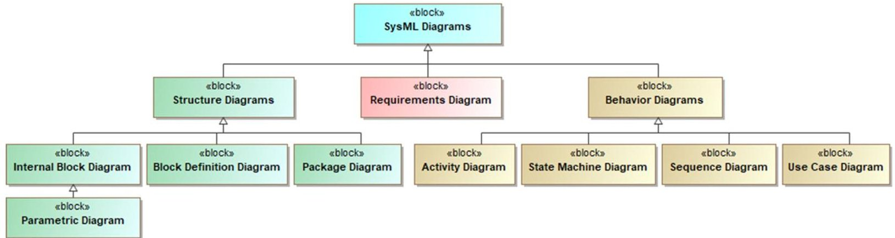

Fig.1 SysML diagrams

Table 2 Active use of SysML in some industries [14]

<table border="1"><tr><td>Industry</td><td>% of active SysML usage</td></tr><tr><td>Space</td><td>23</td></tr><tr><td>Aircraft</td><td>20</td></tr><tr><td>Defense</td><td>20</td></tr><tr><td>Automotive</td><td>7</td></tr></table>

diagrams to model a given system in terms of structure and behavior. As shown in Fig. 1, these diagrams are categorized as follows:

- Structural diagrams provide a static view by representing the structural and logical composition of the system using block definition diagrams and internal block diagrams.

- Behavior diagrams provide a dynamic view by showing the functionality of the system and what the system must do to meet requirements (behavior in different situations, tasks, and failure situations).

Uncategorized requirements diagram allows modeling of the functional aspects of the system. Since a SysML model represents a coherent body of knowledge about system specification, analysis, design, verification, and validation, it can be used as an information source for analysis and simulation tools. For details about the basics of modeling and the SysML notation, refer to Ref. [13].

Although the use of SysML in systems engineering is a relatively new activity, it is gaining popularity and is destined to become the standard for MBSE space systems applications. Table 2 provides the percentage usage of SysML by the largest aerospace, defense, and automotive companies, based on a survey conducted by the Object Management Group (OMG) [14].

## 3 MBSE framework for the academic nanosatellite mission management and design process

## 3.1 Standards used for space project management and design process

The project management procedures proposed by standards like ECSS are sometimes too over-specified for nanosatellite projects which are usually undertaken by universities or academic institutions. The ECSS standards are organized into three main branches corresponding to space project management (ECSS-M Standards), space engineering (ECSS-E Standards), and space product assurance (ECSS-Q Standards), and to which are added the top-level document ECSS-S-ST-00 for description, implementation, and general requirement. Each branch consists of a first level of standards and, if necessary, more detailed complementary documents, and guides facilitating the implementation of the first-level standards, as shown in Fig. 2.

To determine a space mission management and design process, the ECSS-M-ST-10C project planning and implementation standard is applied, which covers the whole process of managing and executing a space project in a coordinated, efficient, and structured way. This standard specifies the application of Project Breakdown Structure as graphically summarized in Fig. 3.

The first-level customer's requirements are translated into a functional breakdown structure, at first, and then into:

- a Product Tree that breakdowns the project into successive levels of hardware and software products or elements, articulated to perform the functions identified in the functional breakdown structure,

- and a work breakdown structure (WBS) which is the principal structure used in managing the project and

<!-- PDF_PAGE: 4 -->

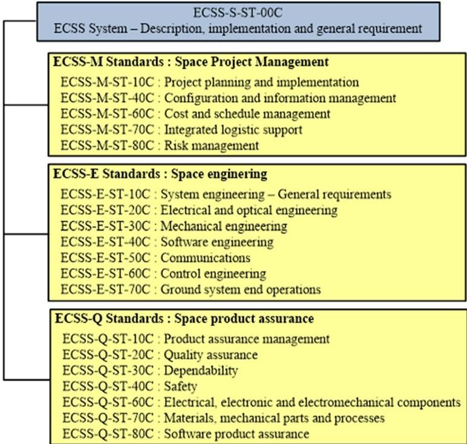

Fig.2 Summary of ECSS standards disciplines [15]

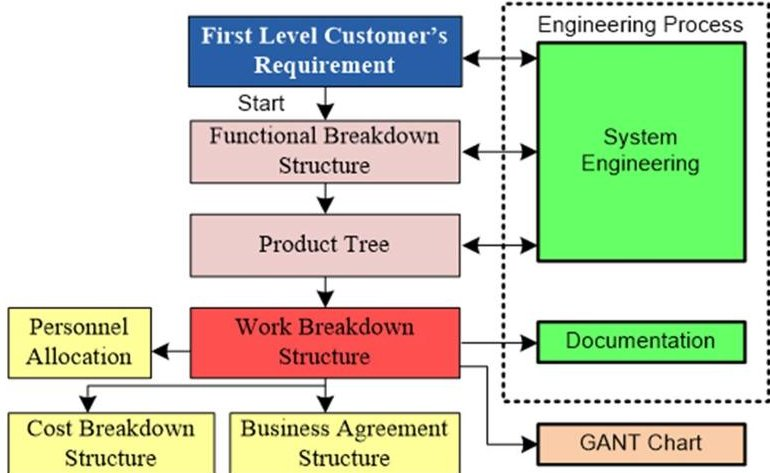

Fig. 3 Project breakdown structure proposed by ECSS [16]

provides a framework for managing cost, schedule, and technical content. It divides the project into manageable work packages, organized according to the nature of the work by breaking down the total work to be performed into increasing levels of detail.

## 3.2 MBSE approach to adjust standard project breakdown structure for academic nanosatellite project management and design process

The standard project breakdown method we just described works quite efficiently in an industrial customer-supplier

relationship. However, some specificities of nanosatellite projects in an academic context allow for simplifying this structure model, since they are not in a customer-supplier relationship. This implies that

- The functional requirements of the mission are mainly derived from the mission objectives,

- The project budget is directly allocated to the acquisition of hardware components and software development. Therefore, the schedule and Coast Breakdown Structure can be directly derived from the Product Tree,

- In the case of students-driven projects, the personnel allocated to the project may change continuously and Business Agreement Structure can be neglected.

To take these specificities into account, we have based ourselves partially on the guidelines of the NASA system engineering manual [17], to adopt an MBSE Framework approach based on a model comprising a consistent set of views reflecting multiple viewpoints and stages in the nanosatellite project, as shown in Fig. 4:

The proposed MBSE Framework shows the main Viewpoints required to manage and carry out a nanosatellite project. Some of these views are developed in the following sections.

## 3.3 Life cycle view

The space mission life cycle typically progresses through several phases named differently depending on the space agency chosen as a reference: ESA or NASA. Each phase has a duration depending on the scope and objectives of the mission, and it must result in a deliverable document (review) that will evaluate and validate the work done and allow progress throughout the life cycle of the mission.

As a reference framework for our work, we have partially used ESA's European Cooperation on Space Standardization (ECSS) standards [18] and NASA Systems Engineering Manual Guidelines [19], which provide free of charge the reference documents and tools necessary for mission management and system engineering. We have then summarized the cycle of a typical nanosatellite mission in 4 phases with deliverables reviews for each phase (Fig. 5):

- Phase A of Mission Analysis results in a broad definition of the mission system, its functional and operational requirements, its architecture, and its constraints.

- Phase B of Formal Design, which results in the development of an engineering model of the nanosatellite with

<!-- PDF_PAGE: 5 -->

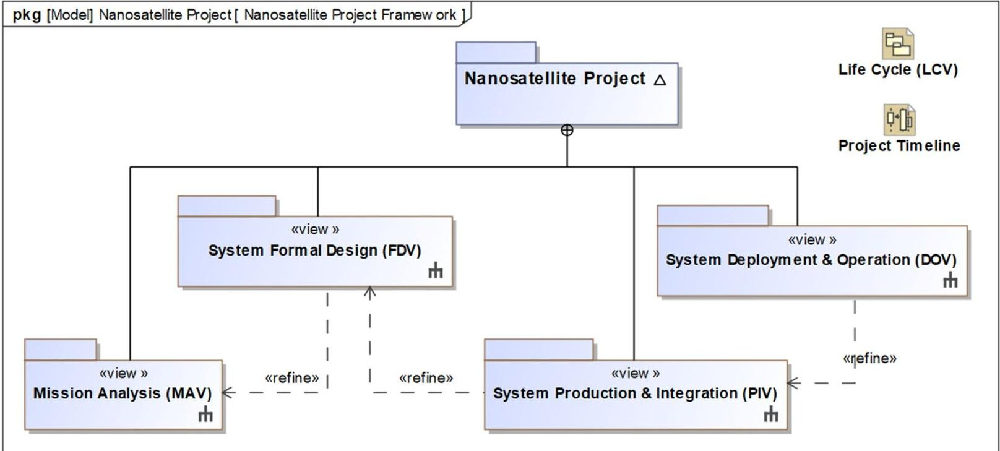

Fig.4 MBSE architectural framework adjusted for nanosatellite projects

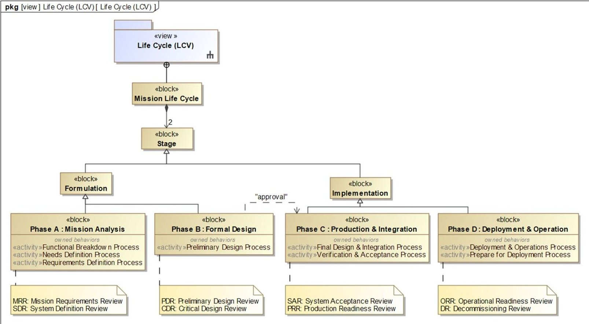

Fig.5 Life cycle view showing development phases adjusted for nanosatellite projects

<!-- PDF_PAGE: 6 -->

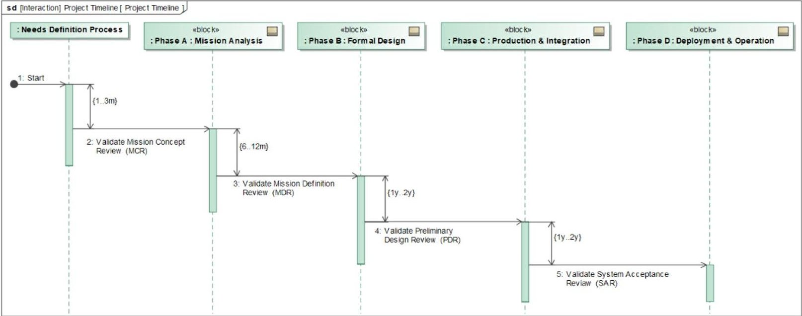

Fig.6 Life cycle timeline

a detailed definition of its different subsystems, and the development of test hardware and software.

- Phase C of Production and Integration results in the realization and integration of a flight model of the nanosatellite (development of the flight hardware and software), and the establishment of an operational ground station.

- Phase D of deployment and operations, which results in the launching of the space segment, its day-to-day operation, and its maintenance and support.

Since small and relatively simple projects like university nanosatellites require an average of 3.8 years to

develop [20], Fig. 6 shows a typical timeline for the 4 phases of the life cycle:

## 3.4 Mission analysis views

This view describes the starting point for the management of a university nanosatellite project, i.e., the mission analysis phase.

As shown in the package diagram Fig. 7, this phase is divided into 2 stages:

- The mission definition stage consists of 2 interdependent and highly iterative and recursive processes, resulting in

Fig.7 Life cycle timeline

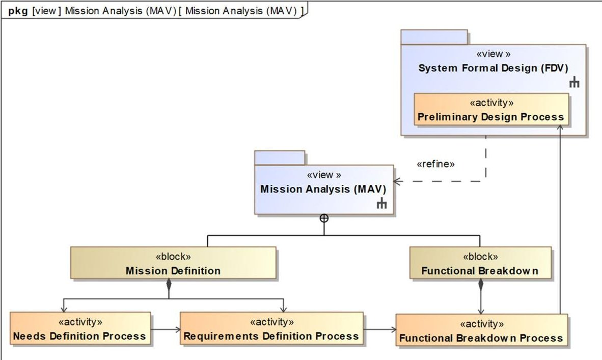

<!-- PDF_PAGE: 7 -->

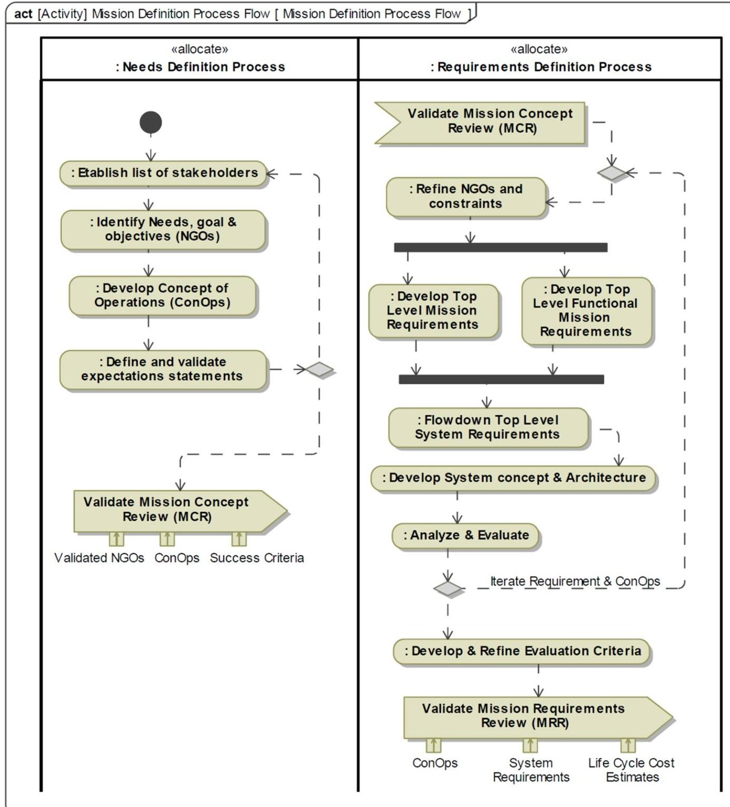

Fig.8 Mission definition process typical flow diagram

a set of validated top-level functional and performance requirements and a concept of operations, which meet the confirmed needs of the stakeholders. Figure 8 provides a typical flow diagram for the Mission Definition Process Flow: the first Needs Definition Process collects and validates the mission Needs, Goals, and Objectives (NGOs), constraints, and criteria for defining mission success, and the second Requirements Definition Process (triggered by the validated Mission Concept Review) establishes top-level system requirements, architectural and top-level

concept of operations (ConOps), and life cycle cost estimates.

- The second step of functional decomposition, triggered by the validated Mission Requirements Review (MRR), is the process of identifying the "functions" that should be achieved at each level of the system to meet the validated NGOs. It is a functional analysis for creating the system architecture (a set of logical decomposition models like low-level requirements, functional flow, behavioral flow, data flow, states/modes, etc.) by

<!-- PDF_PAGE: 8 -->

Fig.9 Functional breakdown process typical flow diagram

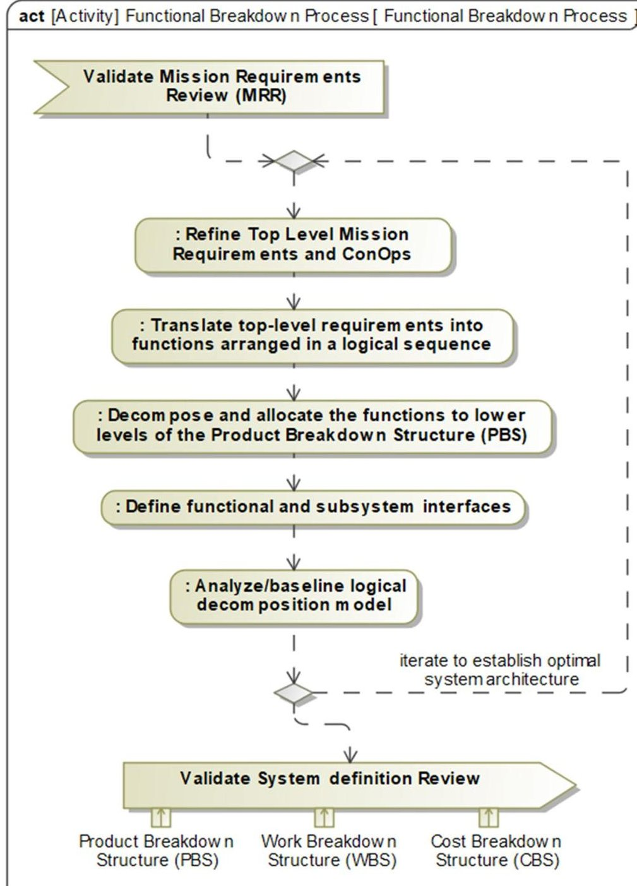

breaking down higher level requirements of the MRR. Figure 9 provides a typical flow diagram for the Functional Breakdown Process.

The mission analysis view, therefore, identifies the inputs, outputs, and typical activities to consider in addressing the first phase of a university nanosatellite mission life cycle, with the following main outputs intended for the next Formal Design Phase:

- Product breakdown structure (PBS): system decomposition into successive levels of hardware-oriented products or elements, articulated to perform the functions identified in the Functional Breakdown Process.

- Work breakdown structure (WBS): provides a framework for the stakeholders involved in the nanosatellite project. This structure is derived from the PBS and divides the project into several tasks and sub-tasks organized according to the work to be carried out.

- Cost breakdown structure (CBS): Hierarchy diagram of project costs. Since university nanosatellites are typically student-driven projects, costs are deducted from the WBS and are primarily for hardware and software development, including testing.

<!-- PDF_PAGE: 9 -->

Table 3 Requirements categories used in the System Requirement Review (SRR)

<table border="1"><tr><td>Category</td><td>Identifier</td><td>Subcategory</td></tr><tr><td>Mission requirements</td><td>100</td><td>-</td></tr><tr><td rowspan="2">Segment requirements</td><td>210</td><td>Space segment requirements</td></tr><tr><td>220</td><td>Ground segment requirements</td></tr><tr><td rowspan="10">Subsystem requirements</td><td>211</td><td>Structure &amp; mechanism</td></tr><tr><td>212</td><td>Power system</td></tr><tr><td>213</td><td>On-board computer</td></tr><tr><td>214</td><td>Communication</td></tr><tr><td>215</td><td>Attitude control</td></tr><tr><td>216</td><td>Thermal control</td></tr><tr><td>217</td><td>Solar panel payload</td></tr><tr><td>218</td><td>FPGA OBC payload</td></tr><tr><td>221</td><td>Roof segment</td></tr><tr><td>222</td><td>Mission control center</td></tr></table>

## 4 Mission analysis mission phase applied to the MASAT1 project

## 4.1 Mission definition process

MASAT1 is a nanosatellite project initiated at the University of Sidi Mohamed Ben Abdellah, Fez, Morocco to put in place the basic and indispensable technologies (hardware

and software) necessary to build a resilient, ready-to-fly CubeSat system, with efficient power management and low-cost mission control ground station [21]. The mission's main payload is an FPGA-based reconfigurable secondary onboard computer.

The first step in the Mission Definition process was to identify the key stakeholders involved in the different stages of the project: in our case, the CNRST was the main customer, followed by the research professors at the universities involved in the project. The Need definition Process then allowed us to develop iteratively the Mission Concept Review (MCR) summarizing the Stakeholder NGOs, and the initial ConOps which describes how the system will be operated during the life cycle phases.

Based on the MCR document, the top-level mission requirements are set using the ECSS-E standard and the Mission Requirements Review (MRR) has been developed. This is one of the reference documents that will allow the validation of the system's final design. It expresses the requirements and constraints of the mission without referring to any specific technical solution but rather allows us to propose the best technical and software solutions in the Formal Design Phase.

For most of the ECSS system engineering standards that we used to prepare the SRR, we can cite ECSS-E-ST-10C: System Engineering—General Requirements [22], ECSS-E-ST-10-06C: Technical Requirements Specifications [23]

Table 4 Requirements type identifiers used in the System Requirement Review (SRR)

<table border="1"><tr><td>Identifier</td><td>Type</td><td>Description</td></tr><tr><td>OPER</td><td>Operational requirements</td><td>Requirements related to the system&#x27;s operability(e.g.,autonomy,control,and contingency)</td></tr><tr><td>FUNC</td><td>Functional requirements</td><td>Requirements that define what the product shall perform,in order to conform to the mission statement or requirements</td></tr><tr><td>DESG</td><td>Design requirements</td><td>Requirements related to the imposed design and implementation standards(interchangeability,security,or margins)</td></tr><tr><td>CONF</td><td>Configuration requirement</td><td>Requirements related to the composition of the product or its organization</td></tr><tr><td>INTF</td><td>Interfacing requirements</td><td>Requirements related to the different types of interfaces(e.g.,physical,thermal,electrical,and protocol)</td></tr><tr><td>PHYS</td><td>Physical requirements</td><td>Requirements related to electrical isolation mechanical characteristics,and chemical composition(weight and dimensional limits)</td></tr><tr><td>RMSQ</td><td>Product assurance requirements</td><td>Requirements that cover reliability,availability,maintainability,safety,and quality assurance</td></tr></table>

Table 5 Example of MASAT1 space segment requirements

<table border="1"><tr><td>Reference</td><td>Description</td></tr><tr><td>210-OPER-007</td><td>The space segment shall delay antenna deployment until the space segment reaches optimal power supply conditions</td></tr><tr><td>210-FUNC-011</td><td>The space segment must continuously send a beacon signal</td></tr><tr><td>210-PHYS-005</td><td>The space segment shall adhere to the following mass restriction of 1.33kg for1U CubeSat design</td></tr><tr><td>210-RMSQ-003</td><td>Only uncorrupted commands sent by the ground segment should be executed</td></tr></table>

<!-- PDF_PAGE: 10 -->

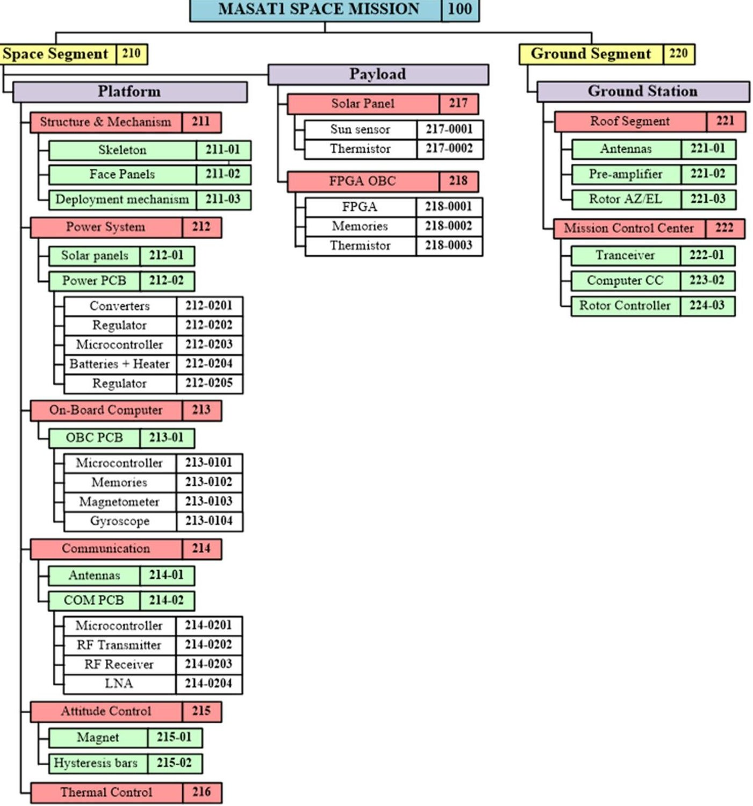

Fig. 10 Product Tree for the MASAT1 nanosatellite

and ECSS-E-ST-20C: System Engineering—Electrical and Electronics [24].

Requirements are referenced and labeled to identify their category and type. The used references meet the syntax "CCC-DDDD-nnn",where

- CCC: represents the category of the requirement.

- DDDD: represents the identifier of the requirement type.

- nnn: represents the unique number of the requirement.

Table 3 summarizes requirements categories, Table 4 summarizes the identifiers of requirement types, and Table 5 provides an example of MASAT1 Space segment requirements:

## 4.2 Functional breakdown process

Based on the flow of operation of the activity diagram in Fig. 5, the project engineering team performs a functional

<!-- PDF_PAGE: 11 -->

analysis and produces the functional breakdown structure (FBS) from the top-level requirements. It is a structured, modular, and function-oriented tree, listing every function that must be addressed to perform the mission. A Product Tree structure is then deduced by breaking down the system into successive levels of hardware-oriented products or elements, articulated to perform the functions identified in the FBS.

In the case of the MASAT1 nanosatellite project, Fig. 10 illustrates the adopted Product Tree and, for each item identified in the structure, the identification code and item name are provided, by the referencing adopted for the requirements:

The Product Tree forms the basis for the project MBSE modeling approach adopted to create the product breakdown structure (PBS) and the work breakdown structure (WBS).

## 5 Implementation of the MBSE approach to develop the product breakdown structure (PBS)

MBSE approach can be used to create a PBS model repository that can be used by university teams designing nanosatellite projects, for requirements, design, analysis verification, and validation activities. Choosing to use package diagrams at this level of abstract modeling helps stakeholders understand the structure of the model and helps modelers build the model in a more organized way. Systems engineers can then use various methodologies to implement MBSE and build the system models [13].

Table 6 Association between a package and used SysML diagram

<table border="1"><tr><td>Package name</td><td>SysML diagram types</td></tr><tr><td>Requirements</td><td>Requirements diagram-tables</td></tr><tr><td>Structure</td><td>Block definition diagram(bdd)Internal block diagram(ibd)</td></tr><tr><td>Behavior</td><td>Activity diagram—use case diagramstate machine diagram</td></tr></table>

We take a simplified version of the process perspective, first modeling the context and requirements of the nanosatellite mission, and then modeling the structures and behaviors required to achieve those requirements. After that, parameters and analysis are then integrated into the system model to simulate the properties and workflow of the nanosatellite.

By integrating this methodology, as well as referring to the work of SSWG [6] [7] [8] and Guo et al. [10], we have organized our PBS model elements into packages structured by both SysML diagram type and hierarchy concurrently. Figure 11 shows the organizational package diagram of the MASAT1 mission model.

The adopted package structure represents the synthesis of the mission analysis phase process flows (Fig. 7): Missions Stakeholders and Requirements packages result from Needs Definition and Requirements Definition processes, while the rest of the packages result from functional breakdown process.

Fig.11 Nanosatellite PBS package organization

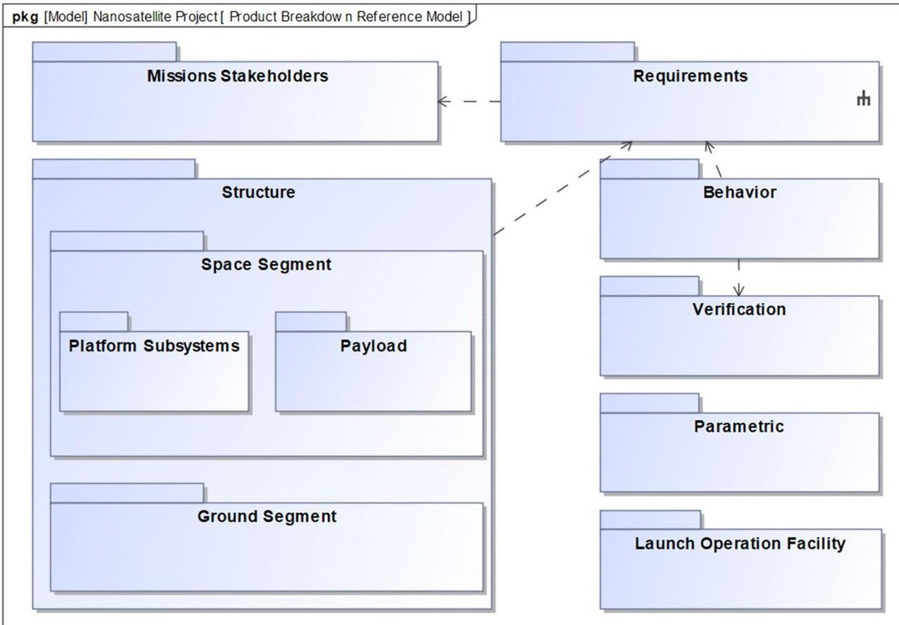

<!-- PDF_PAGE: 12 -->

Fig.12 MASAT1 system requirements organization

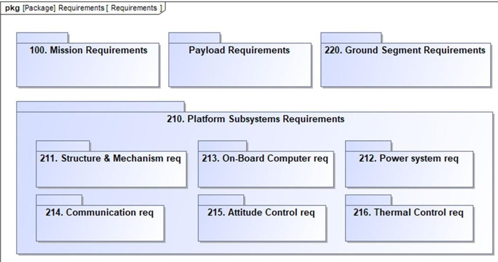

Table 7 SysML Identifier mapped to requirements type identifier used in the SSR

<table border="1"><tr><td>Requirements identifier</td><td>Type</td><td>SysML identifier</td></tr><tr><td>OPER</td><td>Operational requirements</td><td>1</td></tr><tr><td>FUNC</td><td>Functional requirements</td><td>2</td></tr><tr><td>DESG</td><td>Design requirements</td><td>3</td></tr><tr><td>CONF</td><td>Configuration requirement</td><td>4</td></tr><tr><td>INTF</td><td>Interfacing requirements</td><td>5</td></tr><tr><td>PHYS</td><td>Physical requirements</td><td>6</td></tr><tr><td>RMSQ</td><td>Product assurance requirements</td><td>7</td></tr></table>

In these packages, different diagrams are developed showing the physical and logical properties of the nanosatellite design. Table 6 summarizes the types of SysML diagrams associated with packages, which are detailed later in this paper:

## 5.1 Requirements modeling

The system requirements are identified to meet stakeholder commitments, and mission requirements, as defined in the Mission Requirement Review (MRR). These requirements form the basis not only for project qualification and acceptance but also for the design phase and allow the definition of technical solutions for the different nanosatellite subsystems and the specification of the communication interfaces between these subsystems.

MASAT1 mission requirements organization can be seen from the packet diagram in Fig. 12:

The system requirements for the MASAT1 mission are implemented in the MBSE model using the requirement diagrams and tables available in SysML. To exploit the automated reference numbering of requirements based on the block flows within SysML-designed diagrams, sequential referencing (Table 7) was used in requirements diagrams based on the Requirements Identifier adopted in the System Requirement Review (SRR) (see Tables 3, 4, and 5).

Figure 13 depicts the operational mission requirements, with a main block labeled "OPER task requirements" preceding the associated sub-requirements, creating an automatic identification number for each requirement. For example, if we take Id 100.1.3:

- 100 indicates the main category of requirements, in this case, the mission requirements.

- 100.1 specifies the type of task requirement, in this case, the operational requirement block.

- 100.1.3 describes the third operational requirement of the mission.

Following the same process, and in order to promote the use of the MASAT1 model as much as possible, all requirements were formulated according to the SRR document developed from the ECSS system engineering standards. Some subsystem requirements have been adjusted to meet the specific requirements of the MASAT1 project, such as the power subsystem design requirements, as shown in Fig. 14.

At the end of the mission analysis phase, in which all the requirements needed to define the logical and physical

<!-- PDF_PAGE: 13 -->

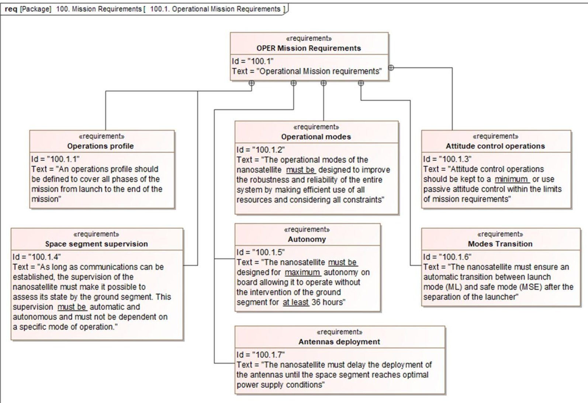

Fig.13 MASAT1 operational mission requirements

architectures were identified and formulated, requirements tables were generated to compensate for the disadvantage of requirements diagrams in visualizing large numbers of requirements. These tables describe the requirements and their relationship to other SysML design elements to facilitate requirements traceability, satisfaction, and verification. Figure 15 shows an extract from the mission requirements table:

- The "Satisfied By" column shows the model elements that fulfill the requirement. For example, the "Power System" subsystem must satisfy operational requirement 100.1.6.

- The 'Verified By' column shows the specific test cases that determine how the system meets the requirement. For example, the "Bus System Activation" activity diagram (Fig. 23), which is part of the LEOP flow (Fig. 22), is used to verify operational requirement 100.1.6.

The requirements matrix is another important SysML element that can be generated for requirements to design trace as shown in the extract from the mission Satisfy Requirement Matrix in Fig. 16:

## 5.2 Structural modeling

Once the modeling of the MASAT1's context and requirements was completed, we moved on to the design of the diagrams describing the different subsystems composing the CubeSat's structure. SysML allows modelers to describe each subsystem's different components using two main diagrams: block definition diagram (bdd) and internal block diagram (idb).

The SysML block definition diagram is the most used diagram type in the SysML modeling process, intending to provide information on the logical and physical structure of

<!-- PDF_PAGE: 14 -->

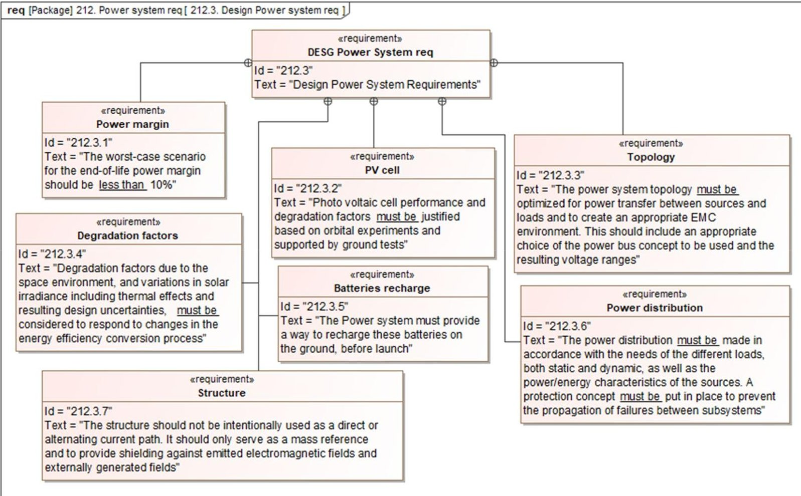

Fig.14 MASAT1 design power system requirements

<table border="1"><tr><td>#</td><td>Id</td><td>Name</td><td>Text</td><td>Satisfied By</td><td>Verified By</td></tr><tr><td>1</td><td>100.1</td><td>100.1 OPER Mission Requirements</td><td></td><td></td><td></td></tr><tr><td>2</td><td>100.1.1</td><td>100.1.1 Operations profile</td><td>An operations profile should be defined to cover all phases of the mission from launch to the end of the mission</td><td></td><td></td></tr><tr><td>3</td><td>100.1.2</td><td>100.1.2 Operational modes</td><td>The operational modes of the nanosatellite must be designed to improve the robustness and reliability of the entire system by making efficient use of all resources and considering all constraints</td><td>Cde &amp; Data Handling Soft Power Management Softw</td><td>Operational Phase</td></tr><tr><td>4</td><td>100.1.3</td><td>100.1.3 Attitude control operations</td><td>Attitude control operations should be kept to a minimum or use passive attitude control within the limits of mission requirements</td><td>Attitude Control</td><td></td></tr><tr><td>5</td><td>100.1.4</td><td>100.1.4 Space segment supervision</td><td>As long as communications can be established, the supervision of the nanosatellite must make it possible to assess its state by the ground segment. This supervision must be automatic and autonomous and must not be dependent on a specific mode of operation.</td><td>Power System</td><td></td></tr><tr><td>6</td><td>100.1.5</td><td>100.1.5 Autonomy</td><td>The nanosatellite must be designed for maximum autonomy on board allowing it to operate without the intervention of the ground segment for at least 36 hours</td><td>On-Board Computer</td><td>Operational Phase</td></tr><tr><td>7</td><td>100.1.6</td><td>100.1.6 Modes Transition</td><td>The nanosatellite must ensure an automatic transition between launch mode (ML) and safe mode (MSE) after the separation of the launcher</td><td>Power System</td><td>LEOP Flow Bus System Activation</td></tr><tr><td></td><td></td><td></td><td>The nanosatellite must delay the deployment of the antenna until the space</td><td></td><td>LEOP Fl</td></tr></table>

Fig.15 MASAT1 mission requirements table

the subsystem that needs to be modeled, without distinguishing between software and hardware.

To illustrate, Fig. 17 shows the block definition diagram that displays the general structure of the MASAT1 space segment, which is a SysML model of the Product Tree. Since

a distributed architecture has been adopted for MASAT1, we note the presence of the software part as a logical component of multiple subsystems such as onboard computer, power system, and communication. Each subsystem of this general structure is then defined by its own bdd specifying internal

<!-- PDF_PAGE: 15 -->

Fig.16 MASAT1 mission requirements matrix

<table border="1"><tr><td>Legend
Satisfy
Satisfy (Implied)</td><td colspan="7">100. Mission Requirements
100.1 OPER Mission Requi
100.1.1 Operations profile
100.1.2 Operational modes
100.1.3 Attitude control operations
100.1.4 Space segment supervisor
100.1.5 Autonomy
100.1.6 Modes Transition
100.1.7 Antennas deployment
100.2 FUNC Mission Requirements</td></tr><tr><td>On-Board Computer</td><td>2</td><td></td><td></td><td></td><td></td><td></td><td></td></tr><tr><td>Cde&amp;Data Handling Software:Cde&amp;Data</td><td>1</td><td></td><td></td><td></td><td></td><td></td><td></td></tr><tr><td>Gyroscope:Gyroscope[0..1]</td><td></td><td></td><td></td><td></td><td></td><td></td><td></td></tr><tr><td>Magnetometer:Magnetometer[0..1]</td><td></td><td></td><td></td><td></td><td></td><td></td><td></td></tr><tr><td>Memory Unit:MemoryUnit[1..3]</td><td></td><td></td><td></td><td></td><td></td><td></td><td></td></tr><tr><td>On-Board Computer:On-BoardComputer</td><td></td><td></td><td></td><td></td><td></td><td></td><td></td></tr><tr><td>Power System</td><td>4</td><td></td><td></td><td></td><td></td><td></td><td></td></tr><tr><td>Battery:Battery[1..2]</td><td></td><td></td><td></td><td></td><td></td><td></td><td></td></tr><tr><td>Kill Switch:KillSwitch[1]</td><td></td><td></td><td></td><td></td><td></td><td></td><td></td></tr></table>

components and specific characteristics in more detail, as shown in Fig. 18, which depicts the Power subsystem.

The SysML internal block diagrams (ibd) can be used to model connections between bdd internal components in terms of data, power, or service flow. To this end, each block that makes up the ibd diagram can contain ports, representing points at which the block transitions occur. Figure 19 shows the ibd diagram representing the data flow between the MASAT1 space segment subsystems.

The initial structure of an ibd diagram containing the basic blocks is usually automatically generated from the bdd diagram of the subsystem, leaving the modeler to create the connection and data flow lines between the ports. For example, Fig. 18 describes the power systems components, while Fig. 20 reveals the subsystem's internal connections and information flow.

## 5.3 Behavior modeling

MASAT1's behavioral modeling complements structural modeling by describing the behavior of the system and events occurrences over time using two main SysML diagrams: state machine diagram (stm) and activity diagram (act).

The SysML state machine diagram shows the system's operational modes, as well as the transitions and operations performed within them. Figure 21's state machine diagram represents the concept of operations (ConOps) for the MASAT1 mission, which gives an idea of the operational dynamics of the space segment subsystems. It describes the operational phases and scenarios, including the different operational modes and their interactions. Although MASAT1 mission uses passive attitude control, an attitude control mode has been included in ConOps to generalize the model proposed in this paper. The notion of mode is defined as a "selectable option" that may be requested from the system to achieve a specified set of

<!-- PDF_PAGE: 16 -->

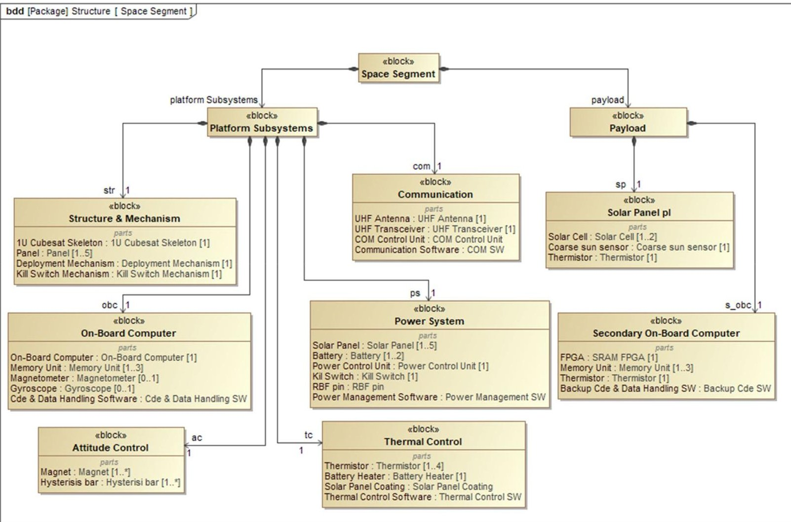

Fig.17 Block definition diagram of MASAT1 space segment structure

mission objectives and the notion of phase is defined as a segment of the mission life cycle [25].

The second most common SysML behavioral diagram is the activity diagram, which provides the flow of events and activities of the system in sequential execution. The

complexity of an activity diagram depends on the flow of operations being described. Figure 22 depicts the LEOP flow corresponding to ConOps's LEOP phase, including several basic elements of a typical activity diagram. Blocks and

<!-- PDF_PAGE: 17 -->

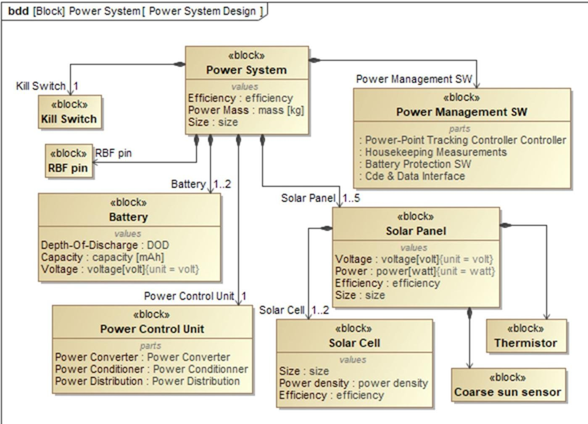

Fig.18 Power system components and characteristics

elements of the diagram, as well as different diagrams, can be interconnected using the signal receiving and sending actions, as shown in Fig. 22's signal sending and receiving elements "Antenna Deployed" and signal sending element "Com established" intended to transmit an activation signal

to the Nominal Flow's activity diagram corresponding to ConOps's Nominal phase.

The LEOP flow activity diagram is also a way to "verify" functional or operational requirements, such as the Bus System Activation state machine (Fig. 23), which verifies

<!-- PDF_PAGE: 18 -->

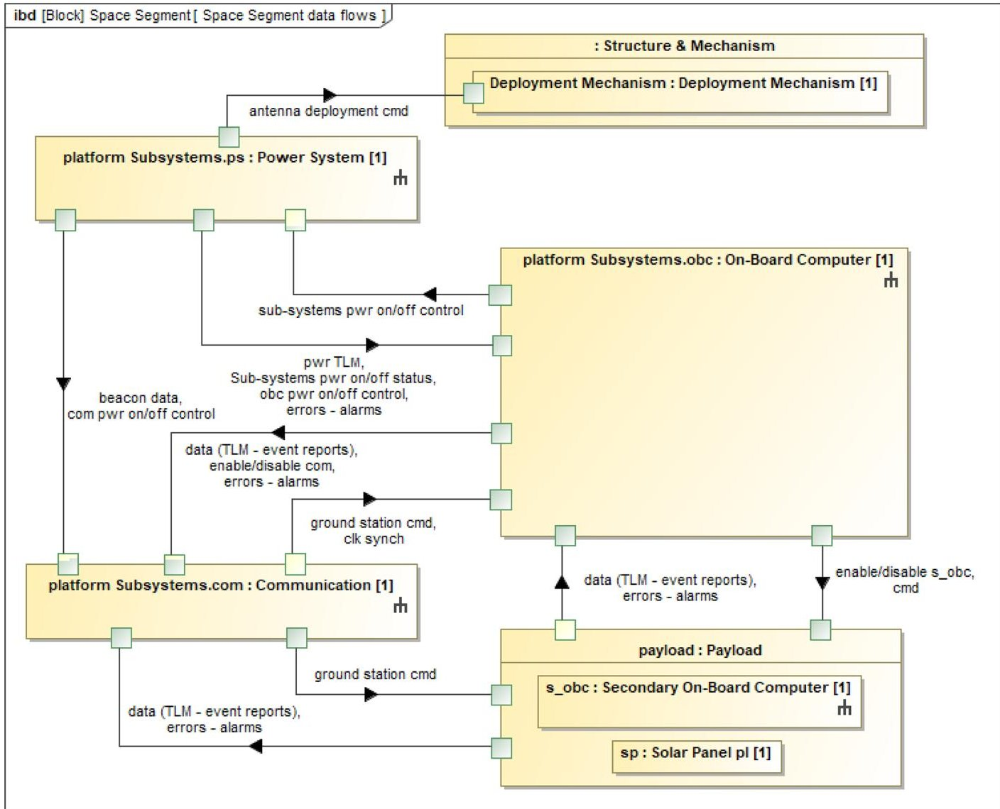

Fig.19 MASAT1 space segment data flows

operational requirements 100.1.6. that validate operational requirement 100.1.6.

## 6 Conclusion

As part of the research for this paper, we propose an MBSE framework model for academic structures that

<!-- PDF_PAGE: 19 -->

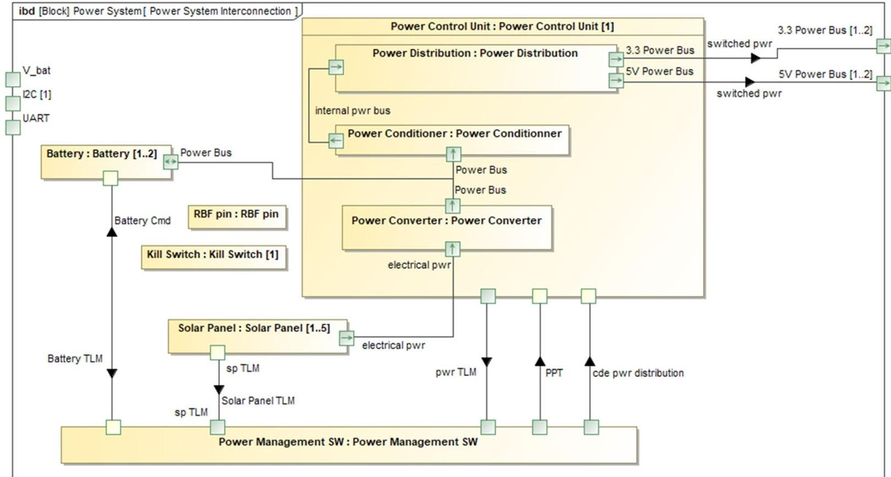

Fig. 20 Internal block diagram of power system

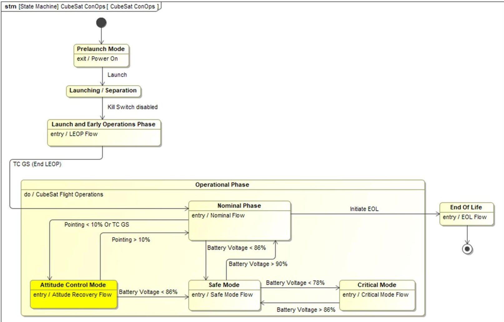

Fig.21 MASAT1 concept of operations

<!-- PDF_PAGE: 20 -->

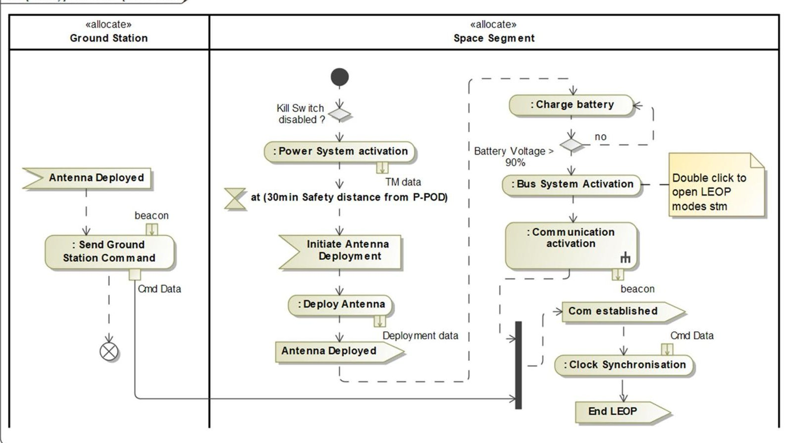

Fig. 22 MASAT1 LEOP flow actions

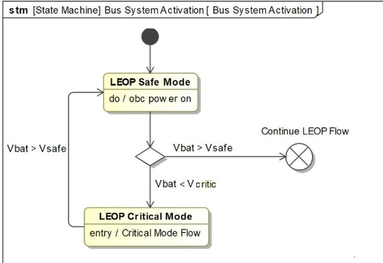

Fig.23 Power bus system activation state machine

want to start a nanosatellite project for the first time. It synthesizes the basic concepts and processes that allow supervising teachers to carry out project management and design activities easily and efficiently. To improve communication, planning, management, and development, we implemented this approach, replacing ad hoc procedures in the work organization with process flow and model based

on the different views of the system architecture. The proposed modeling also facilitated the development of key documents in a nanosatellite project, namely the product breakdown structure (PBS), which has been relatively detailed in the paper. To maximize the benefits of rapid and cost-effective nanosatellite approaches, the PBS is considered as the backbone of the project design management activities allowing among other things to define the work breakdown structure (WBS) and the cost breakdown structure (CBS).

The next step of this work is to improve the viability and practicality of the product breakdown structure model by integrating external analysis and simulation tools such as MATLAB and STK. The aim is to develop an executable SysML model with a graphical user interface to provide insight into how nanosatellites work.

Funding This work was supported by the CNRST under grand PPR/2015/12.

## Declarations

Conflict of interest The authors have no competing interests to declare that are relevant to the content of this article.

<!-- PDF_PAGE: 21 -->

## References

1. Woellert, K., Ehrenfreund, P., Ricco, A.J., Hertzfeld, H.: Cubesats: cost-effective science and technology platforms for emerging and developing nations. Adv. Space Res. 47(4), 663-684 (2011). https://doi.org/10.1016/j.asr.2010.10.009

2. Kulu, E.: Nanosatellite Database: http://www.nanosats.eu/index.html#database (2023)

3. Swartwout, M.: Reliving 24 years in the next 12 minutes: a statistical and personal history of university-class satellites In:Proceedings of the 32nd Annual AIAA/USU Conference on Small Satellites (SSC18-WKVIII-03), Logan, UT, USA, 4-9 August 2018. (2018)

4. Berthoud, L., Sartwout, M., Cutler, J., Klumpar, D., Larsen, J. A., Nielsen, J. F. D.: University cubesat project management for success. In:Proceedings of the AIAA/USU Conference on Small Satellites [SSC19-WKIII-07] (2019). https://digitalcommons.usu.edu/smallsat/2019/all2019/63/

5. N.N.:Systems engineering vision 2035: Engineering solutions for a better world, International Council on Systems Engineering. https://www.incose.org/about-systems-engineering/se-vision 2035 (2022). Accessed 21 Apr 2023

6. Spangelo, S.C., et al.: Applying model based systems engineering (MBSE) to a standard cubesat. In: IEEE Aerospace Conference, Big Sky, MT, USA, pp. 1-20 (2012). https://doi.org/10.1109/AERO.2012.6187339

7. Kaslow, D., Soremekun, G., Kim, H., Spangelo, S.: Integrated model-based systems engineering (MBSE) applied to the simulation of a cubesat mission. In: IEEE Aerospace Conference, Big Sky, MT, USA, pp. 1-14 (2014). https://doi.org/10.1109/AERO.2014.6836317

8. Kaslow, D., Ayres, B., Cahill, P.T., Hart, L., Yntema, R.:A model-based systems engineering (MBSE) approach for defining the behaviors of cubesats. In: IEEE Aerospace Conference, Big Sky, MT, USA, pp. 1-14 (2017). https://doi.org/10.1109/AERO.2017.7943865

9. Weiland, Karen, J.: Future model-based systems engineering vision and strategy bridge for NASA. https://purl.fdlp.gov/GPO/gpo171602 (2021). Accessed 21 Apr 2023

10. Guo, J., Gill, E., Figari, S.:Model-based systems engineering to support the development of nanosatellites.In: Proceedings of the 65th International Astronautical Congress (IAC), pp. 1-10 (2014)

11. Girardello, C., Tajmar, M., Scharlemann, C.: GREATCUBE+: conceptual design tool for CubeSat's design. CEAS Space J. (2023). https://doi.org/10.1007/s12567-023-00509-9

12. Waseem, M., Sadiq, M.U.: Application of model-based systems engineering in small satellite conceptual design-a SysML approach. IEEE Aerosp. Electron. Syst. Mag. 33(4), 24-34 (2018). https://doi.org/10.1109/MAES.2017.180230

13. Holt, J., Perry, S.: SysML for systems engineering: a model-based approach (3rd edition). The Institution of Engineering and Technology, London (2018). https://doi.org/10.1049/PBPC020E

14. Luther, S.T.: SysML based cubesat model design and integration with the horizon simulation framework. Faculty of California polytechnic state university, San Luis Obispo (2016)

15. ECSS Secretariat,: ESA-ESTEC, Requirements & Standards Division: ECSS-S-ST-00C, "Description, implementation and general requirements", ESA-ESTEC, 31 Juillet 2008

16. Kuwahara, T., Falke, A., Röser, H.P.: Effective project management of small satellite projects from the system engineer's point of view, an example of the small satellite flying laptop project. Trans. Japan Soc. Aeronaut. Space Sci., Space Technol. Japan 7(ists26), 1-8 (2009). https://doi.org/10.2322/tstj.7.Pt_1

17. National Aeronautics and Space Administration, NASA Headquarters, "Systems Engineering Handbook", NASA/SP-2007- 6105 Rev1, 2007

18. ECSS Secretariat;: ESA-ESTEC, Requirements & Standards Division: ECSS-M-ST-10C Rev. 1, "Space project management- Project planning and implementation", (6 March 2009)

19. NASA/SP-2014-3705, "NASA Space Flight Program and Project Management Handbook". National Aeronautics and Space Administration Headquarters Office of the Chief Engineer Washington, D.C. 20546, September 2014

20. Richardson, G., Schmitt, K., Covert, M., Rogers, C.: Small satellite trends 2009-2013. In: Proceedings of the 29th Annual AIAA/USA Conference on Small Satellites, Technical Session VII, SSC15-VII-3, Logan, UT, USA, 8-13 August 2015, pp. 1-10. https://digitalcommons.usu.edu/smallsat/2015/all2015/48/. Accessed on 25 Aug 2021

21. Hanafi, A., et al.: FPGA-based secondary on-board computer system for low-earth-orbit nanosatellite. In: International Conference on Advanced Technologies for Signal and Image Processing (ATSIP), Fez, Morocco, pp. 1-6, (2017). https://doi.org/10.1109/ATSIP.2017.8075514

22. ECSS Secretariat,: ESA-ESTEC, Requirements & Standards Division: ECSS-E-ST-10C, "System engineering—General requirements", (06 Mars 2009)

23. ECSS Secretariat,: ESA-ESTEC, Requirements & Standards Division: ECSS-E-ST-10-06C, "System engineering—Technical requirements specification", (06 Mars 2009)

24. ECSS Secretariat,: ESA-ESTEC, Requirements & Standards Division: ECSS-E-ST-20C, "System engineering—Electrical and electronic", (31 Juillet 2008)

25. Wasson, C.S.:3.3.1 System phases, modes, and states: solutions to controversial issues. In:INCOSE International Symposium, 21, 279-294 (2011). https://doi.org/10.1002/j.2334-5837.2011.tb01205.x

Publisher's Note Springer Nature remains neutral with regard to jurisdictional claims in published maps and institutional affiliations.

Springer Nature or its licensor (e.g. a society or other partner) holds exclusive rights to this article under a publishing agreement with the author(s) or other rightsholder(s); author self-archiving of the accepted manuscript version of this article is solely governed by the terms of such publishing agreement and applicable law.

