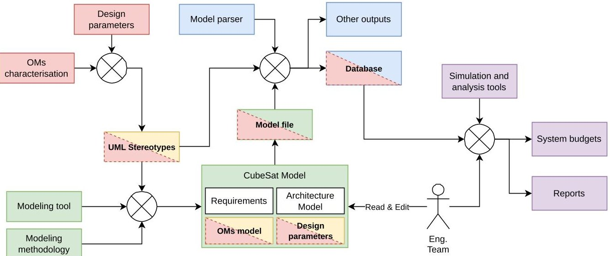
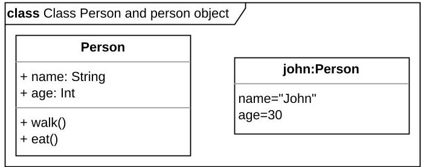
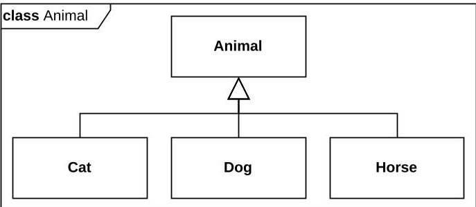
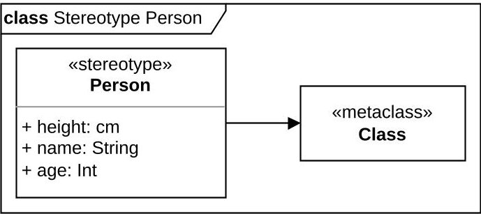
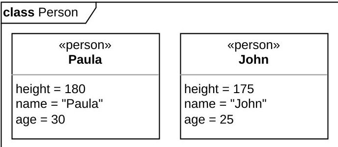
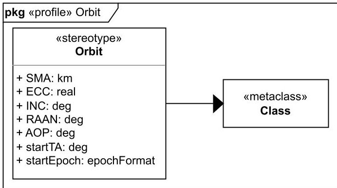
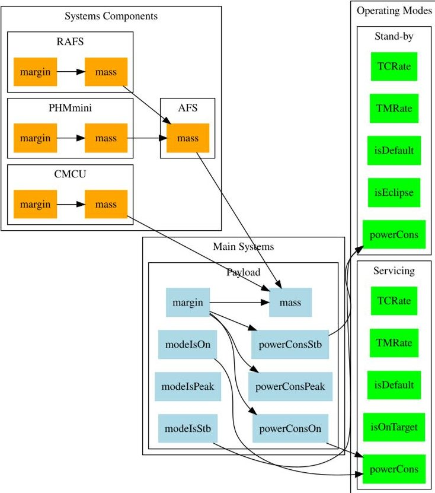

<!-- PDF_PAGE: 1 -->

IAC-24,D1,5,3,x83838

# Constructing of CubeSat Data and Mission Parameters through UML and SysML for Preliminary Design

Giacomo Luccisano $ ^{a, *} $ , Sophia Salas Cordero $ ^{b, c} $ , Thibault Gateau $ ^{c} $ , Nicole Viola $ ^{a} $

$ ^{a} $ Politecnico di Torino, 10129 Turin, Italy. (giacomo.luccisano)or(nicole.viola)@polito.it

b The CT Engineering Group, 31770 Colomiers, France. sophia.salas@ctengineeringgroup.com

$ ^{c} $ Institut Supérieur de l'Aéronautique et de l'Espace, 31400 Toulouse, France. thibault.gateau@isae-supaero.fr

* Corresponding Author.

## Abstract

During the past two decades, the Space Industry has witnessed a constant evolution, primarily represented by a continuous increase in the number of operational satellites and market value with for instance CubeSats. This period has been marked as well by a pivotal shift from traditional Document-Based System Engineering to Model-Based Systems Engineering (MBSE) and Concurrent Engineering (CE) approaches, a transition led by both Industry and Academia. This shift responds to the increasing demand for innovative space technologies, and the necessity to accelerate design processes and lower costs.

The modeling of complex systems is a complex endeavor. Particularly, as design team projects seem to always start from zero during the Preliminary Design (PD) Phase (Phases 0/A according to ESA's nomenclature). System models ideally should be integrated with different external simulation tools. To this date, many issues arise when trying to tackle this integration in the order of syntax and semantics. How to effectively formalize and exchange data during the PD phase? - This is one of the open questions that this paper addresses.

This paper presents the first efforts of the development of an open-source initiative for the modeling of CubeSats starting from the PD studies. It discusses the formalization of a CubeSat Systems Modelling Language (SysML) general model, enhanced through the use of a newly-generated set of Unified Modelling Language (UML) stereotypes. The principal design choices - namely, the use of SysML as modeling language and UML stereotypes for efficient data storage and simulation - and their rationale are presented. The application of UML stereotypes within a SysML model tailored ad-hoc for CubeSat PD is shown to offer several advantages, including enhanced data characterization, reusability, and system optimization. The formalization offers a centralized, adaptable data source that integrates seamlessly with simulation tools, improving design accuracy and efficiency. By expanding the scope of stereotypes and enhancing tool compatibility, future work could unlock new possibilities in multi-disciplinary optimization, real-time mission planning, and collaborative design.

Moreover, an overview of the main advantages and drawbacks of the proposed formalization is provided, as well as an indication for future works.

Keywords: Systems Engineering, Model-Based Systems Engineering, SysML, UML, Preliminary Design, CubeSats

## Abbreviations

AOCS Attitude & Orbit Control System

CDF Concurrent Design Facility

CE Concurrent Engineering

ConOps Concept of Operations

EOP Early Orbit Phase

INCOSE International Council on Systems Engineering

LEO Low Earth Orbit

MBSE Model-Based Systems Engineering

MDO Multi-Disciplinary Optimization

NSS Nanostar Software Suite

OM Operating Mode

OMG Object Management Group

OSHW Open Source Hardware

OSS Open Source Software

PD Preliminary Design

SatNOGS Satellite Networked Open Ground Stations

SE Systems Engineering

SysML Systems Modelling Language

TWC The White Compass

UML Unified Modelling Language

UPSat University of Patras Satellite

## 1 Introduction

Since their debut in the early 2000s, CubeSats [1] have transformed the landscape of space mission design. Their standardized design has allowed smaller nations and entities with limited budgets to engage in space exploration, positioning them as a pivotal research domain and presenting new prospects for both industry and academia. The SMAD [2] offers a detailed history of CubeSats' impact, highlighting their cost-effective, standardized platforms and the streamlining of design phases, which result in smaller teams and shorter project timelines.

<!-- PDF_PAGE: 2 -->

The industry's push for faster space system development is mainly driven by an anticipated increase in the number of active nanosatellites over the next decade, as emphasized e.g. in Euroconsult's "Space Economy Report 2023" [3] and Kulu's "Nanosats Database" [4]. The need to handle this faster pace, has motivated an adoption shift towards Model-Based Systems Engineering (MBSE), defined as "the formalized application of modeling to support system requirements, design, analysis, verification, and validation activities beginning in the conceptual design phase and continuing throughout development and later life cycle phases" [5], coupled with the growing implementation of Concurrent Engineering (CE) methodologies.

Various challenges have emerged within the Systems Engineering (SE) sector. In particular, International Council on Systems Engineering (INCOSE) underscores in its "SE Vision 2035" [6] the significant issue of "the enormous fragmentation across the engineering tools and data landscape". This fragmentation is due to several factors, including the use of multiple discipline-specific tools, the lack of standardized data, and the dominance of proprietary data formats, all contributing to a lack of coherence in the SE field [6]. As systems complexity is on the rise, the demand for advanced system modeling techniques grows. With more intricate system designs and requirements, there is a vital need to improve SE practices to "provide methods for achieving high-effectiveness, high-assurance, resilient, adaptive, and life cycle affordable systems" [5] and lets not forget traceability.

In contrast with siloed engineering team practices, CE fosters an environment where cross-functional teams, including experts in system/sub-system design, mission analysis, structural analysis, cost and risk assessment, and project management, work concurrently rather than in sequence, in dedicated facilities like the ESA/ESTEC Concurrent Design Facility (CDF) [7]. This collaborative approach enables immediate feedback and iterative project modifications, markedly reducing the time and cost associated with traditional methods [8].

The main goal of this paper is to delve into the concepts for constructing of CubeSat data for its preliminary design through UML and SysML. In [9], the formalization of a CubeSat SysML general model is presented. This model is enhanced through the use of UML stereotypes to characterize design parameters within the model. This formalization enables the CubeSat model to serve as the central source of truth for data management across all phases of the PD phase. This integrative approach streamlines communication, reduces inconsistencies, and enhances traceability of design decisions across the various stages of development.

This paper builds on the foundation established in [9] and delves into the principal design choices underlying the

proposed formalization. Specifically, it focuses on the rationale behind selecting SysML as the primary modeling language and leveraging UML stereotypes as a means to extend its capabilities. The choice of SysML is motivated by its ability to model complex systems across different domains, while UML stereotypes provide the flexibility to tailor the model to specific project needs, especially in characterizing key design parameters. Through these decisions, the formalization offers a comprehensive and adaptable framework that supports the complex nature of space mission design, ensuring that the model can evolve alongside the system it represents.

The works presented in this paper are motivated by the principles of Open Science. Scholz and Juang [10] underscore the benefits of Open Design, merging Open Source Software (OSS) and Open Source Hardware (OSHW), particularly in the space mission design sector. They emphasize its advantages for budget-restricted projects, advocating for enhanced data sharing and the creation of more reliable, cost-effective, and innovative solutions through broad peer review in the open source community. In addition, adopting an open source framework in CubeSat projects within academia simplifies the design process by facilitating the free exchange of ideas, software, and hardware, thus enhancing collaboration between various groups and reducing issues related to confidentiality agreements.

This paper is structured as follows. Section 2 provides a background on the framework for the integration of a CubeSat general model - inclusive of all mission data with an arbitrary set of simulation tools proposed in [9], which forms the foundation of this work. Section 3 describes the main elements of the SysML and UML; Section 4 details the characteristics of UML stereotypes, why they are needed in the proposed formalization and how they have been introduced. The work continues with Section 5, highlighting the possible applications of the proposed formalization, before delving into the conclusions in Section 6.

## 2 Background

The work presented in [9], originated by a Master's Thesis work [11] conducted in collaboration between Polytechnic University of Turin (Turin, IT) and ISAE-Supaero (Toulouse, FR), constitutes the backbone of this work. It introduced a formalized general CubeSat SysML model enhanced with UML stereotypes for data characterization, as discussed in detail later. The data flow scheme of the proposed formalization is shown in Fig. 1.

The model is intended to serve as a central data reference throughout all stages of the Preliminary Design (PD) phase, functioning as the primary design interface and source of truth for data. This approach grants flexibility within the space systems design field: a CubeSat SysML

<!-- PDF_PAGE: 3 -->

75th International Astronautical Congress (IAC), Milan, Italy, 14-18 October 2024. Copyright $ \textcircled{2} 2024 $ by the International Astronautical Federation (IAF). All rights reserved.

Fig. 1: Data flow scheme of an application of the proposed formalization [9].

model can be developed using any tool, provided that the tool can define diagrams or elements as long as the proposed set of UML stereotypes is applied, without disrupting integration with simulation tools.

Another key result is the generalization of Operating Modes (OMs) for CubeSats by identifying common attributes and transition criteria among different Low Earth Orbit (LEO) CubeSat Concepts of Operations (ConOps's). This allows mission scenarios to be defined by modifying OM attributes, regardless of the data format.

Additionally, a specialized parser created for model files allows for automatic updates to the model itself, such as after simulation or parameter optimization phases. A proof of concept is demonstrated using the SysML model of the "The White Compass (TWC)" theoretical mission, integrated with the Nanostar Software Suite (NSS) [12, 13] analysis tools through a dedicated parser, successfully producing power and data budgets $ ^{1} $ .

## 3 Systems and Unified Modelling Languages

The Unified Modelling Language (UML) [14], developed in the late 1980s and early 1990s, quickly became a leading modeling language, primarily used for software development [15]. In the early 2000s, the Systems Modelling Language (SysML) [16] was introduced by the Object Management Group (OMG), International Council on Systems Engineering (INCOSE), and other collaborators as a specialized extension of UML tailored for Systems Engineering applications, particularly for modeling complex physical systems. A comprehensive discussion of SE methodologies with SysML can be found in Weilkiens [15].

Key concepts from UML and SysML that are critical to understanding this work are outlined below.

## 3.1 UML

Classes A core element of object-oriented modeling, classes define both the structure and behavior of objects that share similar characteristics. Classes are characterized by their attributes (structure) and operations (behavior) and are represented through class diagrams. These diagrams can depict software components or real-world objects, at varying levels of abstraction [15].

Fig. 2: Example of a UML class and object, illustrating inherited attributes and operations.

Attributes Attributes specify the properties that define a model, which classes inherit. These properties include visibility, name, type, and multiplicity (the number of instances associated with each class) [15].

Associations Associations describe relationships between two classes. Types of associations include aggregation (which represents a whole-part hierarchy) and composition (a whole-part hierarchy where parts cannot exist independently of the whole) [15].

Generalizations Generalizations create hierarchies between a general superclass and a more specific subclass [15]. The subclass represents a more specialized form of the superclass (e.g., cat, dog, and horse are subclasses of the animal superclass) .

<!-- PDF_PAGE: 4 -->

Fig. 3: Example of UML generalization.

Stereotypes Stereotypes allow the extension of existing model elements by introducing new properties and/or behaviors. The keyword <<metaclass>> is used to indicate the base element that is being extended [15].

(a)

(b)

Fig. 4: Examples of UML stereotypes. (a) Example of stereotype definition. (b) Example of stereotype application.

## 3.2 SysML

Blocks and Block Definition Diagrams In SysML, UML classes are referred to as blocks, and UML class diagrams are represented as Block Definition Diagrams (BDDs). SysML expands the scope of UML classes, enabling the modeling of system structures across multiple domains beyond software [15].

Value Types, Units, and Dimensions A value type is a specialized form of UML data type that includes both a unit and a dimension. Units describe the physical measurement units, while dimensions specify the quantities associated with those units [15].

Requirements and Requirement Diagrams SysML introduces the concept of requirements, which define the conditions that a system must satisfy. These are illustrated in requirement diagrams [15].

## 4 Stereotypes application

Several studies (e.g., Bajaj et al. [17] and Spangelo et al. [18]) have introduced tools that attempt to address some of the integration challenges between SysML models and domain-specific simulation tools. Specifically, they enable SysML models to interface with specialized simulation environments, thereby streamlining the design and analysis process. Such works, while providing useful information about the use of SysML as an interface between external databases and external simulation tools, require the use of proprietary tools. Two main requirements have been imposed for the formalization presented in [9]: the exclusive use of open-source tools, following the principle of Open Science, and the use of a single model, inclusive of all mission parameters to facilitate the PD phase of a CubeSat without the need to refer to an external database.

In the meantime, the demand for an open-source CubeSat design resulted in several initiatives, e.g.:

- the Libre Space Foundation [19]: University of Patras Satellite (UPSat) [20];

- LibreCube [21];

- Satellite Networked Open Ground Stations (SatNOGS) [22];

- ArduSat [23];

- Open Source CubeSat Workshop [24];

- Nanostar Software Suite (NSS) [12, 13].

To the best of the authors' knowledge, however, no open-source framework existed that fully addressed all the challenges and requirements outlined in this research. The question to be answered by the proposed formalization was then whether it was possible to use MBSE as a frontend for the entire design cycle of a CubeSat, with the exclusive use of open-source tools.

With this in mind, SysML has been chosen as principal modeling language for the proposed formalization, given its strengths and benefits, discussed thoroughly e.g. in Weilkiens [15] or Holt and Perry [25].

However, despite its robust modeling capabilities, SysML does not inherently offer the specific, quantifiable data required for simulation and analysis, as analyzed in [11]. Critical elements such as mass, power consumption of system components, and orbital parameters are essential for accurate simulations and system budgeting. To address this limitation, currently simulation tools must be fed with external mathematical databases that provide the detailed data necessary for these tasks.

<!-- PDF_PAGE: 5 -->

SysML elements, such as the above-mentioned Requirements and Blocks, are derived by applying stereotypes to existing UML elements, such as classes, making the SysML a specialization of the UML. An analogous approach has then been introduced for the proposed formalization, which therefore can be interpreted as a specialization of the SysML for CubeSats design activities.

Through the introduction of several stereotypes, it becomes possible to specialize the SysML Block element into System, Component, Orbit, GroundStation or OperatingMode new elements, each one of them inheriting a standardized set of attributes for their characterization.

An example of the Orbit element included with the proposed formalization is shown in Fig. 5.

Fig. 5: Orbit UML stereotype example [9].

As shown in the Figure, it is created by applying a new stereotype to the UML Class «metaclass» - from which also the SysML Block element is originated - through an Extension $ ^{2} $ Relationship.

By introducing such a stereotype, the designer can create any desired Orbit element by adding the appropriate values to the pre-defined set of attributes that the element will inherit (i.e., in this instance, the orbital parameters). More generally, once the stereotypes are incorporated into the model, they can be reused for various designs by simply adjusting the input data.

Moreover, this approach does not limit the modeling capabilities of the SysML, since it is still possible to generate any desired element, diagram or connection in the model or to directly use the new elements in various diagrams like "classical" Blocks - without affecting the correctness of the model itself.

## 5 Discussion

The application of UML stereotypes within the proposed formalization of the CubeSat SysML model provides several critical advantages that enhance the design process, data management, and overall efficiency of CubeSat development. These advantages are discussed throughout this section.

One of the primary benefits of using this approach lies in the ability to create models that are both reusable and flexible. In the formalization proposed in [9], the stereotypes are designed to be generic yet sufficiently detailed to represent various CubeSat configurations. Once the stereotypes are integrated into the model, they can be reused across multiple designs without needing to recreate the structure or redefine attributes. Designers only need to update the specific data points, such as mass or power consumption, to reflect changes in the design or mission requirements.

This flexibility is particularly valuable as iterative design processes are common, and multiple CubeSat missions may be developed simultaneously or sequentially. By maintaining a standardized framework using UML stereotypes, teams can reduce the time spent on manual model adjustments and focus on refining mission-specific details.

Furthermore, the use of UML stereotypes facilitates identifying common structures in the model files, enabling the extraction of critical data for integration with any preferred set of simulation tools. This integration is achieved through the use of a dedicated parser, which leverages on the information conveyed by the stereotypes. Moreover, the parser - by knowing in advance the set of stereotypes and therefore the attributes introduced with them - automatically extracts the relevant data from the elements of the SysML model with a specific stereotype applied and converts them into a software-readable format.

This reduces the risk of data fragmentation or inconsistencies across different tools and phases of the design process, ensuring that the CubeSat model remains the single source of truth throughout the PD phase without limiting the broader modeling capabilities of SysML, since it uses only the information relative to the stereotypes for data extraction, bypassing all other model's elements.

The proposed set of stereotypes facilitates the automation of data extraction from the CubeSat model, streamlining the process of generating system budgets, performing trade-off studies, and conducting simulations. Once the relevant system parameters are defined using stereotypes, the model can be parsed to extract critical data such as: power consumptions, and mass estimates. This eliminates the need for manual data entry on each simulation tool, reducing the possibility of human error and significantly speeding up the design process.

Moreover, the approach supports bidirectional data flow, meaning that updates from simulation results or parameter optimizations can be fed back into the SysML model automatically. For example, if a simulation tool determines an optimized power consumption profile, this data can be updated in the model without manual intervention. This automated update capability supports an agile and responsive design process, where the model is contin-

<!-- PDF_PAGE: 6 -->

uously refined as more data becomes available.

Fig. 6: Dependency graph for a Payload [9].

With the same principles used for data extraction, the use of stereotypes in the formalization also supports the generation of dependency graphs as the one shown in Fig. 6, which visually depict the relationships between different system components and how changes in one parameter (e.g., mass or power consumption) affect other parts of the system. By knowing in advance the relationship between the data included within the stereotypes (e.g., system's power consumption and OMs overall power consumption), and by reading in the SysML the connections between the elements with specific stereotypes applied (e.g., composite associations between components and main systems), the data extraction process can automatically generate these graphs, which are particularly valuable for conducting trade-off studies during the PD phase.

For example, the graph in Fig. 6 shows the connection between the masses of specific components and the Payload's overall mass, as well as the one between the system's power consumption and the consumptions of some OMs.

Dependency graphs help designers understand the interdependencies within the CubeSat system and evaluate the impact of design changes. For example, increasing the power consumption of a system may require adjustments to the power budget, battery capacity, or solar array specifications. By visualizing these dependencies, designers can make more informed decisions and optimize system

performance while managing trade-offs between competing design constraints.

The integration of UML stereotypes into the CubeSat model also aligns with CE practices by supporting realtime collaboration among multidisciplinary teams. With the standardized data structure provided by stereotypes, different teams (e.g., power systems, communications, thermal management) can work concurrently on the same model, ensuring that their contributions are integrated seamlessly. The automated data extraction and update features also allow for continuous synchronization between the design model and simulation results, fostering a more dynamic and collaborative design process.

While using stereotypes in the CubeSat SysML model formalization offers advantages, there are also some drawbacks and limitations.

One of the primary drawbacks is the dependency on specific modeling tools, as discussed in Pons et al. [26]. The current framework was developed using Gaphor [27], an open-source modeling tool, and the parser designed for data extraction is tailored specifically to this tool. This creates limitations in terms of interoperability with other SysML tools, such as Papyrus [28] or Capella [29], which may store or structure their model files differently. As a result, the parser would require significant modification to be compatible with other tools, making the framework less flexible for users who prefer or are required to use different SysML platforms. This limitation reduces the broader applicability of the formalization, especially in environments where multiple tools are used or where teams need to switch between tools due to organizational requirements or project-specific needs.

A temporary limitation is that the framework is focused solely on LEO CubeSat missions at the time being. Making it less suitable for complex missions involving non-nominal conditions, such as Early Orbit Phase (EOP) or off-nominal scenarios (e.g., detumbling or calibration). Customization for specialized missions can be time-consuming, especially when new stereotypes are required for novel subsystems, increasing the complexity of the model.

The success of the approach heavily depends on the accuracy of the initial SysML model. Any inaccuracies or omissions can propagate through the system, leading to flawed simulations or incorrect system budgets. This necessitates thorough validation of the model, increasing the workload in the design phase.

For larger teams, inconsistent application of stereotypes can cause data fragmentation, leading to synchronization issues across subsystems and complicating system-wide analyses. Strict version control and collaboration protocols would be necessary but could increase management overhead.

As the CubeSat model evolves over time, the stereo-

<!-- PDF_PAGE: 7 -->

types and associated parser will require ongoing maintenance and updates to keep pace with new mission requirements, changes in simulation tools, or updates in MBSE practices. For instance, if new types of simulation data or system attributes need to be added, the stereotypes and parser must be updated accordingly. This continuous maintenance could become burdensome, especially for teams that lack the resources or expertise to make these updates in a timely manner.

The reliance on the parser for automated data extraction also introduces a potential point of failure. If the parser does not function as expected, the data flow between the SysML model and simulation tools may be disrupted, which could slow down the design process or lead to delays in generating necessary outputs like system budgets.

To maximize the benefits of the formalization while mitigating its drawbacks, future development should focus on increasing tool compatibility, expanding the scope for complex missions, and simplifying customization processes.

## 6 Conclusions

This paper presented a novel approach to formalizing CubeSat data and mission parameters using UML stereotypes within a SysML model tailored for the PD phase. The integration of UML stereotypes into the CubeSat model offers significant benefits for data characterization, reusability, and system-level analysis. By introducing standardized stereotypes that capture critical parameters like mass, power consumption, and OMs, the proposed formalization ensures that the model can serve as a comprehensive and adaptable data source throughout the PD phase.

Moreover, the formalization's ability to automate the extraction of data through a dedicated parser ensures that the data flow remains consistent across different tools and stages of design. The parser, by recognizing the predefined set of stereotypes, can convert the SysML model data into formats compatible with external simulation and analysis tools. This reduces the risk of data fragmentation, misalignment between design phases, and manual errors during data entry, thus streamlining the entire design process.

The system's capability to manage both qualitative and quantitative data within a unified model is an essential advancement for systems development, where efficient resource management (power, mass, etc.) is critical. The flexibility of the stereotypes also enables rapid model adjustments without restructuring the underlying model, offering considerable time savings and improving the accuracy of mission planning.

Future work can expand the scope of the proposed formalization to address more complex and non-standard

CubeSat missions. For example, advanced missions with sophisticated subsystems like propulsion, Attitude & Orbit Control System (AOCS), or multi-satellite constellations could benefit from enhanced stereotype sets that characterize more complex system interactions. This would allow for more detailed modeling of mission phases such as EOP, station-keeping, and interplanetary CubeSat missions, which involve additional parameters like delta-V budgets, propellant consumption, and deep-space communication link budgets.

Another potential application is the use of these stereotypes in Multi-Disciplinary Optimization (MDO) environments, where the CubeSat system must be optimized across various domains (thermal, structural, electrical, etc.). By enhancing the data characterization with new stereotypes, the model could be directly linked to more advanced simulation environments that support MDO, allowing for fully integrated system optimization during the PD phase.

## References

[1] CalPoly, CubeSat Design Specification. The CubeSat Program, Cal Poly SLO, California, February 2022. Rev. 14.1.

[2] J. R. Wertz, D. F. Everett, and J. J. Puschell, Space mission engineering: the new SMAD / edited by James R. Wertz, David F. Everett, Jeffery J. Puschell. Space Technology Library, Hawthorne, CA: Microcosm Press, 2011.

[3] Euroconsult, Space Economy Report 2023. A Euroconsult Report, 9th ed., January 2023.

[4] E. Kulu, "Nanosats Database." https://www.nanosa ts.eu, 2024. Accessed: 10 Jan 2024.

[5] INCOSE, "Systems Engineering Vision 2020," Sept. 2007. INCOSE-TP-2004-004-02.

[6] INCOSE, "Systems Engineering Vision 2035." https://www.incose.org/publications/se-visio n-2035, 2021. Accessed: 5 Jan 2024.

[7] M. Bandecchi, B. Melton, B. Gardini, and F. Ongaro, "The ESA/ESTEC concurrent design facility," in Proceedings of the EuSEC 2000, vol. 1, pp. 329-336, 2000.

[8] D. Knoll, C. Fortin, and A. Golkar, "Review of Concurrent Engineering Design practice in the space sector: state of the art and future perspectives," in 2018 IEEE International Systems Engineering Symposium (ISSE), pp. 1-6, 2018.

[9] G. Luccisano, S. Salas Cordero, T. Gateau, and N. Viola, "Open-Source Data Formalization through Model-Based Systems Engineering for Concurrent Preliminary Design of CubeSats," Aerospace, vol. 11, no. 9, 2024.

[10] A. Scholz and J.-N. Juang, "Toward open source CubeSat design," Acta Astronautica, vol. 115, pp. 384-392, 2015.

[11] G. Luccisano, "Data Formalisation through MBSE for Concurrent Preliminary Design of CubeSats," Master's thesis, Polytechnic University of Turin, 2024.

<!-- PDF_PAGE: 8 -->

[12] T. Gateau, L. Senaneuch, S. Salas Cordero, and R. Vingerhoeds, "Open-source Framework for the Concurrent Design of CubeSats," in 2021 IEEE International Symposium on Systems Engineering (ISSE), pp. 1-8, 2021.

[13] T. Gateau, S. Salas Cordero, R. Vingerhoeds, and J. Puech, "Nanospace and open-source tools for CubeSat preliminary design: review and pedagogical use-case," in 4th Symposium on Space Educational Activities, Universitat Politècnica de Catalunya, 2022.

[14] OMG, Standards Development Organization, "Unified Modeling Language (UML) 2.5.1 Specification." https://www.omg.org/spec/UML/2.5.1, 2017. Accessed: 16 Jan 2024.

[15] T. Weilkiens, Systems engineering with SysML/UML modeling, analysis, design. The MK/OMG Press, Amsterdam: Morgan Kaufmann OMG Press/Elsevier, 1st ed., 2007.

[16] OMG, Standards Development Organization, "Systems Modeling Language (SysML) 1.6 Specification." https://www.omg.org/spec/SysML/1.6, 2019. Accessed: 16 Jan 2024.

[17] M. Bajaj, D. Zwemer, R. Peak, A. Phung, A. G. Scott, and M. Wilson, "SLIM: collaborative model-based systems engineering workspace for next-generation complex systems," in 2011 Aerospace Conference, pp. 1-15, 2011.

[18] S. C. Spangelo, D. Kaslow, C. Delp, B. Cole, L. Anderson, E. Fosse, B. S. Gilbert, L. Hartman, T. Kahn, and J. Cutler, "Applying Model-Based Systems Engineering (MBSE) to a standard CubeSat," in 2012 IEEE Aerospace Conference, pp. 1-20, 2012.

[19] "Libre Space Foundation." https://libre.space/. Accessed: 28 Feb 2024.

[20] Libre Space Foundation, "UPSat - The first open source satellite." https://upsat.gr/. Accessed: 1 Mar 2024.

[21] "LibreCube." https://librecube.org/. Accessed: 1 Mar 2024.

[22] "SatNOGS - Open Source global network of satellite ground-stations." https://satnogs.org/. Accessed: 1 Mar 2024.

[23] "Ardusat - Expanding STEM education with access to space." https://github.com/ArduSat. Accessed: 1 Mar 2024.

[24] Libre Space Foundation, "The Open Source CubeSat Workshop 2021: An Overview." https://libre. space/2022/01/07/open-source-cubesat-workshop-2021/. Accessed: 1 Mar 2024.

[25] J. Holt and S. Perry, SysML for Systems Engineering - A Model-Based Approach. Institution of Engineering and Technology (The IET), 3rd ed., 2019.

[26] W. Pons, S. Salas Cordero, and R. Vingerhoeds, "Design structure matrix generation from open-source mbse tools," in 2021 IEEE International Symposium on Systems Engineering (ISSE), pp. 1-8, 2021.

[27] "Gaphor: UML/SysML Modeling." https://gaphor .org/. Accessed: 1 Dec 2023.

[28] Eclipse Foundation, Inc., "Papyrus." https://eclipse dev/papyrus/. Accessed: 12 Dec 2023.

[29] Eclipse Foundation, Inc., "Model Based System Engineering — Capella MBSE Tool." https://mbse-capella.org/. Accessed: 12 Dec 2023.