<!-- PDF_PAGE: 1 -->

Article

# Implementation of a 6U CubeSat Electrical Power System Digital Twin

Pablo Casado *ID, Cristian Torres ID, José M. Blanes ID, Ausiàs Garrigós ID and David Marroquí ID

Space Power & Electronic System Research Group, University Miguel Hernandez of Elche, 03202 Elche, Spain; c.torres@umh.es (C.T.); jmblanes@umh.es (J.M.B.); augarsir@umh.es (A.G.); dmarroqui@umh.es (D.M.)

* Correspondence: pcasado@umh.es

Abstract: This paper presents the design of a digital twin for a 6U CubeSat electrical power system, including the solar arrays, solar array regulators, battery, power distribution unit, and load subsystems. The digital twin is validated by comparing its real-time outputs with those of the physical system. Experimental tests confirm its feasibility, showing that the digital twin's real-time outputs closely match those of the physical system. Additionally, the digital twin can be used for control-hardware-in-the-loop and power-hardware-in-the-loop tests, allowing the real-time integration of simulated subsystems with hardware. This capability facilitates testing of new subsystems and optimization during the project's development phases. Additionally, to demonstrate the advanced capabilities of this model, the digital twin is used to simulate the CubeSat electrical power system behavior in real time throughout a complete orbital cycle in low Earth orbit conditions. This simulation provides valuable insights into the CubeSat operation by capturing the transient and steady-state responses of the EPS components under real orbital conditions. The results obtained indicate that the digital twin significantly enhances the testing and optimization process of new subsystems during the development phases of the project. Moreover, the capabilities of the digital twin can be further augmented by incorporating real-time telemetry data from the CubeSat, resulting in a highly accurate replication of the satellite's in-orbit behavior. This approach is crucial for identifying and diagnosing failures or malfunctions in the electrical power system, ensuring the robust and reliable operation of the CubeSat.

Received: 23 July 2024

Revised: 15 August 2024

Accepted: 20 August 2024

Published: 21 August 2024

Academic Editor: Andrea Colagrossi

Citation: Casado, P.; Torres, C.; Blanes, J.M.; Garrigós, A.; Marroquí, D. Implementation of a 6U CubeSat Electrical Power System Digital Twin. Aerospace 2024, 11, 688. https:// doi.org/10.3390/aerospace11080688

Copyright: 2024 by the authors. Licensee MDPI, Basel, Switzerland. This article is an open access article distributed under the terms and conditions of the Creative Commons Attribution (CC BY) license (https:// creativecommons.org/licenses/by/ 4.0/).

Keywords: CubeSat; digital twin; hardware in the loop; electrical power system; maximum power point tracker; solar array regulator

## 1. Introduction

In recent years, advancements in CubeSat technology have revolutionized space exploration by enabling cost-effective and agile access to space. These miniature satellites, typically weighing only a few kilograms, have opened avenues for academic research, commercial ventures, and even government missions. Moreover, despite their small size, CubeSats offer significant potential for scientific investigations, Earth observation, technology demonstration, and deep space or interplanetary exploration [1,2]. However, as the capabilities of CubeSats expand, so do the challenges associated with the design, testing, and operating of these spacecrafts. A critical element is the electrical power system (EPS), which forms the backbone of CubeSat's functionality. Ensuring the reliability, efficiency, and resilience of the EPS is paramount to the success of CubeSat missions, particularly those venturing into deep space environments, where extreme temperature variations and severe radiation doses are expected [3].

On the other hand, the concept of digital twin (DT) has gained traction in various industries, including aerospace, as a means of bridging the gap between physical systems and digital simulations [4-6]. A DT is a virtual representation of a physical system, enabling engineers to simulate different scenarios in real time, monitor its performance, and optimize

<!-- PDF_PAGE: 2 -->

its operation throughout its lifecycle [7,8]. Moreover, DTs can also be used for real-time hardware-in-the-loop (HIL) simulations; this technique uses parts or complete hardware in simulation loops [9], reducing costs, accelerating development cycles, and enabling system optimization.

However, until recently, DTs were virtually nonexistent in the microsatellite industry, but it has started to attract interest in recent years [10-13]. In [10], the method of constructing a DT of a spacecraft is theoretically explored and the key problems are discussed; it concludes by affirming that, in the future, a DT will be built for each spacecraft, and this and the data that will be obtained from this duplicate will provide valuable reference for the spacecraft design and operation. In [11], a DT of a CubeSat attitude determination and control system (ADCS) is presented; this DT is used for HIL simulations, demonstrating that, unlike the previous use of expensive devices, the ADCS performance could be verified with this method very easily. Ref. [12] presents an on-board embedded algorithm with an HIL framework that enables evaluation of the mission task characteristics and helps verify nanosatellites; specifically, an integrated thermal-electrical nanosatellite framework is employed to test different strategies of heater activation profiles. In [13], the authors presented the development and validation of a simplified digital twin for a microsatellite solar array regulator, validating the usefulness of using DTs for the EPS subsystem development. To date, no further studies related to DTs for microsatellites have been found. Consequently, this article aims to address this gap by developing and validating a DT for the EPS of a CubeSat. This DT will make it possible to model a whole set of scenarios in a safe environment, simulate satellite subsystems, and predict how they will perform under different conditions, allowing for more accurate design and better performance in the long run. Moreover, during a mission, the DT could be continuously updated with telemetry data to predict potential failures and proactively address issues before they occur [14]. Furthermore, traditionally, some space missions require a replica of the EPS flight model to investigate and resolve potential issues during the mission. The DT could be used to replace these physical replicas, thereby reducing the costs.

This paper discusses the development and validation of a DT for a 6U CubeSat EPS, covering solar array sections (SASs), solar array regulators (SARs), the battery (BAT), the power distribution unit (PDU), and payloads. Additionally, it explores the applicability of the developed DT for HIL simulations and its effectiveness in simulating the EPS behavior under real mission conditions.

The key contributions of this article are outlined below:

(1) Development of a DT of the CubeSat SAR based on a DC/DC buck converter featuring peak-current inner control loop and outer double voltage control loop. The DT also incorporates models for SASs, the battery, the PDU, and electrical loads.

(2) Experimental validation of the DT, comparing its performance with the real EPS under different operating conditions.

(3) Demonstration of the DT's usefulness for HIL simulations, highlighting its ability to effectively blend the flexibility of simulation with the fidelity of physical systems in real-time environments.

(4) Illustration of how the DT can be scaled up to emulate the CubeSat EPS and predict the actual behavior of the implemented CubeSat EPS under real mission conditions.

The remainder of this paper is organized as follows: Section 2 details the CubeSat EPS and its modeling; Section 3 presents the implementation and validation of a simplified version of the DT; and Section 4 showcases the complete DT model and its application in simulating the EPS behavior in a low Earth orbit (LEO) mission. Finally, Section 5 discusses the results and summarizes the main conclusions.

## 2. EPS Description and Modeling

Figure 1 depicts the block diagram of the 6U Deep Space CubeSat EPS, which comprises the following subsystems:

<!-- PDF_PAGE: 3 -->

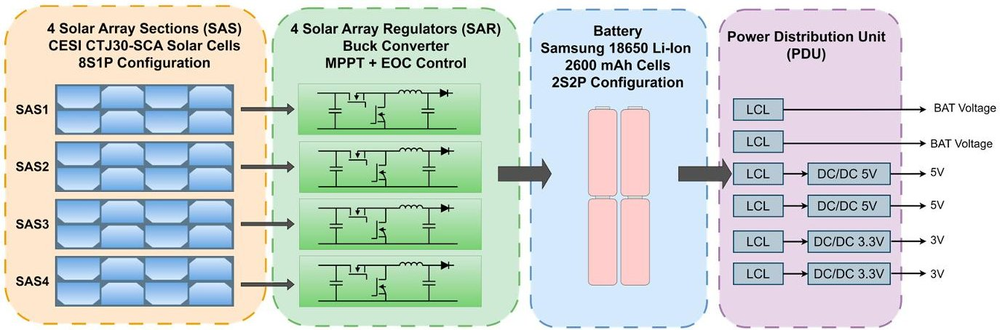

Figure 1. 6U CubeSat EPS block diagram.

## 2.1. Solar Array Sections (SASs)

The solar array is divided into four independent sections, arranged in pairs on opposite faces of the satellite. Each SAS is a single string of eight CESI CTJ30 triple-junction solar cells connected in series. These SASs were characterized under controlled irradiance (AM0 1366.1 W/m $ ^{2} $ ) and typical in-orbit solar cell temperature conditions ( $ 8 5 \, \mathrm{^ {\circ} C} $ ) using a Sunbrick $ ^{\mathrm{TM}} $ Large Area Solar Simulator from G2V.

For the DT development, the SASs were modeled using the single-diode model (SDM) electrical circuit. The parameters of the model were calculated from the extracted experimental curves using the two-step linear least-squares (TSLLS) method, as presented in [15]. Figure 2 illustrates the measured current-voltage and power-voltage characteristics of one SA Section, as well as the curves extracted from the DT model. Table 1 presents the parameters of the SDM model used in the DT.

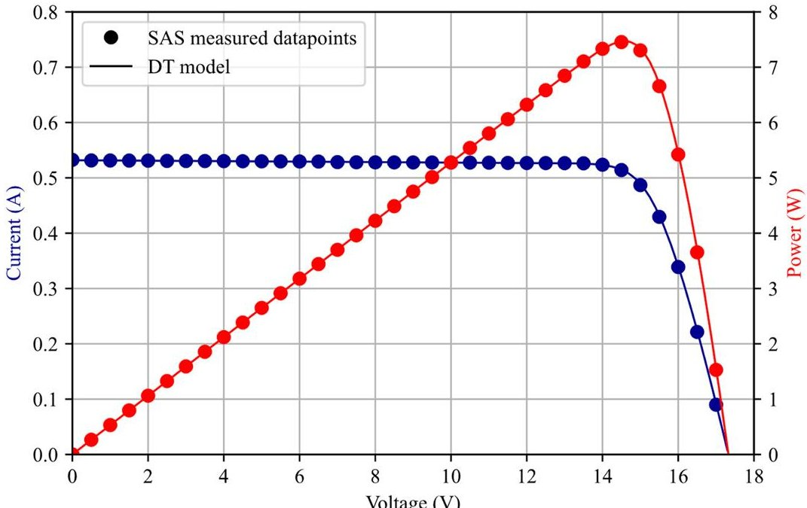

Figure 2. Measured and digital twin solar array section I-V (blue) and P-V (red) curves.

Table 1. SDM parameters—8S1P CESI CTJ30 solar cells.

<table border="1"><tr><td>Parameter</td><td>Value</td><td>Units</td></tr><tr><td>Irradiance</td><td>1366.1</td><td>W/m2</td></tr><tr><td>Temperature</td><td>85</td><td>℃</td></tr><tr><td>Photocurrent($I_{ph}$)</td><td>532.45</td><td>mA</td></tr><tr><td>Diode saturation current($I_{sat}$)</td><td>$7.6156987\times10^{-18}$</td><td>μA</td></tr><tr><td>Series resistance($R_{s}$)</td><td>2.78187</td><td>Ω</td></tr><tr><td>Shunt resistance($R_{sh}$)</td><td>2517.0488</td><td>Ω</td></tr><tr><td>Ideality factor(n)</td><td>1.462</td><td>-</td></tr></table>

<!-- PDF_PAGE: 4 -->

Once the solar array is modeled under controlled conditions, the model can be extrapolated to other irradiance and temperature conditions. To adjust the I-V curve to new temperature and irradiance conditions, it is essential to refer to the solar cell manufacturer's datasheet, which provides the variation of voltage and current with temperature and irradiance. In this study, Equations (1) and (2) were used to fit the curve to specific conditions:

$$
V = \left(V _ {0} + \frac {\Delta V}{\Delta T} \cdot \left(T - T _ {0}\right)\right)
$$

$$
I = \left(I _ {0} + \frac {\Delta I}{\Delta T} \cdot \left(T - T _ {0}\right)\right) \frac {H}{H _ {0}}
$$

where V, I, T, and H are the new values of voltage, current, temperature, and irradiance; $ V_{0}, I_{0}, T_{0} $ , and $ H_{0} $ are Table 1 model values; and $ \Delta V / \Delta T $ and $ \Delta V / \Delta T $ are the temperature factor coefficients of the solar cells.

It is important to note that solar cells can experience degradation during the mission due to factors such as space radiation and thermal cycling; these effects were not considered in this work. Nevertheless, throughout the mission, the SAS model can also be dynamically updated with telemetry data, allowing it to accurately replicate the behavior of the CubeSat rather than relying on predefined curves.

## 2.2. Solar Array Regulators (SARs)

Each SAS is connected to an independent SAR, and the outputs of each SAR are connected in parallel to the battery bus. The SAR topology is a synchronous buck DC/DC converter with a peak-current inner control loop and two outer voltage loops. SAS voltage is fixed to the maximum power point (MPP) voltage when the battery is not fully charged, or the output is controlled to the predefined End of Charge (EOC) battery voltage otherwise. Linear Technology LT3845 serves as the controller for each converter. LT3485 performs peak-current control internally and integrates an anti-slope compensation circuit to mitigate current limit reduction associated with slope compensation at high duty cycles. The output of the internal transconductance error amplifier is configured to be externally driven by the outer voltage control loops. When operating in MPP mode, an autonomous analog oscillating maximum power point tracker (MPPT) [16] generates the reference for the voltage control loop, ensuring that the input voltage oscillates around the maximum power point voltage. Figure 3 shows the block diagram of one regulator. Further details on the SAR design are available in [17].

The buck converter was modeled using the ideal steady-state model. This model assumes it has no conduction and switching losses and no AC switching ripple is presented at its input and output. Equation (3) refers to the dependent input voltage source of the model, and Equation (4) to the output dependent current source. DC corresponds to the duty cycle of the converter.

$$
V _ {I N} = \frac {V _ {O U T}}{D C},
$$

$$
I _ {O U T} = \frac {V _ {I N} \cdot I _ {I N}}{V _ {O U T}},
$$

Additionally, the nonlinearity induced by the LT3485 anti-slope compensation circuit was considered. Experimental measurements were used to model the duty cycle of the converter as a function of the output current and the control voltage $ ( V_{C} ) $ . Figure 4 shows the experimental inductor current as a function of the control voltage and the duty cycle, and Equation (5) presents the formula used to model the anti-slope compensation.

$$
D C = \frac {- I _ {L} - 2 . 5 \cdot \left(0 . 8 5 - V _ {C}\right)}{1 . 9},
$$

<!-- PDF_PAGE: 5 -->

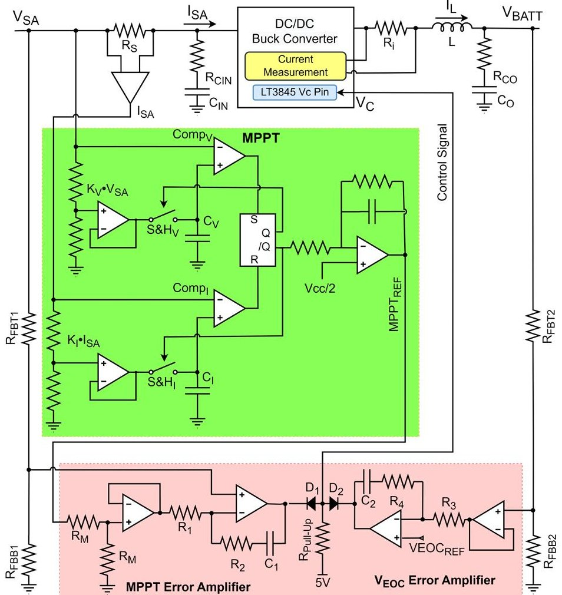

Figure 3. Electrical diagram of the solar array regulator. The MPPT part of the circuit is marked in green and the error amplifier part is marked in red.

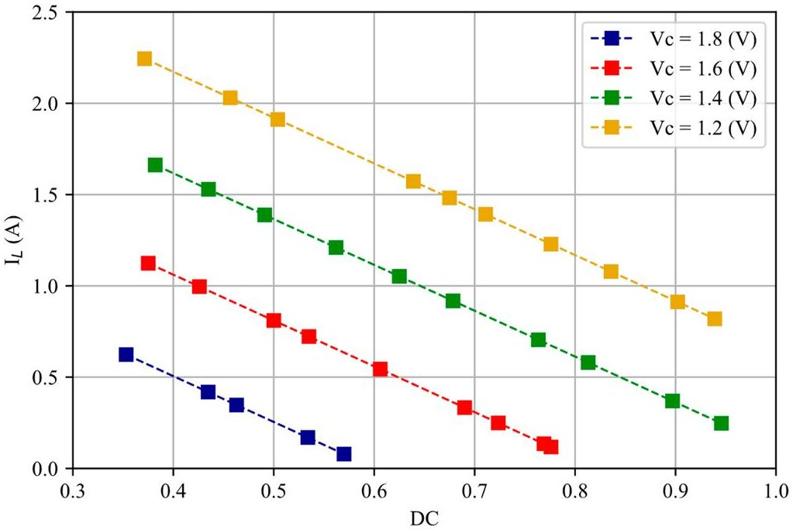

Figure 4. LT3845 IL experimental characterization as a function of $ V_{C} $ and duty cycle (DC).

Each control loop was modeled by Equations (6) and (7), as detailed in [17].

$$
G _ {E A M P P T} (s) = \frac {1}{R _ {1} \cdot C _ {1}} \cdot \frac {1 + S \cdot C _ {1} \cdot R _ {2}}{S},
$$

$$
G _ {E A V E O C} (s) = \frac {1}{R _ {3} \cdot C _ {2}} \cdot \frac {1 + S \cdot C _ {2} \cdot R _ {4}}{S},
$$

<!-- PDF_PAGE: 6 -->

As represented in Figure 3, the MPPT has two different parts. The first part outputs a digital signal and includes analog comparators, multipliers, digital gates, and sample and hold circuits. The second part of the MPPT is an integrator that converts the digital signal into an analog reference. Figure 5 shows the final digital twin model of one solar array regulator. The model includes the steady-state model of the DC/DC converter, the transfer functions of the two control loops, and the MPPT circuit.

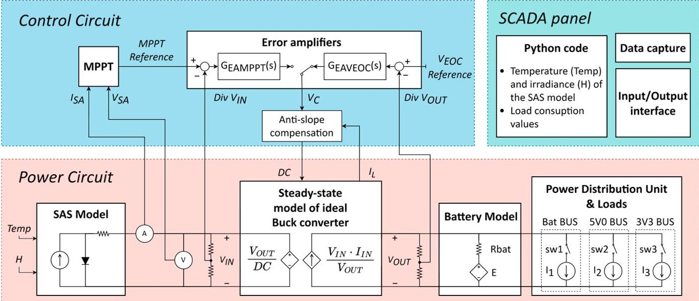

Figure 5. Digital twin model diagram. It is composed of three blocks: Control circuit, power circuit, and SCADA panel.

## 2.3. Battery (BAT)

The battery consists of four 2600 mAh Samsung Li-Ion 18650 cells arranged in a 2S2P configuration. The steady-state general battery model described in [18] was utilized; this model comprises a nonlinear voltage source (E) with a series resistance (Rbat). A notable feature of this battery model is that its parameters can be easily deduced from experimental discharge curves. By utilizing an experimental discharge curve and the model's equations, curve fitting can be applied to determine the parameters of the model. Figure 6 highlights the key points on a discharge curve for the determination of the model parameters.

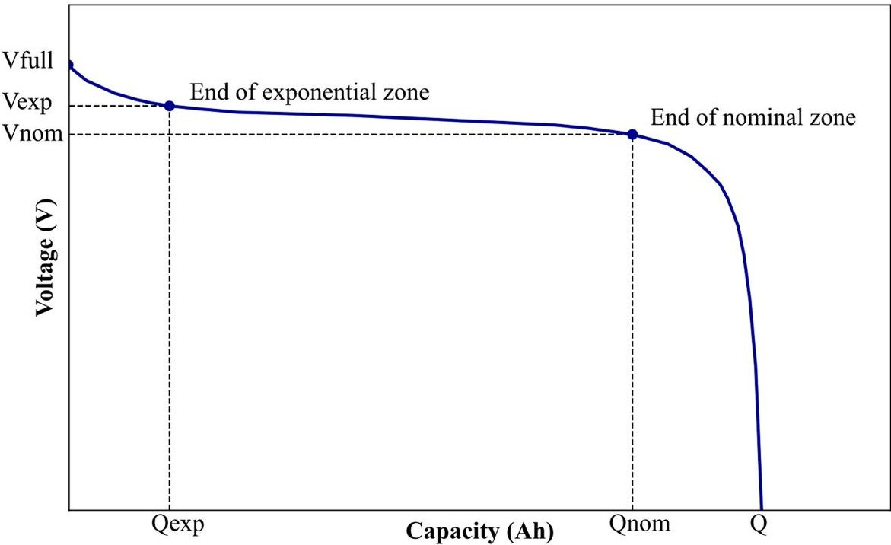

Figure 6. Discharge curve points used for the battery model.

<!-- PDF_PAGE: 7 -->

The open-circuit voltage was calculated with nonlinear Equation (8) based on the actual discharge state (it) of the battery.

$$
E (i t) = E _ {0} - K \frac {Q}{Q - i t} + A * e ^ {(- i t * B)},
$$

In this expression, A refers to the voltage drop during the exponential zone, and B to the charge at the end of the exponential zone. Equations (9) and (10) define these parameters. The value of K, defined by Equation (11), pertains to the polarization voltage, while $ E_{0} $ , defined in Equation (12), represents a constant voltage of the battery.

$$
A = V _ {f u l l} - V _ {e x p},
$$

$$
B = \frac {3}{Q _ {e x p}},
$$

$$
K = \frac {\left(V _ {f u l l} - V _ {n o m} + A \left(e ^ {- B \cdot Q _ {n o m}} - 1\right)\right) \cdot \left(Q - Q _ {n o m}\right)}{Q},
$$

$$
Q _ {n o m}
$$

$$
E _ {0} = V _ {f u l l} + K + R _ {b a t} * i - A,
$$

Regarding the battery's series resistance, it was determined using Equation (13) by measuring the voltage drop across the real battery $ (\Delta V_{bat}) $ during a discharge current step.

$$
R _ {b a t} = \frac {\Delta V b a t}{\Delta I},
$$

The temperature conditions of a battery in a microsatellite for low Earth orbit (LEO) typically range between 20 and $ 3 0 \, ^ {\circ} \mathrm{C} $ . Therefore, the battery's discharge curve was experimentally measured under controlled temperature conditions $ (2 5 \, ^ {\circ} \mathrm{C}) $ at a discharge current of 520 mA $ (0.1 \, ^ {\circ} \mathrm{C}) $ , and it is assumed that the battery temperature and state of health are constant over the mission.

Figure 7 illustrates the experimental measured battery discharge curve as well as the curve from the DT model. Table 2 presents the battery model parameters obtained by fitting the values to the measured discharge curve and the previous equations. These values were used for the implementation of the DT.

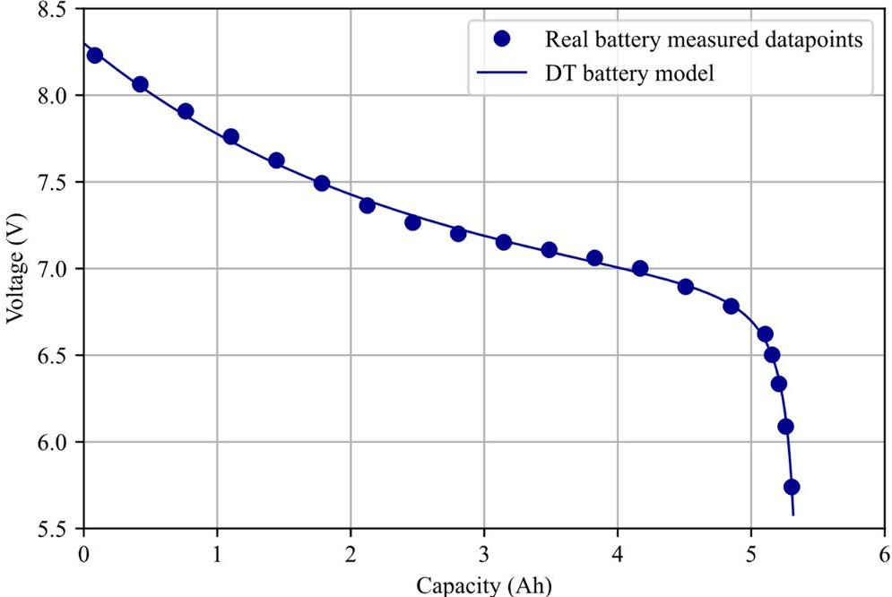

Figure 7. Measured and DT model of the 2S2P Samsung 18650 2600 mAh battery discharged at 520 mA (0.1 $ ^{\circ} $ C).

<!-- PDF_PAGE: 8 -->

Table 2. Battery model parameters.

<table border="1"><tr><td>Parameter</td><td>Value</td><td>Unit</td></tr><tr><td>A</td><td>1.51</td><td>V</td></tr><tr><td>B</td><td>0.42</td><td>Ah</td></tr><tr><td>K</td><td>0.02</td><td>Ω</td></tr><tr><td>E0</td><td>6.81</td><td>V</td></tr><tr><td>Q</td><td>5.4</td><td>Ah</td></tr><tr><td>Rbat</td><td>0.05</td><td>Ω</td></tr></table>

One aspect to be considered is that the discharge curve of several batteries with the same configuration and cell model may vary slightly. In this case, it was assumed that there would be no such difference. However, to mitigate this issue, in the model, the real discharge curve of the CubeSat battery was used.

## 2.4. Power Distribution Unit (PDU) and Electrical Loads

Finally, the PDU distributes 6 protected voltage lines, with latching current limiters (LCLs), to the different avionics' subsystems and payloads $ ( 2 \times $ unregulated, $ 2 \times 5. 0 $ V, and $ 2 \times 3. 3 $ V). Each line was modeled as a constant power load with an efficiency of 99% for unregulated lines, 95% for 5 V lines, and 93% for 3.3 V lines (efficiency estimation is based on experimental measurements). Different load power profiles are used for the DT, emulating the real behavior of the satellite operation. This methodology simplifies the modeling of the PDU but still accurately fits the model to the DUT.

## 2.5. SCADA Panel

Another crucial component in system modeling is the supervisory control and data acquisition (SCADA) panel. This software element is used to define and update with Python scripts the model inputs, such as temperature, irradiation, and power consumption values of the PDU. Additionally, it is used as an interface between the user and the DT, enabling the acquisition, visualization, and capture of the test results. It is worth noting that the SCADA panel does not have a replica in the real system.

## 3. DT Implementation and Validation

One SAS, one SAR, the battery, the PDU, and the electrical loads were implemented on the HIL real-time simulator HIL404 from Typhoon HIL, with the 2024.1 software version. This device requires a computer with a 64-bit processor with at least four CPU cores and at least 8 GB of RAM memory. With this platform, the simulation step can be at as low as 500 ns for this particular model. However, when the software interacts with real hardware (HIL), additional parameters need to be considered to calculate the loop-back latency. Table 3 presents all the delays of the real-time simulator for HIL simulations. In the HIL404, the overall latency comprises three components: the sampling delay, the calculation time, and the latency of the analog outputs. Specifically, the calculation time includes both the state calculation time and the output calculation time.

Table 3. Breakdown of loop-back latency.

<table border="1"><tr><td>Parameter</td><td>Value</td><td>Units</td></tr><tr><td>Sampling delay</td><td>500</td><td>ns</td></tr><tr><td>State calculation time</td><td>500</td><td>ns</td></tr><tr><td>Output calculation time</td><td>500</td><td>ns</td></tr><tr><td>Latency of the analog outputs</td><td>150</td><td>ns</td></tr><tr><td>Loop-back latency</td><td>1650</td><td>ns</td></tr></table>

To validate the proposed DT model, the real-time simulation outputs of the DT were compared with the experimental waveforms from the physical device (e.g., real satellite).

<!-- PDF_PAGE: 9 -->

Additionally, once the DT was validated, Control-HIL (CHIL) and Power-HIL (PHIL) tests were performed to validate the interaction between the DT and the physical device. In CHIL tests, the DT SAR control system is replaced with a real hardware controller, which interacts with the rest of the DT simulated in real time. Consequently, CHIL makes the testing of new control hardware fast, safe, and reliable [19]. On the other hand, PHIL tests only use the DT to simulate the control subsystem of the SAR (MPPT and outer voltage loops) in real time and interact with the rest of the hardware [20]. Figure 8 shows the physical EPS alongside the 6U CubeSat structure, two SASs, the batteries, and the experimental test setup used to validate the DT model.

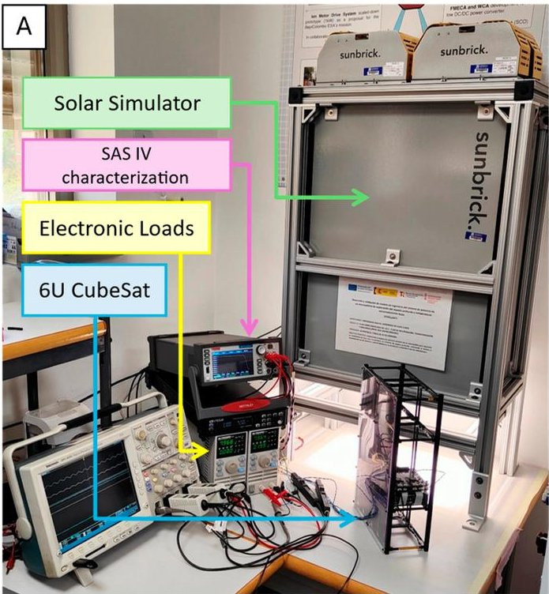

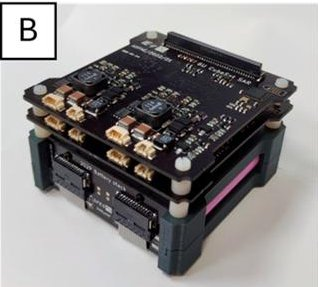

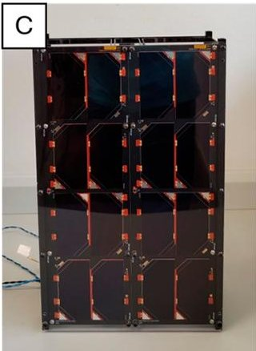

Figure 8. (A) Experimental setup; (B) physical EPS; (C) CubeSat 6U structure with two SASs.

## 3.1. Digital Twin (DT)

To implement the DT in the real-time simulator, the circuit models described in the second section were used. Additionally, appropriate tests were selected to validate the DT. One such test is illustrated in Figure 9, which presents a comparison of the SAR operation across three possible scenarios: MPPT mode, VEOC mode, and the transition between the two modes.

At t=0 s, the power available in the SAS is greater than the required battery recharging power and the load power, so the SAS operates in EOC mode, setting the working point of the SAS at the right side of the MPP. At t=2 s, a step load of 18 W takes place for 6 s. Consequently, the power balance between SAS, battery recharging power, and load power becomes negative. Therefore, the battery discharges and the SAR switches to MPPT mode. At time t=8 s, the step load is removed, causing the SAR to switch back to VEOC regulation mode. In all these situations, experimental and DT waveforms are almost identical.

## 3.2. CHIL Tests

In CHIL-based simulations, the control circuit is physically implemented while the rest of the system is simulated in the HIL device. A diagram of the CHIL simulation that was implemented is shown in Figure 10. This type of simulation allows the validation of the operation of the control circuit under specific conditions. To illustrate this, the temperature of the solar cells in a typical LEO mission largely varies; solar cells can reach

-50 $ ^{\circ} \mathrm{C} $ during an eclipse and $ +100^{\circ} \mathrm{C} $ during sunlight. Therefore, the control circuit must be evaluated under all possible SAS temperature conditions. In this case, the performance of the control system was evaluated across a solar cell temperature range of $ -50^{\circ} \mathrm{C} $ to $ +100^{\circ} \mathrm{C} $ , simulating the SAS behavior in the DT.

<!-- PDF_PAGE: 10 -->

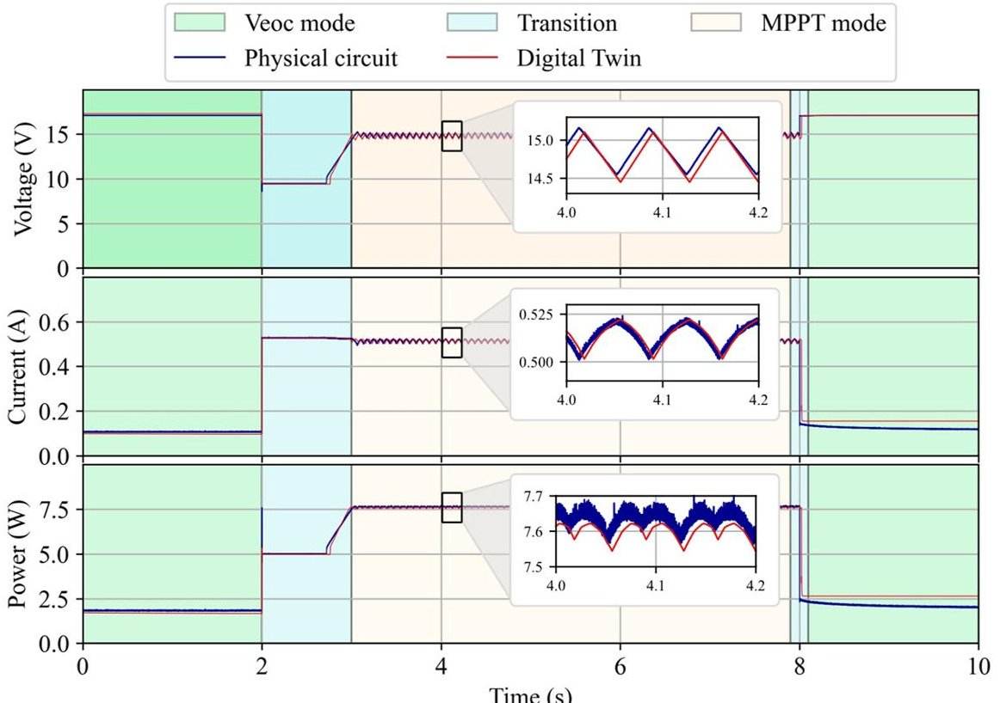

Figure 9. DT validation. Upper graph: SAS voltage; middle graph: SAS current; lower graph: SAS power. The zoom shows the MPPT mode operation comparison.

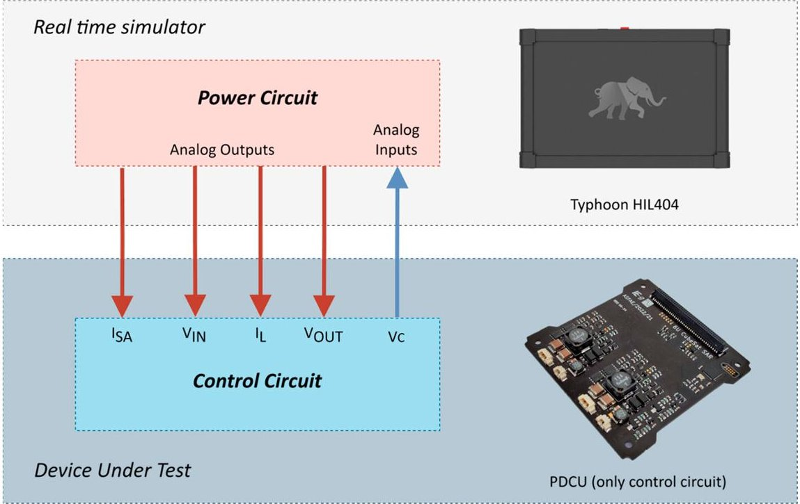

Figure 10. CHIL diagram. The red arrows refer to the analog outputs of the real-time simulator, and the blue arrow to the analog input.

Figure 11 shows the variations in the SAS working point as the temperature increases. The first graph (top) illustrates how the control circuit sets the SAS MPP voltage, which decreases as the temperature rises. The second graph (middle) shows the SAS current, and finally, the power extracted from the SAS is displayed in the bottom figure. It can be observed how the operating point adapts as the MPP point changes.

## 3.3. PHIL Tests

PHIL-based simulations have various applications since the HIL real-time simulator handles the control component while the system's power part is physically implemented. This makes PHIL particularly useful in scenarios where testing the control circuit is nec-

<!-- PDF_PAGE: 11 -->

essary without physically implementing it. For example, the analog MPPT circuit can be replaced with a digital alternative. Specifically, the digital perturb and observe (P&O) method [21], known for its cost-effective implementation, was used in this test. Figure 12 displays the diagram of the PHIL simulation that was performed.

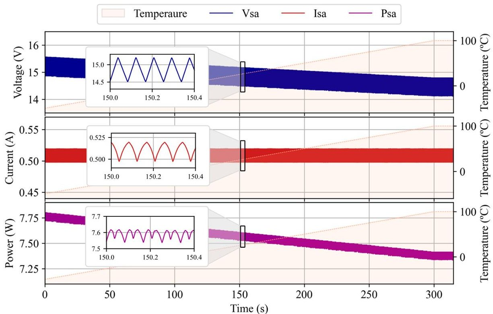

Figure 11. MPPT mode operation with a temperature variation using a CHIL simulation. Upper graph: SAS voltage; middle graph: SAS current; lower graph: SAS power.

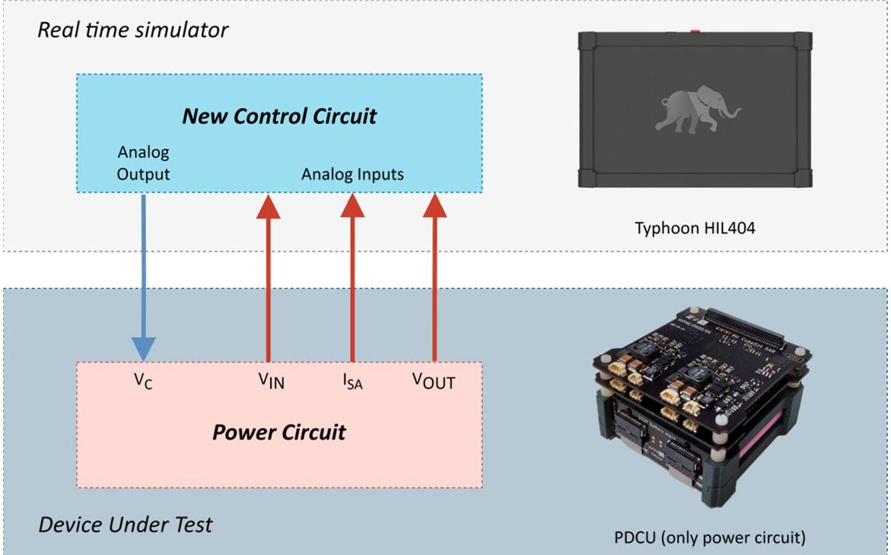

Figure 12. PHIL diagram. The red arrows refer to the analog inputs of the real-time simulator, and the blue arrows to the analog output.

Figure 13 displays the results of this test, showcasing the voltage, current, and power of the SAS. The results indicate that the SAS operating point oscillates around the MPP which is approximately 15 V.

<!-- PDF_PAGE: 12 -->

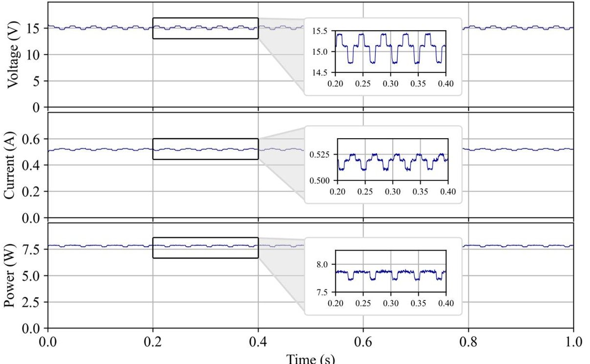

Figure 13. Digital P&O MPPT operation using a PHIL simulation. Upper graph: SAS voltage; middle graph: SAS current; lower graph: SAS power.

## 4. Complete CubeSat EPS Digital Twin

Finally, the proposed DT was scaled up to encompass a comprehensive model of the entire 6U CubeSat electrical power system. This enhanced DT integrates four solar array sections (arranged in pairs on opposite faces of the satellite, surface A and B), four solar array regulators, a battery, a power distribution unit, and electrical loads. One of the key features of this new DT is its ability to dynamically recalculate the current-voltage (I-V) curves of the SAS in real time, based on the CubeSat's irradiance and temperature conditions.

To illustrate an application, the irradiance and temperature profiles of the CubeSat solar cells were computed with the 2024 version of Radian System Software [22] for a low Earth orbit (LEO) at an altitude of 793 km and Earth-pointing nadir orientation. These parameters are used in the DT to update the SAS model, enabling the real-time simulation of the EPS throughout a complete orbital cycle. Figure 14 presents the most significant waveforms obtained from this simulation, highlighting the dynamic performance and interactions of the EPS components. The upper graph displays the SAR input power; the second graph illustrates the current and voltage of the battery; in the third graph, the currents through the different loads are plotted; and the lower graph shows the irradiance and temperature of both solar array surfaces. At the start of the illumination period, the battery is not fully charged, so the system operates in MPPT mode. Later, towards the end of the illumination phase, the input power decreases as the battery becomes fully charged, and the two SAR phases of surface A begin to operate in VEOC mode. During the eclipse periods, there is no power at the system inputs, causing the battery to start discharging.

This detailed simulation provides valuable insights into the CubeSat operation, facilitating the identification and analysis of potential performance issues. By capturing the transient and steady-state responses of the EPS components under varying orbital conditions, the DT serves as a powerful tool for system optimization and troubleshooting.

Looking ahead to future missions, the capability of the digital twin can be further enhanced by incorporating real-time telemetry data from the CubeSat. This would allow the SAS models within the digital twin to be dynamically updated with actual in-flight irradiance and temperature data, thereby achieving a highly accurate replication of the CubeSat's behavior. Such an approach would be instrumental in identifying and diagnosing failures or malfunctions in the EPS, ensuring robust and reliable operation of the CubeSat.

<!-- PDF_PAGE: 13 -->

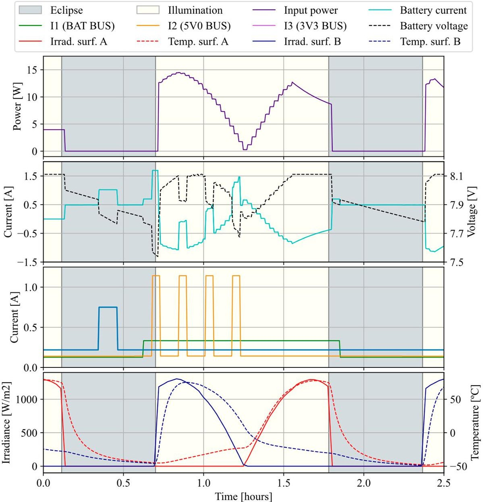

Figure 14. Low Earth orbit simulation using the developed DT model.

## 5. Conclusions

In this paper, a CubeSat EPS digital twin was developed and validated. Experimental tests confirm its feasibility, showing that the digital twin's real-time outputs closely match those of the physical system. Additionally, the digital twin can be used for control-hardware-in-the-loop and power-hardware-in-the-loop tests, allowing the real-time integration of simulated subsystems with hardware. This capability facilitates testing of new subsystems and optimization during a project's development phases.

Moreover, the implementation of a real-time, telemetry-driven digital twin opens possibilities for predictive maintenance and advanced fault detection algorithms. By continuously monitoring the CubeSat's performance and comparing it against the digital twin's predictions, operators can proactively address potential issues before they escalate into critical failures. This forward-looking capability not only enhances the mission's success rate but also extends the operational lifespan of the CubeSat.

In conclusion, the development of the digital twin for the CubeSat EPS represents a significant advancement in satellite technology. Through real-time simulation and potential future integration with live telemetry data, the digital twin provides a robust framework for ensuring the optimal performance, reliability, and longevity of CubeSat missions. Moreover, DT could also be used to replace the physical replicas used nowadays in some space missions, reducing the total mission costs.

Nevertheless, it is also worth noting that the implementation of the EPS CubeSat DT requires high computational power equipment. Nowadays, the recommendation is to use averaged models for the switching converters. However, it is expected that in the near

<!-- PDF_PAGE: 14 -->

future, new platforms with better specifications will be available, and, therefore, a more detailed implementation of the converter will be possible.

Future work aims to improve the accuracy of the model by including additional factors, such as degradation of the solar cells and batteries. Furthermore, the DT can be completed by including a battery cell balancing system or other microsatellite subsystems.

Author Contributions: Conceptualization, P.C. and C.T.; methodology, P.C. and C.T.; software, P.C. and C.T.; validation, P.C., C.T. and D.M.; formal analysis, D.M.; investigation, P.C. and C.T.; writing—original draft preparation, P.C. and C.T.; writing—review and editing, J.M.B. and A.G.; visualization, J.M.B. and A.G.; supervision, J.M.B. and A.G.; project administration, J.M.B. and A.G.; funding acquisition, J.M.B. and A.G. All authors have read and agreed to the published version of the manuscript.

Funding: This work was supported by the European Union NextGenerationEU and Generalitat Valenciana under Grant ASFAE/2022/21.

Data Availability Statement: The data presented in this study are available on request from the corresponding author.

Conflicts of Interest: The authors declare no conflicts of interest.

## References

1. De, R.; Abegaonkar, M.P.; Basu, A. Enabling Science with CubeSats—Trends and Prospects. IEEE J. Miniaturization Air Space Syst. 2022, 3, 221-231. [CrossRef]

2. Chahat, N.; Decrossas, E.; Gonzalez-Ovejero, D.; Yurduseven, O.; Radway, M.J.; Hodges, R.E.; Estabrook, P.; Baker, J.D.; Bell, D.J.; Cwik, T.A.; et al. Advanced CubeSat Antennas for Deep Space and Earth Science Missions: A review. IEEE Antennas Propag. Mag. 2019, 61, 37-46. [CrossRef]

3. Carbone, M.A.; Sajadi, A.; Murray, J.M.; Csank, J.T.; Loparo, K.A. Voltage Stability of Spacecraft Electric Power Systems for Deep Space Exploration. IEEE Access 2023, 11, 38828-38839. [CrossRef]

4. Alcaide, A.M.; Buticchi, G.; Chub, A.; Dalessandro, L. Design and Control for High-Reliability Power Electronics: State-of-the-Art and Future Trends. IEEE J. Emerg. Sel. Top. Ind. Electron. 2024, 5, 50-61. [CrossRef]

5. Mihai, S.; Yaqoob, M.; Hung, D.V.; Davis, W.; Towakel, P.; Raza, M.; Karamanoglu, M.; Barn, B.; Shetve, D.; Prasad, R.V.; et al. Digital Twins: A Survey on Enabling Technologies, Challenges, Trends and Future Prospects. IEEE Commun. Surv. Tutor. 2022, 24, 2255-2291. [CrossRef]

6. Rayhana, R.; Bai, L.; Xiao, G.; Liao, M.; Liu, Z. Digital Twin Models: Functions, Challenges, and Industry Applications. IEEE J. Radio Freq. Identif. 2024, 8, 282-321. [CrossRef]

7. Kuprat, J.; Debbadi, K.; Schaumburg, J.; Liserre, M.; Langwasser, M. Thermal Digital Twin of Power Electronics Modules for Online Thermal Parameter Identification. IEEE J. Emerg. Sel. Top. Power Electron. 2024, 12, 1020-1029. [CrossRef]

8. Chen, Z.; Liang, D.; Jia, S.; Yang, L.; Yang, S. Incipient Interturn Short-Circuit Fault Diagnosis of Permanent Magnet Synchronous Motors Based on the Data-Driven Digital Twin Model. IEEE J. Emerg. Sel. Top. Power Electron. 2023, 11, 3514-3524. [CrossRef]

9. Zhang, S.; Liang, T.; Dinavahi, V. Hybrid ML-EMT-Based Digital Twin for Device-Level HIL Real-Time Emulation of Ship-Board Microgrid on FPGA. IEEE J. Emerg. Sel. Top. Ind. Electron. 2023, 4, 1265-1277. [CrossRef]

10. Yang, W.; Zheng, Y.; Li, S. Application Status and Prospect of Digital Twin for On-Orbit Spacecraft. IEEE Access 2021, 9, 106489-106500. [CrossRef]

11. Shim, H.; Kim, O.-J.; Park, M.; Choi, M.; Kee, C. Development of Hardware-In-the-Loop Simulation for CubeSat Platform: Focusing on Magnetometer and Magnetorquer. IEEE Access 2023, 11, 73164-73179. [CrossRef]

12. Bernardo, V.P.; Seman, L.O.; Bezerra, E.A.; Ribeiro, B.F. Hardware-in-the-Loop Simulation of an On-Board Energy-Driven Scheduling Algorithm for CubeSats. IEEE Embed. Syst. Lett. 2024, 16, 69-72.

13. Casado, P.; Blanes, J.M.; Torres, C.; Garrigós, A.; Marroquí, D.; Orts, C. Microsatellite Solar Array Regulator Digital Twin Development and Validation. In Proceedings of the 2023 13th European Space Power Conference (ESPC), Elche, Spain, 2-6 October 2023; pp. 1-8. [CrossRef]

14. Stevens, R. Digital Twin for Spacecraft Concepts. In Proceedings of the 2023 IEEE Aerospace Conference, Big Sky, MT, USA, 4-11 March 2023; pp. 1-7. [CrossRef]

15. Toledo, F.J.; Blanes, J.M.; Galiano, V. Two-Step Linear Least-Squares Method for Photovoltaic Single-Diode Model Parameters Extraction. IEEE Trans. Ind. Electron. 2018, 65, 6301-6308. [CrossRef]

16. Torres, C.; Garrigós, A.; Blanes, J.M.; Casado, P.; Marroqui, D. Analog Maximum Peak Power Tracking Techniques for Small Satellites. IEEE Trans. Aerosp. Electron. Syst. 2023, 59, 6599-6611. [CrossRef]

17. Torres, C.; Blanes, J.M.; Garrigós, A.; Marroqui, D.; Carrasco, J.A. High-Reliability Solar Array Regulator for Deep Space Exploration Micro-Satellites. IEEE Access 2023, 11, 94138-94147. [CrossRef]

<!-- PDF_PAGE: 15 -->

18. Tremblay, O.; Dessaint, L.-A. Experimental Validation of a Battery Dynamic Model for EV Applications. World Electr. Veh. J. 2009, 3, 289-298. [CrossRef]

19. Deng, Y.; Li, H.; Foo, S. Controller Hardware-In-the-Loop simulation for design of power management strategies for fuel cell vehicle with energy storage. In Proceedings of the 2009 IEEE Vehicle Power and Propulsion Conference, Dearborn, MI, USA, 7-11 September 2009; pp. 866-870. [CrossRef]

20. Edrington, C.S.; Steurer, M.; Langston, J.; El-Mezyani, T.; Schoder, K. Role of Power Hardware in the Loop in Modeling and Simulation for Experimentation in Power and Energy Systems. Proc. IEEE 2015, 103, 2401-2409. [CrossRef]

21. Femia, N.; Petrone, G.; Spagnuolo, G.; Vitelli, M. Optimization of Perturb and Observe Maximum Power Point Tracking Method. IEEE Trans. Power Electron. 2005, 20, 963-973. [CrossRef]

22. Llamazares, L.G.; Criado, D. Radian Systems. Publ. Astron. Obs. Belgrade 2021, 101, 129-131. [CrossRef]

Disclaimer/Publisher's Note: The statements, opinions and data contained in all publications are solely those of the individual author(s) and contributor(s) and not of MDPI and/or the editor(s). MDPI and/or the editor(s) disclaim responsibility for any injury to people or property resulting from any ideas, methods, instructions or products referred to in the content.