<!-- PDF_PAGE: 1 -->

# Model-Based Verification Strategies Using SysML and Bayesian Networks

Joe Gregory and Alejandro Salado

Abstract In this chapter, the authors outline an approach to formally model verification strategies using Systems Modeling Language (SysML) in a way that enables the automatic generation of the corresponding Bayesian network. The approach includes the development of a verification metamodel that can be represented as a SysML profile. A notional example is included, in which a CubeSat verification strategy is produced in accordance with the SysML profile and a representative Bayesian network is created. Results from the Bayesian update are presented, and the impact on the SysML model is discussed. Further work will focus on the continued development of this metamodel, the integration of the plug-in to automatically generate the corresponding Bayesian network, and more detailed case studies.

Keywords Model-based systems engineering·Verification·Bayesian networks·SysML

## 1 Introduction

Verification activities, which usually take the form of a combination of analyses, inspections, and tests, consume a significant, if not the biggest, part of the development costs of large-scale engineered systems [1]. Verification occurs at various levels of a system's decomposition and at different times during its life cycle [1]. Under a common master plan, low-level verification activities are executed as risk mitigation activities, such as early identification of problems, or because they are not possible at higher levels of integration [1]. Therefore, a verification strategy is planned, "aiming at maximizing confidence on verification coverage, which facilitates convincing a customer that contractual obligations have been met;

<!-- PDF_PAGE: 2 -->

minimizing risk of undetected problems, which is important for a manufacturer's reputation and to ensure customer satisfaction once the system is operational; and minimizing invested effort, which is related to manufacturer's profit" [2]. Essentially, verification activities are the vehicle by which contractors can assess evidence of contractual fulfillment in acquisition programs.

In current practice, verification planning requires the production of several artifacts, such as verification requirements, test configurations, test procedures, and verification reports [1,3-5]. Executing these activities often requires the maintenance of configuration logs (that are in sync with design artifacts) and verification control documents (that are in sync with requirement artifacts), among others [6]. Traditionally, all these artifacts are generated or controlled by a combination of independent or stand-alone documents. As with other document-based approaches in systems engineering [7], a document-based approach to verification planning generates several problems [6,8], including information inconsistencies (due to multiple information sources and recurring updates and task repetitions), wasted effort in manually typing and transferring information across information sources, difficulty in identifying and controlling change propagation, and loss of a holistic view of the verification enterprise. Furthermore, the lack of modeling artifacts for verification planning restricts the opportunity to connect design and verification models to quantitatively assess the confidence yielded by the verification evidence. In summary, current document-based approaches to verification planning and assessment are inefficient, prone to inconsistencies, and unable to quantitatively inform about the confidence level on the verification status of the system of interest.

A model-based approach to verification planning and assessment can overcome these weaknesses [6, 8]. By connecting verification strategy models with other engineering artifacts within a model-based systems engineering (MBSE) environment or, more generally, by leveraging digital engineering (DE), we anticipate significant impacts on velocity and deployed capabilities by reducing the time needed to complete verification activities (since documentation efforts can be automated directly from the model), improving consistency in the design and development process (since information points to single sources of truth), improving the holistic evaluation of the verification enterprise (engineering teams that include design engineers, verification managers, and integration and test engineers work concurrently in shared models), and enabling the use of quantitative methods to compute the confidence in the correct state of the system of interest.

The concept of model-based systems integration (MBSI) was proposed to attempt to obtain the same benefits for later life cycle phases of systems development [9]. MBSI expands model-based methods beyond the early definition phases of a system and uses its capabilities to explore the implications of the architectural design on the future integration and testing of a system [9].

In this chapter, we outline an approach to develop a model-based verification planning and assessment approach in which verification planning is formally modeled and connected to quantitative models of verification strategies and verification evidence as well as to models of system design. Verification planning will be modeled using the behavioral and structural modeling features offered by Systems

<!-- PDF_PAGE: 3 -->

Modeling Language (SysML) models. Verification strategies, and the evidence collected through them, will be modeled using Bayesian networks [10]. Both models (of planning and of evidence) will be connected through SysML models of the system design.

## 2 Background

Bayesian networks have been used to support verification strategies in previous work. For example, a verification planning framework has been proposed in the study by Xu et al. [11] that utilizes the mathematics of Bayesian networks and is applied to an optical instrument. Similarly, approaches are proposed in the studies by Xu et al. [12] and Kulkarni et al. [13] that utilize Bayesian networks to efficiently explore the verification tradespace and propose optimal verification strategies. A particular focus on correction activities is presented in the studies by Xu and Salado [14, 15].

Previous research has also investigated the generation of Bayesian networks from SysML models, but this has often focused on fault diagnosis. For example, Ryder et al. present a framework with three interconnected models: a SysML-compatible description tool, a goal structuring notation (GSN) tool, and a tool to generate fault trees and Bayesian networks from the descriptive data [16-18]. In their study [19], Melani and de Souza present a method to obtain Bayesian networks from SysML models, also for the domain of fault diagnosis. Similar work has been undertaken in the generation of fault trees from structural and behavioral SysML models [20]. Other works speak of the importance of interconnection between SysML models and Bayesian networks and/or fault trees [21].

In their 2018 review of the current status of MBSE, Madni and Sievers stated that "model-based test and evaluation is a fertile area of research" [22]. They also stated that "MBSE can guide test planners in developing test strategies and detailed test designs for evaluating technical performance parameters. As tests are performed and data collected, the physical models can be updated with test data" [22]. Work has been undertaken in the area of model-based test and evaluation in the years since this publication. For example, Cole et al. implemented a SysML-based approach to testing and evaluation in their 2019 study and demonstrated the use of this approach in the Tactical Assault Light Operator Suit (TALOS) project [23]. Gebreyohannes et al. implemented another SysML-based approach to testing and evaluation in their study [24]. However, a model-based test and evaluation approach has not been suggested that (1) incorporates a SysML representation of the verification strategy and (2) utilizes an automatically generated Bayesian network to capture this verification strategy and update confidence values associated with the requirements as they evolve throughout the test plan. Previous works have made this approach possible - the mathematical representation of verification strategies (e.g., in the studies by Salado and Kannan [10], Xu et al. [11, 12], Kulkarni et al. [13], Xu and Salado [14], and Salado and Kannan [25]), the publication of model-based

<!-- PDF_PAGE: 4 -->

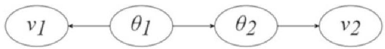

Fig.1 Bayesian network as a quantitative model of confidence yielded by verification

verification patterns (e.g., in the study by Cook and Schindel [26]), and attempts to create a system verification metamodel (e.g., in the studies by Salado [6, 8]).

In this work, we leverage this prior research and use Bayesian networks as models of the confidence yielded by a verification strategy. The basic concept is shown in Fig. 1, where $ \theta $ represents the system attributes that are to be verified (e.g., requirements) and $ \nu $ represents the verification activities that provide information about the system attributes.

Specifically, consider two system parameters such as the power consumption of the system (denoted by $ \theta_{1} $ ), the maximum temperature of the system (denoted by $ \theta_{2} $ ), a power consumption test (denoted by $ \nu_{1} $ ), and a temperature measurement (denoted by $ \nu_{2} $ ). Clearly, the power consumption test provides information about the power consumption of the system (hence the link between $ \theta_{1} $ and $ \nu_{1} $ ). Similarly, the temperature measurement provides information about the system's temperature (hence the link between $ \theta_{2} $ and $ \nu_{2} $ ). In addition, we know from physics that the temperature of a system depends on its power consumption, so we can infer to some extent one from the other (hence the link between $ \theta_{1} $ and $ \theta_{2} $ ). Conditional probability tables or functions are then used to characterize such graph networks. In this way, given a prior confidence on the state of any of the system parameters (for example, $ \theta_{1} $ or $ \theta_{2} $ ), the confidence is updated using the Bayesian rule [27] as per the evidence gathered when executing related verification activities (for example, $ \nu_{1} $ or $ \nu_{2} $ ). In essence, if the verification activity is successful, the confidence of the system exhibiting a certain attribute (or meeting a requirement) increases. If the results of the verification activity are not satisfactory, then such confidence decreases.

In this work, a preliminary system verification metamodel has been produced. This is based on the "information model" presented in the work by Salado [6]. Other existing metamodels will be considered as we develop the metamodel. For example, the European Space Agency (ESA) have published their "ESA SysML Metamodel" in the study by Alvarez and De Koning [28]. The ESA SysML Metamodel also focusses on the alignment of the system definition and the verification process and specifies the possible types of verification activities (test, analysis, inspection, and review of design). Previous works by the authors on the definition of the "True Model-Based Requirements" (TMBR) framework establish a sound basis for requirement definitions [29, 30] that can be incorporated in future work. In 2014, Selvy et al. published their work on the use of SysML for verification and validation planning on the Large Synoptic Survey Telescope (LSST) [31].

<!-- PDF_PAGE: 5 -->

## 3 Methodology

The research has been structured as five main tasks. These tasks are presented in Fig. 2. Tasks 1-3 are summarized in this section as the preliminary outputs of these tasks that are presented in this chapter. Tasks 4 and 5 will be addressed in future work.

## 3.1 Task 1: Produce a SysML Verification Profile

In this task, we create a new SysML profile to model verification artifacts. We will employ activity diagrams to model the verification plan. Activity nodes will be used to model activities related to verification (e.g., the performance of an analysis, the conduction of a test, the preparation of an inspection, or the evaluation of test results). Information elements flowing between the activities will be used to capture the inputs and outputs of such activities (e.g., test configurations, test requirements, or test results).

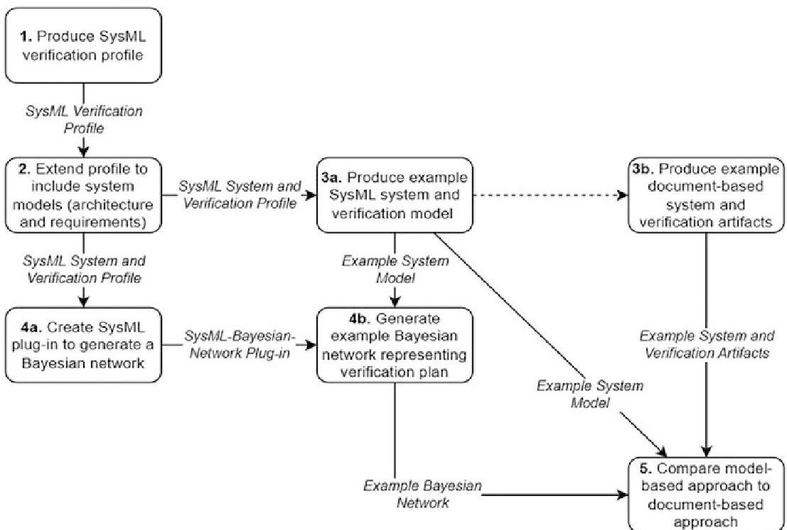

Fig.2 Research methodology

<!-- PDF_PAGE: 6 -->

## 3.2 Task 2: Extend the Profile to Include Systems Models (Architecture and Requirements)

In this task, we extend the profile developed in task 1 to enable the connection of systems models with verification models. The key idea of this task is that the definition of verification elements, such as test configurations, can be established by directly pointing to the systems model instead of creating them manually. This is a threefold undertaking. First, as stated earlier, avoiding manual repetition of information in different models can reduce errors due to information inconsistencies. Second, the systems model restricts the possible configurations in which the system may be used, thus enabling earlier assessment of feasibility and adequacy of test configurations and other verification artifacts. Third, by leveraging existing systems models, we can seamlessly predict and define analyses and test pass/fail criteria by interrogating the systems model directly.

## 3.3 Task 3: Produce an Example System and Verification Plan

In this task, we produce example representations of a system to be used in subsequent tasks. In this chapter, a notional CubeSat is modeled using SysML.

As stated in Sect. 3.1, the model-based approach incorporates SysML activity diagrams to model the verification plan. The system's logical architecture is modeled using SysML block definition diagrams and internal block diagrams. The system's functionality is captured using SysML activity diagrams. Requirements are captured using SysML requirement diagrams and traceability will be established from the requirements, through the system's logical and functional architectures to the verification activities.

## 4 Metamodel

The preliminary metamodel for this work is defined in Fig. 3, has been adapted from the study by Salado [6], and has been reproduced as a SysML profile. This profile then ensures that the systems model, produced using SysML, corresponds to the metamodel. Concepts are modeled as either SysML classes or SysML activities and the relations between them as SysML association relations. The taxonomy is presented in Fig. 4a, and the association relations between concepts are presented in Fig. 4b.

<!-- PDF_PAGE: 7 -->

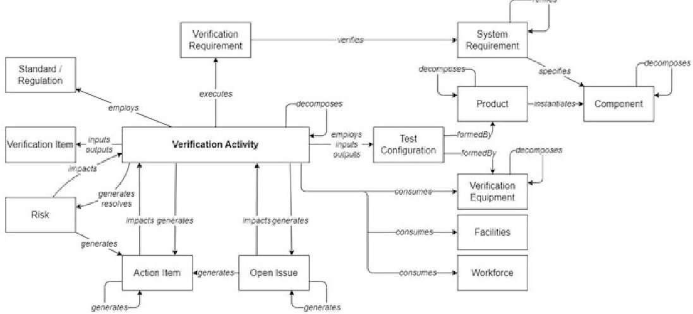

Fig. 3 A preliminary systems verification metamodel

(a)

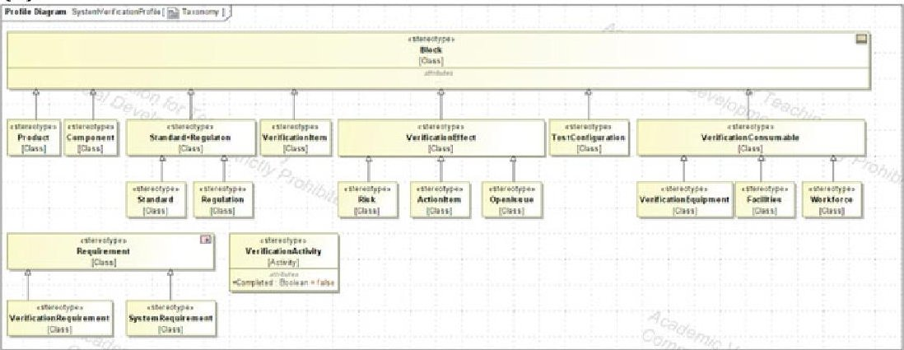

(b)

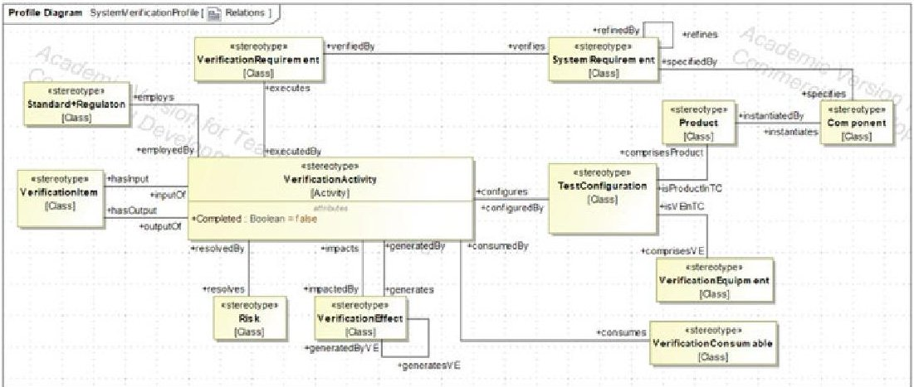

Fig. 4 (a) Preliminary metamodel taxonomy as a SysML profile and (b) preliminary metamodel relations as SysML association relationships

<!-- PDF_PAGE: 8 -->

## 5 Application Example

In this section, the preliminary metamodel presented in Sect. 4 is applied to a notional CubeSat design [32]. The system requirements, architecture, and functionality are represented using SysML. The verification strategy and activities are also represented using SysML. These two aspects are connected in accordance with the preliminary metamodel, as captured in the SysML profile. A representative Bayesian network, to be generated by the SysML model, is also presented.

## 5.1 System Requirements

For the purposes of this example, a single system-level requirement has been modeled with the stereotype <<SystemRequirement>>. The system requirement is as follows: "the system shall have a mass of equal to or less than 10 kg." A <<VerificationRequirement>> can be used to define exactly how a <<SystemRequirement>> shall be verified. In this chapter, we have not included a <<VerificationRequirement>> - we assume that each of the two systemlevel <<VerificationActivity>> elements presented are sufficient to verify the <<SystemRequirement>>. We will address the <<VerificationRequirement>> in more detail in later work. It is assumed that all subsystems also have a mass requirement; however, these are not defined here.

## 5.2 System Definition

A physical architecture has been produced, based on the CubeSat Reference Model [32]. The SysML Block Definition Diagram in Fig. 5 represents the physical architecture of the CubeSat.

## 5.3 Verification and Test Plans

In this example, it is assumed that there are two methods by which the mass of the CubeSat may be estimated.

1. Perform System Mass Analysis: Computer-based models (virtual prototypes) of the individual components are created, and the individual masses of the eight subsystems and the payload are summed to yield an estimated total system mass value.

<!-- PDF_PAGE: 9 -->

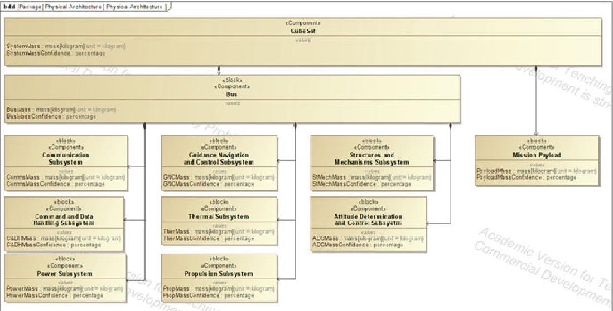

Fig. 5 A SysML block definition diagram representing the physical architecture of the CubeSat

2. Weigh Prototype: A prototype is created and physically weighed on a scale. This prototype need not be functional but should represent the components expected to be in the final design as accurately as possible.

These two methods are represented under the stereotype <<VerificationActivity>> in the model, and the activities themselves are displayed in Fig. 6.

In accordance with the metamodel, each <<VerificationActivity>> is configuredBy a <<TestConfiguration>>, where each <<TestConfiguration>> comprisesProduct <<Product>>, and comprisesVE <<VerificationEquipment>>. The complete representation of the verification strategy used in this example is presented in Fig. 7.

## 5.4 The Bayesian Network

The verification strategy defined in Sect. 5.3 can be represented as a Bayesian network. The Bayesian network presented in Fig. 8 combines the verification strategy (Fig. 6) and the systems architecture (Fig. 5).

In this case study, the mass of the system, its subsystems, and their protypes (both physical and virtual) are unobservable. By performing an analysis or measurement we are able to "estimate" their values. In the Bayesian network presented in Fig. 8, the payload (PAY) and seven of the eight subsystems (all but "Communications," COM) have undergone a virtual mass analysis. For each virtual prototype of the subsystem and the payload, if the analysis result is "Pass," then there is 99% confidence that the virtual mass will pass the relevant mass requirement. If the mass of the virtual prototype meets the relevant requirement, then there is 92% confidence that the mass of the actual physical subsystem will also pass the requirement. These

<!-- PDF_PAGE: 10 -->

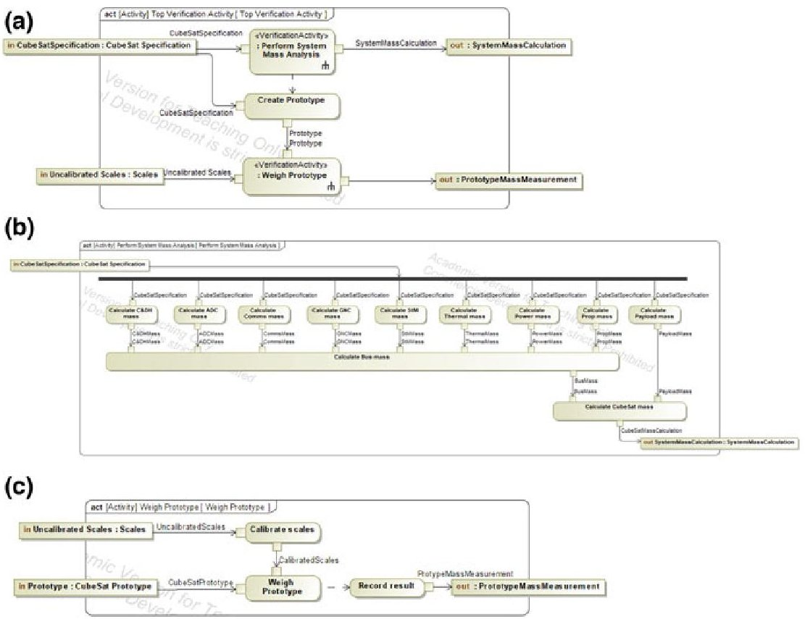

Fig. 6 (a) Top-level verification activity and its sub-activities (b) "Perform System Mass Analysis" and (c) "Weigh Prototype"

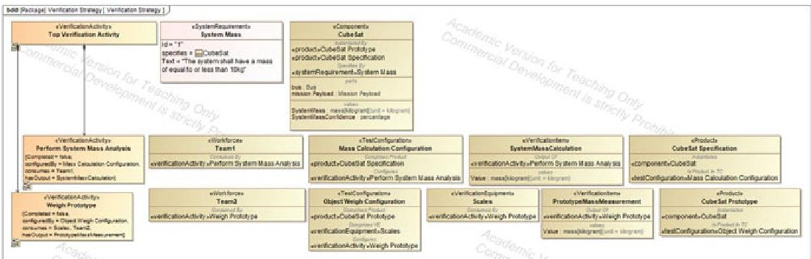

Fig. 7 A SysML block definition diagram representing the CubeSat verification strategy

values are predefined. Combined, this means that where the virtual prototype of a subsystem passes its mass analysis, there is 91.1% confidence that the actual subsystem will pass the mass requirement. Considering the status of all eight subsystems (including the "Communications," COM subsystem), it is calculated that there is 78.8% confidence that the spacecraft bus will pass its mass requirement.

As shown in Fig. 8, the physical prototype of the system has also been weighed with calibrated scales. The confidence in the mass of the physical prototype and

<!-- PDF_PAGE: 11 -->

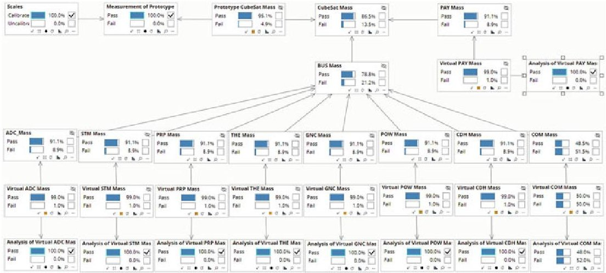

Fig. 8 A Bayesian network representing the verification strategy defined in Figs. 5 and 6

Fig. 9 The component "Mission Payload" on completion of the verification activity "Calculate PAY Mass"

the mass of the virtual prototypes of the spacecraft bus and payload yield 86.5% confidence that the CubeSat mass will meet the system requirement.

## 5.5 Updating the SysML Model

Once the status of the verification strategy has been updated in the Bayesian model and the confidence values have been calculated, these values are to be automatically stored in the SysML model as value properties. These values may be used to inform future decisions regarding the verification strategy (i.e., whether further verification activities are required). In this way, the verification strategy itself can be simulated.

Figure 9 provides an example of how the <<Component>> "Mission Payload" may look following the completion of the <<VerificationActivity>> "Calculate PAY Mass." The measurement value (1.34 kg) has been stored in the SysML model, and a SysML <<trace>> relationship has been defined to provide traceability between this value and the relevant <<VerificationActivity>>. The 91.1% confidence value calculated by the Bayesian model is automatically stored in the SysML model. A confidence value may also be subject to change as more verification activities are completed. This is demonstrated in Fig. 10.

<!-- PDF_PAGE: 12 -->

(a)

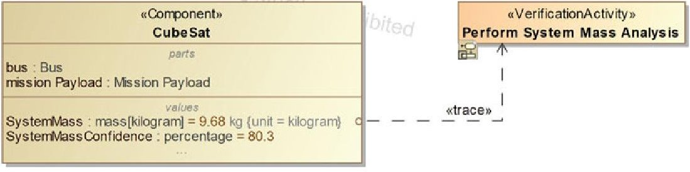

(b)

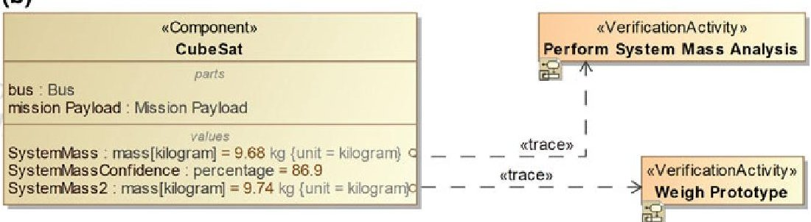

Fig. 10 The evolution of the definition of the component "CubeSat" as the verification strategy is undertaken: (a) immediately after "Perform System Mass Analysis" and (b) immediately after "Weigh Prototype"

In the example provided in Fig. 10, the confidence that the system mass will pass the system mass requirement changes. Following the completion of the «VerificationActivity》“Perform System Mass Analysis,” the system mass is estimated to be 9.68 kg and there is 80.3% confidence that the actual CubeSat will pass the system mass requirement. The «VerificationActivity》“Weigh Prototype” is then completed, and this also results in a mass estimate that is less than the upper limit of 10 kg (9.74 kg). This increases the confidence that the actual system mass will pass the mass requirement (from 80.3% to 86.9%). In both cases, the confidence is calculated in the Bayesian network and would be automatically stored in the SysML model following a modification to the status of the verification strategy.

Note that in this case study, the Bayesian network comprises relatively simple probability distributions. For example, if the measurement of the mass of the virtual prototype of a subsystem passes the relevant mass requirement, then the resulting confidence that the actual subsystem will pass the mass requirement is 91.1%. It is also possible to define more complex probability distributions. For example, it may be useful to say that if a subsystem is estimated to be 20% below its mass limit, this yields a greater confidence that the subsystem will actually pass the mass requirement than if the estimate was only 10% below the mass limit.

<!-- PDF_PAGE: 13 -->

## 6 Conclusions

In this chapter, the authors have outlined an approach to develop a systems verification metamodel to enable the automatic generation of representative Bayesian networks from a SysML model and the subsequent automatic update of the SysML model. In this way, confidence in the value of a particular system parameter can be automatically calculated, updated, and monitored as the verification strategy proceeds. These confidence levels can be used to verify requirements and influence the verification strategy itself. An example has been presented in which a verification strategy for a notional CubeSat was captured using a SysML profile based on a preliminary verification metamodel. A representative Bayesian network was produced, based on mathematical models of verification patterns published in previous works. The results from the Bayesian network were captured in the SysML model as the verification strategy was undertaken.

Next steps will include further development of the metamodel, including the incorporation of other published works on metamodels and ontologies regarding systems verification. We will also develop a plug-in to automatically generate the corresponding Bayesian network from the SysML model and return the resulting confidence values back to the SysML model. This approach will be tested on more comprehensive case studies and compared to a traditional document-based approach.

Acknowledgments The authors acknowledge D'assault Systèmes for their provision of an academic license for Magic System of Systems Architect 2022, under which the SysML models were produced. This material is based upon work supported, in whole or in part, by the US Department of Defense through the Office of the Under Secretary of Defense for Acquisition and Sustainment (OUSD(A&S)) and the Office of the Under Secretary of Defense for Research and Engineering (OUSD(R&E)) under Contract HQ0034-19-D-0003, TO#0510.

## References

1. A. Engel, Verification, Validation, and Testing of Engineered Systems (Wiley, Hoboken, 2010)

2. A. Salado, Defining better test strategies with tradespace exploration techniques and pareto fronts: application in an industrial project. Syst. Eng. 18(6), 639-658 (2016)

3. European Cooperation for Space Standardization, ECSS-E-ST-10-02C - Space Engineering - Verification (ESA Requirements and Standards Division, Noordwijk, 2018), pp. 1-51

4. European Cooperation for Space Standardization, ECSS-E-ST-10-03C - Space Engineering - Testing (ESA Requirements and Standards Division, Noordwijk, 2022), pp. 1-146

5. National Aeronautics and Space Administration (NASA), NASA Systems Engineering Handbook (NASA, Washington, DC, 2016)

6. A. Salado, Efficient and effective systems integration and verification planning using a model-centric environment. 23rd Annu. Int. Symp. Int. Counc. Syst. Eng. INCOSE 2013 2(Estefan 2008), 1244-1258 (2013)

7. T. McDermott et al., Task Order WRT-1001: Digital Engineering Metrics (Systems Engineering Research Center, 2020)

<!-- PDF_PAGE: 14 -->

8. A. Salado, Effective and efficient system integration and verification planning using integrated model centric engineering: lessons learnt from a space instrument, in SECESA, Vaihingen Campus, University of Stuttgart, October 2014

9. P. Montgomery, Model-based systems integration (MBSI): an instructional approach, in Systems Engineering Conference, Washington, DC, 2012

10. A. Salado, H. Kannan, Elemental patterns of verification strategies. Syst. Eng. 22(5), 370-388 (2019)

11. P. Xu, X. Deng, A. Salado, A UCB-based tree search approach to joint verification-correction strategy for large scale systems. IEEE Trans. Syst. Man Cybern. Syst. 53, 5430 (2022)

12. P. Xu, A. Salado, X. Deng, A parallel tempering approach for efficient exploration of the verification tradespace in engineered systems. IEEE Trans. Syst. Man Cybern. Syst. 52, 1-13 (2022)

13. A.U. Kulkarni, A. Salado, C. Wernz, Optimal verification strategies in multi-firm projects. Syst. Eng. 25, 254 (2022)

14. P. Xu, A. Salado, Modeling correction activities in the context of verification strategies. Syst. Eng. 1, 173 (2021)

15. P. Xu, A. Salado, A mathematical approach to design verification strategies that incorporate corrective activities as dedicated decisions. IEEE Open J. Syst. Eng. PP, 1-10 (2022)

16. K. Ryder et al., Systems engineering and assurance modeling (SEAM): a web-based solution for integrated mission assurance. Facta Univ. Ser. Electron. Energ. 34(1), 1-20 (2021)

17. R. Austin, B. Sierawski, A. Witulski, N. Mahadevan, G. Karsai, R. Schrimpf, Model-based mission assurance. NASA Electronic Parts and Packaging and the NASA Office of Safety and Mission Assurance, Reliability and Maintainability Program under Grant and Cooperative Agreement Number 80NSSC18K0493 (2018), pp. 1-34

18. J. Evans, N. Osma, S. Cornford, M.S. Feather, Model Based Mission Assurance (MBMA): NASA's Assurance Future (California Institute of Technology, Pasadena, 2016)

19. A.H. De Andrade Melani, G.F.M. De Souza, Mapping SysML diagrams into Bayesian networks: a systems engineering approach for fault diagnosis. ASCE-ASME J. Risk Uncertain. Eng. Syst. Part B Mech. Eng. 6(3), 031003 (2020)

20. A.H. De Andrade Melani, G.F.M. De Souza, Obtaining fault trees through SysML diagrams: a MBSE approach for reliability analysis. Proc. Annu. Reliab. Maintainab. Symp. 2020, 1-5 (2020)

21. F. Mhenni, J.Y. Choley, A. Riviere, N. Nguyen, H. Kadima, SysML and safety analysis for mechatronic systems, in 2012 9th France-Japan & 7th Europe-Asia Congress on Mechatronics (MECATRONICS)/13th International Workshop on Research and Education in Mechatronics (REM), (IEEE, 2012), pp. 417-424

22. A.M. Madni, M. Sievers, Model-based systems engineering: motivation, current status, and research opportunities. Syst. Eng. 21(3), 172-190 (2018)

23. B. Cole, V. Mittal, S. Gillespie, N. La, R. Wise, A. Maccalman, Model-based systems engineering: application and lessons from a technology maturation project. Procedia Comput. Sci. 153, 202-209 (2019)

24. S. Gebreyohannes, A. Karimoddini, A. Homaifar, Applying model-based systems engineering to the development of a test and evaluation tool for unmanned autonomous systems, in SYSCON 2020-14th Annual IEEE International Systems Conference (SysCon), (IEEE, 2020), pp. 1-7

25. A. Salado, H. Kannan, A mathematical model of verification strategies. Syst. Eng. 21(6), 593- 608 (2018)

26. D. Cook, W.D. Schindel, Utilizing MBSE patterns to accelerate system verification. Insight 20(1), 32-41 (2017)

27. J.O. Berger, Statistical Decision Theory and Bayesian Analysis, 2nd edn. (Springer Verlag, New York, 1985)

28. J.L. Alvarez, H. De Koning, Towards a definition of best practices for Model Based Systems Engineering in European Space Agency Projects, in AIAA Space Forum, Orlando, FL, 2018

29. A. Salado, P. Wach, Constructing true model-based requirements in SysML. Systems 7(19), 1-21 (2019)

<!-- PDF_PAGE: 15 -->

30. A. Salado, From model-based requirements to an intelligent systems engineering advisor that identifies gaps in requirements: an application to space systems, in ASCEND, Virtual Event (2020), pp. 1-20

31. B.M. Selvy, C. Claver, G. Angeli, Using SysML for verification and validation planning on the Large Synoptic Survey Telescope (LSST). Model. Syst. Eng. Proj. Manag. Astron. VI 9150, 91500N (2014)

32. D. Kaslow et al., Mission engineering and the CubeSat System reference model - status #2, in AIAA Conference on Small Satellites, Logan, UT (2022), pp. 1-12