<!-- PDF_PAGE: 1 -->

Article

# Open-Source Data Formalization through Model-Based Systems Engineering for Concurrent Preliminary Design of CubeSats

Giacomo Luccisano $ ^{1,*} $ , Sophia Salas Cordero $ ^{2, \dagger} $ , Thibault Gateau $ ^{2} $ and Nicole Viola $ ^{3} $

$ ^{1} $ Department of Mechanical and Aerospace Engineering, Politecnico di Torino, 10129 Turin, Italy

sophia.salas@ctengineeringgroup.com (S.S.C.); thibault.gateau@isae-supaero.fr (T.G.)

$ ^{3} $ Department of Management and Production Engineering, Politecnico di Torino, 10129 Turin, Italy; nicole.viola@polito.it

* Correspondence: giacomo.luccisano@polito.it

check for updates

Citation: Luccisano, G.; Salas Cordero, S.; Gateau, T.; Viola, N. Open-Source Data Formalization through Model-Based Systems Engineering for Concurrent Preliminary Design of CubeSats. Aerospace 2024, 11, 702. https://doi.org/10.3390/ aerospace11090702

Academic Editor: Hyun-Ung Oh

$ ^{\dagger} $ Current address: The CT Engineering Group, 31770 Colomiers, France.

Received: 25 July 2024

Revised: 8 August 2024

Accepted: 13 August 2024

Published: 27 August 2024

Copyright: 2024 by the authors. Licensee MDPI, Basel, Switzerland. This article is an open access article distributed under the terms and conditions of the Creative Commons Attribution (CC BY) license (https:// creativecommons.org/licenses/by/ 4.0/).

Abstract: Market trends in the space sector suggest a notable increase in satellite operations and market value for the coming decade. In parallel, there has been a shift in the industrial and academic sectors from traditional Document-Based System Engineering to Model-based systems engineering (MBSE) combined with Concurrent engineering (CE) practices. Due to growing demands, the drivers behind this change have been the need for quicker and more cost-effective design processes. A key challenge in this transition remains to determine how to effectively formalize and exchange data during all design stages and across all discipline-specific tools; as representing systems through models can be a complex endeavor. For instance, during the Preliminary design (PD) phase, the integration of system models with external mathematical models for simulations, analyses, and system budgeting is crucial. The introduction of CubeSats and their standard has partly addressed the question of standardization and has aided in reducing overall development time and costs in the space sector. Nevertheless, questions about how to successfully exchange data endure. This paper focuses on formalizing a CubeSat model for use across various stages of the PD phase. The entire process is conducted with the exclusive use of open-source tools, to facilitate the transparency of data integration across the PD phases, and the overall life cycle of a CubeSat. The paper has two primary outcomes: (i) developing a generic CubeSat model using Systems modeling language (SysML) that includes data storage and visualization through the application of Unified modeling language (UML) stereotypes, streamlining in parallel information exchange for integration with various simulation and analysis tools; (ii) creating an end-to-end use case scenario within the Nanostar software suite (NSS), an open-source framework designed to streamline data exchange across different software during CE sessions. A case study from a theoretical academic space mission concept is presented as the illustration of how to utilize the proposed formalization, and it serves as well as a preliminary validation of the proposed formalization. The proposed formalization positions the CubeSat SysML model as the central data source throughout the design process. It also supports automated trade-off analyses by combining the benefits of SysML with effective data instantiating across all PD study phases.

Keywords: preliminary design; CubeSat; systems engineering; concurrent design engineering; model-based systems engineering; SysML; UML

## 1. Introduction

Since their introduction in the early 2000s, CubeSats [1] have revolutionized space mission design. Their standardized design has enabled smaller nations and organizations with limited resources to access space, making them a key research area and a new opportunity for both industry and academia [2]. The SMAD [3] provides a detailed history and

<!-- PDF_PAGE: 2 -->

highlights the significant changes brought by CubeSats, which include, e.g., a more costeffective and standardized platform, along with a standardized type of dispensers known as the P-POD [4]; simpler and more streamlined design phases, resulting in significantly fewer team members and reduced project timelines; and reliability (i.e., the measures of how likely the system is to function without failure in operating conditions [5]) comparable to that of larger satellite missions.

The "Space Economy Report 2023" [6] emphasizes a significant shift in the space industry over the next decade, including a rise in satellite numbers and projected market growth to approximately $737B. This trend aligns with the predictions of the "Nanosats Database" [7]. Industry demands faster space systems design, prompting a shift from Document-Based System Engineering to Model-Based Systems Engineering (MBSE), "the formalized application of modeling to support system requirements, design, analysis, verification, and validation activities beginning in the conceptual design phase and continuing throughout development and later life cycle phases" [8], in parallel with the further adoption of Concurrent Engineering (CE) methods.

In contrast to conventional sequential design processes, where specialists work independently on their respective subsystem designs, CE is characterized by the simultaneous collaboration of multiple engineers. Each engineer brings their specific expertise to the table, distinguishing CE by its collaborative, integrated, and real-time approach [9,10]. Knoll et al. [11] identify key technical challenges in adopting Concurrent Engineering (CE) methodologies, notably the necessity for robust integration among discipline-specific tools and the comprehensive use of MBSE.

CE and MBSE approaches are gaining traction for their efficiency, accuracy, and collaborative benefits in engineering, as per the International Council on Systems Engineering (INCOSE) in its "Systems engineering Handbook" [12]; this view is also supported by Henderson and Salado [13] and Syan and Menon [14]. As can be seen, the benefits mentioned above correspond to needs expressed by the space sector, such as enhancing how space systems are developed, and allowing real-time collaboration to expedite the design, as per Knoll et al. [11].

INCOSE "Systems engineering (SE) Vision 2035" [15] foresees that the future of SE heavily relies on MBSE, with advanced models and integrated simulations that enhance system complexity management, efficiency, and reliability. By centralizing information within a cohesive model, MBSE, when integrated with simulations, promotes a shared and comprehensive understanding of complex systems. This approach aids in identifying design limitations or incompatibilities, thereby preventing time and budget overruns, particularly during the operational phase. The INCOSE "SE Handbook" [12] indicates that this aspect grows increasingly important as system complexity rises.

However, the implementation of MBSE is faced with a set of challenges, including data discontinuities across various design stages and a lack of reusable generic models, as highlighted by Knoll et al. [11] and Salas Cordero et al. [16]. These challenges may impact system models, simulation tools, and development cost reduction. An in-depth review of such discrepancies in tools used to design and analyze complex systems in different design phases is available to the reader in the work of Bajaj et al. [17].

Some works (e.g., Bajaj et al. [17] and Spangelo et al. [18]) present tools that partly address these gaps as they were developed to facilitate integration between systems modeling language (SysML) models and specific simulation tools. Such tools, although offering valuable insights towards the integration of SysML models and various simulation tools, focus on proprietary software that not everyone has access to.

Scholz and Juang's work [19] discusses the advantages of Open Design (In Scholz and Juang [19], open Design is referred to as the combination of Open Source Software (OSS) and Open Source Hardware (OSHW)) for sectors such as space mission design. Specifically, for budget-constrained projects often seen in academic settings, this approach can enhance data sharing among various entities, thereby fostering the development of more reliable, cost-efficient, and innovative solutions. This is largely due to the extensive peer review that is inherent in the open source community. Furthermore, adopting the open source model

<!-- PDF_PAGE: 3 -->

in CubeSat development within academia could simplify the design process. It enables the reuse of ideas, software, and hardware, facilitating collaboration between different groups. Project members can concentrate on distinct aspects of the same project without the complications posed by confidentiality agreements [19].

The push for an open source software ecosystem has led to the development of software frameworks such as the Nanostar software suite (NSS) v1.1 [20,21], which supports a unified database across principal analysis software during the preliminary design (PD) phase. However, the NSS lacks integration to modeling languages such as the unified modeling language (UML) or the systems modeling language (SysML), a gap pointed out in the studies by Salas Cordero et al. [16]. The work [16] highlights that using MBSE can lead to streamlining the mapping of system element connections, which can enhance change management, an aspect crucial throughout the entire life cycle of a product.

The work presented in this paper strives to pave the way toward closing the gap between the expected benefits of implementing MBSE and CE approaches and their deployment in an open source framework specifically applied towards the development of CubeSats, answering two main research questions:

1. How to formalize the integration of MBSE tools and modeling languages with thirdparty open source simulation tools for application throughout the entire PD phase?

2. How to formalize a CubeSat model that is general enough to be reusable across different mission designs, yet detailed enough for a comprehensive representation of the systems?

The research work presented in this paper is set within the context of the Nanostar software suite (NSS) [16,20], also explored during a master's thesis work [22]. This paper aims to formalize a generalized SysML CubeSat model that has been enhanced through the use of UML stereotypes for data characterization at any design stage and is capable of being linked with any set of open source simulation tools, benefiting researchers, engineers, and students in CubeSat development. The formalization aims to streamline the design process and improve CubeSat mission PD, while procuring the reusability of the framework throughout different CubeSat missions and issuing the need to reduce the fragmentation of data and information in SE, thus posing the CubeSat model as the central source of truth for data across all design stages. To the best of the authors' current knowledge, there is no open source framework able to address all the stated challenges and requirements in the scope of this research work.

The proposed integration process (represented in Figure 1) enables seamless interaction between the CubeSat model and simulation tools; and it is explained with greater detail throughout the forthcoming sections. The proposed framework possesses the following main three steps:

1. Data characterization within a CubeSat SysML model through UML stereotypes. This includes the proposed generalization process for the operating modes (OMs) of a spacecraft (S/C) as a way to obtain a generalized activity profile;

2. Generation of a model file parser for data extraction and generation of a software-readable data structure;

3. Implementation of the newly generated data structure with any selected set of simulation and analysis tools, e.g., the ones from the NSS constellation.

The novelty of this approach resides in its capability to include relevant design parameters within a CubeSat model (step 1); information then is automatically extracted through a dedicated parser (step 2) for simulation and analysis activities in third-party tools (step 3).

<!-- PDF_PAGE: 4 -->

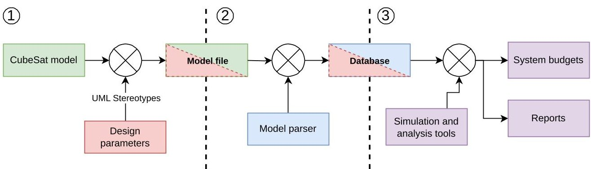

Figure 1. Proposed Framework Formalization Steps.

This paper is organized as follows: Section 2 provides an overview of the principal budgets and data required for PD phase studies, which are included in the proposed CubeSat model formalization. Section 3 details the creation of a CubeSat SysML model that is augmented with the help of UML stereotypes. This feature, thoroughly discussed later, facilitates the integration of the model with diverse simulation and analysis tools. A formalized approach for CubeSat OMs is also introduced, aimed at generating a general activity profile (which delineates the variety of tasks or operations that the S/C is expected to execute during its mission, encompassing the transitions between operation modes) for mission analysis and simulation. Section 4 presents an end-to-end application of the proposed formalization, serving as a proof of concept of the latter, by modeling a theoretical space mission concept and the integration of such model with the NSS simulation tools. Section 5 discusses the main results of this work and compares its main outcomes with the current literature. Finally, the paper concludes by summarizing its main findings and outlining potential directions for future research. Two Appendices are included at the end of this work: Appendix A presents the main SysML and UML elements mentioned within this paper for reference, while Appendix B presents the system-level block definition diagram (BDD) of the presented case study for more detail.

## 2. CubeSat Preliminary Design

The CubeSat standard has revolutionized the space industry by its simplicity and affordability, as highlighted in the SMAD [3]. This innovation has increased access to space, allowing a wider range of institutions, including smaller academic and research organizations, to participate in space exploration.

The preliminary design (PD) phase of a satellite, even for a compact CubeSat, requires addressing multidisciplinary challenges. These include balancing technical constraints like mass, volume, power, and data, each with distinct challenges and limitations. Additional complexities such as communication budgets and mission-specific requirements add to the design intricacies.

The work from Gateau et al. [21] provides a detailed examination of these challenges, offering critical insights into the budgets and studies necessary to assess CubeSat mission feasibility, summarized in Table 1.

- Mass Budget: Crucial for spacecraft engineering, the mass budget details total mass, including structural elements, harnesses, and propellants. It also integrates margins to handle uncertainties and changes across design and operational phases.

- Volume Budget: In S/C design, the volume budget specifies internal volume constraints and ensures each component fits within these limits, including operational margins.

- Power Budget: Essential for mission viability, this budget calculates power needs for all S/C components and generation capabilities, considering the impact of operational orbit on eclipse durations. Power margins are managed to accommodate energy fluctuations.

- Link Budget: Critical for mission communication, the link budget evaluates signal strength, transmission losses, and antenna sensitivity. It considers factors like antenna gain, travel distance, and atmospheric losses, ensuring reliable S/C communications.

<!-- PDF_PAGE: 5 -->

- Data Budget: This budget manages S/C data capabilities, estimating data generation, processing, storage, and downlink needs based on mission duration and orbit. It prioritizes data types and volumes to maximize mission value within resource limits.

- Other Budgets: For complex missions, additional analyses may include propellant, radiation, and heat dissipation budgets, or focus on attitude and orbit control system (AOCS) sizing and operational specifications.

- Margins: As per the European Space Agency (ESA)'s Margin Philosophy for Science Assessment Studies [23], margins at system and component levels accommodate design and operational variations, ensuring robust S/C functionality.

- Activity Profile: Outlines the S/C operations based on the concept of operations, varying with mission objectives. This study develops a versatile activity profile for various CubeSat configurations.

Table 1. Summary of principal budgets and data required for PD studies. Adapted from [21].

<table border="1"><tr><td>Budget</td><td>Input</td><td>Output</td></tr><tr><td>Mass</td><td>Spacecraft(S/C)component masses Margins</td><td>S/C mass</td></tr><tr><td>Volume</td><td>S/C component allocated volume S/C total volume Margins</td><td>S/C available volume</td></tr><tr><td>Power</td><td>S/C component consumption Activity profile Eclipses Solar cells and battery description Margins</td><td>Power consumption profile Required batteries Required solar cells</td></tr><tr><td>Link</td><td>Orbital parameters Requirements(e.g.,bit error rate(BER)) S/C communication system data Losses GS or other S/C comm.sys.data System margins</td><td>Data flow Link Margins</td></tr><tr><td>Data</td><td>Visibility windows Activity profile List of ground stations Satellite inter-link</td><td>Available data flow Required on-board storage</td></tr></table>

## 3. Data Characterization within a CubeSat SysML Model

This section delves into the information required to model a CubeSat when taking into consideration its operating modes and how to characterize with a modeling language the overall data required for simulations, analyses, and trade-offs.

## 3.1. Operating Mode Generalization

As discussed in the preceding sections, the development of comprehensive system budgets often requires the identification of the S/C's activity profile. This profile outlines the range of operations or activities that the S/C should perform during its mission, including transitions between operating modes. Derived from the concept of operations (ConOps), the activity profile can vary significantly depending on the specific objectives and design of the Spacecraft (S/C) and, thus, is typically tailored ad hoc for each mission.

To enhance the modeling abstraction capabilities of the proposed formalization, before delving into data characterization within a CubeSat model, it is essential to explore methods for generalizing the activity profile of a CubeSat. Consequently, this paper introduces a generalized approach to define the operating modes of a CubeSat, drawing on common attributes and criteria across various low Earth orbit (LEO) CubeSat concepts of operations.

<!-- PDF_PAGE: 6 -->

## 3.1.1. Existing Approaches to OM Identification

An SE framework for CubeSat design to define operating modes (OMs) and their interdependencies can be found in Asundi and Fitz-Coy's work [24]. They state that the mission concept of operations (ConOps) is a crucial document for analyzing mission objectives and operations. This framework identifies mission phases, their OMs—such as a safe mode, a communication mode, or a mission operations mode—and transition conditions, by defining the spacecraft's activity profile. An example of ConOps is proposed in the National Aeronautics and Space Administration (NASA) "Systems Engineering Handbook" [25], along with the elements involved in its definition.

An abstracted sequence of operations (i.e., the tasks and functions that the S/C must complete during its operative life) for CubeSats can also be defined [26], as many operations are similar or closely related enough to allow standardization of the OMs and ConOps.

As outlined in Jain's work [26], a standardized method of describing the operating modes, at least in terms of control sequences and minimum requirements for each OM, can be developed by analyzing the commonalities among different ConOps of LEO CubeSat missions (e.g., SwampSat [24], Waydo et al. [27], $ \mathrm{M}^{3} $ and APEX [28], VISORS [29], Cat-2 [30], and DICE [31]).

Therefore, the rest of this section aims to formalize a general S/C's activity profile. To achieve this, it is possible to identify common characteristics among the ConOps and OMs of several CubeSats in low Earth orbit (LEO) missions, through a process similar to Jain's work [26], as presented in the following.

## 3.1.2. Proposed OM Generalization

It is important to note that although comparing different missions, most of the analyzed ConOps (e.g., Waydo et al. [27], Lightsey et al. [29], Fish et al. [31]) present similar OMs and transition criteria.

In particular, it can be observed how the operating modes related to early orbit phase (EOP) and off-nominal scenarios, such as detumbling, calibration, or safe modes, are almost always considered in their missions' ConOps, with various connotations. While certainly critical from a design point of view, such OMs are not considered for the current analysis. They represent non-nominal conditions and, as a result, have properties and transition conditions that need to be studied in more detail to determine whether they can be generalized, and if so, what would be the best manner to carry this out. The operating modes relative to the operative phase of the S/Cs are the ones considered further in this paper.

Some of the OMs usually present are a servicing mode and a communication mode, which refer, respectively, to the cases during which the payload is active or a downlink/uplink with a ground station (GS) is present. A central stand-by mode is often considered to reduce power consumption when, e.g., the payload is off or if no ground stations are visible.

Some other OMs have been found throughout the literature, such as the following: Carreno-Luengo et al. [30] discusses how some OM transitions can occur based on the state of charge of the batteries, for example, during eclipse periods when no power from the solar arrays is available. Morton and Withrow-Maser [28], conversely, consider the attainment of a specific orbital configuration as a transition criterion between two OMs. The main discrepancies between the various OMs can thus be reduced, at the level of detail desired, to when a specific OM is activated and which subsystems are active in that mode. This can be further simplified to the differences in average power consumption and data rate.

The proposed generalization offers a structured approach to defining any set of OMs, integrating a range of parameters and sub-parameters that capture the essence of an S/C's operational scenario. Table 2 summarizes such generalization.

The following general transition criteria for the operating modes have been identified among the most common present in the literature:

<!-- PDF_PAGE: 7 -->

- Presence of eclipse: CubeSats often switch to a low-power mode during eclipses to conserve energy and minimize battery depth of discharge (DOD), as discussed in Asundi and Fitz-Coy [24], Waydo et al. [27], and Carreno-Luengo et al. [30].

- Presence of GS or specific target in line of sight (LOS) with the S/C: Communications with a Ground station (GS) to receive commands and downlink data are critical, as highlighted, i.e., by Asundi and Fitz-Coy [24] and Fish et al. [31].

- S/C over specific Latitude/Longitude zone: For Earth observation missions, such as those noted in Carreno-Luengo et al. [30], satellite payloads activate over targeted areas to collect mission-specific data.

- S/C in specific true anomaly range: Missions may require system activation at certain orbital positions for optimal operation, as explained in Lightsey et al. [29].

- Activation at a specific time: Determined by Kepler's Equation, some missions plan operations based on the time since periapsis to align with mission timelines, detailed further in Fitzpatrick's work [32].

The analysis of various ConOps, such as in Waydo et al. [27], shows the common use of a central standby mode, activated when no specific operational conditions are met. To generalize, a default mode check is essential, allowing one of the generalized OMs to become active when other specific operating mode conditions are not triggered, making this the central mode and thus ensuring continuous operation and readiness for mode transitions.

Table 2. Proposed operating mode generalization.

<table border="1"><tr><td></td><td>Parameter</td><td>Unit</td><td>Sub-Parameter</td><td>Unit</td></tr><tr><td rowspan="5">Activation Criteria</td><td>S/C in eclipse</td><td rowspan="5">bool</td><td>n.a.</td><td></td></tr><tr><td>GS in LOS</td><td>n.a.</td><td></td></tr><tr><td>S/C over Lat/Lon zone</td><td>Start Latitude Start Longitude End Latitude End Longitude</td><td>deg</td></tr><tr><td>S/C in True Anomaly range</td><td>Range Start Range End</td><td>deg</td></tr><tr><td>S/C in time interval</td><td>Interval Start Interval End</td><td>s</td></tr><tr><td></td><td>Default Mode check</td><td>bool</td><td>n.a.</td><td></td></tr><tr><td></td><td>Mode Priority</td><td>int</td><td>n.a.</td><td></td></tr><tr><td rowspan="3">Variables</td><td>Power Consumption</td><td>W</td><td>n.a.</td><td></td></tr><tr><td>Transmitted data rate</td><td rowspan="2">kbit/s</td><td>n.a.</td><td></td></tr><tr><td>Produced data</td><td>Housekeeping data Payload/other data</td><td>kbit/s</td></tr><tr><td rowspan="3">Metadata</td><td>Mode Name</td><td rowspan="2">str</td><td>n.a.</td><td></td></tr><tr><td>Mode ID</td><td>n.a.</td><td></td></tr><tr><td>Post-processing information</td><td>n.a.</td><td>Color,...</td><td>str</td></tr></table>

Considering each mission's unique goals, it is crucial to allow users to set the priority for each OM activation. By using a priority counter in each operating mode definition, the models can dynamically adjust OM based on their priority levels, allowing higher priority modes to override lower ones, thus adapting to varying mission scenarios.

Key distinctions between OM influence system budgets (Table 1) and include variations in power consumption, data transmission rates, and data quantities. Accurately defining these differences is vital for modeling the CubeSat's operational dynamics and resource needs across different OMs.

<!-- PDF_PAGE: 8 -->

Introducing metadata for each OM, such as mode ID, name, and post-processing colors for visualization, enhances simulation clarity and usability. These metadata facilitate better distinction and interpretation in analyses and presentations, offering clearer insights into the CubeSat's operational profile.

By employing this general model in dedicated data structures, it becomes feasible to simulate a wide range of mission scenarios. This flexibility is invaluable in testing and refining various ConOps and operational strategies, making it a versatile tool in S/C design and mission planning. Such a comprehensive model not only aids in theoretical planning but also has practical implications, significantly enhancing the efficiency and effectiveness of mission simulations.

## 3.2. Data Characterization through UML Stereotypes

The proposed formalization employs unified modeling language (UML) stereotypes to specify the attributes of blocks within systems modeling language (SysML) block definition diagrams (BDD) (see Figure 2). For the formalization, stereotypes were implemented as extensions to the UML Class metaclass. By extending this metaclass, any SysML block that a stereotype is applied to inherits the attributes of that stereotype, as detailed in Appendix A. This approach not only enriches the detail and functionality of the blocks but also streamlines the modeling process by leveraging inherited characteristics.

Below, the revised set of stereotypes is introduced, and they are SystemComp; SystemMain; Battery and SolarArray; Transmitter and Receiver; Orbit and PropagationLosses; GroundStation; and last but not least, Operating Mode. These enhance the characterization of parameters within the CubeSat SysML model. Adding these stereotypes expands the model's functionality, without compromising its ability to represent the logical and functional behaviors of the elements.

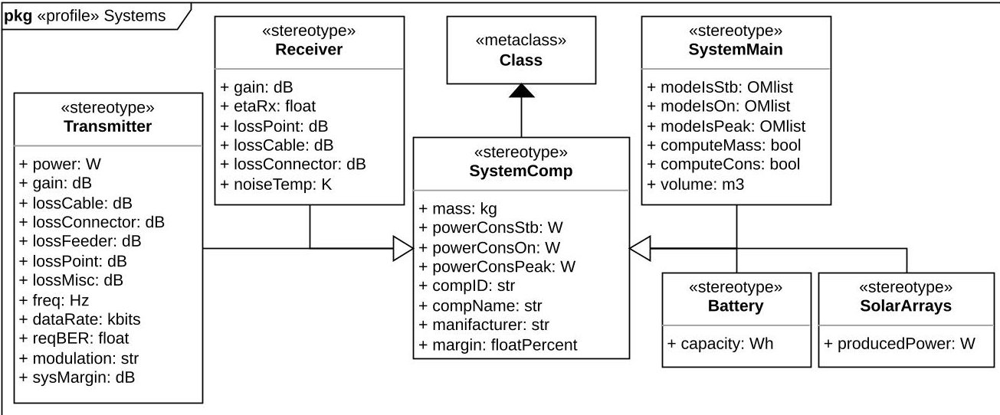

Figure 2. System UML stereotypes definition.

## 3.2.1. SystemComp

SystemComp establishes the core stereotype for a physical component of the S/C, capturing key metrics such as the system's mass, power usage, and applicable margins, along with essential metadata like ID, name, and manufacturer for tracking components.

To further tailor the model, power usage attributes are segmented into powerConsIsStb powerConsIsOn, and powerConsIsPeak, corresponding to stand-by, on, and peak power consumption statuses of each subsystem and component, respectively.

A table detailing the attributes linked with this stereotype is presented in Table 3, while Figure 2 illustrates their UML definition.

As depicted in Figure 2, additional stereotypes further delineate SystemComp: SystemMain, Battery, SolarArray, Transmitter, and Receiver. The applicable margins follow the ESA "Margin philosophy for science assessment studies" [23], which requires that they are considered at both component and system levels. As a result, they are included in the

<!-- PDF_PAGE: 9 -->

SystemComp stereotype, causing them to also be inherited by the stereotypes derived from it, including the SystemMain stereotype that is discussed below.

Table 3. SystemComp stereotype attributes.

<table border="1"><tr><td>Attribute</td><td>ValueType</td><td>Scope</td></tr><tr><td>mass</td><td>kg</td><td>Define component&#x27;s/system&#x27;s mass</td></tr><tr><td>powerConsStb</td><td>W</td><td>Power consumption while in Stand-by mode</td></tr><tr><td>powerConsOn</td><td>W</td><td>Power consumption while in On mode</td></tr><tr><td>powerConsPeak</td><td>W</td><td>Power consumption while in Peak mode</td></tr><tr><td>compID</td><td>str</td><td>Component&#x27;s/system&#x27;s reference ID</td></tr><tr><td>compName</td><td>str</td><td>Component&#x27;s/system&#x27;s name</td></tr><tr><td>manufacturer</td><td>str</td><td>Component&#x27;s/system&#x27;s manufacturer</td></tr><tr><td>margin</td><td>float %*</td><td>Applicable margin to power consumption and mass</td></tr></table>

$ ^{*} $ float %: margins are expressed as decimals, so that $ 0 \leq $ margin $ \leq 1. $

## 3.2.2. SystemMain

This stereotype can be used to define primary sub-systems of the S/C (e.g., electrical power system (EPS), propulsion system, payload, etc.). Beyond the attributes from SystemComp, it includes the list of OMs in which the system can operate for each power consumption status (stand-by, on, or peak consumption statuses have been considered for an active component), the system volume, and two Boolean flags for data extraction and analyses. Moreover, the computeMass and computeCons attributes help indicate whether simulation tools should account for the masses and power consumption of the system's sub-components: if all components of a system are available and their respective masses (or consumption) are specified, such masses (or consumption) can be aggregated to determine the total mass (or consumption) of the system. This scenario is applicable when computeMass (or computeCons) is set to True. If, conversely, only a systemMain block has been defined (e.g., an AOCS without a detailed BDD for systemComps like sensors, actuators, etc.), but it is still needed to perform analyses, computeMass can be set to False. In this case, the software is told to use the mass specified for the block with the systemMain stereotype applied without searching for the masses of individual systemComps.

These are introduced to aid the database creation even in the early design stages when the full system architecture is still being defined. Table 4 lists the additional attributes introduced by the SystemMain stereotype.

Table 4. SystemMain stereotype additional attributes.

<table border="1"><tr><td>Attribute</td><td>ValueType</td><td>Scope</td></tr><tr><td>modeIsStb</td><td>OM List $ ^{*} $</td><td>List of OMs in which the system is in Stand-by mode</td></tr><tr><td>modeIsOn</td><td>OM List $ ^{*} $</td><td>List of OMs in which the system is in On mode</td></tr><tr><td>modeIsPeak</td><td>OM List $ ^{*} $</td><td>List of OMs in which the system is in Peak mode</td></tr><tr><td>computeMass</td><td>bool</td><td>Specify if computing components&#x27; mass or not</td></tr><tr><td>computeCons</td><td>str</td><td>Specify if computing components&#x27; consumption or not</td></tr><tr><td>volume</td><td>m3</td><td>System&#x27;s external volume</td></tr></table>

* OM List: [OM1 name, OM2 name, . . .].

## 3.2.3. Battery and SolarArray

Battery and SolarArray stereotypes encompass the battery's capacity and the power generated by solar arrays, in addition to the attributes introduced by SystemComp.

## 3.2.4. Transmitter and Receiver

These stereotypes define crucial variables for the communication system elements affecting the link budget, such as transmitter and receiver antenna gain and power, various sources of signal losses, and transmitted data rate. Their attributes are summarized in Table 5.

<!-- PDF_PAGE: 10 -->

Table 5. Receiver and transmitter stereotype additional attributes.

<table border="1"><tr><td>Attribute</td><td>ValueType</td><td>Scope</td></tr><tr><td colspan="3">Receiver</td></tr><tr><td>gain</td><td>dB</td><td>Receiver antenna gain</td></tr><tr><td>etaRx</td><td>float</td><td>Receiver efficiency</td></tr><tr><td>lossCable</td><td>dB</td><td>Signal losses due to cables length</td></tr><tr><td>lossConnector</td><td>dB</td><td>Signal losses due to connectors</td></tr><tr><td>lossPoint</td><td>dB</td><td>Signal losses due to pointing mismatch</td></tr><tr><td>noiseTemp</td><td>K</td><td>System noise temperature</td></tr><tr><td colspan="3">Transmitter</td></tr><tr><td>power</td><td>W</td><td>Transmitter antenna power</td></tr><tr><td>gain</td><td>dB</td><td>Transmitter antenna gain</td></tr><tr><td>lossCable</td><td>dB</td><td>Signal losses due to cables length</td></tr><tr><td>lossConnector</td><td>dB</td><td>Signal losses due to connectors</td></tr><tr><td>lossFeeder</td><td>dB</td><td>Signal losses inside the feeder</td></tr><tr><td>lossPoint</td><td>dB</td><td>Signal losses due to pointing mismatch</td></tr><tr><td>lossMisc</td><td>dB</td><td>Other Signal losses</td></tr><tr><td>freq</td><td>Hz</td><td>Transmitted signal frequency</td></tr><tr><td>dataRate</td><td>kbit/s</td><td>Transmitter data rate</td></tr><tr><td>reqBER</td><td>float</td><td>Required bit error ratio</td></tr><tr><td>modulation</td><td>str</td><td>Modulation type name</td></tr><tr><td>sysMargin</td><td>dB</td><td>Margin applied to the transmitted signal</td></tr></table>

## 3.2.5. Orbit and PropagationLosses

The Orbit and PropagationLosses stereotypes specify the required properties for orbital and link budget analyses, as shown in Figure 3 and summarized in Table 6.

Table 6. Orbit and PropagationLosses stereotypes attributes.

<table border="1"><tr><td>Attribute</td><td>ValueType</td><td>Scope</td></tr><tr><td></td><td></td><td>Orbit</td></tr><tr><td>SMA</td><td>km</td><td>Semi-major axis</td></tr><tr><td>ECC</td><td>float</td><td>Eccentricity</td></tr><tr><td>INC</td><td>deg</td><td>Inclination</td></tr><tr><td>RAAN</td><td>deg</td><td>Right ascension of ascending node</td></tr><tr><td>AOP</td><td>deg</td><td>Argument of periapsis</td></tr><tr><td>startTA</td><td>deg</td><td>Starting true anomaly</td></tr><tr><td>startEpoch</td><td>epochFormat$\cdot$</td><td>Initial simulation epoch</td></tr><tr><td></td><td></td><td>PropagationLosses</td></tr><tr><td>lossPol</td><td>dB</td><td>Signal losses due to polarization</td></tr><tr><td>lossAtm</td><td>dB</td><td>Signal losses due to atmosphere</td></tr><tr><td>lossScin</td><td>dB</td><td>Signal losses due to scintillation</td></tr><tr><td>lossRain</td><td>dB</td><td>Signal losses due to rain</td></tr><tr><td>lossCloud</td><td>dB</td><td>Signal losses due to clouds presence</td></tr><tr><td>lossSnowIce</td><td>dB</td><td>Signal losses due to snow and ice</td></tr><tr><td>lossMisc</td><td>dB</td><td>Other signal losses</td></tr></table>

* epochFormat: "YYYY, MM, DD, hh, mm, ss".

<!-- PDF_PAGE: 11 -->

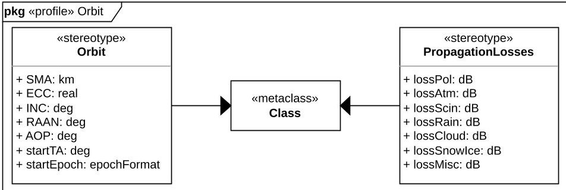

Figure 3. Orbit and Propagation Losses UML stereotypes definition.

## 3.2.6. GroundStation

The GroundStation stereotype enables the definition of all relevant data for identifying ground stations, including position, altitude, and antenna data. This stereotype's definition is presented in Figure 4, while Table 7 summarizes the introduced parameters.

Table 7. GroundStation stereotype attributes.

<table border="1"><tr><td>Attribute</td><td>ValueType</td><td>Scope</td></tr><tr><td>altitude</td><td>m</td><td>GS altitude</td></tr><tr><td>minElevation</td><td>deg</td><td>Min. angle between S/C LOS and GS horizon line</td></tr><tr><td>Lat</td><td>deg</td><td>GS latitude</td></tr><tr><td>Lon</td><td>deg</td><td>GS longitude</td></tr><tr><td>powerTx</td><td>W</td><td>GS transmitter gain</td></tr><tr><td>lineLossTx</td><td>dB</td><td>GS transmitter signal losses due to line length</td></tr><tr><td>lossConnectorTx</td><td>dB</td><td>GS transmitter signal losses due to connectors</td></tr><tr><td>gainTx</td><td>dB</td><td>GS transmitter gain</td></tr><tr><td>lossPointRx</td><td>dB</td><td>GS signal losses due to pointing mismatch</td></tr><tr><td>freq</td><td>Hz</td><td>Transmitted signal from GS frequency</td></tr><tr><td>dataRateTx</td><td>kbit/s</td><td>GS transmitter data rate</td></tr><tr><td>reqBER</td><td>float</td><td>Required bit error ratio</td></tr><tr><td>modulation</td><td>str</td><td>Modulation type name</td></tr><tr><td>sysMargin</td><td>dB</td><td>Margin applied to the transmitted signal</td></tr><tr><td>etaRx</td><td>float</td><td>GS receiver efficiency</td></tr><tr><td>diameterRx</td><td>m</td><td>GS receiver antenna diameter</td></tr><tr><td>LNAGain</td><td>dB</td><td>GS receiver low noise amplifier gain</td></tr><tr><td>noiseTempRx</td><td>K</td><td>GS receiver system noise temperature</td></tr><tr><td>lossCableRx</td><td>dB</td><td>GS receiver signal losses due to cable length</td></tr><tr><td>lossConnectorRx</td><td>dB</td><td>GS receiver signal losses due to connectors</td></tr></table>

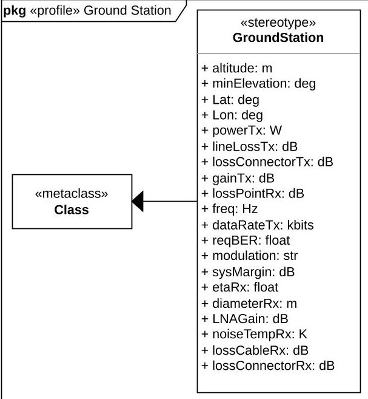

Figure 4. Ground station UML stereotype.

<!-- PDF_PAGE: 12 -->

## 3.2.7. OperatingMode

The OperatingMode stereotype is essential for replicating the operating mode generalization presented in Table 2. This stereotype is closely tied to the systems' definitions, as the power consumption of each OM is calculated based on the power consumption of each subsystem or, optionally, cascaded from the individual components of each subsystem.

Three attributes have been added to the SystemMain stereotype to denote the OMs during which a particular system is in standby, on, or peak mode: modeIsStb, modeIsOn, and modeIsPeak. These enable the simulation tools to associate the power consumption of a specified system (being this either stand-by, on or peak for each mode) with the total consumption of each operating mode.

Moreover, an isDefault Boolean attribute is present in the OperatingMode stereotype allowing the definition of an active OM (isDefault = True) when no activation criteria are satisfied.

This stereotype is shown in Figure 5 and its attributes summarized in Table 8.

Table 8. OperatingMode stereotype attributes.

<table border="1"><tr><td>Attribute</td><td>ValueType</td><td>Scope</td></tr><tr><td>modeName</td><td>str</td><td>OM name</td></tr><tr><td>modeID</td><td>int</td><td>OM unique ID</td></tr><tr><td>postProColor</td><td>str</td><td>OM color for post-processing</td></tr><tr><td>priority</td><td>int</td><td>Priority order for OM activation criterion check</td></tr><tr><td>isEclipse</td><td>bool</td><td>Is the OM active in eclipse?</td></tr><tr><td>isOnTarget</td><td>bool</td><td>Is the OM active while over GS?</td></tr><tr><td>isOnZone</td><td>bool</td><td>Is the OM active over a Lat/Lon zone?</td></tr><tr><td>zoneLatStart</td><td>deg</td><td>Zone initial Latitude</td></tr><tr><td>zoneLatEnd</td><td>deg</td><td>Zone ending Latitude</td></tr><tr><td>zoneLonStart</td><td>deg</td><td>Zone initial Longitude</td></tr><tr><td>zoneLonEnd</td><td>deg</td><td>Zone ending Longitude</td></tr><tr><td>isInRange</td><td>bool</td><td>Is the OM active while in a true anomaly range?</td></tr><tr><td>rangeStart</td><td>deg</td><td>True anomaly range start</td></tr><tr><td>rangeEnd</td><td>deg</td><td>True anomaly range end</td></tr><tr><td>isInInterval</td><td>bool</td><td>Is the OM active while in a time interval?</td></tr><tr><td>intervalStart</td><td>s</td><td>Seconds after periapsis transition</td></tr><tr><td>intervalEnd</td><td>s</td><td>Seconds after periapsis transition</td></tr><tr><td>TCRate</td><td>kbit/s</td><td>OM telecommand data rate</td></tr><tr><td>TMRate</td><td>kbit/s</td><td>OM telemetry data rate</td></tr><tr><td>powerCons</td><td>W</td><td>OM total power consumption</td></tr><tr><td>isDefault</td><td>bool</td><td>Is the OM the default OM?</td></tr></table>

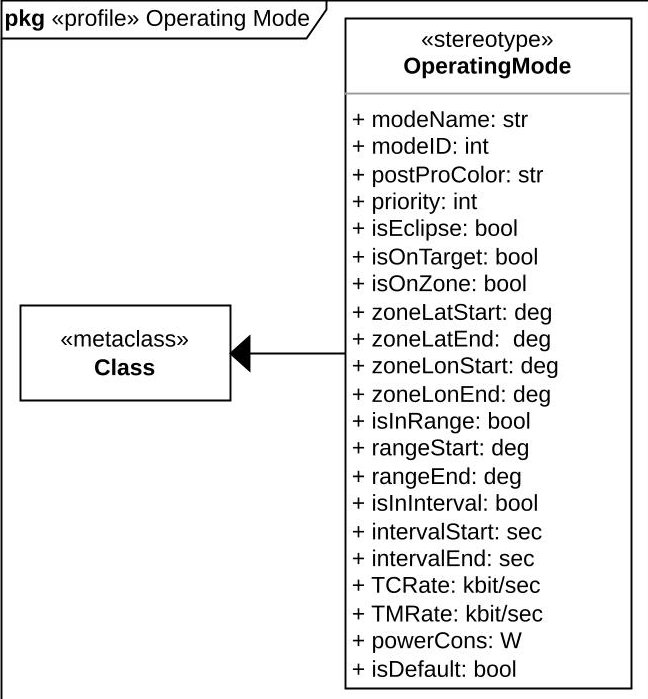

Figure 5. Operating mode UML stereotype.

<!-- PDF_PAGE: 13 -->

## 3.2.8. Stereotype Illustrative Example: Payload Block Definition Diagram

The previous subsection presented how the necessary stereotypes were defined for the proposed formalization. This section showcases how the stereotypes can be utilized in a model using BDDs. Figure 6 shows an early design phase of a global navigation satellite system (GNSS) payload—from a case study presented more in detail later in this work—and its BDD utilizing the aforementioned stereotypes.

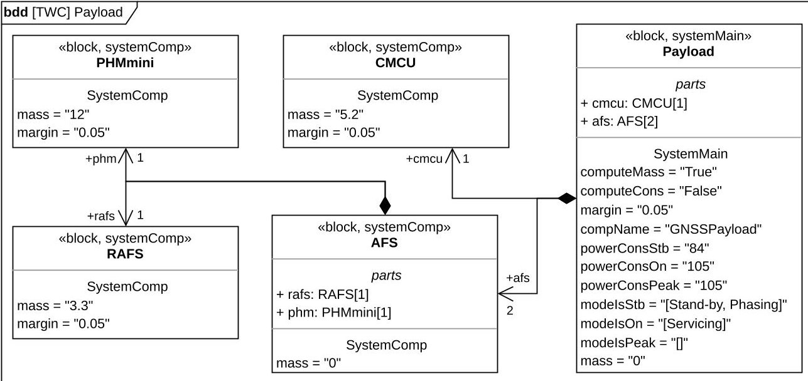

Figure 6. Payload BDD example.

It is composed of a SystemMain block—the payload—and a set of SystemComp blocks, connected through Composite Associations (for more information about UML and SysML elements, including the above-mentioned Composite Associations, please refer to Appendix A). Thus, it is possible to understand how the payload is composed of a clock monitoring and control unit (CMCU) and an atomic frequency standard (AFS), with the latter additionally composed of a passive hydrogen maser (PHM) and a rubidium atomic frequency standard (RAFS).

The computeCons and computeMass attributes from the SystemMain stereotype facilitate data extraction at any design stage, especially when detailing individual components of a system is not feasible, as happens in this case. The example above illustrates that while the masses of the components are defined, the computeMass variable is set to True, indicating that the mass of the payload is derived from the masses of its components. The same happens for the mass of the AFS block, composed of two other blocks (PHM and RAFS).

It can be noted how the masses of both payload and AFS are initialized at a null value which is overwritten during the data extraction with the sum of the respective components.

Meanwhile, the computeCons variable is appropriately set to False, as the power consumption of various components is not yet specified. However, this does not hinder future interactions with simulation tools, as the overall payload's power consumption is defined at the systemMain level.

As discussed in the preceding sections, the SystemMain stereotype enables also the definition of various power consumption statuses (stand-by, on, peak), to be associated with relevant OMs. In the example above, the payload is in stand-by—thus consuming 84 W—during a stand-by OM and a phasing OM, while it is on-consuming 105 W—during a servicing OM. Should there be other OMs for the represented mission, it is implied from this BDD that the payload will be off.

As per ESA "Margin philosophy for science assessment studies" [23], a 5% margin in this case is applied at both the component and system levels.

The proposed framework considers redundancies and inheritance of characteristics when the sub-levels of the description required are not available at a certain point in the

<!-- PDF_PAGE: 14 -->

design of the system. As can be seen in Figure 6, the proposed formalization accounts for component redundancies (for instance, in the case of the AFS block) by noting the multiplicity (i.e., the number near the arrowhead of each composite association, also present in the parts section of the block) of each composite association in the BDD.

## 3.3. Model Parser

Most of the open-source modeling tools (e.g., Capella [33], Papyrus [34], Gaphor [35]) store their models in .xml format [36]. This is a common file format for storing and transmitting data structures with a pre-defined set of rules.

Understanding the unique rules and structures of model files enables the creation of simple Python libraries for data extraction and manipulation of .xml files. The formalization proposed is beneficial as it leverages common attributes among SysML blocks with similar stereotypes, promoting uniformity in the model files. The connections among stereotypes, their attributes, and the associated blocks can be exploited for developing a parser that converts all the data included within the SysML model into a software-readable data structure.

Therefore, with prior knowledge of the stereotypes and attributes within a model, and once its file structure is known, extracting all the necessary data for simulation and analysis activities becomes feasible, independently from the variety and number of blocks in the model. Starting with the stereotype definitions, all the necessary properties for simulations and system budget generation are derived through cascading cross-references within the file structure.

In Pons et al. [37], it is shown how the formats between tools are not by default interchangeable. Hence, although the formalization is tool-independent, a thorough understanding of each tool's model file structure is crucial for the development of a dedicated model file parser. While the format of model files is consistent across different modeling tools, the method of recording information in these files varies by tool. Therefore, this paper focuses on a parser for models created with Gaphor that uses the proposed stereotypes.

The parsing process can also be reversed to enable automatic updates to model files following analysis or optimization activities. This approach confirms the role of the model as the central source of data throughout all project stages, seamlessly integrating design modifications without manual intervention.

Other relevant outputs from the parsing process include, e.g., utilizing tools like the Graphviz library [38], enabling the automatic creation of a dependency graph (presented later in this work), which visually maps out the interrelationships among model elements and their attributes, clarifying how changes to one variable may impact the entire model.

This automated workflow increases precision and efficiency, ensuring that any adjustments or improvements from analysis or optimization are systematically and accurately reflected in the model. This not only maintains the model's accuracy and relevance but also supports a more agile and responsive design process, allowing changes to be quickly incorporated and available for further iterations or evaluations.

Once the stereotypes necessary for characterizing the S/C and mission elements have been defined, they can be reused for describing other missions, varying only by the data entered within a model. Hence, the parser itself, being developed to work with the proposed set of stereotypes, is reusable with any model compliant with the proposed formalization.

The source code of the parser developed within the context of work is available in a public repository available at https://gitlab.isae-supaero.fr/preliminary-design/ mbse-cubesat-sysml (accessed on 27 February 2024) under GPLv3 (https://www.gnu.org/licenses/gpl-3.0.html (accessed on 1 March 2024)) License).

## 4. Use Case Application

This section presents an application of the proposed formalization using a SysML model enhanced with UML stereotypes and linked to simulation tools from the Nanostar software suite (NSS) constellation [20,21]. The chosen case study is the "The White Compass

<!-- PDF_PAGE: 15 -->

(TWC) mission, a theoretical academic concept developed during the "Space Mission and Systems Design" course at Politecnico di Torino. The TWC mission aims to deliver GNSS services across the Arctic region using a constellation of 12 small satellites in two high elliptical Molniya-like orbits (for more on elliptical orbits, see R. Fitzpatrick's "An introduction to Celestial Mechanics", pp. 46-52 [32]).

The core of each TWC S/C is detailed in a comprehensive SysML block definition diagram. Each BDD, such as the one illustrated in Figure A4, applies specific UML stereotypes that are essential for defining each system and component of the S/C, accurately aligning with the mission's objectives. Additionally, the SysML model for the TWC mission includes detailed, system-specific BDDs, orbit characterizations, ground stations, operating modes, and requirements. The full extent description of the mission and diagrams can be found in the project's public repository. These elements provide a holistic view of the mission, covering the S/C, its operational environment, and mission-critical parameters.

The summary of the main parameters included within the model to obtain a power budget and a data budget is reported in Table 9. The full data set is present in the work's public repository.

Table 9. Simulation data summary.

<table border="1"><tr><td>Parameter</td><td>Value[Unit]</td><td>Parameter</td><td>Value[Unit]</td></tr><tr><td colspan="2">Orbit</td><td colspan="2">EPS</td></tr><tr><td>AOP</td><td>270.0[deg]</td><td>Battery capacity</td><td>1036.8[Wh]</td></tr><tr><td>ECC</td><td>0.55[-]*</td><td>Solar array power</td><td>2021.0[W]</td></tr><tr><td>INC</td><td>63.4[deg]</td><td>Stand-byOMconsumption**</td><td>251[W]</td></tr><tr><td>RAAN</td><td>0.0[deg]</td><td>PhasingOMconsumption**</td><td>582[W]</td></tr><tr><td>SMA</td><td>16,500.0[km]</td><td>ServicingOMconsumption**</td><td>397[W]</td></tr><tr><td colspan="2">Transmitter</td><td colspan="2">Receiver</td></tr><tr><td>$\eta_{RX}$</td><td>0.95[-]</td><td>DataRate</td><td>13.0[kbit/s]</td></tr><tr><td>Gain</td><td>40.0[dB]</td><td>Frequency</td><td>2.0[GHz]</td></tr><tr><td>LNA Gain</td><td>0.0[dB]</td><td>Gain</td><td>45.0[dB]</td></tr><tr><td>Cable losses</td><td>0.0[dB]</td><td>Cable losses</td><td>0.0[dB]</td></tr><tr><td>Connector losses</td><td>0.0[dB]</td><td>Feeder losses</td><td>0.0[dB]</td></tr><tr><td>Pointing losses</td><td>0.0[dB]</td><td>Pointing losses</td><td>0.0[dB]</td></tr><tr><td>Noise Temperature</td><td>500.0[K]</td><td>Power</td><td>35.0[W]</td></tr><tr><td></td><td></td><td>RequiredBER</td><td>10.5[-]</td></tr><tr><td colspan="4">Ground Station</td></tr><tr><td>LNA Gain</td><td>7.82[dB]</td><td>Cable lossesRX</td><td>0.0[dB]</td></tr><tr><td>Latitude</td><td>67.9[deg]</td><td>Connector lossesRX</td><td>0.0[dB]</td></tr><tr><td>Longitude</td><td>21.0[deg]</td><td>Connector lossesTX</td><td>0.0[dB]</td></tr><tr><td>Altitude</td><td>402.0[m]</td><td>Pointing lossesRX</td><td>0.0[dB]</td></tr><tr><td>Data Rate TX</td><td>10.0[kbit/s]</td><td>MinimumElevation</td><td>5.0[deg]</td></tr><tr><td>Diameter RX</td><td>15.0[m]</td><td>Frequency</td><td>2.0[GHz]</td></tr><tr><td>$\eta_{RX}$</td><td>0.95[-]</td><td>NoiseTemperatureRX</td><td>515.0[K]</td></tr><tr><td>Line losses TX</td><td>4.7[dB]</td><td>PowerTX</td><td>177.8[W]</td></tr><tr><td>Gain TX</td><td>46.8[dB]</td><td>RequiredBER</td><td>10.5[-]</td></tr></table>

* Because of limitations within the simulation tools used, the ECC has been considered null. ** Breakdown of active systems for each OM is detailed in Figure A4.

After characterizing the S/C model, the next step is to extract the pertinent data from the model file. The parser primarily targets blocks with applied stereotypes. This targeted approach boosts the flexibility and broad applicability of the SysML model, ensuring that only essential data are extracted for data structure creation. This adaptability is particularly valuable, enabling the model to represent any system at any design stage, as long as the required stereotypes are implemented.

Finally, once the database is established, it is possible to engage in analysis and simulations using NSS tools (e.g., to generate the desired system budgets, as shown in

<!-- PDF_PAGE: 16 -->

Figure 7) or other preferred simulation platforms. This phase is augmented by the capability to modify the model files directly from the Python scripts, enabling dynamic updates and adjustments to the model based on database inputs.

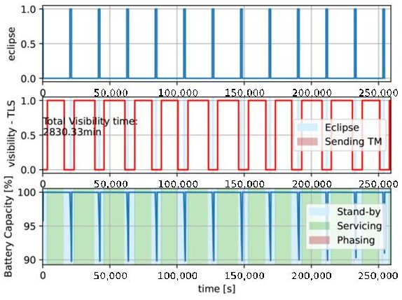

(a)

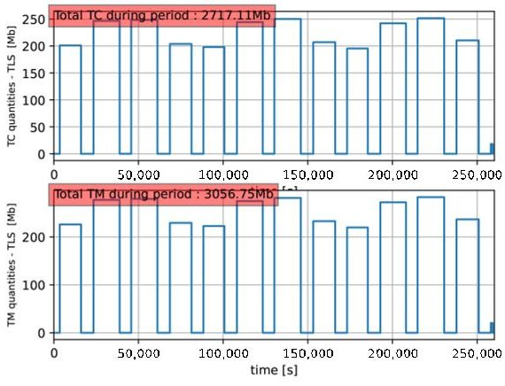

(b)

Figure 7. TWC output power and data budgets. (a) TWC power budget. (b) TWC data budget.

The entire process, once the stereotypes are defined within the model for the characterization of all relevant design parameters, is continued by means of the dedicated parser. It links the model to the chosen set of simulation tools by extracting the relevant data from the model files and generating a software-readable database.

The parser allows the parsing process to be inverted to facilitate automatic updates to model files after analysis or optimization tasks. This method establishes the model as the center reference for data across all project phases, effortlessly incorporating design changes without the need for manual intervention. In other words, the model is seen as the single source of truth.

A supplementary result of the parsing process is a requirements list (an excerpt is shown in Figure 8). This is possible due to the nature of the requirement element in SysML as it is a stereotype and thus manipulable by the model parser through the same logic used for the stereotypes introduced by the proposed formalization. This feature is especially valuable for modeling tools lacking the functionality to export requirement diagrams as tables, or when the specific formatting of such tables is desired.

<table border="1"><tr><td>REQ. ID</td><td>REQ. NAME</td><td>REQ. TEXT</td></tr><tr><td>R-FUN-EPS-001</td><td>EPS-001</td><td>The electrical power system shall provide and regulate sufficient power to all other subsystems&#x27; components in each mission phase</td></tr><tr><td>R-FUN-EPS-002</td><td>EPS-002</td><td>The electrical power system shall provide the correct voltage to satellite&#x27;s systems</td></tr><tr><td>R-FUN-EPS-003</td><td>EPS-003</td><td>The electrical power system shall ensure that the maximum power produced is within the safe operating limits to prevent any harmful effects</td></tr><tr><td>R-FUN-EPS-004</td><td>EPS-004</td><td>The batteries&#x27; functioning design shall guarantee an optimal efficiency during operational life</td></tr><tr><td>R-FUN-EPS-005</td><td>EPS-005</td><td>The solar panels shall generate at least 1.6 kW including margin</td></tr><tr><td>R-FUN-EPS-006</td><td>EPS-006</td><td>Solar panels shall perform sun tracking with an accuracy of ±5% of full step.</td></tr><tr><td>R-FUN-EPS-007</td><td>EPS-007</td><td>The batteries&#x27; Depth-of-Discarge (DoD) shall be less than 50% during operational life</td></tr><tr><td>R-FUN-EPS-008</td><td>EPS-008</td><td>The batteries&#x27; voltage shall be 28±2V</td></tr><tr><td>R-FUN-EPS-009</td><td>EPS-009</td><td>The batteries shall have a capacity of 2 kWh</td></tr><tr><td>R-FUN-EPS-010</td><td>EPS-010</td><td>The batteries shall have a minimum lifetime of 6 years</td></tr></table>

Figure 8. Example of requirement list output.

Another product of the parsing process is the dependency graph, illustrated in Figure 9. For clarity, only connections related to the modeled TWC payload are shown (see Figure 6). A complete relationship graph featuring all model elements is available in the project's public repository.

<!-- PDF_PAGE: 17 -->

In the SysML model, establishing associations or other connections is essential for defining the relationships between different blocks. For instance, in the case of the SystemComp and SystemMain blocks shown in Figure 9, these connections facilitate the cascading of critical properties like power consumption and mass from the component level to the main system block. Additionally, the operating modes are linked to the SystemMain blocks through attributes such as modeIsStb, modeIsOn, and modeIsPeak.

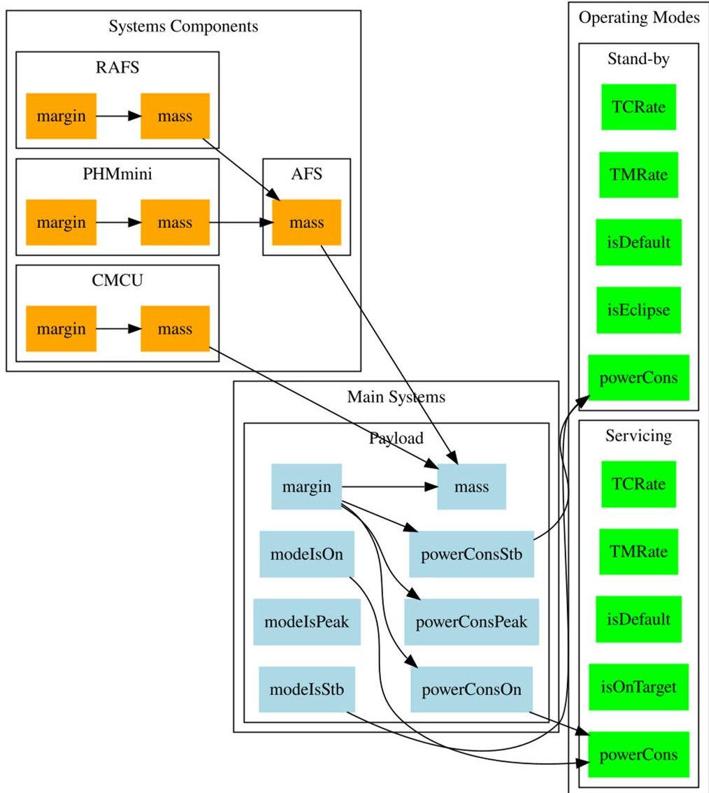

Figure 9. Example of payload relationship graph. Connections are derived from the BDD in Figure 6.

Exploiting dependencies is crucial for effectively leveraging the SysML model in the design process. By extracting data for the database, it becomes feasible to generate a relationship graph. This graph is populated by all blocks to which a stereotype has been applied. This graph provides a comprehensive visual overview of the dependencies and interactions among various elements within the model. Such a graph can offer more clear insights as to how modifications in one part of the system could affect others, by enabling more strategic and informed decision-making throughout the design phase.

When considering the entire CubeSat model, this method could allow for the inclusion of other vital systems, such as ground stations or the S/C's communication system, revealing all critical relationships for data and link budget analysis. Moreover, adding elements like solar arrays, batteries, and an EPS, along with orbital parameters, would help visualize all interrelationships crucial to a power budget. Such an extensible relationship graph would present a holistic view of the system, underscoring the complex web of dependencies defining the S/C's elements and the ramifications of changing one variable on the overall design.

<!-- PDF_PAGE: 18 -->

## 5. Discussion

As mentioned, the preliminary design of a CubeSat involves extensive multidisciplinary efforts and complexity. Despite the increasing use of advanced SE approaches such as MBSE and CE, the fragmentation in data storage and transmission continues to be a significant challenge for the SE sector [8,15]. These challenges, in fact, hinder the seamless flow of information across different stages of CubeSat development, impacting efficiency and integration. Therefore, the approach proposed in this paper addresses the issues regarding a seamless flow of information. This issue was identified as well as a primary challenge in the adoption of CE methodologies in Knoll et al. [11]. The need for a robust integration among various discipline-specific tools and the comprehensive application of MBSE is clear.

There are many inconsistencies regarding the interoperability of tools. For a detailed analysis of the inconsistencies throughout tools used for designing and analyzing complex systems at different design phases, readers can refer to Bajaj et al. [17]. This study highlights the following two main gaps in particular:

- Gap 1: The lack of model-based continuity in design and simulation activities across mission stages due to the use of different tools in initial versus later phases, leading to inconsistencies.

- Gap 2: The lack of continuity between design and simulation models within each design phase, particularly between conceptual designs and mathematical models in the early stages.

Therefore, this study introduced a formalized CubeSat SysML model enhanced with UML stereotypes for data characterization, designed with flexibility and compatibility across various simulation tools in mind, demonstrating its utility and flexibility within the space system domain. The proposed framework is summarized in Figure 10.

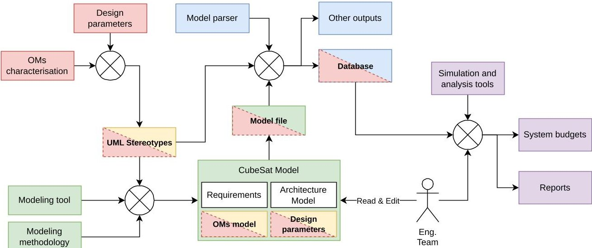

Figure 10. Data flow scheme of an application of the proposed formalization.

The diagram uses color-coded blocks to illustrate input/output relationships, following the order of the arrows. Blocks sharing the same color convey the same information and serve as either inputs (if preceding an arrow) or outputs (if following an arrow) of a specific step within the proposed formalization. More specifically,

- Red: data that are required for analyses and simulation activities, to be included within the S/C model.

- Green: baseline framework and model prior to the application of the proposed formalization.

- Yellow: set of stereotypes to be included within the model for "red" data characterization.

- Blue: newly developed model parser for data extraction and outputs (e.g., software-readable data structure, requirements lists, dependency graphs).

- Purple: set of simulation and analysis tools to be linked with the model, which require the "red" data, and outputs.

<!-- PDF_PAGE: 19 -->

The double coloring of the specific blocks describes the various information carried out by each of them. Specifically, the design parameters—in red—are represented in the model and thus in the model file—through the proposed set of stereotypes. This information is then extracted through the parser and transferred to the newly-generated database, which is linked to the desired set of simulation and analysis tools.

The uniqueness of the presented formalization is that it offers the academic and open source community an open source framework specifically tailored to the preliminary design of CubeSats, addressing the fragmentation in data storage and allowing data transmission and simulations to be executed at any design stage.

The innovation of the proposed formalization with respect to other works in the literature is its language and tool agnosticism. Being developed with an arbitrary set of open source modeling and simulation tools, it can be tailored to the needs of those that want to apply it with their preferred solutions. As a drawback, the current state-of-the-art model parser does not allow data to be automatically extracted from models developed with tools other than Gaphor without modifying the source code.

Moreover, in contrast to what has been found in the literature, where models are mostly used as a connection point between databases and external software, the proposed model formalization serves as a central data reference throughout the preliminary design (PD) phases, integrating seamlessly with open source tools, including, in this work, the Nanostar software suite (NSS). This integration enabled the generation of power and data budgets for the TWC theoretical mission, showcasing the model's practical applicability. The use of UML stereotypes provided a consistent structure for the model files, enhancing precision and efficiency in data extraction and manipulation. The capability for data extraction and translation in a software-readable data structure, coupled with automatic model updates after analyses and optimizations, minimized manual intervention, supporting a dynamic and responsive design process.

Given the aforementioned strengths and broad applicability with any set of open source software and modeling tools, the authors envision the formalization of the proposed framework to be used, for example, in academic and budget-constrained environments, as a support for systems engineers and the entire development team, for all stages of PD. The further application of real-time versioning and cloud storage could be also beneficial for CE practices, posing once more the proposed model as the pivotal point of the entire design process.

However, the development of the proposed CubeSat SysML model formalization and its integration with open-source tools for PD involved several limitations and design decisions, and assumptions (detailed in the next paragraphs). These aspects are essential for understanding the scope, applicability, and potential areas for improvement of the proposed formalization.

One significant limitation encountered, as anticipated, was the modeling-tool-specific nature of the parser. The parser was tailored specifically for models created with Gaphor, because of the nature of the model files to be parsed. As highlighted in Pons et al. [37], the format in which the models are saved actually makes them not fully interoperable with other modeling tools than the ones they were created in. This restricts the immediate applicability of the parser to models created using other SysML tools. Gaphor was chosen due to its open-source nature and compatibility with the proposed UML stereotypes. However, in order to enhance usability across different platforms, future versions of the parser shall consider broader compatibility across tools.

Another limitation is the focus on low Earth orbit (LEO) missions, which formed the basis of the generalization of operating modes (OMs) and the formalized approach. This focus excludes non-nominal conditions such as detumbling, calibration, or safe modes. LEO missions were chosen due to their commonality and relevance in current CubeSat applications. Extending this framework to other mission types and non-nominal conditions remains a key area for future research. Additionally, the formalized approach did not fully incorporate OMs related to the early orbit phase (EOP) and off-nominal scenarios.

<!-- PDF_PAGE: 20 -->

The complexity and variability of these conditions were deemed beyond the scope of the presented framework, and a detailed study and potential inclusion of these scenarios could provide a more comprehensive model.

Balancing the creation of a generic framework with the need to address specific mission requirements posed challenges. A generic framework was prioritized to ensure broad applicability, with the understanding that specific mission requirements would necessitate further customization. This design decision supports reusability but may require additional adjustments for highly specialized missions.

Several key design decisions were made to address these limitations and guide the development process. The use of UML stereotypes was implemented to enrich the detail and functionality of SysML blocks, driven by the need to standardize data characterization and facilitate seamless integration with simulation tools. UML stereotypes allow for a structured approach to data characterization, ensuring consistency and enabling automated data extraction and manipulation.

The CubeSat SysML model was designed to act as a central data reference throughout all PD phases. Positioning the model as the single source of truth ensures coherence and accuracy across all design stages, supporting efficient updates and modifications. The exclusive use of open source tools, including the NSS, was another fundamental design choice. Open source tools promote transparency, accessibility, and collaboration, aligning with the academic and budget-constrained contexts in which CubeSats are often developed.

The generalization of OMs aimed to standardize the activity profiles for CubeSats by identifying common attributes and criteria across various missions. This design decision supports the creation of versatile and reusable models that can be adapted to different mission scenarios.

The future work may focus on expanding the tool compatibility by developing parsers compatible with multiple SysML tools to enhance the framework's versatility. Extending the OM generalization to include non-nominal conditions and other mission types beyond LEO is also crucial. Enhancing the model to accommodate more complex sub-systems such as AOCS and propulsion, enabling comprehensive analyses like Delta-V and propellant budgets, should provide significant advancements in the preliminary design.

## 6. Conclusions and Future Perspectives

This paper introduced a formalized general CubeSat SysML model, enhanced with UML stereotypes for data characterization. This model has been proposed to serve as the central data reference throughout all PD phase stages, acting as the primary design interface.

The innovation of this work stands in the flexibility of its application within the space systems domain. A CubeSat SysML model can be created with any tool, with the condition that this tool can define any diagram or element as long as the proposed set of UML stereotypes are applied, without affecting integration with simulation tools. Moreover, once the proposed set of stereotypes are integrated within the model, it becomes possible to reuse them for different designs by only varying the introduced data.

Another result is the generalization of operating modes for CubeSats, identifying common attributes and transition criteria among various LEO CubeSats concepts of operations. This allows for different mission scenarios to be defined by just modifying OM attributes, implemented in any data format.

The use of UML stereotypes identifies common structures within the model files, enabling the extraction of key data for integration with any preferred set of simulation tools. Dependency graphs generated from this data extraction process visually depict the impact of design changes, aiding trade-off studies during the PD phase.

Additionally, creating a specialized parser for the model files allows for automatic updates to the model itself, such as after a simulation or parameter optimization phases.

A proof of concept is presented with the SysML model of the TWC mission, integrated with the NSS mission analysis tools via a dedicated parser, successfully generating power and data budgets.

<!-- PDF_PAGE: 21 -->

The source codes and associated documentation are available in a public repository at https://gitlab.isae-supaero.fr/preliminary-design/mbse-cubesat-sysml (accessed on 27 February 2024), under GPLv3 (https://www.gnu.org/licenses/gpl-3.0.html) (accessed on 1 March 2024) License.

Future works, mentioned as well in the previous discussion section in more detail, could address approximations by the NSS tools and limitations of the OM generalization for low Earth orbit (LEO) and early orbit phase (EOP). Moreover, a more thorough characterization of complex systems, i.e., AOCS or propulsion systems, could allow the generation of budgets such as Delta-V budgets and propellant budgets, as well as the representation of all S/C element dependencies through a comprehensive dependency graph. An interface to allow user(s) to choose what outputs to generate from the parser could be explored. Expanding these aspects would allow for modeling a broader range of missions and integrating more complex scenarios, potentially also incorporating other database formats like SQL.

Author Contributions: Methodology, G.L. and S.S.C.; software, G.L. and T.G.; supervision, S.S.C., T.G. and N.V.; writing—original draft, G.L.; writing—review and editing, S.S.C. and T.G. All authors have read and agreed to the published version of the manuscript.

Funding: This research received no external funding.

Institutional Review Board Statement: Not applicable.

Informed Consent Statement: Not applicable.

Data Availability Statement: The original data presented in the study are openly available in a public GitLab repository at https://gitlab.isae-supaero.fr/preliminary-design/mbse-cubesat-sysml (accessed on 27 February 2024), under GPLv3 (https://www.gnu.org/licenses/gpl-3.0.html) (accessed on 1 March 2024) License.

Conflicts of Interest: The authors declare no conflicts of interest.

## Abbreviations

The following abbreviations are used in this manuscript:

AFS Atomic frequency standard

AOCS Attitude and orbit control system

BDD Block definition diagram

BER Bit error rate

CE Concurrent engineering

CMCU Clock monitoring and control unit

ConOps Concept of operations

DOD Depth of discharge

EOP Early orbit phase

EPS Electrical power system

ESA European Space Agency

GNSS Global navigation satellite system

GS Ground station

INCOSE International Council on Systems Engineering

LEO Low Earth orbit

LOS Line of sight

MBSE Model-based systems engineering

NASA National Aeronautics and Space Administration

NSS Nanostar software suite

OM Operating mode

OMG Object management group

OSHW Open source hardware

<!-- PDF_PAGE: 22 -->

OSS Open source software

PD Preliminary design

PHM Passive hydrogen maser

RAFS Rubidium atomic frequency standard

S/C Spacecraft

SE Systems engineering

SysML Systems modeling language

TWC The White Compass

UML Unified modeling language

## Appendix A. SysML and UML Core Elements

Unified modeling language (UML) [39], originating in the late 1980s/early 1990s, quickly became a leading software development modeling language [40]. Systems modeling language (SysML) [41], developed in the early 2000s by Object management group (OMG), International Council on Systems Engineering (INCOSE), and other partners, is a UML specialization for SE applications. A comprehensive description of SE practices with SysML is provided in Weilkiens [40].

Key elements of UML and SysML, essential for understanding this work, include the following:

## Classes

Central to object-oriented modeling, the classes represent both the structure and behavior of objects with shared characteristics. Defined by attributes (structure) and operations (behavior), the classes are showcased in class diagrams. They represent code elements and real-life objects at varying levels of detail.

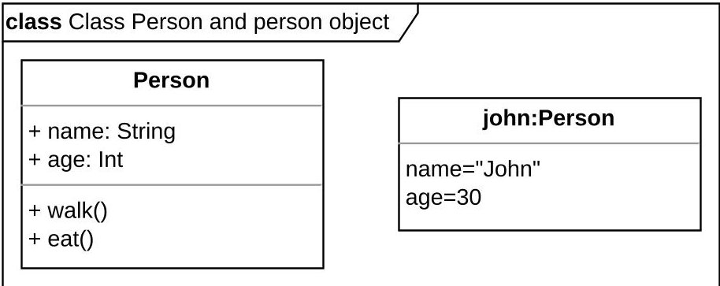

Figure A1. Example of UML class and object with inherited attributes and operations.

## Attributes

Attributes specify the properties of a model, inherited by classes, including visibility, name, type, and multiplicity (number of instances per class).

## Associations

These indicate relationships between two classes, with variations like aggregation association (whole-part hierarchy) and composition association (whole-part hierarchy where parts are inseparable from the whole).

## Generalizations

These establish hierarchies between a specialized subclass and a general superclass, where the subclass is a specific version of the superclass (e.g., subclasses like cat, dog, and horse, with animal as the superclass).

<!-- PDF_PAGE: 23 -->

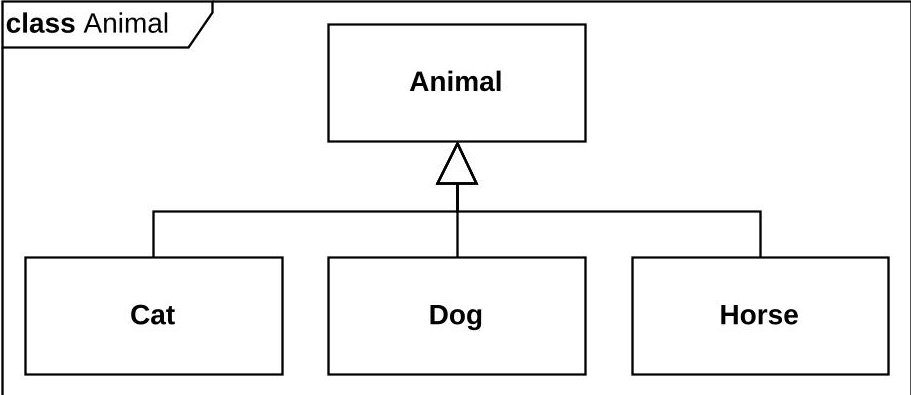

Figure A2. Example of UML generalization.

## Stereotypes

Stereotypes extend pre-existing model elements with additional properties and/or operations, using the keyword «metaclass» to denote the base element.

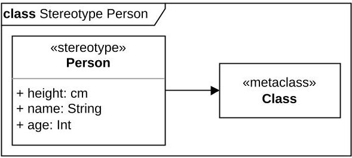

(a)

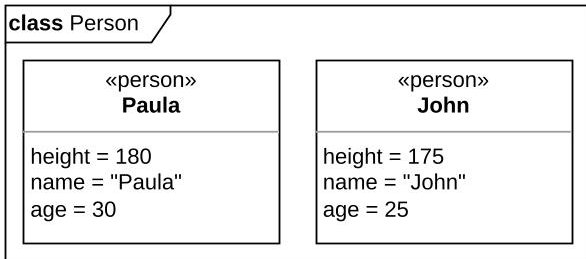

(b)

Figure A3. UML stereotype examples. (a) Stereotype definition example. (b) Stereotype application example.

## Blocks and Block Definition Diagrams

In SysML, UML classes are referred to as blocks, and UML class diagrams are renamed Block Definition Diagrams (BDDs). SysML broadens the application of UML classes beyond software, facilitating system structure representation across various disciplines.

## Requirements and Requirement Diagrams

Unique to SysML, requirements define system compliance conditions, represented in requirement diagrams.

## Value Types, Units, and Dimensions

A value type is a specialized UML data type comprising a unit and dimension. Units specify physical units, while dimensions define their quantities.

## Stereotypes applied to UML

Elements like requirements and blocks in SysML were derived by applying stereotypes to existing UML elements, like the class.

The extensive application of UML stereotypes will be a critical aspect of this work.

<!-- PDF_PAGE: 24 -->

Appendix B. TWC System-Level BDD

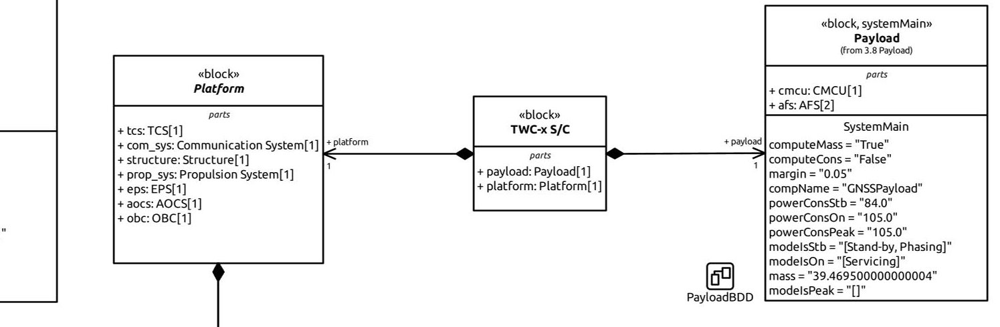

<table border="1"><tr><td colspan="5">EPSBDD</td></tr><tr><td colspan="5">+prop_sys1+structure1+com_sys1+tcs1+aocs1+obc1</td></tr><tr><td colspan="5">《block, systemMain》Propulsion System(from 3.2 Propulsion System)</td></tr><tr><td colspan="5">parts+ thruster: Thruster[2]+ ppu: PPU[1]+ fms: FMS[1]+ tank: Fuel Tank[2]</td></tr><tr><td colspan="5">SystemMainmass = 86.6;margin = 0.1computeMass = FalsecomputeCons = False</td></tr><tr><td colspan="5">《block, systemMain》Communication System(from 3.4 Communication System)</td></tr><tr><td colspan="5">《block, systemMain》TCS(from 3.5 TCS)</td></tr><tr><td colspan="5">parts+ heaters: Heaters[1]+ sensors: Thermal Sensors[1]+ passiveCtrl: Passive Control[1]</td></tr><tr><td colspan="5">SystemMainmass = 10.0;margin = 0.05computeConsStb = 10.0powerConsOn = 72.0powerConsPeak = 331.0modelsStb = []modelsOn = [Stand-by, Servicing, Phasing]modelsPeak = []computeMass = FalsecomputeCons = False</td></tr><tr><td colspan="5">SystemMainmass = 13.0;margin = 0.05computeConsStb = 0.0powerConsOn = 50.0powerConsPeak = 125.0modelsStb = [Stand-by]modelsStb = [Servicing, Phasing]modelsPeak = []computeMass = FalsecomputeCons = False</td></tr><tr><td colspan="5">TCSBDD</td></tr><tr><td colspan="5">《block, systemMain》AOCS(from 3.6 AOCS)</td></tr><tr><td colspan="5">partsSystemMainmass = 6.5;margin = 0.05computeConsStb = 10.0powerConsOn = 72.0powerConsPeak = 331.0modelsStb = []modelsOn = [Stand-by, Servicing, Phasing]modelsPeak = []computeMass = FalsecomputeCons = False</td></tr><tr><td colspan="5">SystemMainpowerConsStb = 35.0powerConsOn = 35.0powerConsPeak = 35.0modelsStb = []modelsOn = [Stand-by, Servicing, Phasing]modelsPeak = []computeMass = FalsecomputeCons = False mass = 15.0margin = 0.1</td></tr><tr><td colspan="5">PropulsionSystemBDD</td></tr></table>

Figure A4. TWC system-level Block definition diagram implemented in SysML.

<!-- PDF_PAGE: 25 -->

## References

1. CalPoly. CubeSat Design Specification Rev. 14.1; The CubeSat Program; Cal Poly SLO: San Luis Obispo , CA, USA, 2022 .

2. Strobbe, C.; Salas Cordero, S.; Vingerhoeds, R. Open-source CubeSat MBSE Approach to Address Traceability: Power Subsystem. In Proceedings of the 2023 IEEE International Systems Conference (SysCon), Vancouver, BC, Canada, 17-20 April 2023; pp. 1-8. [CrossRef]

3. Wertz, J.R.; Everett, D.F.; Puschell, J.J. Space Mission Engineering: The New SMAD; Wertz, J.R., Everett, D.F., Puschell, J.J., Eds.; Space Technology Library, Microcosm Press: Hawthorne, CA, USA, 2011.

4. Nason, I.E. Development of the CubeSat P-Pod Deployment System. Master's Thesis, California Polytechnic State University, San Luis Obispo, CA, USA, 2002.

5. Cornford, S.L.; Feather, M.S. Model Based Mission Assurance in a Model Based Systems Engineering (MBSE) Framework: State-of-the-Art Assessment. NASA Contractor Report (CR) 20170005538, Jet Propulsion Laboratory, 2016. Available online: https://ntrs.nasa.gov/citations/20170005538 (accessed on 25 April 2024).

6. Euroconsult. Space Economy Report 2023, 9th ed.; Euroconsult: Courbevoie, France, 2023.

7. Kulu, E. Nanosats Database. 2024. Available online: https://www.nanosats.eu (accessed on 10 January 2024).

8. INCOSE. Systems Engineering Vision 2020. INCOSE-TP-2004-004-02. 2007. Available online: http://www.ccose.org/media/upload/SEVision2020_20071003_v2_03.pdf (accessed on 5 January 2024).

9. Bandecchi, M.; Melton, B.; Ongaro, F. Concurrent Engineering Applied to Space Mission Assessment and Design. ESA Bull. 1999, 99, 34-40.

10. Bandecchi, M.; Melton, B.; Gardini, B.; Ongaro, F. The ESA/ESTEC concurrent design facility. In Proceedings of the EuSEC 2000, Munich, Germany, 13-15 September 2000; Volume 1, pp. 329-336.

11. Knoll, D.; Fortin, C.; Golkar, A. Review of Concurrent Engineering Design practice in the space sector: State of the art and future perspectives. In Proceedings of the 2018 IEEE International Systems Engineering Symposium (ISSE), Rome, Italy, 1-3 October 2018; pp. 1-6. [CrossRef]

12. INCOSE. INCOSE Systems Engineering Handbook: A Guide for System Life Cycle Processes and Activities, 5th ed.; Walden, D.D., Shortell, T.M., Roedler, G.J., Delicado, B.A., Mornas, O., Yew-Seng, Y., Endler, D., Eds.; Wiley & Sons, Inc.: Hoboken, NJ, USA, 2023.

13. Henderson, K.; Salado, A. Value and benefits of Model-Based Systems Engineering (MBSE): Evidence from the literature. Syst. Eng. 2021, 24, 51-66. [CrossRef]

14. Syan, C.; Menon, U. Concurrent Engineering: Concepts, Implementation and Practice; Springer: Dordrecht, The Netherlands, 2012.

15. INCOSE. Systems Engineering Vision 2035. 2021. Available online: https://www.incose.org/publications/se-vision-2035 (accessed on 5 January 2024).

16. Salas Cordero, S.; Gateau, T.; Vingerhoeds, R. MBSE Challenges in the Concurrent Preliminary Design of CubeSats: Nanospace Study. In Proceedings of the 2022 IEEE International Systems Conference (SysCon), Montreal, QC, Canada, 25-28 April 2022; pp. 1-8. [CrossRef]

17. Bajaj, M.; Zwemer, D.; Peak, R.; Phung, A.; Scott, A.G.; Wilson, M. SLIM: Collaborative model-based systems engineering workspace for next-generation complex systems. In Proceedings of the 2011 IEEE Aerospace Conference, Big Sky, MT, USA, 5-12 March 2011; pp. 1-15. [CrossRef]

18. Spangelo, S.C.; Kaslow, D.; Delp, C.; Cole, B.; Anderson, L.; Fosse, E.; Gilbert, B.S.; Hartman, L.; Kahn, T.; Cutler, J. Applying Model-Based Systems Engineering (MBSE) to a standard CubeSat. In Proceedings of the 2012 IEEE Aerospace Conference, Big Sky, MT, USA, 3-10 March 2012; pp. 1-20. [CrossRef]

19. Scholz, A.; Juang, J.N. Toward open source CubeSat design. Acta Astronaut. 2015, 115, 384-392. [CrossRef]

20. Gateau, T.; Salas Cordero, S.; Vingerhoeds, R.; Puech, J. Nanospace and open-source tools for CubeSat preliminary design: Review and pedagogical use-case. In Proceedings of the 4th Symposium on Space Educational Activities, Universitat Politècnica de Catalunya, Barcelona, Spain, 27-29 April 2022. [CrossRef]

21. Gateau, T.; Senaneuch, L.; Salas Cordero, S.; Vingerhoeds, R. Open-source Framework for the Concurrent Design of CubeSats. In Proceedings of the 2021 IEEE International Symposium on Systems Engineering (ISSE), Vienna, Austria, 13 September-13 October 2021; pp. 1-8. [CrossRef]

22. Luccisano, G. Data Formalisation through MBSE for Concurrent Preliminary Design of CubeSats. Master's Thesis, Polytechnic University of Turin, Torino, Italy, 2024.

23. ESA. Margin Philosophy for Science Assessment Studies Rev. 3; ESA—European Space Research and Technology Centre: Noordwijk, The Netherlands, 2012.

24. Asundi, S.A.; Fitz-Coy, N.G. CubeSat mission design based on a systems engineering approach. In Proceedings of the 2013 IEEE Aerospace Conference, Big Sky, MT, USA, 2-9 March 2013; pp. 1-9. [CrossRef]

25. NASA. Systems Engineering Handbook Rev. 2; 12th Media Services; NASA: Washington, DC, USA, 2007

26. Jain, V. Abstracting CubeSat Operations: A Path to Real Cubesat Interoperability. Master's Thesis, York University, North York, ON, Canada, 2019.

27. Waydo, S.; Henry, D.; Campbell, M. CubeSat design for LEO-based Earth science missions. In Proceedings of the IEEE Aerospace Conference, Big Sky, MT, USA, 9-16 March 2002; Volume 1, p. 1. [CrossRef]

<!-- PDF_PAGE: 26 -->

28. Morton, B.; Withrow-Maser, S. On-Orbit CubeSat Performance Validation of a Multi-Mode Micropropulsion System. In Proceedings of the 2017 AIAA/USU Conference on Small Satellites, Logan, UT, USA, 1-2 May 2017; SSC17-VIII-4. Available online: https://digitalcommons.usu.edu/smallsat/2017/all2017/125 (accessed on 12 August 2024).

29. Lightsey, E.G.; Arunkumar, E.; Kimmel, E.; Kolhof, M.; Paletta, A.; Rawson, W.; Selvamurugan, S.; Sample, J.; Guffanti, T.; Bell, T.; et al. Concept of operations for the visors mission: A two satellite CubeSat formation flying telescope. In Proceedings of the 44th Annual AAS Guidance, Navigation and Control Conference, Breckenridge, CO, USA, 4-9 February 2022. [CrossRef]

30. Carreno-Luengo, H.; Camps, A.; Via, P.; Munoz, J.F.; Cortiella, A.; Vidal, D.; Jané, J.; Catarino, N.; Hagenfeldt, M.; Palomo, P.; et al. 3Cat-2—An Experimental Nanosatellite for GNSS-R Earth Observation: Mission Concept and Analysis. IEEE J. Sel. Top. Appl. Earth Obs. Remote Sens. 2016, 9, 4540-4551. [CrossRef]

31. Fish, C.; Swenson, C.; Neilsen, T.; Bingham, B.; Gunther, J.; Stromberg, E.; Burr, S.; Burt, R.; Whitely, M.; Crowley, G.; et al. DICE Mission Design, Development, and Implementation: Success and Challenges. In Proceedings of the 2012 annual AIAA/USU Conference on Small Satellites, Logan, UT, USA, 13-16 August 2012; SSC12-XI-1. Available online: https://digitalcommons.usu.edu/smallsat/2012/all2012/81 (accessed on 12 August 2024).

32. Fitzpatrick, R. An Introduction to Celestial Mechanics; Cambridge University Press: Cambridge, UK, 2012; pp. 46-52. [CrossRef]

33. Eclipse Foundation, Inc. Model Based System Engineering | Capella MBSE Tool. Available online: https://mbse-capella.org/ (accessed on 12 December 2023).

34. Eclipse Foundation, Inc. Papyrus. Available online: https://eclipse.dev/papyrus/ (accessed on 12 December 2023).

35. Gaphor: UML/SysML Modeling. Available online: https://gaphor.org/ (accessed on 1 December 2023).

36. W3C. Extensible Markup Language (XML) 1.0 (Fifth Edition). Available online: https://www.w3.org/TR/REC-xml/ (accessed on 13 February 2024).

37. Pons, W.; Salas Cordero, S.; Vingerhoeds, R. Design Structure Matrix Generation from Open-source MBSE Tools. In Proceedings of the 2021 IEEE International Symposium on Systems Engineering (ISSE), Vienna, Austria, 13 September-13 October 2021; pp. 1-8. [CrossRef]

38. Graphviz. Available online: https://graphviz.org/ (accessed on 7 December 2023).

39. OMG, Standards Development Organization. Unified Modeling Language (UML) 2.5.1 Specification. 2017. Available online: https://www.omg.org/spec/UML/2.5.1 (accessed on 16 January 2024).

40. Weilkiens, T. Systems Engineering with SysML/UML Modeling, Analysis, Design, 1st ed. ; The MK/OMG Press: Burlington, MA, USA; Elsevier: Amsterdam, The Netherlands, 2007. [CrossRef]

41. OMG, Standards Development Organization. Systems Modeling Language (SysML) 1.6 Specification. 2019. Available online: https://www.omg.org/spec/SysML/1.6 (accessed on 16 January 2024).

Disclaimer/Publisher's Note: The statements, opinions and data contained in all publications are solely those of the individual author(s) and contributor(s) and not of MDPI and/or the editor(s). MDPI and/or the editor(s) disclaim responsibility for any injury to people or property resulting from any ideas, methods, instructions or products referred to in the content.