<!-- PDF_PAGE: 1 -->

Article

# Preliminary Design of Satellite Systems through the Integration of Model-Based System Engineering and Agile Methodologies: Application to the $ ^{3} $ColStar Mission

Jeimmy Nataly Buitrago-Leiva $ ^{1,*} $ , Juan José Mejía $ ^{2} $ , Juan Francisco Puerta-Ibarra $ ^{2} $ , Ignacio Francisco Acero-Niño $ ^{3} $ , Andrés Felipe Guarnizo-Saavedra $ ^{4} $ , Julian Rodriguez-Ferreira $ ^{5} $ , Leandro Rojas-Rodriguez $ ^{5} $ , Francisco Luis Hernández-Torres $ ^{6} $ , Cristian Esteban Arango-Cotacio $ ^{6} $ , Jorge Enrique Salazar-Morales $ ^{7} $ , Miguel Angel Herrera-Cruz $ ^{7} $ , Mario Linares-Vásquez $ ^{7} $ , Jose Fernando Jiménez-Vargas $ ^{7} $ , Jorge Enrique Espíndola-Díaz $ ^{8} $ , Oscar Javier Montañez-Sogamoso $ ^{8} $ and Adriano Camps $ ^{1,9,10} $

Citation: Buitrago-Leiva, J.N.; Mejia, J.J.; Puerta-Ibarra, J.F.; Acero-Niño, I.F.; Guarnizo-Saavedra, A.F.; Rodriguez Ferreira, J.; Rojas-Rodriguez, L.; Hernandez-Torres, F.L.; Arango- Cotacio, C.E.; Salazar-Morales, J.E.; et al. Preliminary Design of Satellite Systems through the Integration of Model-Based System Engineering and Agile Methodologies: Application to the $ ^{3} $ ColStar Mission. Aerospace 2024, 11, 758. https://doi.org/10.3390/ aerospace11090758

Received: 30 April 2024

Revised: 16 August 2024

Accepted: 22 August 2024

Published: 14 September 2024

Academic Editor: Sophia Salas Cordero

Copyright: 2024 by the authors. Licensee MDPI, Basel, Switzerland. This article is an open access article distributed under the terms and conditions of the Creative Commons Attribution (CC BY) license (https:// creativecommons.org/licenses/by/ 4.0/).

$ ^{1} $ CommSensLab-UPC, Department of Signal Theory and Communications, Universitat Politècnica de Catalunya, 08034 Barcelona, Spain; adriano.jose.camps@upc.edu

$ ^{2} $ Faculty of Engineering, Universidad de Antioquia, Medellín 050010, Colombia; juan.mejiag1@udea.edu.co (J.J.M.); juanf.puerta@udea.edu.co (J.F.P.-I.)

$ ^{3} $ School of Exact Sciences and Engineering, Universidad Sergio Arboleda, Bogotá 110110, Colombia; ignacio.acero@usa.edu.co

4 Faculty of Engineering, Universidad EAN, Bogotá 111321, Colombia; afguarnizo@universidadean.edu.co

5 Escuela de Ingenierías Eléctrica, Electrónica y de Telecomunicaciones, Universidad Industrial de Santander,

Bucaramanga 680002, Colombia; jgrodrif@uis.edu.co (J.R.-F.); leandro.srojasr@gmail.com (L.R.-R.)

6 School of Civil Engineering and Geomatics, Universidad del Valle, Cali 760001, Colombia; francisco.hernandez@correounivalle.edu.co (F.L.H.-T.); arango.cristian@correounivalle.edu.co (C.E.A.-C.)

7 Faculty of Engineering, Universidad de los Andes, Bogota 111711, Colombia; je.salazar@uniandes.edu.co (J.E.S.-M.); ma.herrerac@uniandes.edu.co (M.A.H.-C.); m.linaresv@uniandes.edu.co (M.L.-V.); fjimenez@uniandes.edu.co (J.F.J.-V.)

8 Faculty of Engineering, Universidad Pedagógica y Tecnológica de Colombia, Tunja 150003, Colombia; jespindola@uptc.edu.co (J.E.E.-D.); oscarjavier.montanez@uptc.edu.co (Ó.J.M.-S.)

9 Institut d'Estudis Espacials de Catalunya IEEC, Parc Mediterrani de la Tecnologia (PMT) Campus del Baix Llobregat, UPC, 08860 Castelldefels, Spain

10 College of Engineering, United Arab Emirates University, Al Ain P.O. Box 15551, United Arab Emirates

* Correspondence: jeimmy.nataly.buitrago@upc.edu

Abstract: This paper presents a case study on integrating Agile Systems Engineering methodologies in the preliminary design phase of satellite systems, focusing on the $ ^{3} $ ColStar satellite mission. Through Model-Based Systems Engineering (MBSE), technical consistency was rigorously managed across various architectural documents, ensuring coherency and minimizing errors. Furthermore, the preliminary design was developed, with the implementation of the Arcadia Method, supported by the Capella modeling tool. This allowed the digitalization of the system, which was represented by models that contain requirements, architecture, and interfaces between the different parts of the system. At the same time, the preliminary design process was streamlined and completed within an accelerated time frame of 4 months, with weekly sprints driving progress based on the scrum methodology. This case study highlights the effectiveness of Agile Systems Engineering principles to improve the team communication accuracy, communication, and efficiency of satellite systems preliminary design, providing valuable insights for future missions.

Keywords: Agile Systems Engineering; small satellite; MBSE; Arcadia; Capella; preliminary design

## 1. Introduction

In the last decades, the field of small satellite engineering has undergone a transformative evolution, reshaping space science, communications, Earth observation, and education.

<!-- PDF_PAGE: 2 -->

This revolution has been facilitated by the widespread availability and miniaturization of low-cost electronics, coupled with increased launch opportunities [1]. What was once solely the domain of governments and large organizations has now been democratized, with small companies, universities, and even low- and middle-income countries actively participating in satellite development [2]. Despite this progress, many satellite missions continue to face challenges, including delays, budget overruns, and sub-optimal performance. In particular, university CubeSat teams, struggle with issues such as high turnover rates, knowledge management, and balancing academic coursework with project responsibilities [3,4].

In response to these challenges, there has been a growing interest in the adoption of Agile methodologies and Model-Based Systems Engineering (MBSE) techniques within the field of engineering and, more specifically, within the aerospace sector with small satellite design and development [5]. According to the International Council on Systems Engineering (INCOSE) [6-8], MBSE is the formalized application of modeling to support system requirements, design, analysis, verification and validation activities beginning in the conceptual design phase and continuing throughout development and later life cycle phases [9-11]. The impact and wide adoption of MBSE has led the community to even propose a roadmap that envisions that the "future of system engineering is modelbased" to scale systems engineering by replacing document-oriented practices with models (see Figure 1). Some of the key concepts for Model-Based Systems Engineering are as follows [6-9]:

- Model-Centric Approach. This means that MBSE centralizes the development and documentation of systems around models, ensuring consistency and reducing redundancy.

- System Life Cycle Coverage. MBSE supports all phases of the system life cycle, from requirements analysis and design to verification, validation, and maintenance.

- Interdisciplinary Collaboration. Using MBSE facilitates a concurrent design process across different engineering disciplines by providing a common language and understanding of the system.

- Traceability. MBSE enhances traceability between requirements, design, implementation, and testing, ensuring that all aspects of the system are aligned.

- Analysis and Simulation. MBSE allows for early and continuous analysis and simulation, enabling engineers to identify and address issues early in the development process.

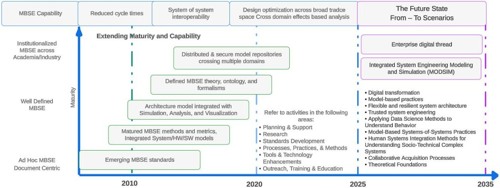

Figure 1. INCOSE MBSE roadmap and future state. Compiled by the authors [6-9].

The aforementioned key concepts are substantiated by the findings in the existing literature [6-9,12,13] in this field, and have been integrated into well-established theoretical frameworks, such as those outlined by INCOSE [6,7]. Specifically, the frameworks utilized include Object-Process Methodology (OPM) [14], which combines graphical and textual representations of system processes and objects, Systems Modeling Language (SysML) [15], which provides various diagrams to represent different system aspects, and Arcadia/Capella, which focuses on the definition and validation of system architecture. Regarding the issues faced, previous authors encountered several significant challenges, including dynamic requirements, interdisciplinary collaboration, traceability and integration, and documentation overhead [16].

<!-- PDF_PAGE: 3 -->

These issues were addressed by combining Agile approaches with MBSE techniques. Agile methodologies were chosen for their iterative development, stakeholder participation, improved collaboration, and rapid response to change [17]. These methods provide iterative and adaptable procedures that enable quick responses to changing requirements and stakeholder feedback. Agile methodologies operate on short, iterative development cycles, called sprints, allowing frequent reassessment and adjustment of the project. Regular meetings with stakeholders ensure continuous incorporation of feedback, while flexible planning and collaborative tools facilitate rapid responses to changes. Incremental delivery allows for continuous testing and validation, identifying and addressing issues early. By integrating these techniques, the study was able to overcome the challenges of traditional, documentoriented practices while also improving the effectiveness of system engineering processes. Our approach was compared to traditional Waterfall methodologies and other hybrid approaches, demonstrating greater flexibility and adaptability. Incorporating Agile approaches alongside MBSE not only facilitates iterative system development, but it also improves collaboration and traceability across interdisciplinary teams, as underlined by the INCOSE MBSE roadmap [6-8,12,13]. This integration means that all stages of the system life cycle benefit from ongoing improvement and adaptation to changing project requirements. We define the system life cycle according to the INCOSE Systems Engineering Handbook and ISO/IEC/IEEE 15288:2015 standards [18], acknowledging that this version has been withdrawn and superseded by the revision project of IEEE Standard 15288-2008 [19], encompassing stages from conceptual design, system design and development, implementation, integration and testing, deployment, and operation and maintenance to disposal. Verification and validation are integral activities conducted throughout these stages to ensure the system meets both design specifications and stakeholder requirements.

As shown in Figure 1, the transition to the future of systems engineering will predominantly rely on models, leveraging next-generation modeling, simulation, and visualization environments. Techniques in artificial intelligence and data science are expected to significantly enhance the efficiency and effectiveness of systems engineers. According to the INCOSE Vision 2035 [12,16], significant advancements are anticipated in digital transformation, flexible and resilient system architectures, and the integration of human systems. These trends encompass the shift from document-centric practices to model-centric approaches, which are deemed essential for scaling systems engineering. Digital transformation underscores the importance of digital ecosystems and collaborative virtual environments for real-time model updates and simulations. Furthermore, collaboration across different engineering disciplines will be enhanced through shared models and mutual understanding. Lastly, addressing the need for continuous education is crucial to meet the demand for technically proficient systems engineers with leadership capabilities.

Combining Agile methodologies and MBSE is consistent with industry trends in aerospace and other engineering fields, where systems' complexity and safety-critical nature require Agile and model-centric techniques for effective development and management. Early systems engineering approaches in aerospace often involved extensive documentation and manual processes. However, the adoption of MBSE in aerospace has been bolstered by the development of standards and frameworks [20,21], such as the Object Management Group's (OMG's) Systems Modeling Language (SysML) [22-24], and the Department of Defense Architecture Framework (DoDAF) [25,26]. Nowadays, aerospace companies use MBSE to design, analyze, and manage complex systems, including aircraft, spacecraft, and avionics. MBSE helps ensure that the systems meet stringent performance, reliability, and safety requirements.

Concerning Agile methodologies, these were originally developed for software development [27], emphasizing the iterative and adaptive nature of software creation and enabling teams to respond rapidly to changing requirements and feedback from stakeholders. A careful review of the current state of the research field reveals a growing body of literature exploring the application of Agile methodologies and MBSE in various engineering domains, including aerospace and satellite systems. Key publications [28-31]

<!-- PDF_PAGE: 4 -->

have shown the benefits of adopting these approaches, highlighting their effectiveness in managing complexity, mitigating risks, and improving project outcomes. This shift towards agility in engineering processes is promising for streamlining workflows, optimizing resource allocation, and improving overall project outcomes, particularly within the dynamic context of small satellite development [1].

In this paper, we explore how an integrated approach to Agile Systems Engineering and Project Management can address the unique challenges faced by small satellite engineering teams, and in particular for the " $ ^{3} $ ColStar mission. Through a detailed examination of the " $ ^{3} $ ColStar mission, developed collaboratively by the Colombian Aerospace Force (COLAF), Colombian universities, and other international institutions, our study demonstrates the application of Agile methodologies and MBSE in the optimization of the development process. For instance, small satellite missions operate in dynamic contexts where it is crucial to adhere to "frozen specifications". This ensures stability and consistency despite the quickly changing requirements due to technical breakthroughs and evolving user needs. Agile techniques enable adaptations to these changes through iterative development cycles and constant stakeholder interaction [32]. Additionally, small satellite projects are often limited in terms of funding, personnel resources, and timescale. Iterative planning, frequent deliverables, and prioritization are examples of Agile approaches that help to improve resource allocation and maximize efficiency in managing limited resources [33,34]. Furthermore, the complexity to integrate multiple subsystems in small satellites while maintaining compatibility, functionality, and reliability presents considerable technical obstacles. Agile Systems Engineering stresses incremental integration and continuous testing, therefore decreasing the risks involved with subsystem integration [35]. Moreover, many small satellite projects require geographically scattered teams from several locations, countries, and time zones. For this, Agile techniques encourage good communication, collaboration technologies, and remote work practices to guarantee smooth coordination and alignment among distributed teams [36,37].

The literature supports the efficacy of Agile Systems Engineering (SE) and Project Management (PM) in tackling these issues. Agile approaches improve flexibility, responsiveness, and adaptation in engineering projects, particularly in the aerospace and satellite sectors [5,38,39]. Teams can reduce risks, expedite development timeframes, and improve overall project outcomes by implementing Agile principles tailored to the unique needs of tiny satellite missions. For instance, Honoré-Livermore [5] reported that using Agile methods reduced the time between mission concept definition and launch, and in our case, Agile methods were useful to reduce the mission design time.

The use of these methodologies facilitates accelerated time-to-market time frames, reduces costs, and fosters innovation within the small satellite industry, paving the way for future advancements in CubeSat technology. The benefits of integrating Agile methodologies with MBSE are substantiated by both empirical evidence and theoretical insights from the existing literature. Smith et al. (2019) [40] documented a 25% reduction in development time for a small satellite project utilizing Agile practices compared to traditional methods. Similarly, another study [41] reported a 30% cost reduction in aerospace projects that implemented Agile and MBSE approaches. Furthermore, Garcia et al. (2020) [42] found that Agile methodologies significantly enhanced the rate of innovative solutions among project teams. These findings align with the theoretical foundations of Agile and MBSE, which emphasize iterative development cycles, continuous stakeholder engagement, and adaptive planning. These practices collectively contribute to the observed improvements in development speed, cost efficiency, and innovative capacity.

The requirements for the $ ^{3} $ColStar satellite mission changed dynamically throughout its development, reflecting its iterative and flexible nature and the need for an iterative approach such as the Arcadia methodology. This strategy enabled our team to respond quickly to evolving technological, operational, and stakeholder requirements. For example, the initial technical specifications were modified through subsystem tests and simulations, resulting in changes to payload configurations and communication protocols. The

<!-- PDF_PAGE: 5 -->

adaptability provided by the Arcadia technique was critical in successfully accepting these adjustments. By encouraging regular contact and collaboration among geographically distributed team members, Arcadia facilitated streamlined workflows and faster decisionmaking. This allowed us to maintain technical accuracy while reducing errors throughout mission development. In comparison, without an Agile methodology like Arcadia [11], the iterative nature of requirement changes and their implications for design, integration, and validation phases would have been significantly more difficult to manage within the recommended project planning durations outlined by the European Cooperation for Space Standardization (ECSS) [43], NASA [44], and JAXA [45] standards. The capacity to respond swiftly to changing needs highlights the value of Agile techniques in optimizing resource allocation and enhancing overall project outcomes in small satellite missions.

This article is organized as follows: Section 2 provides a description of the $ ^{3} $ColStar KiboCUBE Colombia mission and the Concept of Operations. Section 3 contains the concepts of MBSE, Arcadia Method, and Capella software (version 6.1). Section 4 explains the $ ^{3} $ColStar KiboCUBE Systems Engineering Structure by applying the Agile methodology with Arcadia Method and Capella modeling tool. Finally, Sections 5 and 6 summarize the discussion and conclusions.

This proposal has been pre-selected as a finalist for the $ 8^{th} $ KiboCUBE round [46].

## 2. The $ ^{3} $ColStar Satellite Mission

The $ ^{3} $ColStar KiboCUBE Colombia" CubeSat (1U) mission emerged from the ambitious initiative to design a satellite manufactured up to 70% in Colombia. The $ ^{3} $ColStar mission aims to produce reliable solar weather data through its primary payload and demonstrate the functionality of an IoT payload in space. This mission stands out for its unique dual focus on solar weather monitoring and IoT integration on a small satellite platform. In contrast, existing missions in the literature often prioritize either scientific data collection or technical demonstration, rarely addressing both simultaneously. For instance, missions focused on scientific data collection include those described by Smith and Roberts (2018) [47], which emphasize methodologies and technologies for effective data gathering. On the other hand, missions centered on technical demonstration are detailed by Johnson and Martinez (2019) [48], who discuss the evaluation of new technologies. There are fewer examples of missions that integrate both scientific and technical goals. Brown and Lee (2020) [49] explore such missions, demonstrating the challenges and advantages of addressing both objectives within a single mission framework.

The dual-purpose approach of $ ^{3} $ColStar offers distinct advantages by leveraging satellite resources for a diverse range of scientific and technological objectives. One of the primary scientific objectives is the study and analysis of space weather phenomena. Space weather refers to the environmental conditions in space as influenced by the sun and the solar wind. These phenomena, including solar flares and cosmic rays, can have significant effects on satellite operations, GPS systems, and even terrestrial power grids. In Colombia, studying space weather is particularly crucial due to the country's geographical location near the equator. This region is more susceptible to ionospheric phenomena such as the Appleton Anomaly or Equatorial Anomaly, which can significantly affect communication and navigation systems [50-52]. The Equatorial Anomaly, characterized by high electron density in the ionosfera approximately 15 degrees north and south of the magnetic equator, can cause ionospheric scintillation, potentially disrupting radio and GPS signals. While Colombia is not directly in the center of the South Atlantic Anomaly (SAA), the southern part of the country may experience some effects of this phenomenon, as it is located on the northern periphery of the SAA's area of influence. The SAA is a region where the Earth's magnetic field is weaker, primarily centered over Brazil and the South Atlantic Ocean. By advancing our understanding of space weather, the $ ^{3} $ColStar mission aims to improve the resilience and reliability of these critical systems in Colombia and similar regions [53]. Furthermore, the $ ^{3} $ColStar mission includes a secondary IoT payload aimed at providing internet access to remote areas where connectivity is scarce.

<!-- PDF_PAGE: 6 -->

This objective is critical for enhancing internet usage across the majority of regions in Colombia, promoting digital inclusion, and supporting the socio-economic development of underserved communities. Additionally, the mission seeks to develop and integrate locally manufactured space components and subsystems, such as the structure, EPS (Electrical Power System), OBC (On-Board Computer), ADCS (Attitude Determination and Control System), and electronics. These advancements not only contribute to scientific knowledge but also foster technological innovation and collaboration among Colombian academia, industry, and government.

This pioneering endeavor was made possible through the KiboCUBE call, organized jointly by the Japan Aerospace Exploration Agency (JAXA) and the United Nations Office for Outer Space Affairs (UNOOSA) [46]. This initiative provided an unvaluable opportunity to develop a CubeSat and deploy it from the Japanese module "Kibo" onboard the International Space Station (ISS), thereby contributing to the sustainability and advancement of future space activities.

Based on the KiboCUBE opportunity, the constraints for the mission are [46]:

- The satellite must be fully tested for the launch procedure according to the JAXA JEM Payload Accommodation Handbook [54].

- Deployment from the Kibo module in the ISS determines the mission orbit (semimajor axis, eccentricity, inclination, and argument of perigee). For the $ ^{3} $ColStar, the ground segment has been developed around multiple locations to fulfill the payload's objectives and the orbit based on the ISS orbital elements. The ground segment is designed for academic purposes, allowing universities with these capabilities to participate actively by utilizing the ground stations. This method facilitates regular satellite connectivity for uploading communication codes, downloading data from the primary weather sensor payload, and managing the secondary IoT payload. The main monitoring and communication station will be centrally located in Bogotá to oversee these operations effectively.

To ensure that the communications between the spacecraft and the different ground stations were correctly estimated, an orbital simulation of the mission profile was executed by using an astrodynamics propagator (NASA GMAT) [55]; to calculate the number of contacts, duration, range, and mission lifetime (re-entry) for the space debris simulation, we used the DRAMA (Debris Risk Assessment and Mitigation Analysis) ESA software (version 3.1.0) [56].

To validate the mission, multiple orbital simulations were conducted based on possible future launch dates. These simulations were designed to compare the computational performance of $ ^{3} $ ColStar with previous CubeSat missions and to evaluate its behavior under various space conditions. In the case of the $ ^{3} $ ColStar CubeSat, using a simulated launch date, the duration until reaching the same End of Life (EoL) altitude was estimated to be 238 days, based on numerical integration errors from the propagator steps and computational models of atmospheric drag (initial satellite altitude (ISS) (km): 416.016; final satellite altitude (EoL) (km): 161.298). This estimation of perturbations is the result of a static MSISE90 model implemented in the simulation, the ideal spherical model for solar radiation pressure, and the J2 mathematical gravity perturbation (see Figure 2). These simulations not only validate the computational models against realistic scenarios but also ensure robust mission planning and execution.

Since the mission operations will be located in Colombia (Colombian Air Force SpOC), and due to its proximity to the Equator (0 $ ^{\circ} $ latitude), the number of contacts will be significantly reduced during mission operation. Based on our simulations for the expected lifetime of the $ ^{3} $ ColStar mission (see Figure 2), the summary of the ground stations' contacts are as follows: the number of contacts with the satellite is 572; the average contact time with the satellite is 284.745 [s].

- The size of the CubeSat must not exceed the 1U standard (Figure 3a,b).

- Hazardous materials must not be used on the satellite, since it will be deployed from a space crewed research facility such as the ISS.

<!-- PDF_PAGE: 7 -->

- The expected profile of stakeholders is composed of government organizations, research institutes, universities, and other public organizations.

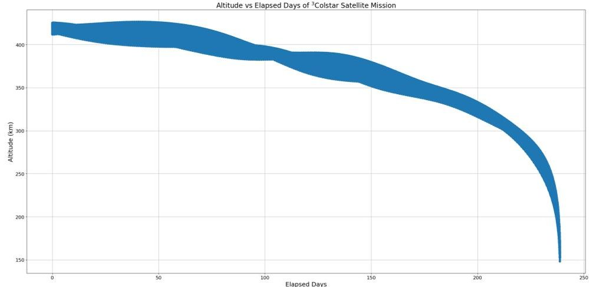

Figure 2. EoL $ ^{3} $ColStar simulations [57].

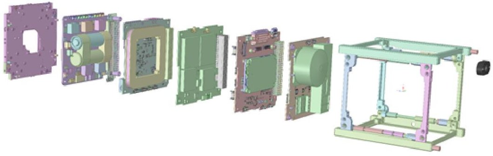

(a) Horizontal view.

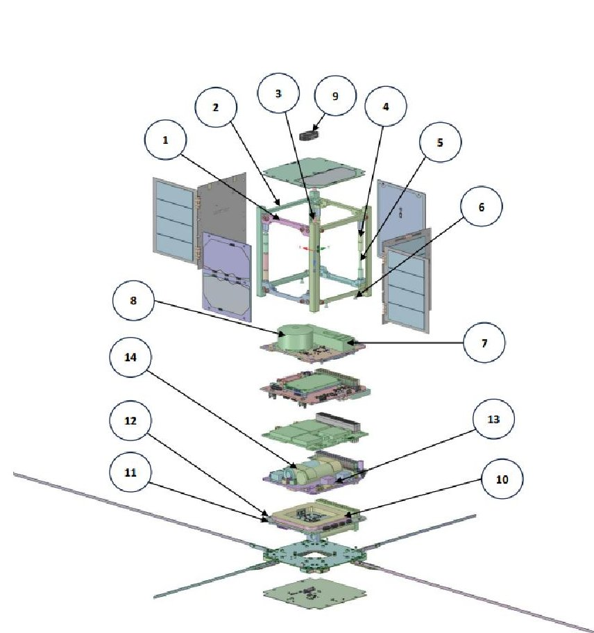

(b) Vertical view.

<table border="1"><tr><td>Item</td><td>Subsystem</td><td>Breakdown</td></tr><tr><td>1</td><td>Structure</td><td>Ribs</td></tr><tr><td>2</td><td>Structure</td><td>Side Frames</td></tr><tr><td>3</td><td>Structure</td><td>Kill Switch</td></tr><tr><td>4</td><td>Structure</td><td>Threaded rod</td></tr><tr><td>5</td><td>Structure</td><td>Spacers</td></tr><tr><td>6</td><td>Structure</td><td>Screw-Washers-Nudts</td></tr><tr><td>7</td><td>Payload</td><td>MINIPIX TPX3</td></tr><tr><td>8</td><td>Payload</td><td>Reaction Wheel</td></tr><tr><td>9</td><td>Payload</td><td>Analog sun sensor</td></tr><tr><td>10</td><td>Payload</td><td>GPS Receiver</td></tr><tr><td>11</td><td>OBC</td><td>Mainboard</td></tr><tr><td>12</td><td>OBC</td><td>Daughter Board</td></tr><tr><td>13</td><td>EPS</td><td>MainBoard</td></tr><tr><td>14</td><td>EPS</td><td>Battery Pack</td></tr><tr><td>15</td><td>EPS</td><td>Deployable Solar Panel+X</td></tr><tr><td>16</td><td>EPS</td><td>Deployable Solar Panel-X</td></tr><tr><td>17</td><td>EPS</td><td>Fixed Solar Panel+Y</td></tr><tr><td>18</td><td>EPS</td><td>Fixed Solar Panel-Y</td></tr><tr><td>19</td><td>EPS</td><td>Fixed Solar Panel+Z</td></tr><tr><td>20</td><td>EPS</td><td>Fixed Solar Panel-Z</td></tr><tr><td>21</td><td>ADCS</td><td>MainBoard</td></tr><tr><td>22</td><td>ADCS</td><td>Magnetorquers</td></tr><tr><td>23</td><td>COMM</td><td>Transceiver-IOT</td></tr><tr><td>24</td><td>COMM</td><td>Antenna System</td></tr></table>

Figure 3. Visualization of each satellite component [57].

<!-- PDF_PAGE: 8 -->

Equipped with two payloads, this CubeSat aims to advance both scientific understanding and technological capabilities. The primary payload is the MiniPIX TPX3 SPACE sensor device [58], a compact radiation camera engineered specifically for space missions. This device is designed to fit within the CubeSat's 1U platform, offering advanced particle tracking capabilities with minimal power consumption and mass. Its main role is to monitor particles generated by solar storms, which is crucial for evaluating potential impacts on essential infrastructure such as power grids, communication networks, and satellites [58].

The MiniPIX TPX3 SPACE, provided by ADVACAM, excels in high-resolution particle characterization and real-time data analysis. These capabilities are central to meeting the mission's scientific objectives. Specifically, the device enables detailed observations of particle behavior and dynamics during space weather events, which is vital for understanding the interactions between solar particles and the Earth's magnetic environment. By delivering precise and timely data, the MiniPIX TPX3 SPACE not only ensures that the mission's objectives are achieved but also enhances the mission's effectiveness in addressing critical scientific questions and practical challenges associated with space weather [57]. In this context, "fulfilling the objectives" refers to achieving the specific goals of data collection and analysis, while "enhancing an objective" means improving the quality and impact of these efforts, thereby elevating the overall success and utility of the mission.

Additionally, the CubeSat will incorporate a secondary payload comprising an IoT device designed for data transmission to a mobile ground station. This facilitates analysis and risk control. Furthermore, the satellite features an in-house developed Fine Sun Sensor, and a proof-of-concept for the research and development of a reaction wheel and magnetorquers [57].

These in-house developments are the evidence of the proof of the collaboration between academia, industry and government. As the structure, IoT and magnetorquers stem from engineering models developed by SpaceTech AESS Uniandes and its start-up NovaOrigin and COCSA-SPACE acceleration scheme.

## 2.1. Concept of Operations (ConOps)

The $ ^{3} $ColStar mission encompasses several key elements essential for its success, outlined here to provide a comprehensive understanding [57] (Figure 4):

1. Users and Technology Transfer: This aspect involves various participating institutions facilitating technology transfer. Additionally, end-users will benefit from data generated by the space weather sensor and IoT information, particularly in remote areas for precision agriculture.

2. Primary and Secondary Payloads: The efficient operation entails the scheduled utilization of the space weather sensor as the primary payload, and the IoT module with store and forward process as the secondary payload.

3. Satellite Platform: The mission includes a 1U satellite with all necessary systems (Structure and Mechanical, Power System, Communication, Command and Data Handling (C&DH), ADCS, Thermal Control, and Onboard Computer and Software).

4. Ground Station: The communication infrastructure is established through a network of ground stations to facilitate efficient and continuous communication with the satellite.

5. Orbital Parameters: The satellite is expected to be launched from Kibo port of ISS to perform a LEO. Table 1 shows the environment orbit parameters.

6. Mission Operations: The mission is structured into four distinct stages to ensure systematic execution (Figure 4):

<!-- PDF_PAGE: 9 -->

Table 1. Environment orbit parameters.

<table border="1"><tr><td>Perigee height</td><td>400-460km</td></tr><tr><td>Eccentricity(e)</td><td>0.0008103</td></tr><tr><td>Inclination(i)</td><td>51.63°</td></tr><tr><td>RAAN</td><td>174.97°</td></tr><tr><td>Orbital period</td><td>91-94min</td></tr></table>

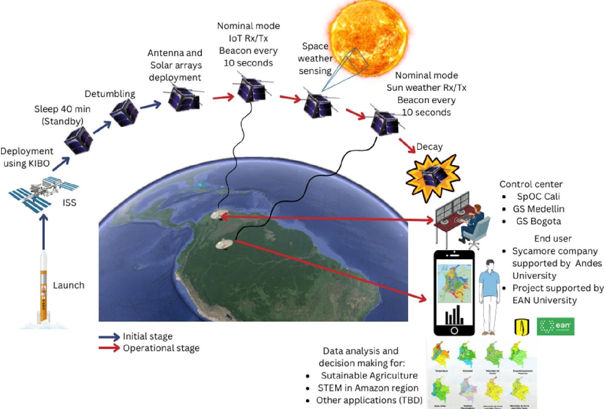

Figure 4. KiboCUBE Team Colombia $ ^{3} $ColStar mission concept [57].

Furthermore, the mission is structured into four distinct stages to ensure a systematic execution (Figure 5):

1. Launch (Figure 5a) and Early Orbit Phase (LEOP) Operations (Figure 5b): Includes initial satellite operations post-launch, establishing contact with ground stations, and conducting Early Operation Tests. The ground stations of the participating universities and the COLAF located in different parts of Colombian territory are planned to be used for this mission. The first one is located at the Colombian Air Force Space Operations Center (Spoc) in the city of Cali. Additionally, the other points of contact between the satellite and the ground will be the ground stations of the universities participating in the project, which are located in the city of Bogotá (Universidad Distrital, Universidad Sergio Arboleda), Universidad de Antioquia (Medellin), and in the city of Sogamoso (Universidad Pedagógica y Tecnológica de Colombia).

2. Initial Operations (IOP) (Figure 5c): Starts after satellite stabilization, focusing on the initial operations of payloads.

<!-- PDF_PAGE: 10 -->

3. Full Operations (FOP) (Figure 5d): The satellite enters in its nominal operational phase, executing payload activities and data download.

4. Decommissioning (DECO) (Figure 5e): The satellite is safely passivated and manages the end of its useful life through systematic shutdown procedures.

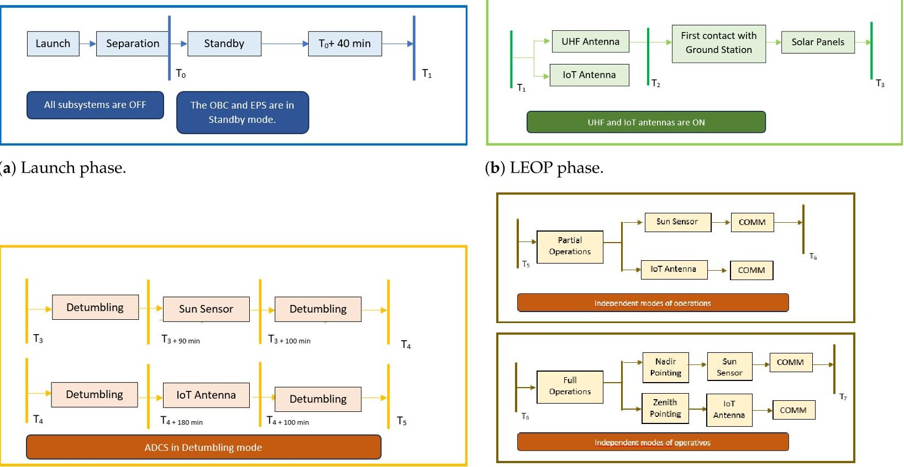

(c) IOP phase for sun sensor and IoT antenna.

(d) FOP phase.

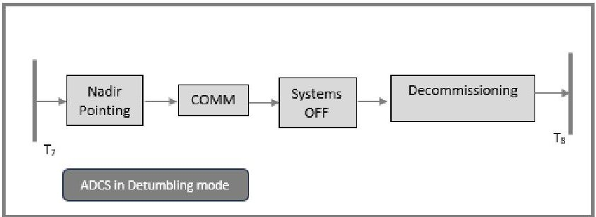

(e) DECO phase.

Figure 5. Launch (a), LEOP (b), IOP (c), FOP (d), and DECO (e) phases.

Each stage is further defined by specific operational modes tailored to various scenarios. For each stage established, some modes of operation have been established, which are mentioned below:

- Standby (Sb): Period before the satellite is turned on. All subsystems are inactive.

- Released (R): After the standby period, the satellite is turned on, with the EPS and OBC as the only active subsystems.

- Pre-detumbling (PD): UHF antennas are deployed, the EPS, OBC, COMMS and ADCS (only determination for telemetry) are active. The COMMS subsystem starts transmitting beacon.

- Detumbling (D): Same as the pre-detumbling state, with the magnetorquers operating.

- Detumbled (Dd): Once the satellite is detumbled, the ADCS is keeping the desired attitude. The COMMS subsystem is transmitting beacon.

- Basic (Ba): The satellite transmits telemetry exclusively.

- Nominal (N): Satellite is fully operational. The COMMS subsystem is transmitting scientific data in the following scenarios:

<!-- PDF_PAGE: 11 -->

- Nominal IoT Dowlink (Nid): IoT application data download.

- Nominal IoT Uplink (Niu): Receiving data from the IoT ground sensors.

- Nominal Space Weather (Ns): Nominal operation of the Space Weather payload (ON).

- Nominal Space Weather Dowlink (Nsd): Space Weather payload data download.

- Sun Safe (SS): If the battery levels become critically low (below 1.5 V, see Table A4), the satellite enters this mode. From the power budget point of view, this mode is identical to the Dd mode.

- Ground Mode (GM): Mode designed for ground testing, but also accessible in orbit. No limitation in terms of function execution, designed for contingency scenarios. It gives to the operator a total control of the spacecraft.

- Survival (Sv): After an unexpected anomaly, the satellite enters in this mode. The payloads are disabled, the ADCS kepts the desired attitude, and COMMS transmits scientific data.

- Satellite Off (OFF): Satellite is turned off during its operation due to unexpected events. EPS, OBC and COMMS are ON. The satellite will receive TCs from ground.

- Decommissioning (DC): The satellite is deactivated and safely manage the end of its useful life. Typical activities in Decommissioning mode include:

- Systems Decommissioning: The satellite's operating systems, such as scientific instruments, transmitters, and other electronic components, are shut down in an orderly fashion [59].

- Battery Passivation: Batteries are discharged to minimize the risk of explosions or malfunctions that could generate more space debris.

- Final Transmission and Power Shutdown: A final transmission is sent and then the satellite power is permanently shut down, disconnecting the solar panels from the EPS.

## 2.2. $ ^{3} $ColStar Main Requirements

The $ ^{3} $ColStar mission success criteria were developed to delineate both the highlevel needs and the specific requirements necessary for mission success. In this context, needs refer to the overarching objectives the mission aims to achieve, such as advancing scientific knowledge, promoting technological innovation, and generating societal benefits. Conversely, requirements are the precise, measurable conditions derived from these needs that guide the design, development, operation, and evaluation of the satellite system.

For example, one high-level need is to enhance Colombia's capabilities in space technology. To address this need, the corresponding requirements include the development and integration of locally manufactured space components and subsystems. These components encompass the satellite's structure, Electrical Power System (EPS), On-Board Computer (OBC), Attitude Determination and Control System (ADCS), and associated electronics. Each requirement specifies detailed performance criteria to ensure that these components fulfill their intended functions effectively.

Another critical need is to foster collaboration among academia, industry, and government entities. The associated requirements entail formalizing partnerships with 13 institutions and implementing structured mechanisms for communication and coordination. These mechanisms include regular meetings, the establishment of shared documentation protocols, and the synchronization of project timelines. Such requirements are designed to ensure that collaborative efforts are systematically managed and contribute to the mission's overall success. Additionally, the need to deliver educational and social benefits is translated into requirements such as the installation of IoT connection points in remote areas and the integration of mission results into educational programs. These requirements ensure that the mission's outcomes are leveraged for community and educational advancements, aligning with the mission's broader objectives. By clearly defining these needs and translating them into specific, quantifiable requirements, the $ ^{3} $ ColStar mission ensures that each aspect of the project is aligned with its strategic goals. This approach facilitates a

<!-- PDF_PAGE: 12 -->

systematic and rigorous process for designing, developing, and evaluating the satellite system, as detailed in Table A1 (Appendix A).

## 2.3. Preliminary Design

The preliminary design process for each subsystem of the satellite platform adhered to a systematic approach that aligned closely with mission requirements. This approach ensured that each subsystem was designed to meet specific functional and performance criteria outlined in the mission objectives. Although actual manufacturing of the subsystems has not yet started, comprehensive design activities were undertaken to lay a solid foundation for future development and integration. This involved an integrated, yet individually focused, subsystem design strategy that fostered effective collaboration among the subsystems. Weekly meetings with all subsystem teams facilitated the resolution of cross-functional issues and ensured cohesive problem-solving across all components.

Regarding the comparison with concurrent methodologies, our approach for the preliminary design was selected for its emphasis on sequential development, which was deemed suitable for ensuring thorough validation and alignment with mission specifications. This decision was guided by several considerations:

1. Validation and Verification: The sequential approach allowed for a detailed analysis and validation of each subsystem's functionality before progressing to the next phase. This was crucial for ensuring that each subsystem met its requirements and integrated smoothly with others, thus reducing the risks associated with subsystem interactions and performance.

2. Risk Management: By focusing on sequential development, risks could be managed more effectively. Each subsystem's design and performance were thoroughly validated before advancing to integration, minimizing the potential for issues during later stages of development. The sequential approach provided a controlled environment for identifying and addressing potential problems early in the design phase.

3. Documentation and Configuration Management: The sequential approach facilitated rigorous documentation and configuration management. Detailed development information for each subsystem was meticulously recorded and updated in a common online repository, ensuring that all stakeholders had access to the most current data. This practice helped mitigate risks related to discrepancies and promoted efficient integration once subsystem manufacturing and assembly commenced.

To effectively manage and monitor these design activities, MBSE methodologies were employed. The MBSE approach utilized SysML and Arcadia/Capella frameworks, which provided structured methods for modeling system requirements, architecture, and interactions. By integrating these models into a cohesive system architecture, MBSE enabled early identification of design issues and ensured alignment with mission requirements. Iterative design processes supported by MBSE facilitated simulations and validations, helping to refine subsystem designs and manage risks before physical implementation. Additionally, MBSE tools enhanced documentation and configuration management, ensuring consistent, traceable, and up-to-date information across all design phases.

While concurrent methodologies offer advantages such as parallel development and accelerated integration, the sequential approach was deemed more suitable for the preliminary design phase due to its focus on validation and risk mitigation. The integration of MBSE further strengthened this approach, providing a robust framework for systematic design and development. Future projects may benefit from exploring concurrent methodologies to enhance development efficiency, but the current approach provided a solid foundation for ensuring mission success.

This section centers on individual subsystem designs aimed at elucidating specific characteristics of each subsystem envisioned for this mission. Next, in Section 3, we will provide a detailed account of our approach using the Capella tool and Arcadia method. Specifically, we will illustrate the systematic progression from requirements to functional, logical, and physical architectures. This will encompass a step-by-step explanation of how

<!-- PDF_PAGE: 13 -->

each architectural level was developed, ensuring traceability and alignment with mission objectives throughout the design process.

## 2.3.1. Electric Power Systems-Power Budget

The power budget computes the power and energy demand; energy generation; storage; distribution, monitoring and control. Based on the technical information provided by the manufacturers, Tables 2-4, and Tables A2-A4 show the minimum, nominal and maximum power consumption of each satellite subsystem for each mode.

Table 2. Power consumption for standby and operative modes (W).

<table border="1"><tr><td></td><td colspan="5">Power by Operating Mode(W)</td><td colspan="3">Power(W)</td></tr><tr><td>Subsystem</td><td>Standby</td><td>Recharge</td><td>Reception</td><td>Transmission</td><td>P_Solar Wheater</td><td>Min_Standby</td><td>Typ.</td><td>Max.</td></tr><tr><td>OBC[60]</td><td>0.2</td><td>0.2</td><td>0.2</td><td>0.2</td><td>0.2</td><td>0.20</td><td>0.20</td><td>0.20</td></tr><tr><td>EPS[61]:converters,MCU,batteries,heater</td><td>0.26</td><td>0.26</td><td>0.26</td><td>0.26</td><td>0.26</td><td>0.26</td><td>0.26</td><td>3.26</td></tr><tr><td>Deployable Antenna System[62]</td><td>0.04</td><td>0.04</td><td>0.04</td><td>0.04</td><td>0.04</td><td>0.00</td><td>0.04</td><td>2.00</td></tr><tr><td>ADCS Board and sensors[63]</td><td>0.3</td><td>0.3</td><td>0.3</td><td>0.3</td><td>0.3</td><td>0.00</td><td>8.50</td><td>8.84</td></tr><tr><td>ADCS magnetorques[63]</td><td>0</td><td>0.55</td><td>0.55</td><td>0.55</td><td>0.55</td><td>0.30</td><td>0.30</td><td>0.30</td></tr><tr><td>COMMS_Payload IoT SW[64]</td><td>1.4</td><td>1.4</td><td>2.12</td><td>5.35</td><td>1.4</td><td>0.00</td><td>0.55</td><td>0.55</td></tr><tr><td>Payload Weather solar[58]</td><td>0</td><td>0</td><td>0</td><td>0</td><td>2.5</td><td>0.20</td><td>2.12</td><td>5.35</td></tr><tr><td>Payload Electronic WS[58]</td><td>0.2</td><td>0.2</td><td>0.2</td><td>0.2</td><td>0.2</td><td>0.00</td><td>1.50</td><td>2.50</td></tr><tr><td>Payload Single reaction wheel[65]</td><td>0.045</td><td>0.045</td><td>0.045</td><td>0.045</td><td>0.045</td><td>0.20</td><td>0.20</td><td>0.20</td></tr><tr><td>Payload fine sun sensor[66]</td><td>0.0025</td><td>0.01</td><td>0.01</td><td>0.01</td><td>0.01</td><td>0.05</td><td>0.15</td><td>3.25</td></tr><tr><td>GPS[67]</td><td>0</td><td>0</td><td>0</td><td>0</td><td>0</td><td>0.00</td><td>0.01</td><td>0.01</td></tr><tr><td>TOTAL</td><td>24.475</td><td>3.005</td><td>3.725</td><td>6.955</td><td>5.505</td><td>0.17</td><td>0.17</td><td>0.19</td></tr><tr><td>Energy per orbit Wh(IoT OFF/ON_12min)</td><td>2.70</td><td>3.57</td><td></td><td></td><td>3.79</td><td></td><td></td><td></td></tr><tr><td>Energy per orbit Wh30min solar</td><td>4.59</td><td>5.46</td><td>3.71</td><td>4.36</td><td>6.71</td><td></td><td></td><td></td></tr></table>

Note: Standby: Receive only. Not oriented. Recharge: Receive only and oriented with magnetorquers. Reception and Transmission: In reception, 12 min (7+5), oriented with magnetorques and reaction wheels. TTC or IoT. Solar: solar particle sensing 30 min. Deployment: power-up, panel deployment and stabilization.

Table 3. Pmax (W) with Deplotable solar panels.

<table border="1"><tr><td>Configuration</td><td>Mode</td><td>Energy Per Orbit[Wh]</td><td>Pmax(W)</td><td>Efficiency(Wh)90%</td></tr><tr><td rowspan="2">Using Depoyable Panels</td><td>Sun Pointing</td><td>6.47</td><td>6.84</td><td>5.82</td></tr><tr><td>Nadir Pointing</td><td>2.72</td><td>3.54</td><td>2.45</td></tr><tr><td rowspan="2">No Deployable Panels</td><td>Sun Pointing</td><td>2.11</td><td>2.23</td><td>1.90</td></tr><tr><td>Nadir Pointing</td><td>2.32</td><td>3.11</td><td>2.09</td></tr></table>

Note: Battery capacity: 1300 mAh, 7.4 V.

<!-- PDF_PAGE: 14 -->

Now, we take into account the satellite operation modes, an orbital period of T = 92.47 min an eclipse time of Te = 35.9 min, and a sun time of Ts = 56.5 min. The results of maximum power demanded in each mode and the corresponding energy are presented in Table 4:

Table 4. Results of maximum power demand by subsystem and modes per time.

<table border="1"><tr><td>Mode</td><td>Power(W)</td><td>Energy(Wh)</td></tr><tr><td>Standby(Sb)</td><td>0</td><td>0</td></tr><tr><td>Released(R)</td><td>9.00</td><td>1.58</td></tr><tr><td>Pre-detumbling(PD)</td><td>6.11</td><td>3.04</td></tr><tr><td>Detumbling(D)</td><td>6.66</td><td>4.17</td></tr><tr><td>Detumbled(Dd)</td><td>6.66</td><td>4.17</td></tr><tr><td>Basic(Ba)</td><td>7.19</td><td>4.53</td></tr><tr><td>NominalIoTDL(Nid)</td><td>7.19</td><td>4.08</td></tr><tr><td>NominalIoTUL(Niu)</td><td>3.43</td><td>2.77</td></tr><tr><td>NominalSW(Ns)</td><td>4.54</td><td>5.09</td></tr><tr><td>NominalSWDL(Nsd)</td><td>7.19</td><td>4.08</td></tr><tr><td>SunSafe(SS)</td><td>1.51</td><td>3.14</td></tr><tr><td>GroundMode(GM)</td><td>7.02</td><td>3.25</td></tr><tr><td>Survival(Sv)</td><td>6.82</td><td>4.21</td></tr><tr><td>SatelliteOff(OFF)</td><td>1.87</td><td>3.48</td></tr><tr><td>Decommissioning(D)</td><td>9.52</td><td>9.60</td></tr></table>

Reviewing the technical information of the different subsystems, each one of them is powered with the typical regulated voltages of 5 V and 3.3 V. For the case of currents, these do not exceed 4 A in any of the buses and the respective protections must be available (see Table A2).

## 2.3.2. Thermal Subsystem

The thermal design of a satellite is crucial for ensuring the health and longevity of a spacecraft in Earth's orbit. The objectives of the Thermal Subsystem are to analyze the thermal space environment specific to the CubeSat's orbit, identify potential thermal challenges, and establish survivability and operational temperature limits for every component of the CubeSat [68]. This approach ensures that the CubeSat can withstand the extreme temperature fluctuations experienced in space and maintain optimal operating conditions for its components. In order to conduct a preliminary analysis of the thermal subsystem, a thermal model was developed using the lumped parameter method. For the computation of the radiative heat loads, this model employed an in-house MATLAB algorithm that calculates the solar radiation $ \dot{Q}_{s,i} $ , terrestrial infrared radiation $ \dot{Q}_{e,i} $ , and albedo radiation $ \dot{Q}_{a,i} $ . The method includes a set of in-house-developed MATLAB scripts that allow for the numerical integration of the following equations [69,70]:

$$
\dot {Q} _ {s, i} = \alpha_ {i} \left(\hat {\mathbf {n}} _ {i} \cdot \hat {\mathbf {r}} _ {\oplus \rightarrow \odot}\right) I _ {\odot} A _ {i}
$$

$$
\dot {Q} _ {e, i} = \int_ {\mathcal {S} _ {e}} \varepsilon_ {i} \sigma T _ {e} ^ {4} A _ {i} \frac {\left(\hat {\mathbf {r}} _ {\oplus \rightarrow d S} \cdot \hat {\mathbf {r}} _ {d S \rightarrow s a t}\right)\left(- \hat {\mathbf {r}} _ {d S \rightarrow s a t} \cdot \hat {\mathbf {n}} _ {i}\right)}{\pi \| \mathbf {r} _ {d S \rightarrow s a t} \| ^ {2}} d S
$$

$$
\dot {Q} _ {a, i} = \int \int_ {\mathcal {S} _ {a}} \alpha_ {i} \gamma_ {\oplus} \frac {\left(\hat {\mathbf {r}} _ {\oplus \rightarrow d S} \cdot \hat {\mathbf {r}} _ {d S \rightarrow s a t}\right)\left(\hat {\mathbf {r}} _ {d S \rightarrow s a t} \cdot \hat {\mathbf {n}} _ {i}\right)}{\pi \| \mathbf {r} _ {d S \rightarrow s a t} \| ^ {2}} d \dot {Q} _ {\oplus} d A _ {i}
$$

where

$$
d \dot {Q} _ {\oplus} = I _ {\odot} \left(\hat {\mathbf {r}} _ {\oplus \rightarrow d S} \cdot \hat {\mathbf {r}} _ {\oplus \rightarrow \odot}\right) d S
$$

<!-- PDF_PAGE: 15 -->

where $ \alpha_{i} $ and $ \varepsilon_{i} $ are the effective absorptivity and emmisivity of the i-th surface, $ A_{i} $ $ (m^{2}) $ is the area of the i-th surface, $ \gamma_{\oplus} $ is the albedo factor, $ I_{\odot} $ $ (W/m^{2}) $ is the solar constant, $ T_{e} $ (K) is the mean Earth temperature, and $ d\dot{Q}\oplus(W) $ is the power of solar radiation incident on a differential surface element of the Earth dS. $ \mathbf{r}_{\oplus\rightarrow sat} $ describes the position of the satellite in space, $ \hat{\mathbf{n}}_{i} $ is a normal unit vector to the i-th surface of the satellite, $ \mathbf{r}_{\oplus\rightarrow dS} $ represents the position vector of a differential surface element of the Earth, and $ \hat{\mathbf{r}}_{\oplus\rightarrow \odot} $ describes the solar vector. The components of $ \mathbf{r}_{dS\rightarrow sat} $ can be calculated as $ \mathbf{r}_{dS\rightarrow sat}=\mathbf{r}_{\oplus\rightarrow sat}-\mathbf{r}_{\oplus\rightarrow dS}. $

The script includes several routines to calculate the sun's position and transform the satellite's position and orientation from the body coordinate system to a geocentric reference frame. Based on these data, the integration of the power received by each surface is performed.

Regarding the temperature determination, the lumped parameter approach considers the entire satellite as a lumped, isothermal system (represented by a single node) with an effective mass and heat capacity. The equations can be found in Appendix C (Equations (A1) and (A2)).

To estimate the effective specific heat parameter, a breakdown of each of the satellite's subcomponents was performed, determining their individual mass and heat capacity as is presented in Table 5:

Table 5. Thermal breakdown for effective heat capacity determination.

<table border="1"><tr><td>Subsystem</td><td>Breakdown</td><td>Material</td><td>Maximum Mass</td><td>Mass Fraction</td><td>Heat Capacity[J/kgK]</td></tr><tr><td>Structure</td><td>Ribs</td><td>Al 6061</td><td>24.31</td><td>1.84%</td><td>961.2</td></tr><tr><td>Structure</td><td>Side Frames</td><td>Al 6061</td><td>57.38</td><td>4.34%</td><td>961.2</td></tr><tr><td>Structure</td><td>Kill Switch</td><td>Al 6061</td><td>3.10</td><td>0.23%</td><td>961.2</td></tr><tr><td>Structure</td><td>Threaded rod</td><td>Al 6061</td><td>6.06</td><td>0.46%</td><td>961.2</td></tr><tr><td>Structure</td><td>Spacers</td><td>Al 6061</td><td>10.60</td><td>0.80%</td><td>961.2</td></tr><tr><td>Structure</td><td>Screw-Washers-Nuts</td><td>Al 6061</td><td>16.00</td><td>1.21%</td><td>961.2</td></tr><tr><td>Payload</td><td>MINIPIX TPX3</td><td>PCB</td><td>45.10</td><td>3.41%</td><td>1544.0</td></tr><tr><td>Payload</td><td>Control moment gyroscope(CMG)</td><td>Steel</td><td>136.50</td><td>10.32%</td><td>500.0</td></tr><tr><td>Payload</td><td>Nano-SSOC-A60 analog sun sensor</td><td>PCB</td><td>4.07</td><td>0.31%</td><td>1544.0</td></tr><tr><td>Payload</td><td>Space weather</td><td>PCB</td><td>3.30</td><td>0.25%</td><td>1544.0</td></tr><tr><td>OBC</td><td>Mainboard</td><td>PCB</td><td>103.40</td><td>7.82%</td><td>1544.0</td></tr><tr><td>OBC</td><td>Daughter Board</td><td>PCB</td><td>6.60</td><td>0.50%</td><td>1544.0</td></tr><tr><td>EPS</td><td>MainBoard</td><td>PCB</td><td>18.00</td><td>1.36%</td><td>1544.0</td></tr><tr><td>EPS</td><td>Battery Pack</td><td>Li-Po</td><td>184.00</td><td>13.91%</td><td>1350.0</td></tr><tr><td>EPS</td><td>PCB+X</td><td>PCB</td><td>77.00</td><td>5.82%</td><td>1544.0</td></tr><tr><td>EPS</td><td>PCB-X</td><td>PCB</td><td>77.00</td><td>5.82%</td><td>1544.0</td></tr><tr><td>EPS</td><td>PCB+Y</td><td>PCB</td><td>55.00</td><td>4.16%</td><td>1544.0</td></tr><tr><td>EPS</td><td>PCB-Y</td><td>PCB</td><td>55.00</td><td>4.16%</td><td>1544.0</td></tr><tr><td>EPS</td><td>PCB+Z</td><td>PCB</td><td>55.00</td><td>4.16%</td><td>1544.0</td></tr><tr><td>EPS</td><td>PCB-Z</td><td>PCB</td><td>38.50</td><td>2.91%</td><td>1544.0</td></tr><tr><td>ADCS</td><td>MainBoard</td><td>PCB</td><td>24.00</td><td>1.81%</td><td>1544.0</td></tr><tr><td>ADCS</td><td>Magnetorquers</td><td>PCB</td><td>130.00</td><td>9.83%</td><td>1544.0</td></tr><tr><td>COMM</td><td>Tranceiver-IOT</td><td>PCB</td><td>85.60</td><td>6.47%</td><td>1544.0</td></tr><tr><td>COMM</td><td>Antenna System</td><td>PCB</td><td>107.00</td><td>8.09%</td><td>1544.0</td></tr><tr><td>Total</td><td></td><td></td><td>1322.53</td><td>100%</td><td></td></tr></table>

To evaluate the satellite's thermal performance under extreme conditions, this analysis considers both the worst hot case (WHC) and worst cold case (WCC). The WHC represents the scenario with maximum solar irradiance and minimum heat dissipation, while the WCC considers minimum solar irradiance and maximum heat dissipation. These cases provide a comprehensive understanding of the satellite's thermal behavior under the most challenging environmental conditions. Table 6 presents the parameters considered for each case, including the solar constant, albedo factor, and Earth's effective temperature.

<!-- PDF_PAGE: 16 -->

Table 6. Selected parameters for the WHC and WCC cases [68].

<table border="1"><tr><td>Parameter</td><td>WHC</td><td>WCC</td></tr><tr><td>Solar Constant(W/m2)</td><td>1412.5</td><td>1321.7</td></tr><tr><td>Albedo Factor(°)</td><td>0.39</td><td>0.3</td></tr><tr><td>Earth&#x27;s Effective Temperature(K)</td><td>300</td><td>250</td></tr></table>

Table 7 presents the thermal requirements for each subsystem of the satellite. This allows us to ensure that each component operates within its specified temperature.

Table 7. Thermal requirements of satellite subsystems.

<table border="1"><tr><td>Payload</td><td>Tmin(℃)</td><td>Tmax(℃)</td></tr><tr><td>OBC</td><td>-20</td><td>70</td></tr><tr><td>EPS</td><td>-40</td><td>80</td></tr><tr><td>ADCS</td><td>-40</td><td>80</td></tr><tr><td>COMM</td><td>-20</td><td>60</td></tr></table>

The thermal analysis results, shown in the accompanying graph, demonstrate the satellite's temperature behavior under both the WHC and WCC scenarios (Figure 6). As indicated in the graph, the satellite's temperature remains within the acceptable operating limits for all components, never exceeding the established thresholds outlined in Table 7.

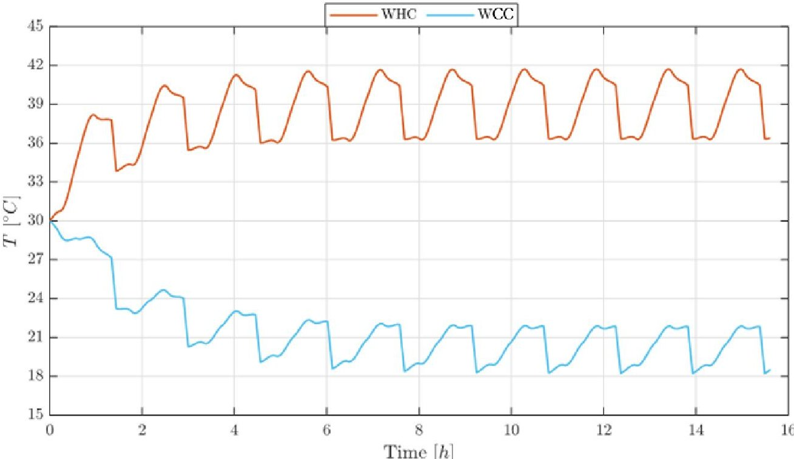

Figure 6. Temperature profiles for WHC and WCC.

These results show that the proposed thermal design effectively addresses the extreme thermal conditions encountered in orbit. However, it is important to emphasize that this analysis is preliminary and further detailed design analysis is crucial to refine the thermal control system and ensure long-term reliable performance.

## 2.3.3. On-Board Computer

An early version of the OBC from Pumpkin's [71] MISC satellite project [72] is used in the building of the satellite. Executing onboard operations and overseeing communication systems are the OBC's primary responsibilities. The Control and Data Handling (C&DH) subsystem is responsible for managing internal procedures and intersystem communications within the satellite.

<!-- PDF_PAGE: 17 -->

Furthermore, most autonomous software maintains satellite components' operational characteristics, which are critical in executing commands from ground control and processing data for transmission to Earth. OBC development will incorporate cybersecurity measures proposed by NIST [73-75], and CCSDS [76], leveraging insights from the FACSAT-2 mission [77]. FACSAT-2's key conclusions include a complete review of each component across six operational modes. The addressed issues, such as power constraints, allow for the optimal deployment of resources for high-consumption tasks like X-band communication while optimizing energy utilization during non-sun-tracking modes, especially in penumbral environments [78-81].

To protect command and telemetry lines, these precautions include implementing encryption methods and authorization/authentication systems. For this purpose, CCSDS 350.1-G, CCSDS 350.7-G, CCSDS 350.9-G, and CCSDS 3552.0-B [82] are essential reference resources. For this mission, the OBC will consist of the MotherBoard (MB) and the Pluggable Processor Module (PPM), as shown in Figure 7.

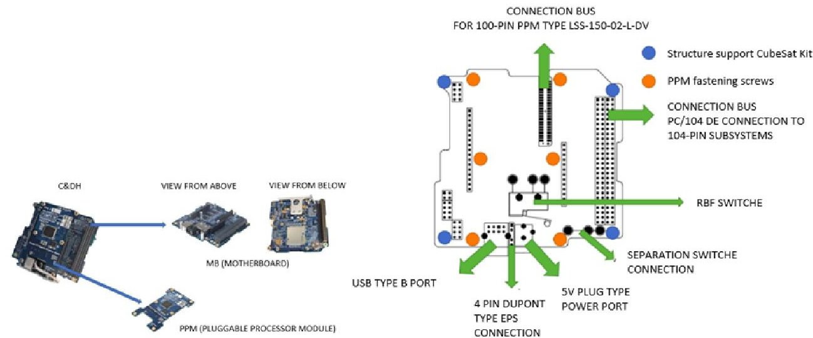

(a) Architecture.

(b) Types of connections in MB.

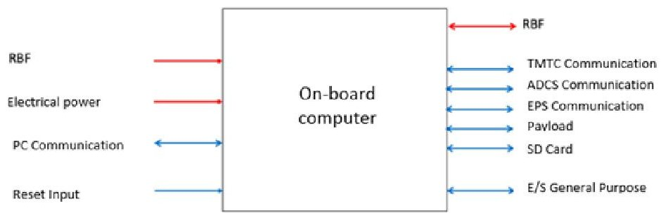

(c) OBC subsystem zero-level block diagram.

Figure 7. $ ^{3} $ColStar OBC architecture.

The OBC's ability to withstand single-particle inversions and other radiation-induced flaws is crucial. It uses error detection and correction (EDAC) techniques like memory scrubbing and parity checks, as well as hardware solutions like Triple Modular Redundancy (TMR) and watchdog timers [83]. Backup systems or components provide redundancy, while radiation-hardened parts lessen the likelihood of errors. These safeguards are complemented by software mitigation strategies such as checkpointing and rollback, as well as voting algorithms. Real-time error correction algorithms and hardware are used, and automatic system reconfiguration switches to backup systems or alternate modes when problems are discovered. These solutions ensure that the OBC can successfully regulate and reduce the effects of single-particle inversions, allowing satellites to operate reliably in the hostile space environment [84].

<!-- PDF_PAGE: 18 -->

## 2.3.4. Attitude Determination and Control System

The ADCS module is in charge of the attitude and orientation control for the CubeSat, hence meeting a variety of operational requirements. These consist of spinning control to reduce orbital disturbances, pointing control for efficient communication with the IoT payload, and detumbling control to manage high rotational speeds after deployment. The performance of the ADCS is not heavily taxed by the space weather sensor, but the IoT payload requires accurate pointing control in order to communicate. The main goal of environment survival is energy production, which calls for deployable solar panels that need pointing control. However, because of the CubeSat's small size, there are few issues with gravity gradient torque or solar pressure. Figure 8a shows the centralized architecture, where OBC is in charge of ADCS execution. Figure 8b presents the distributed architecture, where a spacialized controller will be in charge of the ADCS execution, both MCU or FPGA technologic choises will be considered.

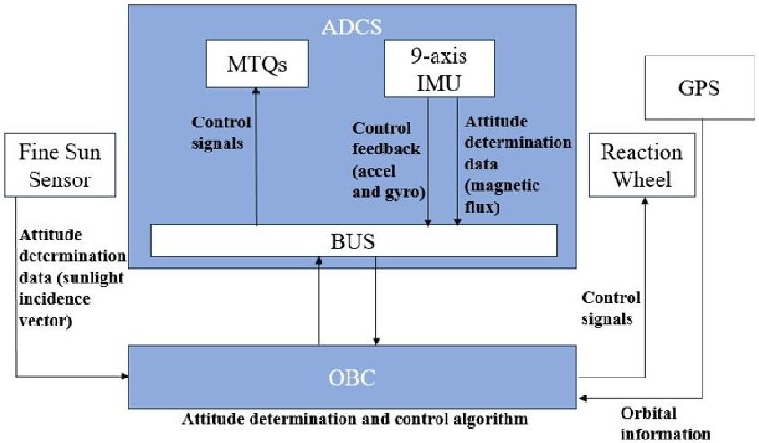

(a) ADCS centralized architecture

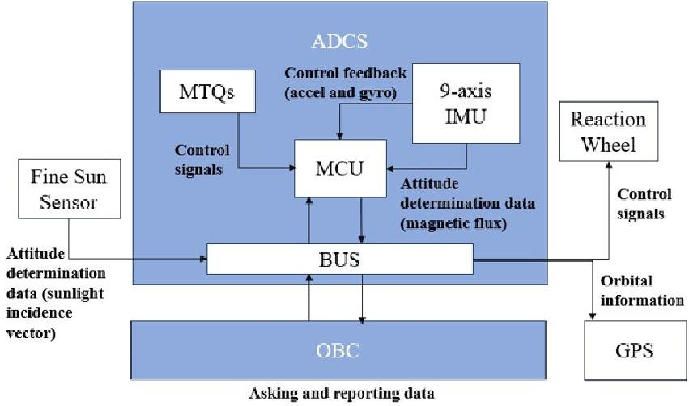

(b) ADCS distributed architecture

Figure 8. $ ^{3} $ColStar ADCS interfaces.

The attitude determination will be carried out by the TRIAD algorithm [85] and attitude control by the control law developed by the group SpaceTech of Universidad de los Andes AESS IEEE. The magnetorquers to be used will be those developed by the SpaceTech AESS IEEE group (TRL = 4) of the Universidad de los Andes and the general development of the ADCS will be supported by the previous developments made by the same group [85].

An engineering model of the ADCS is currently being constructed using an FPGA controller under the platform HiLeS Designer 2.0, a propietary and widely-used platform to develop embedded systems, offering advanced features for real-time control and data processing. This platform facilitates the design and implementation of complex control algorithms on FPGA hardware, providing a flexible and efficient solution for aerospace applications such as satellite ADCS [85-87].

## 2.3.5. Communication Subsystem

To transmit data effectively, the system must take into account the speed of the orbit, the distance and a limited power budget, and the location of the electrical components in the CubeSat is difficult due to its small size, which represents a challenge in the design of the communications system. Satellite communication requires an Automatic Identification System (AIS), this communication system is designed to have three subsystems: AIS, data communication and Telemetry, Tracking and Control (TT&C) [88].

The Cubesat communication system is composed of one dipole antenna compact and efficient with necessary radiation pattern, gain, and reconfigurable polarization. The transceiver is capable of VHF and UHF operation; it receives the Telecommand and IoT

<!-- PDF_PAGE: 19 -->

data and transmits the payload and Iot data to the ground station. The architecture of the communications system is shown in Figure 9.

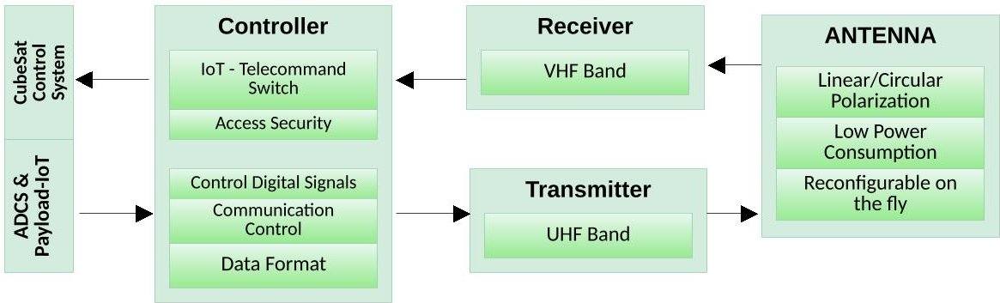

(a) CubeSat communication system.

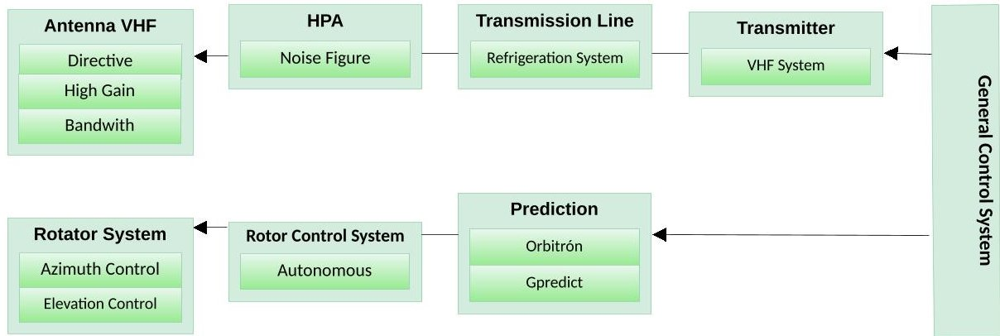

(b) GS transmission system.

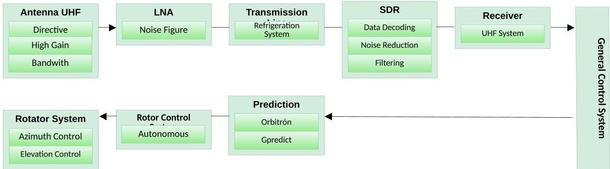

(c) GS reception system.

## Figure 9. Schematic for $ ^{3} $ColStar communication system.

Satellites operating in LEO orbit have the advantage of affordable launch costs, as well as less stringent communication link power limitations due to the shorter distance for the communication link [88]. However, LEO satellite ground station antennas must track and follow the satellite as it passes the ground station. The Doppler effect present in a satellite communication link is very harmful for applications based on Frequency Shift Keying. Satellite tracking through specialized software allows to maintain the best transmission and reception characteristics when connecting to the satellite [89,90]. This tracking is performed in the Ground Station through the use of the following elements:

- SDR: The software-defined radio allows one to process the message signal improving favorable characteristics for a correct demodulation.

<!-- PDF_PAGE: 20 -->

- The general control system: Manages message reception and antenna positioning; often this task is performed by software such as orbitron.

- Prediction: From the georeferencing of the ground station, it predicts the time and direction of possible links with the satellite.

- Rotator System: Allows one to orient the antennas towards the satellite to ensure the highest power gain in the link.

The communication system for ground station transmission and reception operation is shown in Figure 10.

For the link budget, the VHF uplink and UHF downlink could be used as the communication network for CubeSat in TT&C applications [89,91,92]. The main characteristics evaluated on the Spacecraft-Ground Station link are shown in Figure 10.

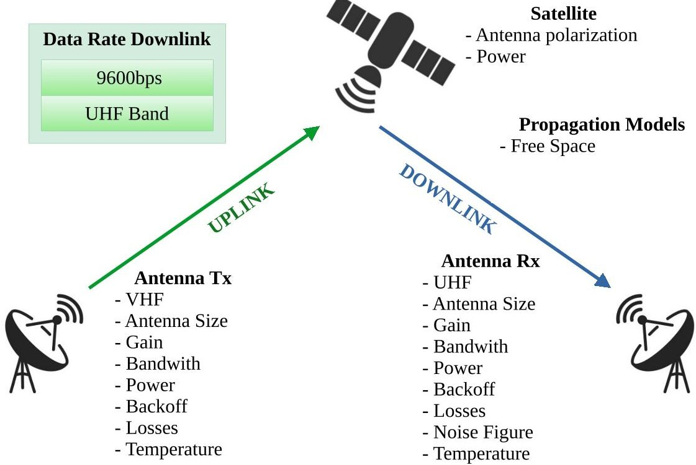

Figure 10. Uplink and downlink characteristics.

IoT nodes will be designed for ground segment purposes. The self-development is compatible with the commercial transceiver for the operation of this project, which is portable and has the ability to achieve the uplink with the satellite. The design parameters are listed below:

- Portable with self-sustaining power supply.

- Operation by reception of satellite alert signals.

- Unique identification code for each node and intercom system with satellite for logging tasks and access for IoT data upload.

The Collect Mission Data Activity is shown in Figure 11.

Accessing the satellite requires the implementation of an identification system, which also allows distinguishing between Telecommand or IoT data upload [93] using the uplink, according to the process shown in Figure 11 [94], where TFPH is the Transfer Frame Primary Header, SH is the Segment Header and FECF the Frame Error Control Field [95]. The RAC (Remote Control Access Code) and IAC (IoT Access Code) allow the OBC to switch between these two uplink tasks. For the satellite construction the Astrodev Hellium from Pumpkin's radio is available; it operates on commercial and amateur radio links, and these have low power consumption and low mass budget and the adaptability to change the data rate and frequencies in flight mode. Its main technical characteristics are shown in Figure 12:

<!-- PDF_PAGE: 21 -->

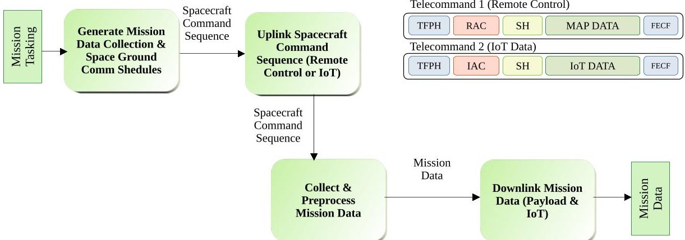

Figure 11. Schematic for $ ^{3} $ColStar communication.

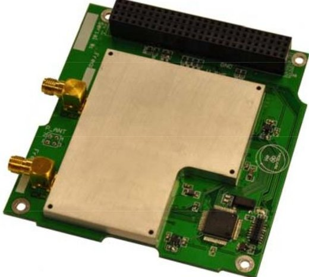

<table border="1"><tr><td rowspan="2">Frequencies:</td><td>TX:120-150MHz或400-450MHz</td></tr><tr><td>RX:400-450MHz或120-150MHz</td></tr><tr><td>Receive sensitivity:</td><td>-104.7dBm@BER10-3</td></tr><tr><td>Output transmit power:</td><td>100mW-7W</td></tr><tr><td rowspan="2">Power usage:</td><td>Receive:＜200mW</td></tr><tr><td>Transmit:＜16W</td></tr><tr><td>Maximum data rate:</td><td>115.2kbps</td></tr></table>

Figure 12. Astrodev hellium features.

## 2.3.6. Payload

The CubeSat's primary objective is to perform solar observations, specifically focusing on the measurement of solar wind particles. Solar wind is a stream of charged particles, primarily electrons and protons, flowing from the sun into the solar system. By measuring the composition, density, and energy spectrum of these solar wind particles, the mission aims to:

- Enhance our understanding of the sun's activity and its impact on space weather.

- Collect valuable data for space weather forecasting, which is critical for safeguarding space assets and satellite operations.

- Improve our ability to predict and mitigate space weather-related disruptions to communication, navigation, and satellite systems.

The instrument is composed by the optical system, a surface detector "ADVACAM", and by the main electronics that are currently an on-going project developed by Universidad Industrial de Santander (ASIC, memory, secondary computer, main computer). Finally, the payload is connected to the OBC in a bidirectional communication link that leads receive commands from the instruction set and sends data sets from the power link to the EPS subsystem (Figure 13).

<!-- PDF_PAGE: 22 -->

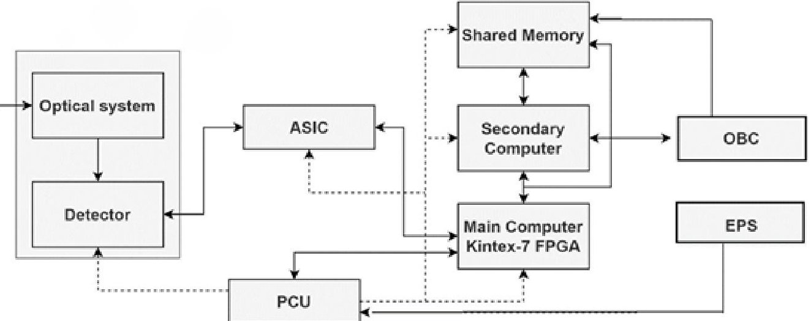

Figure 13. Instrument architecture [57].

The ADVACAM detector [58] will be used for monitoring cosmic weather. This technology provides timely warnings against increased solar activity, which can pose risks to the health of astronauts and disrupt the functionality of sensitive onboard electronics in satellites and spacecraft. The MiniPIX TPX3 SPACE particle [58] counting camera builds upon technology originally developed for basic particle physics research at the Large Hadron Collider (LHC) at CERN. This lightweight device, weighing just a few tens of grams, can distinguish the type of each individual particle, as well as its energy and direction.

## 3. Model-Based System Engineering for Preliminary Design

Several methods have been proposed for the design of CubeSats. Probably the most well known are systems engineering and Model-Based System Engineering (MBSE). Before detailing our specific methodology, this section presents a brief overview of existing methods that have served as inspiration for the $ ^{3} $ColStar KiboCUBE Agile methodology Implementation, such as the V-Model and Digital Engineering. Subsequently, we delve into the Arcadia Method and Capella modeling tool, emphasizing their role in our approach.

For the last mentioned part, we will delineate the systems engineering design processes utilized for the mission. This includes elements discussed in previous chapters, such as a thorough definition of stakeholder needs and technical requirements (Section 2), which are crucial for guiding the satellite's development. The logical decomposition of the system will be clearly articulated, elucidating how the satellite's subsystems were identified and structured to align with mission objectives. Furthermore, we will present the design solutions adopted for each subsystem, demonstrating how they were derived from the requirements and integrated into the overall satellite architecture. These aspects will be explored within the framework of Capella and Arcadia methodologies, ensuring a systematic and comprehensive examination of the satellite's preliminary design phase.

## 3.1. Brief Overview of Existing MBSE Methods and Techniques

## 3.1.1. Systems Engineering

Systems Engineering is a multi-disciplinary approach for developing functional and operable systems capable of meeting requirements and design constraints [96]. A "system" is a well defined combination of elements such as hardware, software, and humanware, that working together are expected to produce the capabilities required by a need. Given the multi-disciplinary nature of space asset planning, design, implementation and operation, systems engineering is a holistic and integrative discipline aimed at balancing different professional efforts to produce a coherent system [96]. To this, systems engineering includes three categories of processes that are organized in seven phases. The aforementioned categories of processes are systems design, product realization, and technical management; the seven systems engineering phases go from the concept studies to system closeout.

<!-- PDF_PAGE: 23 -->

In the particular case of design, the systems engineering design processes include the stakeholders expectations and technical requirements definitions, as well as a logical decomposition of the system and a design solution definition. Concerning the project phases suggested by the systems engineering discipline, the design processes are a responsibility of the first four phases: Pre-phase A (concept studies), Phase A (concept and technology development), Phase B (preliminary design and technology completion); the design-related phases are described in Table 8. In case the reader is interested in more details about the systems engineering processes and phases, we refer the interested reader to the NASA Systems Engineering Handbook [96].

Table 8. Design-related phases of the NASA Systems Engineering Project Life Cycle [96].

<table border="1"><tr><td>Phase</td><td>Purpose</td><td>Typical Outcome</td></tr><tr><td>Pre-Phase A. Concept Studies</td><td>To produce a broad spectrum of ideas and alternatives for missions from which new programs/projects can be selected. Determine feasibility of desired system, develop mission concepts, draft system-level requirements, assess performance, cost, and schedule feasibility; identify potential technology needs, and scope.</td><td>Feasible system concepts in the form of simulations, analysis, study reports, models, and mock-ups</td></tr><tr><td>Phase A. Concept and Technology Development</td><td>To determine the feasibility and desirability of a suggested new system and establish an initial baseline compatibility with NASA&#x27;s strategic plans. Develop final mission concept, system-level requirements, needed system technology developments, and program/project technical management plans.</td><td>System concept definition in the form of simulations, analysis, engineering models and mock-ups, and trade study definition</td></tr><tr><td>Phase B. Preliminary Design and Technology Completion</td><td>To define the project in enough detail to establish an initial baseline capable of meeting mission needs. Develop system structure end product (and enabling product) requirements and generate a preliminary design for each system structure end product.</td><td>End products in the form of mock-ups, trade study results, specification and interface documents, and prototypes</td></tr></table>

## 3.1.2. The V-Model

The systems engineering "V" model, a.k.a., the V-model, has been widely used in the aerospace and defense industries [97]. It is called V-model because the activities are presented by using a "V" letter metaphor. The left part of the "V" is for the specification activities that go from high level specifications and designs to more detailed and granular ones; there are the implementation tasks (represented by the foundation of the "V" letter base); and finally there are the testing activities represented by the right part of the "V" letter that go from more granular tests (e.g., unit level tests) to high level ones (e.g., acceptance tests).

The V-model is a systems development process that emphasizes an upfront specification and design stage, similar to the NASA systems engineering process. It is often associated with the validation-and-verification approach, as it structures the development process in a way that allows for continuous validation and verification at each stage [97-99]. However, this association is sometimes debated in the literature, and care should be taken to distinguish between the general V-model and specific implementations that emphasize validation and verification activities.

The V-Model inherently supports vertical and horizontal traceability, which are crucial to ensure alignment and consistency throughout the development process. Vertical traceability ensures that each phase, from initial requirements to detailed design and testing, is aligned with the mission objectives, providing a clear lineage of requirements. Horizontal traceability ensures consistency across various components and subsystems at each development stage, maintaining coherence in design and implementation. In our application to the $ ^{3} $ ColStar mission, vertical traceability was achieved by maintaining comprehensive documentation that mapped each specification and design decision back to the initial mission requirements. This was further supported by regular reviews and validation steps in each phase, ensuring that the design remained aligned with the mission objectives. Horizontal

<!-- PDF_PAGE: 24 -->

traceability was facilitated through integrated subsystem design strategies and weekly cross-functional meetings, which ensured that interdependencies between subsystems were consistently addressed and managed.

While the V-Model provides a structured and systematic approach, it has limitations, particularly in handling dynamic requirements, which prompted the integration of Agile methodologies. We did consider the Spiral Model, which offers a more flexible and iterative approach, combining elements of iterative development and the waterfall model. The Spiral Model allows for continuous refinement through multiple iterations or "spirals," each including planning, risk analysis, engineering, and evaluation. This model is adaptable to changing requirements and stakeholder feedback. However, we found that integrating Agile methodologies directly addressed our specific project needs more effectively. While the Spiral Model provides a structured approach with iterative phases for risk management, Agile methodologies proved more effective for our project needs due to their continuous risk assessment and management throughout iterative sprints. The incremental delivery and regular feedback integration of Agile methods facilitated prompt identification and mitigation of risks, allowing for adaptive responses to emerging issues. Agile's flexible planning and iterative adjustments offered a more responsive and efficient risk management mechanism compared to the longer review cycles of the Spiral Model. The iterative nature of Agile methods, combined with their emphasis on stakeholder involvement and flexibility, provided a robust framework for managing the dynamic and complex requirements of the $ ^{3} $ ColStar mission. While the Spiral Model also offers benefits, Agile methodologies provided a more straightforward and efficient path to achieving our project goals. This hybrid approach allowed us to leverage the strengths of both methodologies, providing thorough validation and alignment with mission specifications, while also managing risks and accommodating changes efficiently.

## 3.1.3. Digital Engineering

Digital engineering is a cross-disciplinary field that takes advantage of digital tools and processes for the design, development, and production of engineering products across a project's life cycle [2]. The main purpose of digital engineering is to improve the efficiency and accuracy of the engineering process, along with reduced project risk. Digital engineering is conceived under the perspective that systems engineering needs to evolve based on current situations, such as the following: (i) systems becoming increasingly complicated and interconnected; (ii) resource reduction in projects; (iii) project complexity is increasing; (iv) some current practices are not sustainable. Therefore, digital engineering aims to effectively manage complexity, reduce cost and scheduling, and improve productivity via the integration of processes, digital tools, and techniques within the systems development life cycle [2].

## 3.1.4. Model-Based Systems Engineering

MBSE is an approach that uses digital models of the system and its engineering aspects as the main way to share and manage information, feedback, and requirements instead of relying on documents. It covers the whole process of creating, communicating, and ensuring that all the digital models that describe a system are consistent from the conceptual design phase through the later phases of the life cycle, such as the requirements definition, design, analysis, and verification and validation activities [100]. MBSE is based on modeling languages and methods such as the SysML [101], which is used in tools like Cameo Systems modeler [102], MagicDraw [103] or the Arcadia method [11], used in Capella [104]. MBSE allows to represent and communicate the structural, functional and dynamic aspects of a complex system and aims to improve the efficiency, quality and traceability of the systems engineering process, as well as to facilitate collaboration between the different actors involved [105].

<!-- PDF_PAGE: 25 -->

## 3.2. Arcadia Method and Capella Modelling Tool

Arcadia enables a thorough modeling of complex systems in the architecture engineering context, across multiple levels of abstraction. It is founded on a hierarchical framework that first defines the problem space at the top level, and later defines proposed solutions that traverse the system's various elements. It is bolstered by a viewpoint-centric approach that underscores the need to integrate the many views that are vital to the system's design. It is further reinforced by its support for a thorough trade-off analysis that allows decisions at all levels of architectural design [11,104,106].

Arcadia is a tooled method devoted to systems and architecture engineering, supported by the Capella modeling tool. This method is presented in Figure 14; Arcadia is built around the following statements [107]:

- Understand the real customer needs.

- Define and share the product architecture among all engineering stakeholders.

- Validate the design early and justify it.

- Ease and mastery of Integration, Validation, Verification, and Qualification (IVVQ).

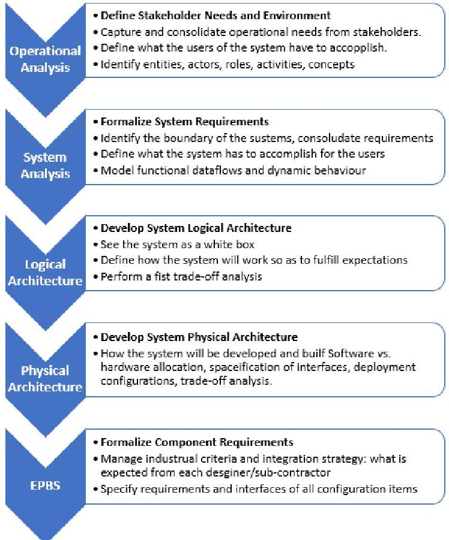

Figure 14. Arcadia method for system architecture development [107].

Arcadia can be applied to complex systems, equipment, software, or hardware architecture definition, especially those dealing with strong constraints to be reconciled (e.g., cost, performance, safety, security, reuse, consumption, weight). It is intended to be used by most stakeholders in system/product/software or hardware definition and IVVQ as their common engineering reference and collaboration support [107].

The Capella modeling tool is used to define the entities involved in a project, its hierarchy, and capabilities from the Operational Level and, through several systems engineering decision-making criteria, to realize the different analyses until the physical description of the satellite matches how it connects to the space and ground segments. The two main analyses in the mission are the logical and physical architectures, where the logical function of the system is defined and the physical definition follows, since technology can become outdated, but the functionality controls the behavior of each system and their integration.

<!-- PDF_PAGE: 26 -->

## 3.3. Integration of System Requirements within the Capella System Model

In the $ ^{3} $ColStar mission, the Arcadia/Capella methodology was employed to ensure comprehensive integration of the system needs, based on its architecture, into the model. Capella, an open-source MBSE software (version 6.1), facilitated the transition from a traditional document-based approach to a dynamic model analysis and traceability of functionalities throughout the mission.

- System needs and Integration: Requirements were established initially from mission concept, translated into Capella, and linked to various model elements, including operational scenarios, system functions, logical components, and physical designs. For example, the requirement for the solar weather payload to measure solar radiation with $ \pm 5 \% $ accuracy was captured in Capella's requirement management module. This requirement was then linked to specific system functions and logical components responsible for implementing this functionality.

- Bidirectional Traceability: Bidirectional traceability was established to ensure that each requirement could be traced forward to its corresponding design elements and backward to its source. This was achieved by creating traceability links between the requirements and their associated system functions, logical components, and verification test cases. For instance, the requirement for data transmission every 30 min was linked to the design specifications of the IoT payload, ensuring that all aspects of the requirement were addressed. This was validated with the link budget model developed by the communications team.

- Connectivity Diagrams and Matrices: Capella provided diagrams and matrices to visualize the relationship between requirements and their corresponding design elements. These representations were used to verify that all components, functions and actors were fully addressed and to monitor how changes in the architecture impacted the design. For example, traceability matrices from the system's physical level showed, from multi-physics analysis, the alignment of the solar weather payload's accuracy requirement with its corresponding design elements and test cases.

- Validation and Verification: From the system architecture based on the Capella model, the validation and verification were established by using additional tools, such as Ansys STK, NASA GMAT, Matlab and Simulink, throughout the project. From the component to system level, each part was linked to test cases and validation criteria, enabling systematic verification of compliance with mission objectives. For example, test cases related to the solar radiation measurement accuracy were linked to the specific design elements responsible for this function, ensuring that the requirements were validated through testing.

Each subsystem of the satellite was designed and integrated into the Capella model, ensuring complete traceability and alignment with mission objectives.

## 3.3.1. Subsystem Design Integration

## 1. Power Subsystem (EPS):

- Requirements:

- Continuous availability of power.

- Efficient solar power generation and distribution.

- Resistance to space environmental conditions.

- Logical and Physical Design:

- Logical Functions: power generation, storage, and distribution.

- Physical Components: solar panels, batteries, and power management units (PMUs).

- Traceability: the requirements for continuous power were linked to specific physical components, such as solar panels and batteries, ensuring direct alignment from requirement to implementation.

<!-- PDF_PAGE: 27 -->

## 2. On-Board Computer (OBC):

- Requirements:

- Data processing, command execution, and system monitoring.

- High reliability and fault tolerance.

- Logical and Physical Design:

- Logical Functions: data processing, command handling, and system health monitoring.

- Physical Components: locally manufactured OBC capable of performing the identified logical functions.

- Traceability: the requirements for data processing and command execution were linked to the physical OBC component.

## 3. Attitude Determination and Control System (ADCS):

- Requirements:

- Precise control and stabilization of orientation.

- Fine-tuning capability and automatic correction.

- Logical and Physical Design:

- Logical Functions: attitude sensing, control algorithms, and actuation.

- Physical Components: reaction wheel, fine-sun sensor, and magnetorquers.

- Traceability: the attitude control requirements were linked to the ADCS components, ensuring each logical function was reflected in the physical design.

## 4. Communication Subsystem (COMMS):

- Requirements:

- Reliable communication with ground stations.

- Capability for long-distance data transmission and reception.

- Logical and Physical Design:

- Logical Functions: signal transmission, reception, and encoding/decoding.

- Physical Components: antennas, transceivers, and modems.

- Traceability: the reliability requirements for communication were traced to specific components designed to handle data transmission and reception.

## 5. Thermal Control Subsystem:

- Requirements:

- Maintenance of operational temperatures within safe limits.

- Protection against extreme space temperatures.

- Logical and Physical Design:

- Logical Functions: heat dissipation and thermal insulation.

- Physical Components: radiators, thermal blankets, and heaters.

- Traceability: the thermal control requirements were linked to the physical components, ensuring effective thermal management.

## 6. Payload Subsystems:

- MiniPIX TPX3 SPACE Sensor:

- Requirements:

* Capability for particle detection and scientific data acquisition.

* Low power consumption and reduced weight.

- Logical and Physical Design:

* Logical Functions: particle detection, data acquisition, and analysis.

* Physical Components: MiniPIX TPX3 SPACE sensor and associated electronics.

<!-- PDF_PAGE: 28 -->

* Traceability: the scientific data collection requirements were linked to the MiniPIX sensor, ensuring alignment with mission objectives.

## IoT Payload:

- Requirements:

* Enable IoT connectivity in remote areas.

* Support for educational and social impact initiatives.

- Logical and Physical Design:

* Logical Functions: IoT data transmission, environmental monitoring, and connectivity.

* Physical Components: IoT transceivers, sensors, and supporting electronics.

* Traceability: the requirements for IoT connectivity and educational outreach were linked to the IoT payload components, ensuring they met the mission's social and educational objectives.

## 3.3.2. Traceability and Validation in Capella

## 1. Requirement Integration:

- Import and Structuring: Requirements were imported and hierarchically structured within Capella's Requirement Viewpoint, assigning them to relevant logical and physical components to ensure traceability throughout the model.

## 2. Traceability Mechanisms:

- Logical Layer Traceability: Requirements were linked to logical components and functions, ensuring adherence to specified needs.

- Physical Layer Traceability: Physical components were traced back to logical functions and requirements, maintaining continuity.

- Bidirectional Traceability: Capella facilitated bidirectional traceability, allowing backtracking from physical components to high-level requirements and forward tracking from requirements to detailed physical designs.

## 3. Documentation and Configuration Management:

- Requirement Allocation Matrix: Visual tools within Capella, such as the Requirement Allocation Matrix, illustrated relationships between requirements, logical components, and physical components.

- Traceability Diagrams: Diagrams like Requirement Coverage Diagrams visually represented requirement coverage by system elements, highlighting any gaps or overlaps.

## 3.3.3. Comprehensive Design Activities

## 1. Subsystem Design Strategy:

- Integrated Approach: An integrated yet individually focused approach ensured effective collaboration and cohesion among subsystems. Weekly meetings addressed cross-functional issues and ensured cohesive problem-solving across all components.

## 2. Sequential Development and Validation:

- Sequential Development: Sequential development was prioritized to allow detailed analysis and validation of each subsystem's functionality before advancing to the next phase. This approach effectively managed risks by validating each subsystem's design and performance before integration.

## 3. Agile Methodologies:

- Agile Methodologies: Agile methodologies were integrated to effectively handle dynamic requirements and provide iterative development, stakeholder involve-

<!-- PDF_PAGE: 29 -->

ment, and flexibility. Agile's iterative process allowed for continuous refinement and adaptation to changing requirements and stakeholder feedback.

## 3.3.4. Example of Traceability

- High-Level Requirement: Enhance Colombia's expertise in space technology.

- Logical Component: Training and Development Module

* Linked Requirement: Develop and integrate locally manufactured space components.

- Physical Component: Locally Manufactured On-Board Computer (OBC)

* Linked Logical Function: On-Board Data Processing

* Traceability Link: The OBC component is directly linked to the training and development requirement through its logical function.

Integrating system requirements into the Capella model and establishing robust traceability mechanisms ensured that every design decision aligned with the mission's objectives and that any changes in requirements or design could be managed effectively. This approach provided a transparent view of how requirements were met throughout the mission, incorporating detailed design activities for each subsystem.

## 4. Preliminary Design of the $ ^{3} $ColStar KiboCUBE mission.

## 4.1. $ ^{3} $ColStar KiboCUBE Agile Methodology Implementation

Since the Manifesto for Agile Software Development was introduced in 2001, Agile practices have transformed how software teams create products. The Manifesto outlines a series of core values and principles aimed at enhancing software development [17]. It has led to various methodologies and frameworks like Scrum, Kanban, and Lean, along with other terms and techniques [108].

Hardware and software development involve distinct developmental tasks. While Scrum, an Agile process commonly applied to software development, might not initially appear suitable for hardware development, the apparent disparities mainly revolve around the nature and order of deliverables, rather than fundamental constraints on the process itself. Some differences in the hardware development with software development are as follows [109]:

- Software is more malleable (easier to change) than hardware. The cost of change is much higher for hardware than for software.

- Specialized hardware parts may take significantly longer to procure as compared to software.

- Software products develop over time with successive releases, involving the addition of new features and the refinement of existing ones. In contrast, hardware products primarily comprise physical components that cannot be easily altered after manufacturing like software. They cannot gain new capabilities through simple modifications.

- Architectural decisions heavily influence the design of a hardware product, needing a higher upfront investment in architectural planning due to the high cost of making changes later, unlike in software products.

Although Agile adoption is relatively new for hardware, there are already some proposed frameworks, such as Modified Agile for Hardware Development (MAHD) [110], in which there is a section of upfront work called MAHD on ramp and then it moves on to sprints. Likewise, MAHD is not based on incremental development, but on iterative design and early validation. Another difference is that this framework uses a focus matrix to prioritize product attributes. There are several aerospace-based development projects in which the scrum methodology has been applied [111]. Other works include manufacturing and launching a cubesat [112-114]. As a result of works such as this one, a slightly deeper understanding has been gained as to whether Agile methodologies and practices are com-

<!-- PDF_PAGE: 30 -->

patible with space development, given the unique characteristics of hardware development and key aspects of the space sector.

As a way to shed some light on the use of Agile methods in the space systems engineering domain, we adopted Agile practices during two critical phases of the $ ^{3} $ ColStar project: the proposal structuring and preliminary design stages. The development team incorporated several general practices from Agile methodologies, including the use of weekly sprints. These weekly sprints facilitated iterative development, allowing for regular reassessment of progress, prompt identification of issues, and integration of feedback. At the end of each sprint, sprint meetings were conducted to evaluate progress, address challenges, and realign goals as necessary. Additionally, the project utilized a team-based approach with specific objectives, with sub-teams organized around different CubeSat subsystems, such as ADCS, Thermal, OBC, and Systems Engineering (SE), as illustrated in Figure 15.

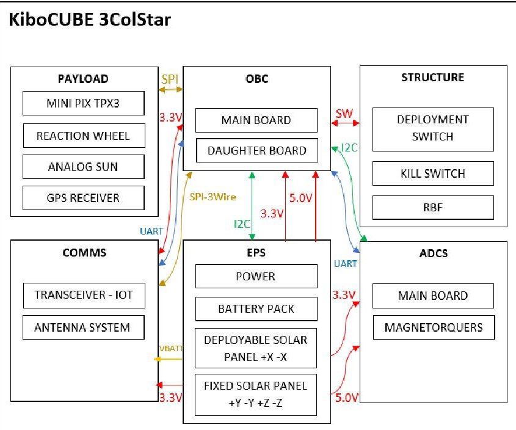

Figure 15. $ ^{3} $ColStar general structure of the subsystems.

Concerning the implementation and testing stages of the $ ^{3} $ ColStar project, the development team will adopt a Scrum-inspired methodology, tailored to suit their specific needs. This approach, depicted in Figure 16a, differs slightly from the original Scrum framework. Sprints will be conducted on a weekly basis, with each team maintaining its own product backlog. Additionally, weekly scrum meetings should be held within each team to ensure effective communication and progress tracking. The framework is displayed in Figure 16b and two parallel processes are shown. In reality, each sub-team or subsystem should operate with its own independent backlog and follow a distinct scrum process, unlike the typical software development approach where there is a single backlog for the whole team. This, and the focus on MBSE, will allow us to work in an agile way and implement changes quickly [113]. The independent operation of subsystem teams, each with its own backlog and distinct scrum process, is managed to ensure the consistency and benefits of the MBSE approach. In the $ ^{3} $ ColStar mission, this is achieved through integration and coordination practices verified through weekly meetings. These meetings address cross-functional issues, ensuring that all subsystems are aligned with the overall mission objectives and design requirements. In particular, the management team (which includes members from different universities knowledgeable of the Arcadia method and the Capella tool) is in charge of updating the designs and models based on the discussions during the weekly meetings; with this, we have a centralized way for managing the design decision changes. Therefore, the regular meetings are way for to present the progress and updated models, as well as a way to collect input for the subsystem teams.

<!-- PDF_PAGE: 31 -->

The use of the Capella tool and Arcadia method provided us with a unified model where all subsystem designs are integrated and traceable back to the mission's high-level requirements. This central model enables consistency across subsystems. Changes in one subsystem's design are reflected in the overall model, allowing for continuous verification and validation of the system's coherence. This structured approach ensures that despite the independent operation of subsystems, the MBSE benefits of consistency, traceability, and alignment with mission objectives are maintained throughout the project (the model governance is detailed in the Discussion Section 5.1).

The experiences and lessons learned in other projects [115-118], for instance, the MBSE for Ariane 6 [11], show that a hybrid approach can be successful.

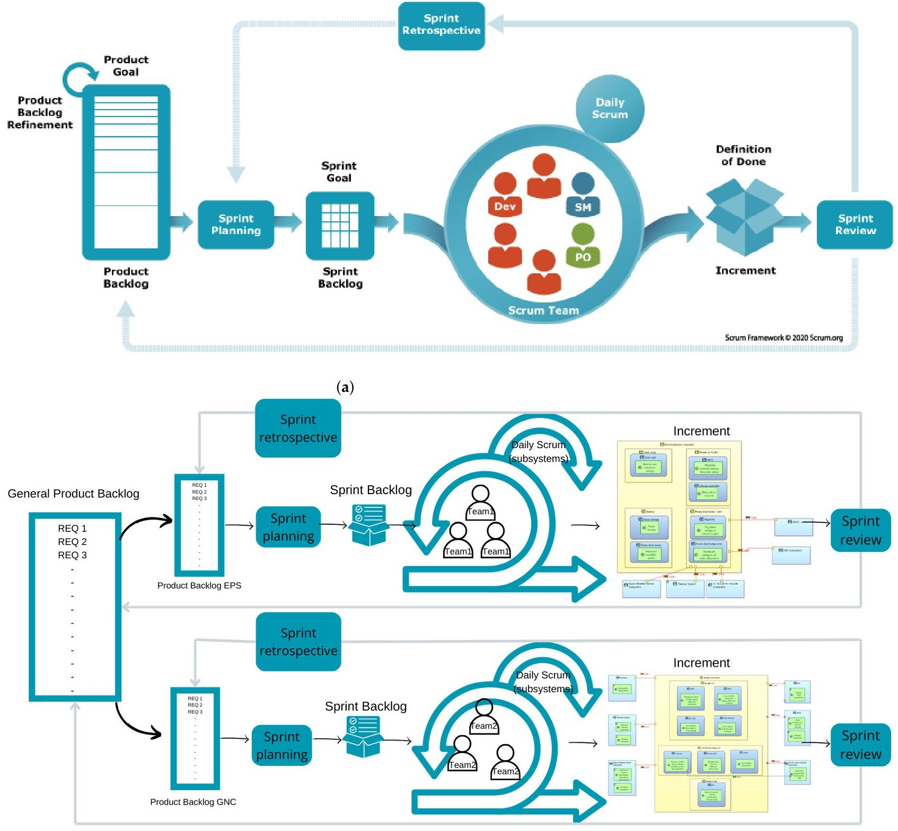

(b)

Figure 16. Scrum methodology. (a) Software development [119,120]. (b) $ ^{3} $ ColStar KiboCUBE. Note: The images located under the "Increment" text, in their legible size, correspond to Figure A5a,b.

<!-- PDF_PAGE: 32 -->

## 4.2. $ ^{3} $ColStar KiboCUBE MBSE Architecture with Capella Modeling Tool

Innovation in a space project is not only based on technology developments but also on Project Management and Systems Engineering Methodology [119-121]. The $ ^{3} $ColStar KiboCUBE project is based on the ECSS Space project management—Project planning and implementation (ECSS-M-ST-10C Rev.1) [43], NASA Procedural Requirements (NPRs) [44], and JAXA's systems engineering approach with the JEM Payload Accommodation Handbook (JPAH) [45] for more detailed integration and functionality. The MBSE is implemented by using the Arcadia tooled method focused on systems architecture development and, as mentioned before, we are utilizing the Capella open source software tool. For instance, Figure 17 shows the relationship between the Capella architecture and MBSE.

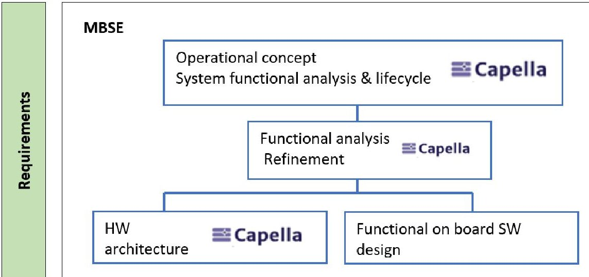

Figure 17. MBSE Tool Ecosystem [106].

In the case of $ ^{3} $ColStar KiboCUBE, Figure 18 represents the main entities for the preliminary design through the Capella modeling tool. There are two primary operational entities: the External institutions contributing to the project, and the KiboCUBE project itself. Six operational entities are derived from the project such as Project Management, Financial segment, Science Team, Systems Engineering, Subsystem Research and Development and Testing Facilities. Each of these entities has operational actors, which are represented with the silhouette of people in the figure. Within the Subsystem R & D entity, the actors that will be in charge of each subsystem of the satellite can be found, for example, the Universidad Distrital will be in charge of the OBC subsystem and the Universidad Militar Nueva Granada of the thermal subsystem. Within the IoT and Education entity, there are the actors that design the satellite payload and the actors that make use of it.

The satellite's logical architecture is depicted in Figure 19. The blue and red lines show flow in one direction only; the black line is flow in both directions (both blue and red). The principle of logical architecture (LA) begins to "open the box" by implementing the solution's major construction principles and ways to meet stakeholder expectations. It is then formalized through a decomposition into abstract structural elements known as logical components, which force us to rule out any technological considerations or implementation choices. The primary goal of this picture is to illustrate how logical components interact with one another and behave in accordance with pre-established needs [11,104,106].

Logical Component: Structural element within the system, with structural ports to interact with the other logical components and the external actors. A logical component can have one or more logical functions. It can also be subdivided into logical subcomponents.

- Logical Actor: Any element that is external to the system (human or non-human) and that interacts with it.

- Logical Function: Behavior or service provided by a logical component or by a logical actor. A logical function has Function Ports that allow it to communicate with the other logical functions.

<!-- PDF_PAGE: 33 -->

- Functional Exchange: A unidirectional exchange of information or matter between two logical functions, linking two Function Ports. An example is IoT data between two logical functions in the IoT module.

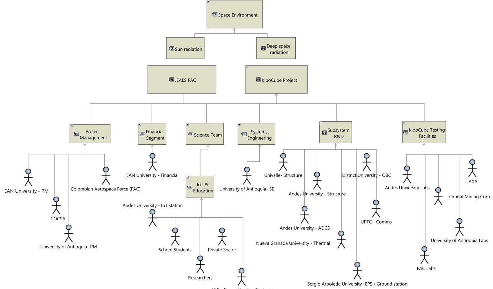

Figure 18. Main operational entities of $ ^{3} $ColStar KiboCUBE Project.

In this diagram this architecture is composed of the ground segment, where there are three logical actors, the ground station hub, the mission operations, and the operations support. The logical component the diagram revolves around is the $ ^{3} $ColStar Cubesat, within all the subsystems, their functions and how they interact with each other and with the logical actors.

The physical diagram of the satellite subsystems shown in Figure A5b. Detailed satellite subsystems can be found in Appendix D, where the respective architectures are depicted (Figure A5a-d). The objective of this level is the same as for logical architecture, except that it defines the final architecture of the system and how it must be carried out ("how the system will be built"). The physical diagrams are composed of the following elements:

- Behaviour Physical Component: Physical component tasked with physical functions and therefore carrying out part of the behavior of the system (for example software component, data server, etc.).

- Physical Port : Non-oriented port that belongs to an Implementation Component (or Node). The structural port (Component Port), on the other hand, has to belong to a Behaviour Component;

- Physical Link: Non-oriented material connection between Implementation Components (or Nodes). The Component Exchange remains a connection between Behaviour Components. A physical Link allows one or several Component Exchanges to take place (USB cable, etc.).

<!-- PDF_PAGE: 34 -->

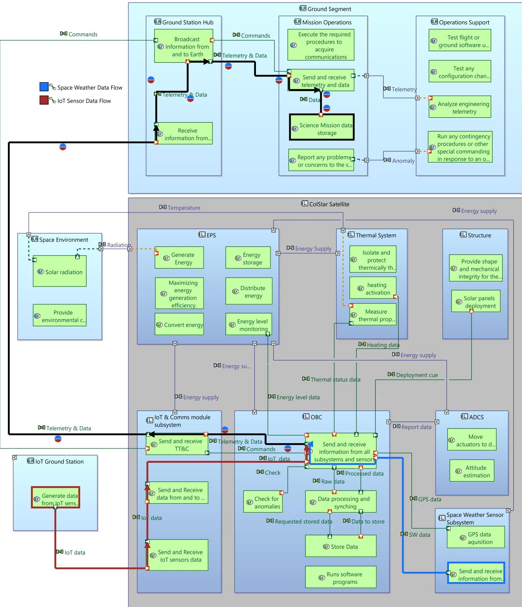

Figure 19. $ ^{3} $ColStar logical architecture diagram.

Forток за поиск на веб-шаблон: $ ^{3} $ColStar KiboCUBE Colombia mission (available online: https://www.cosmojules.com/kibocubecolstar3, accessed on 1 July 2024 ) For any permission or access to the information contained in this repository, please send an email to cemos@e3t.uis.edu.co.

<!-- PDF_PAGE: 35 -->

## 5. Discussion

The $ ^{3} $ColStar mission connects academia, industry, and government, encouraging collaboration among space exploration stakeholders to generate scientific and societal impact. It represents a groundbreaking collaboration in Colombia, uniting various sectors for the first time in a satellite initiative. Socially, the mission aims to extend IoT connectivity to remote areas in Colombia, where it is now limited or nonexistent. This endeavor will help to bridge the digital gap by bringing crucial communication capabilities to neglected areas. Additionally, the mission will engage school students with its findings, inspiring the next generation of scientists and engineers. Scientifically, the mission will analyze solar particle behavior through its primary weather sensor payload. This analysis is crucial for understanding space weather and its impact on Earth, contributing valuable data to the global scientific community. Technologically, the $ ^{3} $ColStar mission will advance Colombia's expertise in developing space components and subsystems, as the majority of these components are manufactured locally. Collaboration among 13 institutions, including professors, researchers, and students at various academic levels, promotes national and international cooperation, boosting Colombia's space technology capabilities [57].

Using MBSE allows for the systematic integration of various technical, operational, and design aspects, resulting in a more comprehensive conception of the $ ^{3} $ ColStar mission. MBSE facilitated the early identification of key requirements, efficient risk management, and the optimization of system performance. The application of the Capella tool and Arcadia method enabled us to ensure that all subsystem designs were integrated and traceable back to the mission's high-level requirements. Throughout the preliminary design phase, the use of a unified model helped maintain consistency across all subsystems. Changes in one subsystem's design were reflected in the overall model, allowing for continuous verification and validation of the system's coherence. This integration was further supported by weekly meetings and coordination practices that addressed cross-functional issues, ensuring alignment with the mission objectives and design requirements. Additionally, the integration of Capella revealed that we could avoid design rework, streamlining the process and completing this initial phase in a shorter timeframe than anticipated. MBSE systematically captured and managed stakeholder expectations and technical requirements, decomposing them into functional, logical, and physical architectures. This structured approach provided clear traceability from requirements to design solutions, ensuring that every aspect of the mission was meticulously planned and validated. By adopting this methodology, we ensured that the $ ^{3} $ ColStar mission's technical and operational feasibility was thoroughly assessed and optimized from the early stages of development, leading to a more reliable satellite design.

The process began with a thorough stakeholder analysis, including structured interviews and workshops to capture detailed input from mission sponsors, end-users, and technical experts. This information was documented through targeted questionnaires and reviewed existing documentation. Stakeholder expectations and technical requirements were then integrated into the Capella model, starting with the identification of high-level mission objectives. These objectives were decomposed into specific technical requirements and translated into functional specifications, which informed the functional architecture of the model. The functional architecture outlined necessary system functions and their interactions, which were then detailed into the logical architecture to describe the system's components and their relationships. The physical architecture further specified the actual hardware and software components.

To maintain traceability, a comprehensive traceability matrix within Capella ensured that each requirement was linked to corresponding elements across the functional, logical, and physical architectures. Regular updates based on feedback from validation checks facilitated continuous verification and validation, ensuring that the evolving design met stakeholder expectations and technical requirements.

Throughout the preliminary design phase, the unified model provided by MBSE maintained consistency across all subsystems. The structured approach of MBSE not only

<!-- PDF_PAGE: 36 -->

helped avoid design rework but also streamlined the process, completing the initial phase in a shorter timeframe than anticipated. By adopting MBSE, the technical and operational feasibility of the $ ^{3} $ColStar mission was thoroughly assessed and optimized from the early stages, leading to a more reliable and well-planned satellite design.

The application of the Arcadia method for the Preliminary Design of the $ ^{3} $ ColStar mission enabled the completion of this process within a remarkable timeframe of just 4 months, facilitated by weekly general sprints. This timeframe compares favorably with the recommendations provided in Space project management—Project planning and implementation (ECSS-M-ST-10C Rev.1) [43], and NASA Procedural Requirements (NPRs) [44], which suggest a duration of 1 to 6 months for similar processes. The utilization of this methodology in other 1U CubeSat missions has demonstrated improved conceptualization, enhanced communication between subsystems, and technical precision, thereby minimizing errors in mission development [122]. It is worth noting that having a framework process as Arcadia allowed each subsystem team to make progress individually and integrate each team result easily. In the case of the $ ^{3} $ ColStar mission, our goal is to allow collaboration among different universities and organizations, particularly because each has different core competencies and resources, and the organizations do not have members with the same skills. Therefore, we assigned subsystems to universities/organizations based on their capabilities/skills/resources/knowledge. Thus, using Arcadia and MBSE allowed us to have a way to centralize the design decisions and progress.

Furthermore, the incorporation of Capella into our approach provided a means to achieve technical consistency through digitalized processes, aligning with the principles of Agile methodology. The implementation of Capella facilitated the creation of a Shared system model with multiple views, connected to discipline models, thereby formalizing aspects of systems engineering through model-based systems engineering (MBSE). It is crucial to note that MBSE does not replace traditional systems engineering, but rather complements it with rigorous methods and tools, ensuring coherency within the model and managing technical consistency across various architectural documents.

All in all, with our study we provide more evidence on how combining Agile methods with system engineering practices helps to face challenges in CubeSat projects, following the line of research of previous works. For instance, Honoré-Livermore [5] reported how integrating systems engineering and Project Management was used in the context of the HYPSO CubeSat project. Similarly to our study, Capella and Arcadia were also used as part of the SE and PM processes. However, our study's goal was broader: understanding the factors that impact the success rate of university-developed small satellites when the space assets are used in a greater system-of-systems context. Both Honoré-Livermore's and our study (in projects of different scales) provide researchers and practitioners with evidence of practices and actionable knowledge when using Agile methodologies in aerospace projects. In both cases, there is evidence of how using Agile methods reduced time in the process; while Honoré-Livermore shows evidence of reduced time between mission concept definition and launch, in our case Agile methods were useful to reduce the mission design time.

## 5.1. Model Governance and Permissions in Capella

In the $ ^{3} $ColStar project, model governance in Capella was carefully managed to ensure integrity and traceability throughout the development process. The governance structure assigned specific roles and permissions to manage modifications effectively within the unified model.

1. System Engineering Oversight: Two designated System Engineers were assigned critical roles in model governance. The Lead System Engineer, supported by a secondary System Engineer, held the authority to implement changes across the system model. This hierarchical structure ensured that modifications were aligned with the mission's high-level requirements and facilitated overall integration.

<!-- PDF_PAGE: 37 -->

2. Subsystem Management: Each subsystem within the satellite platform was managed by specific representatives who were granted permissions to modify their respective areas. These representatives were tasked with ensuring that their designs adhered to the mission requirements and that any changes were accurately reflected in the model.

3. Cross-Subsystem Coordination: To manage interactions between subsystems, regular cross-functional meetings were organized. These meetings included representatives from the affected subsystems and the System Engineering team. The purpose was to discuss and implement modifications that involved multiple subsystems, ensuring that the integrated model remained consistent and coherent.

4. View-Only Permissions: For team members not directly involved in model modifications, view-only permissions were implemented. This approach preserved the model's integrity by restricting editing capabilities to authorized personnel only.

5. Project Management Oversight: A team of five Project Managers was responsible for authorizing changes that had financial implications or were critical to the project. Their oversight ensured that modifications were evaluated for their impact on both technical aspects and project budgets.

6. Weekly Status Meetings: Weekly meetings were held to provide updates on the project's status and discuss recent changes. These meetings were essential for keeping all team members, including those with view-only access, informed about ongoing developments and modifications to the model.

This structured approach to model governance in Capella ensured that all subsystem designs were integrated and traceable to the mission's high-level requirements. By delineating roles and permissions and implementing a collaborative process for managing changes, the $ ^{3} $ ColStar project effectively maintained model consistency and supported continuous verification and validation throughout the project.

## 6. Conclusions

In summary, in this paper we described our experience of integrating Agile Systems Engineering principles, the Arcadia methodology, and the Capella tool in the preliminary design of the $ ^{3} $ ColStar satellite mission. With the presented approach, we were able to expedite the design process and enhance the accuracy, communication, and efficiency of mission development, setting a precedent for future CubeSat missions and beyond. It is worth noting that we did not conduct a comparative study of the presented approach versus a traditional one because of budget constraints and the burden of having two different teams working with different approaches. However, future work could be devoted to have more evidence regarding the implications of using Agile methods for space systems engineering.

Limitations and Future Work: We acknowledge that our study primarily focused on the integration of Agile methodologies with the V-Model framework. A comprehensive comparison with the Spiral Model and other iterative approaches was beyond the scope of this paper but is a valuable area for future research. We plan to explore and document these comparisons in our future work to provide a more holistic understanding of the benefits and limitations of various systems engineering methodologies.

Author Contributions: Conceptualization, J.N.B.-L., J.J.M., J.F.P.-I., I.F.A.N., A.F.G.-S., J.R.-F., L.R.- R., F.L.H.-T., C.E.A.-C., J.E.S.-M., M.A.H.-C., M.L.-V., J.F.J.-V., J.E.E.-D. and O.J.M.-S.; methodology, J.N.B.-L., J.J.M., J.F.P.-I. and I.F.A.-N.; software, J.J.M. and J.F.P.-I.; validation, J.N.B.-L., J.J.M., J.F.P.-I. and I.F.A.-N.; formal analysis, J.N.B.-L., J.J.M., J.F.P.-I. and I.F.A.-N.; investigation, J.N.B.-L., J.J.M., J.F.P.-I. and I.F.A.-N.; resources, A.C.; writing—original draft preparation, J.N.B.-L. and J.J.M.; writing—review and editing, J.N.B.-L., J.J.M., M.L.-V. and A.C.; visualization, J.N.B.-L., J.J.M., J.F.P.-I. and I.F.A.-N.; supervision, J.F.P.-I. and I.F.A.-N.; project administration, J.N.B.-L., J.F.P.-I., A.F.G.-S. and I.F.A.-N. All authors have read and agreed to the published version of the manuscript.

Funding: This work was sponsored by project "GENESIS: GNSS Environmental and Societal Missions—Subproject UPC", Grant PID2021-126436OB-C21; MCIN/AEI/10.13039/501100011033/; EU ERDF "A way to do Europe"; and the research and public 2024 grant from Universidad de los Andes.

<!-- PDF_PAGE: 38 -->

Institutional Review Board Statement: Not applicable.

Informed Consent Statement: Not applicable.

Data Availability Statement: No new data were created or analyzed in this study. Data sharing is not applicable to this article.

Acknowledgments: The mission is possible thanks to the $ ^{3} $ ColStar KiboCUBE Colombia members and Institutions that have participated: Universidad EAN, Universidad Industrial de Santander, Universidad Sergio Arboleda, Universidad de Antioquia, Universidad del Valle, Universidad de Los Andes, Universidad Pedagógica y Tecnológica de Colombia, Universidad Distrital Francisco José de Caldas, Universidad Militar Nueva Granada, Fuerza Aérea Colombiana (FAC), IEEC Institut d'Estudis Espacials de Catalunya (Institute for Space Studies of Catalonia), Universidad de Barcelona, Universitat Universitat Politècnica de Catalunya (UPC), Universidad Popular Autónoma del Estado de Puebla (UPAEP), Corporación Cientifica del Sector Aeroespacial (COCSA) (Scientific Corporation of the Aerospace Sector-SCAS), and company Sycamore.

Conflicts of Interest: The authors declare no conflict of interest.

## Abbreviations

The following abbreviations are used in this manuscript:

<table border="1"><tr><td>ADCS</td><td>Attitude Determination and Control System</td></tr><tr><td>ASIC</td><td>Application-Specific Integrated Circuit</td></tr><tr><td>ConOps</td><td>Concepts of operations</td></tr><tr><td>DECO</td><td>Decommissioning</td></tr><tr><td>DRAMA</td><td>Debris Risk Assessment and Mitigation Analysis</td></tr><tr><td>DoDAF</td><td>Department of Defense Architecture Framework</td></tr><tr><td>ECSS</td><td>European Cooperation for Space Standardization</td></tr><tr><td>EPS</td><td>Electrical Power System</td></tr><tr><td>FAC</td><td>Colombian Aerospace Force</td></tr><tr><td>FECF</td><td>Frame Error Control Field</td></tr><tr><td>FOP</td><td>Full Operations</td></tr><tr><td>GS</td><td>Ground Station</td></tr><tr><td>IAC</td><td>IoT Access Code</td></tr><tr><td>IMU</td><td>Inertial Measurement Unit</td></tr><tr><td>INCOSE</td><td>International Council on Systems Engineering</td></tr><tr><td>IOP</td><td>Initial Operations</td></tr><tr><td>ISS</td><td>International Space Station</td></tr><tr><td>IVVQ</td><td>Integration, Validation, Verification, and Qualification</td></tr><tr><td>JAXA</td><td>Japan Aerospace Exploration Agency</td></tr><tr><td>LA</td><td>Logical Architecture</td></tr><tr><td>LEOP</td><td>Launch and Early Orbit Phase</td></tr><tr><td>MB</td><td>Mother Board</td></tr><tr><td>MBSE</td><td>Model-Based Systems Engineering</td></tr><tr><td>MCU</td><td>Microchip Microcontroller</td></tr><tr><td>MTQs</td><td>Magnetorquers</td></tr><tr><td>OBC</td><td>On-Board Computer</td></tr><tr><td>OMG</td><td>Object Management Group</td></tr><tr><td>OPM</td><td>Object-Process Methodology</td></tr><tr><td>PCU</td><td>Power Conditioning Unit</td></tr><tr><td>RAAN</td><td>Right Ascension of the Ascending Node</td></tr><tr><td>RAC</td><td>Remote Control Access Code</td></tr><tr><td>SE</td><td>Systems Engineering</td></tr><tr><td>SH</td><td>Segment Header</td></tr><tr><td>SpOC</td><td>Space Operations Center</td></tr><tr><td>SysML</td><td>Systems Modeling Language</td></tr><tr><td>TFPH</td><td>Transfer Frame Primary Header</td></tr><tr><td>TT&amp;C</td><td>Telemetry, tracking, and control</td></tr><tr><td>UNOOSA</td><td>United Nations Office for Outer Space Affairs</td></tr></table>

<!-- PDF_PAGE: 39 -->

## Appendix A. $ ^{3} $ColStar Main Requirements

Table A1. $ ^{3} $ColStar requirements.

<table border="1"><tr><td>Requirements</td><td>Description</td></tr><tr><td colspan="2">Mission Requirements</td></tr><tr><td>PrimMis-001</td><td>In nominal mode,the satellite will have 30 min of activation in which it will collect197 MB corresponding to the sensor images for space radiation;the sensor will makea total of 1800 images during this mode.</td></tr><tr><td>PrimMis-002</td><td>The information vector must be transmitted using the satellite’s communicationfrequency(amateur radio band).</td></tr><tr><td>PrimMis-003</td><td>We will develop and deploy a CubeSat capable of performing solar observations,focusing onthe measurement of solar wind particles and IoT sensors.</td></tr><tr><td>SecmMis-001</td><td>We will establish partnerships with local industry stakeholders to promote knowledgeexchange and resource sharing in space technology and IoT.</td></tr><tr><td colspan="2">CubeSat Design</td></tr><tr><td>Des-001</td><td>The satellite should be able to store the 197 MB of the solar weather sensorand the 90 MB generated by the IoT payload.</td></tr><tr><td>Des-002</td><td>The project will develop a flight-enabled CubeSat capable of being launchedfrom the International Space Station.</td></tr><tr><td>Des-003</td><td>The project shall comply with the safety standards of the International SpaceStation NSTS SSP 51700.</td></tr><tr><td colspan="2">Ground Segment Design</td></tr><tr><td>GSeg-001</td><td>Technology will be developed by the partner universities for narrowband transmissionof IoT data for the Ground Satellite to Satellite uplink and Node IoT to Satellite.</td></tr><tr><td>GSeg-002</td><td>The satellite shall have commands defined for the control of georeferenced telemetryand for monitoring satellite subsystems.</td></tr><tr><td>GSeg-003</td><td>The ground station will have to operate in UHF band complying with the requirements,especially the transmission power regulated by the government,to guarantee thecorrect access of the satellite.The communication subsystem shall have the abilityto send and receive satellite data for both the IoT and the payload with the minimumerror rate allowed and with a frequency within the amateur radio band.</td></tr><tr><td colspan="2">User Segment Design</td></tr><tr><td>USeg-001</td><td>User segment components for NB-IoT technology shall be designed with modularityand upgradability in mind,allowing for future enhancements and adaptability toevolving mission needs.</td></tr><tr><td>USeg-002</td><td>The space weather sensor should collect data in a format that universities andstudents can easily interpret and use for scientific research.</td></tr><tr><td>USeg-003</td><td>Implement robust cybersecurity measures to safeguard transmitted and storeddata,ensuring confidentiality for both agricultural users’ operational informationand scientific research data from universities.</td></tr><tr><td colspan="2">Operation</td></tr><tr><td>Ope-001</td><td>The satellite should be able to delete the stored data from the solar sensor andIoT module measurements and be ready for new storage.</td></tr><tr><td>Ope-002</td><td>The Cubesat shall function in various operational modes(e.g.,data collectionmode,transmission mode,power-saving mode) as per mission requirements.</td></tr><tr><td>Ope-003</td><td>The CubeSat must be capable of having controlled activation and deactivationto conserve power and operate efficiently as needed.</td></tr></table>

<!-- PDF_PAGE: 40 -->

Table A1. Cont.

<table border="1"><tr><td>Requirements</td><td>Description</td></tr><tr><td></td><td>Launch</td></tr><tr><td>Laun-001</td><td>The deployment platform for small satellites, utilizing J-SSOD[59]specifies the requirements for launching a 1U satellite from the Japanese Kibo module of the International Space Station(ISS).</td></tr><tr><td>Laun-002</td><td>Satellite Size:The platform accommodates CubeSats of 1U size, measuring approximately $ 10\times10\times10 $ cm.</td></tr><tr><td>Laun-003</td><td>Satellite Mass:For a 1U CubeSat,the mass is limited to 1.33kg or less.</td></tr><tr><td>Laun-004</td><td>Orbital Altitude:The satellite is deployed at an altitude approximately between 380 and 420km above Earth’s surface.</td></tr><tr><td>Laun-005</td><td>Inclination:The deployment orbit maintains an inclination of $ 51.6^{\circ} $ relative to the equator.</td></tr><tr><td>Laun-006</td><td>Deployment Direction:Deployment occurs in the Nadir-aft direction,which is $ 45^{\circ} $ from the ISS nadir side.</td></tr><tr><td>Laun-007</td><td>Deployment Velocity:The deployment velocity for a 1U CubeSat ranges from 1.1 to 1.7m/s.</td></tr><tr><td>Laun-008</td><td>Ballistic Coefficient:The platform ensures a ballistic coefficient of $ 100\mathrm{kg/m^{2}} $ or less to facilitate safe deployment.</td></tr></table>

<!-- PDF_PAGE: 41 -->

## Appendix B. Power Consumption for $ ^{3} $ColStar Modes

Table A2. Launch and early orbit phase.

<table border="1"><tr><td></td><td colspan="3">Released(R)</td><td colspan="3">Pre-Detumbling(PD)</td><td colspan="3">Detumbling(D)</td><td colspan="3">Detumbled(Dd)</td><td colspan="3">Basic(Ba)</td></tr><tr><td>Subsystems</td><td>P(W)</td><td>t(min)</td><td>E(Wh)</td><td>P(W)</td><td>t(min)</td><td>E(Wh)</td><td>P(W)</td><td>t(min)</td><td>E(Wh)</td><td>Transm</td><td>t(min)</td><td>E(Wh)</td><td>P(W)</td><td>t(min)</td><td>E(Wh)</td></tr><tr><td>OBC</td><td>0.200</td><td>92.5</td><td>0.308</td><td>0.2</td><td>92.5</td><td>0.308</td><td>0.2</td><td>92.5</td><td>0.308</td><td>0.2</td><td>92.5</td><td>0.308</td><td>0.2</td><td>92.5</td><td>0.308</td></tr><tr><td>EPS:converters,MCU,batteries,heater</td><td>0.260</td><td>92.5</td><td>1.201</td><td>0.26</td><td>92.5</td><td>1.201</td><td>0.26</td><td>92.5</td><td>1.201</td><td>0.26</td><td>92.5</td><td>1.201</td><td>0.26</td><td>92.5</td><td>1.201</td></tr><tr><td>DeployableAntennaSystem</td><td>0.040</td><td>2.0</td><td>0.001</td><td>0</td><td>0.0</td><td>0.000</td><td>0</td><td>0.0</td><td>0.000</td><td>0</td><td>0.0</td><td>0.000</td><td>0</td><td>0.0</td><td>0.000</td></tr><tr><td>DeployableSolarPannels</td><td>8.000</td><td>0.5</td><td>0.067</td><td>0</td><td>0.0</td><td>0.000</td><td>0</td><td>0.0</td><td></td><td></td><td></td><td></td><td>0</td><td>0.0</td><td></td></tr><tr><td>ADCSBoardandsensors</td><td>0.000</td><td>0.0</td><td>0.000</td><td>0.3</td><td>92.5</td><td>0.462</td><td>0.3</td><td>92.5</td><td>0.462</td><td>0.3</td><td>92.5</td><td>0.462</td><td>0.3</td><td>92.5</td><td>0.462</td></tr><tr><td>ADCSmagnetorques</td><td>0.000</td><td>0.0</td><td>0.000</td><td>0</td><td>0.0</td><td>0.000</td><td>0.55</td><td>92.5</td><td>0.848</td><td>0.55</td><td>92.5</td><td>0.848</td><td>0.55</td><td>92.5</td><td>0.848</td></tr><tr><td>COMMS:TTC-PayloadIoT_SW_</td><td>0.000</td><td>0.0</td><td>0.000</td><td>5.35</td><td>12.0</td><td>1.070</td><td>5.35</td><td>12.0</td><td>1.347</td><td>5.35</td><td>12.0</td><td>1.347</td><td>5.35</td><td>12.0</td><td>1.347</td></tr><tr><td>PayloadWeathersolar_Sensor</td><td>0.000</td><td>0.0</td><td>0.000</td><td>0</td><td>0.0</td><td>0.000</td><td>0</td><td>0.0</td><td>0.000</td><td>0</td><td>0.0</td><td>0.000</td><td>0</td><td>30.0</td><td>0.000</td></tr><tr><td>PayloadElectronicSW</td><td>0.000</td><td>0.0</td><td>0.000</td><td>0</td><td>0.0</td><td>0.000</td><td>0</td><td>0.0</td><td>0.000</td><td>0</td><td>92.5</td><td>0.000</td><td>0</td><td>92.5</td><td>0.000</td></tr><tr><td>PayloadSinglereactionwheel</td><td>0.000</td><td>0.0</td><td>0.000</td><td>0</td><td>0.0</td><td>0.000</td><td>0</td><td>0.0</td><td>0.000</td><td>0</td><td>92.5</td><td>0.000</td><td>0.15</td><td>10.0</td><td>0.031</td></tr><tr><td>Payloadfinesunsensor</td><td>0.000</td><td>0.0</td><td>0.000</td><td>0</td><td>0.0</td><td>0.000</td><td>0</td><td>0.0</td><td>0.000</td><td>0</td><td>92.5</td><td>0.000</td><td>0.01</td><td>92.5</td><td>0.015</td></tr><tr><td>GPS_Antenna</td><td>0.000</td><td>0.0</td><td>0.000</td><td>0</td><td>0.0</td><td>0.000</td><td>0</td><td>0.0</td><td>0.000</td><td>0</td><td>0.0</td><td>0.000</td><td>0.171</td><td>5.0</td><td>0.014</td></tr><tr><td>TOTAL</td><td>8.500</td><td></td><td>1.577</td><td>6.11</td><td></td><td>3.041</td><td>6.66</td><td></td><td>4.166</td><td>6.66</td><td></td><td>4.166</td><td>6.991</td><td></td><td>4.227</td></tr></table>

<!-- PDF_PAGE: 42 -->

Table A3. Operational phase.

<table border="1"><tr><td></td><td colspan="3">Nominal IoT DL(Nid)</td><td colspan="3">Nominal IoT UL(Niu)</td><td colspan="3">Nominal SW(Ns)</td><td colspan="3">Nominal SW DL(Nsd)</td></tr><tr><td>Subsystems</td><td>P(W)</td><td>t(min)</td><td>E(Wh)</td><td>P(W)</td><td>t(min)</td><td>E(Wh)</td><td>P(W)</td><td>t(min)</td><td>E(Wh)</td><td>Transm</td><td>t(min)</td><td>E(Wh)</td></tr><tr><td>OBC</td><td>0.2</td><td>92.5</td><td>0.308</td><td>0.2</td><td>92.5</td><td>0.308</td><td>0.2</td><td>92.5</td><td>0.308</td><td>0.2</td><td>92.5</td><td>0.308</td></tr><tr><td>EPS:converters,MCU, batteries,heater</td><td>0.26</td><td>92.5</td><td>1.201</td><td>0.26</td><td>92.5</td><td>1.201</td><td>0.26</td><td>92.5</td><td>1.201</td><td>0.26</td><td>92.5</td><td>1.201</td></tr><tr><td>Deployable Antenna System</td><td>0</td><td>0.0</td><td>0.000</td><td>0</td><td>0.0</td><td>0.000</td><td>0</td><td>0.0</td><td>0.000</td><td>0</td><td>0.0</td><td>0.000</td></tr><tr><td>Deployable Solar Pannels</td><td>0</td><td>0.0</td><td>0.000</td><td>0</td><td>0.0</td><td>0.000</td><td>0</td><td>0.0</td><td>0.000</td><td>0</td><td>0.0</td><td>0.000</td></tr><tr><td>ADCS Board and sensors</td><td>0.3</td><td>0.0</td><td>0.000</td><td>0.3</td><td>92.5</td><td>0.462</td><td>0.3</td><td>92.5</td><td>0.462</td><td>0.3</td><td>0.0</td><td>0.000</td></tr><tr><td>ADCS magnetorques</td><td>0.55</td><td>92.5</td><td>0.848</td><td>0</td><td>0.0</td><td>0.000</td><td>0.55</td><td>92.5</td><td>0.848</td><td>0.55</td><td>92.5</td><td>0.848</td></tr><tr><td>COMMS:TTC-Payload IoT_SW_</td><td>5.35</td><td>12.0</td><td>1.353</td><td>2.14</td><td>12.0</td><td>0.428</td><td>0.2</td><td>12.0</td><td>0.317</td><td>5.35</td><td>12.0</td><td>1.353</td></tr><tr><td>Payload Weather solar_Sensor</td><td>0</td><td>0.0</td><td>0.000</td><td>0</td><td>0.0</td><td>0.000</td><td>2.5</td><td>30.0</td><td>1.250</td><td>0</td><td>0.0</td><td>0.000</td></tr><tr><td>Payload Electronic SW</td><td>0.2</td><td>92.5</td><td>0.308</td><td>0.2</td><td>92.5</td><td>0.308</td><td>0.2</td><td>92.5</td><td>0.308</td><td>0.2</td><td>92.5</td><td>0.308</td></tr><tr><td>Payload Single reaction wheel</td><td>0.15</td><td>15.0</td><td>0.038</td><td>0.15</td><td>15.0</td><td>0.038</td><td>0.15</td><td>15.0</td><td>0.038</td><td>0.15</td><td>15.0</td><td>0.038</td></tr><tr><td>Payload fine sun sensor</td><td>0.01</td><td>0.0</td><td>0.000</td><td>0.01</td><td>0.0</td><td>0.000</td><td>0.01</td><td>0.0</td><td>0.000</td><td>0.01</td><td>0.0</td><td>0.000</td></tr><tr><td>GPS_Antenna</td><td>0.171</td><td>10.0</td><td>0.029</td><td>0.171</td><td>10.0</td><td>0.029</td><td>0.171</td><td>30.0</td><td>0.086</td><td>0.171</td><td>10.0</td><td>0.029</td></tr><tr><td>TOTAL</td><td>7.191</td><td></td><td>4.085</td><td>3.431</td><td></td><td>2.774</td><td>4.541</td><td></td><td>4.817</td><td>7.191</td><td></td><td>4.085</td></tr></table>

Table A4. Other modes.

<table border="1"><tr><td></td><td colspan="3">Sun Safe(SS)</td><td colspan="3">Survival(Sv)</td><td colspan="3">Satellite Off(OFF)</td><td colspan="3">Decommissioning(DC)</td></tr><tr><td>Subsystems</td><td>P(W)</td><td>t(min)</td><td>E(Wh)</td><td>P(W)</td><td>t(min)</td><td>E(Wh)</td><td>P(W)</td><td>t(min)</td><td>E(Wh)</td><td>Transm</td><td>t(min)</td><td>E(Wh)</td></tr><tr><td>OBC</td><td>0.2</td><td>92.5</td><td>0.308</td><td>0.2</td><td>92.5</td><td>0.308</td><td>0.2</td><td>92.5</td><td>0.308</td><td>0.2</td><td>92.5</td><td>0.308</td></tr><tr><td>EPS:converters,MCU,batteries,heater</td><td>0.26</td><td>92.5</td><td>1.201</td><td>0.26</td><td>92.5</td><td>1.201</td><td>0.26</td><td>92.5</td><td>1.201</td><td>0.26</td><td>92.5</td><td>1.201</td></tr><tr><td>Deployable Antenna System</td><td>0</td><td>0.0</td><td>0.000</td><td>0</td><td>0.0</td><td>0.000</td><td>0</td><td>0.0</td><td>0.000</td><td>0</td><td>0.0</td><td>0.000</td></tr><tr><td>Deployable Solar Pannels</td><td></td><td></td><td></td><td>0</td><td>0.0</td><td></td><td>0</td><td>0.0</td><td>0.000</td><td>0</td><td>0.0</td><td>0.000</td></tr><tr><td>ADCS Board and sensors</td><td>0.3</td><td>92.5</td><td>0.462</td><td>0.3</td><td>92.5</td><td>0.462</td><td>0.3</td><td>92.5</td><td>0.462</td><td>0.3</td><td>0.0</td><td>0.000</td></tr><tr><td>ADCS magnetorques</td><td>0.55</td><td>92.5</td><td>0.848</td><td>0.55</td><td>92.5</td><td>0.848</td><td>0.55</td><td>92.5</td><td>0.848</td><td>0.55</td><td>92.5</td><td>0.848</td></tr><tr><td>COMMS:TTC-Payload IoT_SW_</td><td>0.2</td><td>12.0</td><td>0.317</td><td>5.35</td><td>12.0</td><td>1.347</td><td>0.2</td><td>12.0</td><td>0.317</td><td>5.35</td><td>12.0</td><td>1.353</td></tr><tr><td>Payload Weather solar_Sensor</td><td>0</td><td>0.0</td><td>0.000</td><td>0</td><td>30.0</td><td>0.000</td><td>0</td><td>30.0</td><td>0.000</td><td>2.5</td><td>0.0</td><td>0.000</td></tr><tr><td>Payload Electronic SW</td><td>0</td><td>92.5</td><td>0.000</td><td>0</td><td>92.5</td><td>0.000</td><td>0.2</td><td>92.5</td><td>0.308</td><td>0.2</td><td>92.5</td><td>0.308</td></tr><tr><td>Payload Single reaction wheel</td><td>0</td><td>92.5</td><td>0.000</td><td>0.15</td><td>10.0</td><td>0.031</td><td>0.15</td><td>15.0</td><td>0.038</td><td>0.15</td><td>0.0</td><td>0.000</td></tr><tr><td>Payload fine sun sensor</td><td>0</td><td>92.5</td><td>0.000</td><td>0.01</td><td>92.5</td><td>0.015</td><td>0.01</td><td>0.0</td><td>0.000</td><td>0.01</td><td>0.0</td><td>0.000</td></tr><tr><td>GPS_Antenna</td><td>0</td><td>0.0</td><td>0.000</td><td>0</td><td>0.0</td><td>0.000</td><td>0</td><td>0.0</td><td>0.000</td><td>0</td><td>0.0</td><td>0.000</td></tr><tr><td>TOTAL</td><td>1.510</td><td></td><td>3.136</td><td>6.82</td><td></td><td>4.212</td><td>1.87</td><td></td><td>3.482</td><td>9.52</td><td></td><td>4.019</td></tr></table>

## Appendix C. Equations Used for the Preliminary Analysis of the Thermal Subsystem

The governing equation for this problem can be derived by performing an energy balance on the satellite, considering the incident solar $ (\dot{Q}_{s}) $ , albedo $ (\dot{Q}_{a}) $ , and Earth infrared $ (\dot{Q}_{e}) $ radiation loads, as well as the radiation exchange with deep space.

$$
m c _ {p} \frac {d T}{d t} = \dot {Q} _ {s} + \dot {Q} _ {e} + \dot {Q} _ {a} + \sigma G R _ {D S} \left(T _ {D S} ^ {4} - T ^ {4}\right)
$$

Here, m (kg) is the total mass of the satellite, $ c_{p} $ (J/kg $ \cdot $ K) is the effective heat capacity, $ \sigma $ is the Stefan-Boltzmann constant $ \left( \sigma=5. 6 7 \times1 0^{-8} \mathrm{~ W / m^{2} \cdot K^{4}} \right) $ $ T_{DS} $ (K) is the deep space temperature, $ GR_{DS} $ $ \mathrm{m}^{-2} $ is the radiation exchange factor between deep space and the satellite, and T (K) is the effective temperature of the satellite [68].

<!-- PDF_PAGE: 43 -->

The information in Table 5 allows the determination of the effective heat capacity, $ c_{p} $ which can be calculated by weighting each individual heat capacity with respect to its mass.

$$
c _ {p} = \sum_ {i = 1} ^ {n} x _ {i} \left(c _ {p}\right) _ {i}
$$

The spectral properties of each face of the satellite were calculated considering the fraction of area covered by solar panels. For areas not covered by solar panels, a Kapton film coating was incorporated into the model. This resulted in a determined emissivity of $ \varepsilon=0. 6 5 $ and an effective absorptivity of $ \alpha=0. 7 $ for the satellite's surfaces.

## Appendix D. $ ^{3} $ColStar Subsystem Capabilities and Physical Architecture

The initial process of defining requirements and capabilities in the system architecture, together with some examples of its development, is shown in Figures A1-A4.

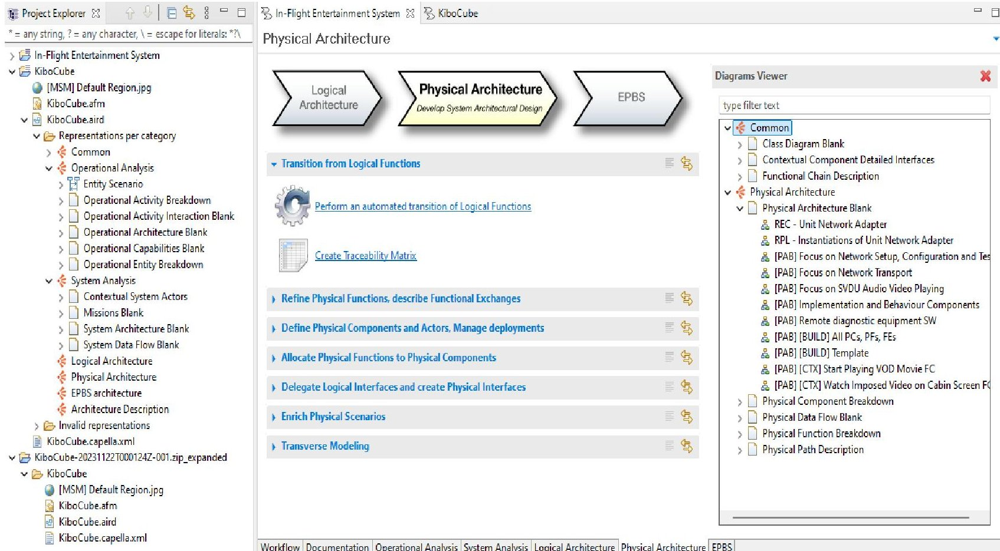

Figure A1. General interface for defining and integrating the system's needs.

<!-- PDF_PAGE: 44 -->

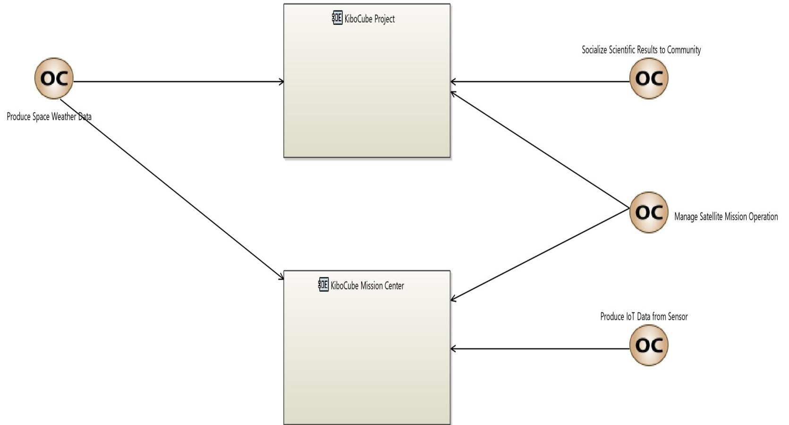

Figure A2. Definition of "Operational Capabilities" in managerial-level architecture diagramming.

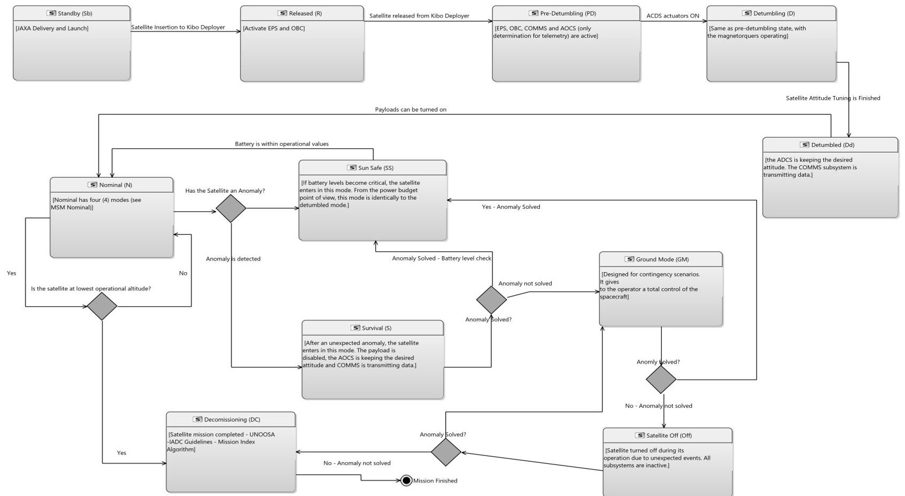

Figure A3. Example of connectivity diagrams and matrices for linking subsystems to satellite operating modes.

<!-- PDF_PAGE: 45 -->

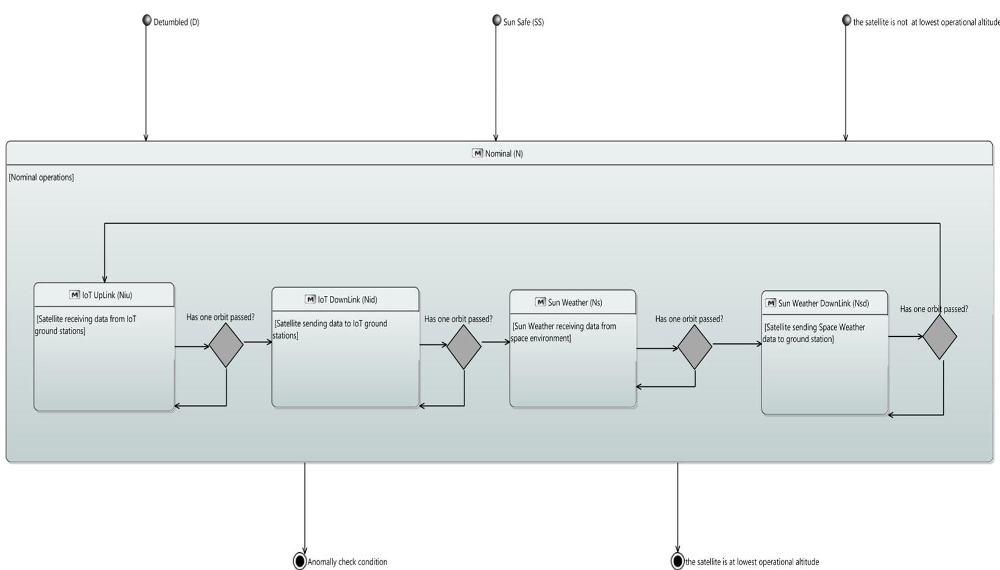

Figure A4. System verification and validation of the architecture in nominal operation mode involves verifying the correct functioning of subsystems and actors to ensure they can effectively carry out operations.

The physical architecture of specific satellite subsystems is depicted in the following (Figure A5a-d).

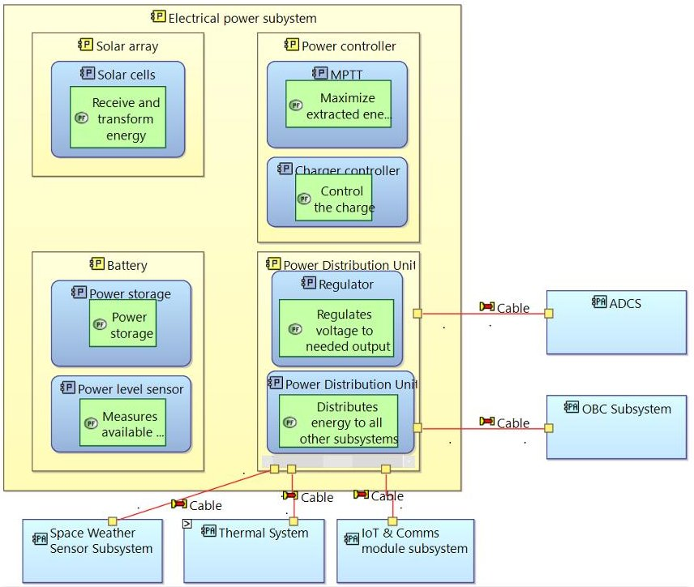

(a) EPS.

Figure A5. Cont.

<!-- PDF_PAGE: 46 -->

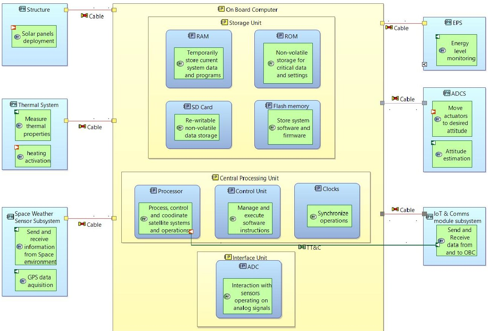

(b) OBC.

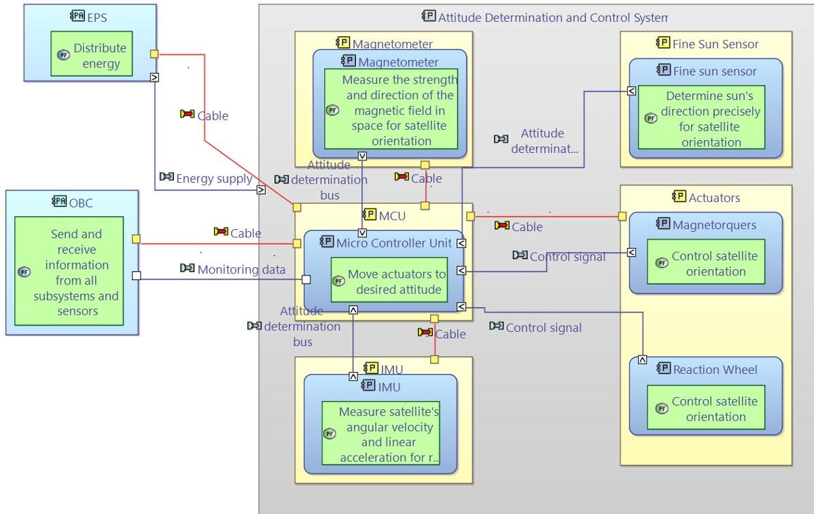

(c) ADCS.

Figure A5. Cont.

<!-- PDF_PAGE: 47 -->

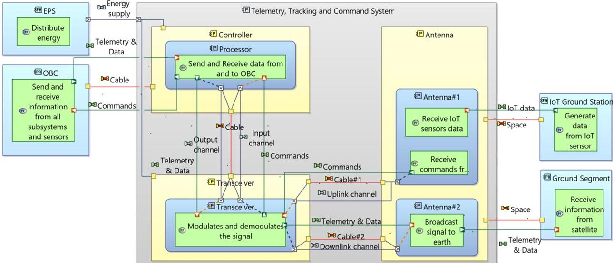

(d) Communication SubSystem (TT&C).

Figure A5. $ ^{3} $ColStar physical architecture.

## References

1. Adams, K.M.; Patrick, T.; Bradley, J.M.; Meyers, T.J.; Keating, C.B. Systems theory as the foundation for understanding systems. Syst. Eng. 2014, 17, 112-123. [CrossRef]

2. Zimmerman, P.; Gilbert, T.; Salvatore, F. Digital engineering transformation across the Department of Defense. J. Def. Model. Simul. 2019, 16, 325-338. [CrossRef]

3. Geraldi, J.; Maylor, H.; Williams, T. Now, let's make it really complex (complicated): A systematic review of the complexities of projects. Int. J. Oper. Prod. Manag. 2011, 31, 966-990. [CrossRef]

4. Honour, E.C. A historical perspective on systems engineering. Syst. Eng. 2018, 21, 148-151. [CrossRef]

5. Honoré-Livermore, E. Integrating Agile Systems Engineering and Project Management in Small Satellites Development. NTNU. 2022. Available online: https://ntnuopen.ntnu.no/ntnu-xmlui/handle/11250/3005361 (accessed on 14 August 2024).

6. INCOSE. Systems Engineering Handbook: A Guide for System Life Cycle Processes and Activities, 5th ed.; John Wiley & Sons, Inc.: Hoboken, NJ, USA, 2023. Available online: https://www.incose.org/publications/products/se-handbook-v4 (accessed on 10 April 2024).

7. Walden, D.; Roedler, G.; Forsberg, K.; Hamelin, D.; Shortell, T. Systems Engineering Handbook, 4th ed.; International Council on Systems Engineering; Wiley: Hoboken, NJ, USA, 2015. Available online: https://scholar.google.com/scholar_lookup?title= Systems+Engineering+Handbook&author=Walden,+D.&author=Roedler,+G.&author=Forsberg,+K.&author=Hamelin,+D. &author=Shortell,+T.&publication_year=2015 (accessed on 20 June 2024).

8. INCOSE. Model-Based Systems Engineering (MBSE) (Glossary). 2022. Available online: https://sebokwiki.org/wiki/Category: Glossary_of_Terms (accessed on 9 February 2022).

9. Hart, L.E. Introduction to Model-Based System Engineering (MBSE) and SysML. Delaware Valley INCOSE Chapter Meeting; 2015; p. 30. Available online: https://www.incose.org/docs/default-source/delaware-valley/mbse-overview-incose-30-july-2015.pdf (accessed on 12 June 2024).

10. Bottero, M.; Gualeni, P. Systems Engineering for Naval Ship Design Evolution. J. Mar. Sci. Eng. 2024, 12, 210. [CrossRef]

11. Heibrok, H.; Donner, A.; Edelhäuser, M.; Franz, T. Open-source MBSE workflow for automated spacecraft thermal analyses from a system model. Acta Astronaut. 2024, 214, 253-260. [CrossRef]

12. INCOSE. Systems Engineering Vision 2035. 2024. Available online: https://www.incose.org/publications/se-vision-2035 (accessed on 20 June 2024).

13. Hartmann, R. The Systems Engineering Vision 2035-Towards the Future of Systems Engineering. In Proceedings of the Model Based Space Systems and Software Engineering Conference—MBSE2022, Toulouse, France, 22-24 November 2022. INCOSE President-Elect. 2022. Available online: https://indico.esa.int/event/407/contributions/7559/attachments/5007/7808/ Keynote%20-%20The%20Systems%20Engineering%20Vision%202035%20-%20Towards%20the%20Future%20of%20Systems% 20Engineering.pdf (accessed on 20 June 2024).

14. Jbara, A.; Bibliowicz, A.; Wengrowicz, N.; Levi, N.; Dori, D. Toward integrating systems engineering with software engineering through Object-Process Programming. Int. J. Inf. Technol. 2020, 12, 1-35. [CrossRef]

15. Weilkiens, T. Systems Engineering with SysML/UML: Modeling, Analysis, Design; Elsevier: Amsterdam, The Netherlands, 2011. [CrossRef]

16. Hartmann, D.; Fay, A.; Maurer, M. Challenges in Model-Based Systems Engineering: A Comprehensive Review. Syst. Eng. 2022, 25, 35-52._9. [CrossRef]

<!-- PDF_PAGE: 48 -->

17. Beck, K.; Beedle, M.; van Bennekum, A.; Cockburn, A.; Cunningham, W.; Fowler, M.; Kern, J. Manifesto for Agile Software Development; Agile Alliance: Snowbird, UT, USA, 2001. Available online: https://www.scirp.org/reference/referencespapers? referenceid=2444643 (accessed on 7 November 2023).

18. ISO/IEC/IEEE 15288:2015; Systems and Software Engineering—System Life Cycle Processes. International Organization for Standardization: Geneva, Switzerland, 2015. Available online: https://www.iso.org/standard/63711.html (accessed on 8 July 2024).

19. ISO/IEC/IEEE 15288:2008; Systems and Software Engineering- System Life Cycle Processes. International Organization for Standardization: Geneva, Switzerland, 2023. Available online: https://www.iso.org/standard/65614.html (accessed on 10 July 2024).

20. Cantu, K.R. A Framework of Methods and Process Improvements to Better Align Technology Development with DoD Space Enterprise Priorities. Ph.D. Thesis, Massachusetts Institute of Technology, Cambridge, MA, USA, 2016. Available online: https://dspace.mit.edu/handle/1721.1/112057 (accessed on 14 March 2024).

21. Jaworski, S.T. Development of a Standard Model-Based System Architecture for CubeSat Missions. Ph.D. Dissertation, California State Polytechnic University, Barcelona, Spain, 2021. Available online: https://digitalcommons.calpoly.edu/theses/2297 (accessed on 5 February 2024).

22. Gough, K.M.; Phojanamongkolkij, N. Employing Model-Based Systems Engineering (MBSE) on a NASA Aeronautic Research Project: A Case Study. In Proceedings of the 2018 Aviation Technology, Integration, and Operations Conference, Atlanta, GA, USA, 25-29 June 2018.

23. Subarna, S.; Jawale, A.K.; Vidap, A.S.; Sadachar, S.D.; Fliginger, S.; Myla, S. Using a Model-Based Systems Engineering Approach for Aerospace System Requirements Management. In Proceedings of the 2020 AIAA/IEEE 39th Digital Avionics Systems Conference (DASC), San Antonio, TX, USA, 11-15 October 2020. Available online: https://arc.aiaa.org/doi/10.2514/6.2020-0743 (accessed on 26 June 2024).

24. Hause, M. Systems Interface Management with MBSE: From Theory to Modeling to Reality. In INCOSE International Symposium; Wiley Online Library: Hoboken, NJ, USA, 2018; Volume 28, pp. 1012-1026. [CrossRef]

25. Buede, D.M.; Miller, W.D. The Engineering Design of Systems: Models and Methods; John Wiley & Sons: Hoboken, NJ, USA, 2024; ISBN: 978-1-119-98401-6. Available online: https://www.wiley.com/en-be/The+Engineering+Design+of+Systems%3A+Models+ and+Methods%2C+4th+Edition-p-9781119984016 (accessed on 26 June 2024).

26. Estefan, J.A.; Weilkiens, T. MBSE Methodologies. In Handbook of Model-Based Systems Engineering; Weilkiens, T., Ed.; Springer: Berlin/Heidelberg, Germany, 2023; pp. 47-85._16. [CrossRef]

27. Sheard, S.A.; Mostashari, A. Principles of Complex Systems for Systems Engineering. Syst. Eng. 2009, 12, 295-311. [CrossRef]

28. Spangelo, S.C.; Kaslow, D.; Delp, C.; Cole, B.; Anderson, L.; Fosse, E.; Gilbert, B.S.; Hartman, L.; Kahn, T.; Cutler, J. Applying Model-Based Systems Engineering (MBSE) to a Standard CubeSat. In Proceedings of the 2012 IEEE Aerospace Conference, Big Sky, MT, USA, 3-10 March 2012. [CrossRef]

29. Shoshany-Tavory, S.; Peleg, E.; Zonnenshain, A.; Yudilevitch, G. Model-Based Systems Engineering for Conceptual Design: An Integrative Approach. Syst. Eng. 2023, 26, 783-799. [CrossRef]

30. Tryfonas, L.; Rossignol, T.; Ludovic, A.F. The Long and Winding Road: MBSE Adoption for Functional Avionics of Spacecraft. J. Syst. Softw. 2020, 172, 110453. [CrossRef]

31. Madni, A.M.; Boehm, B.; Erwin, D.; Moghaddam, M.; Sievers, M.; Wheaton, M. Model-Based Systems Engineering for CubeSat FMECA. In Recent Trends and Advances in Model Based Systems Engineering; Springer: Cham, Switzerland, 2022. Available online: https://link.springer.com/chapter/10.1007/978-3-030-82083-1_45 (accessed on 12 April 2024).

32. García-Sánchez, E.R.; Vargas-Martínez, H.S.; Candia-García, F.; Contreras-Lima, J. Agile Stage-Gate Approach for Design, Integration, and Testing of a 1U CubeSat. Aerospace 2024, 11, 324. [CrossRef]

33. Jones, D.S.; Tow, D.; Holland; J.L. Introduction of an Agile Systems Engineering Process to the NASA Armstrong Flight Research Center. In Proceedings of the AIAA SCITECH 2024 Forum, Orlando, FL, USA, 8-12 January 2024. Available online: https://arc.aiaa.org/doi/10.2514/6.2024-2050 (accessed on 3 August 2024).

34. de Freitas Bart, R. Is Hardware Agile Worth It?—Analyzing the SpaceX Development Process. In Proceedings of the AIAA SCITECH 2024 Forum, Orlando, FL, USA, 8-12 January 2024. Available online: https://arc.aiaa.org/doi/10.2514/6.2024-2054 (accessed on 2 August 2024).

35. Gregory, J.M.; Sega, R.M.; Bradley, T.H.; Kang, J.S. A Tailored Systems Engineering Process for Developing Student-Built CubeSat Class Satellites. IEEE Access 2024, 12, 73187-73195. Available online: https://ieeexplore.ieee.org/document/10516429 (accessed on 2 August 2024). [CrossRef]

36. Makarov, A.; Pérez-Herradón, C.; Franceschetto, G.; Taddei, M.M.; Osaba, E.; Del Barrio, P.; Villar-Rodriguez, E.; Oregi, I. Quantum Optimization Methods for Satellite Mission Planning. IEEE Access 2024, 12, 71808-71820. Available online: https://ieeexplore.ieee.org/document/10534762 (accessed on 2 August 2024). [CrossRef]

37. Camara, R.; Marinho, M. Agile Tailoring in Distributed Large-Scale Environments Using Agile Frameworks: A Systematic Literature Review. CLEI Electron. J. 2024, 27, 1-51. [CrossRef]

38. Kim, H.W.; Ahn, J. Improvement of Satellite System Integration Process Based on Dummy Panel Method. Int. J. Aeronaut. Space Sci. 2024, 25, 716-732. [CrossRef]

<!-- PDF_PAGE: 49 -->

39. Ribeiro, J.E.F.; Silva, J.G.; Aguiar, A. Weaving Agility in Safety-Critical Software Development for Aerospace: From Concerns to Opportunities. IEEE Access 2024, 12, 52778-52802. [CrossRef]

40. Smith, J.; Brown, L.; Johnson, A. Accelerating Small Satellite Development with Agile Practices. J. Aerosp. Eng. 2019, 32, 567-578. [CrossRef]

41. Cavell, B.; Lam, K. ModelBased Systems Engineering Cost Study. In 2023 NASA Cost and Schedule Symposium May 2023; 2019. Available online: https://www.nasa.gov/wp-content/uploads/2023/06/05-mbse-cost-study-otr-2023-00350.pdf?emrc=9d82b0 (accessed on 10 May 2024).

42. Anderson, W.V. Enhancing Innovation in Technical Teams: A Study of Design Thinking and Systems Architecture Integration. Ph.D. Thesis, Massachusetts Institute of Technology, Cambridge, MA, USA, 2023. Available online: https://dspace.mit.edu/ handle/1721.1/152747?show=full (accessed on 2 February 2024).

43. Secretariat, ECSS. ECSS-M-ST-10C Rev1, Project Planning, and Implementation; European Cooperation for Space Standardization (ECSS): Noordwijk, The Netherlands, 2009. Available online: https://www.ecss.nl/standards/ (accessed on 2 February 2024).

44. Osborne, T.L. NASA Space Flight Program and Project Management Handbook; National Aeronautics and Space Administration (NASA): Noordwijk, The Netherlands, 2022. Available online: https://ntrs.nasa.gov/citations/20150000400 (accessed on 2 February 2024).

45. Japan Aerospace Exploration Agency (JAXA). JEM Payload Accommodation Handbook (JPAH); Updated JPAH Version from Vol. 8 Revision D to E on 19 June 2023; JAXA: Tokyo, Japan, 2023. Available online: https://aerospacebiz.jaxa.jp/wp-content/uploads/ 2016/07/jem_handbook_eng.pdf (accessed on 2 February 2024).

46. United Nations/Japan Cooperation Programme on CubeSat Deployment from the International Space Station (ISS) Japanese Experiment Module "KiboCUBE". Available online: https://www.unoosa.org/oosa/en/ourwork/access2space4all/KiboCUBE/KiboCUBE_Index.html (accessed on 2 February 2024).

47. Angelopoulos, V.; Cruce, P.; Drozdov, A.; Grimes, E.W.; Hatzigeorgiu, N.; King, D.A.; Larson, D.; Lewis, J.W.; McTiernan, J.M.; Roberts, D.A.; et al. The Space Physics Environment Data Analysis System (SPEDAS). Space Sci. Rev. 2019, 215, 9. [CrossRef]

48. Cockrell, J.J. Small Spacecraft Technology Program Guidebook for Technology Development Projects; NASA: Washington, DC, USA, 2021. Available online: https://www.nasa.gov/wp-content/uploads/2021/08/smallsattechdevguidebook_rev-508d1.pdf?emrc=71 a57b (accessed on 2 February 2024).

49. Francisco, C.; Henriques, R.; Barbosa, S. A Review on CubeSat Missions for Ionospheric Science. Aerospace 2023, 10, 622. [CrossRef]

50. Kasran, F.A.M.; Jusoh, M.H.; Rahim, S.A.E.A.; Abdullah, N. Geomagnetically Induced Currents (GICs) in Equatorial Region. In Proceedings of the 2018 IEEE 8th International Conference on System Engineering and Technology (ICSET), Bandung, Indonesia, 15-16 October 2018; pp. 112-117. [CrossRef]

51. Mandea, M.; Chambodut, A. Geomagnetic field processes and their implications for space weather. Surv. Geophys. 2020, 41, 1611-1627. [CrossRef]

52. Wang, Y.; Yuan, Y.; Li, M.; Zhang, T.; Geng, H.; Wang, G.; Wen, G. Effects of strong geomagnetic storms on the ionosphere and degradation of precise point positioning accuracy during the 25th solar cycle rising phase: A case study. Remote Sens. 2023, 15, 5512. [CrossRef]

53. Schrijver, C.J.; Kauristie, K.; Aylward, A.D.; Denardini, C.M.; Gibson, S.E.; Glover, A.; Gopalswamy, N.; Grande M.; Hapgood, M.; Heynderickx, D.; et al. Understanding Space Weather to Shield Society: A Global Road Map for 2015-2025 Commissioned by COSPAR and ILWS. Adv. Space Res. 2015, 55, 2745-2807. [CrossRef]

54. Japan Aerospace Exploration Agency (JAXA). JEM Payload Accommodation Handbook; Volume 8. Small Satellite Deployment. Interface Control; JAXA: Tokyo, Japan, 2015. Available online: https://iss.jaxa.jp/kibouser/library/item/jx-espc_8e_en.pdf (accessed on 2 February 2024).

55. NASA. General Mission Analysis Tool (GMAT) v.R2016a (GSC-17177-1); NASA Technology Transfer Program. Software Details: Design and Integration Tools. Reference Number: GSC-17177-1. Release Type: Open Source. Available online: https://software. nasa.gov/software/GSC-17177-1 (accessed on 13 March 2024).

56. European Space Agency. Space Debris User Portal (SDUP). Available online: https://sdup.esoc.esa.int/ (accessed on 2 February 2024).

57. $ ^{3} $ColStar KiboCUBE Colombia Team. 8th Round CubeSat Mission Application. Internal document related to the KiboCUBE opportunity announced by UNOOSA and JAXA, 2023. Not publicly available.

58. MiniPIX TPX3 SPACE. Available online: https://advacam.com/camera/minipix-space/ (accessed on 2 February 2024).

59. JAXA. JAXA-Japan Aerospace Exploration Agency. Humans in Space. Available online: https://humans-in-space.jaxa.jp/en/biz-lab/experiment/facility/ef/jssod/ (accessed on 20 January 2024).

60. ISIS—Innovative Solutions in Space. On-Board Computer. Available online: https://www.isispace.nl/product/on-boardcomputer/ (accessed on 2 April 2024).

61. ISIS—Innovative Solutions in Space. Compact EPS. Available online: https://www.isispace.nl/product/compact-eps/ (accessed on 2 April 2024).

62. ISIS—Innovative Solutions in Space. Cubesat Antenna System 1U-3U. Available online: https://www.isispace.nl/product cubesat-antenna-system-1u-3u/ (accessed on 2 April 2024).

63. ISIS—Innovative Solutions in Space. Attitude Control Systems. Available online: https://www.isispace.nl/product-category/ attitude-control-systems/ (accessed on 2 April 2024).

<!-- PDF_PAGE: 50 -->

64. ISIS—Innovative Solutions in Space. VHF Uplink/UHF Downlink Full Duplex Transceiver. Available online: https://www. isispace.nl/product/isis-uhf-downlink-vhf-uplink-full-duplex-transceiver/ (accessed on 2 April 2024).

65. NanoAvionics. CubeSat Reaction Wheels Control System (SATBUS-4RW). Available online: https://nanoavionics.com/cubesatcomponents/cubesat-reaction-wheels-control-system-satbus-4rw/ (accessed on 2 April 2024).

66. CubeSatShop. Nano-SSOC-A60 Analog Sun Sensor. Available online: https://www.cubesatshop.com/product/nano-ssoc-a60 analog-sun-sensor/ (accessed on 2 April 2024).

67. Satsearch. WARPSPACE GPS Receiver. Available online: https://satsearch.co/products/warpspace-gps-receiver (accessed on 2 April 2024).

68. Fortescue, P.; Swinerd, G.; Stark, J. Spacecraft Systems Engineering; John Wiley & Sons: Hoboken, NJ, USA, 2011. Available online: https://www.wiley.com/en-br/Spacecraft+Systems+Engineering%2C+4th+Edition-p-9780470750124 (accessed on 2 April 2024).

69. Jacques, L. Space Thermal Analysis through Reduced Finite Element Modelling. Ph.D. Thesis, ULiège-Université de Liège, Liège, Belgium, 2016. Available online: https://hdl.handle.net/2268/204068 (accessed on 2 April 2024).

70. Arango, C. Estudio de Factibilidad de un Sistema de Control Térmico Pasivo para una Misión Satelital Tipo CubeSat de tres Unidades (3U). Universidad del Valle. 2022. Available online: https://www.univalle.edu.co/documentos/tfg_cristian_arango.pdf (accessed on 12 August 2024).

71. Pumpkin. MBM2. 2024. Available online: https://www.pumpkinspace.com/store/p208/mbm2.html (accessed on 2 April 2024).

72. Acero, I.F.; Diaz, J.; Hurtado-Velasco, R.; Gonzalez, S.; Rincon, S.; Rodriguez-Ferreira, J.; Gonzalez-Llorente, J. A method for validating CubeSat satellite EPS through power budget analysis aligned with mission requirements. IEEE Access 2023, 11, 43316-43332. [CrossRef]

73. Krumay, B.; Bernroider, E.W.N.; Walser, R. Evaluation of cybersecurity management controls and metrics of critical infrastructures: A literature review considering the NIST cybersecurity framework. In Secure IT Systems, Proceedings of the 23rd Nordic Conference, NordSec 2018, Oslo, Norway, 28-30 November 2018; Proceedings 23; Springer: Berlin/Heidelberg, Germany, 2018; pp. 369-384. _23. [CrossRef]

74. Consultative Committee for Space Data Systems (CCSDS). Coding, Telemetry Channel, CCSDS 101.0-B-4, May. 1999. Available online: https://public.ccsds.org/Publications/MOIMS.aspx (accessed on 2 April 2024).

75. National Institute of Standards and Technology (NIST). Public Access Plan. 2010. Available online: https://www.nist.gov/publications/handout-users-are-not-stupid-6-cybersecurity-pitfalls-overturned (accessed on 2 April 2024).

76. Falco, G.; Henry, W.; Aliberti, M.; Bailey, B.; Bailly, M.; Bonnart, S.; Boschetti, N.; Bottarelli, M.; Byerly, A.; Brule, J.; et al. An international technical standard for commercial space system cybersecurity-a call to action. In ASCEND 2022; IEEE: New York, NY, USA, 2022; p. 4302. Available online: https://sagroups.ieee.org/3349/wp-content/uploads/sites/657/2023/05/ASCENDPaper-Space-Cybersecurity-Standard.pdf (accessed on 2 April 2024).

77. Gómez, J.E.M.; Cheng, A.M.K. Work-in-Progress: Real-Time On-board Processing for Cloud Detection in FACSAT-2 Multispectral Satellite Imagery. In Proceedings of the 2022 IEEE Real-Time Systems Symposium (RTSS), Houston, TX, USA, 5-8 December 2022; pp. 499-502. [CrossRef]

78. Garzón, A.; Villanueva, Y.A. Thermal analysis of satellite libertad 2: A guide to cubesat temperature prediction. J. Aerosp. Technol. Manag. 2018, 10, e4918. [CrossRef]

79. Barbosa, J.; Gregorio, P.; Piñeros, J. Evolución orbital del satélite FACSAT-1 y estimación de su tiempo de reentrada. Cienc. Poder AéReo 2021, 16, 6-17. Available online: https://revistas.fuerzaaerea.edu.co/index.php/ciencia/article/view/123 (accessed on 12 November 2023). [CrossRef]

80. Rincón-Urbina, S.R.; Cárdenas-García, J.M.; Pirazán-Villanueva, K.N.; Acero-Niño, I.F.; Hurtado-Velasco, R.H.; Cortés-García, E.D. Critical design of the CubeSat FACSAT-2 mission for observation and analysis of the Colombian territory. Rev. UIS Ing. 2023, 22, 69-86. [CrossRef]

81. Pina, P.; Vieira, G. UAVs for science in Antarctica. Remote Sens. 2022, 14, 1610. [CrossRef]

82. Consultative Committee for Space Data Systems (CCSDS). CCSDS 350.1-G-3: Space Link Extension—Protocol Specification, Blue Book, Issue 3, June. 2018. Available online: https://public.ccsds.org/Pubs/350x1g3.pdf (accessed on 2 April 2024).

83. Zimmaro, A. FPGA-MCU Design for the Performance Improvement of a Space Payload for Radiation Monitoring. Ph.D. Thesis, INFN, Naples, Italy, 2020. Available online: https://cds.cern.ch/record/2750211?ln=ca (accessed on 2 April 2024).

84. Hodson, R.F.; Pellish, J.A.; Austin, R.A.; Campola, M.J.; Ladbury, R.L.; LaBel, K.A.; Allen, G.R.; Gaza, R.; Willis, E.M. Avionics Radiation Hardness Assurance (RHA) Guidelines, NESC-RP-19-01489. 2021. Available online: https://ntrs.nasa.gov/citations/2021 0018053 (accessed on 2 April 2024).

85. Gomez, C.; Pascal, J.C.; Esteban, P.; Deleris, Y.; Devatine, J.-R. Embedded Systems Requirements Verification Using HiLeS Designer. In Embedded Real Time Software and Systems; Hermes Science Publications: Paris, France, 2010. Available online: https://hal.science/hal-02267713 (accessed on 2 April 2024).

86. Gomez, C.E.; Jimenez, J.F.; Pascal, J.C.; Esteban, P. Hiles Designer: A Modeling Tool for Embedded Systems Design Validation. In Proceedings of the 5th Americas International Conference on Production Research, São Paulo, Brazil, 23-26 August 2015. Available online: http://www-sop.inria.fr/members/Carlos.Gomez_Cardenas/pdf/ICPRAmericas_10.pdf (accessed on 2 May 2024).

87. Gomez, C.; Jimenez, F.; Pascal, J.-C.; Esteban, P. Heterogeneous Systems Verification on HiLeS Designer Tool. In Proceedings of the 36th Annual Conference of the IEEE Industrial Electronics Society, Glendale, AZ, USA, 7-10 November 2010. [CrossRef]

<!-- PDF_PAGE: 51 -->

88. Averly, M.R.; Suryana, J. CubeSat Communication System for Maritime Needs. In Proceedings of the 2020 27th International Conference on Telecommunications (ICT), Bali, Indonesia, 5-7 October 2020; pp. 1-5. [CrossRef]

89. Perera, M.T.N.; Manchanayake, M.P.; Gajanayake, I.H.M.; Dayarathna, T.L.; Gunawardena, A.U.A.W. Design and Construction of a Communication Module for Nano-Satellites. In Proceedings of the 2021 IEEE 16th International Conference on Industrial and Information Systems (ICIIS), Kandy, Sri Lanka, 12 September-12 November 2021; pp. 341-346. [CrossRef]

90. Doroshkin, A.A.; Zadorozhny, A.M.O.; Kus, N.; Prokopyev, V.Y.; Prokopyev, Y.M. Experimental Study of LoRa Modulation Immunity to Doppler Effect in CubeSat Radio Communications. IEEE Access 2019, 7, 75721-75731. [CrossRef]

91. Rastinasab, V.; Weidong, H. Implementation and Design of RF-Front-End Telemetry Tracking and Command Subsystem of a CubeSat With 500-km Altitude. IEEE J. Miniaturization Air Space Syst. 2021, 2, 43-47. [CrossRef]

92. Zadorozhny, A.M.; Doroshkin, A.A.; Gorev, V.N.; Melkov, A.V.; Mitrokhin, A.A.; Prokopyev, V.Y.; Prokopyev, Y.M. First Flight Testing of LoRa Modulation in Satellite Radio Communications in Low-Earth Orbit. IEEE Access 2022, 10, 100006-100023. [CrossRef]

93. Álvarez, G.; Fraire, J.A.; Hassan, K.A.; Céspedes, S.; Pesch, D. Uplink Transmission Policies for LoRa-Based Direct-to-Satellite IoT. IEEE Access 2022, 10, 72687-72701. [CrossRef]

94. Kaslow, D.; Ayres, B.; Cahill, P.T.; Hart, L.; Yntema, R. A Model-Based Systems Engineering (MBSE) approach for defining the behaviors of CubeSats. In Proceedings of the 2017 IEEE Aerospace Conference, Big Sky, MT, USA, 4-11 March 2017; pp. 1-14. [CrossRef]

95. Shahu, K. Design of Telecommand Software and Packet Structure for Lunar Landing Mission. In Proceedings of the 2018 Second International Conference on Electronics, Communication and Aerospace Technology (ICECA), Coimbatore, India, 29-31 March 2018; pp. 1641-1646. [CrossRef]

96. Hirshorn, S.R. NASA Systems Engineering Handbook; NASA: Washington, DC, USA, 2016. Available online: https://www.nasa.gov/wp-content/uploads/2018/09/nasa_systems_engineering_handbook_0.pdf (accessed on 14 May 2024).

97. Weilkiens, T.; Lamm, J.G.; Roth, S.; Walker, M. Model-Based System Architecture; John Wiley & Sons: Hoboken, NJ, USA; London, UK, 2022; ISBN 978-1-119-74665-2. Available online: https://www.wiley.com/en-us/Model-Based+System+Architecture%2C+ 2nd+Edition-p-9781119746652 (accessed on 10 June 2024).

98. Salleh, N.; Mendes, E.; Mendes, F.; Lekamlage, C.D.; Petersen, K. Value-based Software Engineering: A Systematic Mapping Study. e-Inform. Softw. Eng. J. 2023, 17. Available online: https://search.ebscohost.com/login.aspx?direct=true&db=edsdoj&AN=edsdoj.96638a8e393a4159a18cf74dabc26217&lang=es&site=eds-live&scope=site (accessed on 8 July 2024). [CrossRef]

99. Febriyani, W.; Kistiani, F.M.; Lubis, M. Validation and Verification of Business Architecture Process Based on the V. Model. In Proceedings of the 2022 Seventh International Conference on Informatics and Computing (ICIC), Bali, Indonesia, 8-9 December 2022; pp. 1-6. [CrossRef]

100. Kossiakoff, A.; Seymour, S.J.; Flanigan, D.A.; Biemer, S.M. Model-Based Systems Engineering (MBSE). In Systems Engineering Principles and Practice; Sage, A.P., Ed.; John Wiley & Sons, Inc.: Hoboken, NJ, USA, 2020. Available online: https://books.google.es/books?id=gGzoDwAAQBAJ&printsec=frontcover&hl=ca&source=gbs_ge_summary_r&cad=0#v=onepage&q&f=false (accessed on 4 April 2024).

101. Li, Z.; Faheem, F.; Husung, S. Collaborative Model-Based Systems Engineering Using Dataspaces and SysML v2. Systems 2024, 12, 18. [CrossRef]

102. Crumbly, C.M. Systems Engineering Technology: Closing the MBSE Modeling Gap through Community College. In Proceedings of the AIAA SCITECH 2024 Forum, Orlando, FL, USA, 8-12 January 2024; p. 0918. [CrossRef]

103. Eramo, R.; Nolletti, M.; Pomante, L.; Pasquale, L.; Pascucci, D. Model-driven engineering for simulation models interoperability: A case study in the space industry. Softw. Pract. Exp. 2024, 54, 1010-1033. [CrossRef]

104. Arcadia Method and Capella. Available online: https://mbse-capella.org/arcadia.html (accessed on 26 February 2024).

105. Fernandez, J.; Hernandez, C. Model-Based Systems Engineering. In Practical Model-Based Systems Engineering; Artech House: Norwood, MA, USA, 2019. Available online: https://us.artechhouse.com/Practical-Model-Based-Systems-Engineering-P2032.aspx (accessed on 2 April 2024).

106. Clément, G. Model Based System Engineering for Ariane 6. Ariane Group. 2019. Available online: https://indico.esa.int/event/32 3/contributions/5054/attachments/3754/5210/10.45_-_Capella_and_Arcadia_-_Ariane_6_experiences.pdf (accessed on 1 July 2024).

107. Voirin, J.-L. Model-Based System and Architecture Engineering with the Arcadia Method; Elsevier: Amsterdam, The Netherlands, 2017. [CrossRef]

108. Estrada-Esponda, R.D.; López-Benítez, M.; Matturro, G.; Osorio-Gómez, J.C. Selection of software agile practices using Analytic hierarchy process. Heliyon 2024, 10, e22948. [CrossRef]

109. Agile Processes for Hardware Development. Available online: https://www.cprime.com/wp-content/uploads/woocommerce uploads/2015/10/Agile-Processes-for-Hardware-Development-cPrime.pdf (accessed on 26 February 2024).

110. An Introduction to Modified Agile for Hardware Development Framework: The Benefits of Agile, the Needs of Physical Product Development. Available online: https://mahdframework.com/ (accessed on 26 February 2024).

111. Furuhjelm, J.; Segertoft, J.; Justice, J.; Sutherland, J.J. Owning the Sky with Agile: Building a Jet Fighter Faster, Cheaper, Better with Scrum. In Global Scrum Gathering, San Diego, CA; 2017. Available online: https://www.scruminc.com/wp-content/uploads/ 2015/09/Release-version_Owning-the-Sky-with-Agile.pdf (accessed on 24 February 2024).

<!-- PDF_PAGE: 52 -->

112. Segret, B.; Semery, A.; Vannitsen, J.; Mosser, B.; Miau, J.J.; Juang, J.C.; Deleflie, F. The paving stones: Initial feed-back on an attempt to apply the agile principles for the development of a CubeSat space mission to Mars. In Modeling, Systems Engineering, and Project Management for Astronomy VI; SPIE: Bellingham, WA, USA, 2014. [CrossRef]

113. Garzaniti, N.; Briatore, S.; Fortin, C.; Golkar, A. Effectiveness of the Scrum methodology for agile development of Space Hardware. In Proceedings of the 2019 IEEE Aerospace Conference, Big Sky, MT, USA, 2-9 March 2019. [CrossRef]

114. Wortman, K.; Duncan, B.; Melin, E. Agile methodology for Spacecraft Ground Software Development: A cultural shift. In Proceedings of the 2017 IEEE Aerospace Conference, Big Sky, MT, USA, 4-11 March 2017. [CrossRef]

115. Schmember, P. SDB NEXT a step to virtual satellite. In Proceedings of the 10th ESA Workshop on Simulation for European Space Programmes (ESASESP), ESTEC, Noordwijk, The Netherlands, 28-30 March 2017. Available online: https://indico.esa.int/event/ 180/contributions/1373/attachments/1280/1505/1100_Schmerber_Mollier_-_Paper.pdf (accessed on 20 February 2024).

116. Bitetti, L.; De Ferluc, R.; Mailland; D.; Gregoris, G.; Capogna, F. Model Based approach for RAMS analyses in the Space domain with Capella open-source tool. In Model-Based Safety and Assessment, Proceedings of the 6th International Symposium, IMBSA 2019, Thessaloniki, Greece, 16-18 October 2019; Proceedings 6; Springer: Berlin/Heidelberg, Germany, 2019; pp. 18-31. Available online: https://link.springer.com/chapter/10.1007/978-3-030-32872-6_2 (accessed on 2 August 2024).

117. Minacapilli, P.; Zurita, F.C.; Pérez, S.C.; Pérez-Silva, A.R.; Lasheras, D.E. Small Satellites Mission Design Enhancement through MBSE and DDSE Toolchain. 2022. Available online: https://indico.esa.int/event/407/contributions/7396/attachments/4805/7 879/1010%20-%20Presentation%20-%20Small%20Satellites%20Mission%20Design%20Enhancement%20Through%20MBSE% 20Toolchain.pdf (accessed on 10 February 2024).

118. Rochford, E. A Model-Based Systems Engineering Approach to Refueling Satellites. Ph.D. Thesis, University of Cincinnati, Cincinnati, OH, USA, 2023. Available online: https://etd.ohiolink.edu/acprod/odb_etd/etd/r/1501/10?clear=10&p10_accession_num=ucin1684772003936491 (accessed on 5 January 2024).

119. Sutherland, J.; Schwaber, K. The Scrum Papers: Nuts, Bolts, and Origins of an Agile Process. 2007. Available online: https://www.academia.edu/43872765/The_Scrum_Papers_Nut_Bolts_and_Origins_of_an_Agile_Framework (accessed on 5 January 2024).

120. Hema, V.; Thota, S.; Kumar, S.N.; Padmaja, C.; Krishna, C.B.R.; Mahender, K. Scrum: An effective software development agile tool. IOP Conf. Ser. Mater. Sci. Eng. 2020, 981, 022060. [CrossRef]

121. Carpenter, S.E.; Dagnino, A. Is agile too fragile for space-based systems engineering? In Proceedings of the 2014 IEEE International Conference on Space Mission Challenges for Information Technology, Laurel, MD, USA, 24-26 September 2014. [CrossRef]

122. Buitrago, J.; Terraza, I.; Contreras, L.; Fernandez, L.; Garcia, G.; Del Castillo, C.; Ha, L.; Palma, D.; Solyga, M.; Camps, A. $ ^{3} $Cat-4 Thermal Analysis and Thermal Vacuum Test Campaign Results. Aerospace 2024, in the process of pending review.

Disclaimer/Publisher's Note: The statements, opinions and data contained in all publications are solely those of the individual author(s) and contributor(s) and not of MDPI and/or the editor(s). MDPI and/or the editor(s) disclaim responsibility for any injury to people or property resulting from any ideas, methods, instructions or products referred to in the content.