<!-- PDF_PAGE: 1 -->

# ENABLING LUNAR CUBESAT MISSIONS WITH THE CUBESAT SYSTEM REFERENCE MODEL

A Thesis Presented to

# the Faculty of the College of Science and Engineering Morehead State University

In Partial Fulfillment

of the Requirements for the Degree Master of Science

by

Aaron Phillip Zucherman

March 11, 2023

<!-- PDF_PAGE: 2 -->

Accepted by the faculty of the College of Science and Engineering, Morehead State University, in partial fulfillment of the requirements for the Master of Science degree.

Dr. Pamela Clark Director of Thesis

Master's Committee:

___, Chair

Dr. Pamela Clark

Dr. Eric Jerde

Dr Elijah Jensen

Date

<!-- PDF_PAGE: 3 -->

# ENABLING LUNAR CUBESAT MISSIONS WITH THE CUBESAT SYSTEM REFERENCE MODEL

Aaron Phillip Zucherman Morehead State University, 2024

Director of Thesis: ___

Dr. Pamela Clark

Small Satellites are increasingly dominating the current era of space exploration and have opened a whole new set of scientific and exploration opportunities. The expectation is that by utilizing smallsats, the costs for future cislunar missions could be reduced by orders of magnitude. However, these Cislunar missions faced various technical and operational challenges due to their demanding operating environments and ambitious scientific goals. Applying Model-Based System Engineering (MBSE) tools to developing Cislunar missions has been proposed to decrease costs and increase reliability for future missions. The International Council on Systems Engineering's Space System Working Group has created the CubeSat System Reference Model (CSRM), a representation of the logical architecture of a CubeSat system, intended to be used as a starting

<!-- PDF_PAGE: 4 -->

point to develop the physical architecture of a CubeSat space mission. Now, opportunities exist to extend the already-developed CSRM to enable Cislunar CubeSat missions. However, the CSRM was developed only considering the needs of LEO operating CubeSats. This Thesis assesses the maturity and applicability of the CSRM in the context of designing Cislunar CubeSat missions. This Thesis uses MBSE methodologies to determine the commonality and differences in space mission architectures and Mission Engineering tasks and components of LEO and Cislunar space missions. It then assesses the challenges of using the CSRM for a Cislunar Mission. It includes a set of actions needed to define what additions would be required to extend the CSRM to support the CubeSat mission and spacecraft design beyond LEO and into Cislunar space. Additionally, proposals will be made for a way forward to enable future iterations of the CSRM that would generally improve or ease the ability to allow Lunar CubeSat Missions.

Accepted by:

___, Chair

Dr. Pamela E. Clark

---

Dr. Eric Jerde

---

Dr Elijah Jensen

<!-- PDF_PAGE: 5 -->

## Table of Contents

Table of Contents...ii

Table of Tables ...iv

Table of Figures ...iv

Acronyms ...v

1. Introduction ...1

1.1. CubeSat Reference Model Architecture Overview ...4

1.2. Mission Engineering (MEng) ...6

1.3. Updating A Model-Based Systems Engineering (MBSE) Model ...7

2. Definitions ...9

2.1. Mission Engineering Artifact Definitions ...10

2.2. Space Mission Architecture Element Definitions ...11

3. LEO vs Lunar Missions ...14

3.1. Use Case Studies ...15

3.2. Effects MEng Artifacts and SMA Elements ...18

4. CSRM Mapping ...28

5. Weights of MEng Artifacts and SME Elements ...28

6. CSRM Suitability Analysis ...32

6.1. MEng Artifact Suitability Analysis ...33

6.2. SMA Suitability Analysis ...38

7. CSRM Element Additions ...44

8. Conclusions ...51

8.1. Products and Outcomes ...51

<!-- PDF_PAGE: 6 -->

8.2. Future work ... 51

References ... 53

Appendix A: CSRM Architecture - BDDs and Structure Tables ... 57

Appendix B Mission Engineering to CSRM Artifact Map ... 71

Appendix C: Space Mission Architecture to CSRM Elements Map ... 73

<!-- PDF_PAGE: 7 -->

## Table of Tables

Table 1: Mission Engineering N2 Diagram ... 29

Table 2: Space Mission Architecture N2 Diagram ... 30

Table 3: SMA to MEng Relations Chart ... 31

Table 4: Mission Engineering Mapping Results ... 33

Table 5: Space Mission Architecture Mapping Results ... 38

## Table of Figures

Figure 1: SmallSat Scales and Typical CubeSat Configurations. Image Courtesy of NASA ... 1

Figure 2: CSRM Development Timeline [30] ... 3

Figure 3: CSRM Elements for the Space Segment (Top) and Ground Segment (Bottom) [13] ... 4

Figure 4: Overview of CSRM Elements [13] ... 5

Figure 5: Engineering of a Mission-Specific CSRM [16] ... 7

Figure 6: MEng Architecting Activities [16] ... 7

Figure 7: Lunar CubeSat mission Lunar IceCube Spacecraft Rendering [27] ... 15

Figure 8: Phoenix model, showing the internal configuration of the spacecraft [26]... 15

Figure 9: Lunar IceCube model, showing the internal configuration of the spacecraft [27]... 16

Figure 10: CAPSTONE Rendering. Image Courtesy of NASA ... 16

Figure 11: Simplified CONOPS for the Phoenix Mission [26]... 17

Figure 12: Simplified CONOPS for the Lunar IceCube Mission [27] ... 18

<!-- PDF_PAGE: 8 -->

## Acronyms

<table border="1"><tr><td>C3</td><td>Command, Control,and Communications Architecture</td></tr><tr><td>CSRM</td><td>CubeSat Reference Model</td></tr><tr><td>C&amp;DH</td><td>Command and Data Handling</td></tr><tr><td>GNC</td><td>General Navigation and Control</td></tr><tr><td>INCOSE</td><td>International Council on Systems Engineering</td></tr><tr><td>LEO</td><td>Low Earth Orbit</td></tr><tr><td>MBSE</td><td>Model-Based System Engineering</td></tr><tr><td>MEng</td><td>Mission Engineering</td></tr><tr><td>N/A</td><td>Not Applicable</td></tr><tr><td>OMG</td><td>Object Management Group</td></tr><tr><td>Rqts</td><td>Requirements</td></tr><tr><td>SMA</td><td>Space Mission Architecture</td></tr><tr><td>SoS</td><td>System of Systems</td></tr><tr><td>SSWG</td><td>Space System Working Group</td></tr><tr><td>SysML</td><td>System Modeling Language</td></tr><tr><td>T&amp;S</td><td>Test and Simulations</td></tr><tr><td>TT&amp;C</td><td>Telemetry, Tracking and Command</td></tr></table>

TT&C Telemetry, Tracking and Command

<!-- PDF_PAGE: 9 -->

## 1. Introduction

Small Satellites, or 'smallsats,' are increasingly dominating the current era of space exploration and have opened a whole new set of scientific and exploration opportunities. Spacecraft are generally grouped according to their mass. The category of smallsats is divided into minisatellites with a mass of 100-500 kg, microsatellites with a mass of 10-100 kg, nanosatellites with a mass of 1-10 kg, and picosatellites with a mass of 0.01-1 kg. CubeSats are a factor that makes up a subclass of smallsats, made of standard units (U) volumes, where 1 U is a $ 1 0 \mathrm{c m} \times 1 0 \mathrm{c m} \times 1 0 \mathrm{c m} $ cuboid and weights $ \sim 1. 3 3 \mathrm{k g} $ (although this can vary) as shown in Figure 1. In particular, the CubeSat form factor has enabled hundreds of sustainable, low-cost, and simple missions over the last decade [1]. The expectation is that by utilizing smallsats, the costs for future lunar missions could be reduced by an order of magnitude, as is now the case for science and commercial missions in LEO. Additionally, with the launch of the CAPSTONE, Lunar Flashlight and 10 secondary payloads on the Artemis-1 mission in 2022, CubeSats that operate in Lunar Space have gone from proposals to actual missions [2]. However, these Lunar missions faced various technical and operational challenges due to their demanding operating environments and ambitious scientific goals.

One way that has been proposed to overcome these challenges is the creation and implantation of systems engineering tools that can enable developers to

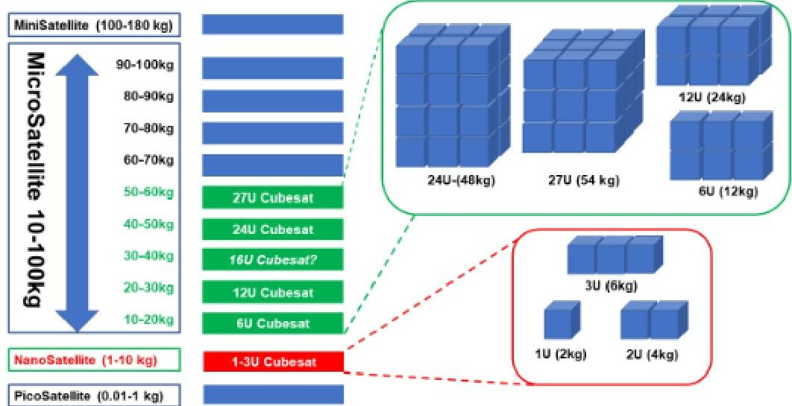

Figure 1: SmallSat Scales and Typical CubeSat Configurations. Image Courtesy of NASA

<!-- PDF_PAGE: 10 -->

overcome the challenges of this new mission type [3].

The International Council on Systems Engineering (INCOSE) Space System Working Group (SSWG) has created the CSRM, a representation of the logical architecture of a CubeSat system, intended to be used by system architects and engineers as a starting point as they develop the physical architecture of the Space and Ground segments of the CubeSat mission of interest to them. The idea is that by starting with a standard architecture, a mission development team is able to save time and effort when creating their mission architecture using traditional systems engineering processes. Compared to having to start from scratch, it can be used for a relatively low cost, the CSRM is reusable (with changes in physical instantiation due to the relatively simple, standardized nature of cubesat interfaces and systems, and 'focused' mission goals), for the development of simulations and trade studies with built-in traceback and flow down capability. This will be particularly useful for lunar cubesat missions as they are orders of magnitude more complex in their overall system design and minimum requirements.

The CSRM is based on Model-Based System Engineering (MBSE) principles, is System Modeling Language (SysML) compliant, is hosted in a graphical modeling tool, and is intended to foster completeness and economies of scale associated with reusability [4]. The MBSE-based CSRM is intended to be relatively easy to modify (compared to traditional documentation-based systems processes) with the goal of lowering the time and cost for implementing and tracking changes and their subsequent flow-down effects. The concept is that implementing MBSE can be a powerful tool to leverage the already relatively low-cost "cubesat paradigm" [1] to further reduce costs while also increasing the sophistication and effectiveness of design practices for more

<!-- PDF_PAGE: 11 -->

complex missions. As shown in Figure 2, The INCOSE SSWG started in 2007 and completed work on designing and developing a CubeSat System Reference Model (CSRM) in 2020. In 2023, the Object Management Group (OMG) approved the CSRM as a beta specification [13]. The OMG is a computer industry standard consortium that, among many activities,

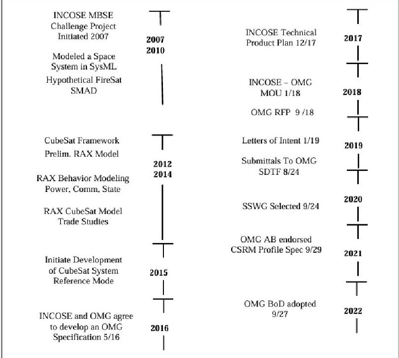

Figure 2: CSRM Development Timeline [30]

develops enterprise integration standards for various technologies and approves standards for system engineering applications. The OMG defines the CSRM as describing "the necessary stereotypes (extends SysML) for logical CubeSat space-ground architectures. The profile is intended to promote consistency and interoperability of logical CubeSat space/ground architecture models. The profile is intended to be used as-is or extended." [14].

Another tool, Mission Engineering (MEng), is a concept where the mission itself is looked at as a system and is being explored to maintain the balance between the spacecraft system, operations (including ground systems), and the mission (the integration of needed capabilities) [5]. Two previous SSWG studies, [16] and [17], assessed where the CSRM currently supports MEng activities and identified areas that require further research. It proposed a way forward that defined research activities to specify extensions to the CSRM needed to support the MEng of a CubeSat mission.

This paper builds on the work of the SSWG by providing a more rigorous systems engineering analysis of the applicability of the CSRM to Lunar Missions. Whereas the study [1]

<!-- PDF_PAGE: 12 -->

relied solely on the expert opinion of the SSWG members that contributed to the study, this paper's analysis leverages comparative analysis and other methods to be discussed to both analyze the conclusions and recommendations made by the SSWG but also add additional conclusions, context and engineering rigor to their and further recommendations.

## 1.1. CubeSat Reference Model Architecture Overview

The SSWG created the CSRM as a starting point for system engineers to develop a physical architecture for their CubeSat mission. As a logical space-ground architecture, logical components are abstractions of the physical components that perform the system functionality without imposing implementation constraints. A physical architecture defines the system's physical components, including hardware, software, persistent data, and operational procedures. Figure 3 shows two CSRM element diagrams, and Appendix A shows a more extensive collection of CSRM diagrams.

The logical components are a starting point for a mission-specific CubeSat logical architecture, followed by the physical

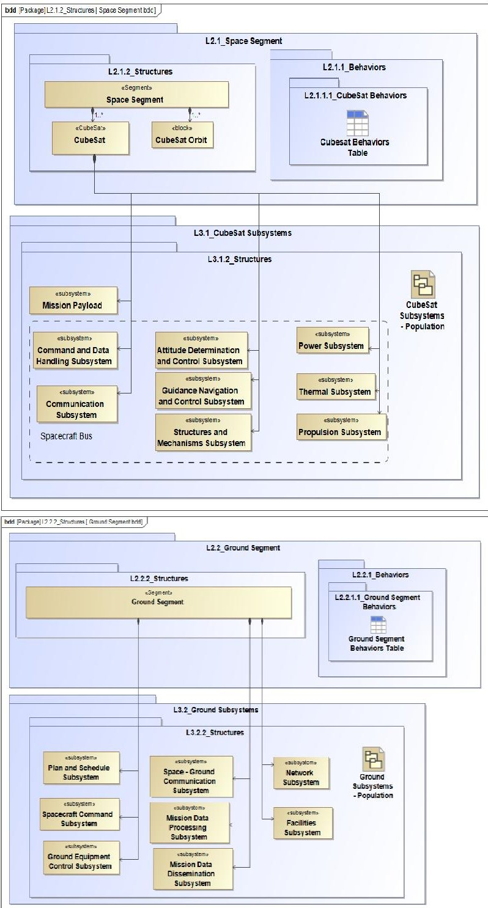

Figure 3: CSRM Elements for the Space Segment (Top) and Ground Segment (Bottom) [13]

<!-- PDF_PAGE: 13 -->

architecture and the CubeSat development. The CSRM integrates five overarching elements: 1) Stakeholders, 2) Technical Measures, 3) Behaviors, 4) Requirements, and 5) Architecture. The CSRM provides for defining and tracing requirements from stakeholders to behaviors, with technical measures assigned to subsystems and components to be certified through validation and verification activities [12]. Figure 4 provides an overview of these elements.

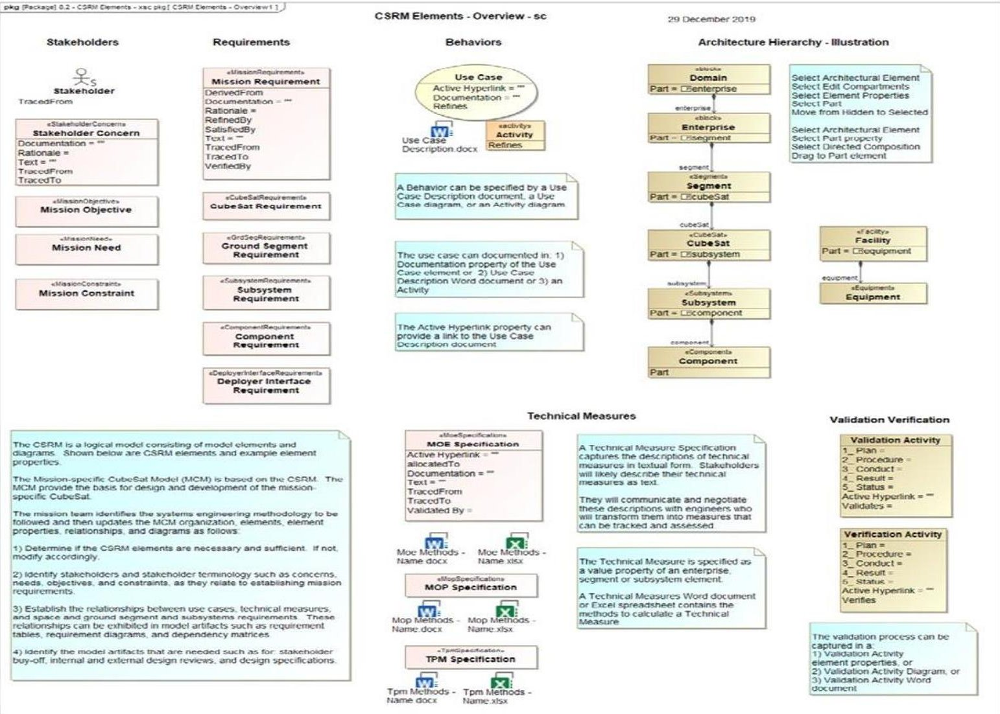

Figure 4: Overview of CSRM Elements [13]

The CSRM is a repository for systems engineering artifacts. I.e., it contains Systems engineering information in the form of artifacts representing specific aspects of the modeled system. Artifacts are the records resulting from a step of system development, such as a requirements document or data model. However, it is not pre-populated with specific artifacts such as stakeholders, technical measures, behaviors, and requirements. These are meant to be left to the

<!-- PDF_PAGE: 14 -->

mission development team to add themselves using the CSRM so they can tailor it to meet their specific needs and objectives.

The envisioned use case is that CubeSat mission teams download the CSRM specification and files from the OMG technology standards consortium for import into their graphical modeling tool. The team then identifies the systems engineering methodology to be followed and populates the model, elements, relationships, and diagrams as needed. The SSWG envisions an open-source community where the repeated development of mission-specific CubeSats CSRMs using established mechanisms will enable future missions to share and reuse components for their tailored mission design. Eventually, this allows most physical operations in a typical CubeSat to be represented by a team to build a mission with minimal original additions.

The references [7-12] provide a more in-depth description of the CSRM and its contents. They include explanations of why the CSRM and other MBSE practices are superior to traditional CubeSat development approaches. Reference [7] specifically goes into the MBSE approach for defining cubesat missions in relation to the CSRM.

## 1.2. Mission Engineering (MEng)

The SSWG laid out definitions of different aspects of Mission Engineering (MEng) in studies [16] and [17]. It used the INCOSE Systems Engineering Body of Knowledge (SEBoK) definition of MEng as "the application of systems engineering to the planning, analysis, and designing of missions where the mission is the system of interest" and that it "analyzes the mission goals and threads, analyzes the available as well as emerging operational and system capabilities, and designs a mission architecture to achieve the mission goal" [17].

<!-- PDF_PAGE: 15 -->

A MEng Architecting Activity is defined as the development of an operational architecture describing the capabilities, operational activities, operational nodes, and other relevant elements to model the mission. The goal is for the CSRM to be a vehicle for these activities to take place efficiently and systematically. Figures 5 and 6 illustrate the architecting of a mission specific

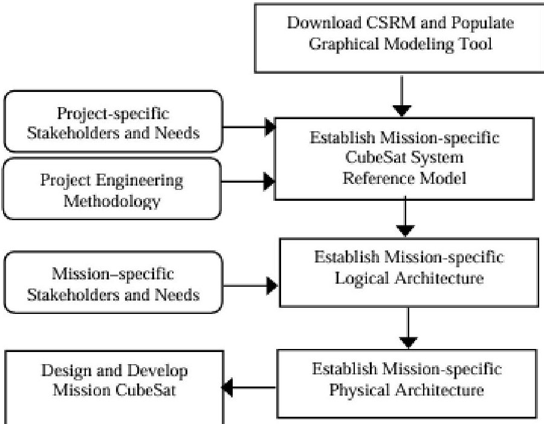

Figure 5: Engineering of a Mission-Specific CSRM [16]

CSRM to support MEng activities. They show the mapping of CSRM elements to MEng activities at the mission, logical, physical, and dynamic modeling levels.

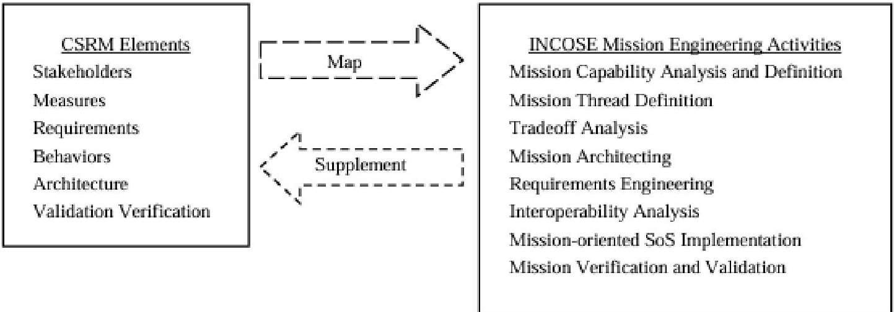

Figure 6: MEng Architecting Activities [16]

## 1.3. Updating A Model-Based Systems Engineering (MBSE) Model

While specific changes can be made to the CSRM to make it easier for future lunar cubesat mission developers to make their particular category of missions, a balanced approach must be taken when adding those changes to the model. There are several considerations, including:

<!-- PDF_PAGE: 16 -->

Model Reusability: The point of the CSRM is to be a generalized MBSE model for CubeSat missions that is reusable across various mission types. These missions in Earth Orbit themselves can have large varieties and variations, including LEO, high eccentricity orbits or geostationary orbit missions. Eventually, the CSRM would want to be accessible to other interplanetary targets beyond Earth’s Moon. Adding specific elements tailored for a lunar mission could limit the reusability of the model for other mission types. It could lead to a model that is too specialized and not adaptable to different mission contexts, reducing its overall usefulness and applicability.

Scope Management: Including specific elements for a lunar mission could expand the scope of the CSRM model beyond its intended purpose. While lunar missions are an essential aspect of space exploration, they represent a small fraction of the planned space missions involving the cubesat form factor. Priority should be given to making sure the CSRM is the best-generalized model that allows for the most straightforward implementation for the broadest scope of mission types. Also, it can simply accommodate various mission types without being overly focused on a specific subset of missions.

Complexity Management: Incorporating specific elements for a lunar mission would significantly increase the complexity of the CSRM model. Lunar missions involve unique challenges such as deep space communication, lunar orbit insertion, surface exploration, and resource utilization. Integrating these specific elements into a generalized model designed for various space missions could increase model complexity (as opposed to mission complexity), making it harder to manage and maintain for similar or smaller scoped missions (such as those in LEO).

Resource Constraints: Developing and maintaining any comprehensive MBSE model requires significant resources, including time, effort, and money. The CSRM is no exception to these

<!-- PDF_PAGE: 17 -->

constraints. Adding specific elements for a lunar mission would require additional model development, validation, and verification resources. It may also necessitate specialized knowledge and expertise in lunar mission design, which may not be readily available within the INCOSE team developing the CSRM.

Restraints to Evolution and Updates: Space missions and technologies constantly evolve, with new challenges and requirements emerging. CubeSats are meant to rapidly adapt to these new challenges with low-cost, straightforward solutions. The CSRM was and is intended to allow for more accessible evolution and updates to accommodate these changes across various mission types. However, incorporating specific elements for a lunar mission could complicate updating the model to reflect new developments in lunar exploration and technology. If the Lunar-specific aspects would complicate future updates to the model, then consideration must be made to ensure they are worth it.

Usage Difficulty: The goal of the CSRM is to minimize the cost and impact of a systems engineer's (or engineering team's) time to implement an MBSE model in SysML. The onboarding ramp for implementing a physical model for an actual mission using the CSRM could be estimated to be <120 work hours for an experienced Systems Engineer and <360 hours for an inexperienced engineer. The goal would be to maintain or improve upon that metric.

This Thesis considered these factors in the analysis and when making recommendations. However, as the scope of the model increases in the future, these factors will become less of a consideration as their impact is deemed inconsequential to the goal of expanding the scope.

## 2. Definitions

In this section, definitions for the MEng Artifacts and SMA elements are laid out according to the studies [16] and [17], the SEBoK [18], and the SMAD handbook [15]. This literature

<!-- PDF_PAGE: 18 -->

review selected six MEng Artifacts and nine top-level SMA elements, with 20 Sub Level SMA elements, as the basis of this Thesis's discussions and analysis.

## 2.1. Mission Engineering Artifact Definitions

The study [16] determined that during an MEng-oriented SoS implementation, key decision points are identified and supported by various forms of data, evidence, or knowledge of key work products or artifacts. The identified list of seven MEng artifacts from the SEBoK [18] in the context of this Thesis is defined by:

A1. Capability Objectives - Statements of the top-level objectives for the SoS that describe capabilities needed by the user. They provide a basis for translating operational needs into high-level requirements, assessing performance to objectives, and developing architecture and solution options.

A2. Concept of Operations (CONOPS) - Describes how functionality of the systems in the SoS will be employed in an operational setting. It describes how users plan to operate and use systems to achieve SoS capability objectives. It is used to define the SoS requirements space and identify aspects of systems that could impact the SoS design.

A3. Systems Information - Contains information about constituent systems that impact SoS capability objectives. This information includes both technical and programmatic aspects of the system. Not all programmatic aspects (such as organizational structures, fiscal data, and planning perspectives) are addressed as they are not considered key elements of a CubeSat MEng model, according to the study [17].

A4. Requirements Space - Similar but not quite the same as a trade space, this defines the functions required to provide the needed operational capability, considering the variability in the user environment that impacts how these functions will be executed. It is defined at a level of detail

<!-- PDF_PAGE: 19 -->

that enables trades among potential and actual constituent systems and interfacing external systems. As stated above, the requirements space is derived from the SoS CONOPS.

A5. Performance Measures and Data - Measures are directly traceable to the capability objectives defined for the SoS. These measures are used to assess the status and progress of the SoS in meeting its objectives.

A6. Architecture - Or Space Mission Architecture (SMA) Provides a context for understanding the relationships among constituent systems and developing implementation options for meeting capability requirements. It includes systems information, connectors and protocols used to communicate and synchronize processing across systems, key data elements/structures that cross interfaces, and key data conversions to facilitate data sharing and communication between constituents.

A7. Technical Baselines - This includes a requirements baseline, an allocated baseline, a product baseline for the SoS, and the detailed system baselines maintained by the systems.

## 2.2.Space Mission Architecture Element Definitions

The widely used mission design handbook "The New SMAD" [15] defines a space mission architecture (or A6. Architecture) that contains seven essential elements that are common to all space missions. It breaks many of those elements into sub-elements, further defining the mission architecture. The definitions of the elements and sub-elements identified from [14-17] used for this Thesis are:

E1. Subject - Represents what the spacecraft observes (Passive Subject) or interacts (Active Subject) with. This indicates the overall purpose or objective of the space mission. It defines the scientific, exploration, or operational goals the mission aims to achieve. This could be a

<!-- PDF_PAGE: 20 -->

remote sensing target, a communication system terminal or other item that is central to the objective of the mission's purpose.

E2. Spacecraft Payload (P/L) - The portion of the spacecraft that interacts with the Subject.

E3. Spacecraft Bus - The other spacecraft subsystems needed to support the payload

E3.1. Propulsion - The system that produces the spacecraft's thrust, including fuel storage and plumbing.

E3.2. ADCS (Attitude Determination and Control System) Sensors, actuators, and software necessary to control the spacecraft pointing

E3.3. Position and Orbit Determination - Sensors and software necessary to control the spacecraft orbit

E3.4. C&DH (Command and Data Handling) - Electronics and software

E3.5. TT&C (Telemetry, Tracking and Command) - Radio and associated hardware, such as cabling and antennas, used to communicate with the ground or other spacecraft.

E3.6. Power - Electronics, power generation, power storage devices, and harnessing for power distribution.

E3.7. Structures and Mechanism - All hardware that supports the spacecraft, including the primary structural components, brackets, fasteners, and the actuators and mechanisms associated with deployed or movable structures.

E3.8. Thermal Control - All the hardware necessary to control the spacecraft's temperature.

E4. Ground Segment - The communications equipment and facilities that communicate and control the spacecraft

<!-- PDF_PAGE: 21 -->

E4.1. Antenna/Data Reception Services - Enables transmission/reception and processing of communication signals (most commonly RF) with an embedded Data Stream.

E4.2. Ground Equipment Control - Ensures data streams heading to and from the spacecraft are complete and distributed to the proper users within the required latency period.

E4.3. Command/Control and Data Processing Services - Responsible for generating spacecraft instructions for uplink and for processing the data received from the spacecraft into information required to support the end users

E5. Mission Operations - All of the components of the functions that are completed that run the space mission on a day-to-day basis. According to the SMAD [14], eight typical mission operation functions perform distinct tasks during most space missions. Each mission operation function consists of the facilities, equipment, software, and personnel used to:

E5.1. Mission Planning and Scheduling - Plan and schedule program the activities of the space and ground segments to ensure that the space mission and its objectives are met.

E5.2. Test and Simulations - Support operations training and rehearsals, test command scripts before unlinking to the spacecraft, perform anomaly resolution, perform flight software maintenance, and test system modifications and enhancements.

E5.3. Ground Segment Control - Monitor and control the mission's ground network including the ground stations and the connecting communications network.

E5.4. Real-Time Flight Operations - Provide real-time monitoring, command, and spacecraft control during ground contact.

<!-- PDF_PAGE: 22 -->

E5.5. Spacecraft Operations - Provide engineering support for the spacecraft bus during the mission.

E5.6. Payload Operations - Monitor and maintain the health and welfare of the payload instruments (or other equipment) to monitor the performance of the instruments, and sometimes any ground processing and ground-based data quality measurements, in accomplishing the mission objectives.

E5.7. Data Processing - Accept the flow of data received by the ground segment, process it to a specified form, and then archive and distribute it to the specified users.

E5.8. Flight Dynamics - aka Orbital Design and GNC Determine and predict the spacecraft's orbit and position in space and determine or calculate its orientation. This function is sometimes done entirely or in part onboard the spacecraft.

E6. Command, Control, and Communications (C3) Architecture - How all the parts of the space mission communicate with each other

E7. Orbit - The path of the spacecraft during its operational mission.

E8. Launch Segment - How the Spacecraft gets to its orbit; May include upper stages or integral propulsion

E9. Mission Concept - The definition of how the mission elements work together to meet the needs of the End Users.

E9.1. End Users - The people or equipment that use the data generated or transmitted by the spacecraft.

## 3. LEO vs Lunar Missions

This section compares significant design considerations for space missions in Low Earth Orbit (LEO) and one in a Lunar orbit in the context of the six MEng Artifacts and the nine top-level

<!-- PDF_PAGE: 23 -->

SMAs. The primary source of information for this comparison was [15, 19, 20, 21]. Other sources are cited below.

## 3.1. Use Case Studies

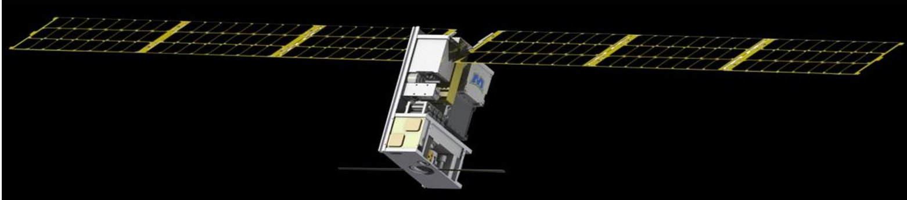

Figure 7: Lunar CubeSat mission Lunar IceCube Spacecraft Rendering [27]

When considering the analysis of the CSRM for both LEO and Lunar Orbit missions, two cubesat missions were used as case studies when inference had to be made beyond what might be expected from generalizing missions beyond those described in the SMAD handbook [15] or the general lunar missions in [19] and [21]. The three missions used were the Arizona State University (ASU) Phoenix CubeSat, Morehead State University (MSU)’s Lunar IceCube Mission and NASA's CAPSTONE.

The Phoenix CubeSat was ASU's first fully student-led CubeSat project. It aimed to study the

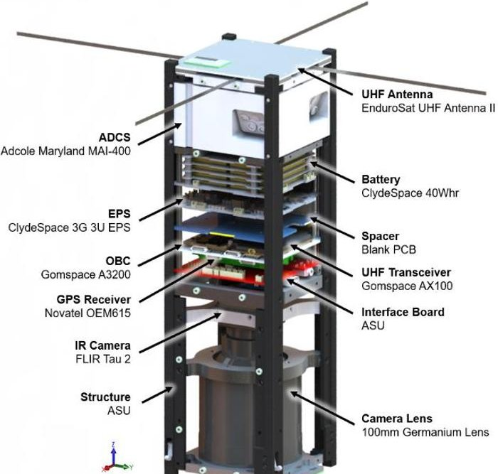

Figure 8: Phoenix model, showing the internal configuration of the spacecraft [26]

effects of Urban Heat Islands (UHIs) from LEO through infrared remote sensing that will take ground surface temperature measurements of target cities. UHI is a phenomenon in which the structure of the city causes a rise in the surface temperature of the urban area when compared to natural or other less developed environments. The 3U CubeSat was primarily made from

<!-- PDF_PAGE: 24 -->

Commercial of the Shelf (COTS) components centered around a thermal imaging camera. Figure 11 shows the CONOPs of the Phoenix mission and the different aspects of the mission phases. For more details on the mission and component systems, see [26].

MSU's Lunar IceCube was a university-built 6U cubesat primarily built from COTS components, many of which were used for the first time beyond LEO, but with a NASA GSFC payload and JPL science principal investigator. The mission's primary objective was to determine the distribution of water and water components, including ice, on the Moon's surface as a

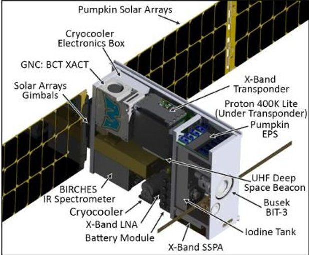

Figure 9: Lunar IceCube model, showing the internal configuration of the spacecraft [27]

function of time of day and latitude. An onboard near-to-mid-infrared spectrometer made measurements. Lunar Ice Cube was the first cubesat to utilize a cryocooler as well as an ion propulsion drive beyond LEO [27]. Stakeholders included NASA HEOMD and the lunar science community. Figure 12 shows the CONOPs of the Lunar IceCube mission and the different aspects of the mission phases. For more details on the mission and component systems, see [27].

As a secondary use case for lunar Missions, the Cislunar Autonomous Positioning System Technology Operations and Navigation Experiment (CAPSTONE) mission, a 12U cubesat tech demonstration mission that was the first cubesat to the moon in a pathfinder for Gateway, a Moon-

orbiting outpost that is part of NASA's Artemis program was also selected. CAPSTONE was launched on June 28, 2022, arrived in lunar orbit on November 14, 2022 and was designed to help reduce risk for future spacecraft by validating

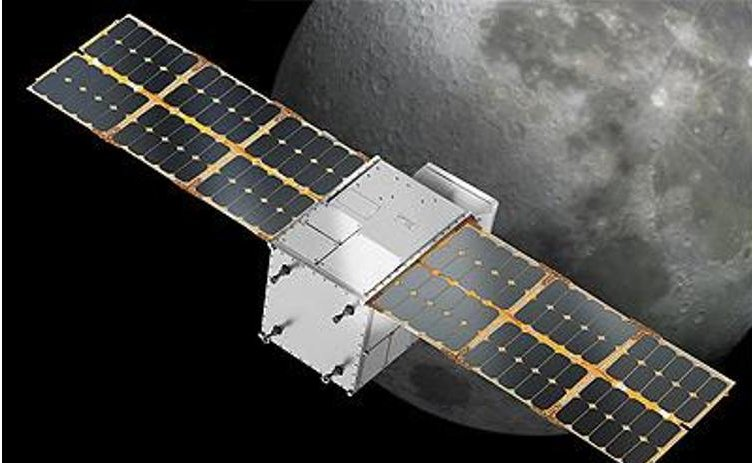

Figure 10: CAPSTONE Rendering. Image Courtesy of NASA

<!-- PDF_PAGE: 25 -->

innovative navigation technologies and verifying the dynamics of the Gateway's halo-shaped orbit. Its main objectives were: 1) Validating the characteristics of a near-rectilinear halo orbit for future spacecraft. 2) Demonstrating how to enter and maintain the halo orbit. 3) Demonstrating spacecraft-to-spacecraft communication and navigation technology near the moon. For more details on the mission and component systems, see [28].

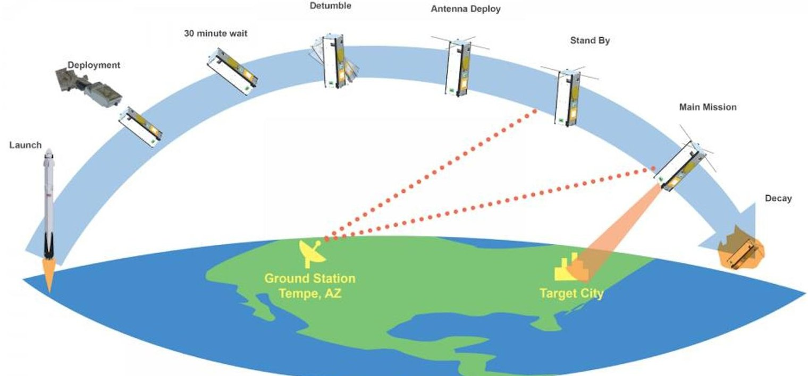

Figure 11: Simplified CONOPS for the Phoenix Mission [26]

<!-- PDF_PAGE: 26 -->

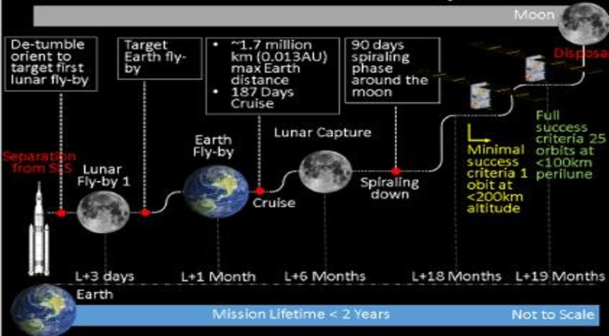

Figure 12: Simplified CONOPS for the Lunar IceCube Mission [27]

## 3.2. Effects MEng Artifacts and SMA Elements

## A1. Capability Objectives

The capability objectives for a space mission in LEO often revolve around remote observation, telecommunications, scientific research, or technology demonstrations. These are frequently very similar to the objectives of Lunar orbiting missions. However, LEO missions are nearly always Earth-centric, with exceptions like astronomy. These objectives capitalize on the proximity to Earth to gather data, conduct experiments, or provide services. In contrast, a mission in lunar orbit typically focuses on lunar exploration, scientific research, resource surveying, or utilization related to the Moon. The objectives may include studying the lunar surface, conducting geological surveys, or investigating potential sites for future human missions.

## A2. Concept of Operations (CONOPS)

The CONOPS for space missions in both LEO and Lunar orbit typically involve routine operations such as payload monitoring, orbit adjustments, and communication checks, focusing on

<!-- PDF_PAGE: 27 -->

maximizing mission efficiency and data collection. LEO Mission operations are also typically simpler, shorter, and more flexible due to the spacecraft's proximity to Earth. In contrast, the CONOPS for a mission in lunar orbit is more complex and involves intricate and highly time-sensitive maneuvers such as earth escape, lunar orbit insertion, and circulation. Lunar Mission objectives may include deploying instruments for lunar surface observation or conducting experiments related to lunar science. Additional operational considerations must also be taken due to the distance from Earth, such as longer timelines, and factors such as lunar lighting conditions, communication delays, and resource constraints inherent to deep space missions.

However, it can be noted that as technology evolves, and planned infrastructure projects are built around the Moon, some aspects of the design of Lunar CONOPS will be able to leverage what are currently only available to Earth orbiting missions. These include Communication and Navigation infrastructure that will alleviate some of the difficulties of operating a long distance from Earth. These will enable the CONOPS of lunar missions to converge with and be more similar to Earth Orbiting missions.

## A3. Systems Information

Top and mid-level systems information for LEO and Lunar missions focuses on subsystems related to all spacecraft designs. These include power generation, computing, propulsion, and communication systems. Where these systems start to deviate is where they must be designed to withstand the challenges of operating on the Earth or Lunar environment. This includes atmospheric drag, radiation, and temperature fluctuations for LEO missions. Lunar orbit missions require additional design considerations such as extra radiation shielding, navigation systems optimized for deep space, and surface exploration capabilities. The spacecraft for lunar missions must also be resilient to the unique thermal and mechanical stresses encountered during lunar orbit

<!-- PDF_PAGE: 28 -->

insertion and potential surface operations, introducing design elements absent in LEO missions.

## [22]

There are also system information-related concerns about Lunar Missions not having access to or being able to unitize Earth-based resources. This can include LEO missions using systems that exploit some of Earth's inherent properties, such as its magnetic field, body views, or gravity for navigation, sensing, or maneuvers. While Lunar missions Moon may be able to sense similar properties of the Moon, they tend to be far less in magnitude and consistency, which makes using systems detecting and using them for nonscientific purposes more difficult. Infrastructure based on Earth's surface or orbit, such as low gain antenna, communication relay systems, and global positioning systems, also cannot be utilized in the same manner as LEO missions.

## A4. Requirements Space

LEO mission requirements space encompasses parameters such as orbital characteristics, communication coverage, payload capabilities, and operational timelines, all tailored to Earth-centric parameters. Constraints may include limited communication bandwidth, orbital debris avoidance, and power limitations based on solar exposure. Lunar orbit mission requirements are nearly identical, except they are Moon-centric. Some extend to factors like lunar lighting conditions, communication delays due to the increased distance from Earth, and fuel requirements for complex maneuvers. However, there would be minimal difference in how these would be organized in a typical requirements space for a space mission system. The exception is operational constraints for lunar missions that include surface components, consisting of mission duration, surface accessibility, and resource availability on the Moon. [23]

A5. Performance Measures and Methods

<!-- PDF_PAGE: 29 -->

Performance measures and methods for both LEO and Lunar orbit missions utilize similar metrics like data collection rates, navigation accuracy, communication reliability, power consumption, and payload functionality. Methods for both involve telemetry monitoring, ground testing, and simulations. Lunar orbit missions introduce additional factors to consider, such as propulsion efficiency for deep space maneuvers and surface exploration capabilities. Performance evaluation methods for lunar missions may also involve lunar reconnaissance, remote sensing, and in-situ measurements, reflecting the specific challenges and goals associated with lunar exploration.

## A6. Architecture

At the highest level, both LEO and Lunar Orbit mission architectures are designed to meet the demands of space operations, emphasizing modularity, scalability, and adaptability to accommodate diverse payloads and mission objectives. Where Lunar orbit mission architecture is tailored to address the unique challenges of deep space operations, with additional emphasis on radiation shielding, navigation systems, propulsion and surface exploration capabilities, components or platforms for lunar missions may include specialized lunar landing modules, surface rovers, and communication relays, reflecting the requirements of lunar exploration objectives that differ significantly from LEO mission architectures. [23].

## A7. Technical Baselines

LEO mission technical baselines establish the reference configuration, specifications, and performance criteria for spacecraft and associated systems based on parameters like orbit altitude, inclination, payload capacity, and communication bandwidth. Lunar orbit mission technical baselines extend to include deep space propulsion systems, radiation shielding materials, and surface exploration capabilities. These baselines guide system design, integration, and testing

<!-- PDF_PAGE: 30 -->

activities to ensure mission success in the lunar environment, introducing technical considerations absent in LEO missions. The technical baselines provide a comprehensive framework for addressing the challenges and requirements associated with lunar exploration missions.

## E1. Subject

The subject of a space mission in LEO is almost always Earth-centric activities such as Earth remote sensing, telecommunications, scientific research, or satellite servicing. These missions aim to gather data about Earth's atmosphere, climate, and surface features or provide communication services to users on the ground. Astronomy and planetary exploration telescopes are the exceptions. Missions in Lunar orbits are similarly Lunar-centric, with subjects furthering exploration, scientific research, and potential resource utilization on the Moon. The subject is the highest-level driver of the design considerations for each mission, influencing payload selection, spacecraft design, and operational planning tailored to achieve the specific objectives relevant to their respective orbital environments. Thus, understanding the flow down of requirements due to a Lunar or Earth subject is vital for creating an effective model.

## E2. Spacecraft Payload (P/L)

Spacecraft payloads for missions in LEO and lunar orbit are designed to achieve the specified objectives of each mission. Payloads often include instruments and equipment for remote observation, telecommunications, or scientific research in LEO and Lunar missions. LEO payloads must be optimized to operate in Earth's atmosphere and environment, focusing on data collection or service provision for users on the ground. However, payloads for lunar orbit missions are currently optimized for lunar exploration and analysis. This may include instruments for surface mapping, geological surveys, sample collection, or prospecting for resources like water ice. The unique conditions of the lunar surface, including even more extreme temperature variations and

<!-- PDF_PAGE: 31 -->

radiation exposure, influence the design of payloads for lunar missions, requiring ultra-robust and durable instrumentation tailored to lunar exploration objectives. [23]

## E3. Spacecraft Bus

The spacecraft bus is the foundational system for both LEO and lunar orbit missions, providing the necessary infrastructure to support payload operations and complete mission objectives. For LEO CubeSat missions, buses are often designed for shorter mission durations and focus on Earth-centric operations, featuring power systems such as solar arrays, propulsion systems for orbit adjustments, and communication subsystems optimized for Earth-based ground stations. Conversely, CubeSat buses for lunar orbit missions require additional capabilities to support deep space operations and potential surface exploration. They may include robust propulsion systems for lunar orbit insertion and maneuvering, radiation shielding to protect onboard systems from cosmic radiation, and navigation systems optimized for deep space navigation. The design of buses for LEO and lunar orbit missions, while containing similar subsystems, must be tailored to meet each mission's specific requirements and operational challenges.

## E4. Ground Segment

The ground segment for space missions is crucial in communication, tracking, and controlling spacecraft operations. In both LEO and lunar orbit missions, the ground segment consists of a network of ground stations distributed across the globe to maintain continuous contact with the spacecraft. However, there are differences in the design considerations for the ground segment between missions in LEO and lunar orbit. For LEO missions, the ground segment is optimized for near real-time communication with the spacecraft as it orbits Earth. These ground stations send commands to the spacecraft, receive telemetry data, and monitor its health and status.

<!-- PDF_PAGE: 32 -->

Communication protocols are optimized for low-latency data transfer, with redundancy built into the system to ensure continuous contact. In contrast, the ground segment for lunar orbit missions requires specialized infrastructure to support deep-space communication over longer distances. This may include specialized deep space tracking stations equipped with high-gain antennas and powerful transmitters to maintain contact with the spacecraft as it orbits the Moon. Communication protocols must currently account for signal delays due to the increased distance, requiring more robust error correction and data transmission techniques. However, future missions may deviate from this approach. An effective model must consider design considerations for the ground segment in LEO and lunar orbit missions that are tailored to ensure reliable communication and support during all mission phases. However, it should be noted that as technology advances and planned infrastructure projects around the Moon are implemented the differences in complexity between LEO and Lunar cubesats will become less pronounced.

## E5. Mission Operations

Space mission operations for CubeSats in LEO and lunar orbit differ in complexity and operational timelines. In LEO missions, operations are typically more routine and frequent, involving payload monitoring, orbit adjustments, and communication checks. The proximity to Earth allows for more frequent communication with ground stations, shorter response times for command execution, and easier access for maintenance and troubleshooting. In contrast, mission operations for lunar orbit missions are more complex and require meticulous planning due to longer mission durations, shorter windows for correction, greater distances, and unique operational challenges associated with deep space exploration. Operations teams must coordinate closely with ground stations to ensure timely communication and support during critical mission phases such as lunar orbit insertion, descent, and potential surface operations. Operational timelines are

<!-- PDF_PAGE: 33 -->

extended, with longer periods between mission phases to account for the increased distances and communication delays. The design considerations for mission operations in LEO and lunar orbit missions are tailored to ensure the successful execution of mission objectives while accounting for the specific challenges and requirements of each mission's operational environment. However, it should be noted that as technology advances and planned infrastructure projects around the Moon are implemented the differences in complexity between LEO and Lunar cubesats will become less pronounced.

## E6. Command, Control, and Communications (C3) Architecture

The command, control, and communications (C3) architecture for space missions in LEO and lunar orbit differ in complexity and communication requirements. For both Lunar and LEO missions, the C3 architecture typically involves a network of ground stations and satellite relay systems for near real-time communication with the spacecraft. These systems send commands to the spacecraft, receive telemetry data, and monitor its health and status. Communication protocols are optimized for low-latency data transfer, with redundancy built into the system to ensure continuous contact. However, the C3 architecture for lunar orbit missions requires specialized deep-space communication systems to support communication over longer distances and durations. This may include deep space tracking stations equipped with high-gain antennas and powerful transmitters to maintain contact with the spacecraft as it orbits the Moon. Communication protocols must account for signal delays and higher error rates due to the increased distance, requiring more robust error correction and data transmission techniques. The design considerations for the C3 architecture in LEO and lunar orbit missions are tailored to ensure reliable communication and control of the spacecraft throughout all mission phases.

## E7. Orbit

<!-- PDF_PAGE: 34 -->

The orbit for space missions in LEO and lunar orbit differs significantly in altitude, duration, and overall objectives. In LEO missions, spacecraft typically orbit Earth at altitudes ranging from a few hundred kilometers to a few thousand kilometers, with orbits optimized for specific objectives such as Earth observation, telecommunications, or scientific research. These orbits are relatively stable and feature shorter orbital periods, allowing frequent revisits of locations on Earth's surface. In contrast, lunar orbit missions involve spacecraft orbiting the Moon at various altitudes, depending on mission objectives such as reconnaissance, mapping, or scientific observation. Lunar orbits can range from highly elliptical orbits with varying periapsis and apoapsis distances to more circular orbits closer to the lunar surface. Moon orbits are much less stable due to relatively greater variations in gravity regardless of the exact orbit, requiring more onboard resources (propellent, power, etc.), onboard autonomy and careful orbit selection. The lunar orbits' duration is typically longer than LEO missions, with orbital periods ranging from several hours to several days, depending on the mission's requirements. The design considerations for the orbit in LEO and lunar orbit missions are tailored to achieve each mission's orbital environment's specific mission objectives and operational requirements.

## E8. Launch Segment

The launch segment for space missions in LEO and lunar orbit differs regarding launch vehicle requirements, trajectory calculations, and overall mission profile. For LEO missions, the launch segment involves selecting a suitable launch vehicle and trajectory to achieve the desired orbit around Earth. Launch vehicles for LEO missions must have sufficient thrust capability to reach the desired orbital altitude and inclination, with trajectory calculations optimized for payload delivery and orbital insertion. In contrast, the launch segment for lunar orbit missions requires additional considerations due to the higher energy requirements for reaching lunar orbit. Launch

<!-- PDF_PAGE: 35 -->

vehicles must have higher thrust capability and delta-v to escape Earth's gravity and achieve lunar transfer trajectories. Trajectory calculations are more complex, accounting for multiple orbital maneuvers, including lunar orbit insertion and potential surface operations. The design considerations for the launch segment in LEO and lunar orbit missions are tailored to ensure the successful delivery of the spacecraft to its intended orbit or trajectory, accounting for each mission's specific energy requirements and mission objectives.

## E9. Mission Concept

The mission concept serves as the overarching framework for planning and executing space missions, defining the mission's objectives, scope, and operational approach. In LEO and lunar orbit missions, the mission concept is shaped by the mission's subject, payload requirements, operational considerations, and overall mission objectives. However, there are differences in the mission concept between LEO and lunar orbit missions. LEO missions often involve shorter-duration missions focused on specific Earth-centric objectives such as Earth observation, telecommunications, or scientific research. These missions are designed to leverage the proximity to Earth for data collection, communication, and services. In contrast, lunar orbit missions encompass longer-duration missions with objectives centered around lunar exploration, scientific research, and potential resource utilization on the Moon. These missions require meticulous planning and coordination to address the challenges of deep space exploration, including communication delays, radiation exposure, and complex orbital maneuvers. The mission concept for LEO and lunar orbit missions is tailored to achieve each mission's orbital environment's specific objectives and operational requirements while maximizing scientific or operational returns.

<!-- PDF_PAGE: 36 -->

## 4. CSRM Mapping

This section determines whether the existing CSRM element is captured by MEng artifacts and SMA Elements associated with a typical CubeSat mission in LEO. For this analysis, 200 CSRM elements were "mapped" or sorted under its "singular" and "closest" MEng Artifact (in Appendix B) or SMA Element (in Appendix C). The sorting is determined by an analysis based on a comparison of the definitions of each Artifact and Element, where the goal of the CSRM to be the best representation of a general model is kept in consideration. Each CSRM Element is organized under 8 different columns representing the different type of element. These types include Top Level Elements, Systems Elements, Sub Systems and Nested Elements, Components Top Level Package, Mid-Level Package, Low-Level Package, and Tables and Matrices. Note that there is no value associated with the order of the types of elements in Appendices B and C. Also, no lowerlevel elements are directly meant to be associated with a shared higher-level element in the same row. In Appendix B, 75 CSRM Elements are sorted into the closest 7 MEng Artifacts. In Appendix C, 125 CSRM Elements are sorted into the closest 9 systems and 15 subsystems in the SMA.

## 5. Weights of MEng Artifacts and SME Elements

Tables 1 and 2 depict N-squared [24] charts/diagrams depicting whether there is a primary, secondary, and tertiary design impact or influence (in the context of the design space) of row Artifact or Element on the corresponding column Artifact or Element (vice versa). The color indicates the relative magnitude of the impact, with red representing a direct or "Primary" impact, orange representing a "Secondary Impact," or yellow representing a "Tertiary Impact". Primary impacts are those that have the greatest linked increase in the complexity, cost or otherwise uses of a critical or finite resource metric in the context of a space mission. With Secondary and Tertiary impacting those same parameters but to a lesser extent and to a weaker correlation. For both tables

<!-- PDF_PAGE: 37 -->

to further determine the importance and separate interactions, both have a "Space Environment row to see how the various SMA elements and MEng artifacts interact with that significant design driver. Table 3 is a simple impact chart/diagram that uses the same impact metrics as Tables 1 and 2.

Table 1: Mission Engineering N2 Diagram

<table border="1"><tr><td rowspan="2" colspan="2"></td><td>Capability Objectives</td><td>CONOPS</td><td>Systems Information</td><td>Requirements Space</td><td>Performance Measures and Methods</td><td>Architecture</td><td>Technical Baselines</td></tr><tr><td>A1</td><td>A2</td><td>A3</td><td>A4</td><td>A5</td><td>A6</td><td>A7</td></tr><tr><td colspan="2">Capability Objectives</td><td>黑</td><td>红</td><td>黄</td><td>红</td><td>黄</td><td>黄</td><td>黄</td></tr><tr><td colspan="2">CONOPS</td><td>A2</td><td>黑</td><td></td><td>黄</td><td>黄</td><td>黄</td><td></td></tr><tr><td colspan="2">Systems Information</td><td>A3</td><td></td><td>黑</td><td></td><td></td><td>黄</td><td>黄</td></tr><tr><td colspan="2">Requirements Space</td><td>A4</td><td></td><td>黄</td><td>黑</td><td>红</td><td></td><td>黄</td></tr><tr><td colspan="2">Performance Measures and Methods</td><td>A5</td><td></td><td></td><td></td><td>黑</td><td></td><td>黄</td></tr><tr><td colspan="2">Architecture</td><td>A6</td><td></td><td>黄</td><td></td><td></td><td>黑</td><td></td></tr><tr><td colspan="2">Technical Baselines</td><td>A7</td><td></td><td>黄</td><td>红</td><td>黄</td><td></td><td>黑</td></tr><tr><td colspan="2">Space Environment</td><td>ENV</td><td></td><td>蓝</td><td></td><td></td><td></td><td></td></tr><tr><td colspan="2">Primary Impact</td><td>红</td><td colspan="3">Secondary Impact</td><td>黄</td><td colspan="2">Tertiary Impact</td></tr><tr><td colspan="2"></td><td colspan="3">Environmental Impact</td><td>蓝</td><td colspan="3"></td></tr></table>

<!-- PDF_PAGE: 38 -->

Table 2: Space Mission Architecture N2 Diagram

<table border="1"><tr><td></td><td>Subject</td><td>Payload</td><td>Spacecraft bus</td><td>Propulsion</td><td>ADCS</td><td>Position and Orbit Determination</td><td>C&amp;DH</td><td>TT&amp;C</td><td>Power</td><td>Structures and Mechanism</td><td>Thermal Control</td><td>Ground Segment</td><td>Antenna/Data Receiving Services</td><td>Ground Equipment Control</td><td>C2 and Data Processing Services</td><td>Mission Operations</td><td>Mission Planning and Scheduling</td><td>Test and Simulations</td><td>Ground Segment Control</td><td>Real-Time Flight Operations</td><td>Spacecraft Operations</td><td>Payload Operations</td><td>Data Processing</td><td>Flight Dynamics</td><td>C3 Architecture</td><td>Orbit</td><td>Launch Segment</td><td>Mission Concept</td><td>End Users</td></tr><tr><td>Subject</td><td></td><td></td><td></td><td></td><td></td><td></td><td>C&amp;DH</td><td></td><td>TT&amp;C</td><td></td><td>Power</td><td>Structures and Mechanism</td><td>Thermal Control</td><td>Ground Segment</td><td>Antenna/Data Receiving Services</td><td>Ground Equipment Control</td><td>C2 and Data Processing Services</td><td>Mission Operations</td><td>Mission Planning and Scheduling</td><td>Test and Simulations</td><td>Ground Segment Control</td><td>Real-Time Flight Operations</td><td>Spacecraft Operations</td><td>Payload Operations</td><td>Data Processing</td><td>Flight Dynamics</td><td>C3 Architecture</td><td>Orbit</td><td>Launch Segment</td><td>Mission Concept</td><td>End Users</td></tr><tr><td>Payload</td><td></td><td>

<!-- PDF_PAGE: 39 -->

Table 3: SMA to MEng Relations Chart

<table border="1"><tr><td rowspan="3" colspan="2"></td><td>Capability Objectives</td><td colspan="2">CONOPS</td><td colspan="2">Systems Information</td><td colspan="2">Requirements Space</td><td colspan="2">Performance Measures and Architecture</td><td colspan="2">Technical Baselines</td></tr><tr><td>A1</td><td>A2</td><td>A3</td><td>A4</td><td>A5</td><td>A6</td><td>A7</td><td></td><td></td><td></td><td></td></tr><tr><td>Subject</td><td>E1</td><td></td><td></td><td></td><td></td><td></td><td></td><td></td><td></td><td></td><td></td></tr><tr><td colspan="2">Payload</td><td>E2</td><td></td><td></td><td></td><td></td><td></td><td></td><td></td><td></td><td></td><td></td></tr><tr><td colspan="2">Spacecraft bus</td><td>E3</td><td></td><td></td><td></td><td></td><td></td><td></td><td></td><td></td><td></td><td></td></tr><tr><td colspan="2">Propulsion</td><td>E3.1</td><td></td><td></td><td></td><td></td><td></td><td></td><td></td><td></td><td></td><td></td></tr><tr><td colspan="2">AD&amp;C System</td><td>E3.2</td><td></td><td></td><td></td><td></td><td></td><td></td><td></td><td></td><td></td><td></td></tr><tr><td colspan="2">Position and Orbit Determination</td><td>E3.3</td><td></td><td></td><td></td><td></td><td></td><td></td><td></td><td></td><td></td><td></td></tr><tr><td colspan="2">C&amp;DH</td><td>E3.4</td><td></td><td></td><td></td><td></td><td></td><td></td><td></td><td></td><td></td><td></td></tr><tr><td colspan="2">TT&amp;C</td><td>E3.5</td><td></td><td></td><td></td><td></td><td></td><td></td><td></td><td></td><td></td><td></td></tr><tr><td colspan="2">Power</td><td>E3.6</td><td></td><td></td><td></td><td></td><td></td><td></td><td></td><td></td><td></td><td></td></tr><tr><td colspan="2">Structures and Mechanism</td><td>E3.7</td><td></td><td></td><td></td><td></td><td></td><td></td><td></td><td></td><td></td><td></td></tr><tr><td colspan="2">Thermal Control</td><td>E3.8</td><td></td><td></td><td></td><td></td><td></td><td></td><td></td><td></td><td></td><td></td></tr><tr><td colspan="2">Ground Segment</td><td>E4</td><td></td><td></td><td></td><td></td><td></td><td></td><td></td><td></td><td></td><td></td></tr><tr><td colspan="2">Antenna/Data Receiving</td><td>E4.1</td><td></td><td></td><td></td><td></td><td></td><td></td><td></td><td></td><td></td><td></td></tr><tr><td colspan="2">Data Accounting and Distribution</td><td>E4.2</td><td></td><td></td><td></td><td></td><td></td><td></td><td></td><td></td><td></td><td></td></tr><tr><td colspan="2">C3 and Data Processing</td><td>E4.3</td><td></td><td></td><td></td><td></td><td></td><td></td><td></td><td></td><td></td><td></td></tr><tr><td colspan="2">Mission Operations</td><td>E5</td><td></td><td></td><td></td><td></td><td></td><td></td><td></td><td></td><td></td><td></td></tr><tr><td colspan="2">Mission Planning and Scheduling</td><td>E5.1</td><td></td><td></td><td></td><td></td><td></td><td></td><td></td><td></td><td></td><td></td></tr><tr><td colspan="2">T&amp;S</td><td>E5.2</td><td></td><td></td><td></td><td></td><td></td><td></td><td></td><td></td><td></td><td></td></tr><tr><td colspan="2">Ground Segment Control</td><td>E5.3</td><td></td><td></td><td></td><td></td><td></td><td></td><td></td><td></td><td></td><td></td></tr><tr><td colspan="2">Real-Time Flight Operations</td><td>E5.4</td><td></td><td></td><td></td><td></td><td></td><td></td><td></td><td></td><td></td><td></td></tr><tr><td colspan="2">Spacecraft Operations</td><td>E5.5</td><td></td><td></td><td></td><td></td><td></td><td></td><td></td><td></td><td></td><td></td></tr><tr><td colspan="2">Payload Operations</td><td>E5.6</td><td></td><td></td><td></td><td></td><td></td><td></td><td></td><td></td><td></td><td></td></tr><tr><td colspan="2">Data Processing</td><td>E5.7</td><td></td><td></td><td></td><td></td><td></td><td></td><td></td><td></td><td></td><td></td></tr><tr><td colspan="2">Flight Dynamics</td><td>E5.8</td><td></td><td></td><td></td><td></td><td></td><td></td><td></td><td></td><td></td><td></td></tr><tr><td colspan="2">C3 Architecture</td><td>E6</td><td></td><td></td><td></td><td></td><td></td><td></td><td></td><td></td><td></td><td></td></tr><tr><td colspan="2">Orbit</td><td>E7</td><td></td><td></td><td></td><td></td><td></td><td></td><td></td><td></td><td></td><td></td></tr><tr><td colspan="2">Launch Segment</td><td>E8</td><td></td><td></td><td></td><td></td><td></td><td></td><td></td><td></td><td></td><td></td></tr><tr><td colspan="2">Mission Concept</td><td>E9</td><td></td><td></td><td></td><td></td><td></td><td></td><td></td><td></td><td></td><td></td></tr><tr><td colspan="2">End Users</td><td>E9.1</td><td></td><td></td><td></td><td></td><td></td><td></td><td></td><td></td><td></td><td></td></tr></table>

<!-- PDF_PAGE: 40 -->

It should be noted that in Table 2, A6 Architecture represents aggregated SMA Elements, so it is inherent to all artifacts. Tables 1, 2, and 3 are used in the analysis to prioritize changes to the CSRM that have global impacts on the representation of MEng Artifacts and SMA elements

## 6. CSRM Suitability Analysis

In this section, using the mapping results from Section 5 and considerations from Section 3, a determination of whether the existing CSRM element elements capture MEng artifacts and SMA elements associated with "Typical" LEO and lunar space missions. A "Typical" LEO [15] is a CubeSat that orbits the Earth at an altitude of between ~450 and ~2,000 km with an Orbital Period of >128 minutes (making at least 11.25 orbits per day) and an Eccentricity less than 0.25. Due to their relative rarity compared to LEP missions, the "Typical" Lunar Space mission [15, 19] are simply CubeSats that operate in the vicinity of Earth's Moon, where the Moon is the closest body and considered the primary source of gravitational forces experienced by the spacecraft. These include a verity of orbits with deferring altitude and orbital characteristics.

Determinations were categorized as Fully (100%), Mostly (>50%), Partially (<50%), or Not Captured (0%) based on how many and the quality of the CSRM elements represented in the MEng artifacts and SMA elements. These determinations are compared to the SSWG's INCOSE Study [17] in Appendices B and C Below, each MEng artifact and high-level SMA element will be assessed if this Thesis's findings concur with the study's findings [17]. It will also consider whether the recommended actions of [17] are appropriate. Other general observations will be reported as well. The recommended action based on the results of the analysis of this Thesis, as well as how disagreements with the recommendations of [17] can be rectified, will be covered in other sections.

<!-- PDF_PAGE: 41 -->

In Tables 4 and 5, MEng artifacts and SMA elements determined to be "Fully" captured means that the mission can reasonably be represented using the existing CSRM elements within the envisioned use case. It is expected that specific, unique, and unusual elements would be added by the CubeSat mission developer implementing the CSRM. In order of "Mostly" to "Partially" captured elements, artifacts indicate insufficient coverage by the aspects of the CSRM and that the CSRM could benefit from additions or changes. "Not Captured" Means that there are few, if any, CSRM elements that can allow a cubesat mission developer to represent most of the primary content necessary to cover the relevant MEng artifacts and SMA elements.

## 6.1.MEng Artifact Suitability Analysis

Table 4: Mission Engineering Mapping Results

<table border="1"><tr><td></td><td></td><td>LEO Coverage</td><td>Lunar Mission Coverage</td><td>INCOSE Study[17]</td></tr><tr><td>Capability Objectives</td><td>A1</td><td>Partially</td><td>Partially</td><td>Not Captured</td></tr><tr><td>CONOPS</td><td>A2</td><td>Fully</td><td>Fully</td><td>Fully</td></tr><tr><td>Systems Information</td><td>A3</td><td>Fully</td><td>Fully</td><td>Fully</td></tr><tr><td>Requirements Space</td><td>A4</td><td>Fully</td><td>Mostly</td><td>Fully</td></tr><tr><td>Performance Measures and Methods</td><td>A5</td><td>Fully</td><td>Mostly</td><td>Fully</td></tr><tr><td>Architecture</td><td>A6</td><td>Partially</td><td>Partially</td><td>Partially</td></tr><tr><td>Technical Baselines</td><td>A7</td><td>Mostly</td><td>Mostly</td><td>Mostly</td></tr></table>

## A1. Capability Objectives

The INCOSE SSWG study [17] found that the A1 Capability Objectives MEng Artifact was not contained in the CSRM. The findings of this Thesis disagree with its assessment. The recommendation of [17] was that "The CSRM currently does not contain a model element for capturing SoS capability objectives. This element would have to be created to support this SoS information artifact". This Thesis finds that that recommendation does not necessarily hold for either LEO or Lunar Missions. Additionally, this Thesis notes that some tables and matrices allow recording some overall Capability Objectives (mainly in the form of Mission Needs and

<!-- PDF_PAGE: 42 -->

Objectives). Still, they do not represent these as elements that can easily be tied into the rest of the CSRM to enable easy traceability of objectives to end capabilities. The study [17] also observes a significant representation of secondary stakeholders, such as regulatory bodies. Still, these are often removed from or missing straightforward steps that tie them directly to Capability Objectives. This is a significant discrepancy between the findings of this and the study [17]. However, the consequence is minimal and does not lead to additional recommendations.

## A2. Concept of Operations (CONOPS)

The INCOSE SSWG study [17] found that the A2 Concept of Operations (CONOPS) MEng Artifact was Fully contained in the CSRM. The findings of this Thesis concur with its assessment. The observation of [17] was that the CSRM currently contains model elements to capture enterprise-level behaviors. These provide the capability to capture enterprise behaviors, including use cases and activities that describe how users plan to operate and use systems to achieve SoS capability objectives. This Thesis finds that that recommendation is appropriate for LEO and Lunar Missions. CubeSat mission developers can use these use cases and activities to fully describe the systems' functionality in the SoS in a functional and operational setting.

## A3. Systems Information

The INCOSE SSWG study [17] found that the A3 Systems Information MEng Artifact was Fully contained in the CSRM. Its rationalization was that technical aspects of each system, such as those to be defined under a Systems Information artifact, would be unique to each CubeSat mission and be impossible to describe in advance as part of a reference model. The findings of this Thesis concur with that assessment. Further defining the Systems Information artifact would put the model at high risk of falling outside the required logical format of the CSRM and make unique mission systems and components harder to define within the model. The recommendation of [17]

<!-- PDF_PAGE: 43 -->

was that further expansions to the Architecture artifact to provide a complete space mission architecture would better expand the CSRM. Also, "That architecture, from a structural standpoint, includes all the necessary system elements relevant to a SoS. This allows MEng teams to define unique technical aspects for each constituent system of the SoS." Despite no specific CSRM elements falling under the artifact, as shown in Appendix B, this Thesis finds the explanation appropriate and correct. With both LEO and Lunar Further, this Thesis finds that further expansion of CSRM specifically for this Artifact is unnecessary.

## A4. Requirements Space

The INCOSE SSWG study [17] found that the A4 Requirements Space MEng Artifact was Mostly contained in the CSRM. The findings of this Thesis concur with its assessment of LEO missions but not Lunar missions. The findings of [17] were that "the CSRM currently contains model elements to capture requirements from the enterprise level down through the components of the CubeSat and Ground Segments" provided a sufficient foundation for defining a complete requirements space for a SoS. This Thesis finds that assessment is appropriate for LEO missions.

However, [17] finds that while the requirements space would provide a sufficient definition for LEO missions where operational environments remain relatively consistent, it may be difficult or time-consuming for a CubeSat mission developer to represent the shifting requirements for a lunar mission stemming from changes in environment or operational modes. For example, going from Earth Orbit to Cislunar Space and then Lunar Orbit requires systems to shift their operational modes to survive and complete their objectives. While these can be represented using the current layout, they may require multiple instances or notational information that would not be described. In addition, it would be likely that attempting to enable Lunar Requirements the CSRM would

<!-- PDF_PAGE: 44 -->

become over defined for typical LEO missions and thus not advisable to include. To address this, specific model trades that are beyond the scope of this Thesis must be made.

## A5. Performance Measures and Data

The INCOSE SSWG study [17] found that the A5 Performance Measures and Data MEng Artifact was Fully contained in the CSRM. The findings of this Thesis concur with its assessment of LEO missions but not Lunar missions. The findings of [17] were that "The CSRM contains elements for defining technical measures for Measures of Effectiveness at the enterprise-level and the methods used to collect performance data." This Thesis finds that assessment is appropriate for LEO missions. To further define the CSRM beyond the Technical Measures (such as the MOE (Measure of Effectiveness), MOP (Measure of Performance), TPM (Technical Measure of Performance) and Validation and Verification Activities) related elements, as shown under the Performance Measures and Data MEng Artifact in Appendix B, risks over-defining the model for typical LEO and making it less effective as a generalized MBSE model.

However, the study [17] finds that while the Measures of Effectiveness would provide a sufficient definition for the Performance Measures and Data artifact for LEO missions where operational environments remain relatively consistent, it may be difficult or time-consuming for a CubeSat mission developer to represent shifting methods of verifications on orbit stemming from changes in access to Earth-based instructions. For example, going from Earth Orbit to Cislunar Space and Then Lunar Orbit requires systems to shift their operational modes to different ground station networks (i.e., from Near Earth Network to Deep Space Network [21]) to complete their objectives. While these can be represented using the current layout, it may require multiple instances that may initially seem redundant or other notational information references that would not be clearly or easily described. In addition, it would be likely that in attempting to enable Lunar

<!-- PDF_PAGE: 45 -->

Requirements, the CSRM would become over-defined for typical LEO missions and thus not advisable to include. To address this, specific model trades that are beyond the scope of this Thesis must be made.

## A6. Architecture

The INCOSE SSWG study [17] found that the A6 Architecture MEng Artifact was partially contained in the CSRM. The findings of this Thesis concur with this assessment. The study's assertion [17] was, "Each of these will be mission unique. Defining a complete mission architecture . . . and enterprise-level behaviors discussed above provides a good foundation for MEng teams to adapt the CSRM to their unique mission architectures." This Thesis finds the assessment appropriate for both Lunar and LEO missions. The study [17] lays out recommendations to the SMA, the aggregated elements of the A6 Architecture MEng Artifact. The findings of those analyses are discussed later in Section 6.2. It should be noted that this Thesis placed the External Constraints and External Environment under the Architecture Artifact in Appendix B. While not strictly part of traditional architecture according to the SMAD [15], it does affect the Architecture logically in this MBSE context.

## A7. Technical Baselines

The INCOSE SSWG study [17] found that this MEng Artifact was Mostly contained in the CSRM. The findings of this Thesis concur with its assessment. The recommendation of the study [17] was that:

"The SoS technical baseline includes a requirements baseline, an allocated baseline, and a product baseline for the SoS, and the detailed system baselines maintained by the systems themselves. . . the CSRM would be capable of providing data supporting the establishment of requirements and allocated baselines. The

<!-- PDF_PAGE: 46 -->

CSRM only provides elements down to the logical level. Each mission will have a unique physical solution and product baseline that each MEng team must create."

This Thesis finds that that assertion is appropriate. Expansion to the Technical Baselines MEng Artifact will be a natural result of CubeSat Mission Developers' implementation of the model. To further define the CSRM beyond the Key Performance Parameter (KPP) related elements, as shown under the Technical Baseline Artifact in Appendix B, risks over-defining the model and making it less effective as a generalized MBSE model.

## 6.2.SMA Suitability Analysis

Note that [17] does not go into as much detail nor as many subdivisions of the SMA elements as this Thesis. In Table 2, "N/A" is denoted where the INCOSE study does not explicitly address the aspect. If the [17] did not specifically address the specified SMA element or sub-element, the study attempts to see if it addresses it in its results. If it is, then that fact is noted. Otherwise, only the analysis results, i.e., Appendix C mapping coverage analysis, will be discussed.

Table 5: Space Mission Architecture Mapping Results

<table border="1"><tr><td></td><td></td><td>LEO Coverage</td><td>Lunar Mission Coverage</td><td>INCOSE Study</td></tr><tr><td>Subject</td><td>E1</td><td>Not Captured</td><td>Not Captured</td><td>Not Captured</td></tr><tr><td>Payload</td><td>E2</td><td>Fully</td><td>Fully</td><td>N/A</td></tr><tr><td>Spacecraft bus</td><td>E3</td><td>Fully</td><td>Fully</td><td>Fully</td></tr><tr><td>Propulsion</td><td>E3.1</td><td>Fully</td><td>Fully</td><td>N/A</td></tr><tr><td>ADCS</td><td>E3.2</td><td>Fully</td><td>Fully</td><td>N/A</td></tr><tr><td>Position and Orbit Determination</td><td>E3.3</td><td>Fully</td><td>Fully</td><td>N/A</td></tr><tr><td>C&amp;DH</td><td>E3.4</td><td>Fully</td><td>Fully</td><td>N/A</td></tr><tr><td>TT&amp;C</td><td>E3.5</td><td>Fully</td><td>Fully</td><td>N/A</td></tr><tr><td>Power</td><td>E3.6</td><td>Fully</td><td>Fully</td><td>N/A</td></tr><tr><td>Structures and Mechanism</td><td>E3.7</td><td>Fully</td><td>Fully</td><td>N/A</td></tr><tr><td>Thermal Control</td><td>E3.8</td><td>Fully</td><td>Fully</td><td>N/A</td></tr><tr><td>Ground Segment</td><td>E4</td><td>Mostly</td><td>Partially</td><td>Fully</td></tr><tr><td>Antenna/Data Receiving Services</td><td>E4.1</td><td>Mostly</td><td>Partially</td><td>N/A</td></tr><tr><td>Ground Equipment Control</td><td>E4.2</td><td>Mostly</td><td>Mostly</td><td>N/A</td></tr><tr><td>C3 and Data Processing Services</td><td>E4.3</td><td>Mostly</td><td>Partially</td><td>N/A</td></tr></table>

<!-- PDF_PAGE: 47 -->

<table border="1"><tr><td>Mission Operations</td><td>E5</td><td>Not Captured</td><td>Not Captured</td><td>Partially</td></tr><tr><td>Mission Planning and Scheduling</td><td>E5.1</td><td>Mostly</td><td>Mostly</td><td>Mostly</td></tr><tr><td>Test and Simulations</td><td>E5.2</td><td>Not Captured</td><td>Not Captured</td><td>N/A</td></tr><tr><td>Ground Segment Control</td><td>E5.3</td><td>Not Captured</td><td>Not Captured</td><td>N/A</td></tr><tr><td>Real-Time Flight Operations</td><td>E5.4</td><td>Partially</td><td>Partially</td><td>Partially</td></tr><tr><td>Spacecraft Operations</td><td>E5.5</td><td>Partially</td><td>Partially</td><td>N/A</td></tr><tr><td>Payload Operations</td><td>E5.6</td><td>Partially</td><td>Partially</td><td>N/A</td></tr><tr><td>Data Processing</td><td>E5.7</td><td>Mostly</td><td>Mostly</td><td>Mostly</td></tr><tr><td>Flight Dynamics</td><td>E5.8</td><td>Not Captured</td><td>Not Captured</td><td>Not Captured</td></tr><tr><td>C3 Architecture</td><td>E6</td><td>Fully</td><td>Fully</td><td>Fully</td></tr><tr><td>Orbit</td><td>E7</td><td>Not Captured</td><td>Not Captured</td><td>Fully</td></tr><tr><td>Launch Segment</td><td>E8</td><td>Fully</td><td>Fully</td><td>Fully</td></tr><tr><td>Mission Concept</td><td>E9</td><td>Fully</td><td>Fully</td><td>N/A</td></tr><tr><td>End Users</td><td>E9.1</td><td>Fully</td><td>Fully</td><td>N/A</td></tr></table>

## E1. Subject

The INCOSE SSWG study [17] found that the E1 Subject element was missing from the CSRM. It found that it did not currently contain any model elements that capture this element of the SMA. The findings of this Thesis concur with its assessment. The recommendation of [17] was that the Subject would have to be added to the existing model in the CSRM.

This Thesis finds that that recommendation is not just appropriate but also wants to emphasize further the importance of missing this element from the CSRM. Without a subject, there is a critically missing component, without which it cannot possibly represent a full SMA. This will undoubtedly be a limiting factor to the utility of the CSRM to many model users. Especially as the Subject is typically one of the top-level elements of which requirements, objectives and system constraints are found.

## E2. Spacecraft Payload (P/L)

The INCOSE SSWG study [17] did not separately analyze the SMA's E2 Payload Element (P/L). Instead, it indicated it was part of the larger found that the Spacecraft element in the CSRM. The study [17] made no specific recommendation for changing the P/L. This Thesis found that

<!-- PDF_PAGE: 48 -->

since both LEO and Lunar Missions fully cover the P/L element, no change needs to be made to the CSRM.

## E3. Spacecraft Bus

The INCOSE SSWG study [17] found that the E3 Spacecraft Bus element was Fully in the CSRM, that "this element of the Mission Architecture is complete," and made no specific recommendations for changes to the CSRM. The findings of this Thesis, for the most part, concur with its assessment. This Thesis also agreed that the CSRM was fully covered for this. It should be noted that this Thesis finds that all of the sub-elements used (E3.1 Propulsion, E3.2 ADCS, E3.3 Position and Orbit Determination, E3.4 C&DH, E3.5 TT&C, E3.6 Power, E3.7 Structures and Mechanism, E3.8 Thermal Control) that consisted of the Spacecraft Bus elements were found to be not addressed by study [17] with no specific recommendations made. This is not significant as this Thesis determined that the CSRM Fully captured them for both LEO and Lunar Missions. Thus, no recommendations for changing to the CSRM are made.

## E4. Ground Segment

The INCOSE SSWG study [17] found that the E4 Ground Segment element was Fully captured in the CSRM. The findings of this Thesis disagree with its assessment. The assertion of [17] was that three CSRM elements: Spacecraft - Ground Communication Subsystem, Ground Equipment Control Subsystem, and Facilities Subsystem were sufficient to capture this SMA element.

This Thesis finds that this assessment does not capture the total number of CSRM's elements that capture this element. The mapping Appendix C shows that more than 2 dozen additional CSRM elements capture this SMA element.

This Thesis found that while the CSRM Elements for LEO missions were Mostly captured, Lunar Missions were only partially captured for the Ground Segment SMA element. For the sub-

<!-- PDF_PAGE: 49 -->

element assessments (E1.1 Antenna/Data Reception Services, E1.2 Data Accounting and Distribution Services, E1.3 C3 and Data Processing Services), see Appendix C. While the included CSRM elements space would provide a sufficient definition for LEO missions where single ground stations or networks are the primary source of communication and GNC remain relatively consistent, it may be difficult or time-consuming for a CubeSat mission developer to represent the shifting ground stations and networks with multiple providers. While this remains true for LEO, the issue is compounded for Lunar missions. For example, all current lunar missions going from Earth Orbit to Cislunar Space and then Lunar Orbit require COMMS and GNC to use multiple communication partners [23] to use various networks with differing data transmission and reception capabilities. While these can be represented using the current layout, they may require multiple instances or notational information that would not be clearly expressed. To address this, further work should be done to simplify more complex ground station operational situations.

## E5. Mission Operations

The approach to analysis done by this and the INCOSE SSWG study [17] differed. The study [17] states that Mission Operations consists of the people and systems that execute the mission and typically perform the following functions:

1. Flight Dynamics

2. Mission Planning and Scheduling

3. Test and Simulations

4. Real-Time Flight Operations

5. Anomaly Resolution

6. Data Processing and Management

<!-- PDF_PAGE: 50 -->

However, this Thesis based its SMA function and structures on the New SMAD handbook [15]. It lists the individual components that make up the Mission Operations element:

E5.1. Mission Planning and Scheduling, equivalent of 2 Mission Planning

E5.2. Test and Simulations, the equivalent of 3. Test and Simulations

E5.3. Ground Segment Control, with no equivalent

E5.4. Real-Time Flight Operations, equivalent of 4 Real-Time Flight Operations

E5.6. Payload Operations, equivalent of 4 Real-Time Flight Operations

E5.5. Spacecraft Operations, equivalent of 4 Real-Time Flight Operations

E5.8. Flight Dynamics, equivalent of 1 Flight Dynamics

E5.7. Data Processing, equivalent of 6. Data Processing and Management

One function in the study [17] that was not examined in detail in this Thesis was 5 Anomaly Resolution, as the SMAD does not specify it as a specific Mission Operations element. This Thesis finds that the Mission Operations Element was Not Captured for either LEO or Lunar Missions. Meanwhile, the study [17] asserts that the CSRM and these Mission Operations elements have most of the capability to accomplish all the typical functions listed above with a few changes to improve implementation. For the purposes of this Thesis, it would categorize its coverage as partially. Such as this Thesis [17] found the following:

1. Flight Dynamics function was not captured by the CSRM and would need to be added.

2. Mission Planning and Scheduling correlates with the Plan and Schedule Subsystem and mainly was captured.

3. Test and Simulations were not captured by the CSRM and would need to be added.

4. Real-Time Flight Operations partially correlates to the Spacecraft Command Subsystem

5. Anomaly Resolution was not captured by the CSRM and would need to be added.

<!-- PDF_PAGE: 51 -->

6. Data Processing and Management mostly correlates Mission Data Processing and Dissemination Subsystems

This Thesis notes that, as shown in Appendix C, there were no representations of 4 Real-Time Flight Operations through E5.4 Real-Time Flight Operations, E5.5 Spacecraft Operations, or E5.6 Payload Operations. However, these Mission Operations SMA elements can be represented through the Behaviors and Use Cases activities, packages, and elements of the CSRM. That is why this Thesis considers both LEO and Lunar missions partially captured.

## E6. Command, Control, and Communications (C3) Architecture

The INCOSE SSWG study [17] found that the E6 Command, Control, and Communications (C3) Architecture element was Fully captured in the CSRM. The findings of this Thesis concur with this assessment. The recommendation of [17] was that the CSRM should "Utilize existing CSRM Network element or adapt it to include all elements that would be contained as part of this element of the Mission Architecture. In addition, this element should be made a stand-alone element instead of part of the Ground Segment to raise it to the same level as the other elements of the Mission Architecture." This Thesis finds that that recommendation is appropriate. Further, this Thesis found that many of the data model packages, as shown in Appendix C, also help capture this SMA element.

## E7. Orbit

The INCOSE SSWG study [17] found that the Orbit SMA element was Fully captured in the CSRM through the CubeSat Orbit element with no recommendation for additions to the CSRM. While the CubeSat Orbit CSRM element does fall under the Orbit SMA Element, the findings of this Thesis disagree with its assessment. This Thesis finds that the CSRM would benefit from changes to its elements/packages for Orbit to be captured for both Lunar and LEO missions.

<!-- PDF_PAGE: 52 -->

## E8. Launch Segment

The INCOSE SSWG study [17] found that the E8 Launch Segment element was Fully Captured in the CSRM through the model element for Transport, Deploy, and Launch Services. The findings of this Thesis concur with its assessment. The recommendation of [17] was that no changes need to be made. This Thesis finds that that recommendation is appropriate. This Thesis finds that more complicated-on orbit release architectures, such as hosted payloads, may be difficult to represent using the CSRM. Also, efforts to try to convey these rarer launch situations would risk constraining the model.

## E9. Mission Concept

The INCOSE SSWG study [17] did not separately analyze the SMA's E9 Mission Concept Element and made no specific recommendation for changing the CSRM to represent it. This Thesis finds that the Space Segment Element and the various CSRM elements found under Capability Objectives MEng, CONOPS and Requirements Space Artifacts are more than sufficient to fully cover this SMA Element for both LEO and Lunar Missions fully cover the Mission Concept SMA element. Table 5 shows the overlap of the above MEng Artifacts with the SMA Elements. This Thesis finds that no change needs to be made to the CSRM to increase the capture of Lunar or LEO Missions.

## 7. CSRM Element Additions

Recommend an action related to changing existing or adding CSRM elements to increase how well the CSRM can capture the identified elements and artifacts. The recommendations for creating new CSRM elements are made with the considerations discussed in Section 1.3, i.e., only artifacts that would aid in both the general model and those of Lunar missions will be recommended for addition.

<!-- PDF_PAGE: 53 -->

## A1. Capability Objectives and E1. Subject

With the creation of a Subject SMA element, the Capabilities Objectives will be significantly represented and vice versa by their high-order impact on each other, as shown in Table 4. Creating the Subject Element is the more straightforward and critical of the two. This Thesis finds that the Subject could be a valuable proxy for an active Space Environment System for the CSRM.

The SMAD [15] lists that a part of a space mission architecture should be a subject with "passive" or "active." Passive properties are those the designer can't control, like properties of the target measurements, such as the distribution of water ice on the moon's surface or atmospheric temperature on Earth. Active or controllable subject properties are things that the designer can control, like GPS receivers or direct broadcast transceivers. A mixture of these two properties would be relied on for missions like those that include reflectometers where a light or radar beam is emitted and where specific wavelengths of light are reflected and measured as part of a mission objective. [15] By creating a series of significant elements, a Mission developer can add passive and active properties to the utility of the CSRM, which can be extended for both Lunar and LEO missions.

The recommendation under a Mission Subject Package is that the following subsystems and components could be added to extend the utility of the CSRM: Earth, Sun, Moon, and Astronomy.

Having Earth as an element and package of the CSRM makes logical sense, as it will significantly impact all possible CubeSat Missions. Besides LEO cubesats, which are guaranteed to have many Earth-centric activities, it is a near certainty that all Lunar cubesats must interact with the Earth in some way in the near future. Components could include:

<!-- PDF_PAGE: 54 -->

- Albedo - The Earth's Albedo is a significant driver of the thermal subsystem for LEO cubesats. Further, most Lunar missions rely on the Albedo of Earth for Navigation and Attitude determination for various sub-systems. [19]

- GNSS Signals - While most GNSS signals may currently come from Earth's orbit in the context of an Earth Orbiting CubeSat, it is still logical to include GNSS signals under the Earth Package/Element of the CSRM. That is because most GNSS signals are inherent to the infostructure currently around Earth. Further, in the near term, most Lunar CubeSat missions will rely on Earth for some of its GNSS signals and even the most ambitious deep space CubeSats will still ultimately rely on Earth as the ultimate source for some of its telemetry. [20]

- Atmosphere - Earth's Atmosphere will often be a significant source of system-level considerations for LEO missions, including the effects of drag. The most significant atmospheric effect that affects both LEO and Lunar missions is attenuation, or the scatter of radio signals transmitted between spacecraft and ground stations. This attenuation can affect the quality and reliability of communication links. Further, for LEO, this attenuation can affect target signals of interest. [15]

Other possible elements could include Magnetic Field and Surface Emissions. However, adding these elements risks increasing the complexity of the CSRM without it being likely to be used for Lunar missions and with no guarantees of its being utilized for LEO missions. To address this, specific model trades that are beyond the scope of this Thesis must be made.

Having the Sun as an element and package of the CSRM makes logical sense, as it will significantly impact all possible CubeSat Missions. Besides LEO cubesats, which are guaranteed

<!-- PDF_PAGE: 55 -->

to have many solar-centric activities, it is a near certainty that all cubesats must interact with the sun in some way. Components could include:

- Solar Irradiance - Solar Irradiance is one of if not the single largest power and thermal parameters driver for most spacecraft in Earth and Lunar Orbits. It is also an attitude consideration due to the effects of solar pressure changing the orientation of a CubeSat. Additionally, Sun positional sensors are standard systems for determining attitude and navigational data [25]. Having the Sun as part of the CSRM highlights many subsystems and their highest-level interactions.

- Solar Radiation - The Sun emits various forms of radiation, including high-energy electromagnetic radiation (such as X-rays) and charged particles (such as protons and electrons). This solar radiation can affect spacecraft electronics, solar panels, and human occupants, potentially causing disruptions or damage. [15] Having this represented in the CSRM is essential as it impacts the design of both Lunar and LEO CubeSats.

Most other possible elements that could be part of the sun system would be mission-specific and thus up to the CubeSat Mission Development team to populate.

Having the Moon as an element and package of the CSRM makes logical sense, as it will have some impact on most CubeSat Missions. Besides Lunar cubesat missions, which are guaranteed to have many lunar-centric activities, many LEO cubesats will interact with the Moon in some way soon. However, to keep the CSRM as open and straightforward as possible, the only component that should be populated in the moon system should be its Albedo. While only a few LEO missions currently use the moon in their operations, the most common way is as a navigation element. To facilitate that common usage while simultaneously not overpopulating the CSRM with likely vestigial elements, it is recommended that only the Albedo be added. Most other possible elements

<!-- PDF_PAGE: 56 -->

that could be part of the Moon system would be mission-specific and thus up to the CubeSat Mission Development team to populate.

Having Astronomy or Deep Space Environment as an element and package of the CSRM makes logical sense, as it will impact all possible CubeSat Missions. It is a near certainty that all cubesats must interact with each other in some way. Components could include:

- Cosmic Radiation - Cosmic radiation consists of high-energy particles, primarily protons and heavy ions, originating from sources outside the solar system. These particles can penetrate spacecraft materials, causing degradation and affecting spacecraft electronics by inducing single-event effects (SEE) such as single-event upsets (SEUs), latch-up, and burnout. While affecting space missions outside Earth's magnetic field most of all (i.e., Lunar Missions), all spacecraft must deal with the effects of this radiation; thus, it is logical to include it in the CSRM. [15]

- Starfield - Any set of stars visible in an arbitrarily sized telescope's field of view, usually in the context of some region of interest within the celestial sphere. Many CubeSats, including most lunar missions, rely on star trackers as a primary positional and navigational knowledge source. Having Starfield as an element in the CSRM would give these systems a high-level interaction worth including in many missions.

Most other possible elements that could be part of the Astronomy or Deep Space Environment system would be mission-specific and thus up to the CubeSat Mission Development Team to populate.

## A2. Concept of Operations (CONOPS)

While the CSRM fully captures most current model elements to capture enterprise-level behaviors, and these provide the capability to express the CONOPS artifact functions, the creation

<!-- PDF_PAGE: 57 -->

of a specific "CONOPS" package under the 3 -Behaviors Package could add to the general organization for the CubeSat mission. This CONOPS package could further organize the behaviors of the various other behaviors under those of the standard CONOPS operational categories that a standard CubeSat goes through over its lifetime, such as "Pre-launch," "Launch," "Deployment," "Activation and Check Out," "Main Mission Operations," "Safe Mode," and "Decommissioning." The included behaviors to be prioritized in the CONOPS package would be those with higher-order connections shown in Table 1, such as Subject, Ground Segment, Mission Operations, C3 Architecture, Orbit, Launch Segment, and Mission Concept.

A3. Systems Information, A4. Requirements Space and A5. Performance Measures and Data

This and the study [17] acknowledge that additional effort may be required to create new model elements to capture A3 Systems Information, A4. Requirements Space and A5. Performance Measures and Data for those newly created CSRM elements for the SMA elements and MEng Artifacts. However, that is beyond the scope of this Thesis, as it should be done in sequence with updates to the CSRM.

## E4. Ground Segment and E5. Mission Operations

Study [17] asserted, and this Thesis concurred that to fully capture both the Ground Segment and Mission Operations elements of the Mission Architecture, the following modifications to the existing CSRM would have to be made:

- Create a separate package for the Mission Operations element, separating it from the Ground Segment elements and making it consistent with the Mission Architecture definition. Create a new model element for the Mission Operations system within this package. Then, Move the Plan and Schedule Subsystem, Mission Data Processing and

<!-- PDF_PAGE: 58 -->

Dissemination Subsystems, and Spacecraft Command Subsystem to be a part of the newly created Mission Operations system.

- Add new elements, "Flight Dynamics Subsystem" responsible for orbital determination and propagation, and "Operational Test Bed" as parts of the Mission Operations system.

- Add a new element, "Mission Operations Facilities Subsystem," as part of the Mission Operations system and rename the Facilities Subsystem currently contained as part of the Ground Segment to be "Ground Segment Facilities" to differentiate the two.

- Then, Under the Ground Segment Facilities, create the three elements: "Antenna/Data Receiving Services," "Ground Equipment Control," and "C3 and Data Processing Services."

- The study [17] also recommended the renaming of the Spacecraft Command Subsystem to Real-Time Flight Operations to reflect all the activities accomplished by this element of Mission Operations. However, this Thesis makes a different recommendation and instead that the Spacecraft Command Subsystem should be renamed "Mission Operations" with the three following sub-elements: 1) "Real-Time Flight Operations," 2) "Spacecraft Operations," and 3) "Payload Operations"

## E7. Orbit

The CubeSat Orbit element would be better served to be replaced by a package with four Elements:

1. “Launch Orbit/Trajectory”，2. “Transfer Orbit/Trajectory”，3. “Operational Orbit/Trajectory”，

4. “Disposal Orbit/Trajectory”

These would cover the most common orbital phases missions must go through [25]. The orbit/trajectory terminology helps distinguish what might not be true orbits. While the term

<!-- PDF_PAGE: 59 -->

trajectory is most relevant for Lunar missions, some LEO phases may better be termed trajectories as they conduct a single or set of maneuvers (such as when in the transfer and disposal).

## 8. Conclusions

## 8.1. Products and Outcomes

The primary and most novel product of this Thesis was the analysis of the suitability of current CSRM for use when developing a Lunar CubeSat mission. The results show that there are significant changes primarily focused on expanding the representation of the MEng artifacts and SMA elements that could add to the ability of the CSRM to be used for Lunar missions while still maintaining relevance to other Earth-orbiting CubeSat missions. As LEO cubesat missions become more diversified and sophisticated, LEO cubesats should also benefit from the CSRM elements added to aid in the creation from be done for lunar.

The following Tools and information can be used by INCOSE SSWG and other interested parties in implementing a Lunar CubeSat Mission or updating the CSRM, including:

1) Determinations of identified space mission architecture elements and MEng Artifacts that the CSRM captures.

2) Charts for identifying relationships and impact between CSRM elements, space mission architecture elements and MEng artifacts.

## 8.2.Future work

The usefulness of the analysis of the suitability of the CSRM to the different MEng Artifact or SMA Elements could be increased by increasing the qualitative hierarchy of the mapping effort. For example, no value was associated with the order of the CRSM Element within its MEng

<!-- PDF_PAGE: 60 -->

Artifact or SMA Element row that would enable a qualitative comparison of how well the mapped element fit. The relation of whether the MEng Artifact or SMA Element was captured was largely based on the number of CSRM elements under each relevant Artifact or Element. A future version should order these according to a qualitative hierarchy to be determined. A more qualitative analysis of the relation between the elements and artifacts would enable a more significant focus on future update efforts.

Both this and the study [17] acknowledge that additional effort would be required to create new model elements to capture requirements for those newly developed elements of the SMA recommended elsewhere in this Thesis. The entire cascade of changes would be done concurrently with implementation.

<!-- PDF_PAGE: 61 -->

## References

[1] R. P. Welle, "The CubeSat Paradigm: An Evolutionary Approach to Satellite Design." 32nd Space Symposium, Technical Track. 2016.

[2] R. L. Staehle, B. Anderson, B. Betts, D. Blaney, C. Chow, L. Friedman, & T. "Wilson. Interplanetary CubeSats: opening the solar system to a broad community at lower cost" No. HQ-E-DAA-TN64569. 2012

[3] Zucherman, P. Clark, B. Wallace, J. DuBois. "Deep Space SmallSats: Summary of the Current Thinking, Approaches and Lessons Learned" 73rd International Astronautical Congress. September 2022

[4] D. Kaslow, P. Cahill, and B. Ayres, "Development and Application of the CubeSat System Reference Model," Proceedings of IEEE Aerospace Conference, Big Sky, MT. 2020

[5] INCOSE Guide to the Systems Engineering Body of Knowledge v. 2.3, October 2020 https://www.sebokwiki.org/

[6] D. Kaslow, A. Levi, P. Cahill, B. Ayres, D. Hurst, C. Croney, "Mission Engineering and the CubeSat System Reference Model," Proceedings of IEEE Aerospace Conference, Big Sky, MT. 2021.

[7] D. Kaslow, B. Ayres, P. Cahill, L. Hart, and R. Yntema, "A Model-Based Systems Engineering (MBSE) Approach for Defining the Behaviors of CubeSats," Proceedings of IEEE Aerospace Conference, Big Sky, MT. 2017

[8] Kaslow and A. Madni. "Validation and Verification of MBSE Compliant CubeSat Reference Model." Proceedings of 15th Annual Conference on Systems Engineering Research. 2017.

<!-- PDF_PAGE: 62 -->

[9] D. Kaslow, B. Ayres, P. Cahill, and L. Hart, "A Model-Based Systems Engineering Approach for Technical Measurement with Application to a CubeSat," Proceedings of IEEE Aerospace Conference, Big Sky, MT. 2018.

[10] D. Kaslow, B. Ayres, P. Cahill, L. Hart, Croney, L Hart, A. Levi. "Developing a CubeSat Model-Based Systems Engineering (MBSE) Reference Model - Interim Status #4," Proceedings of AIAA Space Forum. Orlando, FL. 2018.

[11] Kaslow, P. Cahill, and R. Frank, "Developing a CubeSat System MBSE Reference Model - Interim Status #5," Proceeding of AIAA/USU Conference on Small Satellites, Logan, UT. 2019.

[12] D. Kaslow, P. Cahill, and B. Ayres, "Development and Application of the CubeSat System Reference Model," Proceedings of IEEE Aerospace Conference, Big Sky, MT. 2020.

[13] CubeSat System Reference Model Profile Version 1.0. Object Management Group, 5 May 2023, www.omg.org/spec/CSRM

[14] "About the CubeSat System Reference Model Profile Specification Version 1.0." Www.omg.org, www.omg.org/spec/CSRM/1.0/About-CSRM. Accessed 29 Jan. 2024.

[15] J. Wertz, D. Everett, and J. Puschell (2011), Space Mission Engineering: The New SMAD. Microcosm Press, Hawthorne, CA,

[16] Kaslow, David, et al. "Mission Engineering and the CubeSat System Reference Model." Digital Commons - USU (Utah State University), 6 Mar. 2021, https://doi.org/10.1109/aero50100.2021.9438168.

[17] Kaslow, D., Levi, A., Ayres, B., Hurst, D., Croney, C., Cahill, P.T. and MacLaird, S.A., Mission Engineering and the CubeSat System Reference Model-Status # 2". 2022.

<!-- PDF_PAGE: 63 -->

[18] INCOSE Guide to the Systems Engineering Body of Knowledge v. 2.3, October 2020. https://www.sebokwiki.org/

[19] BUCCI, LORENZO. "Mission analysis and operational aspects for a lunar exploration architecture." (2020).

[20] Tooley, Craig R., et al. "Lunar Reconnaissance Orbiter mission and spacecraft design." Space Science Reviews 150 (2010): 23-62.

[21] Houghton, Martin B., Craig R. Tooley, and Richard S. Saylor Jr. "Mission design and operations considerations for NASA's Lunar Reconnaissance Orbiter." 58th International Astronautical Congress, Hyderabad, India. http://lunar.gsfc.incose.gov/library/IAC-07- C1_7_06.pdf.2007.

[22] Kennedy, L. D. NASA Lunar Lander Reference Design. No. MSFC-E-DAA-TN73753. 2019

[23] Creech, Stephen D., Kimberly F. Robinson, and Robert W. Stough. "NASA's Space Launch System: Payload Opportunities for Lunar Exploration, Science Missions." International Astronautical Congress (IAC). No. M19-7685. 2019.

[24] R. Lano, The N2 Chart, Redondo Beach, CA: TRW Software Series, 1977.

[25] Hirshorn, Steven R., Linda D. Voss, and Linda K. Bromley. NASA Systems Engineering Handbook. No. HQ-E-DAA-TN38707. 2017.

[26] "Phoenix CubeSat." Phxcubesat.asu.edu, phxcubesat.asu.edu/

[27] Malphrus, Benjamin K., et al. "The Lunar IceCube EM-1 Mission: Prospecting the Moon for Water Ice." IEEE Aerospace and Electronic Systems Magazine, vol. 34, no. 4, 1 Apr. 2019, pp. 6-14, https://doi.org/10.1109/maes.2019.2909384. Accessed 24 Aug. 2022.

[28] Gardner, Thomas, et al. "Capstone: A cubesat pathfinder for the lunar gateway ecosystem." (2021).

<!-- PDF_PAGE: 64 -->

<!-- PDF_PAGE: 65 -->

## Appendix A: CSRM Architecture - BDDs and Structure Tables

## Taken 14 September 2023

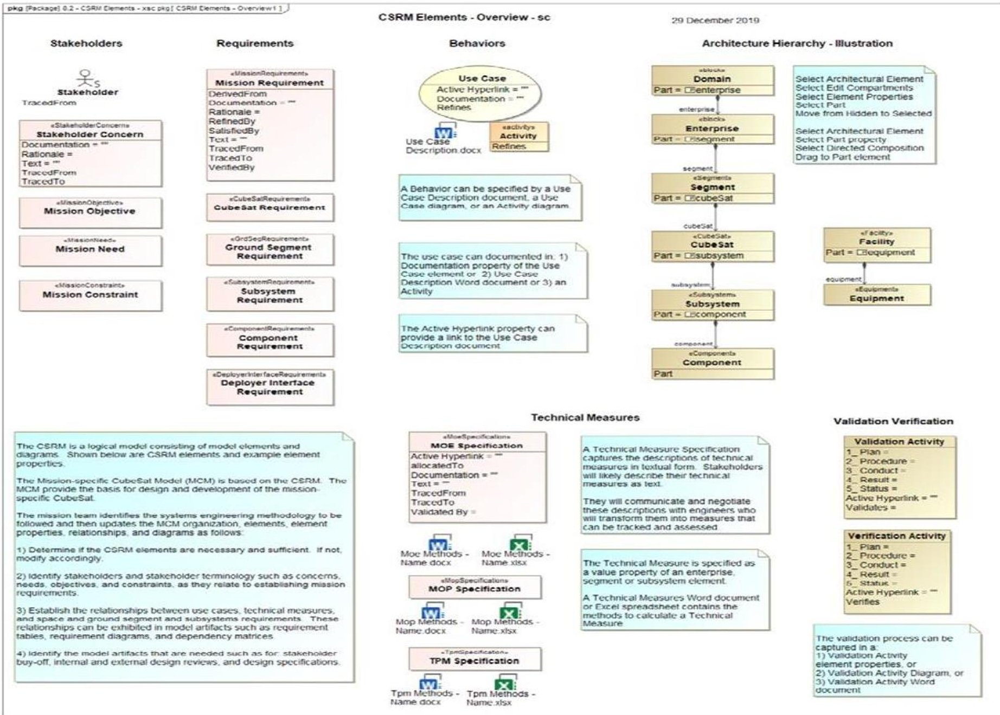

Figure 1. Screen Capture - CSRM Overview and Navigation bdd

Figure 2. Screen Capture - CSRM Architecture Hierarchy bdd

Figure 3. Screen Capture - Facilities bdd

Figure 4. Screen Capture - CubeSat Domain bdd

Figure 5. Screen Capture - CubeSat Mission Enterprise bdd

Figure 6. Screen Capture - Space Segment bdd

<!-- PDF_PAGE: 66 -->

Figure 7. Screen Capture - CubeSat Structures Table - Exported as Excel

Figure 8. Screen Capture - CubeSat Subsystems Structures Table - Exported as Excel

Figure 9. Screen Capture - Ground Segment bdd

Figure 10. Screen Capture - Ground Segment Structures Table - Exported as Excel

Figure 11. Screen Capture - Ground Systems Structures Table - Exported as Excel

<!-- PDF_PAGE: 67 -->

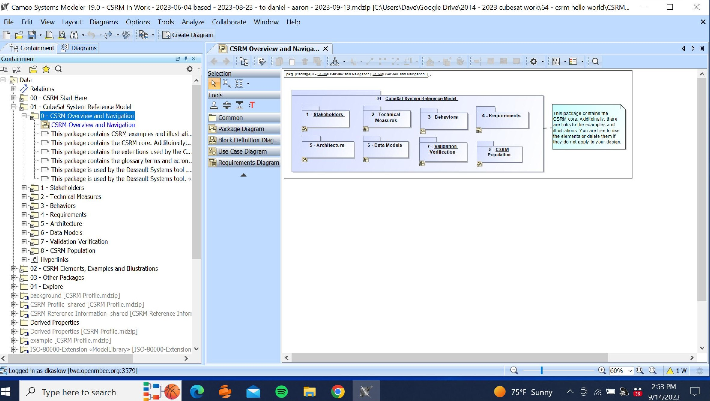

Figure 1. Screen Capture - CSRM Overview and Navigation bdd

<!-- PDF_PAGE: 68 -->

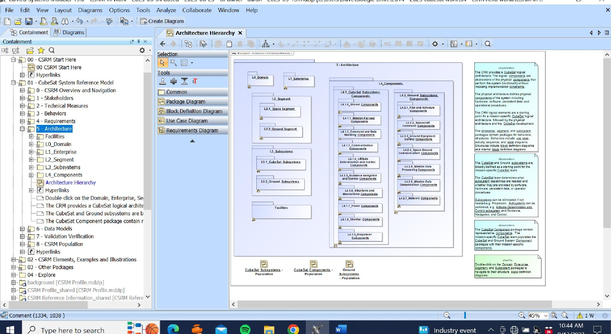

Figure 2. Screen Capture - CSRM Architecture Hierarchy bdd

<!-- PDF_PAGE: 69 -->

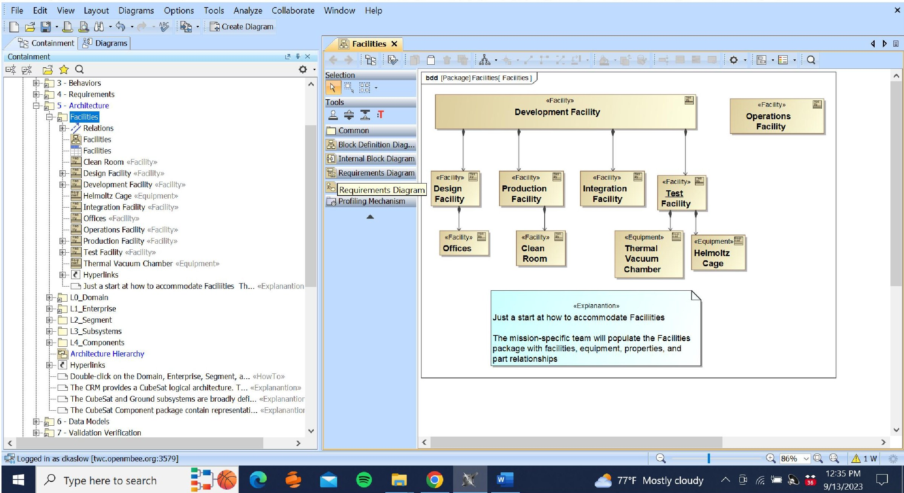

Figure 3. Screen Capture - Facilities bdd

<!-- PDF_PAGE: 70 -->

Cameo Systems Modeler 19.0 - CSRM In Work - 2023-06-04 based - 2023-08-23 - to daniel - aaron - 2023-09-13.mdzip [C:\Users\Dave\Google Drive\2014 - 2023 cubesat work\64 - csrm hello world\CSRM in ...

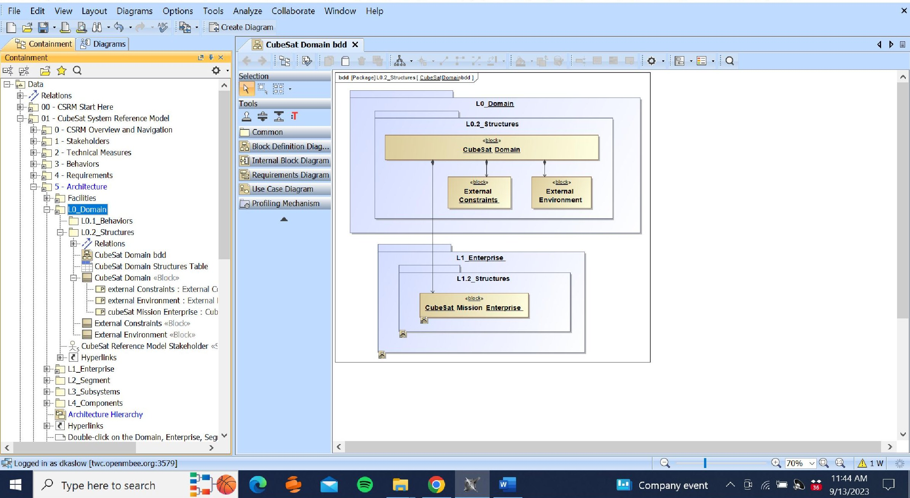

Figure 4. Screen Capture - CubeSat Domain bdd

<!-- PDF_PAGE: 71 -->

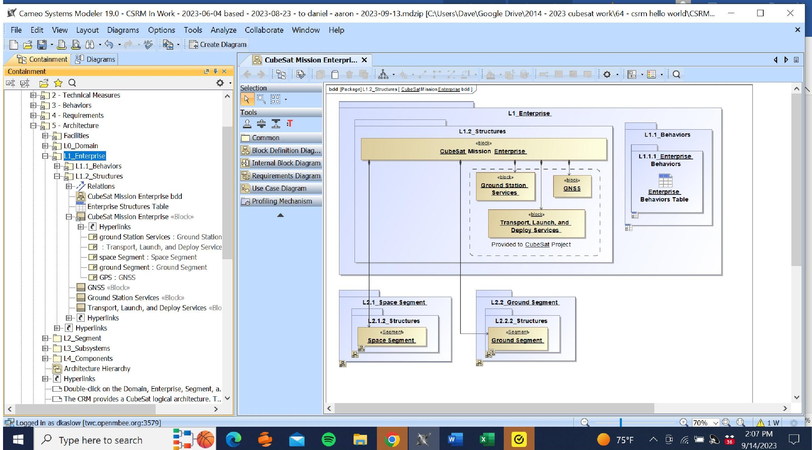

Figure 5. Screen Capture - CubeSat Mission Enterprise bdd

<!-- PDF_PAGE: 72 -->

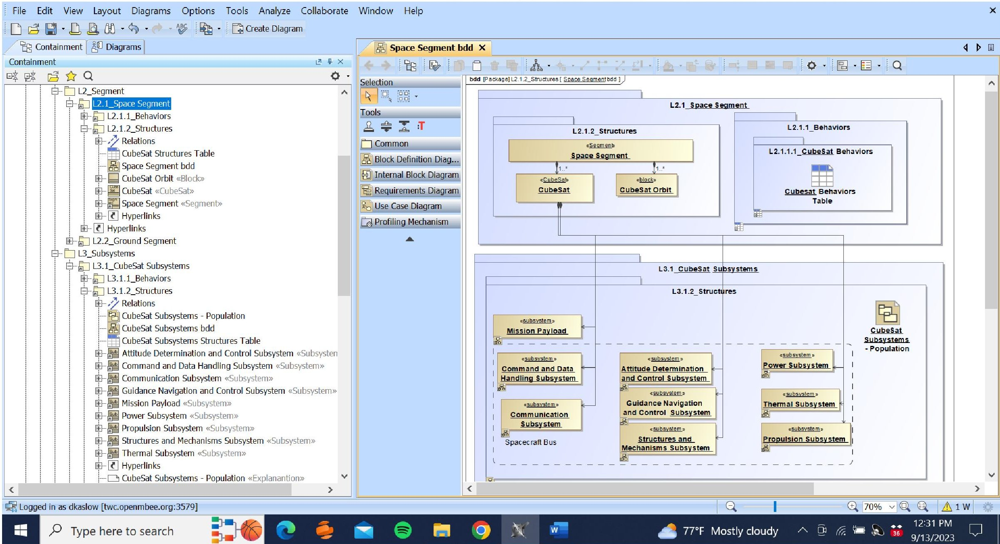

Figure 6. Screen Capture - Space Segment bdd

<!-- PDF_PAGE: 73 -->

Figure 7. Screen Capture - CubeSat Structures Table - Exported as Excel

<!-- PDF_PAGE: 74 -->

<table class="table table-bordered"><thead><tr><th>#</th><th>Name</th><th>Documentation</th><th>Part</th><th>Applied Stereotype</th><th>Active Hyperlink</th></tr></thead><tbody><tr><td>1</td><td>Thermal Subsystem</td><td></td><td>: Thermal Sensors, Sources, and Sinks processor and Memory : Processor and Memory software : Software</td><td>HyperlinkOwner [Element] Subsystem [Class]</td><td>Thermal Subsystem bdd</td></tr><tr><td>2</td><td>Propulsion Subsystem</td><td></td><td>propellant Storage : Propellant Storage propellant Control : Propellant Control thrusters : Thrusters processor and Memory : Processor and Memory software : Software</td><td>HyperlinkOwner [Element] Subsystem [Class]</td><td>Propulsion Subsystem bdd</td></tr><tr><td>3</td><td>Structures and Mechanisms Subsystem</td><td></td><td>deployable Mount : Deployable Mount static Mount : Static Mount actuated Mount : Actuated Mount</td><td>HyperlinkOwner [Element] Subsystem [Class]</td><td>Structures and Mechanisms Subsystem bdd</td></tr><tr><td>4</td><td>Power Subsystem</td><td></td><td>batteries : Batteries regulators and Converters : Regulators and Converters solar Arrays : Solar Arrays power Circuits and Switches : Power Circuits and Switches processor and Memory : Processor and Memory</td><td>HyperlinkOwner [Element] Subsystem [Class]</td><td>Power Subsystem bdd</td></tr></tbody></table>

Figure 8. Screen Capture - CubeSat Subsystems Structures Table - Explored as Excel

<!-- PDF_PAGE: 75 -->

Cameo Systems Modeler 19.0 - CSRM In Work - 2023-06-04 based - 2023-08-23 - to daniel - aaron - 2023-09-13.mdzip [C:\Users\Dave\Google Drive\2014 - 2023 cubesat work\64 - csrm hello world\CSRM in ...

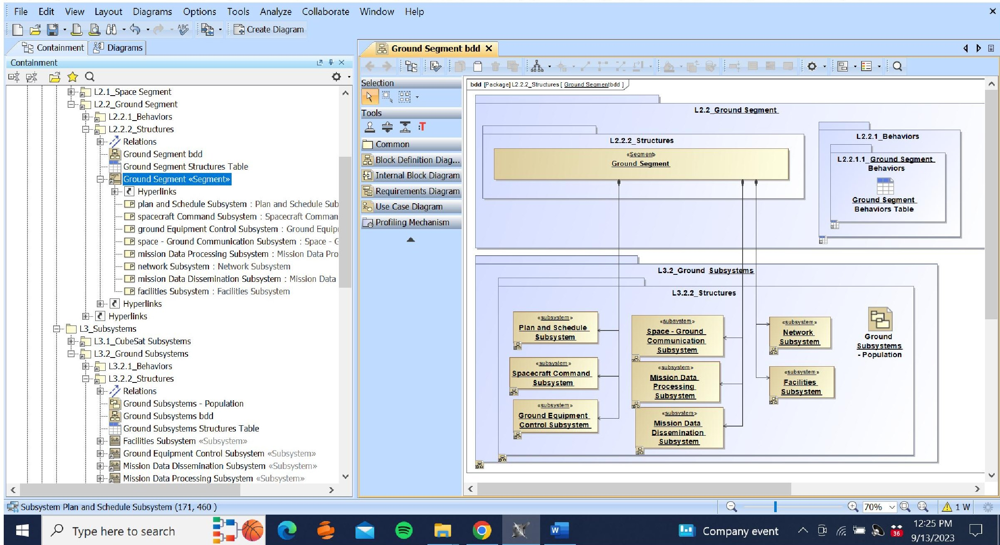

Figure 9. Screen Capture - Ground Segment bdd

<!-- PDF_PAGE: 76 -->

Figure 10. Screen Capture - Ground Segment Structures Table - Exported as Excel

<!-- PDF_PAGE: 77 -->

<table class="table table-bordered"><thead><tr><th>#</th><th>Name</th><th>Documentation</th><th>Part</th><th>Applied Stereotype</th><th>Active Hyperlink</th></tr></thead><tbody><tr><td>1</td><td>Spacecraft Command Subsystem</td><td></td><td>hardware : Hardware software : Software procedures : Procedures</td><td>HyperlinkOwner [Element] Subsystem [Class]</td><td>Spacecraft Command Subsystem bdd</td></tr><tr><td>2</td><td>Mission Data Dissemination Subsystem</td><td></td><td>hardware : Hardware software : Software procedures : Procedures</td><td>HyperlinkOwner [Element] Subsystem [Class]</td><td>Mission Data Dissemination Subsystem bdd</td></tr><tr><td>3</td><td>Network Subsystem</td><td></td><td>hardware : Hardware software : Software procedures : Procedures</td><td>HyperlinkOwner [Element] Subsystem [Class]</td><td>Network Subsystem bdd</td></tr><tr><td>4</td><td>Space - Ground Communication Subsystem</td><td></td><td>hardware : Hardware software : Software procedures : Procedures</td><td>HyperlinkOwner [Element] Subsystem [Class]</td><td>Space - Ground Communication S...em bdd</td></tr><tr><td>5</td><td>Mission Data Processing Subsystem</td><td></td><td>hardware : Hardware software : Software procedures : Procedures</td><td>HyperlinkOwner [Element] Subsystem [Class]</td><td>Mission Data Processing Subsystem bdd</td></tr><tr><td>6</td><td>Plan and Schedule Subsystem</td><td></td><td>hardware : Hardware procedures : Procedures software : Software</td><td>HyperlinkOwner [Element] Subsystem [Class]</td><td>Plan and Schedule Subsystem bdd</td></tr><tr><td>7</td><td>Ground Equipment Control Subsystem</td><td></td><td>hardware : Hardware software : Software procedures : Procedures</td><td>HyperlinkOwner [Element] Subsystem [Class]</td><td>Ground Equipment Control Subsystem bdd</td></tr><tr><td>8</td><td>Facilities Subsystem</td><td></td><td>room : Room room 2 : Room 2</td><td>Subsystem [Class]</td><td></td></tr></tbody></table>

Figure 11. Screen Capture - Ground Systems Structures Table - Exported as Excel

<!-- PDF_PAGE: 78 -->

Cameo Systems Modeler 19.0 - CSRM In Work - 2023-06-04 based - 2023-08-23 - to daniel - aaron - 2023-09-13.mdzip [C:\Users\Dave\Google Drive\2014 - 2023 cubesat work\64 - csrm hello world\CSRM in ...

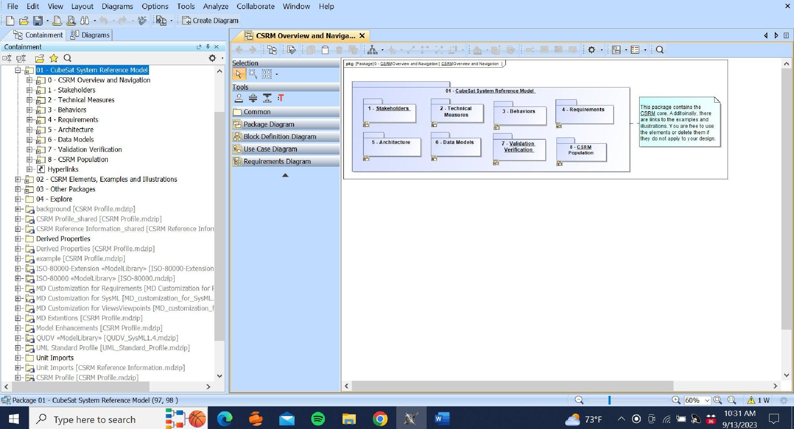

<!-- PDF_PAGE: 79 -->

<table border="1"><tr><td></td><td>Top Level Elements</td><td>Systems Elements</td><td>Sub Systems and Nested Elements</td><td>Components</td></tr><tr><td>Capability Objectives</td><td></td><td></td><td></td><td></td></tr><tr><td>CONOPS</td><td></td><td></td><td></td><td></td></tr><tr><td>Systems Information</td><td></td><td></td><td></td><td></td></tr><tr><td>Requirements Space</td><td></td><td></td><td></td><td></td></tr><tr><td>Performance Measures and Methods</td><td></td><td></td><td></td><td></td></tr><tr><td>Architecture</td><td>CubeSat Mission Enterprise</td><td>External Constraints External Environment</td><td></td><td></td></tr><tr><td>Technical Baselines</td><td></td><td></td><td></td><td></td></tr></table>

<!-- PDF_PAGE: 80 -->

Mission Engineering to CSRM Artifact Map Table Part 2

<table border="1"><tr><td></td><td>Top Level Package</td><td>Mid-Level Package</td><td>Low-Level Package</td><td>Tables and Matrices</td></tr><tr><td>Capability Objectives</td><td></td><td></td><td></td><td></td></tr><tr><td>CONOPS</td><td>Behaviors</td><td>Behaviors-Use Cases-Activities-Population</td><td></td><td>Behaviors
Use Cases
Activities</td></tr><tr><td>Systems Information</td><td></td><td></td><td></td><td></td></tr><tr><td>Requirements Space</td><td>Requirements
Enterprise Requirements
Segment Rqts
Subsystem Rqts
Component Rqts
CubeSat Deployer Interface Rqts</td><td>Technical Measures-Specifications and Requirements
CubeSat Subsystems Components Rqts
CubeSat Subsystems Rqts
Facility Component Rqrt
Ground Equipment Control Components Rqrt
Ground Segment Rqts
Ground Subsystems Components Rqts
Ground Subsystems Rqts
Mission Data Dissemination Components Rqrt
Mission Data Processing Components Rqrt
Network Components Rqrt
Plan and Schedule Components Rqrt
Space-Ground Communication Components Rqrt
Space Segment Rqts
Spacecraft Command Components Rqrt
Validation Activities-Population
Verification Activities-Population</td><td>CubeSat Rqrt
CubeSat Components Rqrt</td><td>Mission Rqts
Segment Requirements
CubeSat Rqts
Subsystems Requirements
Technical Measures-Requirements
MOE Requirement
MOP Requirement
TPM Requirement
Attitude Determination and Control Subsystem Rqts
Command and Data Handling Subsystem Rqts
Communication Subsystem Rqts
Guidance Navigation and Control Subsystem Rqts
Mission Payload Subsystem Rqts
Power Subsystem Rqts
Propulsion Subsystem Rqts
Structures and Mechanisms Subsystem Rqts
Thermal Subsystem Rqts
CubeSat Deployer Interface Rqts
Ground Segment Rqts</td></tr><tr><td>Performance Measures and Methods</td><td>Technical Measures
Validation Verification
Data Models</td><td></td><td>MOE
MOP
TPM</td><td>Validation Activities
Verification Activities
Technical Measures-Specifications
MOE Specification
MOP Specification
TPM Specification</td></tr><tr><td>Architecture</td><td>Architecture</td><td>Architectures: Requirements Behaviors Structures</td><td></td><td></td></tr><tr><td>Technical Baselines</td><td></td><td></td><td>KPP</td><td>KPP Requirement
KPP Specification</td></tr></table>

<!-- PDF_PAGE: 81 -->

Appendix C: Space Mission Architecture to CSRM Elements Map Space Mission Architecture to CSRM Elements Map Part 1

<table border="1"><tr><td></td><td>Top Level Elements</td><td>Systems Elements</td><td>Sub Systems and Nested Elements</td><td>Components</td></tr><tr><td>Subject</td><td></td><td></td><td></td><td></td></tr><tr><td>Payload</td><td></td><td></td><td>Mission Payload</td><td>Instrument
Processor and Memory</td></tr><tr><td>Spacecraft bus</td><td>CubeSat Domain</td><td>CubeSat</td><td></td><td></td></tr><tr><td>Propulsion</td><td></td><td></td><td>Propulsion</td><td>Propellant Storage
Propellant Control
Thrusters
Processor and Memory
Software</td></tr><tr><td>Attitude Determination and Control System</td><td></td><td></td><td>Attitude Determination and Control</td><td>Software
Actuator
Sensor
Shared Processor and Memory</td></tr><tr><td>Position and Orbit Determination</td><td></td><td></td><td>Guidance Navigation and Control</td><td>Accelerometer
GNSS Receiver
Software
Shared Processor and Memory</td></tr><tr><td>C&amp;DH</td><td></td><td></td><td>Command and Data Handling</td><td>Command, Telemetry, and Data Bus
Processor and Memory</td></tr><tr><td>TT&amp;C</td><td>GNSS</td><td>Communication</td><td>Processor and Memory
Receive Antenna and Equipment
Transmit Antenna and Equipment</td><td></td></tr><tr><td>Power</td><td></td><td>Power</td><td>Batteries
Solar Arrays
Power Circuits and Switches
Regulators and Converters
Processor and Memory
Software</td><td></td></tr><tr><td>Structures and Mechanism</td><td></td><td>Structures and Mechanisms</td><td>Actuated Mount
Deployable Mount
Static Mount</td><td></td></tr><tr><td>Thermal Control</td><td></td><td>Thermal</td><td>Thermal Sensors, Sources, and Sinks
Processor and Memory
Software</td><td></td></tr><tr><td>Ground Segment</td><td>Ground Segment</td><td>Ground Station Services
Facilities</td><td></td><td></td></tr><tr><td>Antenna/Data Receiving Services</td><td></td><td></td><td>Space-Ground Communication</td><td>Hardware
Software
Procedures</td></tr><tr><td>Ground Equipment Control</td><td></td><td></td><td>Ground Equipment Control</td><td>Hardware
Software
Procedures</td></tr><tr><td>Command/Control and Data Processing Services</td><td></td><td></td><td>Spacecraft Command</td><td>Hardware
Software
Procedures</td></tr><tr><td>Mission Operations</td><td></td><td></td><td></td><td></td></tr></table>

<!-- PDF_PAGE: 82 -->

## Space Mission Architecture to CSRM Elements Map Part 2

<table border="1"><tr><td></td><td>Top Level Elements</td><td>Systems Elements</td><td>Sub Systems and Nested Elements</td><td>Components</td></tr><tr><td>Mission Planning and Scheduling</td><td></td><td></td><td>Plan and Schedule</td><td>Hardware Software Procedures</td></tr><tr><td>Test and Simulations</td><td></td><td></td><td></td><td></td></tr><tr><td>Ground Segment Control</td><td></td><td></td><td></td><td></td></tr><tr><td>Real-Time Flight Operations</td><td></td><td></td><td></td><td></td></tr><tr><td>Spacecraft Operations</td><td></td><td></td><td></td><td></td></tr><tr><td>Payload Operations</td><td></td><td></td><td></td><td></td></tr><tr><td>Data Processing</td><td></td><td></td><td>Mission Data Processing</td><td></td></tr><tr><td>Flight Dynamics</td><td></td><td></td><td></td><td></td></tr><tr><td>Command, Control, and Communications Architecture</td><td></td><td></td><td>Mission Data Dissemination Network</td><td></td></tr><tr><td>Orbit</td><td></td><td>CubeSat Orbit</td><td></td><td></td></tr><tr><td>Launch Segment</td><td></td><td>Transport, Launch, and Deploy Services</td><td></td><td></td></tr><tr><td>Mission Concept</td><td>Space Segment</td><td></td><td></td><td></td></tr><tr><td>End Users</td><td></td><td></td><td></td><td></td></tr></table>

Space Mission Architecture to CSRM Elements Map Part 3

<table border="1"><tr><td></td><td>Top-Level Package</td><td>Mid-Level Package</td><td>Low-Level Package</td><td>Tables and Matrices</td></tr><tr><td>Subject</td><td></td><td></td><td></td><td></td></tr><tr><td>Payload</td><td></td><td></td><td>Mission Payload Components</td><td>Mission Payload Components</td></tr><tr><td>Spacecraft bus</td><td></td><td></td><td>Shared Components</td><td>Shared Components Table</td></tr><tr><td>Propulsion</td><td></td><td></td><td>Propulsion Components</td><td>Propulsion Components</td></tr><tr><td>Attitude Determination and Control System</td><td></td><td></td><td>Attitude Determination and Control Components</td><td>Attitude Determination and Control Components</td></tr><tr><td>Position and Orbit Determination</td><td></td><td></td><td>Guidance Navigation and Control Components</td><td>Guidance Navigation and Control Components</td></tr><tr><td>C&amp;DH</td><td></td><td></td><td>Command and Data Handling Components</td><td>Command and Data Handling Components</td></tr></table>

<!-- PDF_PAGE: 83 -->

Space Mission Architecture to CSRM Elements Map Part 4

<table border="1"><tr><td></td><td>Top-Level Package</td><td>Mid-Level Package</td><td>Low-Level Package</td><td>Tables and Matrices</td></tr><tr><td>TT&amp;C</td><td></td><td></td><td>Communication Components</td><td>Communication Components</td></tr><tr><td>Power</td><td></td><td></td><td>Power Components</td><td>Power Components</td></tr><tr><td>Structures and Mechanism</td><td></td><td></td><td>Structures and Mechanisms Components</td><td>Structures and Mechanisms Components
CubeSat Subsystems Structures
CubeSat Structures</td></tr><tr><td>Thermal Control</td><td></td><td></td><td>Thermal Components</td><td>Thermal Components</td></tr><tr><td>Ground Segment</td><td></td><td>Ground Subsystems</td><td>Facilities Components</td><td>Ground Subsystems
Ground Segment
Facilities Components</td></tr><tr><td>Antenna/Data Receiving Services</td><td></td><td></td><td>Space-Ground Communication Components</td><td>Space-Ground Communication Components</td></tr><tr><td>Ground Equipment Control</td><td></td><td></td><td>Ground Equipment Control Components</td><td>Ground Equipment Control Components</td></tr><tr><td>Command/Control and Data Processing Services</td><td></td><td></td><td>Spacecraft Command Components</td><td>Spacecraft Command Components</td></tr><tr><td>Mission Operations</td><td></td><td></td><td></td><td></td></tr><tr><td>Mission Planning and Scheduling</td><td></td><td></td><td>Plan and Schedule Components</td><td>Plan and Schedule Components</td></tr><tr><td>Test and Simulations</td><td></td><td></td><td></td><td></td></tr><tr><td>Ground Segment Control</td><td></td><td></td><td></td><td></td></tr><tr><td>Real-Time Flight Operations</td><td></td><td></td><td></td><td></td></tr><tr><td>Spacecraft Operations</td><td></td><td></td><td></td><td></td></tr><tr><td>Payload Operations</td><td></td><td></td><td></td><td></td></tr><tr><td>Data Processing</td><td></td><td></td><td>Mission Data Processing Components</td><td>Mission Data Processing Components</td></tr><tr><td>Flight Dynamics</td><td></td><td></td><td></td><td></td></tr><tr><td>C3 Architecture</td><td>Segment Data Models
Subsystem Data Models</td><td>Ground Segment Data Models
Space Segment Data Model
Ground Subsystem Data Models
Space Subsystem Data Models</td><td>Mission Data Dissemination Components
Network Components
CubeSat Data Models</td><td>Mission Data Dissemination Components
Network Components</td></tr><tr><td>Orbit</td><td></td><td></td><td></td><td></td></tr><tr><td>Launch Segment</td><td></td><td></td><td></td><td></td></tr><tr><td>Mission Concept</td><td></td><td></td><td></td><td>Mission Objectives
Mission Needs
Mission Constraints</td></tr><tr><td>End Users</td><td>Stakeholders</td><td>Mission Stakeholders</td><td>Mission Stakeholders
Mission Stakeholder Concerns</td><td>Mission Stakeholders
Mission Stakeholder Concerns
Concerns to Stakeholder</td></tr></table>

<!-- PDF_PAGE: 84 -->

ProQuest Number: 31149327

INFORMATION TO ALL USERS The quality and completeness of this reproduction is dependent on the quality and completeness of the copy made available to ProQuest.

## ProQuest

Distributed by ProQuest LLC (2024). Copyright of the Dissertation is held by the Author unless otherwise noted.

This work may be used in accordance with the terms of the Creative Commons license or other rights statement, as indicated in the copyright statement or in the metadata associated with this work. Unless otherwise specified in the copyright statement or the metadata, all rights are reserved by the copyright holder.

This work is protected against unauthorized copying under Title 17, United States Code and other applicable copyright laws.

Microform Edition where available  ProQuest LLC. No reproduction or digitization of the Microform Edition is authorized without permission of ProQuest LLC.

ProQuest LLC

789 East Eisenhower Parkway

P.O. Box 1346

Ann Arbor, MI 48106 - 1346 USA