<!-- PDF_PAGE: 1 -->

ORIGINAL PAPER

# GREATCUBE+: conceptual design tool for CubeSat's design

Carlo Girardello $ ^{1,2} $ Martin Tajmar $ ^{1} $ Carsten Scharlemann $ ^{2} $

Received: 2 February 2023 / Revised: 4 May 2023 / Accepted: 29 May 2023 / Published online: 14 June 2023 © The Author(s) 2023

## Abstract

CubeSats are a type of spacecraft which have become popular since the early 2000. They are known for their quick development time and low cost, when comparing them to larger satellites. However, there is a significant drawback which has been recorded during these years of operations, namely an high failure rate which turns almost half of them into space debris. The reasons behind these malfunctions are often attributed to flawed spacecraft design choices or failures of commercial off-the-shelf (COTS) products. To improve the design of CubeSats, several software tools for performing the conceptual design have been proposed. These tools are often limited in their capabilities and are not suitable for all types of CubeSat missions. To address this issue, the University of Applied Sciences Wiener Neustadt (FHWN) in cooperation with Technische Universität Dresden is developing a software tool called GREATCUBE+. Its goal is to increase the success rate of CubeSats by providing a satellite model which is composed of commercial-off-the-shelf (COTS) products backed up by empirical heritage, analytical proof, and numerical analysis. One of the main features of this tool is the ability of dealing with different typologies of payloads. GREATCUBE+ has been validated with various successful CubeSat missions and it provides design solutions with an accuracy of above 90% when it comes to CubeSat weights and volumes. Using this software, CubeSat design teams can proceed from the conceptual development to the testing and assembly phases quicker, hoping to result in higher quality CubeSats and fewer failures.

Keywords CubeSat · Conceptual design · COTS · Simulation

## 1 Introduction

CubeSats are a type of nanosatellite which were first developed in the late '90 s by Professor Jordi Puig-Suari and Bob Twiggs at CalPoly and Standford University. Their purpose was to provide students in the aerospace engineering course

with hands-on experience in space systems. With an exponential growth since then, nowadays CubeSats are counted in the thousands units in orbit [1]. CubeSats have become relevant not only as educational tool but also as an important industrial asset worldwide. Soon, CubeSats will orbit around the Moon in the framework of the Artemis mission to perform relevant scientific measurements [2]. One of the main advantages of CubeSats is the standardization since each CubeSat must cope with the guidelines introduced by the CubeSat Standards Rev. 14.1 [3]. Specifically, they can be stacked in cuboids with 10x10x10 cm as minimum standard dimensions. Their maximum size is ruled by the CubeSat deployer which is being used.

According to a further study performed by Venturini [4] most of the design mistakes that result in failures of CubeSat missions are originated in the conceptual development phase. CubeSats rely extensively on COTS (commercialoff-the-shelf) components usage. They allow developing teams to contain costs, when comparing COTS prices to space-graded devices, although is one of the main causes for CubeSat failures on orbit [4, 5]. Additionally to COTS

<!-- PDF_PAGE: 2 -->

products-related failures, 35% of academical and 25% of industrial CubeSats fail due to inconsistencies of the design and low amount of testing [4]. The solution to part of these issues, specifically in the design-oriented failures section, may be solved by optimizing the conceptual development phase to provide teams with more time to be dedicated to testing.

The abovementioned improvements can be potentially achieved with the usage of GREATCUBE+ by CubeSat teams in Phase 0/A. GREATCUBE+, or GC+, is a software tool which has the goal of providing teams with a complete design of a CubeSat mission based on a limited number of user introduced inputs. It is currently under development and it is a joint project between the University of Applied Sciences Wiener Neustadt and the Technical University of Dresden. The model provided will be comprehensive of the relevant information from system (mass, power production, form factor) to subsystem level. This paper, which introduces GC+, is structured as follows:

- Sect.1

Problem statement, GC+'s introduction.

- Sect.2

Definition of GC+ with a specific interest in its layered structure. Literature review on similar existing tools. GC+ capabilities.

- Sect. 3

A test case, performed keeping a real satellite as an evaluative reference.

- Sect.4

Last remarks and summary.

It is hoped that the usage of GREATCUBE+ will reduce the time required for the conceptual development phase. GC+ will be used for the design process of future CubeSats at the FHWN and will be offered in the framework of mutual cooperations with other teams. With time, a clearer picture of the value of this software in terms of real-time savings and quality improvements will emerge. CubeSat missions follow the standards imposed by the California Polytechnic State University [3] for interfaces, while for their development,

teams can follow either the ECSS-M-ST-10C Rev.1 [6] or the NASA's guidelines [7, 8]. A summary of the CubeSat project phases is listed in Table 1.

According to the ECSS standards [3], the conceptual development takes place during the Phase 0/A. GREATCUBE+ is intended to be used in these two phases. Its scope is to provide design teams with a preliminary model of the CubeSat which is currently under development. Using GREATCUBE+. it is hoped that teams will terminate the conceptual phase faster using the model provided as an initial baseline for more refined and detailed analyses. In this way, the design mistakes mentioned earlier could potentially decrease, since teams could start their conceptual design using a baseline model provided by the software. This model comes from empirical correlations and well-knwon analytical equations, recommending COTS product which could satisfy the introduced mission requirements. Additionally, if design teams could reach the end of Phase B quicker, due to a faster development of Phase 0/A, more time would be available for testing, which is the other major cause of CubeSat failure [4, 5]. As an example, the maximum total time spent during Phase 0/A is supposed to be of 6 months, as it is possible to note from Table 1. GREATCUBE+ is capable of providing a possible solution for the mission requirements provided by the user in less than 20 min. Naturally, GREATCUBE+ cannot substitute a team of engineers but it can help in providing them with a preliminary starting model from which experts can integrate and implement additional requirements. Additionally, GREATCUBE+ has been developed considering a single payload on board. In case multiple payloads are present, the design team could use the heaviest and most power consuming payload as an input for GREATCUBE+. Sequentially, starting from the model provided by the software, teams could integrate or add the additional payloads manually in further iteration steps. A literature review shows that GC+ is not the first effort to predict satellite features which has been developed. Many other scientists and researchers worldwide have investigated over this topic and they created some similar tools [9-14]. The innovation brought by GREATCUBE+ is its capability

Table1 Summary of CubeSat project lifecycle with timelines overall scope of phases, and required final documentation

<table border="1"><tr><td>Phase</td><td>Duration</td><td>Final documents</td><td>General scope</td></tr><tr><td>Phase0</td><td>1-3 months</td><td>Mission definition review(MDR)</td><td>Mission analysis/needs identification</td></tr><tr><td>PhaseA</td><td>1-3 months</td><td>Preliminary requirement review(PRR)</td><td>Fesibility study</td></tr><tr><td>PhaseB</td><td>1-2 months</td><td>Preliminary design review(PDR)</td><td>Preliminary definition</td></tr><tr><td>PhaseC</td><td>1-6 months</td><td>Critical design review(CDR)</td><td>Detailed definition</td></tr><tr><td>PhaseD</td><td>2-12 months</td><td>Operational readiness review(ORR)和 acceptance review(AR)</td><td>Qualification and production</td></tr><tr><td>PhaseE</td><td>Variable</td><td>Commissioning results review(CRR)</td><td>Operations and utilization</td></tr><tr><td>PhaseF</td><td>Variable</td><td>Mission close-out review(MCR)</td><td>Disposal</td></tr></table>

<!-- PDF_PAGE: 3 -->

to perform a conceptual study with various types of subsystems acting as payload (ADCS, OBC, TT &C, thruster, demonstrative/scientific payload, sensors etc.) with small amount of inputs from the user. Naturally, the amount of inputs which are available at the beginning of the conceptual development phase is limited. Hence, the inputs which are required by GC+ need to be tailored so that the design teams are capable of introducing them.

## 2 GREATCUBE+ structure and methodology

GREATCUBE+ is a layered software. It is divided conceptually in three separate levels. At the end of each section, an overview of the achieved results is presented to the user in the form of a preliminary model. The three divisions are:

- GREATCUBE+ empirical level (GEL)

- GREATCUBE+ analytical level (GAL)

- GREATCUBE+ numerical level (GNL)

Many researchers tried to link empirical equations to conceptual design decision. Among them, Chang et al. [11] performed the conceptual design of a microsatellite using empirical laws obtained from a database of components in a similar fashion. No such tool exists, to the best of the authors knowledge, for CubeSats. Additionally, Peroy et al. [15] provide an insight of the main milestones of the life project of a CubeSat, stressing out the importance of the conceptual development phase. Asundi et al. [9] provided an insight of the system engineering methodology necessary to fully develop a CubeSat mission under a theoretical perspective, first introducing the characteristic parallelization of tasks which will be later introduced in GAL. Many other scientific articles have dealt with similar topics that, for the sake of clarity, will not be discussed in this paper but are listed in the references. As relevant mentions, Schoz et al. [16] discussed the topic of open source CubeSat design and NASA [17] provided a step-by-step guide on how to design a CubeSat mission. Lastly, Selva et al. [18] created a similar model which also picks COTS components based on user introduced input, but it works only for a selected list of payload types while GC+ has the added value of being able to operate with different typologies of payloads. A limitation of the tool is the fact of performing CubeSat simulation with only one possible payload. Future work may include multiple payloads input.

## 2.1 GREATCUBE+ empirical level: GEL

The starting point in each GC+ simulation begins with the empirical level GEL. In this level, the user specifies its mission parameters and the tool iterates those values

using the empirical correlations retrieved from a database of past flown missions to estimate empirically system and subsystem values. Sequentially, these empirical outcomes are weighted, averaged, and then compared with COTS products which have the closest match with them. A schematic of the empirical level is depicted in Fig. 1.

The amount of parameters which the user can introduce is flexible, since there is no way for predicting what the user would know about its mission characteristics at the stage in which GC+ is used. To fulfill the philosophy of GC+ for flexibility, the inputs have been divided in two separate categories at this stage: mandatory and nonmandatory inputs. The mandatory inputs are:

- Payload mass [kg]

- Payload or satellite on orbit average power (OAP) [W]

- Nature of payload (ADCS, TT &C, Thruster, OBC, sensors etc.), if payload mass is introduced.

- The reason for selecting these as mandatory parameters comes from the fact that these values are usually available in the initial phases of a space mission design, which is the space project phase in which GREATCUBE+'s usage is recommended. Additionally, those were the data which were most commonly listed in the literature review of successfully flown CubeSats which were added to the database for empirical correlations. The tool can operate even with only one of those mandatory inputs. Once those inputs have been given, the non-mandatory inputs can be introduced to add extra details for the simulation to come. Those non-mandatory inputs are:

- Alignment requirement [deg].

- Total amount of data per orbital period [kbps].

- Number of ground stations (GS).

- $ \Delta\mathrm{V}[\frac{m}{s}]. $

- Once they have been introduced, GC+ finally starts the computation of the empirical model via GEL. The just introduced user inputs are used to retrieve system parameters from empirical relationships obtained via mathematical methods applied to an internally collected database of successfully flown CubeSat missions. The empirical laws used in GEL for the system and subsystem characteristic determination are:

- Payload mass as a function of CubeSat mass.

- Polynomial second degree fitting with 63 satellites of which payload mass is known with an $ R^{2} $ factor of 0.95.

- Payload OAP as a function of satellite OAP.

Assumption taken from the average power consumption of COTS products in the databases.

<!-- PDF_PAGE: 4 -->

Fig.1 The architecture of the GREATCUBE+ empirical level (GEL). The diamonds represent the user inputs, blue are mandatory (payload mass, type of subsystem used as payload, satellite/payload OAP) while the green diamonds (alignment, data, $ \Delta\mathrm{V} $ ) are non-mandatory. The boxes are the processes

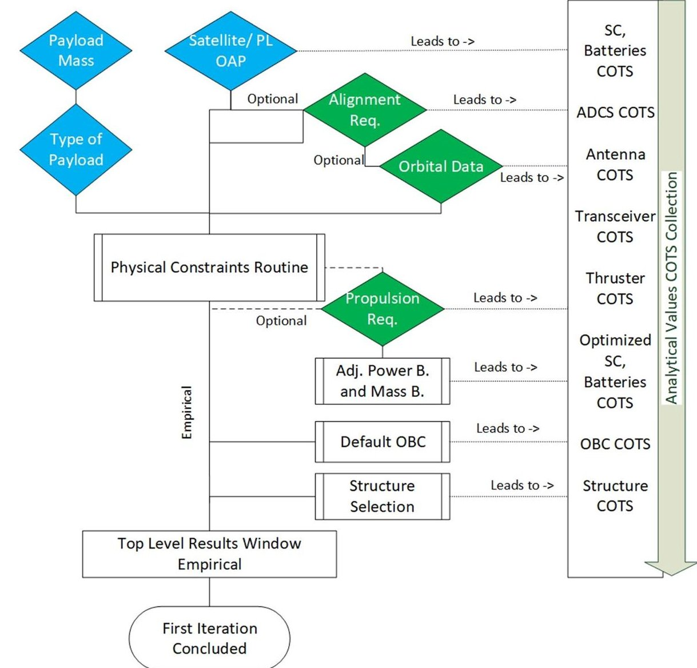

Satellite OAP would be equal to the sum of the userintroduced payload OAP, average power consumption of OBC (0.72 W), transceivers (1 W), and ADCS (0.92 W). Those values are retrieved from the database of COTS products.

- Satellite OAP as a function of CubeSat mass.

Polynomial second degree fitting with 175 satellites for which satellite OAP is known with an $ R^{2} $ factor of 0.49.

- Alignment requirement as a function of ADCS mass. Power fitting with one term with 49 ADCS COTS products with an $ R^{2} $ factor of 0.651. A practical example is displayed in Figure10.

- ADCS mass as a function of ADCS power consumption.

From the alignment requirement, the ADCS mass is retrieved via the previous correlation. The ADCS mass is then used to estimate the ADCS power consumption with a polynomial second degree fit with 49 ADCS COTS products with an $ R^{2} $ value of 0.6. An example is displayed in Fig. 10.

- Total amount of data as a function of TT &C mass. Direct empirical correlation retrieved from Eq.1:

$$
\text{Data Rate} = \frac{\text{Data}_{\text{User Input}} \cdot 1.5}{\text{Nr. Ground Station} \cdot 480}
$$

where the 1.5 factor represents the redundancy of repeated data sent to the ground stations and 480 [s] is the average communication window for a satellite in LEO orbit [19].

Sequentially, the results of these empirical correlations are used in further relations which are, once again, derived data points of the database of past flown missions. For example, it is possible to link the following variables:

- CubeSat mass as a function of form factor. Polynomial first degree fit with 1438 data points with an $ R^{2} $ value of 0.651.

- CubeSat mass as a function of satellite OAP. As above.

- TT &C power as a function of satellite OAP.

Based on the empirical correlation used for retrieving the data rate introduced above, it is possible to link this value with the closest match from the COTS products in the database. The next step consists in substituting the

<!-- PDF_PAGE: 5 -->

average power consumption of the TT &C subsystem introduced above, when describing the payload OAP as a function of the satellite OAP, with the COTS product selected in this fashion. From this, it is possible to increase the reliability of the satellite OAP estimation using the average power consumption of a COTS which can transmit the abovementioned data rate.

- ADCS power as a function of satellite OAP.

- The empirical correlation between ADCS power and alignment as a starting point is used. Once the ADCS power is retrieved, it is substituted in the satellite OAP assumptions for the ADCS for further calculations.

- ADCS mass as a function of CubeSat mass.

- Polynomial third degree fit with 20 data points of existing CubeSats and the relevant assumed mass of ADCS systems. The assumptions are based on the composition of the hardware stated in the documents available for each CubeSat mission. The $ R^{2} $ value for this correlation is of 0.3.

- Satellite OAP as a function of number of solar panels.

The average power production can give an indication of the required solar panel architecture retrieved empirically. The two available cases are for body mounted or deployable solar panels architectures. For the body mounted, a polynomial third degree fit is retrieved from a dataset of 40 CubeSat missions which use the same approach. The proposed correlation has a $ R^{2} $ value of 0.8. The deployable solar panels approach is retrieved, instead, from a dataset of 23 CubeSat missions with a power fit with two elements with an $ R^{2} $ of 0.2. A representation of these two correlations is presented in Fig. 9.

These equations are obtained via curve fittings of the data points which are included in databases of past flown missions for which the input parameter is known. The tradeoff between different fittings has been performed considering the $ R^{2} $ value as the main design driver for the selection or the rejection of the proposed fitting. The discarded COTS alternative were heavier, did not satisfy the user requirements or exceeded the power capabilities of the current setup.

Each of the user-introduced inputs are used in these equations. It is clear that when multiple inputs are introduced, GEL will produce multiple outputs for the same variable as well. To unify the results down to just one single empirical parameter for each system value, some weighting factors have been introduced. Those factors act as a quality filter of the empirical equations utilized to reach that result, since not all the correlations are of the same quality (according to $ R^{2} $ values). As an example, the CubeSat mass as a function of the form factor empirical correlation has thousands of data points and it has a very high $ R^{2} $ value (0.651), while the TT &C power vs. satellite OAP equation has a lower $ R^{2} $ value (0.49) together with less data points. The outcome of what is

stated above is translated into a non-equality of the results. The output of the first example, CubeSat mass as a function of the form factor, should have more influence on the absolute value for satellite OAP obtained at the end of GEL when comparing it with the outcome of the second correlation. For this reason, a set of internal weights are implemented on the results of the single empirical equations and they are a function of the $ \mathrm{R}^{2} $ values. Sequentially, the values are averaged and a single weighted output is produced. This conservative approach is used to give more importance in the calculations to the outcomes of the best fitting functions, without completely ignoring the less performing ones.

As shown in Fig.1, once the inputs have been processed and the first system level outputs have been collected, a physical constraint routine is implemented. The physical constraint routine is a system level checkpoint for the above-mentioned collected results. It analyzes if the current power production capabilities, which are a system level result, are capable of satisfying the power demand introduced by the user as an input. If the power requirement has not been introduced by the user, the power is estimated based on the mass of the payload. Furthermore, it checks also if an alignment requirement has been introduced. If an alignment requirement is not present and the current power production forces the design toward a deployable solar panels approach, the user is warned by a popup so changes can be applied by running again the script with the necessary adding. If, instead, an alignment requirement is present, GEL proceeds in feeding this user introduced input into a specific set of empirical laws mentioned earlier which, in return, will identify the trend for attitude dynamics control systems (ADCS) that have been implemented in similar scenarios of CubeSat mass and pointing requirements.

Finally the $ \Delta V $ requirement, if desired, can be introduced. The reason why this parameter is introduced after the preliminary structure of the CubeSat has been already obtained is due to the fact that propulsion subsystems are not so common in CubeSats [20, 21] and their implementation should be done on an already existing CubeSat skeleton. The propulsion requirement uses the well-known Tsiolkovsky rocket equation to identify the ideal COTS propulsion system to be implemented from a database, without altering the existing design too much (e.g., the lightest propulsion system which maintains the same form factor and solar panels architecture).

Once the propulsion system has been added to the CubeSat structure, the system model runs through the physical routine constraint to ensure that form factor and power production values can withstand the new design needs.

GEL, during this whole process, is assembling in parallel a satellite model which is composed solely of COTS. This is done to create a link from the empirical obtained values and real-life components. This applies to the propulsion systems,

<!-- PDF_PAGE: 6 -->

ADCS, the solar cells, solar panels, the antenna, the transceiver, the thruster, the OBC, and the structure. These results are then added all up together and a parallel empirical model made of COTS is created based on the results of the closest match of a COTS product with the experimental correlations. Naturally, an internal check similar to the physical constraint routine is always vigilant, looking for inconsistencies in the design outcome of the COTS model.

Concluding, a tradeoff between the experimentally retrieved model and the one coupled with COTS showed that the latter is more accurate when referring the results to a set of known missions. This justifies the choice of keeping the COTS model as the empirical model (EM) to be used in the analytical level. The performed tradeoff with reference to already successfully flown CubeSat mission is presented in Fig. 2. It can be seen how close the results are to the real case already at this stage with reference to CubeSat mass. On average, the error between the real CubeSat values and the empirical ones is close to 18%. When comparing the results of the COTS-based model from the empirical values to the real CubeSat masses, this percentage goes down to 14%. For the analysis just presented, the design parameter which was considered for the tradeoff between the empirically retrieved value and the COTS-based model was solely the CubeSat mass of the reference satellites.

## 2.2 GREATCUBE+ analytical level: GAL

The analytical level, GAL, is the follow-up layer of GEL. This section is designed to improve the quality of the results of the empirical model (EM). As mentioned in Sect. 2.1, the EM with COTS products is based on empirical heritage. In GAL, via the application of well-known analytical equations from academical textbooks like [22] and [23], the COTS products proposed in the EM will be justified and the

quality of the analytical model (AM) will benefit from it. As an example, the ADCS mass and idle power consumption retrieved empirically in GEL are the only parameters considered for the closest match with the database of COTS products prior of the EM. IN GAL, instead, the external torques that the CubeSat will suffer and the COTS product torque storage will be considered for the evaluation. Naturally, it will need to satisfy the alignment requirement of the user. An example is described in Sect. 3. A schematic of this layer can be observed in Fig. 3.

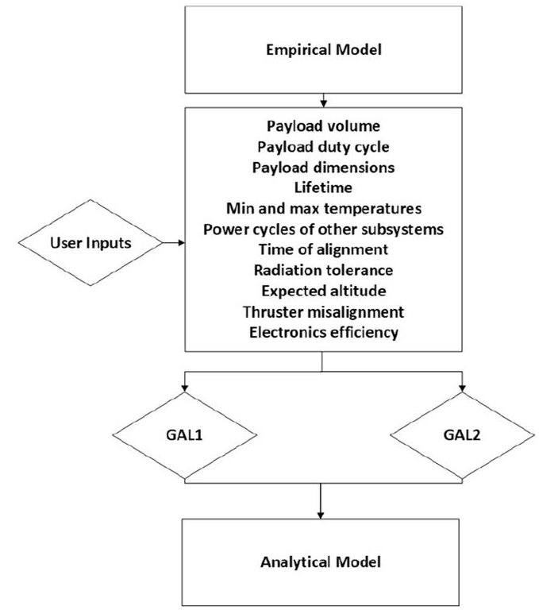

Fig.3 Schematic of GAL. This layer starts with the empirical model and some user inputs. Following, the user decides to follow either GAL1 or GAL2 for their design routine and it is concluded with the definition of the analytical model (AM)

Fig.2 Analysis of the results of GEL. The first column represents the mass of the real CubeSat used as a reference. The second column represents the empirical value obtained via experimental equations. The third column is the CubeSat obtained via COTS analytical match up from the empirical values. Database status: 28 October 2022

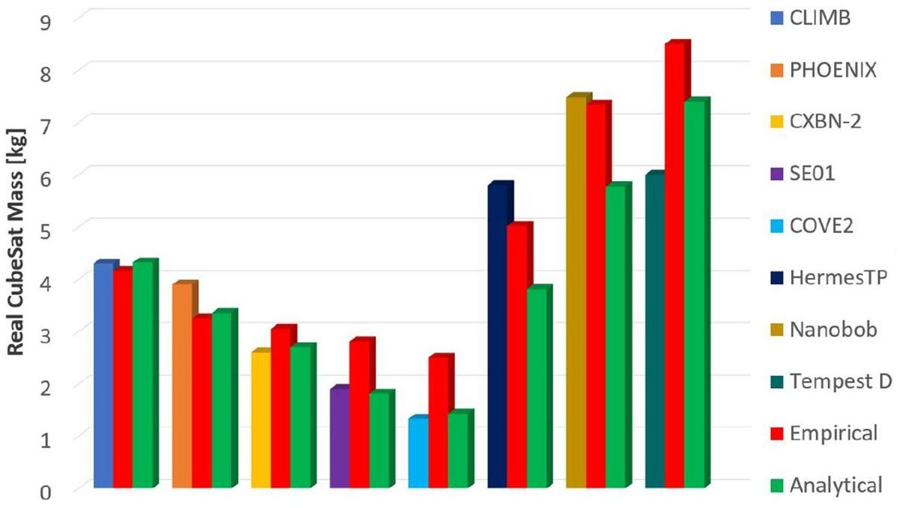

<!-- PDF_PAGE: 7 -->

The two separate branches, GAL1 and GAL2, will be described further in this section. Summarizing, for the sake of clarity, they are the refinement engines of GAL and they differ only in how they treat new COTS suggestions based on concurrent engineering (CE) principles. The literature review for this layer, as the one performed for GEL, included many similar scientific tools developed in the past. The most relevant ones are the work of Ridolfi et al. [10], Chang et al. [11], Asundi et al. [9] and partially, for what concerns the division between GAL1 and GAL 2, to Aas et al. [24].

In the previously cited authors' works, the problem of conceptual design of space missions has been analyzed. In a similar fashion, the methodology chosen for the implementation of their tools, has been concurrent engineering.

This part of the tool uses the empirical model as a starting point. The focus shifts now from system level (CubeSat mass, power production, form factor) to subsystem selections. Prior to going through the refinement part, the user is required to fill in a set of additional inputs tailored for subsystem selection. Once more, following GREATCUBE+ philosophy of usage in early stages of the design phase, the required input are going to be information which the user must know already at this stage if a CubeSat mission is planned. These required data are:

- Payload dimensions [U], if any.

- Payload duty cycle [%], if any.

- Payload power consumption (idle,peak) [W], if any.

- Expected lifetime [yrs].

- Operating temperatures of the payload [deg], if any.

- Power cycles of the other subsystems [%].

- Alignment time [%] if present.

- Radiation tolerance [krad].

- Expected altitude for a circular orbit [km].

- Thruster misalignment [deg], if any.

- Electronics efficiency of components [%].

- These items are mandatory for the operations of the analytical level and GAL will not allow the user to proceed until those data are filled in. Naturally, if a user is uncertain concerning a specific input, a trial and error process can occur as many times as necessary in the analytical level: based on user's choice, multiple runs of the software are allowed. The list pictured above is not constant, it depends on the information provided in the empirical level: e.g., if an alignment requirement was not introduced in GEL, the alignment time is not requested in GAL. Once the software has received all the inputs, the refinement process can start. GAL is divided internally in different layers, each one representing a subsystem. The list of subsystems refined in GAL is:

- Payload subsystem.

- Attitude dynamics and control subsystem (ADCS).

- Propulsion subsystem.

- Electric power subsystem (EPS).

- Structure subsystem.

- OBC subsystem.

- TT &C subsystem.

- Thermal subsystem.

- Excluding the payload subsystem, in which the refinement is carried out already via the introduction of the user inputs, in all the other subsystems, internal routines ensure a consistency in the results. Similar to the physical constraint result of GEL, a twin method is applied in GAL to provide always logical COTS suggestions based on the current architecture available so that major design changes (e.g., form factor increase) are avoided. Naturally, if no possible solution for the current architecture is achievable, a decrease or increase in size takes place. In the ADCS refinement, as a leading example, the inertia is calculated based on the current mass and solar panels architecture. Sequentially, GAL proceeds and calculates the external torques (solar, atmospheric drag, magnetic torque, gravitational, parasitic if a thruster is present) which the CubeSat will suffer during its orbit. The following physical variables are assumed:

- Magnetic dipole moment, D, is $ 0. 1 \mathrm{A m}^{2}. $

- Reflectance factor, 0.8.

- Drag coefficient, 2.25.

- Ram area equal to surface area $ [\mathrm{m}^{2}] $

Finally, the total torque to be stored by the ADCS system is obtained multiplying the total torque, calculated above, with the user introduced input of alignment time [22]. From this point onward, GAL knows that it must first check that the ADCS suggested from the EM is capable of managing such torque. In case this is not possible, the database of ADCS systems is scanned for a device which could store that amount of torque and, at the same time, guarantee the alignment requirement introduced by the user in GEL. The other subsystem refinements proceed in the same fashion of the one described above.

In the development of GAL, specific attention has been paid toward how it should treat a new recommended COTS for a new subsystem. The possible alternatives are mainly two: the proposed COTS substitutes the one suggested in the empirical model, for the next subsystem to use an updated model, or it should be preserved for the final assembly of the analytical model. To answer these questions, GAL1 and GAL2 are introduced, as presented in Fig. 3. Both alternatives use the concurring engineering principles listed in ECSS-Q-ST-60C [25]. This document regulates CE describing it as the engineering activity which takes place in the context of simultaneous design of the product, the production process and all associated product usages, in an

<!-- PDF_PAGE: 8 -->

integrated, multifunctional team, with external organizational constraints minimized. Current research shows that the outputs of both GAL1 and GAL2 are qualitatively and quantitatively identical. The main difference between them, which justified in the first place the design of two distinct methods, is how they treat the implementation of new COTS in the model.

## 2.2.1 GREATCUBE+ analytical level solver 1: GAL1

GAL1 is one of the two methods designed to solve the COTS refinement of GAL. The inputs it needs are the empirical model inherited from GEL and the user-introduced inputs listed above. A schematic of its concept of operations is drawn in Fig. 4.

The information path in GAL1 is mono-directional. Every subsystem uses the same empirical model as an initial input for the refinement process. If a new COTS product is selected, it is stored in a separate variable until all the remaining subsystems have performed their refinement from the original model. Finally, all the new components are merged together and a new model, the analytical model (AM), is created. In the same fashion of GEL, a COTS synergy check is applied to the AM. It checks the feasibility of the proposed design made of the new COTS in terms of power production of the current solar panels architecture, if it can withstand the power demands of the new COTS

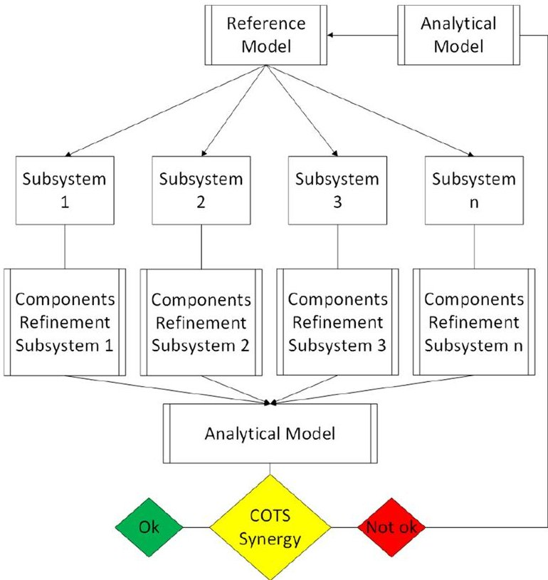

Fig.4 Schematic of GAL1. It is possible to see how the flow of information is mono-directional. The new COTS are stored separately and are assembled together only at the end, creating a brand new CubeSat model, the analytical model (AM)

components, and volumes. The main feature of GAL1, under a methodological point of view, is the fact that there is no prioritization for the order in which the subsystems are supposed to be refined. This approach resembles the development process of a concurrent engineering facility, where the system engineer provides the subsystem experts with the mission requirements and they develop together a model which satisfies them for the first iteration round. Sequentially, each expert perform a refinement over this model and updates the starting model so that the other subsystem experts could also adapt to the new changes.

In case the AM would not pass the stability check, this unsuccessful model is then iterated once more into GAL1 acting as a new empirical model. This approach ensures the synergy of all the COTS components which now are composing the analytical model. Utilizing this approach, the system engineer in a real concurrent engineering facility, would obtain the ideal result without any bias. A more detailed description of the software perspective is presented in the last part of section 2.2.2

## 2.2.2 GREATCUBE+ analytical level solver 2: GAL2

GAL2 is the twin model of GAL1. It has the same goal: to refine the COTS components selection provided in the empirical model. The main difference, when comparing it with GAL1, is the fact that in this method, the subsystem criticality is taken into account and the user can manually select which subsystem is the most important according to their personal and subjective idea. The concept of operations of GAL2 can be seen in Fig. 5.

The process now is not mono-directional anymore but it is a constant, increasing iteration at each subsystem added to the list. Naturally, the user is required to introduce in GAL2 the same inputs required in GAL1 without distinction. The equations used to perform the refinement are the same used in GAL1.

The empirical model is used as a starting point for the iteration. Once the user selects the subsystem which needs more attention, GAL2 proceeds autonomously in its refinement of that specific part of the CubeSat. In case a new COTS component needs to be used, GAL2 substitute this new piece in the empirical model, deleting the previous one used. Naturally, a COTS synergy check in terms of volumes and power demand is applied in this stage to ensure that the design would be strong enough to sustain these new components. Sequentially, with this updated EM, GAL2 performs an additional, secondary run of the subsystem just integrated to measure the righteousness of its choice.

In case it fails, a new COTS component will be selected and the system will be allowed to proceed further with the same philosophy described above. Finally, the user is asked once more to pick one of the remaining subsystems

<!-- PDF_PAGE: 9 -->

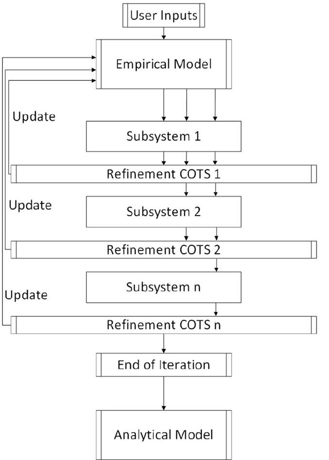

Fig.5 Schematic of GAL2. It is possible to see how the the subsystem which the user wants to iterate first is constantly at the center of the design, since the following subsystems are going to be refined to accommodate the features introduced by the ones above

to optimize, now that the most critical one has been chosen. This new subsystem will naturally be refined based on the system requirements and changes dictated by the subsystem which runs above it. In the same fashion, if a new COTS is obtained, it is updated in the empirical model and the usual COTS synergy check is performed. Once all the subsystems have been correctly prioritized and refined, GAL2 presents the user with the analytical model. Following the same example introduced in GAL1, GAL2 too represents fully the process of a concurrent engineering facility.

The case is one with an expert system engineer, which knows already what subsystem is the most problematic for the given mission scenario, and forces the subsystem experts to consider it in their independent designs in a polarized approach. The latest efforts showed that analytically there is no difference between the two methods in terms of quality of the final analytical model. The proposed architectures do not differ in terms of COTS products recommendations regardless of the method chosen also at a quantitative level. Both methods are representative of the concurrent engineering principle at a conceptual level. As introduced by Smith [26], concurrent engineering is a practice which allows design teams to save time consistently during the development phase. The

principles implemented in GAL1 and GAL2 can be imagined in the framework of a concurrent engineering challenge (CEC) as:

## GAL1

Each subsystem expert, at the beginning of the CEC, uses the model provided by the system engineer as baseline for their activities. Once the system engineer asks for updates, the changes performed by each designer are presented and a new satellite is created with the new modifications. In this approach, the system engineer allows all the teams to come up with the ideal architecture starting from the same initial model. The results are presented at the end of the session and a new architecture is proposed based on the feasibility of the design for the next iteration round [27].

## GAL2

A specialist finds out that the current design for the interested subsystem in not optimal. The matter is immediately brought to the system engineer which communicates this matter to the other subsystem experts. In case the process happens via shared spreadsheets, the new values are updated. Sequentially, the other subsystem experts halt their activities, which were carried out considering the old design, and immediately update their designs. Additionally, this concept introduces a certain bias toward some subsystems which may be considered more important than others (e.g., payload), as stated in Wertz [22].

As a software, the concrete parallelization of the tasks is not implemented. To ensure that the concurrent engineering principles are respected, the missions proposed in Fig. 6 have been crosschecked via the usage of breakpoints to monitor that the COTS products recommended were in line with the method's philosophy. For GAL1, the usage of the same empirical model for each subsystem was ensured. Additionally, with the assembly of the analytical model, the same refinement correlations are used. During the various iteration steps of GAL2, there are COTS changes and the results fluctuate based on the proposed architecture. Once all the subsystems have received the required inputs and have been allowed to run, the solution outcome is the same of GAL1. The COTS synergy check ensures for both methods that the products recommended are fitting inside the current structure (volume check) and that the current solar panel architecture is capable of feeding the subsystems with the duty cycles provided by the user (power check).

A follow-up review of the CubeSats introduced before, when dealing with GEL, now under a GAL1 and GAL2 perspective, is presented in Fig. 6.

<!-- PDF_PAGE: 10 -->

Fig.6 Tradeoff between GAL1 and GAL2. The correct implementation of the CE principles ensure the righteousness of the results regardless of the method used. Database status: 28 October 2022

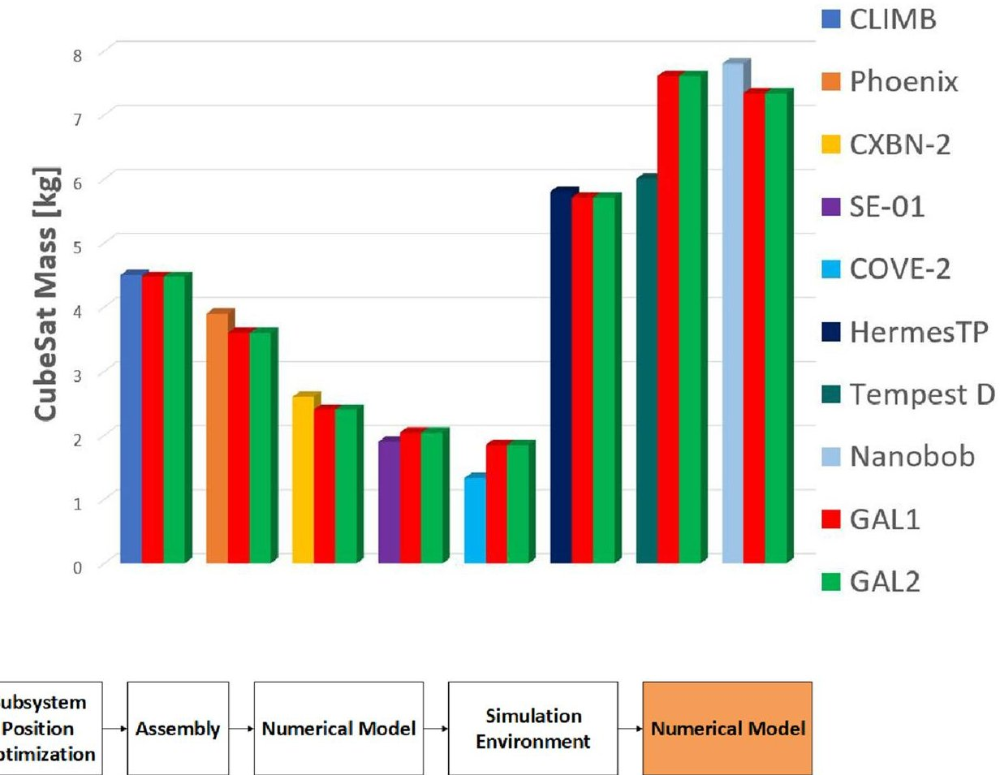

Fig.7 Definition of the tasks performed by GNL. The AM is used as a reference for the numerical implementation and it goes through a process of subsystem position definition, 3D assembly, and iteration

The numerical level, GNL, is the last layer in GREATCUBE+. It is meant to increase the accuracy of GC+ by numerical proof of the design proposed in GAL. A schematic of this section of the tool is presented in Fig. 7.

## 2.3 GREATCUBE+ numerical level: GNL

The starting point for GNL is the AM, which is obtained as an output of GAL. So far, the model available to the user at the end of GAL is qualitatively proven by analytical equations and empirical trends. There are no volume related issues, since the physical constraint routine and the stability check took care of it in both levels. The first step in GNL is related to the positions assigned to the subsystems inside the CubeSat. The reason for this relies on two core features:

- The launcher provider has always a specific requirement for the center of gravity (COG) as shown in Table 2 [3, 28].

- To perform any study with a simulation software (ANSYS, STK etc.), a step file is necessary. Hence, the position of the subsystems must be fixed previously to generate such a file.

in a simulation scenario in various environments (e.g., thermal and orbital simulation)

Table 2 CubeSat center of gravity (COG) locations range

<table border="1"><tr><td>Form factor[U]</td><td>X-axis[cm]</td><td>Y-axis[cm]</td><td>Z-axis[cm]</td></tr><tr><td>1</td><td>±2</td><td>±2</td><td>±2</td></tr><tr><td>2</td><td>±2</td><td>±2</td><td>±4.5</td></tr><tr><td>3</td><td>±2</td><td>±2</td><td>±7</td></tr><tr><td>6</td><td>±4.5</td><td>±2</td><td>±7</td></tr><tr><td>12</td><td>±4.5</td><td>±4.5</td><td>±7</td></tr></table>

Each of the COTS components provided in the AM comes with a datasheet which is easily obtainable by the producer's website. This means that heights, lengths, depths, temperature operating ranges, electrical connections, radiation tolerance, and many other physical properties are listed, collected, and available. The problem of fitting the subsystems of the AM inside the CubeSat can be summarized and simplified as: fitting differently sized boxes inside a bigger, empty shell. This simplification is a well-known problem in operations research (OR) which is called bin packing problem (BPP). From a literature review performed [29-36], it emerged that the BPP with a genetic algorithm (GA) is a promising approach for the application on GNL. Additionally, the algorithm necessary

<!-- PDF_PAGE: 11 -->

for the subsystem position placement of GNL needs to take into account an extra feature: the payload position. GC+ offers the possibility to place it either:

- on top of the CubeSat: just above the transceiver, on the +Z side of the axis, which is a subsystem always present in any CubeSat.

- in the middle: close to the geometric center.

- in the bottom part: as a last subsystem in the system on the -Z side of the axis. Alternatively, if a propulsion system is present, the payload would stand on top of it.

In a similar fashion, in case a propulsion system is present, GNL places it automatically on the bottom part (-Z) of the CubeSat, coinciding with the Z-axis.

The objective functions which are used for such a tool are:

- Overall COG must lay within the limits imposed by the launcher provider presented in Table 2.

- At least one of the sides of the COTS must be as close as possible to one of the side panels of the structure to mimic mechanical connection with the rails composing the structure.

- The individual Z-axis of each COTS must be as close as possible to the Z-axis of the outer shell to mimic the placement in between the structure rails.

Via the implementation of such algorithm within GNL, it is possible to obtain the optimal value which satisfies the abovementioned functions. Naturally, based on the designing team's needs, it is possible to introduce subjective weights to the functions as percentages [%]. In this way, team members may try different constraints and measure how much of a difference there is between alternative designs. An example of a generic 6U is presented in Fig. 8.

Sequentially, once the genetic algorithm has reached the optimal solution for the weights introduced, GNL proceeds in creating an IGES (initial graphics exchange specification) file. This typology of file can be exported to many software suits (e.g., ANSYS, FreeCAD).

In case a solution which is representative of the requirements imposed by the CubeSat Rev. 14.1 is not found, the tool proceeds with a different approach. GNL provides the current setup to the user but requires a different combination of the weights to be introduced.

The conclusion of GC+ will then be the validation of the proposed design from a thermal or orbital analysis perspective with this IGES file. It is possible to setup, as an example, a thermal simulation in ANSYS as the one presented in Section 3.3. To perform a thermal analysis, the remaining tasks for the user are:

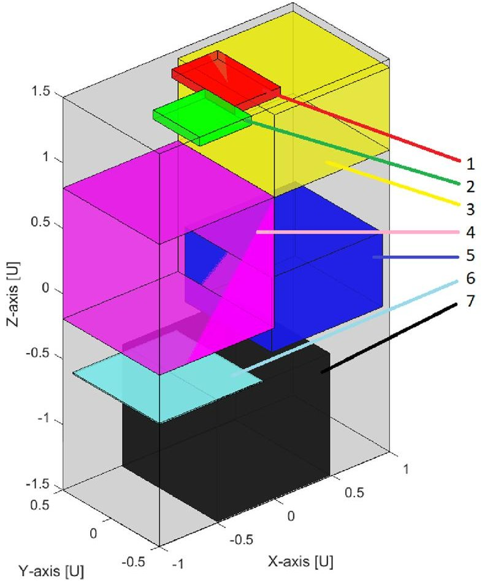

Fig.8 GNL's final outcome of the COTS position after being iterated within the GA. It is possible to see how the subsystems are placed within the limits of the structure, no overlapping is present and every subsystem is in contact with at least one panel of the outer shell. Composition: (1) transceiver (red) (2) OBC (green) (3) ADCS (yellow) (4) payload (pink) (5) EPS (blue) (6) antenna (lightblue) (7) thruster (black)

- Definition of material properties and emissivities, easily retrievable by the datasheets of the COTS producer.

- Definition of the contact points for conductive interfaces.

- Definition of the radiative interfaces

- Introduction of the relevant heat loads for the COTS

- Definition of the external heat loads for the worst hot case (WHC) and worst cold case (WCC) scenario.

Additionally, using the power budget feature of GAL, introduced below in Sect. 3 Fig. 11, it can also be possible to execute a transient state analysis in ANSYS. In case the design suggested does not satisfy any of the requirements imposed by the COTS components datasheet, the user can modify the weights imposed to the optimizing functions and iterate a second best subsystem architecture scenario. This process can proceed until the thermal requirements have been satisfied.

<!-- PDF_PAGE: 12 -->

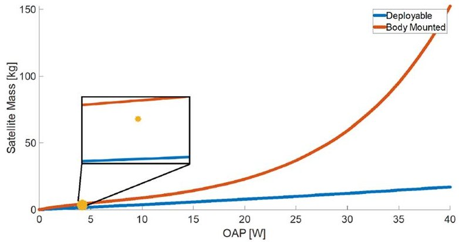

Fig.9 Solar panel architecture study performed in GEL. The database of CubeSat missions is comprehensive of the solar panels architecture. By extrapolating two functions out of it (deployable trend, body mounted trend), it is possible to identify two different areas for the identification of the empirically proven architecture to be implemented

## 3 A step-by-step example: Phoenix

Phoenix is a 3U CubeSat developed by the Arizona State University (ASU) launched in 2019. More information concerning this mission can be found at the official CubeSat website [37]. The scope of this case study is to display the operating process of GREATCUBE+ applied to a real mission scenario. The expected outcome is a CubeSat

model which is similar to the reference satellite in terms of mass, volume, and power consumption. The simulation of Phoenix with GREATCUBE+ is only one example of the various missions which has been used for the validation of the tool. Many different other examples can be found in the bibliography [38-40]. The following parameters are a mix between assumptions and real values obtained from the literature [37, 41, 42] to retrieve the necessary data for utilizing GREATCUBE+:

- Payload mass: 1.2 kg—assumption taken from Figure 13. The payload is approximately 10 cm in height but it is not fully occupying a 1U volume; hence, it is assumed its weight to be 1.2 kg.

- Payload volume: 1U of space (10 cm $ \times $ 10 cm $ \times $ 10 cm) - assumption.

- Payload OAP: 1.5 W OAP, 2.35 W peak power and 1.25 W idle power, stand alone payload - [41, 42].

- Alignment requirement: 1.5deg [42].

- Altitude: 400 km ([41]).

- Duty cycles: 35% payload, 35% ADCS, 100% OBC, 25% transceiver-assumption.

- Lifecycle: 4 years [42].

- Radiation experienced: 400 krad-assumption.

Via the usage of the official CDR of Phoenix [42], it has been possible to retrieve the data mentioned above obtaining

Fig.10 Top: ADCS mass retrieved from the alignment requirement via the usage of a power fitting on the empirical database. Bottom: ADCS power consumption obtained by first degree polynomial fitting

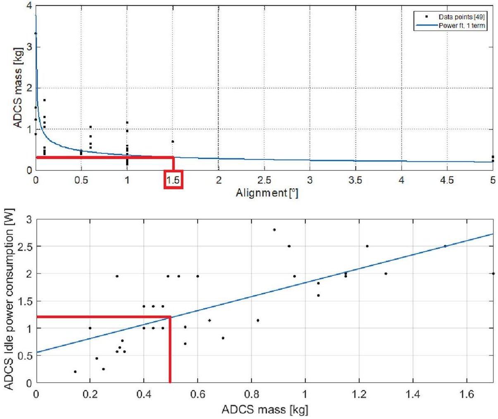

<!-- PDF_PAGE: 13 -->

better results than in previous publications [38] and more refined information with reference to power consumption and duty cycle.

## 3.1 GEL: empirical model (EM)

The empirical analysis of GEL follows the specifics described in earlier sections. For a results oriented point of view, in this chapter, only the relevant decisions will be mentioned. After having introduced the payload mass, OAP and alignment information in the GUI, GEL starts its computation. The first important result that is provided is relative to the empirical trend, based on power production and CubeSat mass, of solar panels architecture: deployable or body mounted. For Phoenix, it is presented in Fig. 9.

From this figure, which uses empirical trends for the implementation of either deployable or body mounted solar panels, it is estimated that Phoenix will use body mounted panels. This information will be used in the following steps of the empirical level for the definition of the battery pack and the solar panels architecture followed by the evaluation of the amount and type of solar cells which will be necessary.

Empirically, the tool also computes what would be the trend for an ADCS system for the given alignment requirement and the current CubeSat mass and form factor without dealing with inertia matrices and torques estimation. To do so, an empirical law retrieved in the same fashion as for the deployable/body mounted solar panels is used to perform this study but with alignment, power consumption, and ADCS mass as tradeoff parameters. From the database, the user ADCS should be of approximately 0.4/0.5 kg with 1.2/1.3W [Note that: in [38] a value of 4W is mentioned] of power consumption for a 1.5deg requirement. The empirical fittings, retrieved from a power fitting (ADCS mass vs. alignment requirement) and a linear fitting (ADCS mass vs. ADCS power consumption) are presented in Fig. 10.

The closest COTS that matches this value is the MAI 400 from Maryland Aerospace, based on the database of COTS components used in GEL, with 0.7 kg of mass, 2W of power consumption in peak power mode and 1.5deg of pointing accuracy.

Since no information has been given concerning the TT &C, GEL assumes that a data rate of 19.2 kbps is going to be used with two ground stations. Finally, GEL terminates its task and the final EM is presented to the user. The results can be seen in Table 3.

This concludes the analysis of GEL for this example. As it is possible to see by the comparison of these results with the ones presented in Fig. 2, the mass error is only 14%. It is worth mentioning that this value has been obtained introducing solely four basic parameters and, masswise, the accuracy is already at 86%. Concerning the power production,

Table 3 Empirical model (EM) obtained at the end of GEL for the Phoenix case

<table border="1"><tr><td>Parameter</td><td>Value(COTS case)</td></tr><tr><td>CubeSat mass</td><td>3.25kg</td></tr><tr><td>Power production(avg.)</td><td>4W</td></tr><tr><td>Solar panels</td><td>Body mounted</td></tr><tr><td>Nr.solar cells per face</td><td>6</td></tr><tr><td>Form factor</td><td>3U</td></tr><tr><td>ADCS</td><td>MAI-400</td></tr><tr><td>Battery pack</td><td>2×with207Wh/kg</td></tr><tr><td>Structure mass</td><td>0.3043kgfromISISspace</td></tr><tr><td>OBC</td><td>0.073kg,averageOBC mass</td></tr></table>

Phoenix has a power budget of 6.8W for science mode (operating mode) [42], and the result obtained via GEL provided a 4W from an empirical perspective. The form factor instead has a 100% accuracy. This model is then ready for next step, i.e., the analytical model (AM).

## 3.2 GAL:analytical model (AM)

The EM just obtained in GEL is used as the starting model of GAL for its refinement. After having introduced the remaining inputs in the GUI, following the list introduced in Sect. 2.2, the tool is finally ready to execute one of the two methods. For simplicity, only GAL1 is analyzed but the result, as shown in Fig. 6 would not be different in case GAL2 would have been used.

First, the inertia matrix for the current architecture is calculated and the process follows the same pattern described in Sect. 2.2 for the ADCS. Resultwise, with the introduction of the user-introduced inputs, the ADCS has not been changed due to the external torques suffered during the 35% of time in which the payload is functioning at full power, which the MAI-400 is capable of sustaining. GAL sequentially performs an electrical power preliminary assessment, where all the subsystems duty cycle, power mode, and the CubeSat altitude data are used to analytically compute, via the classic EPS sizing equations [22], the power budget and the ideal battery pack size from an analytical perspective. The summarizing graph for the analytical EPS refinement can be seen in Fig. 11, updated already with the battery pack power demand stirred throughout the whole daylight time.

Following the philosophy for the EPS sizing inherited by Wertz et al. [22], the worst case scenario approach is implemented. This translates in having the highest power demanding subsystem to be switched on during eclipse time. The OBC is picked internally from a list of COTS components using the specific form factor recommendation usage and radiation tolerance as main design drivers. The structure remains the same, since the code has not

<!-- PDF_PAGE: 14 -->

Fig.11 EPS refinement made in GAL via analytical analysis of the the different power loads with duty cycles. On the X-axis, the orbital period, on the Y-axis, the power consumption. The yellow straight line represents the average power demand, the thick blue line represents the current power budget as estimated in GAL. The green line "Final Power" represents the sum of all the COTS products power consumption at any given time

Power Budget Calculations Updated with Batteries

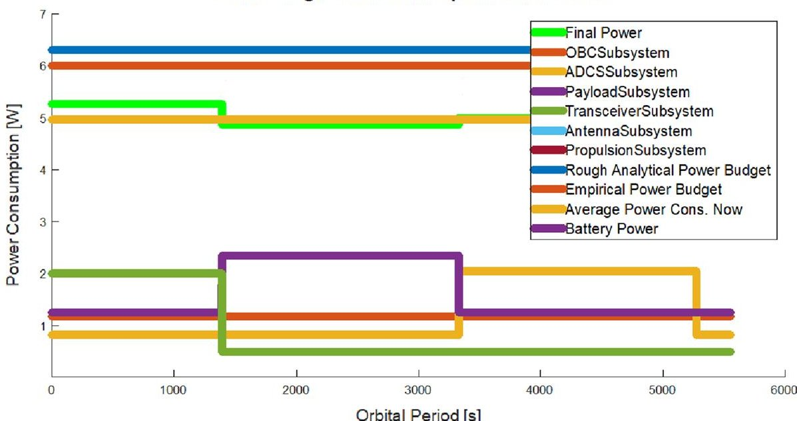

identified that a change in form factor is required. A final table for the GAL analysis, together with the values of Phoenix, is presented below in Table 4.

As it can be noticed from the table, the difference masswise is almost 0.2 kg (5%) , while for the power is 0.5 W (8%). The form factor value is fully respected. The differences relative to the other subsystems rely on the fact that the systems implemented in Phoenix are not available in GREATCUBE+ database or they have been discarded due to the internal calculations of GAL. The tradeoff between components does not take into account the price or the availability at the time of the design for a given COTS product when comparing it with a past mission. Unfortunately, for what concerns the other subsystems (thermal, transceiver, and antenna), no data have been found on their properties, and hence they have been excluded from the table above. The AM so obtained is then fed to the numerical level, GNL.

## 3.3 GNL: numerical model (NM)

The analytical model is then moved downward to the final layer, the numerical level, GNL. In this part, following the reasoning of Sect. 2.3, the current architecture is validated numerically. Updated research showed that the implementation of an hybrid genetic algorithm in MATLAB $ ^{\circ} $ for the establishment of the optimum setup of the subsystems composing Phoenix is feasible following the setup proposed in Sect. 2.3. The hybrid form comes from the need, for some subsystems, i.e., a propulsion unit, to be fixed in specific position regardless of their fit with reference to the optimizing functions. The algorithm has been solved with the functions described in Sect. 2.3 as design drivers. The subjective weights implemented for the solver are:

- The COG must be within the limits imposed by the launcher provider: 80 (highest importance)

- COTS sides in contact with CubeSat panels: 80

Table 4 Result comparison between GAL and the real Phoenix CubeSat design. No data relative to the remaining subsystems implemented in Phoenix have been retrieved. Hence, no comparison is possible for transceiver, antenna, thermal. The data for the "Phoenix data" column are retrieved from the official Phoenix CDR [42]

<table border="1"><tr><td>Parameter</td><td>GEL results</td><td>GAL results</td><td>Phoenix data</td></tr><tr><td>CubeSat mass</td><td>3.25kg</td><td>3.7kg</td><td>3.9kg</td></tr><tr><td>Power production</td><td>4</td><td>6.3W</td><td>6.8W</td></tr><tr><td>Solar panels</td><td>Body mounted</td><td>Body mounted</td><td>Body mounted</td></tr><tr><td>Nr. solar cells per face</td><td>6</td><td>6</td><td>6</td></tr><tr><td>Form factor</td><td>3U</td><td>3U</td><td>3U</td></tr><tr><td>ADCS</td><td>MAI-400</td><td>MAI400</td><td>MAI400</td></tr><tr><td>Mom. storage</td><td>-</td><td>11mNms</td><td>11mNms</td></tr><tr><td>Battery pack</td><td>2×with207Wh/kg</td><td>EPS1plusfromEnduroSat</td><td>2S4PAACclyde</td></tr><tr><td>Structure mass</td><td>ISISspace3U</td><td>ISISspace3U</td><td>In-housebuilt</td></tr><tr><td>OBC</td><td>0.72kgaverageOBCmass</td><td>ISISOBC</td><td>GOMSpaceNanoMindA3200</td></tr></table>

<!-- PDF_PAGE: 15 -->

- Individual Z-axis coincident with structure's Z-axis: 0, being a 3U. This function has little to none impact due in the current setup since the COTS products recommended for this version of Phoenix are respecting the 1U standard for their dimensions (10 cm lenght, 10 cm width, any cm height). The only exception is given by the OBC, green in Figure 12.

The abovementioned setup, merged with the information provided by the AM, brought to the definition of the architecture presented in Fig. 12.

This proposed outcome was the result of GNL and resulted in a system with a center of gravity displayed as Eq.2 shown below:

$$
\left[ \begin{array}{l} C O G _ {X} \\ C O G _ {Y} \\ C O G _ {Z} \end{array} \right] = \left[ \begin{array}{c} 0. 0 3 3 1 9 4 \\ - 0. 0 0 7 2 0 1 \\ - 0. 0 0 0 7 1 5 \end{array} \right] [ \mathrm {c m} ]
$$

The payload is considered to be placed on the bottom part of the spacecraft, as it is for the case of the real Phoenix mission, as shown in Fig. 13.

The position of the subsystems proposed by GNL with this approach is more conservative toward an optimal output for the COG, based on the setup of the weights introduced above. Different setup may be obtained by giving different values to the weights addressed to the optimizing functions.

It can be observed how GNL was capable of predicting the allocations of volumes in Phoenix via the objective

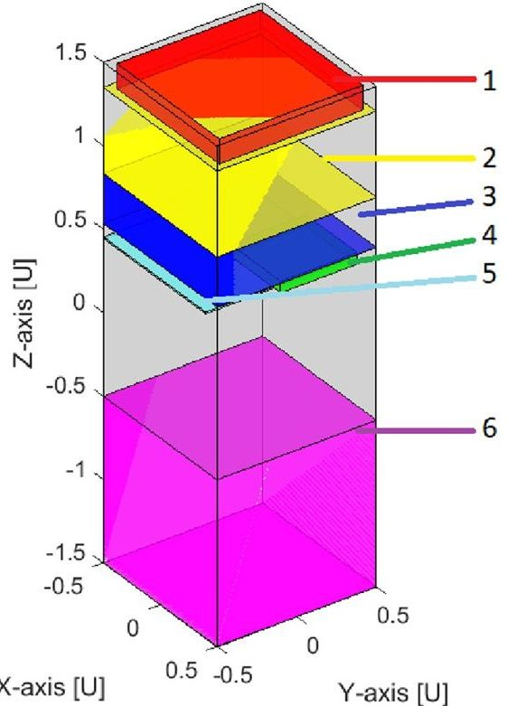

Fig.12 GNL proposed architecture for Phoenix. From +Z: (1) transceiver (red) (2) ADCS (yellow) (3) EPS (blue) (4) OBC (green) (5) antenna (lightblue) (6) payload (pink)

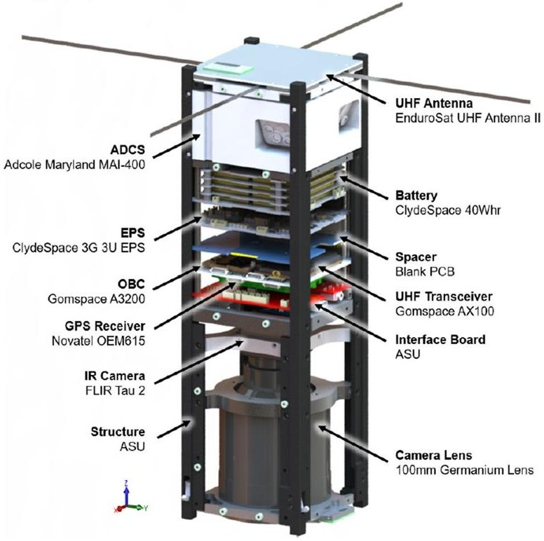

Fig.13 CAD model of Phoenix, courtesy of Arizona State University

functions. This is demonstrated by the comparison of the real setup of Phoenix, displayed in Fig. 13, with the proposed design of GNL in Fig. 12. As it is shown, the allocations of volumes and masses respect the reference satellite entirely.

The previously mentioned architecture is then automatically generated in the form of an.IGES file. This model is then used for a thermal simulation using ANSYS $ ^{\circledc} $ environment.

The process of transferring from MATLAB $ ^{\circ} $ to ANSYS $ ^{\circ} $ is not automatized. The necessary steps to take prior to performing a thermal analysis are the ones introduced in Sect. 2.3, i.e., definition of the heat loads, materials, emissivities, etc. A summary of the values introduced for the case study of Phoenix is presented in Table 5.

In case a transient analysis is desired, it can be possible to use the proposed power budget of Fig. 11 as a guideline for such simulation. A visual representation of the CAD model which has been moved to ANSYS $ ^{\circ} $ for the thermal simulation of Phoenix is presented in Fig. 14.

Although no thermal analysis which could be validated with the real satellite has been performed, since no information regarding the boundary conditions of Phoenix has been found, the model depicted in Fig. 14 is ready for either a transient or steady-state analysis. A simple steady-state analysis has been performed which does not take into account all the possible boundary conditions which the team designing Phoenix may have used for their thermal simulation. The outcome of this numerical study is shown in Fig. 15.

<!-- PDF_PAGE: 16 -->

Fig.14 ANSYS $ ^{\circ} $ model inherited from GNL analysis and automatically generated. The subsystems listed are: (1) transceiver, (2) ADCS, (3) battery pack, (4) OBC, (5) antenna, (6) payload. An actual comparison can be performed referring to Fig.13

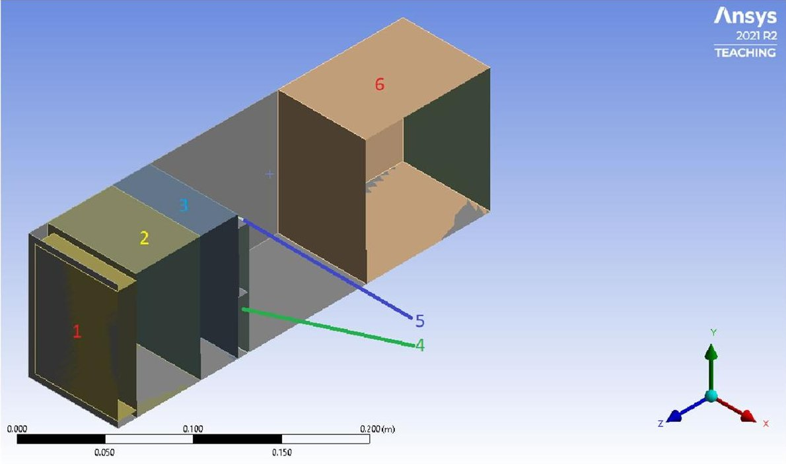

Fig.15 Results of the ANSYS $ ^{\circ} $ simulation performed with the numerical model developed by GNL with the boundary conditions of Table 5. The simulated case represents the worst hot case scenario

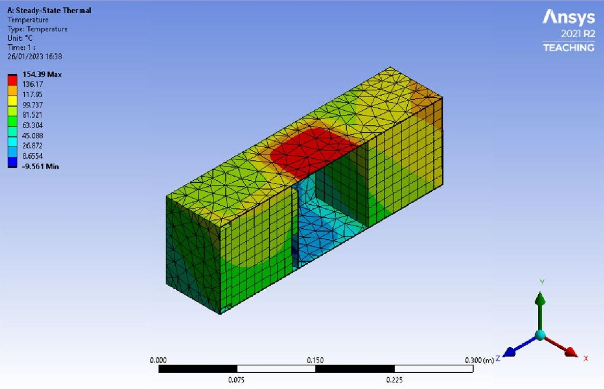

The numerical analysis presented in the figure is representative of the worst hot case scenario (WHC). Phoenix will be hit by the solar heat flux with an intensity of $ 1 3 7 8 \mathrm{W / m^{2}} $ on three faces, while for the remaining three faces it will be illuminated by the IR and Albedo heat fluxes for a value of $ 2 4 2 \mathrm{W / m^{2}} $ The heat loads of the components, together with the material specifications and emissivities, are introduced in Table 5. It is paramount to underline how the simulation results depend sharply on the chosen parameters. Although it may be interesting to try out different setups of the parameters introduced in Table 5, without the boundary conditions of the actual Phoenix mission, it is impossible to achieve validation in this way. The test case presented here with ANSYS displays how quickly

teams can get from the conceptual phase to numerical analysis with the usage of GREATCUBE+.

This final result shows how it could be possible to use, or even modify based on the designing team needs, the model which is directly inherited from GNL to perform a thermal analysis well in advance during the conceptual phase.

## 4 Conclusion and future work

GREATCUBE+ shows capability of predicting design features of existing CubeSats in multiple cases. Its multidisciplinary payload design approach is a feature that may be

<!-- PDF_PAGE: 17 -->

Table 5 Boundary conditions for steady-state thermal analysis in ANSYS $ ^{\circ} $ of the Phoenix CubeSat using the CAD model provided by GREATCUBE+

<table border="1"><tr><td>Boundary condition</td><td>Value</td></tr><tr><td>Solar heat flux</td><td>1378W/m2</td></tr><tr><td>IR and albedo heat fluxes</td><td>242W/m2</td></tr><tr><td>Emissivity alluminium alloy A3003 roughened</td><td>0.8</td></tr><tr><td>Material COTS</td><td>Alluminium alloy</td></tr><tr><td>Initial temperature</td><td>-80℃</td></tr><tr><td>Heat load transceiver(A3003)</td><td>0W</td></tr><tr><td>Heat load ADCS(A3003)</td><td>0.16W</td></tr><tr><td>Heat load EPS(A3003)</td><td>0.1W</td></tr><tr><td>Heat load OBC(A3003)</td><td>0.2W</td></tr><tr><td>Heat load antenna(A3003)</td><td>0W</td></tr><tr><td>Heat load payload(A3003)</td><td>0.2W</td></tr><tr><td>Structure</td><td>Three faces:0.9(Solar Cells).Three faces:1(Black paint)</td></tr></table>

interesting for any team which is in the process of developing a CubeSat mission. Additionally, this software could help shortening the time necessary in the conceptual development phase via its characteristic of providing both a list of COTS products, which satisfy mission requirements, and a CAD model which can be filled with valuable information for thermal analysis. The quality of GREATCUBE+ can be further increased by expanding the COTS components database. GREATCUBE+'s future work intends to include an orbital and electrical simulation in SIMULINK $ ^{\circ} $ which will be used to test, based on the power budget suggestions, the survivability of the battery pack for the proposed orbit and power cycles.

The empirical correlations, retrieved from a vast database of successfully flown missions, behaves as guarantee of the empirical level (GEL). The consistency of the results increases as the model proceeds through the different layers reaching, in many cases, 90% accuracy. As a proving example of accuracy of the software, an iteration with the mission named Phoenix is performed and its results are shown in Fig. 15. Throughout the whole simulation from GEL to GNL, the design changes fluidly until the optimal scenario is achieved, based on the user-introduced inputs. Within the database of tested CubeSat systems in GREATCUBE+. it has been recorded that its prediction accuracy is close to 100% for the form factor and for weights and power production, it reaches 90%.

Increased efforts showed how GAL1 and GAL2 both give the same output, as it is possible to see in Fig. 6. This result proves how the concurrent engineering principles, if applied correctly, lead to the same design regardless of any bias of the system engineer.

Latest developments displayed the potential of genetic algorithms for the determination of the subsystem positions to achieve the optimal COG which could respect the requirements of the launcher provider without altering the design of the CubeSat. This is then followed by the generation of an IGES file which can be used in different simulation scenario (e.g., ANSYS $ ^{\circ} $ ) for further investigation and analysis.

Acknowledgements This work was funded by the region of Lower Austria (Niederosterreich) via the project numbered: K3-F-767/002 2019. The support of Technische Univerität Dresden and Fachhochschule Wiener Neustadt is greatly appreciated.

Funding Open access funding provided by University of Applied Sciences Wiener Neustadt (FHWN).

## Declarations

Conflict of interest The authors certify that they have no competing interests on the matters discussed in this manuscript.

Open Access This article is licensed under a Creative Commons Attribution 4.0 International License, which permits use, sharing, adaptation, distribution and reproduction in any medium or format, as long as you give appropriate credit to the original author(s) and the source, provide a link to the Creative Commons licence, and indicate if changes were made. The images or other third party material in this article are included in the article's Creative Commons licence, unless indicated otherwise in a credit line to the material. If material is not included in the article's Creative Commons licence and your intended use is not permitted by statutory regulation or exceeds the permitted use, you will need to obtain permission directly from the copyright holder. To view a copy of this licence, visit http://creativecommons.org/licenses/by/4.0/.

## References

1. NANOSAT Database. https://www.nanosats.eu/. Accessed: 2022-07-25

2. McIntosh D. M., M.J.A. Baker J. D.: The nasa cubesat missions flying on artemis-1. 34th Small Satellite Conference, SSC20-WKVII-02 (2020)

3. CalPoly: Cubesat design specification (cds) rev. 14.1, 00-34 (2022)

4. Tolmasoff, M., Delos, R., Venturini, C.: Improving mission success of cubesats. In: Proceedings of the US Space Program Mission Assurance Improvement Workshop, The Boeing Company, El Segundo, CA. Aerospace Report Nr. TOR-2017-01689 (2017)

5. Villela, T., Costa, C.A., Brandao, A.M., Bueno, F.T., Leonardi, R.: Towards the thousandth cubesat: A statistical overview. International Journal of Aerospace Engineering (2019). https://doi.org/ 10.1155/2019/5063145

6. ECSS: Ecss-m-st-10c, space project management - project planning and implementation. European Cooperation for Space Standardization (2009)

7. NASA: Basics of Space Flight. https://solarsystem.nasa.gov/basics/chapter7-1/. Accessed: 2020-07-06

8. NASA: Nasa - npr 7120.5f. https://nodis3.gsfc.nasa.gov/displayDir.cfm?t=NPR &c=7120 &s=5E (2021)

9. Asundi, S.A., Fitz-Coy, N.G.: Cubesat mission design based on a systems engineering approach. In: 2013 IEEE Aerospace

<!-- PDF_PAGE: 18 -->

Conference, pp. 1-9 (2013). https://doi.org/10.1109/AERO.2013. 6496900

10. Ridolfi, G., Mooij, E., Corpino, S.: A System Engineering Tool for the Design of Satellite Subsystems. https://doi.org/10.2514/6. 2009-6037

11. Chang, Y.-K., Hwang, K.-L., Kang, S.-J.: Sedt (system engineering design tool) development and its application to small satellite conceptual design. Acta Astronautica 61(7), 676-690 (2007). https://doi.org/10.1016/j.actaastro.2007.01.067

12. Alvarez, J., Roibás-Millán, E.: Agile methodologies applied to integrated concurrent engineering for spacecraft design. Res. Eng. Design 32, 431-450 (2021)

13. Knoll, D., Fortin, C., Golkar, A.: A process model for concurrent conceptual design of space systems. Syst. Eng. 24(4), 234-249 (2021)

14. Putnik, G.D., Putnik, Z.: Defining sequential engineering (seqe), simultaneous engineering (se), concurrent engineering (ce) and collaborative engineering (cole): On similarities and differences. Procedia CIRP 84, 68-75 (2019)

15. Nieto-Peroy, C., Emami, M.R.: Cubesat mission: From design to operation. Appl. Sci. (2019). https://doi.org/10.3390/app9153110

16. Scholz, A., Juang, J.-N.: Toward open source cubesat design. Acta Astronautica 115, 384-392 (2015). https://doi.org/10.1016/j.actaa stro.2015.06.005

17. Higginbotham, S.: Cubesat launch initiative overview and cubesat 101. In: Nevada Space Grant and Nevada NASA EPSCoR Statewide Meeting 2017 (2017)

18. Jacobs, M., Selva, D.: A cubesat catalog design tool for a multiagent architecture development framework. In: 2015 IEEE Aerospace Conference, pp. 1-10 (2015)

19. Polnik, M., Mazzarella, L., Di Carlo, M., Oi, D., Riccardi, A., Arulselvan, A.: Scheduling of space to ground quantum key distribution. EPJ Quantum Technol (2020). https://doi.org/10.1140/ epjqt/s40507-020-0079-6

20. Páscoa, J., Teixeira, O., Ribeiro, G.: A review of propulsion systems for cubesats. (2018). https://doi.org/10.1115/IMECE 2018-88174

21. Krejci, D., Lozano, P.: Space propulsion technology for small spacecraft. Proceedings of the IEEE PP, 1-17 (2018). https://doi.org/10.1109/JPROC.2017.2778747

22. Wertz, W.J., James., R.: Space Mission Analysis And Design (SMAD). Springer, New York (1999)

23. Howard, C.P.: Orbital Mechanics for Aerospace Engineering Students. Elsevier, ISBN-100080977472 (2013)

24. Aas, C.L., Zandbergen, B.T., Hamann, R.J., Gill, E.K.: Development of a system level tool for conceptual design of small satellites. In: Proceedings of the 7th Annual Conference on Systems Engineering Research: CSER 2009, 20-23 April 2009, Loughborough University, UK (2009). Research School of Systems Engineering, Loughborough University

25. ESA-ESTEC: Ecss q st 60c rev. 2, space product assurance. ECSS (2013)

26. Smith, J.L.: Concurrent engineering in the jet propulsion laboratory project design center. SAE transactions, https://doi.org/10. 4271/981869, 1106-1118 (1998)

27. McInnes, A., Harps, D., Lang, J., Swenson, C.: A systems engineering tool for small satellite design. 15th Annual AIAA/USU Conference on Small Satellites (2001)

28. NANORACKS: Nanoracks cubesat deployer (nrcsd) interface control document. NanoRacks website http://nanoracks.com/ NR-SRD-029, 1-53 (2013)

29. Zhao, X.: The 3d dimensional container loading problem, phd thesis, university of southampton. PhD Thesis, Southampton Business School, University of Southampton (2017)

30. Wu, Y., Li, W., Goh, M., Souza, R.: Three-dimensional bin packing problem with variable bin height. Eur. J. Operational Res. 202, 347-355 (2010). https://doi.org/10.1016/j.ejor.2009.05.040

31. Yan, Y.F.: 3d bin packing in mixed case palletization. Master Thesis, University of Waterloo (2015)

32. Chen, C.S., Lee, S.M., Shen, Q.S.: An analytical model for the container problem, Elsevier, European Journal of Operational Research (1993)

33. de Silva, E.F.: Algorithms for solving 3d cutting and packing problems with real-world constraints. PhD Thesis, KU Leuven (2020)

34. Kang, J., Moon, I., Wang, H.: A hybrid genetic algorithm with a new packing strategy for the three-dimensional bin packing problem. Appl. Math. Comput. 219, 1287-1299 (2012). https://doi.org/ 10.1016/j.amc.2012.07.036

35. Che, C., Wang, Y.-s., Teng, H.-f.: Test problems for quasi-satellite packing: Cylinders packing with behavior constraints and all the optimal solutions known. Optimization Online (2008)

36. Zhong, C.-Q., Xu, Z.-Z., Teng, H.-F.: Multi-module satellite component assignment and layout optimization. Appl. Soft Comput. 75, 148-161 (2019). https://doi.org/10.1016/j.asoc.2018.11.021

37. Phoenix CubeSat Official Website. https://phxcubesat.asu.edu/. Accessed: 2022-09-13

38. Girardello, C., Tajmar, M., Scharlemann, C.: Greatcube+: a multipurpose tool for cubesat conceptual design. DGLR2022, Paper Number: 570329 (2022)

39. Girardello, C., Tajmar, M., Scharlemann, C.: Greatcube+: A multidisciplinary software tool for cubesat system and subsystem design - 4s symposium 2022. 4S Symposium (Paper Number 63) (2022)

40. Girardello, C., Tajmar, M., Scharlemann, C., Treberer-Treberspurg, W.: Concurrent engineering methodology for cubesat conceptual design. SECESA 2022 (Paper Number 14) (2022)

41. Rogers, S., Sanchez de la Vega, J., Zenkov, Y., Knoblauch, C., Bautista, D., Bautista, T., Fagan, R., Roberson, C., Flores, S., Barakat, R., et al.: Phoenix: a cubesat mission to study the impact of urban heat islands within the us (2020)

42. Phoenix CDR. https://s3vi.ndc.nasa.gov/ssri-kb/static/resources/ phoenix_cdr_-_shareable.pdf. Accessed: 2022-09-13

