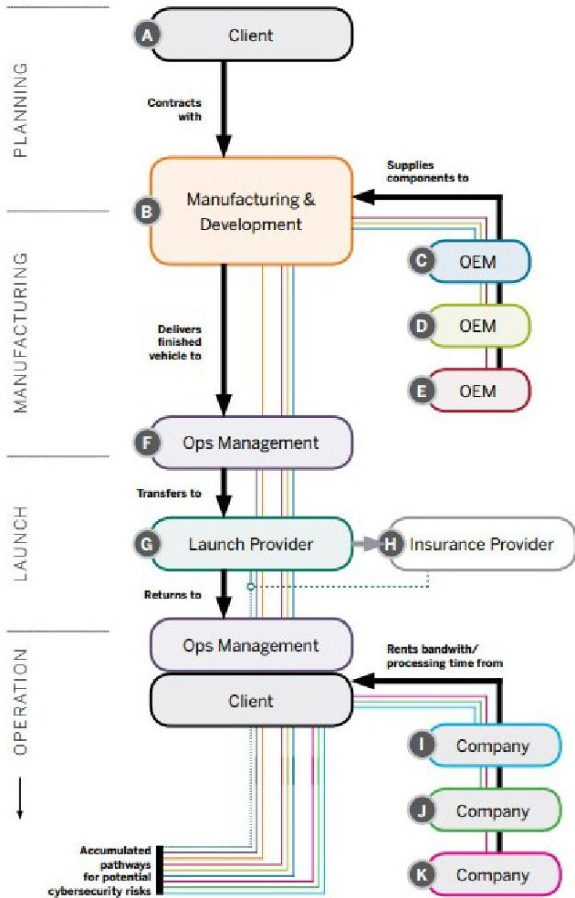
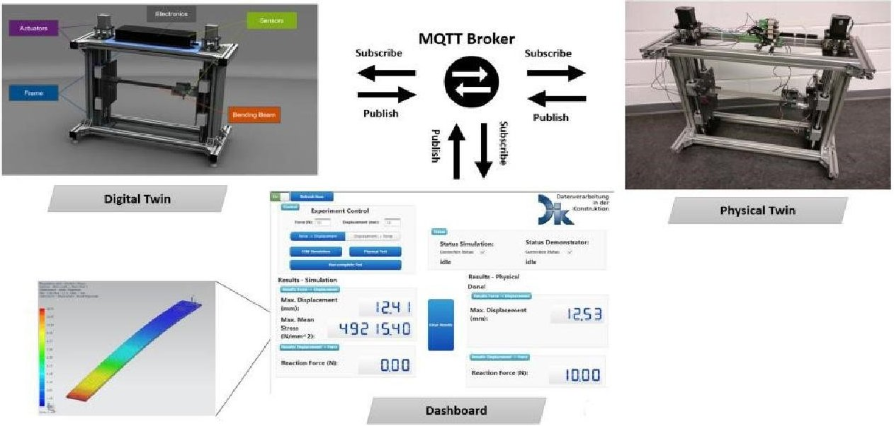
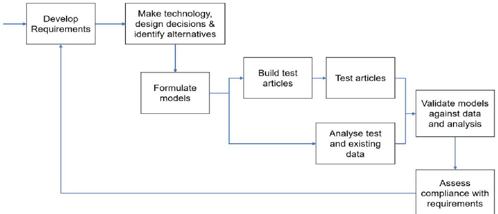
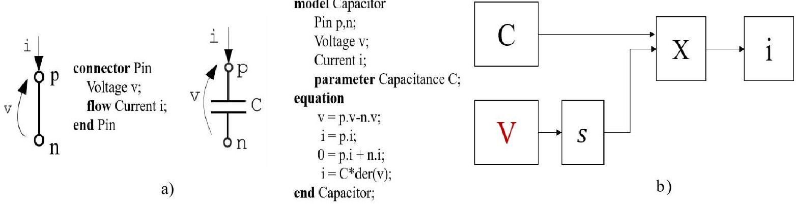
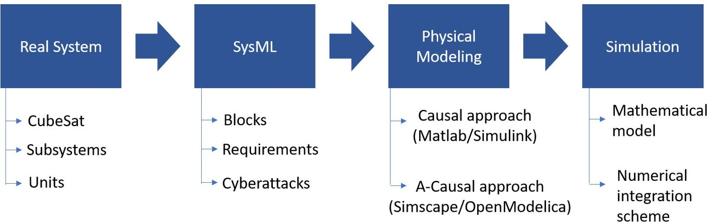
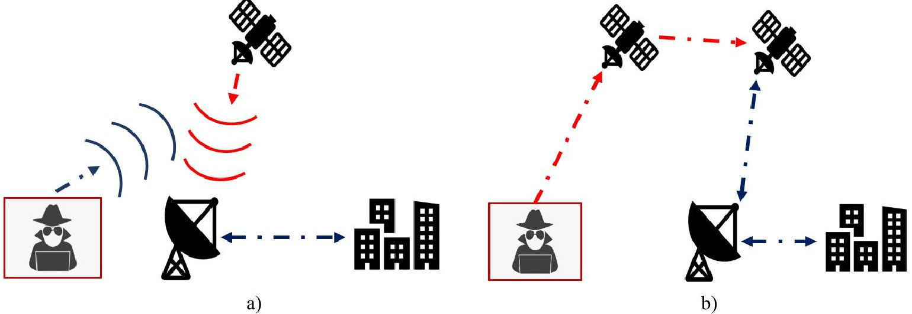
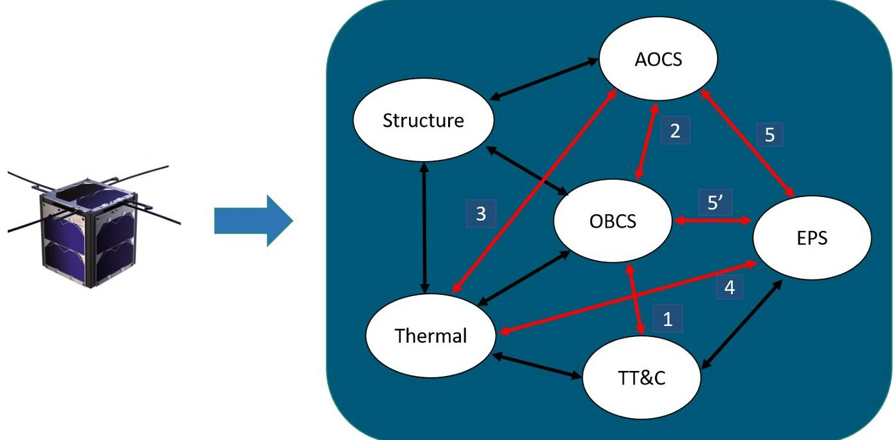

<!-- PDF_PAGE: 1 -->

# HACK: a Holistic modeling Approach for Cubesat cyberattackKs

Salvatore Borgia $ ^{1, a^{*}}, $ Francesco Topputo $ ^{b}, $ Stefano Zanero $ ^{c} $

$ ^{1} $ Politecnico di Milano, Italy

$ ^{a} $ salvatore.borgia@polimi.it, $ ^{b} $ francesco.topputo@polimi.it, $ ^{c} $ stefano.zanero@polimi.it,

Keywords: Cyberattacks, Digital Model, CubeSat, Cybersecurity, Holistic Modeling Multiphysics Simulation, Digital Twin

Abstract. In recent years, the threat of cyberattacks has been growing rapidly in numerous industrial sectors that have an impact on our daily life. One of these is the space industry, where the risk of hacking a single satellite can lead to dangerous effects not only for economics but also for Earth critical infrastructure like: transportation systems, water networks, and electric grid. The vulnerability of complex space systems has already been demonstrated in the past. In 1998, for example, hackers took control of the ROSAT X-Ray satellite pointing its solar panels directly to the Sun and causing physical damage. Nowadays, since the attention is moved on small and less sophisticated system, such as CubeSat, the risk of cyber intrusions is even higher as the COTS (Commercial-Off-The-Shelf) technology they use is based on open-source operating systems. In order to counteract this imminent problem, the development of a high-fidelity CubeSat digital model is needed to study and solve related space cybersecurity issues. In fact, thanks to the virtual prototype, what-if simulations can be performed allowing to analyze different cyberattacks scenarios and predict undesirable events on the CubeSat flying on its operative orbit. Moreover, the building of the digital model requires a holistic modeling approach and simulation tools which allows to consider Multiphysics phenomena occurring on the space system itself. Finally, the possibility of connecting the virtual model to a real space system, obtaining the so-called Digital Twin (DT), will help engineers to conduct more accurate actions during the mission.

## Introduction

According to G. Falco [1], space assets are sophisticated pieces of equipment with a complex production and operational chain, making space systems vulnerable to cyberattacks. Unlike most critical infrastructure sectors, a space system is not owned by the same organizations that operate the system itself. All of this make the cybersecurity responsibility challenging to be well-defined and assigned. Fig. 1 shows how the cybersecurity risks pathways (colored lines) are accumulated along a typical satellite project. Furthermore, the recent trend to use CubeSat introduces additional cybersecurity risks due to the exploitation of COTS technology which could be an uncontrolled door for external adversary. Considering the growing number of CubeSat orbiting the Earth, malicious organizations can hack only a single unit to provoke collisions phenomena with dangerous effects. This research project is framed within the urgent need of limiting cyberattacks with high-fidelity models and simulation tools. The latter can be designed through the DT and MBSE (Model-Based System Engineering) concepts. The most common definition of DT was formulated by E. Glaessgen et al. [2] as: "An integrated multi-physics, multi-scale, probabilistic simulation of a vehicle or system that uses the best available physical models, sensor updates, fleet history, and so forth, to mirror the life of its flying twin". So, a DT is an emulated version of a real system where mathematical modeling, data-based methods, and hardware are strongly interconnected to have a correct model system identification [3]. NASA was the first association to forge the definition of DT and to build already two identical space vehicles (one on the Earth and the other one in the space) for supporting Apollo program (1961) [4]. Fig. 2 depicts an example of DT application for a bending beam test bench [5]. It is worthy to highlight how the data collected

<!-- PDF_PAGE: 2 -->

by test bench sensors can be sent to the digital model of the beam and used to refine the virtual model itself.

Figure 1: Cybersecurity responsibility landscape for a satellite project [1]

Figure 2: Overview of a DT system [5]

The MBSE method is needed to have a holistic modeling design and to identify the functional relationship between and inside the CubeSat subsystems by defining the relative interfaces, needs, requirements and interconnections. Baker et al. [6] indicates the key MBSE processes (Fig. 3) which shall be applied for each development phases of a project and for each subsystem that composes a space system.

<!-- PDF_PAGE: 3 -->

Figure 3: Sub-processes for MBSE method [6]

## Methods and tools

In the following sections, the main steps for developing a preliminary digital model of a CubeSat are described starting from the knowledge of the real object to the simulation block which allows to perform system's behavior analyses.

## Modeling and Simulation

After the preliminary considerations on space cybersecurity and the importance of simulating cyberattacks on a CubeSat, the main modeling steps [7] to be applied are now presented. First of all, it is important to recall the four stages of the dynamic investigation which leads to system behavior prediction:

- Specify the real system to be examined and deduce a physical model whose behavior is representative of the real one.

- Derive a mathematical model to represent the physical one.

- Solve the differential and algebraic equations of the mathematical model.

- Make design decision or adjust physical parameters to match the virtual space to the real one.

Where the actual system can be the whole CubeSat or a combination of its subsystems (propulsion, electrical, etc.); the physical model is a virtual model obtained through approximations and engineering judgment; the mathematical model can be derived from first principles; the dynamic system can be solved using an appropriate numerical integration scheme; and the refinement model step can be performed adopting the communication real-time interface between the real object and its DT or, for example, collecting on-orbit data to continuously update the physical/mathematical model properties. The physical abstraction step shall be performed in a way that lets to simplify the next simulations considering only dominant dynamics aspects on the system.

The procedure described until now belongs to the causal-modeling approach. Because of the involvement of different CubeSat subsystems in a complex Multiphysics domain, the A-causal method can be useful to simplify the modeling part. In fact, according to this method, the modeling is more focused on the physical connections (connectors or ports) between parts rather than on their interaction in terms of input and output. "There are no input and output variables in real life" (Dr. Yaman Barlas). Fig. 4 shows this difference of modeling approach in the electric domain (capacitor object) using OpenModelica against Simulink language. It is worthy to notice how: in

<!-- PDF_PAGE: 4 -->

the first case, there is the definition of the elementary port (physical connection), the non-flow variable (voltage), the flow-variable (current), the constitutive and connection equations; on the contrary in the Simulink case, there is the direct translation of the mathematical model where the voltage is assumed as input and the current as output (losing the physical meaning).

Figure 4: a) Declarative capacitor's model b) Simulink scheme

Within the MBSE framework, the SysML (Systems Modeling Language) can be exploited in order to better define the CubeSat system highlighting its parts or units, and their corresponding requirements. This also allows to better identify: the interconnections between subsystems, and test cases to visualize how a hacker can start an attack and interact with others system blocks. In [8], it is reported an example of SysML application for a crewed Mars mission (exploiting the Cameo Systems Modeler environment), where hierarchically the structure design principle of the heterogenous cyberphysical systems is shown. Finally, the cyberattacks can lead to unpredictable phenomena where the space system is in non-nominal conditions, so the modeling phase shall include also non-linear cases. Fig. 5 shows the pipeline which summarizes what it has been discussed so far.

Figure 5: Work pipeline to identify, model, and simulate a CubeSat

## Space cybersecurity: threat model

In this section, some of the principal vulnerabilities of a space asset are presented. As suggested by G. Falco [1], using a ground antenna, a black hacker can intercept the IP address from a satellite (CubeSat) internet user and start a TCP/IP connection. From the stolen IP, an attacker can directly uplink false data to the user system connected to that specific IP address. Another cyberattack is the GPS spoofing, where an adversary uses a GPS signal simulator to insert a fake signal behind

<!-- PDF_PAGE: 5 -->

the true signal and progressively increase the power of the fake signal until the point it is considered real from the satellite's receiver. Moreover, in [9] the technical feasibility of satellite-to-satellite cyberattacks is described. Looking at some past satellite failures (Anik E1, Anik E2, and TDRS 1), we know that they have been occurred because of background radiations or solar flare. The same effects can be obtained with a EMP (Electromagnetic Pulse) attack. In this case, the attacking satellite, equipped by an EMP actuator, shall be oriented towards the victim satellite before to start the attack. Fig. 6 shows graphically the two ways of cyberattack.

Figure 6: a) Satellite signal spoofing cyberattack b) Satellite-to-Satellite attack scenario

In Fig. 7, the heterogeneous domain of a CubeSat is shown considering the subsystems: C (On-Board Computer Subsystem), AOCS (Attitude and Orbit Control Subsystem), EPS

(Electrical Power Subsystem), TT&C (Telemetry, Tracking, and Command), Structure, and Thermal. In real life, each subsystem affects all the others an vice versa. One of the modeling challenges is to keep only the main connections in order to visualize important Multiphysics events for the space mission integrity. In addition, a cyber intrusion path （1-2-3-4-5-5 '）is highlighted in red. In this scenario, it can be noticed how the insertion of a fake signal received by TT&C subsystem and processed by OBCS, can provoke dangerous internal loops and escalation effects as:

- The fake instructions can change the CubeSat orientation

- The new attitude leads to a different temperature distribution

- The EPS produces new level of power (solar panel exposed area variation to the Sun)

- The OBCS is affected by the new power produced on-board

According to these events, an attacker can send instructions to point solar panel toward the Sun or deep-space, and this can lead to: overheating or structure deformations in the first case, and CubeSat components shut down in the second case (due to insufficient level of power). This kind of failure propagation chain can be analyzed and studied as function of the achieved modeling complexity. The latter allows to reveal more variables and parameters that links a CubeSat physical domain with another.

<!-- PDF_PAGE: 6 -->

Figure 7: CubeSat domain: the red path shows how a cyber intrusion can spread inside the system

## Conclusions

This research project aims to help the realization of a fully-integrated DT of a CubeSat capable to be tested and analyzed under different input conditions (in order to simulate cyberattacks). Thanks to this project, computer science and space engineering will work in synergy, during a space mission development phase, planning defense strategies against cyber threats. Moreover, the highfidelity digital model allows to optimize the design phase and to reduce the production costs. Finally, some of the candidate research questions, associated with this research work, can be formulated as:

- Using a holistic design approach for building a pre-digital twin of a CubeSat, what kind of cross-phenomenona (between subsystems) can be triggered?

- After the simulation campaign, is it possible to define and isolate critical coupling effects and relations between a CubeSat subsystem and another?

- Which could be the main escalation events in space (Earth's orbit or deep-space) that lead to a mission failure?

## References

[1] G. Falco, Job One for Space Force: Space Asset Cybersecurity, Belfer Center for Science and International Affairs, Harvard Kennedy School, Vol. 79, 2018.

[2] E. Glaessgen, D. Stargel, The Digital Twin Paradigm for Future NASA and U.S. Air Force Vehicles, 53rd AIAA/ASME/ASCE/AHS/ASC Structures, Structural Dynamics and Materials Conference, 2012. https://doi.org/10.2514/6.2012-1818.

[3] J. Liu et al., Dynamic Evaluation Method of Machining Process Planning Based on Digital Twin, IEE, 2019. https://doi.org/10.1109/ACCESS.2019.2893309.

[4] R. Rosen, G. von Wichert, G. Lo, K.D. Bettenhausen, About The Importance of Autonomy and Digital Twins for the Future of Manufacturing, IFAC-PapersOnLine 48-3 (2015) 567-572. https://doi.org/10.1016/j.ifacol.2015.06.141.

[5] S. Haag, R. Anderl, Digital twin - Proof of concept, Manufacturing Letters, Vol. 15, Part B, pp. 64-66, 2018. https://doi.org/10.1016/j.mfglet.2018.02.006.

<!-- PDF_PAGE: 7 -->

[6] J. A. Estefan, Survey of Model-Based Systems Engineering (MBSE) Methodologies INCOSE MBSE Initiative, 2008.

[7] A. Maria, Introduction to Modeling and Simulation, Proceedings of the 1997 Winter Simulation Conference. https://dl.acm.org/doi/pdf/10.1145/268437.268440.

[8] M. Kirshner, Model-Based Systems Engineering Cybersecurity for Space Systems, Aerospace 2023, 10, 116. https://doi.org/10.3390/aerospace10020116.

[9] G. Falco, When Satellites Attack: Satellite-to-Satellite Cyber Attack, Defense and Resilience, ASCEND November 16-18, 2020, Virtual Event. https://doi.org/10.2514/6.2020- 4014.