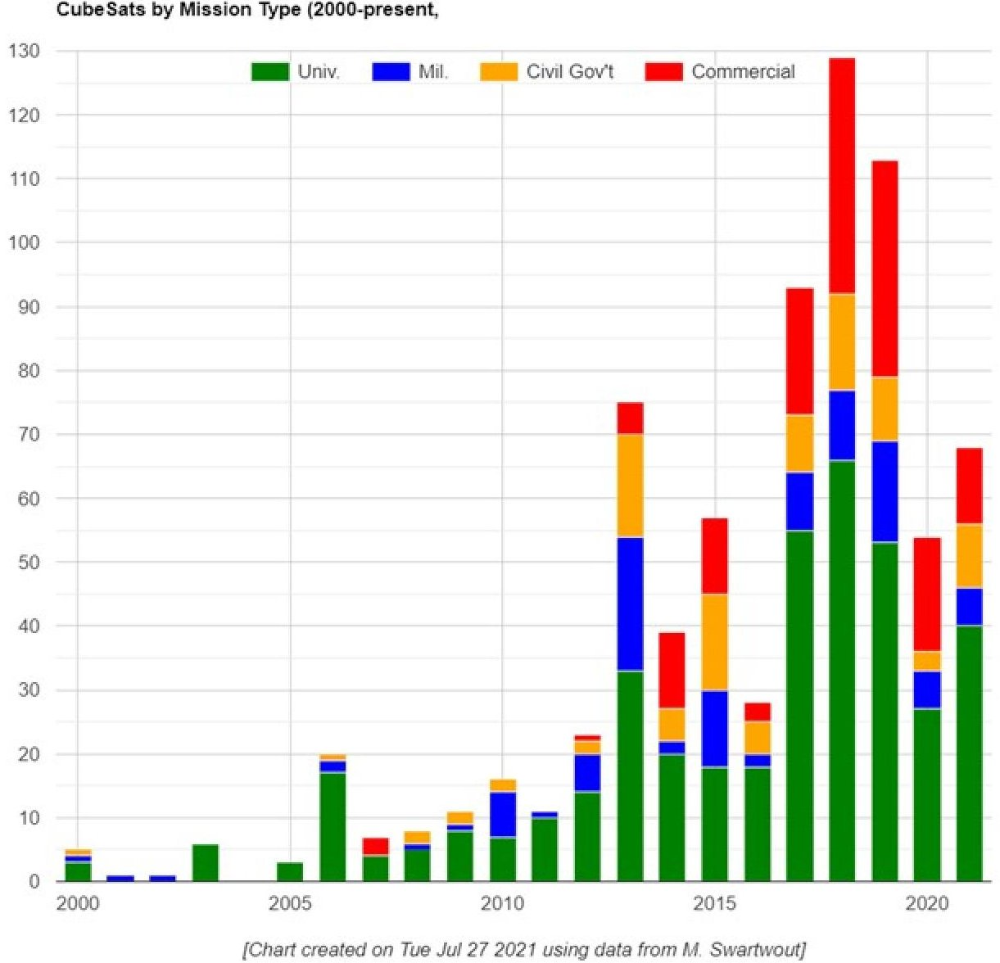
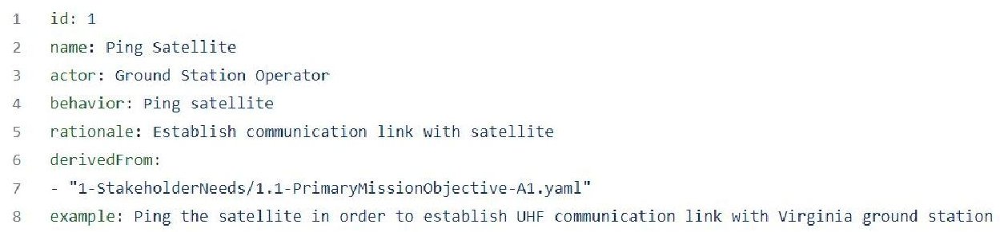
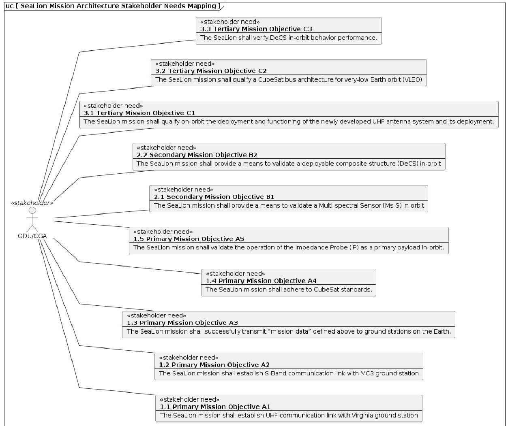
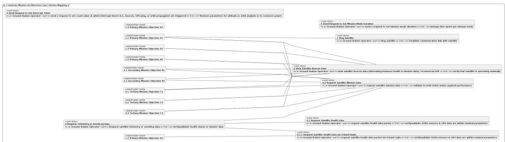
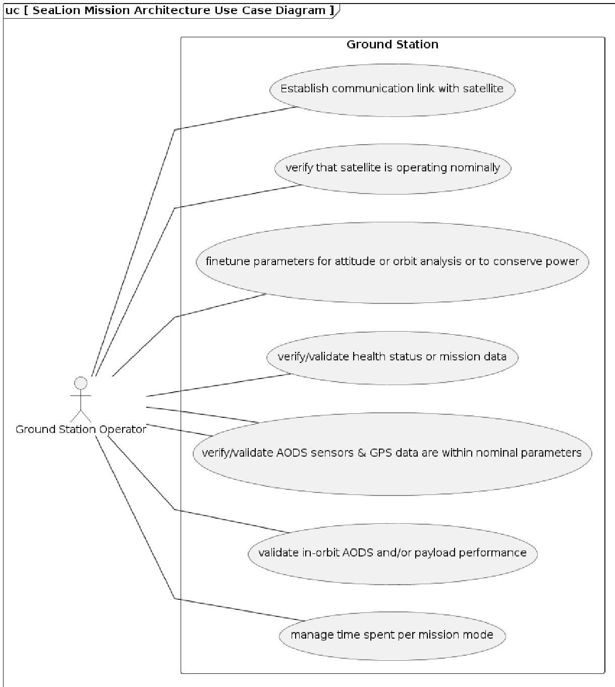
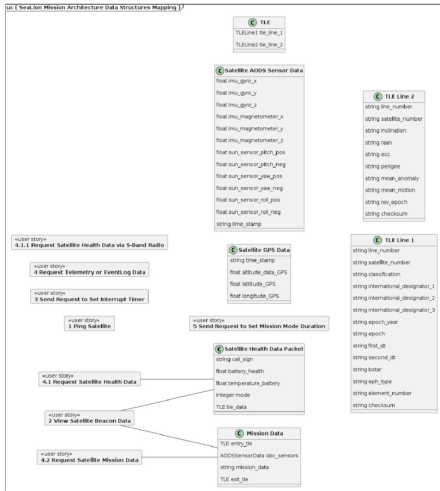

<!-- PDF_PAGE: 1 -->

# Model-Based CubeSat Flight-Software Architecture using a Docs-as-Code Approach

Sean Marquez and Kevin Chiu $ ^{*} $ Old Dominion University, Norfolk, VA, 23529, USA

Sharanabasaweshwara Asundi $ ^{\dagger} $ Old Dominion University, Norfolk, VA, 23529, USA

With the growing community of CubeSat developers has emerged a need for a technical approach that would provide a means of fast-tracking the lifecycle development process of CubeSats, including the need to minimize design and development time repeating prior engineering efforts. In addition to a technical approach, there is also the need for a language and toolchain with a demand for both minimal training and minimal IT overhead to configure. A model-based approach has become a topic of interest in addressing much of these systems engineering painpoints. However, the current state-of-the-art tools demand either considerable investment in training and/or IT overhead, making it difficult for CubeSat developers of small startups or academia to participate. This article presents a model-based technical approach in conjunction with a docs-as-code approach, used to fascilitate flight software architecture development, intended to guide an implementation, for the SeaLion CubeSat mission - a joint CubeSat mission between the Old Dominion University and Coast Guard Academy. The technical approach discussed in this paper was also used to model and generate the paper as itself.

## I. Nomenclature

1U = 1-Unit

3U = 3-Unit

BOM = Bill of Materials

ConOps = Concept of Operations

DOF = Distributed OSHW Framework

M30ML = Mach30 Modeling Language

MBSE = Model-Based Systems Engineering

ODU = Old Dominion University

OML = Ontological Modeling Language

OSHW = Open Source Hardware

OWL2 = Web Ontology Language 2

SWRL = Semantic Web Rule Language

USCGA = United Stated Coast Guard Academy

WFF = Wallops Flight Facility

## II. Introduction

THIS article presents the modeling language, tools, and technical approach used to facilitate the configuration management, design, specification, & implementation of the SeaLion mission architecture for the flight software using a model-based approach.

<!-- PDF_PAGE: 2 -->

A model-based systems engineering (MBSE) approach to systems engineering is where models, as opposed to documents, serve as the authoritative source of truth for conducting systems engineering activities, such as the design, specification, analysis, verification & validation of a system [1]. The NASA handbook on systems engineering can be applied to CubeSat Mission design, in effort to facilitate a top-down design methodology from mission concept to specification of subsystem components, including flight software architecture [2].

For the SeaLion Mission, the flight software team adopted an MBSE approach to flight software architecture using a documentation as code, also known as docs-as-code, approach [3]. This approach adopts the principles and practices of good modern software development for configuration management of documentation. A docs-as-code approach also ensures source code and documentation can remain in sync, by virtue of treating the documentation as part of the software source code using the same version control system to manage both. Applying both a MBSE and docs-as-code approach means that aspects of the mission architecture, such as stakeholder needs, user stories, and data structures pertaining to the CubeSat mission, are captured within a human and machine-readable model, while minimizing configuration management overhead. A docs-as-code approach is also file-based, allowing data to persistent on the local filesystem, as opposed to a cloud database, eliminating the need for a constant internet connection, which is a considerable bottleneck for teams or teammates in conditions where an internet connection is otherwise inaccessible.

## III. SeaLion Mission

The SeaLion mission is a a joint CubeSat mission between the Old Dominion University (ODU), Coast Guard Academy (USCGA), and the Air Force Institute of Technology (AFIT) to design and produce a 3-Unit (3U) CubeSat.

SeaLion consists of three payloads for on-orbit validation. ODU provided one payload while the USCGA and AFIT provided the other two payloads. SeaLion is planned to fly as a secondary payload on a Northrop Grumman Antares Rocket from Wallops Flight Facility (WFF), currently scheduled for March, 2023 [4].

## A. CubeSats

The CubeSat, originating from California Polytechnic State University in 1999, are a standardized form of nanosatellites. Nanosatellites are satellites typically defined with a mass of less than 10 kg. CubeSats, also known as Cube Satellites, are defined by a standardized and modular architecture of 1-Unit (1U) cubes with dimensions of 10 cm X 10 cm X 10 cm with a maximum mass of 2.00 kg [5]. These units can be expanded upon such as, for example, a 3U CubeSat with standard dimensions of 10 cm X 10 cm X 34.05 cm and a maximum mass of 6.00 kg [5].

## B. CubeSat Users

CubeSats were initially conceived as educational tools for space systems engineering [6]. Now, their roles have been expanded to not only just educational tools but for observation, technology demonstrations, and research, that were previous monopolized by much larger satellites, due to the low cost of production and launch of these satellites. As such, there has been increasing popularity for CubeSats as seen by the increasing number of launches in figure 1 since inception [7].

University groups especially are a large contributor in the overall number of launches of CubeSats yearly with university groups consistently maintaining plurality on total launches [7]. Thus, a need for readily available and easily learnable system engineering approaches and tools, for students especially, exists for those who are new to either CubeSat design and systems engineering.

## IV. Goals

The goal of the SeaLion CubeSat flight software architecture was to capture the data structures and expected behaviors of the flight software, such that it can be unambiguously understood well enough to be implemented, as well as provide full traceability and rationale for architectural elements with minimal configuration management overhead [8]. The MBSE approach was of interest to the SeaLion CubeSat flight software team, as to yield the benefits of reducing ambiguity that usually comes with using informal language for specifying aspects of a system, as well as minimizing duplication of content that tends to accumulate in a document-based systems engineering approach.

The final approach had to achieve the following goals:

- Ensure templates only contain formatting data (this includes not storing boilerplate text in templates)

- Ensure models are the authoritative source of truth for all artifact content (e.g. artifact structure, meta-data,

<!-- PDF_PAGE: 3 -->

Fig. 1 Nanosatellite launch data provided by M. Swartwout [7].

boilerplate, commentary, discussion, diagrams, tables, etc.)

- Models should persist on the local filesystem

- Documents should be in plaintext as to be compatible with modern distributed version control system (e.g., Git) and for ease of use.

- Documents should be able to sit alongside code and speak to one another.

- Documents should be model-based as to have a separation of concerns between content and formatting as well as be both human and machine-readable for querying and generating views.

Selection of a modeling language and modeling tool was taken into consideration in order to properly adopt a MBSE approach. Other considerations include overhead incurred with training the team, as well as technical overhead with setting up and maintaining the modeling tools. The flight software team also decided to adopt a docs-as-code approach to further enhance a MBSE approach to achieve the listed goals.

## A. Model-Based Systems Engineering

Traditional approaches use documents as their authoritative source of truth for conducting system engineering activities [1]. Information in a traditional systems engineering approach today is mostly captured informally, not authored based on a methodology, configuration managed in silo tools, adhocly and infrequently integrated, not easily traceable to its provenance, not properly configuration managed, not properly changed managed, and not effectively shared with stakeholders [9]. These documents often do not have a living relationship with other documents or to other corresponding elements; thus, changes to one document require manual changes to other documents [10].

<!-- PDF_PAGE: 4 -->

In contrast, a model-based systems engineering approach supports capturing information in a highly structured modeling language, authored based on a methodology, configuration managed in a common tool, highly integrated, traceable to its provenance, and sharing with stakeholders. Models provide the following key advantages over document-based approaches [10]:

- Information is readily communicated and shared within the project.

- Changes are easily accommodated.

- Traceability is automated.

## B. Docs As Code Approach

Docs-as-code refers to a philosophy that team members should be writing documentation with the same tools as code [3]. These tools may include version control (e.g., Git), issue trackers, code tools, etc.

This means following the same workflows as development teams, and being integrated in the product team. It enables a culture where writers and developers both feel ownership of documentation, and work together to make it as good as possible [3].

It was of interest to adopt a docs-as-code approach, as to yield the benefits of utilizing the same principles and practices used to manage software, using modern version control tools (e.g., Git), for the configuration management of flight software architecture documentation, captured in a model-based approach [3]. It also allows for models to be persistent on a local file system without use of cloud-based services or software.

## V. Modeling Language, Tool, & Methodology

The flight software team conducted a trade study to downselect a suitable modeling language for the afformented goals. The languages considered were SysML V1, SysML V2, PlantUML, and the Mach 30 modelling language (M30ML). M30ML was chosen for its lightweight human and machine-readable textual syntax, file-based modelinterchange support (for persisting models directly on the local filesystem), ability to generate both textual and graphical views, and relatively minimal overhead with modern doctools [11]. The other candidates lacked in many regards compared to M30ML in these criteria and thus, M30ML was selected.

## A. Ontological Modeling Language

M30ML was developed using the Ontological Modeling Language (OML) as its basis. OML is a language that enables defining systems engineering vocabularies and using them to describe systems [12].ÖML, inspired by Web Ontology Language 2 (OWL2) and the Semantic Web Rule Language (SWRL), is meant to be a more gentler and more disciplined method of afformentioned standard for use in systems engineering [12]. OML was created in part since OWL2 does not conform easily to individual modelling rules without tooling support; OML is a tool to improve speed of modeling and the quality of models while in a more concise and human-friendly high-level external representation [13].

## B. Mach30 Modelling Language

M30ML is a language for modeling an architecture YAML-based modeling. Since YAML is a lightweight, highly-structured, human-readable, machine queryable, and line-oriented markup language, it was ideal for document generation use cases, as well as use with version control tools like Git. The following figure 2 showcases the simplicity of the YAML file.

Fig. 2 An example YAML file for a user story.

M30ML also had minimal technical overhead as it was compatible with modern doc tools such as asciidoctor &

<!-- PDF_PAGE: 5 -->

bibtex. M30ML also provided modeling elements familiar in agile software development, such as stakeholder needs, user stories, and data structures, with relationship elements for defining traceability between modeling elements [11].

## C. File Structure and Generation

The M30ML file structure for architecture is simple and easy to use. Architecture is split into the four folders of references, stakeholder needs, user stories, and datastructures. Datastructures are derived from user stories which are subsequently derived from stakeholder needs with their respective references. The continued link between their respective YAML files allows for continuous path from which documents can be updated.

The following figure 3, figure 4, and figure 6 UML diagrams are auto-generated artifacts rendered from the M30ML modeling language and formatted using the Liquid template language. Should any changes be made to the SeaLion mission architecture model, these tables and diagrams can be immediately regenerated for continuous updates, ensuring changes affecting dependencies within the mission architecture are kept in sync.

## D. Stakeholder Needs

The SeaLion project's methodology documentation uses M30ML based on YAML architecture modeling tools. The first step to build the architecture is to define the stakeholder needs. The two primary stakeholders for Sealion are ODU and CGA with their respective needs categorized on priority from primary to secondary to tertiary. These stakeholder needs are listed in the following figure 3.

Fig. 3 a view describing a mapping of stakeholders to stakeholder needs as a UML diagram

## E. User Stories

The SeaLion Mission Architecture's stakeholder needs are then used to identify a series of user stories which then lead to design decisions captured in data structure and activity definitions. These are created from the perspective of the

<!-- PDF_PAGE: 6 -->

ground station operator to define the tasks that need to be completed to satisfy the user stories. These user stories are listed in the following figure 4.

Fig. 4 a view describing a mapping of stakeholder needs to their derived user stories as a UML diagram

Alternative views can also be rendered from a model. For example, the user stories can also be rendered as a use case diagram 5.

Fig. 5 a view describing user stories as a usecase diagram

<!-- PDF_PAGE: 7 -->

## F. Example Data Structure

A collection of data structures can be derived from user stories as presented in figure 6.

Fig. 6 a view describing a mapping of user stories to their derived data structures as a UML diagram

Because models are both human and machine readable, thus, a specification document can also be generated. For example, the following table 1 rendering of the data structure of the satellite health data packet:

This manuscript document itself was also modeled and generated using the m30ml modeling language and toolchain.

## VI. Conclusion

The approach and methodology presented in this article is done as an effort to reduce the painpoints associated with traditional systems engineering for the CubeSat developers. The ever growing number of CubeSat projects in

<!-- PDF_PAGE: 8 -->

<table border="1"><tr><td>Field</td><td>Type</td><td>Item Type</td><td>Description</td></tr><tr><td>callsign</td><td>string</td><td></td><td>Identifying call sign for the Sealion mission.</td></tr><tr><td>batteryhealth</td><td>float</td><td></td><td>Percent value indicating the remaining charge of the batteries.</td></tr><tr><td>temperaturebattery</td><td>float</td><td></td><td>The temperature of the battery. Units in Kelvin.</td></tr><tr><td>mode</td><td>integer</td><td></td><td>Integer value indicating current mission mode.0=Safe,1=mission mode1,2=mission mode2,3=mission mode3.</td></tr><tr><td>tledata</td><td>TLE</td><td></td><td>TLE data from orbit propogator at time of beacon.</td></tr></table>

Table 1 Satellite Health Data Packet

existence demands a lightweight model-based approach that can be adopted for implementing flight software while minimizing configuration management overhead. Especially as many CubeSat developers will be new to the development environment. Docs-as-code combined with MBSE can be used as an approach to flight software for tight coupling between both software and documentation as well as providing a highly structured template to base future developments on for the CubeSat community [8]. Future actions include validating this approach as the flight software is created based on the model-based docs-as-code approach with the upcoming SeaLion launch as well as further expanding the potential users of M30ML.

[1] Friedenthal, S., and Oster, C., Architecting spacecraft with SysML, 2017.

[2] Asundi, S. A., and Fitz-Coy, N. G., "CubeSat mission design based on a systems engineering approach," 2013 IEEE Aerospace Conference, 2013, p. nil. https://doi.org/10.1109/aero.2013.6496900, URL http://dx.doi.org/10.1109/AERO.2013.6496900.

[3] Holscher, E., "Docs as Code," 2022. URL https://www.writethedocs.org/guide/docs-as-code/.

[4] Academy, O. D. U. . U. S. C. G., "Critical Design Review: Mission SeaLion - ODU/CGA 3U CubeSat," , 2022.

[5] CubeSat Design Specification Rev. 14, The CubeSat Program, Cal Poly SLO, 2022. URL https://www.cubesat.org/s/CDS- REV14_1-2022-02-09.pdf.

[6] Heidt, H., Puig-Suari, J., Moore, A. S., Nakasuka, S., and Twiggs, R. J., "CubeSat - A new generation of picosatellite for education and industry low-cost space experimentation," 08 2000.

[7] Swartwout, M., "CubeSat Database," 2021. URL https://sites.google.com/a/slu.edu/swartwout/cubesat-database.

[8] "SeaLion Mission Architecture," 2022. URL https://github.com/ODU-CGA-CubeSat/sealion-mission-architecture.

[9] David Wagner, A. J. M. E. N. R. S. J., So Young Kim, "CAESAR Model-Based Approach to Harness Design," Proceedings of IEEE Aerospace Conference, 2020.

[10] Brown, B., "Model-based systems engineering: Revolution or evolution?" Tech. rep., 12 2011.

[11] Simmons, J., "Mach30 Modeling Language," 2022. URL https://github.com/Mach30/m30ml.

[12] Maged Elaasar, N. R., "Ontological Modeling Language: Origin and Rationale," 2022. URL http://www.opencaesar.io/oml/

[13] Jenkinis, S., "Ontological Modeling Language 1.4," 2022. URL http://www.opencaesar.io/imce/2021/06/19/OML-Origin-and Rationale.html.