<!-- PDF_PAGE: 1 -->

Article

# Model Based Systems Engineering with a Docs-as-Code Approach for the SeaLion CubeSat Project

Kevin Chiu $ ^{*,\dagger} $ , Sean Marquez $ ^{\dagger} $ and Sharanabasaweshwara Asundi $ ^{\dagger} $

Department of Mechanical and Aerospace Engineering, Old Dominion University, Norfolk, VA 23529, USA; sasundi@odu.edu (S.A.)

* Correspondence: kchiu002@odu.edu

+ These authors contributed equally to this work.

Academic Editors: Ed Pohl and Eric Specking

Citation: Chiu, K.; Marquez, S.; Asundi, S. Model Based Systems Engineering with a Docs-as-Code Approach for the SeaLion CubeSat Project. Systems 2023, 11, 320. https://doi.org/10.3390/ systems11070320

Received: 25 April 2023

Revised: 30 May 2023

Accepted: 2 June 2023

Published: 23 June 2023

Abstract: The SeaLion mission architecture team sought to create a model-based systems engineering approach to assist improving CubeSat success rates as well as for the SeaLion CubeSat project to guide an implementation for the flight software. This is important because university CubeSat teams are growing in number but often have untrained students as their core personnel. This was done using a document-as-code, or docs-as-code, approach. With this the team created tools for the systems architecture with the Mach 30 Modeling Language to create an architecture that is easy to learn and use even for newly admitted team members with little to no training. These tools generate documents via its own code for easy presentation on a local file system without any proprietary software while keeping the model content format-agnostic.

Copyright: 2023 by the authors. Licensee MDPI, Basel, Switzerland. This article is an open access article distributed under the terms and conditions of the Creative Commons Attribution (CC BY) license (https:// creativecommons.org/licenses/by/ 4.0/).

Keywords: systems engineering; CubeSat; MBSE

## 1. Introduction

Presented here is the systems engineering approach of the SeaLion CubeSat mission architecture. This includes the modeling language, tools, and technical approach used to facilitate the configuration management, design, specification, and implementation of the SeaLion mission architecture for the flight software using a model-based approach. Through model-based systems engineering (MBSE), the SeaLion mission architecture team was able to create models, as opposed to documents, that serve as the authoritative source of truth for the conduction of system engineer activities [1]. These models were used to conduct activities such as design, specification, analysis, verification, and validation of the system. This was performed by applying the NASA handbook on systems engineering [2] to CubeSat mission design in efforts to facilitate a top-down design methodology from mission concept to specification of subsystem components, including flight software architecture [3]. The approach presented herein had additional intentions to make it as simple and easy to use as possible. This was performed by a filesystem-based modeling language that adheres to expected patterns in agile software engineering (i.e., elements for stakeholder needs, user stories, data structures, etc.) using a lightweight YAML-based syntax. This article also serves as an expansion of the conference proceedings (copyright held by Kevin Chiu and Sean Marquez) presented at American Institute of Aeronautics and Astronautics (AIAA) SciTech Forum 2023 [4].

## 1.1. CubeSat

The CubeSat, originating from California Polytechnic State University in 1999, is a standardized form of nanosatellites. Nanosatellites are satellites typically defined with a mass of less than 10 kg. CubeSats, also known as Cube Satellites, are defined by the standardized and modular architecture of a 1-Unit (1U) cube with dimensions of 10 cm $ \times $ 10 cm $ \times $ 10 cm with a mass of up to 2 kg [5]. They can be scaled to 2 Units (2U), 3 Units (3U), or higher depending on units added as shown in Figure 1 with sizes designated by the CubeSat

<!-- PDF_PAGE: 2 -->

specification [5]. This is performed by the addition of standardized cube units to upscale the CubeSat. The ability to scale by modularity gives a highly standardized structure for ease of expansion to provide versatility in functionality. Due to their small size, mass, and lack of dedicated launch vehicles, CubeSats are typically launched as secondary payloads in conjunction with other larger satellites, informally known as "piggy-backing". This greatly decreases the cost of launching a CubeSat which increases the accessibility of inserting objects into space. As such, low budget groups such as universities have gravitated towards CubeSats with increasing numbers [6]. However, this presents challenges since many of the developers in universities are completely new to spacecraft development or systems engineering in general.

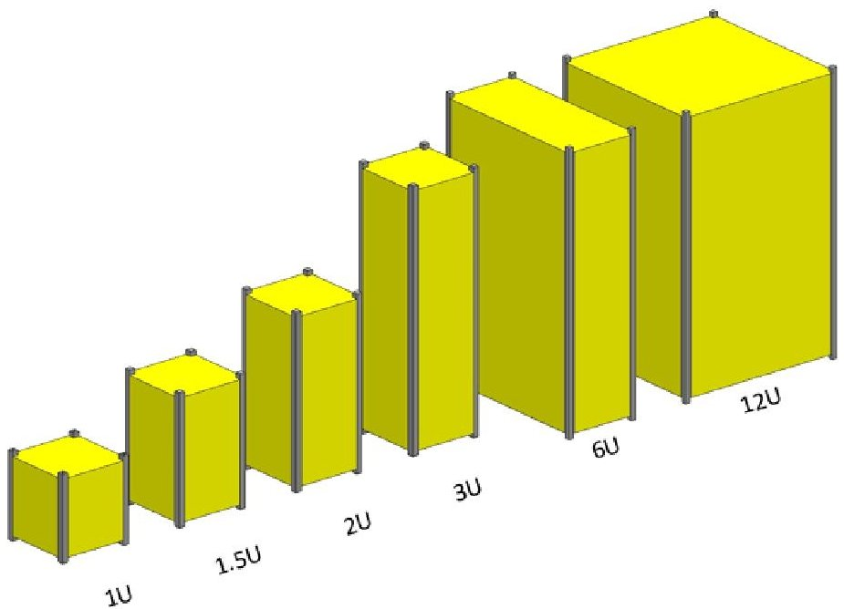

Figure 1. CubeSat variations by size [5].

## 1.2. SeaLion Mission

The SeaLion CubeSat mission is a joint project between Old Dominion University (ODU), the United States Coast Guard Academy (USCGA), and the Air Force Institute of Technology (AFIT). The end goal is to produce a 3U CubeSat consisting of three payloads for on-orbit validation. ODU provided one payload while the USCGA and AFIT provided the other two payloads. SeaLion was initially planned to launch as a secondary payload on a Northrop Grumman Antares Rocket from Wallops Flight Facility (WFF) during March 2023. The prototype CubeSat model is shown in Figure 2. The intended mission profile was to have an on-orbit time for mere days due to its planned very low earth orbit (VLEO) altitude. Thus, SeaLion was to complete validation of its payloads before either power is lost in its non-rechargeable batteries or the satellite re-enters and burns up in Earth's atmosphere. The predicted on-orbit time was 10 days. However, mass considerations on the planned Antares rocket caused SeaLion to be moved to a Q4 2023 launch on a Firefly rocket from Vandenberg Space Force Base into a sun synchronous orbit of 500 miles altitude. The content presented in this article is based on the prior mission profile from the launch at WFF into VLEO.

<!-- PDF_PAGE: 3 -->

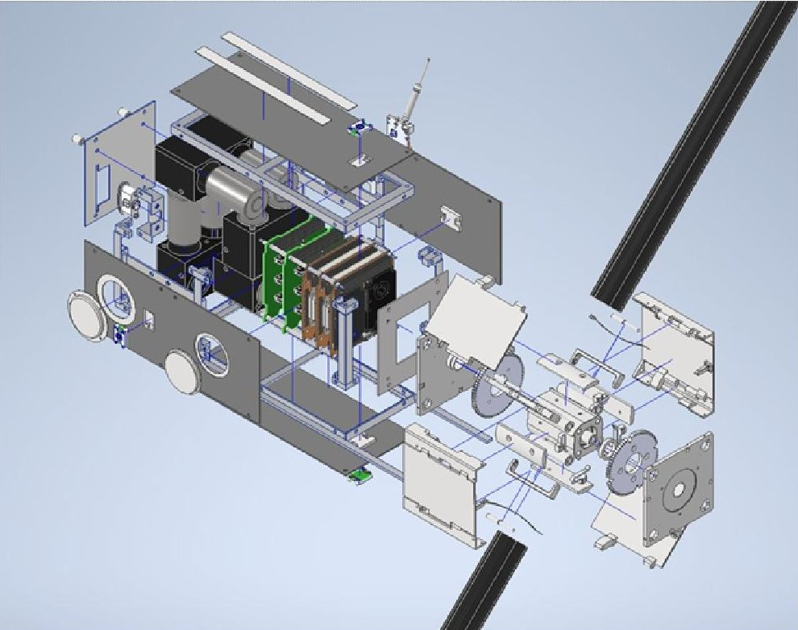

Figure 2. Blownup SeaLion CubeSat Prototype.

The first payload, provided by the USCGA and AFIT, is the Impedance Probe (IP). The IP is derived from U.S. Naval Research Laboratory's (NRL's) 'Space PlasmADiagnostic suitE' (SPADE) aboard NASA's International Space Station (ISS) where plasma density and temperature are computed with alternating current (AC) impedance measurements using an innovative, first of its kind, surface mounted dipole radio frequency antenna. The IP part is shown in Figure 3.

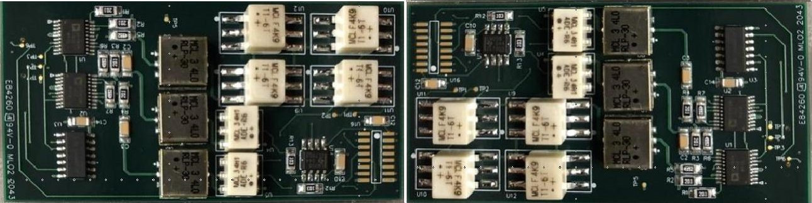

Figure 3. Impedance Probe.

The second payload, provided by the USCGA and AFIT, is the multispectral (Me-S) 'Pixel Sensor' with a 450-1000 nm spectral range. Its purpose is to provide SeaLion's in situ spectral data as a baseline. This baseline will be used for future missions that may require this spectral data. The Me-S part is shown in Figure 4.

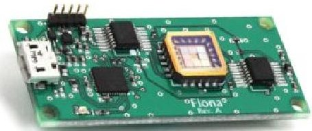

Figure 4. Me-S 'Pixel Sensor'.

The third payload, provided by ODU, is the deployable composite structure (DeCS). This payload is a proof-of-concept deployable mechanism and composite boom that is meant to be a platform host of a number of applications. For example, these applications include solar panels, solar sails, drag sails, sensory sails, and magnetometer booms. Deployment on SeaLion is meant to validate the deployable mechanism for a composite boom

<!-- PDF_PAGE: 4 -->

in the space environment and to validate boom dynamics during and after deployment in orbit. The DeCS upon deployment is shown in Figure 5.

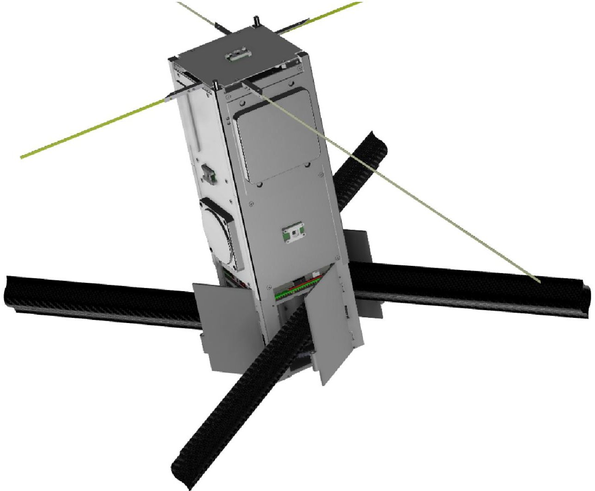

Figure 5. DeCS as the black popout booms.

The mission scope with three payloads requires special care and attention to ensure success of the mission. However, many of the SeaLion project team members are new to spacecraft development and systems engineering. In response, experienced team members took action to provide a mission architecture for the SeaLion team to better organize and direct the efforts of the team, to guide an implementation for the flight software, and to facilitate interface and assembly documentation.

## 2. Motivation

## 2.1. CubeSat Populations

CubeSats were initially conceived as educational tools for space systems engineering [7]. Now, their roles have been expanded to not only just educational tools but for observation, technology demonstrations, and research that were previous monopolized by much larger satellites due to the low cost of production and launch of these CubeSats. As such, there has been increasing popularity for CubeSats as seen by the number of launches in Figure 6 since the year 2000 [6] apart from the notable exceptions in the years 2020 and 2021; the authors speculate that this downturn is due to the COVID-19 pandemic. The CubeSat design specification [5] as well as the availability of commercial off-the-shelf (COTS) parts and kits have greatly influenced the rise of popularity. For example, a basic CubeSat kit from a space systems company such as Pumpkin can be purchased with a baseline price of as little as USD 6250 [8]. The SeaLion CubeSat also utilizes many COTS parts as well. Thus, CubeSats have become highly accessible to low-budget groups such as small companies and university groups. CubeSats have caused the "democratization" of space by allowing many groups to fly satellites [9].

<!-- PDF_PAGE: 5 -->

CubeSats by Mission Type (2000-present,

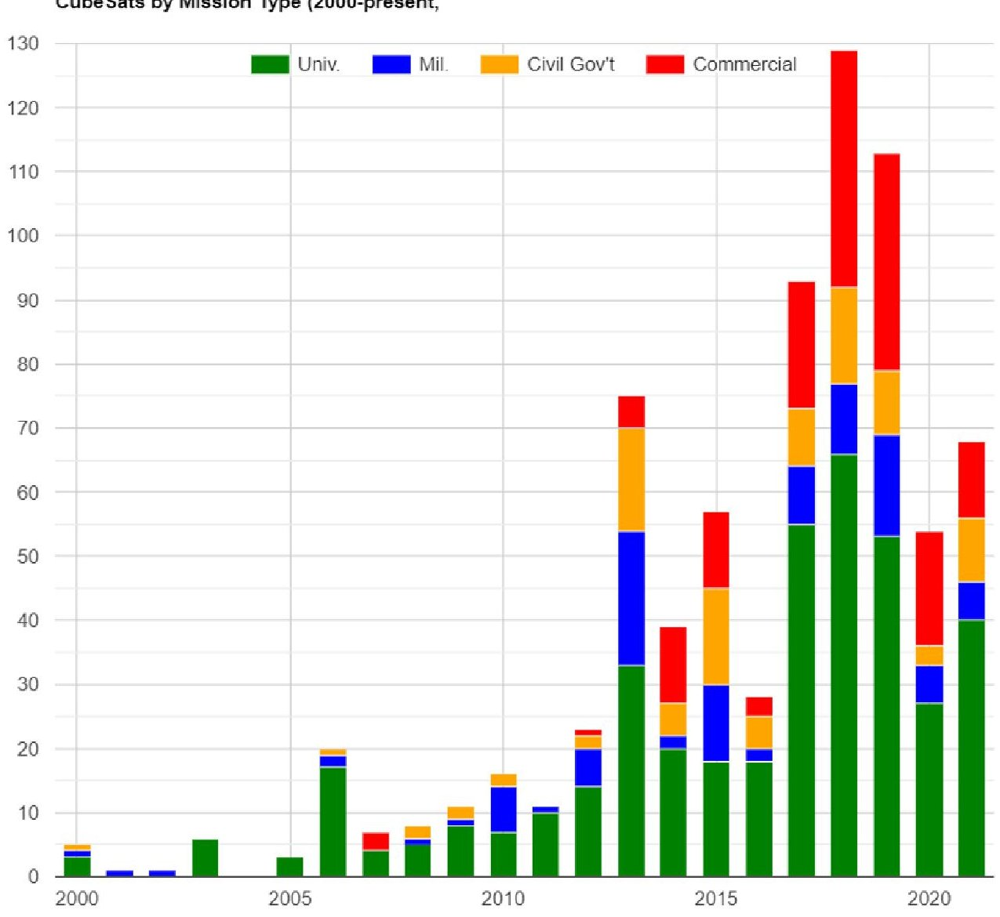

[Chart created on Tue Jul 27 2021 using data from M. Swartwout]

Figure 6. Nanosatellite launch data provided by M. Swartwout as of 21 July 2021 [6].

University groups are especially a large contributor in the overall number of launches of yearly CubeSats. As of 27 July 2021, there have been 68 CubeSat launches with 40 of them being from university groups (about 58 percent of launches) in the year of 2021; university groups have consistently maintained plurality on total launches [6]. This showcases directly how many university-based CubeSat projects occurred or potentially may occur if trends continue onward into the future. However, this presents its own challenges.

## 2.2. Ensuring CubeSat Success

The motivation of this article is to improve the success rate of CubeSat missions from university groups by providing readily available and usable tools for university teams. To further reinforce the need to improve the success rate, the following data is presented in Figure 7 which showcases the total successes and failures of CubeSats from universities for the given time periods [10]. The data provided is categorized by six different mission success statuses of unknown, launch fail, dead on arrival (DOA), early loss, partial mission, and full mission.

<!-- PDF_PAGE: 6 -->

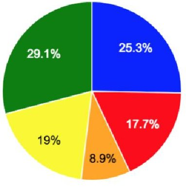

Mission Status for University- Class Missions (2002-2009)

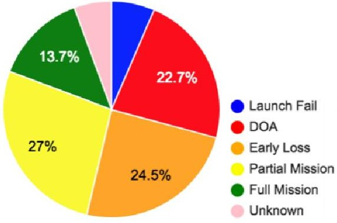

Mission Status for University- Class Missions (2010-2017)

Figure 7. Mission status of CubeSat university-class missions provided by Swartwout [10].

As seen in the preceding Figure 7, university CubeSat mission failure rates have increased while partial and full mission success rates have decreased in conjunction with the increasing number of missions as seen in Figure 6. However, Swartwout notes that the highest number of failures originate from "regular independent" groups with a failure rate of 65 percent at the time of data gathering in 2017 [10]. These "regular independent" groups have fewer than four missions performed nor are designated as a national center for spacecraft development by its government.

The issue present is that many of the growing number of university groups producing CubeSats lack the resources, training, experience, or methodology to reliably give assurance to their missions. The majority of the work is often performed by untrained students that are unfamiliar with the aspects of CubeSat development (e.g., system engineering, design methods, and testing). The SeaLion team also faced these issues as well.

To address some of these issues, SeaLion team members sought to simplify the development process by providing readily available and learnable system engineering approaches and tools. These provided approaches and tools include factors such as planning, documentation, project management, and simplifying the process. This is important since special attention should be given to systems engineering and information exchange for multidisciplinary teams [11]. To showcase these factor's importance, a survey of forty CubeSat groups on how to set up CubeSat projects, conducted by the University of Bristol, emphasized the following relevant lessons learned [12]:

- Planning: Make efforts to "spend a lot of time in the planning stage".

- Documentation/Project Management: Groups should have "good documentation of requirements, work done and work to do".

- Simplicity: Simplify anything you possibly can to increase confidence in success.

The developed mission architecture and associated findings will emphasize the aforementioned points to further the SeaLion CubeSat's development.

## 3. Goals

The goal of the SeaLion CubeSat mission architecture was to capture the data structures and expected behaviors for the development of the flight software. The data structures and expected behaviors were captured in such a way that can unambiguously understood well enough to be implemented, as well as provide full traceability and rationale for architectural elements with minimal configuration management overhead [13]. Thus, the SeaLion CubeSat mission architecture had to achieve the following:

- Ensure templates only contain formatting data (this includes not storing boilerplate text in templates);

- Ensure models are the authoritative source of truth for all artifact content (e.g., artifact structure, meta-data, boilerplate, commentary, discussion, diagrams, tables, etc.);

- Models should persist on the local filesystem;

<!-- PDF_PAGE: 7 -->

- Documents should be in plain text as to be compatible with modern distributed version control system (e.g., Git) and for ease of use;

- Documents should be able to persist alongside code and communicate to one another;

- Documents should be model-based as to have a separation of concerns between content and formatting as well as be both human and machine readable for querying and generating views.

A MBSE approach was adopted by the SeaLion CubeSat mission architecture team since it provided benefits such as reducing the ambiguity that usually comes with using informal language to specify systems or its various aspects. It also minimized the duplication of content that tends to accumulate in a document-based system engineering approach.

Proper adoption of a MBSE approach also includes the selection of the modeling language and modeling tool. Considerations when selecting the modeling language and tool was overhead incurred from training the team, the technical overhead of setting up modeling tools and future adaptability. Refer to Table 1 for modeling language down selection overview. In addition, the SeaLion CubeSat mission architecture team eventually decided to adopt a docs-as-code approach to further enhance the MBSE approach to achieve the listed goals shown above.

Table 1. Modeling Language Downselect by Criteria Fulfillment Marked by 'X'.

<table border="1"><tr><td>Criteria</td><td>SysML v1</td><td>SysML v2</td><td>PlantUML</td><td>M30ML</td></tr><tr><td>Extensible ontology language</td><td>X</td><td>X</td><td>X</td><td>X</td></tr><tr><td>Supports both textual and graphical view generation</td><td></td><td>X</td><td></td><td>X</td></tr><tr><td>Lightweight textual syntax</td><td></td><td>X</td><td>X</td><td>X</td></tr><tr><td>Relatively minimal overhead with modern doctools</td><td></td><td></td><td>X</td><td>X</td></tr><tr><td>Supports execution semantics</td><td></td><td>X</td><td></td><td></td></tr></table>

## 3.1. Model-Based Systems Engineering

As noted before, attention should be given for planning, documentation, project management, and simplifying the process. Special emphasis should be given to systems engineering and information exchange [11].

Traditional approaches use documents as their authoritative source of truth for conducting system engineering activities [1]. Information in a traditional systems engineering approach today is mostly captured informally. For example, this causes disadvantages such as information not being authored based on a methodology, spontaneously and infrequently integrated, not properly configuration managed, not properly changed managed, and not effectively shared with stakeholders [14]. These documents often do not have a living relationship with other documents or to other corresponding elements; thus, changes to one document require manual changes to other documents [15]. Document-based approaches can exacerbate problems since it lacks point-to-point communication channels as well as lacking methods to enforce consistency [16].

In contrast, a MBSE approach captures information in a highly structured modeling language, authored based on a methodology, configuration managed in a common tool, highly integrated, traceable to its provenance, and sharing with stakeholders. Models provide the following key advantages over document-based approaches [15]:

- Information is readily communicated and shared within the project.

- Changes are easily accommodated.

- Traceability is automated.

To showcase the benefits, an architecture process of 4858 information element transfers was performed. It noted that all of these transfers were performed manually with non-

<!-- PDF_PAGE: 8 -->

MBSE approaches; however, 13% of these transfers were automated with MBSE with the potential of up to 81% should it be used for trade study and peer review tasks [17]. The SeaLion mission architecture team seeks to take advantage of these efficiency gains that MBSE can achieve. Space projects have been taking advantage of MBSE such as the ExoMars mission, Euclid, Galileo, and nanosatellite programs [18-20]. CubeSat projects have also been using MBSE and have shown to "hold promise of reducing the burden of system engineering tasks" [21] and can "promote uniformity and consistency across future CubeSat models" [21]. These attributes are important to reduce workload among team members and to facilitate new team members as they join future projects. Facilitation of new members is especially useful for universities since students are not available long term due to events such as graduation.

## 3.2. Documents-as-Code Approach

Documents-as-code (Docs-as-code) refers to a philosophy that team members should be writing documentation with the same tools as code [22]. This allows for documentation to be updated seamlessly without additional work with document tools (doctools). The code tools would include version control (e.g., Git), issues trackers, code tools (e.g., Visual Studio Code), etc. To do so would mean that writers would follow the same workflows as the development team and they would be integrated into the product team. A stated result would be to enable "a culture where writers and developers both feel ownership of documentation, and work together to make it as good as possible" [22]. The SeaLion team taking advantage of the aforementioned philosophy would realize the benefits of utilizing the same principles and practices used to manage software, using modern version control tools (e.g., Git), for the configuration management of mission and flight software architecture documentation, and captured in a model-based approach [22]. In addition, these models can be stored and used persistently on a local file system without the use of cloud based services. Proprietary services are not required to generate documentation, modify documentation, or modify models. Similar approaches have been seen in Structurizr [23] and F Prime Prime (FPP) [24]. FPP is based on F Prime which is an open-source software framework developed by NASA's Jet Propulsion Laboratory [25]; it is a modeldriven approach for producing flight software code that can be compiled directly onto flight hardware. While docs-as-code has precedent, the methodologies noted are not easily accessible to those without a sufficient background in programming.

## 4. Modeling Language and Methodology

The languages considered were SysML V1 [26], SysML V2 [27], PlantUML [28], and the Mach 30 modeling language (M30ML) [29] with the mission architecture team conducting a trade study to determine the most suitable one. The down selection criteria that the SeaLion CubeSat mission architecture team has taken into consideration is shown in Table 1.

M30ML was chosen for its lightweight human and machine-readable textual syntax, file-based model interchange support (for persisting models directly on the local filesystem), ability to generate both textual and graphical views, and relatively minimal overhead with modern doctools [29]. The lightweight textual syntax and minimal overhead is especially important for for a team that has very minimal experience working with such tools. Other candidate modeling languages lacked in many regards compared to M30ML in these criteria and thus, M30ML was selected. SysML v2 had a good number of characteristics that M30ML had; however, the lack of minimal overhead with modern doctools prevented its adoption. At the time of publication of this article, the current state-of-the-art MBSE languages (e.g., SysML v2) have not prescribed an approach for file-based model interchange for persisting models on the local filesystem. SysML v1 has XML Metadata Interchange (XMI) as a file-based interchange but it can only handle graphical views and not textual views. Adapting other MBSE languages would take significant work to adopt a docs-as-code approach in their current states.

<!-- PDF_PAGE: 9 -->

## 4.1. Ontological Modeling Language

M30ML was developed using the Ontological Modeling Language (OML) as its basis. OML is a language that enables defining systems engineering vocabularies and using them to describe systems [30]. OML, inspired by Web Ontology Language 2 (OWL2) and the Semantic Web Rule Language (SWRL), is meant to be a more gentler and more disciplined method of the aforementioned standard for use in systems engineering [30]. OWL2 does not conform easily to individual modeling rules without tooling support; thus, OML was created. OML is a tool to improve the speed of modeling and the quality of models while in a more concise and human-friendly high-level external representation [31]. However, more recently, M30ML's development has been moved from OML to LinkML since it uses a lighter weight toolchain and YAML-based syntax [32].

## 4.2. Mach 30 Modeling Language

M30ML is a language for modeling an architecture with YAML-based modeling. YAML as a file type is a highly structured, machine queryable, human readable, lightweight, and line-oriented markup language. This makes it ideal for document generation use cases as well as use with version control tools such as Git. The simple line by line structure as shown in Figure 8 exemplifies its simplicity. Users are readily able to read, interpret, and edit documents using the YAML file format so as long they are taught what each line element is. Doctools such as asciidoctor and bibtex were made compatible with minimal technical overhead which was taken advantage of for the submission to the AIAA SciTech 2023 Forum [4]. M30ML also provided modeling elements familiar in agile software development, such as stakeholder needs, user stories, data structures, and with relationship elements for defining traceability between modeling elements [29].

id: 1

name: Ping Satellite

actor: Ground Station Operator

behavior: Ping satellite

rationale: Establish communication link with satellite

derivedFrom:

- "1-StakeholderNeeds/1.1-PrimaryMissionObjective-A1.yaml"

example: Ping the satellite in order to establish UHF communication link with Virginia ground station

## Figure 8. Example YAML file.

## 5. Architecture Implementation

The implementation of M30ML serves as the basis for SeaLion mission architecture. Presented here are the various elements, components, and products generated that is stored on the SeaLion-mission-architecture GitHub page [13]. At the time of publication of this article, the implementation of the SeaLion mission architecture was performed to the prior mission parameters where the SeaLion CubeSat was designed for a short lifespan compared to now greatly extended planned lifespan. Since the mission parameters was changed rather recently prior to publication, the architecture had yet to be updated for them.

## 5.1. File Structure

The SeaLion mission architecture is organized into two main folders of architecture and of components [13]. Architecture contains the references, stakeholder needs, user stories, and data structures shown in Figure 9. Components, as the name implies, contains the components and subcomponents of the CubeSat. For the focus of this article, the architecture folder is the primary concern. Components is currently a work in progress at time of publication of this article and will be addressed with future required work. For the mission architecture shown in Figure 9, generally data structures are derived from user stories. Furthermore, user stories are subsequently derived from stakeholder needs with their respective references.

<!-- PDF_PAGE: 10 -->

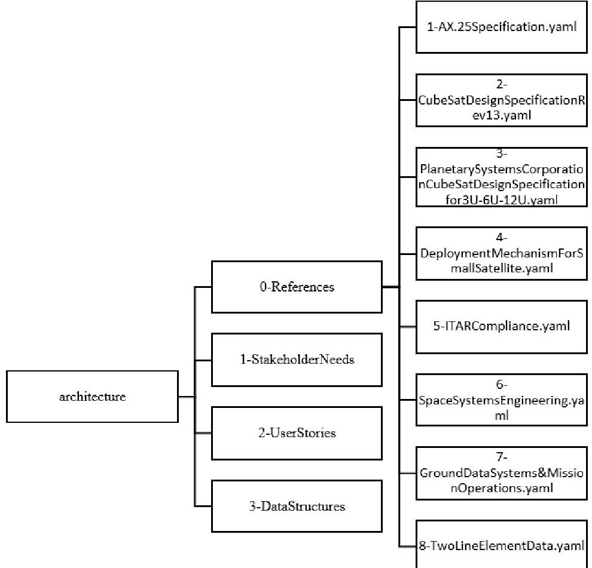

Figure 9. References file structure.

References are simply stored reference material such as standards, specifications books, etc. They are very simple two-line YAML files as shown in Figure 10. This creates a continued link between the YAML files within their respective folders from which documents can be updated seamlessly. Information changed within one file can interact with other files. All YAML references files in the mission architecture at the time of article's publication is listed within Figure 9.

## 1 title: CubeSat Design Specification Rev. 13

## 2 url: 'https://www.cubesat.org/s/cds_rev13_final2.pdf'

Figure 10. References YAML file.

## 5.2. Stakeholder Needs

The development of SeaLion's mission architecture is guided by a series of stakeholder needs [33]. After SeaLion's project methodology documentation is committed to using M30ML based on YAML modeling tools, the first step is to identify all stakeholder needs. The two primary stakeholders of SeaLion are ODU and the USCGA. Their respective needs are classified from primary, secondary, and tertiary based on mission importance.

Stakeholder YAML files are stored in the '1-StakeholderNeeds' folder shown in Figure 11. Each file is numbered with a X.X number format with the first number designating if it is primary, secondary, or tertiary and the second number denoting a place within a list of that class (e.g., 1.1 would indicate primary stakeholder need 1). In addition, the letter associated (e.g., A1, B1, C1, etc.) in the filename would also signify if it's a primary, secondary, or tertiary stakeholder need. Each YAML file contains an id number, name, statement, and derived-from field shown in Figure 12. Note the reference YAML file that has filed in the derived From field that serves as the basis for the stakeholder need. While not all stakeholder needs have it filled, it is available to be used as needed. Figure 11 showcases all the YAML files stored in the stakeholders file folder.

<!-- PDF_PAGE: 11 -->

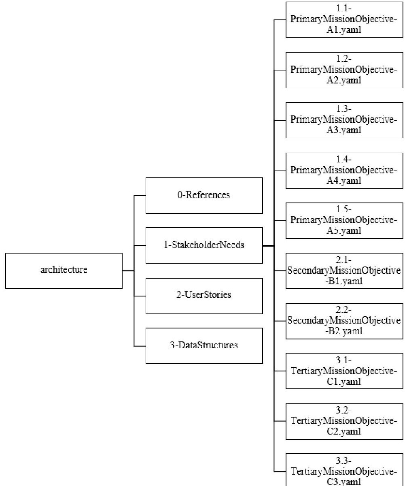

Figure 11. Stakeholders file structure.

<table><tr><td>id: 1.4</td></tr><tr><td>name: "Primary Mission Objective A4"</td></tr><tr><td>statement: "The SeaLion mission shall adhere to CubeSat standards."</td></tr><tr><td>derivedFrom: 0-References/2-CubeSatDesignSpecificationRev13.yaml</td></tr></table>

Figure 12. Stakeholder YAML file.

Figure 13 presents all the stakeholder needs via a unified modeling language (UML) diagram generated from the YAML files within the '1-StakeholderNeeds' folder. The two primary stakeholders are ODU and the USCGA. The generation of these diagrams via the YAML files presented herein showcases the docs-as-code approach. YAML files structured as a code are then converted into human readable documents for presentation.

<!-- PDF_PAGE: 12 -->

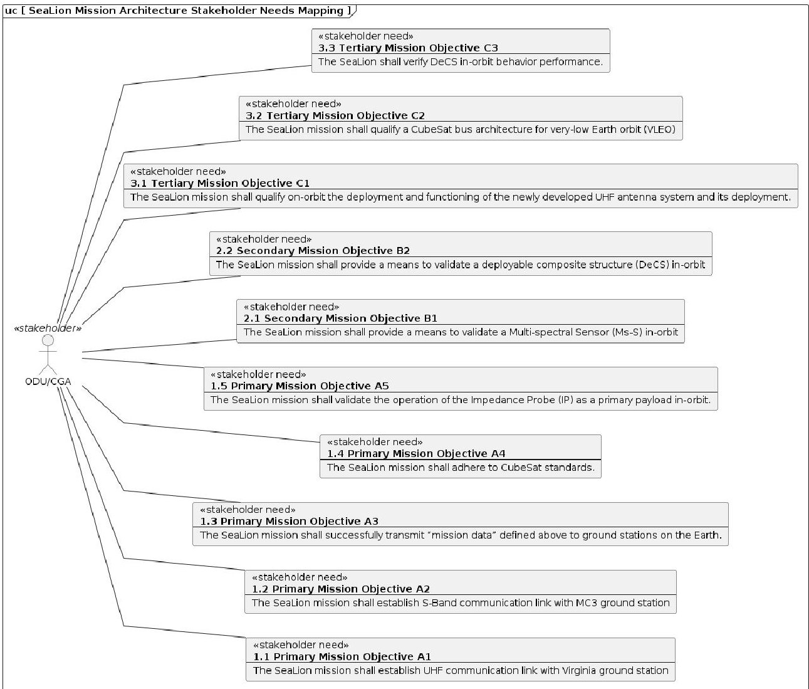

Figure 13. Stakeholder UML Diagram.

## 5.3. User Stories

Once the SeaLion mission architecture's stakeholder needs are identified and recorded, the stakeholder needs are then used to identify a series of user stories which then lead to design decisions captured in data structure and activity definitions [34]. These user stories are written from the perspective of the ground operator which would be a student from ODU who monitors and controls the functions of the SeaLion CubeSat. User story YAML files are stored in the '2-UserStories' folder shown in Figure 14. These files are all given an ID number in no particular order of importance. See the following Figure 14 for the user story YAML file structure.

As an example, the second user story desire is to "verify that satellite is operating nominally" [13]. Its full statement, derived from the actor, behavior, and rationale, would read "as a Ground Station Operator I want to view satellite beacon data (alternating between health and mission data), received via UHF so that I can verify that satellite is operating nominally" [34]. Its associated YAML file named '2-ViewBeaconData.yaml' is presented in Figure 15. Note that this user story is derived from stakeholder needs A1, A3, A5, B1, B2, C1, C2, and C3 which are stakeholder needs mentioned in the prior section detailing stakeholder needs. Additionally, the example statement is cut-off in Figure 15 for readability. It should read in full as "View satellite beacon data (health or mission data) to verify that state vector correspond with expected orbit profile and/or to validate that a mission mode was successful". This satellite beacon data, transmitted via UHF, is used to validate that any and all functions of the satellite are operating nominally or as planned in respect to their payloads hence the large derived-from list in the associated YAML file.

<!-- PDF_PAGE: 13 -->

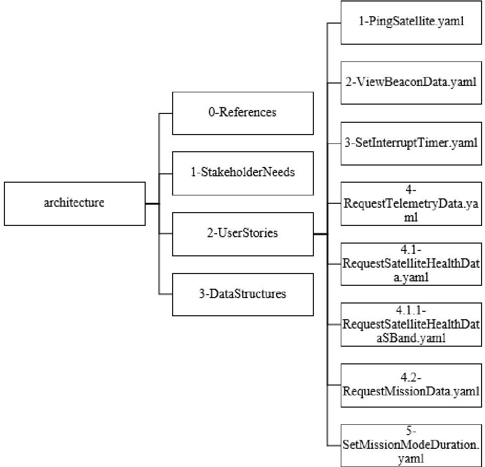

Figure 14. User stories file structure.

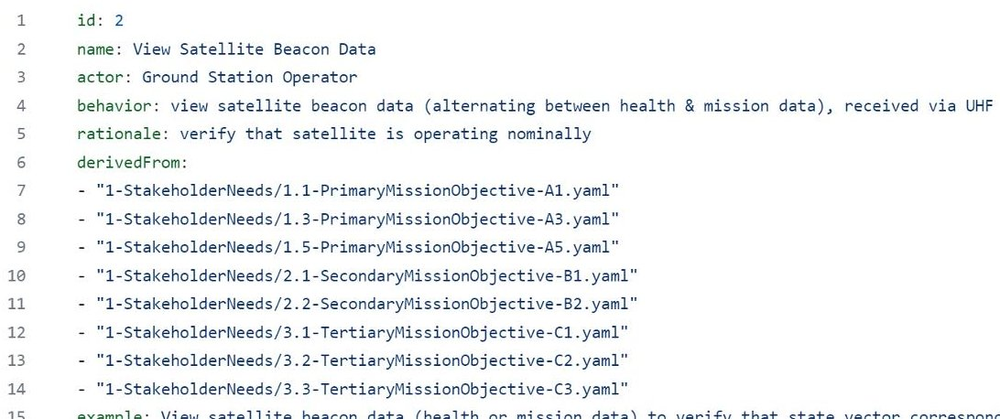

15 example: View satellite beacon data (health or mission data) to verify that state vector correspond with expected orbit

Figure 15. View Beacon YAML structure.

Figures 16 and 17 are UML diagrams generated using the YAML files stored in the '2-UserStories' folder. Figure 16 is an excerpt of mapping of stakeholder needs to user stories. It does not provide the full readable map; however, it does illustrate the intent of the map. Figure 17 is the user stories presented in a use case diagram to showcase what the ground station operator needs to perform. The generation of these diagrams via the YAML files presented herein showcases the docs-as-code approach. YAML files structured as a code are then converted into human readable documents for presentation.

<!-- PDF_PAGE: 14 -->

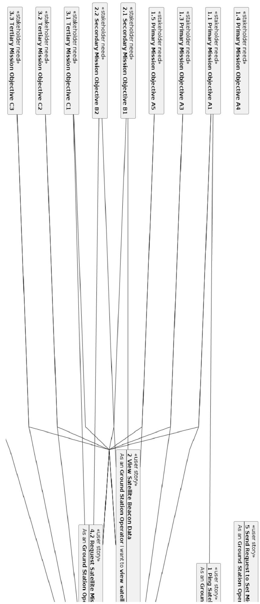

Figure 16. Excerpt of UML diagram of user stories.

<!-- PDF_PAGE: 15 -->

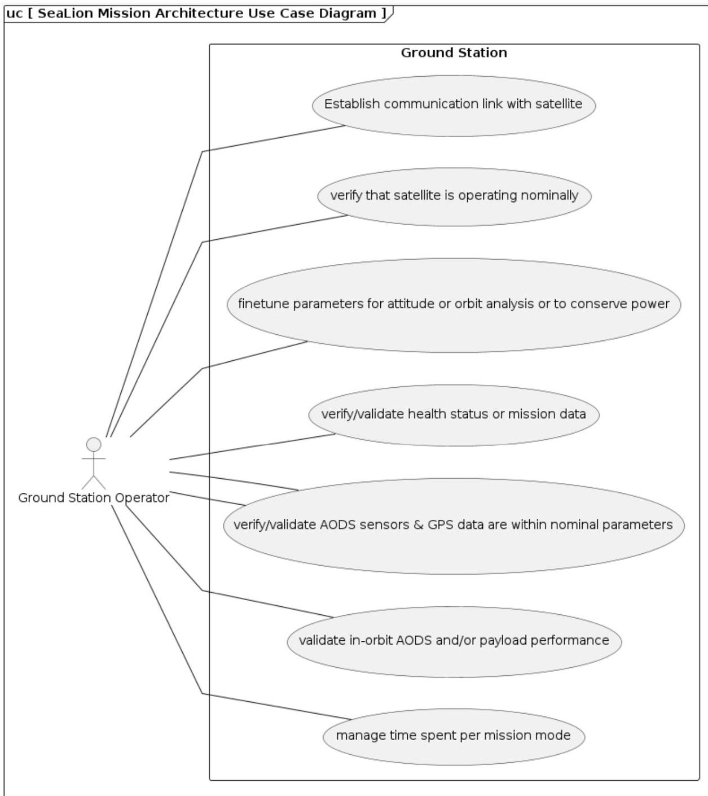

Figure 17. UML diagram of ground station operator.

## 5.4. Data Structures

User stories once identified will then lead to design decisions captured in data structures and activity definitions. These data structures are the data that would be transmitted back and forth between ground station operator and CubeSat. Data structure YAML files are stored in the '3-DataStructures' folder shown in Figure 18. Each data structure YAML has name, purpose, template, elements, and derived from elements as shown in Figure 19 as an example. Name and purpose are for identification and stated use case. Template lists out all the elements that are called out via their identifying key. Elements detail the specific values as part of the data structure; each element has their own identifying information and descriptions. The derived from field is used to tie back the data structure to a user story YAML file should it be applicable. Table 2 is a table generated from the YAML file shown in Figure 19 for documentation purposes. Figure 18 details the file structure under the 3-DataStructures' folder.

<!-- PDF_PAGE: 16 -->

Table 2. Data Structure of Packet.

<table border="1"><tr><td>Field</td><td>Type</td><td>Description</td></tr><tr><td>call_sign</td><td>string</td><td>Identifying call sign for the SeaLion mission.</td></tr><tr><td>battery_health</td><td>float</td><td>Percent value indicating the remaining charge of the batteries.</td></tr><tr><td>temperature_battery</td><td>float</td><td>The temperature of the battery. Units in Kelvin.</td></tr><tr><td>mode</td><td>integer</td><td>Integer value indicating current mission mode.0=Safe,1=mission mode1,2=mission mode2,3=mission mode3.</td></tr><tr><td>state_vector</td><td>ECIStateVector</td><td>ECI state vector from orbit propagator at time of beacon.</td></tr><tr><td>architecture</td><td>0-References1-StakeholderNeeds2-UserStories3-DataStructures</td><td>1-SatelliteHealth.yaml2-AODSGPSData.yaml3-AODSSensorData.yaml4-TLE.yaml5-MissionData.yaml</td></tr></table>

Figure 18. Data Structure: File Structure.

As shown in Figure 19, the data structure, with YAML file named '1-SatelliteHealth.yaml' is for determining the satellite's health. This data would be transmitted with the beacon data to be received by the ground station operator. Note that this data structure is derived from the user stories 2 and 4.1 described in the prior section detailing user stories. These user stories detail the ground station operator's tasks to view the satellite beacon data and to request the satellite health data packet so that the operator can verify that AODS sensors and GPS data are within nominal parameters. Table 2 details the various fields that would be required in this beacon data packet to accomplish the aforementioned tasks.

<!-- PDF_PAGE: 17 -->

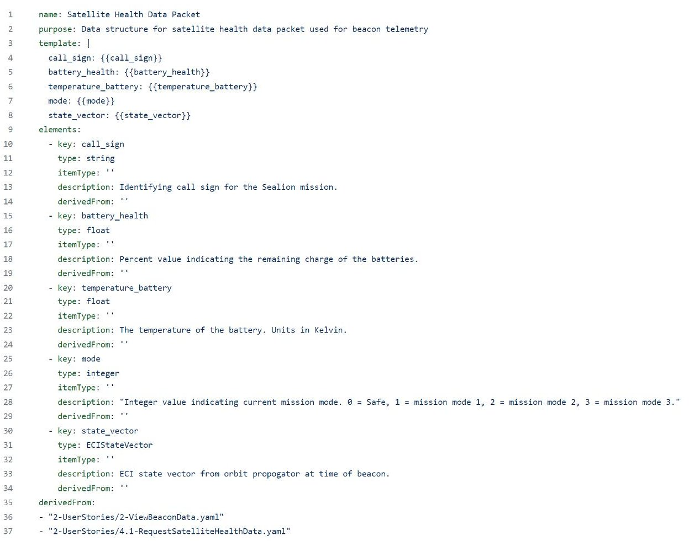

Figure 19. Satellite Health Data Structure.

Figure 20 is a UML diagram of mapping of user stories to data structures generated from the YAML file shown in Figure 19. Note that not every data structure is linked to a user story. These unlinked data structures are necessary to CubeSat functionality without being linked to the stakeholders and user story chain. The generation of this diagram and the tables via the YAML files presented herein showcases the docs-as-code approach. YAML files structured as a code are then converted into human readable documents for presentation.

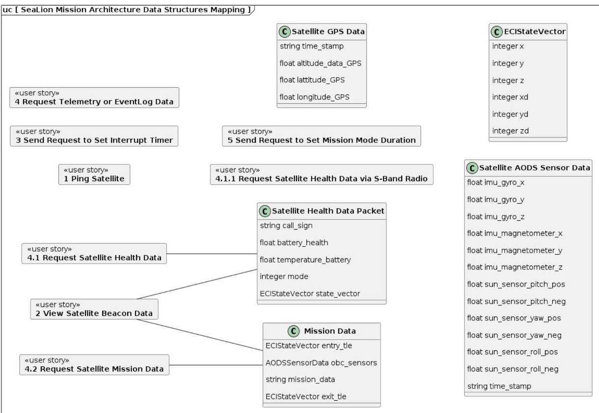

Figure 20. UML Diagram of Data Structures.

<!-- PDF_PAGE: 18 -->

## 5.5. Document Generation

As noted multiple times throughout this article, there have been a number of figures and tables generated from the YAML files placed within the SeaLion mission architecture GitHub repository. Many of the figures are UML diagrams that are auto-generated artifacts rendered from the M30ML modeling language and formatted using the Liquid template language. This is how the docs-as-code approach is implemented. YAML code files are used to generate documents for information sharing between group members. This means that any changes made to the SeaLion mission architecture model can immediately be used to generate new documents. Whether it be diagrams, tables, or text, continuous updating is ensured that any changes affecting dependencies within the mission architecture are kept in sync. YAML files are automatically processed using templates language (e.g., Jinja2) via a build shell script. This also means that content of the model and formatting of documents are decoupled. The model is formatting-agnostic for documentation purposes as this is handled by the template language. A conference proceeding manuscript presented in AIAA SciTech 2023 was created purely by a docs-as-code format [4]. The team used a LaTeX template to automatically format the manuscript to the conference guidelines and subsequently inject items such as the generated diagrams, tables, and references directly into the manuscript.

The implementation of M30ML for components, at the time of this article's publication, is currently in the process of integrating content information into the model. A brief description of current component implementation into the SeaLion model is provided. However, the model content mentioned herein is subjected to change.

## 6. M30ML Extensions for Component Implementation

## 6.1. Distributed OSHW Framework

The current SeaLion mission architecture repository, at time of article publication, for components is "structured as a Distributed OSHW Framework (DOF)—component for defining the contents of the Mission concept of operations (ConOps) as a collection of nested subcomponents, component interfaces, and component functions for generating bill of materials (BOMs) and assembly instructions for the SeaLion CubeSat" [13]. The DOF pillars are based on Open Source Hardware (OSHW) principals [29]. The implementation methodology presented herein is an extension of M30ML specifically for the use of modeling a CubeSat design.

The SeaLion mission architecture repository has a components folder dedicated to its namesake. Inside the components folder of the repository are two subfolders; one labeled with 'sealion-cubesat' and another labeled with 'sealion-ground-station'. Each of those folders would contain a components folder and subsequently those individual labeled components can have their own components folder. Thus, a chain of components and subcomponents can be created as illustrated in Figure 21. A parts YAML file in each components folder details what the subcomponents would be. An excerpt example for the main SeaLion CubeSat is provided in Figure 22 that is associated with the file folders shown in Figure 21.

<!-- PDF_PAGE: 19 -->

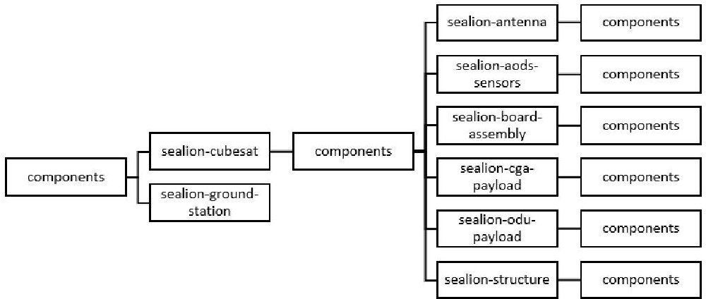

Figure 21. Components Folder File Structure.

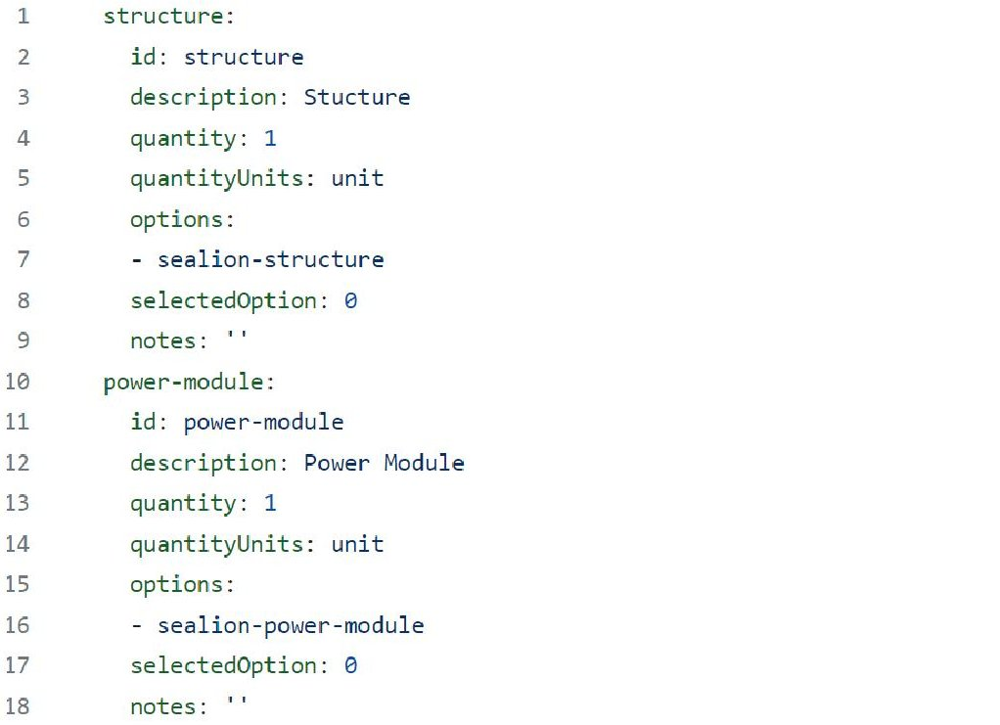

Figure 22. Component YAML File.

## 6.2. Component Data Structure and File Implementation

A series of YAML files for components have been created. Figure 22 showcases the parts YAML file; however, parts is only one element of the component's data structure thus far. Showcased in Table 3 is the entire component data structure from the SeaLion DOF templates [33]. There are a number of component data structures prepared; however, it is still in contention whether or not all of these data structures will be used. The SeaLion DOF templates document have been generated in the DOF repository [33]. The data structures created are as follows:

- Component: Represents the smallest logical element in an OSHW project. A Component may be a project in its own right (with a sub-component hierarchy) or may be nested as a sub-component in the "source" of another component.

- Component List Item: Identifies a part or tool used in the fabrication of the component. Parts and tools are defined by their source material in the components list.

- Activity Step: Defines a single step in an activity (e.g., assembly instructions).

- Parameter: Defines a data structure for an input or output of a component function.

- Function: Defines a data structure for a component function.

- Interface List Item: Identifies an interface on a part or tool.

The initial goal is to list the components of the SeaLion CubeSat and to generate assembly steps for them. Through which the architecture can provide detailed documentation to assemble the SeaLion CubeSat. These assembly instructions would also be generated through the SeaLion mission architecture repository much akin to other documents for

<!-- PDF_PAGE: 20 -->

SeaLion. Thus, it creates a human readable document from the YAML files code as per the docs-as-code approach.

Eventually, the purpose of all these component data structures is to also create a N2 diagram. A N2 diagram is used to "capture the interfaces, mechanical and electrical, for all components of the satellite obtained through the mapping process" [3]. An example has been provided in Figure 23. The end goal is that the architecture would use interfaces and junctions within the YAML files code to automatically generate an N2 diagram. Thus, it allows for continuous updating that ensures that any changes affecting dependencies within the mission architecture are kept in sync. This would allow for a team to identify "areas where conflicts could arise in interfaces, and highlights input and output dependency assumptions and requirements" [3]. Thus, leading to higher efficacy in planning the development and assembly of the satellite.

Table 3. Component Data Structure.

<table border="1"><tr><td>Field</td><td>Type</td><td>Item Type</td><td>Description</td></tr><tr><td>name</td><td>string</td><td></td><td>Source representation of the component&#x27;s name. Format = single word, only lowercase letters, and may contain hyphens and underscores.</td></tr><tr><td>version</td><td>string</td><td></td><td>Version number of the component&#x27;s source. Format = x.x.x per semantic versioning guidelines.</td></tr><tr><td>description</td><td>string</td><td></td><td>Human readable representation of the component&#x27;s name. Typically used in rendered documentation referencing the component.</td></tr><tr><td>license</td><td>string</td><td></td><td>List of licenses used within the component&#x27;s source. Format = SPDX license expression.</td></tr><tr><td>author</td><td>string</td><td></td><td>Identifies author (e.g., owner of source intellectual property). Format (email and website are optional) = Author Name &lt;email address&gt; (website URL)</td></tr><tr><td>dependencies</td><td>dictionary</td><td>string</td><td>Per NPM/Yarn. Key = dependency name. Value = Semantic versioning version string.</td></tr><tr><td>components</td><td>dictionary</td><td>Component</td><td>Listing of sub-components directly owned by this component. Key = sub-component&#x27;s name. Value = sub-component&#x27;s data structure.</td></tr><tr><td>parts</td><td>dictionary</td><td>Component List Item</td><td>Listing of the component&#x27;s parts (and substitutions) defined as sub-components. Key = part&#x27;s id. Value = part&#x27;s key data.</td></tr><tr><td>functions</td><td>list</td><td>Function</td><td>Listing of component functions.</td></tr><tr><td>tools</td><td>dictionary</td><td>Component List Item</td><td>Listing of the required tools (and substitutions) defined as sub-components. Key = tool&#x27;s id. Value = tool&#x27;s key data.</td></tr><tr><td>precautions</td><td>list</td><td>string</td><td>Listing of caution statements (e.g., safety warnings) for the component.</td></tr><tr><td>assemblySteps</td><td>list</td><td>Activity Step</td><td>Sequence of steps required to assemble the component.</td></tr></table>

<!-- PDF_PAGE: 21 -->

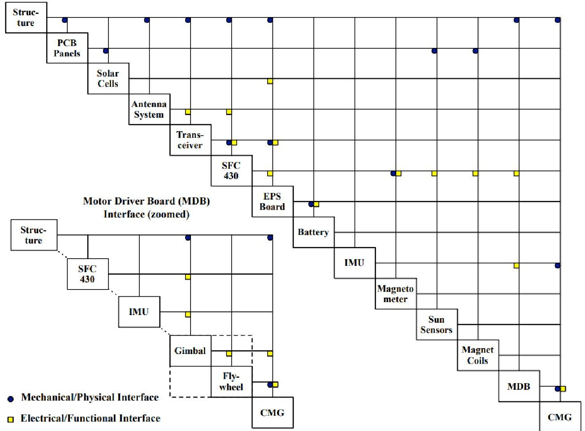

Figure 23. N2 Chart Example.

## 7. Future Work and Observations

Implementation of the overall mission architecture has been successful for the original mission profile. Future work includes adapting the mission architecture to the new mission profile from the launch delay. For example, it has spawned a trade study for rechargeable batteries and solar panels. However, the original mission architecture does not require any extensive reworking since many attributes are similar. The mission architecture requires only a few sessions between team members to make adaptations. All documentation would be automatically updated to reflect these changes per the docs-as-code approach which will eliminate additional work in that category.

Extensions to the DOF data model are also under development for enabling additional use cases, such as the N2 chart, for CubeSat systems engineering [33]. This extended data model would serve as a self-describing specification that new CubeSat projects could adopt for their own CubeSat missions, whereby the SeaLion mission would serve as the first reference implementation. Additionally, training material will be developed around this new data model in efforts to help guide incoming CubeSat developers. Multiple team members of the SeaLion mission have been able to quickly learn the methodology of using the docs-as-code approach within a short training session with an experienced member. However, a fully realized tutorial would be beneficial to allow for self-learning. Current guides are lists of definitions and format guides rather than a step-by-step tutorial on using the approach, which has caused confusion among members that attempted to learn the material by themselves.

Additionally, observations from the implementation of the docs-as-code approach noted that an effective communication plan between team members is key to the overall effectiveness of the mission architecture. Team members focused on specific parts of the CubeSat's development (e.g., structure, payload, etc.) are required to add all necessary content to the architecture. If team members are unavailable due to other more important obligations (e.g., university courses), it can cause considerable delays in the architecture's completion. The SeaLion mission architecture team necessitated frequent meetings with individual team members to gather the necessary content for the architecture to capture

<!-- PDF_PAGE: 22 -->

all legacy work. Legacy work refers to design decisions made prior to the architecture model's introduction. In an ideal case, a mission architecture would be formatted prior to any major design decision so that all team members can work directly on the architecture model rather than adapting legacy work to the model.

## 8. Conclusions

The SeaLion mission architecture team used MBSE with a docs-as-code approach to the SeaLion project. This was performed in an effort to reduce the friction and disconnect associated with traditional systems engineering for CubeSat developers. This is particularly important when CubeSat projects are growing more numerous with many of their respective team members being new to space systems development. The methodology presented herein has accomplished the ability to create individual elements of the architecture in an human readable code that is also easy to make revisions to and persists on a local file system. Even for those who are unfamiliar with coding software or methodology. Thus, minimal training is required for usage. The mission architecture presented captures the necessary information required of its original mission profile while also generating documents for easy presentation as well. Further work is required to create tutorials to train new users in a self-learning environment. Other future work includes the components implementation to facilitate interfaces and junctions for proper component relationships and planning, DOF data model extensions, and adaption to the new mission profile. Additionally, new users to this methodology should establish an effective team communication plan at the beginning of a project in order to prevent delays or rework in the creation of a mission architecture.

Author Contributions: Conceptualization, K.C. and S.M.; methodology, S.M.; software, S.M.; validation, K.C. and S.M.; formal analysis, K.C., S.M. and S.A.; investigation, K.C. and S.M.; resources, S.M. and S.A.; data curation, K.C. and S.M.; writing—original draft preparation, K.C.; writing—review and editing, S.M. and S.A.; visualization, K.C. and S.M.; supervision, S.A.; project administration, S.M. and S.A.; funding acquisition, S.A. All authors have read and agreed to the published version of the manuscript.

Funding: The Mission SeaLion project has received funding from the Virginia Space Grant Consortium (VSGC) to support the involvement of undergraduate students. The project has also received support from the Virginia Institute of Spaceflight and Autonomy (VISA) to procure parts and fabricate systems for the Mission SeaLion CubeSat spacecraft. The authors would like to generously acknowledge the support of VSGC and VISA.

Data Availability Statement: The SeaLion mission architecture and methodology is available in a publicly accessible repository. The data presented in this study are openly available in sealion mission-architecture at GitHub, reference number.

Acknowledgments: Special thanks to the SeaLion Project Team.

Conflicts of Interest: The authors declare no conflict of interest.

## Abbreviations

The following abbreviations are used in this manuscript:

<table border="1"><tr><td>1U</td><td>1-Unit</td></tr><tr><td>2U</td><td>2-Unit</td></tr><tr><td>3U</td><td>3-Unit</td></tr><tr><td>AC</td><td>Alternating Current</td></tr><tr><td>AFIT</td><td>Air Force Institute of Technology</td></tr><tr><td>AIAA</td><td>American Institute of Aeronautics and Astronautics</td></tr><tr><td>AODS</td><td>Altitude and Orbit Determination System</td></tr><tr><td>BOM</td><td>Bill of Material</td></tr><tr><td>ConOps</td><td>Concept of Operations</td></tr><tr><td>COTS</td><td>Commercial Off-the-Shelf</td></tr><tr><td>DeCS</td><td>Deployable Composite Structure</td></tr></table>

<!-- PDF_PAGE: 23 -->

DOA Dead on Arrival

doctools Document Tools

DOF Distributed OSHW Framework

EVR Event

FPP F Prime Prime

GPS Global Positioning System

ISS International Space Station

M30ML Mach 30 Modeling Language

MBSE Model Based Systems Engineering

MC3 Mobile CubeSat Command and Control

Me-S Multi-spectral Sensor

NRL Naval Research Laboratory

ODU Old Dominion University

OML Ontological Modeling Language

OSHW Open Source Hardware

OWL2 Web Ontology Language 2

Q4 Quarter Four

SPADE Space PlasmADiagnostic suitE

SWRL Semantic Web Rule Language

UHF Ultra High Frequency

UML Unified Modeling Language

USCGA United States Coast Guard Academy

VGSC Virginia Space Grant Consortium

VISA Virginia Institute of Spaceflight and Autonomy

VLEO Very Low Earth Orbit

WFF Wallops Flight Facility

XMI XML Metadata Interchange

## References

1. Friedenthal, S.; Oster, C. Architecting Spacecraft with SysML; CreateSpace Independent Publishing Platform: Scotts Valley, CA, USA, 2017.

2. NASA. NASA System Engineering Handbook Revision 2; NASA: Washington, DC, USA, 2020. Available online: https://www.nasa.gov/connect/ebooks/nasa-systems-engineering-handbook (accessed on 15 March 2023).

3. Asundi, S.; Fitz-Coy, N. CubeSat mission design based on a systems engineering approach. In Proceedings of the 2013 IEEE Aerospace Conference, Big Sky, MT, USA, 2-9 March 2013; p. nil. [CrossRef]

4. Sean Marquez, S. Model-Based CubeSat Flight-Software Architecture using a Docs-as-Code approach. In Proceedings of the AIAA Scitech Conference 2023, National Harbor, MD, USA, 23-27 January 2023. [CrossRef]

5. The CubeSat Program, Cal Poly SLO. CubeSat Design Specification Rev. 14; The CubeSat Program; Cal Poly SLO: San Luis Obispo, CA, USA, 2022.

6. Swartwout, M. CubeSat Database. 2021. Available online: https://sites.google.com/a/slu.edu/swartwout/cubesat-database (accessed on 27 July 2021).

7. Heidt, H.; Puig-Suari, J.; Moore, A.; Nakasuka, S.; Twiggs, R. CubeSat-A new generation of picosatellite for education and industry low-cost space experimentation. In Proceedings of the 12th AIAA/USU Annual Conference On Small Satellites, Logan, UT, USA, 21-24 August 2000. Available online: https://www.proquest.com/conference-papers-proceedings/cubesat-new-generation-picosatellite-education/docview/27219077/se-2 (accessed on 1 April 2023).

8. Shop, C. Pumpkin CubeSat Kits. 2023, 3. Available online: https://www.cubesatshop.com/product/pumpkin-cubesat-kits/ (accessed on 15 March 2023).

9. Cappelletti, C.; Battistini, S.; Malphrus, B.K. Cappelletti Cubesat Handbook: From Mission Design to Operations; Elsevier Science & Technology: Amsterdam, The Netherlands, 2020.

10. Swartwout, M. Reliving 24 Years in the Next 12 Minutes: A Statistical and Personal History of University-Class Satellites. 2018. Available online: https://digitalcommons.usu.edu/cgi/viewcontent.cgi?article=4277&context=smallsat (accessed on 30 July 2021).

11. Praks AALTO-1 earth observation cubesat mission—Educational outcomes. In Proceedings of the IEEE International Geoscience and Remote Sensing Symposium (IGARSS), Milan, Italy, 26-31 July 2015.

12. Berthoud, M. How to Set Up a CubeSat Project—Preliminary Survey Results. In Proceedings of the 30th Annual AIAA/USU Conference On Small Satellites, Toulouse, France, 27-30 September 2016.

13. Team, S. SeaLion Mission Architecture. Old Dominion University. 2022. Available online: https://github.com/ODU-CGA-CubeSat/sealion-mission-architecture (accessed on 30 May 2023).

<!-- PDF_PAGE: 24 -->

14. Wagner, D.; Kim-Castet, S.Y.; Jimenez, A.; Elaasar, M.; Rouquette, N.; Jenkins, S. CAESAR Model-Based Approach to Harness Design. In Proceedings of the IEEE Aerospace Conference, Big Sky, MT, USA, 7-14 March 2020.. [CrossRef]

15. Brown, B. Model-Based Systems Engineering: Revolution or Evolution? IBM Rational: Somers, NY, USA, 2011.

16. Call, D.; Herber, D. Applicability of the diffusion of innovation theory to accelerate model-based systems engineering adoption. Syst. Eng. 2022, 25, 574-583. [CrossRef]

17. Younse, P.; Cameron, J.; Bradley, T. Comparative analysis of model-based and traditional systems engineering approaches for architecting a robotic space system through Automatic Information Transfer. IEEE Access 2021, 9, 107476-107492. [CrossRef]

18. Mazzini, S.; Tronci, E.; Paccagnini, C.; Olive, X. A Model-Based methodology to support the Space System Engineering (MBSSE). In Proceedings of the ERTS2 2010, Embedded Real Time Software & Systems, Toulouse, France, 19-21 May 2010. Available online: https://hal.science/hal-02267836 (accessed on 28 April 2023).

19. ESA. Model-Based System Engineering. Available online: https://www.esa.int/Enabling_Support/Preparing_for_the_Future/ Discovery_and_Preparation/Model-based_system_engineering (accessed on 28 April 2023).

20. Nottage, D.; Corns, S. Application of model-based systems engineering on a university satellite design team. Procedia Comput. Sci. 2012, 8, 207-213. [CrossRef]

21. Kaslow, D.; Ayres, B.; Cahill, P.; Hart, L.; Yntema, R. Developing a CubeSat Model-Based System Engineering (MBSE) reference model—Interim status #3. In Proceedings of the 2017 IEEE Aerospace Conference, Big Sky, MT, USA, 4-11 March 2017; pp. 1-15.

22. Holscher, E. Docs as Code. 2022. Available online: https://www.writethedocs.org/guide/docs-as-code/ (accessed on 15 March 2023).

23. Structurizr Software Architecture Models as Code. Structurizr. Available online: https://structurizr.org/ (accessed on 17 April 2023).

24. Bocchino, R.; Levison, J.; Starch, M. FPP: A Modeling Language for F Prime. In Proceedings of the 2022 IEEE Aerospace Conference (AERO), Big Sky, MT, USA, 5-12 March 2022; pp. 1-15.

25. NASA. F'a Flight Software and Embedded Systems Framework. F'. Available online: https://nasa.github.io/fprime/ (accessed on 17 April 2023).

26. Partners, S. SysML Specifications. 2023. Available online: https://sysml.org/sysml-specs/ (accessed on 10 April 2023).

27. Seidewitz, E.; Bajaj, M. SysML-v2-Release. 2023. Available online: https://github.com/Systems-Modeling/SysML-v2-Release (accessed on 10 April 2023).

28. PlantUML. PlantUML. 2023. Available online: https://plantuml.com/ (accessed on 10 April 2023).

29. Simmons, J. Mach30 Modeling Language. Mach30 Foundation. 2022. Available online: https://github.com/Mach30/m30ml (accessed on 15 March 2023).

30. Maged Elaasar, N. Ontological Modeling Language: Origin and Rationale. 2022. Available online: http://www.opencaesar.io/ oml/ (accessed on 10 April 2023).

31. Jenkinis, S. Ontological Modeling Language 1.4. 2022. Available online: http://www.opencaesar.io/imce/2021/06/19/OML- Origin-and-Rationale.html (accessed on 10 April 2023).

32. Mungall, C. LinkML Model Your Data. LinkML. Available online: https://linkml.io/ (accessed on 10 April 2023).

33. Simmons, J. Extension of the Distributed OSHW Framework (DOF) for Modeling CubeSats. Old Dominion University. 2023. Available online: https://odu-cga-cubesat.github.io/dof-cubesat/ (accessed on 30 May 2023).

34. Marquez, S. SeaLion Mission Architecture. Old Dominion University. 2023. Available online: https://odu-cga-cubesat.github.io/ sealion-mission-architecture/ (accessed on 30 May 2023).

Disclaimer/Publisher's Note: The statements, opinions and data contained in all publications are solely those of the individual author(s) and contributor(s) and not of MDPI and/or the editor(s). MDPI and/or the editor(s) disclaim responsibility for any injury to people or property resulting from any ideas, methods, instructions or products referred to in the content.