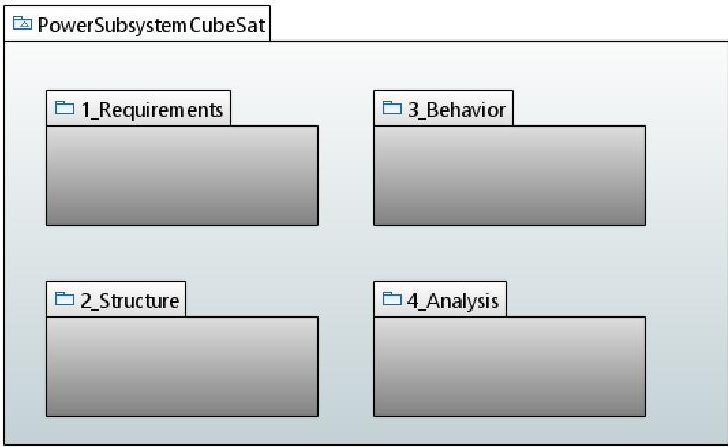
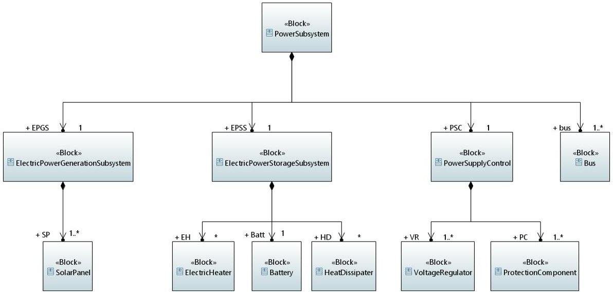
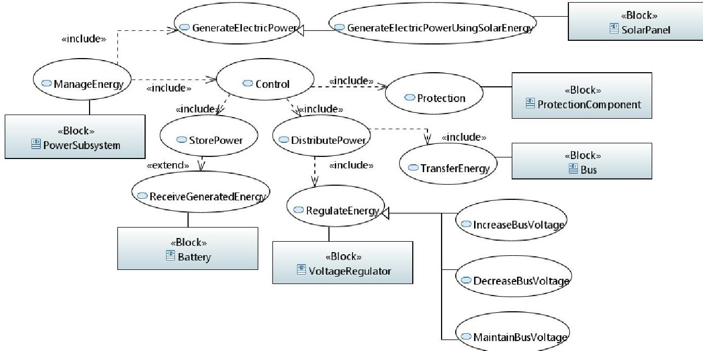
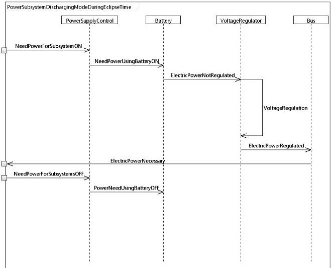
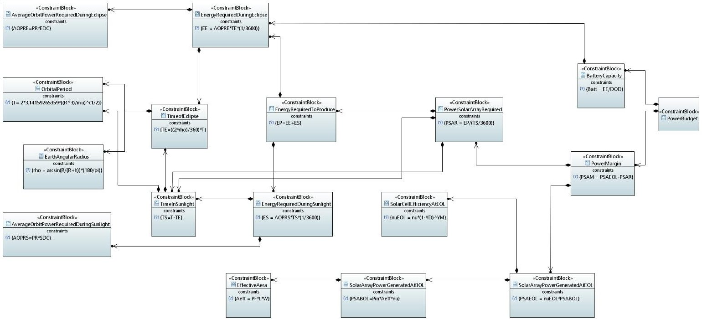
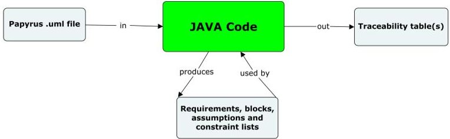

<!-- PDF_PAGE: 1 -->

# Open-source CubeSat MBSE Approach to Address Traceability: Power Subsystem

Charlotte Strobbe

ISAE-SUPAERO

Université de Toulouse

Toulouse, France

charlotte.strobbe@student.isae-supaero.fr

Sophia Salas Cordero

ISAE-SUPAERO

Université de Toulouse

Toulouse, France

sophia.salas@isae-supaero.fr

Rob Vingerhoeds

ISAE-SUPAERO

Université de Toulouse

Toulouse, France

rob.vingerhoeds@isae-supaero.fr

Abstract—The benefits of using Model-based System Engineering (MBSE) approaches for the development of projects go beyond just replacing document-centric methods. MBSE is expected to aid in the ability to manage complexity and capture knowledge. By using MBSE approaches on CubeSats this paper aims to address notions of traceability and how system models can be used to verify the fulfillment of requirements. This work is carried out in Papyrus, an open-source model-based engineering tool, and builds on existing studies regarding CubeSats system models. The development of these sorts of models can benefit future CubeSat developers by reducing design time and cost. These models can also be used in an academic setting to facilitate learning about CubeSats and their design process. In this paper, a CubeSat power subsystem SysML model is presented, while the notion of traceability is introduced by the creation of a specific profile for model assumptions and a java code that allows visualizing the impacts of the change of one or more parameters of the CubeSat model. The model proposed in this paper contains key information about a system, such as requirements, structure, behavior, and analysis. This model-based approach for CubeSat subsystems helps to visualize and understand what is needed for the design of a CubeSat power subsystem, while guaranteeing that the designers are clearly aware of which requirements are being met and which are not.

Index Terms—MBSE, CubeSat, Traceability, Power Subsystem, Papyrus.

## I. INTRODUCTION

The new space age [1] is characterized by an increased access to space. This has been made possible by new: launch service providers, launch vehicles, space systems technologies, and international partnerships. CubeSats have as well played a major role [2], they were first proposed in order to help students gain satellite engineering experience, without their traditionally high costs to build and launch [3]. The reduced cost of CubeSats encouraged a "democratization" of space, and their use has now spread to applications such as alternative platforms for experiments and laboratories, affordable technology demonstrators and proof-of-concept platforms, payloads outside of Earth orbit, and so on [4]. Throughout the last couple of decades there has been a rapid rise in the use of CubeSats [5], increasing to hundreds per year. CubeSats are highly versatile platforms that can be used for different mission objectives. This versatility, plus accessibility, standardization, entrepreneurship, technology, and community [2], has enabled its worldwide adoption.

For over 10 years, the INCOSE Space Systems Working Group (SSWG) Challenge Team has conducted research into the applicability of Model-Based Systems Engineering (MBSE) to build a CubeSat design model [6]. This team has focused on the elaboration of a sufficiently complete CubeSat System Reference Model (CSRM) that can be adapted to any CubeSat project and so far more than 20 research papers have been published by this working group [7]

Although the concept and design stage account for only roughly 15% of the total mission cost, they commit 70-80% of the life-cycle cost [8], [9]. The study of MBSE approaches for the design of CubeSats could help lower the time and effort behind its development. Therefore, the current paper aims to expand on the previous work done within the SSWG, while proposing a modeling methodology for a MBSE approach to CubeSat design, to guarantee traceability early from the conceptual stage. The traceability enabled by data integration can contribute to automating the design optimization of CubeSats and allow for the early detection of potential design errors.

For this purpose, the current paper:

- proposes additional concepts that can be added to the existing model,

- illustrates with an example of the application of the proposed modeling methodology for a CubeSat power subsystem in the open-source MBSE tool Papyrus, and

- presents an automatic requirement verification approach from system model data with a java code.

This paper is organized as follows. After the introduction, Section II briefly presents CubeSats, their MBSE modeling, and state-of-the-art traceability methods. Section III then presents the proposed methodology to elaborate the new model, as well as the taken architectural decisions. This section also presents the traceability aspects of the model, and its implementation is discussed. The results of this model and its traceability implementation are analyzed and discussed in the fourth section. Section V concludes the paper with an outlook for future work perspectives.

## II. BACKGROUND

CubeSats are a type of nanosatellite that must respect certain specifications regarding attributes such as shape and size [10]. They are usually launched as secondary payloads, taking

<!-- PDF_PAGE: 2 -->

advantage of piggyback launch capabilities, and they stand out as companies are able to mass-produce their components and offer them as components off-the-shelf (COTS) [11].

## A. Model Elaboration

Model-Based Systems Engineering (MBSE) can be defined as "the formalized application of modeling to support system requirements, design, analysis, verification, and validation activities beginning in the conceptual design phase and continuing throughout development and later life cycle phases" [12]. MBSE is part of a long-term trend toward model-centric approaches in order to replace document-centric approaches. The application of MBSE is expected to provide the following benefits [12], [13]:

- Enhance productivity and quality,

- Increase ability to manage system complexity,

- Improve ability to teach and learn systems engineering fundamentals, and

- Enhance knowledge capture,

- Provide improved communications among the system development team.

In order to achieve these goals, the MBSE Initiative was launched at the INCOSE International Workshop in 2007. This initiative creates Challenge or Activity Teams that promote the research of specialized areas of MBSE-related development activity or work on specific challenge problems. These Challenge Teams include, in particular, the Space Systems Working Group.

The INCOSE Space Systems Working Group (SSWG) created the CubeSat System Reference Model (CSRM) based on SysML (System Modeling Language). SysML is a graphical modeling language, that enables to visualize and communicate essential aspects of a system's design, such as structure, behavior, requirements, and parameters [14]. SysML proposes the following diagrams to visualize and communicate these aspects: Requirement Diagram, Behavior Diagrams (Activity, Sequence, State Machine, and Use Case Diagram), and Structure Diagrams (Block Definition, Internal Block, Parametric, and Package Diagram).

Over the years SSWG members have actively covered different aspects of the model. The CubeSat case study objectives and the basis of the model framework were presented in [15]. A way to extend the CSRM was shown by demonstrating the ability to model behaviors and scenarios using simulation tools such as Matlab [16]. An eight-step methodology for defining the behaviors of CubeSats was published in [17]. It starts with mission requirements and ends with providing a functional architecture modeled as an activity hierarchy. The integration of this methodology in the CubeSat System Reference Model is fully justified considering that it provides the following advantages as pointed out in [17]:

- A repeatable and generalized method for CubeSat development, and

- A method including standard systems engineering practices (top-down approach, requirement definition and analysis, functional analysis, and use case realization).

A topic that is rarely associated with MBSE in the literature concerns technical measures [18]. Technical measures can be used to determine if the technical solution will meet stakeholder needs, provide early indications if the development effort is not progressing as needed to meet key milestones, predict the likelihood of the delivered solution meeting performance requirements, monitor high-risk items, and assess the effectiveness of risk mitigation actions [18], [19].

In recent years the Space Systems Working Group published two papers [20], [21] about the CSRM application and possible opportunities to extend this model. In addition, two theses on CubeSat model development were published [22], [23]. Even though the models proposed in these theses are not 100% in line with the SSWG CSRM model, they provide an alternative view and a contribution to the practical implementation of the model.

## B. Traceability

Traceability can be defined as the quality of having an origin or course of development that may be found or followed [24]. SysML proposes some basic elements to ensure a sort of requirement traceability [25]:

- Requirement ID,

- Requirement relationships (satisfy, verify, trace, etc.), and

- The possibility to customize SysML for specific domains using profiles and stereotype definition.

Unfortunately, the basic requirement attributes and relationships present two majors drawbacks:

- A limited coverage of the various traceable aspects of the requirements, and

- A fully manual set-up and update procedure.

An example of this limited coverage can be the absence of information on the author of a requirement, the update dates, eventual documentation/standards associated with a requirement, etc.

In order to solve these problems, a SysML-based approach was proposed to enhance requirements traceability in SysML model diagrams and generate trace links at different levels of granularity in [24]. This approach is based on two elements: a SysML profile for expanding requirements definition and traceability, and an algorithm allowing trace generation. This profile includes the following elements for requirement traceability: type, status, source, stakeholder, etc.

An alternative approach based on the Design Structure Matrices (DSM) usage was presented in [26]. They present an algorithm and a tool to extract data from the output model files and obtain either a requirement DSM, function DSM, or component DSM, or alternatively a multidomain matrix that includes all relations between the requirements, functions, and components.

## III. PROPOSED MODEL DEVELOPMENT

Illustrated with a CubeSat power subsystem model, this section presents how modeling can be realized to provide better traceability and ease of reproduction (the model can

<!-- PDF_PAGE: 3 -->

be found here $ ^{1} $ ). For the purposes of this study, the actual implementation of the model was done in Papyrus [27] based on SSWG work cited before. One of the goals was to incorporate traceability improvements into the model, meaning a visualization of the impacts of parameter changes on other parameter values and related requirements.

## A. Model Development

1) Papyrus: is an industrial-grade, open-source ModelBased Engineering tool that allows the creation of customized profiles, where the user has the possibility to create models from specifications [28]. Papyrus provides the following advantages/capabilities [28]:

- Papyrus can be used as an Eclipse plugin, which allows us to extend the functionality of Papyrus by installing other Eclipse plugins,

- Papyrus supports two kinds of editors (diagrams and tables) and allows to have a combination of these representations in a single project (this allows to have multiple representations of the same type or create a completely new representation),

- The tool supports the creation of profiles that can be applied to other parts of a model using the stereotypes created in these profiles (stereotypes that allow to add constraints, properties, etc., and to customize the model for a specific domain), and

- With Moka (Eclipse plugin) models can be executed using a rich and extensible animation and simulation framework.

Papyrus-made models can be also used as a base for developing data extraction tools, such as the one presented in [26] based on TTool system models. As mentioned above, Papyrus is industrial-grade open-source software, and another benefit of this is that it enables the modeling effort to be more accessible.

2) Model Landing Page: When starting to model, it was decided to create a landing page with the help of a package diagram, to provide an overview of the subsystem. Our power subsystem model landing page (see Fig. 1) is composed of the following fundamental aspects of the model: requirements, structure, behavior, and analysis. It is an adaptation of the 10 different categories that the CSRM presents [20]. Each of these parts is discussed in more detail in the following sections.

3) Requirements Development: Requirements play a major role in systems engineering [9], as they: form the basis of system validation and stakeholder acceptance, act as a reference for integration and verification activities, and serve as a means of communication between the technical staff, management finance department, and the stakeholder community.

The model requirements package accessible through the landing page is divided into two main parts: Assumptions and Requirements. In the case of the Cubesat power subsystem that serves as an illustration of how this methodology could be applied to other subsystems, the assumptions concern the

Fig.1. Model landing page

power budget parameters on which the design team will not have a direct impact (such as the radius of the Earth, that is assumed to be equal to 6378 km). Generally, these values are fixed by external constraints/forces, or constitute an initial assumption and will therefore only be changed by the project team/customer if it has been demonstrated that it is not viable.

The identification of requirements is crucial throughout the entire life cycle of a system. For a subsystem, we propose to consider the following kind of requirements:

- The "general" requirements can be traced back to CubeSat standard specifications, such as the standard requirements applicable to CubeSats from 1U to 12U format. These requirements can be obtained by consulting documents maintained by, among others, California Polytechnic State University Aerospace Engineering members. These documents can be found in [29]. These requirements notably may have an impact on the components that can be selected.

- The "mission-specific" requirements consist of requirements specific to the mission in question and which may have an impact on the specificities/customization of a CubeSat.

4) Structure Development: The power subsystem presents three main parts: the power generation, power storage, and power supply control parts; plus the bus. Fig. 2 shows the block definition diagram (BDD) of this subsystem for an architecture based on solar energy as an energy source. In addition, the use of an internal block diagram (IBD) is recommended to specify interactions that occur on an internal level of the subsystem. IBD enables to convey additional information that BDD can't convey such as the connections among part properties and reference properties; the types of matter, energy, or data that flow across the connections; and the services that are provided and required across the connections [14].

5) Behavior Development: The behavior of a subsystem can be described in different ways and SysML provides several diagram types to be able to visualize these different descriptions: use case, activity, sequence, and state machine diagrams [14]:

<!-- PDF_PAGE: 4 -->

Fig. 2. Power subsystem structure

- Use Case Diagram (UCD): used to express information about the services your subsystem provides, the stakeholders who require those services, and the subsystem components which provide these services.

- Activity Diagrams (AD): used to express sequences of behaviors and event occurrences over time. This kind of diagram is particularly adapted to expressing the flow of objects-matter, energy, or data-through a behavior, with a focus on how the objects can be accessed and modified in an execution of that behavior during system operation

- Sequences Diagram (SD): used to express sequences of behaviors and event occurrences over time as an AD. This sort of diagram is a good choice for specifying a behavior when you want the focus to be on how the parts of a block interact with one another via operation calls and asynchronous signals that can have an emergent behavior.

- State Machine Diagram (SMD): used to tackle the same goal as SD and AD but this kind of diagram focuses attention on how a structure within a system changes state in response to event occurrences over time

In the case of the power subsystem model, a UCD was constructed (Fig.3), as well as an SD so as to specify functions of the UCD if necessary. It can be seen that the power subsystem's main use case is generalized in two more concrete cases which are: "generate electric power" and "control". This last use case itself specified with other functions: "store power", "distribute power" and "protection". These different use cases can then be observed in different situations using sequence diagrams. For example, the manage energy use case may mean charging or discharging the battery and these cases can be realized in different conditions. Fig. 4 shows the battery in sunlight time. In this paper only nominal behavior is shown as in [30] without loss of complexity, mission modes are not discussed in this paper. However, the methodology presented here can be extended to take mission modes into account by creating complementary behavioral diagrams for the concerned

modes.

6) Analysis Development: This part presents how the proposed modeling approach addresses system analysis, which should facilitate decision-making regarding system components selection/design and performance. For the power subsystem this includes the power budget and the following diagrams were used:

- A BDD containing constraint blocks that allows defining the different relationships present in the budget, and

- A parametric diagram (PAR) that allows displaying the bindings between constraint parameters in different constraint expressions to create a composite system of equations [14].

The power budget must be met to ensure that the consumed power does not exceed the produced power by the CubeSat [31], which is essential for mission success. The BDD of this budget (see Fig. 5) shows the different constraints and the associated parameters that will be used to build the associated PAR. This PAR is linked to the power budget block and shows the power budget like a "black box", with the constraint relationships inside the block.

## B. Profile

SysML is a general-purpose modeling language that is intended to support a wide range of domains [25]. SysML includes its own extension mechanisms in order to extend existing SysML concepts (e.g. Requirements) with additional properties and constraints. These mechanisms are called stereotypes and are grouped in profiles, which are therefore particular packages used to customize to specific application domains. For example, a profile to improve traceability in SysML model is presented in [24]. For the case study of the power subsystem, the construction of profiles can be useful in the following cases:

- The improvement of information traceability by creating profile-specific properties. These properties will then be identifiable, and their changes and impacts visualized.

<!-- PDF_PAGE: 5 -->

Fig. 3. Power subsystem UCD

Fig. 4. Battery discharging sequence diagram

- The generation of a sort of library with typical CubeSat components with their parameters to promote its reusability throughout different system models.

For our model, an assumptions profile was created and applied in order to include assumptions. This profile allows the java script presented in this paper to distinguish assumptions from other elements of the model and treat them appropriately. An assumption is composed of two elements: the parameter name for which a value is assumed, and a constraint with the assumed value ("Parameter name = assumed value"). Thanks to this assumption format, the code is able to impose this value on the specified parameter and take it into account during the subsystem analysis. This profile has been used to specify the assumed value of each parameter listed in Table II. More generally, this profile is useful to set the values that are external to the project. For example, in our case, the radius of the Earth or its standard gravitational parameter. Finally, this profile can

allow teams in the future to reuse previous models easier as they wouldn't need to guess what assumptions were made, and what their value was.

## C. Traceability

For the case study of the power subsystem, the following objectives were defined:

- Provide requirement "usual" traceability, and

- Provide parameter impact traceability and visualization. "Usual" traceability implies traceability achieved using only Papyrus tools. SysML proposes some elements to ensure this traceability aspect (see Section II) and also profile creation allows to improve this part. For example, [32] proposes a profile based on questions to obtain all information necessary for this first traceability aspect. In the case of the power subsystem model, the choice was made not to carry out a traceability-oriented profile, favoring the creation of a simple profile for the assumptions so that they are well handled by the code.

The parameter impact traceability (not-usual traceability) for the current case study was achieved through the development of a Java code (see figure 6 for the working principle). The code takes as input the Papyrus ".uml" file of the model from which it extracts the following information:

- block data,

- requirement and assumption constraints, and

- constraint block data

to generate different model element groups. The classification of elements is necessary in order to apply the right set of actions to each type of element. These actions are mentioned in Tab. I. The term constrained parameter corresponds to the parameters that are affected by a certain constraint (as defined in the constraint block in Papyrus). It is necessary to be careful when specifying these elements while defining the constraint

<!-- PDF_PAGE: 6 -->

Fig. 5. Power budget Block Definition Diagram

TABLE I MODEL ELEMENT USAGE

<table border="1"><tr><td>Model element</td><td>Usage</td></tr><tr><td>Block</td><td>- Parameter identification and storage</td></tr><tr><td>Requirement</td><td>- Constraint identification and storage
- Constraint evaluation</td></tr><tr><td>Assumption</td><td>- Constrained parameter identification
- Value constraint application</td></tr><tr><td>Constraint block</td><td>- Constrained parameter identification
- Constraint application</td></tr></table>

Fig. 6. Java Code Principle

on Papyrus so that the right parameters are used during the calculations. Once the code is executed, the user will be able to test the scenario by changing the value of the parameters it wishes to change. These new input values will be then evaluated. Finally, a parameter table in which the user will be able to observe the evolution of the values of the different parameters will be generated and the requirement constraint will be also displayed with a mention of whether is fulfilled with a " (no-)respected" flag.

## IV. RESULTS AND DISCUSSION

In the here presented model for the power subsystem, a choice was made to limit the sort of diagrams used, for example, AD and SMD were not used, as for the purposes of our analysis they were not essential. Nevertheless, the model proposes a concise and understandable view of a CubeSat power subsystem. The main objectives were to:

- Obtain an overview of the power subsystem requirements and assumptions used in the power budget (achieved through the Requirement Diagram and assumption profile),

- Obtain a visualization of the power subsystem, its components, and its main parameters (achieved using a BDD),

- Show the component interactions (achieved using an IBD),

- Obtain an analysis of the CubeSat power subsystem through the power budget and observe the roles of the different parameters (achieved using a Constraint BDD and a PAR),

- Visualize power subsystem functions and their allocation to system components (with a UCD), and

- Show the time sequence of the main functions (through an SD).

The model can be found in the project repository $ ^{2} $ . This model in combination with the Java script is used for traceability and visualization of "non-usual" aspects. In order to be able to apply the Java code to our model and improve its traceability, when building the model the following rules must be respected:

1) Requirement definition:

- No space in requirement name, id, and text definition,

$ ^{2} $https://github.com/SalasCorderoS/PowerSV

<!-- PDF_PAGE: 7 -->

TABLE II PARAMETER ASSUMPTIONS

<table border="1"><tr><td>Parameter</td><td>Assumed value</td></tr><tr><td>PF</td><td>0.86</td></tr><tr><td>size</td><td>3</td></tr><tr><td>YD</td><td>3</td></tr><tr><td>R</td><td>6378</td></tr><tr><td>μ</td><td>$3.986*10^{5}$</td></tr><tr><td>h</td><td>500</td></tr><tr><td>P_{in}$</td><td>1358</td></tr><tr><td>YM</td><td>3</td></tr><tr><td>DOD</td><td>30</td></tr><tr><td>PR</td><td>0.1</td></tr></table>

- No space in constraint name,

- Necessity to specify the constrained parameters in the constraint definition, and

- Specify Java as the language in which the constraint is defined.

2) Block and assumption definition:

- No space in the block and property names,

- The relationship between properties must be defined in a constraint specification, and

- Same constraint definition rules as for the requirement definition.

The developed code was applied to the power subsystem model, composed of the following diagrams:

- Power subsystem BDD containing the system components and their parameters,

- Assumptions BDD containing value assumptions on several parameters,

- Requirement diagram containing constraints that parameter values must respect after calculation, and

- Power budget constraint block diagram containing constraints and intermediate values necessary to establish the power budget.

The objective of this code is to facilitate the visualization of the impact of a parameter value change on the value of other parameters and whether the constraints are respected. The parameters under observation are the parameters used in the power budget. The power budget equations and constraints to be respected can be found in the project repository $ ^{3} $

For testing, the assumptions in Table II [2] were made whilst the other parameters not present in this table were initialized to zero. The change scenario that is evaluated involves the following parameters value update: solar panel length (L=0.25) and width (W=0.08), solar cell efficiency $ \eta=0.3 $ , eclipse duty cycle (EDC=100%) , and sunlight duty cycle (SDC=100%). This is clearly displayed in Table III.

This change scenario represents a situation that could happen during the design, as those parameters can effectively be managed by the design team. The expected results obtained applying the link budget equations are listed in table III. It

TABLE III JAVA CODE EXPECTED RESULTS

<table border="1"><tr><td>Parameter</td><td>Expected Results</td><td>Unit</td></tr><tr><td>T</td><td>5069.18</td><td>s</td></tr><tr><td>$\rho$</td><td>68.02</td><td>$^\circ$</td></tr><tr><td>TE</td><td>1915.54</td><td>s</td></tr><tr><td>TS</td><td>3153.64</td><td>s</td></tr><tr><td>$A_{eff}$</td><td>0.017</td><td>$m^2$</td></tr><tr><td>PSABOL</td><td>7.007</td><td>W</td></tr><tr><td>$\eta_{EOL}$</td><td>27.4</td><td>%</td></tr><tr><td>PSAEOL</td><td>1.919</td><td>W</td></tr><tr><td>EE</td><td>0.053</td><td>Wh</td></tr><tr><td>ES</td><td>0.088</td><td>Wh</td></tr><tr><td>EP</td><td>0.141</td><td>Wh</td></tr><tr><td>PSAR</td><td>0.161</td><td>W</td></tr><tr><td>PSAM</td><td>1.758</td><td>W</td></tr><tr><td>Batt</td><td>0.177</td><td>Wh</td></tr><tr><td>Constraint</td><td></td><td></td></tr><tr><td>Batt*1.2＜BC</td><td>not respected</td><td>/</td></tr><tr><td>0＜PSAM</td><td>respected</td><td>/</td></tr></table>

<table border="1"><tr><td>PARAMETER</td><td>OLD VALUE</td><td>NEW VALUE</td><td>PARAMETER</td><td>OLD VALUE</td><td>NEW VALUE</td><td>PARAMETER</td><td>OLD VALUE</td><td>NEW VALUE</td></tr><tr><td>Pin</td><td>0</td><td>1358</td><td>size</td><td>0</td><td>3</td><td>nu</td><td>0</td><td>0,3</td></tr><tr><td>PF</td><td>0</td><td>0,86</td><td>nuEOL</td><td>0</td><td>0,274</td><td>SDC</td><td>0</td><td>1</td></tr><tr><td>YD</td><td>0</td><td>0,03</td><td>TS</td><td>0</td><td>3153,639</td><td>AOPRE</td><td>0</td><td>0,1</td></tr><tr><td>PSAM</td><td>0</td><td>1,758</td><td>TE</td><td>0</td><td>1915,544</td><td>PSAEOL</td><td>0</td><td>1,919</td></tr><tr><td>mu</td><td>0</td><td>398600</td><td>Aeff</td><td>0</td><td>0,017</td><td>PSABOL</td><td>0</td><td>7,007</td></tr><tr><td>EE</td><td>0</td><td>0,053</td><td>L</td><td>0</td><td>0,25</td><td>R</td><td>0</td><td>6378</td></tr><tr><td>ES</td><td>0</td><td>0,088</td><td>DOD</td><td>0</td><td>0,3</td><td>PR</td><td>0</td><td>0,1</td></tr><tr><td>EP</td><td>0</td><td>0,141</td><td>PSAR</td><td>0</td><td>0,161</td><td>Batt</td><td>0</td><td>0,177</td></tr><tr><td>T</td><td>0</td><td>5069,183</td><td>rho</td><td>0</td><td>68,018</td><td>W</td><td>0</td><td>0,08</td></tr><tr><td>h</td><td>0</td><td>500</td><td>YM</td><td>0</td><td>3</td><td>EDC</td><td>0</td><td>1</td></tr><tr><td>AOPRS</td><td>0</td><td>0,1</td><td>BC</td><td>0</td><td>0</td><td></td><td></td><td></td></tr><tr><td colspan="9">Constraints0&lt;PSAMRespectedBatt*1.2&lt;BCNot respected</td></tr></table>

Fig. 7. Change scenario 1 Result

can be observed on Fig. 7 that these results are also obtained when executing the java code.

Fig. 7 shows the Excel file that is generated by the java code. This figure displays different information related to the studied system such as assumption parameters (blue), user input parameters (yellow), final budget values (orange), and whether or not the constraints are respected. For each parameter of this table, you can then observe its name, its previous value, and its value after the change scenario evaluation. Below this table, the evaluated constraints by the code are pointed out as well as whether they are respected or not in the current scenario. This can help the design team to evaluate possible scenarios rapidly in a systematic manner.

## V. CONCLUSION

The model presented in this paper can be considered as a good starting point for users wishing to design a CubeSat power subsystem and have traceability throughout its parameters. One of the advantages of the model proposed in this paper is that it was constructed using Papyrus which is an open-source software. This means it can easily be reproduced by those who wish to use it and adapt it to their own needs. Besides, guidelines are suggested in order to increase the verifiability of requirements using a traceability process. This model-based approach for CubeSat subsystems helps to

<!-- PDF_PAGE: 8 -->

visualize and understand what the structure of a CubeSat power subsystem is, as well as its functions.

The Java code discussed in this paper has the potential to improve traceability throughout models made using the Papyrus Eclipse's plugin with SysML 1.6. In this paper, an example application is presented that uses the proposed assumption profile and follows the guidelines proposed in section IV to create the model elements. The code allows the visualization of the impacts of the different parameters of the model when their values are changed and whether the different model constraints are respected or not following these changes.

While this paper provides good insights into how CubeSats subsystems can be modeled in Papyrus and introduces notions of verifiability, it also paves the way for future work perspectives in this domain. For instance, the development of reusable standard profiles for all CubeSat components for all subsystems, and requirement types. These profiles could then be used by anyone wishing to design a new CubeSat, potentially making the modeling process less time-consuming and improving the adoption of such models in organizations. Indeed, if such profiles were available and used, it would mean that models would present standardized components, associated parameters, and their notations. Secondly, the Java code can be further developed for it to work with more complex SysML models (a complete CubeSat model for example) and to visualize changes directly in the model after its execution. When the MBSE modeling framework and traceability analysis will be at a stage mature enough to aid in the development of CubeSats, a quantitative benefit study could be performed in order to assess key performance indicators such as cost and time. Currently, the expansion of the model to cover other subsystems is in progress.

## REFERENCES

[1] G. Martin, "NewSpace:The Emerging Commercial Space Industry," NASA, Tech. Rep., 01 2016.

[2] C. Cappelletti, S. Battistini, and B. Malphrus, CubeSat Handbook: From Mission Design to Operations. Academic Press, 2020.

[3] H. Heidt, J. Puig-Suari, A. Moore, S. Nakasuka, and R. Twiggs, "Cubesat: A new generation of picosatellite for education and industry low-cost space experimentation," Proceedings of the Small Satellite Conference, 2000.

[4] T. Villela, C. A. Costa, A. M. Brandao, F. T. Bueno, and R. Leonardi, "Towards the thousandth cubesat: A statistical overview," International Journal of Aerospace Engineering, vol. 2019, 2019.

[5] N. Database. World's largest database of nanosatellites, almost 3500 nanosats and cubesats. [Online]. Available: https://www.nanosats.eu/figures

[6] INCOSE. Space systems working group. [Online]. Available: https://www.incose.org/incose-member-resources/working groups/Application/space-systems

[7] ——. Space systems working group. [Online]. Available: https://www.incose.org/incose-member-resources/working groups/Application/space-systems

[8] S. Salas Cordero, C. Fortin, and R. Vingerhoeds, "Concurrent conceptual design sequencing for mbse of complex systems through design structure matrices," in Proceedings of the Design Society: DESIGN Conference, vol. 1. Cambridge University Press, 2020, pp. 2375-2384.

[9] INCOSE, "Incose systems engineering handbook version 4: Updating the reference for practitioners," in INCOSE International Symposium, vol. 25, no. 1. Wiley Online Library, 2015, pp. 678-686.

[10] A. Johnstone, "CubeSat Design Specification Rev. 14 ," The CubeSat Program, Cal Poly SLO, California, Tech. Rep., jul 2020.

[11] C. NASA, "101: Basic concepts and processes for first-time cubesat developers," NASA and California Polytechnic State University, 2017.

[12] S. Friedenthal, R. Griego, and M. Sampson, "Incose model based systems engineering (mbse) initiative," in INCOSE 2007 symposium, vol. 11. sn, 2007.

[13] K. Henderson and A. Salado, "Value and benefits of model-based systems engineering (mbse): Evidence from the literature," Systems Engineering, vol. 24, no. 1, pp. 51-66, 2021.

[14] L. Delligatti, SysML distilled: A brief guide to the systems modeling language. Addison-Wesley, 2013.

[15] S. C. Spangelo, D. Kaslow, C. Delp, B. Cole, L. Anderson, E. Fosse, B. S. Gilbert, L. Hartman, T. Kahn, and J. Cutler, "Applying model based systems engineering (mbse) to a standard cubesat," in 2012 IEEE Aerospace Conference, 2012, pp. 1-20.

[16] S. C. Spangelo, J. Cutler, L. Anderson, E. Fosse, L. Cheng, R. Yntema, M. Bajaj, C. Delp, B. Cole, G. Soremekum, and D. Kaslow, "Model based systems engineering (mbse) applied to radio aurora explorer (rax) cubesat mission operational scenarios," in 2013 IEEE Aerospace Conference, 2013, pp. 1-18.

[17] D. Kaslow, B. Ayres, P. T. Cahill, L. Hart, and R. Yntema, "A model-based systems engineering (mbse) approach for defining the behaviors of cubesats," in 2017 IEEE Aerospace Conference, 2017, pp. 1-14.

[18] D. Kaslow, B. Ayres, P. T. Cahill, and L. Hart, "A model-based systems engineering approach for technical measurement with application to a cubesat," in 2018 IEEE Aerospace Conference, 2018, pp. 1-10.

[19] G. J. Roedler and C. Jones, "Technical measurement. a collaborative project of psm, incose, and industry," ARMY ARMAMENT RESEARCH DEVELOPMENT AND ENGINEERING CENTER PICATINNY ARSENAL NJ, Tech. Rep., 2005.

[20] D. Kaslow, P. T. Cahill, and B. Ayres, "Development and application of the cubesat system reference model," in 2020 IEEE Aerospace Conference, 2020, pp. 1-15.

[21] D. Kaslow, A. Levi, P. T. Cahill, B. Ayres, D. Hurst, and C. Croney, "Mission engineering and the cubesat system reference model," in 2021 IEEE Aerospace Conference (50100), 2021, pp. 1-8.

[22] S. T. Jaworski, "Development of a standard model based system architecture for cubesat missions," Ph.D. dissertation, California State Polytechnic University, Pomona, 2021.

[23] S. R. Kelly, "A reference architecture for rapid cubesat development," Ph.D. dissertation, Air Force Institute of Technology, 2021.

[24] S. Haidrar, A. Anwar, and O. Roudies, "A sysml-based approach to manage stakeholder requirements traceability," in 2017 IEEE/ACS 14th International Conference on Computer Systems and Applications (AICCSA), 2017, pp. 202-207.

[25] S. Friedenthal, A. Moore, and R. Steiner, A practical guide to SysML: the systems modeling language. Morgan Kaufmann, 2014.

[26] W. Pons, S. Salas Cordero, and R. Vingerhoeds, "Design structure matrix generation from open-source mbse tools," in 2021 IEEE International Symposium on Systems Engineering (ISSE), 2021, pp. 1-8.

[27] E. Foundation. Eclipse papyrus modeling environment. [Online]. Available: https://www.eclipse.org/papyrus/

[28] A. Rys, "Modeling tool investigation: Papyrus."

[29] CUBESAT. Developer resources. [Online]. Available: https://www.cubesat.org/cubesatinfo

[30] S. Salas Cordero, T. Gateau, and R. Vingerhoeds, "Mbse challenges in the concurrent preliminary design of cubesats: Nanospace study," in 2022 IEEE International Systems Conference (SysCon), 2022, pp. 1-8.

[31] S. Dahbi, A. Aziz, S. Zouggar, M. E. Hafyani, O. Morocco, A. Hanafi, M. Karim, I. Latachi, and T. Rachidi, "Power budget analysis for a leo polar orbiting nano-satellite," in 2017 International Conference on Advanced Technologies for Signal and Image Processing (ATSIP), 2017, pp. 1-6.

[32] S. Winkler and J. von Pilgrim, "A survey of traceability in requirements engineering and model-driven development," Software & Systems Modeling, vol. 9, no. 4, pp. 529-565, 2010.