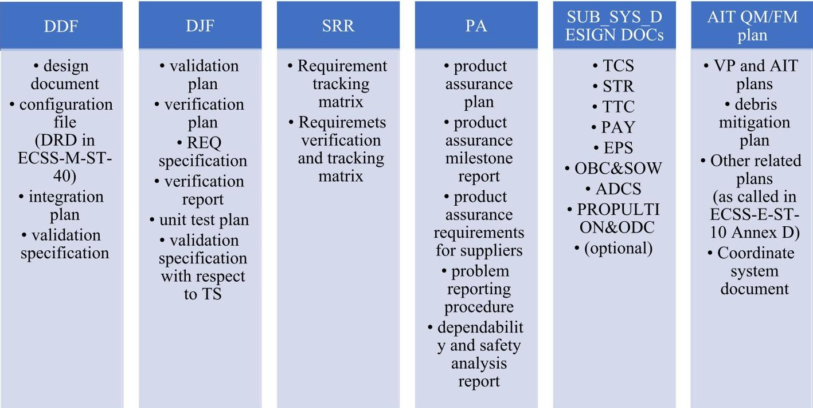
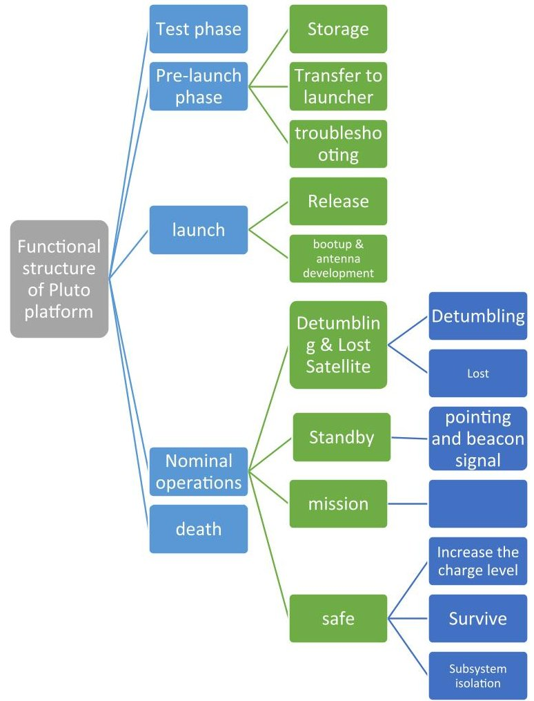
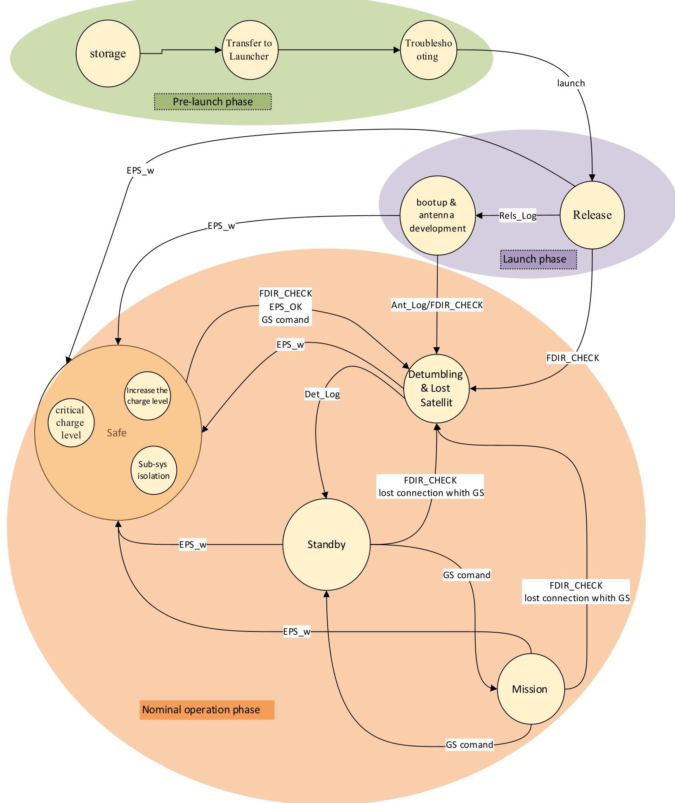
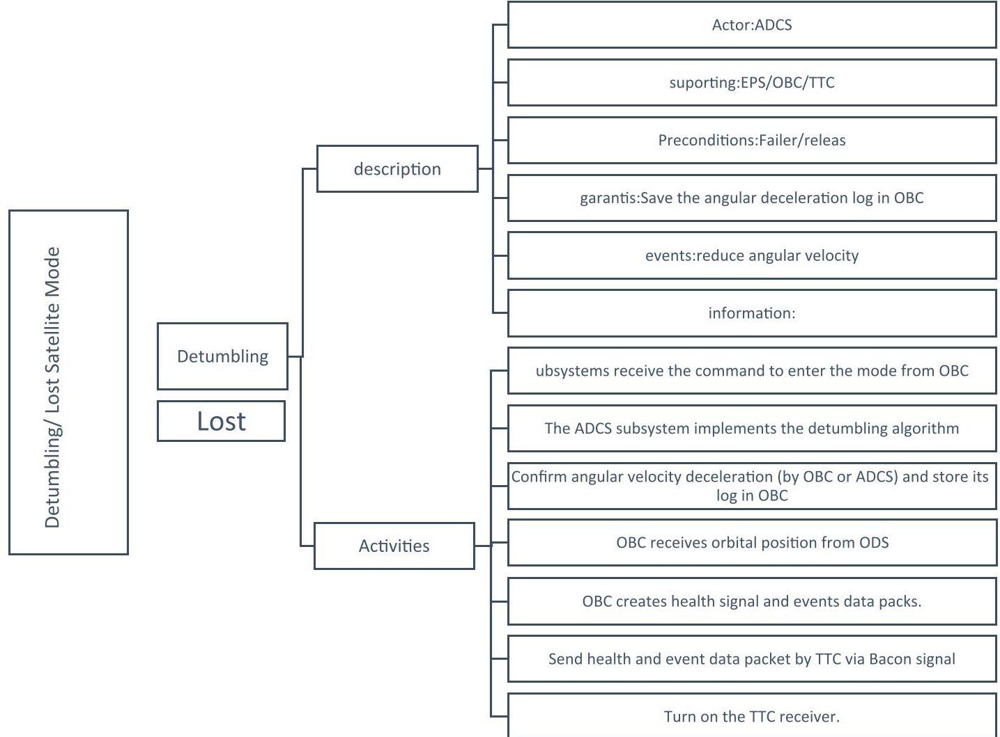
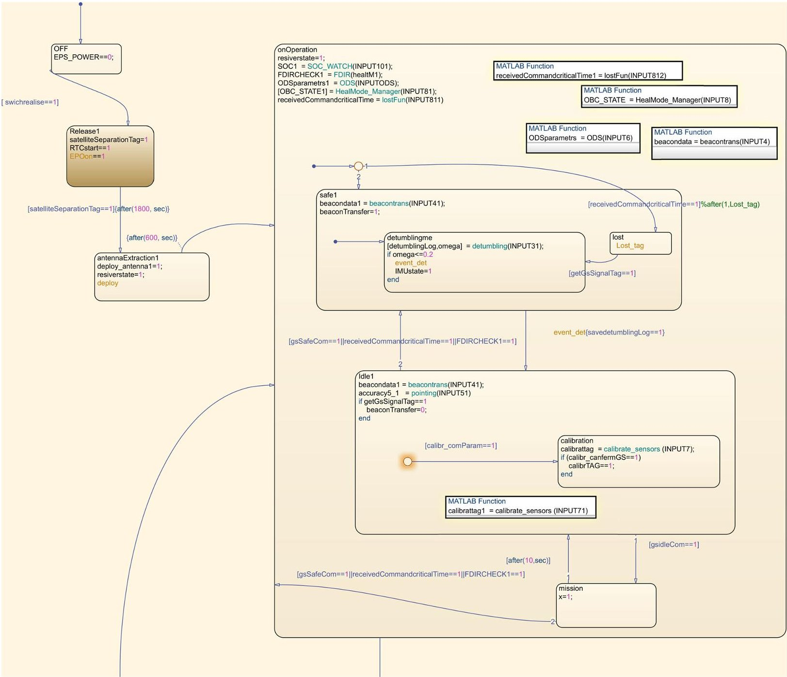
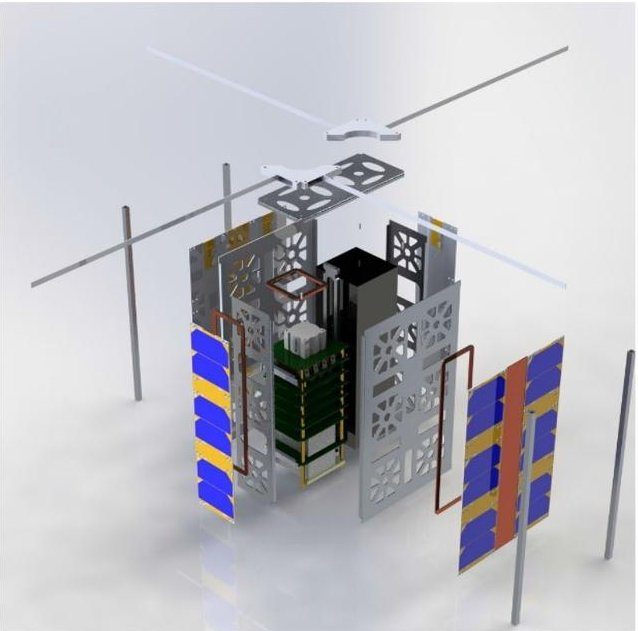
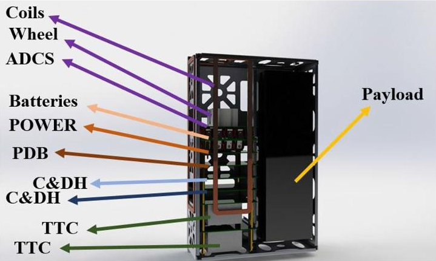
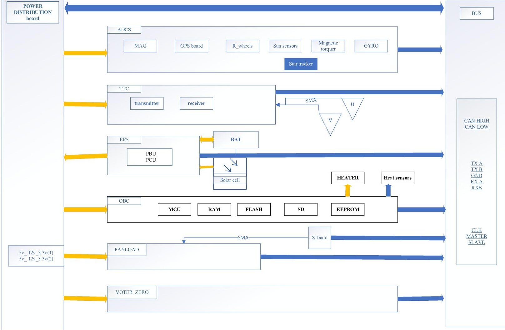
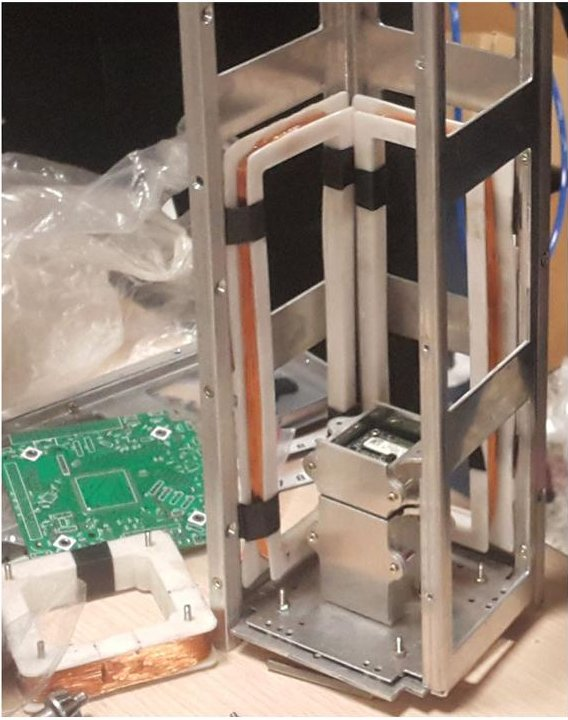
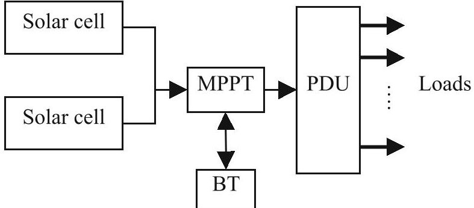

<!-- PDF_PAGE: 1 -->

ORIGINAL PAPER

# Present the System Design Process and Review of Specifications of a Very Low-Cost 6U CubeSat Platform to Improve Accessibility to Space Based on Pluto Experience

Mansoureh Abbasy $ ^{1} $ iD · Mohammad Aghayi Motaaleghi $ ^{1} $ iD

Received: 7 October 2022 / Revised: 10 June 2023 / Accepted: 24 June 2023 / Published online: 17 July 2023 © Chinese Society of Astronautics 2023

## Abstract

This article presents the systematic design process for a low-cost 6U CubeSat platform, drawing on the experience of the highly motivated Pluto team. The team's success in a national academic CubeSat design competition led to the establishment of a space startup and the decision to develop a 6U platform. The primary motivation for writing this research is to increase access to space and space services by helping startups _especially in underdeveloped countries, design and build a CubeSat with the least cost and effort in the shortest possible time. In the design process, simplicity, reliability, and the possibility of reproduction at the lowest possible cost have been prioritized. Aligned with ECSS standards tailored for CubeSats, the design method parameters of the 6U platform are thoroughly examined. The article highlights the development of a state machine and the justification of design requirements through standard methods and tracking them using RTM and RVTM tables. Effective interface control while using COTS components is emphasized to reduce costs by approximately 50% while ensuring quality and meeting space environment requirements. The architecture of the Pluto platform, comprising entirely of commercial components, is showcased, providing insights into its system characteristics. This systematic design underscores the importance of modularity, affordability, and utilization of COTS components. By sharing their experiences, the Pluto team aims to support space industry startups and inspire innovative CubeSat projects.

Keywords CubeSat·Small satellite·System engineering·COTS·Off the shelf·Platform

## 1 Introduction

Modern CubeSats are a special class of nanosatellite. The size of one-unit (1U) CubeSat is $ 1 0 \mathrm{c m} \times 1 0 \mathrm{c m} \times 1 1 \mathrm{c m} $ CubeSats can be composed of several combinations of the 1U to form up to 6U or even more [1]. Initially, CubeSats were developed in universities for elementary applications only. Due to the advancement of technology, especially in the production of small, light, and high-efficiency electronic components, it became possible to using CubeSats in more complicated missions like Scientific research or proof of technology which is going to be used on large satellites;

these researches still primarily done in universities. In the last decade, CubeSats are being produced for industrial purposes and in a highly competitive commercial sector. According to a Statistical Overview in 2020, about 56% of CubeSats are developed by small companies [2]. In fact, in 2003, only six CubeSats were launched, and all of them were made by universities. Whereas, in 2018, about 150 of the 240 CubeSats made by companies were developed [2]. Recently, CubeSats are even used for deep space exploration; their small size and weight enables CubeSats to "piggyback" on rocket launches and accompany orbiters travelling to Moon and Mars [3]. Thanks to CubeSats, many major universities now have a space program. But it is not just major universities; smaller universities, high schools, and middle schools have also been able to start CubeSat programs of their own [4]. CubeSats have made space accessible for small companies, students, and small institutions underdeveloped countries. According to ECSS standards, Iran space agency decided to hold a design competition for designing a 3_U CubeSat. Pluto team

<!-- PDF_PAGE: 2 -->

has earned first place in both the detailed design and engineering model phase; after that, the Pluto team decided to start its start-up and build a 6_U platform; this paper will review the design of a low-cost 6U CubeSat Platform done Based on Pluto Experience. In 2012, an 8 kg 6U CubeSat was designed which was capable of performing Earth Observation missions equivalent to those of current 50-150 kg microsatellites. Based on this research, a constellation of 35 6U CubeSats would have approximately the exact launch cost as the five RapidEye satellite constellations. The data downlinked by the 6U CubeSat constellation would be of much higher temporal resolution since the constellation could contain seven planes of five spacecraft each, compared with a single plane of five spacecraft for the RapidEye constellation [5]. Therefore, CubeSats could be a solution for the enormous costs of space programs, and they can make space accessible for more people. From the beginning of CubeSats, engineers have tried to come up with cheaper and faster ways to make them. Scientists have been trying to produce CubeSats by 3-D printers and COTS components and engage students in the designing process to prepare them for future works [1,6]. In 2018, Sua Song design a 3U CubeSat Platform to service 1U payloads, and he reduce the time required to prepare a satellite from 1 year to several months [7]. In 2018, Madry proposed using commercial off-the-shelf components that have not been spaceflight eligible in CubeSats [8]. In 2019, Western University designed a 2U cube satellite to facilitate the learning of aerospace students and to be prepared for future projects [9]. In 2019, the University of Manitoba designed a CubeSat and used a new method of satellite design with a creative management approach to improving access to space for smaller organizations and for educational purposes [6]. In 2020, a new modular structure was proposed by N. Zosimovych to help students and Startups building a low-cost CubeSat structure [1]. In order to increase the speed of production and the possibility of adaptation to new production methods, in 2020, Espalin proposed the method of using 3D printers to build CubeSat's subsystem [10].

CubeSats are gradually doing the same operations that large satellites used to do, helping to make space accessible and benefit everyone from satellite services. Large and small companies are being attracted to the CubeSats market, but for start-ups, there are two main steps with a cheap and reliable CubeSat which is designed in a short time. First: understanding the design framework and the necessary requirements. Second: interfaces Control and provide cheap and reliable components. In sections one and two, a review of the minimum requirements, necessary documentation, and a sample of System architecture based on Pluto team experience for design a CubeSat platform in the shortest possible time is given. In sections three and four, few tables are presented to control the interfaces and a review of the prevalence of the use of off-the-shelf parts. Finally, in section five, Pluto

platform specifications are shown. Also, a technical budget and a minimum of common electrical interfaces have been proposed, which can help minimize the cost and time of the design and production process and simplify the selection of parts from existing commercial components.

In budgeting, it can be seen that the power and ADCS subsystem's weight is slightly higher than expected due to the use of commercial solar panels and homemade magnetorquers. If there is a need to reduce weight in structure using a 3D printer instead of aluminum and CNC machines is highly recommended. For tracing and verifying the requirements six parameters are regarded, the functional structure, validation phase, test description, the necessary physical structure in the related subsystem, the physical interface structure, and the description of the verification method. In Pluto, all components are selected as commercial components. Therefore, redundancy is considered for single-point failures in sensors and OBC boards. There are two CDH boards as cold redundant and an FPGA used as supervisor. All sensors and ODS are integrated into the ADCS board. The processing budget of the main board is considered in such a way that it can support all subsystem algorithms to manage their tasks and permit engineers to make some changes in future works. Interface control has been done at three levels_launcher and space environment and between subsystem components, all the engineers of all subsystems review these documents through the design and building phases. Subsystem interfaces are divided into sections of electrical, data, mechanical, and thermal. Mechanical interfaces include all the details of the subsystems simulated in the structural software model, Compliance with the mass and volume budget, Location of the element, Material of fittings and alloy used in fittings, requires spacer and if necessary, mention the required distance to other parts. The selection of the general specifications of the satellite is based on statistical studies on the platforms available in the market and the system requirements. The Pluto platform subsystems are EPS, ADCS, ODS, STR, TCS, TTC, and CDH. Payload interfaces are CAN, SPI, RS422/UART, maximum Payload mass could be up to 8 kg, Spacecraft mass is about 4 kg, and Satellite power is 6.4 Watt EOL (nadir) and 13W at EOL (sun pointing). In ADCS subsystem Accuracy is better than 3 deg, Knowledge better than 2 deg, Stability better than 0.42 deg/s, the link margin is 3 dB at a 5 deg elevation angle and data rates are VHF downlink equals to 9600 bps, UHF uplink is the same, S-band downlink is 4 Mbps.

## 2 Platform System Design

The main steps of a satellite design include system budgeting mission scenario design, requirements development, developing specification tree, review of all kinds of interfaces,

<!-- PDF_PAGE: 3 -->

Fig.1 System configuration management

proving a verification plan for compliance of subsystem design with requirements, product tree, developing scenario and state-machine, fault detection and reliability check, integration plan, and testing processes. There are very detailed standards in satellite design, which the European Space Agency and NASA developed. These standards are beneficial, but they are very long and have many sections, and their review is very time-consuming. In this article, an attempt has been made to provide a simple method for system design. The documentation method proposed in this paper is based on the ECSS standard. The minimum required documentation is shown in Fig.1.

Figure 1 suggests the minimum documentation required to ensure consideration of all essential design points. In this paper, according to the system design process of the Pluto platform, these documents are reviewed. Some standards suggest additional documents, but here, we have tried to simplify without skipping the primary sections.

## 2.1 Budget

The first step is to design a technical budget for subsystems based on the size of the cubic satellite, which is usually determined by statistical research. The technical budget for the Pluto platform is according to Table 1, which includes mass power consumption and volume. A computation overhead (gain) can be associated with each task to facilitate the estimation of mission overhead [11] 0.20% overhead in the building engineer model could be suitable. In order to increase the simplicity and reduce costs of the platform, the minimum possible subsystems are provided to meet the requirements.

Satellite subsystems are as follows: Power, attitude determination and control, orbit determination, structure, thermal control, command and data handling, communications. With the advancement of technology, CubeSats have become able to perform more complex missions, and designers are moving towards using 6-U platforms. Pluto's team chose 6U platform against 3U because they can provide enough power for telecommunication and Remote Sensing missions without using deployable solar panels and accept the related costs and risks, but just by orienting towards the sun and designing a suitable mode manager. Moreover, the 6-U platform offers more space to place more accurate Earth Observation (EO) components, precision position determination and servo mechanisms, extra batteries for IoT missions, or test multiple Space Science payloads simultaneously on a single platform. It is noticeable that although the 6-U platforms provide about twice as much space and power for the payload, its costs are about 1.5 times. Therefore, the budget table is related to a 6-U platform.

As shown in Table 1, the weight of the power subsystem is considered to be slightly higher than expected due to the use of commercial solar panels, which are slightly heavier than solar panels, which are built especially for space applications. In addition, if the manufacturer can use a 3D printer, the structure can be made lighter. The mass budget intended for the ADSC subsystem is about 200 g more than usual, which is due to the use of homemade magnetorquers. Refer to Article [12] for a detailed examination of the Home Mead magnetic coil. If a magnetorquers which is made primarily for CubeSats be using, the platform will be lighter. However, since the general policy in this article has been simplicity and

<!-- PDF_PAGE: 4 -->

Table 1 Pluto platform technical budget

<table border="1"><tr><td>Power gain%</td><td>Power budget %</td><td>Power (watt)</td><td>Volume gain%</td><td>Volume budget %</td><td>Volume (U)</td><td>Mass budget %</td><td>Mass gain%</td><td>Mass(gr)</td><td></td></tr><tr><td>0</td><td>0</td><td>0</td><td>0</td><td>0</td><td>0</td><td>28</td><td>3</td><td>1500</td><td>STR</td></tr><tr><td>1.604</td><td>2</td><td>0.12</td><td>3.936</td><td>0.552</td><td>0.0138</td><td>0.5</td><td>-0.1</td><td>36</td><td>ODS</td></tr><tr><td>1.6</td><td>4</td><td>0.24</td><td>4.166</td><td>0</td><td>0</td><td>2</td><td>0.2</td><td>108</td><td>TCS</td></tr><tr><td>21.788</td><td>30</td><td>1.8</td><td>3.333</td><td>28</td><td>0.7</td><td>20</td><td>12.66</td><td>440.32</td><td>ADCS</td></tr><tr><td>16.444</td><td>35</td><td>2.1</td><td>3.333</td><td>12</td><td>0.3</td><td>12</td><td>-1.833</td><td>830</td><td>TTC&amp; shield</td></tr><tr><td>0</td><td>10</td><td>0.6</td><td>5</td><td>12</td><td>0.3</td><td>5.5</td><td>0.5</td><td>300</td><td>OBC</td></tr><tr><td>-25.7</td><td>4</td><td>0.24</td><td>7.5</td><td>32</td><td>0.8</td><td>20</td><td>-6.516</td><td>1591</td><td>EPS&amp; Arrays</td></tr><tr><td>0</td><td>0</td><td>0</td><td>3.333</td><td>12</td><td>0.3</td><td>12</td><td>6.666</td><td>320</td><td>Other</td></tr><tr><td>15.736</td><td>85</td><td>5.1</td><td>30.6</td><td>96.552</td><td>2.4138</td><td>100</td><td>14.57</td><td>5125.32</td><td>Total</td></tr></table>

cost reduction, the technical budget has developed based on COTS parts.

## 2.2 Requirements

The requirements are the do's and don'ts that, if met, can ensure that the purpose of the mission is satisfied. The European space agency has recommended a way to publish the requirements on the ECSS-E-ST-10C document. This document recommends first writing requirements based on the space environment, the purpose of the mission, and the lessons learned from previous CubeSats. Next, the sentences should review, then the importance of having those requirements is examined in the structure of RTM and finally published [13]. In other words, the requirements allocated to the system elements and their interfaces are traceable to the customer's requirements baseline [14]. Researchers have associated the waterfall methodology with "requirement freezing" early in the development life cycle, making the project inflexible and unable to respond to changing requirements or use cases. Also, high costs and efforts seem to be a major downside to the waterfall design process [15]. The goal here is to speed up the design process, so the minimum requirements for a platform are mentioned here to facilitate the selection among off-the-shelf components. Developing the correct requirements will lead us to choose the COTS in the right way. We need to achieve a specification tree base on the subsystem requirements. The requirements that are presented here are based on the experience of the Pluto team, CubeSats standards, review of documents from other satellites, and the statistical study to obtain the interfaces and the technical budget required to support the maximum range of payloads (the most crucial factor in designing a platform is

to be able to service the broadest possible range of payloads with different purposes and different interfaces).

1. The satellite platform should be designed to fit the dimensions of a six-unit cubic satellite.

2. The weight of the satellite platform, including all subsystems (Empty bus mass), should be a maximum of 6000 g.

3. The satellite must serve a payload with a weight of up to 8000 g.

4. The satellite must serve a payload with a volume of up to three units.

5. The satellite must communicate with the payload by CAN, SPI, RS422/UART ports.

6. The lifetime of satellites and their subsystems must be specified—at least 1 year.

7. The satellite must withstand the environmental conditions of its entire life cycle and carry out its mission according to the scenario correctly. (Includes radiation effects, effects of thermal changes, outgassing effects.)

8. The health signal must be defined for all subsystems.

9. All subsystems must follow the technical budget.

10. The possibility of failure of the satellite mission must be minimized.

11. The dimensions of the satellite boards should be maximum of $ 9 6 \times9 6 \times1 5 $ mm.

12. Satellite design strategy should be based on hardware redundancy. Hardware redundancy should not interfere with the mission.

13. The satellite must be equipped with a ground tester.

14. The satellite must be able to be stored for up to a year.

15. The list of sensitive items at the time of storage must be defined.

16. Critical parts should be inspected after storage.

<!-- PDF_PAGE: 5 -->

17. Fault tree analysis (FTA) for the entire satellite must be performed.

18. If possible, a reliability analysis should be performed for the satellite. Failure mode and effects analysis (FMEA) and failure mode, effects, and criticality analysis (FMECA) should be performed.

19. The radio silence must be observed for 45 min.

20. Deployable elements must be activated after 30 min from separation.

Recently, in some projects, such as the Manitoba Sat-1, changeable requirements have been set, and Agile methodologies have been used to encourage designer creativity [6]. Although this is creative, if a team do not have enough design experience, for example, as a start-up or student team in underdeveloped countries which want to enter the field of space technology by using the advantage of low-cost CubeSats, the project can be led to technical problems or can be very time-consuming. In this project, a small number of system requirements are introduced as unchangeable requirements, and other requirements can be marked with a TBD, which are just a recommendation and can be changed based on design options. Since several requirements are changeable and denoted by TBD or TBR, it is necessary for the system engineer and project manager to be aware of the workflow of the subsystems to make sure that all members are aware of any changes in the requirements, especially interface requirements. A traditional approach is project control by the manager. One new approach presented in Manitobasat-1 Provides visibility to invisible work and guidance in the Agile philosophy and methods. The ManitobaSat-1 team uses Playbook's Kanban user interface to track the tasks performed by every team member and the team as a whole [6]. The suggestion of this research and what has followed in designing the Pluto platform is that the ICD and RTM documents should be read and updated by the subsystem's engineers every week, and every subsystem had a particular color to make his/her notifications on it. Lead system engineer declares the changes to all members weekly.

RTM:Requirements are verified by one or a combination of these methods: design review, testing, inspection, or analysis methods [16]. One example of a row of the Pluto platform's RTM is shown in Table 2. RTM table includes columns of numbering, determining the root and reason for existing of a requirement (design, product assurance, communication, environments, functional, mission verification), description of the requirement, subsystems to which the requirement is referred, requirement status (TBD, TBC, CONFIRM, TBR), requirement verification method (review, test, inspection, analysis), requirement approval phase (Design, En_Model, Q_Test, A_Test, Orbit Operation, pre. launch), date of the last review, requirement confirmation officer. System requirements are referred to subsystems and

are used to formulate subsystem requirements. Subsystem requirements drive the design to the product tree.

## 2.3 Verification and Justification Plan and a Way for Tracing the Requirements

Having a plan to justify the design and verifying is crucial because most CubeSats teams are start-ups, or student teams cannot withstand failure and will soon go bankrupt or frustrated. More than 1000 CubeSats launched, they still achieve less than 50% rate of successful missions, which is caused mainly by poor V&V processes. It should be pointed out that 50% of the CubeSat-based missions fail, and inexperienced teams develop 70% of them [17]. V&V - processes are crucial to all space missions to be successful & usually demanding time and money, which is incompatible with the U class development philosophy," faster and cheaper" [18]. There are two general ways to increase the chances of success of CubeSats. First: presents the CubeSat Reference Model—CRM—The goal of the CRM is to facilitate the design, verification, and validation of a CubeSat project using SysML [17]. This method is cheap and not very time-consuming. The Pluto team used SysML to develop a sequence diagram and the state machine and software. Other studies, [19, 20], focus on Model-Driven Engineering, aiming to automate the V&V of onboard embedded software. (Activity of space product V&V where different models are specified for the space mission, like Mockups, Engineering Model, Qualification Model, Flight Model, etc.) building all these models is costly, so in designing the Pluto platform, only the engineering model was developed. One way to justify a design is to justify the requirements and ensure that they are met. Justifying the requirements and ensuring that they are met is a cheap and necessary way to increase the CubeSat chances of success. In designing the Pluto platform, Table 3 has been used to justify the design and ensure that the requirements are met, in addition to compiling the state machine and building the engineering model.

Justifying and tracking the requirements helps us to justify the design. A row from Pluto's RVTM table is shown in Table 3. As can be seen for each requirement, the functional structure, validation phase, test description, the necessary physical structure in the related subsystem, the physical interface structure, and the description of the verification method are shown. Moreover, to be as clear as possible, the mode that requirement is necessary to fulfilling it is mentioned.

## 2.4 States of Operation

The States of Operation include system status (mode) in each phase of satellite life. By defining modes, the state of each subsystem and their components in every step of the satellite life cycle is obtainable. The functional structure tree helps

<!-- PDF_PAGE: 6 -->

Table2 RTM

<table border="1"><tr><td>Confirmation officer</td><td>Date(last review)</td><td>Approval phase</td><td>Verification method</td><td>Status</td><td>Subsystems</td><td>Description</td><td>Root</td><td>Code</td></tr><tr><td>System engineer(MR/MRS)</td><td>4/5/2018</td><td>En_ Model</td><td>Review&amp; test</td><td>Confirmed</td><td>TTC</td><td>Receive satellite telemetry data via 9.6 kbps(VHF) link</td><td>Mission</td><td>pluto_REQ_TTC_08</td></tr></table>

Table 3 RVTM

<table border="1"><tr><td>Interface physical structure</td><td>Physical structure</td><td>Functional mode</td><td>Test description</td><td>Requirement&#x27;s code</td><td>Requirement description</td><td>Functional structure</td><td>Validation phase</td><td>Verification method description of</td></tr><tr><td>None</td><td>Antenna GPS board ADCS board</td><td>Standby</td><td></td><td>pluto_REQ_13</td><td>The propagation algorithm must update itself using GPS data</td><td>Check the possibility of updating the algorithm on the prepared hardware</td><td>Functional test in enquiring model</td><td>To avoid increasing errors in the propagation algorithm over time,the algorithm must update itself using GPS data</td></tr></table>

to understand what phases and modes we need to accomplish the mission goal. The functional structure developed for the Pluto platform is shown in Fig. 2. As seen in the functional structure, the satellite has four operating phases and ten operating modes. Each mode also has several use cases that are called or not called depending on the conditions of entering the mode. These conditions will be described in the CONOPS and sequence diagram. These phases, modes, and use cases are defined to cover all the operational requirements of a platform in the simplest way. It is noticeable that the mission mode is defined according to the type of payload and is not described here.

Test phase In this phase, the satellite is integrated, and tests at the levels determined according to the model philosophy are applied to the system or subsystems.

Pre-launch phase This phase begins with completing the Test phase and includes storage modes, transferring, troubleshooting.

Storage mode In storage mode, the storage conditions of the satellite up to the subsystem level will be described. These conditions can include environmental conditions such as humidity or the need for a cleanroom or subsystem conditions such as battery charge level.

Transfer to launcher mode During the satellite transportation, packing conditions, possible required covers, and environmental conditions like humidity percentage or any necessary protection should be described.

Fig.2 Pluto platform functional structure

<!-- PDF_PAGE: 7 -->

Troubleshooting mode In this mode, the satellite is installed inside the pod in the launcher and once all the subsystems are activated and then deactivated, moreover the telecommunication link is established and tested, and then the battery will be 100% charged. By removing the RBF switch, the satellite will be ready to launch.

Initiate the mission_ nominal operation.

Launch phase This phase includes two modes of separation and deploying the antenna.

Release mode In this mode, the satellite exits from the pod then the Power distribution board is turned on by the switch at the end of the structure. Then CDH board is turned on and receives the first health signal from the subsystems.

Bootup & antenna development mode In this mode, the deployable antennas will extend after 30 min then the satellite will pass the time required for the radio silence.

Nominal operation phase Most of the satellite life will be spent in this phase. Nominal operations and safe modes are defined in this phase. Generally, after this phase, the satellite will enter the death phase.

Detumbling & Lost Satellite mode In this mode, magnetic torquers reduce the angular velocity created during injection in orbit. Also, if the satellite is lost, the mode manager will enter this mode to turn on the beacon signal (including health signals and position data). Health signals include: solar cell voltages, currents, temperatures, battery capacity, and satellite angular rates, subsystems health signals [16].

Standby mode After reducing the satellite's Angular velocity (to about 0.003 rad per second), CubeSat will orient towards the earth with an accuracy of three degrees (TBC). Calibration will also be performed in this mode. Collecting health data and being ready to receive signals from the ground station are also functions of this mode.

Mission mode: depending on payload.

Safe mode In this mode, three failures are defined to respond to three major types of failures.

One_increase the charge level is defined to recover batteries when the battery charge level reaches less than 30%. The health data collection loop is active in this mode, but the positioning will be done only through the propagator algorithm, not GPS.

Two_critical charge level Defined for the survival of the satellite and the chance of recovery if the charge level is less than 10% (TBC). In this mode, only the power generation and distribution system and the main processor will be working.

Three_Subsystem isolation If an error is detected in a use case by the FDIR algorithm, the system isolates the relevant section and converts the isolation information into a ready-to send packet to the ground station. Then switch to detumbling mode (lost-use case) and Waiting for the ground station order.

Table 4 Explanation of CONOPS abbreviations

<table border="1"><tr><td>Rels_Log</td><td>Save log separation from the pod</td></tr><tr><td>Ant_Log</td><td>Save the antenna development log</td></tr><tr><td>Det_Log</td><td>Save the detumbling log</td></tr><tr><td>GS_Com</td><td>Ground station command</td></tr><tr><td>EPS_w</td><td>Battery alert level at 30%</td></tr><tr><td>EPS_C</td><td>Battery alert level at 10%</td></tr><tr><td>FDIR_CHECK</td><td>Confirmation of one of the conditions of the FDIR algorithm</td></tr><tr><td>EPS_OK</td><td>Battery charge level more than 50%</td></tr></table>

## 2.5 CONOPS

In addition to developing the functional structure, the CONOPS should be written to facilitate developing satellite software and mode management. The mission CONOPS also serves as an outline for identifying the relevancy between phases and modes [11]. The CONOPS formed for the Pluto platform is shown in Fig. 3. The necessary conditions for the transition between modes, which are summarily shown in Fig. 3, are described in Table 4.

## 2.6 Use Case and State Machine

As shown in the functional structure tree of detumbling use case of Detumbling & Lost mode in Fig. 4, each phase contains several modes. Moreover, each mode contains some use cases, including a description of the activities required to fulfill the mode's goal. A use case description must include entry conditions, exit conditions, active subsystems at that use case, and the purpose for which the use case is defined [21]. After entering a mode, the system enters one of the use cases of that mode based on the entry conditions. For example, the Pluto platform's Detumbling/Lost Satellite mode includes two use cases (Detumbling and Lost).

State machine: Now that the functional scenario is fully defined, this scenario can be implemented as a state machine. A functional state machine is a model that describes the behavior of a system by tracking the system's "mode state" [22]. MATLAB software has been used to develop the state machine of the Pluto platform. In each state, the necessary algorithms are called based on the scenario (and the use case) and put the system components in a predefined state. A table of coding is used to define the states of the components in each use case. These codes are then will apply to the state machine as a command. For example, a sensor can have both read and unread states, or a board can be in standby or operating modes (as can be seen in Table 5). To manage the System, the states of each component and all the algorithms should be defined in the state machine.

<!-- PDF_PAGE: 8 -->

Fig.3 Pluto CONOPS

<!-- PDF_PAGE: 9 -->

Fig. 4 Definition of the detumbling use case in mode Detumbling & Lost

Table 5 stats of a digital sun sensor and magnetic torquers driver board

<table border="1"><tr><td>Subsystem</td><td>Component</td><td>State</td><td>State code</td></tr><tr><td rowspan="5">ADCS</td><td rowspan="2">Digital sun sensor</td><td>read(01)</td><td>ADCS_S2_01</td></tr><tr><td>Un read(00)</td><td>ADCS_S2_00</td></tr><tr><td rowspan="3">magnetic torquers driver board</td><td>operating(01)</td><td>ADCS_TORQb_01</td></tr><tr><td>standby(02)</td><td>ADCS_TORQb_02</td></tr><tr><td>off(03)</td><td>ADCS_TORQb_03</td></tr></table>

Part of the state of the machine is shown in Fig. 5. As can be seen, first, the satellite is off. With the release of the switch of the pod, the RTC starts working, and the satellite enters the separation mode. After 1800s and confirmation of the separation log, the antennas deploy, and after 600 s which is intended for telecommunication silence, the satellite enters the operational phase. In this phase, FDIR, ODS, MODE MANAGER and SOC_WATCH algorithms are executed. Also, detumbling and lost mode and standby mode are defined within the operational phase. As shown, algorithms and transition conditions between modes are defined in the machine state.

## 3 Use of Off-the-Shelf Parts

As the demand for CubeSats increases, several companies offer ready-made parts for making CubeSats [23-27]. These parts can be easily assembled, but these parts are costly (Up to ten times a piece with the same performance but without a flight heritage), and it is not possible to supply them for student-teams or in developing countries. In addition, the suppliers of these parts are limited companies that have already launched satellites and have been able to validate the parts by flight heritage. As mentioned, the main reason for the growth of the CubeSats was the low final price compared to the large satellites. By advancing technology that caused reduced size and increased the quality

<!-- PDF_PAGE: 10 -->

Fig.5 Pluto platform state machine

of manufacturing of electronic components, it can be predicted that the next generation of CubeSats will be ones made with off-the-shelf components, not the component which is made for the space environment. Commercial components are much cheaper than space heritage ones and are more accessible for everyone all over the world. CubeSats are usually located at the Leo orbits, which means that they tolerate the least amount of space radiation compared to satellites in higher orbits, so using commercial components is a reasonable approach. Many CubeSats are still integrated with parts that a limited number of companies offer with space standards, and many designers offer parts with space heritage. Although this approach decreases time, it will increase the costs considerably. Preferably the CubeSat designers are constructing the least probable quantity of parts. This impression is reinforced by assuming that some parts of appropriate

features can be achieved at costs fewer than their internal manufactured equivalents, even if those COTS components are not fitting enough [28]. It is noticeable that the parts made by the team can be used in combination with the shelf parts; it should be noted that the integrated system must be capable of a load of 70-90 Hz [1]. In 2011, the cost of making a CubeSat was estimated at an average of $ 560,000 per kilogram [3]. While in 2020, companies such as Isis will sell the 3U platform for about $ 110,000. Based on the experience of the Pluto team, if the 3U platform is made with commercial parts, the cost of design and construction will be reduced to about 60,000 dollars. Even companies that sell parts with space heritage use COTS parts in their CubeSats. In 2013, GomSpace launched GOMX-1, the first CubeSat that carries an ADS-B receiver, assembled with COTS components [29]. A single-unit CubeSat was built and tested in 2016 at the

<!-- PDF_PAGE: 11 -->

University of Arizona with "consumer off the shelf" (COTS) components commonly available on the commercial market; the goal was to design a CubeSat whose subsystems would cost less than $ 5000 [30]. In 2017, a Raspberry Pi Zero processor was proposed for the DESCENT mission in mother CubeSat [31]. Another successful example of commercial components used in space is NASA's Phone-Sat CubeSats utilize commercially available smartphones as the control system, which in 2011 was one of the pioneers in this field [32].

Commercial off-the-shelf (COTS) components are often used with no modification to develop the different CubeSat subsystems; the overall design of the CubeSat and the density at which the subsystems are integrated well as methods of integration, are often the requirements unique to operation in the space environment. Nonetheless, subsystems and instruments developed for demanding industrial and consumer environments often need minimal modification for use in small satellites, for instance, a typical consumer mobile telephone "drop" requirement, 1 m onto a concrete floor [33], produces shock levels well above those required for launch and deployment on and from typical space vehicles [3].

In addition to shock tolerance and build quality, another concern about the use of COTS parts is the ability to withstand environmental conditions such as radiation. In 2015, the University of California conducted a study on several commercial components such as the TI MSP430F1611, MSP430F1612, and MSP430FR5739, Microchip PIC24F256GA110 and dsPIC33FJ256GP710, Atmel AT91SAM9G20, and Intel Atom E620T, and the Qualcomm Snapdragon APQ8064, which are commonly used in CubeSats. Tested MSP devices were observed to not operate correctly after $ 1\times1 0 6 / \mathrm{c m} 2 $ at 86 MeV-cm2/mg LET. PIC, Atmel, Intel, and Qualcomm devices continued to function correctly (after power cycle) after exposure to more than $ 1\times1 0 7 / \mathrm{c m} 2 $ at LETs of at least 75 MeV-cm2/mg. TID shows that in the MSP devices no failures to 20 krad (SI) for unbiased devices. Biased devices, both the 1611 and 1612 types, all failed by 20 krad (SI). PIC devices showed failures in essentially the same TID ranges, with unbiased devices failing between 15 and 20 krad (SI), while biased dsPIC33 devices failed between 10 and 15 krad (SI) [34]. As we know, in LEO orbit with a height of 500 km and an inclination angle of 55 degrees during three years, the amount of radiation that reaches the surface unit of the CubeSat will be approximately equal to 100 Krad. This amount is equal to 5Krad inside the satellite [35], so it can be assumed that the commercial components (off-the-shelf) can be used in the CubeSats in LEO orbit. Advances in manufacturing technologies such as CMOS scaling, epitaxial fabrication, the use of shallow trench isolation together with TMR HDL coding, SEU mitigation, and sensitivity classification of the configuration bitstream has allowed some ultra-deep-submicron,

SRAM-based COTS FPGAs to be used for low-dose, 3-5 year LEO missions [36]. Modelling software such as TRAD's FASTRAD can help identify areas of the satellite structure that can offer improved levels of shielding from radiation [37]

Another crucial factor in choosing a part is to notice the quality of plastic or silicone used in the manufacturing process. Also, some components are offered with COTS + quality or with the military standard. Of course, these parts are more expensive than ordinary parts, but they are not as expensive as the space heritage component. To increase the reliability of using COTS parts in space, two methods, TMR and EDAC, are suggested. In a study on the memories used in satellites, the following results were obtained for these two methods. Error detection and correction (EDAC) technologies which can detect and correct errors to a certain degree are trendy in improving the reliability of memory devices [38]. While triple modular redundancy (TMR) is widely used for anti-SEU design, but its probabilistic error correction ability can cause cumulative error [39]. Another disadvantage of TMR is its large memory overhead (200%) [40]. Therefore, when using COTS components, the importance of design knowledge and the ability to detect and manage errors and developing the appropriate operating scenario in the successful operation of the CubeSat is more than the component itself and its quality. Limited power capability drives mission planners to "single-string" (non-redundant) designs that reduce overall system complexity, mass range, and testing requirements; this often enables even further cost reductions [3]. In the design of the Pluto platform, in which all components are selected from commercial components with no space heritage, redundancy is considered for some components. For example, the ADCS and sensors and electric integration board are integrated and, the two main processor boards are located on the platform. These two boards are not operating simultaneously. In case of failure, the reserve OBC board will be activated by the Voter, a commercial FPGA.

## 4 Interface's Control

Interface management is one of the issues that affect the integration of the project and, therefore, the project's success. In 2015, NASA developed a handbook for making cubes. In this handbook, a top-down design approach is developed as a repeatable process for translating the mission objectives and mission requirements into hardware components, interfaces, and operating tasks implementable as software routines [5]. In these standards, tools like the N2 matrix are used to capture the interfaces. ECSS develops another useful standard. Here, some tables are introduced based on ECSS that can help a better understand of the interfaces. In the process of controlling the interfaces of the Pluto platform, it has been decided

<!-- PDF_PAGE: 12 -->

to use descriptive sentences instead of the symbols used to determine the existence or non-existence of a specific interface, because a noticeable percentage of CubeSat's designers are inexperienced teams. Writing the sentence that describes the interface can help subsystems' engineers to understand that interface, so the engineers in the various subsystems can better understand the conditions and constraints entered by the elements in other subsystems which may relate to them. They can also optimize their subsystems' design or make changes (according to requirements and technical budget), and that can create better integrity in the whole system.

The document of the interfaces of the Pluto platform is developed in the form of tables at three levels_ launcher and space environment, and between subsystem components. The critical point is that the tables should be checked and completed not only by the system engineer but also by the entire engineer in all subsystems so that no point is lost.

## 4.1 High-Level Interfaces

High-level interfaces include launchers and ground support equipment. In the high-level section, the needs and requirements in the ground support section of each subsystem must be announced. The constraints imposed by the launcher on each subsystem should examine. Here is one example of interfaces between the satellite and the launcher. Based on the experience of the Pluto team and the study of standards, the high-level commonalities are divided into seven categories: mechanical, electrical, thermal, environmental, safety, mass, and test. The interfaces and their control process were considered for each of the mentioned categories. Table 6 is an example to show one interface between the STR subsystem and launcher in each of the mentioned categories.

## 4.2 Subsystem Interfaces

This section is divided into seven sections: electrical, data mechanical, thermal.

Electrical interfaces In this section, the hardware line of the power supply and the signal line that manages the power distribution is given. Also, the signal line and the way of communication between the boards should be mentioned. Table 7 helps the hardware engineer provide all the necessary communications for the subsystems and payload, and suggestions or corrections are seen by all team members as needed.

Data interfaces In the data chapter, the data lines are examined. High-level communication means communication with the CDH, and low-level communication means communication with other elements or boards.

Mechanical interfaces Table 8 shows, given all the details of the subsystems simulated in the structural software model, the mass specifications comply with the requirements and

Table 6 same STR interfaces with launcher

<table border="1"><tr><td>Control Process</td><td>Interface</td><td>Kind of interface</td></tr><tr><td>STR</td><td></td><td></td></tr><tr><td>Control in the process of designing joints, inspection after assembly and performing shock testing</td><td>All parts of the cube satellite are fully attached to it</td><td>mechanical</td></tr><tr><td>making a requirement: The satellite must be off on the launcher</td><td>The CubeSat should not make parasites for other satellites inside the launcher</td><td>electrical</td></tr><tr><td>Control in the process of building structures</td><td>The rails should be anodized to prevent cold-welding</td><td>thermal</td></tr><tr><td>Control in the process of designing and simulating structures and vibration testing</td><td>All components must be connected to the satellite so as not to generate additional space debris after separation</td><td>environmental</td></tr><tr><td>Control in the process of designing and simulating structures and vibration testing</td><td>No explosives or detonators should be used on the satellite</td><td>safety</td></tr><tr><td>Control in the process of designing and simulating structures</td><td>The center of mass should be located in a cube with(x=4.5,y=2,z=7-cm) sides</td><td>mass</td></tr><tr><td>Vacuum test</td><td>The release switch must be tested</td><td>test</td></tr><tr><td>Functional test</td><td></td><td></td></tr><tr><td>Thermal test</td><td></td><td></td></tr><tr><td>Shock test</td><td></td><td></td></tr></table>

technical budget. Mechanical interfaces are also valuable for compiling the integration program. Table 8 is an example of mechanical interfaces for one component of the Pluto platform.

Thermal interfaces This section describes the temperature ranges of functionality, survival, and sensitivity to temperature gradients (if any). In this section, following information for all components should be displayed; Functional thermal range, Survival thermal range, Special thermal zone, sensitivity to the temperature gradient, Requires thermal stability.

## 5 System Architecture and Pluton Platform Specifications

The selection of the general specifications of the satellite is based on statistical studies on the platforms available in

<!-- PDF_PAGE: 13 -->

Table 7 One electrical interface

<table border="1"><tr><td colspan="2">Signal line through data management hardware</td><td colspan="2">Power supply through power supply hardware(power distribution board)</td><td>Average power consumption</td><td>Maximum power to protect the element</td><td>Component</td><td>Subsystem</td></tr><tr><td>Low-level</td><td>High-level</td><td></td><td></td><td></td><td></td><td></td><td></td><td></td></tr><tr><td>none</td><td>USB&amp;I2C</td><td>USB</td><td></td><td>0.32W</td><td>3.2W@5V</td><td>camera</td><td>Optical payload</td><td></td></tr><tr><td colspan="9">Table8 mechanical interfaces</td></tr><tr><td>Requires spacer and if necessary, mention the required distance to other elements(such as board and sensor)</td><td>Material of fittings and alloy used in fittings</td><td>Location of the element</td><td>Component</td><td>Compliance with the volume budget</td><td>Compliance with the mass budget</td><td>Subsystem</td><td></td><td></td></tr><tr><td>Silicon(1mm)</td><td>Aluminum</td><td>Face to the ground(z) inside the radiation shield</td><td>Camera and lens</td><td>5% of the allocated budget margin</td><td>20% of the allocated budget margin</td><td>Optical payload</td><td></td><td></td></tr></table>

the market and the following system requirements. In addition, the Pluto platform designed was based on simplicity and use of low-cost off-the-shelf components, so the platform includes only the necessary subsystem:

## EPS, ADCS, ODS, STR, TCS, TTC, and CDH.

In the selection of components, many academic or industrial CubeSats have attempted to build accurate sensors or have selected their component from sensors designed by other universities [6]. Conversely, in the Pluto team, the design approach is to select components such as heat sensors and attitude sensors among the options on the market. This approach helps to easily re-supply components for future projects and make the design and the platform reusable. It is not possible or is expensive for underdeveloped countries to provide parts made in universities in well-developed countries. In addition, unlike off-the-shelf parts, these parts are produced in limited numbers by a specific group. Table 9 presents an overview of the general specifications of the Pluto platform.

STR: The structure is responsible for locating satellite equipment and keep them at all stages after assembly. Structural requirements include those related to the CDC standard, environmental interfaces, location of parts, mass distribution, and interfaces with the launcher. The Pluto structure can also be adapted to body-mounted and deployable solar panels. Main constraints for choosing material and four assuagements for structure are introduced in the paper [41]. In the Pluto platform, aluminum 6061 is used due to its low cost and availability. Moreover, lots of CNC machines are available, more than 3-D print machines. The configuration of the Pluto platform can be seen in Fig. 6.

Table 9 Pluto system specification

<table border="1"><tr><td>Item</td><td>Description</td></tr><tr><td>Mission orbit</td><td>LEO</td></tr><tr><td>Mission lifetime</td><td>1 year</td></tr><tr><td>dimension</td><td>100×200×340mm3</td></tr><tr><td>Payload interface</td><td>CAN,SPI,RS422/UART</td></tr><tr><td>Payload mass</td><td>&lt;8kg</td></tr><tr><td>Spacecraft mass</td><td>&lt;4kg</td></tr><tr><td>Satellite power</td><td>&lt;6.4W@EOL(nadir)&lt;13W@EOL(sun pointing)</td></tr><tr><td>ADCS</td><td>Accuracy:&lt;3degKnowledge:&lt;2degStability:&lt;0.42deg/s</td></tr><tr><td>Link margin</td><td>&gt;3dB@5deg.elevation angle</td></tr><tr><td>Data rate</td><td>VHF downlink:9600bpsUHF uplink:9600bpsS-band downlink:4Mbps</td></tr></table>

CDH&ADCS: Although in many CubeSats, the CDH and ADCS boards are integrated on one board, and this reduction in space and volume has made it possible to locate a cold reserve board. In the Pluto platform, there are two CDH boards (cold reserve) and a board for ADCS; all sensors and ODS are integrated into the ADCS board. Processor requirements are developed in a way that, in addition to the processing requirements of the system, the processor has a suitable memory for storing telemetry and telecommand data, managing modes, and providing the necessary platform for communication with sensors and other subsystems. Also, the

<!-- PDF_PAGE: 14 -->

Fig. 6 Configuration of Pluto platform

processing budget of the main board should be considered in such a way that it can support the algorithms of attitude determination and control and the propagator, so it is possible to make some changes in future works. The ADCS board can communicate with attitude sensors such as sun, star tracker, magnetometer, and gyroscope. It is also possible to connect to the GPS module, integration board, and a laptop by using a flat cable. According to statistical studies, ARM-based CPUs are currently used in CubeSats, which is expected to continue [7]. It is recommended to have a program to communicates with the real-time clock (RTC) and records the time as the current boot time on the EEPROM or flash storage along with the boot time; the booting counter is also updated on the flash storage [11]. The satellite must be able to store 32 GB of payload data. RAM must be at least 64 MB. I2C, CAN, UART, SIP, USB interfaces must be considered as an interface with payload.

In the simplest case, the Pluto platform for attitude control can use three magnetic actuators with a saturation level of 1.2 A-m2. Depending on the required pointing accuracy, one to four reaction wheels with a saturation level of 1.7 mNms are located in the platform structure. Also, in the attitude determination, five sun sensors, two gyroscopes (three axes), and two magnetometers have been used. In addition, a star tracker can be added to the platform. Pluto system architecture is presented in Fig. 7. In system architecture, the power and data relationship between the subsystems is specified. As can be seen, all subsystems are connected via a bus, which includes one CAN and two serial ports. This configuration helps make the system modular and allows new subsystems to be added in the future. In addition, the use of 3 types of outputs increases the reliability of the system. Since the X-component of the ADCS magnetometer during the eclipse in satellite Ex-Alta 1 was lost due to cold solder

joint [42], two different types of magnetometers are used in the platform, and they are located at two distant points.

In 2021, a homemade magnetic coil was made to control the attitude of both detumbling and mission mode of the FORESAIL-1 satellite with emphasis on high power efficiency, which one of its missions required pointing accuracy of 1 degree. They produce with an In-house manufacturing process, and using a custom 3D printer setup. It is shown that the manufactured attitude control system fulfills all system requirements [43]. Making an air-cored type of magnetorquer actuator does not require expensive and complicated tools. Therefore, the Pluto team made three air-core magneto torquers base on the FORESAIL-1 satellite excrement. Figure 8 shows the magnetic torquers of the 3_U Pluto satellite (first experiment) with their 3D-printed frame.

EPS: The electric power subsystem includes power generation, energy storage, power distribution, and power management. In many cases, power management is implemented in terms of management algorithms in the main processor of the satellite. The Pluto platform has two EPS boards: a power distribution unit and a power board. Satellites always strive to have the maximum power output available, so using the Maximum Power Point Tracker (MPPT) equipment would be a good choice. However, there is a waste in MPPT equipment and reduces the efficiency of the DC-DC power converter, which has limited efficiency, so sometimes this structure is not beneficial. Here is a practice for choosing between the two existing structures. Based on experience, if using the direct energy transfer method, about 30% of the energy will be lost; if the product of the efficiency in the accuracy of the maximum power follower is better than 0.75, the maximum power follower structure will be used. Referring to the available samples, it can be seen that the efficiency of this equipment is generally better than 0.85, and the maximum

<!-- PDF_PAGE: 15 -->

Fig.7 Pluto system architecture

tracking accuracy is at least 0.9. The product of these two numbers is about 0.77. As a result, using a structure with a maximum power tracker seems reasonable. In addition, the use of the structure with the maximum power tracker helps to absorb energy independently from each panel. Because the CubeSats are tiny, gallium arsenide solar cells with a minimum efficiency of 28-30% are preferred. Most cubic satellites use a set voltage of 12 V, generating four series power lines and charging up to four battery packs.

According to statistical studies, 3.3 V, 5 V, and 12 V buses are common on CubeSats platforms operated by the EPCU (Electric Power Control Unit) and the EPDU (Electric Power Distribution Unit). The system will also be equipped with a latch-up current limit switch to turn satellite elements on or off with the CPU command. Figure 9 shows the structure of the Pluto platform's electrical power subsystem, including the MPPT. The power distribution lines of the Pluto platform are shown in Fig. 7 with yellow arrows.

TTC The telecommunication system is one of the most valuable components of a satellite. Beyond the operational parameters designed by the system (including the parameters of receiver and transmitter, operating frequency, power

Fig.8 Pluto air core magneto torquers

budgeting, mass), attention to the following is fundamental and needs to be considered by the designer.

<!-- PDF_PAGE: 16 -->

Fig.9 The structure of the electrical power subsystem including the MPPT

- Stability One of the main criteria for the performance of a system is its stability. A telecommunication system must have stable and reliable communication in different conditions.

- Security Secure data exchange and the ability to apply encryption in telecommunications networks in today's world is inevitable; the designed system must take advantage of this feature.

- Compression Reducing the data volume and increasing the efficiency of the sending rate is noticeable, so it is necessary to consider the ability to implement a variety of compression algorithms in the design.

- Compatibility with other components Compatibility in telecommunication systems is one of the issues that are less considered or at the end of the design. The designed telecommunication system must be within the permissible operating range of electromagnetic compatibility. It is also necessary to evaluate the performance of the system in terms of heat generation and leakage, ease of control by the control unit, cabling, and short signal and power paths.

TTC communication must be chosen from UHF, VHF, or S-Band. The UHF band is chosen to provide a wide range of access to the ground station and meet the Omni-directional requirement for a beacon signal. As the number of S-Band receivers in the middle east is limited, we can connect to the more significant number of ground stations using UHF antenna. The review of link budget for the Pluto platform is summarized in Table10.

## 6 Conclusion

The Pluto team's victory in the Cube Satellite Design and Construction Competition led to the establishment of a space startup and the creation of a six-unit CubeSat platform. This article presents the systematic design process of the 6U platform, aimed at assisting startups. Key design factors such as modularity, simplicity, affordability, and reproducibility were carefully considered. System design necessitates the

Table 10 The Pluto platform's link budget

<table border="1"><tr><td></td><td>Uplink</td><td>Downlink</td></tr><tr><td>Frequency[MHz]</td><td>401</td><td>137</td></tr><tr><td>Distance[km]</td><td>2078</td><td>2078</td></tr><tr><td>Free-space path loss[dB]</td><td>-150.86</td><td>-141.53</td></tr><tr><td>Receiver antenna gain[dBi]</td><td>-1</td><td>10</td></tr><tr><td>Power($P_{\mathrm{tx}}$)[dBm]</td><td>47</td><td>30</td></tr><tr><td>Data rate[bps]</td><td>9600</td><td>9600</td></tr><tr><td>Received Eb/N0[dB]</td><td>-107.14</td><td>-94.47</td></tr><tr><td>Required Eb/N0[dB]</td><td>13.8</td><td>13.8</td></tr><tr><td>Link budget margin[dB]</td><td>22.73</td><td>10.06</td></tr></table>

development of an appropriate scenario fine-tuned to the subsystem and element level, resulting in a reliable operating system. This article describes the process based on the Pluto team's invaluable experience. It begins by defining phases and modes aligned with the mission's requirements followed by defining use-cases for each mode. Further, the status of each element within each use-case is defined, and a state machine is developed based on these states. These comprehensive descriptions serve to streamline development and save time. To justify the design choices, the article demonstrates the tracking and verification of system requirements by RTM and RVTM tables. An effective interface control is vital at each design stage to ensure subsystems are aware of changes and the alignment of different parts is maintained. During the project, ICD tables were regularly updated by subsystems, with each subsystem utilizing color codes to indicate intended changes. Another objective of this article is to promote the use of non-space heritage components in CubeSat development. The procurement of space standard components is prohibitively expensive and often time-consuming. Commercial parts, readily available and sometimes exceeding the specifications needed in space, provide an excellent alternative. Some components even demonstrated satisfactory resistance to radiation. By leveraging COTS, rapid reproduction, and modularity are significantly enhanced. Drawing from the Pluto team's experience, employing COTS components reduces platform design and construction costs by approximately 50%. Lastly, the article showcases the architecture of the Pluto platform, exclusively utilizing commercial components. In conclusion, this article not only presents the systematic design process of the 6U CubeSat platform but also underscores the importance of modularity, simplicity, affordability, and the utilization of non-space heritage components. The insights and experiences shared by the Pluto team aim to support and inspire space industry startups, facilitating the development of innovative CubeSat projects.

<!-- PDF_PAGE: 17 -->

Acknowledgements The authors acknowledge all members of the Pluto team since 2016. We are also grateful to the Iranian Space Agency for organizing a competition and funding for students to make it possible for Pluto to build and test a prototype of the 3U satellite.

Author Contributions All authors contributed to the study conception and design. Material preparation, data collection and analysis were performed by MAM, and MA. The first draft of the manuscript was written by MA and all authors commented on previous versions of the manuscript. All authors read and approved the final manuscript.

Funding This study was not funded by any grants.

Data availability The datasets used and analyzed during the current study are available from the corresponding author on reasonable request.

## Declarations

Conflict of Interest The authors have no conflicts of interest to declare that are relevant to the content of this article.

Ethical approval All procedures performed in studies involving human participation were in accordance with the ethical standards of the institutional and national research committee and with the 1964 Helisinki declaration and its later amendment or comparable ethical standard.

Informed consent For this type of study formal consent does not required.

## References

1. Zosimovych N (2020) "1U CubeSat platform design. Int J Aerosp Sci 8(1):1-7

2. Suhadis NM (2020) Statistical overview of CubeSat mission. In: International Conference of Aerospace and Mechanical Engineering 2019, Singapore

3. Woellert K, Ehrenfreund P, Ricco AJ, Hertzfeld H (2011) Cubesats: cost-effective science and technology platforms for emerging and developing nations. Adv Space Res 47(4):663-684

4. NASA (2017) CubeSat 101: basic concepts and processes for firsttime cubesat developers, NASA CubeSat Launch Initiative

5. Tsitas S, Kingston J (2012) 6U CubeSat commercial. Aeronaut J 116(1176):189-198

6. Yahyaabadi A, Driedger M, Parthasarathy V, Sahani R, Carvey A, Rahman T, Platero V, Campos J, Ferguson P (2019) ManitobaSat1: making space for innovation. In: IEEE Canadian Conference of Electrical and Computer Engineering (CCECE), Edmonton

7. Song S, Kim H, Chang Y-K (2018) Design and implementation of 3U CubeSat platform architecture. Int J Aerosp Eng 2018:17

8. Madry S, Martinez P, Laufer R (2018) Innovative design, manufacturing and testing of small satellites. Springer, New York, p 166

9. Cross M, Sabarinathan J, Bourassa M, Osinski G (2019) The Western University—Nunavut Arctic College CubeSat Project. In: IEEE Canadian Conference of Electrical and Computer Engineering (CCECE), Edmonton

10. Marshall WM, Stegeman JD, Zemba M, MacDonald E, Shemelya C, Wicke R, Kwas A, Kief C (2015) Using additive manufacturing to print a cubesat propulsion system. In: 51st AIAA/SAE/ASEE Joint Propulsion Conference, Orlando, FL

11. Asundi SA, Fitz-Coy NG (2013) CubeSat mission design based on a systems engineering approach. In: IEEE aerospace conference

12. Jovanovic N, Riwanto B, Niemela P, Mughal MR, Praks J (2021) Design of magnetorquer based attitude control subsystem for FORESAIL-1 satellite. In: IEEE journal on miniaturization for air and space systems, p 1

13. ECSS (2021) ECSS-E-ST-10C Rev.1- System engineering general requirements, 15 2 2017. https://ecss.nl/standard/ecss-e-st-10crev-1-system-engineering-general-requirements-15-february- 2017/. Accessed 2021

14. ECSS (2021) ECSS-Q-HB-80-02 Part 2A—Software process assessment and improvement—Part 2: Assessor instrument, 8102010. https://ecss.nl/hbstms/ecss-q-hb-80-02-part-2a software-process-assessment-and-improvement-part-2-assessor instrument/. Accessed 2021

15. Casteren WV (2017) The waterfall model and the agile methodologies : a comparison by project characteristics, researchgate

16. ECSS (2021) ECSS-E-ST-10C-System engineering general requirements, 6 3 2009. https://ecss.nl/standard/ecss-e-st-10c system-engineering-general-requirements/. Accessed 2021

17. Batista CLG, Mattiello-Francisco F (2021) Modelling a CubeSatbased space mission and its operation. arXiv, p 4

18. Forsberg K, Mooz H (2014) System engineering for faster, cheaper better. INCOSE Int Symp 8(1):917-927

19. Jacklin SA (2015) Survey of verification and validation techniques for small satellite software development. In: Space Tech Expo

20. Khan M, Sievers M, Standley S (2012) Model-based verification and validation of spacecraft avionics. In: Infotech@Aerospace 2012

21. Delligatti L (2013) SysML distilled a brief guide to the systems modeling language, Addison-Wesley Professional

22. Kim HJ, Wong WE, Debroy V, Bae DH (2010) Bridging the gap between fault trees and UML State machine diagrams for safety analysis. In: 2010 Asia Pacific Software Engineering Conference

23. Pumpkin (2013) Pumpkin CubeSat kit website. http://www cubesatkit.com. Accessed 2021

24. Tyvak (2021) Tyvak CubeSat kit website, especially the Intrepid System Board. Tyvak Nano-Satellite Systems, Inc, 2021. http:// tyvak.com/. Accessed 2021

25. ISISPACE (2021) Innovative Solutions in Space (ISIS) website, ISISPACE GROUP, 2021. http://www.isispace.nl. Accessed 2021

26. gausslab (2021) GaussTeam On-Board Data Handling (OBDH) website. https://www.gaussteam.com/services/satellite-design cubesats/. Accessed 2021

27. Instruments T (2021) Texas Instruments MSP430F1611 website, Texas Instruments, 2021. http://www.ti.com/product/ msp430f1611. Accessed 2021

28. Nieto-Peroy C, Emami M (2019) CubeSat Mission: from design to operation, vol 9, no. 15

29. Wu S, Chen W, Cao C, Zhang C, Mu Z (2021) A multiple-CubeSat constellation for integrated earth observation and marine/air traffic monitoring. Adv Space Res 67(11):3712-3724

30. Hubbell RM, Tsang AC, Bossler BM, Whitman DM, Williams KE, Wirth SE (2016) Commercial-off-the-shelf infrastructure for a 1U CubeSat, The University of Arizona

31. Udai B, Latheepan M, Vidushi J, Gangqiang L, Junjie K, Chonggang D, ZhengHong Z, Franz N, Mike A, Oluwatayo S, Anton R (2017) DESCENT: Mission architecture and design overview. AIAA SPACE and astronautics forum and exposition

32. Kramer HT (2002) https://directory.eoportal.org/web/eoportal/satellite-missions/p/phonesat-1-2. Accessed 2021

33. Xie D, Arra M, Yi S, Rooney D (2003) Solder joint behavior of area array packages in board level drop for Handheld devices. In: 53rd electronic components and technology conference, New Orleans, 2003.

34. Guerti SM, Amrbar M, Vartanian S (2015) Radiation test results for common cubesat microcontrollers and microprocessors, Boston, MA, USA, 2015

<!-- PDF_PAGE: 18 -->

35. Burlyaev D (2012) System-level fault-tolerance analysis of small satellite on-board computer. M.Sc Thesis, Delft University of Technology

36. Bedi R (2021) How to select and use COTS components for space applications, 2018. https://africanews.space/how-to-useand-select-cots-components-for-space-applications/. Accessed 2021

37. Bedi R (2021) How to select and use COTS components for space applications, 2021. https://www.electronicsonline.net.au/content/business/article/how-to-select-and-use-cots-components-for-space-applications-1029729365. Accessed 2021

38. Chen M, Guo C, Chen L, Li W, Zhang F, Hu X, Xu J (2021) Research on EDAC schemes for memory in space applications. Electronics 10

39. Yoshinaga T, Watanabe M (2019) Optically reconfigurable gate array with a triple modular redundancy. In: 2019 6th international conference on space science and communication (IconSpace)

40. Bentoutou Y (2010) Program memories error detection and correction on-board earth observation satellites. World Acad Sci Eng Technol Int J Electr Comput Energ Electron Commun Eng 4:933-936

41. Slejko EA, Gregorio A, Lughi V (2021) Material selection for a CubeSat structural bus complying with debris mitigation. Adv Space Res 67(5):1468-1476

42. Mann I, Nokes C, Cupido C et al (2020) The experimental Albertan satellite #1 (Ex-Alta 1) Cube-Satellite Mission. Space Sci Rev 216(5)

43. Jovanovic N, Riwanto B, Niemela P, Mughal M, Praks J (2021) Design of magnetorquer based attitude control subsystem for FORESAIL-1 satellite. IEEE J Miniat Air Space Syst

Springer Nature or its licensor (e.g. a society or other partner) holds exclusive rights to this article under a publishing agreement with the author(s) or other rightsholder(s); author self-archiving of the accepted manuscript version of this article is solely governed by the terms of such publishing agreement and applicable law.

