<!-- PDF_PAGE: 1 -->

Spring 5-2023

<div align="center">

# SeaLion CubeSat Mission Architecture Using Model Based Systems Engineering with a Docs as Code Approach

</div>

Kevin Yi-Tzu Chiu Old Dominion University, rovert40@gmail.com

Follow this and additional works at: https://digitalcommons.odu.edu/mae_etds

Part of the Aerospace Engineering Commons, and the Systems Engineering Commons

<!-- PDF_PAGE: 2 -->

<div align="center">

# SEALION CUBESAT MISSION ARCHITECTURE USING MODEL BASED SYSTEMS ENGINEERING WITH A DOCS AS CODE APPROACH

</div>

by

Kevin Yi-Tzu Chiu B.S. May 2017, University of Massachusetts Amherst

A Thesis Submitted to the Faculty of Old Dominion University in Partial Fulfilment of the Requirements for the Degree of

MASTER OF SCIENCE

AEROSPACE ENGINEERING

OLD DOMINION UNIVERSITY May 2023

Approved by:

Sharan Asundi (Director)

Drew Landman (Member)

Resit Unal (Member)

<!-- PDF_PAGE: 3 -->

<div align="center">

# ABSTRACT

</div>

<div align="center">

# SEALION CUBESAT MISSION ARCHITECTURE USING MODEL BASED SYSTEMS ENGINEERING WITH A DOCS AS CODE APPROACH

</div>

Kevin Yi-Tzu Chiu Old Dominion University, 2023 Director: Dr. Sharan Asundi

CubeSats are a growing population within the space industry. Every year, universities launch numerous amounts of CubeSats due to their inexpensive cost of development, launch, and deployment. However, this comes with numerous challenges. As the number of university- CubeSats grow, so too do the numbers that fail. With development teams consisting mainly of students with little to no training, proper and yet easy to use tools or methods should be implemented to help ensure mission success. Especially in the critical stages of planning before and during development, a technical approach to quickly track life cycle development of a CubeSat is needed. This includes a toolchain and language with minimal training requirements and overhead.

In response, the action was taken to use a model-based systems engineering methodology with a docs-as-code approach. Presented here, a method created with the Mach 30 Modelling Language and other state-of-the-art tools to help facilitate flight software development and other CubeSat development processes. Using easily human readable and editable YAML files, an architecture was formed that allowed for ease of editing that communicated with the rest of the model. Thus, allowing for the joining of a collection of references, stakeholder needs, user stories, and data structures. Components as well as their interfaces, junctions, and assembly instructions are also included in the architecture's development.

<!-- PDF_PAGE: 4 -->

This approach was used for the SeaLion CubeSat mission, a joint mission between Old Dominion University and US Coast Guard Academy, as a guide of implementation and to validate the approach with the eventual launch later in the year 2023.

<!-- PDF_PAGE: 5 -->

Copyright, 2023, by Kevin Yi-Tzu Chiu, All Rights Reserved.

<!-- PDF_PAGE: 6 -->

## ACKNOWLEDGMENTS

Firstly, I would like to thank my family for their continued support throughout my academic career as well as throughout my life. Special acknowledgements to my parents especially for providing the support and motivation to continue forward regardless of the challenges that may be ahead.

I would like to give great thanks to my advisor as well as chair, Dr. Sharan Asundi, for providing the opportunity to work with him. His inclusion of me within the SeaLion CubeSat project has given me great insight on space systems development that I would otherwise not have received. His continued support has been greatly appreciated to help me see things through to the end.

To Dr. Drew Landman and Dr. Resit Unal, my committee members, I would like to give my thanks for their support as well as the knowledge they have imparted onto me during my graduate studies.

Extreme gratitude should be given to Sean Marquez who has been the lead on the SeaLion flight software team. Without him, I would not have gained anywhere near the level of insights I’ve had when it comes to developing an architecture or system engineering methods in general. This gentleman was always patient with me and willing to answer any and all questions that I had.

Lastly and not least, special thanks to the SeaLion CubeSat project team. Their continued efforts to create SeaLion should be commemorated. Without their efforts, the SeaLion project would not be in the great place that it is today.

<!-- PDF_PAGE: 7 -->

## NOMENCLATURE

1U 1-Unit

2U 2-Unit

3U 3-Unit

AC Alternating Current

AFIT Air Force Institute of Technology

AIAA American Institute of Aeronautics and Astronautics

AODS Altitude and Orbit Determination System

BOM Bill of Material

ConOps Concept of Operations

COTS Commerical Off-the-Shelf

DeCS Deployable Composite Structure

DOA Dead on Arrival

doctools Dcoument Tools

DOF Distributed OSHW Framework

EVR Event

FPP F Prime Prime

GPS Global Positioning System

ISS International Space Station

M30ML Mach 30 Modelling Language

MBSE Model Based Systems Engineering

MC3 Mobile CubeSat Command and Control

Me-S Multi-spectral Sensor

NRL Naval Research Laboratory

ODU Old Dominion University

OML Ontological Modeling Language

OSHW Open Source Hardware

OWL2 Web Ontology Language 2

Q4 Quarter Four

SPADE Space PlasmADiagnostic suitE

SWRL Semantic Web Rule Language

UHF Ultra High Frequency

UML Unified Modelling Language

USCGA United States Coast Guard Academy

VLEO Very Low Earth Orbit

WFF Wallops Flight Facility

<!-- PDF_PAGE: 8 -->

## TABLE OF CONTENTS

LIST OF TABLES ...ix

LIST OF FIGURES ...x

Chapter

1 – INTRODUCTION AND MOTIVATION ...1

1.1 – INCREASING CUBESAT POPULATIONS ...2

1.2 – ENSURING CUBESAT SUCCESS ...4

1.3 – MISSION SEALION 3U CUBESAT ...6

2 – MODEL-BASED SYSTEMS APPROACH AND DOCUMENT-AS-CODE APPROACH ...12

2.1 – MODEL-BASED SYSTEMS ENGINEERING ...12

2.2 – DOCUMENTATION AS CODE APPROACH ...13

2.3 – MODELLING LANGUAGE AND METHODOLOGY ...14

2.4 – ONTOLOGICAL MODELING LANGUAGE ...16

2.5 – MACH30 MODELING LANGUAGE ...16

3 – MODELING THE MISSION SEALION ARCHITECTURE USING DOCS-AS-CODE APPROACH ...18

3.1 – FILE STRUCTURE ...18

3.2 – STAKEHOLDER NEEDS ...21

3.3 – USER STORIES ...30

4 – OUTCOMES OF DOCS-AS-CODE MODELING OF MISSION SEALION ARCHITECTURE ...42

4.1 – DATA STRUCTURES ...43

4.2 – DOCUMENT GENERATION ...53

4.3 – SOFTWARE DEVELOPMENT WORKFLOW ...54

4.4 – DISTRIBUTED OSHW FRAMEWORK ...56

4.5 – COMPONENT DATA STRUCTURE AND DOCUMENT GENERATION ...58

5 – CONCLUSION AND FUTURE SCOPE ...64

5.1 – CONCLUSION ...65

5.2 – FUTURE WORK ...66

<!-- PDF_PAGE: 9 -->

REFERENCES ...67

APPENDICES ...71

A. SEALION MISSION ARCHITECTURE GENERATED DOCUMENT ...72

B. SEALION DOF GENERATED DOCUMENT ...86

C. SEALION ASSEMBLY INSTRUCTIONS GENERATED DOCUMENT ...96

VITA ...99

<!-- PDF_PAGE: 10 -->

## LIST OF TABLES

2.1. Selection of Modelling Language versus Criteria...15

3.1: References YAML files...20

4.1. Satellite health data packet tabulated from 1-SatelliteHealth.yamI ...44

4.2: Satellite GPS data tabulated from 2-AODSGPSData.yamI...46

4.3: AODS sensor data tabulated from 3-AODSSensorData.yamI ...49

4.4: ECI state vector data tabulated from 4-TLE.yamI ...50

4.5: Mission data tabulated from 5-MissionData.yamI ...52

4.6. Component data structure...59

<!-- PDF_PAGE: 11 -->

## LIST OF FIGURES

Figure Page

1.1: CubeSat family by size [1] ...1

1.2: Nanosatellite launch data provided by M. Swartwout as of July 21, 2021 ...3

1.3: Mission status of CubeSat university-class missions provided by Swartwout ...4

1.4: SeaLion CubeSat prototype model ...7

1.5: SeaLion CubeSat prototype model blown up ...8

1.6: SeaLion IP payload ...9

1.7: SeaLion Me-S payload ...9

1.8: SeaLion DeCS payload deployed shown as the four black composite booms ...10

2.1: OML catalog file example [30] ...16

2.2: Example YAML File for a User Story ...17

3.1: Architecture folders within the sealion mission architecture GitHub ...19

3.2: Example of references YAML file ...19

3.3: References YAML file structure ...21

3.4: Example of stakeholders YAML file ...22

3.5: Stakeholder needs YAML file structure ...23

3.6: 1.1-PrimaryMissionObjective-A1.yaml ...24

3.7: 1.2-PrimaryMissionObjective-A2.yaml ...25

3.8: 1.3-PrimaryMissionObjective-A3.yaml ...25

3.9: 1.4-PrimaryMissionObjective-A4.yaml ...26

3.10: 1.5-PrimaryMissionObjective-A5.yaml ...26

3.11: 2.1-SecondaryMissionObjective-B1.yaml ...27

<!-- PDF_PAGE: 12 -->

3.12: 2.2-SecondaryMissionObjective-B2.yaml ...28

3.13: 3.1-TertiaryMissionObjective-C1.yaml ...28

3.14: 3.2-TertiaryMissionObjective-C2.yaml ...29

3.15: 3.3-TertiaryMissionObjective-C3.yaml ...29

3.16: UML diagram of stakeholder needs mapping ...30

3.17: User stories YAML file structure ...31

3.18: Example of user stories YAML file ...32

3.19: 1-PingSatellite.yaml ...33

3.20: 2-ViewBeaconData.yaml ...34

3.21: 3-SetInterruptTimer.yaml ...35

3.22: 4-RequestTelemetryData.yaml ...35

3.23: 4.1-RequestSatelliteHealthData.yaml ...36

3.24: 4.1.1-RequestSatelliteHealthDataSBand.yaml ...37

3.25: 4.2-RequestMissionData.yaml ...38

3.26: 5-SetMissionModeDuration.yaml ...39

3.27: UML diagram mapping stakeholder needs links to user stories. Zoom in (left) and whole diagram (right) ...40

3.28: UML diagram of user stories in relation to ground station operator ...41

4.1: Data structures YAML file structure ...44

4.2: 1-SatelliteHealth.yaml ...45

4.3: 2-AODSGPSData.yaml ...46

4.4: Excerpt of the 3-AODSSensorData.yaml ...48

<!-- PDF_PAGE: 13 -->

4.5: 4-TLE.yaml ...50

4.6: 5-MissionData.yaml ...51

4.7: UML diagram of mapping of user stories to their derived data structures ...53

4.8: Excerpt of issues (tasks) of the flight software GitHub repository ...54

4.9: Issue #24 – Create the structure for Satellite Mission Data ...55

4.10: Components file folder structure excerpt example for sealion-cubesat ...57

4.11: Example excerpt of the parts YAML file for sealion-cubesat ...57

4.12: Sealion-structure folder structure ...60

4.13: Excerpt from 'parts.yaml' file in ‘sealion-structure’ folder ...61

4.14: Excerpt from 'tools.yaml' file in ‘sealion-structure’ folder ...61

4.15: Excerpt from 'assemblySteps.yaml' file in ‘sealion-structure’ folder ...62

4.16: Example N2 diagram [12] ...63

<!-- PDF_PAGE: 14 -->

## CHAPTER 1- INTRODUCTION AND MOTIVATION

The CubeSat, originating from California Polytechnic State University in 1999, are a standardized form of nanosatellites. Nanosatellites are satellites typically defined with a mass of less than 10 kg. CubeSats, also known as Cube Satellites, are defined by the standardized and modular architecture of 1-Unit (1U) cube with dimensions of 10 cm $ \times10 $ cm $ \times10 $ cm with a mass of up to 2 kg [1]. They can be scaled to 2-Units (2U), 3-Units (3U), and even higher as designated by the CubeSat specification [1]. This is shown illustratively in Figure 1.1 by the additional of standardized cube units to the overall design. The ability to scale by modularity gives a highly standardized structure for ease of expansion to provide versatility in functionality. Due to their small size, mass, and lack of dedicated launch vehicles, CubeSats are typically launched as secondary payloads in conjunction with other larger satellites, informally known as "piggy-backing". This greatly decreases the cost of launching a CubeSat which greatly increases the accessibility of inserting objects into space.


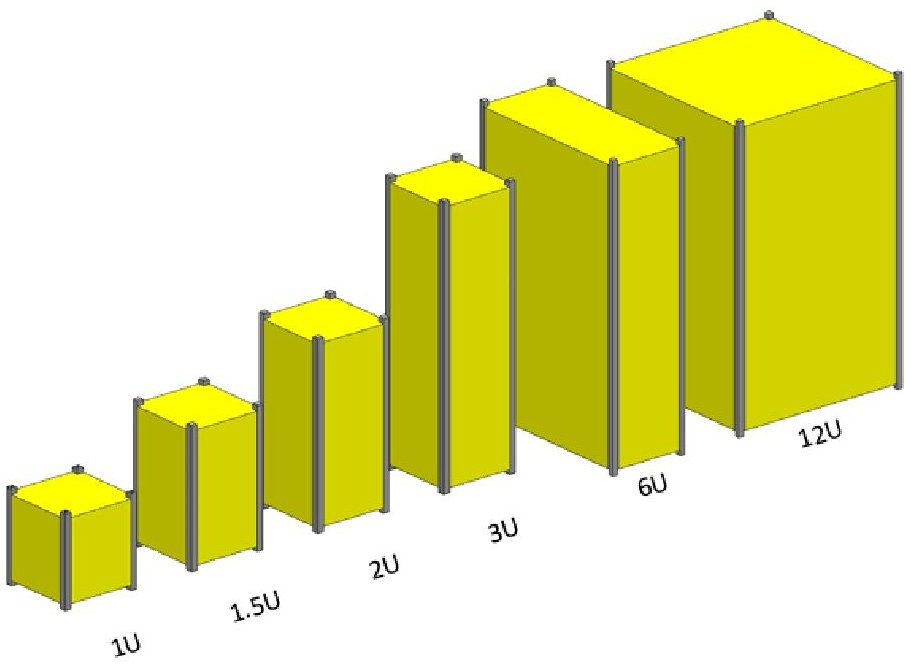


<div align="center">

Figure 1.1: CubeSat family by size [1]

</div>

<!-- PDF_PAGE: 15 -->

## 1.1-INCREASING CUBESAT POPULATIONS

CubeSats were initially conceived as educational tools for space systems engineering [2]. Now, their roles have been expanded to not only just educational tools but for observation, technology demonstrations, and research that were previous monopolized by much larger satellites due to the aforementioned low cost of production and launch of these CubeSat satellites. As such, there has been increasing popularity for CubeSats as seen by the number of launches in Figure 1.2 since year 2000 [3]. Note, there was a significant downtrend in CubeSat launches in the year 2020 and 2021; however, the thesis author theorizes that this may be due to the COVID-19 pandemic and its subsequent lockdowns halting many operations globally. The CubeSat design specification [1] as well as the availability of commercial off-the-shelf (COTS) parts and kits have greatly influenced the rise of popularity. For example, a basic CubeSat kit from Pumpkin can be purchased with a baseline price of as little as $6250 [4]. Even the SeaLion CubeSat utilizes many COTS parts as well. Thus, it has become highly accessible to low-budget groups such as small companies and university groups. CubeSats have caused the "democratization" of space due to their low cost which has allowed many groups to fly satellites [5].

University groups especially are a large contributor in the overall number of launches of CubeSats yearly. As of July 27, 2021, alone, there have been 68 CubeSat launches with 40 of them being from university groups (about 58% of launches) in the year of 2021; university groups have consistently maintained plurality on total launches [3]. This showcases directly how many university-based CubeSat projects occurred or potentially may occur if trends continue onwards into the future. However, this poses challenges to many of these projects given the

<!-- PDF_PAGE: 16 -->

mainly student composed teams which includes the SeaLion mission at Old Dominion University (ODU).


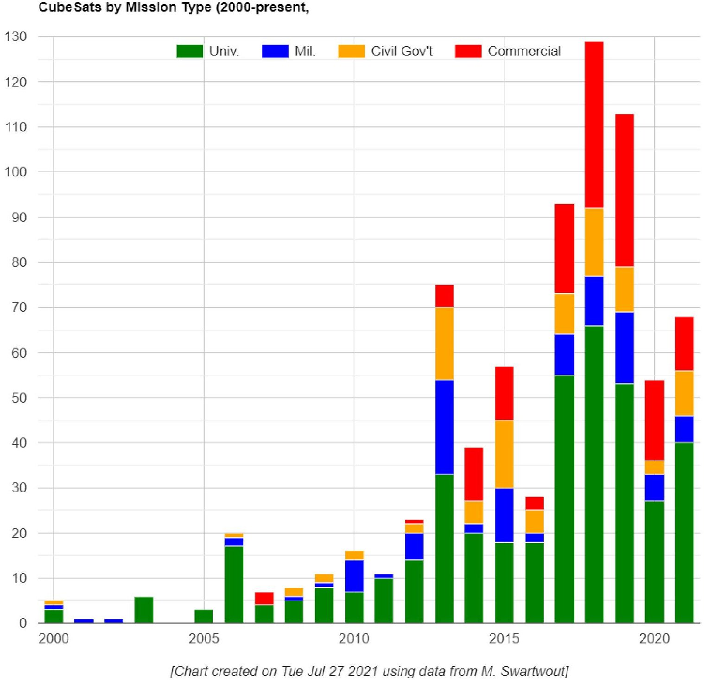


<div align="center">

Figure 1.2: Nanosatellite launch data provided by M. Swartwout as of July 21, 2021

</div>

<!-- PDF_PAGE: 17 -->

## 1.2- ENSURING CUBESAT SUCCESS

The increased number of CubeSats launched also means a greater number of CubeSats from universities being launched as well. The motivation of this thesis is to improve the success rate of CubeSat missions from university groups by providing readily available and easily usable tools for university teams. To further reinforce the need to improve the success rate, the following data is presented in Figure 1.3 which showcases the total successes and failures of CubeSats from universities for the given time periods [6]. The data provided is categorized by six different mission statuses of unknown, launch fail, dead on arrival (DOA), early loss, partial mission, and full mission.


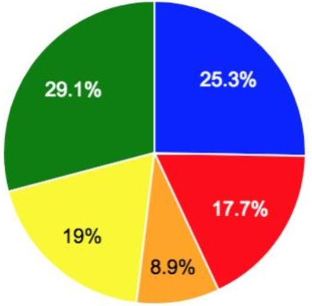


Mission Status for University- Class Missions (2002-2009)


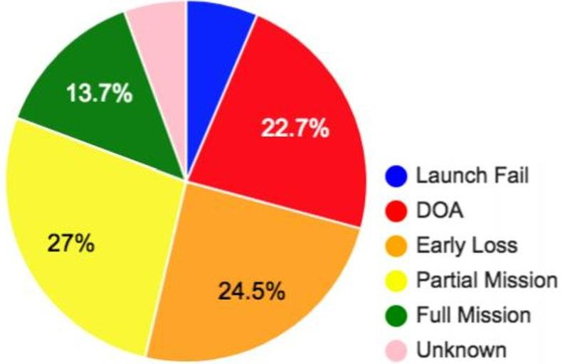


Mission Status for University- Class Missions (2010-2017)

<div align="center">

Figure 1.3: Mission status of CubeSat university-class missions provided by Swartwout

</div>

As seen in the preceding Figure 1.3, failure rates over time appear to be increasing among CubeSats launched from universities. However, Swartwout notes that highest number of the

<!-- PDF_PAGE: 18 -->

failures originate from "regular independent" groups with a failure rate of 65% at the time of data gathering in 2017 [6]. These "regular independent" groups are groups that have fewer than four missions nor designated as a national center of for spacecraft development by its government.

The issue present is that many of the growing number of university groups producing CubeSats lack the resources, training, experience, or methodology to reliably give assurance to their missions. Often, the majority of the work is done by untrained university students that are many times, unfamiliar with the system engineering, design methodologies, testing, etc. that are associated with CubeSat development. The SeaLion team also faced these issues as well.

To address some of these issues, a method was sought to help simplify the development process by providing readily available and easily learnable system engineering approaches and tools. These provided system engineering approaches and tools include factors such as planning, documentation, project management, and simplifying the process. Special attention should be given to systems engineering and information exchange for multidisciplinary teams [7]. To showcase these factor's importance, a survey conducted, by University of Bristol, on how to set up CubeSat projects of forty CubeSat groups emphasized the following relevant lessons learned [8]:

- Planning: Make efforts to "spend a lot of time in the planning stage".

- Documentation / Project Management: Groups should have "good documentation of requirements, work done and work to do".

- Simplicity: Simply anything you possibly can to increase confidence in success.

The developed mission architecture and associated tools will emphasize the aforementioned points to further the SeaLion CubeSat's development.

<!-- PDF_PAGE: 19 -->

## 1.3-MISSION SEALION 3U CUBESAT

The SeaLion CubeSat mission is a joint project between Old Dominion University (ODU), the United States Coast Guard Academy (USCGA), and the Air Force Institute of Technology (AFIT). The end goal is to produce a 3U CubeSat consisting of 3 payloads for on-orbit validation. ODU provided one payload while the USCGA and AFIT provided the other two payloads. SeaLion was initially planned to launch as a secondary payload on a Northrop Grumman Antares Rocket from Wallops Flight Facility (WFF) during March of 2023 [9]. The prototype CubeSat model is shown in Figure 1.4 and Figure 1.5. However, this mission was changed recently just prior to this thesis' publication.

The mission profile was intended for the SeaLion CubeSat was to have a lifespan of mere days before power was lost in the non-rechargeable batteries. The initially planned very low earth orbit (VLEO) altitude of SeaLion caused its lifespan in-orbit to be short and measured in days (predicted on-orbit time was 10 days). However, due to weight considerations from the primary payload on the planned Antares Rocket, SeaLion was removed from the launch. Instead, SeaLion is planned to launch in quarter four (Q4) 2023 on a Firefly rocket from Vandenberg Space Force Base into a sun synchronous orbit, of 500 miles altitude, which greatly extends the planned lifespan of the SeaLion mission. The content presented in this thesis is based on the prior mission profile from the launch at WFF into VLEO.

<!-- PDF_PAGE: 20 -->


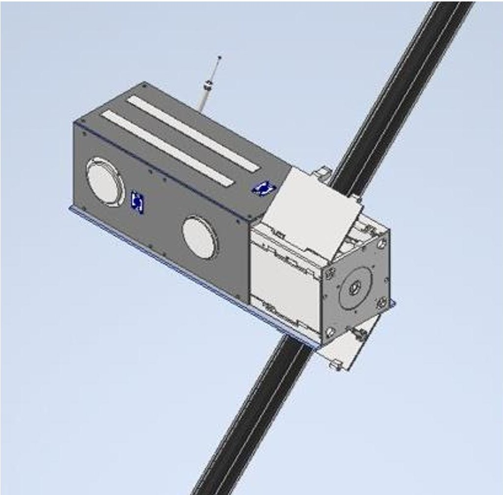


<div align="center">

Figure 1.4: SeaLion CubeSat prototype model

</div>

<!-- PDF_PAGE: 21 -->


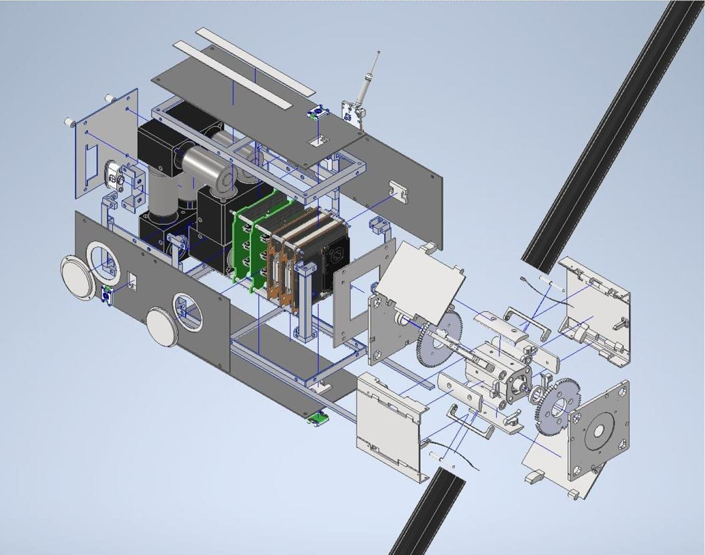


<div align="center">

Figure 1.5: SeaLion CubeSat prototype model blown up

</div>

The first payload, provided by the USCGA and AFIT, is the Impedance Probe (IP). The IP is derived from U.S. Naval Research Laboratory's (NRL's) 'Space PlasmADiagnostic suitE' (SPADE) aboard NASA's International Space Station (ISS) where plasma density & temp are computed with alternating current (AC) impedance measurements using an innovative, first of its kind surface mounted dipole radio frequency antenna [9]. Thus, the scientific objective of the IP on SeaLion is to measure density and temperature of plasma surrounding the spacecraft. The IP part is shown in Figure 1.6.

<!-- PDF_PAGE: 22 -->


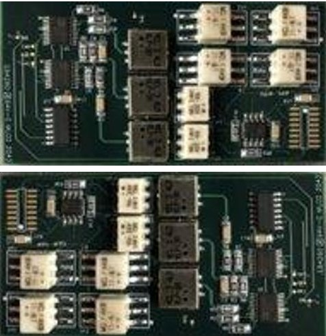


<div align="center">

Figure 1.6: SeaLion IP payload

</div>

The second payload, provided by the USCGA and AFIT, is the multispectral (Me-S) 'Pixel Sensor' with a with a 450 nm - 1000 nm spectral range [9]. Its purpose is to provide SeaLion's in-situ spectral data as a baseline. This baseline will be used for future missions that may require this spectral data. The Me-S part is shown in Figure 1.7.


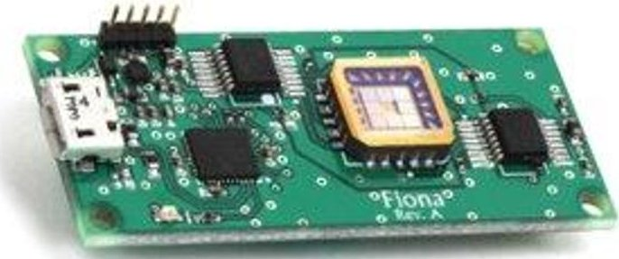


<div align="center">

Figure 1.7: SeaLion Me-S payload

</div>

<!-- PDF_PAGE: 23 -->

The third payload, provided by ODU, is the deployable composite structure (DeCS). This payload is a proof-of-concept deployable mechanism and composite boom that is meant to be a platform host to a number of number of applications [9]. For example, these applications include solar panels, solar sails, drag sails, sensory sails, and magnetometer booms. Deployment on SeaLion is meant to validate the deployable mechanism for composite boom in the space environment and to validate boom dynamic during and after deployment in orbit. The DeCS upon deployment is shown in Figure 1.8.


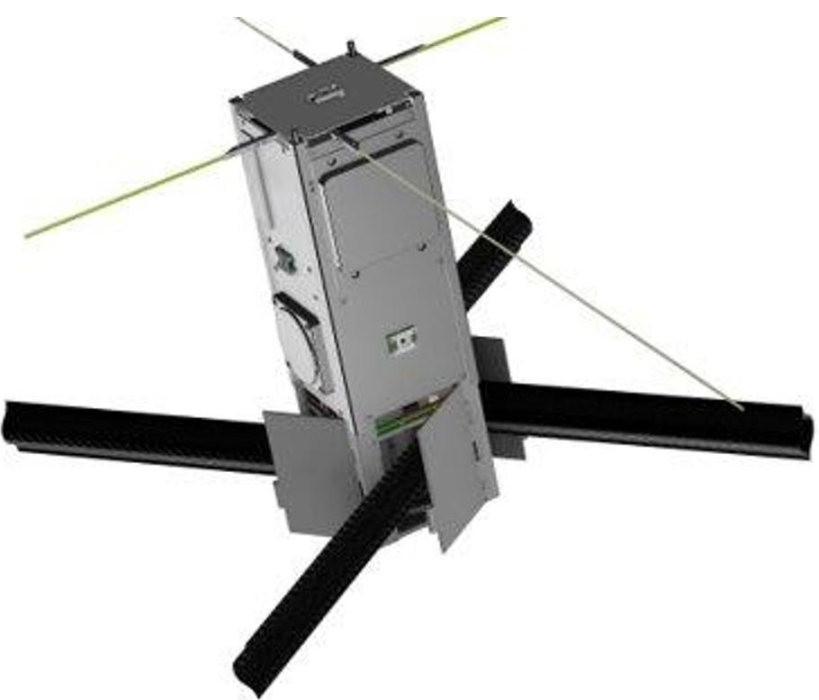


<div align="center">

Figure 1.8: SeaLion DeCS payload deployed shown as the four black composite booms.

</div>

<!-- PDF_PAGE: 24 -->

Given the number of payloads loaded onto the SeaLion CubeSat, special care and consideration is required to ensure success of the mission. In response, the action was taken to provide a mission architecture for the SeaLion team as a whole to better organize and direct the efforts of the team. The results of that effort are presented herein of this thesis.

This thesis presents the systems engineering approach of the SeaLion CubeSat mission architecture. Presented here is the modeling language, tools, and technical approach used to facilitate the configuration management, design, specification, & implementation of the SeaLion mission architecture for the flight software using a model-based approach. Through, modelbased systems engineering (MBSE), models were able to be created, as opposed to documents, that serve as the authoritative source of truth for the conduction of system engineer activities [10]. These models were used to conduct activities such as design, specification, analysis, verification & validation of the system. This was done by applying the NASA Handbook on Systems Engineering [11] to CubeSat mission design in efforts to facilitate a top-down design methodology from mission concept to specification of subsystem components, including flight software architecture [12]. This thesis also serves as an expansion of the conference proceedings presented at American Institute of Aeronautics and Astronautics (AIAA) SciTech Forum 2023 [13].

<!-- PDF_PAGE: 25 -->

## CHAPTER 2 - MODEL-BASED SYSTEMS APPROACH AND

## DOCUMENT-AS-CODE APPROACH

Special attention should be given to as planning, documentation, project management, and simplifying the process. That special emphasize should be given to systems engineering and information exchange [7]. Traditional approaches use documents as their authoritative source of truth for conducting system engineering activities [10]. Information in a traditional systems engineering approach today is mostly captured informally, not authored based on a methodology, configuration managed in silo tools, although adhoc and infrequently integrated, not easily traceable to its provenance, not properly configuration managed, not properly changed managed, and not effectively shared with stakeholders [14]. These documents often do not have a living relationship with other documents or to other corresponding elements; thus, changes to one document require manual changes to other documents [15].

## 2.1-MODEL-BASED SYSTEMS ENGINEERING

An MBSE approach supports capturing information in a highly structured modeling language, authored based on a methodology, configuration managed in a common tool, highly integrated, traceable to its provenance, and sharing with stakeholders. Models provide the following key advantages over document-based approaches [15]:

- Information is readily communicated and shared within the project.

- Changes are easily accommodated.

- Traceability is automated.

In contrast, document-based approaches can exacerbate problems since it lacks point-to-point communication channels as well as lacking methods to enforce consistency [16]. Since models have these direct lines of communication, MBSE can alleviate these concerns. A side-by-side

<!-- PDF_PAGE: 26 -->

comparison between MBSE and non-MBSE approaches with a architecting process, of 4,858 information element transfers, noted that all of these transfers were done manually with non MBSE approaches; however, 13% of these transfers with automated with MBSE with the potential of up to 81% should it be used for trade study and peer review tasks [17]. The SeaLion team wishes to take advantage of these automated processes of information transfers.

Space-related systems have been taking advantage of MBSE such as the ExoMars mission, Euclid, Galileo, and nanosatellite programs [18], [19], [20]. The usage of MBSE on CubeSats has even been done before and has been shown to "hold promise of reducing the burden of system engineering tasks" [21]. This will especially be important to help reduce the workload of these small university CubeSat teams. Especially as students join for new future projects to "promote uniformity and consistency across future CubeSat models" [21]. Since students from prior projects are usually not available for future university projects due to events such as graduation.

## 2.2 - DOCUMENTATION AS CODE APPROACH

Documentation as code (Docs-as-code) refers to a philosophy that team members should be writing documentation with the same tools as code [22]. This allows for documentation to updated seamlessly without additional work with document tools (doctools). The code tools would include version control (e.g., Git), issues trackers, code tools (e.g., Visual Studio), etc. To do so would mean that the "following the same workflows as development teams and being integrated in the product team. It enables a culture where writers and developers both feel ownership of documentation, and work together to make it as good as possible" [22].

Taking advantage of the aforementioned philosophy would allow the SeaLion to realize the benefits of utilizing the same principles and practices used to manage software, using modern version control tools (e.g., Git), for the configuration management of mission and flight software

<!-- PDF_PAGE: 27 -->

architecture documentation, and captured in a model-based approach [22]. Models can also be stored persistently on a local file system without the use of cloud-based services or software. This is especially advantageous when there is a need to generate documentation, modify documentation, or modify models without the need for proprietary services. Similar methods to have documents as code have been seen in open source such as Structurizr; however, methods such as one noted may have too much of a learning curve for university students newly admitted to the field [23]. Additionally, F Prime is an open-source software framework developed by NASA's Jet Propulsion Laboratory [24]. Methods to produce some documentation has also been developed from code for visualization purposes using F Prime Prime (FPP) [25]. Thus, this methodology of docs-as-code isn't without precedent. However, the intent is to establish the docs-as-code approach while also being much more accessible as well.

## 2.3-MODELLING LANGUAGE AND METHODOLOGY

A trade study was conducted to down select a suitable modeling language for the goals of the SeaLion mission. The languages considered were SysML V1, SysML V2, PlantUML, and the Mach 30 modelling language (M30ML). Table 2.1 provides a summary of this down select and various criteria that was taken into consideration. The criteria are described as follows:

- Extensible ontology language in order to facilitate any and all modelling needs the team may have.

- Supports both textual & graphical view generation for use of the docs-as-code approach the team has adopted.

- Lightweight textual syntax for ease of use and learning.

- Relatively minimal overhead with modern doctools to facilitate the docs-as-code approach.

<!-- PDF_PAGE: 28 -->

- Supports execution semantics to better define systems and their execution.

M30ML in the end was chosen for its lightweight human and machine-readable textual syntax, file-based model interchange support (for persisting models directly on the local filesystem), ability to generate both textual and graphical views, and relatively minimal overhead with modern doctools [26]. The other candidates lacked in many regards compared to M30ML in these criteria and thus, M30ML was selected. SysML v2 had a good number of characteristics that M30ML had, however, the lack of minimal overhead with modern doctools prevented its adoption. For a team that had very minimal experience working with such tools, having a modelling language that was easy to establish and easy to use was essential for the SeaLion project.

<div align="center">

Table 2.1. Selection of Modelling Language versus Criteria

</div>

<table border="1"><tr><td>Criteria</td><td>SysML v1[27]</td><td>SysML v2[28]</td><td>PlantUML[29]</td><td>M30ML[26]</td></tr><tr><td>Extensible ontology language</td><td>X</td><td>X</td><td>X</td><td>X</td></tr><tr><td>Supports both textual&amp;graphical view generation</td><td></td><td>X</td><td></td><td>X</td></tr><tr><td>Lightweight textual syntax</td><td></td><td>X</td><td>X</td><td>X</td></tr><tr><td>Relatively minimal overhead with modern doctools</td><td></td><td></td><td>X</td><td>X</td></tr><tr><td>Supports execution semantics</td><td></td><td>X</td><td></td><td></td></tr></table>

<!-- PDF_PAGE: 29 -->

## 2.4- ONTOLOGICAL MODELING LANGUAGE

M30ML was developed using the Ontological Modeling Language (OML) as its basis. OML is a language that enables defining systems engineering vocabularies and using them to describe systems [30]. OML, inspired by Web Ontology Language 2 (OWL2) and the Semantic Web Rule Language (SWRL), is meant to be a gentler and more disciplined method of aforementioned standard for use in systems engineering [30]. OWL2 does not conform easily to individual modelling rules without tooling support; thus, OML was created. OML is a tool to improve the speed of modeling and the quality of models while in a more concise and human friendly high-level external representation [31]. However, in the interest of simplicity, OML was not made the modelling language of choice for SeaLion. OML's format as shown in Figure 2.1, it contains considerable syntax rules that may cause issues with those without the time needed to learn them. Especially when OML is compared to M30ML which is shown in Figure 2.2.


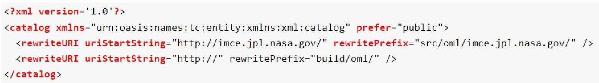


<div align="center">

Figure 2.1: OML catalog file example [30]

</div>

## 2.5-MACH30 MODELING LANGUAGE

M30ML is a language for modeling an architecture with YAML-based modeling. YAML is especially important as a file structure since it is a highly structured, machine queryable, human-readable, lightweight, and line-oriented markup language. This makes it ideal for document generation use cases as well as use with version control tools like Git. The simple line

<!-- PDF_PAGE: 30 -->

by line structure as shown in Figure 2.2 exemplifies its simplicity. Users are easily able to read, interpret, and edit documents using the YAML file format so as long they are taught what each line element is. Doctools such as asciidoctor and bibtex were made compatible easily with minimal technical overhead which was taken advantage of for the submission to the AIAA SciTech 2023 Forum [13]. M30ML also provided modeling elements familiar in agile software development, such as stakeholder needs, user stories, data structures, and with relationship elements for defining traceability between modeling elements [26].

<div align="center">

Figure 2.2: Example YAML File for a User Story

</div>

<!-- PDF_PAGE: 31 -->

## CHAPTER 3 - MODELING THE MISSION SEALION ARCHITECTURE USING DOCS-AS-CODE APPROACH

This chapter presents the implementation of M30ML as the basis for SeaLion mission architecture. Presented here are the various elements, components, and products generated that is stored on the sealion-mission-architecture GitHub page [32]. At the time of publication of this thesis, the implementation of the SeaLion mission architecture was done to the prior mission parameters where the SeaLion CubeSat was designed for a short lifespan compared to now greatly extended planned lifespan. Since the mission parameters was changed rather recently prior to publication, the architecture had yet to be updated for them.

## 3.1-FILE STRUCTURE

The SeaLion mission architecture is organized into two main folders of architecture and of components [32]. Architecture contains the references, stakeholder needs, user stories, and data structures shown in Figure 3.1. Components, as the name implies, contains the components and subcomponents of the CubeSat. This architecture set-up is the primary concern and focus of this thesis. For the mission architecture shown in Figure 3.1, generally data structures are derived from user stories. Further, user stories are subsequently derived from stakeholder needs with their respective references.

<!-- PDF_PAGE: 32 -->


<div align="center">

Figure 3.1: Architecture folders within the sealion mission architecture GitHub

</div>

References are simply stored reference material such as standards, specifications books, etc. They are very simple two-line YAML files as shown in Figure 3.2. This creates a continued link between the YAML files within their respective folders from which documents can be updated seamlessly. Information changed within one file can interact with other files. All references in the mission architecture at the time of thesis' publication is listed within Table 3.1 and Figure 3.3.

<div align="center">

Figure 3.2: Example of references YAML file

</div>

<!-- PDF_PAGE: 33 -->

<div align="center">

Table 3.1: References YAML files

</div>

<table border="1"><tr><td>YAML File Name</td><td>Reference Title</td></tr><tr><td>1-AX.25Specification.yaml</td><td>AX.25 Link Access Protocol for Amateur Packet Radio version 2.2 [33]</td></tr><tr><td>2-CubeSatDesignSpecificationRev13.yaml</td><td>CubeSat Design Specification rev.13 (specification updated to Rev 14 [1])</td></tr><tr><td>3-PlanetarySystemsCorporationCubeSatDesignSpecificationfor3U-6U-12U.yaml</td><td>Planetary Systems Corporation CubeSat Design Specification for 3U-6U-12U [34]</td></tr><tr><td>4-DeploymentMechanismForSmallSatellite.yaml</td><td>Canisterized Satellite Dispenser [35]</td></tr><tr><td>5-ITARCompliance.yaml</td><td>ITAR Compliance Guide [36]</td></tr><tr><td>6-SpaceSystemsEngineering.yaml</td><td>Space Systems Engineering 4th ed. [37]</td></tr><tr><td>7-GroundDataSystems&amp;MissionOperations.yaml</td><td>Ground Data Systems &amp; Mission Operations [38]</td></tr><tr><td>8-TwoLineElementData.yaml</td><td>Two-Line Element Data [39]</td></tr></table>

<!-- PDF_PAGE: 34 -->


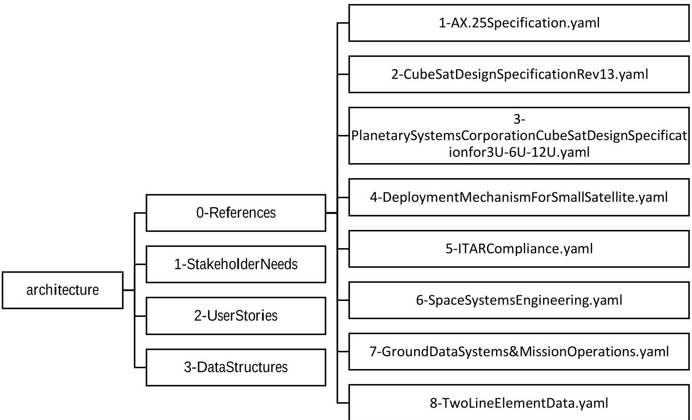


<div align="center">

Figure 3.3: References YAML file structure

</div>

## 3.2-STAKEHOLDER NEEDS

The development of SeaLion's mission architecture is guided by a series of stakeholder needs [40]. After SeaLion's project methodology documentation is committed to using M30ML based on YAML modelling tools, the first step is to identify all stakeholder needs. The two primary stakeholders of SeaLion are ODU and the CGA. Their respective needs are classified from primary, secondary, and tertiary based on mission importance.

Stakeholder YAML files are stored in '1-StakeholderNeeds' shown in Figure 3.1. Each file is numbered with a X.X number format with the first number designating if it's primary, secondary, or tertiary and the second number denoting a place within a list of that class (e.g., 1.1

<!-- PDF_PAGE: 35 -->

would indicate primary stakeholder need #1). In addition, the letter associated (e.g., A1, B1, C1, etc.) in the filename would also signify if it's a primary, secondary, or tertiary stakeholder need. Each YAML file contains an id number, name, statement, and derivedFrom field shown in Figure 3.4. Note the reference YAML file that has filed in the derivedFrom field that serves as the basis for the stakeholder need. While not all stakeholder needs have it filled, it is available to be used as needed. Figure 3.5 showcases all the YAML files stored in the stakeholders file folder.


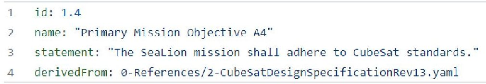


<div align="center">

Figure 3.4: Example of stakeholders YAML file

</div>

<!-- PDF_PAGE: 36 -->


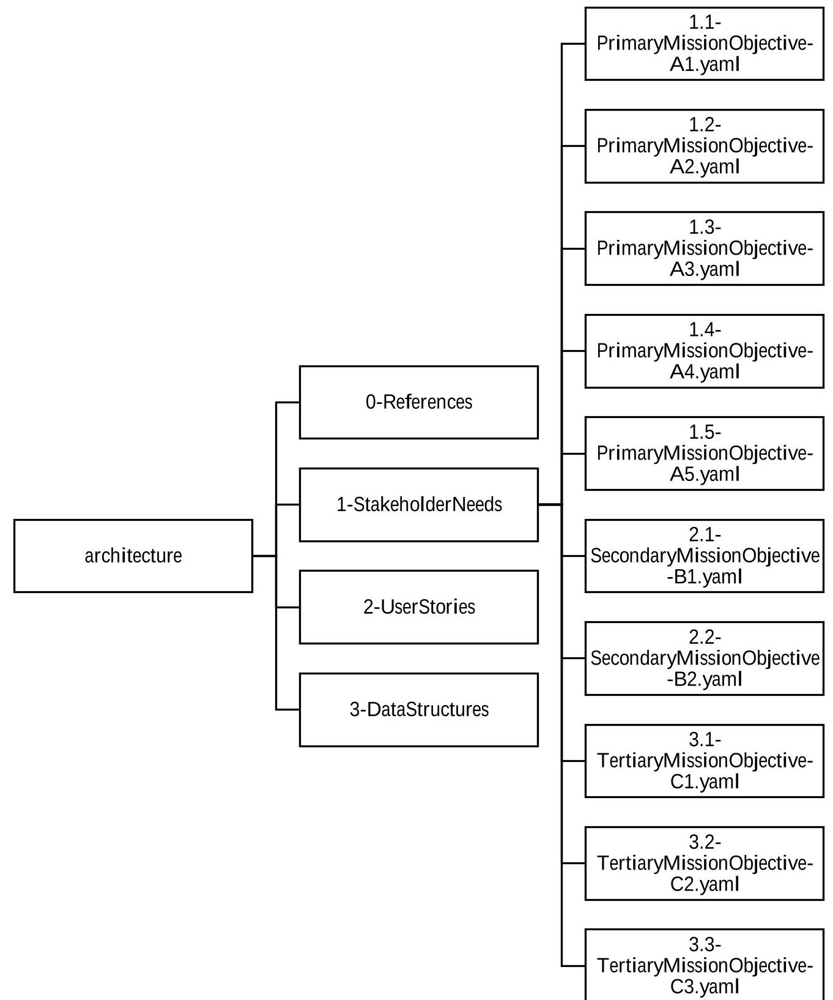


<div align="center">

Figure 3.5: Stakeholder needs YAML file structure

</div>

The first primary stakeholder need is that "the SeaLion mission shall establish UHF communication link with Virginia ground station" [32]. UHF refers to the ultra-high frequency (UHF) band. Its associated YAML file named '1.1-PrimaryMissionObjective-A1.yaml' is

<!-- PDF_PAGE: 37 -->

presented in Figure 3.6. This stakeholder need is important in order to perform any and all missions associated with the SeaLion CubeSat. Without the ability to communicate with SeaLion, there is no ability to either control the CubeSat or validate the function of any of its payloads. Thus, establishing a connection is a primary mission objective.


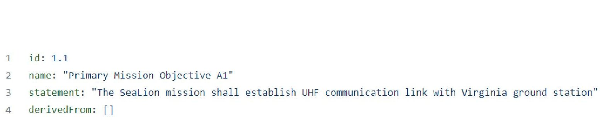


<div align="center">

Figure 3.6: 1.1-PrimaryMissionObjective-A1.yaml

</div>

The second primary stakeholder need is that "the SeaLion mission shall establish S-Band communication link with MC3 ground station" [32]. The MC3 ground station refers to the Mobile CubeSat Command and Control (MC3) ground station. The MC3 ground station uses a S-Band communication link in lieu of UHF. This is to provide a secondary form of communication to the SeaLion CubeSat via its payloads that use the S-Band frequency. Its associated YAML file named '1.2-PrimaryMissionObjective-A2.yaml' is presented in Figure 3.7. The USCGA included the need to use S-Band communications and is subsequently deemed a primary stakeholder need. Its importance is akin to primary stakeholder need 1.1 of Figure 3.6. Establishing and maintaining a communication link is imperative to the completion of the SeaLion mission of validating its payloads.

<!-- PDF_PAGE: 38 -->

id: 1.2

name: "Primary Mission Objective A2"

statement: "The SeaLion mission shall establish S-Band communication link with MC3 ground station"

derivedFrom: []

<div align="center">

Figure 3.7: 1.2-PrimaryMissionObjective-A2.yaml

</div>

The third primary stakeholder need is that "the SeaLion mission shall successfully transmit "mission data" defined above to ground stations on the Earth" [32]. Its associated YAML file named '1.3-PrimaryMissionObjective-A3.yaml' is presented in Figure 3.8. Mission data refers to the feedback from the SeaLion CubeSat regarding to its various mission modes. Mission modes are the various operating modes that the satellite enters to perform certain specified functions. This data is essential to the operation of SeaLion and to gather data to validate the functionality of its payloads.


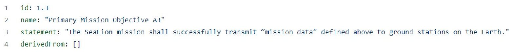


<div align="center">

Figure 3.8: 1.3-PrimaryMissionObjective-A3.yaml

</div>

The fourth primary stakeholder need is that "the SeaLion mission shall adhere to CubeSat standards" [32]. The satellite has to adhere to the standard requirements of a CubeSat to qualify as one. This includes requirements such as size, mass, and configuration among others. This is to ensure that the satellite is in its proper configuration for the purposes of operation and integration into the launch vehicle. Its associated YAML file named '1.4- PrimaryMissionObjective-A4.yaml' is presented in Figure 3.9. Note that there is a linked

<!-- PDF_PAGE: 39 -->

reference in the derivedFrom field which refers to the CubeSat Design Specification which is one of the references listed in Table 3.1.

id: 1.4

name: "Primary Mission Objective A4"

statement: "The SeaLion mission shall adhere to CubeSat standards."

derivedFrom: 0-References/2-CubeSatDesignSpecificationRev13.yaml

<div align="center">

Figure 3.9: 1.4-PrimaryMissionObjective-A4.yaml

</div>

The fifth primary stakeholder need is that "the SeaLion mission shall validate the operation of the Impedance Probe (IP) as a primary payload in-orbit" [32]. Its associated YAML file named '1.5-PrimaryMissionObjective-A5.yaml' is presented in Figure 3.10. The IP is the payload provided by the USCGA and AFIT and is deemed the primary payload to test and validate per discussion between ODU and the USCGA. Thus, it cemented its place as a primary stakeholder need. The IP is meant to measure density and temp of plasma surrounding the spacecraft [9]. Validation of its function would mean a primary mission success for SeaLion.


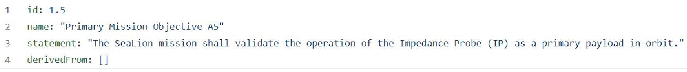


<div align="center">

Figure 3.10: 1.5-PrimaryMissionObjective-A5.yamI

</div>

<!-- PDF_PAGE: 40 -->

The first secondary stakeholder need is that "the SeaLion mission shall provide a means to validate a Multi-spectral Sensor (Me-S) in-orbit" [32]. Its associated YAML file named '2.1- SecondaryMissionObjective-B1.yaml' is presented in Figure 3.11. This is the second payload provided by the USCGA and AFIT. The Me-S is meant to provide baseline SeaLion's in-situ spectral data measurements [9]. These spectral data measurements are meant to give a baseline for future missions. Per discussions between ODU and the USCGA, this was deemed a secondary stakeholder need. While the inability to validate the Me-S would be a major blow to the SeaLion mission, it would not constitute a total mission failure for SeaLion compared to the validation of the IP's functionality.


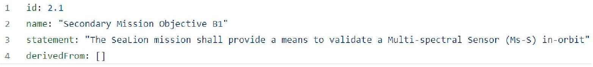


<div align="center">

Figure 3.11: 2.1-SecondaryMissionObjective-B1.yaml

</div>

The second secondary stakeholder need is that "the SeaLion mission shall provide a means to validate a deployable composite structure (DeCS) in-orbit" [32]. Its associated YAML file named '2.2-SecondaryMissionObjective-B2.yaml' is presented in Figure 3.12. The DeCS is the third payload of SeaLion which is provided by ODU. The DeCS is meant to qualify the deployable mechanism for composite boom in the space environment and to validate boom dynamic during and after deployment in orbit [9]. Per discussions between ODU and the USCGA, this was deemed a secondary mission objective. While the failure to validate the DeCS

<!-- PDF_PAGE: 41 -->

would be a major blow to the SeaLion mission, it would not constitute a total mission failure for SeaLion compared to the validation of the IP's functionality.


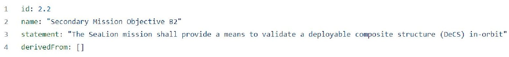


<div align="center">

Figure 3.12: 2.2-SecondaryMissionObjective-B2.yaml

</div>

The first tertiary stakeholder need is that "the SeaLion mission shall qualify on-orbit the deployment and functioning of the newly developed UHF antenna system and its deployment" [32]. Its associated YAML file named '3.1-TertiaryMissionObjective-C1.yaml' is presented in Figure 3.13. The UHF antenna is deployed on the opposing end of the CubeSat compared to the DeCS payload as seen in Figure 1.8. This UHF system is newly developed and ODU would like to see it deployed successfully.


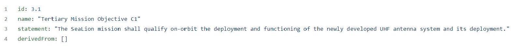


<div align="center">

Figure 3.13: 3.1-Tertiary MissionObjective-C1.yaml

</div>

The second tertiary stakeholder need is that "the SeaLion mission shall qualify a CubeSat bus architecture for very-low Earth orbit (VLEO)” [32]. Its associated YAML file named '3.2- TertiaryMissionObjective-C2.yaml' is presented in Figure 3.14. The bus architecture is necessary to perform actions such as transmit data between the various components of the CubeSat for operation. Qualifying its functionality for very-low Earth orbit (VLEO) operations

<!-- PDF_PAGE: 42 -->

was necessary for the mission. However, this stakeholder need requires an update to the very recently change mission parameters to a planned higher orbit altitude.

id: 3.2

name: "Tertiary Mission Objective C2"

statement: "The SeaLion mission shall qualify a CubeSat bus architecture for very-low Earth orbit (VLEO)"

derivedFrom: []

<div align="center">

Figure 3.14: 3.2-Tertiary MissionObjective-C2.yaml

</div>

The third tertiary stakeholder need is that "the SeaLion shall verify DeCS in-orbit behavior performance." [32]. Its associated YAML file named '3.3-TertiaryMissionObjectiveC3.yaml' is presented in Figure 3.15. The DeCS in-orbit behavior performance needs to be verified in order to gauge its functionality for other applications such as solar sails, sensor sails, drag sails, etc. This is done via the usage of strain gauges to determine its behavior. However, successful deployment is required before verification hence the secondary stakeholder need B2 in Figure 3.12 taking precedence.


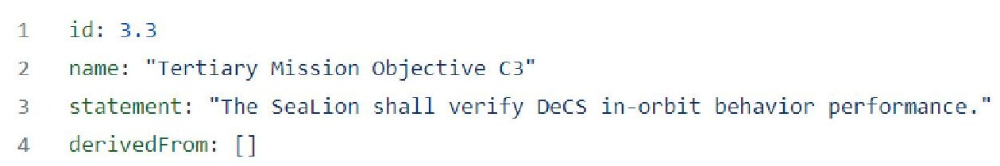


<div align="center">

Figure 3.15: 3.3-Tertiary MissionObjective-C3.yaml

</div>

Figure 3.16 presents all the stakeholder needs via a unified modelling language (UML) diagram generated from the YAML files within the '1-StakeholderNeeds' folder. The two primary stakeholders being ODU and the USCGA. The generation of these diagrams via the

<!-- PDF_PAGE: 43 -->

YAML files presented herein showcases the docs-as-code approach. YAML files structured as a code are then converted into easily human readable documents for presentation.


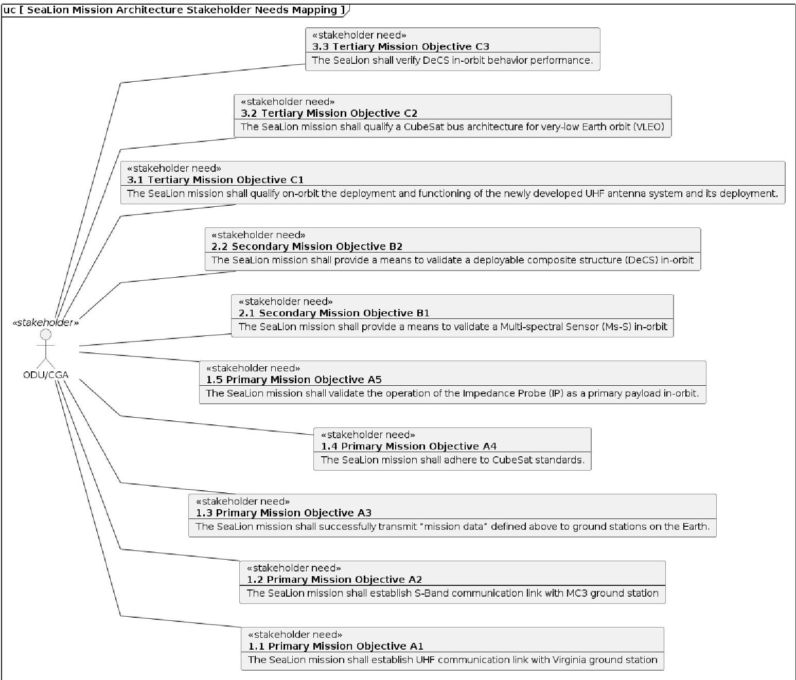


<div align="center">

Figure 3.16: UML diagram of stakeholder needs mapping

</div>

## 3.3-USER STORIES

Once the SeaLion mission architecture's stakeholder needs are identified and recorded, the stakeholder needs are then used to identify a series of user stories which then lead to design decisions captured in data structure and activity definitions [41]. These user stories are written

<!-- PDF_PAGE: 44 -->

from the perspective of the ground operator which would be a student from ODU who monitors and controls the functions of the SeaLion CubeSat. User story YAML files are stored in '2- UserStories' folder shown in Figure 3.1. These files are all given an ID number in no particular order of importance. See Figure 3.17 for the user story YAML file structure.


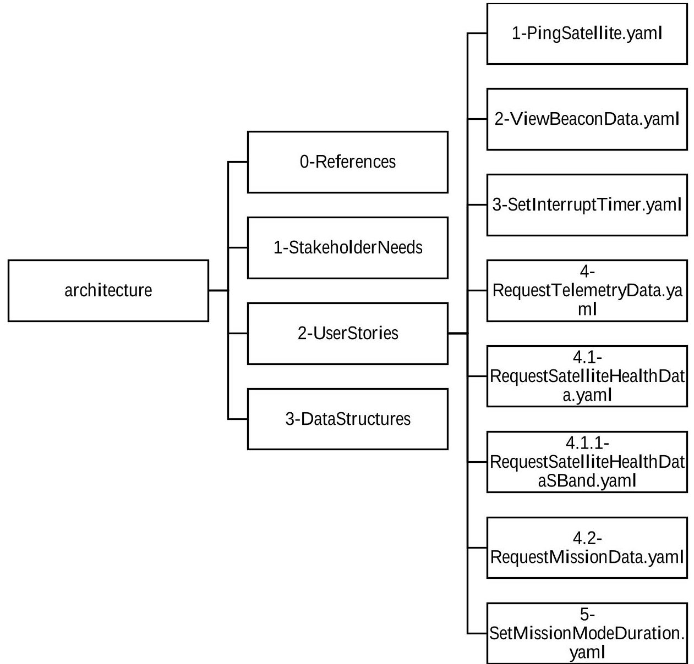


<div align="center">

Figure 3.17: User stories YAML file structure

</div>

As shown in Figure 3.18, each user story YAML file contains an ID number, name, actor, behavior, rationale, derivedFrom field, and example. ID and name are simply for identification.

<!-- PDF_PAGE: 45 -->

The actor is the ground station operator as previously discussed. Behavior is the action that the ground station operator would perform along with the rationale to why the operator performs it. The example input is an example sentence to give further context to other readers of the SeaLion team. The actor, behavior, and rationale together form a full user story statement. These statements will be detailed alongside their respective user story YAML files described herein.


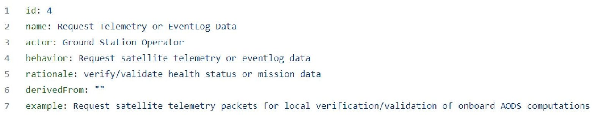


<div align="center">

Figure 3.18: Example of user stories YAML file

</div>

The first user story desire is to "establish communication link with satellite" [32]. Its full statement, derived from the actor, behavior, and rationale, would read "as a ground station operator I want to ping satellite so that I can establish communication link with satellite" [41]. Its associated YAML file named '1-PingSatellite.yaml' is presented in Figure 3.19. Note that this user story is derived from stakeholder need A1 which is the first primary stakeholder need mentioned in the prior section of this chapter. The ground station operator needs to ping the satellite to establish the UHF communication link. This is done to provide a means of operating the CubeSat to complete mission objectives.

<!-- PDF_PAGE: 46 -->

id: 1

name: Ping Satellite

actor: Ground Station Operator

behavior: Ping satellite

rationale: Establish communication link with satellite

derivedFrom:

7 - "1-StakeholderNeeds/1.1-PrimaryMissionObjective-A1.yaml"

8 example: Ping the satellite in order to establish UHF communication link with Virginia ground station

<div align="center">

Figure 3.19: 1-PingSatellite.yaml

</div>

The second user story desire is to "verify that satellite is operating nominally" [32]. Its full statement, derived from the actor, behavior, and rationale, would read "as a Ground Station Operator I want to view satellite beacon data (alternating between health & mission data), received via UHF so that I can verify that satellite is operating nominally" [41]. Its associated YAML file named '2-ViewBeaconData.yaml' is presented in Figure 3.20. Note that this user story is derived from stakeholder needs A1, A3, A5, B1, B2, C1, C2, and C3 which are stakeholder needs mentioned in the prior section of this chapter. Additionally, the example statement is cut-off in Figure 3.20 for readability. It should read in full as "View satellite beacon data (health or mission data) to verify that state vector corresponds with expected orbit profile and/or to validate that a mission mode was successful". This satellite beacon data, transmitted via UHF, is used to validate that any and all functions of the satellite are operating nominally or as planned in respect to their payloads hence the large derivedFrom list in the associated YAML file.

<!-- PDF_PAGE: 47 -->


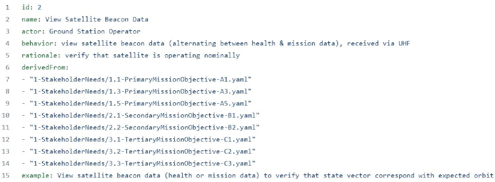


<div align="center">

Figure 3.20: 2-ViewBeaconData.yaml

</div>

The third user story desire is to "finetune parameters for attitude or orbit analysis or to conserve power" [32]. Its full statement, derived from the actor, behavior, and rationale, would read "as a Ground Station Operator I want to send a request to set count value at which interrupt timers (i.e., beacon, GPS ping, or orbit propagator) are triggered so that I can finetune parameters for attitude or orbit analysis or to conserve power" [41]. Its associated YAML file named '3- SetInterruptTimer.yaml' is presented in Figure 3.21. Note that this user story is derived from none of the stakeholder needs mentioned in the prior section of this chapter. This user story is an additional action required for power conservation due to the lack of rechargeable batteries rather than direct stakeholder requirements. Thus, the satellite needs to be prompted to not consistently transmit a beacon to conserve power.

<!-- PDF_PAGE: 48 -->


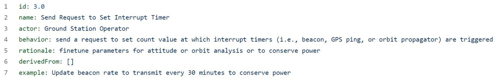


<div align="center">

Figure 3.21: 3-SetInterruptTimer.yaml

</div>

The fourth user story desire is to "verify/validate health status or mission data" [32]. Its full statement, derived from the actor, behavior, and rationale, would read "as a Ground Station Operator I want to Request satellite telemetry or eventlog data so that I can verify/validate health status or mission data" [41]. Its associated YAML file named '4-RequestTelemetryData.yaml' is presented in Figure 3.22. Note that this user story is derived from none of the stakeholder needs mentioned in the prior section of this chapter. The telemetry data sent from the satellite is required to ensure that the satellite is operating properly, hence its inclusion within the user stories group as a specified action for the ground station operator.


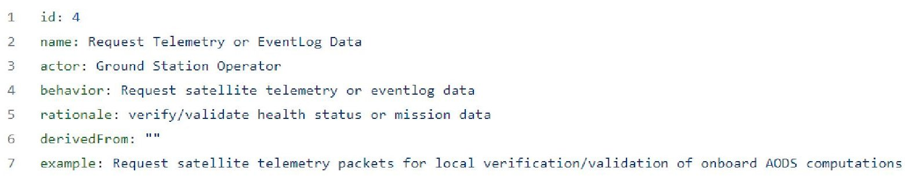


<div align="center">

Figure 3.22: 4-RequestTelemetryData.yaml

</div>

The fifth user story is to "verify/validate AODS sensors & GPS data are within nominal parameters" [32]. Its full statement, derived from the actor, behavior, and rationale, would read "as a Ground Station Operator I want to request satellite health data packet so that I can verify/validate AODS sensors & GPS data are within nominal parameters" [41]. Its associated

<!-- PDF_PAGE: 49 -->

YAML file named '4.1-RequestSatelliteHealthData.yaml' is presented in Figure 3.23. Note that the ID number is 4.1 rather than 5. This is because this user story is a subset of the fourth user story shown in Figure 3.22. The data required to verify/validate altitude and orbit determination system (AODS) sensors and global positioning system (GPS) data are all part of the data that the ground station operator would receive as part of the fourth user story. Additionally, note that this user story is derived from another user story rather than a stakeholder need. This is because this user story is meant to be a part of the linked User Story 4.


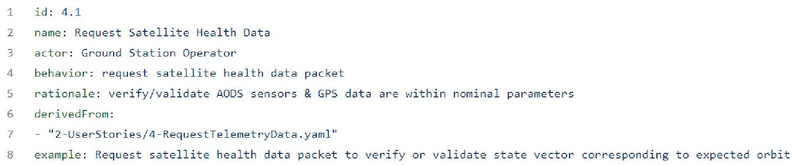


<div align="center">

Figure 3.23: 4.1-RequestSatelliteHealthData.yaml

</div>

The sixth user story desire is to "verify/validate AODS sensors & GPS data are within nominal parameters" [32]. Its full statement, derived from the actor, behavior, and rationale, would read "as a Ground Station Operator I want to request satellite health data packet via S- band radio so that I can verify/validate AODS sensors & GPS data are within nominal parameters" [24]. Its associated YAML file named '4.1.1-

RequestSatelliteHealthDataSBand.yaml' is presented in Figure 3.24. Note that the ID number is 4.1.1 rather than 4.2 or 6. This is because this user story is a subset of the fifth user story shown in Figure 3.23. This user story details an action identical to the one described in User Story 4.1. However, this is done via the S-band radio rather than the default UHF communication link.

<!-- PDF_PAGE: 50 -->

This will be done to validate the S-band communications link in lieu of using UHF.

Additionally, note that this user story is derived from stakeholder need A2 mentioned in the prior section of this chapter as well as User Story 4. Stakeholder need A2 details the requirement to communicate with the satellite via the S-band radio.


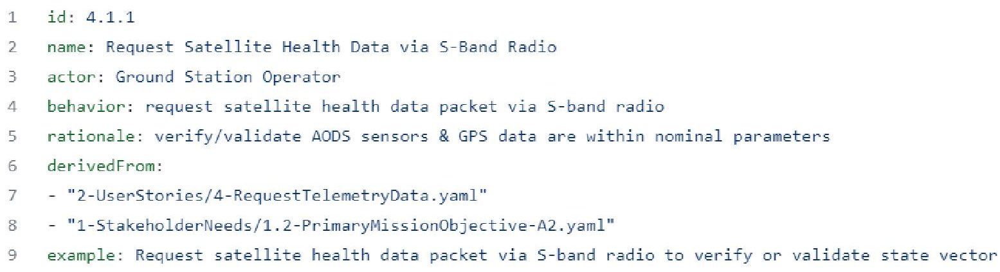


<div align="center">

Figure 3.24: 4.1.1-RequestSatelliteHealthDataSBand.yaml

</div>

The seventh user story desire is to "validate in-orbit AODS and/or payload performance" [32]. Its full statement, derived from the actor, behavior, and rationale, would read "as a Ground Station Operator I want to request satellite mission data so that I can validate in-orbit AODS and/or payload performance" [24]. Its associated YAML file named '4.2- RequestMissionData.yaml' is presented in Figure 3.25. Note that the ID number is 4.2 rather than 7. This is because this user story is a subset of the fourth user story shown in Figure 3.22. The mission data is used to validate AODS and the payloads which is transmitted by the actions described in User Story 4. Note that this user story is derived from User Story 4 as well as stakeholder needs A1, A3, A5, B1, B2, C1, C2, and C3 since this data is critical to validating many of SeaLion's systems and payloads.

<!-- PDF_PAGE: 51 -->


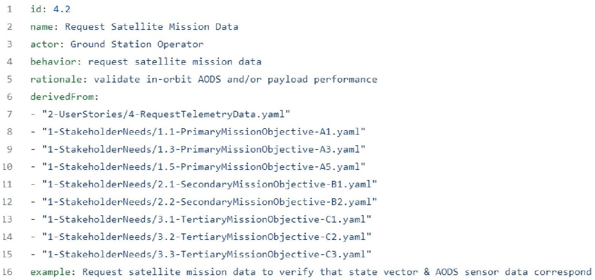


<div align="center">

Figure 3.25: 4.2-RequestMissionData.yaml

</div>

The eighth user story desire is to "manage time spent per mission mode" [32]. Its full statement, derived from the actor, behavior, and rationale, would read "as a Ground Station Operator I want to send a request to set mission mode duration so that I can manage time spent per mission mode" [24]. Its associated YAML file named '5-SetMissionModeDuration.yaml' is presented in Figure 3.26. This user story is to note that the ground station operator has to set mission mode times for how long they last. This is dependent on what is needed to validate the payloads and to sync transmission time so that the mission data reaches the ground station in Virginia. Note that this user story is derived from none of the stakeholder needs mentioned in the prior section of this chapter.

<!-- PDF_PAGE: 52 -->


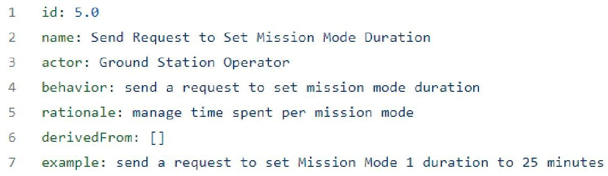


<div align="center">

Figure 3.26: 5-SetMissionModeDuration.yaml

</div>

Figure 3.27 and Figure 3.28 are UML diagrams generated using the YAML files stored in '2-UserStories' folder. Figure 3.27 is a mapping of stakeholder needs to user stories. Figure 3.28 is the user stories presented in a use case diagram to showcase what the ground station operator needs to perform. The generation of these diagrams via the YAML files presented herein showcases the docs-as-code approach. YAML files structured as a code are then converted into easily human readable documents for presentation.

<!-- PDF_PAGE: 53 -->


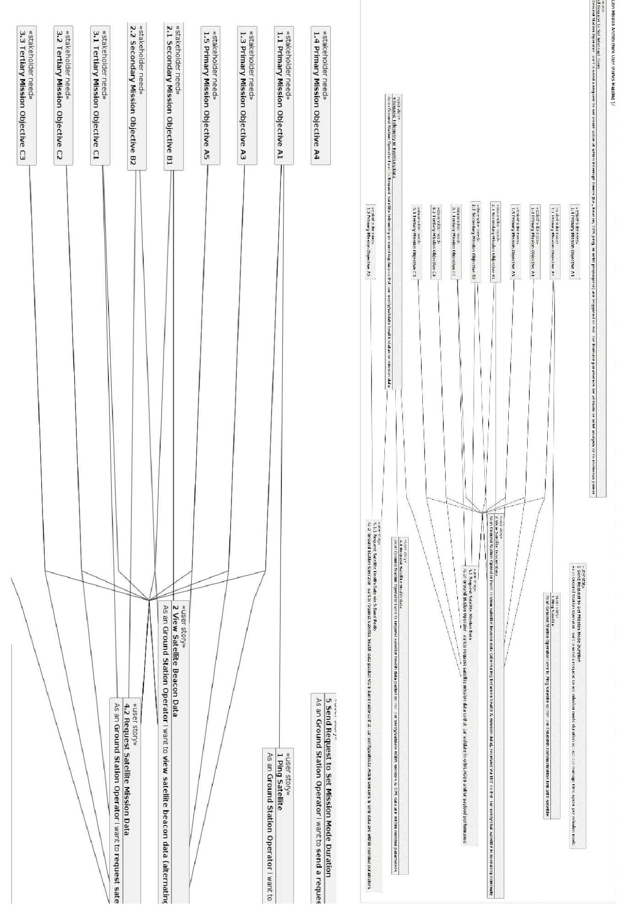


<div align="center">

Figure 3.27: UML diagram mapping stakeholder needs links to user stories. Zoom in (left) and whole diagram (right).

</div>

<!-- PDF_PAGE: 54 -->


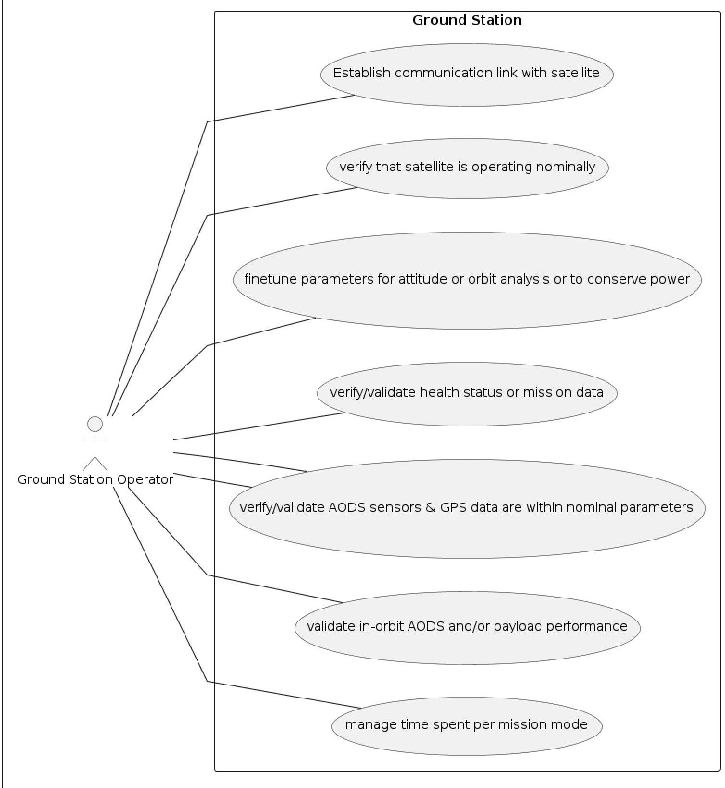


<div align="center">

Figure 3.28: UML diagram of user stories in relation to ground station operator.

</div>

<!-- PDF_PAGE: 55 -->

<div align="center">

# CHAPTER 4-OUTCOMES OF DOCS-AS-CODE MODELING OF

</div>

## MISSION SEALION ARCHITECTURE

An intent of developing the architecture for SeaLion CubeSat mission was to capture the data structures and expected behaviors for the development of the flight software. It had to be done such that it can unambiguously understood well enough to be implemented, as well as provide full traceability and rationale for architectural elements with minimal configuration management overhead [32]. Thus, the SeaLion CubeSat mission architecture had to achieve the following:

- Ensure templates only contain formatting data (this includes not storing boilerplate text in templates)

- Ensure models are the authoritative source of truth for all artifact content (e.g., artifact structure, meta-data, boilerplate, commentary, discussion, diagrams, tables, etc.)

- Models should persist on the local filesystem.

- Documents should be in plaintext as to be compatible with modern distributed version control system (e.g., Git) and for ease of use.

- Documents should be able to sit alongside code and speak to one another.

- Documents should be model-based as to have a separation of concerns between content and formatting as well as be both human and machine-readable for querying and generating views.

A MBSE approach was adopted by the SeaLion project since it provided benefits such as reducing the ambiguity that usually comes with using informal language to specify systems or its various aspects. It also minimized the duplication of content that tends to accumulate in a document-based system engineering approach.

<!-- PDF_PAGE: 56 -->

Proper adoption of a MBSE approach also includes the selection of modeling language and modeling tool. Considerations when selecting the modeling language and tool was overhead incurred from training the team, the technical overhead of setting up modelling tools, and future adaptability. Refer to Table 2.1 for modelling language down selection overview. In addition, it was eventually decided to adopt a docs-as-code approach to further enhance the MBSE approach to achieve the listed criteria shown above.

## 4.1- DATA STRUCTURES

User stories once identified will then lead to design decisions captured in data structures and activity definitions. These data structures are the data that would transmitted back and forth between ground station operator and CubeSat. Data structure YAML files are stored in '3- DataStructures' folder shown in Figure 3.1. Each data structure YAML has name, purpose, template, elements, and derived from elements as shown in Figure 4.2 as an example. Name and purpose are for identification and stated use case. Template lists out all the elements that are called out via their identifying key. Elements detail the specific values as part of the data structure; each element has their own identifying information and descriptions. The derived from field is used to tie back the data structure to a user story YAML file should it be applicable. Table 4.1 is a table generated from the YAML file shown in Figure 4.2 for documentation purposes. Figure 4.1 details the file structure under the 3-DataStructures' folder.

As shown in Figure 4.2, the data structure, with YAML file named '1-

SatelliteHealth.yaml' is for determining the satellite's health. This data would be transmitted with the beacon data to be received by the ground station operator. Note that this data structure is derived from the user stories 2 and 4.1 described in the prior chapter. These user stories detail the ground station operator's tasks to view the satellite beacon data and to request satellite health

<!-- PDF_PAGE: 57 -->

data packet so that operator can verify that AODS sensors & GPS data are within nominal parameters. Table 4.1 details the various fields that would be required in this beacon data packet to accomplish the aforementioned tasks.

<div align="center">

Table 4.1. Satellite health data packet tabulated from 1-SatelliteHealth.yaml

</div>

<table border="1"><tr><td>Field</td><td>Type</td><td>Item Type</td><td>Description</td></tr><tr><td>call_sign</td><td>string</td><td></td><td>Identifying call sign for the Sealion mission.</td></tr><tr><td>battery_health</td><td>float</td><td></td><td>Percent value indicating the remaining charge of the batteries.</td></tr><tr><td>temperature_battery</td><td>float</td><td></td><td>The temperature of the battery. Units in Kelvin.</td></tr><tr><td>mode</td><td>integer</td><td></td><td>Integer value indicating current mission mode.0=Safe,1=mission mode1,2=mission mode2,3=mission mode3.</td></tr><tr><td>state_vector</td><td>ECIStateVector</td><td></td><td>ECI state vector from orbit propagator at time of beacon.</td></tr></table>


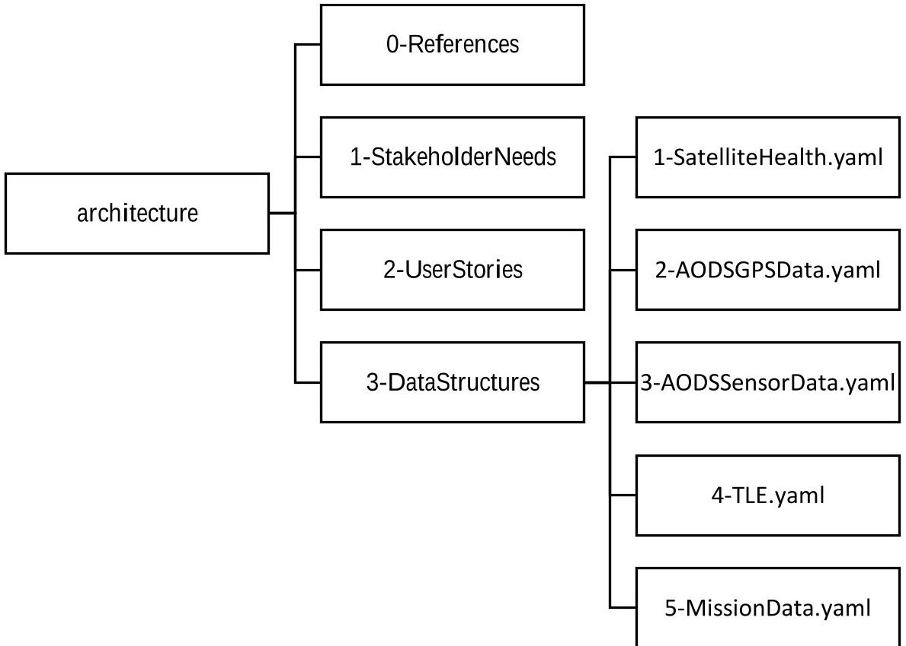


<div align="center">

Figure 4.1: Data structures YAML file structure

</div>

<!-- PDF_PAGE: 58 -->


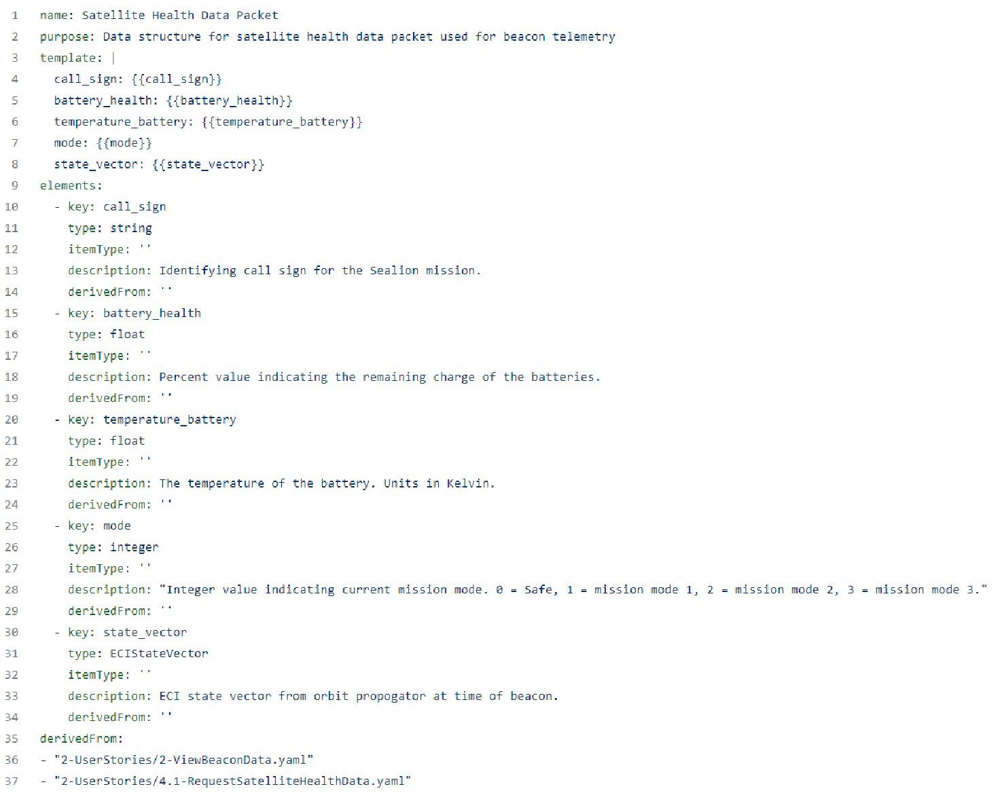


<div align="center">

Figure 4.2: 1-SatelliteHealth.yaml

</div>

The data structure for the GPS data of SeaLion, is shown in the '2-AODSGPSData.yaml' file given in Figure 4.3. Note that there isn't a user story where this data structure is derived from, however, the data is still important for the basic task of determining orbit propagation which is a basic task of the satellite. Table 4.2 details the various fields that would be required in this beacon data packet to accomplish the aforementioned task.

<!-- PDF_PAGE: 59 -->

<div align="center">

Table 4.2: Satellite GPS data tabulated from 2-AODSGPSData.yaml

</div>

<table border="1"><tr><td>Field</td><td>Type</td><td>Item Type</td><td>Description</td></tr><tr><td>time_stamp</td><td>string</td><td></td><td>Time stamp when GPS data was acquired.</td></tr><tr><td>altitude_data_GPS</td><td>float</td><td></td><td>The altitude data of the satellite from GPS.</td></tr><tr><td>latitude_GPS</td><td>float</td><td></td><td>Latitude coordinate of the satellite from GPS.</td></tr><tr><td>longitude_GPS</td><td>float</td><td></td><td>Longitude coordinate of the satellite from GPS.</td></tr></table>

name: Satellite GPS Data

purpose: Data structure for GPS data used for orbit propagation

template: |

  time_stamp: {{time_stamp}}

  altitude_data_GPS: {{altitude_data}}

  lattitude_GPS: {{lattitude}}

  longitude_GPS: {{longitude}}

elements:

  - key: time_stamp

    type: string

    itemType: ''

    description: Time stamp when GPS data was acquired.

    derivedFrom: ''

  - key: altitude_data_GPS

    type: float

    itemType: ''

    description: The altitude data of the satellite from GPS.

    derivedFrom: ''

  - key: lattitude_GPS

    type: float

    itemType: ''

    description: Lattitude coordinate of the satellite from GPS.

    derivedFrom: ''

  - key: longitude_GPS

    type: float

    itemType: ''

    description: Longitude coordinate of the satellite from GPS.

    derivedFrom: ''

derivedFrom: []

<div align="center">

Figure 4.3: 2-AODSGPSData.yaml

</div>

<!-- PDF_PAGE: 60 -->

The data structure for the AODS sensor data of SeaLion, is shown in the '3- AODSSensorData.yaml' file with an excerpt given in Figure 4.4. Note that this data structure is derived from the User Story to 4.2 described in the prior chapter. This user story details the ground station operator's task to request satellite mission data so that the operator can validate in-orbit AODS and payload performance. Table 4.3 details the various fields that would be required in this beacon data packet to accomplish the aforementioned task for the in-orbit AODS specifically.

<!-- PDF_PAGE: 61 -->


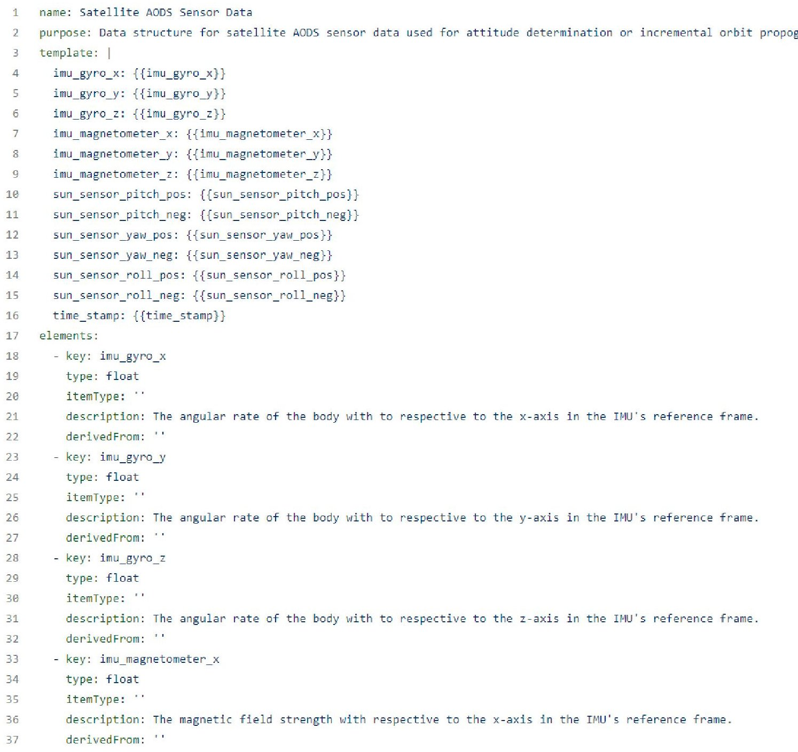


<div align="center">

Figure 4.4: Excerpt of the 3-AODSSensorData.yaml

</div>

<!-- PDF_PAGE: 62 -->

<div align="center">

Table 4.3: AODS sensor data tabulated from 3-AODSSensorData.yaml

</div>

<table border="1"><tr><td>Field</td><td>Type</td><td>Item Type</td><td>Description</td></tr><tr><td>imu_gyro_x</td><td>float</td><td></td><td>The angular rate of the body with to respective to the x-axis in the IMU&#x27;s reference frame.</td></tr><tr><td>imu_gyro_y</td><td>float</td><td></td><td>The angular rate of the body with to respective to the y-axis in the IMU&#x27;s reference frame.</td></tr><tr><td>imu_gyro_z</td><td>float</td><td></td><td>The angular rate of the body with to respective to the z-axis in the IMU&#x27;s reference frame.</td></tr><tr><td>imu_magnetometer_x</td><td>float</td><td></td><td>The magnetic field strength with respective to the x-axis in the IMU&#x27;s reference frame.</td></tr><tr><td>imu_magnetometer_y</td><td>float</td><td></td><td>The magnetic field strength with respective to the y-axis in the IMU&#x27;s reference frame.</td></tr><tr><td>imu_magnetometer_z</td><td>float</td><td></td><td>The magnetic field strength with respective to the z-axis in the IMU&#x27;s reference frame.</td></tr><tr><td>sun_sensor_pitch_pos</td><td>float</td><td></td><td>Sun sensor measurement with respect to positive pitch angle.</td></tr><tr><td>sun_sensor_pitch_neg</td><td>float</td><td></td><td>Sun sensor measurement with respect to negative pitch angle.</td></tr><tr><td>sun_sensor_yaw_pos</td><td>float</td><td></td><td>Sun sensor measurement with respect to positive yaw angle.</td></tr><tr><td>sun_sensor_yaw_neg</td><td>float</td><td></td><td>Sun sensor measurement with respect to negative yaw angle.</td></tr><tr><td>sun_sensor_roll_pos</td><td>float</td><td></td><td>Sun sensor measurement with respect to positive roll angle.</td></tr><tr><td>sun_sensor_roll_neg</td><td>float</td><td></td><td>Sun sensor measurement with respect to negative roll angle.</td></tr><tr><td>time_stamp</td><td>string</td><td></td><td>Time stamp of the last transmission.</td></tr></table>

The data structure for the earth-centered inertial (ECI) state vector of SeaLion, is shown in the '4-TLE.yaml' file given in Figure 4.5. Note that this data structure is derived from the User Story 4.2 described in the prior chapter. This user story detail the ground station operator's task to request satellite mission data so that the operator can validate in-orbit AODS and payload performance. Table 4.4 details the various fields that would be required in this beacon data packet to accomplish the aforementioned task.

<!-- PDF_PAGE: 63 -->

<div align="center">

Table 4.4: ECI state vector data tabulated from 4-TLE.yaml

</div>

<table border="1"><tr><td>Field</td><td>Type</td><td>Item Type</td><td>Description</td></tr><tr><td>x</td><td>integer</td><td></td><td>position in kilometers(km) along x-axis</td></tr><tr><td>y</td><td>integer</td><td></td><td>position in kilometers(km) along y-axis</td></tr><tr><td>z</td><td>integer</td><td></td><td>position in kilometers(km) along z-axis</td></tr><tr><td>xd</td><td>integer</td><td></td><td>velocity in kilometers per second(km/s) along x-axis</td></tr><tr><td>yd</td><td>integer</td><td></td><td>velocity in kilometers per second(km/s) along y-axis</td></tr><tr><td>zd</td><td>integer</td><td></td><td>velocity in kilometers per second(km/s) along z-axis</td></tr></table>


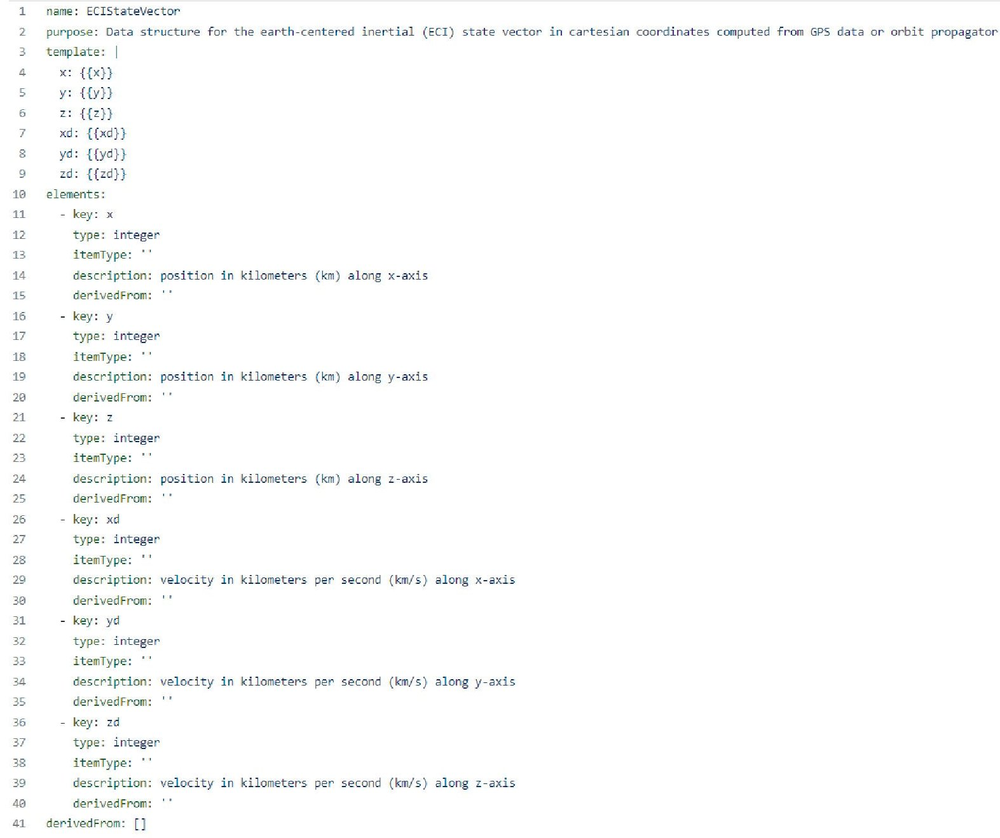


<div align="center">

Figure 4.5: 4-TLE.yaml

</div>

<!-- PDF_PAGE: 64 -->

The data structure for the mission or event (EVR) data of SeaLion, is shown in the '5- MissionData.yaml' file given in Figure 4.6. Note that this data structure is derived from the user stories 2 and 4.2 described in the prior chapter. These user stories detail the ground station operator's tasks to view the satellite beacon data and to request satellite mission data so that the operator can validate in-orbit AODS and payload performance. Table 4.5 details the various fields that would be required in this beacon data packet to accomplish the aforementioned task for the payload performance specifically.

name: Mission Data

purpose: Defines EVR (event) elements to be recorded to the eventLog during a mission mode

template: |

  entry_tle: {{entry_tle}}

  obc_sensors: {{obc_sensors}}

  mission_data: {{mission_data}}

  exit_tle: {{exit_tle}}

elements:

  - key: entry_tle

    type: ECIStateVector

    itemType: ''

    description: ECIStateVector at time of beginning of mission mode

    derivedFrom: []

  - key: obc_sensors

    type: AODSSensorData

    itemType: ''

    description: AODS Sensor data

    derivedFrom: []

  - key: mission_data

    type: string

    itemType: ''

    description: Data recorded during mission mode

    derivedFrom: []

  - key: exit_tle

    type: ECIStateVector

    itemType: ''

    description: ECIStateVector at time of end of mission mode

    derivedFrom: []

derivedFrom:

  - "2-UserStories/2-ViewBeaconData.yaml"

  - "2-UserStories/4.2-RequestMissionData.yaml"

<div align="center">

Figure 4.6: 5-MissionData.yaml

</div>

<!-- PDF_PAGE: 65 -->

<div align="center">

Table 4.5: Mission data tabulated from 5-MissionData.yaml

</div>

<table border="1"><tr><td>Field</td><td>Type</td><td>Item Type</td><td>Description</td></tr><tr><td>entry_tle</td><td>ECIStateVector</td><td></td><td>ECIStateVector at time of beginning of mission mode</td></tr><tr><td>obc_sensors</td><td>AODSSensorData</td><td></td><td>AODS Sensor data</td></tr><tr><td>mission_data</td><td>string</td><td></td><td>Data recorded during mission mode</td></tr><tr><td>exit_tle</td><td>ECIStateVector</td><td></td><td>ECIStateVector at time of end of mission mode</td></tr></table>

Figure 4.7 is a UML diagram of mapping of user stories to data structures generated from the YAML files shown in Figure 4.1. The generation of this diagram and the tables via the YAML files presented herein showcases the docs-as-code approach. YAML files structured as a code are then converted into easily human readable documents for presentation.

<!-- PDF_PAGE: 66 -->


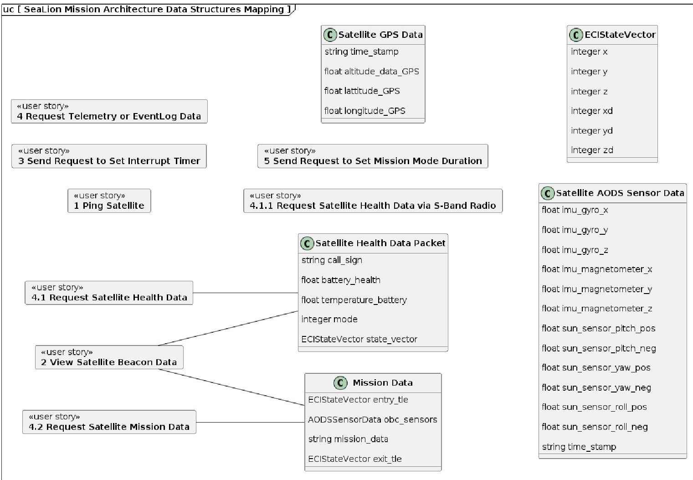


<div align="center">

Figure 4.7: UML diagram of mapping of user stories to their derived data structures

</div>

## 4.2-DOCUMENT GENERATION

As noted multiple times throughout this thesis, there have been a number of figures and tables generated from the YAML files placed within the SeaLion mission architecture GitHub repository. Many of the figures are UML diagrams that are auto-generated artifacts rendered from the M30ML modeling language and formatted using the Liquid template language. This is the link for the docs-as-code approach. YAML code files are used to generate documents for information sharing between group members. This means that any changes made to the SeaLion mission architecture model can immediately be used to generate new documents. Whether it be diagrams, tables, or text, continuous updating is ensured that any changes affecting dependencies within the mission architecture are kept in sync. Appendix A is provided to showcase the entire

<!-- PDF_PAGE: 67 -->

SeaLion mission architecture in its generated document form [41]. Appendix A is the latest main branch version of the architecture at time of this thesis' publication. The conference proceeding manuscript presented in AIAA SciTech 2023 was also created purely by a docs-as-code format [13]. The team used a LaTeX template to automatically format the manuscript to the conference guidelines and subsequently inject items such as the generated diagrams, tables, and references directly into the manuscript.

## 4.3 - SOFTWARE DEVELOPMENT WORKFLOW

The purpose of much of this documentation that is generated is guide flight software development for the SeaLion mission. The SeaLion uses these YAML files from the SeaLion mission architecture repository [32] and the generated documentation to form the basis of required tasks. At the time of this thesis' publication, software is being developed on a private GitHub repository. Shown in Figure 4.8 is the issues tracker of this repository as well as issue #24 shown at the top of Figure 4.9 in Figure 4.8. Figure 4.9 is pulled directly from the mission architecture developed and guides the software development in the repository.


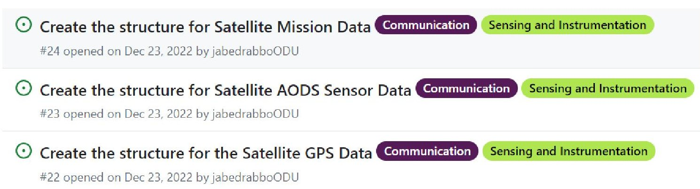


<div align="center">

Figure 4.8: Excerpt of issues (tasks) of the flight software GitHub repository

</div>

<!-- PDF_PAGE: 68 -->

## Description:

This ticket aims to cover the task of implementing the structure of the Satellite Mission Data based on the architecture documentation.

Requirement:

## Mission Data

Purpose: Defines EVR (event) elements to be recorded to the eventLog during a mission mode

entry_tle: {{entry_tle}}

obc_sensors: {{obc_sensors}}

mission_data: {{mission_data}}

exit_tle: {{exit_tle}}

<div align="center">

Table 7. Mission Data Specification

</div>

<table border="1"><tr><td>Field</td><td>Type</td><td>Item Type</td><td>Description</td><td>Source</td></tr><tr><td>entry_tle</td><td>TLE</td><td></td><td>TLE at time of beginning of mission mode</td><td></td></tr><tr><td>obc_sensors</td><td>AODSSensorData</td><td></td><td>AODS Sensor data</td><td></td></tr><tr><td>mission_data</td><td>string</td><td></td><td>Data recorded during mission mode</td><td></td></tr><tr><td>exit_tle</td><td>TLE</td><td></td><td>TLE at time of end of mission mode</td><td></td></tr></table>

<div align="center">

Figure 4.9: Issue #24 - Create the structure for Satellite Mission Data

</div>

<!-- PDF_PAGE: 69 -->

## 4.4 - DISTRIBUTED OSHW FRAMEWORK

A brief description of current component implementation into the SeaLion model is provided. The M30ML pillars are based on Open Source Hardware (OSHW) principals [26]. The current SeaLion mission architecture repository, at time of thesis publication, for components is "structured as a Distributed OSHW Framework (DOF) - component for defining the contents of the Mission concept of operations (ConOps) as a collection of nested subcomponents, component interfaces, and component functions for generating bill of materials (BOMs) and assembly instructions for the SeaLion CubeSat” [32].

Inside the components folder of the SeaLion mission architecture repository there are two subfolders; one labeled with 'sealion-cubesat' and another labeled with 'sealion-groundstation'. Each of those folders would contain a components folder and subsequently those individual labeled components can have their own components folder. Thus, a chain of components and subcomponents can be created as illustrated in Figure 4.10. A parts YAML file in each components folder details what the subcomponents would be. An excerpt example for the main SeaLion CubeSat is provided in Figure 4.11 that is associated with the file folders shown in Figure 4.10.

<!-- PDF_PAGE: 70 -->


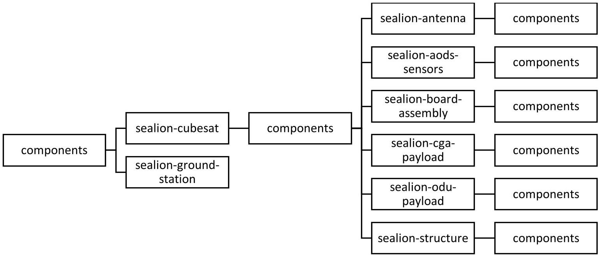


<div align="center">

Figure 4.10: Components file folder structure excerpt example for sealion-cubesat

</div>

```yaml

structure:

  id: structure

  description: Stucture

  quantity: 1

  quantityUnits: unit

  options:

    - sealion-structure

  selectedOption: 0

  notes: ''

power-module:

  id: power-module

  description: Power Module

  quantity: 1

  quantityUnits: unit

  options:

    - sealion-power-module

  selectedOption: 0

  notes: ''

```

<div align="center">

Figure 4.11: Example excerpt of the parts YAML file for sealion-cubesat

</div>

<!-- PDF_PAGE: 71 -->

## 4.5 - COMPONENT DATA STRUCTURE AND DOCUMENT GENERATION

A series of YAML files for components have been created. Figure 4.11 showcases the parts YAML file, however, parts is only one element of the component's data structure thus far. Showcased in Table 4.6 is the entire component data structure from the SeaLion DOF templates [40]. There are several component data structures prepared that may be used for a variety of purposes. The SeaLion DOF templates document have been generated in the DOF repository [42]. This document has been provided in Appendix B as the latest version at time of this thesis' publication. The data structures created are as follows:

- Component: Represents the smallest logical element in an OSHW project. A Component may be a project in its own right (with a sub-component hierarchy) or may be nested as a sub-component in the "source" of another component.

- Component List Item: Identifies a part or tool used in the fabrication of the component. Parts and tools are defined by their source material in the components list.

- Activity Step: Defines a single step in an activity, e.g., assembly instructions.

- Parameter: Defines a data structure for an input or output of a component function.

- Function: Defines a data structure for a component function.

- Interface List Item: Identifies an interface on a part or tool.

For the purposes of this architecture structure. An interface is a point on a component where it can join up with other components. For example, it could be a USB plug port or electrical wall outlet. In comparison a junction is the action of joining two interfaces together. For example, a USB flash drive with a USB male end is plugged into a USB female port on a computer. The act of plugging the flash drive into the computer is the junction. The two interfaces are the USB

<!-- PDF_PAGE: 72 -->

male end and the USB female port which are used to join two components of both the flash drive and the computer.

<div align="center">

Table 4.6. Component data structure

</div>

<table border="1"><tr><td>Field</td><td>Type</td><td>Item Type</td><td>Description</td></tr><tr><td>name</td><td>string</td><td></td><td>Source representation of the component&#x27;s name. Format = single word, only lowercase letters, and may contain hyphens and underscores.</td></tr><tr><td>version</td><td>string</td><td></td><td>Version number of the component&#x27;s source. Format = x.x.x per semantic versioning guidelines.</td></tr><tr><td>description</td><td>string</td><td></td><td>Human readable representation of the component&#x27;s name. Typically used in rendered documentation referencing the component.</td></tr><tr><td>license</td><td>string</td><td></td><td>List of licenses used within the component&#x27;s source. Format = SPDX license expression.</td></tr><tr><td>author</td><td>string</td><td></td><td>Identifies author (e.g., owner of source intellectual property). Format (email and website are optional) = Author Name &lt;email address&gt; (website URL)</td></tr><tr><td>dependencies</td><td>dictionary</td><td>string</td><td>Per NPM/Yarn. Key = dependency name. Value = Semantic versioning version string.</td></tr><tr><td>components</td><td>dictionary</td><td>Component</td><td>Listing of sub-components directly owned by this component. Key = sub-component&#x27;s name. Value = sub-component&#x27;s data structure.</td></tr><tr><td>parts</td><td>dictionary</td><td>Component List Item</td><td>Listing of the component&#x27;s parts (and substitutions) defined as sub-components. Key = part&#x27;s id. Value = part&#x27;s key data.</td></tr><tr><td>functions</td><td>list</td><td>Function</td><td>Listing of component functions.</td></tr><tr><td>tools</td><td>dictionary</td><td>Component List Item</td><td>Listing of the required tools (and substitutions) defined as sub-components. Key = tool&#x27;s id. Value = tool&#x27;s key data.</td></tr><tr><td>precautions</td><td>list</td><td>string</td><td>Listing of caution statements (e.g., safety warnings) for the component.</td></tr><tr><td>assemblySteps</td><td>list</td><td>Activity Step</td><td>Sequence of steps required to assemble the component.</td></tr></table>

The initial intent is to list the components of the SeaLion CubeSat and to generate assembly steps for them. Thus, at minimum the major subfolders seen in Figure 4.10 should

<!-- PDF_PAGE: 73 -->

have component subfolders and a 'parts.yaml' file seen in Figure 4.11 and possibly a 'tools.yaml' file should it be required for assembly. See Figure 4.12 for an illustrative example for the 'sealion-structure' components folder. With the components under 'sealion-structure' and listed out in the 'parts.yaml' file as well as the 'tools.yaml' file, assembly instructions can be generated. This is done by reading the 'assemblySteps.yaml' file that references the parts and tools. These YAML files are shown in Figure 4.13, Figure 4.14, and Figure 4.15 respectively.


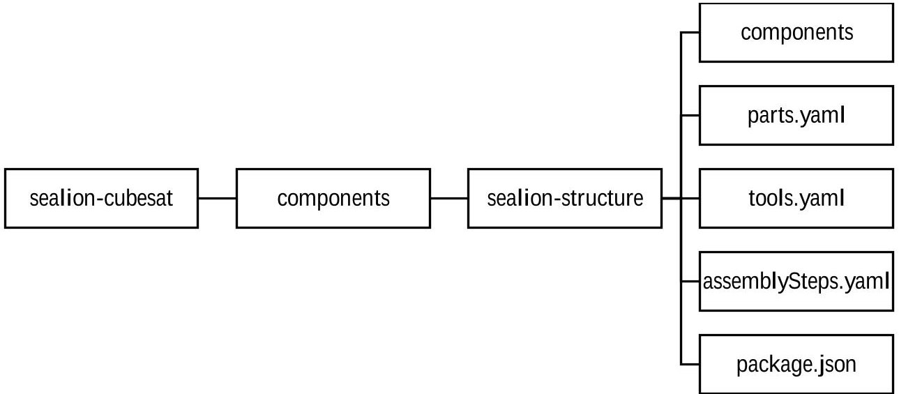


<div align="center">

Figure 4.12: Sealion-structure folder structure

</div>

<!-- PDF_PAGE: 74 -->

```json

top-plate:

  id: plate

  description: Top Plate

  quantity: 1

  quantityUnits: unit

  options:

    - sealion-top-plate

    - sealion-top-plate-bracketed-sheetmetal

  selectedOption: 0

  notes: ''

bottom-plate:

  id: bottom-plate

  description: Bottom Plate with integrated tabs

  quantity: 1

  quantityUnits: unit

  options:

    - sealion-bottom-plate-monopole

    - sealion-bottom-plate-patch

    - sealion-bottom-plate-sheetmetal

  selectedOption: 2

  notes: 'Bottom Plate with integrated tabs'

```

<div align="center">

Figure 4.13: Excerpt from 'parts.yaml' file in 'sealion-structure' folder

</div>

```yaml

screwdriver:

  id: screwdriver

  description: Screwdriver

  quantity: 1

  quantityUnits: unit

  options:

    - hex-screwdriver-generic

    - philips-screwdriver-generic

  selectedOption: 0

  notes: ''

clean-box:

  id: clean-box

  description: Clean Box

  quantity: 1

  quantityUnits: unit

  options:

    - clean-box-brand

  selectedOption: 0

  notes: 'Creates a positive pressure environment to prevent particulate accumulation'

```

<div align="center">

Figure 4.14: Excerpt from 'tools.yaml' file in 'sealion-structure' folder

</div>

<!-- PDF_PAGE: 75 -->

- summary: Attach {{parts.bottom-plate.description}} to {{parts.left-bracket.description}}

  requiredParts:

    - bottom-plate

    - left-bracket

    # - screw

  requiredTools: []

    # - screwdriver

  details: |

    . Place the *{{parts.bottom-plate.description}}* on flat surface

    . Place the *{{parts.left-bracket.description}}* into the longitudinal side of *{{parts.bo

  # . Screw the *{{parts.screw.descriptionSelected}}* in mounting holes to secure the *{{part

  # . Screw the *{{parts.screw.descriptionSelected}}* into the mounting holes to secure the *-

- summary: Attach {{parts.ejection-plate.description}} to {{parts.left-bracket.description}}

<div align="center">

Figure 4.15: Excerpt from 'assemblySteps.yaml' file in 'sealion-structure' folder

</div>

Appendix C provides example assembly instructions for the SeaLion CubeSat structure. These assembly instructions have also been generated through the SeaLion mission architecture repository much akin to Appendix A. Thus, it creates an easily human readable document from the YAML files code as per the docs-as-code approach.

Eventually, the purpose of all these component data structures is to also create an N2 diagram. An N2 diagram is used to "is used to capture the interfaces, mechanical and electrical, for all components of the satellite obtained through the mapping process" [12]. An example has been provided in Figure 4.16. The end state is that the architecture would use interfaces and junctions within the YAML files code to automatically generate an N2 diagram. Thus, it allows for continuous updating that ensures that any changes affecting dependencies within the mission architecture are kept in sync. This would allow for a team to easily identify "areas where conflicts could arise in interfaces, and highlights input and output dependency assumptions and requirements" [12]. Thus, leading to higher efficacy in planning the development and assembly of the satellite.

<!-- PDF_PAGE: 76 -->


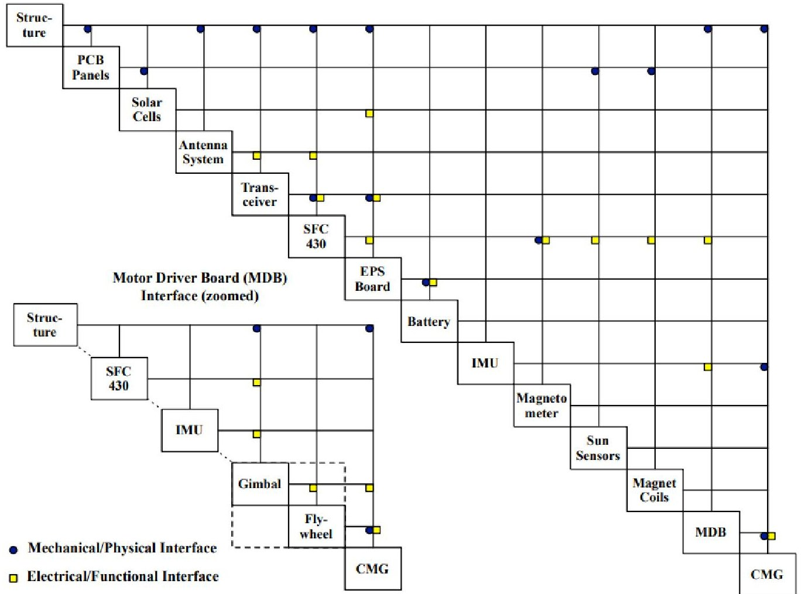


<div align="center">

Figure 4.16: Example N2 diagram [12]

</div>

<!-- PDF_PAGE: 77 -->

## CHAPTER 5-CONCLUSION AND FUTURE SCOPE

There were many lessons learned during the work to implement this MBSE methodology with a doc-as-code approach. With the ODU SeaLion team comprising mainly of students of various background and obligations, communication was a definite issue moving forward in the implementation of this approach. Many of the team members were unavailable due to focusing in on their own specific tasks for SeaLion or obligations beyond the SeaLion project. This showed considerably when compiling the SeaLion component architectures detailed in chapter 4. Many of the subject matter experts were unavailable to meet frequently enough to give details on the components of the CubeSat. Thus, much of the component architecture remains unfinished and many of the team members have yet to interact with the architecture apart from just viewing the generated documents. However, this understandable given that other university obligations take priority and are considerably time consuming. It is to be expected that issues may arise in scheduling of information transfer.

In addition, there were issues with decisions being made before proper MBSE methodologies could come into effect. Components were chosen and design decisions made on a rather frequent basis and were not communicated to the mission architecture team. This caused a disconnect with the actual SeaLion CubeSat prototype and the documented mission architecture at times since the mission architecture team may be unaware of a change until well after it was made. It is only recently that strides have been made to complete the components architecture due to this.

The author suggests that going forward on future projects, effort should be made that systems engineering approaches be conducted prior to any major design decisions or physical work is done. The team should also communicate clearly any decisions made so that other team

<!-- PDF_PAGE: 78 -->

members are aware. If using the docs-as-code approach, individual members should update the architecture to reflect these decisions so other members can immediately view the changes as well as any commit history. All individual members should be trained on this approach prior to significant work on the project beginning.

## 5.1-CONCLUSION

A MBSE with docs-as-code approach was applied to the SeaLion CubeSat project. This was done in efforts to reduce the friction and disconnect associated with traditional systems engineering for the CubeSat developers. Especially today when CubeSat projects are growing more numerous and with many of their respective team members being new to space systems development. It has accomplished the ability to create individual elements of the architecture in an easily human readable code that is also easy to revise. Even for those who are unfamiliar with coding software or methods. Thus, minimal training is required for usage. It also generates documents locally without the use of any external document tools for presentation with just the information stored in the YAML files. The overall methods to use a docs-as-code approach have been established.

As shown herein, references, stakeholder needs, user stories, and data structures have been established in SeaLion's architecture. With these, a tight coupling of the in-development flight software and the current architecture documentation can be established. The methods described herein to take a docs-as-code approach can be used to base future developments within the greater CubeSat community.

<!-- PDF_PAGE: 79 -->

## 5.2-FUTURE WORK

Future work includes further expanding the components described in sections 4.4 and 4.5. Other immediate actions include updating the architecture to the very recently changed mission requirements of the new launch parameters for the Firefly rocket. At minimum, with the now planned orbit being significantly higher, considerations to operational lifespan are required. Afterwards, the validation of the docs-as-code approach will be tested with the upcoming launch of SeaLion later this year. Should this be successful, further expansion of potential projects and users of this approach using the M30ML modeling language will be explored.

<!-- PDF_PAGE: 80 -->

## REFERENCES

[1] The CubeSat Program, Cal Poly SLO, "CubeSat Design Specification Rev. 14," 2022. [Online]. Available: https://www.cubesat.org/s/CDS-REV14_1-2022-02-09.pdf.

[2] H. Heidt, J. Puig-Suari, A. S. Moore, S. Nakasuka and R. J. Twiggs, "CubeSat - A new generation of picosatellite for education and industry low-cost space experimentation," AIAA/USU Annual Conference on Small Satellites, 12th, Utah State University, Logan; UNITED STATES; 21-24 Aug.2000, 2000.

[3] M. Swartwout, "CubeSat Database," 2021. [Online]. Available: https://sites.google.com/a/slu.edu/swartwout/cubesat-database.

[4] CubeSat Shop, "Pumpkin CubeSat Kits," [Online]. Available: https://www.cubesatshop.com/product/pumpkin-cubesat-kits/. [Accessed 16 March 2023].

[5] C. Cappelletti, S. Battistini and B. Malphrus, Cubesat handbook : From mission design to operations, Elsevier Science & Technology, 2020.

[6] M. Swartwout, "Reliving 24 Years in the Next 12 Minutes: A Statistical and Personal History of University-Class Satellites," 2018. [Online]. Available: https://digitalcommons.usu.edu/cgi/viewcontent.cgi?article=4277&context=smallsat.

[7] J. Praks, A. Kestilä, T. Tikka, O. H. Leppinen, Khurshid and M. Hallikainen, "AALTO-1 earth observation cubesat mission — Educational outcomes," in IEEE International Geoscience and Remote Sensing Symposium (IGARSS), Milan, Italy, 2015.

[8] L. Berthoud and M. Schenk, "How to Set Up a CubeSat Project - Preliminary Survey Results," in 30th Annual AIAA/USU Conference on Small Satellites, 2016.

[9] Old Dominion University & United States Coast Guard Academy, Critical Design Review: Mission SeaLion - ODU/CGA 3U CubeSat, 2022.

[10] S. Friedenthal and C. Oster, Architecting spacecraft with SysML: A Model-based Systems Engineering Approach, CreateSpace Independent Publishing Platform, 2017.

[11] NASA, "NASA System Engineering Handbook," 2016. [Online]. Available: https://www.nasa.gov/sites/default/files/atoms/files/nasa_systems_engineering_handbook_0.pdf.

[12] S. A. Asundi and N. G. Fitz-Coy, "CubeSat mission design based on a systems engineering approach," in 2013 IEEE Aerospace Conference, 2013.

<!-- PDF_PAGE: 81 -->

[13] S. Marquez, K. Chiu and S. Asundi, "Model-Based CubeSat Flight-Software Architecture using a Docs-as-Code approach," 19 January 2023. [Online]. Available: https://arc.aiaa.org/doi/10.2514/6.2023-1126.

[14] D. Wagner, S. Y. Kim, A. Jimenez, M. Elaasar, S. Jenkins and N. Rouquette, "CAESAR Model-Based Approach to Harness Design," Proceedings of IEEE Aerospace Conference, 2020.

[15] B. Brown, "Model-based systems engineering: Revolution or evolution?," IBM Rational, 2021.

[16] D. R. Call and D. R. Herber, "Applicability of the diffusion of innovation theory to accelerate model-based systems engineering adoption," Systems Engineering, vol. 25, no. 6, pp. 535-617, November 2022.

[17] P. J. Younse, J. E. Cameron and T. H. Bradley, "Comparative Analysis of Model-Based and Traditional Systems Engineering Approaches for Architecting a Robotic Space System Through Automatic Information Transfer," IEEE Access, vol. 9, pp. 107476- 107492, 2021.

[18] S. Mazzini, E. Tronci, C. Paccagnini and X. Olive, "A Model-Based methodology to support the Space System Engineering (MBSSE)," in ERTS2 2010, Embedded Real Time Software & Systems, Toulouse, France, 2010.

[19] ESA, "Model-based system engineering," 28 June 2022. [Online]. Available: https://www.esa.int/Enabling_Support/Preparing_for_the_Future/Discovery_and_Preparation/Model-based_system_engineering.

[20] D. Nottage and S. Corns, "Application of model-based systems engineering on a university satellite design team," Procedia Computer Science, vol. 8, pp. 207-213, 2012.

[21] D. Kaslow, B. Ayres, P. T. Cahill, L. Hart and R. Yntema, "Developing a CubeSat Model-Based System Engineering (MBSE) reference model Interim status #3," in 2017 IEEE Aerospace Conference, Big Sky, MT, USA, 2017.

[22] E. Holscher, "Docs as Code," 2022. [Online]. Available: https://www.writethedocs.org/guide/docs-as-code/.

[23] "Structurizr Software architecture models as code," Structurizr, 2023. [Online]. Available: https://structurizr.org/.

[24] California Institute of Technology., "F' Flight Software & Embedded Systems Framework," 2020. [Online]. Available: https://nasa.github.io/fprime/.

<!-- PDF_PAGE: 82 -->

[25] R. L. Bocchino, J. W. Levison and M. D. Starch, "FPP: A Modeling Language for F Prime," in 2022 IEEE Aerospace Conference (AERO), Big Sky, MT, USA, 2022.

[26] J. Simmons, "Mach30 Modeling Language," Mach30 Foundation, 2022. [Online]. Available: https://github.com/Mach30/m30ml.

[27] SysML Partners, "SysML Specifications," [Online]. Available: https://sysml.org/sysml-specs/.

[28] SysML v2 Submission Team, "SysML-v2-Release," [Online]. Available: https://github.com/Systems-Modeling/SysML-v2-Release.

[29] PlantUML, "PlantUML," [Online]. Available: https://plantuml.com/.

[30] M. Elaasar and N. Rouquette, "Ontological Modeling Language: Origin and Rationale," 2022. [Online]. Available: http://www.opencaesar.io/oml/.

[31] S. Jenkinis, "Ontological Modeling Language 1.4," 2022. [Online]. Available: http://www.opencaesar.io/imce/2021/06/19/OML-Origin-and-Rationale.html.

[32] Old Dominion University, "SeaLion Mission Architecture GitHub," GitHub, 2022. [Online]. Available: https://github.com/ODU-CGA-CubeSat/sealion-mission architecture.

[33] W. A. Beech, D. E. Nielsen and J. Taylor, "AX.25 Link Access Protocol for Amateur Packet Radio," Tucson Amateur Packet Radio Corporation, July 1998. [Online]. Available: http://www.tapr.org/pdf/AX25.2.2.pdf.

[34] "Canisterized Satellite Dispenser Payload Specification for 3U, 6U & 12U," Rocket Lab USA, August 2018. [Online]. Available: https://www.rocketlabusa.com/assets/Uploads/PSC/Rocket%20Lab%20PSC%20-%2020 02367F%20Payload%20Spec%20for%203U%206U%2012U.pdf.

[35] "Canisterized Satellite Dispenser," Rocket Lab USA, August 2018. [Online]. Available: https://www.rocketlabusa.com/assets/Uploads/PSC/Rocket%20Lab%20PSC%20-%2020 02337F%20CSD%20Data%20Sheet.pdf.

[36] "Is My Satellite ITAR or EAR?," MIT, [Online]. Available: https://research.mit.edu/integrity-and-compliance/export-control/information documents/my-satellite-itar-or-ear.

[37] P. Fortescue, G. Swinerd and J. Stark, Spacecraft Systems Engineering, 4th Edition, Wiley, 2011.

<!-- PDF_PAGE: 83 -->

[38] B. Dunbar and S. Caldwell, "State-of-the-Art of Small Spacecraft Technology," NASA March 2023. [Online]. Available: https://www.nasa.gov/smallsat-institute/sst-soa-2020.

[39] T. S. Kelso, "NORAD Two-Line Element Set Format," CelesTrak, July 2022. [Online]. Available: https://celestrak.org/NORAD/documentation/tle-fmt.php.

[40] Old Dominion University, "Distributed OSHW Framework (DOF)," GitHub, 2023. [Online]. Available: https://odu-cga-cubesat.github.io/dof-cubesat/.

[41] Old Dominion University, "SeaLion Mission Architecture," 2023. [Online]. Available: https://odu-cga-cubesat.github.io/sealion-mission-architecture/.

[42] Old Dominion University, "dof-cubesat," 2023. [Online]. Available: https://github.com/ODU-CGA-CubeSat/dof-cubesat.

<!-- PDF_PAGE: 84 -->

## APPENDICES

<!-- PDF_PAGE: 85 -->

v5.0.0

## SeaLion Mission Architecture

## Table of Contents

Stakeholder Needs ... 2

1.1: Primary Mission Objective A1 ... 2

1.2: Primary Mission Objective A2 ... 2

1.3: Primary Mission Objective A3 ... 2

1.4: Primary Mission Objective A4 ... 2

1.5: Primary Mission Objective A5 ... 2

2.1: Secondary Mission Objective B1 ... 2

2.2: Secondary Mission Objective B2 ... 3

3.1: Tertiary Mission Objective C1 ... 3

3.2: Tertiary Mission Objective C2 ... 3

3.3: Tertiary Mission Objective C3 ... 3

Stakeholder Needs Mapping ... 3

User Stories ... 4

1: Ping Satellite ... 4

2: View Satellite Beacon Data ... 5

3: Send Request to Set Interrupt Timer ... 5

4: Request Telemetry or EventLog Data ... 5

4.1: Request Satellite Health Data ... 6

4.1.1: Request Satellite Health Data via S-Band Radio ... 6

4.2: Request Satellite Mission Data ... 6

5: Send Request to Set Mission Mode Duration ... 7

User Stories Mapping ... 7

User stories as Use Case Diagram ... 7

Data Structures ... 8

Satellite Health Data Packet ... 8

Satellite GPS Data ... 9

Satellite AODS Sensor Data ... 10

ECIStateVector ... 11

Mission Data ... 12

Data Structures Mapping ... 13

Finite State Machine ... 13

<!-- PDF_PAGE: 86 -->

## Stakeholder Needs

The SeaLion Mission Architecture is guided by a series of stakeholder needs, listed below.

## 1.1: Primary Mission Objective A1

The SeaLion mission shall establish UHF communication link with Virginia ground station

## 1.2: Primary Mission Objective A2

The SeaLion mission shall establish S-Band communication link with MC3 ground station

## 1.3: Primary Mission Objective A3

The SeaLion mission shall successfully transmit "mission data" defined above to ground stations on the Earth.

## 1.4: Primary Mission Objective A4

The SeaLion mission shall adhere to CubeSat standards.

## Reference:

- CubeSat Design Specification Rev. 13

## 1.5: Primary Mission Objective A5

The SeaLion mission shall validate the operation of the Impedance Probe (IP) as a primary payload in-orbit.

## 2.1: Secondary Mission Objective B1

The SeaLion mission shall provide a means to validate a Multi-spectral Sensor (Ms-S) in-orbit

<!-- PDF_PAGE: 87 -->

## 2.2: Secondary Mission Objective B2

The SeaLion mission shall provide a means to validate a deployable composite structure (DeCS) in-orbit

## 3.1: Tertiary Mission Objective C1

The SeaLion mission shall qualify on-orbit the deployment and functioning of the newly developed UHF antenna system and its deployment.

## 3.2: Tertiary Mission Objective C2

The SeaLion mission shall qualify a CubeSat bus architecture for very-low Earth orbit (VLEO)

## 3.3: Tertiary Mission Objective C3

The SeaLion shall verify DeCS in-orbit behavior performance.

## Stakeholder Needs Mapping

<!-- PDF_PAGE: 88 -->


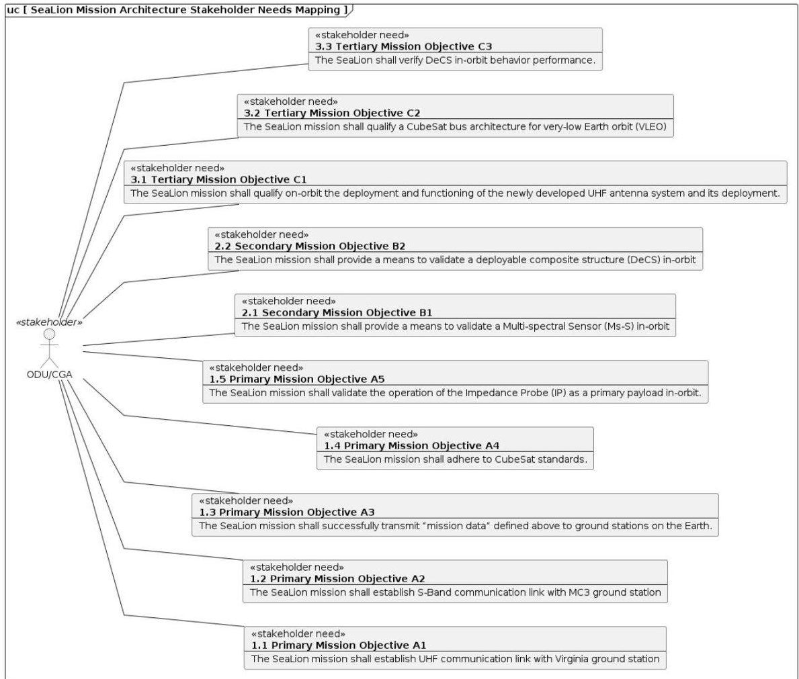


## User Stories

The SeaLion Mission Architecture's stakeholder needs are then used to identify a series of user stories which then lead to design decisions captured in data structure and activity definitions.

## 1: Ping Satellite

As a Ground Station Operator I want to Ping satellite so that I can Establish communication link with satellite.

## Example:

Ping the satellite in order to establish UHF communication link with Virginia ground station

<!-- PDF_PAGE: 89 -->

## Derived From:

- Primary Mission Objective A1

## 2: View Satellite Beacon Data

As a Ground Station Operator I want to view satellite beacon data (alternating between health & mission data), received via UHF so that I can verify that satellite is operating nominally.

## Example:

View satellite beacon data (health or mission data) to verify that state vector correspond with expected orbit profile and/or to validate that a mission mode was successful

## Derived From:

- Primary Mission Objective A1

- Primary Mission Objective A3

- Primary Mission Objective A5

- Secondary Mission Objective B1

- Secondary Mission Objective B2

- Tertiary Mission Objective C1

- Tertiary Mission Objective C2

- Tertiary Mission Objective C3

## 3: Send Request to Set Interrupt Timer

As a Ground Station Operator I want to send a request to set count value at which interrupt timers (i.e., beacon, GPS ping, or orbit propagator) are triggered so that I can finetune parameters for attitude or orbit analysis or to conserve power.

## Example:

Update beacon rate to transmit every 30 minutes to conserve power

## 4: Request Telemetry or EventLog Data

As a Ground Station Operator I want to Request satellite telemetry or eventlog data so that I can verify/validate health status or mission data.

<!-- PDF_PAGE: 90 -->

## Example:

Request satellite telemetry packets for local verification/validation of onboard AODS computations

## 4.1: Request Satellite Health Data

As a Ground Station Operator I want to request satellite health data packet so that I can verify/validate AODS sensors & GPS data are within nominal parameters.

## Example:

Request satellite health data packet to verify or validate state vector corresponding to expected orbit profile based on pre-computed orbit propagation model

## Derived From:

- Request Telemetry or EventLog Data

## 4.1.1: Request Satellite Health Data via S-Band Radio

As a Ground Station Operator I want to request satellite health data packet via Sband radio so that I can verify/validate AODS sensors & GPS data are within nominal parameters.

## Example:

Request satellite health data packet via S-band radio to verify or validate state vector corresponding to expected orbit profile based on pre-computed orbit propagation model

## Derived From:

- Request Telemetry or EventLog Data

- Primary Mission Objective A2

## 4.2: Request Satellite Mission Data

As a Ground Station Operator I want to request satellite mission data so that I can validate in-orbit AODS and/or payload performance.

<!-- PDF_PAGE: 91 -->

## Example:

Request satellite mission data to verify that state vector & AODS sensor data correspond with expected orbit profile and/or validate that a mission mode was successful

## Derived From:

- Request Telemetry or EventLog Data

- Primary Mission Objective A1

- Primary Mission Objective A3

- Primary Mission Objective A5

- Secondary Mission Objective B1

- Secondary Mission Objective B2

- Tertiary Mission Objective C1

- Tertiary Mission Objective C2

- Tertiary Mission Objective C3

## 5: Send Request to Set Mission Mode Duration

As a Ground Station Operator I want to send a request to set mission mode duration so that I can manage time spent per mission mode.

## Example:

send a request to set Mission Mode 1 duration to 25 minutes

## User Stories Mapping


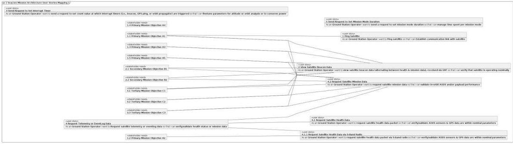


## User stories as Use Case Diagram

<!-- PDF_PAGE: 92 -->


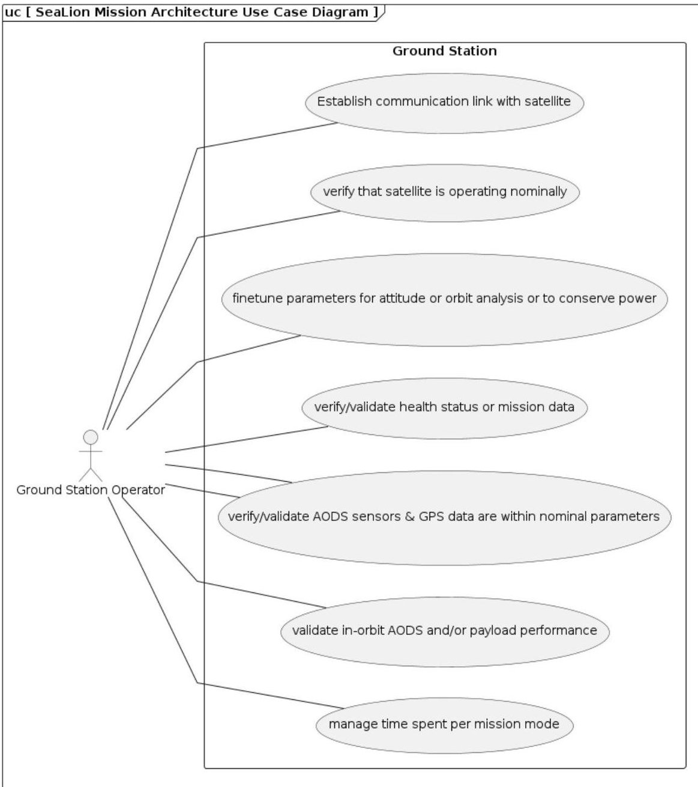


## Data Structures

This section covers each data structure type in the SeaLion Mission Architecture.

Satellite Health Data Packet

Purpose: Data structure for satellite health data packet used for beacon telemetry

<!-- PDF_PAGE: 93 -->

call_sign: {{call_sign}}

battery_health: {{battery_health}}

temperature_battery: {{temperature_battery}}

mode: {{mode}}

state_vector: {{state_vector}}

<table border="1"><tr><td>Field</td><td>Type</td><td>Item Type</td><td>Description</td><td>Source</td></tr><tr><td>call_sign</td><td>string</td><td></td><td>Identifying call sign for the Sealion mission</td><td></td></tr><tr><td>battery_health</td><td>float</td><td></td><td>Percent value indicating the remaining charge of the batteries</td><td></td></tr><tr><td>temperature_battery</td><td>float</td><td></td><td>The temperature of the battery. Units in Kelvin</td><td></td></tr><tr><td>mode</td><td>integer</td><td></td><td>Integer value indicating current mission mode.0=Safe,1=mission mode1,2=mission mode2,3=mission mode3</td><td></td></tr><tr><td>state_vector</td><td>ECIState Vector</td><td></td><td>ECI state vector from orbit propogator at time of beacon</td><td></td></tr></table>

<div align="center">

Table 1. Satellite Health Data Packet Specification

</div>

## Derived From:

- View Satellite Beacon Data

- Request Satellite Health Data

## Satellite GPS Data

Purpose: Data structure for GPS data used for orbit propagation

Satellite GPS Data Template

time_stamp: {{time_stamp}}

altitude_data_GPS: {{altitude_data}}

lattitude_GPS: {{lattitude}}

longitude_GPS: {{longitude}}

<!-- PDF_PAGE: 94 -->

<table border="1"><tr><td>Field</td><td>Type</td><td>Item Type</td><td>Description</td><td>Source</td></tr><tr><td>time_stamp</td><td>string</td><td></td><td>Time stamp when GPS data was acquired.</td><td></td></tr><tr><td>altitude_data_GPS</td><td>float</td><td></td><td>The altitude data of the satellite from GPS.</td><td></td></tr><tr><td>latitude_GPS</td><td>float</td><td></td><td>Latitude coordinate of the satellite from GPS.</td><td></td></tr><tr><td>longitude_GPS</td><td>float</td><td></td><td>Longitude coordinate of the satellite from GPS.</td><td></td></tr></table>

<div align="center">

Table 2. Satellite GPS Data Specification

</div>

## Satellite AODS Sensor Data

Purpose: Data structure for satellite AODS sensor data used for attitude determination or incremental orbit propogation

<div align="center">

Satellite AODS Sensor Data Template

</div>

imu_gyro_x: {{imu_gyro_x}}

imu_gyro_y: {{imu_gyro_y}}

imu_gyro_z: {{imu_gyro_z}}

imu_magnetometer_x: {{imu_magnetometer_x}}

imu_magnetometer_y: {{imu_magnetometer_y}}

imu_magnetometer_z: {{imu_magnetometer_z}}

sun_sensor_pitch_pos: {{sun_sensor_pitch_pos}}

sun_sensor_pitch_neg: {{sun_sensor_pitch_neg}}

sun_sensor_yaw_pos: {{sun_sensor_yaw_pos}}

sun_sensor_yaw_neg: {{sun_sensor_yaw_neg}}

sun_sensor_roll_pos: {{sun_sensor_roll_pos}}

sun_sensor_roll_neg: {{sun_sensor_roll_neg}}

time_stamp: {{time_stamp}}

<table border="1"><tr><td>Field</td><td>Type</td><td>Item Type</td><td>Description</td><td>Source</td></tr><tr><td>imu_gyro_x</td><td>float</td><td></td><td>The angular rate of the body with to respective to the x-axis in the IMU&#x27;s reference frame.</td><td></td></tr><tr><td>imu_gyro_y</td><td>float</td><td></td><td>The angular rate of the body with to respective to the y-axis in the IMU&#x27;s reference frame.</td><td></td></tr></table>

<!-- PDF_PAGE: 95 -->

<table border="1"><tr><td>Field</td><td>Type</td><td>Item Type</td><td>Description</td><td>Source</td></tr><tr><td>imu_gyro_z</td><td>float</td><td></td><td>The angular rate of the body with respect to the z-axis in the IMU&#x27;s reference frame.</td><td></td></tr><tr><td>imu_magnetometer_x</td><td>float</td><td></td><td>The magnetic field strength with respect to the x-axis in the IMU&#x27;s reference frame.</td><td></td></tr><tr><td>imu_magnetometer_y</td><td>float</td><td></td><td>The magnetic field strength with respect to the y-axis in the IMU&#x27;s reference frame.</td><td></td></tr><tr><td>imu_magnetometer_z</td><td>float</td><td></td><td>The magnetic field strength with respect to the z-axis in the IMU&#x27;s reference frame.</td><td></td></tr><tr><td>sun_sensor_pitch_pos</td><td>float</td><td></td><td>Sun sensor measurement with respect to positive pitch angle.</td><td>•[]</td></tr><tr><td>sun_sensor_pitch_neg</td><td>float</td><td></td><td>Sun sensor measurement with respect to negative pitch angle.</td><td>•[]</td></tr><tr><td>sun_sensor_yaw_pos</td><td>float</td><td></td><td>Sun sensor measurement with respect to positive yaw angle.</td><td>•[]</td></tr><tr><td>sun_sensor_yaw_neg</td><td>float</td><td></td><td>Sun sensor measurement with respect to negative yaw angle.</td><td>•[]</td></tr><tr><td>sun_sensor_roll_pos</td><td>float</td><td></td><td>Sun sensor measurement with respect to positive roll angle.</td><td>•[]</td></tr><tr><td>sun_sensor_roll_neg</td><td>float</td><td></td><td>Sun sensor measurement with respect to negative roll angle.</td><td>•[]</td></tr><tr><td>time_stamp</td><td>string</td><td></td><td>Time stamp of the last transmission.</td><td></td></tr></table>

<div align="center">

Table 3. Satellite AODS Sensor Data Specification

</div>

## Derived From:

## ECIStateVector

Purpose: Data structure for the earth-centered inertial (ECI) state vector in cartesian coordinates computed from GPS data or orbit propagator

<!-- PDF_PAGE: 96 -->

<div align="center">

ECIStateVector Template

</div>

<table border="1"><tr><td>x: ${x}</td></tr><tr><td>y: ${y}</td></tr><tr><td>z: ${z}</td></tr><tr><td>xd: ${xd}</td></tr><tr><td>yd: ${yd}</td></tr><tr><td>zd: ${zd}</td></tr></table>

<table border="1"><tr><td>Field</td><td>Type</td><td>Item Type</td><td>Description</td><td>Source</td></tr><tr><td>x</td><td>integer</td><td></td><td>position in kilometers(km) along x-axis</td><td></td></tr><tr><td>y</td><td>integer</td><td></td><td>position in kilometers(km) along y-axis</td><td></td></tr><tr><td>z</td><td>integer</td><td></td><td>position in kilometers(km) along z-axis</td><td></td></tr><tr><td>xd</td><td>integer</td><td></td><td>velocity in kilometers per second(km/s) along x-axis</td><td></td></tr><tr><td>yd</td><td>integer</td><td></td><td>velocity in kilometers per second(km/s) along y-axis</td><td></td></tr><tr><td>zd</td><td>integer</td><td></td><td>velocity in kilometers per second(km/s) along z-axis</td><td></td></tr></table>

<div align="center">

Table 4. ECISateVector Specification

</div>

## Mission Data

Purpose: Defines EVR (event) elements to be recorded to the eventLog during a mission mode

<div align="center">

Mission Data Template

</div>

<table border="1"><tr><td>entry_tle:{{entry_tle}}</td></tr><tr><td>obc_sensors:{{obc_sensors}}</td></tr><tr><td>mission_data:{{mission_data}}</td></tr><tr><td>exit_tle:{{exit_tle}}</td></tr></table>

<table border="1"><tr><td>Field</td><td>Type</td><td>Item Type</td><td>Description</td><td>Source</td></tr><tr><td>entry_tle</td><td>ECIState Vector</td><td></td><td>ECIStateVector at time of beginning of mission mode</td><td></td></tr><tr><td>obc_sensors</td><td>AODS SensorData</td><td></td><td>AODS Sensor data</td><td></td></tr><tr><td>mission_data</td><td>string</td><td></td><td>Data recorded during mission mode</td><td></td></tr></table>

<!-- PDF_PAGE: 97 -->

<table border="1"><tr><td>Field</td><td>Type</td><td>Item Type</td><td>Description</td><td>Source</td></tr><tr><td>exit_tle</td><td>ECIState Vector</td><td></td><td>ECIStateVector at time of end of mission mode</td><td></td></tr></table>

<div align="center">

Table 5. Mission Data Specification

</div>

## Derived From:

- View Satellite Beacon Data

- Request Satellite Mission Data

## Data Structures Mapping


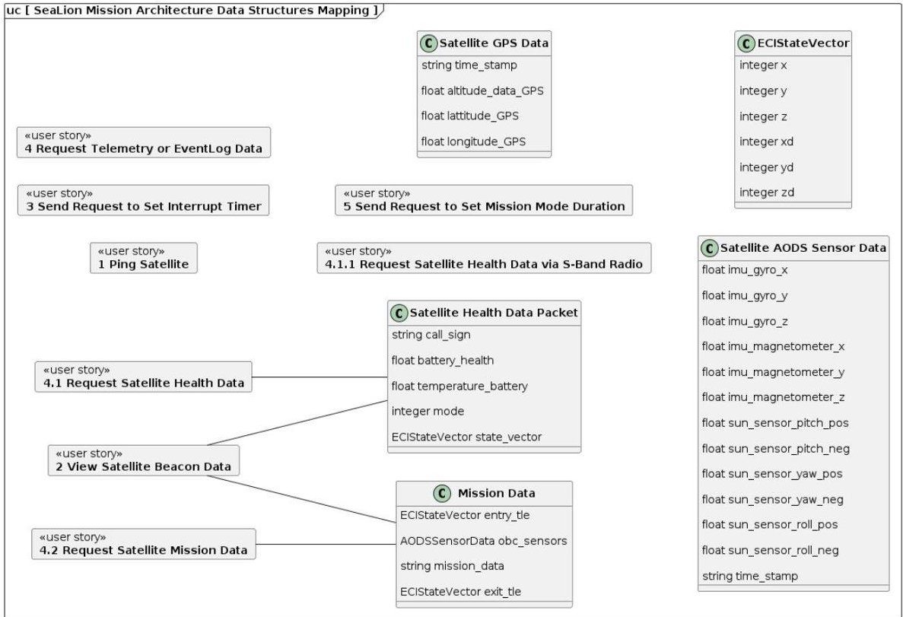


## Finite State Machine

<!-- PDF_PAGE: 98 -->


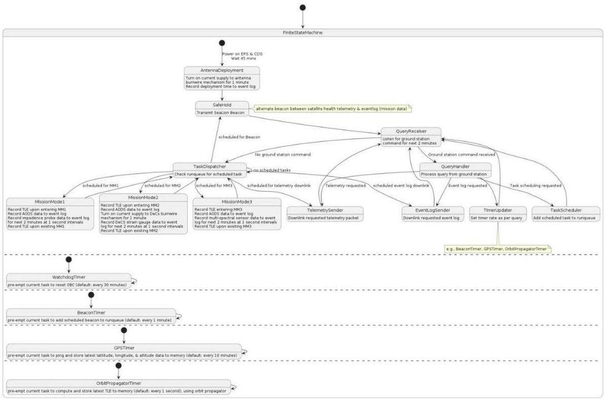


<!-- PDF_PAGE: 99 -->

<div align="center">

# B. SEALION DOF GENERATED DOCUMENT

</div>

Distributed OSHW Framework (DOF)

## Distributed OSHW Framework (DOF)

## J. Simmons - jrs@mach30.org - Version V0.1.6, 2/27/2023

# Table of Contents

Stakeholder Needs

User Stories

User Story 1: Branch OSHW

User Story 2: Fork OSHW

User Story 3: Merge OSHW

User Story 4: Composition of OSHW

Data Structures

Component

Component List Item

Activity Step

Parameter

Function

Interface List Item

Unresolved directive in DOF.adoc - include:../README.adoc[]

## Stakeholder Needs

The development of the Distributed OSHW Framework (DOF) is guided by a series of stakeholder needs, listed below.

## Stakeholder Need 1: OSHW Definition

OSHW projects should be developed and shared in accordance to the OSHW Definition (https://www.oshwa.org/definition/).

## Stakeholder Need 2: OSHW Certification

OSHW projects should be developed and shared in accordance to the OSHW Certification process (https://certification.oshwa.org/process.html).

## Stakeholder Need 3: OSHW should be like OSS

Open Source Hardware should be like Open Source Software to the greatest degree possible (e.g. sharing, development, licensing).

<!-- PDF_PAGE: 100 -->

## Stakeholder Need 4: OSHW Source Definition

The source of an OSHW project is its: Bill of Materials Data (list of components and counts covering all parts which must be purchased to build the project), Assembly Instructions (complete list of instructions to build the project from its purchased parts), and Supporting Documentation (e.g. design files, schematics, operating instructions)

## User Stories

DOF's stakeholder needs are then used to identify a series of user stories which then lead to design decisions captured in data structure and activity definitions.

## User Story 1: Branch OSHW

As a OSHW Developer I want to use branches in the development of OSHW so that I can modify the project source in parallel lines of development.

Example: Creating a v1 branch to preserve and maintain v1 source as part of OSHW certification compliance. New development can then happen on trunk or a v2 branch.

## User Story 2: Fork OSHW

As a OSHW Developer I want to fork OSHW projects so that I can modify the project source in my own epository.

Example: Forking a project to customize its design for my own purposes (e.g. swapping out a controller board, adjusting it to fit me).

## User Story 3: Merge OSHW

As a OSHW Developer I want to merge project source so that I can integrate changes from a branch or fork into my current source.

Example: Incorporating suggested source changes from a contributor who forked the project to develop a new feature for the project.

## User Story 4: Composition of OSHW

As a OSHW Developer I want to include external projects as elements of my project so that I can build upon previous engineering effort (my own or others').

Example: Using an Arduino Uno as the controller board for an OSHW robot project.

<!-- PDF_PAGE: 101 -->

## Data Structures

This section covers each data structure type in the Distributed OSHW Framework (DOF).

## Component

Purpose: Represents the smallest logical element in an OSHW project. A Component may be a project in its own right (with a sub-component hierarchy) or may be nested as a sub-component in the "source" of another component.

## Component Template

name: {{name}}

version: {{version}}

description: {{description}}

license: {{license}}

author: {{author}}

dependencies: {{dependencies}}

components: {{components}}

parts: {{parts}}

functions: {{functions}}

tools: {{tools}}

precautions: {{precautions}}

assemblySteps: {{assemblySteps}}

<div align="center">

Table 1. Component Specification

</div>

<table border="1"><tr><td>Field</td><td>Type</td><td>Item Type</td><td>Description</td><td>Source</td></tr><tr><td>name</td><td>string</td><td></td><td>Source representation of the component&#x27;s name. Format = single word, only lowercase letters, and may contain hyphens and underscores.</td><td>Creating a package.json file(https://docs.npmjs.com/creating-a-package.json-file)</td></tr><tr><td>version</td><td>string</td><td></td><td>Version number of the component&#x27;s source. Format = x.x.x per semantic versioning guidelines.</td><td>Creating a package.json file(https://docs.npmjs.com/creating-a-package.json-file)
About semantic versioning(https://docs.npmjs.com/about-semantic-versioning)</td></tr></table>

<!-- PDF_PAGE: 102 -->

<div align="center">

Distributed OSHW Framework (DOF)

</div>

<table border="1"><tr><td>Field</td><td>Type</td><td>Item Type</td><td>Description</td><td>Source</td></tr><tr><td>description</td><td>string</td><td></td><td>Human readable representation of the component&#x27;s name. Typically used in rendered documentation referencing the component.</td><td>Creating a package.json file(https://docs.npmjs.com/creating-a-package.json-file)</td></tr><tr><td>license</td><td>string</td><td></td><td>List of licenses used within the component&#x27;s source.Format=SPDX license expression.</td><td>Using SPDX License List&quot;short identifiers&quot;in source files(https://spdx.org/sites/cpstandard/files/pages/files/using_spdx_license_list_short_identifiers.pdf)</td></tr><tr><td>author</td><td>string</td><td></td><td>Identifies author(e.g. owner of source intellectual property).Format(email and website are optional)=Author Name&lt;email address&gt;(website URL)</td><td>Creating a package.json file(https://docs.npmjs.com/creating-a-package.json-file)</td></tr><tr><td>dependencies</td><td>dictionary</td><td>string</td><td>Per NPM/Yarn.Key=dependency name.Value=Semantic versioning version string.</td><td>Creating a package.json file(https://docs.npmjs.com/creating-a-package.json-file)</td></tr><tr><td>components</td><td>dictionary</td><td>Component</td><td>Listing of sub-components directly owned by this component.Key=sub-component&#x27;s name.Value=sub-component&#x27;s data structure.</td><td></td></tr></table>

<!-- PDF_PAGE: 103 -->

<div align="center">

Distributed OSHW Framework (DOF)

</div>

<table border="1"><tr><td>Field</td><td>Type</td><td>Item Type</td><td>Description</td><td>Source</td></tr><tr><td>parts</td><td>dictionary</td><td>Component List Item</td><td>Listing of the component&#x27;s parts (and substitutions) defined as sub-components. Key = part&#x27;s id. Value = part&#x27;s key data.</td><td></td></tr><tr><td>functions</td><td>list</td><td>Function</td><td>Listing of component functions.</td><td></td></tr><tr><td>tools</td><td>dictionary</td><td>Component List Item</td><td>Listing of the required tools (and substitutions) defined as sub-components. Key = tool&#x27;s id. Value = tool&#x27;s key data.</td><td></td></tr><tr><td>precautions</td><td>list</td><td>string</td><td>Listing of caution statements (e.g. safety warnings) for the component.</td><td></td></tr><tr><td>assemblySteps</td><td>list</td><td>Activity Step</td><td>Sequence of steps required to assemble the component.</td><td></td></tr></table>

## Component List Item

Purpose: Identifies a part or tool used in the fabrication of the component. Parts and tools are defined by their source material in the components list.

Component List Item Template

id: {{id}}

description: {{description}}

descriptionLong: {{descriptionLong}}

descriptionSelected: {{descriptionSelected}}

quantity: {{quantity}}

quantityUnits: {{quantityUnits}}

options: {{options}}

selectedOption: {{selectedOption}}

notes: {{notes}}

interfaces: {{interfaces}}

<div align="center">

Table 2. Component List Item Specification

</div>

<table border="1"><tr><td>Field</td><td>Type</td><td>Item Type</td><td>Description</td><td>Source</td></tr></table>

<!-- PDF_PAGE: 104 -->

<div align="center">

Distributed OSHW Framework (DOF)

</div>

<table border="1"><tr><td>Field</td><td>Type</td><td>Item Type</td><td>Description</td><td>Source</td></tr><tr><td>id</td><td>string</td><td></td><td>Part&#x27;s ID (or part number).Format = single word, only lowercase letters, and may contain hyphens and underscores.</td><td></td></tr><tr><td>description</td><td>string</td><td></td><td>Human readable name for the part (not name of the selected component for this part).</td><td></td></tr><tr><td>descriptionLong</td><td>string</td><td></td><td>Computed value = &quot;{{id}}:{{description}}&quot;.Used as shortcut in documentation.</td><td></td></tr><tr><td>descriptionSelected</td><td>string</td><td></td><td>Computed value = &quot;{{id}}:{{description}}{{selectedOption.description}}v{{selectedOption.version}}&quot;</td><td></td></tr><tr><td>quantity</td><td>number</td><td></td><td>Defines how much of the item is required (whole number or real number depending on item)</td><td></td></tr><tr><td>quantityUnits</td><td>string</td><td></td><td>Unit of measure for the specified quantity.When specifying units for whole components use&quot;part&quot;</td><td></td></tr><tr><td>options</td><td>list</td><td>string</td><td>List of component names defining available substitutions for the part or tool.</td><td></td></tr><tr><td>selectedOption</td><td>integer</td><td></td><td>Specifies the selected option from the list of component options.</td><td></td></tr><tr><td>notes</td><td>string</td><td></td><td>Developer comments on this part or tool.</td><td></td></tr><tr><td>interfaces</td><td>dictionary</td><td>3-DataStructures/6-InterfaceListItem.yaml&#x27;</td><td>Listing of interfaces for the part or tool.Key = interface&#x27;s id.Value = interface&#x27;s key data.</td><td></td></tr></table>

<!-- PDF_PAGE: 105 -->

Activity Step

Purpose: Defines a single step in an activity, e.g. assembly instructions.

Activity Step Template

summary: {{summary}}

requiredParts: {{requiredParts}}

requiredTools: {{requiredTools}}

details: |

  {{details}}

<div align="center">

Table 3. Activity Step Specification

</div>

<table border="1"><tr><td>Field</td><td>Type</td><td>Item Type</td><td>Description</td><td>Source</td></tr><tr><td>summary</td><td>string</td><td></td><td>Brief overview of the step(optional if step includes details).Can be used as a heading in documentation rendered from the step.</td><td></td></tr><tr><td>requiredParts</td><td>list</td><td>string</td><td>Optional list of part IDs needed to complete this step.</td><td></td></tr><tr><td>requiredTools</td><td>list</td><td>string</td><td>Optional list of tool IDs needed to complete this step.</td><td></td></tr><tr><td>details</td><td>string</td><td></td><td>Multiline formatted text string defining the details of the step(optional if step includes summary).Format is up to user(e.g.list,ordered list,narrative text,some combination).</td><td></td></tr></table>

Parameter

Purpose: Defines a data structure for an input or output of a component function.

Parameter Template

<!-- PDF_PAGE: 106 -->

name: {{name}}

description: {{description}}

type: {{type}}

units: {{units}}

defaultValue: {{defaultValue}}

constraints: {{constraints}}

<div align="center">

Table 4. Parameter Specification

</div>

<table border="1"><tr><td>Field</td><td>Type</td><td>Item Type</td><td>Description</td><td>Source</td></tr><tr><td>name</td><td>string</td><td></td><td>Source representation of the parameter&#x27;s name. Format is C-style variable naming convention</td><td></td></tr><tr><td>description</td><td>string</td><td></td><td>Human readable representation of the parameter&#x27;s name. Typically used in rendered documentation referencing the parameter.</td><td></td></tr><tr><td>type</td><td>string</td><td></td><td>Parameter type, may be a base type (e.g. string, int) or a path to a Data Structure</td><td></td></tr><tr><td>units</td><td>string</td><td></td><td>Unit of measure for the specified quantity.</td><td></td></tr><tr><td>defaultValue</td><td>string</td><td></td><td>String representation of default parameter value.</td><td></td></tr><tr><td>constraints</td><td>list</td><td>string</td><td>Each item in the list defines a restriction of the values the parameter may store (e.g., $\Leftarrow$ 10, enums = 3.14, 42, 1701).</td><td></td></tr></table>

## Function

Purpose: Defines a data structure for a component function.

https://odu-cga-cubesat.github.io/dof-cubesat/

<!-- PDF_PAGE: 107 -->

Function Template

name: {{name}}

description: {{description}}

inputs: {{inputs}}

outputs: {{outputs}}

<div align="center">

Table 5. Function Specification

</div>

<table border="1"><tr><td>Field</td><td>Type</td><td>Item Type</td><td>Description</td><td>Source</td></tr><tr><td>name</td><td>string</td><td></td><td>Source representation of the function&#x27;s name. Format is C-style function declaration naming convention</td><td></td></tr><tr><td>description</td><td>string</td><td></td><td>Human readable representation of the function&#x27;s name. Typically used in rendered documentation referencing the function.</td><td></td></tr><tr><td>inputs</td><td>list</td><td>Parameter</td><td>Listing of acceptable input parameters by this function.</td><td></td></tr><tr><td>outputs</td><td>list</td><td>Parameter</td><td>Listing of expected output parameters from this function.</td><td></td></tr></table>

Interface List Item

Purpose: Identifies an interface on a part or tool.

Interface List Item Template

id: {{id}}

description: {{description}}

`descriptionLong: {{descriptionLong}}`

<div align="center">

Table 6. Interface List Item Specification

</div>

<table border="1"><tr><td>Field</td><td>Type</td><td>Item Type</td><td>Description</td><td>Source</td></tr></table>

<!-- PDF_PAGE: 108 -->

<div align="center">

Distributed OSHW Framework (DOF)

</div>

<table border="1"><tr><td>Field</td><td>Type</td><td>Item Type</td><td>Description</td><td>Source</td></tr><tr><td>id</td><td>string</td><td></td><td>Interface&#x27;s ID. Format = single word, only lowercase letters, and may contain hyphens and underscores.</td><td></td></tr><tr><td>description</td><td>string</td><td></td><td>Human readable name for the interface.</td><td></td></tr><tr><td>descriptionLong</td><td>string</td><td></td><td>Computed value = &quot;{{id}}:\{\{description\}\}&quot;. Used as shortcut in documentation.</td><td></td></tr></table>

Version v0.1.6

Last updated 2023-02-27 23:28:40 UTC

<!-- PDF_PAGE: 109 -->

<div align="center">

# SeaLion Mission Architecture Assembly Instructions

</div>

## Table of Contents

1. Assemble Sealion Structure 1

1.1. Tools 1

1.2. Materials 1

1.3. Procedure 3

## 1. Assemble Sealion Structure

## 1.1. Tools

<table border="1"><tr><td>Name</td><td>Description</td><td>Notes</td></tr><tr><td>Screwdriver</td><td>Screwdriver</td><td></td></tr><tr><td>Clean Box</td><td>Clean box</td><td>Creates a positive pressure environment to prevent particulate accumulation</td></tr><tr><td>Plier</td><td>Plier needle nose generic</td><td></td></tr><tr><td>Electronic Caliper</td><td>Caliper eletronic generic</td><td>Electronic Caliper to measure dimensions</td></tr></table>

## 1.2. Materials

<table border="1"><tr><td>Quantity</td><td>ID</td><td>Name</td><td>Description</td><td>Notes</td></tr><tr><td>1 unit</td><td>plate</td><td>Top Plate</td><td>Top plate v0.1.0</td><td></td></tr><tr><td>1 unit</td><td>bottom-plate</td><td>Bottom Plate with integrated tabs</td><td>Top plate v0.1.0</td><td>Bottom Plate with integrated tabs</td></tr><tr><td>1 unit</td><td>sheetmetal-antenna-bracket</td><td>Sheetmetal Antenna Bracket</td><td>Sheetmetal antenna bracket: monopole v0.1.0</td><td>Adapter plate for sheetmetal bottom plate&#x27;s antenna</td></tr><tr><td>2 unit</td><td>battery-case-adapter</td><td>Battery Case Adapter</td><td>Battery case adapter v0.1.0</td><td></td></tr><tr><td>1 unit</td><td>right-bracket</td><td>Right Bracket</td><td>Right bracket v0.1.0</td><td>Right Bracket to hold the MsS and Sun Sensor</td></tr><tr><td>1 unit</td><td>left-bracket</td><td>Left Bracket</td><td>Left bracket v0.1.0</td><td></td></tr></table>

<!-- PDF_PAGE: 110 -->

<table border="1"><tr><td>Quantity</td><td>ID</td><td>Name</td><td>Description</td><td>Notes</td></tr><tr><td>1 unit</td><td>ejection-plate</td><td>Ejection Plate</td><td>Ejection plate v0.1.0</td><td></td></tr><tr><td>3 unit</td><td>ejection-plate-standoff</td><td>Ejection Plate Standoff</td><td>Ejection plate standoff v0.1.0</td><td></td></tr><tr><td>1 unit</td><td>separation-connector-mounting-bracket</td><td>Separation Connector Mounting Bracket</td><td>Separation connector mounting bracket v0.1.0</td><td></td></tr><tr><td>2 unit</td><td>deco-side-plate</td><td>DeCo Side Plate with integrated tabs</td><td>Deco side plate v0.1.0</td><td></td></tr><tr><td>2 unit</td><td>sealion-deco-bottom-mount-plate</td><td>DeCo Bottom Mount Plate</td><td>Deco bottom mount plate v0.1.0</td><td>DeCo Bottom Mount Plate for DeCS</td></tr><tr><td>1 unit</td><td>plastic-ratcheting-gear</td><td>Plastic Ratcheting Gear</td><td>Plastic ratcheting gear v0.1.0</td><td></td></tr><tr><td>1 unit</td><td>deco-spool</td><td>DeCo Spool</td><td>Deco spool v0.1.0</td><td>DeCo Spool for boom deployment mechanism</td></tr><tr><td>1 unit</td><td>deco-spool-clamp</td><td>DeCo Spool Clamp</td><td>Deco spool clamp v0.1.0</td><td>DeCo Spool Clamp to attach Carbon Fiber boom to DeCo Spool</td></tr><tr><td>1 unit</td><td>deco-bearing-spin-spool</td><td>DeCo Bearing Spin Spool</td><td>Deco bearing spin spool v0.1.0</td><td>DeCo Bearing Spin Spool allowing DeCo Spool to rotate for deployment</td></tr><tr><td>1 unit</td><td>flanged-sleeve-bearing</td><td>Flanged Sleeve Bearing</td><td>Flanged sleeve bearing v0.1.0</td><td>Flanged Sleeve Bearing for high temperatures and dry environments</td></tr><tr><td>1 unit</td><td>latch-lever</td><td>Latch Lever</td><td>Latch lever v0.1.0</td><td>Latch Lever to interact with the burnwire mechanism and sprinloaded bolts to open DeCS doors</td></tr></table>

<!-- PDF_PAGE: 111 -->

<table border="1"><tr><td>Quantity</td><td>ID</td><td>Name</td><td>Description</td><td>Notes</td></tr><tr><td>1 unit</td><td>door-latch-pin-hole-sleeve</td><td>Door Latch Pin Hole Sleeve</td><td>Door latch pin hole sleeve v0.1.0</td><td>Door Latch Pin Hole Sleeve to constrain the Bearing Pin Spool</td></tr></table>

## 1.3. Procedure

1. 3.1. Attach {{parts.bottom-plate.description}} to {{parts.leftbracket.description}}

## Required Parts

- Bottom Plate with integrated tabs

- Left Bracket

## Instructions

1. Place the {{parts.bottom-plate.description}} on flat surface

2. Place the {{parts.left-bracket.description}} into the longitudinal side of {{parts.bottomplate.description}}

<!-- PDF_PAGE: 112 -->

## VITA

Kevin Yi-Tzu Chiu was born in Akron, Ohio in 1995. During his childhood, he always dreamed of working within the aerospace industry especially after watching numerous launches from Kennedy Space Center during his time in Florida. He attended the University of Massachusetts Amherst in 2013 where he received his Bachelor of Science in mechanical engineering in May, 2017. Afterwards, he moved to Virginia to become a mechanical engineer at Newport News Shipbuilding. From here, he was to enter Old Dominion University as part of the Master of Science program in aerospace engineering. Becoming interested in space systems, he contacted Dr. Sharan Asundi to conduct research and subsequently became part of the SeaLion CubeSat project.