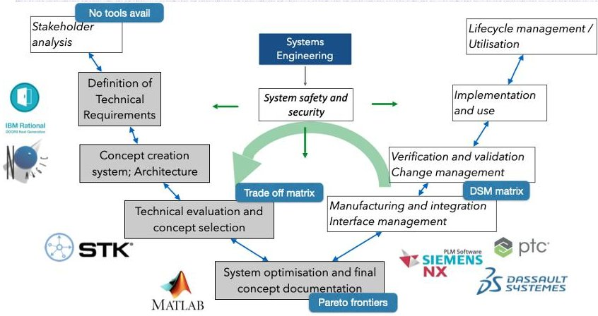
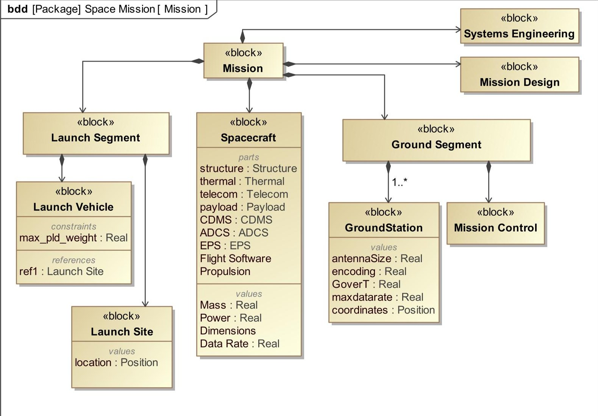
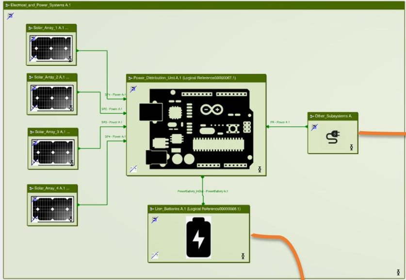
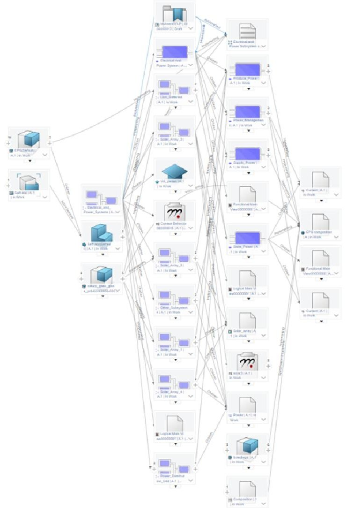

<!-- PDF_PAGE: 1 -->

# IAC-23,D1,5,6 Spacecraft digital engineering: the tale of "digital twins" and lessons learned

Anton B. Ivanov $ ^{\star\dagger} $

$ ^{ \star} $ Propulsion and Space Research Center, Technology Innovation Institute Masdar City, Abu Dhabi, United Arab Emirates anton.ivanov@tii.ae $ ^{ \dagger} $ Corresponding author

## Abstract

Model Based Systems Engineering (MBSE) approach has proved its efficiency in the design of many complex systems. It provides a mechanism for sequential linking of requirements, logical elements, and simulation models, while all information is stored in the central "the only source of truth" database. In this study, we looked at the status of existing simulation models in spacecraft engineering domain and means of connecting them into a "digital twin". We evaluated the complexity of modelling required to analyze an astrophysical mission based on a constellation of CubeSats. The main mission goal is to demonstrate coordinated observation of gamma ray events.

Conceptual design of satellites can be successfully performed based on 1D modelling, with some interfaces to detailed 3D analysis. We set out to put together the best tools available (including PLMs) on the market for detailed 3D design. The approach has been validated while building two 3U CubeSats launched in August 2022. We investigated the classical domains of a space project: mission design, systems engineering, environment modelling, mechanical and thermal design, electrical systems, communication systems, payload simulation, electronics development, flight software, attitude determination and control system and electric propulsion. We have analyzed in detail these domains to understand what tools are used there and how we can connect them to each other. We will discuss the main difficulties encountered (model complexity, interfaces, amount of work required and last-minute changes) to establish a "digital twin". Our conclusion is that the key activity all teams must go through is to optimize how much resource will be devoted to documentation and modelling vs. how many people will be involved in assembly, integration, and testing activities.

Keywords:

## 1. Introduction

In the ever-evolving realm of space exploration and satellite technology, spacecraft digital twins now represent a set of models to ensure mission success, reduce testing costs, and improving overall operational efficiency. The concept of a digital twin, a virtual representation of a physical object or system, has gained significant traction in recent years across various industries. In the context of space exploration, it offers certain advantages, enabling real-time monitoring, simulation, and optimization of spacecraft performance and systems. This paper presents our research and efforts in understanding what level of detail in modeling, efforts required to design and maintain the models. Our work has been carried out in the framework of a CubeSat project.

The development of spacecraft digital twins involves the creation of detailed and accurate virtual replicas of spacecraft, encompassing their structural, functional, and operational aspects. Digital twins facilitate a wide range of activities, including mission planning, system analysis, anomaly detection, and

predictive maintenance, all of which are essential for ensuring mission success and reducing the risk associated with space endeavors.

During development of our Cubesat project, we recognized the importance of leveraging both open source and commercial software tools. The fusion of these two categories of software solutions brings forth a comprehensive approach. Open source software offers the advantages of cost-effectiveness, communitydriven development, and transparency, enabling a collaborative and adaptable approach to digital twin development. On the other hand, commercial software solutions provide specialized features, technical support, and often higher performance capabilities, which are invaluable in achieving highly accurate and sophisticated digital twin models.

We will look in more detail at two approaches: using concurrent design and utilizing Product Lifecycle tools (PLMs). Concurrent spacecraft design is a holistic approach that integrates various aspects of spacecraft development, encompassing engineering disciplines, mission objectives, and operational considerations simultaneously. It involves collaborative and parallel workflows among multidisciplinary teams to optimize

<!-- PDF_PAGE: 2 -->

the过程. By intertwining systems engineering, propulsion, materials, avionics, and payload integration from the project's inception, concurrent design enables iterative refinement and trade-offs, resulting in a more efficient, cost-effective, and missionfocused spacecraft design. This approach has been widely accepted in NASA [1], ESA [2], national agencies [3,4,5] and universities [6,7,8] to develop Phase 0/A missions. The utilization of Product Lifecycle Management (PLM) tools in spacecraft design offers a sophisticated framework for comprehensive management of spacecraft manufacturing especially in later phases of a project (Phase C/D). PLM tools serve as invaluable assets by providing a structured platform that enables systematic organization, tracking, and analysis of design data, especially for detailed design. This integrated approach not only facilitates streamlined collaboration among interdisciplinary teams but also ensures data consistency and real-time information sharing. PLM tools enable thorough documentation of design decisions, requirements compliance, and configuration control, which are essential for maintaining the highest standards of precision and reliability demanded in manufacturing, assembly, integration and testing phase (MAIT).

In the following sections, we will delve into the methodologies, tools, and results of our spacecraft digital twin modeling efforts, looking at both concurrent design approach and existing commercial PLM tools. We look in detail at integration of open source and commercial software to assist with building a university Cubesat. We will also discuss whether the "digital twin" is appropriate or misleading for existing processes at least within the CubeSat context.

## 2. State of the art

We can identify two primary approaches for spacecraft systems modeling. The first approach, often referred to as "light" 1D modeling, serves as a rapid and simplified means to assess the fundamental aspects of a system. This approach is particularly valuable when quick evaluations are required, such as in the early stages of design or when assessing overall system cost-effectiveness. 1D modeling abstracts the system's detail into parameterized mathematical representations, allowing engineers and designers to focus on the system's high-level behavior, performance characteristics, and cost implications. It provides a valuable bird's-eye view of the system, enabling stakeholders to make informed decisions about its feasibility and economic viability.

Conversely, the second approach, known as "heavy" 3D modeling, is a comprehensive and detailed method. Unlike 1D modeling, 3D modeling represents every detail of a system, providing a granular representation of its structure, behavior, and interactions. This approach is particularly essential when precise simulations and analyses are required to gain insights into the system's performance at a micro-level. Engineers and researchers employ 3D modeling to assess a number of physical processes, such as stress points, heat dissipation, fluid dynamics, and complex geometrical considerations. While 1D modeling is efficient for early-stage evaluations, 3D modeling is crucial for in-depth understanding, validation, and optimization

of a system's functioning, making it a crucial tool for engineers and scientists aiming to design and develop complex systems with precision and reliability. The choice between these two modeling approaches depends on the specific requirements and objectives of the project, with each offering its unique advantages in the world of system design and analysis.

The application of 1D modeling is important, particularly during the initial stages of the design process, which include preliminary design and concept evaluation. This approach provides a swift and efficient means of exploring various system options and assessing the overall cost implications. In the early stages of a project, engineers and designers often need to make rapid decisions about the feasibility and viability of different design alternatives.

For instance, one practical application of 1D modeling can be seen in evaluating the economic feasibility of a space segment dedicated to narrowband communications, such as those used for the Internet of Things (IoT). This technology demands a cost-effective approach, and 1D modeling can play a role in assessing the financial viability of the space-based infrastructure needed for IoT connectivity. By using 1D modeling tools, engineers can estimate system costs, analyze resource requirements, and evaluate potential trade-offs in terms of performance and affordability.

Moreover, global best practices in engineering and aerospace industries have demonstrated that the judicious use of 1D modeling can lead to substantial reductions in production costs, particularly for small-scale products. This method's ability to expedite decision-making, optimize system designs, and identify cost-saving opportunities makes it an invaluable tool in the engineer's arsenal. It not only accelerates the development process but also ensures that projects remain cost-effective, aligning with the expectations of modern industries, where efficiency and cost-control are critical factors for success. Consequently, 1D modeling holds great promise in enhancing the competitiveness of products and systems across various domains.

The application of 3D modeling plays a important role in the later stages of spacecraft development, particularly during the preparation of design documentation and the detailed development of key system components. This advanced modeling approach is required to allow precise representation and comprehensive evaluation. One practical example where 3D modeling proves invaluable is in the field of astrophysics, where spacecraft may be tasked with ensuring precise control of a detector's temperature with an accuracy of just 1 Kelvin per hour of observation. This level of temperature control is essential for highly sensitive photometric measurements of exoplanets. 3D models in this context allow engineers to simulate and analyze the complex thermal dynamics within the spacecraft, ensuring that the detector remains within the specified temperature range during extended observation periods.

However, it's important to note that the development of 3D models can be a complicated and time-consuming process. These models must accurately represent the spacecraft's physical structure, materials, interfaces and components, and they often require meticulous attention to detail. Nevertheless, the investment of time and effort in 3D modeling pays off in terms of

<!-- PDF_PAGE: 3 -->

Figure 1: V model of a space mission life-cycle from design to manufacturing to operations. Various products used at each phase are shown to illustrate correspondence of tools to development phases.

system reliability, especially if for serial units. One additional benefit of 3D modeling lies in its suitability for virtual testing. These models can be effectively employed for simulating various environmental factors, including vibration, thermal conditions (our team has run a number of validation tests using our own thermovacuum chamber), and in some cases, electromagnetic compatibility (EMC).

Currently, there are different software systems used at various stages of the Systems Engineering (SE) process. However, when transitioning from one software package to another, a significant amount of information can be lost, creating inefficiencies and potential errors in the process. For instance, when preparing a Technical Specification (TS) in a Word format, it can be challenging to seamlessly transfer this information into other tools or software used for different phases of the project. Another example is maintenance of separate geometrical meshes between mechanical and thermal models.

The central idea behind the an overarching SE tool or interface is to ensure the seamless transfer of engineering and economic information throughout all stages of the project in a digital format. This approach aims to eliminate data loss, streamline communication, and enhance collaboration between different teams and stakeholders involved in the project. By having all project-related information in a digital format, documentation can be generated automatically at any stage of the project using predefined templates, reducing the risk of errors, saving time, and improving overall document consistency.

In addition to data continuity, a user-friendly interface and cross-device accessibility are also essential aspects of this new tool or interface. Engineers and project stakeholders need to access and interact with project data and documentation from various devices, ensuring that information is readily available and up-to-date for effective decision-making and collaboration. Fortunately, cloud services are now omnipresent and a lot of useful information can be rendered through standard browsing interfaces.

The utilization of the V-Model diagram 1 in spacecraft design represents a structured and systematic approach to the development process, ensuring that each stage of design is rigorously aligned with its corresponding verification and validation

phase. In the context of spacecraft design, the V-Model diagram effectively maps out the project's lifecycle, starting from the left side with the system requirements and progressing through various design phases, including subsystem design, component design, and software development. As each design phase is completed, the diagram branches downward into its corresponding verification phase on the right side of the "V," emphasizing the critical relationship between design and testing. This approach ensures that design elements are thoroughly validated before moving on to the subsequent phases, reducing the risk of costly design flaws surfacing late in the project.

Moreover, the V-Model diagram enforces a clear and traceable path from requirements to final testing, ensuring that the spacecraft's design meets its specified objectives and missioncritical requirements. In essence, the V-Model diagram serves as a powerful framework for managing complexity, minimizing risks, and achieving mission success in spacecraft design.

## 2.1. Concurrent Design

There are many tools that are used for the concurrent design. Here, we will only mention tools used for the study. Some tools used in the industry (e.g. DOORS) were not available to authors at the time of the writing.

Historically, Microsoft Excel was the major interface to all processes with coordination of variables between participants of a study. One of the products that is widely known in the industry is OCDT [2,9]. This tool effectively requires development of a specialized Excel worksheet that is later integrated into a systems view with a 1-D design of the spacecraft mission. Often times, domain engineers use other tools in the background an manually transfer values into Excel cells. Later version of OCDT have an API for interaction with external software.

ValiSpace $ ^{2} $ has recently emerged as serious contender to use on engineering studies. This is a software product that streamlines the validation and verification process for complex engineering systems, helping organizations efficiently manage requirements, design, and testing phases.

SysML (Systems Modeling Language) [10] is a standardized modeling language used in spacecraft systems engineering to capture, define, and analyze complex systems and their interactions. Commercial tools (e.g. MagicDraw) provide a graphical representation of system components, their relationships, and behaviors, enabling engineers to visualize and communicate overall picture of system architectures and requirements. The next version SysMLv2 promises a much cleaner textual interface, which can be rendered into diagrams.

MagicDraw (now a part of the 3D Experience suite by Dassault Systemes) is a software tool commonly used in spacecraft systems engineering for SysML modeling. It facilitates the creation of detailed system models, allowing engineers to design, simulate, and analyze spacecraft systems efficiently. MagicDraw's features, such as diagram creation, parametric modeling, and simulation capabilities, make it a valuable tool for

<!-- PDF_PAGE: 4 -->

visualizing and validating complex spacecraft designs, ensuring that all components and subsystems work harmoniously together before actual development and deployment. This combination of SysML and MagicDraw significantly enhances the efficiency and accuracy of spacecraft systems engineering, leading to more reliable and successful missions.

ANSYS STK (Systems Tool Kit) software is yet another important software for the digital engineering of space missions by providing a comprehensive platform for mission design, analysis, and simulation. Leveraging advanced modeling and simulation capabilities, ANSYS STK models and visualizes spacecraft trajectories, assists with mission planning and has capabilities to model some of the spacecraft subsystem behaviour.

## 2.2. CAD/CAM/PLM systems

Siemens NX and TeamCenter are powerful software tools that can be effectively used in the design and development of a spacecraft mission. Siemens NX is a versatile computeraided design (CAD) and computer-aided engineering (CAE) software, providing a comprehensive platform for spacecraft design. With NX, aerospace engineers can create highly detailed 3D models of spacecraft components, systems, and structures. They can simulate and analyze the behavior of these systems under various conditions, including thermal, structural, and aerodynamic, ensuring that the spacecraft can withstand the rigors of space travel and fulfill its mission objectives.

TeamCenter, on the other hand, serves as a product lifecycle management (PLM) software solution that complements Siemens NX. It facilitates the organization and management of design data, documents, and project information throughout the entire spacecraft development process. TeamCenter ensures version control, traceability, and data integrity, which are critical in spacecraft mission design where precision and documentation are paramount. This software also enables efficient collaboration by providing a centralized repository for all projectrelated data.

The 3DEXPERIENCE suite, featuring tools like ENOVIA, SIMULIA, and CATIA, plays a crucial role in spacecraft mission design and lifecycle management. ENOVIA serves as the central hub for managing all project data, documents, and collaboration efforts. In spacecraft mission design, ENOVIA enables teams to efficiently handle requirements, track design change and maintain version control for critical documents and models. It enhances collaboration across diverse teams, departments, and external partners, reducing the risk of errors during the design phase.

SIMULIA, another component of the 3DEXPERIENCE suite, provides advanced simulation and modeling capabilities essential for spacecraft design. It enables the performance of complex finite element analysis (FEA) and computational fluid dynamics (CFD) simulations. These simulations assess structural integrity, thermal performance, and aerodynamic properties, helping optimize component designs for space conditions. By seamlessly integrating SIMULIA with CATIA, CAD models can be efficiently transferred into the simulation environment, simplifying analysis and validation processes. Lastly, CATIA, a comprehensive CAD and design tool, aids in creating 3D models of

spacecraft components and systems. It streamlines the design and visualization of the spacecraft's physical structure, mechanical systems, and electronic components. CATIA electrical design capabilities support the creation of wiring diagrams, harness layouts, and electronic configurations crucial for spacecraft systems. The integration of CATIA with other 3DEXPERIENCE tools like ENOVIA guarantees seamless data management, version control, and compliance adherence throughout the entire spacecraft mission lifecycle.

We were fortunate to have access to both software suites (Siemens and Dassault), which were used independently for educational processes. By leveraging educational licenses, we've gained access to cutting-edge software, tools, and resources that allowed students to have first hand experience with industrial tools, from design and development to testing and validation. This approach is very effective to prepare future generation of space engineers. Moreover, it empowers our team to tap into the latest updates, support services, and collaborative features offered by established software providers.

## 3. Cubesat Project description

The primary objectives of this project were 1) demonstration of swarm communication technologies in UHF band; 2) establishment of a functional constellation of small satellites, and the refinement of techniques for multisatellite space observations. Science goal was to monitor gamma and X-ray radiation flashes. These observations hold significant importance in astrophysics and space science.

The crucial aspect of the project is the development and testing of inter-satellite communication channels, aiming to establish effective and reliable communication links between satellites within the constellation. This is essential for ensuring coordinated operations and data exchange among multiple spacecraft. Additionally, the project focuses on perfecting the functionality of a swarm of microsatellites, exploring their collective capabilities for various applications.

Another vital objective of this project is to actively engage students from schools and universities in the entire lifecycle of satellite development, from design and manufacturing to launch and operation, within the context of the satellite swarm. This not only provides students with hands-on experience in aerospace engineering but also fosters collaboration between academic institutions and the space industry. Furthermore, the project envisions the implementation of science and education programs as part of its efforts, which will contribute to knowledge dissemination and capacity-building in the field of space science and technology, aligning with broader educational goals and scientific advancement.

## 3.1. Use case description

In this satellite mission, with a primary focus on engaging school students [11] and scientists alike, the spacecraft is employed as both an educational tool and a scientific instrument. For the school students, the satellite served as an exciting and tangible platform for learning about space missions. It provided

<!-- PDF_PAGE: 5 -->

a real-world context for lessons in physics, astronomy, and engineering, offering hands-on experience through activities like tracking the satellite's orbit, monitoring its telemetry data, and participating in mission simulations. By involving students in various mission aspects, from mission planning to data analysis, the project fostered a sense of curiosity and passion for space exploration among the next generation of scientists and engineers.

Simultaneously, the satellite mission catered to the needs of scientists [12,13] running the gamma-ray detection experiment (DEKOR). The spacecraft's payload was specifically designed to accommodate their research objectives, allowing them to collect and analyze gamma-ray data from space. The satellite team focused on optimizing the spacecraft's communication technology and operational capabilities to ensure seamless data transmission, telemetry reception, and command execution. This enabled the scientists to remotely operate their experiments and receive real-time data, facilitating scientific discoveries and insights into gamma-ray phenomena. The successful integration of educational and scientific goals in this mission exemplifies the synergy between engaging students in space exploration and advancing our understanding of the cosmos through innovative satellite technology.

## 3.2. Mission description

The SwarmSat mission (now known as B1 and B2 satellites) consists of two nanosatellites in the 3U form factor. They were launched into 550km SSO orbit in August 2022 and are operational as of August 2023. All subsystems were designed, manufactured and tested by the project team. The satellites featured a gamma-ray detection payload, weak attitude stabilization using magnetic field [14] Brief description of subsystems will be provided below.

## 3.3. Key Requirements

Inter-satellite Communication Develop a nanosatellite to demonstrate technologies for inter-satellite communication in UHF frequency band.

Swarm Operations Develop capability for joint operations of satellites in formation.

Multisatellite Observations Utilize joint operations capability for simultaneous observations, including observations of gamma and X-ray radiation bursts.

Student Involvement Define practices to involve school and university students in the processes of development, manufacturing, launch, and operation of microsatellites.

## 4. Subsystems modeling

All space mission projects can be split into three main segments (also illustrated in 2. We consider MAIT part of supporting services, however, in some cases it is beneficial to have at list as an additional segment.

Launch Segment - This segment focuses on the activities related to launching the spacecraft into its designated orbit. It includes tasks such as selecting an appropriate launch vehicle, securing launch permits and regulatory approvals, and coordinating the launch logistics. Additionally, the launch segment encompasses the countdown, ignition, liftoff, and spacecraft deployment into space.

Spacecraft Segment - The spacecraft segment involves the design, development, and operations of the spacecraft itself. It begins with spacecraft conceptualization and design, including defining mission objectives, selecting scientific instruments or payloads, and engineering the spacecraft's structure and systems. Once the spacecraft is built and tested, it is launched into space and undergoes commissioning. During its operational phase, this segment covers spacecraft health monitoring, data collection, and regular maintenance to ensure optimal performance.

Ground Segment - The ground segment is responsible for the control, communication, and data management related to the spacecraft. It includes the construction and operation of ground stations for communication with the spacecraft, as well as mission control centers for spacecraft operations and trajectory adjustments. Data processing and analysis, including the reception, storage, and distribution of spacecraft data, are also integral parts of the ground segment.

Supporting services - these include project management, systems engineering support and in some case assembly, integration and testing (AIT).

## 4.1. Systems Engineering

In our project, we have used extensively Valispace, ANSYS STK, and the 3D Experience platform. We looked specifically into how to integrated mission design and requirements together. Valispace emerged as a central hub for requirements management, enabling engineers to define, document, and trace mission-critical requirements. Valispace's integration capabilities allowed us to interface with ANSYS STK and provide mission specific information directly in the ValiSpace database.

Since STK tools are quite expensive (even for academic use), we have also invested some time in replacing STK's capabilities for orbit propagation and geometry management to NAIF SPICe toolkit, which is completely free and has similar capabilities, but without a nice graphics interface.

On the other hand, we also started to track requirements in SysML with the MagicDraw tool, which provides very effective tools for a systems engineer. All mission can be graphically and textually represented in diagrams, where all the elements are connected (or allocated to) and it make a very easy traceability and coverage analysis. It is now also possible to transfer all of the requirements into 3D Experience ENOVIA requirements management tool, where they can be mapped into physical objects on the satellite. We also note here, that it is very difficult to import any information into ENOVIA, if a tool is not provided

<!-- PDF_PAGE: 6 -->

Figure 2: Generic structure of a space project

by them. Everything has to be done inside the Dassault ecosystem, unfortunately, complex nature of space projects requires high degree of interoperability between tools.

From a practical point of view, all of these tools have their advantages and disadvantages. Not a single tool has emerged as a clear winner. In the end, the team decided to go with ValiSpace, since they offered the best integration capability, requirements tracking and capability to assess the main budgets of a spacecraft (mass, power, data, cost and TRL status of subsystems). The tool also allows tracking of testing procedures, which can be connected to requirements. ENOVIA has a similar mechanism, but ValiSpace is significantly more affordable compared to tools from Dassault Systemes.

We do not discuss simulation of the payload system, since it is specific to every mission and typically the science team has their own tools for modeling. Oftentimes, the only data interchange that happens is mechanical, power and data interface as a simple text description. The engineering team has then to represent payload system themselves, without much knowledge of internal working.

## 4.2. Mission Design

In mission design, the ANSYS STK is a clear winner for initial assessment of mission parameters and key characteristics.

However, in the long run, it is difficult to interface with other tools (especially with non-Windows platforms). Especially in the academic environment it is worth to invest, together with students and researchers, some time into utilization of GMAT and python based tools. They provide much better degree interoperability with, for example, ValiSpace.

## 4.3. Mechanical and Thermal design

SIMULIA and Siemens NX are indeed robust tools for simulating mechanical and thermal processes in spacecraft design. SIMULIA, as part of the Dassault Systèmes' suite, offers advanced finite element analysis (FEA) capabilities, making it invaluable for assessing structural integrity of a spacecraft. However, we had some issues to establish proper thermal modeling of heating and cooling in space. Siemens NX also provides a comprehensive platform for computer-aided design (CAD) and engineering simulation. It provides a specialized module to work with thermal environments on a spacecraft. Both software provide excellent facilities for product lifecycle management ensuring high precision manufacturing and assembling of components.

However, in some cases where highly specialized and detailed analysis is required, tools like ANSYS or Thermal Desktop are often preferred in the industry. In spacecraft design,

<!-- PDF_PAGE: 7 -->

ANSYS can be particularly useful when investigating complicated physical phenomena like shockwaves during re-entry, turbulent flow around spacecraft surfaces, or complex electromagnetic interactions. These specialized analyses are crucial for mission success but may fall outside the scope of SIMULIA and Siemens NX. Therefore, spacecraft engineers often rely on ANSYS to provide precise insights and solutions for specific challenges that demand this kind of simulations.

Figure 3: Behavioural modeling of the Energy and Power system for a cubesat. Blocks shown are solar panels that generate current, power distribution system that manages inputs from solar panels to charge the battery and deliver power to other subsystems.

## 4.4. Electrical and Power System

We have made a complete study using RFLP approach with ENOVIA/SIMULIA software. Starting with requirements, we have established a functional and logical models 3 for the electrical and power supply system to simulate dynamic processes on a satellite. Dynamic processes were modeled in the OpenModelica environment, which allowed us to connect everything to products in 3D Experience. The 1D model was successfully implemented and validated against a simple model in Python as well as against a test bench in the lab.

While the experience was satisfying we noted the following problems

- Learning curve for Dassault products is quite significant and comparable to time students would learn and develop similar programs in Python. User interfaces of RFLP approach are quite complex.

- It proved very inefficient to interface DYMOLA products with STK (only via static CSV files). Therefore, studies of EPS system parameters while changing orbital parameters was quite cumbersome to carry out. Data synchronization issues always took a lot attention.

- While there are many libraries present in Python to carry out space related projects, OpenModelica does not have libraries for space systems.

Figure 4: Connections between elements in the RFLP approach between elements in requirements, logical and physical representation. Here we only represent one subsystem of a spacecraft. Representing complete system there would become very complicated to understand.

## 4.5. Communication

CST software from Dassault Systèmes is a powerful tool for modeling and simulating antenna systems with high precision and accuracy. It can calculate electromagnetic patterns of the telecom subsystem as well of the spacecraft itself. CST's electromagnetic simulation capabilities allow for the detailed modeling of antenna structures, including their geometries, materials, and radiation patterns. We have used CST software to calculate simple antenna patterns, which were later validated in the lab.

However, in many cases, telecommunications electronics are still represented as "black boxes" within the CAD systems. It simplifies the representation of the internal electronic components. Telecom electronics are often treated as interfaces with predefined characteristics, focusing on their input and output behaviors rather than detailed internal functionalities. This simplification is due to the complexity and proprietary nature of telecom electronics, which may involve signal processing, modulation, and coding algorithms. Engineers typically use simple interface models to integrate the effects of the electronics with the antenna simulations, allowing for a holistic understanding of the overall system's performance without delving into the proprietary details of the electronic components.

<!-- PDF_PAGE: 8 -->

## 4.6. On Board Computing

Similarly to the telecom system, on-board computers are represented as simple geometries inside CAD systems. Sometimes, a significant extra effort is required to model details in order to assess electromagnetic compatibility of components.

On-board computers for spacecraft play a critical role in the overall functionality of the satellite. To ensure their reliability and performance, these computers are meticulously simulated in software, often using state machines [15]. State machines are a structured way to model the behavior of on-board computers, representing different states the computer can be in and transitions between these states. These simulations allow engineers to thoroughly test and verify the behavior of the computer under various conditions and scenarios, including those encountered in space. By simulating the on-board computer's responses to commands and data inputs, engineers can ensure that the spacecraft's computational systems function as intended, even before the actual hardware is built and deployed into orbit.

Furthermore, the software that simulates on-board computers interacts with other spacecraft systems on command and data levels, forming an additional layer of simulation that is essential for a satellite system. This interaction is crucial for ensuring that the computer can effectively communicate with and control other subsystems, such as sensors, actuators, and communication modules. Engineers use these simulations to validate the computer's ability to process incoming data, execute commands, and make decisions autonomously when required. This comprehensive approach to simulation allows for rigorous testing of the entire spacecraft system, ensuring that it can operate seamlessly and reliably in the challenging environment of space. Ultimately, these software-based simulations contribute significantly to mission success by identifying and mitigating potential issues before the spacecraft is launched, reducing risks and enhancing the overall performance of satellite systems.

## 4.7. Attitude Determination and Control

A generic Attitude Determination and Control System (ADCS comprises two essential components: hardware, consisting of sensors for measuring the spacecraft's attitude and actuators for adjusting its orientation, and software algorithms for processing sensor data and generating control commands. Hardware components have to be brought into mechanical and thermal subsystem for modeling the effects of vibration and thermal expansion. The software algorithms pose a separate set of unique challenges. Typically implemented in MATLAB or Python, these algorithms are responsible for complex tasks like processing sensor inputs, executing control laws, and ensuring that the spacecraft maintains its desired attitude. Simulating the software component is crucial for assessing its performance and verifying that it can effectively control the spacecraft's orientation.

However, integrating the ADCS into the broader spacecraft system or a digital twin presents a significant challenge. The ADCS must tightly coordinate with other subsystems like propulsion, power and payload operations to ensure mission success. The integration often involves software tools like Systems Tool

Kit (STK) for mission design and simulation. Bridging the gap between the ADCS algorithms and the mission design in STK can be complex due to the differing software environments and models. Ensuring that the ADCS seamlessly communicates with other subsystems and that mission objectives are met requires meticulous coordination and extensive testing. Additionally, real-world factors like environmental disturbances and hardware imperfections further complicate the modeling and integration efforts. Consequently, spacecraft engineers must invest significant time and resources in thoroughly modeling and testing the ADCS software, ensuring it functions harmoniously within the broader mission architecture.

In our project, we have implemented a simple magnetic coil-based ADCS. It comprises a set of copper coils integrated into on the solar panels. By selectively energizing these coils, the CubeSat can interact with the Earth's magnetic field, inducing torque and thereby controlling its orientation (simple B-dot algorithm). By altering the currents in specific coils, the spacecraft can orient itself along desired axes, allowing for precise attitude control. We have also implemented an advanced method for coordination of attitudes between the two craft, which is described in more detail in [14].

## 4.8. Propulsion

While we did not address the propulsion in our study, since our satellites did not have any propulsion subsystem. Modeling propulsion systems for spacecraft presents a complex challenge due to the diverse array of propulsion principles available, including liquid, gas, and electric propulsion. Each of these propulsion methods operates on distinct physical principles, necessitating specialized tools and simulations. Liquid propulsion relies on combustion and fluid dynamics, gas propulsion is based on high-speed exhaust gases, and electric propulsion involves ionized gases accelerated by electromagnetic fields. These disparate physics require dedicated modeling techniques and software tools. Nevertheless, a common thread among all propulsion systems is the ability to characterize their performance using fundamental parameters such as thrust and specific impulse. These parameters serve as inputs for mission design subsystems and can be integrated into mission design approach. On a mechanical level, propulsion hardware can be integrated as a black box to allow for structural, thermal, power and data interfaces to be included. In practice, it is possible to represent the elements in a SysML diagram in MagicDraw and even possibly connect to MATLAB for some simulations. However, once an overall vibration modes of the spacecraft need to be defined a detailed mesh and mass distribution will be required by the mechanical subsystem.

## 5. Discussion

Defining a spacecraft digital twin is indeed a complex endeavor, as it involves a multitude of intertwined processes and domains. As mentioned, spacecraft systems can be broadly categorized into mechanical and thermal aspects, software simulations, and mission design, each of which brings its unique

<!-- PDF_PAGE: 9 -->

challenges and considerations. In addition to these, systems engineering aspects have to be maintained through a software similar to ValiSpace. These systems are interdependent, and the behavior of one can significantly impact the others, making it difficult to encapsulate the entire spacecraft's behavior within a single digital twin. Consequently, spacecraft digital twins often consist of a "zoo" of models developed by specialized teams, each focusing on a specific subsystem or domain.

In this multifaceted approach, the mechanical and thermal domain models simulate the physical behavior of the spacecraft. This is where PLM systems perform quite well, as well providing foundation for assembly, integration and testing process. The software simulations represent the spacecraft's onboard computers and algorithms, facilitating mission-critical tasks such as attitude determination, control, payload operations and communication. Meanwhile, mission design incorporates ADCS, propulsion, radiation environment modeling, and telecom simulations, all contributing to operations planning and ensuring that the spacecraft can fulfill its mission objectives. Yet, the challenge persists in effectively integrating these diverse models, as the interfaces between different systems remain complex and may require continuous refinement to account for real-world variations and uncertainties.

The complexity of defining a spacecraft digital twin stems from the complicated connected web of processes, systems, and domains involved in spacecraft operations. The "zoo" of models approach, while comprehensive, necessitates meticulous coordination and interface management within the multidisciplinary team. As technology advances and interdisciplinary collaboration deepens, the quest for a unified and comprehensive spacecraft digital twin continues to evolve, pushing the boundaries of what can be achieved in modeling, simulation, and spacecraft design.

In recent years, a new term has appeared, which might be quite useful to describe behaviour of complex systems, including the spacecraft: "digital shadow". A "digital shadow" [16] pursues distinct objectives and boasts more favorable prospects for realization. These objectives primarily revolve around the ongoing enhancement and refinement of a simulation that mirrors the spacecraft's operational dynamics, utilizing telemetry data sourced from the spacecraft and other information channels. The ultimate outcome can be seamlessly integrated into mission planning and spacecraft troubleshooting. The research is ongoing to devise a simulation that possesses the capacity for perpetual enhancement and evolution. It achieves this by harnessing the power of AI and machine learning to analyze telemetry data from the spacecraft and other sources of information, continually adapting to up-to-date state of the system with high fidelity.

Digital shadows facilitate proactive maintenance strategies through ongoing monitoring of spacecraft performance. By scrutinizing real-time data sourced from sensors and systems, potential problems can be detected preemptively, averting significant disruptions. Key takeaways underscore the significance of precise data collection, robust analytics algorithms, and seamless integration into established maintenance workflows. This approach relies not on precise representation of subsystem, but

rather empirical definition based on acquired data. This approach is currently in development. We can imagine that instead of developing a complex model, the engineering will create a prototype, collect large amounts of data, which we can be into physics-informed AI model to replicate behaviours of an asset. This approach indeed requires considerable amounts of data to be generated, however, this is exactly the purpose of extensive tests that are done on subsystem and system level of the spacecraft. Advancement of AI/ML methods promises to shorten time needed to create a digital shadow of a satellite to evaluate its performance under various conditions. The downside of this approach is that it is not always possible to perform a representative test on the ground.

## 6. Conclusions

In this work we have investigated, whether satellite digital twin can be created while minimizing a number of software tools. We have considered an actual Cubesat project, where many models have been used and this work serves as a description of lessons learned during the process. We have considered tools which are used in the early stage of the satellite design (a.k.a Concurrent design approach) as well as tools that are utilized for advanced stages (Phases C/D) known as Product Lifecycle Management tools (PLM). 1D modeling is quite effective to define the framework of satellite implementation and helps tremendously with systems engineering of the project, but learning curve is quite simple and the tools are open-source or relatively low costs. PLM tools and other advanced modeling tools are extremely useful to define details of implementation. However, they feature a steep learning curve, lack interoperability with other tools and generally feature relatively expensive licenses (we benefited from academic versions).

No single tool is available to represent spacecraft mission in a holistic approach. We will still have to deal with a number of precise tools for precise applications at various stages of the space project development. "Digital twin" term is probably not applicable to the satellite as a system, however, it may be possible to represent some subsystems (e.g. mechanical) with a precise FEM and/or kinematic model. Our study focused on a quite specific project: Cubesat development in an academic environment and very limited resources. Most of the team were master and PhD level students, with only 3 experienced engineers to support them. However, we believe that some of the conclusions will resonate with professionals in aerospace industry. Yet a commercial tool with an open API (ValiSpace) has shown some hope, since it was possible to interface many open source tools to the database inside. It has also provided some systems engineering tools for requirements validation, verification and traceability.

Digital twins are defined as a comprehensive digital representation of a physical object. Howe ever, in reality of space exploration it is quite challenging and resource consuming to establish a comprehensive set of models that allow to mimic behaviour of a satellite in space with a single tool. We continue to have a set of advanced tools for every critical aspect of

<!-- PDF_PAGE: 10 -->

a spacecraft. A digital shadow, on the other hand, is a simplified and less detailed representation, defined by extensive data collected from all subsystems under varying conditions. While supplemented with a physics-informed AI/ML methods, it is possible a more efficient way to represent a spacecraft or even a constellation. Digital shadows will lack fidelity of the digital twin approach, however when used together these approaches shall provide a better management tools for testing and mission operations.

## 7. Acknowledgments

We note that entirety of this research was carried out by the author during his work at the Skolkovo Institute of Technology (until August 2022).

## References

[1] J. K. Ziemer, R. R. Wessen, P. V. Johnson, Exploring the science trade space with the jpl innovation foundry a-team, Concurrent Engineering 26 (1) (2018) 22-32. arXiv:https://doi.org/10.1177/ 1063293X17740406, doi:10.1177/1063293X17740406. URL https://doi.org/10.1177/1063293X17740406

[2] A. Matthyssen, M. Bandecchi, P. Myrvang, N. Mjos, K. A. Bengtsson, Esa open concurrent design server, 2006, p. 166 - 168, cited by: 0. URL https://www.scopus.com/inward/record. uri?eid=2-s2.0-84922112127&partnerID=40&md5= b9a32beddf8a88672c1f41f7f6f393b7

[3] L. Brevault, M. Balesdent, S. Defoort, Preliminary study on launch vehicle design: Applications of multidisciplinary design optimization methodologies, Concurrent Engineering 26 (1) (2018a) 93-103. arXiv: https://doi.org/10.1177/1063293X17737131, doi:10. 1177/1063293X17737131. URL https://doi.org/10.1177/1063293X17737131

[4] M. Pasquinelli, V. Basso, L. Rocci, M. Cencetti, C. Vizzi, S. T. Chiadò, Modelling and collaboration across organizations: Issues and a solution, Concurrent Engineering 26 (1) (2018c) 33-42. arXiv: https://doi.org/10.1177/1063293X17727045, doi:10. 1177/1063293X17727045. URL https://doi.org/10.1177/1063293X17727045

[5] P. M. Fischer, M. Deshmukh, V. Maiwald, D. Quantius, A. M. Gomez, A. Gerndt, Conceptual data model: A foundation for successful concurrent engineering, Concurrent Engineering 26 (1) (2018b) 55-76. arXiv: https://doi.org/10.1177/1063293X17734592, doi:10. 1177/1063293X17734592 URL https://doi.org/10.1177/1063293X17734592

[6] A. Kharlan, N. Veliev, S. Biktimirov, N. Mullin, A. Ivanov, A universitybased facility for evaluation and assessment of space projects, Vol. 2018-October, 2018, cited by: 6. URL https://www.scopus.com/inward/record. uri?eid=2-s2.0-85065314751&partnerID=40&md5= 801aac9966b5bcd0f5538191e105a80a

[7] K. Latserus, A. Ivanov, Analysis and implementation of mbse approach to select an authoritative source of truth for space systems lifecycle management, Vol. D1, 2021, cited by: 0. URL https://www.scopus.com/inward/record. uri?eid=2-s2.0-85127617331&partnerID=40&md5= 066db176eb82a3947c78d343e86bb45f

[8] D. Knoll, A. Golkar, A coordination method for concurrent design and a collaboration tool for parametric system models. Concurrent Engineering 26 (1) (2018) 5-21. arXiv:https://doi.org/10.1177/ 1063293X17732374, doi:10.1177/1063293X17732374. URL https://doi.org/10.1177/1063293X17732374

[9] M. Oliveira, X. Collaud, I. Roma, Added value of early adoption of the concurrent engineering approach throughout the project life cycle, Vol. 2019-October, 2019, cited by: 0.

URL https://www.scopus.com/inward/record.

uri?eid=2-s2.0-85079169898&partnerID=40&md5=

5c1aad7bd8ed3050c74edae70c08472d

[10] D. Kaslow, A. Levi, P. T. Cahill, B. Ayres, D. Hurst, C. Croney Mission engineering and the cubesat system reference model, Vol. 2021-March, 2021, cited by: 2; All Open Access, Green Open Access. doi:10.1109/AERO50100.2021.9438168. URL https://www.scopus.com/inward/record. uri?eid=2-s2.0-85111379725&doi=10.1109% 2fAERO50100.2021.9438168&partnerID=40&md5= 51f94acafcd6a1e743d643473d096527

[11] A. Gromyko, A. Ivanov, Planet watch: Russian nationwide aerospace education program, Vol. 2019-October, 2019, cited by: 0. URL https://www.scopus.com/inward/record. uri?eid=2-s2.0-85079146080&partnerID=40&md5= 7dee5ca0462054d480e9e75e0f8ba7f6

[12] E. Mareev, Y. V. Shlyugaev, M. Shatalina, F. Sarafanov, V. Bogomolov A. Iyudin, S. Svertilov, I. Yashin, X-ray and gamma radiation of lightning discharge: Orbital observations and laboratory simulation in experiments with long sparks, Astronomy Reports 67 (1) (2023) 104-114, cited by: 0. doi:10.1134/S1063772923010067. URL https://www.scopus.com/inward/record. uri?eid=2-s2.0-85153302760&doi=10.1134% 2fS1063772923010067&partnerID=40&md5= cb281ce2b35cd424f3891a9294d9c651

[13] G. Gaikov, A. Ivanov, M. Panasyuk, S. Svertilov, Gamma swarm compact cubesat system for gravitational wave counterparts' detection Vol. 2019-October, 2019, cited by: 0. URL https://www.scopus.com/inward/record. uri?eid=2-s2.0-85079173652&partnerID=40&md5= f5f1032c66daa3888d765d257c5ab024

[14] A. Afanasev, M. Shavin, A. Ivanov, D. Pritykin, Tetrahedral satellite formation: Geomagnetic measurements exchange and interpolation, Advances in Space Research 67 (10) (2021) 3294 - 3307, cited by: 5. doi:10.1016/j.asr.2021.02.012. URL https://www.scopus.com/inward/record. uri?eid=2-s2.0-85102454542&doi=10.1016% 2fj.asr.2021.02.012&partnerID=40&md5= d889bf70f3b6822824134b619c8152db

[15] A. Mavridou, E. Stachtiari, S. Bliudze, A. Ivanov, P. Katsaros, J. Sifakis Architecture-based design: A satellite on-board software case study Lecture Notes in Computer Science (including subseries Lecture Notes in Artificial Intelligence and Lecture Notes in Bioinformatics) 10231 LNCS (2017) 260-279, cited by: 15; All Open Access, Green Open Access. doi:10.1007/978-3-319-57666-4_16. URL https://www.scopus.com/inward/record. uri?eid=2-s2.0-85018345605&doi=10.1007% 2f978-3-319-57666-4_16&partnerID=40&md5= de078363aa87377707406ce19b47f8a5

[16] A. Fuller, Z. Fan, C. Day, C. Barlow, Digital twin: Enabling technologies challenges and open research, IEEE Access 8 (2020) 108952 - 108971 cited by: 671; All Open Access, Gold Open Access, Green Open Access. doi:10.1109/ACCESS.2020.2998358. URL https://www.scopus.com/inward/record. uri?eid=2-s2.0-85087331367&doi=10.1109% 2fACCESS.2020.2998358&partnerID=40&md5= ec80873f3b56fd698e6cfea953366a0a