<!-- PDF_PAGE: 1 -->

## MBSE 2022-ESA Conference Early validation of operational concept

24 Nov 2022

Author: Raphael Faudou, Samares Engineering Co author: Petros Pisias, ESA

Complements of initial study also provided by Luis Garcia Mozos, MSc Aerospace Engineering - Space Systems as part of his End of study internship project and Mirna Ojeda, Samares Engineering

<!-- PDF_PAGE: 2 -->

## ESA study on reverse engineering with MBSE

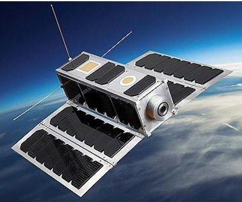

- First CubeSat mission designed and operated by ESA since 2019

## In April 2021, ESA has started a study on Reverse engineering with MBSE of OPS-SAT mission and system

- Low-cost, open, and flexible flying 'laboratory' powerful platform for in-orbit demonstration (IOD)

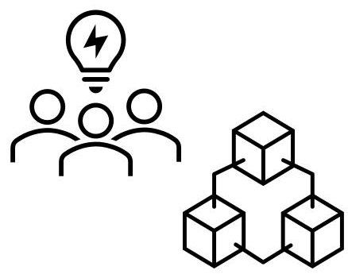

- Large and diverse team mixing academic and industrial stakeholders

some challenges and pain points...

- $ 1^{\mathrm{st}} $ goal was to investigate whether an MBSE approach and tool could help in addressing those pain points and to which extent

- $ 2^{\mathrm{nd}} $ goal was to build a model as a reference for use by future missions including OPS-SAT 2 (planned for 2024)

Samares Engineering was awarded as Prime on that study with the support of Airbus DS and some consulting from TU Graz (OPS-SAT development)

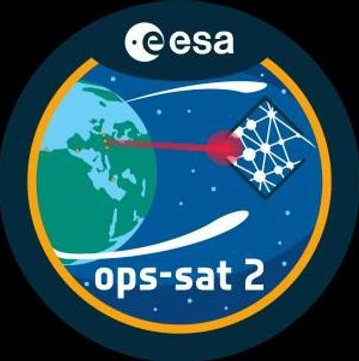

<!-- PDF_PAGE: 3 -->

## OPS-SAT2 fundamentals

- Mission duration: 2 years+2 optional years

- Sun Synchronous Orbit (SSO) compatible with any LTAN

- Altitude between 500 km and 600 km

- Baseline design: 6U CubeSat Possible alternative design: 12U CubeSat

## 5 operational modes:

-SAFE

- STBY (Stand-by)

- OCOM (Optical communication)

- -RFCOM (Radiofrequency communication)

- EXP (Secondary experiments mode)

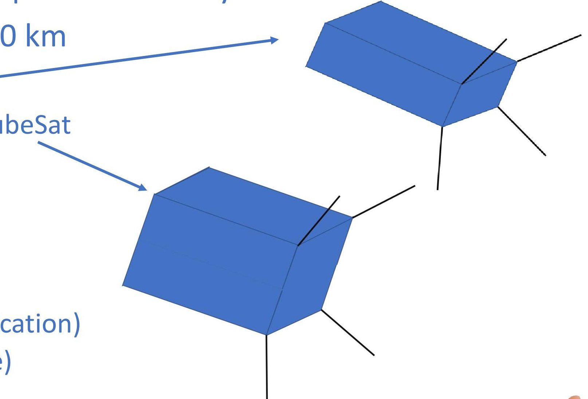

<!-- PDF_PAGE: 4 -->

## OPS-SAT2 orbit details and communication

- Orbit period: Approx. 1h30min

- Eclipse duration: Approx. 30min every orbit

- It is the fraction of the orbit in which the Earth blocks the sunlight to the satellite

- Location of ground antennas important for TC transmission, monitoring, OCOM...

-7 ground stations identified for this mission, with different capabilities

- Communication only possible when the satellite overflies a ground station

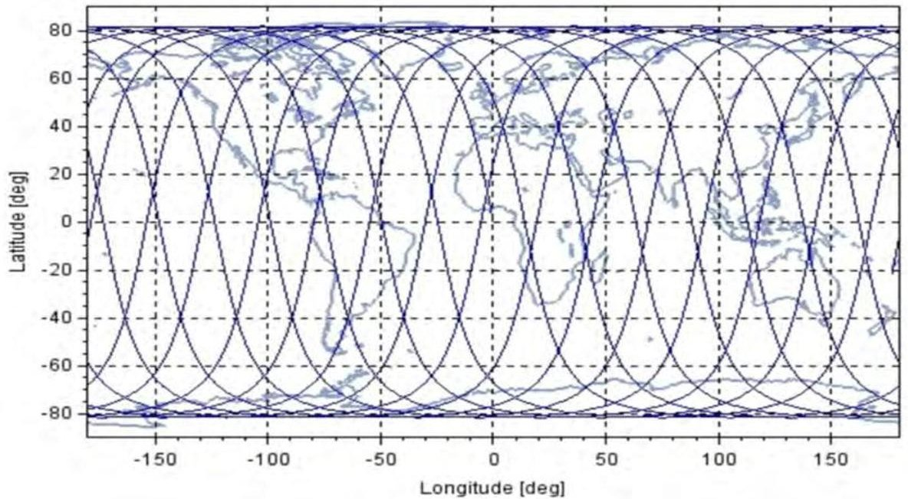

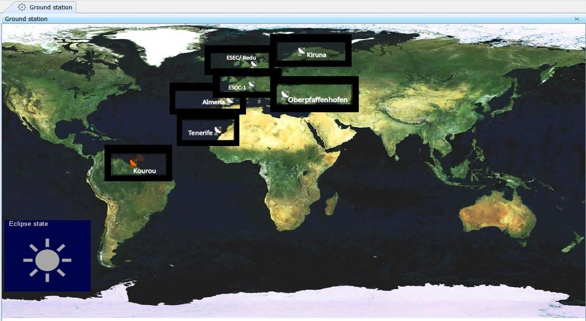

<!-- PDF_PAGE: 5 -->

## An operational concept described in various formats

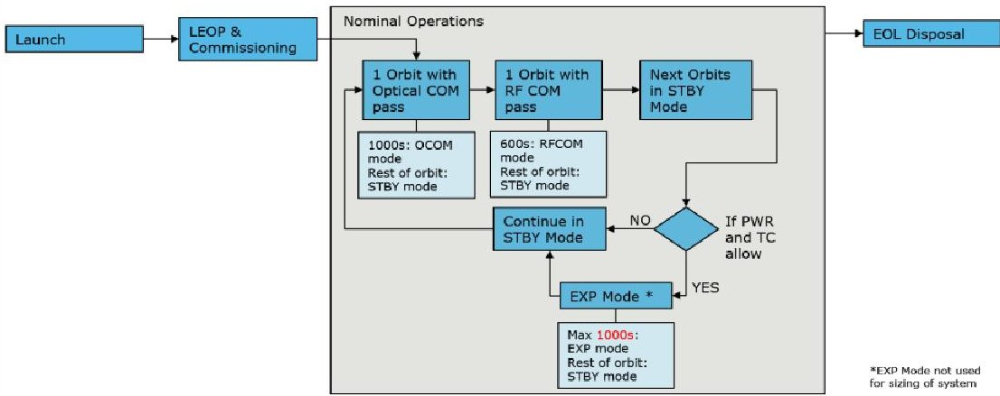

Figure 7-7: Concept of Operations - Mission Level

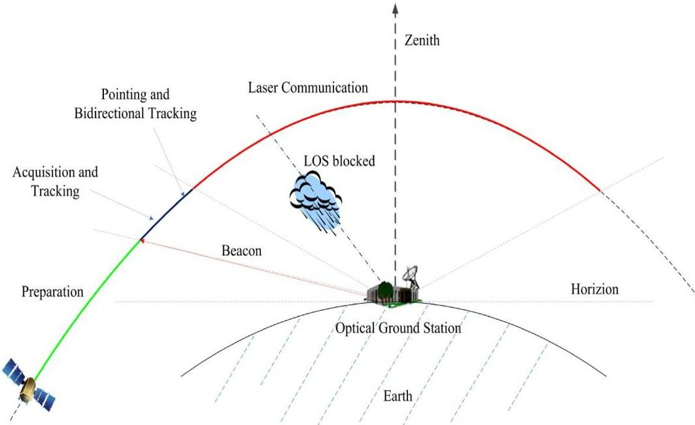

Figure 4-1: Sequence of Optical Communications LEO-OGS RD[7].

<table border="1"><tr><td colspan="3">OPS-SAT-2 - System Modes</td></tr><tr><td>Mode</td><td>Description</td><td>Duration</td></tr><tr><td>Safe Mode(SAFE)</td><td>Attitude:Turnoling(assuming1-60*s)Payload:completely switched offPlatform:SBand andUHF RXalways onTXwith10% duty cycle(assuming regular transmission of spacecraft monitoring data)</td><td>Continuous up to3days</td></tr><tr><td>Standby Mode(STBY)</td><td>Attitude:Nadir pointing and solar yaw steeringPossibly including attitude changes for drag minimization In eclipsePayload:GNSS and Payload OBC In standby(see section7.5-Power reduction)Platform:SBand andUHF RXalways on</td><td>Continuous</td></tr><tr><td></td><td>SBand andUHF TXoff(Communications are assumed to only happen duringOCOM andRFCOM modes)AOCS equipment always on(RW assumed20% duty cycle)except star tracker remaining always off</td><td></td></tr><tr><td>Optical Comms Mode(OCOM)</td><td>Attitude:Siewing or ground station pointing and solar yaw steeringPayload:GNSS,Camera onLaser Communication Terminal(50% duty cycle)Payload OBC onat medium duty cycle(60%)Platform:SBand andUHF RXalways onSBand TXat10% duty cycle,UHF TXoffAOCS equipment always onincluding star trackersand highest power consumption on the reaction wheels(RW assumed30% duty cycle)</td><td>1000s(500s of actual optical link)</td></tr><tr><td>RF Comms Mode(RFCOM)</td><td>Attitude:Nadir pointing and solar yaw steeringPayload:GNSS,Camera onPayload OBC onat medium duty cycle(40%)Platform:SBand andUHF RXalways onSBand TXandXBand TXon,UHF TXoffAOCS equipment always onincluding star trackersand reaction wheels(RW assumed20% duty cycle)</td><td>600s</td></tr><tr><td>Experiment Mode(EXP)</td><td>Attitude:Nadir pointing and solar yaw steeringPayload:GNSS onat max.power,Camera onPayload OBC onat max.powerPlatform:SBand andUHF RXalways onSBand TXat10% duty cycle,UHF TXoffAOCS equipment always onincluding star trackersand reaction wheels(RW assumed20% duty cycle)</td><td>Maximum of1000s cumulative over1 orbit</td></tr></table>

Table 7-2: System Modes

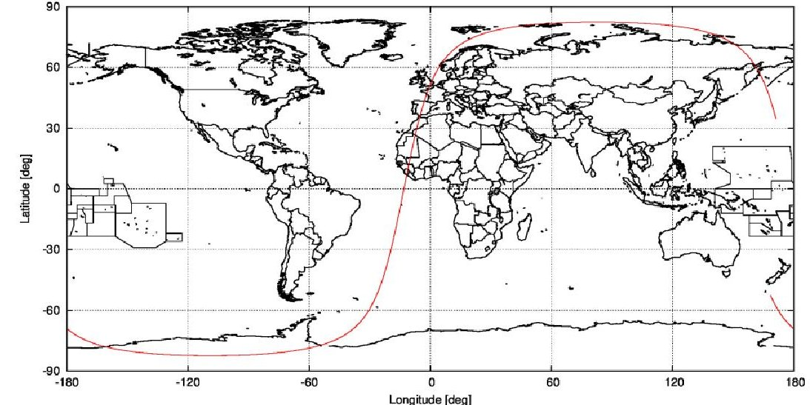

Figure 6-8: Ground Track of Sample Orbit Arc

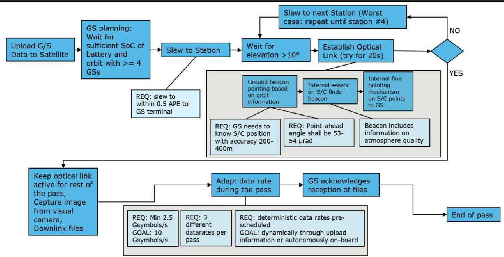

Figure 7-8: Concept of Operations - Optical Communication pass

<!-- PDF_PAGE: 6 -->

## The global MBSE approach-a set of models with layers

## OPS-SAT2 Mission and System

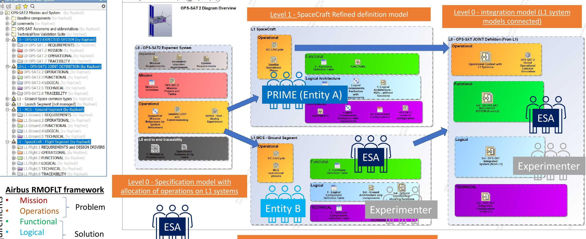

req Technical

## Content Diagram OPS-SAT2 Mission and System [ Navigation Diagram ]

Level 1- Ground Segments Refined definition model

<!-- PDF_PAGE: 7 -->

## Focus on the formalization of the operational concept

## Operational model objectives:

- Define the operational systems (Flight, Ground, Launcher) and their key properties

- Define system evolution depending on its life cycle phases and modes

- Refine the operational states by a detailed behavior with execution logics

- Define the interaction between the operational systems as signals exchanged through ports

## SysML translation:

- Structure Block definition diagram the architecture Internal block definition diagram for communication

- Behavior

State machine diagrams Activity diagrams

- Parametrics diagram to bind the key parameters including time

- Requirements

Requirements table for traceability

<table border="1"><tr><td>OpsTypeID</td><td>Type of command</td></tr><tr><td>10</td><td>OCOM activity</td></tr><tr><td>20</td><td>RFCOM activity</td></tr><tr><td>30</td><td>Secondary experiment (EXP)</td></tr><tr><td>40</td><td>Complete nominal sequence</td></tr><tr><td>50</td><td>Custom operations</td></tr><tr><td>100</td><td>Enter in SAFE mode</td></tr><tr><td>200</td><td>Enter in STBY mode</td></tr><tr><td>300</td><td>Leave SAFE mode and restore nominal</td></tr></table>

- Position

## Trajectory state block:

- Eclipse state

- GS data

## OpsCommand block:

- Unique ID, Priority

- Operations type ID

- Start time

- Operation details

- OCOM and RFCOM ground stations

- Sub-activities starting times

<!-- PDF_PAGE: 8 -->

## The SysML model-Level 0 for the mission and operations

Once released from inside the rocket, the spacecraft will automatically switch on all its essential loads and if spacecraft state is nominal, the deployment sequence will start automatically.

Due to the agreed launch configuration, the OPS-SAT separation sequence and the autosequence will most likely start and complete outside the ESOC-1 A ground station visibility.

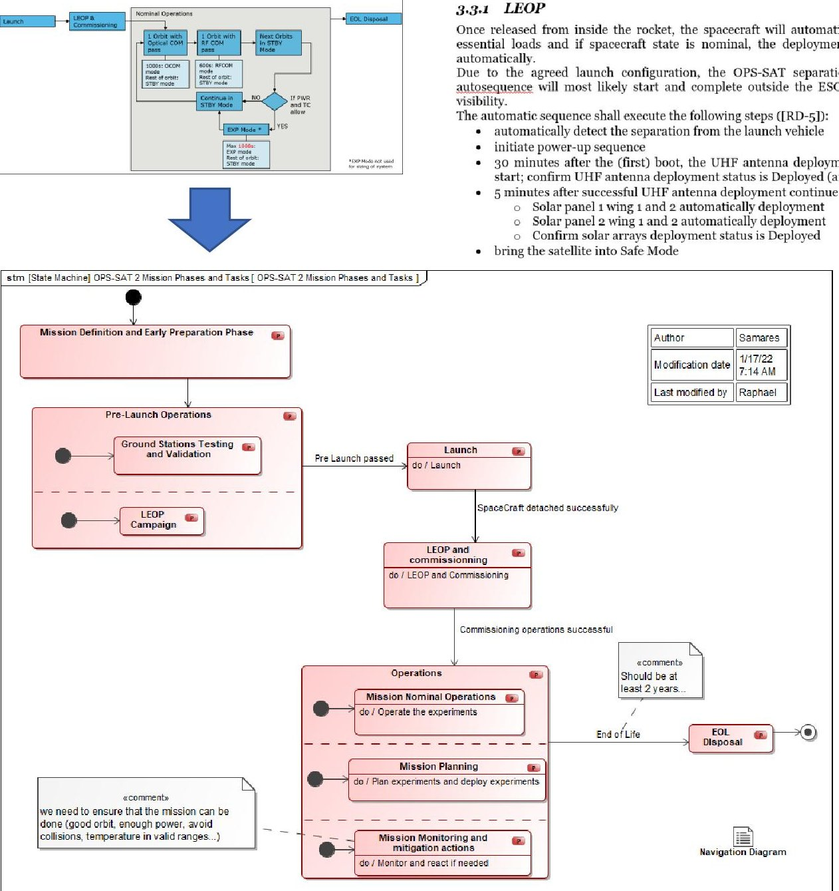

- 30 minutes after the (first) boot, the UHF antenna deployment will automatically start; confirm UHF antenna deployment status is Deployed (antennas 1, 2 and 3)

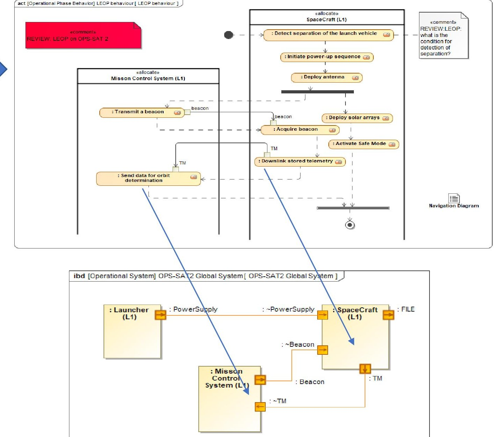

<!-- PDF_PAGE: 9 -->

## From mission to op tasks allocated to L1 Systems

## We show here a first decomposition of the mission into phases, operational behaviours and op tasks allocated to Systems

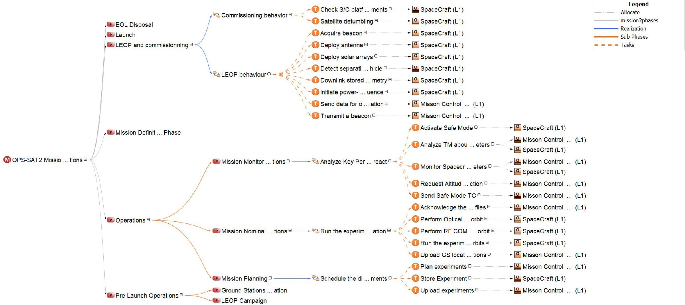

Note: this is a simplified view of the operational concept that is next refined at L1 level by both S/C and MCS teams

<!-- PDF_PAGE: 10 -->

## L1 - Refinement of S/C behavior - from lifecycle to modes and to tasks

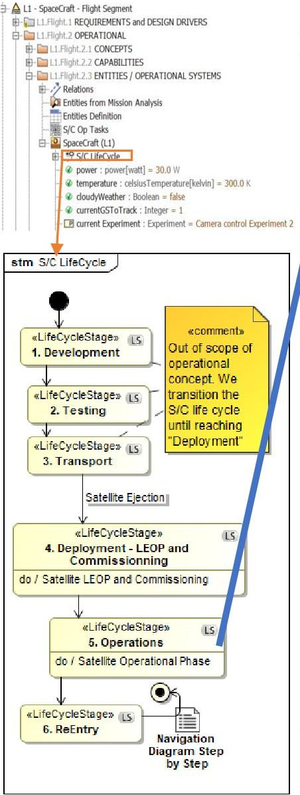

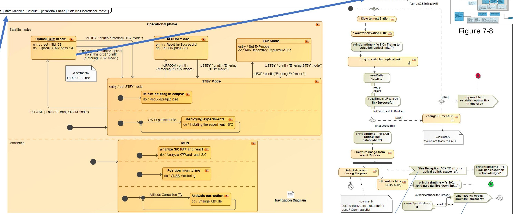

Monitoring and TC Handling is common for most satellite missions Some tailoring for the operational states

Sending a given signal...

S/C behavior is complete and consistent by construction - simulation will show if it is also correct (as expected)

<!-- PDF_PAGE: 11 -->

## L1 - Refinement of MCS behavior - from lifecycle to modes and tasks

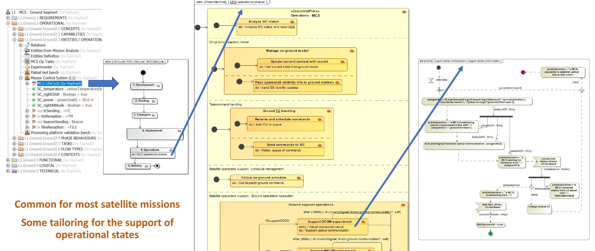

<!-- PDF_PAGE: 12 -->

## Ground-Space interactions

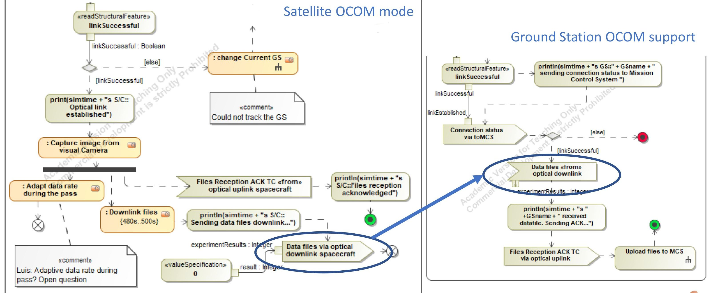

<!-- PDF_PAGE: 13 -->

## Internship to enhance OPS-SAT2 operational model

Luis Garcia Mozos, MSc Aerospace Engineering - Space Systems - End of study internship project - Apr to Oct 2022

- Ground segment architecture

- Time data using UTC times

- Spacecraft operations

- Ground segment operations

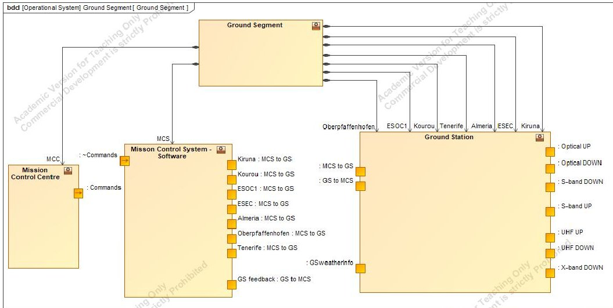

- Power monitoring

- Trade offs between 6U and 12U (not presented here)

Experimenter and Flight Control Team (FCT), User interface with widgets (Mission Control Centre perspective), Time speed management

Mirna Ojeda, Samares Engineering has also contributed with the development of simulation widgets and support on simulation tuning

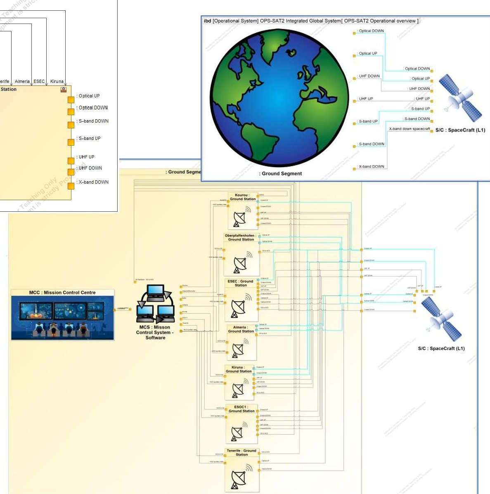

<!-- PDF_PAGE: 14 -->

Variables

X

Variables X

+

*Sans tit...

Time: 00 : 00 : 00 , 000

Fichier Edition Format Affichage Aide

Simulation starts on 20/06/2026 at 15:00:00

Windows (CRLF) UTF-8

00:00:00,000 : Initial solving ...

00:00:00,000 : Initial solving completed.

00:00:00,000 : ***** Instance Specification <u>Overall context Luis</u> is initialized. *****

<!-- PDF_PAGE: 15 -->

This MBSE model developed to support early validation of OPS-SAT 2 operational concept through simulation can certainly be reused with little tailoring for many future missions!

What about setting a community to share this model as a "mission early analysis framework"?

Thanks for your attention!

Note: I can do the demo or give more precisions on the model and simulation today... or later...

raphael.faudou@samares-engineering.com

