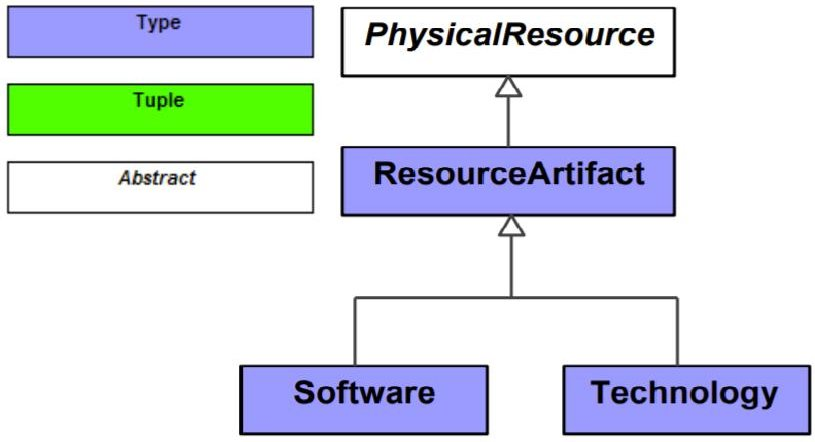
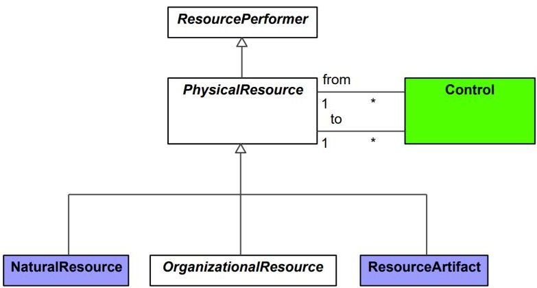
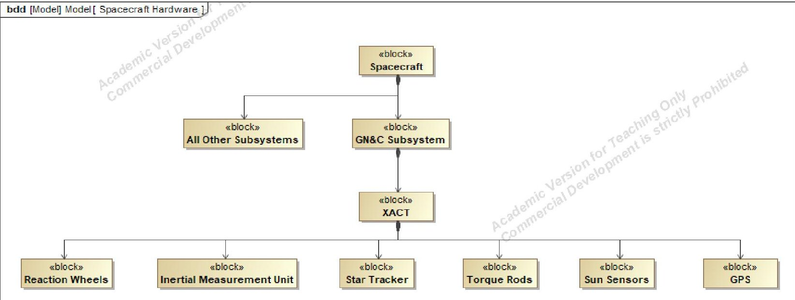
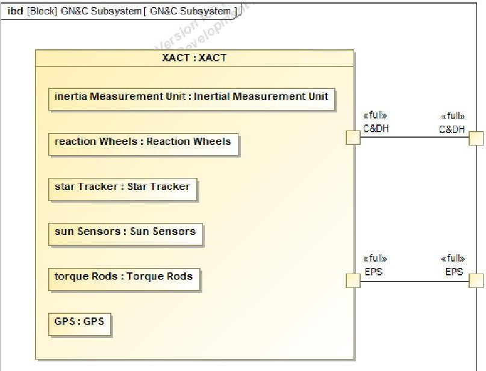
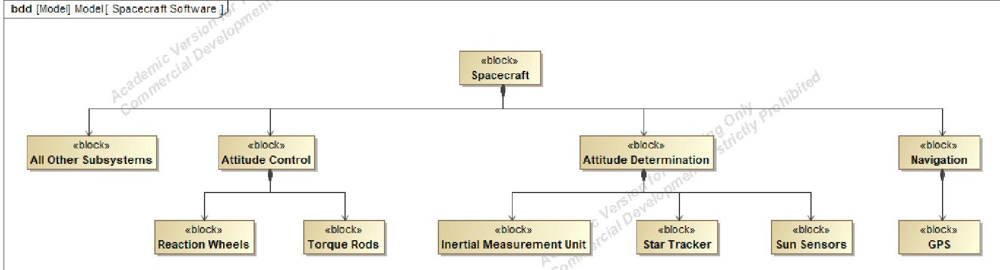
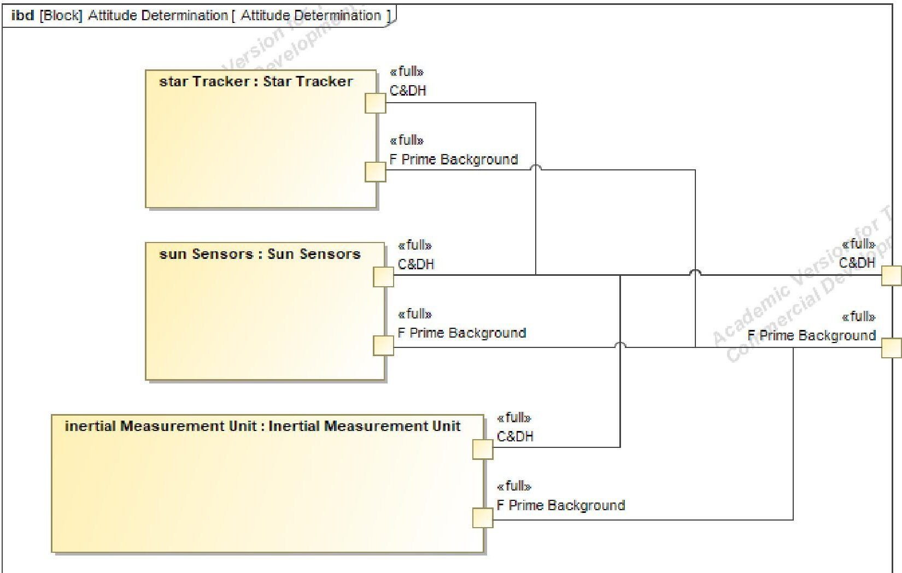
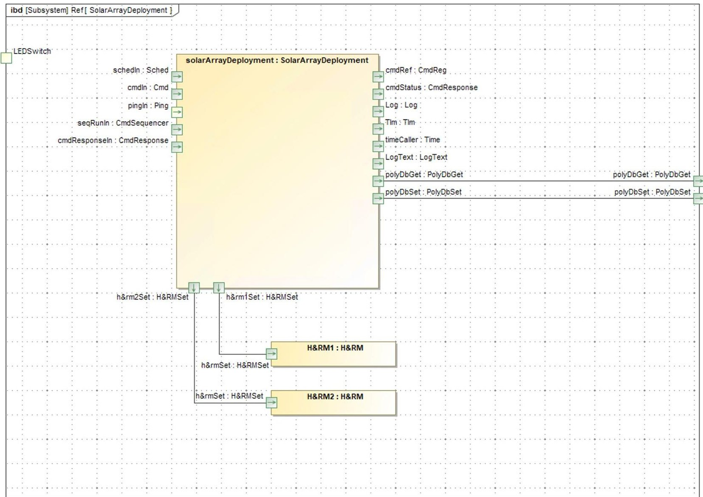
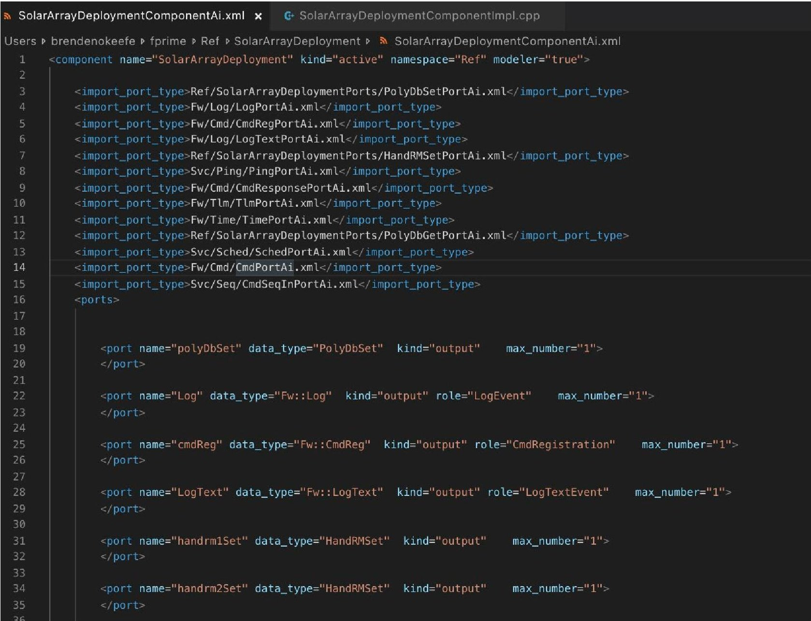

<!-- PDF_PAGE: 1 -->

# Architecture Framework Standardization for Satellite Software Generation Using MBSE and F Prime

Michael Halvorson University of Alabama in Huntsville Wernher von Braun Research Hall, 301 Sparkman Dr. Huntsville, AL 35899 Michael.C.Halvorson@gmail.com

L. Dale Thomas

University of Alabama in Huntsville Wernher von Braun Research Hall, 301 Sparkman Dr. Huntsville, AL 35899 Dale.Thomas@uah.edu

Abstract—An Architecture Framework (AF) describes a system's product taxonomy; utilization of the same AF between dissimilar projects, industries, or nations standardizes communication about a system if AF products are used to describe the system. Software is ubiquitous to complex systems but has not received requisite attention in AF product representation or standardization. The most advanced and widely used AFs employ Model-Based Systems Engineering (MBSE) tenets to communicate system elements to Stakeholders; generating system software architectures as MBSE artifacts alongside non-software artifacts is possible for space systems when using F Prime, a software framework from the Jet Propulsion Lab. NASA recently published the Space Mission Architecture Framework (SMAF) for use on uncrewed, robotic missions, and AF products for software architecture generation using the Systems Modeling Language (SysML) and F Prime are presented here in SMAF format. In contrast to an AF, which describes the products that can be created for a system or mission, a Mission Architecture Framework (MAF) such as the SMAF describes the products that should be created for a mission. MBSE definitions are established in the context of a MAF, products for software architecture generation are defined in the hierarchy and style of the SMAF, and examples of software architecture generation as MBSE artifacts from SysML are provided using the Alabama Burst Energetics eXplorer (ABEX) CubeSat mission as a case study.

## TABLE OF CONTENTS

1. INTRODUCTION...1

2. ARCHITECTURE FRAMEWORK USE...2

3. SOFTWARE ARCHITECTURE AS A MBSE ARTIFACT USING F PRIME...6

4. SOFTWARE ARCHITECTURE VIEW PRODUCT CREATION CONCERNING F PRIME...10

5. PROOF OF CONCEPT: THE ABEX MISSION...16

6. CUBESAT SYSTEM REFERENCE MODEL IMPLICATIONS...17

7. CONCLUSIONS...18

ACKNOWLEDGEMENTS...18

REFERENCES...18

BIOGRAPHY...20

## 1. INTRODUCTION

Model-Based Systems Engineering (MBSE) is or will be the engineering, design, and architecting approach of choice for government agencies, engineering firms, and university programs due to its ubiquitous applicability, rapid prototyping capability, and simulation capacity. The MBSE approach to engineered systems is defined by an Architecture Framework (AF) specifying the product taxonomy of the System of Interest (SOI), a Process Framework (PF) detailing the maturation of those products, an ontology expressing the properties of and relations between SOI concepts, and a modeling language, here assumed to be the Systems Modeling Language (SysML) [1]. Pursuant to the utilization of MBSE advantages, the National Aeronautics and Space Administration (NASA) released the MBSE-specific Space Mission Architecture Framework (SMAF) in March of 2021 [2], the United States Air Force (USAF) is funding Enterprise Architecture (EA) research for systems acquisition at the "speed of relevance" [3], and domain-specific MBSE platforms have emerged such as the CubeSat System Reference Model (CSRM) [4]. SOI hardware, behavior, and architectures can be expressed in SysML to represent a RealWorld System (RWS), but the generation or utilization of software has not seen widespread representation in existing SysML capabilities. Ground control software has been given dedicated PF attention using Scrum Agile to prevent schedule slips and associated cost overruns [5], yet NPR 7150.2C: NASA Software Engineering Requirements does not require a specific software life-cycle model to be followed for Flight Software (FSW) development [5,6]. A conceptual ravine exists between flight hardware and software development strategies, a disconcerting position considering software costs represent 5% to 15% of NASA program budgets [7]. Concerning the goal of standardizing FSW development with software frameworks such as F Prime [8], the present work will serve to answer three questions:

1. Is it possible to generate satellite software as a MBSE artifact?

2. Should engineers generate satellite software as a MBSE artifact?

3. How would satellite software generation as a MBSE artifact be represented in an AF?

<!-- PDF_PAGE: 2 -->

## MBSE Concept Definitions

Software Engineering (SwE) in MBSE has a non-trivial lexicon traceability problem that must be addressed before building on defined concepts. To illustrate, NASA-STD 8739.8A: Software Assurance and Software Safety Standard [9] defines the terms "Project" and "Program" from NPR 7150.2C: NASA Software Engineering Requirements [6], which does not cite a source. NASA-STD-8739.8A defines the term "Product" from NASA-HDBK-8709.22: Safety and Mission Assurance Acronyms, Abbreviations, and Definitions [10], "Mission Critical" and "Safety Critical" from NPR 8715.3D: NASA General Safety Program Requirements [11], and "Independent Verification & Validation" (IV&V) from ISO/IEC/IEEE 24765:2017 [12]. NPR 8715.3D has its own, smaller definition for IV&V. To NASA's credit, NASA-HDBK-8709.22 is intended to be a central repository of software definitions, but it lists three separate definitions for "Mission Critical," and two of them are the same. Whether created at NASA, engineering firms, or university programs, concept definitions should live in and be sourced from a database-queryable, centralized repository and not in documents themselves. A pivotal tenet of the SMAF is that engineers should start with models and end with documents, and transitioning to this paradigm should enable vernacular consistency when handbooks, standards, and procedural requirements are collectively querying a centralized lexicon upon creation. The NASA Marshall Space Flight Center Advanced Concepts Office is building a queryable program management ontology [13], and SysML 2.0 will facilitate database integration when released [14]. These efforts will enable the proposed definition collectivization. The present work will exercise definitions from ISO/IEC/IEEE 24765:2017: Systems and Software Engineering - Vocabulary and the SMAF, but it should be noted that ISO/IEC/IEEE 24765:2017 and ISO/IEC/IEEE DIS 42010: Software, Systems and Enterprise - Architecture Description feature the same problems that NASA documents exhibit wherein definitions in distinct documents are similar but do not match verbatim.

Architecture: [system] fundamental concepts or properties of a system in its environment embodied in its elements, relationships, and in the principles of its design and evolution [12].

Architecture Description: Work product used to express an architecture [12].

Architecture Framework: Conventions, principles, and practices for the description of architectures established within a specific domain of application or community of stakeholders [12].

The preceding hermeneutics build to the definition of a Mission Architecture Framework (MAF); the SMAF definition is presented first including the supporting qualification sentences.

Mission Architecture Framework: An architecture framework category that describes the essential elements of a mission, including: (1) Science Goals and Objectives, (2) System Architecture, (3) Resources Model, and (4) Project/Organization Model. The SMAF is a specific framework tailored to NASA missions. A Mission Architecture is a project-specific instance of a framework [2].

A generalized definition is presented for use in subsequent sections that removes NASA-specific verbiage.

Mission Architecture Framework: A project-specific instance of an Architecture Framework that describes the essential elements of a mission, including: (1) Mission Goals and Objectives, (2) System Architecture, (3) Stakeholder Traceability via View Product content and organization.

For the purposes of satellite software generation, a valid inquiry would question why the need exists to redefine MAF and use a MAF outside of the SMAF. Two primary reasons motivate redefinition that will be expounded upon: (1) the SMAF conflates the purpose of an AF with the purpose of a PF, a problem stemming from NASA's PF philosophy being centered around the concepts of Baseline, Preliminary, Updated, and Final, (2) not all programs that wish to emulate this MAF approach are beholden to NASA standards, which are heavily referenced and sometimes punted to in the SMAF. With principal concepts defined, sourced, and preliminarily allocated purpose, it is now possible to build upon these concepts for the purpose of standardizing flight software generation within a MAF. Existing AF use, software generation as MBSE artifacts, and software architecture View Products will be discussed to answer the three posed questions. An example of the defined strategies will be shown for the Alabama Burst Energetics eXplorer (ABEX) mission, and utility implications for the CSRM, a topic requested by previous CSRM work [4], will be explored.

## 2. ARCHITECTURE FRAMEWORK USE

To understand flight software architectures as a generated MBSE artifact, existing strategies with widespread use for artifact generation, utility, and organization should be axiomatic. The AFs primarily in use today are the Unified Architecture Framework (UAF) [15], the United States Department of Defense Architecture Framework (DoDAF) [16], the NATO Architecture Framework (NAF) which replaced the British Ministry of Defense Architecture Framework (MODAF) in January 2021 [17], and The Open Group Architecture Framework (TOGAF) [18]. There are also individualized AFs for Canada (DNDAF) and Australia (AUSDAF). With a wide variety of individual AFs competing for rational dominance in the early 2000s, a problem space emerged when countries or organizations attempted to communicate using distinct AFs. The United

<!-- PDF_PAGE: 3 -->

Profile for DoDAF and MODAF (UPDM) was an effort to standardize communications between AFs using the Unified Modeling Language (UML), with UPDM v1.1 released in May 2011 joining MODAF v1.2.003, NAF v3.0, and DoDAF v1.5 [19]. UPDM 2.1 released in July 2013 joining MODAF v1.2.004, NAF v3.1, and DoDAF 2.02 [19] and, while formally supported by the International Defense Enterprise Architecture Specification (IDEAS) data exchange format for military enterprise architectures, was a graphical enterprise modeling language, not an AF. It was not until UPDM 3.0, released in April 2020 as the UAF to support MODAF v1.2.004, the MODAF Ontological Data Exchange Mechanism (MODEM), NAF v.4.0, DoDAF 2.02 w/change 1, and DNDAF that formal, multinational AF representation was made available for widespread use. TOGAF, while used in 60% of the Fortune 500 [20], is intended for use as a commercial EA and therefore will not be considered a basis for a satellite MAF.

## The Unified Architecture Framework

The UAF is a true AF. In the Object Management Group's (OMG) words, the UAF:

...enables the modeling of strategic capabilities operational scenarios, services, resources personnel, security, projects, standards, measures and requirements, which supports best practices through separation of concerns and abstractions...The intent of UAF is to provide a standard representation for describing enterprise architectures using a Model Based Systems Engineering (MBSE) approach [21].

The UAF is delineated into a Domain Metamodel (DMM) and a Unified Architecture Framework Profile (UAFP); the DMM is what unifies national AFs. It defines domains such as strategic, operational, personnel, security, etc., and model kinds such as taxonomy, structure, processes, constraints, etc. When a model kind is applied to a domain, the union represents a MBSE artifact and is expressed as a UML class diagram. Because each of the national AFs are using the same UML class diagrams to express their architectures within a given domain and model kind, communicating engineered systems between nations will supposedly result in fewer miscommunications or communication failures, though substantive data on the efficacy of UAF class diagram use in international communications is not available for citation. UAF efficacy quantification in international communication should be formally asserted as an OMG goal.

While UAF may be a powerful, multinational MBSE tool, it provides little support for autogenerated software. Software in the UAF is defined as a ResourceArtifact, a, "type of manmade object that contains no human beings (i.e., satellite radio, petrol, gasoline, etc.)." ResourceArtifact is a generalization of PhysicalResource, which some software engineers may view as a non-sequitur when including FSW, and the only two classes within ResourceArtifact are Software and Technology. The DMM representations of

Figure 1. UAF ResourceArtifact UML Class Diagram

Figure 2. UAF PhysicalResource UML Class Diagram

ResourceArtifact and PhysicalResource are shown in Figures 1 and 2, respectively. The colors represent IDEAS-based "element types," where purple is a Type, white is an Abstract, and green is a Tuple. A Type is a set of Individuals, another element type, where an Individual denotes a single instance of an element; Individuals could theoretically be used to break down software elements but are not here. An Abstract signifies the element "has no direct use but is a means of construction," meaning it is an organizational construct. A Tuple denotes an elemental relationship. Further building on the UAF's semi-ambiguous use of the word "type," the DMM specifies software as "A sub-type of ResourceArtifact that specifies an executable computer program," which, while true, is a narrow definition that lumps operating systems, drivers, applications, and software frameworks under the same guise and may cause software engineers to balk. Software architects and software engineers are listed as stakeholders under almost every Viewpoint, called View Specifications in the UAF, but neither the DMM nor the UAFP broaden their software organizational representation other than providing prospective ResourceRoles and RoleKinds to various resource types. Furthermore, the definition of "Resources" in the DMM articulates, "Further design of a resource is typically detailed in SysML or UML [21]." It is apparent that direct software generation from UAF models is not possible or at least not formalized enough for the application of methodologies described later in this work dependent upon organized SysML or UML products.

<!-- PDF_PAGE: 4 -->

## The Space Mission Architecture Framework

Calling the SMAF an AF is technically true, but the SMAF is closely aligned with a subset of AF activities representative of a MAF rather than a full-service AF. While an AF defines the products or Architecture Description (AD) elements that can be created at the union of domains and model kinds, a MAF defines the products or AD elements that should be created to define a SOI architecture and deliver mission success for that specific architecture. In the SMAF's case, that architecture is, "uncrewed space missions concerned with scientific discovery, including, but not limited to, an entire spacecraft or one or more scientific instruments," defined in section 1.2 [2]. It is unclear which AF the SMAF is an instance of as NASA has not formulated a self-contained AF, but the utility of the SMAF is clear as a MAF centered around the acquisition of capabilities, a concept defined in the first handbook paragraph [2] which "encapsulates the conception of an idea, the development of a Mission to realize that idea, and the management of the design, build, integration, test, and operation of that Mission."

The most useful aspect of the SMAF is its definition of a mission product taxonomy encompassing products developed at any point in the mission life cycle. Table 1 partially depicts the organization of the SMAF products, hereby called View Products. View Products are organized under Views, which are organized under Viewpoints, which

are beholden to stakeholders both internal and external. Internal stakeholders are participants in the mission and represent project leadership and management. External stakeholders are NASA directorates, science communities, or more broadly any person or organization indirectly invested in the project or mission. An ontological triple exists in this hierarchy wherein Viewpoint is the subject, Stakeholders are the object, and "reflect the concerns of" is the predicate, ergo Viewpoints reflect the concerns of Stakeholders in the SMAF. It is worth pausing to ask why Viewpoints are needed here at all. Viewpoints package Views neatly, but if Viewpoints did not exist in this structure, the subject of the ontological triple would readily shift to Views. By packaging Views into Viewpoints with the pre-existing predicate, one of two competing assumptions prevails: (1) Stakeholder concerns per View under a given Viewpoint are exactly the same as other Views under that Viewpoint, (2) Concerns exist for certain Views under a Viewpoint that do not exist for other Views under the same Viewpoint. To clarify, either the Stakeholder concerns are narrow per Viewpoint, i.e. all Views under a Viewpoint are assumed to have the exact same concerns, or concerns are broad per Viewpoint, i.e. Views under a Viewpoint are prescribed concerns dissimilar to other Views under the same Viewpoint wherein individual View concerns collectively sum to a list of Stakeholder concerns for that Viewpoint. The danger when leaving the question of concern-to-View-to-Viewpoint traceability unanswered is if Stakeholder concerns are not explicitly defined per

Table 1. SMAF Stakeholders, Participants, Viewpoints, Views, and View Products [2].

<table border="1"><tr><td colspan="6">Primary Stakeholders</td></tr><tr><td>Science and Technology Community</td><td colspan="2">Center Engineering Directorate(s)</td><td colspan="2">Center Mission/Project Management Directorate(s)</td><td>Agency, Mission Directorate, Center Director &amp; Staff</td></tr><tr><td colspan="6">Participants</td></tr><tr><td>Principal Investigator &amp; Science Team</td><td colspan="2">Mission Systems Engineer &amp; Engineering Team</td><td>Project Manager &amp; Project Management Team</td><td>Mission Operations Team</td><td>Same as Stakeholders</td></tr><tr><td colspan="6">Viewpoints</td></tr><tr><td>Science</td><td colspan="2">Engineering</td><td>Project Implementation</td><td>Mission Operations</td><td>Enterprise/Mission Concept</td></tr><tr><td colspan="6">Views and View Products</td></tr><tr><td>Science</td><td>Technical Solution</td><td>Product Realization</td><td>Project Implementation</td><td>Mission Operations</td><td>Enterprise</td></tr><tr><td>Sci-1 Science Concept</td><td>Soln-1 Systems Engineering Management Plan (SEMP)</td><td>Real-1 System &amp; Product Specifications (6)</td><td>Proj-1 Stakeholder Expectations Document</td><td>Ops-1 Operational/Mission Plan/Schedule (5)</td><td>Ent-1 Project Scope Document (1)</td></tr><tr><td>Sci-2 Science Traceability Matrix</td><td>Soln-2 Analysis of Alternatives (AoA)</td><td>Real-2 Final MEL</td><td>Proj-2 Project Plan with Project Control Plans</td><td>Ops-2 Observatory Command Sequence</td><td>Ent-2 Concept Study Report (2)</td></tr><tr><td>Sci-3 Science Datasets/Data Products</td><td>Soln-3 System Requirements Document</td><td>Real-3 Standards Profile</td><td>Proj-3 Project Review Data Package</td><td>Ops-3 Conjunction Assessment Risk Analysis</td><td>Ent-3 Decision Memorandum</td></tr><tr><td>Sci-4 Science Data Management Plan</td><td>Soln-4 V&amp;V Plan</td><td>Real-4 Integration Plan</td><td>Proj-4 Project Status Report</td><td>Ops-4 Deep Space Operations Plan</td><td>Ent-4 Strategic Plan</td></tr><tr><td></td><td>Soln-5 Test Plan (4)</td><td>Real-5 Final Interface Control Documents</td><td>Proj-5 Compliance Matrix</td><td>Ops-5 Range Flight Safety Risk Management Process</td><td>Ent-5 Key Decision Point Data Package</td></tr><tr><td>LEGEND:</td><td>Soln-6 Architecture Model (3)</td><td>Real-6 Test Procedure</td><td></td><td>Ops-6 Expendable Launch Vehicle Payload Safety Process</td><td>Ent-6 Center Facilities, Equipment, and Staffing Plan</td></tr><tr><td>Conceptual View Products</td><td>Soln-7 Design Specifications</td><td>Real-7 Peer Review Data Package</td><td></td><td></td><td></td></tr><tr><td>Realizational View Products</td><td></td><td></td><td></td><td></td><td></td></tr></table>

<!-- PDF_PAGE: 5 -->

Viewpoint nor Views under that Viewpoint organized accordingly, a new MAF organization for any purpose may result in Viewpoints containing only one View each. It is therefore imperative to carefully organize Stakeholder concerns per Viewpoint to avoid this conclusion; the SMAF unfortunately does not address this conceptual limitation in their definition of Viewpoints, Views, or View Products. Grey in Table 1 signifies a "Conceptual View Product" while orange signifies a "Realizational View Product," terms that are never defined nor mentioned a second time. SMAF authors asserted these labels may be removed in future SMAF iterations (P. Gill, D. Richardson, L. Gunter, T. Hill, personal communication, November 16, 2021).

As an example of the Viewpoint-to-Stakeholder traceability limitation in the SMAF, consider the Engineering Viewpoint shown in Table 1 which reflects the concerns of the Mission Systems Engineer & Engineering Team as Internal Stakeholders and the Center Engineering Directorate(s) as External Stakeholders. Views under the Engineering Viewpoint are Technical Solution, containing View Products such as "Soln-2 Analysis of Alternatives," and Product Realization, containing View Products such as "Real-4 Integration Plan." Both Technical Solution and Product Realization are necessary Views with useful View Products, but the Analysis of Alternatives and Integration Plan cannot possibly represent the exact same Stakeholder concerns lest those concerns are overly general for space mission engineering. Those two View Products do represent Stakeholder concerns which may be more general or comprehensive than the View Product topics, but they are also not the same concerns for both internal and external Stakeholders. The concerns per Viewpoint in a MAF, and thus the SMAF, should therefore be a summed list of concerns represented by each View Product, and the summed list should be cross-referenced with Stakeholders assigned to that Viewpoint. Each View Product should be assigned to a Stakeholder concern, and the list of Stakeholder concerns for all View Products should comprise the list of Stakeholder concerns for that View. The same summation traceability should apply for View concerns summing to a list of concerns for a Viewpoint. If concerns match from the top-down and bottom-up, Stakeholder-to-View Product traceability is ensured signaling the product taxonomy is comprehensive. Individual View Products under distinct Views cannot

represent the exact same Stakeholder concerns under a given Viewpoint, therefore the concerns a Viewpoint represents should be a summed list of View Product concerns. This assertion is utilized when defining View Products here.

Using the SMAF organizational structure, a Software Viewpoint can be defined with View Products specific to the creation of a given software platform. Software is not a "primary Viewpoint" in the SMAF, but section A.5.3 does discuss "focused Viewpoints" wherein mission organizers can add Viewpoints as needed. Considering software accounts for up to 15% of NASA program budgets [7], software should be regarded as a primary Viewpoint. View Products under a Software Viewpoint would detail the ground segment or FSW development, integration, testing, hosting environment, and runtime environment; details regarding the creation of these View Products in the SMAF are punted to NPR 7150.2 [6], a list of SwE requirements regarding program management, Quality Assurance (QA), autogenerated code, software reuse, record-keeping, etc., and NASA-STD-7009: Standard for Models and Simulations [22], a guide for modeling and simulation Verification & Validation (V&V). While both documents provide guidance on the development and implementation of FSW, they do not explicitly say what MAF View Products should be. The only View Product for software in the SMAF is "Software Plans and Documents" under the Technical Solution View of the Engineering Viewpoint; the task of defining specific software View Products is informally assigned to the project manager. Regardless of lexicon and Stakeholder concern-to-View Product traceability problems, the SMAF excels in creating a product that can be replicated when defining software View Products for conceptual development, mission modeling, design management, build testing, and module integration; a generic breakdown of the SMAF View Product representation strategy for use outside NASA is provided in Table 2. Using this MAF organization, software architecture View Products can be defined specific to NASA mission software frameworks such as F Prime and core Flight System (cFS) or non-NASA software platforms. To define an appropriate product taxonomy for Software use on uncrewed, robotic missions, View Products specific to F Prime will be assigned to Software, Requirements, and QA Viewpoints once F Prime has been introduced.

Table 2. Generalized MAF Stakeholder, Viewpoint, View, and View Product Traceability Matrix

<table border="1"><tr><td colspan="10">Primary Stakeholders: External Actors &amp; Organizations</td></tr><tr><td colspan="4">Stakeholder1</td><td colspan="5">Stakeholder2</td><td>Stakeholder3</td></tr><tr><td colspan="10">Secondary Stakeholders: Internal Participants</td></tr><tr><td colspan="4">Participant1</td><td colspan="2">Participant2</td><td colspan="3">Participant3</td><td>Participant4</td></tr><tr><td colspan="10">Viewpoints</td></tr><tr><td colspan="4">Viewpoint1</td><td colspan="2">Viewpoint2</td><td colspan="3">Viewpoint3</td><td>Viewpoint4</td></tr><tr><td colspan="10">Views&amp;ViewProducts</td></tr><tr><td>View1</td><td>View2</td><td>View3</td><td>View4</td><td>View5</td><td>View6</td><td>View7</td><td>View8</td><td>View9</td><td>View10</td></tr><tr><td>A-1</td><td>B-1</td><td>C-1</td><td>D-1</td><td>E-1</td><td>F-1</td><td>G-1</td><td>H-1</td><td>I-1</td><td>J-1</td></tr><tr><td>A-2</td><td>B-2</td><td>C-2</td><td>D-2</td><td>E-2</td><td>F-2</td><td>G-2</td><td>H-2</td><td>I-2</td><td>J-2</td></tr><tr><td>A-3</td><td></td><td>C-3</td><td>D-3</td><td>E-3</td><td>F-3</td><td></td><td></td><td>I-3</td><td>J-3</td></tr><tr><td>A-4</td><td></td><td></td><td>D-4</td><td>E-4</td><td>F-4</td><td></td><td></td><td>I-4</td><td></td></tr></table>

<!-- PDF_PAGE: 6 -->

There is a final problem in the SMAF worth exposition, but a readily available solution may not exist without major philosophical changes occurring at NASA during this 21st-century shift from document-based spacecraft design to MBSE-centric artifact generation. A mission AF and PF should be distinct, synergistic strategy documents, and, to reiterate, an AF defines the View Product taxonomy for a project while a PF defines the maturation of those View Products [1]. The present use of the SMAF is to define View Products as a product taxonomy, relate those View Products to Stakeholder concerns via View and Viewpoint traceability, and, at the end of the handbook, relate View Products to entrance and success criteria per stage-gate review. In those stage-gate reviews, View Products such as the system Requirements Document are presented at multiple reviews, a normal practice indicating maturation of the View Product. Appendix F of NPR 7123.1C: NASA Systems Engineering Processes and Requirements w/change 1 [23] defines technical work product maturity terminology for configuration-controlled and non-configuration-controlled products. For non-controlled, the terminology flows from "Initial" to "Final" to "Update." For controlled, the terminology flows from "Preliminary" to "Baseline" to "Approve" to "Update." View Products in the SMAF appendices do not match the View Products in the main document, but some of the View Products in both sections are assigned these maturity definitions. SMAF Appendix E allocates the Preliminary Master Equipment List (MEL) to the System Definition Review and later allocates the Final MEL to the Preliminary Design Review. Erroneous mixing of configuration-controlled and non-configuration-controlled terminology notwithstanding, the allocations imply a philosophical question for MAF creation: should View Products at varied maturity levels be distinct? Should there be View Products for both the Preliminary MEL and the Baseline MEL? If so, each View Product will at minimum be two View Products for non-configuration-controlled and three View Products for configuration-controlled. If View Products are not assigned maturity terminology in the SMAF, where is the View Product maturation specified? Because View Product maturation specification is the purpose of a PF rather than an AF, it is here asserted that View Products should not be given maturity terminology in the SMAF nor should the SMAF be responsible for View Product allocation to stage-gate review entrance and success criteria. It was conveyed by SMAF authors that NPR 7123.1C is the PF for the SMAF (P. Gill, D. Richardson, L. Gunter, T. Hill, personal communication, November 16, 2021), but that answer does not alleviate the problem of needing multiple View Products to represent View Product maturation. If NASA plans to systematically commit to the SMAF for all missions, A Space Mission Process Framework (SMPF) should be created detailing what product maturation means per View Product and to what maturation level a View Product should be by a given stage-gate review. If a SMPF was defined in this way, View Products would only exist once under a given View or Viewpoint without a need for

maturation terminology. Configuration-dependent maturation terminologies historically worked for documentbased Systems Engineering (SE), but representing each View Product multiple times under disparate Views may complicate View Product creation and review presentation without value addition. The Baseline Problem does not allude to what NASA is doing to execute configuration management and View Product maturation but instead how View Product maturity is expressed in a MAF. NASA may wish to examine the future utility of Initial, Preliminary, and Baseline in the context of MBSE and NASA-STD-7009 applied to SysML hardware and software models, especially if stage-gate reviews are intended to be model-based reviews instead of the traditional document-based review approach. These terms could instead be applied to View Products in SysML as State Machine Diagrams. Shifting the responsibility of Initial, Preliminary, and Baseline terminology representation to concepts defined in a SMPF may alleviate the problem of needing two or three View Products to represent the maturation of a single View Product.

When considering solutions to The Baseline Problem, it may be that the SMAF in its current form does not reach far enough into NASA's modus operandi. Uncrewed, robotic missions are not the only missions that NASA executes. If the SMAF, a MAF, is a project-specific instance of some unknown AF, the goal should not be to recreate the SMAF but to create a full-service AF platform specific to NASA missions. If a NASA program manager utilized this AF platform and requested a MAF for an uncrewed, robotic mission, the AF platform would output the SMAF; if a crewed mission was desired, the AF platform would output a different MAF with a different product taxonomy. An AF defines the products or AD elements that can be created, while a MAF defines the products or AD elements that should be created to define a SOI architecture and deliver mission success for that specific architecture.

## 3. SOFTWARE ARCHITECTURE AS A MBSE ARTIFACT USING F PRIME

F Prime is a newly developed software framework from the Jet Propulsion Lab (JPL). It has seen recent success with the ASTERIA CubeSat [24,25] and the Mars Ingenuity Helicopter [26], both running on Linux. Two upcoming missions manifested on Artemis 1, NEAScout and Lunar Flashlight, also feature F Prime running on VxWorks 6.7 [27]. To use F Prime, a set of component instances are generated using either SysML or F Prime Prime (FPP), an in-development graphical modeling tool for F Prime, and connected to form a topology. A topology with supporting code such as binary libraries specifies an executable program called a deployment [8]. Only a cursory comprehension of F Prime is required to understand exporting software architectures as MBSE artifacts from SysML for the purposes of this work; FPP-generated FSW should be more robust than SysML-generated FSW and will be the topic of future work.

<!-- PDF_PAGE: 7 -->

If using SysML to model spacecraft hardware and software component instances, it is the software architecture which is exported, not software functionality. Mission-specific software functionality will still need to be written or reused after architecture generation from SysML. Spacecraft architects using SysML will create Block Definition Diagrams (BDD) describing the component block associations, generalizations, and dependencies and Internal Block Diagrams (IBD) describing the internal structure and use of a given block. A MagicDraw plug-in translates the IBDs into eXtensible Markup Language (XML) specifications, and F Prime imports the XML to generate C++ base classes and ground dictionaries specific to the spacecraft architecture. BDDs are required to accurately define IBD structure in SysML, but no BDDs, State Machine Diagrams, Activity Diagrams, or Sequence Diagrams can be exported to XML using the MagicDraw plug-in. All hierarchical spacecraft decomposition must be shown in the IBD, and all spacecraft behavior must be written into either XML or F Prime C++ after export from SysML. A plug-in user's guide was created by Rich [28]. Because IBD information is used to both describe component and subsystem connections and export the architecture to XML, XML should be considered a logical holding pattern between the MBSE modeling language and the F Prime deployment. If the XML is pertinent to the spacecraft architecture and syntactically correct, F Prime will generate a usable Ground Deployment System (GDS) from the imported XML with connections between components or subsystems matching those defined in the IBD allowing utilization of subsequently defined spacecraft functionality. There are limitations, however; the MagicDraw plugin cannot support direct generation of commands, telemetry, events, or parameter dictionaries from SysML. Software developers must write this directly into XML after the component and port definitions [8]. FPP, a graphical modeling language colloquially referred to as "F Double Prime", is expected to resolve this deficiency by allowing direct generation of commands, telemetry, events, and parameter dictionaries. JPL is working with Carnegie Mellon University to develop FPP. FPP has its own source language and a tool called fpp-compile that translates the FPP source language to an XML format referred to as the FPP representation language. Another tool called fpp-legacy-xml translates FPP representation language into the XML format that F Prime autocoders understand. Whether the architecture XML is generated from SysML IBDs or FPP, a formal relationship between the XML to be imported into F Prime and the spacecraft architecture, commands, telemetry, and parameters can be established as a Software Viewpoint View Product.

## Historical Perspective on FSW Development

Creating software architectures as MBSE artifacts represents a change in the historical approach to satellite FSW engineering; what once was a modular, bottom-up approach to FSW design only simulated after a RWS module organization existed is now enacted by top-down software architecture generation matched with bottom-up component modularity that can be modeled long before a RWS exists. The historical FSW development approach involved breaking an assumed architecture into modules and classifying them as mission critical, safety critical, or non-critical, where critical software includes executable images, configuration parameters, and commands [29]. Software modules were developed separately and integrated later; NASA-STD- 8739.9: Software Formal Inspections Standard [30] even requires FSW to be modular for inspection purposes. The problem with this bottom-up, modular approach is that it follows a linear Specify-Design-Build-Test-Fix (SDBTF) pattern that ultimately results in module interface mismatches because the total system architecture was not known at the onset of FSW design [31]. Code is written for individual units, then modules, then the integration for separate modules. When checking the fidelity of module interfaces in the historical approach, FSW development reviews could either lag hardware reviews, allowing for hardware selections to standardize before the FSW attempted to interface and command the hardware, or software can be developed in lockstep with the hardware, meaning any hardware changes would result in significant delays in software development. In the new, SysML-based FSW development approach, the total system architecture is defined from the top down using a set of software IBDs that have been verified using NASA- STD-7009A to match the hardware BDDs, removing the need to choose a software development life cycle based on system hardware standardization levels. The FSW is still modular and does not violate NASA-STD-8739.9, but all the necessary modules and module interfaces are known from Phase A. F Prime includes reusable components that have individually undergone V&V several times, meaning modules may be functional and collectively integrated long before the physical RWS is available. Hardware and mission concept development may be validated via FSW simulation as the physical RWS matures. So, for the first time, software development may lead hardware development rather than lagging or lockstepping purely for conceptual validation due to the ease of MBSE-based FSW generation and use.

<!-- PDF_PAGE: 8 -->

Figure 3. Spacecraft Hardware BDD Representation with Coarse GN&C Detail

## Bridging the Hardware-Software Gap

The hardware hierarchy of the spacecraft can be accurately partitioned and refined using BDDs and IBDs, but it may be that exact hardware representations in SysML do not match desired software representations because FSW tends to organize subsystems by functional purpose instead of form or physical proximity. As an example, Blue Canyon Technologies sells an attitude determination and control system called the XACT that was used on ASTERIA [25] and will also be on ABEX. The XACT can feature a star tracker, sun sensors, and inertial measurement units for attitude determination, reaction wheels and torque rods for attitude control, and Global Positioning System processing for state vector determination and navigation, all dependent on the user's needs. A basic spacecraft hardware BDD is shown in Figure 3 with attention paid to the Guidance, Navigation, and Control (GN&C) subsystem, specifically the XACT. From a hardware perspective, all processes regarding attitude determination, attitude control, and navigation would connect through a single block representing the XACT, shown in IBD form in Figure 4. A basic spacecraft software BDD is shown

Figure 4. GN&C Hardware Subsystem IBD Representation

in Figure 5 with the same hardware as Figure 3, but the hardware is organized by functional purpose delineations of attitude control, attitude determination, and navigation. Software architects could simply put a software wrapper on the entire XACT unit to create a standalone GN&C software subsystem, but, based on the needs of the spacecraft, they may wish to define distinct software subsystems for attitude control, attitude determination, and navigation despite their physical manifestation being from a single component. ASTERIA had two attitude control software subsystems, and FSW may also feature intangible subsystems such as Mode Management and Fault Protection, both actual subsystems on the ASTERIA mission [24]. The lowest complexity solution would be to use the hardware IBD to generate the software XML regardless of if software subsystem definitions differed from hardware subsystem definitions, but at this time architects using SysML to generate software must define distinct IBDs for hardware and software subsystems representing the same spacecraft hardware because of F Prime-specific connections to F Prime background services. Hardware-to-software model definition consistency can be verified using NASA-STD-7009A. Both IBD structure and port connectivity structure determines the F Prime software architecture, and for any subsystem IBD intended for export to XML and subsequent import to F Prime, user-defined subsystem IBD components must also be connected to preexisting F Prime components modeled in SysML in name only. Connecting user-defined IBD components to F Prime components via ports in SysML creates a connection in XML when the IBD is exported, and F Prime autogenerates all the actual connectivity based on the named connection between user-defined IBD components and F Prime background services upon XML import. Successfully connecting user-defined components to F Prime background components does require some knowledge of F Prime operation; this is another hurdle that modeling in FPP over SysML is expected to alleviate. Figure 6 shows a non-exportable example of an attitude determination software subsystem IBD; not all components in the XACT hardware subsystem are shown in

<!-- PDF_PAGE: 9 -->

Figure 5. Spacecraft Software BDD Representation with Coarse GN&C Detail

Figure 6. Attitude Determination Software Subsystem IBD Representation

this IBD because, in this example, they are not all owned by the attitude determination software subsystem. The only practical consequence of the hardware-software gap is that software IBDs must be created separate from hardware IBDs with hardware components organized by software purpose. The process of defining F Prime components in SysML, connecting them to user-defined components, and generating XML with user-defined components connected to F Prime components is described in Halvorson et al. [32], but translation of physical hardware architecture to logical software architecture is another aspect of model-based software generation that can be labeled as a View Product. Comprehensive Software Viewpoint View Product definition is discussed in Section 4, and F Prime-functional SysML architectures are provided in Section 5 using ABEX as a case

study. With FSW generation as a MBSE artifact engendered by IBD creation, export to XML, and import to F Prime as autocoded components, the first question of this work is answered: software architecture generation as a MBSE artifact is achievable.

## Software Development and Model-Based Reviews

When the software architecture is generated and the software subsystems organized by purpose, software development under the auspices of MAF View Products can be examined as part of a model-based review. Because the architecture is generated from a SysML model that also generates nonsoftware artifacts as View Products for stage-gate reviews, the reviews can become model-based rather than documentbased, a proposed goal of the SMAF. Reviews including

<!-- PDF_PAGE: 10 -->

FSW are no longer relegated to only software engineers, and a more diverse group of reviewers can help the team avoid groupthink. Software simulation testing can be performed and reviewed at any stage of hardware development, and both concept validation and interface verification can occur in reviews before any payload-level functionality code is written. Rigorous comparison regarding the efficacy of model-based reviews compared to document-based reviews is not yet available, but with the potential improvement of FSW development schedules, V&V capabilities, and simulation environments, the answer to the second question of this work is asserted: yes, the proposed benefits of MBSEcentric software design indicate engineers should generate software architectures as MBSE artifacts instead of a collection of low-level modules intended for cumbersome integration schedules. It would, however, be useful to quantify the efficacy of this new approach in comparison to historical approaches, which may be possible through Capability Maturity Model Integration (CMMI) in softwarebased MBSE. CMMI has long been a pillar of FSW V&V and must be considered when generating software architectures from SysML. A comparison of the speed at which programs reach CMMI maturity levels delineated by amount of MBSE inclusion in spacecraft software architecture generation is warranted; metrics for team effectiveness in software development based on CMMI-DEV methods are available [33]. CMMI adherence using SysML has been given dedicated attention from the NASA Platform for Autonomous Systems (NPAS) project from the Advanced Exploration Systems Division led by Stennis Space Center and supported by Ames Research Center, Glenn Research Center, Johnson Research Center, and JPL [34]. NPAS has progressed autonomous software capabilities for cFS rather than F Prime, which leads to a problem NASA may experience when attempting to quantify the efficacy of MBSE-generated software architectures.

## DC vs. AC: F Prime vs. cFS

The history of cFS traces much farther than F Prime's. The first aspects of cFS took form with the launch of SAMPEX in 1992. Goddard Space Flight Center (GSFC) consolidated several FSW organizations around 2000, and the core Flight Executive (cFE) aspect of cFS was developed for the Solar Dynamics Observatory, Lunar Reconnaissance Orbiter, and the Global Precipitation Measurement satellite [7]. cFS in its full form became open source in 2014, and multiple NASA centers and university groups are using cFS successfully [35, 36]. Detailed in Bocchino et al. [8], there are three primary differences between cFS and F Prime: (1) F Prime was designed for small-scale flight systems whereas cFS operates on large missions, (2) F Prime provides a development ecosystem for modeling, code generation, testing, and a ground system whereas cFS does not (yet), (3) F Prime uses static topologies with typed connections whereas cFS uses publish-subscribe over a software bus. Despite these differences, cFS is, as NASA-STD-8739.9 requires, modular and componentized, meaning it is theoretically possible to generate cFS architectures from a markup language. If NASA plans to shift reviews from document-based to model-based

and to export software architectures from SysML models or another graphical modeling language, it would be cumbersome for NASA to support two dissimilar FSW frameworks without a way to generate them from the same model-based environment. The development of F Prime and cFS metaphorically harkens to Thomas Edison developing Direct Current (DC) while Nikola Tesla developed Alternating Current (AC). There are reasons why a system would want a publish-subscribe software bus over a typed connection just as a home would want AC in a wall socket over DC. They're both forms of electricity serving a similar purpose, and they are most useful when used in conjunction, not in isolation. If a markup language such as the FPP representation language was standardized to be capable of generating both F Prime and cFS architectures and be generated from the same graphical modeling language such as FPP, View Products regarding the graphical modeling language and markup language would be the same. If no effort is made to standardize a markup language and graphical modeling language for use by both cFS and F Prime, two entirely different sets of Software Viewpoint View Products may need to be defined in the SMAF or a full-service AF.

## 4. SOFTWARE ARCHITECTURE VIEW PRODUCT CREATION CONCERNING F PRIME

With general AF use, specific MAF use, and software architecture generation as an MBSE artifact using F Prime understood, it is now possible to answer the third question of this work, "How would satellite software generation as an MBSE artifact be represented in an AF?" Under the assumption that F Prime will be the software architecture framework tool, it is possible to narrow the scope of the question from which artifacts can be generated in an AF to which artifacts should be generated in a MAF and to represent those artifacts as View Products similar to the structure of Figures 1 and 2. View Products are defined from four primary sources: (1) The F Prime Discerning User's Guide [37], (2) NPR 7150.2C: NASA Software Engineering Requirements [6] (3) NASA-STD-8739.8A: Software Assurance and Software Safety Standard [9], (4) NASA-STD-8739.9: Software Formal Inspections Standard [30]. View Products will be tabulated first in terms of what is required for generation and then will be assigned to Viewpoints and Views in a MAF format. All sources dictate the need for planning, testing, and reporting on various facets of software development, so individual citations will not be applied to View Product definitions from these sources.

## Templates for Views and View Products

This work will not define View or View Product templates for each proposed View Product, but View Product templates describing the content, organization, modeling techniques, and View Product maturation for each View Product should exist in a Mission Process Framework (MPF) such as the proposed SMPF. The SMAF defines a View template including the View name, description, associated View Products, completion criteria, project life-cycle evolution,

<!-- PDF_PAGE: 11 -->

and review entrance and success criteria. View life-cycle evolution and review criteria should exist in the MPF, not the MAF, and are not discussed here. The SMAF View Product template defines a View Product name and identifier, description, structure and format, modeling, and key document interaction. Structure and format informally define the desired View Product template, but defining a more formal template as part of the SMPF with structure and format, completion criteria, and View Product life-cycle evolution would allow for a more direct correlation of View Product maturation efforts to View entrance and success criteria in stage-gate reviews. The maturation of the View should be a summation of the maturation of View Products just as Stakeholder concerns specific to a View should be a summation of the Stakeholder concerns each View Product represents. View Product modeling refers to which modeling platforms should be used to characterize the View Product, and key documents refers to if this View Product is a key document, an established element of the NASA project life cycle discussed in NPR 7120.5 [38] and NPR 7123.1 [23], or if this View Product is part of a key document. SMAF Appendix B does state that certain View Products are informal, meaning "they are working materials not intended for delivery to stakeholders or presentation at reviews," but that is not what was meant by conceptual versus realizational View Products in the legend of Figure 1 (P. Gill, D. Richardson, L. Gunter, T. Hill, personal communication, November 16, 2021). If a formal template was defined in a SMPF for each View Product, the structure, content, maturation, which modeling platforms should be used, if the

Table 3. Software View Products Required for Software Architecture Generation

<table border="1"><tr><td>Viewpoint</td><td>View</td><td>View Product Name</td></tr><tr><td>SW</td><td>AG</td><td>Software Interface Design Description</td></tr><tr><td>SW</td><td>AG</td><td>Software Subsystem Markup Language Report</td></tr><tr><td>SW</td><td>AG</td><td>Cmake Checklist Report</td></tr><tr><td>SW</td><td>AG</td><td>Software Subsystem Definition</td></tr><tr><td>SW</td><td>FD</td><td>Software Development Plan</td></tr><tr><td>SW</td><td>FD</td><td>Commands, Conditions, and Impacts Report</td></tr><tr><td>SW</td><td>FD</td><td>Software Data Dictionary</td></tr><tr><td>RQ</td><td>RD</td><td>Software Requirements Specification</td></tr><tr><td>QA</td><td>SA</td><td>Software Assurance Plan</td></tr><tr><td>QA</td><td>SA</td><td>Software Reuse Report</td></tr><tr><td>QA</td><td>SA</td><td>Model Cohesion Report</td></tr><tr><td>QA</td><td>SA</td><td>CMMI Adherence Report</td></tr></table>

document is a key document in part or whole, and how the View Product should be used would be part of a View Product template. Engineers would then fill out the template to greater levels of detail throughout the project life cycle, and SysML artifacts could be exported to the template directly. Knowing exactly what material should be included in the template at the onset of View Product creation will make it difficult for the engineer to fail rather than making it easy for them to succeed. Here, only a View Product name and description are provided and only for View Products not defined in part already in NPR 7150.2C [6], NASA-STD 8739.8A [9], and NASA-STD-8739.9 [30].

## View Product Definition

View Products are allocated to Views and Viewpoints and are differentiated by necessity for software architecture generation, described in Tables 3 and 4. View Product table order does not correspond to the order in which View Products should be completed; order of completion should be detailed in a Mission Process Framework, meaning a SMPF when referencing the SMAF. Utilized Viewpoints include Requirements (RQ), Software (SW), and Quality Assurance (QA), which are referenced as potential Viewpoints in the SMAF but are not included in the primary SMAF Viewpoints shown in Figure 1. The Software Viewpoint is delineated into Architecture Generation (AG) and Functional Development (FD) Views. The Quality Assurance Viewpoint is only given a Software Assurance (SA) View but should feature Views

Table 4. Software View Products Not Required for Software Architecture Generation

<table border="1"><tr><td>Viewpoint</td><td>View</td><td>View Product Name</td></tr><tr><td>SW</td><td>FD</td><td>Software Schedule</td></tr><tr><td>SW</td><td>FD</td><td>Software Configuration Management Plan</td></tr><tr><td>SW</td><td>FD</td><td>Version Description Reports</td></tr><tr><td>SW</td><td>FD</td><td>Software Maintenance Plan</td></tr><tr><td>SW</td><td>FD</td><td>Software Safety Plan</td></tr><tr><td>SW</td><td>FD</td><td>Software User&#x27;s Manual</td></tr><tr><td>SW</td><td>FD</td><td>Record of Software Engineering Trade-Off Criteria and Assessment</td></tr><tr><td>RQ</td><td>RD</td><td>Software Requirement V&amp;V Plan</td></tr><tr><td>QA</td><td>SA</td><td>Software Acceptance Criteria and Conditions</td></tr><tr><td>QA</td><td>SA</td><td>Software Test Procedures</td></tr><tr><td>QA</td><td>SA</td><td>Software Test Plan</td></tr><tr><td>QA</td><td>SA</td><td>Software Test Report</td></tr><tr><td>QA</td><td>SA</td><td>Record of Continuous Software Risk</td></tr></table>

<!-- PDF_PAGE: 12 -->

specific to other domains in the MAF. The Requirements Viewpoint is treated similarly as QA in that it only features a Requirements Development (RD) View, but others should be defined as needed for other subsystems. The View Products given dedicated identifiers and attention below should be understood as a delineation of purpose rather than an exact description of how purposes should be named or allocated to views. The best organization of these View Products under Views and Viewpoints is the organization that works for a given mission, not necessarily the one proposed here or in the SMAF. View Products are given identifiers and descriptions in Table 5. Table 6 shows the View Products as they would be represented in the SMAF.

Architecture Generation and Functional Development Broadly, View Products under AG are new and specific to MBSE software architecture generation while View Products under FD are sourced in title from pages 40 and 41 of NPR 7150.2C and described in the context of F Prime ad fontes.

Requirements Development and Software Assurance—The RD View only has two View Products here, but the View Products are critical and must be created near Phase A. NASA-STD-8739.8A defines SA as,

...the level of confidence that the software is free from vulnerabilities, either intentionally designed into the software or accidentally inserted at any time during its life cycle, and that the software functions in an intended manner and...does not function in an unintended manner [9].

SA View Products are defined with software functionality assurance in mind, but when modeling a RWS using software architectures generated from a model, sometimes ahead of RWS testing, cohesion between the model and the software is given additional attention.

Table 5. View Product Identification and Description

<table border="1"><tr><td>ID</td><td>Name</td><td>Description</td></tr><tr><td>ArchGen-1</td><td>Software Interface Design Description</td><td>A description of spacecraft subsystems, component hierarchies, and their interactions as prescribed by interface requirements or specifications provided in full by the system modeler to the SwE.</td></tr><tr><td>ArchGen-2</td><td>Software Subsystem Markup Language Report</td><td>XML or another markup language defines the structure and content of what is exported from the model and imported to F Prime; it can be used to check both expected model-to-XML correlation and XML-to-F Prime expectations.</td></tr><tr><td>ArchGen-3</td><td>Cmake Checklist Report</td><td>Shown in section 5, all C++ or XML files are referenced by Cmake when generating build-artifacts in F Prime. If C++ or XML is generated, it must be listed in CmakeLists.txt, a simple but necessary step which can be documented.</td></tr><tr><td>Arch-Gen-4</td><td>Software Subsystem Definition</td><td>Visually represented by Figures 3-6, software subsystem definition may or may not be functionally dissimilar from hardware subsystem definition. Due to F Prime background subsystem connectivity, software subsystems must be defined separately from hardware subsystems if generating software as a SysML artifact.</td></tr><tr><td>FuncDev-1</td><td>Software Development Plan</td><td>NPR 7150.2C discusses development plan materials and gives wide latitude to the project manager&#x27;s discretion. The development plan would include this architecture generation strategy and reference many of the View Products here. The Developer&#x27;s Manual is also considered part of FuncDev-1.</td></tr><tr><td>FuncDev-2</td><td>Commands, Conditions, and Impacts Report</td><td>A list defining commands, conditions for command execution, and expected command impacts replaces a list of commands in F Prime [8].</td></tr><tr><td>FuncDev-3</td><td>Software Data Dictionary</td><td>F Prime uses two databases, PolyDb for general data and PrmDb for FSW configuration data; both require an expected value list.</td></tr></table>

<!-- PDF_PAGE: 13 -->

<table border="1"><tr><td>FuncDev-4</td><td>Software Schedule</td><td>NPR 7150.2C section 3.3,NASA-STD-8739.9 section 6.3.3.4,and NASA-STD-8739.8 section 4.3 discuss development, inspection,and SA schedules,respectively.</td></tr><tr><td>FuncDev-5</td><td>Software Configuration Management Plan</td><td>NPR 7150.2C sections 4.5.4 and 5.1 discuss software configuration management tasks,though the frequency of configuration delivery may increase substantially in a MBSE-dominated development environment.</td></tr><tr><td>FuncDev-6</td><td>Version Description Report</td><td>NPR 7150.2C frequently states software version description reports should be generated for each software release.In a model-generated software architecture environment,version delivery may become continuous rather than incremental until non-reusable components are included.The nature of version description reports may change with the advent of model-based reviews.</td></tr><tr><td>FuncDev-7</td><td>Software Maintenance Plan</td><td>Per NASA-STD-8739.8A,the IV&amp;V provider must assess the software maintenance plan,and NPR 7150.2C section 4.6 allocates the full maintenance planning responsibility to the project manager.</td></tr><tr><td>FuncDev-8</td><td>Software Safety Plan</td><td>As with FuncDev-7,the IV&amp;V provider must assess the software safety plan,though a definition is never provided for these plans.Software Safety is defined in NASA-HDBK-8709.22 and is discussed at length in NASA-GB-8719.13[39].</td></tr><tr><td>FuncDev-9</td><td>Software User&#x27;s Manual</td><td>Limited information is available on the creation of a user&#x27;s manual from existing NASA standards.The utilization of Commands,Conditions,and Impacts,subsystem interactions,and critical operations should be understood from this View Product.</td></tr><tr><td>FuncDev-10</td><td>Record of Software Engineering Trade-Off Criteria and Assessment</td><td>This record concerns build versus buy decisions,software reuse decisions,and F Prime vs.cFS decisions.Two other proposed View Products,the make/buy decision report and cost estimate,are included in this View Product for sake of brevity.</td></tr><tr><td>ReqDev-1</td><td>Software Requirements Specification</td><td>The requirements specification can be created in part as a SysML requirements diagram that allows for bidirectional requirements traceability and allocation of interface requirements to subsystems,but it should also discuss inspecting and testing requirements per NASA-STD-8739.8A and failure mode prevention requirements as evidenced by the failure of the Mars Polar Lander[29].</td></tr><tr><td>ReqDev-2</td><td>Software Requirements V&amp;V Plan</td><td>NPR 7150.2C section 4.1 discusses software requirements and how requirement change management is a critical problem for spacecraft software engineers.If interface requirements can be autogenerated based on hardware organizations in a graphical modeling language such as SysML,software requirement V&amp;V can be similarly standardized,and implementation of interface changes may become less severe.</td></tr><tr><td>SoftAssu-1</td><td>Software Assurance Report</td><td>The software assurance report should respond to the directive tasks in Table 1 of NASA-STD-8739.8A directly.</td></tr><tr><td>SoftAssu-2</td><td>Software Reuse Report</td><td>If software architectures are generated from models and written C++ is specific prescribed functionality of those models,it is conceivable for the concept of“Software Reuse”to become“Model Reuse”when autogenerating code.If interface structure is standardized then the code will be analogous and reusable.Reusability could then be known at the onset of architecture modeling.</td></tr></table>

<!-- PDF_PAGE: 14 -->

<table border="1"><tr><td>SoftAssu-3</td><td>Model Cohesion Report</td><td>Cohesion between the SysML model, FSW, and RWS is paramount in MBSE-centric software development execution; compliance with NASA-STD-7009A will become essential in a model-based review paradigm.</td></tr><tr><td>SoftAssu-4</td><td>CMMI Adherence Report</td><td>Using CMMI is required to ensure software developers have the necessary skills and processes in place to ensure product maturation within cost and schedule estimates[40].Class B software defined in NASA-NPR-8705.4[41] requires a CMMI-DEV Maturity Level 2 Rating or higher.</td></tr><tr><td>SoftAssu-5</td><td>Software Acceptance Criteria and Conditions</td><td>In a model-based review paradigm with acceptance criteria formally defined in a SMPF, early phase acceptance criteria may diverge from document-based review criteria, but hardware testing acceptance criteria is unlikely to change.</td></tr><tr><td>SoftAssu-6</td><td>Software Test Procedures</td><td>NASA-STD-8739.9 defines test procedures as,“instructions for the setup, operation, and evaluation of results for a given test,”which would exist for each proposed test.</td></tr><tr><td>SoftAssu-7</td><td>Software Test Plan</td><td>NASA-STD-8739.9 states a test plan should include items to be tested, testing performed on those items, test schedules, personnel and reporting requirements,“evaluation criteria,the level of acceptable risk,and any risk requiring contingency planning.”</td></tr><tr><td>SoftAssu-8</td><td>Software Test Report</td><td>Test reports are required by NPR 7150.2C and undergo SA specific to NASA-STD-8739.8A.</td></tr><tr><td>SoftAssu-9</td><td>Record of Continuous Software Risk</td><td>As the requirements of the RWS evolve,so too will the model requirements.Risks are emergent system aspects initiating from a system’s architecture and use;continuous model development necessitates continuous risk tracking.</td></tr></table>

<!-- PDF_PAGE: 15 -->

Table 6. View Product Standardization for Software Architecture Generation in SMAF Format

<table border="1"><tr><td colspan="4">Viewpoints</td></tr><tr><td>Requirements</td><td colspan="2">Software</td><td>Quality Assurance</td></tr><tr><td colspan="4">Views &amp; View Products</td></tr><tr><td>Requirements Development</td><td>Architecture Generation</td><td>Functional Development</td><td>Software Assurance</td></tr><tr><td>ReqDev-1: Software Requirements Specification</td><td>ArchGen-1: Software Interface Design Description</td><td>FuncDev-1: Software Development Plan</td><td>SoftAssu-1: Software Assurance Report</td></tr><tr><td>ReqDev-2: Software Requirement V&amp;V Plan</td><td>ArchGen-2: Software Subsystem Markup Language Report</td><td>FuncDev-2: Commands, Conditions, and Impacts Report</td><td>SoftAssu-2: Software Reuse Report</td></tr><tr><td></td><td>ArchGen-3: Cmake Checklist Report</td><td>FuncDev-3: Software Data Dictionary</td><td>SoftAssu-3: Model Cohesion Report</td></tr><tr><td></td><td>ArchGen-4: Software Subsystem Definition</td><td>FuncDev-4: Software Schedule</td><td>SoftAssu-4: CMMI Adherence Report</td></tr><tr><td></td><td></td><td>FuncDev-5: Software Configuration Management Plan</td><td>SoftAssu-5: Software Acceptance Criteria and Conditions</td></tr><tr><td></td><td></td><td>FuncDev-6: Version Description Reports</td><td>SoftAssu-6: Software Test Procedures</td></tr><tr><td></td><td></td><td>FuncDev-7: Software Maintenance Plan</td><td>SoftAssu-7: Software Test Plan</td></tr><tr><td></td><td></td><td>FuncDev-8: Software Safety Plan</td><td>SoftAssu-8: Software Test Report</td></tr><tr><td></td><td></td><td>FuncDev-9: Software User&#x27;s Manual</td><td>SoftAssu-9: Record of Continuous Software Risk</td></tr><tr><td></td><td></td><td>FuncDev-10: Record of Software Engineering Trade-Off Criteria &amp; Assessment</td><td></td></tr></table>

<!-- PDF_PAGE: 16 -->

## 5. PROOF OF CONCEPT: THE ABEX MISSION

ABEX is a 12U, university-class CubeSat commissioned by the Alabama Space Grant Consortium (ASGC); its astrophysics mission is to study the low energy, prompt emission of Gamma-Ray Bursts (GRB) in both gamma and X-ray spectra. The ABEX program consists of faculty and graduate students at Auburn University, the University of Alabama, the University of Alabama in Huntsville, the University of Alabama in Birmingham, and the University of South Alabama leading senior design teams for individual subsystems. With over 100 students and faculty involved at any given time, ABEX may be the largest collegiate satellite program in the world. The geographically disperse, multidisciplinary nature of the workforce and eight-month undergraduate turnover rate of over 90% presents a unique SE challenge ameliorated by the advantages of MBSE. Interfacing challenges are addressed by meticulously crafting deliverable templates to be compatible with an existing SysML Integrated System Model, and a robust network of deliverable resource guidelines and deadlines exist to prevent information silos and ensure subsystem compatibility with the bus and payload. For software development, subsystem architectures are provided to the ABEX FSW team at Auburn University to be modeled in SysML or FPP, exported to

XML, and imported to F Prime. View Products such as FuncDev-2: Commands, Conditions, and Impacts Report and FuncDev-3: Software Data Dictionary are created as a culmination of supporting deliverables from other subsystem teams. Hardware teams provide SysML Activity Diagrams with appropriate object and control token flow included. The FSW team translates the Activity Diagrams to SysML Sequence Diagrams, confirms the functional flow with the hardware team, and then generates Commands, Conditions, and Impacts corresponding to the Sequence Diagrams. Spacecraft autonomy is then testable with pre-built F Prime unit tests, and the data dictionary is created using the objects and guards defined in the Activity Diagrams. Because ABEX has seen significant satellite design and workforce development success using this operations archetype, ABEX is in the process of creating the ABEX Mission Architecture Framework (AMAF) defining a View Product taxonomy specific to the program and mission risk posture as well as an ABEX Mission Process Framework (AMPF) defining View Product templates and maturation methodology. Neither the AMAF nor AMPF are ready for publication, but software architecture generation has been achieved. Figure 7 shows the Solar Array Deployment software subsystem as a SysML IBD connected to the F Prime background components.

Figure 7. The ABEX Solar Array Deployment Software Subsystem Modeled as a SysML IBD and Connected to F Prime Background Components

<!-- PDF_PAGE: 17 -->

Figure 8. Part of the Exported XML from the SysML IBD Represented in Figure 8

When the IBD is exported using the MagicDraw plug-in, XML is created specific to the modeled software subsystem architecture. Figure 8 depicts part of the associated XML. Note that commands, events, and telemetry are not exported with the IBD and must be included in the XML or C++ thereafter in a section below what is shown in Figure 8.

## 6. CUBESAT SYSTEM REFERENCE MODEL IMPLICATIONS

The CSRM provides five primary elements for download and use by CubeSat mission architects: stakeholders, technical measures, behaviors, requirements, and architecture [4]; the ABEX program and associated MAF strategies can improve the utility of the CSRM technical measures and architecture by providing an option to autogenerate F Prime background connections on the downloadable IBDs if using F Prime. The downloaded IBDs could then automatically export a software architecture to F Prime based on which subsystem IBDs were utilized, and software functionality development can begin immediately in a project. Pre-built XML could also be made available as part of the CSRM, and that XML could be specific to XML generated by either SysML or FPP.

Technical Performance Measures (TPM) are specific to every satellite subsystem, and many TPMs either combine, sum, or inform full-spacecraft Key Performance Parameters. ABEX is creating Domain Ontologies, Domain Knowledge Maps (DKM), and methodologies for all TPMs for all subsystems which will be made public. DKMs can be written in SysML as parametric diagrams for automated calculation of spacecraft TPMs, and methodology diagrams can be written as Activity Diagrams for integrated V&V flow. With an imported set of design parameters, each TPM can be autocalculated with or without SysML integration from AGI's Systems Took Kit, MATLAB, Simulink, and Thermal Desktop. TPM Activity Diagrams will also be made available to the public via the ABEX website in Spring 2021, but including F Prime background connections on CSRM architecture IBDs will require collaboration between either JPL or ABEX and the OMG.

<!-- PDF_PAGE: 18 -->

## 7. CONCLUSIONS

AF development and use within the context of MBSE was defined and provided historical background. A distinction between AFs and MAFs was made wherein an AF defines the possibilities for View Product creation whereas a MAF defines View Products specific to the needs of a given mission or platform. MAF structure was refined from general Stakeholder concerns to Viewpoints representing those concerns to Views defined within the purpose of the Viewpoint to View Products explicitly stating the work a project must perform to ensure mission success. Traceability of Stakeholder concerns to View Product concern representation must occur from both a top-down and bottom-up perspective, meeting cohesively at Viewpoint definition where Viewpoint concerns are a summation of View Product concerns and not where Viewpoint concerns dictate View Product concerns. The need for a distinction between a MAF defining the View Product taxonomy that should be developed for a mission and a MPF defining the template, maturation, and stage-gate review allocation of individual View Products was profiled.

Three questions were answered in this work: it is possible to generate satellite software as a MBSE artifact, engineers benefit by generating satellite software as a MBSE artifact, and software architecture generation as a MBSE artifact is accomplished in an AF via the inclusion of MAF View Products specifying F Prime background component port embodiment on SysML IBDs, the export of that IBD to XML using the MagicDraw plug-in, and the import of the software architecture to F Prime. Creating F Prime software architectures from SysML IBDs was described in Bocchino et al. in 2018 [8]; that work defined how architecture generation and import is possible, not how architecture generation could be standard practice within the context of a MAF. A reformatting of hardware subsystems to software subsystems must be accomplished before SysML IBDs can be exported to XML, a non-ideal state of the practice that should be rectified by the adoption of FPP over SysML as a graphical modeling language for XML export. View Products were defined for a MAF specific to the generation of software architectures in F Prime, and an example of the enaction of those View Products was provided from the ABEX mission. If the CSRM can include connections to F Prime background components as part of downloadable architectures, generating a software architecture would be as simple as using an OMG specification in SysML.

## ACKNOWLEDGEMENTS

This work was sponsored by the Alabama Space Grant Consortium. The authors would like to thank Jeff Levinson, Michael Starch, Tim Canham, Rob Bocchino, and Leonard Reder from JPL for their support of the ABEX program and for advancing the state of satellite software capabilities. The authors would also like to thank the Spring 2021 ABEX FSW team for their assistance in creating Figures 7, and 8, specifically Ralph Groover, Brenden O'Keefe, Arju Reza, Byeonghyeon Choi, Miller Barnes, Davis Ward, and CJ

Short. Dr. Xiao Qin is thanked for his support of the ABEX FSW team at Auburn University.

## REFERENCES

[1] Chesley, Bruce. Sellers, Jerry. Applied ModelBased Systems Engineering. May 2021. Copyright Teaching Science and Technology, Inc. Presentation.

[2] NASA Office of the Chief Engineer, NASA Technical Handbook. NASA-HDBK-1005, "NASA Space Mission Architecture Framework (SMAF) Handbook for Uncrewed Space Missions". https://standards.nasa.gov/standard/nasa/nasa-hdbk-1005-0. Approved 2021-03-11.

[3] Kassan, Mark W. "The Utility of Modeling an Enterprise Architecture for Air Force Digital Transformation." (2021).

[4] Kaslow, David, et al. "Mission Engineering and the CubeSat System Reference Model." 2021 IEEE Aerospace Conference (50100). IEEE, 2021.

[5] Wortman, Kristin, Brian Duncan, and Eric Melin. "Agile methodology for spacecraft ground software development: A cultural shift." 2017 IEEE Aerospace Conference. IEEE, 2017.

[6] NASA Office of the Chief Engineer, NASA Procedural Requirements. NPR 7150.2C, "NASA Software Engineering Requirements". https://nodis3.gsfc.nasa.gov/displayDir.cfm?t=NPR &c=7150&s=2B. Approved 2019-08-02.

[7] Bradbury, John W. "Open Source Core Flight System (cFS) Flight Software (FSW) Verification & Validation (V&V) Final Summary: IV&V Analysis Technical Report." (2020).

[8] Bocchino, Robert, et al. "F Prime: an open-source framework for small-scale flight software systems." (2018).

[9] NASA Office of Safety and Mission Assurance NASA Technical Standard. NASA-STD-8739.8A, "Software Assurance and Software Safety Standard".https://standards.nasa.gov/standard/nasa/nasa-std-87398. Approved 2020-06-10.

[10] NASA Office of Safety and Mission Assurance NASA Technical Handbook. NASA-HDBK 8709.22, "Safety and Mission Assurance Acronyms Abbreviations, and Definitions". https://standards.nasa.gov/standard/nasa/nasa-hdbk-870922. Approved 2018-03-08.

<!-- PDF_PAGE: 19 -->

[11] NASA Office of Safety and Mission Assurance NASA Procedural Requirements. NPR 8715.3D, "NASA General Safety Program Requirements". https://nodis3.gsfc.nasa.gov/displayDir.cfm?Internal_ID=N_PR_8715_003D_. Approved 2017-08-01.

[12] ISO 24765:2017, "Systems and Software Engineering - Vocabulary," International Organization for Standardization, Geneva, Switzerland, 2017. https://www.iso.org/standard/71952.html

[13] 2022 IEEE Aerospace Conference Paper, Citation to be made available

[14] de Koning, Hans Peter. What to Expect from SysML v2. MBSE2020 Workshop, September 2020. Presentation.

[15] "Unified Architecture Framework $ ^{\circledR} $ (UAF $ ^{\circledR} $ )." Unified Architecture Framework Object Management Group, https://www.omg.org/uaf/.

[16] "DODAF - DOD Architecture Framework Version 2.02." DOD Deputy Chief Information Officer, https://dodcio.defense.gov/library/dod-architecture framework/.

[17] North Atlantic Treaty Organization. "NATO Architecture Framework, Version 4." NATO, https://www.nato.int/cps/en/natohq/topics_157575. htm.

[18] The Open Group. "The Open Group Architecture Framework TOGAF" https://www.opengroup.org/togaf.

[19] Hause, Matthew, Morkevicius, Aurelijus, and Bleakley, Graham. Transitioning UPDM to the UAF. Object Management Group. March 2019. https://www.omg.org/news/meetings/tc/va- 15/special-events/uaf- pdf/2_MH_GB_AM_Transitioning_UPDM_UAF_ FD_MH.pdf

[20] Kotusev, Svyatoslav. "TOGAF-based enterprise architecture practice: an exploratory case study." Communications of the Association for Information Systems 43.1 (2018): 20.

[21] Object Management Group. "Unified Architecture Framework (UAF) Domain Metamodel." Version 1.1. April 2020. https://www.omg.org/spec/UAF/1.1/DMM/PDF

[22] NASA Office of the Chief Engineer, NASA Technical Standard. NASA-STD-7009A, "Standard for Models and Simulations". https://standards.nasa.gov/standard/nasa/nasa-std 7009. Approved 2016-07-13.

[23] NASA Office of the Chief Engineer, NASA Procedural Requirements. NPR 7123.1C, "NASA Systems Engineering Processes and Requirements". https://nodis3.gsfc.nasa.gov/displayDir.cfm?t=NPR &c=7123&s=1c. Approved 2020-02-14.

[24] Bocchino, Robert, Brian Campuzano, and Len Day. "Applying the F Prime flight software framework to the ASTERIA CubeSat." (2018).

[25] Knapp, Mary, et al. "Demonstrating high-precision photometry with a CubeSat: ASTERIA observations of 55 cancri e." The astronomical journal 160.1 (2020): 23.

[26] Balaram, J. Bob. "Ingenuity Mars Helicopter." Small Satellite Conference, August 2021. https://digitalcommons.usu.edu/cgi/viewcontent.cgi?article=5153&context=smallsat

[27] Rizvi, Aadil, and Kevin F. Ortega. "Applying F Prime Flight Software Framework for Lunar Flashlight and Near-Earth Asteroid (NEA) Scout CubeSats." (2019).

[28] Rich, Trent. "The Development and Application of the F Prime MagicDraw Plug-In User Handbook." Small Satellite Conference, August 2020. https://digitalcommons.usu.edu/smallsat/2020/all20 20/71/

[29] Larson, Wiley J., et al. Applied Space Systems Engineering. CEI, 2018.

[30] NASA Office of Safety and Mission Assurance NASA Technical Standard. NASA-STD-8739.9. "Software Formal Inspections Standard" https://standards.nasa.gov/standard/nasa/nasa-std 87399. Approved 2013-06-17.

[31] Wasson, Charles S. System Engineering Analysis, Design, and Development: Concepts, Principles, and Practices. Wiley Blackwell, 2016.

[32] Halvorson, Michael, et al. "Model-Based Systems Engineering and F': Proof of Concept Via the Creation of an On-Orbit Textual Command Parsing Component for the ABEX Mission." Small Satellite Conference, August 2021. https://digitalcommons.usu.edu/smallsat/2021/all2021/257/

[33] Ramírez-Mora, Sandra L., Hanna Oktaba, and Juana

<!-- PDF_PAGE: 20 -->

Patlan Perez. "Group maturity, team efficiency, and team effectiveness in software development: A case study in a CMMI-DEV Level 5 organization." Journal of Software: Evolution and Process 32.4 (2020): e2232.

[34] Underwood, Lauren Wunsh, and Anica Hill. "NASA Platform for Autonomous Systems (NPAS)." TechPort: NASA Platform for Autonomous Systems (NPAS) (2020).

[35] Prokop, Lorraine E. "Core Flight Software Projects on Orion Multi-Purpose Crew Vehicle." Flight Software Workshop. 2018.

[36] McComas, David. "Increasing flight software reuse with OpenSatKit." 2018 IEEE Aerospace Conference. IEEE, 2018.

[37] "The Discerning User's Guide to F'." F' Flight Software & Embedded Systems Framework, California Institute of Technology, 2020 https://nasa.github.io/fprime/UsersGuide/guide.html.

[38] NASA Office of the Chief Engineer, NASA Procedural Requirements. NPR 7120.5F, "NASA Space Flight Program and Project Management Requirements". https://nodis3.gsfc.nasa.gov/displayDir.cfm?t=NPR &c=7120&s=5f. Approved 2021-08-03.

[39] NASA Office of Safety and Mission Assurance NASA Technical Guidebook. NASA-GB-8719.13, "NASA Software Safety Guidebook". https://standards.nasa.gov/standard/nasa/nasa-gb- 871913

[40] Crumbley, Tim. Use of the Capability Maturity Model Integration (CMMI $ ^{\circledR} $ ) in software engineering management on NASA missions.. May 2016. Capability Counts 2016, CMMI Institute. https://ntrs.nasa.gov/api/citations/20160006992/downloads/20160006992.pdf. Presentation.

[41] NASA Office of Safety and Mission Assurance NASA Procedural Requirements. NPR 8705.4A, "Risk Classification for NASA Payloads". https://nodis3.gsfc.nasa.gov/displayDir.cfm?Internal_ID=N_PR_8705_004A_&page_name=main. Approved 2021-04-29

## BIOGRAPHY

Michael Cullen Halvorson received a B.S. in Aerospace Engineering and a B.S. in Mechanical Engineering from Auburn University in 2017. He then received a M.S. in Mechanical Engineering from Auburn University in 2020 and is now a doctoral student in Aerospace Systems Engineering at the University of Alabama in Huntsville. Michael has

been Chief Engineer for three satellite programs and has been Chief Engineer and acting Lead Systems Engineer for the Alabama Burst Energetics eXplorer since January 2021 Michael has been a NASA Research Fellow with the Alabama Space Grant Consortium since 2018 and leads collaborative research projects on spacecraft thermal analysis, shape memory alloy mechanisms, coronal mass ejection prediction, Z-graded particle radiation shield design, spacecraft Technical Performance Measure representation in SysML, and climate change mitigation strategy scalability.

L. Dale Thomas currently serves as a Professor and Eminent Scholar of Systems Engineering in the Department of Industrial and Systems Engineering and Engineering Management at the University of Alabama in Huntsville (UAH). He teaches system engineering students in the art and science of systems architecture and

design, systems integration, test, and verification, and systems management. Dale also serves as director of the Alabama Space Grant Consortium and as deputy director of the UAH Propulsion Research Center. Prior to his retirement from NASA in July 2015, Dale served as the Associate Center Director (Technical) for the NASA Marshall Space Flight Center (MSFC) in Huntsville, Alabama, providing technical leadership for all MSFC spaceflight projects. He had previously served as the NASA Constellation Program Manager, leading the Constellation Program Office at Johnson Space Center in Houston, Texas, leading a nationwide team including all NASA field centers and five prime contractors.