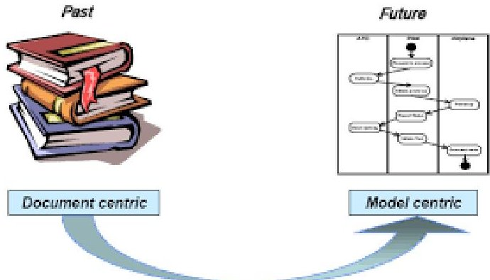
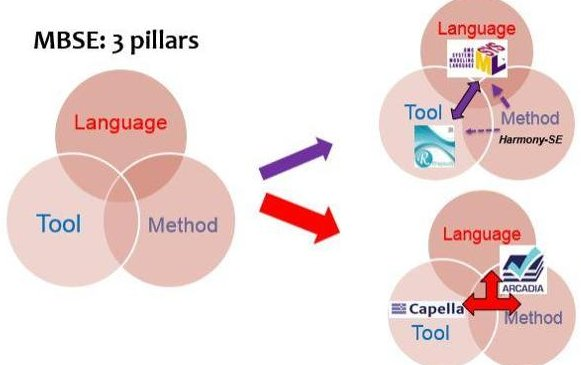
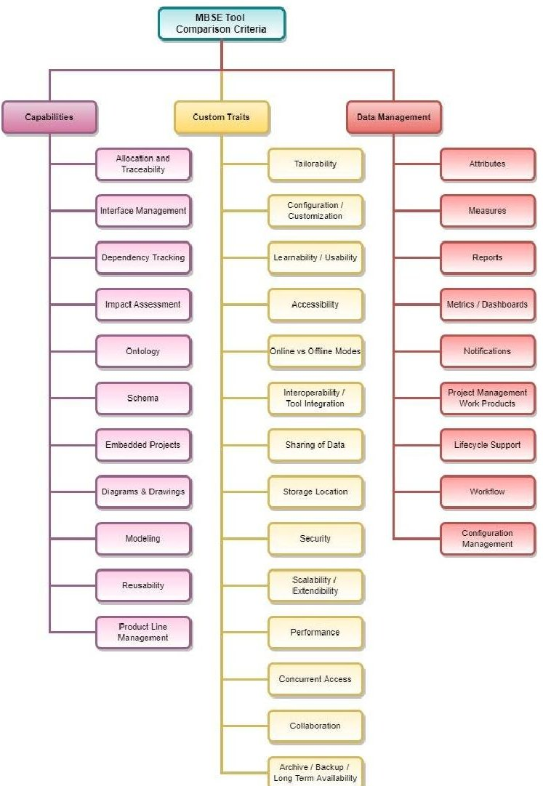
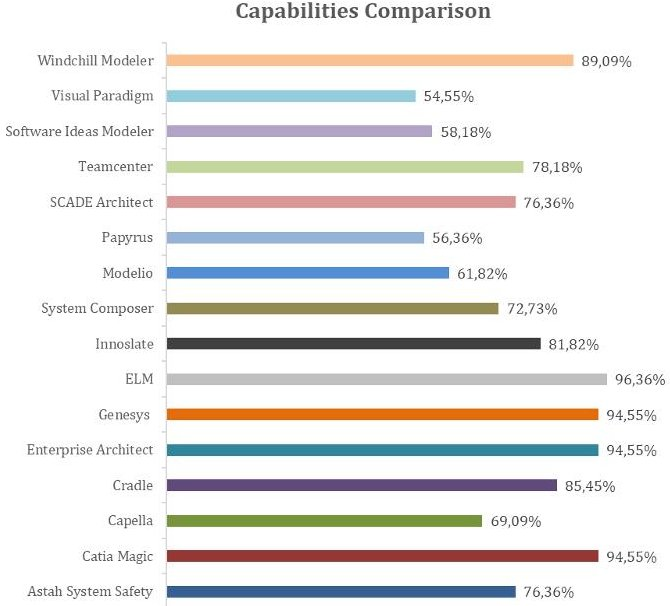
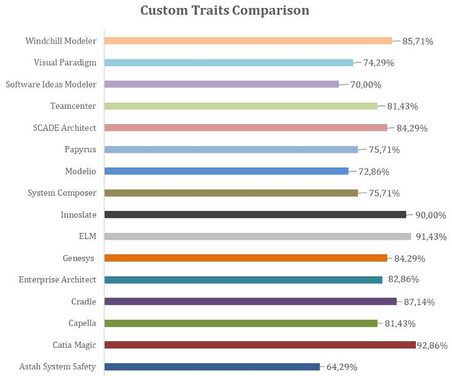
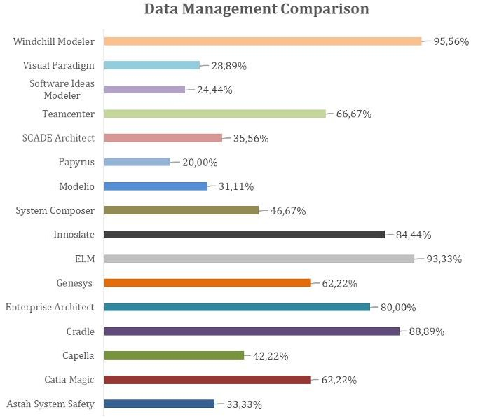
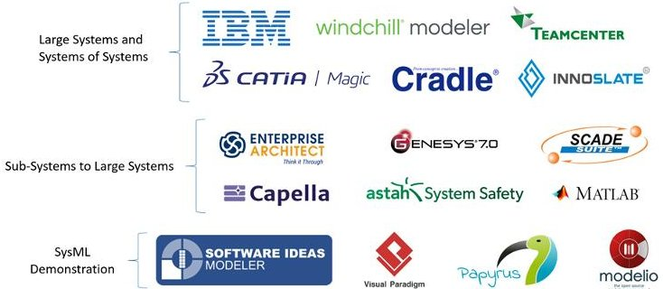

<!-- PDF_PAGE: 1 -->

IAC-22-D1.4B.1

# Comprehensive and Comparative study of MBSE applied to Space Systems Engineering

Marcos Eduardo Rojas Ramirez $ ^{a} $ $ ^{*} $ , Stephanie Lizy-Destrez $ ^{b} $ , Alexis Paillet $ ^{c} $

$ ^{a} $ Institut Supérieur de l'Aeronautique et de l'Espace (ISAE SUPAERO), Department of Complex Systems Engineering (DISC), 10 Avenue Edouard Belin, 31400 Toulouse, France, Marcos-Eduardo.Rojas-Ramirez@isae-supaero.fr

$ ^{b} $ Institut Supérieur de l'Aeronautique et de l'Espace (ISAE SUPAERO), Department of Aerospace Vehicles Design and Control (DCAS), 10 Avenue Edouard Belin, 31400 Toulouse, France, Stephanie.Lizy-Destrez@isae-supaero.fr

$ ^{c} $ Centre National D'Etudes Spatiales(CNES), French Operations Center for Science and Exploration (FOCSE), 18 Avenue Edouard Belin, 31400 Toulouse, France, Alexis.Paillet@cnes.fr

* Corresponding Author

## Abstract

The space sector is well known for its passion for working on ambitious projects, which help humanity advance its scientific knowledge and expand its technological capabilities thanks to the innovative engineering approaches required to develop space technologies. To this day, the space sector is an essential contributor to systems engineering, continuously developing and improving systems engineering practices helpful in designing space and non-space technologies. During the last decade, model-based systems engineering (MBSE) approaches have been under evaluation by the space sector to support systems engineering activities through digital tools, methods, and processes. Unfortunately, only a few actors have successfully deployed MBSE across their organization, creating an MBSE infrastructure that complements their system engineering capabilities. In addition, since each organization has different needs and constraints, parallel growth on adopting MBSE practices is practically impossible. Nevertheless, the space community is attempting to create standards for shared common practices within entities, allowing everyone to continue collaborating within an MBSE framework, transitioning to a new era of digital systems engineering. This investigation will consist of a breakdown of MBSE to define the best manner to use MBSE tools and methods to manage system complexity, increase system understanding and improve collaboration. The chosen approach is to identify the main complications when applying MBSE to space projects, studying examples from the use of MBSE to support the design and development of CubeSats, small and large satellites, launchers, and rovers. After, we would separate their challenges according to their cause (limited tool capabilities, incomplete methodology, and others). This work would allow us to identify problem and mistake patterns that we can use to develop and improve procedures for using MBSE tools and methods properly according to the needs of the project and the user. Another purpose of this research is to identify the best way to introduce MBSE across different organizations (space agencies, private companies, research entities, and educational institutions) and determine their respective roles within a global roadmap for the deployment of MBSE across the space industry. This paper describes the main results of our investigation on MBSE and their effect on the research outcomes (proposed MBSE procedures and practices). Also, the research paper will highlight multiple space projects that have applied MBSE and active initiatives to advance the deployment of MBSE across the space sector.

Keywords: Space Systems Engineering, MBSE, SysML, Digital Tools, Demonstrations, Strategy.

Acronyms/Abbreviations

ARCHitecture Analysis and Design Integrated Approach (ARCADIA)

Centre national d'études spatiales (CNES)

Compact Reconfigurable Avionics (CoRA)

European Space Agency (ESA)

Guidance, Navigation and Control (GNC)

Institut Supérieur de l'Aéronautique et de l'Espace (ISAE)

Interface Control Document (ICD)

International Council on Systems Engineering (INCOSE)

Japan Aerospace Exploration Agency (JAXA)

Model-Based Safety Analysis (MBSA)

Model-Based Systems Engineering (MBSE)

Model-Based for Systems Engineering (MB4SE)

Model-Based Requirement Engineering (MBRE)

Model-Driven Engineering (MDE)

Multi-Purpose Crew Vehicle (MPCV)

National Aeronautics and Space Administration (NASA)

Onboard Software Reference Architecture (OSRA)

Small and Medium-sized Enterprises (SME)

Space Variable Objects Monitor (SVOM)

Systems Engineering (SE)

Systems Modeling Language (SysML)

Systems of Systems (SoS)

The ASSERT Set of Tools for Engineering (TASTE)

<!-- PDF_PAGE: 2 -->

## 1. Introduction

NASA defines Systems Engineering (SE) as a methodical, multi-disciplinary approach for system design, realization, technical management, operations, and retirement. Within this description, a "System" is defined as the combination of elements that function together to produce the capability required to meet a need. These elements typically include hardware, software, equipment, facilities, personnel, processes, and procedures, with outputs usually described in terms of qualities, properties, characteristics, functions, behavior, and performance. [1]

Systems Engineering is an essential aspect to master for managing the complexity of designing manufacturing, testing, and operating a space system which always raises unique challenges requiring much innovation and creativity. Consequently, after several years of experience, the space sector stands firm, as one of the most significant and active contributors to Systems Engineering, with strong expertise and solid systems engineering capabilities. Nevertheless, the rising number of new space technology applications (debris removal, in-orbit manufacturing, space tourism) and current major space projects (e.g., Artemis Program, Mars Sample Return (MSR), Europa Clipper, and others) are substantially raising the complexity of future space systems. These new challenges will need reliable and efficient systems engineering to ensure the success of future missions.

## 1.1 Model-Based Systems Engineering

Model-Based Systems Engineering (MBSE) is defined as the formalized application of modeling to support system requirements, design, analysis verification, and validation activities beginning in the conceptual design phase and continuing throughout the development and later life cycle phases [2]. This solution was introduced by the International Council of Systems Engineering (INCOSE) in 2007 in their Systems Engineering Vision 2020 report [2], where they mentioned the need for better management of system complexity and shared their vision on how MBSE could support addressing this issue.

Figure 1. Transition to MBSE (Credits: INCOSE)

In this new approach, the model would serve as the "single source of truth," resolving some issues of working with a document-based approach.

## 1.2 MBSE Fundamentals

Performing MBSE requires a tool, a language, and a methodology. Therefore, every MBSE tool is built upon these three elements.

Figure 2. The three pillars of MBSE [3]

A tool refers to the platform that allows the user to model. In contrast, a modeling language refers to the concepts that define a set of models. These usually require syntax to describe how the models appear and semantics to describe what each model means. [4] The System Modeling Language (SysML) is the most common modeling language used to perform MBSE. [5] Lastly, a methodology refers to the combination of processes and methods to perform MBSE in a coordinated and logical manner, relating model elements and guiding the gradual model development.

## 1.3 Motivations for this research

Today, there are limited examples across the European space industry where MBSE plays a significant role in supporting System Engineering Activities. Nevertheless, this is rapidly changing due to multiple efforts to promote the adoption of MBSE across the European space sector, such as the MB4SE initiative. This effort by ESA aims to federate the space system engineering community and foster joint efforts to deploy MBSE in European Space projects. [6]

Figure 3. MB4SE Initiative Logo (Credits: ESA)

This research was a collective effort between the French Space Agency (CNES) and the French engineering school ISAE SUPAERO, which aimed to gather perspectives on MBSE Adoption based on examples from different projects across the space sector.

<!-- PDF_PAGE: 3 -->

## 2. Literature Review

Our primary research method was the study of examples in literature followed by diverse assessments of certain areas to identify their respective relevance and issues. Our starting point was the publications made at the MBSE 2020 Virtual Workshop [7] organized by ESA, where various actors presented their work on the implementation and use of MBSE across different types of space projects (CubeSat, Small Satellites, Spacecraft Subsystems, and Spacecraft Concepts). Other topics discussed in these publications included cooperation strategies across the space sector, lessons learned from their followed approach, and tool development and evaluation, including digital platforms for concurrent modeling and simulation. The table below shows the list of short papers reviewed:

Table 1. Short-Papers Reviewed

<table border="1"><tr><td>Paper Title</td><td>Ref</td></tr><tr><td>Applications of MBSE for JAXA&#x27;s Engineering Test Satellite-9 Project</td><td>[8]</td></tr><tr><td>Modelling Avionics Interfaces and Generating ICDs for the Propulsion Subsystem of the MPCV European Service Module</td><td>[9]</td></tr><tr><td>Applying MBSE across Flight and Ground on Small and Nano-Satellite Missions</td><td>[10]</td></tr><tr><td>First lessons with a MBSE approach for nanosatellites</td><td>[11]</td></tr><tr><td>Stepwise adoption of model-based solution for a full MBSE transition, an Industrial perspective</td><td>[12]</td></tr><tr><td>Lessons learned on the use of MBSE in the preliminary design of space systems at CT Paris</td><td>[13]</td></tr><tr><td>Applying the &#x27;Spacecraft Early Analysis Model&#x27; to the Biomass Mission</td><td>[14]</td></tr><tr><td>MBSE Approach Applied to Lunar Surface Exploration Elements</td><td>[15]</td></tr><tr><td>Successful MBSE landing on a CNES operational use case</td><td>[16]</td></tr><tr><td>International Cooperation on Model Based Development</td><td>[17]</td></tr><tr><td>Experiences and Expectations with Model-Based System and Software Engineering</td><td>[18]</td></tr><tr><td>Experience Report: History and State of the Practice of Model-Based Software Engineering in TAS in France</td><td>[19]</td></tr><tr><td>Lessons learned from the use of SysML in Space Systems at SENER Aeroespacial</td><td>[20]</td></tr></table>

<table border="1"><tr><td>What to Expect from SysML Version 2</td><td>[21]</td></tr><tr><td>Model-Based Systems Engineering in Space Robotics: The ADE Experience</td><td>[22]</td></tr><tr><td>Capella to TASTE MBSE bridge</td><td>[23]</td></tr><tr><td>CoRA-SAGE: The lessons learnt from AOCS/GNC algorithms deployment in TASTE</td><td>[24]</td></tr><tr><td>Model-based techniques for space microcontroller applications</td><td>[25]</td></tr><tr><td>Tiny Runtime to Run Model-Based Software on CubeSats</td><td>[26]</td></tr><tr><td>Shared Data Types For OSRA and TASTE</td><td>[27]</td></tr><tr><td>TASTE: a toolchain for multicore TSP applications</td><td>[28]</td></tr><tr><td>CORA-MBAD for ZYNQ 7000: Model-Based Definition and Implementation of Reconfigurable COTS Avionics</td><td>[29]</td></tr><tr><td>Enabling combining models and tools in an online MBSE collaboration platform</td><td>[30]</td></tr><tr><td>CloudSF-A Continuous Integration Framework for the design and validation of Cyber-Physical Systems</td><td>[31]</td></tr><tr><td>Bridging the Gap between On Board and Ground Configuration Data Bases</td><td>[32]</td></tr><tr><td>CoCoSim: an automated analysis framework for Simulink/Stateflow</td><td>[33]</td></tr><tr><td>BabyMOD,a Collaborative Model Editor for Mastering Model Complexity in MBSE</td><td>[34]</td></tr></table>

## 2.1 Literature Review Outcomes

The analysis of each short paper in the literature review had to answer four basic questions:

1. What is being done?

2. How is it being done?

3. Why is it being done?

4. Who is doing it?

To distribute the outcomes, we divided our work into three areas of interest, highlighting the three types of efforts identified throughout the literature.

- Digital Tool Development

- Technical Demonstration

- Strategy & Planning

Further research was made on each area to assess its relevance and challenges and provide ideas for improvements in each area. The following sections will describe the different results gathered.

<!-- PDF_PAGE: 4 -->

## 3. Tool Development

Tool Development concerns all efforts towards developing digital tools that support MBSE activities or enhancing existing tools. Such work is critical to generate confidence in the level of maturity of MBSE tools and convince the industry that they provide adequate support to System Engineering activities.

## 3.1 Identified Tools

To assess this area, we started by recording all the software mentioned in the literature review. After that, we explored further to identify other popular tools used for MBSE. The final list of tools included 16 different digital tools, which are shown in the table below:

Table 2. MBSE Tool List

<table border="1"><tr><td>Tool</td><td>Distributor</td><td>License</td><td>Ref</td></tr><tr><td>Astah System Safety</td><td>Astah</td><td>Commercial</td><td>[35]</td></tr><tr><td>Catia Magic</td><td>Dassault Systemes</td><td>Commercial</td><td>[36]</td></tr><tr><td>Capella</td><td>Eclipse</td><td>Open-Source</td><td>[37]</td></tr><tr><td>Cradle</td><td>Structured Software Systems</td><td>Commercial</td><td>[38]</td></tr><tr><td>Enterprise Architect</td><td>Sparx Systems</td><td>Commercial</td><td>[39]</td></tr><tr><td>Genesys</td><td>Vitech</td><td>Commercial</td><td>[40]</td></tr><tr><td>ELM</td><td>IBM</td><td>Commercial</td><td>[41]</td></tr><tr><td>Innoslate</td><td>Innoslate</td><td>Commercial</td><td>[42]</td></tr><tr><td>System Composer</td><td>MathWorks</td><td>Commercial</td><td>[43]</td></tr><tr><td>Modelio</td><td>ModelioSoft</td><td>Commercial</td><td>[44]</td></tr><tr><td>Papyrus</td><td>PolarySys</td><td>Open-Source</td><td>[45]</td></tr><tr><td>SCADE Architect</td><td>ANSYS</td><td>Commercial</td><td>[46]</td></tr><tr><td>Teamcenter</td><td>Siemens</td><td>Commercial</td><td>[47]</td></tr><tr><td>Software Ideas Modeler</td><td>Dušan Rodina</td><td>Commercial</td><td>[48]</td></tr><tr><td>Visual Paradigm</td><td>Visual Paradigm</td><td>Commercial</td><td>[49]</td></tr><tr><td>Windchill Modeler</td><td>PTC</td><td>Commercial</td><td>[50]</td></tr></table>

The next step was to define criteria we could use to evaluate and compare the identified tools, including standard and desired capabilities and features.

## 3.2 Evaluation & Comparison Criteria and Approach

Based on the literature review and similar works [51][52]. The criteria were divided into three categories:

- Capabilities

- Custom Traits

- Data Management

Efforts on capabilities help ensure that the tool offers all the essential means to do MBSE properly. An example would be ensuring that the tool supports a general-purpose modeling language like UML or SysML and the different formats used to manage data in these languages (e.g., diagrams, tables, etc.). On the other hand, the work on custom traits focuses on having features that allow the user to change and adapt the tool and generally improve how the user interacts with the tool. An example would be to have a Graphical User Interface (GUI) that is intuitive and makes the tool easy to use. Lastly, advances in data management usually concentrate on maximizing how the user can use and display data. An example would be providing the user with the ability to create reports or have dashboards that summarize the project's progress and main results.

Figure 4 shows the final evaluation and comparison criteria, including 34 features within the three mentioned categories.

Fig. 4. Final Evaluation and Comparison Criteria.

<!-- PDF_PAGE: 5 -->

The evaluation was performed by looking at the tool vendor's website, user manuals, or publications to estimate how well a tool supported each feature within a range of 0 to 5. Then, based on how many features were included in each category, a maximum score was calculated and compared against the actual result, allowing us to interpret the results in percentages.

Table 3. Comparison Benchmark

<table border="1"><tr><td>Score</td><td>Expectation</td></tr><tr><td>5</td><td>The tool offers outstanding support for this feature.</td></tr><tr><td>4</td><td>The tool offers great support for this feature.</td></tr><tr><td>3</td><td>The tool offers good support for this feature.</td></tr><tr><td>2</td><td>The tool offers adequate support for this feature.</td></tr><tr><td>1</td><td>The tool offers poor support for this feature.</td></tr><tr><td>0</td><td>The tool does not support this feature.</td></tr></table>

Table 4. Maximum Total Score (MTS) for each aspect.

<table border="1"><tr><td>Category</td><td>N° of Features</td><td>MTS</td></tr><tr><td>Technical Capabilities</td><td>11</td><td>55</td></tr><tr><td>Interaction Traits</td><td>14</td><td>70</td></tr><tr><td>Management Support</td><td>9</td><td>45</td></tr></table>

MTS=5 $ ^{*} $ N $ ^{\circ} $ of Features

## 3.3 Evaluation & Comparison Results

The capabilities comparison showed a significant difference between some tools. The tools that scored the least seemed not to support certain features or depended on plug-ins and add-ons for essential features.

The custom traits comparison showed less disparity between tools. Generally, a score above 80% is acceptable. However, the tools that scored less seem to have a steeper learning curve and require more effort to productively and efficiently use them.

Fig. 5. Comparison concerning Capabilities.

Figure 6. Comparison concerning Custom Traits.

The data management comparison showed the most substantial difference between tools. This competence usually requires the MBSE tool to interact with other tools to manage better how the data is stored, shared, displayed, organized, and changed. The main conclusion from this part is that tools with a high score on data management seem to have substantial interoperability, which makes them more suitable for big projects that require support for project management and systems of systems (SoS).

Figure 7. Comparison Concerning Data Management

Our results allowed us to categorize each tool according to its primary added value and estimated support for each feature included in the criteria.

<!-- PDF_PAGE: 6 -->

This comparison did not aim to determine which tool is the best. In the end, each tool continuously improves and changes, enhancing its performance, efficiency, and usability. Instead, we aimed to categorize each tool so that when complemented by expectations and plans for MBSE activities, anyone could choose a solution that satisfies the project needs and produce the expected outcomes. The figure below shows our categorization of MBSE tools, with each layer inferring a higher level of novelty and performance but also cost.

Figure 8. Categorization of MBSE tools based.

## 3.4 Perspectives on MBSE tools

The literature review and our tool assessment provided much information concerning the current capabilities of MBSE tools,the vision for their improvement, and their role in MBSE adoption. This section highlights our main perspectives in this area.

## 3.4.1 MBSE tools are ready

The maturity of MBSE tools is high enough for adoption by the industry. Currently, there are tools for all kinds of applications and projects. Most likely, what confuses the industry is that complete adoption of MBSE takes time, and the bigger the organization or the project, the longer it would take for its added value to become evident.

## 3.4.2 It's not about the tool

MBSE adoption is more than just choosing the best tool in the market. Instead, there should be a clear vision of the added value that MBSE would bring and a plan for its implementation. After that, the person, team, or organization can choose the MBSE tool that best fits its needs. For example, modest tools are adequate for pedagogical applications to teach employees or students about MBSE, but they are unsuitable for large-scale deployment of MBSE activities.

## 3.4.3 The potential of open-source development

Capella [37] has demonstrated that open-source development has much potential to help widen the adoption of MBSE practices across the industry by making it available to everyone. Also, open-source development results in a substantial workforce that can work 24/7 on designing and maintaining the tool.

## 3.4.4 The easier the better

Regardless of all the capabilities of a digital tool, if a considerable effort has to be made when using it, the more the user will question its benefit. Even simple aspects like how hard the tool is to install can drive interest away from someone that wants to use it. Therefore, future efforts should focus on making every aspect of the tool simple (without many steps) and straightforward (without points of confusion).

## 4. Technical Demonstration

Technical Demonstration concerns the evaluation of MBSE in practice by working on a specific project expected to highlight its benefits and compile lessons learned to improve how to perform MBSE in the future.

This work is usually conducted in two ways. One approach is to choose a target system, subsystem, or component and a specific SE task where MBSE can add value (e.g., requirement management, functional analysis, etc.). After doing so, the main objective is to evaluate the quality of the outcomes and assess the level of effort it took. Ideally, the results should show a good quality outcome without substantial effort. Another approach is to perform reverse engineering on a mature project to directly compare the results from following the "common approach" with those from the MBSE approach, identifying the parts of the previous process that MBSE replaced.

## 4.1 Meaningful Articles

This section summarizes each short paper from the literature review that presents work in this area.

## 4.1.1 Applications of MBSE for JAXA's Engineering Test Satellite-9 Project [8]

This paper discussed applying an MBSE approach for interface management of flight systems development. The problem was a complex interaction between components developed by different providers. The issue was solved by using the formalized descriptions of system requirements, behaviors, and behavior allocations to system elements with SysML, allowing them to manage the system's complexity better. The use of MBSE mainly supported the system analysis and failure mode analysis.

## 4.1.2 Modelling Avionics Interfaces and Generating ICDs for the Propulsion Subsystem of the MPCV European Service Module. [9]

This paper discussed applying an MBSE approach for interface management and generating Interface Control Documents (ICDs). This work also included comparing Capella and Enterprise Architect, favoring Capella for its accessibility and customization features. The rest of the paper discussed the use of Capella to generate ICDs using M2Doc.

<!-- PDF_PAGE: 7 -->

## 4.1.3 Lessons learned on the use of MBSE in the preliminary design of space systems at CT Paris [13]

This paper discussed the use of Capella and the Arcadia Method for the preliminary design of multiple space systems with low Technology Readiness levels (TRL), providing a good overview of why they chose Capella and its benefits.

## 4.1.4 Applying SEAM to the Biomass Mission [14]

This paper discussed the results of using the Spacecraft Early Analysis Model (SEAM) on an ESA project called Biomass. SEAM is a SysML-based modeling framework for defining, developing, and analyzing a space-based mission and corresponding space system. The paper gives an overview of the methodology and its main benefits.

## 4.1.5 MBSE Approach Applied to Lunar Surface Exploration Elements [15]

This paper discusses the use of MBSE to design an autonomous GNC system for a Lunar Rover. This work contains a complete description of the methodology followed and the steps taken to move from the high-level requirements to a state machine used to run simulations. Also, this work talks about the benefits of the MBSE methodology followed and the interactions between all the tools used.

## 4.1.6 Successful MBSE landing on a CNES operational use case [16]

This paper discussed using Capella and Arcadia to improve communication, system validation, and technical documentation on a CNES project (SVOM).

## 4.1.7 Lessons learned from the use of SysML in Space Systems at SENER Aeroespacial [20]

This paper discussed the use of SysML by SENER Aeroespacial on multiple projects, summarising each project's objectives and how SENER used SysML to satisfy each project's specific needs.

## 4.1.8 MBSE in Space Robotics: The ADE Experience [22]

This paper discussed the use of MBSE to develop an autonomous decision-capable rover that can make long traverses. This project used the TASTE platform which employs multiple languages and tools to help software engineers model a system.

## 4.1.9 Capella to TASTE MBSE bridge [23]

This paper discussed using a plug-in to allow Capella models to be used by the TASTE modeling toolchain. In addition, the article discusses the differences between both tools, such as the types of data they handle and the work done to make their data compatible with each other.

4. 1.10 CoRA-SAGE: The lessons learned from AOCS/GNC algorithms deployment in TASTE [24]

This paper discussed the use of TASTE to implement AOCS and GNC functional chains with an extensive suite of space sensors and actuators in parallel with the Model-Based Avionics Design (MBAD) activity and the Reconfigurable Data Handling Core (RDHC) activity.

## 4.1.11 Model-based techniques for space microcontroller applications [25]

This paper discussed the experience of TAS using the TASTE Tool developed by ESA for developing mixed-signal microcontrollers. The article defines the system of interest, describes the characteristics of TASTE, and ends with some use cases of the tool on real projects.

## 4.1.12 Tiny Runtime to Run Model-Based Software on CubeSats [26]

This paper presented a project that extended the TASTE development toolchain with support for MSP430, a family of cheap, low-power space-grade MCUs used in small satellites. The goal was achieved by mapping FreeRTOS and TASTE constructs, implementing code generation via templates, optimizing/replacing the existing middleware, and integrating an Ada compiler for the target platform.

## 4.1.13 TASTE: a toolchain for multicore TSP applications [28]

This paper described the multiple views of the TASTE tool and how to use it to develop embedded real-time systems. This article mainly focused on how TASTE can support Time and Space Partitioning (TSP) architectures.

4. 1.14 CORA-MBAD for ZYNQ 7000: Model-Based Definition and Implementation of Reconfigurable COTS Avionics. [29]

This paper discussed the use of the Compact Reconfigurable Avionics (CoRA) - Model-Based Avionics Design (MBAD) approach to develop a Hardware and Software co-design toolchain. This work was based on the TASTE Toolset and targeted a GR740 general-purpose processor coupled to a BRAVE reconfigurable Field-Programmable Gate Array FPGA.

## 4.1.15 CloudSF - A Continuous Integration Framework for the design and validation of Cyber-Physical Systems [31]

This paper presented the Cloud System Factory (CloudSF). Ideally, this platform would allow the integration of multiple tools used during the system development process and connect all the outputs.

<!-- PDF_PAGE: 8 -->

## 4.2 Perspectives on Technical Demonstrations

Technical Demonstrations can not be easily compared since each example has particular objectives and needs. However, after analyzing their strengths, promising results, and areas for improvement, some perspectives were recorded on how to make the outcomes of future work in this area more meaningful.

## 4.2.1 Separating myths from reality

A significant outcome of technical demonstrations is to separate the myths from the truths of applied MBSE, pointing out areas where improvements can be made to get better results or make the process more efficient. In addition, these activities can produce much feedback on the strengths and weaknesses of the tool, comparing the initial expectations against the experience of using the tool. For example, the work in [16] had an objective of benefiting from a document generation feature that allowed to automatically create word documents with information coming from the model. However, the plug-in used to do so did not match the expected quality and efficiency, generating some frustrations, which were stated in their conclusion. Future efforts on technical demonstrations should allow continuing to improve MBSE tools and methods by testing their limits to observe areas of improvement.

## 4.2.2 Applying MBSE to different types of projects

Technical demonstrations also evaluate how MBSE can be applied to a specific problem or within a specific project. Success in this aspect is critical to demonstrate that MBSE can adequately adapt to the different needs of different industries. The space sector has some of the most diverse projects regarding scope, technical elements, and stakeholders. Therefore, an essential factor for MBSE to be adopted across the space sector is for it to support the development of all these projects.

Fortunately, because of the challenging aspects of space projects, most space actors usually work according to specific sets of standards that encourage the system engineering process of a space project to follow a common approach regardless of the type of project. For example, the European Cooperation for Space Standardization (ECSS) [53] is responsible for defining and publishing standards that serve as guidelines for the different activities the European industry should follow based on the needs of each phase within the project's lifecycle.

So, if MBSE supports the activities outlined in the standards, its capacity to meet the needs of the space sector will improve. Also, doing so could increase its adoption rate since MBSE would become part of the standard's implementation. An example of this kind of work is the SysML Solution proposed by ESA [54]. This solution consists of a SysML profile that defines stereotypes based on the terminology defined and used

in the ECSS standards. This profile allowed them to design an MBSE Framework that uses common terminology, allowing them to apply MBSE to various projects and collaborate with different space actors.

However, something to avoid is attempting to fit MBSE into a traditional implementation of the standard, restricting the transition to full and proper MBSE adoption. For example, spreadsheets are among the most preferred formats to store and manage data because a tabular notation is very simple and helpful when analyzing multiple data sets. However, generally, MBSE relies on Box-and-Line Diagrams as their main graphical concrete syntax. Because of this, almost all MBSE tools offer the ability to import and export data in CSV format. Nevertheless, the user's interest in this feature is to continue its traditional way of doing things.

## 4.2.3 Data Streamlining

Technical Demonstrations also look into testing new ways to use MBSE to support specific processes and analyzes. Doing so is essential to ensure that MBSE can handle the multidisciplinarity across the space sector and support the entire lifecycle of a project. Some examples include specific branches of MBSE, such as Model-Based Requirement Engineering (MBRE) [55] and Model-Based Safety Analysis (MBSA) [56], and works that merge different Model-Driven Engineering (MDE) approaches such as using MBSE tools in conjunction with concurrent engineering tools (e.g., COMET [57], IDM-CIC [58], etc.).

Efforts in this area usually use multiple tools, and a critical aspect becomes figuring out how to use the data from both tools. Some works address this issue by tailoring the MBSE framework to support this specialized application. Nevertheless, when manually translating information from one tool to another, even if the models seem identical in structure, they may have different behavior since they are not built on the foundation underneath. Therefore, some verification tests have to be made to ensure reliable results. [59]

A different way that others chose to address this issue was by creating a tool extension (plug-in or add-on) that allowed the tool to perform the required activity or transfer its data to a tool that could. However, as with the previous approach, verification tests need to be made to ensure that the expected data was transferred and that its quality was not damaged. [23]

A promising proposed solution involves using a platform that serves as a data hub to collect data from multiple tools so that the notion of a "single source of truth" remains true while allowing all tools to access the available data sets [31]. The main advantage of this approach is the substantial increment in the number of tools that could communicate, which would solve issues when using MBSE tools in conjunction with simulation and domain-specific software.

<!-- PDF_PAGE: 9 -->

$ 7 3^{\mathrm{s t}} $ International Astronautical Congress (IAC) - 18-22 September 2022. Copyright ©2022 by Institut Supérieur de l'Aéronautique et de l'Espace (ISAE SUPAERO). Published by the IAF, with permission and released to the IAF to publish in all forms.

## 5. Strategy & Planning

Strategy and Planning concern all efforts toward proposing plans for internal and collaborative MBSE adoption across the industry. For internal MBSE adoption, activities usually involve assessing current SE capabilities and developing a vision for MBSE that formally captures the future steps and direction towards its implementation. On the other hand, collaborative MBSE adoption usually involves the creation of working groups that involve different kinds of actors where they can discuss the future steps and direction that needs to be taken collectively. Doing so ensures that everyone will grow in the same direction, even if it is not at the same pace. This aspect is essential to ensure that MBSE adoption does not negatively affect the collaborative aspects of a space project since a single project can involve a very diverse set of actors.

This area was assessed by studying examples of those activities across the Space Sector.

## 5.1 The case of space agencies

While space agencies have a major role in the space activities of their respective country, they cannot use their resources in the same way a private company does. Also, space agencies often rely on the private sector to perform much of the work required to design, develop, and operate a space system. This aspect results in partial involvement during a given project, which causes their main priority to be acquiring knowledge of what MBSE is and how the industry uses it. Nevertheless, space agencies perform much open-source development, developing and maintaining specific space mission design and analysis tools. Therefore, some of their efforts on MBSE adoption have also included open-source development of MBSE solutions.

## 5.1.1 Example - MBSE at the French Space Agency [60]

The Engineering & Digital Continuity Team leads MBSE activities at The French Space Agency (CNES). This team is a group of CNES experts responsible for MBSE adoption at CNES. In 2021, this group created a preliminary roadmap for all their work concerning MBSE across all CNES centers. Since then, CNES has carried out several MBSE efforts on diverse types of projects. Some of their most relevant efforts include:

- Space Variable Objects Monitor (SVOM): This effort attempted to perform reverse engineering to model a system chain to define Interface Control Documents (ICDs) and system verification scenarios and simulation.

- Highly Integrated Avionics (FATI): This effort involved functional modeling of avionics functions to assess the SAVOIR documents and potential physical implementation based on reconfigurable FPGAs.

- Integrated Design Model (IDM-CIC): Activities included integration with updated ECSS TM-10-25 and ESA OCDT & CDP4.

- R&D concerning model-based review process: Areas studied include data repository for review, digitalization of the data, model exchanges, and collaborative process.

- Proof of concepts on launchers: This work includes applied MBSE on CALLISTO, THEMIS, KASSAV.

- Using MBSE on low TRL system concepts: This work involved using Capella to design different types of systems for space exploration in the areas of ISRU and human habitation.

## 5.2 The case of the private sector

The private space sector comprises actors with diverse expertise and differences in size. Therefore, the MBSE needs for each company vary depending on many factors, such as the scope of their projects, the size and experience of their workforce, and their organizational constraints (e.g., budget, timelines, etc.).

Research from ESA [61] outlined that start-ups and small to medium enterprises (SMEs) often work at a fast pace in their day-to-day due to considerable commercial pressures. Furthermore, even though the workforce of a start-up or SME is not as significant as that of a large company, adopting SME can still take some time, which does not adapt well to their strict deadlines. Therefore, their research concluded that start-ups and SMEs should adopt MBSE only if the company can afford the tool's license and the training required, in terms of time and money, and if there is a concrete added value coming from the use of MBSE.

Adoption of MBSE by large companies requires much coordination and planning to adopt and implement such practices properly. Several examples of success across the private sector of large companies successfully transitioning to complete MBSE adoption. The two most relevant examples in Europe are Airbus and Thales, who developed the two most effective MBSE methodologies (MOFLT and ARCADIA) [51]. These companies also occupy an important role as partners of ESA for several projects that use MBSE, such as a Venus orbiter mission (EnVision) and the European Large Logistics Lander (EL3)[62].

## 5.2.2 Example - Thales and Capella

Thales is responsible for having developed Capella, one of the most commonly used MBSE tools across Europe [63]. This effort started as an action to introduce product line engineering to Thales projects and resulted in ARCADIA becoming of the most widely preferred MBSE methodologies across the industry. This effort has contributed significantly to advancing MBSE practices since accessing the tool is easy and free.

<!-- PDF_PAGE: 10 -->

## 6. Discussion

This section outlines some perspectives that have not been mentioned but that cover aspects of improving future research to demonstrate that MBSE is the future of systems engineering.

## 6.1 Lack of competition in the MBSE tool market

Vendor lock-in is something that is always mentioned as something to avoid. However, the current options available that allow for MBSE to be adopted across an organization are not many.

The low competitiveness of the MBSE software market is driving the industry to rely on a handful of providers. This aspect has many risks since software providers are usually also those that maintain the tool. This means that if the company were to disappear or change direction, companies could lose its current infrastructure. Another risk is forcing the user to change or update to a more recent version of their platform which could be expensive.

Future work in tool development should aim to increase the competitiveness of the MBSE tool market so that tool providers are forced to innovate to remain active and allow the users to have control over what they can choose to build their MBSE infrastructure.

## 6.2 Lack of measured evidence

Based on the reviewed work concerning technical demonstrations, it became evident that some of the conclusions about the benefits of MBSE were vague or redundant. This fact led to questioning the validity of this type of research since most papers did not report measured evidence from using MBSE. Further research identified that quantifiable evidence of the added value of MBSE is rare [64]. Having measured evidence would not only demonstrate that MBSE indeed does what it is supposed to do, but it would also allow comparing different approaches to define better standard practices.

## 6.3 Adoption through Education

In contrast to other major adopted standards in Systems Engineering, such as the "Vee-Cycle", MBSE adoption seems to require a much higher cost in terms of time and money. The amount of training required and the cost of access to proper MBSE tools is a significant factor that drives many away from MBSE adoption. However, this cost is lower when a company has qualified employees with the skills to perform the work. This factor results in money savings since the return of investment can be achieved faster and time savings since there is not much time lost in training. Therefore, future efforts in Strategy & Planning should involve collaboration with universities and academia to define new educational frameworks that consider this need to transition to MBSE, resulting in more qualified candidates and employees.

## 7. Conclusions

This paper has presented different perspectives on the current status of the adoption of MBSE across the space sector. It presented diverse perspectives, comparisons, and arguments on significant aspects of MBSE implementation. Starting with the literature review proved to be a valuable approach due to the diverse kind of work presented. In addition, the short papers reviewed provided many directions, which were explored throughout the research. An explanation of different efforts concerning the development of MBSE tools was given, along with an evaluation and comparison of current tools used across the industry.

A summary of different efforts on technical demonstrations of MBSE in practice was offered, outlining different perspectives on their strengths, possibilities, and areas of improvement. Different examples of efforts on strategy and planning were provided, outlining some differences in MBSE adoption by different organizations and how some actors have advanced and contributed to MBSE Adoption.

Lastly, some opinions were given to encourage the examination of aspects that seem unexplored. Our future work will focus on studying more examples outside of Europe and outside of the space sector. Doing so should provide new perspectives from works with more diverse ways to perform MBSE and Systems Engineering practices.

## Acknowledgements

The authors of this paper would like to acknowledge all the support of the Spaceship FR team and some members of the Engineering & Digital Continuity team at CNES (J. Rey and N. Corcoral), which provided insights on different aspects of this research. At the same time, the authors would like to thank the professor at ISAE SUPAERO Dr. J.C. Chaudemar for his feedback on our research.

## References

[1] Steven R. Hirshorn, NASA Systems Engineering Handbook, Rev 2, Washington, DC, 2007.

[2] INCOSE, Systems Engineering Vision 2020 Rev. 2.03, INCOSE-TP-2004-004-02, September 2007.

[3] P. Roques, MBSE with the ARCADIA Method and the Capella Tool. 8th European Congress on Embedded Real Time Software and Systems (ERTS 2016), Jan 2016, Toulouse, France.

[4] Combemale, B., France, R., Jezéquel, J. M., Vojtisek, D., Steel, J. R. H., & Rumpe, B. (2016). Models for Software-Intensive System Development, Taylor & Francis.

[5] Object Management Group, SysML Open Source Project, https://sysml.org/, (accessed 28.01.2022).

<!-- PDF_PAGE: 11 -->

[6] ESA, MB4SE Initiative, 15 January 2022, https://mb4se.esa.int/MB4SE_Home.html, (accessed 28.01.2022).

[7] ESA, MBSE 2020, https://indico.esa.int/event/329/ (accessed 28.01.2022).

[8] Y. Nakajima, T. Fukatsu, Applications of Model-Based Systems Engineering for JAXA's Engineering Test Satellite-9 Project, MBSE 2020, Noordwijk, Netherlands, 2020, 28-29 September.

[9] D. Cellarier, A. Preden, Modelling Avionics Interfaces and Generating Interface Control Documents for the Propulsion Subsystem of the MPCV European Service Module, MBSE 2020, Noordwijk, Netherlands, 2020, 28-29 September.

[10] P. Mendham, Applying MBSE across Flight and Ground on Small and Nano-Satellite Missions, MBSE 2020, Noordwijk, Netherlands, 2020, 28-29 September.

[11] B. Segret, R. Jain, B. Mosser, First lessons with a Model-Based System Engineering approach for nanosatellites, MBSE 2020, Noordwijk, Netherlands, 2020, 28-29 September.

[12] D. Perillo, C. S. Malavenda, Stepwise adoption of model-based solution for a full MBSE transition, an Industrial perspective, MBSE 2020, Noordwijk, Netherlands, 2020, 28-29 September.

[13] J. Morane, C. Dupont, Lessons learned on the use of MBSE in the preliminary design of space systems at CT Paris, MBSE 2020, Noordwijk, Netherlands, 2020, 28-29 September.

[14] J. Gregory, L. Berthoud, T. Tryfonas, L. Faure, Applying the 'Spacecraft Early Analysis Model' to the Biomass Mission, MBSE 2020, Noordwijk, Netherlands, 2020, 28-29 September.

[15] J. Rimani, S. Lizy-Destrez, J.C. Chaudemar, N. Viola, MBSE Approach Applied To Lunar Surface Exploration Elements, MBSE 2020, Noordwijk, Netherlands, 2020, 28-29 September.

[16] J. Lasalle, B. Viaud, Successful MBSE landing on a CNES operational use case, MBSE 2020, Noordwijk, Netherlands, 2020, 28-29 September.

[17] I. Conway, S. Radu, International Cooperation on Model-Based Development, MBSE 2020 Noordwijk, Netherlands, 2020, 28-29 September.

[18] A. Wortmann, M. Beet, D. Roßkamp, Experiences and Expectations with Model Based System and Software Engineering, MBSE 2020, Noordwijk, Netherlands, 2020, 28-29 September.

[19] R. De Ferluc, M. Panunzio, Experience Report: History and State of the Practice of ModelBased Software Engineering in Thales Alenia Space in France, MBSE 2020, Noordwijk, Netherlands, 2020, 28-29 September.

[20] L. Tarabini-Castellani, V. Gómez, J. Fombellida, S. Ramirez, N. Puente, R. Contreras, R. Haya, Lessons learned from the use of SysML in Space Systems at

SENER Aeroespacial, MBSE 2020, Noordwijk Netherlands, 2020, 28-29 September.

[21] H.P. de Koning, What to Expect from SysML Version 2?, MBSE 2020, Noordwijk, Netherlands, 2020, 28-29 September.

[22] J. Ocón, I. Dragomir, R. Jalvo, R. Marc, M. Foughali, L. Kunze, R. Dominguez, Model-Based Systems Engineering in space robotics: The ADE Experience, MBSE 2020, Noordwijk, Netherlands, 2020, 28-29 September.

[23] M. Kurowski, Capella to TASTE MBSE bridge MBSE 2020, Noordwijk, Netherlands, 2020, 28-29 September.

[24] A. Figueroa, J.M. del Cura, S. Lozano, G. del Valle, G. Rodriguez, J. Corchero, J. Cardin, L. Tarabini Castellani, E. Rodriguez, D. Oddenino, CoRA-SAGE: The lessons learnt from AOCS/GNC algorithms deployment in TASTE, MBSE 2020, Noordwijk, Netherlands, 2020, 28-29 September.

[25] S. Duncan, Model-based techniques for space microcontroller applications, MBSE 2020, Noordwijk, Netherlands, 2020, 28-29 September.

[26] R. Babski , Tiny Runtime to Run Model-Based Software on CubeSats, MBSE 2020, Noordwijk, Netherlands, 2020, 28-29 September.

[27] J. Sommer, Shared Data Types for OSRA and TASTE, MBSE 2020, Noordwijk, Netherlands, 2020, 28-29 September.

[28] L. Gouveia, TASTE: a toolchain for multicore TSP applications, MBSE 2020, Noordwijk, Netherlands, 2020, 28-29 September.

[29] T. Jorge. Fukatsu, CORA-MBAD For ZYNQ 7000: Model-Based Definition and implementation of reconfigurable COTS Avionics, MBSE 2020, Noordwijk, Netherlands, 2020, 28-29 September.

[30] P.G. Larsen, Enabling Combining Models and tools in an online MBSE Collaboration Platform, MBSE 2020, Noordwijk, Netherlands, 2020, 28-29 September.

[31] G. Bullegas, CLOUDSF - A continuous integration framework for the design and validation of cyber-physical systems, MBSE 2020, Noordwijk, Netherlands, 2020, 28-29 September.

[32] D. Torette, Bridging the Gap between On Board and Ground Configuration Data Bases , MBSE 2020, Noordwijk, Netherlands, 2020, 28-29 September.

[33] H. Bourbouh, CoCoSim: an automated analysis framework for Simulink/Stateflow, MBSE 2020, Noordwijk, Netherlands, 2020, 28-29 September.

[34] N. Hili, P. Farail, BabyMOD, a Collaborative Model Editor for Mastering Model Complexity in MBSE, MBSE 2020, Noordwijk, Netherlands, 2020, 28-29 September.

<!-- PDF_PAGE: 12 -->

$ 7 3^{\mathrm{st}} $ International Astronautical Congress (IAC) - 18-22 September 2022. Copyright ©2022 by Institut Supérieur de l'Aéronautique et de l'Espace (ISAE SUPAERO). Published by the IAF, with permission and released to the IAF to publish in all forms.

[35] Astah System Safety, https://astah.net/products/astah-system-safety/ accessed 18.03.2022).

[36] Catia Magic, https://www.3ds.com/products-services/catia/products/catia-magic/, (accessed 18.03.2022).

[37] Capella, https://www.eclipse.org/capella/, (accessed 18.03.2022).

[38] 3SL, https://www.threesl.com/, (accessed 18.03.2022).

[39] Enterprise Architect, https://sparxsystems.com/products/ea/index.html (accessed 18.03.2022).

[40] Genesys, https://www.vitechcorp.com/genesys_software/, (accessed 18.03.2022).

[41] IBM ELM, https://www.ibm.com/products/engineering-lifecycle -management, (accessed 18.03.2022).

[42] Innoslate, https://www.innoslate.com/, (accessed 18.03.2022).

[43] Matlab System Composer, https://www.mathworks.com/products/system-composer.html, (accessed 18.03.2022).

[44] Modelio, https://www.modeliosoft.com/en/modules/sysml-arc hitect.html, (accessed 18.03.2022).

[45] Papyrus, https://www.eclipse.org/papyrus/ accessed 18.03.2022).

[46] ANSYS SCADE, https://www.ansys.com/products/embedded-software /ansys-scade-architect#tab1-1, (accessed 18.03.2022).

[47] Siemens Teamcenter, https://www.plm.automation.siemens.com/global/en products/collaboration/product-architecture.html (accessed 18.03.2022).

[48] Software Ideas Modeler, https://www.softwareideas.net/, (accessed 18.03.2022).

[49] Visual Paradigm, https://www.visual-paradigm.com/, (accessed 18.03.2022).

[50] PTC Windchill Modeler, https://www.ptc.com/en/products/windchill, (accessed 18.03.2022).

[51] MB4SE, MBSE Best Practices, MB4SE-TN-002 Technical Note Rev.1, 23.12.2021.

[52] INCOSE, Integrated Data as a Foundation of Systems Engineering, INCOSE-TP-2018-00X-0X Rev.1, 2018.

[53] ECSS, https://ecss.nl/, (accessed 4.4.2022)

[54] A. G. Fernandez, ESA MBSE Evolution, MBSE 2021, Virtual Event, 2021, 29-30 September.

[55] N. Shevchenko, Requirements in Model-Based Systems Engineering (MBSE), 22.02.2021 https://insights.sei.cmu.edu/blog/requirements-in-model-based-systems-engineering-mbse/, (accessed 29.08.2022)

[56] A. A. Abdellatif and F. Holzapfel, "Model Based Safety Analysis (MBSA) Tool for Avionics Systems Evaluation," 2020 AIAA/IEEE 39th Digital Avionics Systems Conference (DASC), 2020, pp. 1-5, doi: 10.1109/DASC50938.2020.9256578.

[57] RHEA Group, Concurrent Model-based Engineering Tool, https://products.rheagroup.com/comet, (accessed 29.08.2022)

[58] Jean-Luc Le Gal, IDM-CIC and SIMU-CIC Applications for setting up a technical reference during design phases of a satellite, SECESA 2020, 30 September - 2 October, 2020.

[59] Romaric Demachy, Sébastien Guilmeau. Structural consistency of MBSE and MBSA models using Consistency Links. 11th European Congress Embedded Real Time System ( ERTS 2022 ), Jun 2022, Toulouse, France. ffhal-03697170f

[60] ESA, Technology Harmonisation Dossier, Model-Based for Systems Engineering, 03.06.20, ESA/IPC/THAG(2020)7

[61] R. Jenkins, MBSE in an SME Context, MBSE 2021, Virtual Event, 2021, 29-30 September.

[62] J. Whitehouse, MBSE at ESA: State of MBSE Missions and Activities, MBSE 2021, Virtual Event, 2021, 29-30 September.

[63] Eclipse Capella, Thales, https://www.eclipse.org/capella/industry-consortium /thales.html, (accessed 29.08.2022)

[64] Henderson, Kaitlin & Salado, Alejandro. (2021). Value and benefits of model-based systems engineering (MBSE): Evidence from the literature. Systems Engineering. 24. 10.1002/sys.21566.