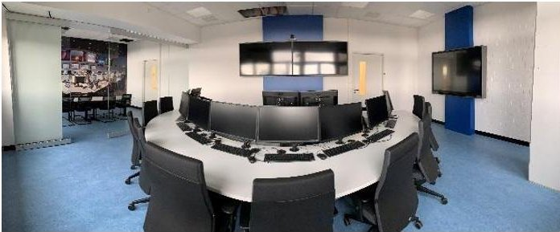
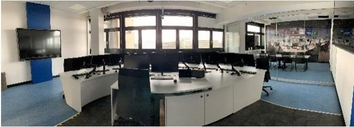
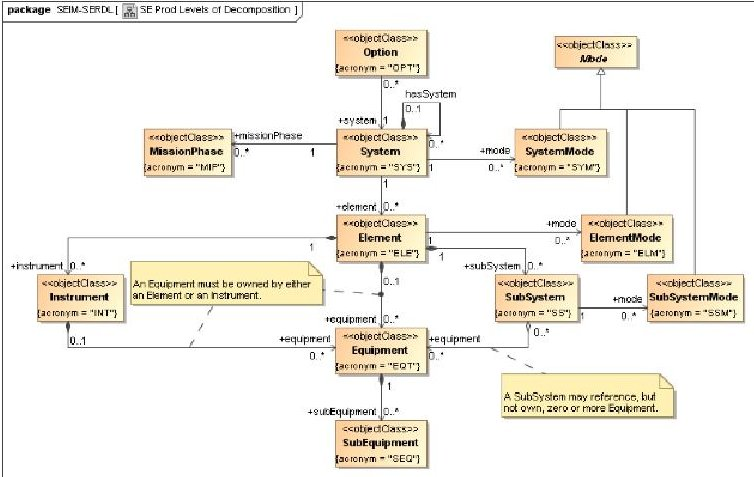
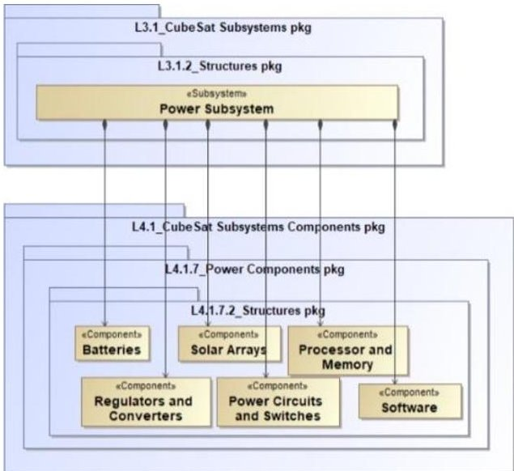
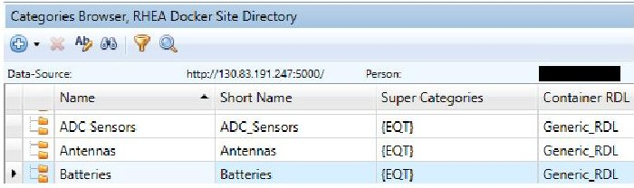
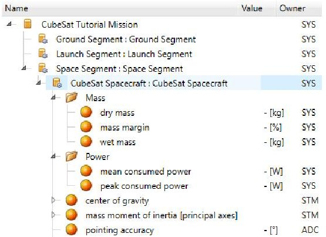
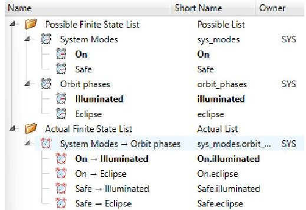
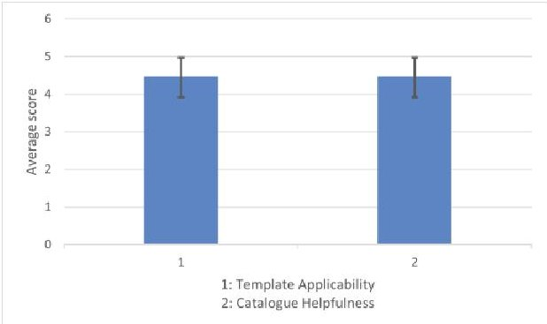

<!-- PDF_PAGE: 1 -->

IAC-22,E1,3,8,x72945

# Development of a Concurrent Engineering Tutorial as part of the ESA_Lab@ initiative

Marlon Deutsch $ ^{a\star} $ , Jennifer Hoffmann $ ^{b} $ , Reinhold Bertrand $ ^{c} $

$ ^{a} $ Institute of Flight Systems and Automatic Control, TU Darmstadt, Germany, marlon.deutsch@tu-darmstadt.de $ ^{b} $ Institute of Flight Systems and Automatic Control, TU Darmstadt, Germany

$ ^{c} $ Joint Professorship Space Systems, Institute of Flight Systems and Automatic Control, TU Darmstadt, European Space Agency ESA/ ESOC, Germany

* Corresponding Author

## Abstract

As part of the "ESA_Lab@" initiative, a Concurrent Engineering facility has been constructed at the Mechanical Engineering department of Technical University Darmstadt. Concurrent Engineering is a well-proven concept for designing complex space systems and missions in the pre-phase 0/A mission phase. The Concurrent Engineering methodology and processes are enabled by a multidisciplinary team and specific infrastructure in terms of both hardware and software, which generate an effective and time efficient design management system.

The university's "Concurrent Engineering Lab" provides an environment for both researchers and students to explore and apply the Concurrent Engineering approach in areas such as (model-based) systems engineering, Industry 4.0/ Space 4.0, and space traffic management. Furthermore, collaboration with the European Space Operations Centre also located in Darmstadt - regarding the application of Concurrent Engineering for Ground Segment & Operations has been started.

The first addition to the university's curriculum centered around the Concurrent Engineering Lab will be a "Concurrent Engineering Tutorial", an opportunity to introduce the Concurrent Engineering methods and tools via hands-on experience to students of the newly established master's degree program "Aerospace Engineering". "Tutorials" are elective block courses of the degree program which offer practical learning experiences in many different fields, awarding 4 credit points upon successful completion.

Building on the lectures "Fundamentals of Space Systems" and "Space Systems and Space Operations", the weeklong "Concurrent Engineering Tutorial" will challenge students to use their acquired knowledge to develop a preliminary design for a predefined CubeSat mission. This Tutorial will not only provide a closer understanding of the individual subsystems of the space segment of a mission, the Concurrent Engineering process and the relevant software "COMET" by RHEA Group but will also create a synergy with a student association of the university, as one of their projects is the development of a CubeSat.

This paper describes the background and approach to the development of the Tutorial, in particular the structure of the re-usable model architecture in "COMET", which was specifically derived and implemented for this purpose and validated via a pilot study.

Keywords: Concurrent Engineering, CubeSat, Space Systems Design, Tutorial, University Course

## Acronyms/Abbreviations

<table border="1"><tr><td>CDF</td><td>Concurrent Design Facility</td><td>IME</td><td>Integrated Modeling Environment(COMET)</td></tr><tr><td>CDS</td><td>CubeSat Design Specification</td><td></td><td></td></tr><tr><td>CE</td><td>Concurrent Engineering</td><td>INCOSE</td><td>International Council on Systems Engineering</td></tr><tr><td>CEL</td><td>Concurrent Engineering Lab</td><td></td><td></td></tr><tr><td>COTS</td><td>Commercial off-the-shelf</td><td>OCDT</td><td>Open Concurrent Design Tool</td></tr><tr><td>CSRM</td><td>CubeSat System Reference Model</td><td>OMG</td><td>The Object Management Group</td></tr><tr><td>DOE</td><td>Domain of Expertise</td><td></td><td></td></tr><tr><td>ECSS</td><td>European Cooperation for Space Standardization</td><td>SysML TBD</td><td>Systems Modeling Language To be determined</td></tr><tr><td>ESA</td><td>European Space Agency</td><td>TUDa</td><td>Technical University of Darmstadt</td></tr><tr><td>ESOC</td><td>European Space Operations Centre</td><td>TUDSaT</td><td>TU Darmstadt Space and Technology e.V.</td></tr><tr><td>GS&amp;OPS</td><td>Ground Segment and Operations</td><td></td><td></td></tr></table>

<!-- PDF_PAGE: 2 -->

## 1. Introduction

In 2019, the European Space Agency (ESA) and the Technical University Darmstadt (TUDa) signed a cooperation agreement ("Memorandum of Collaboration") with the aim of expanding and strengthening the cooperation between the two institutions and providing additional impetus along the entire innovation chain from basic research to space missions. [1]

Among other projects, this collaboration picks up the "ESA_Lab@" initiative, with the first core element at TUDa being a facility for concurrent engineering (CE), the "Concurrent Engineering Lab" (CEL), whose construction was completed in 2020.

CE is a well-proven concept for designing complex space systems and missions in the pre-phase 0/A. It relies on a multidisciplinary team of engineers and scientists as well as specifically tailored infrastructure to generate an effective and time efficient design management system. The layout and infrastructure of the CEL is aligned with the ESTEC CDF [2] design, which provides an efficient environment as well as the necessary hardware and software tools for the CE process. Figure 1 shows the layout of the CEL from the front and back side.

Figure 1. Front and rear view of the CEL

Although numerous facilities exist (e.g., Concurrent Design Facility (CDF) [2] at ESTEC), the methodology is not yet fully established for GS&OPS design. [3] Therefore, one of the research activities in the context of ESA_Lab@TU Darmstadt is to define and tailor a design process, models, and tools to the more diversified requirements of GS&OPS conceptual design.

Regarding teaching activities at the CEL, the first addition to the curriculum will be a "hands on" experience in CE. Building on selected space lectures offered at TUDa, a "CE Tutorial" is currently being developed for this purpose, which will be integrated into

the new master's degree programme "Aerospace Engineering".

This paper describes the development of the tutorial, with chapter 2 covering its basic structure. In chapter 3, the current state of the art of CE and CubeSats is briefly examined. Chapter 4 describes the methodology used to derive and implement a reference CubeSat mission architecture in the CE software "COMET", while chapter 5 covers the pilot study which was held for validation purposes. Results are presented and discussed in chapter 6, with chapter 7 providing conclusions and an outlook.

## 2. Structure of the tutorial

2.1 Course content

The focus of the tutorial is the familiarization with CE processes and tools, not the teaching of space system design from the ground up. Therefore, before applying to the tutorial, aspiring participants must pass the exams of TUDa's lectures "Fundamentals of Space Systems" and "Space Systems and Space Operations".

After familiarizing with CE processes and basic functions of COMET, students will be presented with a CubeSat mission description from which they will derive their conceptual design. Participants will be graded via final presentations and short design reports of each subsystem.

## 2.2 Time structure

Adapting to the schedule of the prerequisite lectures mentioned above, the one or two weeks long (TBD) "block" part of the tutorial will take place in the lecturefree time between the winter and summer semester. Before this block part, students will be able to familiarize themselves with the software via remotely accessing a training model, guided by suitable instruction material.

The first day of the block course itself will serve to explore the "concurrent" part of the CE process, i.e., the near real-time and constant exchange of information and its utilization for the design process. Additionally, the mission description will be presented to students. Starting on the second day, students will derive requirements from the mission description and perform CE sessions, moderated by a scientific assistant as a systems engineer, in order to iteratively arrive at a conceptual CubeSat design. On the last day, final presentations of each subsystem will be held, while corresponding reports will be handed in later.

## 2.3 Preparation

The following elements have to be prepared for the first instance of the tutorial by the Institute of Flight Systems and Automated Control: a CubeSat mission description,

<!-- PDF_PAGE: 3 -->

which will change yearly, a re-usable CubeSat mission reference architecture in COMET, which is the focus of the remaining chapters, and suitable training material, which will be derived from the reference architecture.

## 3. State of the art

## 3.1 ECSS-E-TM-E-10-25A: The Foundation for European CE Software

The "Technical Memorandum for engineering design model data exchange" by the European Cooperation for Space Standardization, ECSS-E-TM-10-25A, is the foundation for CE Software such as ESA's "OCDT" and "COMET" by RHEA Group, which is deployed at TU Darmstadt's CEL and which will also supersede OCDT at ESA [4]. Intended to become a standard, ECSS-E-TM-E-10-25A "facilitates and promotes common data definitions and exchange" [5], including a definition of the decomposition of a system down to equipment level, shown in Figure 2.

Figure 2: System decomposition as defined by ECSS-E TM-E-10-25A [5]

An important part of this decomposition is that "a SubSystem is [...] a logical grouping of Equipment, in contrast with the other decomposition object types that constitute a physical decomposition. Therefore, a SubSystem may refer to (but not own) a number of Equipment." [5] As noted in the diagram, "Equipment must be owned by either an Element or an Instrument". The technical memorandum notes that this presents a "limited way of decomposing systems that is considered adequate for the conceptual design phases 0 and A" [5], during which CE is applied most effectively.

## 3.2 CE Software "COMET" by RHEA Group

The open-source CE Software "COMET" by RHEA Group is used at TU Darmstadt's CEL. It is an implementation of ECSS-E-TM-10-25A and consists of

three integral parts. A server application is responsible for storing models, users, reference data, etc. An add-in for Microsoft Excel is used for parameter calculations and analysis. Lastly, a stand-alone application, the "Integrated Modeling Environment" (IME), is particularly useful for administrative, preparatory, and organizational work. Regular synchronization of the client applications with the server enables near real-time collaboration.

## 3.3 The INCOSE CubeSat System Reference Model (CSRM)

Developed by the Space Systems Working Group of the International Council on Systems Engineering (INCOSE), the CubeSat System Reference Model (CSRM) is a SysML model with the following objectives [6]:

- "Demonstrate Model-Based Systems Engineering (MBSE) as applied to a CubeSat Mission"

- "Develop a CSRM that a university team can use as starting point for their mission-specific model"

- "Develop the CSRM as an Object Management Group (OMG) Specification"

Finalized in 2021, the CSRM is currently under review at OMG to become a standard [7]. In coordination with the responsible working group, an excerpt of the CSRM describing the reference hardware architecture of a CubeSat has been obtained to serve as a guideline for the Tutorial's model architecture in COMET. According to the CSRM, the following 9 individual subsystems comprise a CubeSat system:

- Attitude Determination and Control

- Command and Data Handling

- Communications

- Guidance, Navigation and Control

- Mission Payload

- Power

- Propulsion

- Structures and Mechanisms

- Thermal

Furthermore, each CSRM subsystem contains "Components", as exemplified by the power subsystem in figure 3.

<!-- PDF_PAGE: 4 -->

Figure 3. Example of "Components" contained within CSRM Subsystems - in this case, the Power Subsystem [7]

## 4. Methodology

4. 1 Adaptation of the CSRM to comply with ECSS-E-TM-10-25A

As COMET implements ECSS-E-TM-10-25A, the CSRM structure, in particular the physical decomposition of subsystems into "Components", must be adapted to comply with the technical memorandum. This has been achieved via the definition of element "Categories" within COMET which correspond to the CSRM "Components". Using the CSRM Component "Batteries" as an example, this adaptation is illustrated in figure 4.

Figure 4. "Batteries" as an example of the CSRM adaptation to comply with ECSS-E-TM-10-25A via COMET "Categories"

The allocation of the "Super Category" " {EQT} " ("Equipment") provides the final link between the CSRM and the system decomposition defined by ECSS-E-TM-10-25A. The relation between a Category and a Super Category is defined as: "Every element of a 'Category' is also an element of the allocated 'Super Category', but not necessarily vice versa". Using again "Batteries" and "Equipment" as an example, this can be expressed more tangibly: "Every battery is a piece of equipment, but not every piece of equipment is a battery."

In this fashion, all physical Components of the CSRM Subsystems have been integrated into COMET. Categories are stored on the Site Directory level of the server and can be assigned to an element in a model.

## 4.2 Derivation and implementation of a re-usable CubeSat mission architecture in COMET

The following fundamental model architecture composed of three different model types has been envisioned for the tutorial.

- A "Template Model" serves as a generalized blueprint for a CubeSat mission. It represents the basic mission architecture, including the spacecraft's decomposition into subsystems. Details in section 4.2.1

- A "Model Catalogue" contains a database of CubeSat parts and equipment. Details in section 4.2.2

- A "Study Model" will be created at the beginning of each tutorial. By selecting the "Template Model" as a "Source Model" during its setup, it mirrors the current state of the template.

## 4.2.1 The "Template Model"

To reflect the subsystems defined by the CSRM, corresponding "Domains of Expertise" (DOE) have been activated in the Template Model. The "System Engineering" DOE is also set to active and will be assigned to the scientific assistant who moderates the tutorial. With 10 students participating and only 9 subsystems defined by the CSRM, the "Payload" DOE will be assigned to two participants - one responsible for the payload instrument, one responsible for the mission trajectory.

In general, space missions consist of a "Space Segment", "Ground Segment", and "Launch Segment". Therefore, the top element of the template, defined as a generic "CubeSat Tutorial Mission" contains these segments, while the "Space Segment" contains a "CubeSat Spacecraft". This hierarchical structure is achieved via the "Element Usage" function of COMET and is represented in the model's "Product Tree", as shown in figure 6.

On the system and subsystem levels, applicable parameters have been assigned to the respective element definitions, without any values. Grouping of parameters improves readability. Depending on the parameter, different DOEs are responsible for its value, expressed by the parameter's "Owner" attribute. Examples of this parameter allocation are given in figure 5.

<!-- PDF_PAGE: 5 -->

Figure 5. Product tree, showing the mission structure and parameter examples on the CubeSat system level

Reflecting ECSS-E-TM-10-25A, no physical equipment may be placed within a subsystem via the "Element Usage" function in a COMET model. As with parameters, the responsibility for an element, and thus the allocation of equipment to a subsystem, is expressed by its "Owner" attribute, irrespectively of the element's actual location in the model. The parameters assigned to a subsystem may refer to equipment that the respective DOE is responsible for. In this fashion, mass and power budgets for the individual subsystems can be created.

Different mission states, such as illuminated or eclipse phases of an orbital period, are an important design driving factor. In COMET, they are represented by "Finite State Lists", with the ability to define parameters as "state-dependent". To keep complexity at an appropriate level, an "Actual Finite State List" of 4 possible mission states has been defined for the Template Model, as seen in figure 6.

Figure 6. Finite states of the "CubeSat Tutorial Mission" template model

COMET also enables the integration and verification of requirements. The "CubeSat Design Specification Rev. 14" (CDS), currently available as a draft version [8], has been integrated into the Template Model.

An automated compliance check is possible after defining relationships between requirements and corresponding elements of the model, e.g., parameters. This is most easily achieved for requirements pertaining

to numerical values, such as the maximum allowed mass per CubeSat Unit, etc.

With the official CDS serving as a starting point for any CubeSat project, students of the tutorial will also derive additional requirements from the mission description and link them to their model during the design process.

## 4.2.1 The "Model Catalogue"

The Model Catalogue serves as a database for CubeSat parts. It contains two types of elements:

- Specific COTS parts and assemblies from various manufacturers, with data sheets linked in the element definition

- "Generic" element definitions of various spacecraft equipment, including applicable parameters without values

Both types are categorized according to the CSRM. Parameters are owned by the

corresponding DOE and, if sensible, grouped.

During the tutorial, elements of the Model Catalogue can be copied into the Study Model via simple "drag & drop", assisting students in their design process.

## 5. Validation via pilot study

To validate the model architecture, a pilot study was conducted in the week of April 4th, 2022. A student association of TUDa, TUDSaT e.V., is currently developing a CubeSat mission and volunteered to participate, which allowed the testing of the model architecture regarding its usability by students and its applicability to CubeSat design, as well as the advancement of TUDSaT's CubeSat project. The participating students answered multiple questionnaires during and after the study.

## 6. Results & Discussion

The evaluation of the pilot study yielded that the established COMET model architecture presents a solid and versatile environment for CubeSat design, adaptable to many different mission scenarios, including the one of TUDSaT. An excerpt of the questionnaire results is shown in figure 7, which shows the rating of the Template Model and the Model Catalogue on a scale from 1 to 5, with 5 being the highest possible rating.

<!-- PDF_PAGE: 6 -->

Figure 7. Excerpt of the pilot study evaluation. Results of Template Applicability and Catalogue Helpfulness on a scale from 1 (lowest rating) to 5 (highest rating).

## 7. Conclusions

With the presented COMET model architecture, the foundation for the future CE Tutorial at TUDa has been created. Furthermore, via the definition of COMET "Categories" which correspond to CSRM subsystem "Components", a semantic gap between the CSRM and ECSS-E-TM-10-25A has been bridged. In a broader context, this has the potential to enable general interoperability between the future OMG standard defined by the CSRM and the European standard that ECSS-E-TM-10-25A will eventually evolve into.

## Acknowledgements

We would like to thank Mr. David Kaslow from the INCOSE Space Systems Working Group for providing the CSRM and Mr. Johan Vennekens from the European Space Agency for his insight about model architectures in COMET. Furthermore, we are grateful

for the motivated participation of all TUDSaT members who were part of the pilot study.

## References

[1] TU Darmstadt Website: https://www.tu-darmstadt.de/universitaet/aktuelles_meldungen/archiv_2/2019/2019quartal2/neuesausdertueinzelansichtbreitespalte_227776.de.jsp, last visited: 01.09.22

[2] ESA Website: https://www.esa.int/Enabling_Support/Space_Engineering_Technology/CDF/What_is_the_CDF last visited: 01.09.22

[3] M. G. V. Ferreira, A. M. Ambrosio, I. Grosner, "Model-Based System Engineering (MBSE) applied to Ground Segment Development of Space Missions: New Challenges", 72th International Astronautical Congress (IAC), Dubai, United Arab Emirates, 2021

[4] OCDT/COMET User group meeting hosted by ESA,15.12.21

[5] Space engineering - Engineering design model data exchange (CDF). Technical Memorandum. Noordwijk, The Netherlands: European Space Agency, Oct. 2010

[6] David Kaslow and Alejandro Levi, "Development and Application of the CubeSat System Reference Model", INCOSE IW 2021, January 2021

[7] Expert interview with Mr. David Kaslow of the INCOSE Space Systems Working Group

[8] CubeSat official Website: https://www.cubesat.org/, last visited: 01.09.22