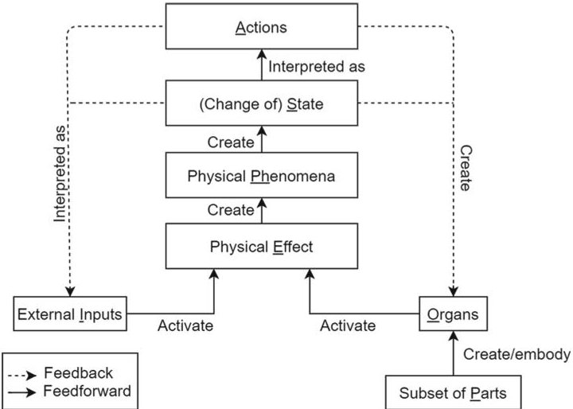
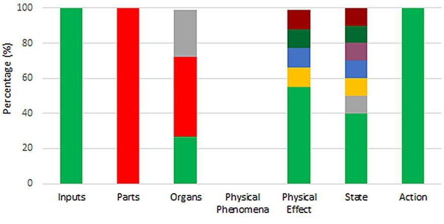
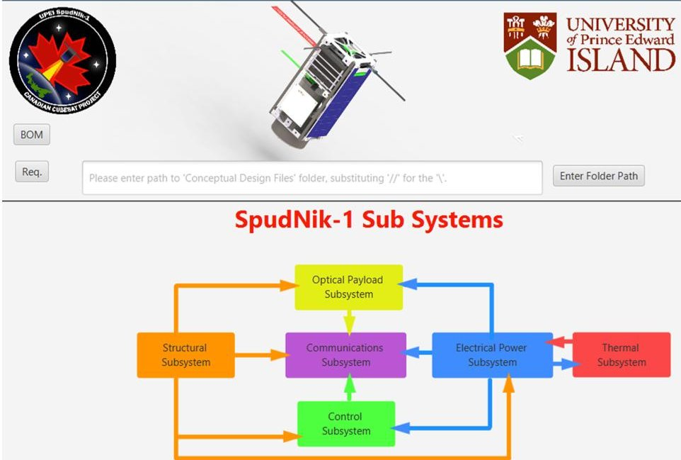
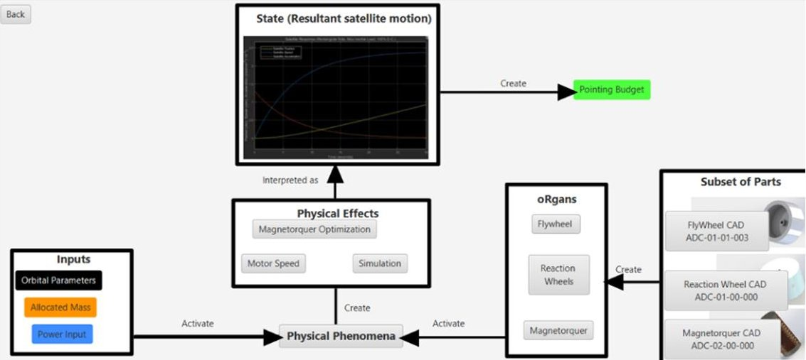
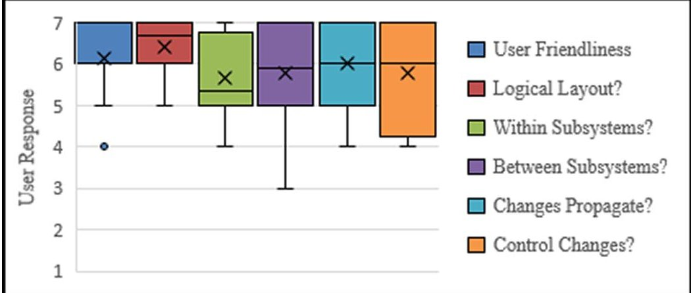

<!-- PDF_PAGE: 1 -->

# Investigating the Effectiveness of a Causal MBSE Software Tool in Modelling CubeSat Conceptual Design Data

Stephen Peters $ ^{1(\textcircled{x})} $ , Clément Fortin $ ^{2(\textcircled{x})} $ and Grant McSorley $ ^{1(\textcircled{x})} $

$ ^{1} $ University of Prince Edward Island, Charlottetown, PE CIA 3T3, Canada {sepeters,gmcsorley}@upei.ca $ ^{2} $ Skolkovo Institute of Technology, Moscow, Russia C.Fortin@skoltech.ru

Abstract. This work is part of ongoing research into the adoption of the SAPPhIRE Model of Causality as a framework for the management of conceptual design data. Due to the prevalence of behavioural data and frequent iterations found in conceptual design, PLM systems can struggle to maintain a coherent product definition. Previous work has demonstrated the utility of the SAPPhIRE Model for representing causality at multiple points in a system's lifecycle, however its integration into a Model Based Systems Engineering (MBSE) environment has not been explored. This paper presents the development, testing and study results of the novel software tool named OPAL. OPAL is a MBSE software tool based on the SAPPhIRE Model for the capture, management, representation and sharing of conceptual design data. Engineering student participants used OPAL to carry out typical CubeSat conceptual design activities within a test environment. The results of the study show that the students were able to effectively utilize OPAL's functions with only a short introduction, with 85% reporting it easy to use. In contrast to their traditional file management software and practices, the visual representation of the data via the SAPPhIRE Models made it significantly easier to be able to track and find data using the causal links, regardless of the subsystem being studied. It was concluded that further development of OPAL as a proof of concept should be undertaken, to both further investigate the conceptual design phase, and to support other phases of the lifecycle.

Keywords: Conceptual design·Model based systems engineering·Product lifecycle management·Behaviour·Causality

## 1 Introduction

Complex product development is a systematic and collaborative process that provides modern society with sophisticated products. The need for these complex products has resulted in an accompanying demand for more advanced means of representing, sharing, and integrating engineering product data. This is particularly relevant to the

<!-- PDF_PAGE: 2 -->

current changes occurring within the aerospace industry, known as the New Space paradigm, characterized by a reduced barrier to entry and a shift from one of systems to the development of reusable platforms. This can be seen in the current work by Space X, as well as in the rapid expansion of the use of CubeSats by academia, industry, and governments for low-cost space science missions. This paper presents the development, testing and study results of the novel software tool named OPAL. OPAL is a Model Based Systems Engineering (MBSE) software tool for the capture, management, representation and sharing of conceptual design data. The structure of the system models is based on the SAPPhIRE model of causality. Initial testing based on the UPEI SpudNik-1 CubeSat project shows promise for OPAL's use in supporting concurrent conceptual design. Section 2 will present the background to this work, situating it in the current literature surrounding conceptual design, Systems Engineering, Product Lifecycle Management and Digital Engineering. Section 3 presents the survey of conceptual design data produced by the SpudNik-1 team. This data was used to construct the models and develop the OPAL software tool, as reported in Sect. 4. Sections 5 and 6 present and discuss the results of the software testing.

## 2 Literature Review

Several approaches are used in industry to support the development of complex products and systems. Systems Engineering is an interdisciplinary and iterative "topdown process, which is lifecycle-oriented, involving the integration of functions, activities, and organizations" for the development of successful systems [1]. This has been extended by Model Based Systems Engineering (MBSE) which puts system models, rather than documents, at the core of the system development process to ensure all stakeholders share a consistent system definition using conceptual models as "comprehensive underlying blueprint" [2]. A related approach is Product Lifecycle Management (PLM), also used for supporting the development of complex products. PLM differs in that the focus is primarily on data and information management, facilitating the capture, structuring and reuse of data collected throughout a product's lifecycle. As such, PLM addresses the people, processes and products involved in developing and sustaining a product in order to increase stakeholder satisfaction and product quality while reducing lifecycle costs [3]. A relatively new field is that of Digital Engineering, defined by the Department of Defense "as an integrated digital approach that uses authoritative sources of system data and models as a continuum across disciplines to support lifecycle activities from concept through disposal." [4]. This field has the potential to encompass SE, MBSE and PLM by combining them with other recently developed digital tools for supporting engineering processes, shifting the development process from design-build-test to model-analyze-build.

INCOSE has identified the deficiencies found between suppliers and purchasing organizations when sharing information. Digital Engineering is cited to produce a more holistic approach by allowing alternate views for visualizing and transferring data. The Digital Engineering Information Exchange (DEIX) initiative aims to provide a welldefined set of Digital Artifacts that allow for seamless transition between complex systems-based organisations including aerospace and defence, transportation and

<!-- PDF_PAGE: 3 -->

medical industries. Ideally DEIX solutions would eliminate the need for adopting different data management tools, such as MBSE and PLM, and instead invest product system representations into Digital Artifacts [12].

Central to these approaches is supporting the collaboration between the specialised domains involved in the development and support of complex systems. To fully support this collaboration, it is also necessary to support the specific requirements of each phase of the product or system lifecycle.

Every lifecycle phase has a unique set of purposes and outcomes; consequently, there is fluctuation in the types of data being produced and exchanged as a product advances through the development process. Being the first phase of the product development process, conceptual design is uniquely situated as the foundation for this evolution of product data. As the product development process originates from conceptual design, its study could prove crucial in the creation of a support tool for subsequent lifecycle phases.

Chakrabarti and Bligh define conceptual design as "The activity of transforming the functional requirements of a design problem into a solution concept or concepts for fulfilling the requirements" [5]. During this stage the design is subject to rapid modifications, and consequently substantial changes to conceptual product data are expected as the product becomes more defined [6]. Decisions during this period are unique in that, instead of primarily optimizing design variables as seen in later design phases, numeral choices must also be made between various design proposals [6]. There can be an extensive number of design suggestions; studies have shown a positive correlation between the amount of alternative solutions and the eventual design quality [7].

Conceptual design is a highly iterative process that can embody 70% of committed costs, and it has the lowest costs associated with extracting defects for the entire product lifecycle [10]. Any solution that optimizes work done during this stage will thus carry a large impact on product lifecycle costs. Despite this impact, availability of conceptual design support tools remains limited [6, 8-10].

Understanding the exact nature of conceptual design data is crucial for the eventual creation of any support tool to address this gap. Recent conceptual design studies showed that there is a relative lack of geometric data (physical dimensions of a system) being exchanged between subsystem design teams [11]. Consequently, behaviour was found to be much more prevalent, suggesting that it is paramount for developing design proposals due to its role in preliminary analysis. Ulman considers a concept to be "An idea that is sufficiently developed to evaluate the physical principles that govern its behavior" [12]. Thus, concentrating on a tool that can effectively portray product behaviour should be a high priority. In addition to the lack of conceptual design support tools, widely used data management tools such as PLM are still centred on the product architecture and geometric models [13].

The potential for innovation is most feasible during conceptual design [14]. To better stimulate innovation, Chakrabarti et al. developed the SAPPhIRE (change of State, Action, Part, Phenomenon, Inputs, oRgans and physical Effects) model of causality.

<!-- PDF_PAGE: 4 -->

Fig. 1. The original SAPPhIRE model

The SAPPhIRE model (Fig. 1) was initially applied to the biomimetic design process by providing a generic model for which to perform analogical comparisons between natural and artificial systems [15]. The model was designed to provide a rich representation of a system at different levels of abstraction. Of particular interest is its use of three fundamental aspects for illustrating causality, function, structure and behaviour, with the latter serving as the common link between the other two, viewing "behavior as the link between function and structure defined at a given level." [15].

Previous work has confirmed that the SAPPhIRE model was capable, at least from high level of abstraction, to provide a basic representation of the behaviour of CubeSat subsystems [16]. This research also identified the prevalence and importance of behavioural data via a case study reviewing CubeSat design data. Analyses of product behaviour were among the primary inputs for conceptual design. In contrast, much of the structural data developed at the conceptual design stage was comprised of 'worst case scenario' projections and was expected to change significantly.

## 3 Survey of Conceptual Design Files

In their work, Chakrabarti et al. present a concise and rich representation of a natural and artificial system [15], but the models are idealized and are not explicitly connected to the design artifacts or files that define said systems. While further work has proposed the connection of multiple SAPPhIRE Models with their physical interfaces to illustrate causality, these are also abstract and idealized [17]. Furthermore, previous research has focused on fully realised systems, whilst conceptual design involves the process of creating these systems. To allow for a rigorous and well-defined study of SAPPhIRE's ability to support conceptual design, a more empirical framework is needed to form the basis for future software to support the conceptual design of complex systems. A survey of the conceptual design data created by a student design team at the University of Prince Edward Island was completed, the results of which are described in this section.

<!-- PDF_PAGE: 5 -->

## 3.1 Extracting and Mapping Data

In order to develop the requirements for a design support tool, a detailed understanding of the information to be captured and represented was developed via a survey of conceptual design data. All work for this survey took place at the University of Prince Edward Island (UPEI) using the CubeSat 'SpudNik-1'as a case study. The first major design review, the Mission Concept Review, was taken as a reference point marking the end of the conceptual design phase. Due to one of the author's extensive experience in the project, and the use of online database systems, there was minimal challenges retrieving the necessary data.

The survey commenced with the capturing of all digital CubeSat data, via a shared drive. Once the data was cloned onto a local hard-drive, every file was systematically investigated and evaluated on whether it fit the description of the SAPPhIRE model elements. All other data, such as monetary budgets and schedules, was ignored for this study. The relevant information was then collected and rearranged based on its relation to model elements, an example of which is shown in Table 1. Table 2 shows the primary behaviour associated with each subsystem, and the file(s) associated with it.

Table 1. Files used to create the EPS model

<table border="1"><tr><td>SAPPhIRE element</td><td>EPS representative file</td></tr><tr><td>Action</td><td>SpudNik-1 requirements(.xlsx)</td></tr><tr><td>Input</td><td>Parametric orbital power generation(.xlsx)</td></tr><tr><td>Organ</td><td>Solar panel data sheet(.pdf)</td></tr><tr><td>Subset of parts</td><td>Power subsystem assembly(.sldasm)</td></tr><tr><td>Physical phenomena</td><td>No appropriate file</td></tr><tr><td>Physical effect</td><td>Parametric orbital power generation(.xlsx)</td></tr><tr><td>(Change of) State</td><td>Parametric orbital power generation(.xlsx)</td></tr></table>

Table 2. Behaviour and analysis files

<table border="1"><tr><td>Sub system</td><td>Behaviour</td><td>Primary analysis file(s)</td><td>File type(s)</td></tr><tr><td>Optical payload</td><td>Snell&#x27;s law, Fresnel equations</td><td>OSLO(Optics Software for Layout and Optimization)Lens Mirror Configuration</td><td>CAD(.stl)</td></tr><tr><td>Structure</td><td>Buckling</td><td>Rail analysis, structure simulation</td><td>ExcelTM(.xlsx)
SolidWorks, CAD Simulation(.CWR)</td></tr><tr><td>Communications</td><td>Data transceiving</td><td>SpudNik-1 Link Budget</td><td>ExcelTM(.xlsx)</td></tr><tr><td>Thermal</td><td>Radiation and conductive heat transfer</td><td>Hand calculations, thermal study</td><td>ExcelTM(.xlsx)</td></tr><tr><td>Electrical power</td><td>Power generation and distribution</td><td>Power budget</td><td>ExcelTM(xlsx)</td></tr><tr><td>Attitude Determination and control(ADCS)</td><td>Torque via reaction wheels and magnetometer</td><td>Reaction wheel&amp;Magnetometer simulations</td><td>MATLAB®(.mat)</td></tr></table>

<!-- PDF_PAGE: 6 -->

Fig. 2. Survey results for behaviour model elements

## 3.2 Discussion of Survey Results

Figure 2 shows that the Physical Phenomena had no appropriate file to map it to, whilst the SAPPhIRE model dedicates an entire element to describing system behaviour textually [15]. This was attributed to the nature of how design work was carried out almost solely by the subsystem experts. Thus, the need for explicitly sharing qualitative description of behaviour was most likely not considered necessary. This is one of the limitations with conducting a survey using engineering students. In an industry setting, where the database may need to be accessed and understood by external personnel, the Physical Phenomena may prove to be more relevant.

Another limiting factor of the survey was, while thorough, it could not capture file versions or represent the evolution of the design files. The SAPPhIRE models created are the end state of the conceptual design phase. Whilst the files and information needed to create them are present, there may be data lost that may have been captured if the survey was done concurrently e.g. analysis files that were deleted due to being deemed redundant.

The file extension data shown in Fig. 2 shows an abundance of Excel $ ^{\mathrm{TM}} $ spreadsheet, CAD, and unique third-party software data. Clearly a collaborative tool must be able to easily access and represent this data to be effective as a design support software. The spreadsheets are mostly composed of parametric data, akin to behaviour. Although seemingly highly prevalent, geometric data was often approximated to conduct preliminary analysis and significant changes were expected. For instance, the optical payload was projected to encapsulate 40% of the CubeSat BUS, but during the preliminary design stage SpudNik-1 would be granted a Request for Deviation to obtain additional space for the payload, substantially altering the geometry.

<!-- PDF_PAGE: 7 -->

## 4 Development of OPAL

The survey concluded that the SAPPhIRE model could represent essential product data whilst maintaining its description of causality, but its ability to provide effective support within a conceptual design scenario was still unknown. A software tool was therefore created to support and facilitate conceptual design activities and collaboration, based on the behavioural models of the CubeSat subsystems and the results of the data survey. Table 3 shows the list of requirements that were created, with careful consideration of what features and functions would be needed to conduct an empirical study. Due to its specific nature of representing SAPPhIRE in conceptual design, the tool was given the name OPAL (cOnceptual suPport cAusality tooL).

Table 3. OPAL requirements

<table border="1"><tr><td>Requirement index</td><td>Description</td></tr><tr><td>OPAL-1</td><td>Each subsystem representation shall incorporate the original SAPPhIRE Model with all its elements accounted for</td></tr><tr><td>OPAL-2</td><td>The tool shall incorporate a GUI representing the SAPPhIRE Model</td></tr><tr><td>OPAL-3</td><td>The tool shall act as a central data repository, incorporating files from all 6 subsystems of SpudNik-1 within the same program</td></tr><tr><td>OPAL-4</td><td>The tool shall allow for integration of previously identified file types such as code, analysis, and spreadsheet data</td></tr><tr><td>OPAL-5</td><td>The tool shall make use of figures and visuals to aid the user in understanding subsystem layouts</td></tr><tr><td>OPAL-6</td><td>The tool shall allow for an interactive system model GUI showing the subsystems with their interdependencies</td></tr></table>

Any support tool should attempt to minimize its interface complexity to effectively support designers. The primary effort was thus tailored towards front end software development to facilitate user testing of a proof-of-concept tool. The first major challenge in its design was the representation of multiple interlinked SAPPhIRE models. Whilst subsystem models had been previously created [16], there was no concrete vision regarding their arrangement or connections with each other. The work of Siddharth et al. in representing complex systems with multiple SAPPhIRE models provided the inspiration for the initial tool development [17]. There are two JavaFX $ ^{\mathrm{TM}} $ scenes that define the OPAL GUI, these being the system and subsystem models. The system model is a high-level view of the system architecture and allows a user to navigate and view the interfaces between the subsystems. Once the major interfaces were modelled, a simplified system view was created, shown in Fig. 3. The use of graphics to show higher level system data was intended to allow the user to visualize traceability. Each subsystem model can be directly accessed from this system view.

<!-- PDF_PAGE: 8 -->

Fig. 3. OPAL's system model scene, this version made use of colour for visual aid.

## 4.1 Subsystem Model Development:

As seen in [17], SAPPhIRE models are linked via their Inputs and States. A change of state can transform the input of a connected subsystem, and vice versa. This is a crucial feature for illustrating causal relationships between subsystems. The initial effort was thus directed towards creating these inter-subsystem connections.

CEDESK [18] was used as a reference for the creation of OPAL's subsystem views, including both the Java libraries and how data was defined and linked between subsystems. Traceability and the causal relationships between subsystems are present in CEDESK, but the connections between the subsystems are not always obvious, especially for non-experts. OPAL is much more explicit with presenting this information using the GUI, as can be seen in Fig. 4. In this way, users can rely on their understanding of the systems behaviour to efficiently navigate OPAL.

Each element block in each system model is connected to the relevant conceptual design data, as summarized in Table 2. For example, in Fig. 4, the user has selected the "Power Inputs" in the input block, which retrieved the relevant section of the CubeSat Power Budget spreadsheet, shown as text in the bottom part of the screen. If the user were to select "Flywheel CAD" in the subset of parts block, the CAD assembly containing the CAD model would be launched. This is a key feature, allowing the user to connect the conceptual system model with the design data relevant to the system element. While these connections were made manually for the proof-of-concept tool, future iterations will allow for user created links and a simplified update process to manage iterations. At the moment, these connections are made with the live files, so iterations are not tracked within OPAL.

<!-- PDF_PAGE: 9 -->

Fig. 4. The ADCS model.

## 5 Testing of OPAL

This section discusses the rationale and methodology regarding the testing of OPAL. The objective of the trials was to evaluate the effectiveness of OPAL as a conceptual design support tool, and to propose recommendations for its improvement. The expectation was that the student participants would find OPAL to be a preferable alternative for managing data, especially when operating outside of the subsystem for which they were responsible. A series of tasks were created for participants to carry out using OPAL, each corresponding to a specific process relevant to conceptual design.

The participants involved in the study were recruited from the UPEI student engineering body. Ethics approval was obtained from the UPEI Research Ethics Board. Participants ranged from third year engineering students to graduate level researchers and tested independently. Based upon a power analysis, and similar studies from literature [19], the total number of participants was set at 15. The testing procedure involved a $ \sim 1 5 $ -min introduction to the SAPPhIRE model and OPAL, and then immediately proceeded to the evaluation, which took an average of 45 min. Students were then asked to complete the survey on their own time to maximum feedback quality.

## 5.1 Segment Descriptions

The testing activities were divided into three segments with specific objectives. The first segment required participants to navigate OPAL's user interface and locate a file. This segment was designed to be the simplest and required a relatively basic understanding of OPAL's structure to be successful. Simply finding information has been shown to make up a significant portion of work for designers due to poorly managed or designed databases [20, 21]. Reducing the time needed to find information will allow personnel to divert focus onto other pressing tasks.

<!-- PDF_PAGE: 10 -->

The second segment explored the elements and interfaces of OPAL. Participants are asked to trace the data flow, using interfaces both within and between the subsystem models. It is imperative that designers understand where their input data originates from, and consequently how their design analysis could affect adjacent subsystems. The relationship between physical effects and inputs is a crucial feature of the SAP- PhIRE model, and how it conveys causality.

The last segment made participants explain the potential change propagation stemming from a defined change to the system. Conceptual design is a highly iterative process where proposals are generated, modified, and evaluated faster than other phases. Upon the incorporation of a new component, the subsequent changes to adjacent components and systems needs to be identified and updated.

## 5.2 Results

Participants were asked to evaluate OPAL based on six characteristics shown in Fig. 5. Every question evaluated the effectiveness of OPAL in a certain category, with '7' signifying a strong agreeance with its effectiveness in said category, and '1' indicating strong disagreement. Table 4 and Fig. 5 show demonstrate the effectiveness of OPAL.

Table 4. Statistical results

<table border="1"><tr><td>Question</td><td>Average</td><td>Range</td><td>Standard deviation</td></tr><tr><td>How user friendly do you find OPAL?</td><td>6.13</td><td>3</td><td>0.78</td></tr><tr><td>Do you find the layout to be logical?</td><td>6.40</td><td>2</td><td>0.69</td></tr><tr><td>Are the relationships between subsystems clear?</td><td>5.67</td><td>3</td><td>0.91</td></tr><tr><td>Are the relationships within subsystems clear?</td><td>5.80</td><td>4</td><td>1.13</td></tr><tr><td>Does OPAL clearly show how changes propagate?</td><td>6.00</td><td>3</td><td>0.94</td></tr><tr><td>Is it easier to manage design changes with OPAL?</td><td>5.80</td><td>3</td><td>1.18</td></tr></table>

Fig. 5. Quantitative results

<!-- PDF_PAGE: 11 -->

The high scores seen for each question is especially encouraging when considering that each participant only had an average of 15 min to become familiar with SAPPhIRE and OPAL. Additionally, although 5/15 participants had no previous experience working on the CubeSat, their quantitative results were not found to differentiate significantly upon the evaluation of the product moment correlation coefficient for both CubeSat familiarity and education level factors.

The qualitative feedback provided suggestions for improving OPAL that will support the development of more sophisticated tools in the future, which will be discussed in Sect. 6. The standardized, visual layout of OPAL made it easier to navigate and locate data, even when operating outside of the subsystem of expertise. Some of the elements, such as the Physical Phenomena, were suggested to be modified to a more standardized format.

## 6 Discussion

## 6.1 Individual Segments

Testing the user's ability to locate information was the simplest segment of the questionnaire. Based on the results from Table 4, the GUI represented the SAPPhIRE Model clearly, and its overall layout was well understood by the user. The consistency of the SAPPhIRE Model was taken advantage of by the users; overall there was little sense of increased difficulties between subsystems. This in turn allowed for more dynamic approaches to the scenario. For instance, to source the power allocated to the image sensor, participants used both the EPS output and the Payload Subsystem's input elements.

The second segment was focused on evaluating the user's comprehension of OPAL's interfaces and semantics. It was significantly more difficult for the participants, and there was a larger range and standard deviation as shown in Table 4. The task was more complex; the approach to solving it was not well defined, and the concept of causality was generally not familiar to the participants. Additionally, the subjects had limited experience with this concept being applied via a MBSE or PLM tool.

Consequently, many struggled during this segment as can be seen in the relatively low quantitative scores. However, the second task of the segment was generally well understood by the users, after the explanation of the desired solution for the first part was explained. Particularly, how to effectively utilize OPAL's interfaces, as well as how the Physical Phenomena supported the user's tasks.

The last portion of the study was to assess the ability of the user to manage design iterations. As discussed in Sect. 2, conceptual design is highly iterative. Streamlining this process can allow for both a more efficient expenditure of resources and a more effective design. Overall, participants were more successful in carrying out the given tasks than in segment two. This was expected, as it builds off the causality implications of the previous segment. OPAL's GUI seemed to be significant for supporting segment three, as implied in the following quotation from one of the participants:

<!-- PDF_PAGE: 12 -->

"The visualization of all the subsystems made it easier to understand the relationship and its interactions between each subsystem. Therefore tracking how a change to one component could affect the subsystem and components was easy."

Whilst idealized to an extent, integrating new components into a design database is common in the conceptual design of CubeSats. Correctly sourcing the appropriate part and properly updating all design entities to reflect the changes is essential. Outdated design data being mistakenly used by other engineers can be detrimental to the product.

## 6.2 Implications

The SAPPhIRE model element titles were found to be a source of confusion for users. The Organ in particular could be renamed to better reflect its purpose, such as 'Physical Parameters'. The 'Physical Phenomena' also created initial confusion, and could be renamed 'Subsystem Behaviour', or something similar. A more efficient method of introducing and explaining the SAPPhIRE model and the concept of causal models would significantly aid in the effectiveness of both OPAL and any future software.

Future tool iterations may have to take more MBSE principles into consideration. OPAL has very limited representation of the extensive requirements found in the CubeSat project. It cannot be used as an effective requirements verification tool in this state. As a result, a parallel tool built upon alternate ontology and semantics would be needed for requirements management, possibly creating an integration issue between OPAL and other data tools. A possible solution may be to introduce new ontology to OPAL to give it the ability to represent these features. Developments with DEIX may allow for sufficient expression of the data in various forms.

## 7 Conclusion

The need for increasingly complex electro-mechanical products and systems has raised interest in developing new systems for supporting data collaboration and management. Conceptual design is critical stage of the product development process, but its frequent iteration, potential for innovation, and behaviour-rich data are often not adequately addressed by modern PLM or MBSE tools. This line of research seeks to adopt the SAPPhIRE model causality as a framework for a design support tool. This paper presented the reasoning, development, and evaluation of the novel software tool OPAL, which allows designers to connect conceptual causal models directly to the relevant design data, using their understanding of the system behaviour, rather than the product structure, to organize and navigate product information. Examples of specific functions supported by OPAL are tracing product data, an improved ability to access information, and the realisation of system and subsystem models.

The quantitative results show strong comprehension and effective use of OPAL's SAPPhIRE based framework as a data support structure. The results indicate that OPAL can integrate the data files to create a sufficiently detailed system model. Considering that the students had an average of fifteen minutes to learn the intricacies of SAPPhIRE, the results are encouraging for further research. This indicates how future SAPPhIRE based tools may not require substantial resources to train users.

<!-- PDF_PAGE: 13 -->

Future work could explore how SAPPhIRE can represent digital information flow in later stages of the lifecycle, as well as integrating a SQL server to allow for concurrent use and collaboration.

At the very least, the concept of a simplified representation of an entire system has been shown to be feasible using SAPPhIRE. Whilst SysML or similar languages are powerful for creating complex systems using a variety of diagrams, each diagram is only intended for use in a single domain e.g. behavioural, requirements/functions, and structure. SAPPhIRE incorporates all three in a unified representation of the system, which could be harnessed as an easier method for navigating between the SysML domains.

## References

1. Blanchard, B.S., Blyle, J.E.: System Engineering Management. John Wiley & Sons Incorporated (2016)

2. Dori, D.: Model-Based Systems Engineering with OPM and SysML. Springer Science +Business Media, New York City (2016)

3. Stark, J.: Product Lifecycle Management: 21st Century Paradigm for Product Realisation. Springer (2005)

4. "DoD Digital Engineering Strategy," [Online]. Available: https://fas.org/man/eprint/digeng- 2018.pdf

5. Chakrabarti, A., Bligh, T.P.: An approach to functional synthesis of solutions in mechanical conceptual design. Part I: introduction and knowledge representation. Res. Eng. Des. 6(3), 127-141 (1994). https://doi.org/10.1007/BF01607275

6. El Amine, M., Pailhes, J., Perry, N.: Critical review of multi-criteria decision aid methods in conceptual design phases: application to the development of a solar collector structure. Procedia CIRP 21, 497-502 (2014). https://doi.org/10.1016/j.procir.2014.03.134

7. Jagtap, S., Johnson, A., Larsson, A.: A conceptual framework to support engineering designers in using in-service information. In: Proceedings of International Design Conference. DESIGN (2012)

8. Chandrasegaran, S.K., Ramani, K., Sriram, R.D., Horvath, I., Bernard, A., Harik, R.F., Gao, W.: The evolution, challenges, and future of knowledge representation in product design systems. Comput. Aided Des. 45(2), 204-228 (2013). https://doi.org/10.1016/j.cad.2012.08.006

9. Vuletic, T., Duffy, A., Hay, L., McTeague, C., Pidgeon, L., Grealy, M.: The challenges in computer supported conceptual engineering design. Comput. Ind. 95, 22-37 (2018). https:// doi.org/10.1016/j.compind.2017.11.003

10. Clarkson, J., Eckert, C. (eds.): Design process improvement. Springer London, London (2005). https://doi.org/10.1007/978-1-84628-061-0

11. Fortin, C., McSorley, G., Knoll, D., Golkar, A., Tsykunova, R.: Study of data structures and tools for the concurrent conceptual design of complex space systems. In: Ríos, J., Bernard, A., Bouras, A., Foufou, S. (eds.) Product Lifecycle Management and the Industry of the Future: 14th IFIP WG 5.1 International Conference, PLM 2017, Seville, Spain, July 10-12, 2017, Revised Selected Papers, pp. 601-611. Springer International Publishing, Cham (2017). https://doi.org/10.1007/978-3-319-72905-3_53

12. Ullman, D.: The Mechanical Design Process. McGraw-Hill (2010)

<!-- PDF_PAGE: 14 -->

13. Ameri, F., Dutta, D.: Product lifecycle management: closing the knowledge loops. Comput. Aided Des. App. 2(5), 577-590 (2005). https://doi.org/10.1080/16864360.2005.10738322

14. Kang, J., Zhong, K., Qin, S., Wang, H., Wright, D.: Instant 3D design concept generation and visualization by real-time hand gesture recognition. Comput. Ind. 64(7), 785-797 (2013). https://doi.org/10.1016/j.compind.2013.04.012

15. Chakrabarti, A., Sarkar, P., Leelavathamma, B., Nataraju, B S.: A functional representation for aiding biomimetic and artificial inspiration of new ideas. Artificial Intelligence for Engineering Design, Analysis and Manufacturing: AIEDAM, 19(2) (2006)

16. Peters, S., Fortin, C., McSorley, G.: A novel approach to product lifecycle management and engineering using behavioural models for the conceptual design phase. In: Fortin, C., Rivest, L., Bernard, A., Bouras, A. (eds.) PLM 2019. IAICT, vol. 565, pp. 159-169. Springer, Cham (2019). https://doi.org/10.1007/978-3-030-42250-9_15

17. Siddharth, L., Chakrabarti, A., Venkataraman, S.: Representing complex analogues using a function model to support conceptual design. In: Proceedings of the ASME Design Engineering Technical Conference (2018)

18. Knoll, D.: CEDESK About. [Online]. Available: https://cedesk.github.io/about/. Accessed 12 Feb 2019

19. Knoll, D., Golkar, A.: A coordination method for concurrent design and a collaboration tool for parametric system models. Concurr. Eng. 26(1), 5-21 (2018). https://doi.org/10.1177/ 1063293X17732374

20. Lejon, E., Lundin, M., Jeppsson, P., Näsström, M.: Integrating information in product development. In: Nee, A.Y.C., Song, B., Ong, S.-K. (eds.) Re-Engineering Manufacturing for Sustainability, pp. 93-98. Springer Singapore, Singapore (2013). https://doi.org/10.1007/ 978-981-4451-48-2_15

21. Rehman, F.U., Yan, X.T.: Application of context knowledge in supporting conceptual design decision-making. Int. J. Prod. Dev. 13(1), 47 (2011). https://doi.org/10.1504/IJPD. 2011.037594

22. Mas, F., Arista, R., Oliva, M., Hiebert, B., Gilkerson, I., Rios, J.: A review of PLM impact on US and EU aerospace industry. Procedia Eng. 132, 1053-1060 (2015). https://doi.org/10. 1016/j.proeng.2015.12.595

23. Merminod, V., Rowe, F.: How does PLM technology support knowledge transfer and translation in new product development? Transparency and boundary spanners in an international context. Inf. Organ. 22(4), 295-322 (2012). https://doi.org/10.1016/j.infoandorg.2012.07.002

24. Mostefai, S., Batouche, M., Bouras, A.: Mechanical product data exchange and integration for PLM. In: Proceedings of the IEEE International Conference on Industrial Technology (2004)

25. Haskins, C.: INCOSE - Systems Engineering Handbook, A Guide for Systems Life Cycle Processes and Activities, vol. 3.1 (2007)

26. Friedenthal, S., Moore, A., Steiner, R.: A Practical Guide to SysML (2008)

27. Kapurch, S.J.: NASA Systems Engineering Handbook. NASA Special Publication (2007)

28. Buczacki, A.: An integrative model based systems engineering (MBSE) and lean-based approach for development of new complex products. Multidisciplinary Aspects of Production Engineering 2(1), 425-434 (2019). https://doi.org/10.2478/mape-2019-0043

29. Fisher, A., et al.: 3.1.1 model lifecycle management for MBSE. INCOSE International Symposium 24(1), 207-229 (2014). https://doi.org/10.1002/j.2334-5837.2014.tb03145.x

30. Ramos, A.L., Ferreira, J.V., Barcelo, J.: Model-based systems engineering: an emerging approach for modern systems. IEEE Transactions on Systems, Man, and Cybernetics, Part C (Applications and Reviews) 42(1), 101-111 (2012). https://doi.org/10.1109/TSMCC.2011. 2106495

<!-- PDF_PAGE: 15 -->

31. Oracle: JavaFX. [Online]. Available: https://openjfx.io/

32. INCOSE: Digital Engineering Information Exchange. [Online]. Available: https://www. incose.org/incose-member-resources/working-groups/transformational/digital-engineering information-exchange (2018)

33. McSorley, G.: A Novel Approach to Product Lifecycle Management and Engineering Based on Product in-use Information. Université De Montréal (2014)

34. Rizzi, C., Regazzoni, D.: Conceptual design knowledge management in a PLM framework. PRODUCT LIFECYCLE MANAGEMENT Assessing the industrial relevance, pp. 435-444 (2007)