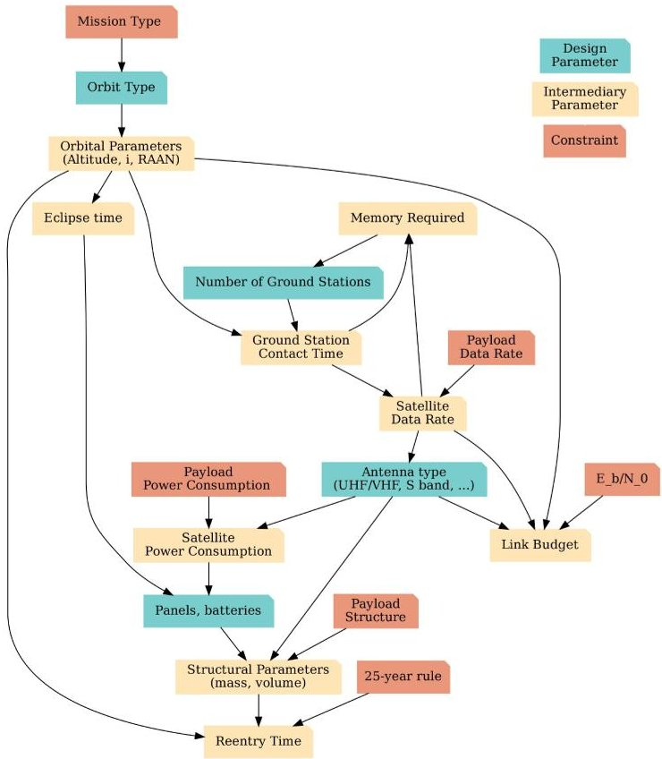
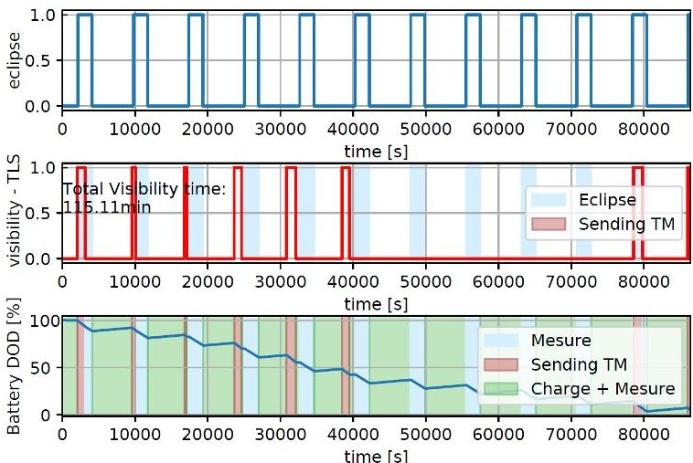
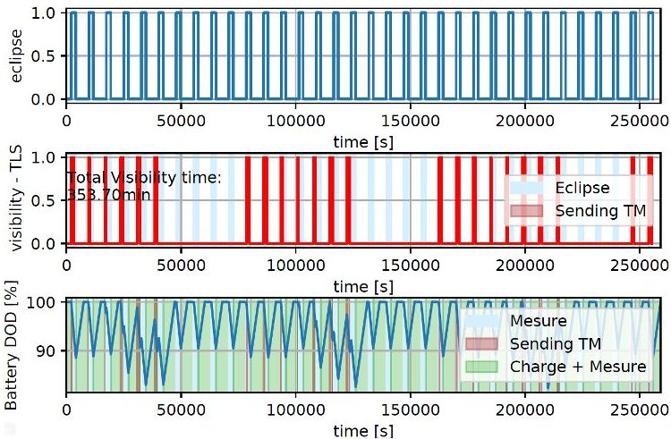
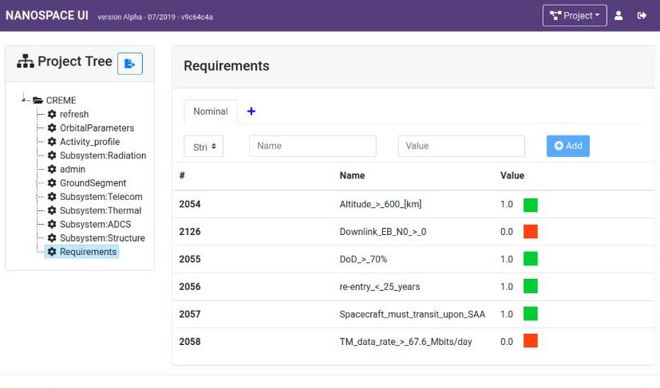
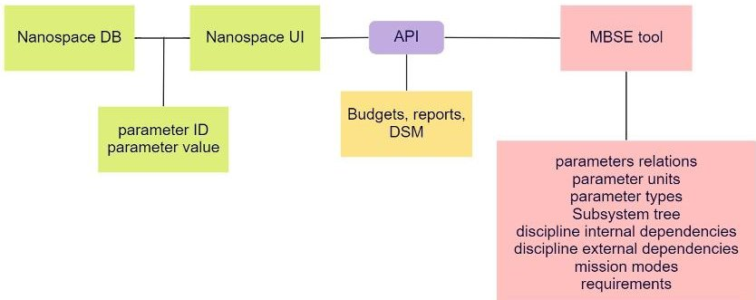

<!-- PDF_PAGE: 1 -->

# MBSE Challenges in the Concurrent Preliminary Design of CubeSats: Nanospace Study

Sophia Salas Cordero

ISAE-SUPAERO

Université de Toulouse

Toulouse, France

sophia.salas@isae-supaero.fr

Thibault Gateau

ISAE-SUPAERO

Université de Toulouse

Toulouse, France

thibault.gateau@isae-supaero.fr

Rob Vingerhoeds

ISAE-SUPAERO

Université de Toulouse

Toulouse, France

rob.vingerhoeds@isae-supaero.fr

Abstract—In this paper, the early endeavours of the incorporation of a Model-based Systems Engineering (MBSE) approach to the open-source Nanospace framework is discussed, presenting the challenges that need to be overcome for such an integration. Nanospace is a web application dedicated to facilitate concurrent engineering during the preliminary design phase of CubeSats.

CubeSats provide a progression of educational and research opportunities, and have had increased the accessibility to space for non-space fairing nations. CubeSats and their subsystems interfaces have been studied numerous times. Nanospace may benefit from MBSE, as MBSE facilitates knowledge reuse; which could allow a faster design convergence and faster inspection of candidate architectures.

Index Terms—CubeSats, MBSE, Preliminary Design, Concurrent Engineering (CE).

## I. INTRODUCTION

Concurrent Design Engineering (CDE) applied to space mission preliminary design [1] is a methodology to facilitate the design process of converging into key subsystems, preliminary figures, preliminary models, and preliminary architectures required to ensure the space mission feasibility. This methodology is usually supported by a Concurrent Design Facility (CDF) [2]. Many Concurrent Design Engineering implementations have been proposed over the years by:

- Space agencies - e.g. JPL NASA Team X at the Project Design Center [3], ESA Open Concurrent Design Tool [4], CNES IDM-CIC [5], and DLR Virtual satellite [6],

- Academics - e.g. Nanospace [7], Cedesk [8] $ C^{2} $ ERES DOCKS [9] and FOrPlan [10]

- Private companies - e.g. Rheagroup CDP4 [11], and Valispace [12]

A recent review and comparison table of CDE tools can be found in [13].

Although these CDE implementations exist, practitioners struggle to find a way to facilitate the interactions and communication between the experts at a system level. Today this role is ensured mostly by the system engineer, who is in charge of manually monitoring and if necessary correcting that the steps of the process are being followed in the correct order, that the data is consistent between subsystems, that up-to-date information is correctly shared, and that it is understandable between the different experts.

All space missions start with a conceptual design study, involving interdisciplinary teams that work concurrently and colocated. In this article, concurrent engineering is approached in a space context [14], based on "work in parallel" and "colocated work". A review of Concurrent Engineering Design practice in the space sector shows that 80% of the respondents have a process for the overall design study and 66% also defined processes for single design sessions [13]. In contrast with big companies, neither "New Space" [15] nor academia are prone to have established 'communities of practice' helping throughout the design process. This lack of guidance through concurrent design studies could lead to wrongful planning of the project life cycle of a mission, delays in the schedule, and an increase of cost as stated in [16].

The work presented in this paper considers open-source concurrent design tools in order to guarantee the accessibility of the further mentioned tools to everyone. This is particularly important for educational purposes. The paper will specifically discuss the application of Nanospace, an open-source and webbased CDE, and MBSE (Model-based Systems Engineering), "the formalized application of modeling to support system requirements, design, analysis, verification, and validation activities beginning in the conceptual design phase and continuing throughout development and later life cycle phases." [17]. The connectivity of Nanospace with the process of system modelling and assessment is a central point for this study. MBSE provides good benefits, some of them having been observed throughout the literature and presented in [17], [18]: better communication/information sharing, increased traceability and capacity for reuse, reduce time and cost, improved consistency, system understanding and systems design.

The contribution proposed by this paper is to assess how the incorporation of a Model-based Systems Engineering approach to the concurrent preliminary design of CubeSats (specifically using the open-source Nanospace framework) can be realised, how the design process and parameters are involved in the preliminary design of a CubeSat, how the parameters are being handled by Nanospace, and what information could be retrieved from system models. As an example, the creation of design structure matrices (DSM) will be presented so to represent parametric dependencies. DSMs can be clustered and/or sequenced which can bring a lot of insights for the

<!-- PDF_PAGE: 2 -->

iterations in the design process [16].

The paper is structured as follows. Section II presents an overview on CubeSat preliminary design, input/outputs per discipline and presents the CREME project as the use case. Section III illustrates the preliminary design decisions and process with scenario iterations for CREME. Section IV presents a brief overview of the Nanospace environment, Model-Based Systems Engineering (MBSE), and the difficulties of integrating them. Section V concludes the paper and presents the motivation for further research in order to attain a better integration between MBSE and CDE tools.

## II. CUBESAT PRELIMINARY DESIGN OVERVIEW

With the intent to reduce satellite development time and cost, while at the same time increasing accessibility to space, and sustaining frequent launches, the CubeSat Project started in 1999 [19]. A CubeSat [20], [21] is a class of satellites that adopts a standard size and form factor, a unit is defined as 'U'. A 1U CubeSat is a 10cmx10cmx10cm cube with a mass of up to 2 kg.

When designing in general a space mission, special "budgets" are identified, e.g. for the satellite mass, the necessary power to execute its intended use, the communication needs, the radiation, etc. When designing CubeSats there is no exception, all of these budgets are crucial for the trade-off assessment between possible architectures for the CubeSat and its disciplines such as: structure, thermal, attitude determination and control, etc. Some of these disciplines' description and simplified list of inputs/outputs parameters can be found in Table I (for more information, please refer to [22]).

Many constraints need to be considered during the design, for example those that are imposed by the payload, the possible launch dates and available launchers, the specifics of the concept of operations, the activities profiles of the mission, and the compliance with space laws and regulations Generally, spacecrafts may have different operating modes, that depend on whether the resources of the spacecraft need to be concentrated into a set of functions for a determined period of time. The objective of this paper is to provide a first approximation for design parameters interactions in order to easier understand the design iterations inherent to the preliminary design of a CubeSat. Without loss of complexity, mission modes are not discussed in this paper. However, the concept presented here can be easily extended to take mission modes into account as well.

In an academic context, the use of open-source tools for CubeSat projects [23] has many benefits. Many open-source software, methodologies and recommendations can be found online e.g., the Libre Space Foundation initiative [24], full open-source CubeSat projects such as the UPSAT initiative [25], FloripaSat-I [26], and educational projects [27]. In addition, the initiative "Open Source Satellite" provides a list of teams and software of the Open Source ecosystem [28], a detailed list of tools for CubeSat projects can also be found in [29].

## A. CREME project description

The Organisation for Economic Co-operation and Development (OECD) Future Global Shocks identified geomagnetic storms (of solar origin) as one of the 5 major potential risks for the coming years [30]. Among other things, events related to solar activity can have an impact on civil and military earth satellites for telecommunications, navigation and observation. Communications (HF/VHF/UHF), EMI (Electro Magnetic Intelligence), GNSS navigation, radar detection could be disrupted. In order to better understand the space weather around the earth the CubeSat Radiation Environment Monitoring Experiment (CREME) project was submitted to the Occitanie region in France, received its approval, and started late 2020 [31]. Its objective is to measure the radiation environment in Low Earth Orbit (LEO).

CREME's payload is being developed by ONERA, and it aims to be composed of a charged particle detector at a moderate cost. The payload must be low cost, have a small footprint, and its design must allow for easy transportation in any type of platform (industrial or scientific). The radiation monitor does not require precise attitude control. The risks are therefore low, which increases the feasibility of the platform. The platform is being developed by ISAE-SUPAERO, based on the expertise and feedback acquired during previous missions, such as: EyeSat (CNES) and EntrySat (ISAE-SUPAERO - ONERA) projects. Beyond the framework of the CREME project, it is envisaged that the collected in-flight measurements will be exploited at the CSUT (Centre Spatial Universitaire de Toulouse). These measurements should allow to validate the concept of the sensor in-orbit, which has the goal to enrich space weather monitoring services.

One of the perspectives of such a project is to propose to the space industry a low-cost radiation monitor, of small size and mass, and very versatile, so that it can be easily integrated on commercial satellites. The underlying idea is to be able to have a sensor that can be adapted to take measurements of the particles of interest [31]. In this way, in the future, a satellite constellation could allow to measure the space environment as a whole, and enable to characterize orbits until now little described from the radiation point of view.

## B. CREME Preliminary Design Context

Only a subset of the CREME project's requirements and constraints is considered in this paper due to space constraints. They can be found respectively in Tables II and III. In the following paragraphs an in-depth consideration of the parameters, disciplines, requirements and constraints is presented.

Telecommunication and power are traditionally the most critical subsystems to ensure mission survival. Without communication, mission data would not be able to be retrieved; and without power, the CubeSat would basically become space debris. The payload data recollection function would benefit from the highest possible altitudes in LEO, while it must also visit the SAA (South Atlantic Anomaly) as often as possible (as per constraint C-02). When active, the payload provides 27.6 Mbits of data per day (see constraint C-01),

<!-- PDF_PAGE: 3 -->

TABLE I

CUBESAT SIMPLIFIED DESIGN PARAMETERS PER DISCIPLINE

<table border="1"><tr><td rowspan="2">Discipline</td><td rowspan="2">Description</td><td colspan="2">Design parameters</td></tr><tr><td>Inputs</td><td>Outputs</td></tr><tr><td>Mission</td><td>Consists of orbit definition, surface coverage, visibility windows, eclipse calculation</td><td>Total massTotal volumeTotal energyCost per discipline</td><td>Total massTotal volumeTotal energyCost per discipline</td></tr><tr><td>Telecommunications</td><td>Estimation of the margin for uplink and downlink rates between the spacecraft and ground stations (or another spacecraft) should be computed. These margins usually allow to approximate the useful data flow that can be exploited during the visibility windows of the ground stations(GS).</td><td>Number of GSGS locationOrbital parametersRequired memory</td><td>Uplink data rateDownlink data rateAntenna typeGS contact time</td></tr><tr><td>On-board Computing</td><td>The storage capacity of on-board data should be sized according to data produced,the extent of the different telecommunications data streams,and the time between visibility windows to ground stations.The time the spacecraft is not in visibility with the ground station,on-board storage capacity should be sufficient to accommodate produced data until the next visibility window.</td><td>Payload data rateUplink data rateDownlink data rateGS contact time</td><td>Required memory</td></tr><tr><td>Energy and Power</td><td>It involves checking the ability of the platform to provide enough power for the mission.For CubeSats,the energy is usually collected with solar panels and stored with batteries.Batteries provide energy during e.g.,eclipses,phases of peak demand,or when solar panels have not yet been deployed.</td><td>Mission lifetimePayload powerEclipse duration</td><td>Number/capacityof solar panelsand batteries</td></tr><tr><td>Structure</td><td>A 3D structural model is necessary (at least a simplified version).It defines the distribution of the components of different disciplines throughout the mechanical structure of the CubeSat.</td><td>Dimensions massmax/min cross section</td><td>Total massTotal volumeMoment of inertia</td></tr><tr><td>Payload</td><td>The Payload is the main motivation of CubeSat missions.It is the medium to achieve the scientific goals for the mission.</td><td></td><td>Payload power consumptionPayload data rate</td></tr><tr><td>Ground segment</td><td>This discipline includes the determination of the number and location of the ground stations by guaranteeing the satellite coverage by the selected GS.</td><td></td><td>Number of GSType of GSG location</td></tr></table>

TABLE II

REQUIREMENTS EXTRACT

<table border="1"><tr><td>Requirement ID</td><td>Requirement Text</td><td>Rationale</td></tr><tr><td>M-01</td><td>The system shall have an operational mission lifetime of one year.</td><td>Stakeholder needs</td></tr><tr><td>M-02</td><td>The system shall permit the measurement of the radiation environment around the earth.</td><td>Stakeholder needs</td></tr><tr><td>M-03</td><td>The system shall have an altitude of at least 600km.</td><td>Payload Principal Investigator</td></tr><tr><td>M-04</td><td>The system shall be in Low Earth Orbit.</td><td>Payload Principal Investigator</td></tr><tr><td>M-05</td><td>The system shall be able to transfer data.</td><td>Stakeholder needs</td></tr></table>

and the platform produces around 40 Mbits of data per day for housekeeping (known by expertise). Therefore, the data rate value for the initial sizing of the telecommunication subsystem must be higher than an average of 67.6 Mbits per day.

Power is provided by batteries, which, on CubeSats, are usually charged by Solar panels. During eclipses, batteries must store enough power to ensure spacecraft survival. Therefore, the battery's Depth of Discharge (DoD) must remain above a threshold: below this threshold batteries may deteriorate, and if battery recharge does not totally compensate (on average) power consumption of the platform and payload, the spacecraft will shutdown and may not wake up (see constraints C-06 in Table III).

Orbital parameters have a strong impact on the mission

design. In this paper, the assumption was made that the orbit will be circular (eccentricity equals zero). The altitude of the spacecraft directly impacts telecommunication parameters and reentry time (Fig. 1). The less distance to the ground station the easier it is to communicate (shorter range). Regarding reentry time, in LEO, there are still atmosphere particles that generate some drag on the spacecraft. This drag lowers the altitude of the orbit and, eventually, aids the spacecraft to re-entry. Traditionally, CubeSats take advantage of this drag to ensure the respect of space regulation (as constraint C-05).

Along with the altitude, other orbit parameters such as inclination and right ascension of the ascending node (RAAN) impact the eclipse time of the spacecraft (time spent by

<!-- PDF_PAGE: 4 -->

TABLE III CONSTRAINTS EXTRACT

<table border="1"><tr><td>Constraint ID</td><td>Constraint Text</td><td>Rationale</td></tr><tr><td>C-01</td><td>The payload data rate shall be considered to be at least 27.6 Mbits per day.</td><td>Payload Principal Investigator</td></tr><tr><td>C-02</td><td>The payload shall visit the South Atlantic Anomaly as often as possible.</td><td>M-02</td></tr><tr><td>C-03</td><td>The energy per bit to noise power spectral density ratio margin shall be greater than zero.</td><td>M-05</td></tr><tr><td>C-04</td><td>The Bit error rate (BER) shall be less than 10-6</td><td>M-05</td></tr><tr><td>C-05</td><td>Orbital lifetime after completion of operations of spacecraft in low Earth orbit is limited to ensure that their spacecraft and/or launch hardware are in an orbit that will decay and cause said object to reenter Earth&#x27;s atmosphere within 25 years to mitigate the creation of more orbital debris.</td><td>IADC-25 year rule[32]</td></tr><tr><td>C-06</td><td>The depth of discharge(DoD) of the batteries shall remain above 70%</td><td>Expert considerations</td></tr><tr><td>C-07</td><td>The payload is 1.5U</td><td>Payload Principal Investigator</td></tr><tr><td>C-08</td><td>The payload power consumption is on average6W.</td><td>Payload Principal Investigator</td></tr></table>

the spacecraft in the shadow, or penumbra, of earth). These parameters also define which regions on earth are in the field of view of the satellite when orbiting and at what time, which determines when and for how long the spacecraft will be able to establish contact with ground stations. In this example, it is assumed that the platform will be able to allow a sun pointing attitude control, ensuring an efficient battery recharge when the satellite is not in eclipse.

The more batteries and solar panels are needed, the more mass increases. In satellite design, the mass is a critical parameter since is directly proportional to the mission cost. Nonetheless for CubeSats, volume is usually the most limiting factor (e.g. constraint C-07). For the calculation of reentry time, mass, volume and drag must be taken into consideration, as well as the altitude of the spacecraft. The reentry time must remain under 25 years after mission end (constraint C-05).

These dependencies are shown in the dependency graph in Fig. 1. Analogously, Fig. 2 depicts these dependencies as a design structure matrix. In the example presented in this paper, neither Attitude Determination and Control System (ADCS), nor radiation or thermal considerations are included. These elements are of course fundamental during a real CubeSat mission preliminary design and each of these elements can be easily added since the approach is modular.

## III. CREME PRELIMINARY INTERMEDIARY DESIGN RESULTS

## A. Known Unknowns and Constraint-lead Design

Many design parameters are unknown when initializing a preliminary design. However, experience provides a starting point (at least an order of magnitude for many of the parameters). In addition, available flight-proven technology is typically given a preference. In practice, for critical parameters such as mass, margins are used depending on confidence (from 5 to 20%). These parameters can be referred to as known unknowns.

MBSE can be used to capture the system dependencies represented in Figs.1 and 2, allowing to reuse knowledge from previous CubeSat missions. The MBSE diagrams can be

Fig.1. Dependency graph of the case study design parameters

reshaped to meet new mission expectations without needing to start from zero, guaranteeing continuity and traceability of success within missions.

For a platform that answers CREME's needs, at least an on-board computer, a transceiver, a magnetorquer, and radiators are needed. For this particular use case, an average platform consumption of 8 W was estimated (Payload average consumption is set to 6 W, cf. requirement C-08). The average platform consumption value comes from expert considerations and is a rough estimation for the platform consumption upper margin. During most of the operational time, the spacecraft will consume an average of 14 W. But during telecommunication events there may be some consumption burst. In the worst case, during the transmission burst, the transceiver

<!-- PDF_PAGE: 5 -->

<table border="1"><tr><td></td><td>Mission type</td><td>Orbit type</td><td>Orbital parameters</td><td>Eclipse time</td><td>Memory required</td><td>Number of GS</td><td>GS contact time</td><td>Payload data rate</td><td>Satellite data rate</td><td>Payload power consumption</td><td>Antenna type</td><td>E_b/N_0</td><td>Satellite power consumption</td><td>Link budget</td><td>Panels, batteries</td><td>Structural parameters</td><td>Re-entry time</td><td>25-year rule</td><td>Payload Structure</td></tr><tr><td>Mission type</td><td></td><td>

Fig. 2. CREME case study Design Structure Matrix

would consume 10 W, meaning a total of 24 W are needed.

Some specific risks, e.g. special deployment of solar panels or antennas, are avoided in this project whenever possible, except when such features have been flight-proven (TRL 9). For example, the EYESAT mission [33] was able to show that a "flower solar panel" deployment generates almost four times more power than with only covering the CubeSat with solar panels.

The number of 'U' cubes is an important criterion for the cost of a CubeSat mission. Usually, a more compact design is favored for this kind of mission. As a simulation scenario, as a first step it will be verified whether a 2U CubeSat would be feasible in terms of power consumption (see following sections). In a real-world setting, a CubeSat preliminary design is mostly directed by constraints, with not a lot of alternatives (only one type of COTS component available, opportunistic choice for launchers, etc.).

## B. A Semi-automated process

For CREME's preliminary design Python scripts were developed and used; they can be accessed here $ ^{1} $ under the AGPL v3 license. For pedagogical purposes, simple mission analysis scripts are provided in this repository. As well as an example of an input file in .yml format (orbital parameters, power consumption of the platform, etc.) and an example of outputs, which include intermediary results such as remaining power graph and data budget graph and a full report (in Markdown format) required as a light but realistic preliminary design synthesis

Orbit propagation, eclipses determination and contact with ground station events - are handled with a GMAT script. Link budget analysis is done with Dosa $ ^{2} $ . Python scripting is used

for miscellaneous computations. The script is self-sufficient for a first step mission analysis preliminary design.

Traditionally, to ensure mission success, the worst-case scenario is considered. This allows considering margins, even if refinement of models may be required when the problem ends up being too constrained.

## C. Preliminary design iteration

Requirements (see table II) are set into Nanospace, and, depending on the known unknowns, design parameters are set as much as possible. They are automatically updated in the database through Nanospace API. The dependency graph (Fig. 1) or the design structure matrix (Fig. 2) are available to show the feedback loops and sequence of which part of the script should be re-run. The process is semi-automatic, which allows to avoid getting stuck in non-converging designs (human expertise is required). Intermediary results are also stored in Nanospace, and can therefore be easily shared between the experts. As mentioned before, a Python script is used in a semi-automatic process, and eases the link to the Nanospace database.

The first consideration of this example iteration comes from constraint C-07 (payload is 1.5U) which means that CubeSat should be at least 2U. Initially, the orbit will be set to 2000 km, the maximum according to the M-04 requirement. The fact that the spacecraft shall "fly" over the SAA (Constraint C-02) imposes a high inclination. Since most of the launchers are for spacecraft with a Sun Synchronous Orbit (SSO), this kind of orbit is taken for a first iteration. SSO is commonly used for LEO observation spacecraft since the surface illumination angle on earth underneath remains the same. Space mechanics physics impose an inclination of 104.85 degrees for an SSO orbit at 2000 km. SSO is a polar orbit, which also addresses in an elegant manner the requirement for the transit upon SAA (C-02).

Design choices can be taken already by reviewing the mission constraints and requirements. This requires experience in some orbital mechanics concepts. For selecting the right ascension of the ascending node (RAAN) parameter, basically two options exist:

- dawn/dusk orbit where the satellites' solar panels can always see the Sun;

- other cases: the worst case for solar panel illumination is the noon/midnight orbit, usually taken for simulations.

In CREME, no RAAN constraints exist (payload is not related to local ground surface hour). Therefore, the worstcase scenario in terms of solar panel illumination is being taken as noon/midnight orbit. That will allow a launch on any SSO mission.

The solar panel number and battery are directly related to the available volume. As a first estimation, in a "flower" configuration - deployable panels and sun pointing (when the spacecraft is not in eclipse), such as with the EYESAT platform [33], it is considered that a 10cm2 solar "unit" orthogonal exposed to the sunlight will generate 2W. For a

<!-- PDF_PAGE: 6 -->

2U sat, with a flower configuration this would mean 4W per solar panel, with four arrays it leads to 16W.

The number of accumulators packed in serial and parallel should be optimized. For a first sizing, we will arbitrarily consider one battery block with a specification of the capacity of 80 Wh.

Simulation allows for a first check on the order of magnitude of available power: the Eclipse time is needed on a representative number of orbits (e.g: 5 days). It results that the power input from the solar panels is insufficient (see Fig. 3), meaning a violation of constraint C-06 is violated (batteries are not charging enough during daylight periods).

Fig. 3. Simulation example: battery remaining power (1 day at 2000km with a SSO midday/midnight orbit - considering 4 solar arrays of 4 W).

Two possibilities exist: reconsider the orbital parameters (SSO dawn/dusk to get no eclipses at all, but fewer launch opportunities), or reconsider solar generator number. For sake of simplicity let's suppose here that there is no solution for power input in a 2U CubeSat and the design decision that is taken is to consider a bigger spacecraft: a 3U. It is assumed that 6W per solar panel will be generated (30 cm2) on four arrays (four "petals"). During sunlight, therefore 24W are generated. Simulation shows that, in spite of heavy transceiver data burst, batteries are able to recharge see Fig. 4.

Another consideration concerns the ground station. ISAE-SUPAERO is initially the only ground station (UHF, VHF and S-Band) and the feasibility needs to be checked. The easiest solution is to choose one band, the link budget margin is good in both directions. But the data rate imposes a more advanced transmitter such as S-Band to satisfy the payload data rate constraint C-01).

Simulation with the Stela tool [34] shows that the orbit with an altitude of 2000 km is too far for a re-entry below 25 years after mission completion (constraint C-05 is not met). The dependency graph and DSM (Figs. 1 and 2) emphasize two main elements that have an influence on re-entry time: altitude or structural parameters. Experts have to assess either a change in altitude (and re-iterate all previous steps) or changing structure (more challenging).

The dependency graph and DSM (Fig. 1 and 2) provide guidance on selecting relevant parameters when requirements

Fig. 4. Simulation example: battery remaining power (3 day at 2000km with a SSO midday/midnight orbit - 4 solar arrays of 6 W).

or constraints are not met. Choice is a matter of trade-offs between each subsystem experts, mission cost, failure probability acceptance, and other factors. Human expertise is required in the process. While a database is required for the team to efficiently share and exchange data while performing the preliminary design.

## IV. MBSE-NANOSPACE INTEGRATION EFFORTS

The lack of data continuity throughout the complete system life cycle is one of the biggest lacks of the mentioned CDE tools, and NanoSpace was up until here no exception; different tools are used for different purposes. Passing the right data from one tool to another, while maintaining a good coherence between the data, makes for a complex problem to address.

The open-source Nanospace framework [7] is a dedicated open-source concurrent design engineering tool, mainly consisting of a GUI, a database and an API, designed to facilitate academic CubeSats preliminary design process. Nanospace allows for direct information exchange between third-party expert software, while allowing transparent data visualization to any team member. It ensures concurrent access to the data, which is relevant when teams are working remotely, and provides an intuitive way of visualizing other experts' contributions that can be of high value when looking for project understanding and transparency. Nanospace benefits from the change propagation information available from DSMs that for instance can be automatically generated from SysML models by the tool MB2DM $ ^{3} $ . With this information it could be signaled in the Nanospace UI when a requirement is not satisfied (as in Fig. 5), and therefore as well which design parameters must be updated.

Model-Based Systems Engineering (MBSE) offers a formalized application of modelling to support system design throughout the life cycle phases [35], [36]. Models are used to represent the system and enable to better master the design and the verification of complex systems [37]. Several system modeling languages exist. SysML [38] is implemented in more

<!-- PDF_PAGE: 7 -->

© 2019 - AGPL v3 Licence: ISAE-SUPAERO

Fig. 5. Nanospace User interface. Requirements part is shown. Requirements concerning telecommunication aspects are not compliant yet.

open-source software and its use is more widespread. OPM [39] is accompanied by the OPCAT software and ARCADIA [40] uses the Capella software. OPM and ARCADIA are more software dependant in implementation but have a methodology associated with their tools; while SysML is the standardization of a notation, but does not restrict its use. The main effort so far to apply MBSE specifically for cubeSats began in 2011 [41].

MBSE can beneficially be used as a back-bone, in particular for the very first stages of the design process. Its particular faculties allow engineers to model requirements, the environment, the system itself (the CubeSat), etc. Using a system modelling language, a CubeSat design can be performed via functional analysis, a logical architecture, then an allocation to a physical architecture, which results in an end design; that portrays a coherent representation of the interactions between all of the concerned design parameters, requirements, and sub-systems.

As an experiment, a CubeSat model was realised in a SysML tool, creating requirements diagrams, realising a functional diagram using the state machine diagram, then an internal block diagram was used, as well as internal diagrams for each subsystem using the parametric diagram. The models contain the functions related to the CubeSat, the space environment, the launch segment, the ground segment, the customer and the legislative and regulatory institutions. From these system models, using a dedicated algorithm it is possible to generate Design Structure Matrices (DSMs) from a SysML model [42]. Facing data representation issues, it should be noted that MBSE software connectivity does not come automatically and few models can be exchanged between software without information loss. The developed algorithm has the potential of being extended to several MBSE environments, thus avoiding the long manual task of mapping connections between system elements, which can be useful in change management to determine change propagation. The main outcome of parametric DSMs from MBSE models could constitute a powerful tool that can be used to set a

sequencing within the design steps with NanoSpace, allowing for co-located collaborative model-based conceptual design for complex engineering systems.

So to take full advantage of such integration of MBSE tools with CDE environments, several research questions become apparent:

- What is the "best" flow of information / data between the different tools in a design process? - The design logic has an impact on the tool landscape as well as on the database(s).

- Can MBSE be used as a "front-end" for the complete design cycle and if so, what would be the ideal output of the tools? - The use of parametric models give a lot of insight into the actual design and would in addition allow using optimisation set-based design approaches for the next design steps.

- How do concurrent design approaches and associated tools, linked with model-based systems engineering approaches and their tools, impact the conceptual design phase itself? And in turn, how can the tools be better developed so to better support the particularities of CubeSat design?

These topics are at the heart of the development of the Nanospace environment. An initial first step is envisioned in Fig. 6, which only considers the current structure behind the Nanospace database.

Fig. 6. Nanospace/MBSE tool integration

## V. CONCLUSION

Even for a "simple" CubeSat, many disciplines are required during the preliminary design process. This paper shows how MBSE system models could enhance the propagation of parameter updates or changes on Nanospace, whether using parametric design structure matrices or dependency graphs. In the simplified but real use case, the CREME CubeSat project, a semi-automatic script was used to illustrate the iterative design process, building on the human engineer's experience and know-how. MBSE can fill the existent gap in archiving and reusing knowledge, as it sets the path for better communication/information sharing, increased traceability and capacity for reuse, reduce time and cost, improved consistency, system understanding and systems design.

Concurrent engineering is facilitated by Nanospace, a database managing data storage and data sharing between the

<!-- PDF_PAGE: 8 -->

experts. It cannot realise a preliminary design autonomously, but needs to work with other tools (in this paper GMAT, Dosa, Stella, Celestlab and some Python scripting).

This paper opens many future work possibilities. An MBSE-Nanospace integration can facilitate the automatic application of multi-disciplinary analysis and optimization. Manually constructing dependency graphs is counter-intuitive so further integration and development of the MB2DM tool need to be carried out, while considering the possibilities of incorporating it into the Nanospace user interface. In addition, the current database structure for Nanospace needs to be re-assessed for it to be able to include more parameter details, such as their relations. This could include a data flow for the database to receive and send information to other software while propagating the changes accordingly. Finally, it would be good to compare the performance of Nanospace with and without a MBSE vision, both with expert teams as well as beginners or students.

## REFERENCES

[1] M. Bandecchi, B. Melton, and F. Ongaro, "Concurrent engineering applied to space mission assessment and design," ESA bulletin, vol. 99, no. Journal Article, 1999.

[2] D. Di Domizio and P. Gaudenzi, "A model for preliminary design procedures of satellite systems," Concurrent Engineering, vol. 16, no. 2, pp. 149-159, 2008.

[3] R. E. Oberto, E. Nilsen, R. Cohen, R. Wheeler, P. DeFlono, and C. Borden, "The nasa exploration design team: Blueprint for a new design paradigm," in Aerospace Conference, 2005 IEEE. IEEE, 2005, pp. 4398-4405.

[4] OCDT - Open Concurrent Design Tool. https://ocdt.esa.int. Accessed: 2021-07-02.

[5] J.-L. Le Gal and P. Rocha Lopes, "IDM-CIC," 2016. [Online]. Available: https://www.clever-age.com/fr/case-studies/cnesune-application-de-modelisation-3d/

[6] DLR Virtual Satellite. https://www.dlr.de/sc/en/desktopdefault.aspx/tabid 5135/8645_read-8374/. Accessed: 2021-07-02.

[7] T. Gateau, L. Senaneuch, S. S. Cordero, and R. Vingerhoeds, "Opensource framework for the concurrent design of cubesats," in 2021 IEEE International Symposium on Systems Engineering (ISSE), 2021.

[8] CEDESK. https://cedesk.github.io/. Accessed: 2021-07-02.

[9] C2ERES, "DOCKS," https://gitlab.com/cceres-docks, 2019, accessed: 2021-02-18.

[10] R. A. Chagas, F. L. de Sousa, A. C. Louro, and W. G. dos Santos, "Modeling and design of a multidisciplinary simulator of the concept of operations for space mission pre-phase a studies," Concurrent Engineering, vol. 27, no. 1, pp. 28-39, 2019.

[11] Rheagroup, "Cdp4," 01 2019. [Online]. Available: https://www.rheagroup.com/fr/news/cdp4-open-source-community- edition

[12] Valispace. http://https://www.valispace.com/. Accessed: 2021-06-30.

[13] D. Knoll and A. Golkar, "A coordination method for concurrent design and a collaboration tool for parametric system models," Concurrent Engineering, vol. 26, no. 1, pp. 5-21, 2018.

[14] D. Knoll, C. Fortin, and A. Golkar, "Review of concurrent engineering design practice in the space sector: state of the art and future perspectives," in 2018 IEEE International Systems Engineering Symposium (ISSE). IEEE, 2018, pp. 1-6.

[15] G. Martin, "NewSpace:The Emerging Commercial Space Industry," NASA, Tech. Rep., 01 2016.

[16] S. Salas Cordero, C. Fortin, and R. Vingerhoeds, "Concurrent conceptual design sequencing for mbse of complex systems through design structure matrices," in Proceedings of the Design Society: DESIGN Conference, vol. 1. Cambridge University Press, 2020, pp. 2375-2384.

[17] D. Walden, G. Roedler, K. Forsberg, R. Hamelin, and T. Shortell, Systems Engineering Handbook: A Guide for System Life Cycle Processes and Activities. Wiley, 2015.

[18] K. Henderson and A. Salado, "Value and benefits of model-based systems engineering (mbse): Evidence from the literature," Systems Engineering, vol. 24, no. 1, pp. 51-66, 2021.

[19] A. Johnstone, "CubeSat Design Specification Rev. 14 ," The CubeSat Program, Cal Poly SLO, California, Tech. Rep., jul 2020.

[20] H. Heidt, J. Puig-Suari, A. Moore, S. Nakasuka, and R. Twiggs, "Cubesat: A new generation of picosatellite for education and industry low-cost space experimentation," Proceedings of the Small Satellite Conference, 2000.

[21] C. Cappelletti and D. Robson, "Cubesat missions and applications," in Cubesat Handbook. Elsevier, 2021, pp. 53-65.

[22] J. Wertz, D. Everett, and J. Puschell, Space Mission Engineering: The New SMAD, ser. Space technology library. Microcosm Press, 2011.

[23] A. Scholz and J.-N. Juang, "Toward open source cubesat design," Acta astronautica, vol. 115, pp. 384-392, 2015.

[24] LSF, "Libre Space Foundation," https://libre.space/, accessed: 2021-06-18.

[25] Libre Space Foundation, "UPSat," https://upsat.gr/, 2016, accessed: 2021-08-18.

[26] M. G. Mariano, F. E. Morsch, M. S. Vega, S. L. Oriel, S. L. Kessler, B. E. Augusto et al., "Qualification and validation test methodology of the open-source cubesat floripasat-i," Journal of Systems Engineering and Electronics, vol. 31, no. 6, pp. 1230-1244, 2020.

[27] D. Geeroms, S. Bertho, M. De Roeve, R. Lempens, M. Ordies, and J. Prooth, "Ardusat, an arduino-based cubesat providing students with the opportunity to create their own satellite experiment and collect real-world space data," in 22nd ESA Symposium on European Rocket and Balloon Programmes and Related Research, vol. 730. Citeseer, 2015, p. 643.

[28] Open Source Satellite, "Elements of the Open Source Space Ecosystem," https://opensourcesatellite.org/elements-open-source-space-ecosystem/, accessed: 2021-04-18.

[29] T. Gateau, S. Salas Cordero, J. Puech, and R. Vingerhoeds, "Nanospace and open-source tools for cubesat preliminary design: Review and pedagogical use-case," in 4th Symposium on Space Educational Activities, 2022.

[30] OECD, "OECD/IFP Futures Project on "Future Global Shocks": "Geomagnetic Storms"," https://www.oecd.org/gov/risk/46891645.pdf, 2011, accessed: 2020-12-05.

[31] CREME. https://www.csut.cnrs.fr/en/cubesat-radiation-environmentmonitoring-experiment/. Accessed: 2021-04-02.

[32] Inter-Agency Space Debris Coordination Committee, "IADC Space Debris Mitigation Guidelines," Tech. Rep., 2007. [Online]. Available: https://www.unoosa.org/documents/pdf/spacelaw/sd/IADC- 2002-01-IADC-Space_Debris-Guidelines-Revision1.pdf

[33] F. Apper, A. Ressouche, N. Humeau, M. Vuillemin, A. Gaboriaud, F. Viaud, and M. Couture, "Eye-sat: A 3U student Cubesat from CNES Packed with Technology," 2019.

[34] C. Le Fèvre, H. Fraysse, V. Morand, A. Lamy, C. Cazaux, P. Mercier, C. Dental, F. Deleflie, and D. Handschuh, "Compliance of disposal orbits with the french space operations act: the good practices and the stela tool," Acta Astronautica, vol. 94, no. 1, pp. 234-245, 2014.

[35] S. Friedenthal, R. Griego, and M. Sampson, "Incose model based systems engineering (mbse) initiative," in INCOSE 2007 symposium, vol. 11, 2007.

[36] D. Kaslow, B. Ayres, P. Cahill, and L. Hart, "A model-based systems engineering approach for technical measurement with application to a cubesat." in 2018 IEEE Aerospace Conference. IEEE., 2018, pp. 1-10.

[37] H. Hick, M. Bajzek, and C. Faustmann, "Definition of a system model for model-based development," Applied Sciences, vol. 1, no. 9, p. 1074, 2019.

[38] ISO/IEC-19514:2017, "Information technology object management group systems modeling language (omg sysml)," Standard, 03 2017.

[39] D. Dori et al., Model-based systems engineering with OPM and SysML. Springer, 2016, vol. 15.

[40] P. Roques, Systems Architecture Modeling with the Arcadia Method: A Practical Guide to Capella. Elsevier, 2017.

[41] D. Kaslow, L. Anderson, S. Asundi, B. Ayres, C. Iwata, B. Shiotani, and R. Thompson, "Developing a cubesat model-based system engineering (mbse) reference model-interim status," in 2015 IEEE Aerospace Conference. IEEE, 2015, pp. 1-16.

[42] W. Pons, S. Salas Cordero, and R. Vingerhoeds, "Design structure matrix generation from open-source mbse tools," in 2021 IEEE International Symposium on Systems Engineering (ISSE), 2021.