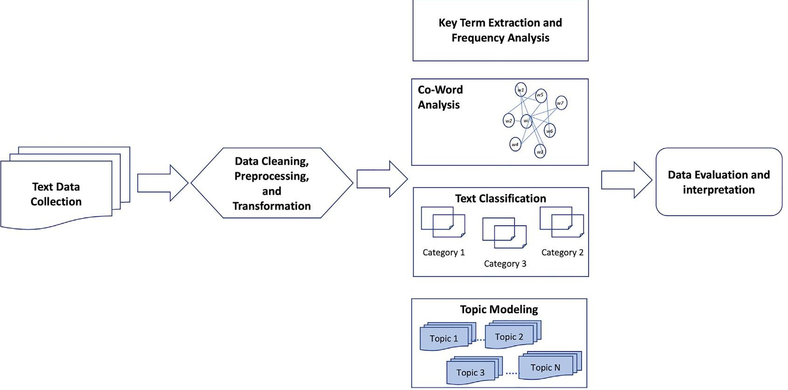
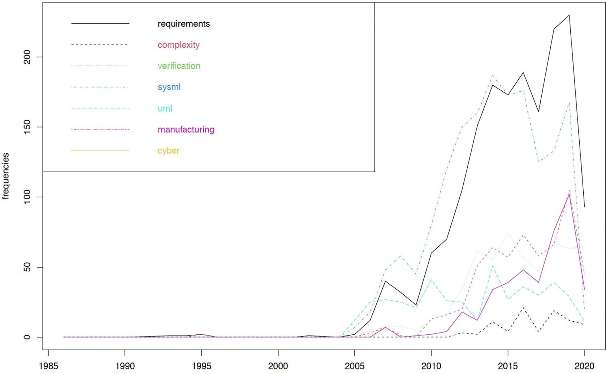
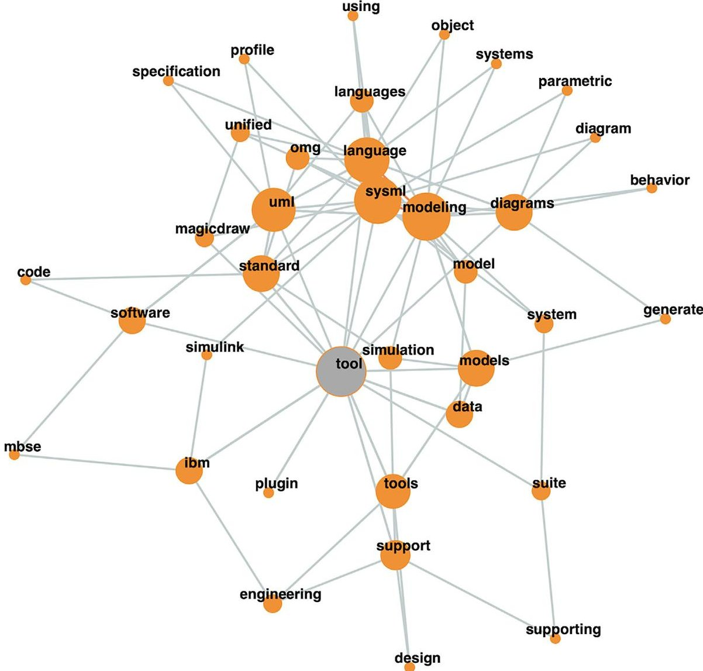
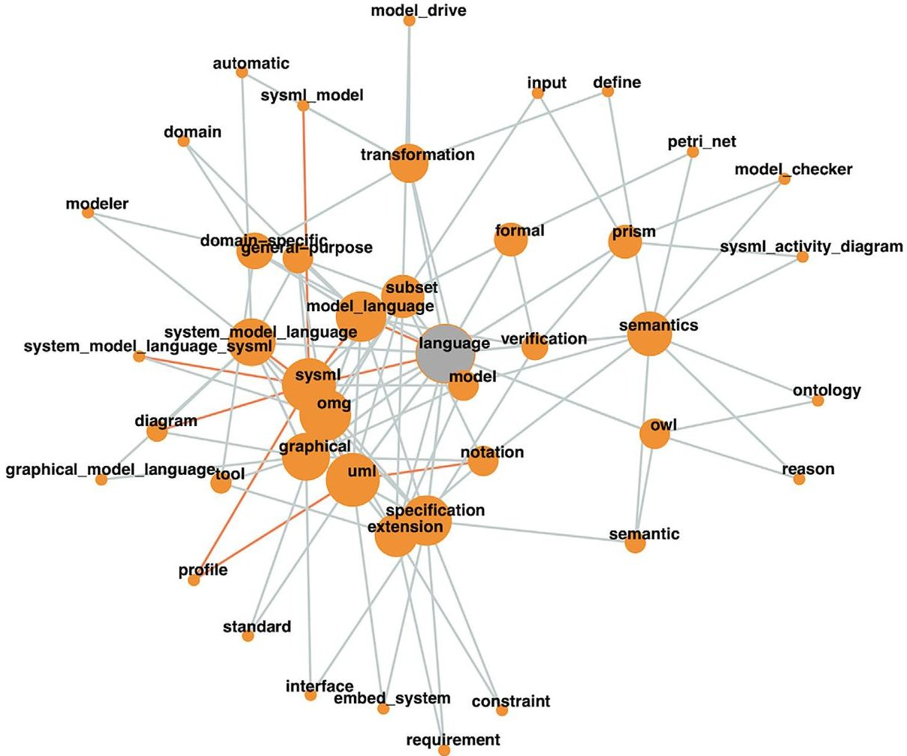
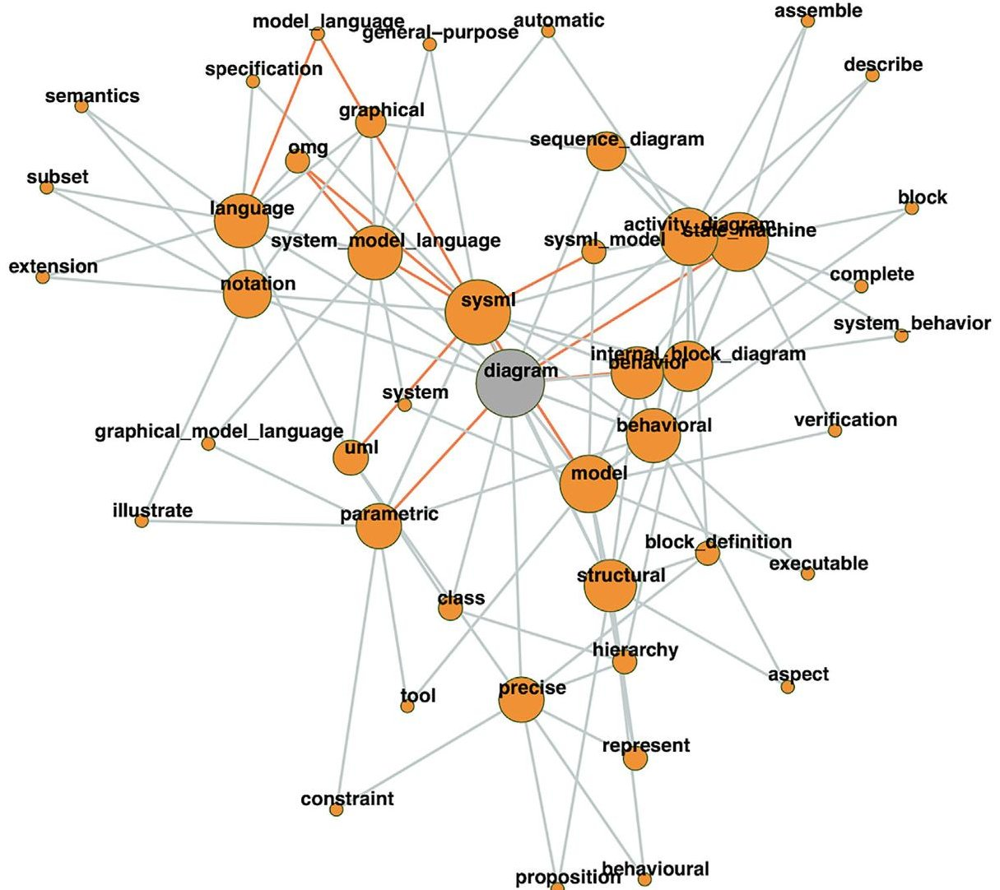
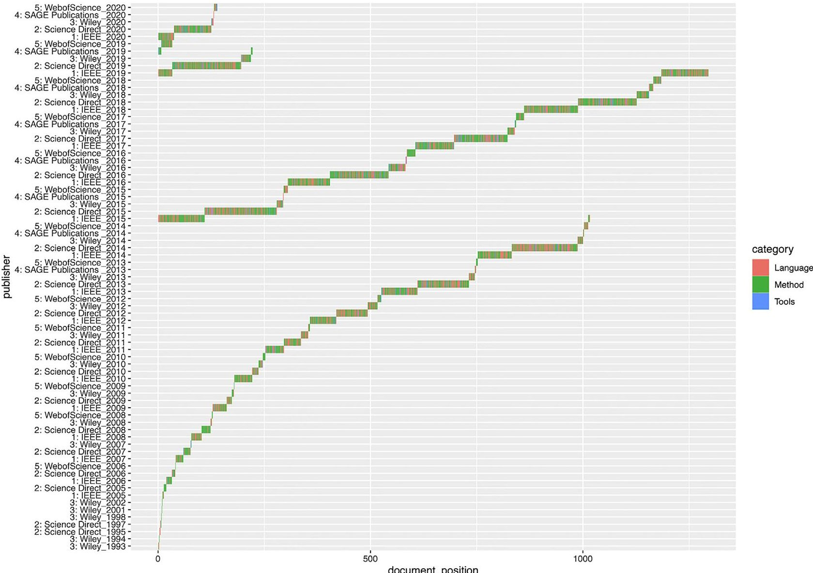
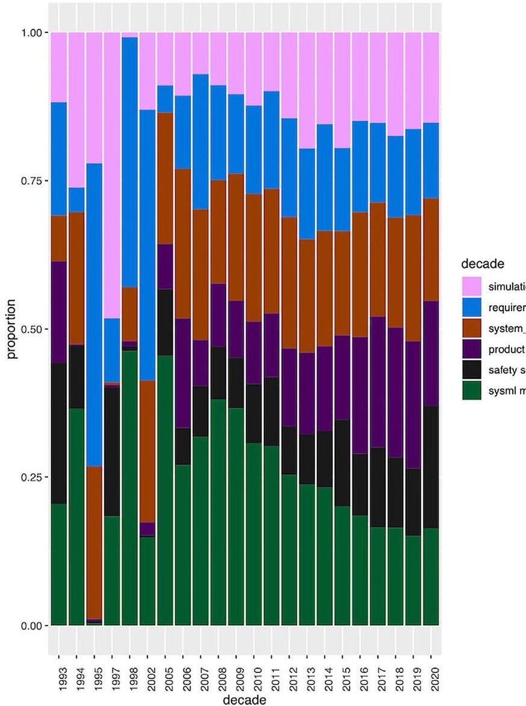

<!-- PDF_PAGE: 1 -->

REGULAR PAPER

WILEY

# Model based systems engineering-A text mining based structured comprehensive overview

Aditya Akundi $ ^{1} $ Oscar Mondragon $ ^{2} $

$ ^{1} $ Complex Engineering Systems Laboratory, Department of Manufacturing and Industrial Engineering, The University of Texas Rio Grande Valley, Edinburg, Texas, USA

$ ^{2} $ Computer Science Department, The University of Texas at El Paso, El Paso, Texas, USA

## Correspondence

Aditya Akundi, Complex Engineering Systems Laboratory, Department of Manufacturing and Industrial Engineering, The University of Texas Rio Grande Valley, Edinburg, TX, USA. Email: satya.akundi@utrgv.edu

## Abstract

An observed increase in systems scale and complexity has led to a significant momentum in exploring, identifying, and adopting model based systems engineering (MBSE) tools and techniques amongst research communities and industry practitioners. Several attempts to transform systems design and engineering practices through the use of MBSE in academia and industry has led to a considerable increase in the number of articles published containing the keyword "MBSE." This growth serves as the motivation in this paper to explore the MBSE landscape with the help of text mining techniques to identify the most often used key terms, tools, and languages, in the context of research in MBSE and the thematic aspects defining the use of MBSE by researchers and practitioners. The objective of this paper is to provide a structured comprehensive overview of research contributions across the MBSE landscape by employing text mining techniques for: (a) identifying the concepts and methodologies inferred upon in relation to MBSE, and (b) classifying the literature published to identify commonalities across academic researchers and practitioners using MBSE tools and methods. For this purpose, the abstracts of 2380 relevant articles published in the period of the last two decades from five different databases are mined. It is found that the terms "SysML," "Cyber Physical Systems," and "Production" are the most used terms among researchers across the MBSE landscape with SysML being the most widely used modeling language. Further, six major thematic topics are identified that classify articles from over the last two decades with an increasing interest observed in the use of MBSE to support manufacturing and production engineering activities, especially in the cyber physical systems domain. The contributions of this paper provide a leeway on using text mining techniques to understand the research directions that are currently of interest in the field of MBSE and thereby identify potential future research directions.

## KEYWORDS

cyber physical systems, data mining, MBSE, model-based systems engineering, modeling languages, modeling tools, SysML, topic modeling

## 1 INTRODUCTION

Model-based system engineering (MBSE) is the systematic application of modeling to support the evolution of system requirements, design,

analysis, verification, and validation activities beginning in the conceptual design phase and continuing through product end of life. $ ^{1} $ A shift from the document-centric approach of traditional systems engineering towards model-centric approach enables engineers to focus

<!-- PDF_PAGE: 2 -->

on developing, managing, and controlling a set of models of the system instead of creating and managing documents on the system that becomes inconsistent and unrelated. $ ^{2} $ At the heart of MBSE is the practice of developing system models at multiple levels from a broader system of systems perspective to a detailed component level behavioral model. Further, MBSE provides a way to visualize and capture information in different interactive models with an ability to verify the logic with a set of modeling rules for traceability between several information sources. Thus, few errors are introduced in the early system development or the requirements analysis phase. $ ^{3} $

Increase in mission complexity due to inadequate system specifications and incomplete verification processes; emergence of systems behavior leading to challenges in system testing; and effect on project risk-based decision making due to poorly coupled technical and enterprise ends of the projects are a few challenges identified by the International Council on Systems Engineering (INCOSE) addressing the current systems engineering practices and challenges. $ ^{4} $ Addressing this in their vision 2025 report, MBSE methods and tools have been identified to become the norm for executing systems engineering projects. Consequently, considering the integration-based challenges of future systems engineering, a significant momentum is observed in exploring, identifying, and adopting MBSE tools and techniques both from a research and an industry practice perspective. This is directly translated to the current increase in the number of articles published with the keyword "MBSE." $ ^{28} $

The landscape of published literature referring to the use of MBSE is vast and a focused descriptive overview would provide a clarity on the evolution of the use of MBSE across literature. The Objective of this paper is to provide a structured comprehensive overview to analyze and synthesize MBSE application landscape to understand and identify the concepts and methodologies inferred upon in relation to MBSE. Further, the MBSE literature published is also classified to identify commonalities across academic researchers and practitioners using MBSE tools and methods with the help of text mining techniques, manifesting the following research questions:

R1. What are the most often used Key Terms in MBSE literature?

R2. What are the most often referred to tools, languages, and diagrams by MBSE researchers and practitioners?

R3. Under what themes can the literature on MBSE be classified?

The remainder of the paper is organized as follows, Section II provides a brief review on the current MBSE state of application and practice, Section III details on the research method followed for enabling the text mining approach and the data sources identified for analysis, Section IV highlights the research findings and the results, and Section V concludes the article highlighting the contributions.

## 2 MBSE-A BRIEF REVIEW ON CURRENT STATE OF APPLICATION AND PRACTICE

Several initiatives and efforts have been observed and reported on the use, utility, and adoption of MBSE for systems development, both in

academia and industry. From an application-oriented perspective few examples include, the use of the Systems Modeling Language (SysML) for developing CubeSat (miniature satellite system) reference models, $ ^{5} $ SysML behavioral models to model and simulate hospital emergency rooms, $ ^{6} $ developing frameworks using SysML to improve collaboration and share impact assessments across product development teams, $ ^{7} $ modeling and assessing environmental impacts of product development using SysML, $ ^{8} $ adopting MBSE practices for avionics onboard maintenance systems, $ ^{9} $ applying MBSE processes to enable Airbus orbital servicing missions using SysML based models, $ ^{10} $ and MBSE approach to improve design process of product development at AVL Germany. $ ^{11} $

More recently, Selim $ ^{12} $ portrayed the use of SysML for developing generic market simulation models. Ciampa et al. $ ^{13} $ presented an ontology-based product development framework for multidisciplinary design analysis optimization (MDAO) systems with the goal of establishing a bridge between MBSE and MDAO. Mažeika and Butleris $ ^{14} $ provided a unified modeling language (UML) based security profile that conforms with ISO/IEC information security standards for requirements engineering process of cyber physical systems. Kharrat et al. $ ^{16} $ extended SysML to enable effective collaborative between the system architects and electromagnetic subject matter experts to aid development of constrain specifications for electric power vehicle train. Mažeika and Butleris $ ^{15} $ provided guidelines for applying security techniques such as identifying security requirements and considering attack scenarios for legacy software systems in an MBSE environment. Waschle et al. $ ^{17} $ integrated product generation engineering approach in MBSE to enable developers to store model information, accomplish automatic weighing calculations, and characterize critical points in sub systems of compact actuators using SysML.

From the perspective of MBSE state of practice, several surveybased investigations have been undertaken by researchers and organizations to identify methodologies, best practices, and provide insights on the application of MBSE tools and techniques. Amorim et al. $ ^{20} $ identified eighteen best practices for adopting MBSE in organizations involved in developing embedded systems, using 14 semi structured interviews with experts from across 10 different organizations. Best practices addressed piloting, knowledge building, tools and processes, and management for the adoption of MBSE in organizations, among several others. In a similar study conducted by Liebel et al. in the embedded systems domain, based on the data collected from 113 respondents it was found that models were not only used for documentation purposes but also acted as key artifacts for consistency checking across behavioral and structural aspects for systems development processes such as simulation and code generation, with common modeling tools such as MATLAB/Simulink with UML and SysML as the most used modeling languages. $ ^{21} $

Several similar attempts $ ^{22-25} $ have been made with the help of online surveys and semi-structured interviews to gain insight and identify best practices on the state of use and adoption of MBSE in various organizations and domains. This shows an interest in the Systems Engineering community on the progression and integration of MBSE, its supporting processes, and the tools required in industries

<!-- PDF_PAGE: 3 -->

FIGURE 1 Text data analysis framework used

for adopting new MBSE practices across organizations. $ ^{26} $ A comprehensive overview reported in this study which identifies the modeling languages, methods, and tools frequently reported for MBSE practices over the last two decades adds value to the body of knowledge that would facilitate this transition. Further, this study also takes a step forward to classify application domains observed across the MBSE landscape setting a tone for further exploration and future research directions in MBSE.

## 3 RESEARCH METHOD

Text mining (TM) is also referred to as intelligent text analytics, text data mining, and text knowledge discovery. $ ^{29} $ Text mining is defined as the discovery of either new or previously unknown information obtained by extracting information from various written resources. When compared to a conventional web search where a user looks for information already known, text mining aids in discovering new information and knowledge by identifying patterns in text documents from various resources. $ ^{30} $ The process of text mining usually incorporates several techniques such as Natural Language Processing (NLP), Information retrieval, Clustering, Documents Classification, Web mining, Information Extraction, and Concept Extraction. $ ^{31} $ Substantial growth in the feasibility and practice of text mining for exploring published literature resources and finding concepts and trends across researchers of a given subject domain is widely observed. Allahyari et al. $ ^{32} $ portray the applicability of text mining in identifying biomedical ontologies. Krallinger et al. $ ^{33} $ use TM for identifying relationships of chemical names and chemical structures to biological information for mapping trends and challenges in chemistry related research. Kobayasi et al. $ ^{34} $

explore the application of TM in organizational research by collecting and analyzing job vacancy information for describing and understanding the behavioral aspects and attributes necessary to perform job functions. A notable application of TM is by Westergaard et al. $ ^{35} $ where, 15 million full text articles published between years 1823-2016 are mined to identify subtopics of the publications from MEDLINE and PMC datasets.

This research applies the text mining framework developed by Niekler and Wiedemann $ ^{39} $ to successfully explore and analyze the contributions by researchers and practitioners in the MBSE landscape. This framework facilitated analyzing trends in associated text documents and extract topics related to the main theme of MBSE. Figure 1 shows the main components of the framework and the following subsections describe the framework components.

## 3.1 Text data collection

Text Data Collection consists of identifying and extracting data from scholarly databases and constituted the first step to aid in answering the research questions identified above. In this article, data is referred to as a collection of abstracts from published peer reviewed conference articles and journal papers across various available libraries. The key terms used for identifying literature for the analysis are "Model based Systems Engineering" and its acronym "MBSE." During a preliminary search using the term "MBSE," it was observed that the search term "MBSE" is used with a varying meaning in different domains. The key term "MBSE" in the domain of biochemistry is referred to as "membrane based solvent extraction," in the field of medicine and biotechnology it is referred to "M. bovis bacille Calmette-Guérin" a vaccine

<!-- PDF_PAGE: 4 -->

TABLE 1 Key terms "MBSE" and "model based systems engineering" search results

<table border="1"><tr><td>Database libraries</td><td>No. of abstracts</td><td>Publication years range</td></tr><tr><td>IEEE Explore</td><td>1014</td><td>1996-2020</td></tr><tr><td>Science Direct</td><td>977</td><td>1995-2020</td></tr><tr><td>Wiley Publishers</td><td>217</td><td>1995-2020</td></tr><tr><td>Sage Publications</td><td>34</td><td>2013-2020</td></tr><tr><td>Web of Science</td><td>138</td><td>1995-2020</td></tr><tr><td>Total</td><td>2380</td><td></td></tr></table>

for tuberculosis, and in the field of signal processing it is referred to as "model based signal enhancement."

Consequently, a search of titles, abstracts, and full text documents in five different scholarly databases using the conjunction of terms "MBSE" AND "Model based Systems Engineering" with an AND operator resulted in 2827 articles.

For a better understanding of the dataset, authors reviewed the titles to filter out outliers. This helped to discard 217 articles from analysis. With further reviewing the dataset additional 144 articles were excluded from the analysis that were found to be book chapters, forewords, and description of special issues. Finally, discarding duplications from the databases considered, 131 articles were omitted resulting in the dataset of 2380 articles between the time period of the years 1995 to 2020 for analysis.

Considering the restricted access of digital libraries freely available to the authors and that of the of the full text articles identified only the abstracts of all the 2380 articles from the digital libraries of IEEE (Institute of Electrical and Electronic Engineers) Explore, Science Direct, Wiley Publishers, Web-of Science, and Sage Publications were extracted. The conjunction-based search criteria used helped to identify the articles addressing model-based systems engineering and omitting the use of term MBSE from other domains. Table 1 illustrates the search results identified from each individual data base.

The data collected included the author names, title of the articles published, abstracts, the date of publication, keywords, and the funding agencies that supported the publications. To avoid the use of author names, the funding agencies reported, and publication venues, the analysis was restricted to the abstracts of the articles published and their dates of publication. Once refined the abstracts were combined and converted for further analysis into a single comma separated value format (.csv) file.

For consequent steps of data analysis, that is, data preprocessing and transformation, key term extraction and frequency analysis, coword analysis, text classification, and topic modeling, "R" a widely used statistical tool by statisticians and data miners was employed to transform, visualize, and analyze the data. $ ^{40} $

## 3.2 Data preprocessing and transformation

Understanding substantial amounts of text databases without a need for reading all the individual documents is one of the main purposes

of Text Mining. $ ^{31} $ With 2380 abstracts extracted for analysis, each abstract is represented as a table marked by a separator in .csv format using the labels: "doc_id" for representing a unique identifier for each document, "dataset_id" representing a serial number id digital library each abstract is extracted from, "publisher" identifying the name of the digital library, "doc_title" identifying the title of the abstract, "date" for the year of publication, and "text" containing the abstract of each document.

For further analysis, the text data is cleaned to enhance the quality and create a structured vector space model. Standard data cleaning procedures for text data include getting rid of unwanted characters such as white spaces, numbers, symbols, and tags. With unwanted elements from the text data deleted, stop words are removed succeeded by, case normalizing, that is, lower-case conversion, stemming, and creating vectors. $ ^{34} $ To homogenize the representation of text, stemming process identified removes the prefixes, suffixes, and inappropriate pluralization's in the text document. The text data is then transformed into a vector-based representation to act as a suitable input for text mining algorithms that have been used to represent the term frequency (TF), that is, the number of time a given term appears in each document over the dataset considered. Although this representation of words ignores the word order, this representation has better results to the one that account for word order. $ ^{34,41} $ Table 2 illustrates application of the identified preprocessing steps on a sample text extracted from an abstract.

## 3.3 Key term extraction and frequency analysis

Extracting relevant terms for a given collection of text is in general terms the aim of key term extraction and frequency analysis. Indexing unique terms based on statistical techniques such as calculating relative term frequencies allows to extract meaning from a collection of text. $ ^{31} $ Most used method to weigh terms for determining their contribution is the Inverse Document Frequency Measure (IDF). Considering the frequency of a given term in a document and the number of times it occurs in a document, IDF helps to determine the influence of a given term in the set of documents considered. A term with a low IDF value appears in many documents and has less informative value whereas, a term with high IDF value appears in few documents indicating it has more informative value. $ ^{42} $ This research applies key term extraction using multi word tokenization $ ^{44} $ and frequency analysis to identify the primary terms that define the MBSE landscape and map the frequency of their use over time. Please see section 4.

## 3.4 Co-word analysis

Co-word analysis is an effective technique for mapping the extent of association among text and it is used to study and map the semantics from text data bases. $ ^{45} $ Centered on the assumption that key terms represent a significant information of a given document, coword analysis enables to identify the content of a given research field

<!-- PDF_PAGE: 5 -->

TABLE 2 Representation of preprocessing operations on text extracted from an abstract

<table border="1"><tr><td>Operations</td><td>Sample abstract text</td></tr><tr><td>Original text</td><td>This paper presents a case study in implementing an integrated data and model management system in the development of a complex system.</td></tr><tr><td>Case transformation</td><td>This paper presents a case study in implementing an integrated data and model management system in the development of a complex system.</td></tr><tr><td>Punctuation removal</td><td>This paper presents a case study in implementing an integrated data and model management system in the development of a complex system</td></tr><tr><td>Stop word removal</td><td>Paper presents case study implementing integrated data model management system development complex system</td></tr></table>

providing an insight to understanding the thematic aspects, and their relations and interactions. $ ^{46} $ Co-word analysis is done by providing a way of identifying the extent to which terms appear together in sections of text and comparing them against the other sections of the text document. $ ^{48} $ This research applied co-word analysis and the result is shown as a network visualizing words that are often observed together in the abstracts to attempt, identify, and differentiate the associations and thematic aspects of key terms, see section 4 for further information.

## 3.5 Text classification

Text classification is the process of classifying a set of documents into a pre-defined set of classes automatically. Several important applications of text classifications such as in content management, contextual document search, information retrieval, ranking and document classification, product review analysis, web search, and several others have been noted in literature. $ ^{49,50} $ Representing the text documents as document vectors, classification algorithms such as Logistic Regression, knearest neighbor, Convolutional Neural Networks, and several others are used to train and classify the data. $ ^{51} $ This research applies a supervised machine learning technique for classifying the abstracts across the identified digital libraries, into the three pillars of MBSE, that is, Modeling Languages, Modeling Methods, and Modeling Tools. $ ^{52} $ Please see Section 5.

## 3.6 Topic modeling

Topic modeling for text analysis is used to automatically extract topics or thematic elements from a set of documents. The premise of topic modeling is based on the characterization of a given topic based on a distribution of terms and the mixture of each topic contained in a given document. $ ^{34} $ Latent Dirichlet Allocation (LDA) is the most used method for topic modeling and is observed to be used for applications such as opinion modeling, extracting topics from source codes, hashtag recommendation, among several others. $ ^{53} $ One of the notable advantages of using LDA for topic modeling is its applicability across domains with a parallel drawn among three objects, that is, documents, words, and topics. $ ^{55} $ This paper applies LDA for topic modeling with an aim

to determine the proportionate composition of fixed number of topics from the extracted abstracts with a similar semantic context to MBSE.

## 4 FINDINGS AND DISCUSSION

The 2380 abstracts identified and formatted into .csv format from different digital libraries represent the raw data that was initially converted into a document term matrix with 24995 terms. Standard data cleaning procedures for text data were employed that included getting rid of unwanted characters such as white spaces, numbers, symbols, and tags. Unwanted elements of the text data were deleted, stop words removed, succeeded by case normalizing, stemming, and creating vectors for extracting meaningful terms for analysis with a resulting data of 10400 terms.

## 4.1 Findings of key term extraction and analysis

This research applied the key term extraction and frequency analysis to address the first research question, that is, "R1. What are the most often used Key Terms in MBSE literature?." Researchers make use of statistics to extract keywords from the data, TF-IDF (Term Frequency - Inverse Document Frequency), and log-likelihood. First, multi word units, also known as collocations in the field of linguistics, are identified across the data to identify semantically related terms. The term multi word units (MWU's) is defined as the words that co-appear so often that they are usually considered to be a single unit by linguists. $ ^{56} $ The intent behind using MWU's is to extract the frequently used terminology referred to by researchers and practitioners when addressing model-based systems engineering.

For the MBSE references analysis, two terms are treated as a unit when they occur more often together, the Quanteda package from $ R^{57} $ is used to statistically identify the term candidates and concatenate them and treat them as a single term for subsequent analysis. $ ^{39} $ Table 3 shows the 36 top detected terms and their associated frequencies in the entire data set considered for MBSE references.

Among the terms identified "system engineer" was observed to be referred to the most considering the fact that MBSE is geared for systems engineers for facilitating the automation of manually generating artifacts from document centric approach to a model centric one.

<!-- PDF_PAGE: 6 -->

TABLE 3 the top 36 terms identified in the data based for MBSE references

<table border="1"><tr><td>Terms identified</td><td>Term count</td><td>Terms identified</td><td>Term count</td></tr><tr><td>System engineer</td><td>2079</td><td>Software development</td><td>105</td></tr><tr><td>model-based system</td><td>664</td><td>Conceptual design</td><td>102</td></tr><tr><td>system design</td><td>342</td><td>Requirement engineer</td><td>102</td></tr><tr><td>complex system</td><td>332</td><td>Product line</td><td>98</td></tr><tr><td>sysml model</td><td>221</td><td>High level</td><td>95</td></tr><tr><td>Design process</td><td>217</td><td>Model transformation</td><td>89</td></tr><tr><td>Embed system</td><td>211</td><td>Activity diagram</td><td>85</td></tr><tr><td>System architecture</td><td>205</td><td>Safety analysis</td><td>84</td></tr><tr><td>System development</td><td>186</td><td>Software architecture</td><td>83</td></tr><tr><td>Production system</td><td>182</td><td>Manufacture system</td><td>82</td></tr><tr><td>Mechatronic system</td><td>175</td><td>Unify model</td><td>79</td></tr><tr><td>Control system</td><td>168</td><td>Fault tree</td><td>70</td></tr><tr><td>Life cycle</td><td>158</td><td>Digital twin</td><td>69</td></tr><tr><td>Product development</td><td>140</td><td>State machine</td><td>68</td></tr><tr><td>Software engineer</td><td>139</td><td>Early stage</td><td>67</td></tr><tr><td>Cyber-physical system</td><td>115</td><td>Model technique</td><td>67</td></tr><tr><td>Simulation model</td><td>115</td><td>Business process</td><td>64</td></tr><tr><td>Design phase</td><td>108</td><td>Domain specific</td><td>63</td></tr></table>

The appearance of the term "model-based system" with a high frequency is of no surprise as all the abstracts extracted were addressing the use of model-based systems engineering tools and techniques. Observing the key terms, the application of MBSE tools and techniques were mostly addressed in complex systems and during systems design phase, initial stages, whole life cycle or product development. The use of MBSE across the life cycle activities is observed specifically in early system design, requirements engineering, and systems architecting phases, indicating the importance of integrating model-based systems engineering approach early-on in system development. Regarding the application domains, MBSE is applied in "production systems," "embedded systems," and "mechatronic systems" based on the frequent appearance of these terms. This could be due to the fact that the development of embedded systems is challenging due to the diversity of systems development activities involved while considering the product time-to market, customer needs, and requirements for realtime systems. Thus, stressing the importance of introducing early-on verification of design practices $ ^{58} $ justifying the interest of the research community in MBSE.

Terms such as "cyber physical systems" and "digital twins" are also observed reflecting to the interest of the research community in exploring applicability of MBSE. Cyber Physical Systems (CPS) are defined as physically engineered systems that are integrated, operated, monitored, and controlled by an integrated computing and communication core with a potential to transform how humans' control and interact with the physical world around them. $ ^{59} $ An intellectual grand challenge in CPS is the intersection of both physical and virtual worlds $ ^{60} $ where it is not enough to separately design, analyze, and develop the systems independently to be integrated but to consider the inherent complexity of integrating different components, physical, and digital processes early-on from the inception of the system design. Thus, explaining the interest in the applicability of MBSE tools and techniques to develop cyber physical systems.

From a modeling language perspective, most interesting is the usage of term "sysml model" which is observed to be referred to relatively more often indicating the interest among the researchers and practitioners. This indicates that Systems Modeling Language (SysML) is most sought after by the community for developing system structural and behavioral requirements as well as constraint models. Further investigating, the term "UML model" is observed in the tail of top 50 terms identified indicating a relative less interest in the use of modeling languages such as Unified Modeling Language (UML), Unified Profile for DODAF/MODAF (UPDM), Modeling and Analysis of Real Time and Embedded systems (MARTE), and others by the community. The authors recognize that modeling languages such as SysML, UPDM, and MARTE are indeed profile extensions of UML.

The research created a collection of abstracts from each database (see Table I) and explored the key terms specific to each collection by applying key term extraction. $ ^{39} $ Figure 2 illustrates the key terms associated to each database used for the analysis of MBSE references collections.

The terms "sysml," "model" and "CubeSat" are the most common key terms identified from the abstracts in IEEE database. This reflects to SysML being the most referred to modeling language among the community and of several publications addressing the use of MBSE tools to facilitate CubeSat design and avionics systems. Identified as the key terms from the abstracts published in Wiley database, "trade study," "OPM" and "submarine" indicate the interest in the use of MBSE for trade studies along with indicating an interest in the use of Object- Process Methodology (OPM) for conceptual system modeling. The key terms "manufacture," "production," "production-system," "assembly" and "production" from the abstracts of Science Direct database indicates the interest on the applicability and use of MBSE for manufacturing and production engineering systems.

With the key terms identified in the overall data considered and in the individual digital libraries, measure of frequency over time were plotted as line graphs to identify a trend over time per decade. Based on the key terms extracted the following terms are considered for analysis: "requirements" - for understanding the trend in the use of MBSE in requirements analysis, "complexity" - for understanding the trend in the use of MBSE in complex systems, "verification" - for understanding the trend in applicability of MBSE for verification tasks, "sysml" - for understanding the trend in use of SysML for MBSE, "UML" - for understanding the trend in use of UML for MBSE, "manufacturing" - for understanding the trend of exploring MBSE applicability for manufacturing systems, and "cyber" - for understanding the trend in MBSE applicability for cyber physical systems. Figure 3 shows the trends over time per decade for the terms listed above. The gradual rise in the use of terms identified from around year 2004 suggests the start of growing interest in the exploring MBSE and its applicability. A peak in

<!-- PDF_PAGE: 7 -->

model-centric

rfp informativity

tutorial trade_study

svn

beta-binomial incose abs

marginal

submarine

system_engineer

organization wiley slim eng

syst pbseopm

periodical within-study

meta-analysis woman

model_base_system_engineer

(b) Wiley Database

observatory

resilience verification

entropy reserve

telescope

sosa

container

lsst

esem

optic

tm ibfvr

mouse

tmt sensor

derivative cookbook

model-based_system_engineer

competency

sysml_model

avionics_system

translation

spacecraft sos

model_language

diagram

system mission

umlrfd

multi-core

sysml model

cubesat

mobile radio

heterogeneous

systemc

notation server

verify

cyber_physical_system

formal_verification

(c) Web-of-Science Database

solvent

production_system

assembly production

impact knowledge action

#name uncertainty

manufacture

pss oceb collision

heat mbse4cps

acid extraction

maintenance e.deorbit

spacetug identify

research

practitioner

(d) Science Direct Database

datum_model

resilient

idat cms

biped

set-based

dod airport

icu

article

serc

ers

abim engage

defense

converge cluster

diagnostic department

patient game

simulation

human-centered

(e) SAGE Database

FIGURE 2 Word cloud illustration of key terms extracted from each data base

FIGURE 3 Representation of term frequencies over time

<!-- PDF_PAGE: 8 -->

reference to use of SysML in the years 2007-2008 indicates the visibility and the interest in the use of the modeling language after its adoption by Object Management Group (OMG) as OMG SysML in the year 2007. $ ^{61} $ Another peak of SysML observed around the year 2013 indicates that most studies addressing the use of SysML for MBSE were published in 2013.

Although the modeling languages SysML and UML both see a gradual increase around the year 2004, SysML is embraced by the MBSE community as an extension of UML that is specifically geared at system engineers with an opportunity to describe the functionality of systems. $ ^{61} $ SysML provides new models that shows system decomposition, the transformation of inputs into outputs by the system components and the documentation of main system parameters in the parametric diagrams. Similarly, an interest in addressing requirements engineering is observed in the year 2019. Coincidentally, the terms "sysml," "manufacturing," and "complexity" also peak around the same year with the term "requirements" in the year 2019. This can be perceived as the application of SysML to document system requirements and addressing system complexity through the validation and verification of the models of the system.

## 4.2 Findings of co-word analysis

This research applied co-word analysis to visualize and identify the tools, languages, and modeling diagrams often referred to by researchers using MBSE. Moreover, co-word analysis facilitated addressing the second research question "R2. What are the most often referred to tools, languages, and diagrams by MBSE researchers and practitioners?." Joint occurrences of the words are first calculated only considering the fact if they occur together irrespective of the frequency. This approach is based on the premise that considering frequency as a sole measure could impact the inherent constituent meaning whereas the use of mutual information measures emphasizes on the rare occurrences in data enabling to identify context and interpretable meaning. $ ^{39} $ For a meaningful interpretation, secondary co-word terms for each co-word are calculated and mapped onto a network. In simple words, a set of significant co-words are first identified and then for each of the term a secondary set of co-words are identified.

For the MBSE analysis, this work identified the tools, languages, and diagrams most often referred to by the researchers using MBSE by considering all the primary and secondary words that are bound to co-occur with the terms "tools," "languages" and "diagrams." Figures 4-6. shows the network visualization of primary and secondary co-words for the terms "tools," "languages" and "diagrams."

Considering the primary and secondary terms that cooccur with the term of interest, the terms "IBM," "magicdraw," and "Simulink" are observed. This observed reporting from the authors could indicate a possible preference towards the use of IBM Rational Rhapsody, Magic Draw, and Simulink for facilitating MBSE activities. Please see Figure 4.

and Simulink are supported by SysML. PRISM and Modelica were identified to be the tools that were relatively less referred to in literature by exploring further into the tail of cooccurrence terms.

This coincides with our earlier finding that SysML is the most reported language by the community for enabling a roadmap for systems development $ ^{62} $ and the tools such as IBM Rhapsody, Magic Draw,

Exploring the statistical measures, a high correlation of the term "tool" with the term "IBM" could indicate that the researchers reported the use IBM Rational Rhapsody tool more often, with Magic Draw being the second most reported, and Simulink the third. This trend in use of proprietary and closed source tools such as Magic Draw and Rhapsody could be due to the fact that they are backed up by documentation and support from vendors. The use of Simulink could be attributed to the transformations of SysML models to Simulink to be simulated, thus motivating several researchers and possibly indicating a gap of translating MBSE research to enterprise users. $ ^{63} $

The idea behind trying to find the most referred upon language among the practitioners of MBSE community is to identify a commonality among the modeling methods. Figure 5 reveals SysML, UML, and Petri nets to be the most frequently referred to languages and MARTE referred to less often. Since SysML is an extension of UML profiles, the findings attribute to the use of SysML and Petri nets for MBSE applications. SysML enables architecture centric analysis for integrated analytics, capturing analysis contexts, requirements and architectural parameters $ ^{64} $ whereas Petri net is a mathematical language for modeling the control and behavior of distributed systems. $ ^{65} $ The conjunction on the use of SysML and Petri nets can be attributed to the fact that SysML lacks in executable semantics limiting its capability to verify specifications $ ^{66} $ that can be mitigated by translating SysML diagram elements to Petri net specifications $ ^{67} $ for modeling system behavior. Although Petri nets and SysML activity diagrams can model concurrency and synchronization of events; only Petri nets allow running the models to identify liveness and reachability properties of the net. This advantage may be one of the reasons why Petri nets are used in addition to SysML.

Another result of the network visualization is the identification of the most referred to SysML diagrams by the MBSE community: Parametric diagrams, State Machine, and Internal Block diagrams as shown in Figure 7. This could indicate more interest towards describing the structural aspects of systems by expressing systems constraints in support of performance and reliability analysis. In addition, there is interest in the behavioral aspects of the system by using state machine diagrams for addressing system transitions and their responses. $ ^{52} $

## 4.3 Findings of text classification analysis

Modeling Language, Modeling Method, and a Modeling Tool facilitate the practice of Model based systems engineering. $ ^{68} $ Referred to as the three pillars of Model based systems engineering, a Modeling Language represents a standardized medium of communication with defined rules, elements, and relationships, for conveying meaning; a Modeling Method enables to define a roadmap for a set of designing tasks to be undertaken by a team for systems modeling; and Modeling tools are the platforms adhering to the syntax and semantics of modeling languages that enable the design and implementation of systems. $ ^{52} $

<!-- PDF_PAGE: 9 -->

FIGURE 4 Network visualization of the primary and secondary terms co-occurring with the term "tool"

The spread of MBSE literature can be understood by classifying the extracted abstracts into the three pillars of MBSE. Classification of text is the process of assigning a predefined category to text objects. $ ^{34} $ For classifying the documents, a supervised machine learning model is used based on a set of training data developed by the authors.

For the training data, out of all the 2380 abstracts identified, 100 abstracts were randomly selected and manually identified into the categories of Modeling Method, Modeling Tool, and Modeling Language. Abstracts only addressing the application of tools such as IBM Rhapsody, Magic draw, Simulink, and similar others for implementing systems models were assigned to Modeling Tools Category. Modeling Language category included of the abstracts that specifically talk about the use of modeling languages such as SysML, UML, MARTE and similar others and their extensions along with the abstracts addressing the use of diagrams such as Behavior diagrams, Structural diagrams, and Requirement diagrams and their constituents. Abstracts addressing and identifying frameworks for the use of MBSE tools and techniques tailored to domain specific applications, methods to generate artifact's, managing requirements traceability, tailoring design activities, frameworks based on industry experiences, and other system design activities were assigned to be of Modeling Method category. The training

data included, 37 abstracts manually assigned to Modeling Language category, 13 abstracts manually assigned to Modeling Tools category, and 50 abstracts manually assigned to Modeling Method category.

The words associated with the abstracts of each category are extracted to create a reference for classifying the rest of the abstracts. Because there is a high frequency of the abstracts belonging to modeling method category and to avoid the bias of not adequately representing the Modeling tools and Modeling language, the categories K-fold cross validation procedure as illustrated by Niekler and Wiedemann $ ^{69} $ is utilized. Figure 7 depicts the visualization of the MBSE literature spread classified across the three pillars of MBSE. It can be observed that many of the abstracts, that is, approximately 63.93% have been classified to belong to Modeling method category, 31.96% belonging to Modeling language category and 4.10% of the abstracts to the Modeling tools category. Based on the text classification results shown in Figure 7, most of the work on MBSE early on from years 1993-2005 is based on the use of modeling languages preceded by an increase in publications addressing modeling methods thereafter. This indicates a major drive among the researchers towards exploring domain specific methodologies for adopting and implementing MBSE techniques.

<!-- PDF_PAGE: 10 -->

FIGURE 5 Network visualization of the primary and secondary terms co-occurring with the term "language"

The authors would like to identify that the findings of the classification analysis presented are strictly based on the training data that was manually developed and used. The generalizability of classification model is condition based on how good the training data is representative of the entire data. $ ^{34} $ Further, a possible cause of the classification model categorizing only 4.10% of the abstract from the data to the Modeling Tools category could be due to the fact that only 13% of the randomly chosen abstracts addressed the use modeling tools and the name of the tools that are included in these abstracts.

## 4.4 Findings of topic modeling

This research applied Topic modeling to facilitate answering research question three: "R3. Under what themes can the literature on MBSE be classified?." Topic modeling enables in automatically extracting topics or thematic elements from a set of text documents. Latent Dirichlet Allocation (LDA) is a generative probabilistic unsupervised machine learning method $ ^{70} $ that aims to determine the proportionate composition of fixed number of topics from a corpus with a similar semantic context. The premise of Topic Modeling is based on the fact that a topic can be characterized by a distribution of terms and that any given text is composed of different topics. $ ^{34} $ The procedure illustrated by Niekler and Wiedemann demonstrating the application of topic modeling for extracting semantic contexts from a set of given text data is utilized. $ ^{69} $ The procedure followed to identify topic modeling using the

"topic models" package in R includes: creating a Document Term Matrix with a threshold of term frequency to discard less frequently occurring words from the data; deleting empty rows in Document Term Matrix to perform LDA; identifying topics and concatenating the ten most likely terms observed in each topic; ranking the topics based on topic distribution over the documents; and visually representing the spread of topics identified over the entire time period of the text data. Table 4 depicts the top six topics, their respective proportions across the entire text data of 2380 abstracts, and representative label provided by the authors.

Figure 8 illustrates the topic spread in the abstracts considered over the last decade.

The top five abstracts, in a descending order, representing each individual topic have been summarized in order to explore, provide a perspective, and illustrate the relevance of the six topics identified in Table 4. A summary of each topic follows.

MBSE for Systems Architecting and Management (Topic 1): Composed of the key terms identified (see Table 4) in the thematic aspect which represent papers addressing the use of MBSE to evaluate and generate consistent system architectures and for trade space exploration. Specifically, generating system architectures to manage requirements and perform verification and validation activities, $ ^{71} $ synthesizing decision analysis and MBSE to assess multidomain conceptual architectures, $ ^{72} $ exploring the feasibility of model-based techniques in design activities, $ ^{73} $ CubeSat design variables and constraints generation $ ^{74} $ and enhanced trade space exploration

<!-- PDF_PAGE: 11 -->

FIGURE 6 Network visualization of the primary and secondary terms co-occurring with the term "diagram"

TABLE 4 Top six topics and their constituent terms identified

<table border="1"><tr><td>Topic</td><td>Top 12 topic terms identified</td><td>Topic %</td><td>Topic labels assigned</td></tr><tr><td>T1</td><td>Simulation, performance, analysis, mission, optimization, cost, uncertainty, design, architecture, satellite</td><td>15.81%</td><td>MBSE for Systems Architecting and Management</td></tr><tr><td>T2</td><td>Requirement, functional, system, define, architecture, view, element, viewpoint, represent, interface</td><td>15.02%</td><td>MBSE for Requirements Specification, Representation and Analysis</td></tr><tr><td>T3</td><td>System engineer, project, team, stakeholder, enterprise, practical, tool, engineer, datum, management</td><td>19.72%</td><td>MBSE Implementation and Practical Considerations</td></tr><tr><td>T4</td><td>Product, manufacture, service, production, technology, machine, virtual, industry, production system, maintenance</td><td>17.09%</td><td>MBSE for Cyber Physical Systems - Manufacturing and Production Engineering Activities</td></tr><tr><td>T5</td><td>Safety, security, study, analysis, failure, reliability, identify, method, pattern, challenge</td><td>11.53%</td><td>MBSE for System Assurance</td></tr><tr><td>T6</td><td>sysml, model, language, simulation, uml, verification, specification, model language, diagram, sysml</td><td>20.79%</td><td>Modeling Language Driven System Specification</td></tr></table>

integration by integrating MBSE and life cycle cost models for system design selection. $ ^{75} $ Covering a proportion of 15.81% in the data used, the trend of this thematic aspect illustrates an increasing interest among the researchers over time. Figure 8 illustrates this trend.

MBSE for Requirements Specification, Representation and Analysis (Topic 2): This theme addresses research on, developing a change

propagation model based on web ontology language (OWL) for formalizing and helping designers to identify the SysML diagrams and elements that need to be changed for system modeling, $ ^{76} $ culmination of MBSE and object-oriented modeling for developing logical architectures, requirements specification, and complex system design, $ ^{77} $ tool development for requirements inference and consistency

<!-- PDF_PAGE: 12 -->

FIGURE 7 Classification of MBSE abstracts across the three pillars of MBSE

checking, $ ^{78} $ graphical and tabular modeling for improving requirements representation, $ ^{79} $ and epistemological aspect of requirements engineering for addressing design specification costs. $ ^{80} $ Encompassing a proportion of 15.02% in the data used, the trend of this thematic aspect and interest among the researchers has not changed significantly over the last decade. Figure 8 illustrates this trend.

MBSE Implementation and Practical Considerations (Topic 3): This thematic aspect represents the efforts across enterprises on the implementation and practical considerations of deploying MBSE in industries. Papers addressing views on streamlining processes for facilitating a transition to SysML as a part of MBSE efforts in organizations, $ ^{18} $ involvement and communication with stakeholders' in systems architecting process based on interviews and group discussions with system architects, $ ^{81} $ agile and lean approach to MBSE leveraging the execution capabilities of IBM Rational Rhapsody, $ ^{82} $ discussions of a workshop on pattern based systems engineering that leverages MBSE, $ ^{83} $ identification of pitfalls and best practices of MBSE based on industrial experience, $ ^{84} $ and discussion on the benefits of implementing MBSE especially on model based languages and tools. $ ^{85} $ With a proportion of 19.72% of the data addressing this thematic reference, a growing interest is seen among researchers and industry personnel in sharing

the viewpoints and trying to understand the pitfalls, and benefits of adopting MBSE techniques across enterprises. Figure 8 illustrates this trend.

MBSE for Cyber Physical Systems - Support Manufacturing and Production Engineering Activities (Topic 4): Exploring the implementation and support of MBSE for real-time product development process in machinery and plant engineering industries, $ ^{86} $ facilitating modular Cyber Physical Production Systems (CPPS), that is, the modularization of production systems by integrating Cyber Physical Systems (CPS), $ ^{87} $ model based systems design for handling the increase in complexity and for preventative system protection of mechatronic systems, $ ^{88} $ MBSE for handling inherent mechatronic product integration complexity, $ ^{8} $ and model driven engineering approach for utilizing Internet of Things (IOT) technologies in manufacturing industries for automation $ ^{89} $ are the top papers addressing this thematic aspect. Representing a proportion of 17.09% of the data used, an increasing interest over the decade is observed in exploring the applicability and feasibility of MBSE use in Manufacturing and Production industry applications. Figure 8 illustrates this trend.

MBSE for System Assurance (Topic 5): This thematic aspect of the analysis represents the use of MBSE as a key means to abstraction and

<!-- PDF_PAGE: 13 -->

FIGURE 8 Top six topics spread across the abstracts during the last decade

system design to engineer CPS's systematically for addressing systems prone to security threats, $ ^{90} $ MBSE tool space exploration for embedded systems development, $ ^{91} $ a comprehensive pattern driven security methodology to engineer distributed systems, $ ^{92} $ and $ ^{a} $ review on safety, security threats and challenges of digital control systems in industrial infrastructures. $ ^{93} $ Representing a proportion of 11.53% in the data, this thematic aspect is seen to gradually capture the interest of the MBSE research community over the last decade. Figure 8 illustrates this trend.

Modeling Language Driven System Specification (Topic 6):This thematic aspect represents efforts on meta-modeling to integrate system design and simulation models supported by SysML for the design of mechatronic systems, $ ^{94} $ use of PRISM model checker for automatic verification of SysML internal block diagram, $ ^{95} $ an extension of SysML, that is, uniform behavior modeling profile using SysML for addressing the complexity in mechatronic systems, $ ^{96} $ using SystemC codes to simulate and verify system design, $ ^{97} $ and translation of SysML activity diagrams for engineering and hardware design in embedded systems domain. $ ^{98} $ Representing 20.79% of the data used, this thematic aspect captured more interest among the MBSE research community starting from the year 1993 until 2010. Figure 8 illustrates this trend.

## 5 CONCLUSION

In this paper, leveraging the capabilities of text mining and its associated techniques the authors attempt to provide a comprehensive overview of the contributions across MBSE landscape. The framework illustrated can be adopted by different researchers to carry out similar domain specific rapid comprehensive review studies. As per the research objective, the framework used helped in identifying the concepts and methodologies most often inferred by researchers in literature and, thematic commonalties were identified across research contributions in MBSE literature. This research identified the following key aspects: the terms SysML, cyber physical systems, and production are the most commonly referred to among the researchers. Systems Modeling Language (SysML) is the most widely used language by the community for developing a system's structural and behavioral requirements, and constraint models. The interest on the applicability of MBSE for design and development of Cyber Physical Systems is justified based on the fact that MBSE facilitates the system development activities for integrating different components, physical, and digital processes early-on from the inception of the system design. In terms of the most commonly referred to MBSE tools, most observed is the

<!-- PDF_PAGE: 14 -->

use of tools such as IBM Rhapsody and Magic Draw possibly indicating interest in the use of tools backed up by documentation and support from vendors. Considering the languages referred to most often in the MBSE landscape, SysML, UML, and Petri nets were the most frequently referred to languages and MARTE referred to less often. Considering the topics that define the published papers in the MBSE landscape, a major proportion belongs to the thematic aspect of modeling language driven system specification, followed by thematic aspects of industrial perspectives on MBSE implementation and practical considerations, and, lastly, the use of MBSE to support manufacturing and production engineering activities, especially for CPS, a brief description of the top five papers from the database defining the topics is presented to gain perspective and identify the relevance of the topics. This provides a leeway on research directions that are currently of interest in the field of MBSE.

More specifically, the findings in this paper help understand the current state and prescribe future research directions based on the results from the different thematic aspects observed across literature. The use of MBSE for systems architecting and management is well explored, more specifically for generating system architectures, trade space explorations and to perform verification and validation activities maintaining the interest of the MBSE community over the past few decades. Similarly, the use of MBSE for requirements specification, representation, and analysis is well explored. Implementation and practical considerations of adopting MBSE in industries is currently observed to be of a wide interest among the researchers and practitioners and continues to grow. Several attempts to this end have been observed in sharing perspectives and trying to understand the common pitfalls and benefits of adopting MBSE. Future research directions in this aspect could include exploring strategies for early on training of workforce on MBSE to enable in the transition not being a stand-alone endeavor. In addition, considering the gaining interest in the use of MBSE specifically for manufacturing and production engineering applications, indicate the need for exploration of this intersect. Though MBSE does not support production tasks directly, the aspects of data traceability and translation of artifacts from design and development teams early-on for manufacturing and production engineering operations, still needs to be explored.

The results obtained are subject to change with increase in publications and addition of published articles on MBSE in digital libraries. The validity of the results and the conclusions drawn are of strictly limited scope based on 2380 article abstracts obtained from the digital libraries of IEEE Explore, Science Direct, Wiley Publishers, Web-of Science, and Sage Publications. To further refine the data and expand the reach of the analysis, multiple open-source platforms and web crawling techniques are being utilized by the authors to identify data on articles addressing model-based systems engineering.

## ACKNOWLEDGMENTS

This work was supported by the National Science Foundation (# ECR-PEER-1952634). The authors wish to express sincere gratitude for their financial support. The authors would also like to thank the reviewers for their valuable input provided in improving this paper.

## DATA AVAILABILITY STATEMENT

The data that support the findings of this study are available from the corresponding author upon reasonable request.

## REFERENCES

1. Wymore A Wayne. Model-Based Systems Engineering. CRC press; 1993.

2. Eppinger Steven D. Model-based approaches to managing concurrent engineering. J Eng Des. 1991;2(4):283-290.

3. Boucher Michelle. 3 ways model-based systems engineering (mbse) will help you. PTC. 2016. www.ptc.com/en/integrity-blog/3-ways model-based-systems-engineering-mbse-will-help-you. PTC: Driving Digital Transformation & Innovation. 4 Aug.

4. Incose A. A world in motion: systems engineering vision 2025. International Council on Systems Engineering, 2014.

5. Kaslow David, et al. Developing a cubesat model-based system engineering (mbse) reference model-interim status # 3. 2015 IEEE Aerospace Conference. IEEE, 2017.

6. Kalvit Kalpak. Application of an Innovative MBSE (SysML-1D) Co-Simulation in Healthcare. Diss; 2018.

7. Schumacher David. From document centric approach to MBSE approach: bPMN, UML, SysML and wire framing implementation. International Conference on Complex Systems Design & Management. Springer, Cham, 2018.

8. Bougain Sébastien, Gerhard Detlef. Integrating environmental impacts with SysML in MBSE methods. Procedia CIRP. 2017;61:715-720.

9. Tang Jian, et al. Feedback on Application of MBSE to an Avionics Subsystem. No. 2018-01-1922. SAE Technical Paper, 2018.

10. Estable Stéphane. Application of the 'federated and executable models' MBSE process to airbus orbital servicing missions. Phoenix Integration-International Users Conference. 2018.

11. Muller Marvin, et al. Efficient application of MBSE using reference models: a PGE case study. DS 87-3 Proceedings of the 21st International Conference on Engineering Design (ICED 17) Vol 3: Product, Services and Systems Design, Vancouver, Canada, 21-25.08.2017.2017.

12. Selim Tarek H. Developing an MIT Systems Design Application: Market Simulation Model Using MBSE Systems Modeling. Available at SSRN 3628422 (2020).

13. Ciampa Pier Davide, Rocca Gianfranco La, Nagel Bjoern. A MBSE approach to MDAO systems for the development of complex products. AIAA Aviation 2020 Forum. 2020.

14. Mazeika Donatas, Butleris Rimantas, "Identifying Security Issues with MBSE while Rebuilding Legacy Software Systems. 2020 IEEE 15th International Conference of System of Systems Engineering (SoSE). IEEE, 2020.

15. Mažeika Donatas, Butleris Rimantas. Integrating security requirements engineering into MBSE: profile and guidelines. Secur Commun Netw. 2020:2020.

16. Kharrat Mouna, et al. Integration of electromagnetic constraints as of the conceptual design through an MBSE approach. IEEE Systems Journal. 2020.

17. Wäschle M, et al. Supporting the modelling in MBSE by applying product generation engineering using electronic compact actuators as an example. Proceedings of the Design Society: DESIGN Conference. Vol. 1. Cambridge University Press, 2020.

18. Friedenthal Sanford, Moore Alan, Steiner Rick. A Practical Guide to SysML: The Systems Modeling Language. Morgan Kaufmann; 2014.

19. Beery Paul, Paulo Eugene. Application of model-based systems engineering concepts to support mission engineering. Systems. 2019;7(3):44.

20. Amorim Tiago, et al. "Strategies and best practices for model-based systems engineering adoption in embedded systems industry. 2019 IEEE/ACM 41st International Conference on Software Engineering: Software Engineering in Practice (ICSE-SEIP). IEEE, 2019

<!-- PDF_PAGE: 15 -->

21. Liebel Grischa, et al. Model-based engineering in the embedded systems domain: an industrial survey on the state-of-practice. Software & Systems Modeling. 2018;17(1):91-113.

22. Chami Mohammad, Bruel Jean-Michel A survey on MBSE adoption challenges. (2018): 1-16.

23. Lu Jinzhi, et al. MBSE applicability analysis in Chinese industry. INCOSE International Symposium. 2018;28(1).

24. Cloutier Robert, Bone Mary. MBSE survey. INCOSE IW. 2015.

25. Hutchinson John, et al. Empirical assessment of MDE in industry. Proceedings of the 33rd international conference on software engineering. 2011.

26. Madni Azad M, Sievers Michael. Model-based systems engineering: motivation, current status, and research opportunities. Syst Eng 2018;21(3):172-190.

27. White Christopher J, Mesmer Bryan L. Research needs in systems engineering: report from a University of Alabama in Huntsville workshop. Syst Eng 2020;23(2):154-164.

28. Huldt Tomas, Stenius Ivan. State-of-practice survey of model-based systems engineering. Syst Eng 2019;22(2):134-145.

29. Feng Luyi, Kia Chiam Yin, Lo Sin Kuang, "Text-mining techniques and tools for systematic literature reviews: a systematic literature review. 2017 24th Asia-Pacific Software Engineering Conference (APSEC). IEEE, 2017.

30. Hearst Marti. What is text mining. SIMS, UC Berkeley. 2003;5.

31. Miner Gary, et al. Practical Text Mining and Statistical Analysis for NonStructured Text Data Applications. Academic Press; 2012.

32. Allahyari Mehdi, et al. A brief survey of text mining: classification, clustering and extraction techniques. arXiv preprint arXiv:1707.02919 (2017).

33. Krallinger Martin, et al. Information retrieval and text mining technologies for chemistry. Chem Rev 2017;117(12):7673-7761.

34. Kobayashi Vladimer B, et al. Text mining in organizational research. Organizational Research Methods. 2018;21(3):733-765.

35. Westergaard David, et al. A comprehensive and quantitative comparison of text-mining in 15 million full-text articles versus their corresponding abstracts. PLoS Computational Biology. 2018;14(2):e1005962.

36. Kulkarni Sourabh, Verma Priyanka, Mukundan R. Assessing manufacturing strategy definitions utilising text-mining. Int J Prod Res 2019;57(14):4519-4546.

37. Galati Francesco, Bigliardi Barbara. Industry 4.0: emerging themes and future research avenues using a text mining approach. Computers in Industry. 2019;109:100-113.

38. Zhao Liping, et al. Natural language processing (NLP) for requirements engineering: a systematic mapping study. arXiv preprint arXiv:2004.01099 (2020).

39. Wiedemann Gregor, Niekler Andreas. Hands-on: a five-day text mining course for humanists and social scientists in R. Teach4DH@GSCL. 2017.

40. Wickham Hadley, Grolemund Garrett. R for Data Science: Import, Tidy, Transform, Visualize, and Model Data. O'Reilly Media, Inc; 2016.

41. Zhang Wen, Yoshida Taketoshi, Tang Xijin. Text classification based on multi-word with support vector machine. Knowl-Based Syst 2008;21(8):879-886.

42. Neto Joel Larocca, et al. Document clustering and text summarization. (2000).

43. Christian Hans, Pramodana Agus Mikhael, Suhartono Derwin. Single document automatic text summarization using term frequency-inverse document frequency (TF-IDF). ComTech: Computer, Mathematics and Engineering Applications. 2016;7(4):285-294.

44. Michelbacher Lukas. Multi-word tokenization for natural language processing. (2013).

45. Wang Zhong-Yi, et al. Research on the semantic-based co-word analysis. Scientometrics. 2012;90(3):855-875.

46. Valderrama-Zurian Juan-Carlos, et al. Trends in scientific research in Online Information Review. Part 2. Mapping the scientific knowledge through bibliometric and social network analyses. arXiv preprint arXiv:1709.07817(2017).

47. Griffith Daniel M, Veech Joseph A, Marsh Charles J. cooccur: probabilistic species co-occurrence analysis in R. J Stat Softw 2016;69(2): 1-17.

48. Illia Laura, Sonpar Karan, Bauer Martin W. Applying co-occurrence text analysis with ALCESTE to studies of impression management. British Journal of Management. 2014;25(2):352-372.

49. Dalal Mita K, Zaveri Mukesh A. Automatic text classification: a technical review. Int J Comput Appl 2011;28(2):37-40.

50. Joulin Armand, et al. Bag of tricks for efficient text classification. arXiv preprint arXiv:1607.01759 (2016).

51. Kowsari Kamran, et al. Text classification algorithms: a survey. Information. 2019;10(4):150.

52. Delligatti Lenny. SysML Distilled: A Brief Guide to the Systems Modeling Language. Addison-Wesley; 2013.

53. Jelodar Hamed, et al. Latent Dirichlet Allocation (LDA) and topic modeling: models, applications, a survey. Multimedia Tools and Applications. 2019;78(11):15169-15211.

54. Karami Amir, et al. Twitter and research: a systematic literature review through text mining. IEEE Access. 2020;8:67698-67717.

55. Liu Lin, et al. An overview of topic modeling and its current applications in bioinformatics. SpringerPlus. 2016;5(1):1608.

56. Lyse Gunn Inger, Andersen Gisle, "Collocations and statistical analysis of n-grams. Exploring Newspaper Language: Using the Web to Create and Investigate a Large Corpus of Modern Norwegian, ser. Studies in Corpus Linguistics. Amsterdam: John Benjamins Publishing (2012): 79-109.

57. Benoit Kenneth, Watanabe Kohei, Wang Haiyan, et al. Quanteda: an R package for the quantitative analysis of textual data. J Open Source Softw 2018;3(30):774.

58. Rashid Muhammad, Anwar Muhammad Waseem, "A systematic investigation of tools in model based system engineering for embedded systems. 2016 11th System of Systems Engineering Conference (SoSE). IEEE, 2016.

59. Rajkumar Ragunathan, et al. Cyber-physical systems: the next computing revolution. Design automation conference. IEEE, 2010.

60. Seshia Sanjit A, et al. Design automation of cyber-physical systems: challenges, advances, and opportunities. IEEE Transactions on Computer-Aided Design of Integrated Circuits and Systems. 2016;36(9):1421-1434.

61. Wolny Sabine, et al. Thirteen years of sysml: a systematic mapping study. Software and Systems Modeling. 2020;19(1):111-169.

63. Zolotas Athanasios, et al. Bridging proprietary modelling and open-source model management tools: the case of PTC integrity modeller and epsilon. Software and Systems Modeling. 2020;19(1):17-38.

64. Hart Laura E. Introduction to model-based system engineering (MBSE) and SysML. Delaware Valley INCOSE Chapter Meeting, Ramblewood Country Club, Mount Laurel, New Jersey. 2015.

65. Hack Michel. Petri net language. (1976)

66. Wang Renzhong, Dagli Cihan H An executable system architecture approach to discrete events system modeling using SysML in conjunction with colored Petri Net. 2008 2nd annual IEEE systems conference. IEEE, 2008.

67. Rahim Messaoud, Boukala-Ioualalen Malika, Hammad Ahmed. Petri nets based approach for modular verification of SysML requirements on activity diagrams. PNSE@Petri Nets. 2014.

68. Gregory Joe, et al. The long and winding road: mBSE adoption for functional avionics of spacecraft. J Syst Softw 2020;160:110453.

69. Wiedemann Gregor, Niekler Andreas. Hands-on: a five-day text mining course for humanists and social scientists in R. Teach4DH@ GSCL. 2019.

70. Blei David M, Ng Andrew Y, Jordan Michael I. Latent dirichlet allocation. Journal of Machine Learning Research. 2003;3(1):993-1022.

<!-- PDF_PAGE: 16 -->

71. Wibben Daniel R, Furfaro Roberto. Model-Based Systems Engineering approach for the development of the Science Processing and Operations Center of the NASA OSIRIS-REx asteroid sample return mission. Acta Astronautica. 2015;115:147-159.

72. Ford Thomas, et al. A method of assessing the time-variant value of multi-domain architectures. The Journal of Defense Modeling and Simulation. 2018;15(4):471-481.

73. Grogan Paul T, et al. Interactive models as a system design tool: applications to system project management. Procedia Computer Science. 2015;44:285-294.

74. Nag Sreeja, et al. CubeSat constellation design for air traffic monitoring. Acta Astronautica. 2016;128:180-193.

75. Specking Eric, et al. Early design space exploration with model-based system engineering and set-based design. Systems. 2018;6(4):45.

76. Wang Haoqi, Thomson Vincent, Tang Chengtong. Change propagation analysis for system modeling using Semantic Web technology. Adv Eng Inform 2018;35:17-29.

77. Abdoli Shiva, Kara Sami. Designing warehouse logical architecture by applying object oriented model based system engineering. Procedia CIRP. 2016;50:713-718.

78. Goknil Arda, et al. Change impact analysis for requirements: a metamodeling approach. Information and Software Technology. 2014;56(8):950-972.

79. Dos Santos Soares Michel, Vrancken Jos, "Requirements specification and modeling through SysML. 2007 IEEE International Conference on Systems, Man and Cybernetics. IEEE, 2007

80. Micouin Patrice. Toward a property based requirements theory: system requirements structured as a semilattice. Syst Eng 2008;11(3):235-245.

81. Bonnema GMaarten. Communication in multidisciplinary systems architecting. Procedia CIRP. 2014;21:27-33.

82. Douglass Bruce Powel. Agile Systems Engineering. Morgan Kaufmann; 2015.

83. Schindel William, Peterson Troy Introduction to pattern-based systems engineering (PBSE): leveraging MBSE techniques. Proceedings of INCOSE 2013 Great Lakes Regional Conference on Systems Engineering. 2013.

84. Bonnet Stéphane, et al. Implementing the mbse cultural change: organization, coaching and lessons learned. INCOSE International Symposium. 2015;25(1).

85. Vaneman Warren K, Carlson Ronald, "Model-Based Systems Engineering Implementation Considerations. 2019 IEEE International Systems Conference (SysCon). IEEE, 2019.

86. Bursac Nikola, Albers Albert, Schmitt Thomas. Model based systems engineering in modular design-a potential analysis using portal type scraper reclaimers as an example. Procedia CIRP. 2016;50:802-807.

87. Marseu Ellina, et al. Interdisciplinary engineering methodology for changeable cyber-physical production systems. IFAC-PapersOnLine. 2016;49(31):85-90.

88. Kliewea Daniel, et al. Model-based representation of protection measures as Solution Patterns. Procedia Technology. 2016;26:341-348.

89. Thramboulidis Kleanthis, Vachtsevanou Danai C, Solanos Alexandros, "Cyber-physical microservices: an IoT-based framework for manufacturing systems. 2018 IEEE Industrial Cyber-Physical Systems (ICPS). IEEE, 2018.

90. Nguyen Phu H, Shaukat Ali, Yue Tao. Model-based security engineering for cyber-physical systems: a systematic mapping study. Information and Software Technology. 2017;83:116-135.

91. Rashid Muhammad, Anwar Muhammad Waseem, Khan Aamir M. Toward the tools selection in model based system engineering for embedded systems-A systematic literature review. J Syst Softw 2015;106:150-163.

92. Uzunov Anton V, Fernandez Eduardo B, Falkner Katrina. ASE: a comprehensive pattern-driven security methodology for distributed systems. Comput. Stand. Interfaces 2015;41:112-137.

93. Kriaa Siwar, et al. A survey of approaches combining safety and security for industrial control systems. Reliability engineering & system safety. 2015;139:156-178.

94. Cao Yue, Liu Yusheng, Paredis Christiaan JJ. System-level model integration of design and simulation for mechatronic systems based on SysML. Mechatronics. 2011;21(6):1063-1075.

95. Ali Sajjad, Basit-Ur-Rahim MuhammadAbdul, Arif Fahim, "Formal verification of time constrains SysML internal block diagram using prism. 2015 15th International Conference on Computational Science and Its Applications. IEEE, 2015.

96. Cao Yue, et al. SysML-based uniform behavior modeling and automated mapping of design and simulation model for complex mechatronics. Computer-Aided Design. 2013;45(3):764-776.

97. Chhokra Ajay, et al. From system modeling to formal verification. 2015 Electronic System Level Synthesis Conference (ESLsyn). IEEE, 2015.

98. Ouchani Samir, Ait Mohamed Otmane, Debbabi Mourad, "A formal verification framework for Bluespec System Verilog. Proceedings of the 2013 Forum on specification and Design Languages (FDL). IEEE, 2013.

## AUTHOR BIOGRAPHIES

ADITYA AKUNDI is an assistant professor in the department of Informatics and Engineering Systems at the University of Texas Rio Grande Valley (UTRGV). Dr. Akundi received his PhD at the University of Texas at El Paso (UTEP) in 2016. In his doctoral thesis, he investigated the use of information theory to understand and assess complex socio-technical systems. Before joining UTRGV, he worked as a research assistant professor in the Industrial Manufacturing and Systems Engineering department at UTEP for a period of three years from 2016 to 2019. Dr. Akundi published several papers in the field of systems modeling, systems testing, assessing INCOSE Handbook, model-based systems engineering, and engineering education. His research has received funding from the National Science Foundation (NSF) and is currently an I-DREAM4D Department of Defense (D0D) Fellow at UTRGV. He is a member of INCOSE and ASEE. He received the outstanding junior faculty award from the ASEE Manufacturing division in 2017 and 2018 and currently serves as the program chair of the ASEE manufacturing division.

<!-- PDF_PAGE: 17 -->

OSCAR A. MONDRAGON is Director of the Master of Science in Software Engineering and associate professor of practice in the Computer Science Department at the University of Texas at El Paso. From 2014 to 2019, he was Director of the Online MS in Systems Engineering (SE) defining the strategy and managing the development of the new program. Dr. Mondragon

is coauthor with Lockheed Martin Aeronautics of the SE Boot Camp; a course offered to college engr. students. He has published papers and journal articles in formal requirements specification formal requirements verification, property specification patterns, requirements modeling, process improvement, CMMI model, INCOSE Handbook, PSP and TSP frameworks, service system models, and managing smart cities application development. Dr. Mondragon has been working as a consultant, guiding companies in the implementation of quality models such as CMMI, PSP, TSP, and AIM. Dr. Mondragon is a certified Introduction to CMMI instructor, CMMI MDDAP Appraisal Team Member, PSP instructor, TSP coach, and INCOSE ASEP, and IEEE senior member and CSDP.

How to cite this article: Akundi A, Mondragon O Model based systems engineering-A text mining based structured comprehensive overview. Systems Engineering. 2022;25:51-67 https://doi.org/10.1002/sys.21601.