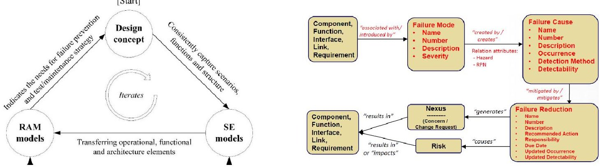
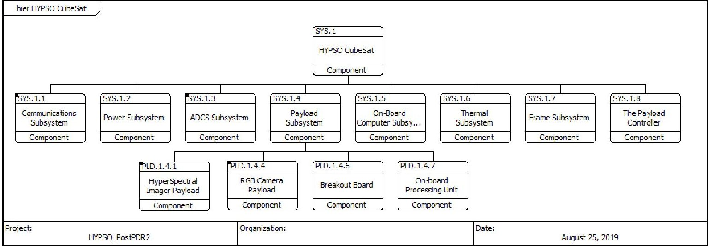
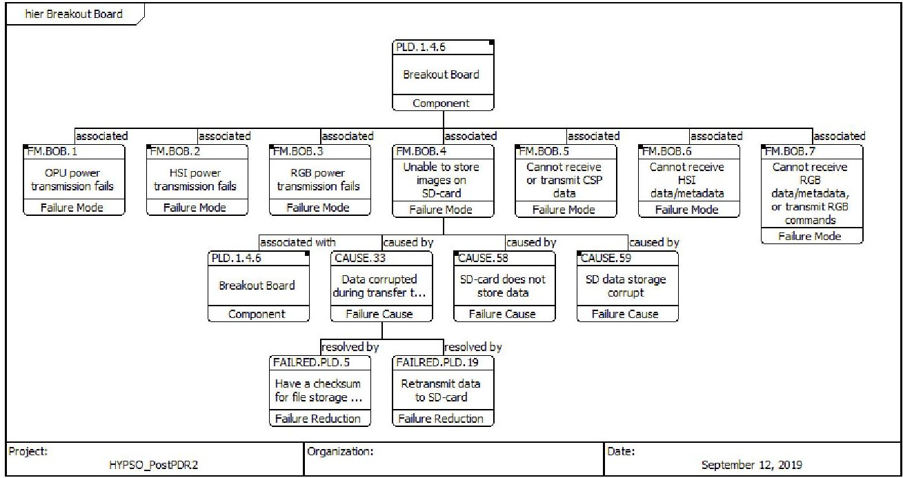
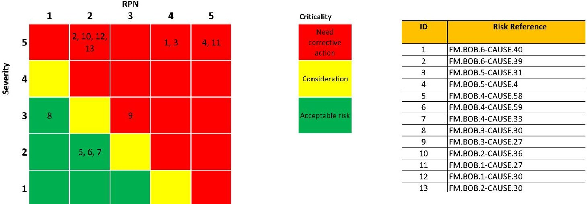

<!-- PDF_PAGE: 1 -->

Eds.: Azad M. Madni, Barry Boehm Daniel A. Erwin, Mahta Moghaddam, Michael Sievers, and Marilee J. Wheaton University of Southern California October 08 - 10, 2020

# Model-Based Systems Engineering for CubeSat FMECA

Evelyn Honoré-Livermore $ ^{a} $ $ ^{*} $ , Cecilia Haskins $ ^{a} $

$ ^{a} $Norwegian University of Science and Technology, 7491 Trondheim, Norway

## Abstract

The CubeSat standard has given universities, small companies, developing countries and others a new gateway to space exploration and space knowledge. Combined with shorter development time and Commercial-Off-The-Shelf components the cost has been lowered considerably. However, the combination of use of low-maturity components and inexperienced development teams results in a short lifetime and poor reliability for most CubeSats. The growth of Model-Based Systems Engineering (MBSE) supports reuse of design architectures in many industries and has lowered the costs of development and is gaining popularity in CubeSat teams. This paper demonstrates the application of reliability methods for implementing dependability analysis in MBSE and shows how this can benefit CubeSat teams struggling with limited personnel resources and low experience with space systems. Keywords: CubeSat, MBSE, model, FMEA, FMECA, risk assessment, systems engineering

## 1. Introduction

An increasing number of small satellite projects are conducted at universities, many of which do not have previous space hardware or software experience, or relevant curriculum to support the development. There are several reasons for this, such as better access to Commercial-Off-The-Shelf (COTS) components, cheaper launch opportunities, introductory courses from the National Aeronautics and Space Administration (NASA) and the European Space Agency (ESA), multiple papers and guidelines on how to develop and build small satellites, and an increasing demand from students for projects with hands-on experience (Langer et al. 2015; Langer and Bouwmeester 2016; Holtstiege and Bridges 2018; Luther 2016; Berthoud and Schenk 2016; Larsen and Nielsen 2011). Approximately 500 CubeSats are launched each year, where 40% of them are launched by universities (Kulu 2019). However, research shows that the lifetime of a CubeSat mission is short, with over 50% of the satellites DOA (Dead-on-Arrival) (Swartout 2019b).

Efforts to increase the reliability of CubeSats should increase the success rate of missions. Having a more systematic approach to reliability and verification and validation (V&V) of the satellite in early phases is strongly recommended by the literature, as well as learning from other CubeSat or small satellite projects through lessons learned databases or reuse of design. Universities without space experience may not be aware of these resources when

<!-- PDF_PAGE: 2 -->

they start a new project and therefore work in a more ad-hoc manner without the rigor and discipline space projects require (Swartout 2019a).

The use of Model-Based Systems Engineering (MBSE) has been promoted as an option to provide a development platform to perform different types of analyses to support the design of a small satellite. The International Council on Systems Engineering (INCOSE) Space Systems Working Group (SSWG) is developing a CubeSat Reference Model (CRM) for this purpose (Kaslow and Madni 2017; Kaslow et al. 2018). By using the CRM as a starting point of a CubeSat project, it is possible to take a more systematic approach to reliability and V&V, as the reference model also includes guidelines on how to develop the CubeSat mission itself and pointers on how to work with V&V.

This paper describes the use of MBSE within a RAM-SE framework for improved reliability analyses through the application of Failure Mode, Effects, and Criticality Analysis (FMECA) and subsequent risk management. The case study is the HYPer-spectral Smallsat for ocean Observation (HYPSO) satellite developed at the Norwegian University of Science and Technology (NTNU) (Honoré-Livermore 2019). The paper builds on the work submitted by three bachelor students in 2019 (Moen, Sjoeold, and Jordheim 2019).

## 2. Background

CubeSats are satellites built on the standard of a 10cmx10cmx10cm cube. While both NASA and ESA recommend following strict reliability and quality approaches for their long-term missions, these practices often are costly and not realistic for universities. Both organizations have recommendations for CubeSat builders, such as: derating for electrical components; basic Failure Detection, Isolation and Recovery (FDIR) analysis guidelines, applying FMECA to both the functional and physical product tree, and planning a high degree of early testing and verification of subsystems as well as end-to-end functional testing (TEB 2016; CalPoly Sat Program 2017; Capogna and Gupta 2018).

While traditional space projects conducted by NASA/ESA have access to a large knowledge base, experienced people, and may use 5-15 years in development, CubeSat projects approach dependability analysis pragmatically. Access to resources determine the level of analysis performed under conditions of limited knowledge, short schedules (2-3 years), and constrained budgets (Langer and Bouwmeester 2016; Faure, Tanaka, and Cho 2017). In addition, it is typical for CubeSats to use COTS components that have lower reliability, lower Technology Readiness Level (TRL), and less data available to perform the reliability analysis. Performing FMECA on CubeSats has been discussed (Menchinelli et al. 2018) where a practical approach to managing risk through FMECA is described.

CubeSat university projects face several challenges, most notably in access to knowledge and experienced project management, which often directly influence the success of any mission (Honoré-Livermore 2019; Cho 2016; Bouwmeester, Aalbers, and Ubbels 2008). University teams struggle with not having enough people, high turn-over due to graduation, lack of previous experience with project work and multidisciplinary project teams, and finally, but not the least, the challenge of building a satellite to work in space including the stringent requirements for documentation and evidence of space systems testing results.

NTNU has been working on small satellites and CubeSats for the past decades (Grande et al. 2017), but only recently with a mission based on oceanographic research with funding from the Research Council of Norway for both hardware and launch (Honoré-Livermore 2019). Previously, much of the work was conducted in a student organization or loosely associated with course assignments. Today, there is a team of 20-30 undergraduate and graduate students working on developing the HYPSO satellite. As a part of this activity, there is research in systems engineering and project management on how to improve the processes and methods applied in a university-based CubeSat project to increase the probability of mission success and the satisfaction of students and supervisors for their academic work.

## 3. MBSE for CubeSat

Systems Engineering (SE) emerged from the engineering of complex systems and is today an integral part of product development in many industries and fields of research. Applying Model-Based Systems Engineering (MBSE) as a part of the process is gaining popularity as the tools and methods mature and offer greater interoperability between disciplines in complex product development and lifecycle management. The MBSE approach proposes a unified model that can provide the different viewpoints necessary to perform analyses in all engineering domains (Piggott, Melanson, and Hartman 2007). The viewpoints offer a variety of relevant information and hide the non-relevant data

<!-- PDF_PAGE: 3 -->

to focus analysis depending on the need (Friedenthal 2016; Haberfellner et al. 2019). Recent advances in the realm of MBSE show increased interoperability between the system model, mechanical analysis tools, electrical analysis tools and other design tools (Brower et al. 2019; Madni and Sievers 2018).

Not all SE tools support the modeling elements needed for reliability analysis but most offer customization options. There are also other approaches to add the failure analysis elements to the model, such as using export/import functions between the system model and the safety model (Sango 2018). A failure mode is the absence of a function or a nondelivery of a need (Schindel 2010), and an added benefit of using MBSE is that the failure analysis can be performed at all phases of the development, as it is possible to identify failure modes at the top level of a system even before the system has been designed. Integrating failure analysis in MBSE can lower costs and time spent on dependability analysis through providing a more systematic framework and increase communication on safety analysis and design. Baklouti et al. discuss the state-of-the-art research of FMECA and MBSE in their paper (Baklouti et al. 2019) and describe a use-case for analysis of an Electro-Mechanical Actuator system. The study by Gregory et al. (2020) recommends the use of MBSE in Functional Avionics in spacecraft for Communication & Consistency and for Template Model Framework. NASA discusses the requirements for a framework for safety analysis of space missions in Evans et al. (2018). This is aligned with ESA and NASA's overall strategy to manage complex space missions with MBSE.

## 4. RAM and SE framework

Reliability, availability and maintainability (RAM) analysis aims at using engineering knowledge and techniques to control the risk of experiencing failures and to reduce engineering uncertainties (O'Connor & Kleyner, 2012). The main activities of RAM engineering cover (1) artificial experiments to test out the properties of a given system or parts, and (2) analysis and modelling techniques to reveal the cause-effect relationships between failure and specific conditions (Verma et al., 2015).

RAM analysis can be both qualitative and quantitative. Qualitative analysis is used to identify failure modes, mechanisms and causes (such as FMECA), and determine the possible maintenance and test strategies. As the design matures, these analyses may be iterated, and updated via communication and consultation with operators, manufacturers and designers.

Space system design is a concurrent and collaborative process, where different engineering teams are involved. The RAM issues must be considered as early as possible to support the decision making about redundancy, modularization, strategies for interventions and the like. However, the effect of RAM considerations is not easily observed by the whole engineering team, and RAM methods do not have a well-defined interface with other analyses carried out in parallel phases of the design. A similar problem is also identified by Barnard (2008) who points out that the overemphasis on probabilistic modelling frequently leads to misinterpretation of RAM analysis, which can lead to bad design or waste of engineering efforts. A recently proposed RAM-SE framework recommends several activities to integrate both the SE and RAM community as shown in Fig. 1(a) (Zhang et al. 2018).

Fig. 1 (a). Conceptual RAM-SE (Zhang et al. 2018). (b) Classes used for modelling from (Kratzke 2018). The classes in black are the existing ones in the tool, while the classes in red are the ones that needed to be added. Some of the attributes given in red already existed, while others had to be added

<!-- PDF_PAGE: 4 -->

Estimation of the reliability of the components and in-house developed software is done by the team when better sources of data are not available. The results of the analysis are thus dependent on the expertise and configuration of the team and may not be valid. However, the exercise of performing the analysis and the ranking of critical failure modes and causes are valuable because they create awareness in the team of potential issues in the design. In addition, the cognitive process of thinking about dependability and reliability can lead to better design processes and decisions in the future.

An FMECA analysis can be categorized broadly into two different types based on the approach: top-down functional FMECA, or bottom-up component FMECA - given from MIL-STD-1629A (Department of Defense 1980). Depending on the phase of the project and the maturity of design and other information available, one is more appropriate than the other. Using a model-based approach allows for a unification of these types.

When the system is continuously modeled from the operational, functional, logical and physical viewpoint, it is possible to combine the different types of analysis and aggregate the data. The operational viewpoint is implemented through the functional design which in turn is allocated onto logical units that are finally realized in the physical design. Depending on the tools used for modeling, real data from testing and verification can also be introduced and give a fifth viewpoint and source of information for the dependability analysis (Schindel 2010; Bürger 2019). Table 1 indicates benefits of integrating RAM and SE models.

Table 1 Advancements for RAM methods in SE context (Zhang et al. 2018)

<table border="1"><tr><td>Methods</td><td>Objectives</td><td>Advancements of systems thinking</td></tr><tr><td>FMECA</td><td>-Uses a basis for detailed RAM analysis and maintenance optimization and planning
-Document the effect of failure on system</td><td>-Systematically identify all operational modes and functions attached to each potential failure modes
-Carry out an extended/revised type of FMECA that is able to involve dynamic aspects of key scenarios, see also the discussion in (Issad et al.,2017)</td></tr></table>

Incorporating RAMS aspects as early as possible gives several advantages in form of engineering efforts and budgets in many industry sectors such as nuclear, satellite and aviation, where the analysis is further amplified by the complexity of design solutions. (Zhang et al. 2018)

## 5. Modeling and FMECA implementation

The SE tool used to implement FMECA in this research did not have the necessary modeling elements natively. The classes that had to be added to the modeling tool were based on a presentation given by Kratzke (2018) shown in Fig. 1(b). These classes were added to represent failure mode, failure cause, failure reduction, and the relationships between these and with the existing classes. The modeling and FMECA was performed on the NTNU HYPSO mission. The CubeSat consists of multiple subsystems, shown in Fig. 2. The payload (PLD) subsystem interacts with the subject of interest and is the most critical part of the space segment. The payload consists of several subsystems: HyperSpectral Imager (HSI), RGB camera (RGB), On-board Processing Unit (OPU) and Break-Out Board (BOB).

System to be analyzed: HYPSO CubeSat mission. The mission of the satellite is defined by a mission statement and mission success criteria. These are the most important requirements of the mission, and therefore, the FMECA analysis chose to focus on these. The system was modelled in a MBSE tool, with requirements, component trees, functional trees and chains, and operational user scenarios. Since the HYPSO team is tasked with developing the payload systems and ground segment while the other subsystems are COTS components with a higher TRL, the analysis was limited to the space segment payload systems and the ground segment.

FMECA workshops: FMECA workshops were conducted during which the HYPSO team members were asked to identify the operational modes for each of the subsystems, and which functions were necessary for the operational modes that would then be used as a basis to identify the failure modes. Using the mission success criteria, which are reflected in the concept of operations of the system, the FMECA focused on the critical parts of the performance of the system.

<!-- PDF_PAGE: 5 -->

Failure mode assessment: The assessment followed a procedure tailored from the aforementioned Mil-Std-1629A (Moen et al. 2019). Each failure mode is assessed with respect to severity (scale 1-5, where 1 is negligible and 5 is absence of function)), and occurrence (scale 1-5, where 1 hardly ever occurs, and 5 is probable). This analysis provides the criticality number, given by the multiplication of severity and occurrence. Next, the failure modes are assessed according to their detectability, (scale 1-10). A high detectability is given index 1, meaning that it is easy to identify the failure - i.e. that only one type of failure can give the effect that is observed. For many CubeSats, having a high level of detectability is more important than avoiding all failure modes, especially if there is a method to reset or remove the failure. Identifying the failure mode can also allow for redesign of the system in the next satellite. The attributes are evaluated and added to the model and used to calculate the Risk Priority Number (RPN), which is given by the multiplication of severity, occurrence and detectability.

Fig. 2. The HYPSO CubeSat physical hierarchial structure in MBSE.

Fig. 3. BOB with its failure modes displayed in a hierarchy diagram. One of the failure modes has been expanded to show the failure causes and reduction methods.

<!-- PDF_PAGE: 6 -->

Fig. 4. Risk matrix for BOB failure modes. The RPN is referenced to a scale of 100, and then into ranges of 20 to give the resulting 1-5 indexing.

A total of 69 failure modes, 65 causes and 45 failure reduction actions were identified and modelled. The PLD subsystem BOB is used here as an example of the actual implementation, see Fig. 3 and Fig. 4. The severity, occurrence and detectability attributes were determined based on the workshop input, resulting in ranked failure modes. These attributes are assumed to be evaluated for nominal operations, not for ground testing or integration.

The FMECA model and attributes are used to generate a risk matrix composed of RPN and severity. The risk matrix includes severity as a high RPN number may not indicate a true risk to the project. The risk matrices are given per subsystem to make it simpler for the team to use. The critical failure causes and their corresponding reduction methods should then be prioritized in project work.

## 6. Discussion

The process identified 13 risks for BOB. Of these, 8 were of severity rating 5. The risk matrix in Fig.4 was configured such that all causes with severity rating 5 would need corrective action, as this indicates a non-fulfillment of minimum mission success criteria. Prior to the workshop and modeling, only the loss of power transmission had been considered as a risk in design discussions. Based on this analysis, the BOB component has been updated to reduce the number of critical risks through implementation of failure reduction measures. This process agrees with the RAM-SE process proposed in Fig. 1(a) where the design concept is modeled in MBSE and the subsequent RAM analysis is integrated in the model.

The modeling tool supports the inclusion of actors (humans) and their influence on the system through e.g. use cases, but this was not considered in the modeling. Human error can be a considerable cause of failure modes to the system. The focus on mission success criteria when analyzing the system also left out an important part of the CubeSat development lifecycle: test and verification. Use cases can be developed for test activities such as shock or vibration, which carry high risk of damage to the device-under-test (DUT) and personnel. Including these use cases for future CubeSat modeling would address additional risk areas. Additionally, the choice of perspective when modeling and analyzing did not support evaluation of simultaneous failure. A Fault Tree Analysis (FTA) on a functional level would increase the chance of discovering if two faults would give a severe impact that they individually would not in the FMECA. This is supported in the class relationship implemented according to Fig. 1(b). Limited knowledge about the reliability of low-TRL components lowers the validity of the analysis. It is largely dependent on the people attending the workshop and their ability to properly assess the severity, occurrence and detectability of individual events. Modeling facilitates visualization of the relationships between the failure modes, the components, the functions and the overall success criteria.

For CubeSat teams the starting point of a reference model such as the CRM provided by INCOSE SSWG lessens the burden on the faculty to have prior experience with satellite systems and focuses the team work on specific subsystems. The university teams can then populate the model with the known information such as regulations,

<!-- PDF_PAGE: 7 -->

existing ground systems, communication capabilities and operational aspects specific to the organization. Re-use of a model with failure analysis built-in from the previous mission or other teams' missions will reduce the team resources needed to perform dependability analysis. An added benefit from using MBSE is the potential of automated analyses on the same model. Each element in a model will have attributes that can be analyzed automatically through scripts or functions in the tool. For dependability analysis, it is then a matter of checking what the change of one element will have on the overall dependability of a system.

Swartout (2019a) highlights the need for "streamlined practices, experientially developed" and recommends increasing the time spent on integration and test, also supported in (Faure et al. 2017). Designing the system in MBSE through the application of a CRM and incorporated dependability analysis could be a part of the "streamlined practices" to improve the design maturity faster, thereby allowing more time to perform integration and test.

## 7. Conclusion

Developing and building complex systems is a challenge, and while CubeSats are small, they are still complex systems requiring a systematic engineering approach. Statistics show that there are still many CubeSat missions that fail, mostly because of low dependability. However, performing the full dependability and quality management that NASA and ESA recommend is not feasible for small university teams lacking both people, money, and time. A pragmatic approach to dependability analysis through the usage of MBSE systems that can support the FMECA analysis offers promise to increase dependability for university CubeSat teams.

This paper has shown how the framework suggested by Kratzke (2018) can be applied to an existing CubeSat MBSE model, and support the subsequent risk management from the FMECA workshops. The FMECA workshop and modeling enabled the HYPSO team to understand which failure modes are associated with different subsystems and how these affect the overall success criteria for the mission. It also established a priority for completing different failure reduction activities and highlighting critical interfaces and components/functions. Using visualization through the operational scenarios modeling and focusing the effort on making the mission a success has proven to be of great value to the CubeSat team that did not have previous experience with dependability analysis. It also enables keeping the information connected and ensures traceability for future design decisions.

The results agree with the suggestions of Gregory et al. (2020); MBSE has been used as a tool to improve Communication and Consistency of the RAM (project) information, and it can be re-used in future spacecraft building on the same spacecraft subsystem structure with little rework necessary. The framework could be a part of the university MBSE template or used to extend the CRM.

Incorporating the CubeSat Reference Model with FMECA analysis from an operational or functional top-down view, or component-based bottom-up view has required less effort than starting from scratch. Furthermore, the analysis could be performed at different phases of the development, as the failure modes are relevant on higher operational levels as well as lower functional or logical levels. Re-use and continuous development of the systems is facilitated using MBSE as suggested by Madni and Sievers (2018).

For this preliminary work, the risk assessment was done in a separate tool from the MBSE tool because the research team uses a project management suite. As future work, this could be automated and linked to improve workflow. Additionally, future work should explore how the lessons learned and failure analysis from multiple teams could be aggregated into the reference model, highlighting typical failure modes that are associated with certain interfaces or types of subsystems.

## Acknowledgements

This work is supported by the Norwegian Research Council (Grant No. 270959), the Norwegian Space Agency, and the Centre of Autonomous Marine Operations and Systems (NTNU AMOS).

## References

Baklouti, A., Nguyen, N., Mhenni, F., Choley, J., Mlika, A., 2019. "Improved Safety Analysis Integration in a Systems Engineering Approach", Applied Sciences, 9.

Barnard, R. W. A. (2008). What Is Wrong with Reliability Engineering? Paper presented at the Proceedings of the 18th Annual INCOSE International Symposium, Utrecht, the Netherlands.

<!-- PDF_PAGE: 8 -->

Berthoud, L, Schenk, M., 2016. "How to Set Up a CubeSat Project - Preliminary Survey Results." In 30th Annual AIAA/USU Conference on Small Satellites. Logan, UT.

Bouwmeester, J., Aalbers, G.T., Ubbels, W.J., 2008. "Preliminary Mission Results and Project Evaluation of the Delfi-C3 Nano-Satellite." In 4S Symposium Small Satellites Systems and Services. Rhodes, Greece

Brower, E. W., Delp, C., Karban, R., Piette, M., Gomes, I., Wyk, E., 2019. "OpenCAE Case Study: Europa Lander Concept." In INCOSE International Workshop. Torrance, CA.

Bürger, E.E., 2019. "A conceptual MBSE framework for satellite AIT planning". Doctoral thesis. Instituto Nacional de Pesquisas Espaciais.

Capogna, F., Gupta, V., 2018. "How to increase CubeSat reliability!" ESA (TEC-QCD).

Cho, M., Mazui, H., 2016. "Best practices for successful lean satellite projects." In 4th UNISEC Global Meeting.

Defense, Department of. 1980. "MIL-STD-1629A Procedures for performing a Failure Mode, Effects and Criticality Analysis." Washington, DC.

Evans, J., Groen, F. J., Wang, L., Okon, S., Austin, R., Witulski, A., Mahadevan, N., Cornford, S., Feather, M., Lindsey, N., 2018. "Towards a framework for reliability and safety analysis of complex space missions", International Journal of Human Factors Modelling and Simulation, 6: 203.

Faure, P., Tanaka, A., Cho, M., 2017. "Toward lean satellites reliability improvement using HORYU-IV project as case study", Acta Astronautica, 133:33-49.

Department of The Air Force. 1988. "MIL-STD-1543B Reliability program requirements for Space and Launch Vehicles." Washington, DC.

Grande, J., Birkeland, R., Gjersvik, A., Mathisen, S., Stausland, C., 2017. "Norwegian student satellite program - lessons learned." In 68th IAC.

Gregory, J., Berthoud, L., Tryfonas, T., Rossignol, A., Faure, L., 2020 "The long and winding road: MBSE adoption for functional avionics of spacecraft", Journal of Systems and Software, 160, art. no. 110453

Haberfellner, R., de Weck, O., Fricke, E., Vossner, S., 2019. "The Systems Engineering Basics in Our Systems Engineering Concept." in, Systems Engineering: Fundamentals and Applications (Springer International Publishing: Cham).

Holtstiege, J., Bridges, C., 2018. Lean satellite design for amateur communications payload in the ESA ESEO mission.

Honoré-Livermore, E., 2019. "CubeSats in University: Using Systems Engineering Tools to Improve Reviews and Knowledge Management", Procedia Computer Science, 153: 63-70.

Issad, M., Kloul, L., & Rauzy, A. (2017). A scenario-based FMEA method and its evaluation in a railway context. Paper presented at the Reliability and Maintainability Symposium (RAMS).

Kaslow, D., Ayres, B., Cahill, P., Hart, L., Levi, A., Croney, C., 2018. "Developing an MBSE CubeSat Reference Model - Interim Status #4." In 2018 AIAA SPACE and Astronautics Forum and Exposition. Orlando, FL.

Kaslow, D., Madni, A., 2017. "Validation and Verification of MBSE-compliant CubeSat Reference Model." In Conference on Systems Engineering Research, edited by Barry Boehm Azad M. Madni. Redondo Beach, CA, USA.

Kratzke, R., 2018. "Failure Modes Effects Analysis in MBSE." In INCOSE Texas Gulf Coast Chapter. Houston, TX.

Kulu, E., 2019. "NanoSats database", Accessed June 2019. https://www.nanosats.eu/.

Langer, M., Olthoff, C., Harder, J., Fuchs, C., Dziura, M., Hoehn, A., Walter, U., 2015. "Results and lessons learned from the CubeSat mission First-MOVE." In Small Satellite Missions for Earth Observation, 10th International Symposium, IAA. Berlin.

Langer, M., Bouwmeester, J.. 2016. "Reliability of CubeSats - Statistical Data, Developers' Beliefs and the Way Forward." In AIAA/USU Conference on Small Satellites.

Larsen, J., Nielsen, J.D., 2011. "Development of cubesats in an educational context." In International Conference on Recent Advances in Space Technologies, 777-782. Istanbul, Turkey: IEEE.

Luther, S. T., 2016. "SysML Based CubeSat Model Design and Integration with the Horizon Simulation Framework", Master of Science, California Polytechnic State University.

Madni, A., Sievers, M., 2018. "Model-Based Systems Engineering: Motivation, Current Status, and Needed Advances." In Disciplinary Convergence in Systems Engineering Research. Springer Intenrational Publishing.

Menchinelli, A., Ingiosi, F., Pamphili, L., Marzioli, P., Patriarca, R., Costantino, F., Piergentili, F., 2018. "A Reliability Engineering Approach for Managing Risks in CubeSats", Aerospace, 5: 121.

Moen, A. K. A, Sjøvold, E., Jordheim, O.. 2019. "Implementation of FMECA in Small Satellite Development", Norwegian University of Science and Technology. Bachelor thesis.

O'Connor, P., & Kleyner, A. (2012). Practical Reliability Engineering, 5th Edition. Hoboken, NJ: John Wiley & Sons, Inc.

Piggott, S, Melanson, P., Hartman, L.. 2007. "A Vision for Super-Model Driven Systems Engineering", INCOSE International Symposium, 17: 52-65. doi:10.1002/j.2334-5837.2007.tb02857.x

Requirements and Standards Division, ESA-ESTEC. 2009. "Space product assurance: Dependability, FME(C)A." Noordwijk, NL.

Friedenthal, S., Oster. C., 2016. "Applying SysML and a Model-Based Systems Engineering Approach to a Small Satellite Design." in Richard Curran John Hsu (ed.), Advances in Systems Engineering (American Institute of Aeronautics and Astronautics: Reston, Virginia, USA).

Sango, M., 2018. "Model Based Safety Analysis Thanks to the Bridge Between Capella and Safety Architect." Accessed August 2019 https://www.youtube.com/watch?v=-NtUKdaUGdc. YouTube.

Schindel, W. D., 2010. "Failure Risk Analysis: Insights from MBSE." INCOSE International Symposium, 20: 1227-1239.

SEMATECH. 1992. "FMEA: A Guide for Continuous Improvement for the Semiconductor Equipment Industry."

Swartout, M., 2019a. "CubeSat Mission Success: Are We Getting Better?" In 2019 CubeSat Developers' Workshop. San Luis Opisbo, CA.

Swartout, M. 2019b. "Mission Success for Universities and Professional Programs", Accessed September 2019. https://sites.google.com/a/slu.edu/swartout/home/cubesat-database/repeat-success.

TEB. 2016. "Product and Quality Assurance Requirements for IOD CubeSat Projects. TEC-SY/129/2013/SPD/RW." Noordwijk, NL.

Verma, A. K., Ajit, S., & Karanki, D. R. (2015). Reliability and Safety Engineering. United Kingdom: Springer London Ltd.

Zhang, J., Liu, Y., Lundteigen, M.A., Haskins, C. (2018) The Application of Systems Engineering for Framing Reliability, Availability and Maintainability in Subsea Design. Systems Engineering. DOI: 10.1002/sys.21462