<!-- PDF_PAGE: 1 -->

## Citation (Version of Record):

Citation (Version of Record): Timperley, L. R., & Berthoud, L. (2022). Reliability Analysis and Failure Mitigation Strategies for the PROVE Pathfinder CubeSat Payload. In 2022 IEEE Aerospace Conference Proceedings (IEEE Aerospace Conference Proceedings; Vol. 2022-March). Institute of Electrical and Electronics Engineers (IEEE). https://doi.org/10.1109/AERO53065.2022.9843234

Version: Peer reviewed version

Link to published version (if available): 10.1109/AERO53065.2022.9843234

Link to publication record on the Bristol Research Portal: Access record including PDF (if available)

## University of Bristol-Bristol Research Portal

This is the accepted author manuscript (AAM). The final published version (version of record) is available online via IEEE at https://ieeexplore.ieee.org/document/9843234. Please refer to any applicable terms of use of the publisher.

## Citing this paper

Guidance on citing material from the Bristol Research Portal is available under 'Manuscripts and Citations' in the Terms of Use (linked below)

## Terms of Use

Full Terms of Use for the Bristol Research Portal are available online: https://www.bristol.ac.uk/research-enterprise-innovation/research-policy/pure/brp-terms/

## Has this research benefited you?

Let us know how reading this research here has been meaningful to you by sharing your story at https://forms.office.com/e/ffL5CZ0fGT

<!-- PDF_PAGE: 2 -->

# Reliability Analysis and Failure Mitigation Strategies for the PROVE Pathfinder CubeSat Payload

Louis Timperley

University of Bristol

Queen's Building, University Walk,

Bristol, BS81TR

It17550@bristol.ac.uk

Lucy Berthoud

University of Bristol

Queen's Building, University Walk,

Bristol, BS81TR

Lucy.Berthoud@bristol.ac.uk

Abstract—The University of Bristol is developing the PROVE (Pointable Radiometer for Observation of Volcanic Emissions) Pathfinder payload, a part of a 6U CubeSat hoped to launch in the next year. PROVE Pathfinder's aim is to image volcanic ash plumes from several different locations and aspects along its orbital trajectory. These images will be used to gain more knowledge of the ash cloud, useful in protecting civil aviation in the case of large-scale volcanic eruptions with ash associated. As CubeSats have historically suffered from a high failure rate, a thorough understanding of the reliability of the PROVE Pathfinder system is essential to mitigating the mission risk. This paper presents the analysis, results and recommended failure mitigation strategies from a reliability study carried out on the PROVE Pathfinder payload system. Several different analysis approaches were used to study the reliability of the system. These included Failure Mode Effects and Criticality Analysis (FMECA), Fault Tree Analysis (FTA), Monte Carlo simulation and a reliability model of PROVE Pathfinder devised using Model Based Systems Engineering (MBSE). Various estimates of system reliability were produced, with a final figure of 80% reliability. This estimate took account of the numerous mitigation strategies identified during the study, including cold redundancy in payload controllers and aluminum radiation shielding. While some discrepancies in qualitative reliability estimates were found, the insight gained during the study greatly assisted with identifying mitigation strategies and generally improved system reliability. A framework for reliability analysis approaches and mitigation strategy identification for general use on spacecraft systems is proposed, with opportunity for future development.

## TABLE OF CONTENTS

1. INTRODUCTION...1

2. METHODOLOGY ...2

3. RESULTS ...7

4. DISCUSSION ...12

5. FUTURE WORK...13

6. CONCLUSION ...14

REFERENCES ...17

## 1. INTRODUCTION

This paper aimed to improve the reliability of the PROVE (Pointable Radiometer for Observation of Volcanic Emissions) Pathfinder CubeSat payload, which is currently under development at the University of Bristol. 40% of all CubeSat missions that have so far been concluded have failed before their planned mission duration was completed, while a further 21% [1] were dead on arrival. To assess the risks for this payload, analysis and development needed to be performed on the reliability of the PROVE Pathfinder system, then the impact of this development evaluated. These findings assisted Prognostics and Health Management activities by providing estimates of the useful lifetime of the payload, in the form of mean time to failure figures (MTTF). Reliability analysis was made particularly difficult by the use of Commercial Off The Shelf (COTS) components across the system, as is common in university CubeSat projects. These components are sometimes lacking in the usual quality and reliability data provided for components used by full scale spacecraft missions.

## Background

Following the 2010 eruption of the Icelandic volcano, Eyjafjallajokull, aero engine manufacturers have begun to certify their engines to tolerate ingestion of small amounts of volcanic ash, up to 2mg/m3. The aim of this is to allow aircraft to continue to operate during ash cloud events. This introduces the requirement for global, near real-time monitoring of ash clouds and their densities. In response, the University of Bristol is developing PROVE Pathfinder, a payload expected to launch as part of a 6U CubeSat in 2022, to meet this new requirement for the civil aviation industry.

The CubeSat standard was first introduced in 1999 by Bob Twiggs of Stanford University and Jordi Puig-Suari of California Polytechnic State University, to allow students to develop their own missions, using a standardized spacecraft architecture [2]. As a result of this standardization, there are many commercially available components that can be easily integrated with a CubeSat design. The standard is based around cubes (U) of dimensions 10x10x10cm, that may be grouped together to produce the necessary spacecraft volume.

<!-- PDF_PAGE: 3 -->

Because of their low development cost and time, there are now over 2,000 CubeSats that have either been launched or are planned to launch in the near future [3]. Several surveys have been conducted studying the reliability of CubeSats, for example studying the failures of a catalogue of small satellites[4], or specific types of failure commonly experienced by CubeSats [5]. These studies were useful while carrying out the failure analysis sections of this study, by identifying potential failure modes.

PROVE pathfinder's mission is to image volcanic ash clouds thus carries three cameras: an uncooled microbolometer, operating in the infrared spectrum, a high-resolution narrow field of view visual camera, and a wide field of view visual camera. The PROVE payload takes up a volume of 2U on the spacecraft bus.

## Failure Analysis Techniques

The Payload will be controlled by its own onboard computer (OBC), a BeagleBone Black, henceforth called the controller, which will then provide the data interface with the spacecraft bus OBC. A detailed system block diagram for PROVE Pathfinder may be found in appendix A.

There have been several different techniques of both fault analysis and robustness applied to CubeSat design, many of which are described for general space missions [6], [7]. While analyzing possible failure modes, there are two main approaches. Fault Tree Analysis (FTA) is a top-down approach, that starts with a total system failure and works down, exploring each possible cause until the component level is reached. This is useful for analyzing the combined effects of faults, but poor at illuminating all their possible causes. Failure Mode Effects and Criticality Analysis (FMECA) is a bottom-up approach, that starts with each component and explores how the effects of a failure propagate through a system. This technique is very effective at describing most of the causes of faults in a system but struggles to explore how their effects may combine.

Table one and two of [8] provide details of such a process, studying the causes and effects of failures of each component. Though this has been applied specifically to a deployable antenna, the technique illustrated was easily adapted for use on PROVE Pathfinder. [9],[10] propose a holistic approach to applying FMEA/FMECA to Cubesats, that may be applied throughout the design phases and [10] provides Stellar-Population Evolution on CubeSats (SPEC) as a case study. Use of FTA may be seen in [11] and [12], however in [12] this was only applied after the CubeSat, e-st@r-2, experienced an anomaly. It is common to jointly apply both FTA and FMECA to various systems, given that each one is effective at bolstering the other one's weaknesses. Previous work describes an elegant way of implementing these two methodologies to bring the greatest depth to the fault analysis of a solar array deployment mechanism [13], while other authors propose a more generalized combined method [14].

It was decided to use the latter approach for this project's failure analysis stages, as it would both provide sufficient detail and be flexible enough to be applied to a CubeSat project.

## Model Based Systems Engineering

Model Based Systems Engineering (MBSE) techniques were also implemented in the research. This methodology is a formal application of modelling to system engineering. The system model may then be used as the central method of communication between systems engineers, customers and even stake-holders [15]. Further explanation of how MBSE is used is given at the end of section 2. To be able to effectively model the behavior of different failure modes of PROVE Pathfinder, a dynamic model needed to be produced, relying heavily on state machines to fully capture the aspects of the payload that were to be investigated. Previous work at the University of Bristol proposes a model of a spacecraft data handling unit that was used to allow early validation of the system, based on dynamic modelling that would be in line with the needs for the PROVE Pathfinder MBSE model [16]. The model produced for PROVE Pathfinder not only allowed evaluation of the choice of mitigation strategies, but also formed a basis for the wider project team to communicate ideas and rapidly test design changes, much the same as MBSE methodology is typically used as mentioned above.

The of aim this research was to increase the fault tolerance of PROVE Pathfinder, so improving its robustness and maximizing the chance of a successful mission. The objectives were to determine and apply suitable techniques for component fault analysis to be used on PROVE pathfinder, develop these findings for analysis of the combination of faults across the PROVE Pathfinder system, identify areas that would most benefit from the introduction of redundancy and other mitigation approaches, finally to develop a model of the PROVE Pathfinder system to evaluate the chosen mitigation approaches.

## 2. METHODOLOGY

In this section the process undertaken for the different analyses of PROVE Pathfinder's reliability is discussed. Firstly, the definition of the FMECA is presented, followed by collection of Mean Time to Failure (MTTF) figures for selected components, fault tree analysis and finally system modelling and the application of MBSE to analyze the reliability of PROVE Pathfinder.

## Failure Mode Effects and Criticality Analysis

The main input to this process was a comprehensive Product Breakdown Structure (PBS), defining each of the components of the system, to as high a level of detail as possible. Once every system component was defined, the methodology followed the 7 steps below.

<!-- PDF_PAGE: 4 -->

1. Define Failure Modes and Causes-Firstly every conceivable way in which a component might fail during the mission, along with the cause, was identified. The difference between failure mode and cause of failure is commonly poorly identified, however in this instance "failure mode" is defined specifically as the resulting state that the component enters after failing and the "cause of failure" is defined as is.

2. Explore Effects of Failures—Next the effects of each failure mode was tracked at each of the component level, subsystem level and system level, noting loss of functionality at each. For example, the effect of the loss of an instrument power bus connection would have a component level effect of no energy transfer, then subsystem level of no power delivery to the camera. The final system effect would be no data retrieval from that camera.

3. Assess Criticality Levels—To reduce the amount of data necessary to complete the FMECA, criticality was assessed in two stages. To begin with, every failure mode was assigned a level of "severity", then a level of "likelihood". Both levels were judged as rankings out of ten, and their product determined the level of criticality. The categorization may be seen below.

Table 1: Showing the categorization of failure mode likelihood levels

<table border="1"><tr><td>Likelihood Ranking</td><td>Explanation</td></tr><tr><td>1 to 2</td><td>Extremely Unlikely</td></tr><tr><td>3 to 4</td><td>Unlikely During Mission Duration</td></tr><tr><td>5 to 6</td><td>Rare Occurrence</td></tr><tr><td>7 to 9</td><td>Likely Occurrence</td></tr><tr><td>10</td><td>Regular Occurrence</td></tr></table>

Table 2: Showing the categorization of failure mode severity levels

<table border="1"><tr><td>Severity Ranking</td><td>Explanation</td></tr><tr><td>1 to 2</td><td>Low Impact</td></tr><tr><td>3 to 4</td><td>Minor Impact/ Some Loss of Functionality</td></tr><tr><td>5 to 6</td><td>Major Impact/ Significant Reduction of Functionality</td></tr><tr><td>7 to 9</td><td>Catastrophic/ Loss of PROVE (Total System Loss)</td></tr><tr><td>10</td><td>Loss of Spacecraft</td></tr></table>

While this process did not provide an accurate figure of the likelihood of a failure occurring or its true criticality, it allowed a comparison between the failure modes to illustrate which were more critical than others. Hence the highest priority failure modes were highlighted and any component with a failure mode scoring above fifty was carried forward to the second stage. This is where quantitative figures of MTTF and other available data were used to produce more rigorously estimated figures of criticality. A range of sources

were used to obtain these values, and where possible multiple sources were considered for each component.

## 4. Determine Mean Time to Failure Figures for Selected Components

Controller Microprocessor—MIL-HDBK-217F [17] was the initial reference for MTTF figures related to the controller Microprocessor. Published in 1991, it has become a staple in reliability studies with many types of components included in the document. The process used by MIL-HDBK-217F to arrive at MTTF's for components relies heavily on empirical relationships built up from historical data. This means that estimates are strongly influenced by behaviour of components in production 30 years ago, so require thorough verification. The results of the process may be seen in Table 4.

In order to verify this estimate, another MTTF figure was developed using Texas Instruments (TI) reliability database search [18]. TI has published the results of reliability testing on the microprocessor used by the BeagleBone Black controllers as shown in Table 4.

By using the Arrhenius equation, defined in Equation 1 [19], a new MTTF for the correct operational temperature was determined

$$
A _ {T} = \exp \left[ \frac {- E _ {a a}}{k} \left(\frac {1}{T _ {1}} - \frac {1}{T _ {2}}\right) \right]
$$

Where $ A_{T} $ is the acceleration factor, $ E_{aa} $ is the component activation energy, k Boltzmann's constant and $ T_{1} $ and $ T_{2} $ were the temperature of the test and of the operating system respectively. Then by following a similar method to MILHDBK-217F, environment factors of 0.5 and 12 were applied for the time on orbit and launch to arrive at an environment corrected MTTF for the component in operation.

CAN Driver—Another component on the BeagleBone Controller selected for further study was the CANbus interface driver chip. As for the microprocessor, TI had already done reliability testing on this component and the data may be seen in table 4. From this an MTTF was calculated in the same way as done for the microprocessor.

Power Management Chip—Next the Power management chip MTTF failure was determined again using data from TI reliability testing as shown in Table 4, and the MTTF was calculated in the same way.

Ethernet Interface—The next component on the BeagleBone black considered was the Ethernet interface chip. Using more TI reliability testing data shown in Table 4, the MTTF was calculated using the same method.

Controller Memory—The final component on the BeagleBone black considered was the nand based 4GB flash

<!-- PDF_PAGE: 5 -->

memory onboard the BeagleBone controllers (an embedded multi-media card or eMMC). The limitation on this component's life span was judged to be the number of program/erase (PE) cycles the device can last for, known as memory endurance. The type of nand flash used was Multi Layered Cell (MLC).

Firstly, the cell endurance was used to calculate the total amount of data the unit could store over its lifetime, then using an estimate of writing regime, the time taken to reach this threshold could be calculated. The component datasheet [20] was used to source the cell endurance for this calculation.

Thermal Infrared Camera—The manufacturer of the Thermal Infrared (TIR) Camera used in the PROVE Pathfinder system had already studied the reliability of the camera, using data from field units and Telcordia Issue 2 (SR- 332) [21]. The MTTF for the thermal infrared camera was taken from the manufacturers testing results as the MTTF for the closest corresponding application and temperature at 26.1 years. Accounting for the launch and space environment in the same way as previously, the final MTTF for the camera was determined as 52.2 years

## Radiation Considerations and the Space Environment Information System

Radiation damage to critical system electronics was a significant risk for the PROVE pathfinder mission. All the electronics used were COTS components, in line with the approach taken for the project, therefore not radiation hardened. As a result, every component with high criticality failure modes already considered above was expected to have secondary failure modes due to ionising radiation. MILHDBK-217F specifically states this is not considered in its results and none of the other reliability tests used here included any radiation testing.

There were two ways in which ionising radiation was expected to damage electronics. Firstly, Total Ionising Dose (TID) failure, which is a long term, wear out, failure mode due to protons and electrons ionising increasing portions of the device material, eventually leading to breakdown of component function. The second mechanism is Single Event Effects (SEE), caused by singular high energy particles which appear in two types, firstly Single Event Upsets (SEU), which are errors generated in software due to ionising radiation. Secondly, Single Event Latch-ups (SEL) are hardware errors, whereby a radiation particle has ionised a path through a device, thus generating a "parasitic structure", providing an opportunity for shorts to develop on the affected device.

[22] and [23] are databases compiled by NASA and ESA respectively detailing radiation effects on electronics. These databases contain reports of TID MTTF's for components

and event rates for SEE's, which would be extremely useful in understanding the effect of radiation on the reliability of a spacecraft. However, this data was only available for certain components, all of which being space-grade components used by full scale spacecraft missions, thus proved to be of little use for the PROVE Pathfinder system. As a result, these same figures needed to be determined by other means, as explored in the following sections.

Total Ionizing Dose—TID failure was considered using the SPace ENVironment Information System (SPENVIS)[24]. SPENVIS is a web-based interface to models of the space environment to allow study of many of its effects on a spacecraft, in this case radiation. Fig.1 shows the workflow that was used to consider TID radiation effects on system electronics. AP-8 and AE-9 are proton and electron flux models respectively.

The orbit used as the input to this process had a 500km altitude at 92° inclination, with an on-orbit duration of 18 months, allowing for six months of commissioning time and mission duration of one year. Aluminium shielding was selected as the best mitigation strategy for TID failure, as it was already to be used for the main structure of the payload and the mission duration was short. Therefore, this approach would be able to effectively mitigate the risk while, avoiding unnecessary complication of the design. After following the process as defined in Fig.1 for TID, doses were calculated for electronics with varying amounts of aluminium shielding shown in section 3, Fig.3.

To be able to calculate an MTTF for TID failure an upper limit on allowable radiation dose had to be selected, which for commercial CMOS devices was taken as 3kRAD according to [25]. A RAD is equivalent to 0.0001J/kg (energy of radiation absorbed over mass of device material) therefore is normalized against device mass and so may be applied in the same way to every semiconductor device considered, regardless of varying chip size.

Shielding Thickness Trade-off At this point it was clear that a trade-off was required to select an appropriate thickness of shielding to protect the system electronics. The objectives this trade-off was based on were: minimize likelihood of failure due to TID, minimize system mass and minimize system volume. To calculate the likelihood of TID failure of a component, a failure rate also needed to be decided. TID is a wear out failure, meaning its probability rises with time. A Weibull distribution was chosen to model this, which could be tuned to capture a failure rate that increases with time.

<!-- PDF_PAGE: 6 -->

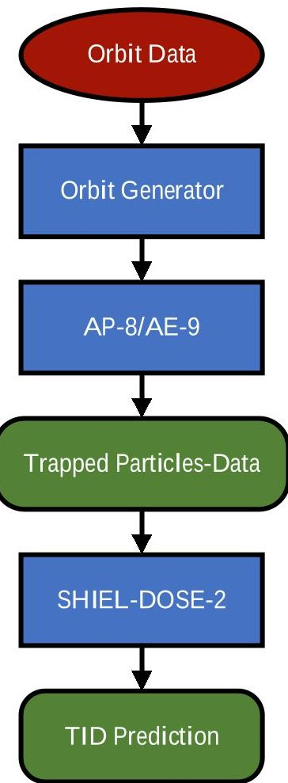

Figure 1: Showing the process followed in SPENVIS to study TID on PROVE Pathfinder's orbit

The probability density function (PDF) of the Weibull distribution is [26]

$$
f (T) = \frac {\beta}{\eta} * \left(\frac {T}{\eta}\right) ^ {\beta - 1} e ^ {- \left(\frac {T}{\eta}\right) ^ {\beta}}
$$

Where T is time, $ \beta $ is the shape factor and $ \eta $ is the scale factor. A shape factor below 1 can be used to model wear in failures, a shape factor of 1 gives a constant failure rate and above one models wear out failures. $ \beta $ was taken as 2 for TID, and so the appropriate value of $ \eta $ could be calculated using

$$
\eta = \frac {\Upsilon}{\Gamma \left(\frac {1}{\beta} + 1\right)}
$$

Where $ \gamma $ is the MTTF for component TID and $ \Gamma $ is the gamma function defined as

$$
\Gamma (n) = \int_ {0} ^ {\infty} e ^ {- x} x ^ {n - 1} d x
$$

From this, the likelihood of a TID failure occurring could be calculated. To compare the gains in reliability to weight and volume growth, both shielding weight and volume were calculated assuming the shielding was configured as plates on each face of the payload's 2U volume. This was a conservative estimate as the shielding would be far more space and weight efficient if placed as close to the electronics as possible.

The next step in the trade-off was to score each factor considered in the following ways. Likelihood of TID score:

$$
A = 1 - L i k e l i o o d o f T I D F a i l u r e
$$

Shielding Mass score:

$$
B = \frac {\text {M a s s o f sh i e l d i n g}}{\text {T o t a l M a s s B u d g e t}}
$$

Where the estimated total mass budget was 3kg. Shielding volume score:

$$
C = \frac {V o l u m e o f S h i e l d i n g}{T o t a l V o l u m e B u d g e t}
$$

Where the total volume budget was $ 0.002 \mathrm{m}^{3} $ (2U). Finally, the scores were combined using

$$
T o t a l S c o r e = C _ {a} * A - C _ {b} * B - C _ {c} * C
$$

Where $ C_{a}, C_{b} $ and $ C_{c} $ are priority coefficients. Twice the priority was given to the likelihood of failure score and the volume priority was halved, as the estimate of this was expected to be very conservative and the value could easily be improved upon. Section 3, Figure 6 shows the total score against aluminum thickness.

Single Event Effects—SEE effects are rather more difficult to predict than TID. While TID is an accumulation of radiation damage and so may be characterized by an MTTF, SEE is caused by a single particle collision and so can only be described by a random failure rate. This is even further exacerbated by the variability in the impact of the effect, which is very sensitive to exactly where the SEE occurs. Luckily SEUs are generally reparable with a simple reset and are unlikely to have any lasting impact, thus were not considered in the second stage of the system FMECA.

It was decided to reduce SEL effects by introducing Power Distribution (PD) switches in the motherboard circuit. These are Integrated Circuit (IC) chips based around a MOSFET which can limit the current they supply should the load develop a short. Several of these IC chips were placed before each of the TIR Camera, narrow field of view Visual camera, wide field of view Visual camera and both BeagleBone controllers. If a major latch-up event occurred in any of these components, the PD switches would limit the current before the short caused any serious damage. Then a power cycle could be applied to that component to recover to a nominal system state.

After this design work was completed, it was decided that the effects of latch-up had been sufficiently mitigated and, much like SEU effects, would have negligible impact on total system reliability.

<!-- PDF_PAGE: 7 -->

## 5. Determine Mitigation Strategies for Remaining Failure Modes

The final stage in the completion of the PROVE Pathfinder FMECA was to decide what best approaches should be taken to mitigate all remaining failure modes beyond TID and latch-up. These were specific to each failure mode and were recorded in the FMECA worksheet alongside their corresponding failure mode. The most significant, system level mitigation strategy used was to incorporate cold redundancy in the BeagleBone controllers. As many of the most critical failure modes were related to this component, adding a second one to be used in the event of the first one failing was extremely beneficial to total system reliability. A more detailed analysis of how much impact this had may be seen in the next section.

## 6. Fault Tree Analysis of PROVE Pathfinder

Once the system wide FMECA was completed and all conceivable failure modes defined, the next stage was to consider how their effects might combine across the PROVE Pathfinder system. In this section the study of the combination of faults and the development of an estimate of total system reliability shall be discussed. To understand how the effects of faults combine, fault trees were developed. These are hierarchical tree diagrams that separate into branches from a top level system failure, and continue to do so until the component failure level is reached [27].

The complete fault tree developed for PROVE Pathfinder was found to be very extensive, and many of the components were lacking in MTTF's. Therefore, to better focus development work, a second fault tree was produced, reduced to just the high criticality failure modes, as it was hoped that the lower criticality failure modes would have an insignificant effect on the reliability of the system. However this did mean that the estimates discussed in the next section were optimistic, as they did not include all the potential failure modes of the system.

Monte Carlo Simulation After performing some initial hand calculations assuming constant failure rates, a Monte Carlo style simulation was setup. Implemented in MATLAB, this simulation used each component MTTF and Weibull distribution, as calculated during the previous section, to calculate the probability of a component failing in a particular hour using the equation

$$
P \left(\text {c o m p o n e n t f a i l u r e} _ {h o u r}\right) = \exp \left[ - \frac {T}{\eta} \right] ^ {\beta} - \exp \left[ - \frac {T _ {+}}{\eta} \right] ^ {\beta}
$$

Where T is the mission time at the start of the hour in question, $ T_{+} $ Is the mission time at the end of that hour and both Weibull parameters $ \beta $ and $ \eta $ have been calculated for the specific component failure mode. Then each hour was propagated throughout the mission duration. This allowed the inclusion of different, varying, failure rates for different

components, that could not be easily included in initial hand calculations. At each time point a random number generator was used to decide whether a particular failure had occurred. If the number generated was above $ P ( component failure_{h o u r} ) $ , then no failure had occurred, if below, then failure had occurred. According to this outcome the state of the corresponding component would be changed to zero if it had failed or kept at one if not. After each hour the simulation also checked where the effect of any occurring failure had reached using the high criticality fault tree. Thus, the simulation allowed for redundancy in the system to keep itself operational in the presence of faults. This entire process was repeated for many thousands of simulated missions to be able to produce probabilistic predictions of the reliability of every level of the system. The results are presented in section 3, Table 5. These figures provided an indication of the useful life of each aspect of the system and would be invaulable when preforming prognostics while on flight.

The wear out nature of each of the TID component failure modes and controller memory failure mode was considered by changing the $ \beta $ value of each of these failure modes to 2. The Monte Carlo simulation was rerun, and the new set of results may be seen in section 3, Table 6.

## 7. Model Based Systems Engineering for Reliability of PROVE Pathfinder

In this final section the MBSE model developed for the PROVE Pathfinder system shall be presented. MBSE was used to develop a more complex and representative model of the PROVE Pathfinder system, that captured the actual functionality of components, not just their failure characteristics as done in the previous section. Another Monte Carlo style simulation was run for this section, but this time, instead of using a fault tree to determine the effects of failures, the behavior of the system model itself was studied. As such it not only allowed further validation of previous results but provided a greater insight into the behavior of the system in the presence of faults.

The System Model—The MBSE model was developed in Cameo Systems modeler (CSM)[28], which uses linked packages and diagrams, based on the system modelling language (SYSML), to model any complex system. The model was built from a simplified version of the original PBS, in the form of a block definition diagram. The simplifications made were in line with those made in the second stage of the FMECA criticality, aiming to capture the most important failure behavior of the system. Besides this the MBSE model also needed to capture more of the functionality of components and the system as a whole, to allow system behavior to be used to determine total system failures. Therefore, some extra components were kept in such as data and power buses.

Once the PBS of the system model was defined, the links

<!-- PDF_PAGE: 8 -->

between each subsystem were defined in the internal block diagram shown in appendix B and the links between components within those in internal block diagrams (an example of which can be seen in appendix C). This defined the architecture of the system model, after which the behavior of the system was captured using state machine diagrams for each component (an example of which can be seen in appendix D). Using the definition of a failure mode chosen earlier as the state a component enters after failing, failure states were next added to each component to capture their behavior.

Reliability Simulation—In order to evaluate the mitigation approaches chosen previously, it was decided to explore the effect that the controller redundancy had on total system reliability. This was done by developing a second Monte Carlo simulation using the new system model with and without redundant controllers. CSM allows system simulations to be run dynamically and signals can be inputted into the system to change component states and perform other functions in "activity diagrams". An activity diagram was used to build the simulation engine which read in signals defining component failures from a pair of MATLAB functions, based off the original MATLAB script used for the Monte Carlo simulations. The system behavior was then evaluated using a "check operation". This operation emulated taking a picture and returning the image data using the system model. This entailed sending a "command" signal to the system, asking it to take a picture with the TIR camera, as would be done during real operation. Then the simulation would listen for the system to respond with an "image data" signal and if successful the system was said to be operational, if not then a system failure had occurred. This meant that the state of the system could be determined not by using a fault tree, as has been done previously in this project, but by studying the behavior of the system itself, therefore giving a more accurate representation of the system reliability.

A further improvement provided by this simulation was consideration of the reliability of the controller switching mechanism used, a multiplexer between the TIR camera and both controllers. This is to be controlled via an extra control line from the satellite bus and the controller it will direct data to and from would be chosen by commands from the ground. Using data from reliability testing done by TI on the chosen multiplexer component, the component MTTF was determined and was expected to fail due to TID after about seven years. If this component were to fail before the first controller, then the second controller could not be used. This behaviour was implemented in the system model. Like the MTTF figures previously developed, these results represented better estimates of the system's useful life, required for performing prognostics while in flight. The results of these simulations maybe seen in section 3, Table 7.

## 3. RESULTS

In this section the primary results of the FMECA study will be presented, followed by the collected MTTF figures, system reliability figures from the FTA and finally findings from analysis of the MBSE system model of PROVE Pathfinder.

## FMECA Study

The eleven components and their most critical failure modes are shown in Table 3. Table 3 shows that the BeagleBone microprocessor had the highest criticality failure modes. This was because of two things: firstly, the microprocessor was central to all data handling actions performed by the system, thus the impact of a failure here would have the most far reaching impacts. Secondly, the microprocessor had the highest transistor density making it more susceptible to radiation related failures. Radiation is expected to be a significant cause of failure for the system, with the majority of the illustrated failure modes being related to radiation interaction with electronics.

<!-- PDF_PAGE: 9 -->

Table 1: Showing the components considered in the second criticality stage along with their highest criticality failure mode, note the last five components appear twice in the system due to controller redundancy

<table border="1"><tr><td>Name of Unit</td><td>Function</td><td>Failure Mode</td><td>Cause of Failure</td><td>Severity Level</td><td>Likelihood Level</td><td>Criticality</td></tr><tr><td rowspan="2">TIR Camera</td><td rowspan="2">captures images in infrared spectrum and outputs data to payload controller</td><td>SEL(Single Event Latch-up)</td><td>Single event i.e., radiation, leading to a short producing a parasitic structure, possibly causing destruction of the specific transistor</td><td>6</td><td>9</td><td>54</td></tr><tr><td>TID(Total Ionising Dose)</td><td>Cumulative damage to device material by radiation</td><td>9</td><td>7</td><td>63</td></tr><tr><td rowspan="2">CAN driver</td><td rowspan="2">Allows BeagleBone to communicate over CAN</td><td>SEL</td><td>Single event i.e., radiation, leading to a short producing a parasitic structure, possibly causing destruction of the specific transistor</td><td>7</td><td>8</td><td>56</td></tr><tr><td>TID</td><td>Cumulative damage to device material by radiation</td><td>9</td><td>7</td><td>63</td></tr><tr><td rowspan="2">Ethernet Interface</td><td rowspan="2">Allows BeagleBone to communicate over ethernet</td><td>SEL</td><td>Single event i.e., radiation, leading to a short producing a parasitic structure, possibly causing destruction of the specific transistor</td><td>7</td><td>8</td><td>56</td></tr><tr><td>TID</td><td>Cumulative damage to device material by radiation</td><td>9</td><td>7</td><td>63</td></tr><tr><td rowspan="2">Power management chip</td><td rowspan="2">Provides 3.3V to necessary components on BeagleBone board</td><td>SEL</td><td>Single event i.e., radiation, leading to a short producing a parasitic structure, possibly causing destruction of the specific transistor</td><td>7</td><td>8</td><td>56</td></tr><tr><td>TID</td><td>Cumulative damage to device material by radiation</td><td>9</td><td>7</td><td>63</td></tr><tr><td rowspan="3">Nand Flash memory(4GB 8-bit eMMC)</td><td rowspan="3">Nand Flash memory(4GB 8-bit eMMC)</td><td>Program/erase failure</td><td>If the state machine controlling the programme and erase operations receives too many cycles, it will time out, causing the cell to stop functioning, can also be caused by oxide degradation</td><td>6</td><td>10</td><td>60</td></tr><tr><td>SEL</td><td>Single event i.e., radiation, leading to a short producing a parasitic structure, possibly causing destruction of the specific transistor</td><td>7</td><td>8</td><td>56</td></tr><tr><td>TID</td><td>Cumulative damage to device material by radiation</td><td>9</td><td>7</td><td>63</td></tr><tr><td rowspan="2">Microprocessor</td><td rowspan="2">Performs calculations and processes data, is the core component of each controller</td><td>SEL</td><td>Single event i.e., radiation, leading to a short producing a parasitic structure, possibly causing destruction of the specific transistor</td><td>8</td><td>9</td><td>72</td></tr><tr><td>TID</td><td>Cumulative damage to device material by radiation</td><td>9</td><td>7</td><td>63</td></tr></table>

<!-- PDF_PAGE: 10 -->

## Component MTTF Figures

Table 4 shows that the microprocessor is the least reliable, which is to be expected given it is the most sensitive and complex component considered. Conversely, the power management chip has the longest MTTF, as it was so simple there were very few possible failure modes. The thermal infrared camera had one of the shortest MTTF's (not considering ionizing radiation). This was largely because an entire camera was considered a component here, not something as simple as a Power Management Chip. The MTTF derived from TI reliability data for the microprocessor was lower than the result given by MIL-HDBK-217F. This disparity was likely due to the age of MIL-HDBK-217F, meaning it did not account for the greatly increased transistor density seen in microprocessors today, compared to when the document was published. As a result, it was decided to move forward using the MTTF determined from the TI reliability data.

Table 2: Showing the TI and other reliability data used to determine component MTTF's

<table border="1"><tr><td rowspan="2">Parameter</td><td colspan="2">Microcontroller</td><td rowspan="2">CAN driver</td><td rowspan="2">Power Management chip</td><td rowspan="2">Ethernet interface</td><td rowspan="2">Controller Multiplexer</td><td rowspan="14">Controller Memory, Endurance Data</td><td rowspan="14">Thermal Infrared Camera, Manufacturer Data</td></tr><tr><td>TI Data</td><td>MIL-HDBK-217F Data</td></tr><tr><td>MTTF(TI)(million hours)</td><td colspan="2">180</td><td>2580</td><td>10000</td><td>239</td><td>2140</td></tr><tr><td>Failures in Time, number of units failing per billion operating hours(TI)</td><td colspan="2">5.60</td><td>0.40</td><td>0.10</td><td>4.20</td><td>0.5</td></tr><tr><td>Average Failure Rate(TI)(per hour)</td><td colspan="2">5.60*10-9</td><td>4.00*10-10</td><td>1.00*10-10</td><td>4.20*10-9</td><td>5.00*10-10</td></tr><tr><td>Eaa(eV)</td><td colspan="2">0.70</td><td>0.70</td><td>0.70</td><td>0.70</td><td>0.70</td></tr><tr><td>Test Temperature(℃)</td><td colspan="2">130</td><td>125</td><td>125</td><td>125</td><td>125</td></tr><tr><td>Usage Temperature(℃)</td><td colspan="2">35.0</td><td>35.0</td><td>35.0</td><td>35.0</td><td>35.0</td></tr><tr><td>Sample Size</td><td colspan="2">1640</td><td>30100</td><td>167000</td><td>1640</td><td>24900</td></tr><tr><td>Confidence level(%)</td><td colspan="2">60.0</td><td>60.0</td><td>60.0</td><td>60.0</td><td>60.0</td></tr><tr><td>AaT</td><td colspan="2">501</td><td>389</td><td>389</td><td>389</td><td>389</td></tr><tr><td>Failure Rate(temperature corrected)(per hour)</td><td colspan="2">2.80*10-6</td><td>1.56*10-7</td><td>3.90*10-8</td><td>1.60*10-6</td><td>1.95*10-7</td></tr><tr><td>MTTF(temp corrected)(years)</td><td colspan="2">40.7</td><td>733</td><td>2930</td><td>70.2</td><td>587</td><td colspan="2">26.1</td></tr><tr><td>MTTF(environment corrected)(years)</td><td>81.3</td><td>278</td><td>1460</td><td>5860</td><td>140</td><td>1170</td><td>5.17</td><td>52.2</td></tr></table>

## Radiation Impacts on Reliability

Fig.3 shows results from the radiation study performed in SPENVIS, while gathering radiation related component MTTF's. The figure shows that Solar protons are the most significant source of radiation in the expected orbit, as well as that a minimum of 3mm of shielding is necessary to push the MTTF for TID above the mission duration of 1.5 years. Furthermore, while shielding will continue to effectively reduce electron radiation, there is little reduction in total absorbed dose for thicknesses above 8mm. From Fig.4 it can be seen that MTTF increases very linearly above a thickness of 6mm and that the best improvements for each mm of aluminum added is made between 2 and 6mm. Fig.5 compares each of likelihood of failure, shielding weight and shielding volume for different shielding thicknesses.

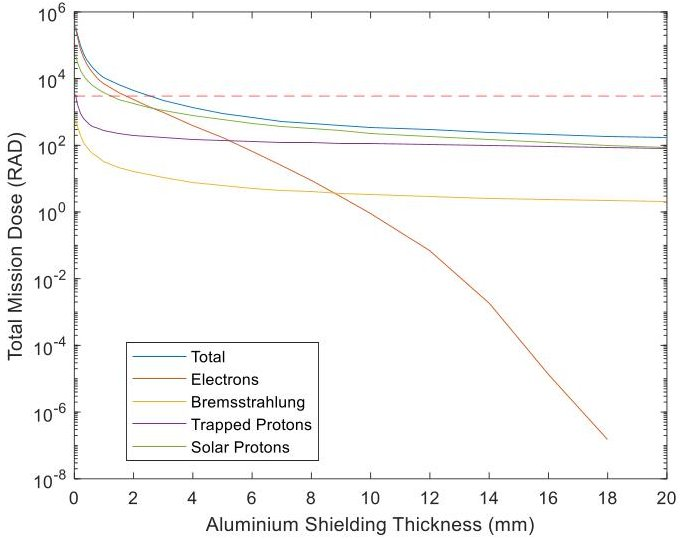

Figure 3: Showing total radiation absorbed by PROVE Pathfinder electronics over the mission duration of 1.5 years, for varying shielding thickness

<!-- PDF_PAGE: 11 -->

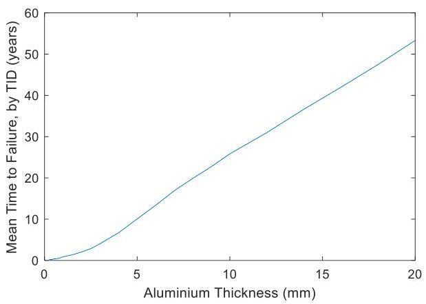

Figure 4: Showing the mean time to failure by TID for a generic semi-conductor device in PROVE Pathfinder, with varying shielding thickness

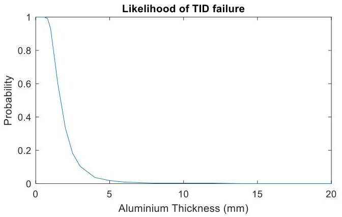

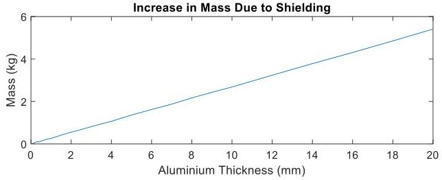

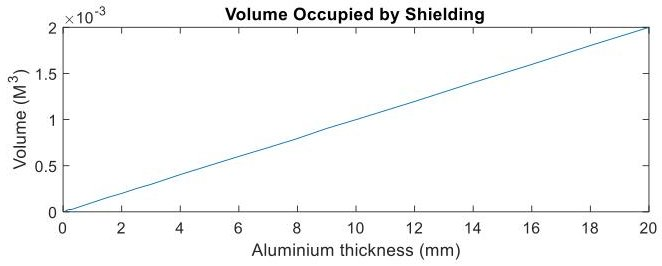

Figure 5: graphs showing the change in each of probability of TID failure, shielding mass and shielding volume with sheilding thickness

Fig.6 shows that as thickness increases both mass and volume increase linearly, as would be expected given the assumptions of shielding configuration used. Meanwhile there is a severe drop in likelihood of TID failure between 1 and 4mm, but then this reduction rapidly tails off for shielding thicknesses above 5mm.

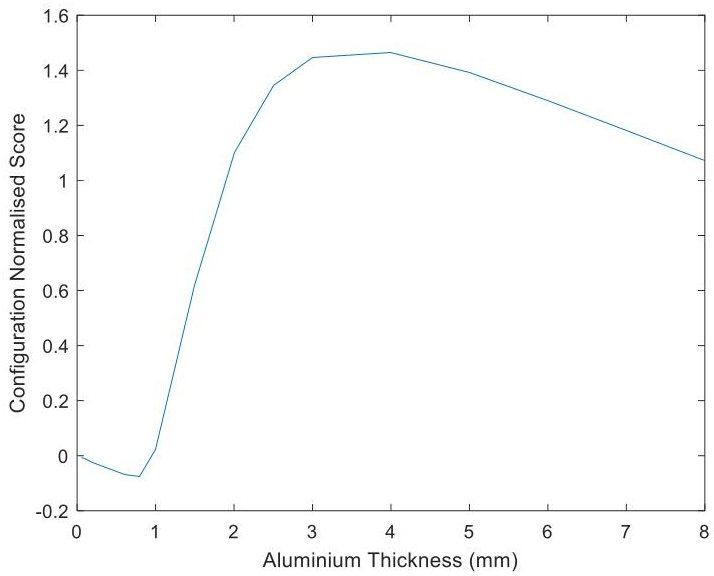

Figure 6: Showing the variation of configuration score with shielding thickness

The highest scoring shielding thickness was chosen from Fig.6 giving a final recommendation of 4mm of shielding allowing a mean time of 6.72 years till TID failure. This is comparable with other missions already on orbit. As shown in fig.8, the total score for shielding thicknesses above 4mm start to drop off, as the diminishing returns made in reliability are offset by the gains in mass and volume. Between zero and one the total score is in fact negative, this being because there is almost no gain in reliability for thicknesses in this range, but there is still added weight and volume.

## Monte Carlo Estimates of Total System Reliability

Table 5 displays the MTTFs for each component and subsystem as calculated during the Monte Carlo simulations, before the wear out nature of the TID and memory endurance failure modes were added. Table 6 shows the impact that including the wear out nature has on the MTTF figures.

<!-- PDF_PAGE: 12 -->

Table 5: Showing the MTTF's for each component and subsystem on the high criticality fault tree as calculated by the Monte Carlo simulation and by hand

<table border="1"><tr><td rowspan="2">Node</td><td colspan="2">MTTF(Years)</td><td rowspan="2">Probability of failure, Monte Carlo(%)</td><td rowspan="2">Discussion</td></tr><tr><td>Hand Calculations</td><td>Monte Carlo</td></tr><tr><td>microprocessor(ControllerA)</td><td>6.21</td><td>7.01</td><td>19.3</td><td></td></tr><tr><td>Memory(ControllerA)</td><td>2.29</td><td>3.35</td><td>36.1</td><td>This component is the weakest link for each of the controllers</td></tr><tr><td>CAN driver(ControllerA)</td><td>6.69</td><td>7.71</td><td>17.7</td><td></td></tr><tr><td>Power management chip(ControllerA)</td><td>6.71</td><td>7.33</td><td>18.5</td><td></td></tr><tr><td>ethernet interface(ControllerA)</td><td>6.41</td><td>7.37</td><td>18.4</td><td></td></tr><tr><td>ControllerA</td><td>1.04</td><td>1.18</td><td>72.1</td><td>This MTTF is so low because should any of the five components considered in the controller fail, there is no redundancy in the subsystem to mitigate this.Furthermore,the effect of the limited memory MTTF has a very large impact here because it is by far the smallest in the network</td></tr><tr><td>Control subsystem</td><td>2.09</td><td>2.31</td><td>47.8</td><td>While the Monte Carlo methodology was slightly more optimistic on each prediction compared to hand calculations,this is where the largest deviation can be seen between the two methodologies.</td></tr><tr><td>TIR Camera</td><td>5.96</td><td>6.73</td><td>20.0</td><td></td></tr><tr><td>Total System</td><td>1.55</td><td>1.71</td><td>58.3</td><td>TID failure severely impacted the total system MTTF because every component considered was expected to be affected by it.Therefore,even though most of the baseline component MTTFs were well above a decade,TID failure has limited them to below this,which had further impact when the component MTTFs were combined across the entire system</td></tr></table>

<!-- PDF_PAGE: 13 -->

Table 6: Showing the MTTF's for each component and subsystem on the high criticality fault tree as calculated by the Monte Carlo simulation with improved failure rate models

<table border="1"><tr><td>Node</td><td>MTTF, assuming constant failure rate(Years)</td><td>Probability of failure(%)</td><td>Discussion</td></tr><tr><td>microprocessor(ControllerA)</td><td>26.7</td><td>5.46</td><td>Each componentMTTFhas increased significantly, due to the improved model ofTID failure</td></tr><tr><td>Memory(ControllerA)</td><td>16.7</td><td>8.58</td><td></td></tr><tr><td>CAN driver(ControllerA)</td><td>37.1</td><td>3.96</td><td></td></tr><tr><td>Power management chip(ControllerA)</td><td>37.3</td><td>3.94</td><td></td></tr><tr><td>ethernet interface(ControllerA)</td><td>31.0</td><td>4.72</td><td></td></tr><tr><td>ControllerA</td><td>5.41</td><td>24.2</td><td></td></tr><tr><td>Control subsystem</td><td>32.9</td><td>4.46</td><td>The estimated control subsystemMTTFwill in fact vary with the simulated time,because of the complex failure rate generated by the network of the subsystem,as the mission will cover different parts of the failure rate curve.As a result,theMTTFestimate here is only applicable to the1.5-year mission duration.</td></tr><tr><td>TIR Camera</td><td>22.2</td><td>6.52</td><td></td></tr><tr><td>Total System</td><td>13.2</td><td>10.9</td><td>This probability of failure corresponds to a reliability of89.1%</td></tr></table>

Results From the MBSE style System Model

Table 7 shows the results gathered from the MBSE reliability simulations. 100 missions were simulated on the model and

the system failures were counted to produce the probabilities shown below, in the same fashion as typical monte Carlo simulations.

Table 7: Showing the likelihood of total system failure as determined by the system reliability simulation using CSM

<table border="1"><tr><td rowspan="2">Likelihood of failure</td><td>With controller redundancy(%)</td><td>21.3(78.7% reliable)</td></tr><tr><td>Without controller redundancy(%)</td><td>35.0(65.0% reliable)</td></tr><tr><td rowspan="2">MTTF, assuming constant failure rate</td><td>With controller redundancy(Years)</td><td>4.17</td></tr><tr><td>Without controller redundancy(Years)</td><td>2.32</td></tr><tr><td colspan="2">Mass of a controller(kg)</td><td>0.04</td></tr><tr><td colspan="2">Volume occupied by a controller(m^3)</td><td>6.58*10^{-7}$</td></tr></table>

Table 7 shows a rise in total system failure probability from the results from the previous Monte Carlo simulations. This illustrates the crucial importance of considering the switching mechanism when implementing cold redundancy, as it has a

significant impact on the improvement of total system reliability. With the above information a second trade-off to justify the use of redundant controllers was possible, using the same process as used for radiation thickness, only this

<!-- PDF_PAGE: 14 -->

time considering the likelihood of total payload system failure. The score for the configuration with only one controller was 1.31 and for the redundant version was 1.60. This provided an indication that the mitigation strategy of redundant controllers was worthwhile.

## 4. DISCUSSION

This section discusses the advantages and limitations of the methodologies implemented in the project and identifies areas for improvement. Furthermore, it outlines how the processes followed by the project may be applied to other systems.

Firstly, the standard FMECA process was adapted for this project to accommodate a system using components with little reliability data. This two-phased approach allowed a prioritized analysis of the system. Some information will have been lost by not determining all component MTTFs. However, the impact is likely to have been minimal as the likelihood of occurrence was smaller than those that were considered. Also, the processes used to calculate the MTTFs did not consider all the challenges of the space environment. In particular, vibration during launch can damage components and severely fatigue solder joints. While this was partially captured in the calculation of environment factor for each component, other components that were not necessarily selected for the second phase of the FMECA would be more acutely affected by this. For example, connector plugs and any soldered components that extend a significant distance from their joints would be at risk of failure during launch. This is an opportunity for improvement of the minimum level of criticality necessary for a failure mode to be considered in the second FMECA phase. Another source of failures in the space environment not considered in any MTTF calculation is single event effects caused by radiation. These effects are inherently difficult to predict, but with the right information, SEU rates can be calculated using SPENVIS. Some specialist software does exist to predict SEL such as CRad [27], but both access to this software and the necessary information for SEU (component radiation sensitive volume) lie outside the scope of this study.

While the predictions presented in section 3 are based on the highest criticality failure modes, there would likely be some influence of other failure modes. This would be via their cumulative effect on the MTTF, because as more series failure modes are considered they will reduce the network MTTF.

The two trade-off studies presented in this report provide reasoning for the choice of both radiation shielding thickness and controller redundancy. That's not to say these studies were perfect. The assumed configuration of shielding lining the outer walls of the payload led to a more conservative result of recommended shielding thickness. This is an

obvious area that could be refined once the exact mechanical configuration of the payload has been determined. Moreover, the second trade-off did not consider the extra power required by introducing a second controller, another aspect that could be developed in future work. This drawback of adding a second controller may have reversed the outcome of the trade-off, given there was only a 0.29 difference between the two scores. Should this be the case, a possible recommendation would be to use a dissimilar pair of controllers, to make the gain in reliability worth the extra power demand.

Finally, the use of MBSE allowed the definition of a total system failure to be determined by studying the behavior of the system itself, not a fault tree as is usually done. This meant that no information was lost in making assumptions and judgements related to simplifying a complex system down to a basic fault tree. This approach has not yet been applied in current literature, to the author's knowledge. Some improvements could be made by lowering the minimum level of criticality necessary for a component to be considered in the second FMECA phase. This would greatly increase the number of failure modes considered in the reliability simulation presented at the end of section 2, thus improving the scope of its results. A drawback of using MBSE here is the large increase in work required, when compared to the approaches used in the rest of this study (this is a common hindrance to the wider application of MBSE in industry).

The workflow presented in this paper could be applied to any complex system in development. Fig.7 shows the 7 steps outlined in section 2 that the study followed and is proposed as a general workflow for reliability analysis and mitigation strategy identification. This workflow would be particularly beneficial to systems using components that have little reliability data available.

The FMECA stage shown in Fig.7 provides the engineer with a prioritized set of failure modes to mitigate. Once stages 4 and 5 are completed there should exist a system design that is mature enough to allow the application of probabilistic fault analysis in stages 6 and 7. After system reliability estimates have been made in stages 6 and 7, changes to the design may be implemented if the estimated system reliability is not deemed sufficient or non-compliant with requirements. Using both fault tree analysis, in stage 6 and a model-based system engineering model in stage 7 allows for verification of results produced in these stages (system reliability estimates). Ideally the wider project would already have applied MBSE methodologies, meaning that preexisting models could be utilized for stage 7, reducing the work involved with building the system model from the ground up. Validating system models can be difficult and expensive, however this drawback would also be minimized with the application of MBSE across the rest of the project.

<!-- PDF_PAGE: 15 -->

Figure 7: Showing the generalized workflow proposed for reliability analysis and mitigation strategy identification for an engineered system

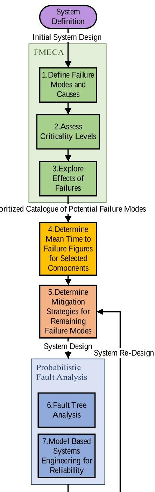

## 5. FUTURE WORK

The work planned for this area is to expand the mitigation strategies considered by the system reliability simulation at the end of section 2. It would also be desirable to expand the MBSE model into a full operation simulation by integrating it with the mission timeline and orbit predictions. This would allow study of the system functioning in an orbital context and would be extremely useful to software development. It would provide a clear illustration of how the system should function and respond as the mission progressed. In terms of

exploiting the useful life estimates calculated for PROVE Pathfinder during this study, a prognostics and health management framework should be developed to continually update these figures and indicate vulnerabilities as they develop both during development and flight. This could also be used to combat the impacts of SEEs not considered in detail in this study. An onboard health management system would be well situated to handle component power cycling in the instance of latch up induced shorts. It could also make changes to the system operations in high radiation zones, such as above the poles, to alleviate the risk of damaging SEU's. The system model developed as part of the MBSE effort in this study could be leveraged by this health management system in reasoning what actions it should take.

## 6. CONCLUSION

To conclude, this study has investigated the reliability of the PROVE Pathfinder payload system. This was done using FMECA, with a two-phase criticality stage that highlighted 21 modes as high criticality. Component MTTFs were then determined using a wide range of sources and techniques, such as MIL-HDBK-217 and SPENVIS. The shortest of these highlighted MTTFs was failure by Total Ionizing Dose in semiconductor electronics. Next, the combination of these failure modes was studied using fault tree analysis and this was carried out both via hand calculations and Monte Carlo simulations.

These results then informed decision on what mitigation strategies would be most suitable to combat the effects of any failure that should occur. In some cases, decisions on particular strategies were carried out via trade-off study. For example, trade-offs indicated that 4mm of aluminum shielding would be the optimal approach to mitigating the chance of TID failure, as well as recommending the implementation of controller redundancy, to reduce the impact of failures in the controller.

Finally, the system was modelled using MBSE and simulations were run on this model illustrating its behavior both with and without the presence of faults. This allowed total system reliability to be determined not by using a fault tree, as is usually done, but by studying the behavior of the system itself. Furthermore, MBSE enabled the quantitative assessment of chosen mitigation strategies in the form of system reliability estimates, particularly for controller redundancy.

The final estimate of the total payload system reliability given in this project is 78.7% . Referring back to the very start of this report, this figure of total system reliability is an appreciable improvement on the 60% reliability mentioned in [1].

Recommendations for possible on-flight prognostics and health management strategies were highlighted, focused on

<!-- PDF_PAGE: 16 -->

mitigating the impact of radiation effects such as SEEs.

The steps outlined in this paper would benefit any project looking to understand and improve the reliability of a system, with only minor alterations needed for other applications. So

long as a system is defined well enough to produce both a Product Breakdown Structure and general fault tree, then the very same overarching stages outlined in this paper may be followed to improve systems reliability

APPENDICES

## A. SYSTEM BLOCK DIAGRAM OF PROVE PATHFINDER

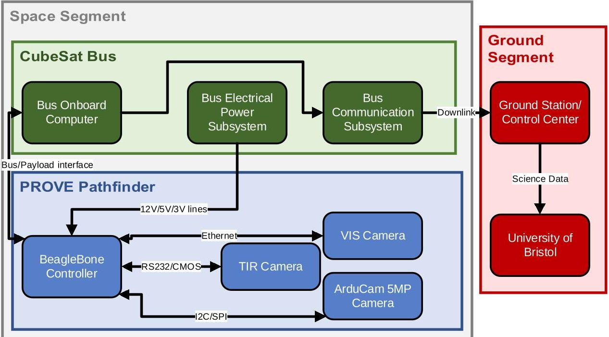

Figure 8: Showing a system block diagram of PROVE Pathfinder

## B. INTERNAL BLOCK DIAGRAM OF PROVE PATHFINDER

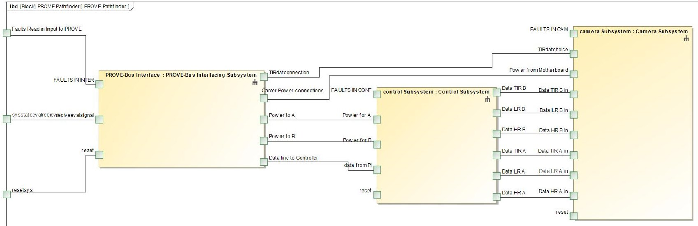

Figure 9: Showing the internal block diagram used for the reliability model of PROVE Pathfinder

<!-- PDF_PAGE: 17 -->

## C. SUBSYSTEM INTERNAL BLOCK DIAGRAM EXAMPLE

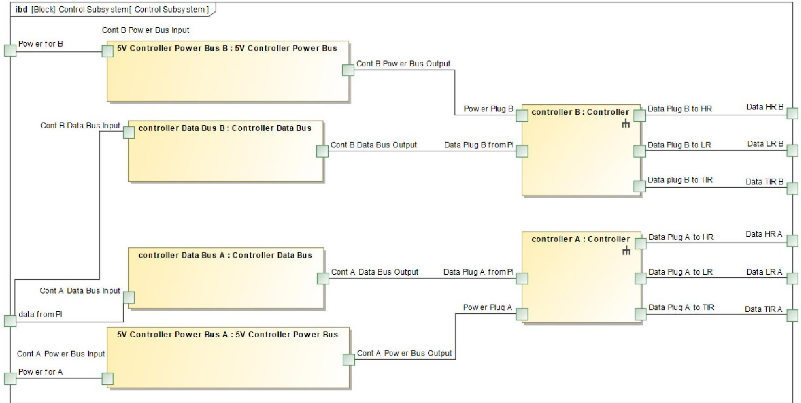

Figure 10: Showing the internal block diagram of the control subsystem of PROVE Pathfinder

## D. COMPONENT STATE MACHINE DIAGRAM EXAMPLE

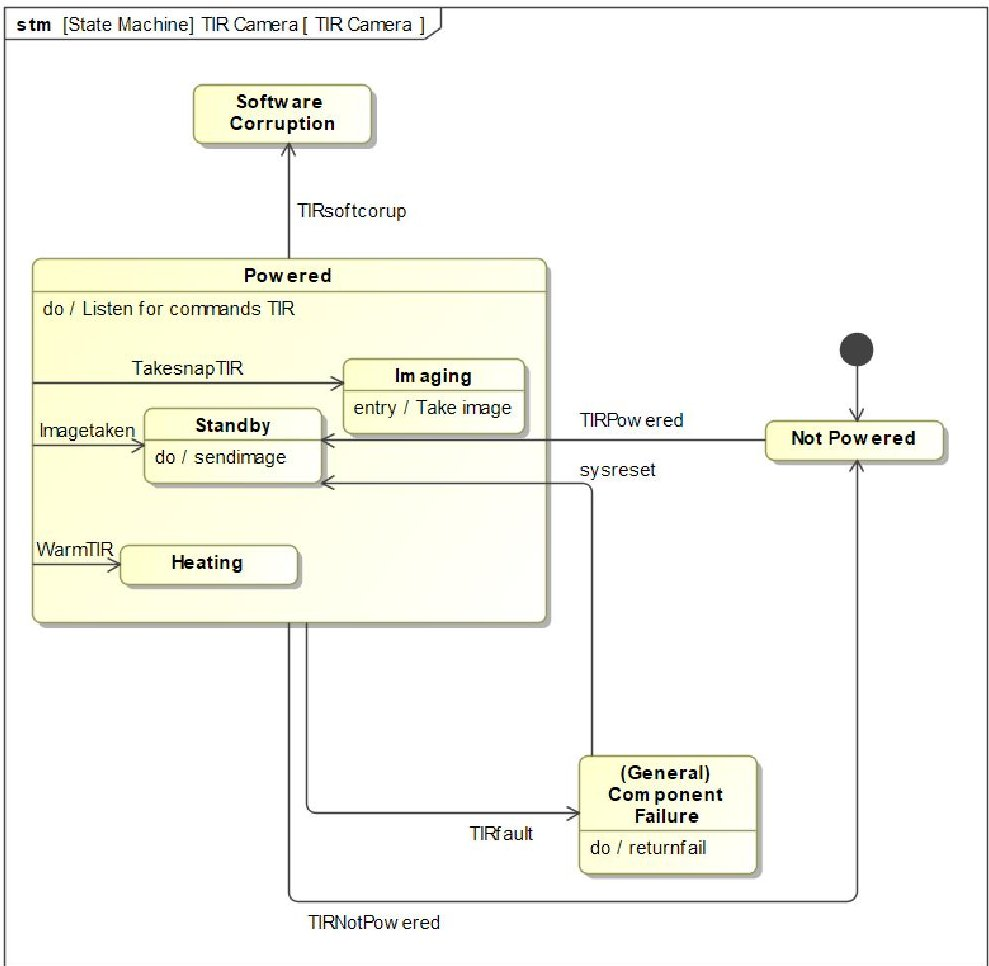

Figure 11: Showing the state machine used to capture behavior of the TIR camera component of PROVE pathfinder

<!-- PDF_PAGE: 18 -->

## REFERENCES

[1] D.-H. Cho, W.-S. Choi, M.-K. Kim, J.-H. Kim, E. Sim, and H.-D. Kim, "High-Resolution Image and Video CubeSat (HIREV): Development of space technology test platform using a low-cost CubeSat platform," Int. J. Aerosp. Eng., 2019.

[2] S. Lee et al., "CubeSat Design Specification," 2015.

[3] E. Kulu, "NANOSATELLITE & CUBESAT DATABASE," Nanosats Database, 2019. [Online]. Available: https://www.nanosats.eu/database. [Accessed: 11-Dec-2019].

[4] J. Guo, L. Monas, and E. Gill, "Statistical analysis and modelling of small satellite reliability," Acta Astronaut., vol. 98, no. 1, pp. 97-110, 2014.

[5] J. Bouwmeester, M. Langer, and E. Gill, "Survey on the implementation and reliability of CubeSat electrical bus interfaces," CEAS Sp. J., vol. 9, no. 2, pp. 163-173, 2017.

[6] W. Larson and J. Wertz, Space Mission Analysis and Design, 2nd ed. Portland: Microcosm, 1997.

[7] P. Fortescue, G. Swinerd, and J. Stark, Spacecraft Systems Engineering. New Jersey: John Wiley and Sons Ltd, 2011.

[8] W. Cai, L. Zhang, Z. Zhang, Y.-F. Li, and Y.-J. Yang, "FMECA of key components of circular truss antenna," in QR2MSE 2013 - Proceedings of 2013 International Conference on Quality, Reliability, Risk, Maintenance, and Safety Engineering, 2013, pp. 337-341.

[9] K. M. Brumbaugh and E. G. Lightsey, "A risk management plan for CubeSats," in AIAA SPACE Conference and Exposition 2012, 2012.

[10] A. Menchinelli et al., "A reliability engineering approach for managing risks in CubeSats," Aerospace, vol. 5, no. 4, 2018.

[11] N.-C. Xiao, Y.-F. Li, and H.-Z. Huang, "Reliability analysis method of deployment mechanism of a satellite solar arrays," Yuhang Xuebao/Journal Astronaut., vol. 30, no. 4, pp. 1704-1710, 2009.

[12] S. Corpino and F. Stesina, "Analysis of the communication anomaly during e-st@r-2 mission operations," in Proceedings of the International Astronautical Congress, IAC, 2017, vol. 9, pp. 5840- 5847.

[13] Y. Yang, L. Xie, S. Yan, and J. Wu, "Failure analysis of deployment mechanism of a satellite solar array," in ICRMS'2011 - Safety First, Reliability Primary: Proceedings of 2011 9th International Conference on Reliability, Maintainability and Safety, 2011, pp. 931-937.

[14] K. Pickard, P. Müller, and B. Bertsche, "Multiple failure mode and effects analysis - An approach to risk assessment of multiple failures with FMEA," in Proceedings - Annual Reliability and Maintainability Symposium, 2005, pp. 457-462.

[15] D. Gianni and A. D'Ambrogio, Modeling and Simulation-Based Systems Engineering Handbook. Boca Raton: CRC press, 2015.

[16] J. Gregory, L. Berthoud, T. Tryfonas, and A. Prezzavento, "Early Validation of the Data Handling Unit of a Spacecraft Using MBSE," IEEE Aerosp. Conf. Proc., vol. 2019-March, pp. 1-15, 2019.

[17] DEPARTMENT OF DEFENSE, "Reliability Prediction of Electronic Equipment (Military Handbook 217-F)," Dep. Def. USA, p. 205, 1991.

[18] Texas Instruments, "DPPM/FIT/MTBF Estimator," 2020. [Online]. Available: https://www.ti.com/quality/docs/estimator.tsp. [Accessed: 07-Apr-2020].

[19] P. Ellerman, "Calculating Reliability using FIT & MTTF: Arrhenius HTOL Model," no. 19, pp. 1-6, 2012.

[20] Micron, "e·MMC $ ^{\mathrm{TM}} $ Memory," 2013. [Online]. Available: https://media.digikey.com/pdf/Data Sheets/Micron Technology Inc PDFs/EMMC_Series.pdf. [Accessed: 04-May 2020].

[21] Telcordia, "SR-332," 2016. [Online]. Available: https://telecom-info.telcordia.com/sitecgi/ido/docs.cgi?ID=SEARCH&DOCUMENT=SR- 332&. [Accessed: 04-May-2020].

[22] NASA and GSFC, "Radhome." [Online]. Available: https://radhome.gsfc.nasa.gov/radhome/RadDataBase/RadDataBase.html. [Accessed: 04-Jul-2020].

[23] ESA and ESCIES, "ESA Radiation Reports." [Online]. Available: https://escies.org/labreport/radiationList. [Accessed: 07-Apr-2020].

[24] BIRA-IASB, "SPace ENVironment Information System." [Online]. Available: https://www.spenvis.oma.be/intro.php. [Accessed:

<!-- PDF_PAGE: 19 -->

07-Apr-2020].

[25] Nasa, "Space Radiation Effects on Electronic Components in Low-Earth Orbit," pp. 1-7, 1996.

[26] Weibull.com, "Characteristics of the Weibull Distribution." [Online]. Available: https://www.weibull.com/hotwire/issue14/relbasics1 4.htm. [Accessed: 07-Apr-2020].

[27] Bryant et al., "Fault Tree Handbook with Aerospace Applications," Uma etica para quantos?, vol. XXXIII, no. 8, p. 218, 2002.

[28] NoMagic, "Cameo Systems Modeller," 2020. [Online]. Available: https://www.nomagic.com/products/cameo-systems-modeler.

[29] Cogenda, "CRad Homepage," 2010. [Online]. Available: http://cogenda.com/article/SEE_Prediction. [Accessed: 04-May-2020].

## BIOGRAPHY

Louis Timperley is a PhD student studying at the University of Bristol where he is researching the application of Model-Based Systems Engineering (MBSE) to various forms of early system validation, sensitivity and analysis. He has recently completed his MEng degree in Aerospace Engineering at the University of Bristol. His work has

included investigating applications of MBSE to the development and validation of spacecraft flight software as well as reliability analysis of spacecraft systems.

Lucy Berthoud is a Professor of Space Systems Engineering with the Department of Aerospace Engineering at the University of Bristol. She also works for the European spacecraft manufacturer Thales Alenia Space part-time. She has a background in advanced mission concepts and systems

engineering for spacecraft. Her research expertise includes CBRN monitoring from space, model-based systems engineering, Mars Sample Return and IR CubeSats.