<!-- PDF_PAGE: 1 -->

# A Model-based Methodology for Strategic Reuse of Legacy Designs in Space Mission Architecting

by

Alejandro Elio Trujillo

B.S., Aerospace Engineering, Georgia Institute of Technology, 2015

S.M., Aeronautics and Astronautics, Massachusetts Institute of Technology, 2018

Submitted to the Department of Aeronautics and Astronautics in partial fulfillment of the requirements for the degree of

DOCTOR OF PHILOSOPHY IN AERONAUTICS AND ASTRONAUTICS

AT THE

MASSACHUSETTS INSTITUTE OF TECHNOLOGY

September 2021

©Massachusetts Institute of Technology, 2021. All rights reserved.

Department of Aeronautics and Astronautics July 21, 2021

Olivier L. de Weck Professor, Aeronautics and Astronautics and Engineering Systems Thesis Supervisor

Edward F. Crawley Professor, Aeronautics and Astronautics Member, Thesis Committee

Azad M. Madni Professor, Astronautical Engineering Member, Thesis Committee

Rebecca A. Masterson Co-Director, Space Systems Laboratory Member, Thesis Committee

Jonathan How Professor, Aeronautics and Astronautics Chair, Graduate Program Committee

<!-- PDF_PAGE: 2 -->

<!-- PDF_PAGE: 3 -->

# A Model-based Methodology for Strategic Reuse of Legacy Designs in Space Mission Architecting

by

Alejandro Elio Trujillo

Submitted to the Department of Aeronautics and Astronautics in partial fulfillment of the requirements for the degree of Doctor of Philosophy in Aeronautics and Astronautics

## Abstract

Design reuse is a common practice in the space industry — stemming from a desire by engineers and managers to realize cost and schedule benefits while buying down risk with proven designs. Legacy design reuse, specifically, is characterized by its opportunistic nature compared to more intentional platform-based reuse. However, legacy reuse decisions made during preliminary phases of an architecting effort are often overly optimistic regarding potential benefits. This can lead to reuse scenarios that either do not fully realize expected benefits, or result in detrimental impacts or even mission failure.

This work presents a remedy in the form of the Legacy Design Reuse in MBSE (LDRM) methodology. It is a systematic approach for conducting technical and programmatic analyses for informing legacy reuse decisions in the early design phases of a mission. LDRM incorporates design reuse best practices and process improvements derived from a survey of industry practitioners. The resulting procedure is implemented in a Model-based Systems Engineering (MBSE) environment in order to leverage the integrated, authoritative, and curated data landscape of this new paradigm. Key outputs of LDRM are: a) assessment of reuse feasibility of a candidate design, b) enumeration of the required rework/adaptation effort, and c) estimate of the reuse scenario's cost or schedule impacts versus a comparable from-scratch effort - using the COSYSMO 2.0 parametric cost modeling tool.

A sample design problem demonstrates application of LDRM to evaluate reuse of the robotic arm design of the Curiosity rover on Luna, a hypothetical lunar rover. The Luna design case is carried into a two-phase virtual Lego design/build/reuse validation experiment. Decision-making performance of study participants with access to LDRM outputs is improved by close to 30% over a control group. LDRM is then applied to two industry case studies. The first, reuse of the bus subsystems across the AeroCube 10 and DAILI CubeSat missions, demonstrates nominal procedures and outcomes for 3 of 4 subsystems explored; model incompatibilities in the attitude control system led to recommendations to the sponsor for improvements to MBSE model practices and curation. The second case study, exploring congressionally-mandated reuse in NASA's SLS vehicle, finds reuse limitations in the Core Stage engine section borrowed from the Space Shuttle program. LDRM predicts a 43% increase in systems engineering effort due to extensive interface rework of engine section components. These real-world findings suggest that decision support tools, like LDRM, can improve legacy reuse outcomes in the next generation of space systems.

Thesis Supervisor: Olivier L. de Weck

Title: Professor, Aeronautics and Astronautics and Engineering Systems

<!-- PDF_PAGE: 4 -->

## Acknowledgements

I am certain that this page is the most important of all that follow. It allows me to acknowledge and thank all of the amazing sources of advice, support, and encouragement that have gotten me through 5 years and countless hours of research. I know I could not possibly name them all, but here is my best attempt at it. My humble thanks to:

My advisor, Oli, who brought me in to a lab once known as SERG, now ESL. Besides providing valuable guidance during this thesis, he also gave me the freedom to pursue the types of problems that most interest me while inspiring with bold visions for the future of space exploration and utilization.

My committee members, each providing unique insights on my research: Becky for pushing me to provide a technically rigorous but communicable methodology; Ed for helping me get the validation effort right; and Prof. Madni for being a great mentor and source of guidance, as well as a bridge between my MIT work and my Aerospace Corporation work the Reuse Ontology was his suggestion and proved incredibly useful in scoping my work.

My thesis readers, for helping make this document as effective as possible in communicating the value of my work: Andreas, for providing the most detailed and comprehensive feedback; Eric, for connecting with the works of other authors in the area, as well as being a fantastic PI on our other joint research efforts.

A special thanks to The Aerospace Corporation for providing invaluable support and funding for this effort. $ ^{1} $ Folks at Aerospace have been incredibly helpful - especially Ryan Noguchi, for helping me every step of the way from summer internships to securing the funding and everything in between. Also, to Bob Minnichelli, David Hinkley, Catherine Venturini, Rob Stevens, and many others. I look forward to joining you all soon!

To all others that helped move the research forward with diverse contributions: Samantha Infeld and all those at the NASA MBSE Community of Practice, all industry survey respondents, and validation study volunteers.

All of my friends...I know if I try to name names I'll miss someone, so instead I'll list some of the activities that have kept me sane, and you can find yourself there: countless coffees at Flour, Spring Break trips, poker strategy sessions (and other games), morning gym routines, porch cigar nights from Alabama to Cambridge, strobe light dance parties, FIFA lessons, and unsanctioned COVID gatherings.

Most importantly: my family. Mami and Papi, thank you for sacrificing so much to give Carlos, Eric, and me the very best education possible. And also, for instilling in us a faith to know that what we have is not our own. And Aia, for making the very best food imaginable to power me through 27 years of life.

I dedicate this thesis to the two grandparents I lost during my time at MIT: my grandpa, with whom I share part of my name, and who was the prime example of what a man, husband, and father should be; and Abuela Carmita, who I can never picture without a smile on her face.

<!-- PDF_PAGE: 5 -->

<!-- PDF_PAGE: 6 -->

## Contents

# 1 Introduction and Motivation 19

1.1 Design Reuse - A Complicated History 19

    1.1.1 Reuse Vignette 1 - Mars 2020 Entry, Descent and Landing Architecture 19

    1.1.2 Reuse Vignette 2 - MSL Actuator Troubles 23

    1.1.3 Reuse Vignette 3 - Ariane 5 Software Reuse Failure 23

    1.1.4 The Bigger Picture 24

1.2 Defining Design Reuse 25

    1.2.1 Planned vs. Unplanned Design Reuse 27

    1.2.2 Structured vs. Unstructured Methods 28

    1.2.3 The Design Environment 30

1.3 Why Explore Design Reuse? 30

1.4 The Promise of Model-based Systems Engineering Methods 31

    1.4.1 What is MBSE? 31

    1.4.2 MBSE as a Facilitator of Design Reuse 33

    1.4.3 Conditions Conducive to MBSE Adoption and Design Reuse 35

1.5 Summary & Roadmap 36

    1.5.1 Thesis Summary 36

    1.5.2 Roadmap 39

# 2 Literature Review and Thesis Statement 42

2.1 Literature Review 42

    2.1.1 Design Reuse – Theory and Practice 42

    2.1.2 MBSE and the Digital Environment 73

2.2 Literature Review Summary and Research Gap 80

2.3 Thesis Statement 81

2.4 Research Approach Summary 81

    2.4.1 Expected Contributions 84

# 3 Design Reuse Best Practices 86

3.1 Industry Survey on Design Reuse 88

    3.1.1 Development 88

    3.1.2 Distribution and Demographics 94

    3.1.3 Results Analysis 96

3.2 Targeted Qualitative Interviews 114

    3.2.1 Development and Candidate Sourcing 116

<!-- PDF_PAGE: 7 -->

3.2.2 Findings 116

3.3 Best Practices Study Conclusions 120

# 4 Development of the Legacy Design Reuse in MBSE Methodology 122

4.1 Development Framework 122

4.2 Reuse Ontology 123

4.2.1 Ontology Context 123

4.2.2 Concept Map 127

4.3 Generalized Reuse Process 133

4.3.1 Step 1 - Reuse Context Definition 134

4.3.2 Step 2 - Technical Inheritance Process 140

4.3.3 Step 3 - Reuse Value Assessment Process 151

4.3.4 LDRM Output Metrics 154

4.3.5 Supporting Discipline Analyses 155

4.3.6 Programmatic Analyses 157

4.4 MBSE Implementation - Metamodel and Profile 160

4.4.1 Reuse MBSE Metamodel 160

4.4.2 Deploying the Metamodel in SysML 164

4.4.3 Modeling Products: Diagrams and Tables 167

4.5 Implementing LDRM - A Toy Problem 168

4.5.1 Problem Selection and Description 168

4.5.2 LDRM Walkthrough 169

4.6 Conclusion 183

# 5 Validation and Application 184

5.1 Validating LDRM 184

5.1.1 Internal Validation 185

5.1.2 External Validation - Programmatic Analyses 188

5.1.3 External Validation - Virtual Design/Build Experiment 189

5.1.4 Validation Campaign Summary 206

5.2 Case Study 1 - MBSE-assisted Reuse in DAILI

CubeSat Mission 208

5.2.1 Problem Context 209

5.2.2 Applying LDRM 213

5.2.3 Results and Discussion 227

5.3 Case Study 2 - Mandated Reuse in the Space Launch System 232

5.3.1 Problem Context 232

5.3.2 Applying LDRM 233

5.3.3 Findings and Discussion 244

5.4 Conclusion 245

# 6 Discussion Points and Conclusion 247

6.1 Designing and Modeling for Reuse 248

6.1.1 Model Curation 251

6.1.2 Reusability Metric 252

<!-- PDF_PAGE: 8 -->

6.1.3 Designing/Modeling for Reuse Recommendations 255

6.2 Thesis Summary 256

6.2.1 Contribution 1: Update on the State of Reuse Best Practices via a Practitioner Survey and Interviews 258

6.2.2 Contribution 2: Formally Defined the Unplanned Reuse Domain via a Reuse Ontology 258

6.2.3 Contribution 3: Generalized Reuse Procedure Incorporating Best Practices and Areas of Improvement 259

6.2.4 Contribution 4: Use-Case Encouraging Greater MBSE Adoption 259

6.2.5 Contribution 5: Designing and Modeling for Reuse Recommendations 259

6.3 Limitations as Directions for Future Work 260

6.4 Concluding Thoughts 262

A Survey Questionnaire 276

B Concepts for Cataloguing Reusable MBSE Model Elements 288

<!-- PDF_PAGE: 9 -->

## List of Figures

1.1 Summary of the heritage history of the Viking aeroshell design. Reproduced from Way [142]. 20

1.2 Summary of heritage and new development in the Mars 2020 EDL system. Reproduced from Wilson [146]. 22

1.3 Potential benefits of design reuse on a mission development project as identified by industry practitioners. This survey is discussed in greater detail in Chapter 3. 26

1.4 Comparison of traditional and digital/MBSE design environments. In the traditional environment, engineering teams develop analyses and snippets of the architecture that are recorded in static documentation. Conversely, the MBSE or digital environment centralizes and integrates this information via a governing system model. 34

1.5 Thesis roadmap that presents the key elements of each chapter in support of the central contribution of LDRM development. 41

2.1 Breakdown of topics that are covered in the literature review, stemming from the two central research dimensions of MBSE and Design Reuse. 43

2.2 System engineering product maturity throughout the NASA Systems Engineering lifecycle. Note that reuse is first considered between Phases A and B. Borrowed from NASA SE Handbook [98]. 45

2.3 Summary graphic of the Technology Readiness Level designations used extensively in the space industry. Borrowed from NASA Technology Readiness Assessment Team Report [61]. 46

2.4 Process diagram of Hein's heritage assessment process. Borrowed from Hein [57]. 50

2.5 Tally of hardware reuse instances for notable examples of "reusable" launch systems. Divided into cases (left) where the entire architecture is reflown and (right) where only parts of the architecture are reflown. 51

2.6 Breakdown of reused vs. new designs in two recent space missions. (Top) MSL demonstrates extensive reuse with novel designs being incorporated only where necessary. (Bottom) MarCO acts as a technology demonstration mission where new designs are more prevalent throughout the architecture. 54

2.7 The spectrum of planned reuse examples in the space systems - ranging from common busses to modular platforms. 56

2.8 Comparison of satellites employing NASA's MMS bus. Note the similarity in bus designs vs. the distinctive payloads. Borrowed from Falkenhayn [38]. 56

<!-- PDF_PAGE: 10 -->

2.9 Plot comparing AIT timelines of spacecraft that (gray) did not employ NASA's MMS bus vs. (black) those that did. Borrowed from Kingston [81]. 57

2.10 High-level domain and mission view in the CubeSat Reference Model as developed by Kaslow [80]. 59

2.11 Descriptive graphic by Robertson of the benefits of a modular architecture as compared to an integral one. Borrowed from Robertson [116]. 67

2.12 Graphic by Fellini depicting two types of commonality: either the sharing of components or of the variables that commonly describe two designs [39]. 69

2.13 Features shared across systems exhibiting different types of commonality, as formulated by Hofstetter [62]. 69

2.14 Product platform optimization step-by-step framework, as developed by Gonzalez-Zugasti [50]. 72

2.15 Demonstration of platform optimization framework using integrated spreadsheets - an initial foray into concepts of MBSE [50]. 72

2.16 Flow of information/actions between elements of a design in a Model Driven System Design framework, described by Baker [6]. Note the central importance of the representative model of a design. 74

2.17 Summary of terminology related to MBSE, as consolidated by Henderson [58]. 76

2.18 DoD view of the various modeling levels relevant to Digital Engineering practices from a multi-stakeholder enterprise and acquisition perspective [14]. 76

2.19 An example of a domain metamodel for a generic engineering system, developed in previous work [134]. 78

3.1 Summary of desired characteristics of (left) a survey-based approach and (right) a semi-structured interview approach 87

3.2 Survey development approach ensuring traceability from survey objectives to individual questionnaire entries 87

3.3 Full traceability from objectives to question selection in the survey design effort, builds on Fig. 3.2 93

3.4 Survey respondents by solicited populations. 97

3.5 Survey respondents by industry type. 97

3.6 Mean percentage of projects employing design reuse in selected industries, based on respondent experiences. Note the design reuse definition in the previous footnote. 98

3.7 Comparative prevalence of planned and unplanned reuse in selected industries. 99

3.8 Comparative outcome assessments of planned and unplanned design reuse for (top) all industries surveyed and (bottom) the space industry. 101

3.9 Comparative "structuredness" assessments of planned and unplanned design reuse for (top) all industries surveyed and (bottom) the space industry. 102

3.10 Level of MBSE adoption in respondents' organizations, by industry. 110

3.11 Predominant forms of design information storage (static documents vs. digitized models) in respondents' organizations, by industry. 110

3.12 Summary of desired high-level use cases enabled by MBSE adoption in respondent's organizations in (top) the space industry and (bottom) all industries. 111

<!-- PDF_PAGE: 11 -->

3.13 Respondent opinions of feasibility of an unplanned reuse methodology in an MBSE environment at their organization. 115

3.14 Value assessment of an MBSE-enabled unplanned reuse methodology 115

3.15 Topics and subtopics within a design effort from which interview candidates were desired. 117

4.1 Comprehensive, hierarchical framework adopted for development of the methodology. 124

4.2 (top) Application of van Wyk's classification scheme to reuse efforts; (bottom) adapted classification scheme collapsing canonical functions into a generalized "reuse" function. 126

4.3 Conceptual mapping of terms defined in the Reuse Ontology. 130

4.4 Highest level sequence of activities in the LDRM logical process. 135

4.5 Detailed view of Step 1 of the LDRM logical process. 136

4.6 Detailed view of Step 1.3 of the LDRM logical process. 138

4.7 Detailed view of Step 2 of the LDRM logical process. 141

4.8 Detailed view of Step 2.1 of the LDRM logical process. 142

4.9 Detailed view of Step 2.2 of the LDRM logical process. 144

4.10 Detailed view of Step 2.3 of the LDRM logical process. 148

4.11 Detailed view of Step 2.4 of the LDRM logical process. 152

4.12 Detailed view of Step 3 of the LDRM logical process. 152

4.13 Reuse metamodel arranging concepts in the generalized procedure into an implementable MBSE form. 161

4.14 Reuse Profile for extending SysML with stereotypes for custom constructs specified by generalized procedure and metamodel. 166

4.15 Luna robotic arm schematic, specifying internal and external architectural elements. 170

4.16 Dashboard depicting model elements and analysis outputs (tables and diagram icons) of LDRM. 171

4.17 Luna architecture decomposition (bdd) highlighting the slot for which reuse is being considered. 172

4.18 Set of representative requirements for Luna, focusing on Level 3 - Robotic Arm requirements. 172

4.19 MSL architecture decomposition (bdd) highlighting the reusable asset. 174

4.20 Set of representative requirements for MSL, focusing on Level 4 - Robotic Arm requirements. 175

4.21 Luna interface diagram (ibd) emphasizing robotic arm interfaces with external architecture elements. 175

4.22 MSL interface diagram (ibd) emphasizing robotic arm interfaces with external architecture elements. 176

4.23 Consolidation of requirement and interface pairing and gap analysis. 177

4.24 Custom SysML table summarizing rework actions necessary to address requirement/interface gaps identified in the compatibility analysis. 179

<!-- PDF_PAGE: 12 -->

4.25 Sample supporting discipline analysis for the Workspace requirement gaps. (a) 2D schematic of the governing equations; (b) satisfaction of Luna workspace with unmodified MSL arm; (c) improved satisfaction of Luna workspace with modifications to MSL arm dimensions. 180

4.26 Flow of data in the semi-integrated multi-tool environment developed for the demonstration problem. 182

5.1 Summary of internal validity measures for the generalized procedure. Face validity appeals to authority of sources used to develop the procedure. Content validity appeals to the reliability and integrity of data that flows throughout the procedure. 187

5.2 Overview of the two-phase design/build experiment for exploring validity. Phase 1 establishes a notional "ground truth" against which the estimates of control and test groups in Phase 2 are compared to gauge reuse decision performance. 191

5.3 View of the Studio 2.0 environment - the virtual Lego design software used for Phase 1 of the study. 193

5.4 Legacy Lego models of the Curiosity rover provided to participants to consider for reuse assessments in Phases 1 and 2. 196

5.5 Sample of design information provided to Phase 2 participants in control group (a) and test group (a and b) to inform their module reuse assessments. 201

5.6 Results of Question 1 of the Phase 2 survey for each module. Shows improved performance of Test group in determining satisfaction of Luna requirements by unmodified MSL modules. 204

5.7 Results of time impact estimates for each module by the control group and test group. Modules 2 and 3 show improved performance by the test group. 205

5.8 Timeline of missions in the AeroCube program. 210

5.9 DAILI model flat-sat view - a non-standard way of representing hardware selection, configuration, and some interfaces. 212

5.10 Derived architectural decomposition (bdd) of the DAILI mission. 216

5.11 Derived architectural decomposition (bdd) of the AC10 mission. 216

5.12 Portion of the LDRM Dashboard for the DAILI Case Study. 218

5.13 Derived interface diagram (ibd) of form-agnostic DAILI bus subsystems. 222

5.14 Derived interface diagram (ibd) of the AC10 bus subsystems. 222

5.15 SysML Custom table summarizing compatibility assessment of requirement and interface pairs for (a) EPS, (b) Comms, and (c) CDH subsystems. 223

5.16 SysML summary table that consolidates rework actions for DAILI by subsystem 225

5.17 DSM's capturing (a) material flow and (b) structural interfaces of the SLS Core Stage components. Borrowed from Good [51]. 235

5.18 DSM-derived interface diagram (ibd) of the SLS Core Stage material flow. 235

5.19 Compatibility summary of the structural interface pairing between Shuttle and SLS MPS elements. 237

5.20 Annotated interface diagram capturing gaps identified from interface pairing exercise. 237

<!-- PDF_PAGE: 13 -->

5.21 Comparison of intended Shuttle MPS component reuse on the SLS Core Stage against change requests recorded over the project lifecycle. Shows substantial divergence beginning at the peak of intended reuse. 241

5.22 Comparison of intended Shuttle MPS component reuse on the SLS Core Stage against schedule slip of the SLS maiden launch. 241

5.23 Expansion of the SLS «Campaign/Enterprise Context» Block in the methodology. Shows key reuse activities in relation to past launch systems including Constellation and Shuttle 243

5.24 Summary of design reuse activities for the SRB across Constellation and SLS. 243

6.1 Summary graphic of the LDRM procedure 257

A.1 Question soliciting opinions on essential elements of a structured reuse methodology. This question was asked to two populations of respondents - Aerospace Corporation and Space Industry at-large. The third population - from the Systems Architecting online course - did not see this question and it thus is not included in the full survey depicted in this appendix. 287

B.1 Habitat component library metamodel decomposition the mission into the habitat subsystems, functions, and components. 290

B.2 Profile that defines the stereotypes employed to relate subsystem, function, and component blocks in SysML 290

B.3 Package view of the high-level subsystem organization of the Habitat component library. 291

B.4 Representative functions of the EVA subsystem of a generic habitat mission; decomposed into surface and space, with key functions allocated to each. 292

B.5 Component records (in green) catalogued for each function; key design/systems attributes recorded for each. 293

B.6 Sample functional decomposition for the exemplar problem Mars Transit Habitat; only functions relevant to a space transit habitat are recorded. 294

<!-- PDF_PAGE: 14 -->

## List of Tables

1.1 Summary of special rationales of particular space sector industries motivating improved design reuse practices. 32

2.1 Description of the 9 software-oriented Reuse Readiness Levels developed by NASA's ESDS SRWG [99]. 64

2.2 Summary of design reuse topics investigated by key works in the literature. Note the limited emphasis on unplanned/legacy reuse method. 82

2.3 Summary of MBSE topics investigated by key works in the literature. Note the limited emphasis on MBSE methodologies for unplanned/legacy reuse. 83

3.1 High-level sections of the questionnaire with guiding questions. 93

3.2 Survey respondents by role. 98

3.3 Correlation analysis of unplanned reuse "structuredness" and the outcome of unplanned reuse efforts. Results show a positive correlation. 104

3.4 Support of statistical correlation via direct questioning of the impact of "structuredness" on unplanned reuse outcomes. 104

3.5 Ordered set of causes of design reuse failures, as identified by respondents (left) in the space industry and (right) across all industries. 106

3.6 Ordered set of critical elements of an unplanned reuse procedure, as identified by respondents (left) in the space industry and (right) across all industries. 107

3.7 Correlation analysis of the degree of design information digitization with level of MBSE adoption and inherent effort to reuse such information. 111

3.8 Ordered set of (left) benefits and (right) challenges of MBSE-enabled reuse identified by all respondents. 113

3.9 Guiding questions of semi-structured interview, which parallels sections of the industry survey. 117

4.1 Notional taxonomy of space industry reuse, derived from the adapted van Wyk scheme. Emphasis is to place legacy design reuse in the context of other reuse types. Exhaustiveness of all reuse concepts is not claimed. 128

4.2 Summary of key LDRM outputs and the metrics with which they are notionally reported. 156

4.3 COSYSMO 2.0 input parameters. 159

4.4 Weighting values, $ \omega_{r} $ , for reuse designations within COSYSMO 2.0. 159

5.1 Constraints defined for each of the 4 Luna Modules. 194

<!-- PDF_PAGE: 15 -->

5.2 Raw data of Phase 1 Ground Truth study, reported by participants (each column represents a participant). DNC = Did Not Complete. Build Times are in minutes. 198

5.3 Derived ground truth metrics and standard deviations of the Phase 1 study for each module. 199

5.4 Results of Question 2 of the Phase 2 survey for each module. Values represent the modification effort bins on a scale from no modifications (1) to substantial modifications (5) 204

5.5 T-test results for modification effort assessments of control group and test group. Modules 1 and 4 so statistically significant improvement by the test group. 204

5.6 Summary of Phase 2 respondent performance summarized by the metric P, combining reuse effort assessment and ultimate design decisions. Results show improvement by the test group in each module, obscured in Module 1 by a large standard deviation in minimal improvement. 207

5.7 Subsystem level requirements recorded in the DAILI system model. 215

5.8 Summary of AC10 - DAILI requirement pairing exercise for each subsystem. Records whether AC10 requirements were existing or derived. 220

5.9 Derived metrics of AC10 - DAILI requirement pairing, assessing comparability and the derivation process. 220

5.10 Summary of standard LDRM outputs for the DAILI case study 230

5.11 COSYSMO 2.0 Cost Driver parameter values for the (left) with reuse case and (right) the from scratch case. Note how migration complexity and technology risk of reuse lead to a higher multiplier factor. 238

5.12 COSYMO 2.0 Size Driver tabulation (interfaces only) and calculation of the size driver summation term (4.1) with reuse vs. from-scratch. 238

6.1 Summary of pattern attributes recommended by Cloutier to ensure pattern reusability [24]; may be adapted for archive design/model reuse. 250

6.2 Proposed adaptation of NASA ESDS Software RRL for a Design reusability metric for select reuse characteristics. 254

<!-- PDF_PAGE: 16 -->

## Acronyms

<table border="1"><tr><td>AC-10</td><td>AeroCube 10</td><td>MER</td><td>Mars Exploration Rover</td></tr><tr><td>ADCS</td><td>Attitude Determination and Control Systems(ADCS)</td><td>MIAMI</td><td>MBSE Infusion and Modernization Initiative</td></tr><tr><td>AI&amp;T</td><td>Assembly, Integration, and Testing</td><td>MMS</td><td>Multi-mission Modular Spacecraft</td></tr><tr><td>bdd</td><td>Block Definition Diagram</td><td>MoI</td><td>Mission of Interest</td></tr><tr><td>CDH</td><td>Command and Data Handling System</td><td>MPS</td><td>Shuttle Main Propulsion System</td></tr><tr><td>CDR</td><td>Critical Design Review</td><td>MSL</td><td>Mars Science Laboratory</td></tr><tr><td>Comms</td><td>Communications System</td><td>NASA</td><td>National Aeronautics and Space Administration</td></tr><tr><td>COSYSMO 2.0</td><td>Constructive Systems Engineering Cost Model</td><td>OMG</td><td>Object Management Group</td></tr><tr><td>COTS</td><td>Commercial Off the Shelf</td><td>OOP</td><td>Object-oriented Programming</td></tr><tr><td>DAILI</td><td>Daily Atmosphere and Ionosphere Limb Imager</td><td>OOSEM</td><td>Object-oriented Systems Engineering Method</td></tr><tr><td>DoD</td><td>Depth of Discharge</td><td>OPM</td><td>Object-Process Methodology</td></tr><tr><td>EDL</td><td>Entry, Descent, and Landing</td><td>PCI</td><td>Percent Commonality Index</td></tr><tr><td>EPS</td><td>Electrical Power System</td><td>PDR</td><td>Preliminary Design Review</td></tr><tr><td>ESA</td><td>European Space Agency</td><td>PLI</td><td>Propellant/Line/Insulation</td></tr><tr><td>EVA</td><td>Extra Vehicular Activity</td><td>RCE</td><td>Reuse Candidate Element</td></tr><tr><td>FOM</td><td>Figure of Merit</td><td>RCM</td><td>Reuse Candidate Mission</td></tr><tr><td>FTE</td><td>Full-time engineer</td><td>RRL</td><td>Reuse Readiness Level</td></tr><tr><td>ibd</td><td>Internal Block Diagram</td><td>SDR</td><td>System Definition Review</td></tr><tr><td>IEEE</td><td>Institute of Electrical and Electronics Engineers</td><td>SLS</td><td>Space Launch System</td></tr><tr><td>INCOSE</td><td>International Council on Systems Engineering</td><td>SRB</td><td>Solid Rocket Booster</td></tr><tr><td>ISO</td><td>International Organization for Standardization</td><td>SRR</td><td>System Requirements Review</td></tr><tr><td>JPL</td><td>Jet Propulsion Laboratory</td><td>SSME</td><td>Space Shuttle Main Engine</td></tr><tr><td>LDRM</td><td>Legacy Design Reuse in MBSE</td><td>SysML</td><td>Systems Modeling Language</td></tr><tr><td>MBE</td><td>Model-based Engineering</td><td>TRL</td><td>Technology Readiness Level</td></tr><tr><td>MBSE</td><td>Model-based Systems Engineering</td><td>UML</td><td>Unified Modeling Language</td></tr><tr><td>MDE</td><td>Model-driven Engineering</td><td>V&amp;V</td><td>Verification and Validation</td></tr></table>

<!-- PDF_PAGE: 17 -->

## Nomenclature

A COSYSMO 2.0 - calibration constant

k COSYSMO 2.0 - size driver index

r COSYSMO 2.0 - reuse designation index

$ \omega_{r} $ COSYSMO 2.0 - weight of $ r^{th} $ reuse designation

$ \omega_{e,k} $ COSYSMO 2.0 - weight of easy designation of $ k^{th} $ size driver

$ \omega_{n,k} $ COSYSMO 2.0 - weight of normal designation of $ k^{th} $ size driver

$ \omega_{d,k} $ COSYSMO 2.0 - weight of difficult designation of $ k^{th} $ size driver

$ \Phi $ COSYSMO 2.0 - quantity of size driver

E COSYSMO 2.0 - economies of scale factor

EM $ j $ COSYSMO 2.0 - effort multiplier for $ j^{th} $ cost driver

PM COSYSMO 2.0 - output, person-months

Pos $ x $ Luna Problem - x position of end effector of Curiosity robotic arm

Pos $ y $ Luna Problem - y position of end effector of Curiosity robotic arm

$ a_{0} $ Luna Problem - base-offset distance of Curiosity robotic arm

$ a_{1} $ Luna Problem - upper arm length of Curiosity robotic arm

$ a_{2} $ Luna Problem - forearm length of Curiosity robotic arm

$ \gamma $ Luna Problem - shoulder elevation angle

$ \phi $ Luna Problem - elbow elevation angle

P Validation - Decision Performance metric

X Validation - respondent choice of design approach

Y Validation - respondent time impact estimate

R Validation - Time Ratio metric

T Validation - Time Impact metric

M Validation - Modification Ratio metric

<!-- PDF_PAGE: 18 -->

<!-- PDF_PAGE: 19 -->

## Chapter 1

## Introduction and Motivation

## 1.1 Design Reuse - A Complicated History

The reuse of designs in the development of complex engineering systems, particularly space systems, is a common and often worthwhile practice. However, the decision-making process leading to reuse efforts - as opposed to de novo, or "from-scratch", designs - is often lacking in the rigor necessary to avoid technical and programmatic risks. We begin this thesis by examining three stories of design reuse from the rich history of space missions. The scenarios explored resulted in outcomes ranging from total or partial success to outright failures. They demonstrate the complex social, technical, and organizational forces at play that make design reuse a non-trivial topic. These stories set the stage for the discussions, methodologies, insights, and recommendations generated during this research effort.

## 1.1.1 Reuse Vignette 1 - Mars 2020 Entry, Descent and Landing Architecture

On 18 February 2021, the Mars 2020 mission began operations on the Martian surface with the successful landing of the Perseverance rover and its companion, the Ingenuity helicopter. To safely land its fifth rover on the surface of the red planet, NASA relied on extensive reuse of heritage designs from Mars 2020's immediate sibling, the Mars Science Laboratory (MSL), and more distant relatives including the Mars Exploration Rovers (MER), Mars Pathfinder, and the Viking landers. Nearly every aspect of Mars 2020's Entry, Descent, and Landing (EDL) sequence can be traced to MSL and its predecessors [15]. Notable additions to the sequence exemplify how new technologies and capabilities can be integrated with heritage designs to extend the performance envelope of the newest missions.

The Mars 2020 EDL sequence consists of 8 key phases: (a) Approach, (b) EDL Start, (c) Exo-atmospheric flight, (d) Entry, (e) Parachute Descent, (f) Powered Descent, (g) Touchdown, and (h) Sky Crane Flyaway [102]. During the first four phases, the surface systems are contained in an aeroshell that protects them during the high velocities and temperatures of atmospheric entry. The aeroshell design is an enduring example of heritage reuse all NASA-landed Martian rovers since Viking in 1976 have used scaled but geometrically similar aeroshell configurations, as shown in Figure 1.1. During Approach, the aeroshell is

<!-- PDF_PAGE: 20 -->

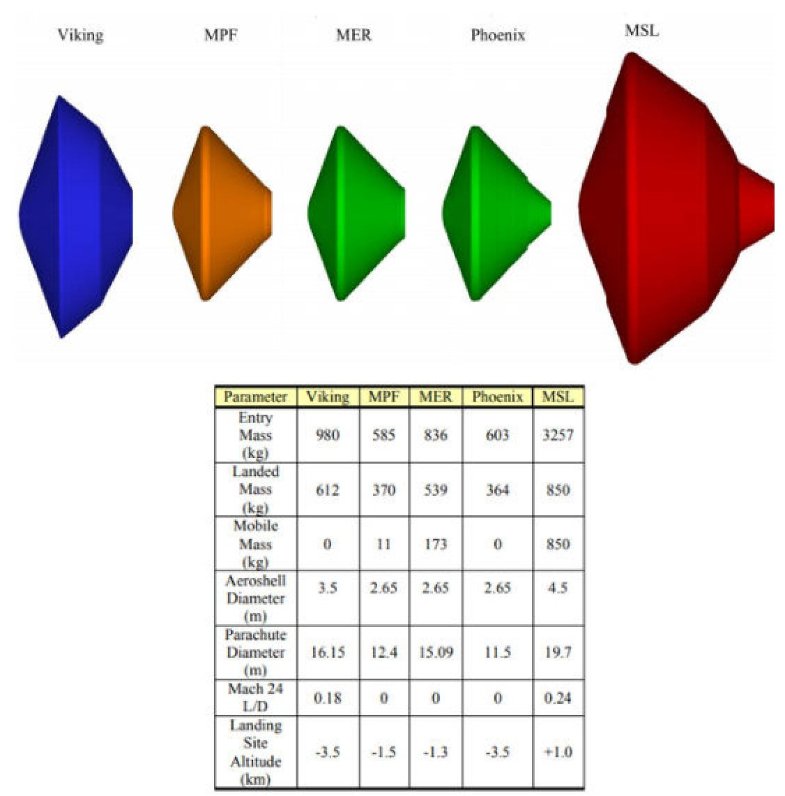

Figure 1.1: Summary of the heritage history of the Viking aeroshell design. Reproduced from Way [142].

<!-- PDF_PAGE: 21 -->

mated with the interplanetary cruise stage that is nearly identical to its MSL counterpart. During the EDL Start phase, vehicle systems are initialized for preparation for entry; upon completion of this process, minutes before entry interface, the cruise stage is jettisoned.

After the cruise stage is jettisoned, Exo-Atmospheric flight begins and the vehicle, still contained in the aeroshell, de-spins from a nominal cruise roll rate and reorients itself for entry. A lifting-body guided entry approach, which leverages offset centers of gravity and lift, is original to the MSL mission and enables improved landing accuracy. A complex set of propulsive and attitude procedures first demonstrated on MSL subsequently activate during the Entry phase to guide the vehicle and prepare it for Parachute deploy. A notable change to MSL protocols occurs in how the parachute deploy is triggered. Whereas MSL employed a planet-relative velocity trigger to initiate deployment, Mars 2020 engineers chose to replace this with a down-range "distance to target" trigger to minimize landing ellipse area. While this change is minimal - essentially a change in a single line of flight software - it demonstrates how mission level-constraints such as landing site selection may impact design reuse and adaptation decisions [146].

The larger landed mass of Perseverance along with knowledge uncertainty introduced by new failures in Earth-based supersonic parachute deployment tests led to the Mars 2020 parachute design changes. The resulting design is a strengthened version of the MSL 21.5 m diameter supersonic parachute [102]. As with the aeroshell design, the MSL parachute itself is a geometrically scaled version of the disk-gap-band design used in Viking, with a diameter of 16 m. Mars 2020 parachute "strengthening" is another example of a technical modification made to a largely reused design to improve performance and/or risk susceptibility on the new missions. These design changes may arise due to either new performance envelopes not explored in previous missions, or lessons learned from previous missions that suggest improvements to heritage designs. In the parachute case, both circumstances hold.

After parachute descent, the parachute and backshell are jettisoned and the vehicle enters powered descent via the Descent Stage and Sky Crane assembly. The last three phases of the EDL sequence proceed nearly identically to MSL, with one critical new capability: Terrain Relative Navigation (TRN). TRN allows the Descent Stage to avoid hazards via direct visual feedback and to select a safe landing site; this capability substantially expands the slate of candidate landing sites available to decision makers at the highest level of the mission design enterprise. Inclusion of TRN demonstrates an effective and efficient technology advancement approach incorporating reuse: incremental upgrades to largely proven heritage architectures.

The reuse approach adopted for the EDL system was carried through, perhaps as extensively, for the design of the Perseverance rover itself, as shown in Fig. 1.2 presented by Wilson [146]. New solutions (compared to MSL) were pursued only where new science objectives and payloads necessitated it, or where lessons learned or new technologies delivered functional improvements (e.g., a new wheel design in response to MSL wheel degradation).

This example illustrates the value of a prudent combination of three design approaches: reuse, reuse with modifications, and from-scratch (= de novo) design. In the most visible and expensive of space missions, an informed balance of the three can lead to both technical and programmatic successes that any one approach alone could not accomplish. However, not every project that incorporates reuse achieves such unmitigated success.

<!-- PDF_PAGE: 22 -->

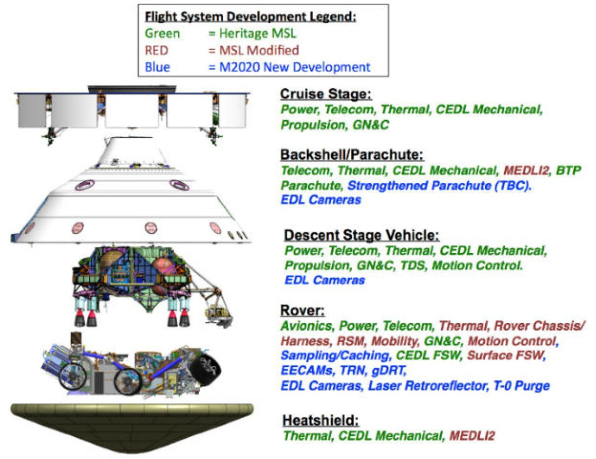

Figure 1.2: Summary of heritage and new development in the Mars 2020 EDL system. Reproduced from Wilson [146].

<!-- PDF_PAGE: 23 -->

## 1.1.2 Reuse Vignette 2 - MSL Actuator Troubles

We now trace back one generation in the Mars Rover lineage to examine a design reuse scenario on the Curiosity rover that did not prove as successful as the Mars 2020 example. In 2004, engineers began considering how to follow-up on the incredible success of the MER program - the Spirit and Opportunity rovers. One avenue they identified was to expand the landing site candidates beyond very near the Martian equator ( < 15 degrees latitude) to access more diverse locations ( > 30 degrees latitude) promising greater scientific returns. These additional locations are characterized by colder environments which, in turn, require a lubrication system for the many actuators on a future rover that could operate at lower minimum temperatures (-55 C) [104]. This presented engineers with two options: 1) to reuse the wet lubrication system common throughout the MER rovers with the addition of warm-up heaters to keep the Braycote lubricant within the proper viscosity or 2) attempt a new actuator development with a dry lubrication system capable of performing at colder temperatures. The MSL team chose the latter - a from-scratch design [17].

As development of the new dry system proceeded, testing campaigns revealed significant issues in the reliability and performance of the new design. For instance, some dry-lubrication actuator test articles reached only 20% of their design life during environmental testing [74]. Subsequent analyses of the circumstances point to technical as well as programmatic issues with the sole-source supplier selected by JPL for the 30+ actuators on the rover. With actuator design often integral to the design of other subsystems (e.g., the rover arm and sample manipulation system) [11], delays and redesigns of the actuators also led to delays to the entire development effort. Late into development, with persistent issues with the system, leadership decided to revert to the "modify and reuse" approach with the legacy wet-lubrication system. The supplier was then tasked with switching over designs, and retesting and delivering a large volume of actuators.

A project post-mortem identified poor risk management, related to reuse decisions, among several central technical and programmatic factors that caused the mission to miss it's 2009 launch date - eventually launching in November of 2011. A several-hundred million budget overrun was tied to this delay [16]. Recommendations from this report included:

- Avoid pursuing high-risk technologies (e.g., a new dry lubrication system) without greater assurances from suppliers about their ability to deliver

- Parallel development of these new technologies with a fall-back option to more easily integrate heritage technologies - pursue this back up until the new design is validated

The MSL mission and its Curiosity rover have proven to be an incredible technical success, revealing new and compelling details of the Martian surface and its history. However, from a programmatic view, a cascade of decisions relating to design reuse resulted in significant cost and schedule impacts.

## 1.1.3 Reuse Vignette 3 - Ariane 5 Software Reuse Failure

In 1996, engineers at Arianespace and in the European Space Agency (ESA) watched as their newly developed Ariane 5 vehicle embarked on its maiden voyage. 37 seconds after liftoff,

<!-- PDF_PAGE: 24 -->

an out-of-bounds reading for horizontal (downrange) velocity caused a conversion overflow error (from a 64 bit floating point to 16 bit signed integer) in the inertial reference code of the flight software. This error, for which no exception handling had been defined, in turn halted the guidance software. This was perceived by the vehicle as an attitude deviation that did not actually exist leading to unnecessary corrections by the engines and eventually destruction of the launch vehicle [36]. Though the Ariane 5 was a mostly new design as compared to its predecessor, the Ariane 4, this section of the flight software - the inertial reference platform - was one of the few design elements to be reused. Indeed, the reuse was nearly "copy and paste", being dropped directly into the Ariane 5 flight software without modification.

Subsequent failure investigations reveal that the decision to reuse the inertial reference code was not the design team's central failure, per se. Rather, the failure was in assuming that the code could be reused without an understanding of the underlying technical differences (i.e., in ascent profile, in-range and out-of-range parameters, etc.) between the Ariane 4 and Ariane 5 vehicles [72]. An upstream procedure for rigorously assessing these contextual distinctions before reuse decisions were made may have revealed the following [36]:

- The original purpose of the failed module of the inertial reference code on the Ariane 4 is to (a) align the reference readings pre-flight and (b) allow for rapid realignment in case of a pre-launch hold. The realignment functionality is not necessary in Ariane 5 due to different pre-launch procedures.

- To facilitate rapid reset, the module is allowed to run for 40 seconds into the launch though its functionality is exclusively pre-launch.

- Exception handling in this code segment for out-of-bounds horizontal velocity values was deemed unnecessary for the original design because the Ariane 4's ascent profile would never exceed the overflow value. Thus, the overflow issue was never encountered.

- Ariane 5's ascent profile in the first 40 seconds is substantially different from its predecessor, suggesting that the lack of exception handling for horizontal bias should be reconsidered; or alternatively, the unnecessary post-launch execution of the module should be prevented.

However, in the absence of these findings upstream of key reuse decisions, the inertial reference code was allowed to operate as-is. Test campaigns and validation/verification efforts also failed to reveal the problem. As such, a software bug emerged out of a lack of technical rigor for assessing a design reuse scenario. This bug caused the costly loss of a launch vehicle and its payload. Further, it damaged customer confidence in the reliability of the Ariane family of vehicles, though the Ariane 5 would go on to become a highly successful vehicle. Explored extensively as an example of failure in software reuse, the loss of the first Ariane 5 may more accurately be seen as a failure in reuse decision making.

## 1.1.4 The Bigger Picture

The preceding reuse stories are not intended to perpetuate a notion that design reuse will always fail. Indeed, the first example depicts clear successes in generation after generation

<!-- PDF_PAGE: 25 -->

of solutions to a common planetary exploration problem. Beyond these stories, design reuse whether or not the term is explicitly invoked - is ubiquitous across complex engineering projects. By avoiding "reinventing the wheel", engineers are able to rededicate their time to solving the novel problems that emerge whenever bold new endeavors are undertaken. This complementary nature between reuse and from-scratch approaches to tackling design challenges leads, perhaps paradoxically, to innovation and the advancement of technologies and capabilities. These benefits of successful design reuse are made more immediate and concrete when placed in terms of cost and schedule impacts on new projects. In fact, decision-makers overwhelmingly identify these cost and schedule improvements as their primary motivation for pursuing reuse (see Fig. 1.3 for results from an industry survey identifying potential benefits of design reuse). In addition to these benefits, design reuse also affords a reduction in technical risk; designs proven on previous missions are of course preferable to those that have not flown. Risk reduction is particularly valued in high-cost, high-visibility missions where failures are magnified - here, design reuse is preferred wherever new designs are not explicitly required by performance or demonstration constraints. The wide array of benefits attributed to design reuse makes clear why it is such a common practice.

However, as the vignettes also make clear, the set of potential benefits (enumerated in Fig. 1.3) are not always fully or even partially realized. These benefits should not be taken as a given, but rather, the decision to reuse should be informed by technical and programmatic analyses whose results support the feasibility and value of redeploying the candidate design. This need is particularly augmented in the regime of space systems, which is characterized by high development costs, long development lifecycles, high risk postures, and inaccessibility of assets once emplaced. These make it such that design reuse is not only a highly valued, but also a highly complex process with uncertain outcomes. This thesis will frame these complexities in the context of a systematic methodology for informing decision makers with the potential benefits and costs of implementing design reuse on a project.

## 1.2 Defining Design Reuse

The diversity of the outcomes of the reuse examples discussed in the previous section illustrate a difficulty when discussing the topic of design reuse namely, having an unambiguous definition of what is and what is not design reuse. This problem emerges from wide and often inconsistent usage throughout engineering disciplines of the terms "design", "reuse", and "design reuse". Indeed, with bold new capabilities such as the recovery and redeployment of launch vehicles, the term "reuse" has become overloaded. Similarly, the term "design" is often a vague catch-all term to which each individual may impute their own definition and context. In order to ensure consistent terminology (at least within this thesis, but ideally beyond it), we endeavor first to clearly define "design reuse" and related concepts. This is done in an introductory fashion here, and is built in greater detail in an ontology presented in Chapter 4. Wherever available, we leverage established definitions from standards organizations such as ISO, INCOSE, and IEEE and from the existing literature.

ISO/IEC/IEEE 24765 defines "design" as "the full set of information (concepts, models, descriptions, technical documentation) that captures the architecture, components, interfaces, and other characteristics of a system" [71]. While this definition is acceptable, we

<!-- PDF_PAGE: 26 -->

Which of the following do you consider to be potential benefits of design reuse in a product or mission development project? (N=134)

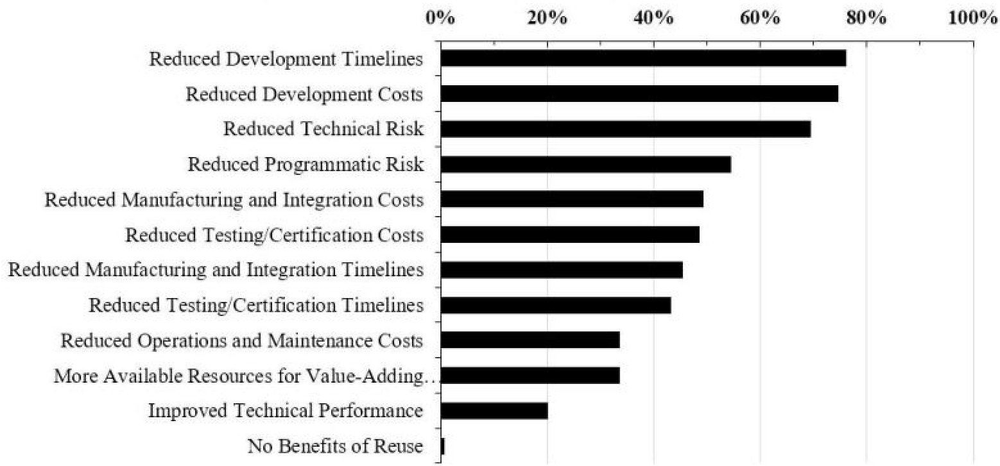

Figure 1.3: Potential benefits of design reuse on a mission development project as identified by industry practitioners. This survey is discussed in greater detail in Chapter 3.

<!-- PDF_PAGE: 27 -->

note that it makes no distinction between implicit and explicit modes of capturing such information. Implicit modes generally consist of information that is not explicitly stated or codified in the project documentation; this includes much of the knowledge, experiences, and assumptions that engineers learn and carry over from project to project. Conversely, explicit information is design information that is recorded in external and maintained project documentation and models that are produced throughout the systems engineering process. It is this explicit information that allows for the development, production, operation, maintenance, and disposal of the element described by the design.

Models, in turn, are defined as "abstractions of a system, aimed at understanding, communicating, explaining, or designing aspects of interest of that system" [33]. These abstractions, tailored to a specific view of a system of interest, may take many forms including discipline models and system (or mission) models. Discipline models describe a system from the perspective of a particular engineering, operational, programmatic, or other domain. System models are constructs related to the emerging paradigm of Model-based Systems Engineering (MBSE) - they act as coordinating models for the design information of a system in an integrated, authoritative digital environment. Thus, depending on the type of model, they can act as either suppliers of underlying data recorded in derived design documentation or as design documentation in themselves.

With these points in mind, we adopt the following definition of design reuse for this thesis:

Redeployment onto a new system of the design of an existing element as recorded in the original project documentation and models. These records contain the information necessary to develop, produce, operate, maintain, and, if necessary, dispose of the design.

Use of the term does not require there to be an identical or "copy and paste" version of the element in the new mission, but rather that there was a concerted effort undertaken to adopt and, if necessary, modify the candidate design to satisfy the needs and constraints of the new mission. This suggests that there exists a spectrum of design reuse ranging from near identical copies of a design to more heavily modified "inspired" designs. This definition also is agnostic to the architectural level of the element being reused - design reuse can be employed on high-level mission elements (e.g., the heritage EDL system on Perseverance) as well as on subsystem assemblies or components (e.g., bearing assemblies in the joints of a robotic arm). As we will see, this architectural level has implications on the difficulty and considerations necessary during a reuse effort. The next sections describe three additional characteristics that help to further refine the concept of design reuse: intentionality, "structured-ness", and the design environment.

## 1.2.1 Planned vs. Unplanned Design Reuse

The first characteristic for describing and classifying reuse efforts relates to the intentionality of the reuse. Along this dimension, reuse can be classified as either planned or unplanned. Planned reuse occurs when a design is developed from the outset with the explicit intent

<!-- PDF_PAGE: 28 -->

of being reused on a subsequent product or mission; this is the type of reuse implemented in product platforms and product lines. This approach leverages the lifecycle property of commonality, that Boas defines as "the sharing of components, processes, technologies, interfaces, and/or infrastructure across a product family" [13]. In space systems, planned reuse is prevalent in the areas of communications satellites, high-volume small satellite constellations, and other generational campaigns where spacecraft are incrementally advanced alongside technology maturation. Conversely, unplanned reuse is seen in designs that were not originally developed with the explicit intent of being reused in the future; this type of reuse opportunistically uses proven designs and is often conducted in a more ad-hoc fashion. It is commonly referred to as heritage or legacy design reuse $ ^{2} $ . In the space industry, unplanned reuse is ubiquitous, as proven systems often form the reliable foundation upon which new capabilities are developed. This approach is evident in novel science missions and exploration campaigns where unique objectives preclude product platforming, but proven designs may be picked from related predecessors.

The difference in intent regarding future reuse has consequences on how reuse decisions should be made. In planned reuse, the element is designed to satisfy a range of requirements across the constituent platform variants; while such commonality imposes questions of design efficiency and global vs. local optima, it does allow for greater confidence that the technical factors of future variants have already been taken into account [28]. This aims to prevent emergence of detrimental effects when reuse is implemented on a future variant; this is not always successful, as the prevalent phenomena of divergence illustrates [13]. Divergence manifests as a reduction in amount of reuse from what was initially intended to what was eventually realized. In unplanned reuse the candidate element is designed solely for its native mission. As such, redeployment of the design on a new mission - with objectives, functions, environments, constraints, etc. that were not part of the original design specification - requires more deliberate consideration and supporting analyses [7]. Divergence is still possible in this approach as unplanned reuse decisions made during preliminary design may not survive through detailed design and production.

The methods and analyses conducted in this thesis place particular emphasis on unplanned design reuse. Systematic approaches were found to be lacking in both academic literature and practice across various organizations sampled. In both domains, the focus is predominantly placed on planned reuse methodologies [13, 50, 107, 76, 63], with unplanned methods remaining mostly ad-hoc, mission-to-mission. An exception to this gap in the literature is found in the works by Hein and by Lange et al, whose motivations are similar to this work's [57, 84]. The former emphasizes the concept of an heritage assessment process, whereas the latter has begun exploring an MBSE-based solution in parallel to the approach presented here. These are elaborated further in the literature review in Chapter 2.

## 1.2.2 Structured vs. Unstructured Methods

A factor closely related to the intentionality of a reuse effort is the systematic rigor with which it is evaluated. In this sense, we ask the question: "Are the methods used to assess and decide on a reuse scenario systematically defined and consistently applied across

<!-- PDF_PAGE: 29 -->

projects?" Within this characteristic, methods may be described as structured or unstructured or somewhere between these two extremes. A structured design reuse process may exhibit the following characteristic:

- An explicit set of procedures has been defined

- These procedures are founded in best practices in systems engineering and design reuse as described in authoritative documents, such as NASA's Systems Engineering Handbook [98]

- Deviation from these procedures requires justification and management approval

- Reuse procedures are implemented consistently across an organization's portfolio

With these in mind, it is evident that planned reuse would exhibit a high degree of "structured-ness". Indeed, the infrastructure necessary to develop and effectively manage a platform of products sharing significant commonality would naturally lead to a more defined and consistent reuse process. The converse is true: A typical corollary to unplanned reuse is that the methods undertaken to redeploy the design onto a new mission are often unstructured [84]. In these decentralized and ad-hoc efforts, defining a procedure for reuse evaluation and decision-making then falls on each individual development team. In these cases, a commonality is lost that in more structured approaches would: incorporate design reuse lessons learned across an organization; reduce redundant work efforts; and ensure reuse decision-making reflects organization-wide postures on risk and other enterprise considerations.

In the worst case, unstructured methods may lead to detrimental impacts on the mission itself from a misapplication of reuse where it is not reasonably feasible. These facts emerge, again, due to design reuse rarely being a simple "copy-and-paste" effort. Structured processes, then, can guide:

- Systematic assessment of the the technical feasibility of reusing a design element (i.e., "Can the element satisfy the functionality and performance required of it in the new mission?")

- Enumeration of the type and degree of rework or modification needed to adapt the element from its native mission to the new mission, and

- Determination of the break-even work effort beyond which from-scratch designs would be preferable for a given design problem

Having a standardized set of such procedures, generalized for a wide set of mission types and applicable across diverse reuse scenarios ensures that benefits can be realized and that designers can make logically consistent decisions. These decisions may sometimes include abandoning a given attempt at design reuse. As we will see later, there appears to be a bias in decision makers that leads to over-optimism when it comes to the benefits of reuse. One of the goals of this thesis is to quantify this bias and to reduce the difference between predicted versus actual benefits of design reuse.

<!-- PDF_PAGE: 30 -->

## 1.2.3 The Design Environment

The third characteristic that is necessary to understand the current state of design reuse practices is the Design Environment within which the effort is carried out. The majority of present-day design efforts are conducted in a manner that we will refer to as the "static, document-centric" approach. This traditional process is based on the exchange of static documentation across stakeholders, designers, and decision makers. The documentation records and communicates all aspects of the system including: specifications and constraints; design options and trades; technical analysis results; programmatic realities; and ultimately, design decisions. This information is generated across a set of tools - starting with raw data produced in specialized software or domain models that is then distilled and reproduced in a more digestible form (e.g., Microsoft Word, Excel, and PowerPoint files).

While it has produced great successes, this traditional, document-centric Systems Engineering approach is imperfect. The manual transfer of information between stakeholders via disconnected and static documents causes several issues. First, it is common for a single piece of design data to have multiple origination points across the multitude of tools, leading to discrepancies when the derivative data products are integrated. The same phenomenon also causes difficulty in updating and propagating design changes. Further, discrete, manual transfer of design documentation makes it difficult to ensure consistency across the various views of the project and its stakeholders.

Considering multiple projects together, these limitations lead to loss of institutional knowledge and significant efforts to re-learn past designs in order to reuse them. To that end, in its Systems Engineering Vision for 2025, INCOSE identifies a key challenge currently facing the Systems Engineering discipline: that "Knowledge and investments are lost between projects...increasing cost and risk". The complexity of designing space missions and implementing design reuse - suggests that something other than traditional Systems Engineering is required to coordinate this effort. A transition from this traditional static, document-centric paradigm is underway throughout many industries, including the space industry - and it is one where reuse efforts in particular can benefit.

## 1.3 Why Explore Design Reuse?

Given the the three characteristics described in Section 1.2, we can carve a niche within the practice of design reuse that defines a problem, solution approach, and environment for that solution to be implemented in. Namely, a substantial portion of design reuse efforts in the space industry can be described as unplanned or legacy $ ^{3} $ [7]. These are often characterized by ad-hoc methods for evaluating the technical and programmatic feasibility of reusing the legacy element. Outside of a handful of efforts in academia, legacy reuse efforts do not typically exhibit a consistent and coherent procedure for systematically conducting these analyses [84, 57], as is seen throughout the literature and practice for platform-based, planned reuse [13, 63, 50]. The unstructured nature of unplanned reuse is further complicated by it being conducted in the traditional document-centric engineering environment [84].

Emerging trends in the space industry increase the value proposition of improved design

<!-- PDF_PAGE: 31 -->

reuse. These trends are visible across various sectors of the industry with varying motivations, objectives, and stakeholders, as summarized in Table 1.1. Firstly, commercial interests in space have witnessed a substantial expansion in recent years beyond traditional sectors (e.g., communications, civil program support) to a wide range of lucrative and/or novel capabilities including remote sensing, in-space manufacturing and servicing, space tourism, a new generation of commercial launchers, and even resource speculation and mining [59]. These commercial efforts are fundamentally driven by profits derived from meeting the needs of a customer base by emplacing and using space assets. In this structure, efficient and effective design reuse enables responsive development of assets to meet changing or expanding customer needs. Such agility facilitated by a combination of reuse and innovation also allows companies to respond to challenges by competitors as well as regulatory actions by government agencies.

Secondly, the civil/military space sector has different but equally important motivations for pursuing improved design reuse. Actors in this sector are tasked with delivering a functionality generally aimed at a common good or national security. A tension common in this sector is the expenditure that such programs incur versus the constraints of heavily scrutinized tax-payer funded budgets. In this matter, prudent reuse may reduce the financial impact on tax-payers by maximizing the utility of existing assets [35]. In the military context, a reuse motivation emerges that is also present in the commercial sector: improved responsiveness to meeting functional needs of the war-fighter and command structure.

The last sector where reuse derives particular motivation is in the space exploration enterprise; starting with NASA's Commercial Cargo and Crew, exploration campaigns have increasingly become "service-based". In this model, private industry competes and is contracted to deliver a particular functionality or capability and is given significant freedom in how to accomplish the task. Reuse in this model allows companies to competitively address solicitations from civil agencies while redeploying developed solutions into their non-civil facing products [92].

## 1.4 The Promise of Model-based Systems Engineering Methods

Having briefly detailed the problem of interest in this thesis, we now elaborate a solution approach - or rather, a paradigm in which the solution may be founded. This paradigm, namely MBSE, relates specifically to the third characteristics of the reuse definition presented previously: the design environment in which the reuse effort is conducted.

## 1.4.1 What is MBSE?

The International Council on Systems Engineering (INCOSE) defines MBSE as the "formalized application of modeling to support system requirements, design, analysis, verification and validation activities beginning in the conceptual design phase and continuing throughout development and later life cycle phases" [44]. Engineers have used models to inform designs of their systems since time immemorial, and these models have existed in the digital realm since computing capabilities became commonplace. However, until the emergence of the MBSE

<!-- PDF_PAGE: 32 -->

Table 1.1: Summary of special rationales of particular space sector industries motivating improved design reuse practices.

<table border="1"><tr><td>Space Industry Sector</td><td>Reuse Rationales</td></tr><tr><td>Commercial Space Interests</td><td>Reuse enables agile and responsive development of assets to meet changing customer needs and to respond to competitive and regulatory actions.</td></tr><tr><td>Civil/Military Space Interests</td><td>Reuse reduces the financial impact on taxpayers and maximizes utility of limited resources and existing assets. In a military context, reuse also leads to increased responsiveness to war-fighter and leadership needs.</td></tr><tr><td>Exploration Enterprise and Service-based Contracts</td><td>Reuse (within a commercial firm) allows for competitive solutions to civil solicitations while redeploying of those solutions back into non-civil facing products. Reuse by the civil organization ensures extensibility across exploration objectives(e.g., Moon-to-Mars extensibility).</td></tr></table>

<!-- PDF_PAGE: 33 -->

paradigm, such models - spanning all aspects of a system's design - were developed and kept in disconnected tool-sets and communicated via secondary products, primarily static documents and files. MBSE leverages integrated data practices and shared or distributed computing methods to "move [the] record of authority from documents to digital models in a data-rich and reliable environment." [55] This dynamic is illustrated in the graphic on Fig. 1.4, where the file and presentation icons represent the methods by which design aspects are transmitted in the traditional approach; by contrast, such documents may be produced as final descriptive elements in the MBSE approach, but here the full system description and all design information is maintained in the integrated digital model-set.

MBSE calls for the creation of a system (or mission) model. This model acts as the overarching record for the design decisions and descriptive, behavioral, and structural aspects of a system of interest. The system model coordinates these multiple perspectives of a system such that all relevant stakeholders and engineering teams share a consistent understanding of the state of the design. The traditional discipline models engineers have come to rely on can then be integrated into this larger system model in order to drive the design to increased levels of maturity and technical and programmatic detail.

Building an MBSE system model requires a way of representing diverse pieces of system information in a coherent fashion. Various modeling languages have been defined to accomplish this task. Among them, the most well adopted is the Systems Modeling Language, or SysML, which itself is based on the Unified Modeling Language (UML) originally developed for software engineering [105]. SysML abstracts from its software predecessor to enable graphical representation of any complex system design via 9 diagram types, each capturing an aspect of its behavior, structure, or requirements. The language continues to evolve, with SysML v2 set to be released by the Object Management Group (OMG) in short order. Tool vendors, as well, continue to augment their product offerings as more complex engineering organizations explore adoption of MBSE methods. Prominent SysML-capable tools include MagicDraw/Cameo, Sparx Enterprise Architect, Rational Rhapsody and Modelio. A SysML-centric methodology may be augmented with auxiliary modeling languages such as Object-Process Methodology (OPM).

The paradigm of MBSE is intended to improve upon the current state of systems engineering practice. To effect this improvement and boost enterprise-wide adoption, specific use-cases for MBSE methods and the value added by these methods are desired [90]. To that end, and thanks to the synergies discussed in the coming sections, this thesis will explore application of MBSE methods to the design reuse problem.

## 1.4.2 MBSE as a Facilitator of Design Reuse

Systematic adoption of the MBSE paradigm theoretically confers a range of benefits to an organization's design efforts. In practice, these benefits are tempered by the socio-technical complexities of transitioning from the traditional design environment. Nevertheless, adoption of MBSE across engineering organizations is ongoing. Schoberl identifies 6 specific benefits organizations cite in their MBSE adoption rationale [120]:

- Reduce development cost and cycle time by improving problem understanding

<!-- PDF_PAGE: 34 -->

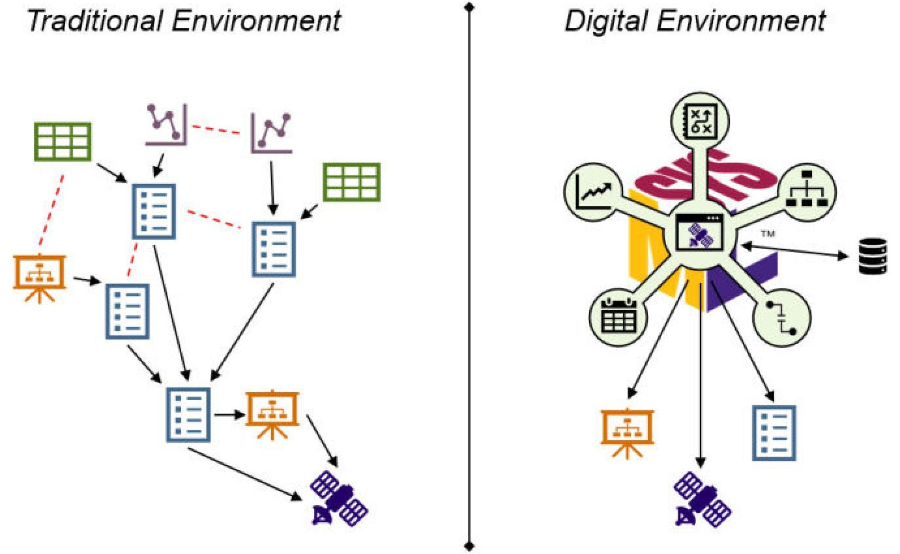

Figure 1.4: Comparison of traditional and digital/MBSE design environments. In the traditional environment, engineering teams develop analyses and snippets of the architecture that are recorded in static documentation. Conversely, the MBSE or digital environment centralizes and integrates this information via a governing system model.

<!-- PDF_PAGE: 35 -->

- Improve collaborative, interdisciplinary engineering by establishing a shared system understanding

- Facilitate communication by using a single and up-to-date source of information, often referred to as the 'single source of truth'

- Reuse architecture and engineering work results by documenting previous solutions

- Improve risk assessment, safety considerations, and quality assurance through transparency and traceability

- Improve later lifecycle activities through easily accessible documentation

In an industry study conducted by Schoberl, "Reuse architecture and engineering work results... is ranked among the top three of these benefits. Industry practitioners recognize the potential of digitization and centralization of engineering data for improving the retention and redeployment of previously generated knowledge, models, and designs. Indeed, some of the other benefits indirectly impact circumstances that further facilitate reuse. The second benefit ("Improve collaborative, interdisciplinary engineering...") motivates trust in the accuracy of system information and, in turn, the reuse feasibility evaluations conducted by the relevant discipline engineering teams and their respective analytical tools. Structured reuse methods that follow a consistent and systematic procedure also reinforce the fifth benefit above ("Improve risk assessment...quality assurance...").

MBSE, then, promotes a development infrastructure that may facilitate better design reuse practices in an organization. The methods that in a single development project foster improved system understanding also, in a larger enterprise perspective, facilitate reuse of those designs onto new projects.

## 1.4.3 Conditions Conducive to MBSE Adoption and Design Reuse

A common criticism of MBSE practices, particularly modeling languages like SysML, is the high barrier to entry in terms of training users. This problem emerges as designs mature and their accompanying system models become incredibly complex. This growing model complexity leads to difficulties in legibility and understanding by those not involved in their development. Thus, the benefits related to shared understanding of a design may be reduced or removed by exploding model complexity.

Organizational investment for improved training regimens for system modelers and engineers may be required especially for reuse efforts, where they must work not only with their own models, but also models built by others. Such training, implemented organization-wide, could lead to more consistent application and standardization of modeling practices. Foundational to creating environments favorable for MBSE deployment is organizational buy-in that is, the leadership and management must understand the value of MBSE and encourage and potentially specify the scope of its usage.

There are also organizational conditions that specifically address design reuse practices. Agresti devised the 4A Method for evaluating the reusability of a given software element by a sequential set of conditions [1]. These conditions are also applicable beyond the regime of software; they are:

<!-- PDF_PAGE: 36 -->

- Availability - the reusable artifact must not have been destroyed, erased, or lost.

- Awareness - the designer must know of the existence of the reusable artifact.

- Accessibility - a transfer mechanism must exist to get the reusable artifact from where it is archived to where it is needed.

- Acceptability - the reusable artifact must be acceptable to the designer for use in the new project and its environment.

Each of these necessary conditions focuses on a different aspect of an organization's cultural and technical approach to reuse. Availability and accessibility relate to the approach adopted for archiving and maintenance of design information and data $ ^{4} $ . Awareness relates to the extent of communication and openness across teams and projects, while acceptability ultimately depends on the technical analyses necessary for determining the feasibility and work effort required for a given reuse scenario. The traditional design environment presents challenges to each of these reusability qualities; conversely, they are each addressed or in some way improved by the MBSE paradigm.

## 1.5 Summary & Roadmap

## 1.5.1 Thesis Summary

In preceding sections, we have described the two main domains that are of interest in this research, namely legacy (or unplanned) design reuse and MBSE. We can now summarize the motivation that drives this work and introduce its central contribution - the Legacy Design Reuse in MBSE (LDRM) methodology.

## 1.5.1.1 Guiding Motivation

Design reuse is a common practice in the space industry due to a desire by engineers and managers to reap cost and schedule benefits while buying down risk with proven designs. However, legacy design reuse decisions during preliminary phases of an architecting effort are often overly optimistic regarding these benefits. This may be attributed to a lack of due diligence in assessing the feasibility and effort involved in adapting the candidate design to the new mission's constraints and environment. A systematic and structured approach for performing such analyses may improve legacy reuse decision making and correct the biases that organizations. Such an approach may be supported by the integrated data and design practices of MBSE.

<!-- PDF_PAGE: 37 -->

## 1.5.1.2 Use Cases

This motivation can be refined into a set of questions for LDRM to address. These questions set its scope and intended use cases. As we will see, these use cases are derived from the findings of a survey of industry practitioners as well as an extensive review of the reuse literature, addressing best practices and common pain points in the reuse process. End-to-end application of LDRM, therefore, should sequentially answer each of these questions:

1. For a given functional need in a mission of interest, are there any existing designs that merit consideration for potential reuse? Are there any that can be immediately excluded?

2. Does a reuse candidate design satisfy the functionality and constraints in the mission of interest? If not, what are the types and magnitudes of the gaps?

3. What rework actions may be required to address these gaps?

4. How does the expected rework campaign impact programmatic risk (cost and schedule performance)?

5. How does it affect the existing qualification and readiness (i.e., TRL) of the design?

6. How do these reuse efforts compare against an equivalent from-scratch design solution? These use cases can be refactored into a notional "user story":

A systems engineer on a new project is tasked with informing management of the possible design solutions for a key functional element. They know of a design from a predecessor mission that delivers similar functionality but would like to explore the degree of compatibility with the new mission. To that end, they need to systematically assess the potential technical and programmatic impacts of proceeding with reuse of this design.

There are some variations to this use case that still represent valid applications of LDRM. First, the candidate design need not be sourced directly from a predecessor mission; it may also be sourced from a catalog of archived designs. A design catalog for space systems components is not a new concept; however, the use of such catalogs in integrated MBSE environments is a promising new modality whose promise has only been minimally demonstrated. It could allow for rapid, unplanned composition of architectures from curated archives of proven designs[122]. A second valid variation is use of the methodology not as pre-decision support, but as impact assessment of some mandated reuse decision. In this mode, LDRM assists in addressing implications of these mandates early in the program life-cycle.

Important to note are the use cases that LDRM is not intended to answer. These out-of-scope questions are imposed by the level of design detail available during the life-cycle phases where the methodology is implemented. For instance, LDRM is not intended to provide an exhaustive and fine-detailed workflow of rework actions to adapt the design but rather an abstracted one that captures major rework activities. These should not be seen as limitations but rather natural bounds on the applicability and scope of the methodology. Lastly, LDRM is intended primarily for the development of space systems - however, any complex engineering system with similar characteristics (long life-cycle times, prevalence of unplanned reuse, etc.) may benefit from its findings.

<!-- PDF_PAGE: 38 -->

## 1.5.1.3 Value Proposition and Costs

This family of notional use cases points to the value proposition presented by LDRM:

Deliver systematic assessments of unplanned reuse scenarios that lead to improved decision making.

- Technical risk is reduced by analysis of reuse feasibility and rework actions supported by integrated domain-engineering tools.

- Programmatic risk is reduced by quantitative estimation of the requisite systems engineering effort for incorporating the rework campaign. Managers can better allocate cost and schedule margin to accommodate reuse efforts.

- Combined technical and programmatic analyses may serve to recommend against design reuse where it may prove detrimental to a mission.

Additional value-added is delivered by the methodology's foundation in an MBSE environment. This primarily emerges from the integrated data landscape that ensures that authoritative and up-to-date information is used throughout the analysis. This traceability is reinforced by the integration of traditional domain-engineering tools into this data landscape, allowing for engineering teams to more directly influence reuse decision-making. On the far end of the development effort, the MBSE environment allows for more efficient archiving of designs for future reuse.

Balancing this value proposition are certain costs imposed by the required inputs and the environment within which it is based. These costs can generally be categorized as: a) MBSE implementation costs and b) documentation costs. The former relate to the costs associated with setting up an MBSE infrastructure and the requisite standards, training, tool acquisition, organizational integration, etc. These costs should not be attributed solely to adoption of the reuse methodology, but should be seen in light of the multitude of use-cases that MBSE enables. Secondly, documentation costs relate specifically to the "reuse metadata" that comprise the necessary inputs. In the traditional document-centric approach, compilation of this data would likely impose significant costs on a mission; however, if standards for archiving and "design/modeling or reuse" are emplaced early in MBSE adoption in an organization, then this metadata can be made more easily accessible to users of LDRM. Therefore, costs of type (a) are upfront and are expected to vanish as MBSE becomes commonplace; costs of type (b) are recurring but may be reduced by adoption of more efficient MBSE-based archiving practices.

## 1.5.1.4 Use Context

Several other characteristics describe the context of intended LDRM application. These capture when in a development project it can be used, and by whom.

Intended Life-Cycle Phase LDRM is intended to inform early decision making regarding design reuse vs. from-scratch solutions. This is motivated by the fact that it becomes much more costly to change the direction of a design the more it matures; NASA and INCOSE

<!-- PDF_PAGE: 39 -->

both estimate that up to 75% of eventual project costs are committed before Preliminary Design Review (PDR) [98, 68]. To that end, the intended phase of application for LDRM is during Phase A, per NASA's standard Project Life Cycle breakdown $ ^{5} $ . More precisely, the window of intended use begins after the System Requirements Review (SRR) has established a baseline set of requirements for the mission. As we will see, the methodology does rely on a certain maturity to the specifications and definition of the architecture in order to accurately assess the reuse implications. By the System Definition Review (SDR) milestone within Phase A, this maturity may be achieved in the architectural elements that neighbor the reuse need. Therefore, this window between SRR and SDR within Phase A constitutes the "sweet spot" for LDRM application - it can inform design decisions at an early-enough mission phase to prevent architectural lock-in, while working with sufficient design definition to make substantial assessments.

Users The notional user of LDRM is a systems engineer on a mission design project in the early phases of development. This engineer is tasked with trading design solutions for key functional elements of the system. The user is also experienced with MBSE methods, practices, and tools. Depending on the complexity of the project, several engineers may make up a "reuse exploration" team.

Other Stakeholders Aside from the immediate user(s), a set of stakeholders exist who have a vested interest in the implementation and/or results of the methodology. They form a network of suppliers and clients of elements of LDRM. These include:

- project management tasked with making design decisions considering both technical and programmatic factors; they consume outputs of LDRM to inform their decision making.

- discipline engineers tasked with supporting technical assessments of reuse feasibility and necessary rework/adaptation actions; their analyses and technical tools must interface with the coordinating MBSE model.

- MBSE modelers of other aspects of the mission; the methodology's model elements and constructs must be compatible with these other model views.

## 1.5.2 Roadmap

Figure 1.5 presents the roadmap for this thesis and the key outputs of each Chapter - all aimed at supporting development, validation, and application of LDRM. Chapter 2 details an extensive literature review that informed the research goals and subsequent work efforts. It also includes a more detailed treatment of the topics introduced in this Chapter. Chapter 2 concludes by identifying a gap in existing research and the thesis statement derived from this gap.

<!-- PDF_PAGE: 40 -->

Chapter 3 presents an industry survey and interview campaign that was conducted to gather insights from design practitioners on the topic of reuse. The best practices deduced from the work in Chapter 3 inform development of the methodology presented in Chapter 4. Chapter 4 also demonstrates application of LDRM onto a representative sample problem focusing on reuse of a robotic arm for a hypothetical lunar rover.

Chapter 5 presents a validation effort and further demonstrates application of LDRM on two real-world examples. Both internal and external validation are attempted. A key element of the validation effort is a virtual design/build exercise. Two case studies are pursued: 1) design reuse via existing MBSE models between the AeroCube 10 (AC-10) and DAILI CubeSat missions by The Aerospace Corporation and 2) exploration of mandated design reuse on NASA's Space Launch System (SLS).

Chapter 6 concludes with a discussion of key findings from the research effort as a whole. The discussion wraps up with identification of next steps and implications of this work on future research. Beyond Chapter 6, appendices present added detail on some aspects of this work or tangential efforts including the reuse survey and a framework for functional cataloguing of space habitat design artifacts in an MBSE environment.

<!-- PDF_PAGE: 41 -->

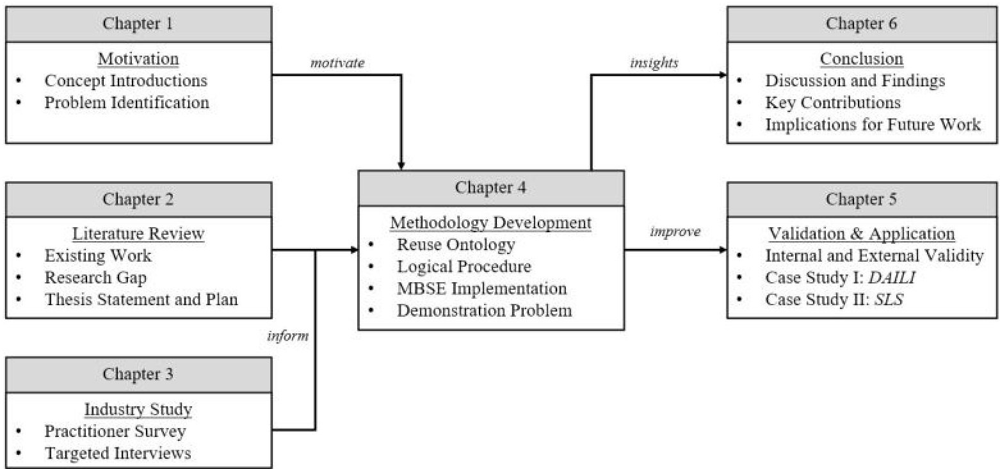

Figure 1.5: Thesis roadmap that presents the key elements of each chapter in support of the central contribution of LDRM development.

<!-- PDF_PAGE: 42 -->

## Chapter 2

## Literature Review and Thesis Statement

This Chapter presents an extensive review of literature relevant to the various topics covered in this thesis. The aims are to understand the current state of the practice for each topic and to determine the gaps or areas of improvement where this research can contribute. The topics of interest, as introduced in the preceding Chapter, are design reuse and MBSE. Fig. 2.1 depicts the sub-topics within each that will be explored in detail. At the conclusion of the literature review section, we will be able to define gaps in research within which to build the objectives of this thesis.

## 2.1 Literature Review

## 2.1.1 Design Reuse - Theory and Practice

In the context of space systems, Barley defines heritage systems as "Hardware, software, and procedures with previous flight history that are reused for a new mission in order to enable a mission capability or reduce overall mission cost, schedule, or risk" [7]. However, this reuse does not come without risks and costs of its own. First, Barley points to a danger in forcing reuse when it is not appropriate, or conversely, where a novel design may be the best approach. Relatedly, Barley acknowledges that reuse is rarely, if ever, a copy and paste effort. To that end, they define an Inheritance Process for effecting heritage reuse as: the process by which the technical feasibility of adapting legacy elements for use on new missions is assessed. The inheritance process can be conducted in two steps:

- Understand differences in mission context - differences mission requirements and objectives, environments, operational procedures, and Concept of Operations (CONOPs), system of systems context

- Estimate engineering effort to address differences - Assess required design and integration changes, system impacts and emergent behaviors, interfaces and interactions, retesting and requalification

This inheritance effort, succinctly described by Barley, is also embedded into canonical Systems Engineering process documents, such as NASA's Systems Engineering Handbook.

<!-- PDF_PAGE: 43 -->

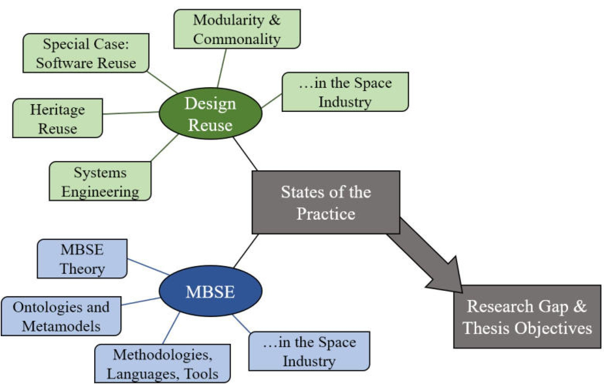

Figure 2.1: Breakdown of topics that are covered in the literature review, stemming from the two central research dimensions of MBSE and Design Reuse.

<!-- PDF_PAGE: 44 -->

Fig. 2.2 summarizes the systems engineering process that takes a project from initial formulation through implementation [98]. Project maturity is traced down the rows, starting form initial stakeholder elicitation and culminating in disposal. The first reference to reuse (highlighted in green) occurs in the implementation plan that converts design solutions into actual designs. Here, three modes for implementation are defined: make, buy, or reuse. It should be noted that even a preliminary reuse decision must wait for several upstream processes and decisions to be made. Preliminary reuse plans, nominally ready by the end of Phase A, are dependent upon items such as concept definition, (high level) requirements and low level allocation, and performance measures to be at least baselined for the project. Further, a process of reuse refinement (preliminary - baseline - updated) is also necessary. These considerations point to the informed process required of heritage reuse, as illustrated by Barley.

The NASA SE Handbook further summarizes required considerations of the reuse process as follows [98]:

- Extreme care should be taken to ensure that the product is truly applicable to the new project and for the intended uses and environment in which it will be used.

- Available documentation (e.g., as-built documents, user guides, operations manual, discrepancy reports, waivers, deviations) should be reviewed by the technical team so that they can be completely familiar with the (reused) product.

- Availability of supporting or enabling products or infrastructure needed to complete fabrication, testing, analysis, verification, validation, or shipping must be determined - here, the possibility of obsolescence due to a lack of mechanisms for re-instantiating the design exists, as explored by Hofsetter, Boas, and other [62,13].

- Relying on prior validation and verification should only be considered if the products documentation meets or exceeds the V&V requirements of the current project and V&V was clearly demonstrated.

Central to any reuse effort, NASA states, is a set of well-written requirements for both the project of interest and the reusable candidates considered: "requirements make it easier to transfer the product". Concepts of heritage are also present in the ubiquitous Technology Readiness Level (TRL) metric used extensively by NASA (illustrated in Fig. 2.3). While typically used to gauge maturity of new technologies, once technologies have been proven (i.e., TRL 9) they become eligible for re-deployment on subsequent missions [61]. Again, a caveat is included that "the pedigree of a reused product in its original application should not be relied upon in a different system, subsystem, or application". Therefore, unless the mission is identical to the predecessor from which the reused asset is borrowed, the TRL for the design should be reduced - requiring a range of new work efforts, depending on the magnitude of this mission difference [98]. These new efforts may include re-qualification, re-testing (either individually or integrated), re-certification, etc.

## Reuse Problems and Causes

Formal NASA guidance places legacy reuse in the context of the larger Systems Engineering process; they also give general considerations for how reuse can most effectively be

<!-- PDF_PAGE: 45 -->

<table border="1"><tr><td colspan="2"></td><td colspan="4">Formulation</td><td colspan="6">Implementation</td></tr><tr><td rowspan="5">Products</td><td>Uncoupled/Loosely Coupled</td><td colspan="2">KDP0</td><td>KDP1</td><td colspan="7">Periodic KDPs</td></tr><tr><td>Tightly Coupled Programs</td><td colspan="2">KDP0</td><td>KDP1</td><td colspan="2">KDPII</td><td colspan="2">KDPIII</td><td colspan="2">Periodic KDPs</td></tr><tr><td rowspan="3">Projects and Single Project Programs</td><td>Pre-PhaseA</td><td colspan="2">PhaseA</td><td>PhaseB</td><td colspan="2">PhaseC</td><td colspan="2">PhaseD</td><td>PhaseE</td><td>PhaseF</td></tr><tr><td>KDPA</td><td colspan="2">KDPB</td><td>KDPC</td><td colspan="2">KDPD</td><td colspan="2">KDPE</td><td>KDPF</td><td></td></tr><tr><td>MCR</td><td>SRR</td><td>MDR/SDR</td><td>PDR</td><td>CDR</td><td>SIR</td><td>ORR</td><td>FRR</td><td>DR</td><td>DRR</td></tr><tr><td colspan="2">Stakeholder Identification and</td><td>**Baseline</td><td>Update</td><td>Update</td><td>Update</td><td></td><td></td><td></td><td></td><td></td><td></td></tr><tr><td colspan="2">Concept definition</td><td>**Baseline</td><td>Update</td><td>Update</td><td>Update</td><td>Update</td><td></td><td></td><td></td><td></td><td></td></tr><tr><td colspan="2">Measure of effectiveness definition</td><td>**Approve</td><td></td><td></td><td></td><td></td><td></td><td></td><td></td><td></td><td></td></tr><tr><td colspan="2">Cost and schedule for technical</td><td>Initial</td><td>Update</td><td>Update</td><td></td><td>Update</td><td>Update</td><td>Update</td><td>Update</td><td>Update</td><td>Update</td></tr><tr><td colspan="2">SEMP1</td><td>Preliminary</td><td>**Baseline</td><td>**Baseline</td><td>Update</td><td>Update</td><td>Update</td><td></td><td></td><td></td><td></td></tr><tr><td colspan="2">Requirements</td><td>Preliminary</td><td>**Baseline</td><td>Update</td><td>Update</td><td>Update</td><td></td><td></td><td></td><td></td><td></td></tr><tr><td colspan="2">Technical Performance Measures definition</td><td></td><td></td><td>**Approve</td><td></td><td></td><td></td><td></td><td></td><td></td><td></td></tr><tr><td colspan="2">Architecture definition</td><td></td><td></td><td>**Baseline</td><td></td><td></td><td></td><td></td><td></td><td></td><td></td></tr><tr><td colspan="2">Allocation of requirements to next lower level</td><td></td><td></td><td>**Baseline</td><td></td><td></td><td></td><td></td><td></td><td></td><td></td></tr><tr><td colspan="2">Required leading indicator trends</td><td></td><td></td><td>**Initial</td><td>Update</td><td>Update</td><td>Update</td><td></td><td></td><td></td><td></td></tr><tr><td colspan="2">Design solution definition</td><td></td><td></td><td>Preliminary</td><td>**Preliminary</td><td>**Baseline</td><td>Update</td><td>Update</td><td></td><td></td><td></td></tr><tr><td colspan="2">Interface definition(s)</td><td></td><td></td><td>Preliminary</td><td>Baseline</td><td>Update</td><td>Update</td><td></td><td></td><td></td><td></td></tr><tr><td colspan="2">Implementation plans (Make/code, buy, reuse)</td><td></td><td></td><td>Preliminary</td><td>Baseline</td><td>Update</td><td></td><td></td><td></td><td></td><td></td></tr><tr><td colspan="2">Integration plans</td><td></td><td></td><td>Preliminary</td><td>Baseline</td><td>Update</td><td>**Update</td><td></td><td></td><td></td><td></td></tr><tr><td colspan="2">Verification and validation plans</td><td>Approach</td><td></td><td>Preliminary</td><td>Baseline</td><td>Update</td><td>Update</td><td></td><td></td><td></td><td></td></tr><tr><td colspan="2">Verification and validation results</td><td></td><td></td><td></td><td></td><td></td><td>**Initial</td><td>**Preliminary</td><td>**Baseline</td><td></td><td></td></tr><tr><td colspan="2">Transportation criteria and instructions</td><td></td><td></td><td></td><td></td><td>Initial</td><td>Final</td><td>Update</td><td></td><td></td><td></td></tr><tr><td colspan="2">Operations plans</td><td></td><td></td><td></td><td>Baseline</td><td>Update</td><td>Update</td><td>**Update</td><td></td><td></td><td></td></tr><tr><td colspan="2">Operational procedures</td><td></td><td></td><td></td><td></td><td>Preliminary</td><td>Baseline</td><td>**Update</td><td>Update</td><td></td><td></td></tr><tr><td colspan="2">Certification (flight/use)</td><td></td><td></td><td></td><td></td><td></td><td></td><td>Preliminary</td><td>**Final</td><td></td><td></td></tr><tr><td colspan="2">Decommissioning plans</td><td></td><td></td><td></td><td>Preliminary</td><td>Preliminary</td><td>Preliminary</td><td>**Baseline</td><td>Update</td><td>**Update</td><td></td></tr><tr><td colspan="2">Disposal plans</td><td></td><td></td><td></td><td>Preliminary</td><td>Preliminary</td><td>Preliminary</td><td>**Baseline</td><td>Update</td><td>Update</td><td>**Update</td></tr></table>

Figure 2.2: System engineering product maturity throughout the NASA Systems Engineering lifecycle. Note that reuse is first considered between Phases A and B. Borrowed from NASA SE Handbook [98].

<!-- PDF_PAGE: 46 -->

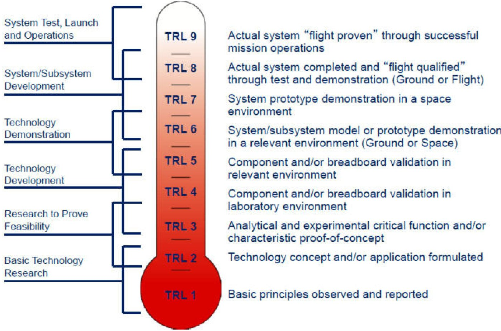

Figure 2.3: Summary graphic of the Technology Readiness Level designations used extensively in the space industry. Borrowed from NASA Technology Readiness Assessment Team Report [61].

<!-- PDF_PAGE: 47 -->

implemented. However, they do not present a structured procedure for how to conduct relevant reuse analyses (and how to make reuse decisions), nor do they discuss common issues or complexities that may emerge. In a thorough treatment of reuse problems and their causes (specific to the design of mechanical/hardware products), Busby identifies 5 categories of problems [18]:

1. Reuse Absence - reuse not taking place where it would have been desirable

2. Process Failure - problems arising from organizational factors, such as changes in the information system affecting availability of design data

3. Additional Effort - unexpected or disproportionate levels of effort having to be devoted to reuse to "make it work"

4. Knowledge Loss - inappropriate replication or storage of necessary design knowledge

5. Performance Failure - errors introduced during or because of design adaptations during reuse

Busby then, via extensive interviews with designers and managers, attributes main causal factors leading to each of these failure types. Main failure factors are categorized into: Engineering, Cognitive, Motivational, Organizational, and Environmental. Engineering factors relate to technical properties of the reuse artifact or the design process; cognitive and motivational factors relate to the designer in their intellectual and social capacities; organizational and environmental factors relate to the community of team members and the management and informational structures in place around them. A key finding of this study is the socio-technical complexity from which design reuse problems emerge - primarily via the organizational and environmental factors, as opposed to "hard" engineering concerns. This is reinforced by later studies, such as one by Cole in 2014, that identified "management commitment" and lack of organizational "reuse roles" as key factors in reuse failure [25]. In a specific case, Good finds environmental causes to reuse problems in NASA's SLS program - here, the environment being the Congressionally mandated reuse of certain aspects of the SLS design [51]. The new digital environment enabled by MBSE may provide solution avenues to some of these problems. Regardless, a key takeaway from these studies is the categorization of problems and causal factors into a canonical set that can be intentionally addressed by systematic reuse methodologies.

## Existing Frameworks for Solving the Heritage Reuse Problem

Having explored the conceptual development and practical concerns arising from the generic design reuse problem, we now focus on solution approaches in the literature. Of special focus are two works: the first, an extensive treatment on the heritage reuse assessment process in a thesis by Hein [57], and the second, an early effort by Lange to place the heritage reuse problem in the context of MBSE techniques [84].

In pursuit of developing an assessment procedure for heritage reuse, Hein begins by developing a conceptual framework encompassing the domains of interest to the problem. This framework essentially consists of sub-frameworks for: 1) describing the system architecture,

<!-- PDF_PAGE: 48 -->

2) capturing the relevant technologies, and 3) verifying, validating, testing, and operating (VVTO) the reuse asset. The System Architecture framework section explores existing frameworks, including those by Crawley, DoD, and ISO/IEC/IEEE [28, 112, 70]. A system architecting framework is synthesized primarily from work by Crawley and the MIT System Architecture Lab; this framework places emphasis on the relationship between functional and physical representations to deliver capabilities that satisfy objectives. It is within this system architecting picture that the system context (i.e., mission environment, interfaces, objectives, constraints, etc.) can be defined, and heritage reuse decisions can be explored.

Hein's technology framework expounds on technology and knowledge theory in order to develop several categories of technology change; among these, most central to the reuse question are technology modifications (as may be required during an adapted reuse instance) and technology loss (as may result from obsolescence or out-of-dateness of a technology or the mechanisms that produce it). Lastly, the VVTO framework captures the operational history and verification, validation, and testing campaign carried out on a design. Hein incorporates the concept of TRL into the assessment of an asset's history and heritage. Here again, a point is made to take into consideration the operational context, environment, and modifications before determining the applicability of VVTO results in a heritage reuse case. With this framework in place, Hein proceeds with a rigorous statistical analysis to validate the common, often qualitative claims of the benefits of heritage reuse; namely, reduction in development cost and schedule as well as reduction in cost and schedule overruns. In particular, he confirms these benefits for a representative set of space systems with caveats to generalization to a large population.

Finally, Hein combines insights and findings from the framework development and statistical analysis to develop a heritage assessment methodology. Analyses specified by the methodology include:

- Compliance Assessment - evaluation of requirement and constraint satisfaction of the heritage asset in the new mission.

- VVTO Assessment - evaluation of a technology's heritage in terms of verification, validation, testing, and operations; specifically determines if this validity can be transferred to the new application.

- Design Heritage Assessment - evaluation of impacts of design changes on the heritage system.

- Technological Capability Assessment - evaluation of the maturity of a technological capability

A process diagram, laying out the order and flow of these assessments, is shown in Fig. 2.4. Alongside these analytical processes, Hein also defines some tools that are used to implement them. The last three assessments described in the bullets above yield, among other things, a metric for assessing a heritage element in the focus of that assessment. In a final output, Hein attempts to combine these metrics into an overarching heritage metric whose value is validated for various types of heritage including full reuse, technology resurrection, new mission context, and in the edge case, an altogether unproven design. The full validated

<!-- PDF_PAGE: 49 -->

methodology and its components is one of the few known instances of an end-to-end heritage assessment procedure. As will be shown in the research gap section of this Chapter, we will build upon Hein's work in several areas. Most notably, we will import and modify the conceptual framework to allow for implementation of heritage reuse procedures in an MBSE environment. We will further demonstrate integration of domain and programmatic tools into the model-based environment to lend technical rigor and effort-estimating capabilities. The work by Lange, which places an emphasis on usage of the MBSE paradigm for such heritage efforts is discussed further in Section 2.1.2.3.

## 2.1.1.1 Reuse in the Space Industry

In this section, we review the current state of the practice and major trends related to reuse among civil and commercial players in the space industry. While many industries (e.g., automotive, consumer electronics) extensively employ reuse, the space industry is unique in its repertoire of reuse practices ranging from opportunistic heritage efforts to planned product platforms and families. Additionally, the characteristics of space missions (e.g., large-scale development, emplacement and operational costs, highly complex/multi-disciplinary systems, low-risk attitude and culture, multi-faceted scenarios, and inaccessibility of assets once deployed) make design reuse decisions highly consequential over the long haul. Below, we discuss the findings of this review of industry practices and publications.

## Hardware Reuse

The first type of reuse considered is the physical reuse of hardware (i.e., piece part, assembly, subsystem, or system instances that may be distinguished by unique part numbers). Reuse of this type requires the physical recovery of the asset, refurbishment, reintegration and ultimately, relaunch. While ubiquitous in terrestrial and aerospace industries, as discussed by Hashemi, the usual inaccessibility of space assets and the difficulty of recovering space launch elements makes reuse of this type challenging [56].

In the space industry, this activity has almost exclusively been demonstrated for launch vehicle stages and orbiters/spaceplanes, an example of which is presented by Ragab [114]. It should also be noted that, while countless reusable or partially reusable launch vehicles have been proposed, few have ever flown, or more importantly, been re-flown successfully. Fig. 2.5 shows notable examples of launch system reuse in the history of spaceflight. Figures are gathered from online sources such as Gunter's Space Page [83]; for vehicles that had atmospheric flights (either test or operational) that did not reach the United States Air Force's 50 mile (80 km) space boundary line, these flights were not counted towards reuse. The figure distinguishes between cases of architecture element reuse, where only a part (e.g., a first stage booster) of the overall architecture is recovered/reused, and whole architecture reuse where all mission elements are recovered and re-flown. It also shows the average number of reuses for each flight article within each program.

The often-cited benefits of space access hardware reuse are the cost and schedule savings in materials, manufacturing, and integration. In a discussion of the Space Shuttle Solid Rocket Boosters (SRB), Kanner cites additional benefits including lessons learned during inspection and refurbishment of recovered hardware that may further improve reusability properties or identify flaws exposed during operation of the hardware [77]. In practice, the

<!-- PDF_PAGE: 50 -->

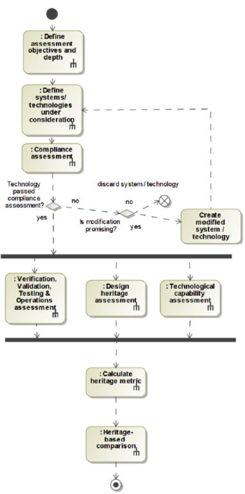

Figure 2.4: Process diagram of Hein's heritage assessment process. Borrowed from Hein [57].

<!-- PDF_PAGE: 51 -->

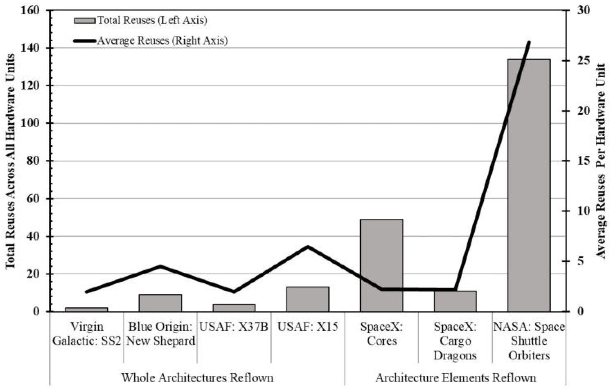

Figure 2.5: Tally of hardware reuse instances for notable examples of "reusable" launch systems. Divided into cases (left) where the entire architecture is reflown and (right) where only parts of the architecture are reflown.

<!-- PDF_PAGE: 52 -->

realization of these benefits is countered by extensive refurbishment and re-qualification efforts, and unexpected impacts from operation that may affect part lifetimes or refurbishment requirements.

It is generally understood that upfront estimates of economic benefits of hardware reuse are typically overly optimistic. For instance, McCurdy finds that while seeking approval for development of the Space Shuttle in the early 1970's, NASA leadership expected the program to decrease costs of space access by a factor of 10 compared to existing launch vehicles, with Shuttle launch costs totaling $8 to $10 million ($50 to $62 million in FY 18 dollars) per launch and 20+ launches per year; in reality, by 1994, NASA was estimating that a single launch cost around $393 million ($670 million in FY 18) [93]. The program never flew more than 9 times in a year (1985), and no single orbiter flew more than 4 times in a year (Discovery). While various factors are at play in these discrepancies, higher than expected reuse costs and effort are considered major contributors. Conversely, SpaceX's realized cost reduction figures for reusing its Falcon 9 first stage are reported to be around 30% [52]. Thus, arguments for the value of this type of reuse vary from minimal to significant.

Beyond space access hardware, a small number of examples of other hardware reuse exist in the space industry. These are typically in the form of payloads that fly aboard the previously mentioned recoverable space access vehicles or crewed stations. A notable example is the Tethered Space Satellite mission, which first flew aboard STS-46 (Atlantis) in 1992; as explained by Stone, it was deployed from the Shuttle bay and deployed several hundred meters of tether before becoming stuck and being retrieved by Atlantis. Four years later, the same satellite hardware was re-flown on STS-75 (Columbia) where it deployed 19.7 km of tether before it snapped and was lost in space [129]. As bold new space exploration and utilization efforts are realized, it is expected that the recovery and reuse of hardware will occur more often and in novel forms. These may include reusable planetary descent, ascent, and tug vehicles as well as additional launch vehicle components including fairings and orbital stages [82, 2, 23].

Ferguson describes a related type of hardware reuse - reconfiguration [40]. This occurs when hardware is recovered then repurposed or reconfigured to carry out a) a new function in similar mission conditions, or b) a similar function in new mission conditions. In either case, some amount of processing is typically required between recovery and redeployment. Repurposing seeks to leverage operational flexibilities of already emplaced assets. Reconfiguration and repurposing actions can be either planned or unplanned.

As with the previous reuse type, this type also sees limited though growing usage in the space industry. Current or past examples of repurposing/reconfiguring space hardware include the transition of the Kepler Space Telescope from its original mission to the K2 mission with relaxed imaging constraints and new satellite operations procedures and the repurposing of the Lunar Module's Descent Propulsion system into an Earth return abort engine after the Apollo 13 failure [117]. It is also likely that a spare robotic arm from the Mars Exploration Rovers (MER) program will be repurposed for NASA/Maxar Technologies' Sample Acquisition, Morphology Filtering and Probing of Lunar Regolith (SAMPLR) payload for upcoming Artemis missions [9]. Future or proposed examples include the repurposing of orbital stage propellant tanks into refuelable on-orbit depots as proposed by the United Launch Alliance (ULA) [148], reconfiguration of Planetary Surface Vehicles to meet a variety of mission needs [123], salvaging useful elements of inactive spacecraft in GEO [8]

<!-- PDF_PAGE: 53 -->

and the recycling of failed components into raw materials that can then be transformed (e.g. 3D printed) on-orbit into new components [29].

## Design Reuse

Design reuse, defined in Section 1.2, involves redeployment of the information necessary to develop, produce, operate, and maintain a design. It is the engineering knowledge for a design solution that is explicitly codified in the records of a previously flown mission. Indeed, hardware reuse may be viewed as a special type of design reuse, where physical entities are existing instances of the design being reused. Design information consists of parameters, configurations, requirements, test and qualification protocols, analysis algorithms, operational procedures, etc. [48].

A common implementation of design knowledge reuse is through flight heritage, or legacy designs. This type of reuse is ubiquitous in the space industry. Fig. 2.6 shows two examples of the prevalence of legacy systems in recent space missions. A general trend identified is that for high-risk missions, such as MSL, heritage designs are heavily relied on (see the top panel of the figure). The unique motivations for missions, namely the science payloads, are typically unique. Conversely, in missions where designers may accept higher risk, such as with low cost CubeSats or technology demonstration missions (e.g., the Mars Cube One (MarCO) CubeSats that flew alongside the Mars InSight lander mission), new technologies are more commonly deployed throughout most subsystems (See the bottom panel of Fig. 2.6). We recall how NASA stresses the importance of understanding the new mission context: during TRL assessment, "If the architecture and the environment have changed, then the TRL drops to 5—at least initially" [98]. Further assessment about the magnitude of the difference may bring the TRL back up to 6 and 7, but the mission designer should be aware that a heritage technology can rarely be "dropped in" to a new mission with an immediate TRL of 9. Thus, the effort required to incorporate the heritage technology should be considered in cost, risk, and schedule estimates.

Motivations for design reuse exist beyond immediate cost, risk and schedule benefits that might arise from redeployment of heritage systems. More intentional design reuse efforts revolve around commonality and modularity realized in product families or platforms (discussed in greater detail in Section 2.1.1.3). Several literature surveys separately identify some of these these additional motivations for intentional reuse [89, 50, 62, 19]:

- "Leveraging common manufacturing processes...[facilitating] knowledge transfer across organization and supply chains[s]”[89]

- Improved agility: rapidly addressing evolving or emerging customer needs or mission types

- Improved responsiveness: quicker time-to-launch for time-critical missions

- Improved scalability: for deployments of many identical or similar mission systems (e.g. constellations)

- Economics: amortizing initial (perhaps higher) costs over multiple deployments of the design

<!-- PDF_PAGE: 54 -->

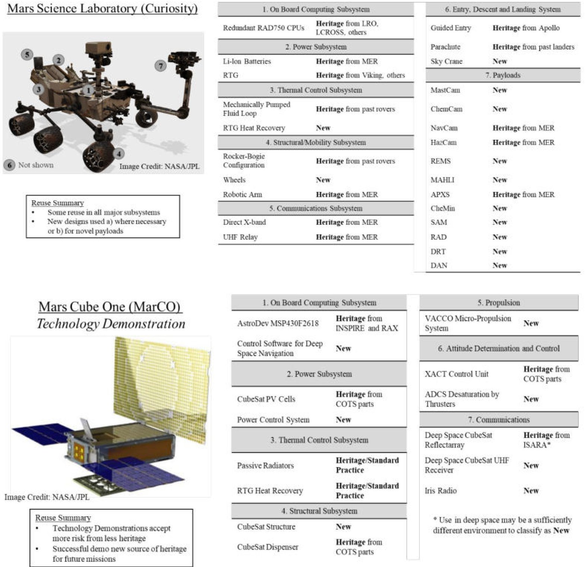

Figure 2.6: Breakdown of reused vs. new designs in two recent space missions. (Top) MSL demonstrates extensive reuse with novel designs being incorporated only where necessary. (Bottom) MarCO acts as a technology demonstration mission where new designs are more prevalent throughout the architecture.

<!-- PDF_PAGE: 55 -->

More intentional, or planned, reuse efforts revolve around commonality and modularity realized in product families or platforms. The implementation of these concepts in the industry live roughly on a spectrum between common busses and modular platforms. Examples are shown in Fig. 2.7. Common busses are used in missions with similar conditions and requirements. Modular platforms work in a "plug-and-play" fashion where a set of modules with varying functions are configured into variants that each meet the needs of a unique mission; the set of variants (i.e., the family) spans a range of mission types. In these types of design reuse, firms will incur more upfront costs or performance penalties in order to secure the option of reuse in the future [30]. For common busses, this entails ensuring that the bus will be able to accommodate payloads that might evolve over time via upgrades; for modular platforms, this includes accepting penalties in mass that arise from standardization and modularization as well as penalties from designing towards a larger performance envelope than the initial mission [31].

On the "Modular" side, examples like NASA's Multi-mission Modular Spacecraft (MMS) of the 1980's and 90's and, more recently, NASA's Modular Common Spacecraft Bus demonstrate how modular busses can be used for substantially different mission types. MMS family members include the LEO, sun-pointing Solar Max mission, the GEO based Landsat Earthimaging satellite, and the LEO-based Upper Atmosphere Research Satellite, schematics for which are shown in Fig. 2.8 - here we note the distinguishable similarities in the bus sections of each satellite, onto which unique payloads are attached [38]. Kingston recreates an Assembly, Integration, and Testing (AIT) timeline comparison for these missions vs. for similar sized "non-modular" missions [81]. This data, shown in Fig. 2.9, shows significant savings attributed to the modular design approach across the three missions.

Common bus examples in Fig. 2.7 include GEO commercial communications product lines from firms like Boeing and Lockheed Martin; while these busses may accommodate a range of communications payload types, they operate almost exclusively in that sector of the space industry. Towards the middle of the spectrum are examples like German firm Astrium's Flexbus system that housed common systems for various mission types but with significant modifications for novel payloads like the gravimetric experiments on GRACE and GRACE-FO [121]. Satellites and orbital systems are not the only ones leveraging this type of design re-use; concepts exist for large-scale reuse of high-level architectural elements in campaigns of human exploration missions to the Moon and Mars [63].

## Work Effort Reuse

Reusable work efforts are those value-adding aspects of the systems architecting processes primarily models and design documents that through standardization and digitization, can be adapted and redeployed across multiple missions [42]. This introduces a nuanced distinction between a design and the model or other work product that records that design. Specifically, the work effort involved in ideating, generating, and maintaining models and related constructs makes their reuse impactful on a project's cost and schedule. Indeed, Huldt finds that the prevalence of model reuse has increased significantly with increasing MBSE adoption in the space industry [66].

An example of MBSE-enabled model reuse is through the use of metamodels; if models are defined as an abstraction (or simplification) intended to answer specific questions about a system of interest, then a metamodel can be defined as the specification for[10]. It captures

<!-- PDF_PAGE: 56 -->

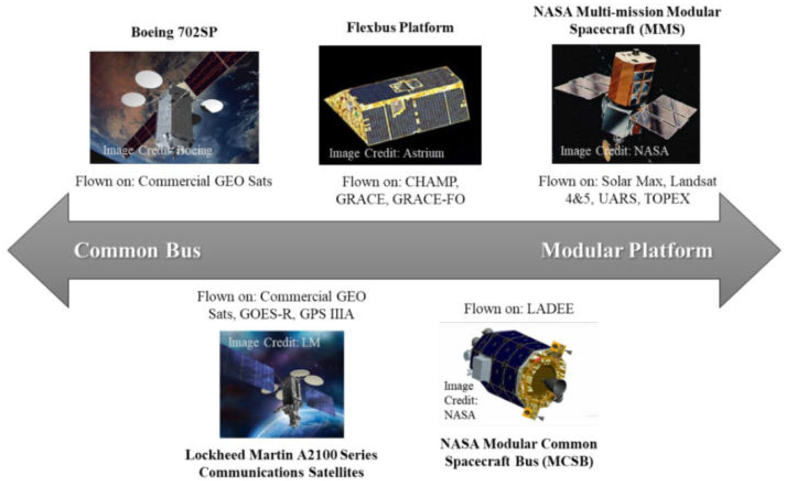

Figure 2.7: The spectrum of planned reuse examples in the space systems - ranging from common busses to modular platforms.

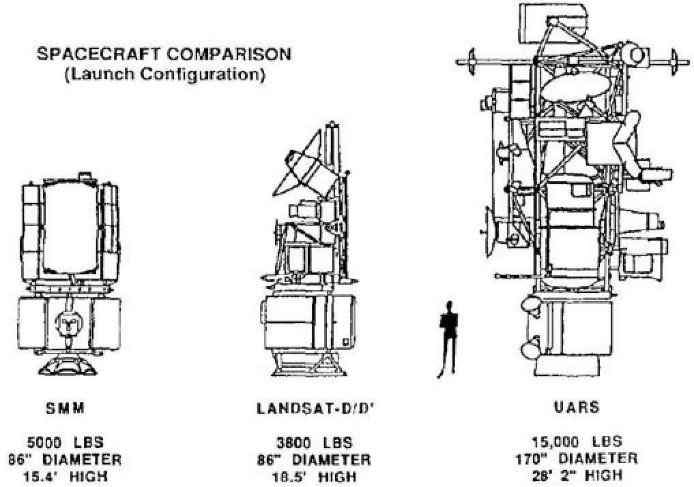

Figure 2.8: Comparison of satellites employing NASA's MMS bus. Note the similarity in bus designs vs. the distinctive payloads. Borrowed from Falkenhayn [38].

<!-- PDF_PAGE: 57 -->

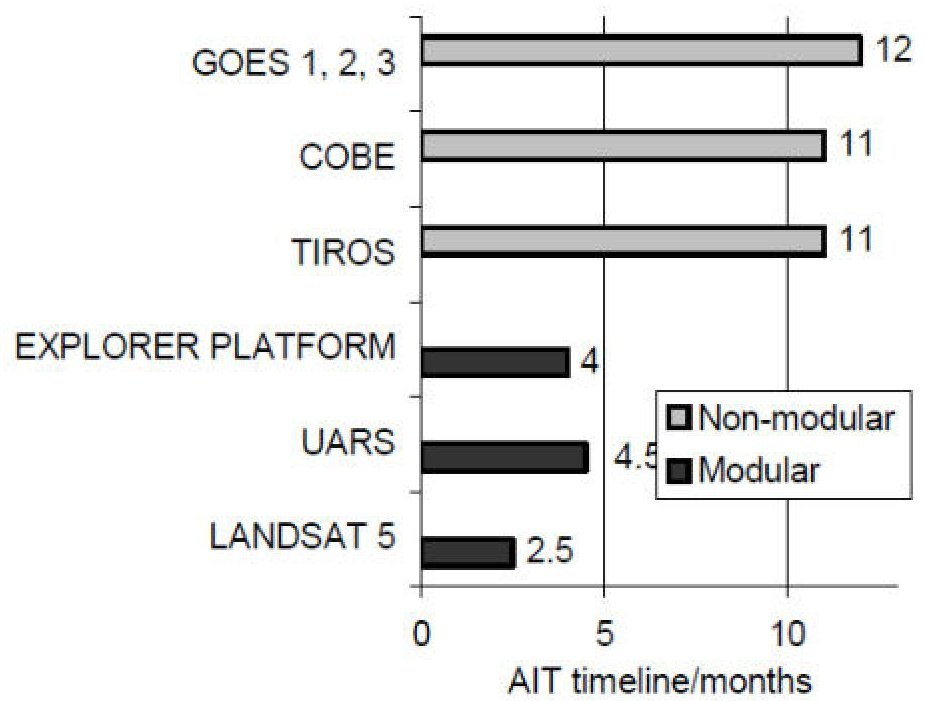

Figure 2.9: Plot comparing AIT timelines of spacecraft that (gray) did not employ NASA's MMS bus vs. (black) those that did. Borrowed from Kingston [81].

<!-- PDF_PAGE: 58 -->

the relevant concepts, model elements, and rules that a model must be composed of and adhere to. Generation of metamodels and patterns are crucial and non-trivial efforts for implementing MBSE concepts during architecting of complex systems. It follows that reuse of these artifacts across multiple projects can not only improve SE timelines but also promotes consistency across modeled systems, further improving design reuse potential [90]. Examples of metamodels and reference models (a related concept) active in the space systems literature include those presented by Spangelo, Fischer, and most notably, the CubeSat Reference model developed and validated by Kaslow and Madni [80]. This reference model, a snippet of which is shown in Fig. 2.10 has garnered substantial industry and academia buy-in and is seen as a viable starting point for more advanced MBSE development and adoption.

Models themselves can also be reused. A common practice is the cataloguing of models in libraries that can be imported into and queried by the larger system model, as demonstrated by Lyke [88]. Models in these repositories, typically of low-level components or assemblies, can be dropped into appropriate areas of the system model without much additional work; this assumes that the models have been prepared with a guiding metamodel that ensures consistency across levels of the system model hierarchy. Checks can be run against its design parameters (as captured in the model) to ensure it meets mission requirements or constraints. Spangelo and Waseem each demonstrate how such a cataloguing effort can work in the broader application of MBSE to university-run space missions in CubeSats and scalable remote sensing satellites, respectively [128, 141]. In industry, NASA has identified a "Library of Reusable NASA Related System Models" as a key technology for supporting its exploration objectives. In the 2015 Technology Roadmap, NASA predicts "tremendous impacts on lifecycle costs" from "an asset library [that] can provide the flexibility and expressiveness required to define complex systems quickly and effectively through the reuse of common entities across multiple spacecraft projects" [97]. An example of a functionally decomposed, metamodel-prescribed component catalog for Space Habitat design efforts is beyond the scope of this thesis, but is presented in Appendix B. It is desirable for such catalogs to consistently tag entries with both standard and specialized parameters, allowing for bottoms up mass/power roll-ups as well as unique discipline-specific analyses.

A third form of work effort reuse - a model-centric reuse framework known as Composable Design Methodology - has been developed and implemented at Lockheed Martin Space Systems [107, 76]. Composable design is a concept "focusing on composing new systems from known components, designs, product lines, and reference architectures as opposed to focusing on 'blank sheet' designs based on requirements decomposition alone". The method is meant for product lines where predefining valid variants is impractical due to the wide and uncertain variety of mission types that may arise in the future. The methodology defines an abstracted structural model that acts as a template that is "filled in" for each instance of a variant. A variability model captures the decisions the architect must make when populating the template, while a component capabilities model acts as the repository of allowable reused elements. The methodology has been used for managing the continued evolution of Lockheed's A2100 line of satellites. A similar coherent implementation of metamodel and model reuse is conducted by Fischer with their Virtual Satellite approach applied to the German DLR's S2TEP project [41].

## Space Industry Reuse Summary

<!-- PDF_PAGE: 59 -->

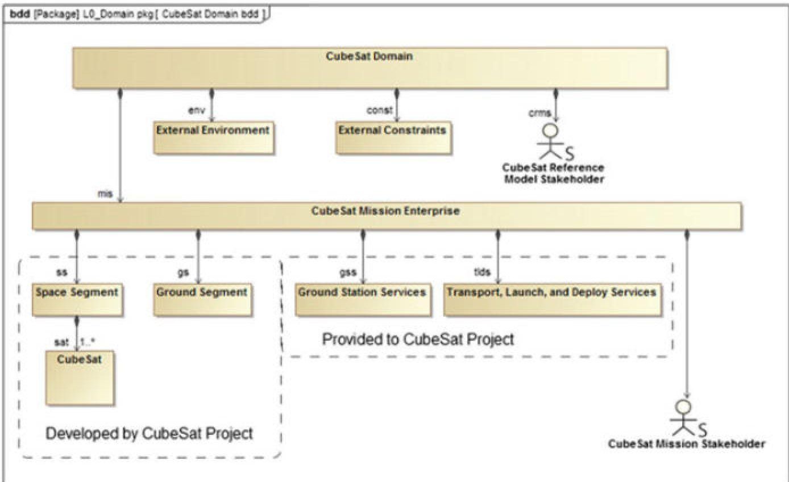

Figure 2.10: High-level domain and mission view in the CubeSat Reference Model as developed by Kaslow [80].

<!-- PDF_PAGE: 60 -->

In this section, we have reviewed a wide array of "types" of reuse currently in practice in the space industry and its literature. All relate, in some fashion to the overarching concept of design reuse as defined in the Chapter 1 of this work. Hardware reuse and reconfigurability were seen as special cases of design reuse where, in addition to the design, the actual instance (i.e., same part number) is redeployed. Most directly related to design reuse, we saw examples of product platforms, common busses, and heritage/legacy reuse throughout the various subsectors of the industry. Lastly, we saw how the modeling practices that are increasingly tasked with capturing the complex space system designs are themselves reused.

## 2.1.1.2 Software Reuse-A Special Case

Reuse is a practice widely employed across all applications that develop or use software [1]. Morisio describes software reuse as "the systematic practice of developing software from a stock of building blocks, so that similarities in requirements and/or architecture between applications can be exploited" [96]. These "building blocks" include artifacts such as code, documentation, requirements, test cases, models, architectures, etc. Morisio further elaborates how "software reuse can take many different forms, from ad hoc to systematic", resembling findings of other design regimes explored so far [96].

Vernell-Sarjeant makes the case that the aerospace industry was an early advocate for software reuse in both embedded and non-embedded systems [138]. In particular, embedded systems such as flight software and avionics in launch vehicles and spacecraft are particularly amenable to reuse, as explored by Wilmot [145]. Orrego further explores legacy software reuse across NASA missions and finds that while software reuse is quite extensive across the agency's projects, there remain discrepancies in how each project implements it and the metrics used to measure its success [106]. Recalling the third reuse vignette in Chapter 1 however, we understand why software reuse exhibits similar challenges to other forms.

Reusable code lives on a spectrum from simple-e.g. subroutines and functions to more complex-e.g. classes, objects, patterns, etc. The latter concepts belong to the paradigm of Object-oriented programming (OOP). As extensively discussed by Black, OOP may be said to have begun in the 1960's in order to, among other things, foster the reusability of software products by developing concepts such as abstraction, inheritance, encapsulation, and classes [12]. Classes contain a general format, attributes, procedures, etc. that instances of that class, known as objects, adhere to or specialize. A library of classes can then be maintained from which objects of those classes can be created across projects - essentially, the classes enable reuse of the format, attributes, procedures, etc. wherever objects of that class reside [143]. In practice, Wegner and subsequent authors like Przybylek acknowledge that software reuse enabled by OOP is still complicated by difficulties in reconciling the varying requirements and structures of the projects employing these libraries [143, 113]. Przybylek notes how, even in the case of highly modular code structures, crosscutting concerns and code alterations typically spread across different modules, "which has a negative impact on maintainability and reusability" [113].

## Benefits and Challenges

The commonly stated benefits of software reuse are similar to those claimed for nonsoftware reuse, namely, savings in development costs, schedule, and risk [1]. These results

<!-- PDF_PAGE: 61 -->

may more specifically be attributed to labor savings from pre-specified, pre-written, pretested, and/or pre-validated code segments dropped in as-available in current development projects. Sandhu identifies additional potential benefits of software reuse, all of which impact the efficiency and speed of the development project and can eventually be traced up to the nominal cost, schedule, and risk impacts: increased dependability of reused vs. new software, reduced risk of cost or schedule overruns (reduced process risk), and more streamlined standards compliance [118]. Conversely, they identify several risks associated with taking on a reuse effort; these include increased maintenance costs for the reusable software assets, requirements to maintain and update component libraries, and human factors issues, such as "not-invented-here" syndrome where developers will not trust the provenance or quality of the reuse candidate artifacts, leading to unnecessary rework efforts. The complexity of large software projects may also lead to unexpected emergence, leading to required rework and modifications [1]. These pros and cons are similar to what are often claimed about the inheritance process in non-software reuse efforts [7].

## Research Approaches

Much of the literature exploring software reuse is in the form of surveys and structured interviews of software developers. In a review of existing literature at the time, Mohagheghi includes additional study types including: exploratory case studies, experience reports, and meta-analyses [95]. They find that as of 2007, no controlled or quasi-controlled experiments on software reuse have been conducted. This suggests a difficulty in quantitatively or objectively evaluating software reuse methods and results. In fact, Mohagheghi summarizes their findings in terms of reuse benefits by suggesting that there is "little empirical evidence from industry on the actual economic benefits of reuse". This does not call into question the potential existence of those benefits, but rather that organizations are capable of systematically measuring and reporting on those benefits. Pointing to the importance of data practices, they point to an outstanding need to "improving the state of data collection and analysis" related to reuse - this 2007 paper predates the emergence of MBSE and digital engineering methods, but presciently points to the benefits that may be realized from it.

Sandhu, writing in 2010, similarly acknowledges the difficulties in defining metrics for measuring the reusability of software artifacts. Some have developed quantitative models for estimating cost savings achievable through software reuse; even these acknowledge the difficulties in estimating and modeling the often complex and non-systematic ways in which reuse is conducted [118]. In the absence of validated metrics for quantitative reuse assessment, the informed opinions of subject matter experts and practitioners, gathered in rigorously developed surveys and interviews, remains highly valuable as Agresti and others have found and Mohagheghi's work confirms [1, 95]. In addition to these predominantly experiential approaches, the sources explored point to the need for sound theory to lend systematic rigor to the complex regime of software reuse.

## Classifying Software Reuse Scenarios

Of the sources explored, several authors attempt to better understand the reuse problem by defining a taxonomy or classification scheme. Varnell-Sarjeant structures their software reuse practitioner survey around four types of reuse in embedded and non-embedded systems:

<!-- PDF_PAGE: 62 -->

1. Ad-hoc/Heritage/Legacy - Unplanned, opportunistic reuse with little or no planning...where software products (i.e architecture, code, requirements) written specifically for one project are later used on other projects.

2. Components/Commercial-off-the-Shelf (COTS) - Use of existing components either developed for the purpose of reuse or already in use as components or both.

3. Model reuse - Reuse of preexisting models or prototypes.

4. Product line reuse - Basic capabilities determined in advance and the architecture, design and code generated to map to the generic elements of the product line

The author stresses that a product development process may include some combination of these reuse types into a larger reuse strategy. This classification scheme is lacking in certain areas. Firstly, lumping ad-hoc reuse into the heritage category implies that none of the other three reuse types can be unplanned; whether considering software or non-software reuse, this cannot logically be true as we can envision examples where, for instance, models not initially planned for reuse can be adapted and reused on a new project. Secondly, Components/COTS reuse may be a redundant category - instances of this type can be sufficiently explained by classifying them as either ad-hoc or product line efforts. Nevertheless, this classification is mostly in line with the classification schemes we have applied to the broader design reuse problem.

Another author, Card, classifies software reuse scenarios by the degree of reuse. That is, by the rework necessitated by the reuse effort - in their case, measured in terms of lines of code modified [20]. Card, and later Agresti, adopt four such categories for degree of reuse [20,1]:

1. Verbatim - exact copy of legacy code

2. Adapted - slight modification of legacy code, less than 25% of lines changed

3. Rebuilt - extensive modification of legacy code, more than 25% of lines changed

4. New - the null case, no reuse

They find that verbatim reuse, while rarer, leads to the greatest savings in terms of development hours: a greater than 50% improvement by Verbatim reuse over New development. However, as we have seen in the Ariane 5 case, such "copy and paste" reuse must be validated with extensive feasibility assessments to rule out detrimental emergence. Nevertheless, this classification scheme can be a powerful tool to adapt to our investigation; it captures the fundamental questions of inheritance and evaluation of the amount of rework required. Adaptation of this approach to our analysis will require either a new metric or set of metrics (other than lines of code) with which to describe the degree of reuse.

## Assessing Software Reuse Scenarios

In Mogagheghi's extensive review of existing literature on software reuse, one of the search objectives is to identify metrics and performance parameters through which reuse's existence and results are measured. The metrics found are classified into four categories measuring:

<!-- PDF_PAGE: 63 -->

1) problems with reuse, 2) effort or productivity, 3) software changes/modifications, and 4) software module characteristics [95]. However, within these categories, Mogagheghi finds limited common metrics across the sources investigated - pointing again to a desire to quantify and assess reuse, but a lack of consensus and consistency on how to do it. Nevertheless, some useful metrics from these categories include:

- Problems with Reuse - Error/Fault density, Rework effort to isolate Errors/Faults, Error isolation time, Error/Fault severity

- Effort or Productivity - Development effort per module, Apparent vs. Actual Productivity, Time to Market

- Software Changes - Number of changes, change density, change effort, change rate per development time

- Module Characteristics - Module complexity

Many of these metrics are, in turn, incorporated by Agresti into a reusability assessment approach. The 4A method is a sequential set of conditions that determine whether reuse is likely to be successfully implemented for a given software element [1]. These A's, introduced in Chapter 1 in the context of generalized reuse, are reproduced below.

- Availability - the reusable artifact must not have been destroyed, erased, or lost.

- Awareness - the designer must know of the existence of the reusable artifact.

- Accessibility - a transfer mechanism must exist to get the reusable artifact from where it is archived to where it is needed.

- Acceptability - the reusable artifact must be acceptable to the designer for use in the new project and its environment.

In his expert survey formulated around these 4A's, Agresti found that the major obstacles to reuse generally lie in the Awareness and Acceptability conditions. Interestingly, an MBSEcentric methodology for exploring reuse would be able to explore each of these conditions quite easily and in a centralized/informed fashion.

Along another research direction, Marshall and Downs, working with NASA's Earth Science Data Systems (ESDS)'s Software Reuse Working Group (SRWG) argue that a common software reusability metric is required so that both software developers and software adopters can assess their reuse strategies [91]. For this, they propose a metric known as the Reuse Readiness Level (RRL). Where NASA's Technology Readiness Level (TRL) is concerned with the maturity of a technology, RRL is concerned with the technology's reusability. Like TRLs, RRLs run from 1 to 9 and capture the practicality of reusing a particular software they are shown in Table 2.1. SRWG further develops sub-topics within reusability that factor into the ultimate determination of an artifact's RRL; these include documentation, extensibility, modularity, packaging, portability, standards compliance, and others [99]. It

<!-- PDF_PAGE: 64 -->

Table 2.1: Description of the 9 software-oriented Reuse Readiness Levels developed by NASA's ESDS SRWG [99].

<table border="1"><tr><td>RRL</td><td>Summary</td></tr><tr><td>1</td><td>No reusability; the software is not reusable</td></tr><tr><td>2</td><td>Initial reusability; software reuse is not practical</td></tr><tr><td>3</td><td>Basic reusability; the software might be reusable by skilled users at substantial effort, cost, and risk</td></tr><tr><td>4</td><td>Reuse is possible; the software might be reused by most users with some effort, cost, and risk</td></tr><tr><td>5</td><td>Reuse is practical; the software could be reused by most users with reasonable cost and risk</td></tr><tr><td>6</td><td>Software is reusable; the software can be reused by most users although there may be some cost and risk</td></tr><tr><td>7</td><td>Software is highly reusable; the software can be reused by most users with minimum cost and risk</td></tr><tr><td>8</td><td>Demonstrated reusability; the software has been reused by multiple users</td></tr><tr><td>9</td><td>Proven reusability; the software is being reused by many classes of users over a wide range of systems</td></tr></table>

<!-- PDF_PAGE: 65 -->

would be desirable to adapt a similar metric-based reusability quantification effort to nonsoftware reuse as a contribution in this thesis.

## Implementing Software Reuse

Morisio finds that when implementing reuse, several factors play into its ultimate success or failure. Specifically, when investigating cases of software reuse implementation failure, particular causes included:

- assuming that merely having a repository will achieve systematic reuse (ignoring human factors);

- not modifying non-reuse processes to accommodate unique reuse process;

- lack of ownership or agency in reuse choices (due to contractor relationships and requirements);

- lack of management will power or motivation to implement reuse

Others find that reuse failures also emerge from overly complex codes, poor code design and documentation, and unknown/latent problems in the original code [138]. Conversely, Morisio et al. found that successful reuse cases demonstrated [96]:

- Commitment from management;

- few but necessary changes to product development processes to accommodate reuse;

- consideration of human factors such as training, awareness, etc. in addition to process/tool changes such as adding software repositories.

Thus, these factors should be kept in mind when developing reuse methodologies and generalized procedures, for both software and non-software alike.

## 2.1.1.3 Related Concepts - Modularity, Product Platforms, and Commonality

Before concluding this section of the literature review on design reuse, we consider some related concepts that may yield additional insights into how reuse is conducted in theory and in practice. In particular, we look at two relevant lifecycle properties that emerge from architecting decisions - modularity and commonality. We also look at the overarching concept at the other end of the intentionality spectrum to heritage reuse, namely Product Platforming.

## Modularity

A particularly important property often tied with reuse is modularity. While literature has yet to agree on an authoritative definition of modularity, all agree that modularity arises from the decomposition of products or systems into mostly independent modules or blocks [46,147,65]. In a design, a modular assembly or architectural unit is typically said to be modular if it exhibits two characteristics: first, there is a strong coupling between lower level systems within the unit boundary (more than the average number of couplings across the

<!-- PDF_PAGE: 66 -->

system), and second, this internally coupled but externally uncoupled architectural unit encapsulates a distinct aspect of system functionality [65]. Suh expresses these characteristics in terms of the independence axiom, which states that independence of functional requirements should be maintained leading to a one-to-one correlation between form and function [130]. This division facilitates the standardization and flexibility of components - critical aspects of reuse. Essentially, highly modular components can more easily be "dragged and dropped" into appropriate slots in different architectures.

Elements of modularity include: independence of a module's components from external components, the similarity of components in a module with respect to the lifecycle processes they undergo, and the absence of similarities to external components. Thus, all architectures may be placed on a spectrum with extremes being integral (highly interconnected elements) and modular (highly independent elements). For instance, in Fig. 2.11 reproduced from Robertson, a modular approach allows for meeting the design needs of both instrument panels with the same interface design, whereas the integral approach requires a custom interface design for each panel type [116].

Modularity can be assessed in terms of the interfaces over which the commonality exists including spatial, information, materiel, energy, or structural connections. Importantly, the level of abstraction (e.g., assembly, component, subsystem, system, etc.) under which modularity is assessed may yield different outcomes. This should be clear, as modularity essentially defines those lower level units within an architecture. Thus, for instance, a small satellite's propulsion subsystem may contain a highly modular COTS thruster that itself is composed of a highly integral design. Metrics surveyed in the literature for assessing modularity include [65, 126]:

- form to form coupling analysis of a DSM

- Singular Value analysis of a DSM,

- Non-Zero Fraction of a DSM,

- Node centrality metrics in a network including Degree/Distance/Bridge modularity.

A central finding of the existing literature is that designs that are heavily driven by weight, size, or other performance constraints often exhibit rather integral architectures commensurate with a smaller degree of modularity; in contrast, when the design is driven mainly by business goals, such as cost savings or commonality, a more modular architecture often emerges [65].

## Commonality

The lifecycle property of commonality emerges from reuse. Boas uses the following definition of commonality: "the sharing of components, processes, technologies, interfaces, and/or infrastructure across a product family" [13]. As this definition suggests, commonality is mostly discussed in the context of planned or intentional reuse in the form of product platforms, variants, and families [116, 39]. Fellini shows how commonality can manifest as either the sharing of the exact same design across variants or as the sharing of scaled versions of

<!-- PDF_PAGE: 67 -->

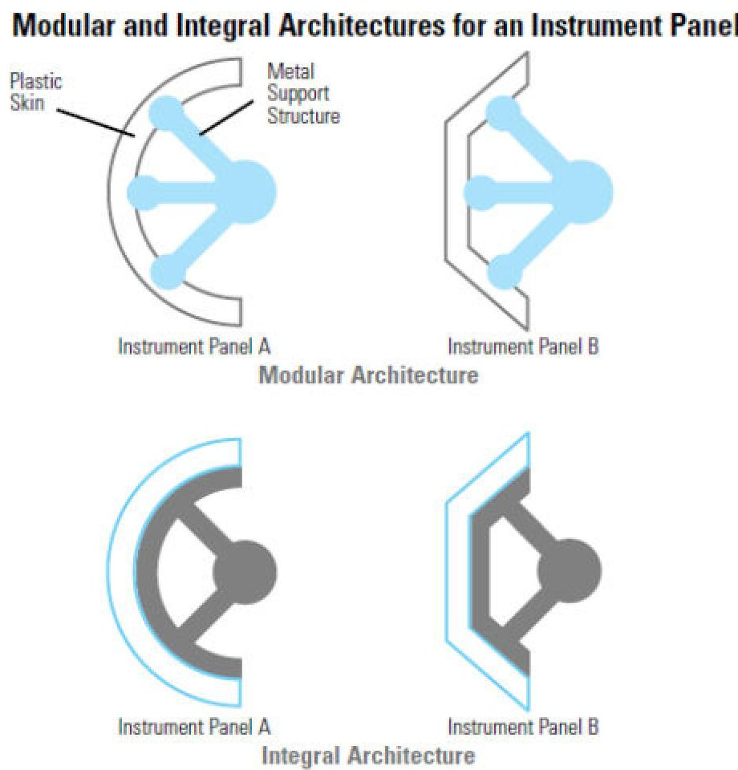

The modular architecture allows the same support structure to be used in two different instrument panel designs. (Illustrative instrument panel designs shown in cross-section.)

Figure 2.11: Descriptive graphic by Robertson of the benefits of a modular architecture as compared to an integral one. Borrowed from Robertson [116].

<!-- PDF_PAGE: 68 -->

designs, as illustrated in Fig. 2.12; the latter may be seen as attribute or variable sharing across components [39]. The variable sharing approach enables scaling or modification between components thereby expanding the breadth of actions classified as "commonality". Variable sharing commonality crosses the concept over into the realm of heritage or unplanned reuse by allowing for the design modifications often required in these instances.

In a more granular formulation of the concept, Hofstetter identifies various kinds of commonality, each tied to a specific aspect of a system's architecture [62]. Aspects of an architecture include its functionality, operations, technology choices, design form, and design instances. As Fig. 2.13 shows, different commonality types are defined by the specific architecture aspects (rows in the figure) that they share. Recalling our working definition for "design reuse", we note that it would coincide with "design commonality" and "system reuse" in the figure. Further, "system reuse" is the special instance of hardware reuse explored in the preceding section; software reuse, one may argue, also falls into this category. Hofstetter further elaborates four criteria for screening commonality decisions during an architecting effort [62]:

- Same Internal Function - the variants' relevant system or subsystem must have the same internal function (e.g., Removal of carbon dioxide from a spacecraft cabin).

- Same Technology Choice - the variants' relevant system or subsystem must utilize the same technology to accomplish the internal function (e.g., 4-bed molecular sieve for carbon dioxide removal).

- Similar Operational Environments - the variants' relevant system or subsystem must operated in similar environments

- Similar Quantitative Parameters - the variants' relevant design parameters should be within some factor k (an overlap parameter) of each other to ensure feasibility

Now in order to evaluate the existence of commonality within a product platform once it has been designed, Thevenot summarizes several commonality metrics or "indices" [132]. One metric of note is the Percent Commonality Index (PCI), given in Eq. 2.1, that assesses commonality from 4 viewpoints. Subset c refers to common components, n refers to common connections, l refers to common assembly steps, and a refers to common workstations during assembly. The I terms indicate weighting terms for each viewpoint, dependent on the architect's desired analytical ends. %C indicates the fraction of potential commonality in a product family that is actually implemented. This resulting value describes the overall commonality present in the platform - encompassing all constituent variants. With some modification, the PCI metric may be applicable to assessing the potential of a heritage design reuse scenario.

$$
\% C = \sum_ {i = 1} ^ {4} I _ {i} * C _ {i} = I _ {c} * C _ {C} + I _ {n} * C _ {n} + I _ {l} * C _ {l} + I _ {a} * C _ {a}
$$

Commonality has proven a successful strategy in a wide range of industries including automotive, electronics, etc. Purported benefits of promoting commonality in product families are in line with the reuse benefits stated previously and include improvements in cost

<!-- PDF_PAGE: 69 -->

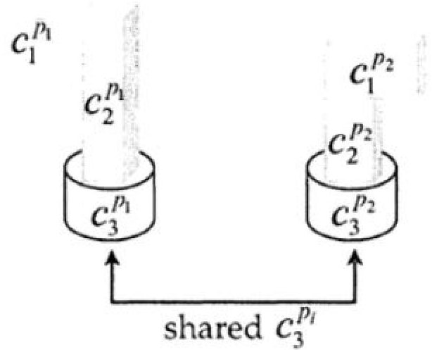

(i) Component Sharing Commonality

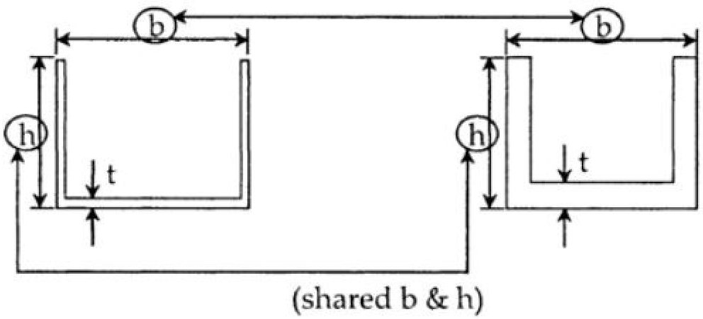

(ii) Variable Sharing Commonality

Figure 2.12: Graphic by Fellini depicting two types of commonality: either the sharing of components or of the variables that commonly describe two designs [39].

<table border="1"><tr><td></td><td>Functional commonality</td><td>Operational commonality</td><td>Technology commonality</td><td>Design commonality</td><td>System reuse</td><td>Variable functionality</td><td>Implementation commonality</td></tr><tr><td>Internal functions</td><td>X</td><td>X</td><td>X</td><td>X</td><td>X</td><td></td><td></td></tr><tr><td>Operating processes</td><td></td><td>X</td><td>X</td><td>X</td><td>X</td><td></td><td></td></tr><tr><td>Technology choices</td><td></td><td></td><td>X</td><td>X</td><td>X</td><td></td><td></td></tr><tr><td>System form</td><td></td><td></td><td></td><td>X</td><td>X</td><td>X</td><td>X</td></tr><tr><td>System instance</td><td></td><td></td><td></td><td></td><td>X</td><td>X</td><td></td></tr></table>

Figure 2.13: Features shared across systems exhibiting different types of commonality, as formulated by Hofstetter [62].

<!-- PDF_PAGE: 70 -->

and schedule performance, as well as facilitating operational flexibility and reliability [116]. However, Boas identifies two major impediments to implementation and beneficiation of commonality. The first, divergence, is "the tendency for commonality to reduce with time, for both beneficial and non-beneficial reasons". Per Crawley et al., acceptable reasons for divergence over the course of a development project include a) incorporation of technological developments leading to better solutions than reusable assets can deliver, b) changes in the market necessitating a different product than first defined, and c) suggested changes from learning between projects. Unacceptable reasons for divergence from commonality decisions include: a) unnecessary performance improvements unique to a variant, and b) changes aimed at improving cost and schedule of the particular variant [28], at the expense of the larger product family. While at the surface, these may be worthwhile pursuits, Crawley et al. argue that they do not actually "make the product better". These detrimental impacts of divergence are manifested in the reduction of expected commonality benefits, particularly in cost, as Cameron illustrates: unexpected quality expenses, additional manufacturing coordination, and weaker investment returns on the lead variant [19].

The second impediment is lifecycle offset, or, the temporal distribution of the lifecycle phases of product family members. As Good demonstrates for the example of NASA's SLS development, lag between similar phases of the process for the first and subsequent members of the family lead to several issues during product family development [51]. Importantly, they tend to lead to favoring of the first family member in terms of design decisions at the cost of future members [28]. This also causes architectural lock-in of future members well before that mission is investigated in depth.

In order to avoid these issues Hofstetter and Crawley et al., provide tools and methodologies for evaluating and implementing commonality decisions [28]. These include tools to identify technical opportunities for commonality, such as portfolio architecting via matrix methods, heritage analysis, "baseline and improve" methods, among others. Another set of tools is aimed at evaluating the economic impact of commonality - cost-benefit modeling, decision analysis, among others.

## Product Platforms

Product platforming can be described as a design approach that seeks to foster commonality across various products in a firm's portfolio to yield benefits in terms of portfolio performance, cost, schedule, and risk [50]. It is a specific type of design reuse where a firm defines a set of common designs and seeks to maximize use of these designs across its set of products. Thus, platforming is a type of planned reuse, as made clear in the preceding space industry examples. The platform literature is extensive, with works like those by Simpson [124] and Jiao [75] tracking the evolution of the state of the art over time.

The platform is made up of the common elements of the various products; each unique product employing the platform is known as a variant; the set of all variants forms the product family [50]. As product platform approaches optimize at the product family level, there is necessarily some local (variant-level) performance sacrificed, as made clear by de Weck [31]. The design challenge is thus to select/design a product platform that will generate a family of designs with minimum deviation from the individual optimum [39].

The elements of a design that can be shared (via commonality) are primarily component, subsystem and system level designs, but may also include lifecycle processes such as man-

<!-- PDF_PAGE: 71 -->

ufacturing/assembly steps, operations and disposal. Purely sharing variable definitions is not sufficient for platforming as learning curves, economies of scale, and reuse benefits only materialize when physical components (or their designs and relevant processes) are instantiated [39]. Further, a firm's portfolio may demand more than one platform to capture its offerings. Thus, the choice of platform extent (difference in upper and lower performance bounds represented in a product family) is critical, as is the decision to move from a single platform to multiple platforms [31].

Various authors have arrived separately at a common step-by-step framework (Fig. 2.14) for product platform creation/optimization via system models [62, 50]: 1) identify individual product/mission requirements; 2) create a system model for each product/mission; 3) select platform-able parts based on common requirements and designs and "freeze" those designs; 4) return designs to individual product/mission that can then optimize on non-platform variables; 5) iterate. Indeed, Gonzalez-Zugasti in 2000 already set the stage for conducting these in an MBSE environment by describing a simple spreadsheet-based approach, as shown in Fig. 2.15. These digital methods and the optimization framework can form the basis of a more advanced MBSE methodology for platform design, and derivatively, for unplanned reuse efforts. Additionally, de Weck expands on this optimization framework to account for situations in which multiple platforms are desired.

The concept of product platforming has seen limited though growing use in the space industry. Reasons might include the limited scope of missions as demanded by always limited funding situations, or the low launch cadence of missions leading to obsolescence of technologies/systems, divergence, and lifecycle offset [13]. This is in contrast to typical applications of platforming in industries like the automotive industry that is characterized by high volumes, high launch cadences, and low unit costs. Even so, some examples of platform-minded endeavors exist at most levels of design including components, subsystems and busses. These efforts are mostly specific to modularity and include:

- "Application-based" modular spacecraft software architectures (particularly discussed for ADCS software for various sensor/actuator suites) [54],

- Communications architectures (as discussed for JPL's exploration missions using the DSN) [50]

- Modular spacecraft power systems [86],

- Modular busses such NASA's MMS [38], used in several missions of the 1980's and the Ames Modular Common Spacecraft Bus [133], used on the LADEE mission [60]

In addition to these, as discussed in the preceding section, the commercial communication subsector particularly the manufacturers of communications busses, such as Lockheed, Boeing, and others have extensively developed platforming and product family practices. Thus, while few sources were found applying platforming at a concerted level for campaigns of space missions, the literature and practice is trending increasingly in that direction, with some areas already well-established. Both Madni and Hummel separately consider the emergence of MBSE and model-based methods as promising trends for improved and adaptive platform design and management for such complex systems [90, 67]. Hummel specifically

<!-- PDF_PAGE: 72 -->

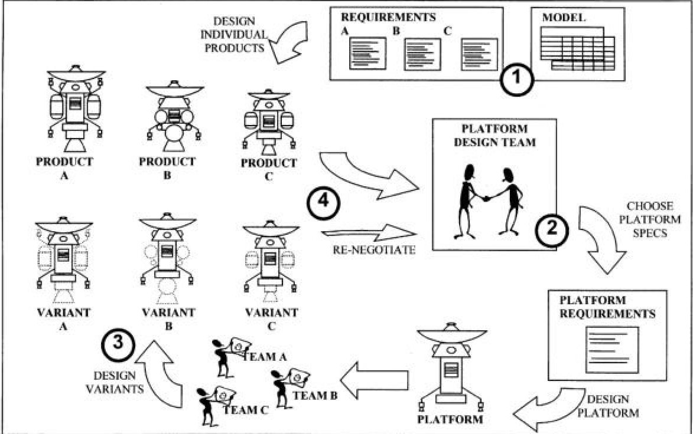

Figure 2.14: Product platform optimization step-by-step framework, as developed by Gonzalez-Zugasti [50].

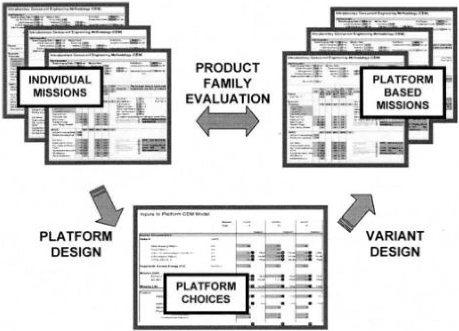

Figure 2.15: Demonstration of platform optimization framework using integrated spreadsheets - an initial foray into concepts of MBSE [50].

<!-- PDF_PAGE: 73 -->

introduces an approach for variant modeling and more generally Model-based Product Line Engineering in a SysML environment.

## 2.1.2 MBSE and the Digital Environment

In Chapter 1, we introduced the concept of MBSE as a potential avenue for improving upon the current state of design reuse practices. Further, in Section 2.1.1.1 of this literature review, we explored the practice of "Work Effort" reuse in the space industry, which is largely accomplished via the models now commonly developed in MBSE environments. Now, we provide an in-depth look at the larger picture of MBSE in terms of its development and constituent concepts such as ontologies, metamodels as well as the languages, tools, and methodologies that have been employed in existing literature. Then, we look at the degree of adoption that MBSE has achieved within the space industry-a finding that will be refined in the industry survey presented in Chapter 4.

## 2.1.2.1 Development of MBSE Theory

We recall from Chapter 1 the INCOSE definition of MBSE as: "the formalized application of modeling to support system requirements, design, analysis, verification and validation activities beginning in the conceptual design phase and continuing through-out development and later life cycle phases." [44]. This definition as well as the acronym itself point to the intrinsic relationship between MBSE and the systems engineering process. Indeed, each of the aspects above supported by modeling in the MBSE paradigm is a part of the larger systems engineering and system design process. The term "Model-based Systems Engineering" was originally used by Wayne Wymore in 1993 to describe a rigorous mathematical formalism for representing this system design process in the context of models of that system [140]. As Estefan finds, Wymore's concept of a system model is a state space representation of a system design; in this model, externalities provide inputs to the design that its representative model captures, interprets, and converts to outputs [37]. Each sub-model within the system model represents some part of reality, or "view", of the system via this state space formulation. In these introductory works on the concept, we see emerging critical concepts such as system models, discipline models, and the underlying data (or initially, mathematical) rigor demanded by MBSE.

Baker, writing, in 1996, introduces an essentially synonymous concept to MBSE: Model Driven System Design (MDSD) [6]. Baker decomposes relevant model types into schematic models that show objects and their relationships and interactions; performance models that represent some response to external stimuli; design models that show some detailed aspect of a design; and physical models that are tangible physical representations (e.g., wing models, prototypes, etc.). Both Baker and Wymore emphasize the central importance of design requirements in order to capture and formalize system designs via these models. Moreover, Baker describes the information flow for MDSD starting from these requirements, shown in Fig. 2.16. This formulation reinforces the integral nature of design information and decisions that MBSE and MDSD capture more systematically than traditional document based design [6].

<!-- PDF_PAGE: 74 -->

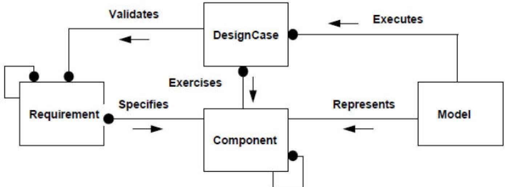

Figure 2.16: Flow of information/actions between elements of a design in a Model Driven System Design framework, described by Baker [6]. Note the central importance of the representative model of a design.

<!-- PDF_PAGE: 75 -->

By 2007, the concept of MBSE had not only been formally defined by INCOSE to encapsulate these system design and integral data considerations, but as Friedenthal shows, it had seen provincial adoption in some disciplines [44]. More importantly though, Friedenthal notes a shift in perspectives at this time: whereas in the past, models had been seen as tools to assist in the eventual document-based design products, now MBSE users saw the set of models themselves (and the system model, in particular) as the design. These models (that is, the design itself) could be interrogated by computational/digital means for the question of interest.

In a 2018 paper summarizing the state of the practice, Madni finds that these formalisms (minus, perhaps, the rigorous mathematical relationships proposed by Wymore) have become established and accepted [90]. Further, Madni notes increasing adoption throughout various engineering industries including at major aerospace contractors. However, the problem currently being faced in which theory is found to be lacking is in how to standardize application of MBSE modeling practices: 1) at various levels of design detail, 2) throughout the full lifecycle of a mission, and 3) across complex enterprises comprising systems of systems (SoS). Additionally, Huldt explains, there exist organizational and social barriers to MBSE adoption and coherent application thanks to the high learning curve and perceived lack of value in transitioning to a digital development environment [66]. These findings are reflected by others including Chami and Bruel [21].

## 2.1.2.2 Digital Engineering, Ontologies, and Metamodels

An unfortunate side effect of the rapid emergence of MBSE as a field is the multitude of related terms with which it has become entangled. As Henderson notes, these related terms include Model-based Engineering (MBE), Model-driven Engineering (MDE), and Digital Engineering [58]. Worse still, the literature is replete with examples of these terms being used interchangeably. Henderson presents a glossary of terms (reproduced in Fig. 2.17) which relates each of these terms to the concept of MBSE - these are adopted for this thesis. Essentially, in contrast to these other terms, MBSE focuses on the systems engineering process and how integrated modeling practices may be used to implement it.

Despite this perceived confusion, we turn briefly to the concept of Digital Engineering. As Fig. 2.17 indicates, DE can be seen as a broader concept than MBSE and one that emphasizes the vast ecosystem of data necessary to enable model-based methods. First described by the Department of Defense (DoD) in a strategy-setting document, Digital Engineering acknowledges the primacy of authoritative data and the need for a well-understood underlying data landscape [135]. In the view of DoD (centrally focused on efficient acquisition and maintenance of complex systems), the MBSE methods that we develop, then, are reliant on multi-stakeholder, multi-level, enterprise wide or system of system data infrastructures, such as the one illustrated by Bone in Fig. 1.2 [14]. Here, data flows across interfaces from contractors to sub-contractors, acquisition officials to contractors, etc. While understanding the full complexities of this picture is not necessary for this thesis, two similar concepts may prove useful to ensuring wide applicability of our methods: ontologies and metamodels.

An ontology is defined by Madni as "a formal explicit conceptualization of a problem domain shared by stakeholders; it presents a controlled vocabulary that comprises a set of agreed upon terms (semantic domain) and rules for using and interpreting them within the

<!-- PDF_PAGE: 76 -->

<table border="1"><tr><td>Term</td><td>Definition</td><td>Difference from MBSE</td></tr><tr><td>Digital engineering</td><td>“An integrated digital approach that uses authoritative sources of systems’ data and models as a continuum across disciplines to support lifecycle activities from concept through disposal. A DE ecosystem is an interconnected infrastructure, environment, and methodology that enables the exchange of digital artifacts from an authoritative source of truth.”25</td><td>MBSE is the subset of digital engineering, specifically limited to systems engineering activities and artifacts.</td></tr><tr><td>Document-based systems engineering</td><td>Systems engineering that uses “written documents based on text as sources of managerial information.”26</td><td>Traditional approach in which SE has been conducted before the development of MBSE approaches.</td></tr><tr><td>Model-based engineering</td><td>“Engineering practices in which models are the central and indispensable artifacts throughout a product’s lifecycle encompassing concept, development, deployment, operation, and maintenance.”27</td><td>MBSE is the subset of model-based engineering that deals with systems engineering activities and artifacts.</td></tr><tr><td>Model-driven engineering</td><td>“The systematic use of models as primary artifacts during a software engineering process. MDE includes various model-driven approaches to software development, including model-driven architecture, domain-specific modeling and model-integrated computing.”28</td><td>Focused on software development, whereas MBSE deals with any type of system.</td></tr><tr><td>Model-driven architecture</td><td>“A framework for software development that uses models to describe the system to be built at various levels of abstraction, with each level emphasizing certain aspects or viewpoints of the system.”29</td><td>Model-driven architecture is a subset of model-driven engineering.</td></tr></table>

Figure 2.17: Summary of terminology related to MBSE, as consolidated by Henderson [58].

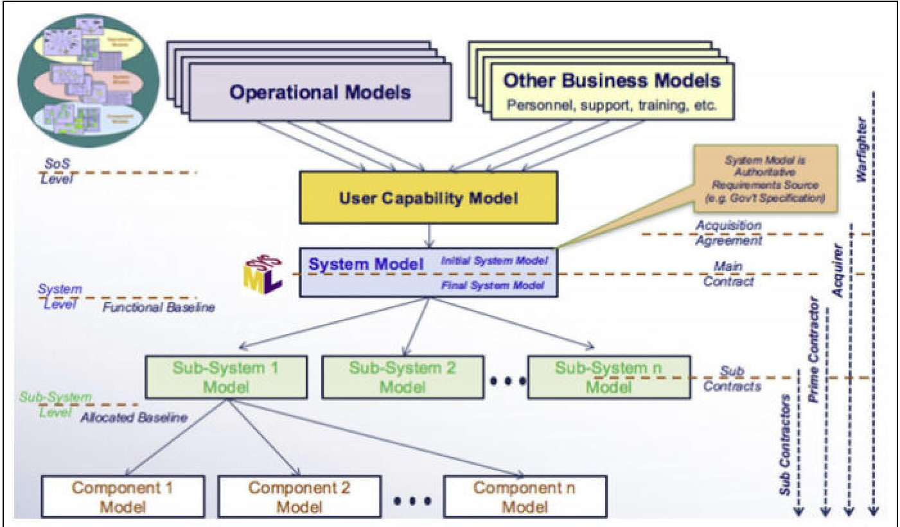

Figure 2.18: DoD view of the various modeling levels relevant to Digital Engineering practices from a multi-stakeholder enterprise and acquisition perspective [14].

<!-- PDF_PAGE: 77 -->

domain." [90] Jenkins claims that such formal representations are the foundation of "longlived, interchangeable models" longevity being a key metric of downstream reusability of models, and in turn, designs [73]. A related concept is the metamodel. A metamodel is the specification for how a model or a larger modeling efforts should be implemented within the modeling environment [10]. Simply put, if ontologies comprise the semantics of a model, metamodels define the syntax or the relationship between the objects and their attributes in the domain encapsulated by the ontology [78].

This understanding of ontologies and metamodels, however, is not unchallenged in the literature. Assmann, for instance, describes hierarchies of models (e.g., "metamodels", "metameta models", etc.) each of which have related ontologies (e.g., "domain" and "upper-level" ontologies) each serving descriptive purposes at different levels of specification [4]. Others, particularly in the field of software engineering, emphasize the need for ontologies to be machine-readable enabling integration into data-intensive applications [131]. In this regard, Taye acknowledges a spectrum of formality with which ontologies with varying purposes can be defined from "highly informal" to "rigorously formal" [131]. Depending on the use-case of the methodology one or the other end of the spectrum may be appropriate.

An example of a simple domain metamodel for a generic engineering system is shown in Fig. 2.19 [134]. Throughout the literature, no ontology specifically for the practice of legacy design reuse has been found, though Schindel has attempted such for the planned reuse case within their broader Pattern-based Systems Engineering methodology [119].

## 2.1.2.3 MBSE Methodologies

There is one missing aspect of the MBSE picture. Languages exist to encode models and system design concepts, ontologies and metamodels exist to enforce syntactic and semantic rules, however, to what end are we using these tools...and how? These questions are addressed by MBSE methodologies. Estefan defines a methodology as "a collection of related processes, methods, or tools" that are applied to a class of problems that have something in common [37]. In this simple definition: a process identifies "what" is to be done and at what level of abstraction/aggregation; a method defines the "how" of a task including techniques for performing the process; a tool is an instrument that facilitates the "how's", or the methods. In a methodology, this set of actions is conducted in an "environment", which is the external objects, conditions, and factors that influence how the methods, processes and tools are implemented. An environment, per Estefan, includes social, cultural, and organizational conditions that enable or disable the "what" and "how" of the methodology.

Estefan surveys the leading MBSE methodologies up to 2008. These include: IBM's Harmony SE and Rational Unified Process for Systems Engineering (RUP SE), INCOSE's Object-oriented Systems Engineering Method (OOSEM), Vitech's MBSE methodology, and JPL's State Analysis methodology. These methodologies primarily define MBSE methods, processes, and tools related to specific tasks within the larger Systems Engineering process. For instance, Harmony SE focuses on preliminary product definition steps including requirement analysis and early architecting. OOSEM attempts to encode most aspects of the Systems Engineering "V" with a focus on integration with object-oriented software methods. The remainder of these methodologies introduce varying problem formulations, but essentially pursue the same ends. One methodology of note, which emerged after Estefan's

<!-- PDF_PAGE: 78 -->

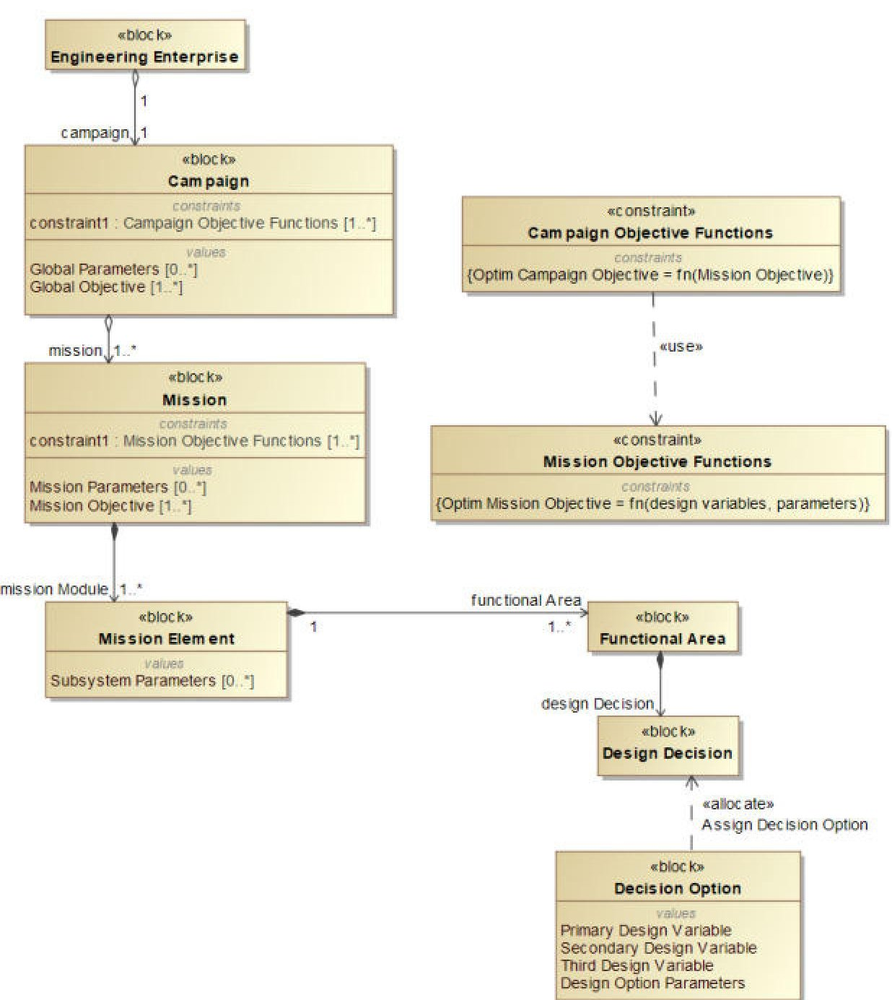

Figure 2.19: An example of a domain metamodel for a generic engineering system, developed in previous work [134].

<!-- PDF_PAGE: 79 -->

work, is Schindel's Pattern-based Systems Engineering. PBSE demonstrates how models, themselves built in accordance with simple patterns and relationships, may be reused across various products in a larger platform or product family - here, of course, we see aspects of planned reuse applied to reusable models [119]. A similar pattern-based approach may be adapted for disparate modeling practices as may be more prevalent in unplanned reuse.

INCOSE, in 2020, acknowledged the explosion of digital engineering capabilities in recent years and the difficulties organizations face in understanding their own needs with regard to MBSE methodology selection. To that end, they developed the Model-based Capabilities Matrix, which assists organization in planning for and implementing MBSE [69]. Nevertheless, few sources have been found which explicitly focus on MBSE-enabled legacy reuse. In the MBSE regime, perhaps the work most in parallel with what we investigate in this thesis, is that by Lange. In their preliminary efforts, they lay out a reuse framework and identify corresponding MBSE features which may enable them [84]. In particular, they find several areas in which MBSE yields value-adding functions: 1) access to complete, browsable sets of requirements from heritage systems; 2) traceability of requirements to lower level elements; 3) understanding of the environment on the system; 4) change propagation to estimate redesign effort; and 5) appropriate level of detail and decomposition for desired reuse analysis. This nascent work by Lange is of great interest throughout this thesis, as it reinforces findings we have developed about potential solutions to the design reuse problem in an MBSE environment.

## 2.1.2.4 MBSE in the Space Industry

Since the mid-2000's, INCOSE's Space Systems Working Group (SSWG) has been an advocate for demonstrating the potential of MBSE for engineering space systems. The SSWG has collaborated with the space industry, notably with NASA's Jet Propulsion Laboratory (JPL) [32], to develop exemplar MBSE capabilities including SysML modeling of representative satellite missions [79], development of CubeSat reference models [80], and application of reference models to real-world CubeSat missions [128]. Partly from these early efforts, the aerospace industry has begun to recognize the value of model-based approaches and increased digitization of system information for complex missions requiring multidisciplinary expertise.

For example, in 2016, NASA conducted a pathfinder effort to develop and advance MBSE capabilities throughout the agency upon discovering that MBSE adoption was still in the nascent stages [111]. This led to the application of MBSE methods on various missions with a specific focus on information systems of Orion's Exploration Flight Test 1 [94], the Asteroid Redirect Mission prior to project cancellation, and to a limited extent for the development of SLS [109]. Moreover, there is a desire at NASA to demonstrate the capabilities of MBSE at larger scales, including for architecting Moon/Mars campaigns as well as for the development of databases of system models to facilitate future reuse efforts. Indeed, while NASA remains in the Pathfinder stage, as described by Holladay, the now agency-wide focus of the MBSE Infusion and Modernization Initiative (MIAMI) effort indicates only increased adoption [64]. Beyond NASA, the use of MBSE in space systems development and research has been demonstrated at other national agencies, such as at Germany's DLR for its small satellite multi-mission platform known as S2TEP [41], and for educational efforts such as

<!-- PDF_PAGE: 80 -->

Pakistan's use of OOSEM for scalable/repeatable student satellite projects [141].

Synthesizing insights from the above examples, we discover that space systems engineering imposes several unique requirements on MBSE methodologies. Among these:

- System models must integrate a variety of discipline-specific technical analysis tools used by mission designers as a result of the multi-disciplinary nature of space systems [108,5]

- Interactions within and across all spacecraft systems and mission environments must be modeled to understand performance and capture emergent behaviors - both beneficial and detrimental

- MBSE methodologies must assess and promote critical value attributes desired of the new generation of space architectures, namely flexibility, evolvability, reusability, and safety

- MBSE methodologies must accommodate deep uncertainties inherent in the design space early in mission design; these are resolved as the architecture matures and the MBSE methodology must allow for updating and adapting the models. Chodas addresses this in a framework known as Model-based Adaptive Design under Uncertainty (MADU) [22]

New methodologies must satisfy these requirements in a way that is not mission-specific, but rather applicable (that is, reusable) across diverse missions. Specific to the reuse use-case of MBSE methods, we again point to the work of Lange as a nascent effort in exploring MBSE methods for reusability of designs across a range of space mission types. They apply their findings to both planned and unplanned reuse; the former as part of the S2TEP effort initially described by Fischer, and the latter in heritage efforts for the MASCOT mission.

## 2.2 Literature Review Summary and Research Gap

Tables 2.2 and 2.3 summarize the major works in the two primary research areas. They identify key sub-topics within each of these domains and if each source addresses it. There is consensus in the literature and practice of the value of design reuse. This is exemplified by the countless instances found within the space industry alone, across a diverse range of mission types and motivations. Sources further agree about the critical need of reuse methods that are systematic and consider both the technical and programmatic value of a reuse scenario. Looking specifically at Table 2.2, we note a primary focus of most existing literature in the realm of planned reuse and product families/platforms; while some present end-to-end methodologies for implementing planned reuse, we recall the key distinctions between planned and unplanned reuse and the limited applicability of these efforts to addressing the latter. More recent works (e.g., Hein and Lange) have acknowledged unplanned reuse as a mode distinct from planned efforts. Hein's work is most relevant in terms of comprehensive methodologies - though their work does not demonstrate user-oriented, end-to-end MBSE application of the assessment procedures, which we will focus on. More importantly, this work is not sensitive to the design environment in which reuse takes place.

<!-- PDF_PAGE: 81 -->

As Table 2.3 shows, the MBSE literature is much more active in recent years, with extensive exploration of fundamental MBSE theory and value-adding capabilities as well as adoption levels. MBSE theory and practice are bridged via works focusing on ontologies/metamodels (i.e., the specifications) and metamodels/languages (i.e., the implementation). However, end-to-end MBSE use cases have seen limited exploration in the literature, perhaps most completely by Chodas. In the realm of reuse, we note two points. First, a general lack of reuse-focused MBSE efforts - Schindel's work, though rigorously developed, has seen limited usage, while Oster's is in use exclusively within one organization. Secondly, even these reuse-related MBSE products are in the realm of planned reuse. Lange is the only work found that has looked into systematic legacy reuse practices facilitated by the new digital engineering approaches.

At the intersection of MBSE and reuse, a gap is identified for providing structured and systematic methods for evaluating unplanned reuse scenarios and providing early-phase decision support by leveraging the power of digitally integrated data and models. This is the central motivation of the LDRM methodology introduced in Chapter 1.

## 2.3 Thesis Statement

The gap identified above shows an area where we may tailor this thesis to deliver lacking and necessary research. In particular, this area is bounded along several dimensions. In the question of reuse, we intend to add needed focus to the domain of unplanned reuse; additionally, we will do so by delivering a demonstrated, end-to-end methodology for decision support, which was also found to be lacking. In the area of MBSE, we will demonstrate a key use-case of the digital paradigm that has eluded organizations and academia. To ensure wide-applicability and trust in the results, LDRM requires rigorous development via ontologies, metamodels, and logically consistent procedures. Such a demonstration of a value-adding MBSE application will further address findings of the literature regarding adoption, socialization, and acceptance of the new paradigm.

The thesis statement guiding this work summarizes the above as follows:

- Given: (1) the high potential value of legacy design reuse for the architecting of space missions, (2) the present obstacles with implementing legacy reuse in a systematic and informed fashion, and (3) the limitations with the traditional document-centric systems engineering approach that have encouraged a transition to digital design environments;

- Thesis Statement: Legacy design reuse, guided by a structured and systematic methodology in an MBSE environment, can lead to improvements over current methods.

## 2.4 Research Approach Summary

The remainder of this thesis will focus on further informing, developing, validating, demonstrating and applying LDRM. As described in Section 1.5, it is intended to provide decision makers with informed technical and programmatic analyses regarding a legacy/unplanned reuse scenario during the early architecting (Phase A) stages of a mission. These analyses

<!-- PDF_PAGE: 82 -->

Table 2.2: Summary of design reuse topics investigated by key works in the literature. Note the limited emphasis on unplanned/legacy reuse method.

<table border="1"><tr><td></td><td>Gonzalez-Zugasti(2000)</td><td>Boas(2008)</td><td>Hofstetter(2009)</td><td>Cameron(2011)</td><td>Oster(2016)</td><td>Hein(2016)</td><td>Lange(2018)</td></tr><tr><td>Planned Reuse:Platforms andProduct Families</td><td>X</td><td>X</td><td>X</td><td>X</td><td>X</td><td></td><td>X</td></tr><tr><td>Unplanned Reuse:Heritage/Legacy</td><td></td><td></td><td></td><td></td><td></td><td>X</td><td>X</td></tr><tr><td>Reuse AssessmentMetrics</td><td>X</td><td></td><td></td><td>X</td><td></td><td>X</td><td></td></tr><tr><td>Divergence andLifecycleOffset</td><td></td><td>X</td><td>X</td><td>X</td><td></td><td>X</td><td></td></tr><tr><td>End-to-EndReuseMethodologies</td><td></td><td></td><td>X</td><td></td><td>X</td><td>X</td><td></td></tr><tr><td>MBSE andLegacyReuse</td><td></td><td></td><td></td><td></td><td></td><td></td><td>X</td></tr></table>

<!-- PDF_PAGE: 83 -->

Table 2.3: Summary of MBSE topics investigated by key works in the literature. Note the limited emphasis on MBSE methodologies for unplanned/legacy reuse.

<table border="1"><tr><td></td><td>Schindel(2015)</td><td>Oster(2016)</td><td>Lange(2018)</td><td>Madni(2018)</td><td>Huldt(2018)</td><td>Chodas(2019)</td><td>Henderson(2021)</td></tr><tr><td>MBSE Theory and Related Concepts</td><td>X</td><td></td><td>X</td><td>X</td><td>X</td><td>X</td><td>X</td></tr><tr><td>MBSE Adoption and Socio-Technical Factors</td><td></td><td></td><td>X</td><td>X</td><td>X</td><td></td><td>X</td></tr><tr><td>Ontologies and Metamodels</td><td>X</td><td>X</td><td></td><td>X</td><td></td><td></td><td></td></tr><tr><td>Methodologies, Languages, and Tools</td><td>X</td><td>X</td><td>X</td><td>X</td><td></td><td></td><td></td></tr><tr><td>Implementation Demonstrations</td><td>X</td><td></td><td></td><td></td><td></td><td>X</td><td></td></tr><tr><td>MBSE and Legacy Reuse</td><td></td><td></td><td>X</td><td></td><td></td><td></td><td></td></tr><tr><td>MBSE and Planned Reuse</td><td>X</td><td>X</td><td></td><td></td><td></td><td></td><td></td></tr></table>

<!-- PDF_PAGE: 84 -->

will be based in best practices identified in the preceding literature review as well as the industry study presented in Chapter 3. This study covers intent, approach, and outcome of reuse and MBSE implementation efforts. The study also serves to identify areas where practice is lacking or where new methods of the MBSE paradigm may yield improvements.

LDRM development follows a top-down framework that begins with a conceptual framing of the problem via a reuse ontology. This ontology defines and organizes the major concepts related to the legacy reuse problem in an unambiguous dictionary and relational mapping of terms. These abstract conceptual terms are then organized into a generalized reuse procedure; this procedure lays out, in an implementation-agnostic form, necessary steps and analyses of the reuse process - as derived from the best practices identified previously. The desired outputs of this procedure are a) a determination of technical feasibility of reusing a candidate element, b) the rework/modification effort required to adapt the candidate to the new mission, and c) an evaluation of programmatic impacts of this effort as compared to a from-scratch solution. These outputs ultimately form a reuse recommendation presented to decisions makers advising for or against reuse for the given functional need in the mission of interest. With this generalized procedure set, the development effort then proceeds to implementation in an MBSE environment. This implementation relies on a reuse metamodel and extension of canonical SysML elements into the constructs necessary for the reuse analyses (with their relevant attributes, tags, and relationships). A demonstration of LDRM application is presented in a sample problem with a representative reuse need, candidate reuse asset, requirement gaps, rework efforts, etc.

Validation will be done in several ways. First, internal validity will demonstrate the logical consistency of the methodology as well as incorporation of best practices and subject matter expert inputs. Then, external validity will be shown via a two-phase virtual design/build/reuse experiment that solicits human subjects to generate and analyze data related to a reuse scenario with and without exposure to LDRM's outputs. This effort demonstrates the ability of LDRM to improve reuse decision-making performance. Two case studies then focus on different aspects of the methodology. The first, exploring reuse across two CubeSat missions, emphasizes the impact of MBSE and existing modeling practices at potential user organizations; the focus here is on the relationship between model quality/consistency and the accuracy and value of the outputs yielded by LDRM. MBSE application on the second case study, exploring reuse across the Space Shuttle and Space Launch System programs, is limited by a lack of available models. However, this case study builds on findings by Good about the issues with mandated reuse decisions locked-in early in a program and its implications on the programmatic aspects of the program. Ultimately, findings from these case studies lead to considerations of model quality and curation, new roles within organizations related to modeling and reuse, and the need for metrics to quantify the reusability of designs and models; these are developed in the final chapter.

## 2.4.1 Expected Contributions

The Legacy Design Reuse in MBSE Methodology is the central contribution of this work. The systematic approach for informing unplanned reuse decisions with quantitative metrics and integrated technical/programmatic analyses can result in organizations reaping greater reuse benefits, and indeed, avoiding potential pitfalls. This overarching con-

<!-- PDF_PAGE: 85 -->

tribution results from individual contributions made in the following areas:

- Update on the State of Reuse Best Practices via a Practitioner Survey and Interviews - A rigorous social science approach to exploring the success or failure of reuse practices is crucial. This approach remedies the problem found throughout the literature for assessing reuse - namely, that it is a complex socio-technical endeavor in which quantitative efforts often fall short of capturing the full picture. The expert survey allows us to build on existing heritage assessment methods while incorporating beneficial practices into a more systematic reuse methodology.

- Formally Define the Unplanned Reuse Problem via a Reuse Ontology- an ontology or similar construct is a fundamental requirement for a standardized and systematic understanding of the domain. Framing all reuse discussions with this ontology ensures consistency in future reuse research while also facilitating implementation of reuse concepts and methods in an MBSE environment.

- Generalized Reuse Procedure Incorporating Industry Best Practices - This procedure forms the logical foundation of LDRM incorporating findings of existing practice and known limitations. Even absent the MBSE implementation scheme overlaid on this procedure, it can act as a starting point for improved reuse decision making.

- Use-Case Encouraging Greater MBSE Adoption - In addition to the specific value added in the realm of heritage reuse, this thesis will also deliver a complete end-to-end demonstration of the MBSE paradigm for a specific use-case. While substantial theory has been developed, the literature reveals limited MBSE application success stories in industry. Particularly for the industry sponsor of this thesis, the work will make for a stronger case for adopting digital engineering for its processes and those of its customers.

- Promoting "Design and Model for Reuse" Practices - Successful development, validation, and demonstration of LDRM will result in an understanding of how reuse is best implemented in the new MBSE landscape. As such, a natural outcome of this work will be a set of recommendations for how best to design and model new assets to improve the ease with which they may be reused in the future. By considering the future reusability of the system we are designing and modeling, we can reap further benefits in the sustainability and cost-effectiveness of space systems development. This forward-looking contribution could easily be the widest-reaching impact of this work.

<!-- PDF_PAGE: 86 -->

## Chapter 3

## Design Reuse Best Practices

This chapter describes the motivation, experimental design, and results of an industry study conducted to ascertain the current state of the practice in design reuse. In addition to determining best design reuse practices, the study also sought to identify areas in the state of the practice where improvements could be had - especially with the incorporation of new MBSE methods. As discovered in previous chapters the current state of design reuse in the space industry - particularly of unplanned reuse - does not fully realize the rich potential benefits. This, we hold, is due in part to the lack of structured and systematic methods for assessing design reuse scenarios; further, we contend that the principles of MBSE present the most promising avenue for improvements to design reuse practices. The purpose of this study is to either confirm or refute these central hypotheses with the experiences and expert opinions of systems engineers, designers and architects, and MBSE users active in industry practice and academia. The findings of this study inform development of the design reuse methodology presented and demonstrated in subsequent chapters.

First, a questionnaire-based survey was distributed widely throughout the space industry to systems engineers, MBSE practitioners, and academics as well as to similar members of other industries comprising a range of complex engineering systems. Secondly, targeted semistructured qualitative interviews were conducted with select respondents, and at meetings of relevant working groups and communities of interest. In most cases, these interviews were centered around specific instances of design reuse identified by the respondents allowing the researcher to probe deeply into circumstances, expectations, and outcomes of individual reuse examples. The two-pronged approach complements the standardized and statistically analyzable results of survey-based methods with the richer and more holistic findings that can be generated from subject interviews. A summary of features of each data-gathering approach is shown in Fig 3.1. Both methods as implemented in this study conform to canonical social science research approaches aimed at 1) avoiding contaminating results with the researcher's biases/desired outcomes and 2) extracting reproducible and statistically significant results from socially and organizationally complex reuse scenarios.

<!-- PDF_PAGE: 87 -->

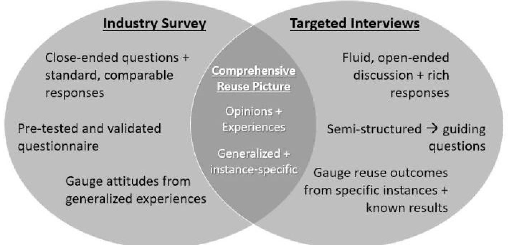

Figure 3.1: Summary of desired characteristics of (left) a survey-based approach and (right) a semi-structured interview approach

Figure 3.2: Survey development approach ensuring traceability from survey objectives to individual questionnaire entries

<!-- PDF_PAGE: 88 -->

## 3.1 Industry Survey on Design Reuse

The first phase of the best practices study consists of a questionnaire-based survey. In this section, we detail how the survey was developed, to whom and how it was distributed, and a comprehensive analysis of the results.

## 3.1.1 Development

A rigorous survey development effort was undertaken to ensure traceability from the study objectives, to more refined and testable hypotheses, down to the specific questionnaire sections and individual questions. As Fig 3.2 illustrates, this approach ensures that each entry in the survey is explicitly answerable to the survey goals. This not only helps in validating the survey, but also leads to an efficient questionnaire not inflated with unnecessary questions; this in turn works to maximize response and completion rates. The themes explored in the survey are related to the three key attributes of design reuse practices described in the motivation to this thesis - intentionality, structuredness, and design environment.

## 3.1.1.1 Study Objectives

Objective 1: Explore the degree of intentionality (i.e., planned vs. unplanned) in design reuse practices in the space industry and others.

We would like to reinforce the findings of an extensive literature review relating to the intentionality of design reuse efforts. The academic and scholarly consensus confirms the prevalence of both planned and unplanned design reuse across various engineering industries. In the space industry specifically, prevalence of each reuse type corresponds with key mission characteristics such as destination and objective. For instance, planned reuse in the form of product platforms seems most prevalent in GEO-based communications satellites and LEO-based SmallSat service-oriented constellations whereas unplanned reuse is common in unique science and exploration missions. It is desired to confirm these findings with the experiences of industry practitioners and to explore how they perceive this key reuse characteristic impacts reuse effectiveness.

Objective 2: Explore the degree of structuredness of design reuse assessment and decision support methods in the space industry and others.

A similar validation is desired for findings of the literature review relating to the methodologies employed to support reuse decision making. If a correlation between more structured/rigorous methods and the success of design reuse efforts can be established with support from both the literature and practitioner experience, then a strong case can be made for the need of a design reuse methodology. This would hold especially true for unplanned reuse efforts that are characterized by higher uncertainty of success than planned efforts. We can further gauge from industry respondents what critical aspects of such structured methodologies would most impact reuse outcomes. These aspects can then be incorporated into the reuse methodology developed in this thesis.

Objective 3: Assess the potential efficacy of the MBSE paradigm to improve

<!-- PDF_PAGE: 89 -->

upon current practices in design reuse in the space industry and others.

While MBSE practitioners and theorists are enthusiastic about the benefits of the paradigm, there has previously existed substantial push-back from systems engineers, discipline engineers, and management personnel throughout the space industry. This is due in part to poor explanation and demonstration of MBSE's value on the former's part and oftentimes engrained perspectives about "If it works, why fix it?" mentalities on the latter. In this survey, we hope to understand the degree to which this opposition still exists, how far MBSE adoption has progressed, and ultimately gauge whether industry practitioners believe MBSE can add value (and how) to the question of exploring design reuse scenarios.

## 3.1.1.2 Testable Hypotheses

Five hypotheses were derived from the guiding objectives - three related to design reuse practices in general and two specifically exploring the capacity of MBSE to address design reuse issues.

Hypothesis 1: Design reuse of any kind is at least as prevalent in the space industry as in others; and unplanned design reuse specifically is at least as common as planned design reuse in the space industry.

It has been established that design reuse is a common practice in the architecting of complex engineering systems. We have also shown extensive examples of design reuse in space systems projects. A difference, however, in the balance of planned vs. unplanned reuse is expected between the space industry and others. Whereas high-volume low-variance industries like automotives and consumer electronics would be expected to favor planned over unplanned reuse, the space industry's range of mission types, destinations and objectives suggest that unplanned reuse may be more common. If this can be shown to be the case, it would reinforce the rationale of this thesis to focus development of the design reuse methodology on unplanned reuse instances - we could be certain that at least the space industry would find use-cases for the methodology. Confirming this hypothesis consists of eliciting from respondents of various industries their assessment of the intentionality of design reuse efforts in their industries, in their organizations, and in projects they have contributed to.

Hypothesis 2: Planned design reuse is typically more successfully implemented than unplanned design reuse and this is due to the limitation in structured methods for carrying out unplanned design reuse.

The fully intentional approach characteristic of planned design reuse efforts would be expected to yield more successful outcomes than ad-hoc efforts. If the lack of structured methods for unplanned reuse suggested by the literature can be confirmed with practical insights from industry practitioners, a causal link can be established between the structuredness of methods for assessing reuse scenarios and their eventual outcomes. This would point to the need for systematic and rigorous generalized methods for reuse scenario assessment even when (or especially when) reuse is unplanned or ad-hoc. As with Hypothesis 1, confirming this hypothesis entails eliciting respondent opinions regarding reuse methodologies that agree with the findings and inferences drawn from the literature review and background research.

<!-- PDF_PAGE: 90 -->

Hypothesis 3: There exists a set of canonical systems engineering steps for assessing unplanned design reuse scenarios and these can be codified into a structured process.

The validity of generalizing a procedure for assessment of unplanned design reuse scenarios is in question in this hypothesis. The context of unplanned reuse scenarios (i.e., objectives, destinations, operating environments, etc.) likely vary more widely than across families or generations of products in a planned reuse campaign. However, if it can be shown that procedures for successfully adopting ad-hoc reuse on a range of scenarios are substantially similar, then a case can be made for generalizing these procedures for implementation on all unplanned reuse situations explored by our methodology. Confirming this hypothesis requires agreement by a majority of respondents on necessary procedures for exploring unplanned design reuse scenarios. These necessary procedures can be codified into the proposed methodology.

Hypothesis 4: MBSE is sufficiently prevalent and adopted in space industry organizations to justify development of MBSE methodologies.

The degree to which MBSE has been adopted at organizations is critical to the value proposition of the proposed methodology. Without substantial adoption within an organization, then the MBSE-based methodology remains out of reach of the projects that would most benefit from it. This hypothesis asserts that MBSE is at least present, socialized, and in practice at multiple organizations within the space industry - to the extent that the methodology resulting from this thesis can have an environment in which to be implemented. This environment requires not only MBSE modeling practices to exist, but also for there to be an atmosphere and structure within the organization conducive to reusing model artifacts as well.

Hypothesis 5: The aspects necessary for a structured unplanned reuse process can be implemented in an MBSE environment with greater efficiency and practicality than in traditional static documentation methods.

While the previous hypothesis explores the capacity of organizations to implement the proposed methodology, this hypothesis focuses on the value added by the model-based approach vs. existing traditional methods. The MBSE literature contains a variety of methodologies and use-cases for various aspects of system design and analysis. However, few specifically address the phenomenon of unplanned design reuse. Thus, this hypothesis is focused on validating the choice of the MBSE paradigm. In other sections of this thesis we address this question from a theoretical and systems-thinking perspective - in the survey, we seek to reinforce validation of this choice based off of the experiences and insights of practitioners in the industry.

## 3.1.1.3 Building the Questionnaire

Questionnaire design - from overall layout to specific question wording and response type is ultimately at the service of the guiding objectives and hypotheses. Thus the questionnaire consisted of question blocks or sections each tailored and traceable to one or more of the hypotheses in the previous section. The full survey questionnaire is reproduced in Appendix

<!-- PDF_PAGE: 91 -->

## A.

The questionnaire begins by gathering demographic data and other metadata. This information is critical during the "theory generating" process of results analysis. In particular, it distinguishes (a) the type of industry to which the respondent belongs as well as their (b) role within their organization. The former is necessary for exploring aspects of the hypotheses that compare industries against one another (in particular, the space industry vs. the rest). The latter is necessary to understand the perspective from which the respondent is addressing reuse issues. This allows us to draw inferences on how reuse experiences converge or diverge, for instance, between system engineers and discipline engineers, or between engineers and management.

The first major section of the survey is primarily aligned with Hypothesis 1 and is focused on the larger context behind design reuse instances with which the respondent is familiar both directly, via projects they have been involved in and indirectly, via projects they are aware of in their organization and industry. Respondents are asked about the prevalence of design reuse in each of these realms. They are also introduced to the distinction of planned vs. unplanned reuse and asked about the relative prevalence of each type of reuse. Lastly, it explores the leading rationales attributed to decision makers and system architects for pursuing reuse.

The questionnaire then proceeds to establish the specific conditions under which reuse is typically carried out. The primary focus regarding reuse conditions is on the "structuredness" of methods or efforts for assessing and deciding on reuse options. Respondents are asked the degree to which methods are structured for both planned and unplanned methods. This question section is aimed in part at addressing Hypothesis 2 relating to the success of reuse decisions. Perhaps most importantly, this section also addresses the question about how/if reuse processes can be codified into more structured approaches where they are lacking (Hypothesis 3). This is accomplished by asking respondents about elements they deem most crucial when generalizing reuse practices into an abstract procedure.

The third section of the questionnaire is focused on reuse outcomes and primarily addresses Hypothesis 2 in conjunction with the preceding section. Respondents are asked to gauge the relative success of design reuse instances for both planned and unplanned efforts. "Reuse success" here is gauged on a spectrum that allows for respondents to identify "partial success" and "full success" (in addition to "unsuccessful" instances. The respondent is left to determine the definition of each term. However, the guiding notion is that while a particular design reuse instance may be implemented in a project without operational or programmatic failure, it may be judged to have not realized all the potential benefits of reuse (in terms of cost, schedule, technical performance, etc.) that were expected by decision makers at the outset of the project. Lastly, the section asks respondents to identify causes for instances in which reuse benefits were not fully realized. It should be noted that in the final version of the questionnaire, the second section of questions relating to reuse conditions was moved to after the section on reuse outcomes. The intent was so that the respondents' perceived reasons for reuse outcomes were not biased by the heavy focus of structuredness in the former section of questions. In other words, it was desired to elicit respondents' uncontaminated thoughts regarding reuse failure/success factors before introducing the concept of "structuredness".

The last section of the questionnaire places reuse in the context of MBSE, and is intended to address Hypotheses 4 and 5. This section seeks to establish the degree to which

<!-- PDF_PAGE: 92 -->

respondents feel MBSE is suitable to address pain-points. As has been mentioned previously, the systems community has yet to converge on a single working definition of MBSE. This oftentimes leads to overloading of terminology, and misinterpretations across users. To establish a common reference for this survey, respondents are asked to consider specifically MBSE as defined by INCOSE: the formalized application of modeling to support system requirements, design, analysis, verification and validation activities beginning in the conceptual design phase and continuing throughout development and later life cycle phases. The first question then establishes the respondent's familiarity and experiences with MBSE per this definition; respondents with no familiarity are filtered out of subsequent questions.

The degree of MBSE adoption at respondents' organizations is then gauged by assessing certain characteristics:

- Scale of Adoption - Are MBSE principles implemented organization wide or on select pilot/pathfinder projects?

- Desired Capabilities - Which specific capabilities delivered by MBSE do organizations prioritize? Is "more efficient design/model reuse" among these capabilities?

- Level of Digitization - How is design information (trades, decisions, configurations, requirements, etc.) captured? Primarily in static documents? Primarily in digital system models?

- Model Storage - How is design information archived and stored? In central and widely accessible locations? In decentralized or silo-ed locations?

While the primary purpose of this portion is to explore the Reuse + MBSE narrative, findings also contribute to the growing body of scholarly research on MBSE theory and it's practical implementation in complex enterprises. The last several questions ask specifically about how MBSE may be leveraged for a design reuse methodology for unplanned reuse scenarios. Respondents are asked whether basing such a methodology in an MBSE environment in their organization would be feasible and value-adding. They are asked to expand on this by identifying expected benefits and challenges of such an approach.

In summary, the survey questionnaire consists of five sections - a demographics section and four sections on various facets of design reuse and the techniques available to improve upon current practice. These sections are outlined in Table 3.1 along with representative questions for each section. Fig. 3.3 demonstrates how the full traceability from survey objectives to the four sections is maintained.

## 3.1.1.4 Validating the Questionnaire

The intent of the survey is to draw conclusions on the prevalence, methods, and outcomes of design reuse as garnered from respondents' own experiences. Therefore, the goal is to capture the thoughts of respondents "in their own words" as nearly as possible - albeit while remaining within the confines of a structured survey. Essential to this is avoiding the preconceived notions of the researcher from contaminating the resulting data. This question becomes particularly important when respondents are addressing topics about which they may not have thought extensively and explicitly about.

<!-- PDF_PAGE: 93 -->

Table 3.1: High-level sections of the questionnaire with guiding questions.

<table border="1"><tr><td colspan="2">Questionnaire Sections</td></tr><tr><td>Reuse Context</td><td>How common is design reuse?
Planned vs. unplanned?
Decision-maker rationale?</td></tr><tr><td>Reuse Conditions</td><td>Structured vs. unstructured?
Critical elements of structured methods?</td></tr><tr><td>Reuse Outcomes</td><td>Why does reuse succeed? Why does it fail?
Is success "full" or "partial"?</td></tr><tr><td>Reuse and MBSE</td><td>Degree of MBSE adoption?
Are organizations "there yet"?
MBSE and structured reuse: Value? Benefits? Challenges?</td></tr></table>

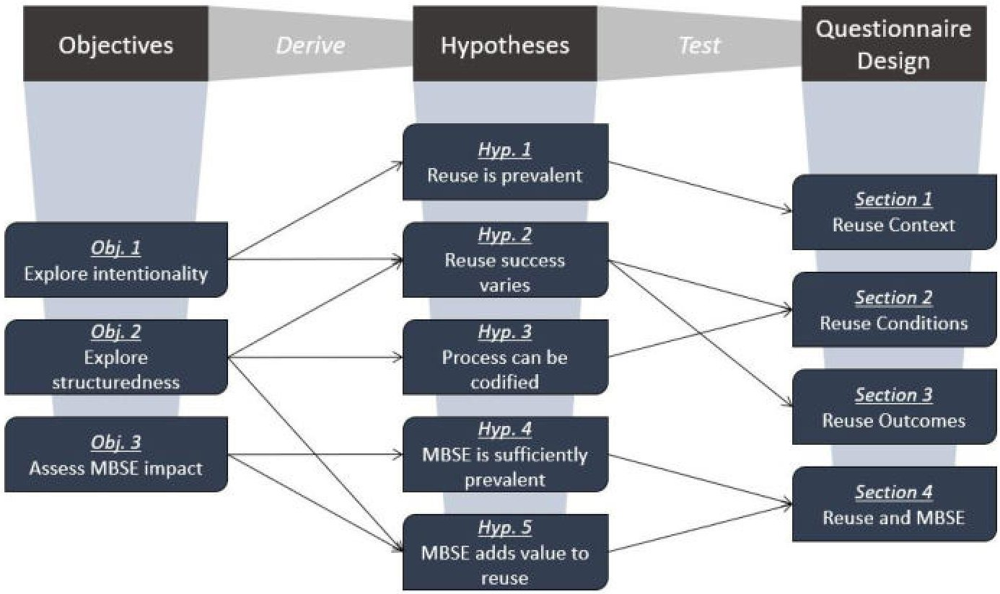

Figure 3.3: Full traceability from objectives to question selection in the survey design effort, builds on Fig. 3.2

<!-- PDF_PAGE: 94 -->

The questions themselves were designed to avoid latent bias; wording and response options were kept neutral as confirmed by several cognizant individuals besides the researcher, including social science research practitioners and educators. Question types that is, multiple response, free response, single response, etc. were selected to yield the maximum flexibility to respondents to present their full opinions on a given topic. Most questions contained an optional free response component to record responses outside of the nominal ones provided. Additionally, the final structure of the survey (as shown in Fig. 3.3) was such that respondents were introduced to certain topics only when it was certain that these new topics would not impact their responses to previous questions. For instance, this was done with the concept of "structured-ness" of reuse methods; respondents were asked to consider "structured-ness" only after they had provided responses on the success outcomes of planned and unplanned reuse efforts. Here, the fact that planned methods often have more reuse structured approaches did not affect their initial response to planned vs. unplanned success.

Combined, the above validation efforts are aimed at providing the most reliable results from the practitioner survey. This is particularly important in a discipline such as design reuse where - as shown in the literature review - quantitative, empirical data tying causes and effects are so difficult to extract from complex systems problems. In these cases, the properly solicited insights of design practitioners are all the more important.

## 3.1.2 Distribution and Demographics

With the content of the questionnaire selected and validated, the effort then turned to implementing the survey - that is, delivering it to various respondent populations and gathering responses. The Qualtrics XM tool was used to build and distribute the survey. This choice was made over simpler and free-to-use software such as Google Forms due to Qualtrics XM's rich survey environment and multi-modal distribution functionality. The survey employed conditional logic to route respondents to appropriate survey sections or individual questions given previous selections; for instance, questions on the impact of "more structured" design reuse methods were presented only to those respondents who had previously indicated a lack of such structuredness in either planned or unplanned reuse scenarios. Additionally, diverse question types were used to ensure response data was of the desired form for each question. Question types used include (predominantly) single response, multiple-response, sliders (for reuse prevalence estimates), and free response options where response selections were not exhaustive. Processing and analysis of the responses was done primarily using IBM's SPSS Statistics package.

## 3.1.2.1 Identifying Respondent Populations

As the goal of this thesis is to assist in decision support for reuse decisions, the target demographic for the survey was those engineers and managers who take part in the decision making process. These include: discipline engineers who carry out the requisite analyses and detailed design of mission subsystems; system architects and system engineers who conduct trades and compose solutions conforming to mission objectives comprising the multidisciplinary domain; and project management team members who ultimately make binding design decisions. The desired respondent population thus comprises a representative set of

<!-- PDF_PAGE: 95 -->

such stakeholders across the sectors of interest.

There is particular interest in establishing whether substantial differences exist between the space enterprise and other engineering sectors on the practice of design reuse. As such, the representative set ideally captures similar proportions of space sector and other respondents. Here a distinction is made between space systems - systems designed to operate in the space environment and the launch vehicles that deliver them - and aerospace systems - air-breathing systems or those designed to operate entirely in Earth's environment.

## 3.1.2.2 Respondent Demographics

Three sources of respondents were identified - as shown in Fig. 3.4. Firstly, the survey was included as an optional concluding assignment in MIT xPro course, "Architecture and Systems Engineering: Models and Methods to Manage Complex Systems". This online professional development course targets engineering professionals, directors, and managers "looking to innovate and optimize their operational, manufacturing, and design systems". Participants are usually drawn from the aerospace, automotive, defense, consumer appliances, and manufacturing industries. By targeting decision makers and innovators, who would have substantial knowledge of their organizations' design practices, this course was seen as an ideal source for the diverse population sought for the survey. As Fig. 3.4 shows, more than half of respondents who completed (100% completion) the survey are from this group. Fig. 3.5 further breaks down the final respondent population by industry - respondents outside of the space and aerospace industries were sourced entirely from this xPro course. Considering potential biases of this population, we find primarily the fact that course participants are typically fairly junior members at their organizations. This may call into the question the depth of experience of participants with project-to-project reuse.

The second source of respondents is from the technical staff at The Aerospace Corporation, a Federally-Funded Research and Development Center (FFRDC) based in El Segundo, California. Aerospace provides technical guidance and advice on mission assurance to a range of civil and defense space agencies. As such, its staff has substantial experience across the national space enterprise and can provide insights on design reuse across diverse space-based projects. Fig. 3.4 shows that roughly 20% of total survey respondents are affiliated with The Aerospace Corporation and fall entirely within the "Space Systems and Launch Vehicles" sector - hereafter referred to as "the space industry" - tabulated in Fig. 3.5. A source of bias in this population may relate to the government-oriented nature of most of Aerospace's work as we have seen, commercial and civil actors have different motivations and approaches to the reuse of legacy systems.

Lastly, "at-large" members of academia and industry were sourced in a variety of ways. Two professional groups of particular relevance were solicited - the INCOSE Space Systems Working Group (SSWG) and the NASA MBSE Community of Practice. SSWG is the primary group within the global systems engineering community exploring how systems theory applies to space-based projects. With key related research efforts including the CubeSat MBSE Reference Model - that aims to standardize the application of MBSE to small satellite missions - this group is an ideal source for identifying best practices in design reuse and MBSE specifically for space-based projects. Similarly, the NASA MBSE CoP seeks to socialize concepts of MBSE throughout the agency and has similar value in developing insights on

<!-- PDF_PAGE: 96 -->

MBSE adoption for reuse. Academics - primarily university PI's and professors in the fields of complex engineering systems - were individually targeted by direct solicitation. University respondents were sampled from: Georgia Tech, MIT, University of Texas - Austin, TU Munich, ETH Zurich, and Keio University in Japan. No particular source of bias can be identified for this population other than the fundamental differences between academic motivations and those of industry.

The industry demographics detailed in Fig. 3.5 reveal good representation of respondents across a diverse set of industries. As desired, the large set from the space industry allow for particular focused analyses within this group, while sizable populations from Aerospace, Defense, Automotive, and Computer Hardware and Software sectors allow for comparison in reuse and MBSE practices across communities. In total 149 completed responses were received. Respondent statistics are also shown by their self-identified roles within their organizations, in Table 3.2; a majority identify as Systems Engineers while managers, other discipline engineers, and academia are represented to a lesser degree.

## 3.1.3 Results Analysis

As discussed previously, the three explicit objectives of the survey are:

1. Explore impact of design reuse intentionality on methods and outcomes

2. Explore impact of design reuse structuredness on methods and outcomes

3. Assess potential efficacy of MBSE methods to improve current reuse practices

Results analysis is developed around testing of the 5 hypotheses, which flow from these objectives (see Fig. 3.3 and Section 3.1.1.2).

## 3.1.3.1 Hypothesis 1

Hypothesis 1 states that design reuse is at least as prevalent in the space industry as in others, and that unplanned design reuse specifically is at least as common as planned design reuse in the space industry. The goal of this initial hypothesis is to a) confirm the userbase of a reuse methodology narrowly focused on unplanned reuse efforts and b) validate an emphasis on the space industry as a sector particularly in need of such a methodology.

Respondents were first asked to estimate the percentage of projects within their teams, organizations, and industries that implemented design reuse to some extent $ ^{1} $ . Fig. 3.6 shows the mean percentage reported by respondents of each of the 5 industries with the largest populations. Additionally, it shows the mean percentage across all industries - 56% . The data clearly indicates that the first half of Hypothesis 1 holds. In the experience of industry practitioners, the space industry implements design reuse on more than half of projects undertaken; a similar frequency to other industries, and in cases, greater. Tight error bars indicate general agreement among space industry respondents.

<!-- PDF_PAGE: 97 -->

Figure 3.4: Survey respondents by solicited populations.

With which of the following industries are you most closely associated?

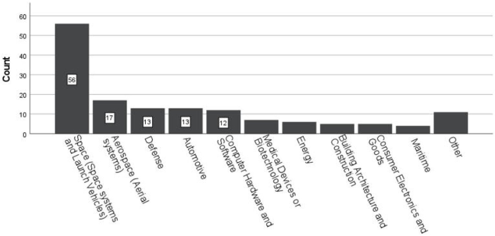

Figure 3.5: Survey respondents by industry type.

<!-- PDF_PAGE: 98 -->

Table 3.2: Survey respondents by role.

<table border="1"><tr><td></td><td>Count</td><td>Percentage</td></tr><tr><td>Systems Engineer</td><td>62</td><td>51.2</td></tr><tr><td>Project Management</td><td>17</td><td>14.0</td></tr><tr><td>R&amp;D</td><td>14</td><td>11.6</td></tr><tr><td>Other Engineering Discipline</td><td>13</td><td>10.7</td></tr><tr><td>Professor/Instructor</td><td>7</td><td>5.8</td></tr><tr><td>Other</td><td>5</td><td>4.1</td></tr><tr><td>Production/Manufacturing</td><td>2</td><td>1.7</td></tr><tr><td>Total</td><td>121</td><td></td></tr></table>

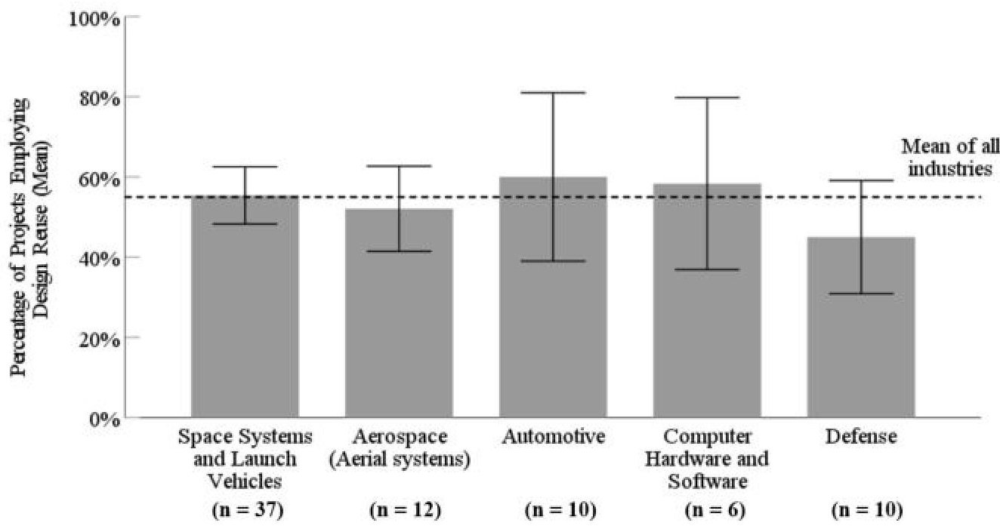

Figure 3.6: Mean percentage of projects employing design reuse in selected industries, based on respondent experiences. Note the design reuse definition in the previous footnote.

<!-- PDF_PAGE: 99 -->

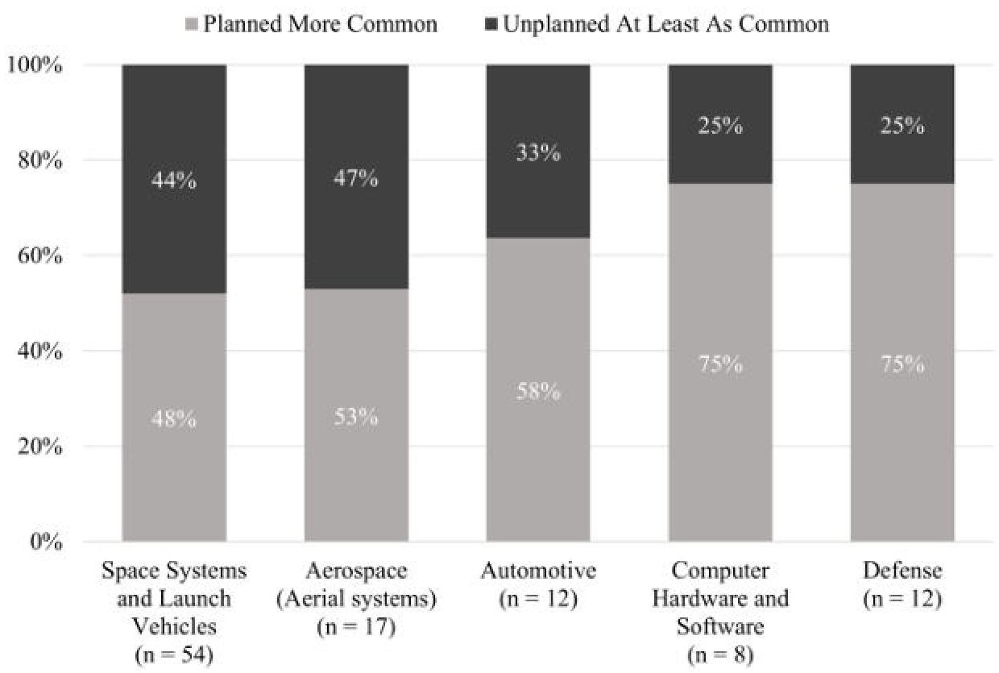

Figure 3.7: Comparative prevalence of planned and unplanned reuse in selected industries.

<!-- PDF_PAGE: 100 -->

To address the second half of the hypothesis, respondents were asked to characterize the relative prevalence of planned and unplanned reuse efforts. Respondents were provided with the definitions of these terms developed in Chapter 1. Fig. 3.7 plots the resulting data from this question - with response options collapsed to (a) planned being more common and (b) unplanned being at least as common. In the original question, response options were presented on a spectrum: "Planned much more common...", "...somewhat more common...", "...equally common...", "Unplanned somewhat more common...", "...much more common...". The plot shows that the space and aerospace sectors stand out from their terrestrial counterparts in terms of the relative prevalence of unplanned reuse. Indeed, the space industry has the greatest perceived prevalence of unplanned reuse of any industry surveyed. This coincides well with the results of the literature review that established the common practice of heritage opportunistic reuse of flight-proven designs. Nevertheless, the second half of the hypothesis does not strictly hold; planned reuse is still deemed more common by a plurality of respondents in the space industry, with the remaining 8% responding "unsure". However, the results do indicate that the space industry, in the opinion of respondents, implements unplanned reuse with higher frequency than most others surveyed.

## 3.1.3.2 Hypothesis 2

Hypothesis 2 states that planned design reuse is typically more successfully implemented than unplanned design reuse. It also attributes this gap in successful outcomes to a lack of structured methods for carrying out the latter form of reuse. The hypothesis extrapolates the claimed variance in success outcomes from known instances of reuse along the intentionality spectrum. Similarly, the stipulated cause for reduced success outcomes is deduced from the noted absence in the literature of rigorous methodologies for ad-hoc reuse efforts. This missing piece being the key independent variable distinguishing the two cases leads to a causation being inferred, which is now tested by gauging practitioner experiences.

Figure 3.8 captures participants' responses to the questions: "Which of the following statements comes closest to your opinion about unplanned design reuse in your industry?" and a similar question for planned design reuse. Response options include: (a) Reuse is typically successful and fully realizes predicted benefits, (b) Reuse is typically successful but only partially realizes predicted benefits, (c) Reuse is typically unsuccessful and fails to realize any reuse benefits, and (d) Unsure/Cannot generalize. By asking them to consider the "typical" case, this question has respondents deduce a pattern for expected outcomes from the full portfolio of reuse scenarios they have encountered. Respondents are asked to distinguish between partial and full success of a reuse effort as compared to the initial expectations of decision makers from the outset of the project.

The top plot in Fig. 3.8 presents the findings for respondents from all industries while the lower plot presents the findings for respondents from the space industry alone. Examining the two plots, it is clear that the first clause of Hypothesis 2 holds: in the full industry set as well as the space industry sub-set, respondents cite planned reuse as typically "fully successful" more frequently than unplanned reuse. Space industry respondents trend more pessimistic about full success in planned reuse scenarios than other respondents, but a similar phenomenon is witnessed in unplanned reuse assessments as well. Additionally, in both respondent sets planned reuse is more commonly associated with any amount of success,

<!-- PDF_PAGE: 101 -->

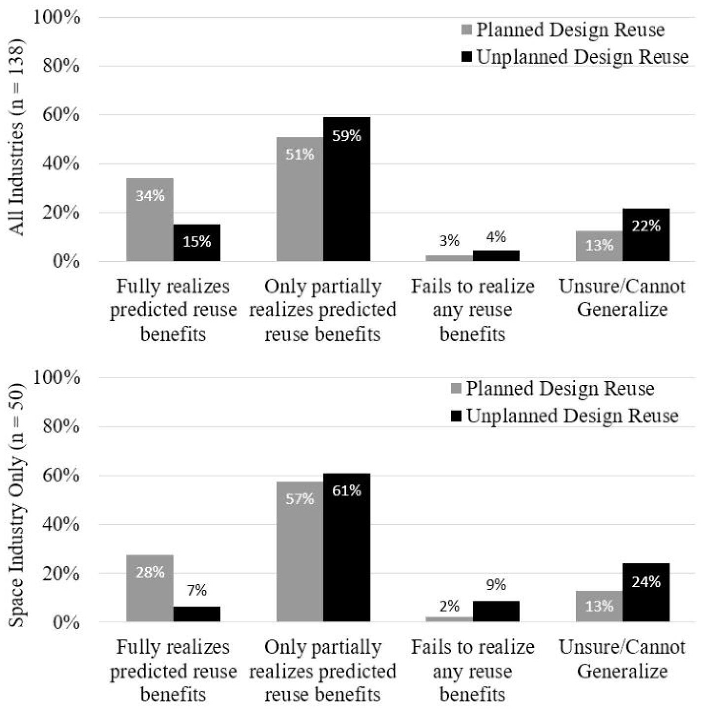

Figure 3.8: Comparative outcome assessments of planned and unplanned design reuse for (top) all industries surveyed and (bottom) the space industry.

<!-- PDF_PAGE: 102 -->

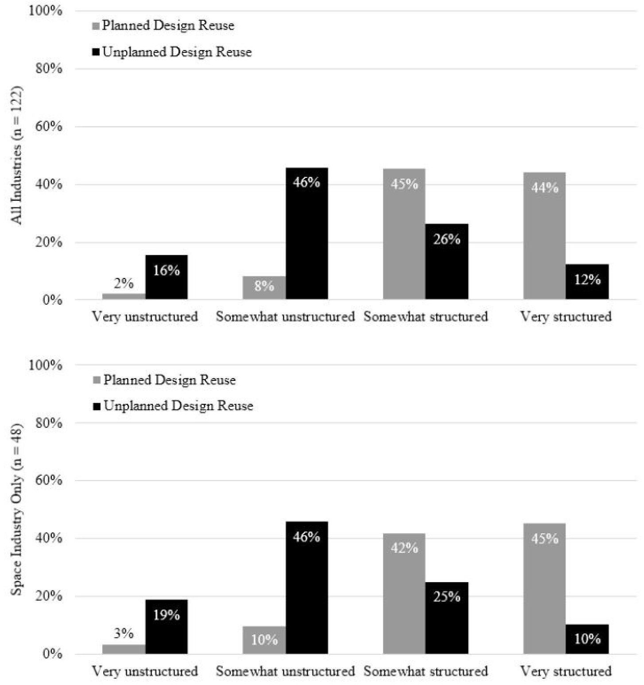

Figure 3.9: Comparative "structuredness" assessments of planned and unplanned design reuse for (top) all industries surveyed and (bottom) the space industry.

<!-- PDF_PAGE: 103 -->

either full or partial. In both cases, 85% of respondents claim that planned design reuse is typically at least partially successful. The analogous figures for unplanned reuse are reduced by 10% across all industries and 17% for the space industry alone. This finding, along with the increased "reuse failure" figures for unplanned reuse - particularly in the space industry works to confirm the first part of Hypothesis 2, namely that planned design reuse is typically more successfully implemented than unplanned design reuse.

We note also an increased percentage of respondents citing uncertainty or an inability to generalize about unplanned reuse, around 10% more than for planned reuse. This finding may be the first suggestion towards confirming the second half of Hypothesis 2, the correlation between availability and use of structured reuse assessment methods and the success of the reuse effort. While not directly confirmatory, the increased uncertainty in assessing unplanned reuse outcomes implies reduced confidence in the underlying processes guiding unplanned reuse. The fact of increased availability of structured methods for planned reuse efforts, initially established in the literature review, is confirmed in Fig. 3.9. Over 60% of respondents across both sets characterize unplanned reuse efforts as either "very" or "somewhat" unstructured; conversely, nearly 90% of respondents characterize planned reuse efforts as either "very" or "somewhat" structured.

As both Figs. 3.8 and 3.9 present responses along an ordered scale, we can attempt to draw out a correlation. The Spearman correlation coefficient - calculated in Table 3.3 relates the tendency of the dependent variable (reuse outcomes) to change with changes to the independent variable (reuse structured-ness); a value > 0 indicates a positive correlation, where the dependent variable increases with increases to the independent variable. The table identifies a moderate correlation - at a 95% confidence level - between a respondent's assessment of unplanned reuse outcomes and the structured-ness of the effort. This correlation is confirmed by direct questioning of respondents on the likely outcome of added systematic rigor and structure in unplanned reuse decision-making, as summarized in Table 3.4. Two-thirds of respondents predict greater success.

In summary, there is clear evidence that, in the experience of respondents, planned methods are typically more successful than unplanned methods at realizing reuse potential. And there is a strong correlation between these outcomes and the structured-ness of methods used to guide a given reuse effort. This fact, when combined with the known lack of structured methods for unplanned reuse, points to a cause for reduced success outcomes of unplanned reuse - or conversely, a path towards improving these outcomes.

## 3.1.3.3 Hypothesis 3

Hypothesis 3 holds that there exists a set of canonical systems engineering steps for assessing unplanned design reuse scenarios and these can be codified into a structured process. These steps may be seen as the minimum requirements of a legacy design reuse methodology as proposed and developed in this thesis. We may test the validity of this hypothesis by approaching the question from two directions: first, identifying those aspects of reuse that respondents most commonly cite as principal causes for failures or diminished success of reuse efforts; second, explore the "essential elements" of a structured process as identified by respondents in a separate question. While the second question alone may seem sufficient to test the hypothesis, additional insights may be drawn from correlating the failure causes

<!-- PDF_PAGE: 104 -->

Table 3.3: Correlation analysis of unplanned reuse "structuredness" and the outcome of unplanned reuse efforts. Results show a positive correlation.

<table border="1"><tr><td></td><td></td><td>Outcome of Unplanned Efforts</td></tr><tr><td>Unplanned Reuse</td><td>Correlation Coefficient (Spearman Rho)</td><td>0.214*</td></tr><tr><td>Structured-ness</td><td>Sig. (2 tailed)</td><td>0.020</td></tr><tr><td></td><td>N</td><td>118</td></tr></table>

* Correlation is significant at the 0.05 level

Table 3.4: Support of statistical correlation via direct questioning of the impact of "structuredness" on unplanned reuse outcomes.

<table border="1"><tr><td></td><td>Count</td><td>Percent</td></tr><tr><td>More Successful</td><td>71</td><td>67</td></tr><tr><td>No Impact</td><td>9</td><td>8.5</td></tr><tr><td>Less Successful</td><td>4</td><td>3.8</td></tr><tr><td>Unsure</td><td>22</td><td>20.8</td></tr><tr><td>Total</td><td>106</td><td></td></tr></table>

<!-- PDF_PAGE: 105 -->

and success criteria cited by respondents.

Table 3.5 summarizes results when respondents were asked for principal failure causes in unplanned design reuse efforts. Results are divided, as previously, into "all respondents" and those from the space industry alone. The values represent the percentage of respondents in each population group that selected each failure cause in a "check all that apply" question type. Firstly, we note that respondents from the space industry were more likely than the whole to select one or multiple failure causes; this is captured by the reduced percentages across all response options for the "All respondents" group. Nevertheless, the ranked order of responses - from most to least selected - remains the same across the two response groups, confirming a similarity across industries for failure causes in unplanned reuse.

Looking now at the space industry alone, we define a response threshold of 50% to classify response options as prevalent failure causes of unplanned reuse. We see that 5 such responses meet this criteria: (1) failure to identify design adaptations or rework, (2) failure to understand contextual gaps across missions, (3) failure to predict detrimental emergent impacts, (4) failure to allocate cost or schedule margin for reuse complications, and (5) lost knowledge from a reusable asset's native product. Common to all of these responses is a lack of comparative understanding of the "reuse slot" in the current mission of interest and the candidate reuse asset as it exists in its native mission. Thus, seemingly most failures are borne out of an overly narrow or naive view that ignores the objective, environmental, and performance envelope differences across native and new missions. Qualitative discussions with several practitioners (from the same organization) have found that push-back to reuse across large enterprises is common, and is likely due to siloed business units. The survey, however, does not reflect this. This suggests that such phenomena may be isolated to particular organizations or management structures/philosophies. Lastly, one write-in response of note identifies attempted reuse of outdated or obsolete designs as a common failure cause; in these circumstances, issues that may arise include rigid performance envelopes and lack of suppliers [13].

Table 3.6 presents respondents' evaluation of essential elements of a structured methodology for unplanned reuse. Unlike in Table 3.5, there is some disagreement in the ranked order of responses between response populations. This may reflect variations in product complexity and development environments across the sample industries. However, applying the same 50% threshold to this data yields a consistent set of common response options. The agreement of over half of all respondents (as well as over half of space industry respondents) is that a structured methodology requires procedures for: (1) quantifying reuse costs and schedule impacts, (2) quantifying contextual gaps and assessing required rework, (3) comparing reuse with from-scratch efforts, (4) modeling and cataloguing designs in a standard fashion. There is significant correlation between what respondents identify as necessary aspects of a structured legacy design reuse methodology and the failures they identify in current unstructured methods. It is clear then that beyond simply codifying the unstructured process, the methodology can positively impact design reuse efforts by correcting those failure points that commonly arise when reuse is not done systematically. Concluding on Hypothesis 3, we can say that it holds that there is an essential/canonical set of steps and moreover, if these steps are done poorly or omitted entirely, it can lead directly to failed reuse scenarios.

<!-- PDF_PAGE: 106 -->

Table 3.5: Ordered set of causes of design reuse failures, as identified by respondents (left) in the space industry and (right) across all industries.

<table border="1"><tr><td>Causes of Design Reuse Failure</td><td>Space Industry Respondents</td><td>All Respondents</td></tr><tr><td>Failure to identify required design adaptations or rework</td><td>62.8%</td><td>62.3%</td></tr><tr><td>Failure to understand contextual gaps across missions or products</td><td>62.8%</td><td>52.6%</td></tr><tr><td>Failure to predict detrimental emergent impacts</td><td>60.5%</td><td>44.7%</td></tr><tr><td>Failure to allocate cost or schedule margin for unexpected reuse complications</td><td>60.5%</td><td>42.1%</td></tr><tr><td>Lost knowledge from the reusable asset&#x27;s native product or mission</td><td>55.8%</td><td>41.2%</td></tr><tr><td>No availability of comprehensive design information for the candidate reusable asset</td><td>48.8%</td><td>40.4%</td></tr><tr><td>Failure to estimate reuse cost and schedule requirements</td><td>46.5%</td><td>38.6%</td></tr><tr><td>Organizational push-back (&quot;not invented here&quot; syndrome)</td><td>37.2%</td><td>24.6%</td></tr></table>

<!-- PDF_PAGE: 107 -->

Table 3.6: Ordered set of critical elements of an unplanned reuse procedure, as identified by respondents (left) in the space industry and (right) across all industries.

<table border="1"><tr><td>Essential Structured Method Elements</td><td>Space Industry Respondents</td><td>All Respondents</td></tr><tr><td>Quantify design reuse effort costs</td><td>72.0%</td><td>69.7%</td></tr><tr><td>Catalog reusable design artifacts</td><td>68.0%</td><td>66.7%</td></tr><tr><td>Quantify requirements gaps across missions/products</td><td>68.0%</td><td>63.6%</td></tr><tr><td>Compare design reuse effort with from-scratch design efforts</td><td>64.0%</td><td>60.6%</td></tr><tr><td>Identify required design rework/adaptation tasks</td><td>60.0%</td><td>54.5%</td></tr><tr><td>Quantify design reuse effort schedule</td><td>64.0%</td><td>54.5%</td></tr><tr><td>Calculate metrics for assessing a design&#x27;s potential to be reused</td><td>72.0%</td><td>54.5%</td></tr><tr><td>Generate descriptive model of the mission/product of interest</td><td>60.0%</td><td>51.5%</td></tr><tr><td>Identify candidate reusable designs from a reusable asset catalog</td><td>48.0%</td><td>48.5%</td></tr><tr><td>Identify candidate reusable designs from a predecessor mission</td><td>44.0%</td><td>39.4%</td></tr><tr><td>Synthesize design reuse recommendations</td><td>32.0%</td><td>33.3%</td></tr><tr><td>Cataloging whole missions/products</td><td>32.0%</td><td>30.3%</td></tr></table>

<!-- PDF_PAGE: 108 -->

Considering now the first three hypotheses, we conclude that:

- design reuse, and particularly unplanned instances, are especially common in the space industry

- unplanned reuse efforts across all industries suffer from a lack of structured methods to consistently and systematically assess positive and negative impacts; this leads to reuse outcomes that do not fully realize potential benefits

- these first two points suggest an abundance of beneficiaries of the LDRM methodology proposed and developed in this thesis

- respondents identify essential elements of the design reuse process that codify best practices and avoid common failure causes

- there is thus a clear need and an underlying foundation for LDRM

Survey analysis now turns to placement of the proposed methodology within the methods and principles of MBSE.

## 3.1.3.4 Hypothesis 4

Hypothesis 4 claims that MBSE is sufficiently prevalent and adopted in space industry organizations to justify development of the methodology in an MBSE environment. The literature review established a climate in the engineering systems discipline of increasing openness to digital engineering methods. For this hypothesis, we desire to deduce whether this climate has reached a level where MBSE-based methodologies may provide value to organizations for tailored use-cases such as reuse assessment, design archiving for future reuse, etc. Making this determination for the reuse assessment use-case requires:

1. exploring how established MBSE practices are in respondents' organizations (e.g., centralized digital models; standardized modeling practices and metamodels; data digitization, threading and archiving methods; defined ontologies and authoritative sources of truth; etc.)

2. assessing the degree to which the digital data is in a form readily amenable to reuse analyses

As discussed in Section 3.1.1.3, respondents have been asked to answer relevant questions based on the working definition of MBSE, as developed by INCOSE. Fig 3.10 presents the spectrum of MBSE adoption levels as identified by respondents in five of the industry populations sampled. As suggested by select examples discussed in the literature review, organizations within the space industry reside primarily the middle of the spectrum - from MBSE pilot projects and pathfinder efforts to more extensive deployment on a project-to-project basis. Indeed, these preliminary stages of MBSE adoption may be the most logical points to influence deployment and implementation such that model, design, and data reusability are encouraged. Shaping MBSE methods to emphasize "design/modeling for reuse" is further discussed in Chapter 6. Results for the space industry align closely

<!-- PDF_PAGE: 109 -->

with aerospace industry trends, as expected due to large organizations overlapping across the two sectors. Comparatively, a more advanced industry in terms of MBSE adoption is the automotive industry. This fact is likely related to the well established platform and product family approaches common in vehicle development; such structured methods, belonging to the "planned reuse" regime, are more amenable to import into emerging digital methods.

Intrinsic to MBSE deployment are the modes that organizations use to store, relate, and transmit data and design information. An indirect indicator of MBSE maturity at an organization is the degree of "digitization". Fig. 3.11 depicts results of a "degree of digitization" question asked of respondents. In the space and aerospace industries, a majority of respondents claim that their organizations capture design information predominantly in traditional document form. Respondents favoring "predominantly" over "entirely" suggests existence of at least some amount of digital models as authoritative sources of design information, as seen in the automotive industry. Due to digitization's intrinsic role in larger model-based efforts, we would expect a relationship between the data in Figs. 3.10 and 3.11. As the first data column of Table 3.7 shows, there is indeed a positive correlation with a high degree of certainty; specifically, respondents who identified their organizations as more mature adopters of MBSE likely also experienced a larger magnitude of data digitization efforts. This is expected, and it supports the deduction that organizations are trending in the right direction in terms of necessary actions to facilitate deployment of MBSE methods, such as the methodology developed in this thesis. It follows that the second column of the table negatively correlates the level of information digitization to downstream efforts to reuse that information.

Figure 3.12 summarizes responses when participants are asked for the desired high-level benefits for which their organizations are adopting MBSE principles. In both response sets, "Improved reusability of designs..." is selected by around 40% of respondents, with leading response options in both cases being "Facilitating communication via authoritative sources of truth" and "Improving collaboration via common understanding...". This is expected; indeed, most of the literature on MBSE, as explored previously, includes precisely these two clauses in defining the paradigm itself. Facilitation of reuse efforts is also commonly cited, but as a desirable use-case - not as central to the definition of MBSE. Nevertheless, for Hypothesis 4 we have shown that:

1. The space industry is sufficiently advanced in MBSE adoption to justify development of the proposed methodology in a digital environment,

2. Modes of generating, storing, and transmitting design information are keeping pace with this transition and may at least allow for pilot model-based efforts,

3. Organizations generally see value of MBSE for improving reuse practices, though inroads may be made to truly demonstrate these benefits via real-world case studies yielding actionable results.

## 3.1.3.5 Hypothesis 5

Hypothesis 5 states that a structured unplanned reuse process can be implemented in an MBSE environment with greater efficiency and effectiveness than in traditional static doc-

<!-- PDF_PAGE: 110 -->

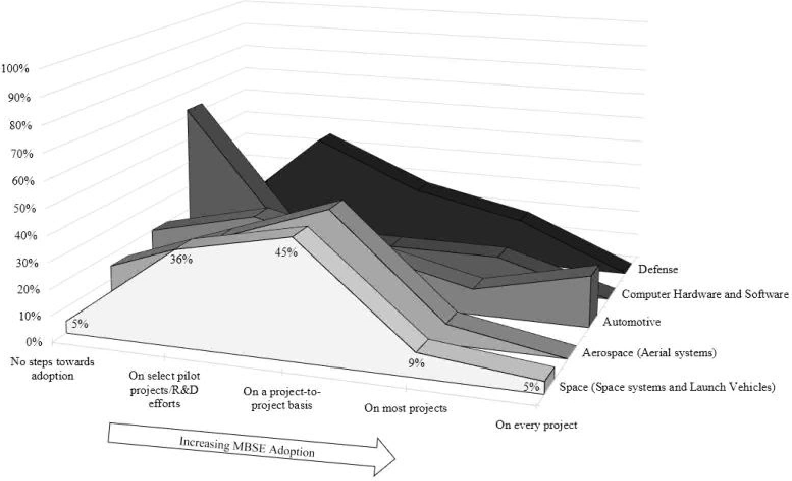

Figure 3.10: Level of MBSE adoption in respondents' organizations, by industry.

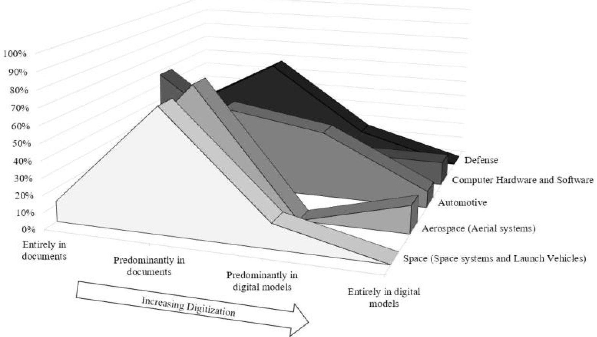

Figure 3.11: Predominant forms of design information storage (static documents vs. digitized models) in respondents' organizations, by industry.

<!-- PDF_PAGE: 111 -->

Table 3.7: Correlation analysis of the degree of design information digitization with level of MBSE adoption and inherent effort to reuse such information.

<table border="1"><tr><td></td><td></td><td>Level of MBSE Adoption</td><td>Effort to Reuse</td></tr><tr><td rowspan="3">Digitization of Design Information</td><td>Correlation Coefficient (Spearman Rho)</td><td>0.249*</td><td>-0.236**</td></tr><tr><td>Sig. (2-tailed)</td><td>0.010</td><td>0.019</td></tr><tr><td>N</td><td>107</td><td>88</td></tr></table>

* Correlation is significant at the 0.01 level

** Correlation is significant at the 0.05 level

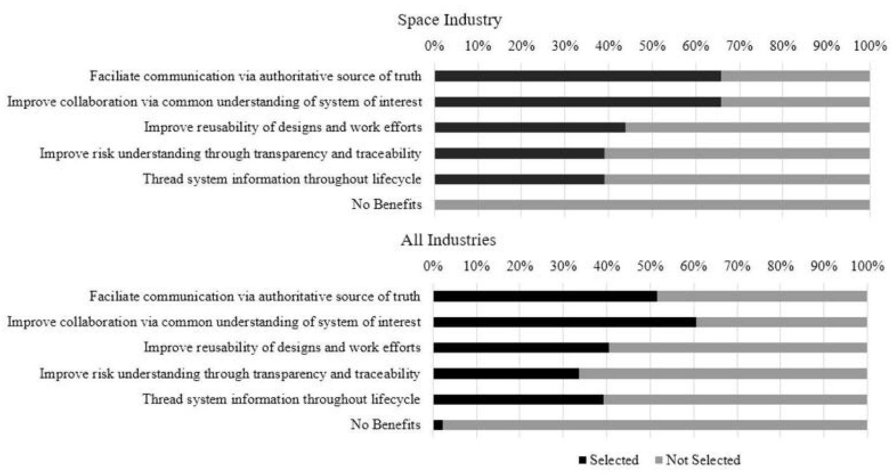

Figure 3.12: Summary of desired high-level use cases enabled by MBSE adoption in respondent's organizations in (top) the space industry and (bottom) all industries.

<!-- PDF_PAGE: 112 -->

umentation methods. Testing this hypothesis requires asking respondents to balance the relative benefits and challenges of implementing reuse procedures in the digital environment. In two separate questions, respondents are directly asked to identify these expected benefits and challenges specifically for the basing the reuse methodology in MBSE; results are tabulated in Table 3.8. Looking first at benefits, we see that the high-scoring responses are primarily results-oriented - that is, respondents expect reuse benefits to emerge from the outcomes of the reuse efforts as opposed to other aspects, such as ease of implementation or training. In fact, the responses scoring below 30% share a common theme of being related to organizational factors and integration of MBSE practices into engineering processes. Once these hurdles are overcome, the respondents expect MBSE to lend rigor, reliability, and cross-project consistency to reuse efforts. Looking specifically at the first response, "Improved consistency across projects", we find that 81% who selected this response also identified their organization as having decentralized data storage practices. Via this correlation, it is clear that respondents see a "low-hanging fruit" opportunity for improving MBSE practices by centralizing design information such that it is accessible in a cross-project fashion.

Looking now at the challenges, we see counterparts of the low-scoring potential benefits emerge as some of the central challenges to MBSE-based reuse methods. Primary among these are difficulties in learning and implementing MBSE methods; certainly this issue extends beyond just reuse-related digital efforts. Recalling findings from the literature review, most authoritative sources cite precisely these difficulties as the continued roadblocks to the digital transformation of SE practices. Closely tied to these issues are organizational pushback often associated with questions of the form "if current practices work, why fix them?"; these concerns may themselves arise from difficulties in integrating MBSE practices into existing design processes and infrastructure. Such challenges are particularly prevalent when MBSE methods are adopted in disparate bottom-up approaches across siloed organizations; these may lead to conflicting practices in the future, when top-down digital transformation efforts attempt to consolidate the varying practices into a coherent whole. These effects hold for a variety of MBSE use-cases, beyond just the design and model reuse question explored here.

Nevertheless, should these organizational and implementation challenges of the larger MBSE paradigm be overcome, the resulting digital transformation would prove beneficial to reuse efforts. Recalling Table 3.7, the second correlation connects the degree of digitization in a respondent's organization to the respondent's perception of the difficulty of reusing digital models. The correlation is significant (with a 95% confidence) and negative - implying that as digitization in an organization increases, the reuse difficulties diminish.

The survey concludes with two direct questions about the feasibility and value of a design reuse methodology founded in the paradigm of MBSE. Results are tabulated in Figs. 3.13 and 3.14. Nearly two-thirds of respondents, when asked to balance the challenges, benefits, and operational/implementation factors at their organization, agree that a structured process for unplanned design reuse could be deployed in an MBSE environment. In fact, a small percentage claim that they have already seen this demonstrated - though in a free-response addendum to this question, some respondents volunteer that these existing methods are for highly tailored and specific reuse instances. Finally, inspecting Fig. 3.14, there is an overwhelmingly positive view of the value of an MBSE-centered design reuse methodology. The

<!-- PDF_PAGE: 113 -->

Table 3.8: Ordered set of (left) benefits and (right) challenges of MBSE-enabled reuse identified by all respondents.

<table border="1"><tr><td colspan="2">Benefits of MBSE Reuse Method</td><td colspan="2">Challenges of MBSE Reuse Method</td></tr><tr><td>Improved consistency across projects</td><td>73.3%</td><td>57.3%</td><td>More effort to learn</td></tr><tr><td>Yield more reliable results</td><td>51.1%</td><td>52.8%</td><td>More effort to implement</td></tr><tr><td>More rigorous</td><td>45.6%</td><td>47.2%</td><td>Would experience organizational push-back</td></tr><tr><td>More widely applicable</td><td>28.9%</td><td>40.4%</td><td>More difficult to integrate with existing design processes</td></tr><tr><td>Require less effort to implement</td><td>24.4%</td><td>39.3%</td><td>More costly to implement</td></tr><tr><td>Less costly to implement</td><td>21.1%</td><td>7.9%</td><td>No challenges</td></tr><tr><td>Easier to learn</td><td>16.7%</td><td>4.5%</td><td>Yield less consistency across projects</td></tr><tr><td>No benefit</td><td>4.4%</td><td>4.5%</td><td>Yield less reliable results</td></tr></table>

<!-- PDF_PAGE: 114 -->

relatively large percentage of "Unsure" responses in both questions reflects the uncertainty impacting MBSE adoption more broadly in organizations - this uncertainty, in turn, is precipitated by the varying and sometimes disparate approaches to overcoming the barriers to entry for MBSE methods into traditional design environments. Despite these challenges, respondents are still optimistic that reuse can prove a good use case for MBSE methods.

Considering now the last two MBSE-focused hypotheses we can conclude that:

- adoption of MBSE methods, and a broader "digital transformation", is progressing throughout the space industry though most organizations are still in initial pilot efforts and as-desired project implementation

- fundamental to effectively implementing MBSE methodologies is the "digitization" of design information from static-document based to connected digital models - space industry organizations are lagging in this effort

- organizations see improved design reuse as a secondary, albeit important, use case and motivator for MBSE adoption - with the primary ones being reliable communication of designs and improved collaborative environments

- benefits of MBSE-based reuse are results oriented (e.g., higher reliability, greater rigor, etc.) while challenges are implementation-related (e.g., effort to learn, deploy, and integrate with existing practices)

- if initial challenges can be overcome, respondents overwhelmingly see value in an MBSE-based legacy design reuse methodology

Now combining these insights together with findings from the first three reuse-focused hypotheses, we can revisit Fig. 3.3. The three guiding objectives of the survey have been addressed: (1) a distinction was clearly established between respondents' experiences of planned and unplanned reuse efforts, and their typical outcomes; (2) the gap in success outcomes between the two was appropriately linked to the "structuredness" of the methods implemented to assess and deploy the reused artifact; and (3) it was shown that some organizations in the space industry are at a phase of MBSE adoption where specific use-cases can at least be explored and demonstrated. Increased acceptance of standardized and widely applicable digital methods can only improve the effectiveness of LDRM.

## 3.2 Targeted Qualitative Interviews

A campaign of targeted interviews was conducted to supplement the findings of the practitioner survey. As Fig. 3.1 reminds, semi-structured interviews allow the researcher to gather more detailed and nuanced insights from respondents than a standard questionnaire-based survey. It allows for immediate theory generation and testing around the topic of interest. This approach is particularly suited to enhance understanding of a complex systems/organizational topic like design reuse. Taken together, the survey and targeted interviews solicit multiple facets of the "reuse picture" from respondents, from generalized opinions formed over the course of a career to instance-specific findings.

<!-- PDF_PAGE: 115 -->

Could a structured process for evaluating unplanned design reuse scenarios be founded in MBSE methods at your organization?

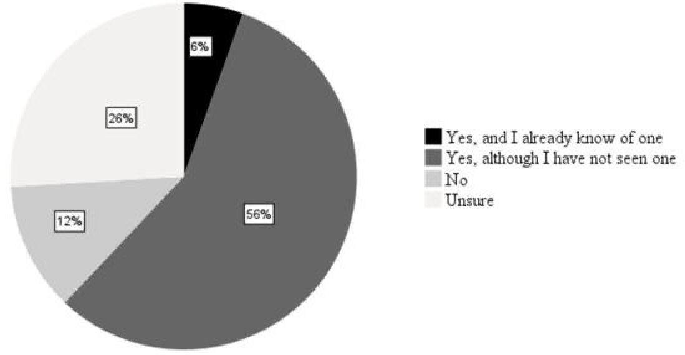

Figure 3.13: Respondent opinions of feasibility of an unplanned reuse methodology in an MBSE environment at their organization.

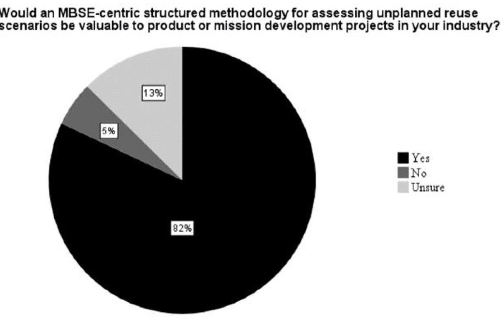

Figure 3.14: Value assessment of an MBSE-enabled unplanned reuse methodology

<!-- PDF_PAGE: 116 -->

## 3.2.1 Development and Candidate Sourcing

The interview campaign was designed to closely parallel the industry survey in content and focus. As a semi-structured interview, a guiding set of questions acted as starting points for interview subjects to speak at length in free-form about relevant experiences. These guiding questions - shown in Table 3.9 are taken from the same characteristics that defined the survey sections. Recalling Table 3.1, these are Reuse Context, Reuse Conditions, Reuse Outcomes, and Reuse + MBSE. Interview subjects were asked to trace their thought process and responses, whenever possible, to specific instances of reuse from their past experiences.

For sourcing interviewees, it was desired to sample a breadth of reuse perspectives from throughout the design enterprise. This range certainly includes the personnel and decision makers tasked with a specific project or mission - that is, the discipline engineers solving domain-specific design challenges as well as the systems engineers who reconcile the discipline level designs. Upstream aspects of the design enterprise that were of interest are shown in Fig. 3.15 and include: (a) the design infrastructure that contains the methods and constructs underlying the design processes of the discipline and systems engineers and (b) early concept generation activities that deliver preliminary insights on central trades and design decisions of the problem of interest. For (a), interview candidates of particular interest are those involved in the cataloguing and archiving of legacy designs and those tasked with development of MBSE infrastructures in their organizations. For (b), a focus was placed on concurrent engineering facilities, such as JPL's Team X, which are often a microcosm for the highly integrated and linked analyses of the digital design environment emphasized by MBSE. Thus, in addition to (and sometimes in place of) the prepared guiding questions, discussions with subjects were tailored to the appropriate domain within the design enterprise picture shown in the figure. Candidates from these diverse areas were sourced from organizations including NASA, JPL, The Aerospace Corporation, and the Defense community.

## 3.2.2 Findings

## Design Cataloguing

Two subjects were interviewed for this regime of the design enterprise. A common thread taken up by both subjects was the importance of data curation to facilitate future design reuse efforts. Data curation is generally defined as the process by which data collected from various sources is organized and stored such that the value of that data is maintained or even increased over time. It is evident that effective data curation is essential for proper understanding and redeployment of legacy elements. Indeed, much of the findings of the preceding survey analysis regarding structured methods and digitization can be framed in terms of data curation practices.

At the time of the interviews, both subjects were actively involved in funded projects aimed at exploring data curation and design archiving projects: one a "digital hangar" effort for the aerospace defense sector and the other a NASA MBSE design library challenge. For the former, the subject placed emphasis on the large volumes of data generated during design and operations of a system; to effect improved reuse practices, he argued, such "big data" must be distilled via a valuation process to those most essential elements. The subject identified a key outstanding task central to the data curation and valuation effort:

<!-- PDF_PAGE: 117 -->

Table 3.9: Guiding questions of semi-structured interview, which parallels sections of the industry survey.

<table border="1"><tr><td></td><td colspan="2">Guiding Questions</td></tr><tr><td rowspan="3">Introduction</td><td colspan="2">Tell me a bit more about your position and your experience in mission design projects?</td></tr><tr><td colspan="2">What type and scale of projects have you been involved with?</td></tr><tr><td colspan="2">What design phase of these efforts is your focus?</td></tr><tr><td rowspan="2">Reuse Context</td><td colspan="2">How common are heritage/legacy reuse decisions?</td></tr><tr><td colspan="2">How are these decisions made?</td></tr><tr><td rowspan="2">Reuse Conditions</td><td colspan="2">When design reuse is pursued, what is the typical state of design information for the reusable asset?</td></tr><tr><td colspan="2">Is it easily accessible? Is there any pre-work done on this information to prepare it for reuse analyses?</td></tr><tr><td rowspan="2">Reuse Outcomes</td><td colspan="2">Do you find that the cost/effort of implementing reuse was accurately estimated at the outset?</td></tr><tr><td colspan="2">What types of unforeseen obstacles impact this accuracy?</td></tr><tr><td rowspan="3">Reuse and MBSE</td><td colspan="2">Have any of your projects employed MBSE?</td></tr><tr><td colspan="2">If so, have you explored using MBSE for design reuse analyses? Was it useful?</td></tr><tr><td colspan="2">If not, why?</td></tr></table>

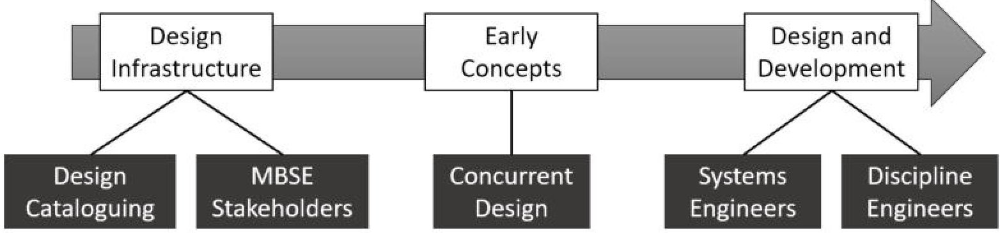

Figure 3.15: Topics and subtopics within a design effort from which interview candidates were desired.

<!-- PDF_PAGE: 118 -->

algorithmic development of curation protocols within existing data sets. To this end, the "digital hangar" effort sought to map the digital data landscape of design information and parameters for defense-sector aerial systems developed in their organization. Understanding this complex data picture - and how it is threaded across projects - is the first step in data curation and validation.

The NASA-affiliated subject emphasized the agency's desire for libraries of reusable elements that may be deployed across a range of diverse mission types. Data curation in this sense entails consistent cataloguing of design elements of common functionalities (e.g., Habitat waste management systems, CO2 removal systems, etc.). In the design library challenge run by the interview subject, MBSE was explicitly identified as the paradigm under which such cataloguing is best conducted. Challenge participants developed concepts for MBSEbased functional libraries for a space habitat design problem. Chief among the evaluation criteria was ease to the user - a characteristic that is central to demonstrating value and encouraging adoption. As such, graphical simplicity, navigability, and consistent modeling practices were highly valued. The subject noted also the types of design data that might, at a first order, be necessary for more refined reuse analyses including Size, Weight, and Power (SWaP) parameters, TRL, and element owner.

The discussions with these interview subjects can best be distilled as follows: effective reuse of designs requires that the high-value data artifacts that capture those designs be curated and maintained for future users in a consistent and navigable fashion.

## MBSE Stakeholders

Two interview sessions were conducted with MBSE development and deployment engineers. The first was with engineers in the MBSE Office at an aerospace firm, the second was with several members of the NASA MBSE Community of Practice. In both cases, outcomes aligned closely with the findings of the MBSE portion of the industry survey. Namely, all interview subjects noted the gradual but often fragmented nature of MBSE adoption in their respective organizations and projects. Similarly, all subjects pointed to one primary cause of roadblocks in the adoption effort: an unwillingness on the part of some team members to implement MBSE methods without a clear demonstration of its value and use cases. Subjects agree that the significant investment required to learn, integrate, and socialize MBSE practice is often too much for a project to take on - and they then revert to traditional methods that are known to yield results.

The first set of subjects placed particular emphasis on the task of socializing the paradigm a task that falls on the shoulders of the MBSE developers, if their methods are to gain wider acceptance. One interesting method that this group identified for socializing the concept is the MBSE-as-a-service approach. In this technique, the MBSE team approaches a program or mission team and offers to develop system models that parallel the actual development effort. Throughout, they will demonstrate the unique views and analyses that are enabled by the modeling effort that might not be available in the traditional development environment. Interviewees identified one instance where the project team began to integrate the system model into their activities for particular use-cases, one of them being the reuse of common bus requirements for a spacecraft. This reveals how value demonstration via socialization of concepts is a potentially game-changing practice - and it is incumbent on MBSE developers to carry this out.

<!-- PDF_PAGE: 119 -->

The second set of subjects drove the discussion towards MBSE methodologies - sets of procedures, modeling practices, and patterns that guide deployment of MBSE for a particular use-case. The emphasis here was on the need for consistent and repeatable generalized protocols to avoid the proliferation of countless "mini-standards" that lead to the loss of any standardization whatsoever. Like discussed previously, once these methodologies have been rigorously developed and validated, they must be socialized such that wide acceptance leads to true standardization. The same must be done for LDRM to avoid it being relegated to "just another" methodology without a user base.

## Concurrent Design

One interview session was conducted with a subject working in the regime of early concept exploration and formulation. In particular, the subject was a member of a concurrent design team. This team conducts short design sessions to develop rapid point solutions to a problem of interest; the sessions include "seats" for each major spacecraft subsystem with appropriate domain tools (often Excel spreadsheets) linked together to ensure satisfaction of mass and power budgets, cost, etc. The resulting point designs are often the starting points for the actual design/development teams if the project is funded in the future.

The subject offered several unique insights about design reuse at this stage of a (eventual) project. First, he noted a tension between two mindsets. On the one hand, he noted the common notion that when ideating solutions to new problems, engineers are quick to rely on proven legacy designs or knowledge; these initial instincts may eventually dissolve or diminish as the problem is explored and revealed to be substantially different. On the other hand is the mandate of most concurrent teams: to develop new and creative solutions to deal with often-demanding performance and environmental constraints. If legacy designs are consistently relied upon, the creativity and innovation may be stifled. Central to this tension, the subject notes, is the "spectrum" of reuse - ranging from the underlying mental models that help engineers have a consistent perspective of a problem to the explicit models that capture designs.

These considerations lead to a finding that is reinforced by reuse theory as explored in the literature review: that divergence from reuse plans is a nearly universal phenomena. One caveat that the subject mentions relates to reuse outcomes. Since the point designs are passed off to other teams, traceability is often lost such that assessing the outcomes of initial reuse decisions becomes difficult. Nevertheless, it is clear that design reuse in concurrent design efforts exhibits unique characteristics. The nature of the reuse implementation however, is quite familiar and perhaps in an ideal form: the digitized microcosm of linked Excel analysis sheets.

## Systems and Discipline Engineers

One interview session was conducted for this category - with the subject having experience in each of the two engineering roles throughout his career. Findings from this discussion complement the interview with the MBSE stakeholders mentioned previously. Namely, systems and discipline engineers are precisely those groups that must be socialized about the benefits of MBSE adoption, and in particular, about the reuse use-case. While the subject conceded that engineering teams are starting to see value derived from MBSE methods (e.g., integrated analyses that could not be easily conducted in traditional environments),

<!-- PDF_PAGE: 120 -->

capabilities do not seem to "be there yet" to motivate a greater transition.

Regarding reuse practices, the interview subject noted the ad-hoc manner in which design adaptation is carried out from mission to mission, even within generations of similar spacecraft. Even when MBSE models are available, the subject described inconsistent usage of the models across the various discipline teams. This leads to models that capture only parts of the designs, while other parts are relegated to the traditional methods. The result is incomplete mission models that subsequently cannot be relied on for the analyses they are meant to deliver. In particular, the subject noted a disparity in how discipline teams record mission requirements in the models - with some tracing down to comprehensive third and fourth levels of requirement decomposition, while other teams include only new or novel requirements that are not implicitly met by the existing generation of the spacecraft. Such inconsistencies, the subject argued, only add to the difficulty experienced by MBSE and reuse practitioners to establish structured and systematic methods.

## 3.3 Best Practices Study Conclusions

In this Chapter, we have described the efforts undertaken to develop a picture of the current state and best practices in design reuse, and to understand how the ever-growing MBSE paradigm may impact it. The industry survey sampled over 100 practitioners - systems engineers, discipline engineers, MBSE developers, and project leadership. The questionnaire-based study yielded standardized responses on relevant questions that were then complemented by a smaller, more targeted set of interviews. The results of this combined process include:

1. Design reuse is a common practice across all complex engineering industries sampled in the study. A loose interpretation of the term to include mental models, implicit knowledge, etc. for a problem of interest leads to a conclusion that it is present in every single engineering project; a stricter definition focusing on explicitly codified design information (e.g., specifications, digital models, etc.) narrows the prevalence to around 60% of projects.

2. In the space industry, there is a near even balance in planned and unplanned instances of reuse. Unplanned reuse efforts, commonly referred to as "heritage" or "legacy" reuse, experience a marked decline in effectiveness (i.e., partial vs. full success) when compared to planned efforts.

3. Related to Point 2, respondents to both the survey and the interviews cite a disconnect between initial reuse plans/predicted outcomes and eventual results, especially for unplanned methods; this result can be correlated with the "structuredness" of methods used to assess the reuse scenario.

4. When MBSE is proposed as a solution vector to this problem, respondents offer mixed responses. While they point to increasing adoption in their organizations, they note limited capabilities and socialization necessary to augment traditional approaches with MBSE methods.

<!-- PDF_PAGE: 121 -->

5. Of particular importance to the effectiveness of MBSE-based reuse methods is the curation and maintenance of design information for past missions. This should be part of the larger digital transformation that is ongoing throughout the space industry, with the end-goal being integrated data landscapes enabling all sorts of new analyses and use-cases.

To conclude, the LDRM methodology developed and demonstrated in subsequent sections of this thesis can be said to be lacking and "of value" in both theory and practice. Beyond justifying the need for LDRM from a practical perspective (where the literature review did so from a theoretical perspective), the findings of this study also inform aspects of its development. For instance, findings of the degree of MBSE adoption suggest that LDRM should be widely applicable across a range of existing and in-development modeling practices. These demands on LDRM flexibility affect the underlying metamodel and modeling constructs. In Chapter 5, we will recall the findings of this study to conduct internal validation, demonstrating that the resulting methodology is consistent with needs expressed by industry practitioners and that current reuse and MBSE best-practices were implemented.

<!-- PDF_PAGE: 122 -->

# Chapter 4

# Development of the Legacy Design Reuse in MBSE Methodology

The intent in previous chapters was to consolidate, from as many sources and stakeholder perspectives as possible, a sense of the current state of the practice in legacy design reuse. Now, we wish to integrate these best practices and areas of improvement into a comprehensive methodology for systematic assessment and decision support of legacy design reuse scenarios. The LDRM, intended for use in early architecting (before Phase B in NASA's traditional lifecycle formulation), comprises both technical and programmatic analyses to address the use cases introduced in Section 1.5.1.2 - namely, 1) determination of reuse feasibility, 2) enumeration of required rework, 3) impact of rework on programmatic benefits of reuse, and 4) comparison vs. a nominal from-scratch solution to the reuse need. LDRM benefits from the integrated data environment and rigorous formalisms of MBSE while simultaneously providing a desired demonstration of MBSE deployment for specific systems analyses.

This chapter details end-to-end development and demonstration of the LDRM methodology. First, a framework guiding each step of the development process is presented; this framework spans several layers of refinement, from a guiding ontology, to a generalized reuse procedure, and finally to implementation in an MBSE environment. The Reuse Ontology includes a classification taxonomy of reuse types as well as the relationship between those terms and related concepts; a glossary is included to enforce consistent usage of the ontology elements throughout the methodology. Next, a generalized reuse procedure is developed which threads best practices identified previously with other logically required steps of an abstracted legacy reuse assessment process. Then, we explore how this generalized procedure may be implemented using MBSE and language-specific modeling elements and constructs. Lastly, we demonstrate application of LDRM onto a sample problem, representative of the types of use cases for which it is intended.

## 4.1 Development Framework

LDRM's requirements of rigor and consistent applicability demand a comprehensive hierarchical framework for defining and tackling the problem. This framework is presented in Fig. 4.1. Each step of the framework derives from the previous step and descends to an added

<!-- PDF_PAGE: 123 -->

layer of refinement.

The starting point for the framework is a Reuse Ontology, whose function is to provide unambiguous definitions of relevant reuse concepts and relationships among them. This ontology, represented via a conceptual map, frames the methodology to focus on the legacy reuse question. From here, a generalized reuse procedure is defined. The concepts from the ontology are traced into this logic to define an end-to-end process from initial inputs to final deliverables. This process flow is then codified into the MBSE environment via a metamodel and a language-specific Reuse Profile. Finally, the modeling practices necessary for employing the MBSE metamodel constructs in the reuse procedure are described.

As we descend through the framework, the medium for capturing/representing information also changes. These modes become increasingly prescriptive, such that by the implementation stage, modeling practices are defined, and templates of necessary diagrams and output products are specified. This refinement represents the progress from conceptual or theoretical formulation to practical, implementation-oriented definition of LDRM.

## 4.2 Reuse Ontology

As discussed in the previous section, building an ontology of the legacy reuse domain is the first conceptual step in systematic development of LDRM. Its purpose, Guarino reminds, is to "formally model the structure of a system, i.e., the relevant entities and relations that emerge from its observation, and that are useful to our purpose" [53]. As noted in the literature review, a consensus definition of an ontology does not exist and a range of sources emphasize different aspects of an ontology as defining characteristics [4, 131, 78]. We can borrow from these, for instance, to complement the above definition with the multi-layered ontology-metamodel relation described by Assmann [4].

## 4.2.1 Ontology Context

From Guarino's definition emerge two important points. First, an ontology should be a formalized construct such that there is no ambiguity about how the entities and relationships it defines should be interpreted. Indeed, in many cases, ontologies are built in machine-readable, formal ontological languages. In our case however, the requirement for rigorous formality can be relaxed. This may be done since another level of formal specification will follow - namely the MBSE metamodel that will lend implementational rigor to the reuse methodology, as suggested by Assmann [4]. Other frameworks may view this approach, not as an ontology, but rather as a conceptual model, implying reduced formality. However, as this construct will include key elements of an ontology - namely structure, definitions/attributes, and relationships between these entities - we retain use of the term.

Secondly, Guarino's requirement of "usefulness" implies that an ontology should consider the various perspectives of the topic of interest, thus establishing a consensus view of the topic. For the reuse ontology, these perspectives include 1) the varying types and degrees of reuse (i.e., a reuse taxonomy) and 2) the modes through which designs are captured and disseminated. These caveats aside, the reuse ontology acts essentially to define the extent of applicability of LDRM and the types of questions it must be defined to answer. To that

<!-- PDF_PAGE: 124 -->

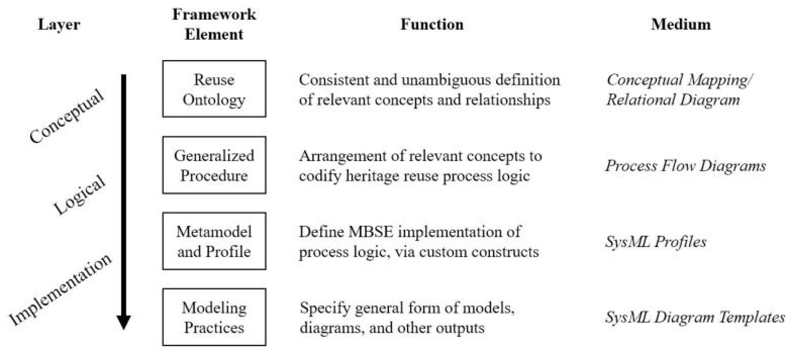

Figure 4.1: Comprehensive, hierarchical framework adopted for development of the methodology.

<!-- PDF_PAGE: 125 -->

end, we introduce a reuse taxonomy within which we can locate the legacy reuse scenarios of interest.

## 4.2.1.1 Reuse Taxonomy

The purpose of a taxonomy is to develop a classification scheme to specify an aspect of interest. In our Reuse Ontology, we wish to distinguish reuse of designs (as defined in Chapter 1) from other categories of reuse. A generalized classification of reuse types into a taxonomy can be created by asking the question, "What exactly is being reused?" To arrive systematically at an answer to this question, we can draw inspiration from past attempts at developing taxonomies of technology and design. Vincenti, for instance, describes design efforts by "type" and "hierarchy", with different degrees of technical definition required at each intersection. Type relates to whether a design presents a) an improved solution along an "accepted tradition" of the operating principle or normal configuration of a design or b) or radical departure from this tradition by changes to either operating principle or configuration [139]. Here, we see allusions to concepts of reuse vs. from-scratch development. Other efforts at classification focus specifically on the operating principle and key functionalities of a design, as summarized by a National Institute of Standards and Technology (NIST) effort [103]. Perhaps the most systematic, and yet simplest, classification scheme is produced by van Wyk. van Wyk classifies technologies along two dimensions: 1) the underlying or fundamental function delivered and 2) an operand on which that function acts [137]. Three canonical functions are identified - Transforming, Transporting, and Storing - along with three basic operands - Matter, Energy, and Information.

Recalling the literature review of space industry reuse examples (see Section 2.1.1.1), we identified three general types of reuse: 1) hardware reuse, 2) design knowledge reuse, and 3) work effort reuse (i.e., reuse of the constructs that capture the design knowledge explicitly). Mapping these reuse types onto van Wyk's original technology taxonomy matrix, we see that no single operand/process pairing is sufficient (see the top panel of Fig. 4.2). This reveals the complex nature of any reuse effort and introduces difficulty in the reuse classification problem. A modified version of this taxonomy maintains the operands but collapses all functions into a generic "reuse" function, as shown in the bottom panel of Fig. 4.2. Hardware reuse is generalized as a reuse of matter, referred to as Physical Article reuse; Design knowledge reuse is generalized as a reuse of information, referred to as Codified Design Knowledge reuse; and Work Effort reuse is generalized as a reuse of energy, referred to as Design Efforts reuse.

We now expand the three types of reuse with lower level (higher granularity) classifications; Table 4.1 depicts this taxonomy that captures the nuances in reuse types in the space industry gathered from the literature survey. In Physical Article Reuse, we distinguish between recovery-dependent and In-Situ reuse. "Recovery-dependent" refers to Earth recovery; that is, the physical article to be reused must be returned to Earth (or some future on-orbit logistics depot or a surface depot on another planet such as on Mars) where it is then inspected, refurbished, and integrated for future use. This contrasts with "In-Situ" reuse that covers salvaging, recycling, repurposing, or reconfiguring that occur at or near the asset's operating environment. Within Codified Design Knowledge reuse, the unplanned reuse of legacy articles is divided into two types. "Standard Article" reuse covers those elements that

<!-- PDF_PAGE: 126 -->

<table border="1"><tr><td></td><td>Matter</td><td>Energy</td><td>Information</td></tr><tr><td>Transform</td><td>4) Refurbish and requalify hardware3) Produce hardware from reused/adapted design3) Produce hardware from configured design</td><td></td><td>2) Adapt design to new mission2) Configure design from catalogued blocks and mission context</td></tr><tr><td>Transport</td><td>1) Recover hardware</td><td></td><td></td></tr><tr><td>Store</td><td>2) House recovered hardware</td><td>1) Catalog and maintain past work efforts(e.g. model patterns and libraries)</td><td>1) Maintain design information3) Maintain part lifetime and reuse data</td></tr><tr><td></td><td colspan="3">Color Code: Hardware Reuse Design Reuse Work Effort Reuse</td></tr><tr><td></td><td>Matter</td><td>Energy</td><td>Information</td></tr><tr><td>Reuse</td><td>Physical Article</td><td>Design Efforts</td><td>Design Knowledge</td></tr></table>

Figure 4.2: (top) Application of van Wyk's classification scheme to reuse efforts; (bottom) adapted classification scheme collapsing canonical functions into a generalized "reuse" function.

<!-- PDF_PAGE: 127 -->

are ubiquitous across space systems and that can claim heritage from a wide set of past missions, or that rely on basic physical principles that do not require flight heritage; these can include the use of passive radiators, simple heaters, common materials, etc. Conversely, "Unique Heritage" reuse covers element for which a unique and thorough inheritance process must be conducted to ensure its reusability across missions. It is this reuse type that is the particular focus of the methodology - while "Standard Article" reuse may be unplanned, it does not typically require the specialized analyses of more complex heritage cases. Another category of Codified Design Knowledge reuse covers the planned reuse efforts of product families.

Lastly, Design Effort Reuse focuses on the models and modeling practices that engineers use to generate, manipulate, and represent designs. Model reuse includes MBSE centric concepts such as digital design libraries and system models, as well as traditional descriptive and analytical engineering domain models that leverage discipline-specific tools and environments. The increasing digitization of SE processes as prescribed by the MBSE paradigm means that the concepts of design knowledge and design effort reuse are best considered in tandem. The MBSE-centric aspects of the methodology developed will demonstrate this complementarity.

Several caveats may be appended to this taxonomy. First, is its intended scope, that is constrained to reuse practices in the development and operation of space systems. This is clear from the distinctions made in both physical article reuse (recovery vs. In-Situ) as well as Product Families (common satellite busses vs. modularized subsystems). These concepts may be extensible to other domains, but usage of the taxonomy, as-is, should be constrained to this field. Secondly, the taxonomy is not claimed to be exhaustive of all possible kinds or variations of the concept of reuse, but rather to place "design reuse" (and specifically, legacy design reuse) within a larger conceptual framework in order to specify LDRM use-cases. We can claim that any reuse type not included in this taxonomy can still be classified using the function-operand scheme adapted from Van Wyk. For instance, the reuse of validation and verification, testing/qualification, or other mission aspects may be classified, into the "Codified Design Knowledge" reuse sub-category to which the reuse instance is most appropriate.

Lastly, two additional attributes should be used to describe a reuse effort: architectural level and "degree" of reuse. The first refers to the hierarchical level in the system decomposition within which the element being reused resides; as we will see, specification of this attribute has repercussions on the findings of the subsequent reuse analyses. "Degree" of reuse acknowledges the fact that designs are rarely either "copy and paste" reuse or "fromscratch"; rather, they live on a spectrum between these extremes. One of the eventual findings of the methodology is to locate a reuse effort within this spectrum based on the amount of rework predicted to make the native asset feasibly reusable on the mission of interest.

## 4.2.2 Concept Map

The ontological representation of the reuse domain is presented in a way that is a) in a format that is digestible to the reader and b) is agnostic to specific formalisms selected by a downstream organization using LDRM. Thus, we choose a simplified conceptual mapping

<!-- PDF_PAGE: 128 -->

Table 4.1: Notional taxonomy of space industry reuse, derived from the adapted van Wyk scheme. Emphasis is to place legacy design reuse in the context of other reuse types. Exhaustiveness of all reuse concepts is not claimed.

<table border="1"><tr><td>Physical Article Reuse</td><td>Codified Design Knowledge Reuse*</td><td>Design Effort Reuse</td></tr><tr><td>Recovery-based</td><td>Legacy</td><td>Modeling Schemes</td></tr><tr><td>Article Reuse</td><td>Standard Article</td><td>Metamodels &amp; Patterns</td></tr><tr><td>In-Situ</td><td>Unique Heritage</td><td>Stereotypes &amp; Profiles</td></tr><tr><td rowspan="2">Article Reuse
Article Repurpose</td><td>Product Families</td><td>Models</td></tr><tr><td>Common Bus
Modular Platform</td><td>Element Libraries
System Models
Discipline Models
(Descriptive or Analytic)</td></tr></table>

* Design Knowledge includes: specifications, parameters, programmatic information, configurations, testing protocols & certifications, analysis algorithms, operational procedures, and any other explicit information maintained in project document.

<!-- PDF_PAGE: 129 -->

representation as opposed to the highly formalized, machine-readable constructs sometimes described in the ontology literature. It should be noted that no rigor is lost by this approach especially since per Fig. 4.1, greater levels of specification via logical procedures, metamodels/profiles, and modeling patterns will follow. The ontological concept map is presented in Fig. 4.3.

The concept map is best understood in four quadrants, each centered on the terms highlighted in gray. The upper left quadrant builds out from the concept of design, which contains the full set of information (concepts, models, descriptions, technical documentation) that captures the architecture, components, interfaces, and other characteristics of a system of arbitrary compositional level. The system that the design represents satisfies a particular need in the larger mission of interest. This design, though externally captured via explicit, codified articles of information is typically informed (and first ideated) in the implicit knowledge of engineers and designers.

The lower left quadrant expands on how the design information is captured (both implicitly and explicitly) in the form of models. Models which are abstractions of a system aimed at understanding, communicating, explaining, or designing aspects of interest of that system take on many forms. Model types that codify explicit design information (i.e., the type of data that may be systematically reused) include discipline, or domain, models and system models. In the traditional SE environment, design information is also principally captured in design documentation. System models are primarily operated in the digital environment characterized by integrated and authoritative sources of system data. This environment, elaborated in the lower right quadrant, is most effectively utilized when consistent modeling and data practices are employed - via constructs such as metamodels.

The upper right quadrant places the unplanned (legacy) reuse methodology in the context of the other design methods that a mission architect may adopt. It constrains reusable elements to those that are explicit design data, to the exclusion of the more abstract implicit design knowledge artifacts. Lastly, this quadrant shows how the methodology handles design solutions generated by from scratch methods - namely, it compares the impact of reuse methods against them to justify one or the other method.

The central importance of the mission-related concepts in the ontology should be emphasized. The mission context including relevant stakeholders, campaign constraints, nonengineering influences, etc. is the ultimate influence on the selection of design method beyond the technical and programmatic recommendations that LDRM can make. The ontology makes clear the informative nature of the methodology as a decision support tool, not as a decision-making construct in its own right. Additionally, the mission need for which reuse is explored acts as the filter for the designs (and in turn, the explicit design artifacts) that are considered by LDRM.

## 4.2.2.1 A Note on Ontology Validity and Exhaustiveness

Concepts in the ontology are those that have been explored in preceding chapters - sourced from literature, the best practices survey, and discussions with Subject Matter Experts in relevant fields. However, only those concepts with some direct influence on the logic, procedure, or implementation of legacy reuse and the methodology (itself an entry in the ontology) are included. Gomez-Perez asserts that "we cannot prove the completeness of an

<!-- PDF_PAGE: 130 -->

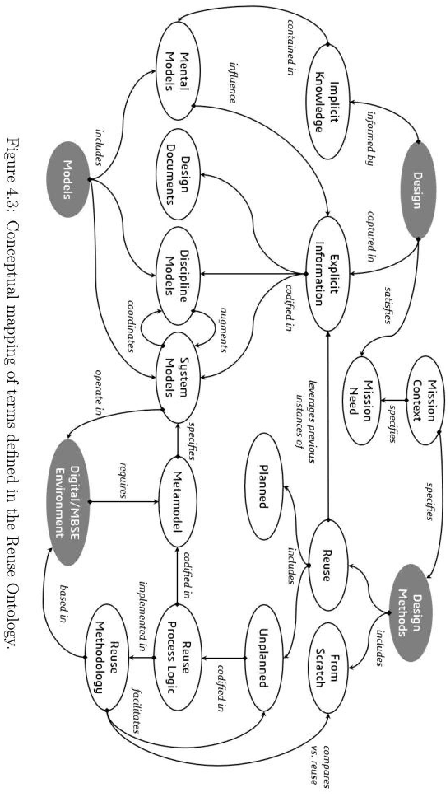

<!-- PDF_PAGE: 131 -->

ontology"; conversely, incompleteness can be demonstrated by showing incompleteness of an individual definition within it [49]. Therefore, they note that an ontology may be considered complete if and only if: a) "all that is supposed to be in the ontology is explicitly stated" and b) "Each definition is complete". Using this criteria, completeness of the ontology exists with regard to terms related to unplanned reuse: the subsequent term glossary provides complete definitions of all relevant concepts, as identified in the extensive literature and industry reviews. Thus, we can claim that the ontology is valid to the extent that it is applied to the specific use cases and questions addressed by LDRM (see Section 1.5.1.2). No claim is made, however, of the exhaustiveness of the ontology to all reuse concepts. To that end, this ontology framed by the legacy reuse question, can form a (complete) starting point and subset of a larger ontology that will be populated as research into design reuse continues. Thus, it can act to coordinate or frame future research in the field. As future work is realized, a richer conceptual understanding of the reuse question can be derived.

## 4.2.2.2 Term Glossary

A glossary of terms is included to further ensure unambiguous understanding of the conceptual ontology. Included in italics for some terms are examples from well known space missions, or those we have previously explored.

- Mission Context - The organizational, social, and technical context within which the mission of interest is being developed; this includes the motivation of stakeholders, defined mission and campaign objectives and enterprise concerns, engineering and nonengineering constraints imposed, etc. Example: The Perseverance rover as a follow-on to Curiosity, with substantially similar hardware but tasked with new terrains, new experiments, and even a novel deployable payload in the Ingenuity helicopter; programmatic pressure to avoid missteps that caused delays in MSL.

- Mission Need - The specific functional or architectural need for which reuse scenarios will be explored by LDRM. The need is specified via requirements, interfaces, and other constraints and filters the reusable designs that may be considered. Example: Computational functions for providing an inertial reference to the flight code of the Ariane 5 launch vehicle.

- Design - The set of information (concepts, models, descriptions, technical documentation) that captures the architecture, components, interfaces, and other characteristics of a system. (adapted from ISO/IEC/IEEE 24765:2009). Example: CAD files, dynamic workspace envelopes, structural analyses, component configurations, interface control documents, etc. for the robotic arm system of the Curiosity rover.

- Implicit Knowledge - Information on the design of a system that is not explicitly stated or codified in the project documentation. This information is related to the implicit experiences, biases, and opinions of engineers and managers that are carried over from project-to-project. A thermal engineer uses past experience to assume a reference value for the viscosity at a given temperature of the lubrication substance of the Curiosity actuators.

<!-- PDF_PAGE: 132 -->

- Explicit Information - Information on the design of a system that is explicitly stated or codified in the project documentation. A refined value for the above viscosity figure and the technical modules that lead to this value.

- Model - An abstraction of a system, aimed at understanding, communicating, explaining, or designing aspects of interest of that system. [33]

- Mental Model - Adopted from Morecroft: "A dynamic pattern of connections comprising a core network of 'familiar' facts and concepts, and a vast matrix of potential connections that are stimulated by thinking and by the flow of conversation [cite Morecroft 1994]." Mental models comprise the "implicit" or non-codified aspects of design of both the mission of interest and past missions undertaken by the engineer. An extensive discussion is provided by Doyle and Ford [34].

- Discipline Model - A model of a specific domain (technical or programmatic) within the context of the system which pulls from and pushes to the design information stored in the larger system model. Example: A CAD representation of a given payload configuration on a launch vehicle deployer intended to evaluate volume constraints.

- System Model - The "authoritative source of truth" model for a given project or mission that stores and logically organizes all explicit forms of design information in the form of various model types and views

- Design Documents - Products of the systems engineering process that record design/architecture information (decisions, parameters, configurations, etc.) for the purpose of specifying a build, reporting to a milestone or review, disseminating to stakeholders, or archiving a design. Example: The set of interface definitions and specifications for the main computer of the Space Shuttle, the redundant backups, and auxiliary computing elements

- Design Methods - Adopted from Gericke: "A specification of how a specified result is to be achieved. This may include specifications of how information is to be shown, what information is to be used as inputs to the method, what tools are to be used, what actions are to be performed and how, and how the task should be decomposed and how actions should be sequenced [45]." Specific to the Reuse Ontology, we emphasize the specification of sources used as inputs.

- From Scratch - A design approach that borrows no explicit design information from past efforts; implicit design information is difficult to exclude even in from-scratch efforts as this information resides in the knowledge/experiences of the engineer. Example: The novel Sky Crane method for the final stage of EDL of the Curiosity rover.

- Design Reuse - Redeployment onto a new system of interest of the design of an existing element as recorded in the project documentation and models. These records contain the information necessary to develop, produce, operate, maintain, and, if necessary, dispose of the design. Example: Successful redeployment of the above Sky Crane method for the final stage of EDL for the Perseverance mission.

<!-- PDF_PAGE: 133 -->

- Planned Reuse - Occurs with designs that are developed from the outset with the explicit intent of being reused on a subsequent product or mission. Reuse of this kind is associated with product lines or product platforms. Example: Lockheed's line of A2100 GEO communications satellites used also in GOES and GPS constellations.

- Unplanned Reuse - Occurs with designs that were not originally developed with the explicit intent of being reused. Reuse of this kind is associated with opportunistic redeployment of proven designs. Synonymous with "legacy reuse" in this thesis. Example: "Copy and paste" of the inertial reference code in the Ariane 5 flight software.

- Digital Environment - The environment within which emerging paradigms such as Digital Engineering and MBSE operate; it is characterized by the integration of enterprisewide data, establishment of authoritative and traceable sources of information and modeling practices, and the transition from document-based recording of designs to a model-based approach.

- Reuse Methodology - The Legacy Design Reuse in MBSE methodology proposed in this work for conducting more systematic analyses of unplanned design reuse decisions in a consistent, coherent and model-centric approach

- Reuse Process Logic - The logical steps required of LDRM as gathered from systems theoretic considerations, state of the practice findings, and subject-matter-expert interviews

- Metamodel - An abstract specification for a model or set of models intended to define model elements, correspondence links between these models and model elements, and the rules used to enforce consistency between the models. [adapted from Broy, 2010]

## 4.3 Generalized Reuse Process

Recalling the framework presented in Fig 4.1, we descend one layer of refinement deeper, to the logical arrangement of the ontology concepts into a generalized procedure that codifies the legacy reuse assessment process. Additionally, in this step we also seek to incorporate the lessons learned on reuse best practices and areas for improvement from the reuse survey detailed in Chapter 3. In summary, key elements of a reuse assessment procedure, as laid out in the motivating use cases and survey findings are:

- Evaluating the gaps between a native mission and the mission of interest that impact the feasibility of reusing the candidate design.

- Determining the rework/adaptation effort required to bridge this gap and make the candidate design acceptable for the mission of interest.

- Estimating the programmatic impacts of the reuse scenario in terms of cost, schedule, or systems engineering work effort.

<!-- PDF_PAGE: 134 -->

- Following patterns for describing the candidate designs and the mission of interest, such that consistency across missions and modeling practices is maintained.

At this stage, the framework calls for an implementation-agnostic formulation of process steps such that the resulting procedure may be widely applicable to existing modeling and systems practices at user organizations. Throughout this section, we depict this logical process via SysML Activity Diagrams; these diagram types allow us to trace activities, inputs/outputs, and to "zoom in" through various levels of refinement. Use of SysML for this purpose should not be seen as a specification of the MBSE implementation process developed later but rather as a convenient tool for describing the logical reuse procedure. The process, therefore, is structured as a sequence and hierarchy of activities carried out by the LDRM user. The hierarchy spans three levels, with each lower level providing greater detail for carrying out higher level steps of the process. The highest level of the hierarchy is shown in Fig. 4.4.

The overall input to the process is an MoI Description including objectives, requirements/constraints, and architecture and design decisions made to-date for the mission of interest (MoI). Information included in this input is dependent on a) the degree of maturity of the MoI architecture and b) the architectural level at which the reuse need exists. The former is constrained by the intended lifecycle phases for which this methodology is applicable, namely through Phase A. Here, SRR has specified system requirements while some aspects of the design have at least preliminary solutions specified via the SDR gate. It follows that this design specification does not include the functional need for which reuse is being considered. Assuming the organization has deployed MBSE for its design efforts, MoI Description information is kept as a system model that details specifications and structural/behavioral features of the architecture. If the MoI Description is not kept in a system model - the likely alternative being in static documentation (e.g. MS Office, central file management systems, etc.) - then some effort would be required to transform or digitize this information.

At the highest level, the heritage reuse process is decomposed into three central activities: 1) defining the context of the reuse decision, 2) conducting a technical inheritance process for assessing reuse feasibility, and 3) assessing the "value" of the reuse decision in terms of impacts on programmatic factors, such as cost and schedule, for the MoI. In the remainder of this section, we fully describe each step of this generalized reuse procedure including a description of key activities in the step, inputs consumed, intermediate outputs generated, and also a brief consideration of MBSE concepts that may be employed in the implementation stage of LDRM. In most instances, a two level decomposition of steps is sufficient, whereas in critical steps (e.g., rework effort assessment) a third level is described. These steps work towards development of three primary outputs of LDRM: 1) a determination of reuse feasibility for a candidate, 2) a rework campaign for the candidate to make it compliant with MoI constraints, and 3) a reuse valuation comparing the estimated reuse impacts vs. a from-scratch effort.

## 4.3.1 Step 1 - Reuse Context Definition

Input(s): MoI Description

Description: Defines the context of the reuse scenario including a) identification of the architectural element within the MoI for which design reuse is being considered, b) exploration

<!-- PDF_PAGE: 135 -->

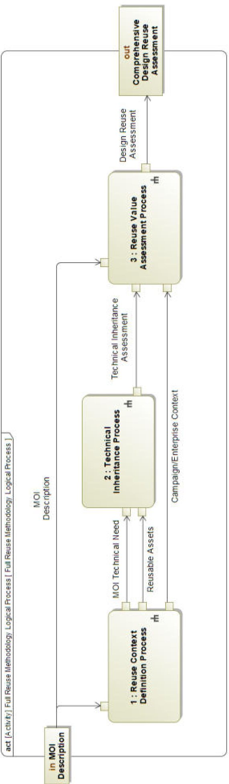

Figure 4.4: Highest level sequence of activities in the LDRM logical process.

<!-- PDF_PAGE: 136 -->

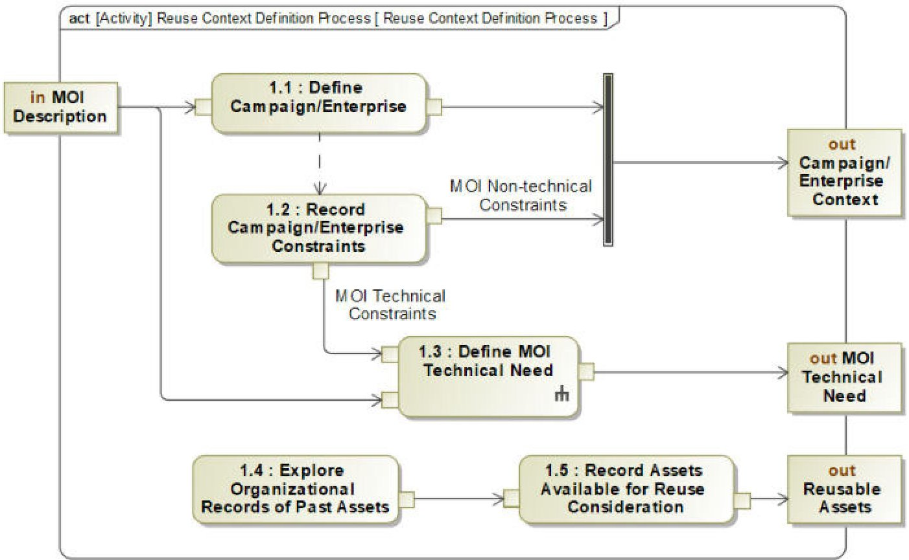

Figure 4.5: Detailed view of Step 1 of the LDRM logical process.

<!-- PDF_PAGE: 137 -->

of assets available for reuse, and c) description of the larger campaign or enterprise within which the MoI resides and that may impact the feasibility or value of reuse.

Output(s): MoI Technical Need; Reusable Assets; Campaign/Enterprise Context

MBSE Consideration(s): This step consolidates existing design information and asset records maintained ideally in MBSE models but more likely in traditional design documentation (requiring upfront digitization efforts).

Step 1.1 - Define Campaign/Enterprise (see Fig. 4.5)

Input(s): MoI Description

Description: Records campaign/enterprise vision, objectives, and constituent missions/systems; these factors may constrain the pool of potential reusable assets and the value of their redeployment. Further, some campaign/enterprise level decision making may mandate a particular reuse decision in order to enforce commonality across missions, advance collaboration or extensibility objectives, etc. Thus, the reuse scenario of interest may be sensitive to factors beyond the immediate mission.

Output(s): Campaign Description

MBSE Consideration(s): Output may be a pointer to an existing campaign System Model or a summary block thereof.

Step 1.2 - Record Campaign/Enterprise Constraints (see Fig. 4.5)

Input(s): N/A

Description: Extracts from Step 1.1 the constraints that the campaign/enterprise context impose on the MoI, and in particular, on the reuse decision. These may be non-technical constraints (e.g., schedule implications on MoI of larger campaign timeline) or technical constraints (e.g., interface requirements imposed from the system-of-systems level). These constraints are added to the existing set of requirements that the reuse solution in the MoI architecture must satisfy.

Output(s): MoI Non-technical Constraints; MoI Technical Constraints; Campaign/Enterprise Context

MBSE Consideration(s): Outputs may be recorded alongside MoI specifications in Requirements Diagrams or Tables.

Step 1.3 - Define MoI Technical Need (see Fig. 4.5)

Input(s): MoI Description; MoI Technical Constraints

Description: Specifies the architectural element within the MoI for which reuse will be explored. This critical step thus frames the remainder of the reuse investigation with the exact description of what must be satisfied in the MoI. Refer to Fig. 4.6.

Output(s): MoI Technical Need

MBSE Consideration(s): Output may be recorded as a SysML block with attributes/properties defined for steps 1.3.1-1.3.3 described below.

Step 1.3.1 - Identify Functional Need (see Fig. 4.6)

Input(s): MoI Description

Description: Specifies the function(s) within the MoI for which reuse is to be explored. The description should remain form-agnostic to the degree that the MoI has not specified

<!-- PDF_PAGE: 138 -->

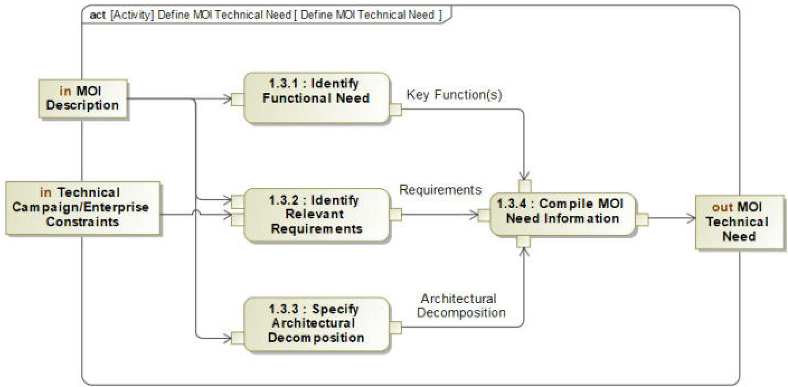

Figure 4.6: Detailed view of Step 1.3 of the LDRM logical process.

<!-- PDF_PAGE: 139 -->

ancillary or interfacing designs with the functional need. This specification is thus dependent on the level of maturity of the MoI system.

Output(s): Key Function(s)

MBSE Consideration(s): The functional need statement may be recorded in an attribute of the parent "MoI Technical Need" block described in Step 1.3, above.

Step 1.3.2 - Identify Relevant Requirements (see Fig. 4.6)

Input(s): MoI Description; Campaign/Enterprise Constraints

Description: Specifies the requirements that have been explicitly defined for the "reuse slot" described in the functional need. These requirements are one of the key indicators of the degree to which the reuse candidate satisfies the technical need of the MoI as well as the feasibility of redeploying that asset, unmodified. As such, it is necessary to ensure that this requirement set is as complete as possible, given the level of maturity of the architecture for the MoI.

Output(s): Requirements

MBSE Consideration(s): Requirements are typically maintained in Requirements Diagrams/Tables and may be addressed via pointers in the parent "MoI Technical Need" block.

Step 1.3.3 - Specify Architectural Decomposition (see Fig. 4.6)

Input(s): MoI Description

Description: Complimentary to the steps 1.3.1-1.3.2, this step requires that the "reuse slot" within the MoI architecture be explicitly identified within the larger architecture. This requires the existence of a formal representation of the structure of the architecture. A canonical representation decomposes in the following way: Whole Architecture < Separable Mission Element < System < Subsystem < Assembly < Sub-assembly < Component < Piece Part. Locating the "need slot" within this breakdown (specific to the MoI architecture) essentially provides the architectural "address" where the reuse candidate design will be located. Further, this aids in subsequent steps that identify relevant interfaces the reuse slot must satisfy.

Output(s): Architectural Decomposition

MBSE Consideration(s): A standard diagram in a Mission or System Model is the functional decomposition of the system, specifying the reuse slot in this structure may be done via a pointer in the parent "MoI Technical Need" block.

Step 1.3.4 - Compile MoI Need Information (see Fig. 4.6)

Input(s): MoI Description

Description: This step consolidates the functional description, requirements set, and architectural decomposition into a reference construct used by subsequent steps of the process. Output(s): MoI Technical Need

MBSE Consideration(s): An MoI Technical Need block or other modeling construct may be suitable here.

Step 1.4 - Explore Organizational Records of Past Assets (see Fig.4.5)

Input(s): N/A

Description: Examines archives/records (i.e., past mission models/documents, design repositories) accessible to the organization; in the absence of an organized archiving system, this

<!-- PDF_PAGE: 140 -->

step may lead to development of one. Such archiving may be done asynchronously with the rest of this procedure; as asset archives are built up (ideally in digitized fashion), the effort required in this step will be reduced. This may be especially beneficial in organizations that have emerged from mergers/acquisitions who initially may have minimal visibility into the full set of legacy reuse candidates that have been inherited. In this case, efforts should be made: before the merger to understand existing archiving methods and plans for integration of these into a central system; and after the merger to prevent duplication of information (which can potentially lead to version control discrepancies) by socialization and adoption of the new design recording mechanism.

Output(s): Organizational Asset Records

MBSE Consideration(s): Past records are likely kept as documentation and may require digitization into MBSE model libraries or mission portfolios. Where such libraries exist, these may be imported to the governing system model.

## Step 1.5 - Record Assets Available for Reuse Consideration (see Fig.4.5)

Input(s): Organizational Asset Records

Description: From within the organizational archives developed in Step 1.4, record those assets that may be reusable for the MoI; indicators of design/model reusability include (a) availability and accessibility of sufficient design information, (b) non-obsolescence of technological or manufacturing elements (e.g., Is the technology outdated? Are parts sourceable? Can the element be readily manufactured again?). The output is a survey or collection of those asset records that are deemed reusable.

Output(s): Reusable Assets

MBSE Consideration(s): Output may be a set of pointers (SysML blocks with custom attributes/properties) to reusable assets within organizational records (Step 1.4).

## 4.3.2 Step 2 - Technical Inheritance Process

## Input(s): MoI Technical Need, Reusable Assets

Description: This major step assesses the technical feasibility of reusing a proven element from among possible reusable assets to satisfy the MoI Technical Need. The reusable assets are filtered for similar functionalities to the technical need and inspected for compatibility with the MoI requirements and interfaces. Necessary modifications or rework actions are then enumerated for each reuse candidate. A final technical assessment is generated for each reuse candidate considered. In Fig.4.7, solid path lines indicate the flow of information from substep to substep while the dashed lines indicate the action-token flow that controls whether substeps are carried out, depending on conditional rules marked by the diamond-shaped decision nodes.

Output(s): Technical Inheritance Assessment

MBSE Consideration(s): N/A

Step 2.1 - Identify Reuse Candidate Elements (see Fig.4.7)

Input(s): MoI Technical Need; Reusable Assets

Description: This step generates a list of reusable assets, designated as Reuse Candidate Elements (RCEs), to be carried through to the detailed technical analyses of subsequent

<!-- PDF_PAGE: 141 -->

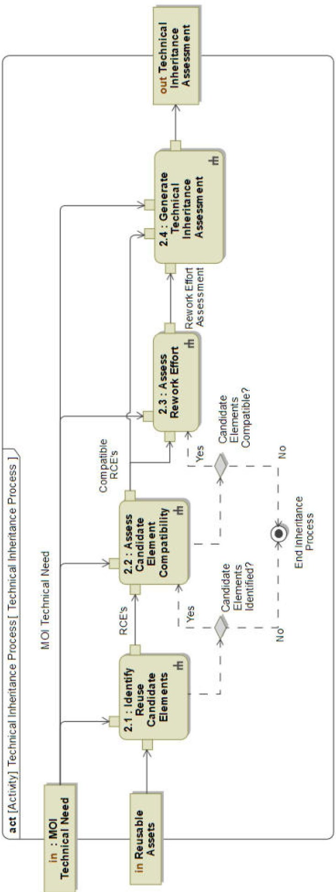

Figure 4.7: Detailed view of Step 2 of the LDRM logical process

<!-- PDF_PAGE: 142 -->

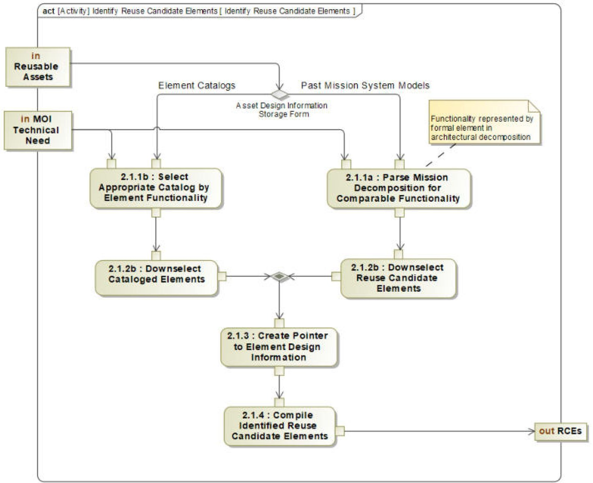

Figure 4.8: Detailed view of Step 2.1 of the LDRM logical process.

<!-- PDF_PAGE: 143 -->

steps. Two parallel paths for compiling reusable assets are (1) from a design catalog or library or (2) from the system model or existing design documentation of a predecessor mission (see Fig. 4.8). These sources are parsed for elements of comparable functionality and architectural decomposition level to the reuse need slot. The decompositional level determines the types of interactions that must be considered during adaptation to the new mission. Thus, in order to limit interactions to be considered (a proxy for rework effort), a more modular element would be preferred as a reuse candidate. A final enumeration of Reuse Candidate Elements - RCE(s) - is the output of this filtering effort. Given the parameters of the reuse investigation, the enumeration may contain one RCE or several; selection of an RCE for further analysis may also be mandated by campaign objectives or leadership decisions.

Output(s): RCE(s)

MBSE Consideration(s): Each RCE may be represented by a custom SysML block with a pointer to the asset record and key descriptive models/diagrams (e.g., functional decompositions, requirements, interfaces, etc.)

## Step 2.2 - Assess Candidate Element Compatibility (see Fig.4.7)

Input(s): MoI Technical Need; RCE(s)

Description: This step is a more refined filtering of the RCE(s) that determines compatibility of the RCE to the unique conditions of the MoI. In particular, two key indicators are compared between the RCE in its native mission and the technical need slot in the MoI: requirements and interfaces. These two elements are selected for several reasons. First, requirements and formal/structural architectures (from which interfaces are derived) are generated early in an architecting effort; this would conform with the intended target phase for LDRM. Conversely, care should be taken to re-evaluate when requirements change early in the mission definition process-a common occurrence. Second, they are an explicit form of design specification from which commonalities and discrepancies across missions can be inferred. Lastly, taken together, requirements and interfaces capture the full context of a given need slot. Namely, requirements deal primarily with the internal functionality and performance of the element considering objectives and design constraints, while interfaces capture the externalities of how the element interacts with other elements in the larger architecture of the RCM or MoI. In both cases, compatibility is assessed by pairing like-with-like across the native mission and the mission of interest at the appropriate decompositional level. The output is the set of compatible RCE(s)-non-compatible RCE(s) are deemed infeasible and excluded from further analyses.

Output(s): Compatible RCE(s)

MBSE Consideration(s): Compatibility of the RCE to the MoI may be recorded via a "Compatibility Flag" attribute in each RCE block

Step 2.2.1 - Identify Requirement Pairs, by Type (see Fig.4.9)

Input(s): MoI Technical Need; RCE(s)

Description: Parses through the design requirements for the RCE (in its native mission) and for the MoI (at the architectural level of the technical need). Identifies parallel requirements that may be "paired" to explore satisfaction of MoI requirements by the RCE design. Requirement pairs are classified by type: functional, performance, environmental,

<!-- PDF_PAGE: 144 -->

Figure 4.9: Detailed view of Step 2.2 of the LDRM logical process.

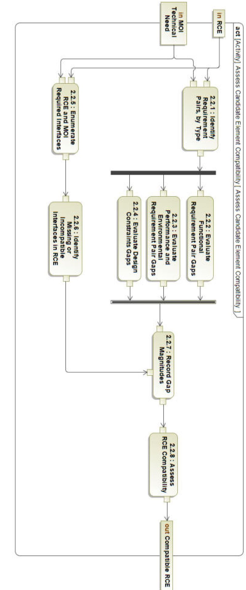

<!-- PDF_PAGE: 145 -->

or design constraints. Any MoI requirements that have no RCE pair are also recorded. Unpaired requirements may arise for two primary reasons $ ^{1} $ . First, the native mission may not specify the characteristic necessary in the MoI, introducing a question about the RCE's capacity to satisfy the MoI requirement - here, further assessment and potential rework may be necessary. The second alternative is that the native mission did not record a particular design characteristic as a requirement, though it may be present in the native design. This latter reason is likely a deficiency in the requirements set but may be remedied in the reuse assessment via introduction of "inferred" or "derived" requirements for those characteristics in the native mission that are known to exist but are not recorded via requirements (this phenomena will be explored in the first Case Study of Chapter 5).

Output(s): RCE/MoI Requirement Pairs

MBSE Consideration(s): A modified requirement diagram may be employed along with custom "pair" relationships.

Step 2.2.2-2.2.4 - Evaluate Functional, Performance/Environmental, and Design

Input(s): RCE/MoI Requirement Pairs, by Type

Constraint Gaps (see Fig.4.9)

Description: A requirement pair gap is defined as the difference between what the MoI requirement specifies and what the RCE counterpart can satisfy. The particular measure for assessing the gap depends on pair type. For functional requirements, the gap may be measured with a binary (e.g., either a required lower-level functionality is delivered by the RCE or it is not); for performance or environmental requirements, the gap may be measured with the figure of merit or parameter specified in the requirement. This step records these gaps for all requirement pairs found between the RCE and the MoI. This comparison reveals a) MoI requirements already satisfied by the RCE, b) the gap in the RCE's functionality, performance or design that must be bridged by rework or adaptation efforts, and c) requirements in the MoI for which no RCE requirement is comparable. In the last case, this indicates where new, from-scratch development will be needed to address the unique MoI requirement - or if rework is not feasible, this case renders the RCE incompatible to reuse.

Output(s): RCE/MoI Requirement Pair Gaps

MBSE Consideration(s): Requirement gap metrics may be recorded in a custom attribute/tag in the relevant MoI requirement.

Step 2.2.5 - Enumerate RCE and MoI Required Interfaces (see Fig.4.9)

Input(s): MoI Technical Need; RCE(s)

Description: Parses through the interfaces defined/required for the RCE (in its native missions) and for the MoI (at the architectural level of the technical need). Similar to Step

<!-- PDF_PAGE: 146 -->

2. 2.1, identifies parallel interfaces that may be "paired" across the two missions. Interface pairs may be classified as: energetic, data, material, or structural flows.

Output(s): RCE/MoI Interface Pairs

MBSE Consideration(s): Interfaces pairs may be derived from interface diagrams (SysML IBDs) for the RCE and the MoI.

## Step 2.2.6 - Identify Missing or Incompatible Interfaces (see Fig.4.9)

Input(s): RCE/MoI Interface Pairs

Description: Similar to Steps 2.2.2-2.2.4, an interface pair gap can be defined that captures the difference between the interfaces the RCE is equipped for and the interfaces specified for the need slot in the MoI. Two potential gap types exist: (1) a required interface in the MoI is missing in the RCE and (2) a required interface in the MoI exists in the RCE but is incompatible in its present form. Gaps for all interface pairs (and those missing pairs) are recorded.

Output(s): RCE/MoI Interface Pair Gaps

MBSE Consideration(s): Interface gap metrics may be recorded in a custom attribute/tag in the relevant MoI interface.

## Step 2.2.7-2.2.8 - Record Gap Magnitudes and Assess RCE Compatibility (see Fig.4.9)

## Input(s): RCE/MoI Requirement Pair Gaps; RCE/MoI Interface Pair Gaps

Description: For each requirement or interface pair, the magnitude of the gap is classified as "None", "Minor", "Major", "No Similar Requirement/Interface", or "Over-satisfied". The first three classes are determined by the percent change between the metric specified in the MoI requirement/interface and the same in the RCE requirement/interface - if this is close to 0% then the gap is "None", if less than or equal to 20% then the gap is "Minor", if greater than 20% then the gap is "Major". "Over-satisfied" is used when the RCE's requirement is more stringent than the MoI's, implying automatic satisfaction of the requirement. The set of magnitude classifications yield a preliminary and standardized assessment of the overall compatibility of the RCE to the MoI need. A determination of compatibility is made for each RCE, with qualifiers for estimated rework or modification required (e.g., "Compatible, with No Modifications", "Compatible, with Moderate Modifications", "Compatible with Substantial Modifications", "Not Compatible"). The output is an enumeration of the compatible RCE(s), while incompatible RCE(s) are excluded from the subsequent analyses.

Output(s): Compatible RCE(s)

MBSE Consideration(s): Requirement and interface gaps and magnitude designations may be recorded in custom SysML tabulations - with data drawn from requirement and interface diagrams of previous steps.

Step 2.3 - Assess Rework Effort (see Fig.4.7)

Input(s): MoI Technical Need; Compatible RCE(s)

Description: Evaluates the rework/adaptation effort necessary to adapt an RCE to fully satisfy the MoI Technical Need. In particular, this step is focused on bridging the gaps in requirement and interface pairs identified in Step 2.2. Each rework action is derived by consultation with subject matter experts and domain-specific analyses; these inputs introduce technical rigor to the rework campaign defined for each RCE. The rework campaign

<!-- PDF_PAGE: 147 -->

is the set of all rework actions for each interface and requirement pair. The output is a rework campaign for each RCE considered as well as an assessment of reuse feasibility given the extent of rework required. It should be noted that since LDRM is intended to support early architecting decisions, the rework campaign will not exhaustively capture all activities eventually conducted throughout the detailed design and integration phases, where reuse is actually implemented. The output of this step is intended as a first-order, preliminary blueprint with which to approach the eventual rework efforts more systematically.

Output(s): Rework Effort Assessment

MBSE Consideration(s): The set of rework actions should be recorded within the system model, while supporting analyses may be conducted either within SysML (leveraging limited computational capabilities) or on external domain tools.

## Step 2.3.1 - Propose Rework Actions to Reconcile Gap (see Fig.4.10)

Input(s): MoI Technical Need; Compatible RCE(s)

Description: Identifies rework actions needed to bridge the technical gaps in requirements and interfaces found for a given RCE. There is an outer iterative loop that is repeated for each requirement or interface pair. Determination of suitable/necessary rework actions is conducted with the assistance of SME and engineers of relevant disciplines. A given requirement/interface gap may necessitate multiple rework actions (comprising a rework set). For instance, to adapt a design for an actuator for a robotic arm from a predecessor mission to one with a higher positional accuracy requirement, rework actions may include modifying the gearbox, increasing resolution of the encoders, and adapting the control software. At this stage, it is also prudent to explicitly trace the rework action to the sub-element within the RCE that is specifically impacted by the action (e.g., the gearbox, encoders, software within the larger robotic arm assembly). The output of this step is a set of rework actions for each requirement or interface pair (nominally with a pointer to the impacted sub-element) between the RCE and the MoI technical need slot

Output(s): Rework Set for each Requirement/Interface Pair

MBSE Consideration(s): Rework Actions (and sets of actions) may be recorded as custom SysML blocks with attributes/tags specifying owning requirements, interfaces, and subelements.

## Step 2.3.2 - Evaluate Feasibility of Rework Actions via Supporting Analyses (see Fig.4.10) Input(s): Rework Actions

Description: For each rework action within a rework set (the inner loop in Fig. 4.10), supporting technical analyses are conducted by relevant discipline engineers and tools to assess the feasibility of that action given the RCE's as-is vs. as-needed states. In the robotic arm example, this may include CAD and structural analyses of the gearbox, analysis of physical and electronic limitations of the encoders, etc. In addition to verifying technical feasibility of the rework action, the technical analyses also yield a preliminary Work Breakdown Structure (WBS) for each action, giving greater clarity about the adaptation effort that will be required to reuse the RCE. Section 4.3.5 discusses in greater detail the methods by which supporting technical analyses may be integrated into the methodology.

Output(s): Rework Action Feasibility

<!-- PDF_PAGE: 148 -->

Figure 4.10: Detailed view of Step 2.3 of the LDRM logical process.

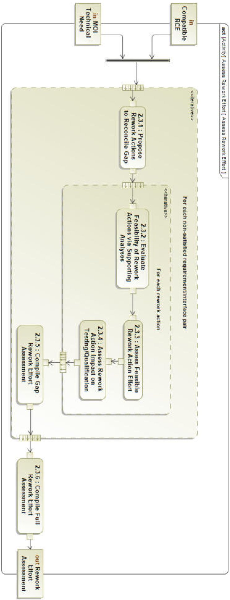

<!-- PDF_PAGE: 149 -->

MBSE Consideration(s): Supporting technical analyses may leverage existing SysML capabilities via Parametric diagrams and constraint functionalities or be linked to external discipline tools.

## Step 2.3.3 - Assess Feasible Rework Action Effort (see Fig.4.10)

Input(s): Rework Actions

Description: The rework actions that were refined with supporting analyses are assigned a classification for estimated effort. Estimating "effort" consists of a subjective judgement on the part of the user of the impact of the rework action on the MoI design activities. This judgement is informed by the SME and discipline engineer input from the previous step and a systems level understanding of the MoI, the RCE, and the technical need. These considerations are made in conjunction with the testing/qualification impact assessment of the next step to yield a comprehensive understanding of the added effort imparted by the reuse scenario. Canonical categories for "effort" are: None, Minor, Moderate, and Major. These designations for each rework action are used primarily in the Reuse Value Assessment in Step 3 to generate a preliminary estimate of the impacts of a reuse scenario on systems engineering effort. These results can be traced to each rework action and can also be reinforced with the initial WBS for each action that emerges from the discipline analyses.

Output(s): Rework Action Effort

MBSE Consideration(s): Rework action effort designations may be recorded in custom attributes/tags for each Rework Action block.

## Step 2.3.4 - Assess Rework Action Impact on Testing/Qualification (see Fig.4.10)

Input(s): Rework Actions

Description: An important consideration in a reuse scenario is the degree to which the RCE will impact the testing and qualification campaign of the MoI. There are two primary considerations in this regard. First, the rework actions carried out on the RCE may be substantial enough to invalidate the certification of the RCE from its native mission - this is a concern at the architecture level of the RCE itself. Indeed, in its Systems Engineering Handbook, NASA stresses the need to understand the impact of the new mission context and rework efforts on the Technology Readiness Level (TRL) of the element: "If the architecture and the environment have changed, then the TRL drops to 5-at least initially". Therefore, changes made to the RCE necessitate at least an element-level re-certification. The second consideration regarding testing is related to the integration of the RCE into the reuse slot in the MoI - this is a concern at an architecture level above the RCE. A necessary aspect of this type of testing assessment is change propagation of rework actions on the RCE through the

<!-- PDF_PAGE: 150 -->

interfaces and potentially into other MoI elements $ ^{2} $ . At this level, however, an integration, assembly, and testing (IA&T) campaign is nominally required of both reuse and from-scratch solutions. Thus, it is not a new systems engineering effort imparted by the reuse decision, but rather one that must be tailored to one or the other design decision. Here we may rely on an organization's established testing, qualification, and verification and validation (V&V) activities as reusable patterns for re-qualifying the RCE and its integration in to the MoI architecture. The major output of this step is a determination of the impact on existing certifications and testing requirements of the RCE and MoI of a given rework action.

Output(s): Testing/Qualification Impact

MBSE Consideration(s): Rework action testing impact designations may be recorded in custom attributes/tags for each Rework Action block

Step 2.3.5 - Compile Gap Rework Effort Assessment (see Fig.4.10)

Input(s): Rework Action Assessments

Description: The final step in the outer loop is to compile the results of the preceding analyses into a Rework Effort summary for each requirement or interface pair. The assessment contains: a) summary of the gap in the requirement or interface pair, b) enumeration of necessary rework actions and ties to the impacted sub-elements, c) designations for rework effort (per Step 3), d) similar designations for testing/certification impact. In addition, the user may also record scenario-specific analyses, comments, or documentation that more richly capture contextual information.

Output(s): Rework Action Set Assessment

MBSE Consideration(s): The full set of rework actions and relevant assessments for a given requirement or interface pair may be compiled in a Rework Set block

Step 2.3.6 - Compile Full Rework Effort Assessment (see Fig.4.10)

Input(s): Rework Action Set Assessment

Description: A similar compilation step is conducted once the outer loop is exited to consolidate the results of Steps 2.3.1-2.3.5 for each requirement or interface pair. Thus, the full rework effort is recorded here with similar supporting analyses, as necessary. At minimum, the resulting assessment contains: (1) description of the RCE considered, including its decompositional level in an architectural hierarchy; (2) listing of requirements or interfaces paired across missions with relevant metric gaps; (3) listing of rework actions for each requirement pair; (4) An effort/magnitude assessment for each action. Output(s): Full Rework Effort Assessment

<!-- PDF_PAGE: 151 -->

MBSE Consideration(s): The full set of rework actions and relevant assessments for all requirement or interface pairs may be compiled in custom SysML table

Step 2.4 - Generate Technical Inheritance Assessment (see Fig.4.7)

Input(s): MoI Technical Need; Compatible RCE(s); Rework Effort Assessment Description:

This step concludes the technical inheritance step by consolidating the results from the compatibility and rework effort assessments into a final report for each RCE. Additionally, the step requires a final validation that the MoI Technical Need will be satisfied by the RCE's considered and the rework actions defined for each. If more than one RCE was carried through the inheritance process, then a final evaluation is conducted for each and a preliminary technical feasibility ranking is generated for decision-makers.

Output(s): Technical Inheritance Assessment

MBSE Consideration(s): N/A

## 4.3.3 Step 3 - Reuse Value Assessment Process

Input(s): MoI Description; Technical Inheritance Assessment; Campaign/Enterprise Context

Description:

The last high-level step of the generalized procedure evaluates the potential impacts of the feasible reuse scenarios on the MoI in terms of programmatic estimates (i.e., cost, schedule, systems engineering effort). A novel cost modeling tool is out of the scope of this effort; rather, we demonstrate integration of an established and validated systems engineering-effort modeling tool, COSYSMO 2.0. This tool has built-in capabilities for considering various degrees of reuse within a systems engineering program. Additionally, in arriving at a final reuse assessment and set of recommendations this step also stipulates evaluation of more qualitative aspects of the reuse decision on the MoI and the larger campaign/enterprise context. These include lifecycle property impacts (e.g., modularity, commonality, extensibility), social-technical and organizational considerations, and system-of-systems impacts of the reuse decision and rework actions on other campaign elements and commonality objectives.

Output(s): Design Reuse Assessment

MBSE Consideration(s): This step requires integration of the cost/effort modeling tool into the larger SysML system model that may be accomplished in several ways, including via parametric diagrams or intermediate linking tools such as MS Excel.

Step 3.1 - Apply Effort Modeling Tool (see Fig.4.12)

Input(s): MoI Description; Technical Inheritance Assessment

Description:

The quantitative impact of a decision to proceed with an RCE is now evaluated. The COSYSMO 2.0 systems engineering effort modeling tool is used for this purpose (and is discussed in detail in Section 4.3.6. The spreadsheet-based tool requires inputs for 14 cost drivers and 4 size drivers defined in its governing equations. The reuse consideration is built

<!-- PDF_PAGE: 152 -->

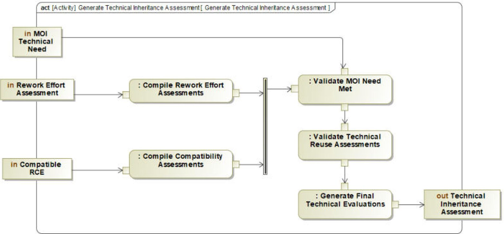

Figure 4.11: Detailed view of Step 2.4 of the LDRM logical process.

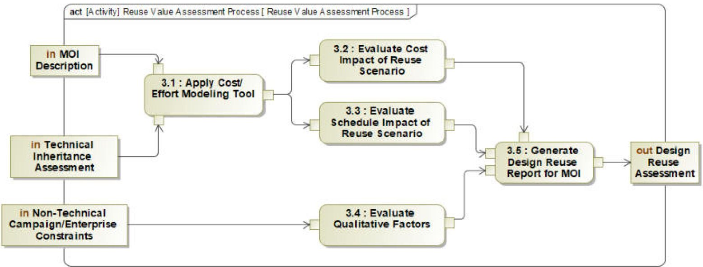

Figure 4.12: Detailed view of Step 3 of the LDRM logical process.

<!-- PDF_PAGE: 153 -->

into the size driver equations and requires assignment of "reuse levels" and "difficulties" for each size driver (Requirements, Interfaces, Operational Scenarios, and Algorithms). Entries for these inputs are derived from the effort designations and gap magnitudes recorded during the technical inheritance processes of Step 2.

Output(s): Systems Engineering Effort Estimate

MBSE Consideration(s): Attributes and reuse designations derived during Step 2 must be exported to the COSYSMO 2.0 spreadsheet tool and outputs of COSYSMO 2.0 must be imported into the SysML model.

Step 3.2-3.3 - Evaluate Cost/Schedule Impact of Reuse Scenario (see Fig.4.12)

Input(s): Systems Engineering Effort Estimate

Eq Description:

The COSYSMO 2.0 tool yields outputs in terms of estimate "systems engineering effort". This metric is measured in units of Person-Months. From this estimate we can separately derive values for a) required program staffing (which, in turn, can be seen as a proxy for cost) or b) program schedule. For instance, a nominal estimated schedule may be calculated assuming a fixed team size. Conversely, assuming a fixed schedule (i.e., due to project deadlines or launch windows) the effort metric may yield a required staffing model or team size; further, assuming a fixed rate for a Full Time Equivalent (FTE) employee yields a staffing cost for the effort. While this cost estimate would capture only systems engineering and staffing expenses, it can act as a starting point for assessing the full cost impact of the reuse decision vs. a from-scratch solution. The comparative metrics of the two design approaches are derived by applying COSYSMO 2.0 with no reuse.

Output(s): Reuse Cost/Schedule Impact Estimate

MBSE Consideration(s): Step 3.1 imports the SE Effort metric into the SysML system model, parametric diagrams or constraint equations may then perform the above transformations to staffing, cost, or schedule.

Step 3.4 - Evaluate Qualitative Factors (see Fig.4.12)

Input(s): Campaign/Enterprise Context

## Description:

The quantitative effort estimate is supplemented with a fuller holistic assessment of additional reuse considerations. For each RCE considered, the impact of the reuse decision on the lifecycle properties of the MoI ("-ilities" such as modularity and commonality) are considered. For instance, the modularity of a reuse candidate directly impacts the number of interfaces with which it must be reconciled in the MoI and the propagation of changes to its neighbors in the MoI architecture. Additionally, recommendations for "designing/modeling for reuse" are developed for the MoI - this is not focused on the RCE reuse decisions at hand, but rather, the design and modeling practices the MoI implements to facilitate reuse of its own designs on future missions. Other aspects developed in this step include organizational and socio-technical factors; for instance, awareness of, accessibility to, and acceptance of a reusable asset for reuse is often a product of the organizational structures and boundaries within which missions are developed. LDRM calls for users to explore these factors to inform the reuse decision.

Output(s): Qualitative Reuse Notes

<!-- PDF_PAGE: 154 -->

MBSE Consideration(s): The qualitative factors are, by definition, subjective and relative to the mission at hand; as such, rather than enforce a particular modeling construct, LDRM suggests use of open-ended comments and the collection of all relevant documentation into a multi-modal custom diagram that captures each of the relevant factors.

Step 3.5 - Generate Design Reuse Report (see Fig.4.12)

Input(s): Reuse Cost Impact Estimate; Reuse Schedule Impact Estimate;

Campaign/Enterprise Impact

## Description:

The concluding step compiles all the data and information generated in Step 3 together with the outputs of the preceding steps to yield the final methodology outputs in support of reuse decision making. These can be binned into three output types: 1) a feasibility assessment for reusability of the design with reasonable adaptation effort, 2) a rework effort assessment to address gaps and a preliminary WBS for the rework campaign, and 3) a reuse valuation that estimates comparative systems engineering effort between reuse and a from-scratch approach. These 3 outputs combine to form a final recommendation for continuing pursuit of (or conversely, abandoning) a reuse candidate into more mature design phases. If more than one RCE was considered for a given MoI Technical Need, the report presents a list of these RCE(s) ranked by reuse potential. If a from-scratch solution is preferred to all candidates explored, the rationale for this decision is stated. The reuse decision point lies downstream of this output, which project leadership consumes alongside other stakeholder influences.

Output(s): Design Reuse Assessment

MBSE Consideration(s): A final report template may be defined to specify required fields the user must populate - some aspects of the report may be automatically populated by SysML relationships, while the more qualitative/user-dependent ones may be in the form of open-ended documentation and custom diagrams or tables.

## 4.3.4 LDRM Output Metrics

As mentioned in the Step 3.5 description, there are three primary outputs of LDRM. These can notionally be reported using several metrics, as shown in Table 4.2. Reuse feasibility is listed as the first outputs, but this determination is only made once the requirement/interface gap and rework campaign analyses have been conducted. The first metric reports the magnitudes of the full set of gaps as determined by the percent difference between metrics stipulated for paired constraints, as described for Step 2.2.7-2.2.8 - when these are absent, the user must make subjective judgments on gap magnitude. From this set of magnitudes, a true/false feasibility flag is populated for the RCE. Feasibility assessment is reinforced by the rework campaign output metric which is a count of rework actions to address gaps. Each rework action is attributed to a particular gap allowing for increased granularity at

<!-- PDF_PAGE: 155 -->

lower levels of decomposition $ ^{3} $ . Metrics for the third output are dependent on the cost/effort modeling tool selected (COSYSMO 2.0 in this case) - development and use of these metrics is discussed in Section 4.3.6.

## 4.3.5 Supporting Discipline Analyses

Step 2.3 of the generalized reuse procedure stipulates use of supporting analyses to enumerate, refine, and validate the rework actions identified to adapt an RCE. Naturally, these supporting analyses rely on the engineering disciplines relevant to the reuse need. Given the level of design maturity under which LDRM is being applied, the form of the supporting discipline analyses may vary. As a starting point, the key governing equations and sensitivities to the RCE's design parameters should be explored. For instance, when investigating whether the thermal control system of a heritage infrared (IR) imager is adequate for the image noise requirements on the new MoI, the governing equation would be the heat transfer formula $ Q_{in}=Q_{out} $ . Depending on the system boundary, $ Q_{in} $ may include impinging solar radiation and heat transfer from other spacecraft elements; $ Q_{out} $ depends on the heat pathways that are designed into the imager's thermal control system, but are fundamentally conduction, convection (forced convection in a micro-gravity environment, if present), and radiation. In a simplistic approach, the above calculations may be conducted via a spreadsheet-based tool such as MS Excel or within the MBSE modeling language's parametric capabilities. However, more rigorous analyses in support of the reuse and rework options may require dedicated discipline tools (in our example, thermal modeling software such as Thermal Desktop). An issue then arises when satisfying the fundamental paradigm of the MBSE environment - namely, that data should be integrated such that the system model acts as a central coordinating point and authoritative source of system information. This requires that there be in place a tool-data thread between the system model tool and the supporting discipline tools that satisfies constraints: 1) that the discipline models receive inputs from the system model and 2) that the outputs of the discipline models can push their outputs into the system model.

This has been extensively demonstrated for one specific form of MBSE - spreadsheetbased concurrent engineering models. In this simplified format, key calculations of each subsystem or mission discipline are captured in separate spreadsheets while a central "systems" sheet coordinates the inputs-outputs across the discipline sheets. This approach is useful for generating rapid, preliminary designs that do not require the rich detail and definition of a modeling-language based system model. However, for this methodology in which we seek to ensure wide applicability, consideration must be given to how dedicated engineering tools (in addition to spreadsheets) can be integrated with MBSE graphical modeling tools. Several sources have investigated the implications and potential solutions to this problem of tool-data threading [5]. A key finding is that tool integration does not have a generalized

<!-- PDF_PAGE: 156 -->

Table 4.2: Summary of key LDRM outputs and the metrics with which they are notionally reported.

<table border="1"><tr><td>Output</td><td>Metric</td><td>Units</td></tr><tr><td>Reuse Feasibility</td><td>Gap Magnitude IsFeasible</td><td>[None, Minor, Moderate, Major]*boolean</td></tr><tr><td>Rework Campaign</td><td>Rework Actions</td><td>Count</td></tr><tr><td>Value Estimate</td><td>Systems Engineering Effort Improvement with Reuse</td><td>Person-Months %diff**</td></tr><tr><td colspan="3">*Designation determined based on % difference in metric specified for the requirement in the native mission vs. the MoI</td></tr><tr><td colspan="3">**As compared to the COSYSMO 2.0 tool run for a comparable from-scratch effort</td></tr></table>

<!-- PDF_PAGE: 157 -->

solution; rather, integration capabilities are very much dependent on the particular discipline tool, the MBSE modeling tool, and more broadly, the MBSE modeling language selected. Thus, the solution that works for integrating Cameo Systems Modeler and AutoDesk AutoCAD may not be the same as the one for integrating Mathwork's System Composer and Dassault's SolidWorks.

The key takeaway here is that as the user organization builds up integration capabilities with more discipline tools, the analytical power of the MBSE environment increases. This goal is not only one for the user organization - tool vendors should strive to facilitate the integration of their tools with those of other vendors to deliver on the promise of an integrated analytical environment powered by MBSE principles. We will illustrate a few examples of these integration mechanisms in the demonstration problem at the end of this Chapter.

## 4.3.6 Programmatic Analyses

Steps 3.1-3.3 describe use of an effort modeling tool to assess the value of a reuse decision for a given RCE. This tool nominally would take inputs from the technical inheritance analyses (Step 2) to populate its formulas - these inputs could include:

- Total number of requirements in the MoI Technical Need

- Total number of interfaces in the MoI Technical Need

- Total number of new discipline analyses conducted

- Ratio of paired/unpaired requirements between the in the MoI Technical Need and the RCE

- Ratio of paired/unpaired interfaces between the in the MoI Technical Need and the RCE

- Total number of rework actions for each RCE

- Rework effort designations (i.e., "None", "Minor", "Moderate", "Major" per Step 2.3.3) for each rework action

The output of the tool should give a preliminary estimate of the reuse value of a candidate design by comparing its effort metric with a similar metric for a from-scratch design method. An exploration of active and validated cost/effort modeling tools found a very limited set that considered design reuse as a qualifier for its estimates.

The Constructive Systems Engineering Cost Model (COSYSMO) is a parametric cost/effort modeling tool that is aimed specifically at estimating the systems engineering contributions to the project programmatics [136]. The tool was funded by various aerospace industry organizations and has been extensively validated on space systems projects. It parameterizes the problem into two "driver" bins - size drivers that capture the overall magnitude of the effort, and cost drivers that capture organization, team, and application-specific factors. These are shown in Table 4.3. Further, the size drivers are binned into "Easy", "Nominal" or "Difficult" designations. Note the convenient presence of requirements and interfaces in

<!-- PDF_PAGE: 158 -->

both the COSYSMO size drivers and the technical inheritance analyses. Additionally, we may designate algorithms as any new analysis effort that must be conducted during the reuse feasibility assessments; similarly, any major new functionality required of the RCE is deemed an operational scenario (e.g., autonomous operations in an RCE that was telerobotically operated in its native mission). Thus, we have a good starting point for estimating the systems engineering impact of a design decision.

However, we must turn to a second iteration of COSYSMO development - COSYSMO 2.0 in order to address the reuse vs. from-scratch question [43]. COSYSMO 2.0 stipulates qualifying each entry in the size driver tally with a reuse designation. This designation specifies the degree of reuse for the given entry ranging from fully reused to fully new. Table 4.4 defines the 6 categories of reuse that fall closely in line with the terms we found in the software reuse literature in Chapter 2.

Each of the reuse categories in Table 4.4 is assigned a weighting factor that modulates the effort estimate; weighting ranges from 0.15 to 1.0 for normal reuse conditions and 1.4 for the unique "designed for reuse" case. The final governing equation for the COSYSMO 2.0 tool is given by Eq. 4.1 where A is a calibration constant derived from historical data, k represents the 4 size drivers, r represents the reuse designation, $ w_{r} $ represents the weight for the $ r^{th} $ reuse designation, $ w_{e,k}, w_{n,k}, w_{d,k} $ represent the weighting factors for the easy, nominal, and difficult designations of the $ k^{th} $ size driver, $ \Phi $ represents the quantity of each size driver for each difficulty designation, E is an economies of scale factor, and $ EM_{j} $ is an effort multiplier for the $ j^{th} $ cost driver. The output, finally, is $ PM=person-months $ of estimated systems engineering effort.

$$
P M = A \left(\sum_ {k} \left(\sum_ {r} w _ {r} \left(w _ {e, k} \Phi_ {e, k} + w _ {n, k} \Phi_ {n, k} + w _ {d, k} \Phi_ {d, k}\right)\right)\right) ^ {E} \prod_ {j = 1} ^ {1 4} E M _ {j}
$$

In order to integrate COSYSMO 2.0 into the larger LDRM procedure, we must route gap estimate and magnitude parameters derived in the Technical Inheritance to the proper tabulation in a COSYSMO 2.0 calculator, itself an external tool. This requires that:

- Each requirement and interface in the MoI technical need be tagged with a difficulty designation.

- Each requirement and interface pair be tagged with a reuse designation.

- New Analyses (i.e., "Algorithms" in COSYSMO terminology) be tagged with difficulty designations.

Further, the MoI description that acts as the primary input at the front-end of LDRM must contain the necessary attributes required to assign cost driver values. Thus, each variable in the COSYSMO 2.0 governing equation is derived from a value identified - either by tabulation or user input - in the preceding steps of LDRM. Similarly, the outputs of the tool are fed back into the methodology data pool to inform cost and schedule assessments in support of a final reuse recommendation.

<!-- PDF_PAGE: 159 -->

Table 4.3: COSYSMO 2.0 input parameters.

<table border="1"><tr><td>Size Drivers</td><td>Cost Drivers</td></tr><tr><td>Number of System Requirements</td><td>Requirements Understanding</td></tr><tr><td>Number of Major Interfaces</td><td>Architecture Understanding</td></tr><tr><td>Number of Critical Algorithms</td><td>Level of Service Requirements</td></tr><tr><td>Number of Operational Scenarios</td><td>Migration Complexity
Technology Risk
Documentation
Number and Diversity of Installations
Number of Recursive Levels
Stakeholder Team Cohesion
Personnel/Team Capability
Personnel Experience/Continuity
Process Capability
Multi-site Coordination
Tool Support</td></tr></table>

Table 4.4: Weighting values, $ \omega_{r} $ , for reuse designations within COSYSMO 2.0.

<table border="1"><tr><td>Reuse Designation</td><td>Definition</td><td>Weighting Value</td></tr><tr><td>New</td><td>Item is completely new</td><td>1.0</td></tr><tr><td>Designed for Reuse</td><td>Item requires additional upfront investment to improve the potential reusability</td><td>1.38</td></tr><tr><td>Modified</td><td>Item is inherited but is tailored</td><td>0.65</td></tr><tr><td>Deleted</td><td>Item is removed from a system</td><td>0.51</td></tr><tr><td>Adopted</td><td>Item is incorporated unmodified</td><td>0.43</td></tr><tr><td>Managed</td><td>Item is incorporated unmodified with minimal testing</td><td>0.15</td></tr></table>

<!-- PDF_PAGE: 160 -->

## 4.4 MBSE Implementation - Metamodel and Profile

We have thus far developed the methodology in a conceptual and logical fashion; now we turn, per Fig. 4.1, to exploring how implementation of the procedure may be carried out in an MBSE environment. In order to develop a rigorous and repeatable implementation approach, we recall the function of a metamodel - namely, to specify how models and model elements are built and how they relate to one another. A metamodel, then, can be seen as an MBSE-oriented refinement of the reuse ontology discussed previously. From this metamodel, we then proceed to building the reuse-specific modeling constructs via canonical SysML formalisms. Lastly, with the modeling specification and the SysML constructs, we conclude with illustration of notional diagram descriptions constructed under these constraints.

## 4.4.1 Reuse MBSE Metamodel

A diagram representing the Reuse Metamodel for MBSE implementation is shown in Fig. 4.13. The metamodel elements (shown as blocks of various colors) and the relationships (the connections of several types) codify the structure and flow of information through LDRM as implementation progresses. Several element types are specified: orange blocks represent the central model elements of the methodology that capture existing design information for the mission of interest and the reusable assets; green blocks represent the attributes of those model elements required for the reuse analyses, including definition of the technical need and constituent requirements and interfaces; blue blocks represent key inputs that are external to (assumed to exist a priori) LDRM but provide necessary data; purple blocks represent the analysis products generated during implementation of the methodology (i.e., to produce the technical and programmatic assessments); pink blocks represent the external tools that shall be integrated into the LDRM environment to support the analysis modules. Relationship types include: arrows with open diamond ends represent aggregation of related components under a higher-level element (specific relationship names further clarify the nature of the interface); arrows with closed diamond ends represent composition of the higher-level element by instances of the lower-level element; and standard arrows indicate associations that are further specified by the tags attached to the line segments.

The modeling practices specified by this metamodel reveal at once a straightforward procedure but one that requires a diverse set of information and model artifacts. Thus, it is understood that a significant contributor to the effort required for this methodology will come from transforming existing information/data to the form that is required for the analysis. Once the proper relationships are established among this data, the other large contributor to the effort will be the technical inheritance effort (Step 2 of the LDRM procedure) and the supporting discipline analyses where unique tools and SME input are required.

## 4.4.1.1 Metamodel Element Glossary

To aide in unambiguous understanding of the metamodel, below is a glossary of elements that appear in Fig. 4.13. Some term definitions include examples, shown in italics, related to the demonstration problem that will be discussed in Section 4.5.

<!-- PDF_PAGE: 161 -->

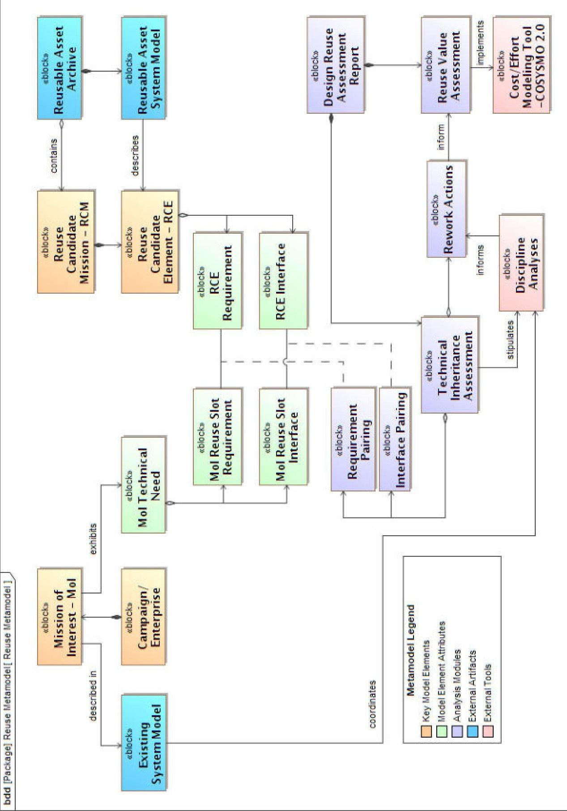

Figure 4.13: Reuse metamodel arranging concepts in the generalized procedure into an implementable MBSE form.

<!-- PDF_PAGE: 162 -->

- Mission of Interest (MoI) - The mission or project for which design reuse is being considered. Model element should include a description of objectives, environment, stakeholders, etc. as well as a documentation of design decisions made to-date. Example: Luna, a hypothetical lunar robotic rover in support of the Artemis program; intended for surface science and infrastructure support. It shall interact with future surface assets and science samples.

- Campaign - The overarching set of missions and vision within which the MoI takes place. Example: The larger Artemis program with multiple crewed and uncrewed surface missions planned.

- MoI Technical Need - The functional need within the MoI functional decomposition for which reuse is being considered. Example: The robotic arm used to interact with surface assets and science samples.

- Reusable Asset Archive - The repository of reusable assets kept and maintained by the organization; LDRM accesses this archive to pull reusable designs. Example: The set of historical missions which contain a robotic arm for which design information is available.

- Reusable Asset Record - Specific reusable designs within the larger archive kept and maintained by the organization Example: A particular entry within that set of historical missions archived.

- Reuse Candidate Mission (RCM) - a predecessor mission that has been identified as a candidate within which RCE may be drawn to satisfy the MoI Technical Need. Example: The Curiosity mission, or MSL.

- Reuse Candidate Element (RCE) - element within the RCM (at a level of decomposition commensurate with the Technical Need) which has been identified as a candidate to reuse. Example: The Curiosity rover's robotic arm.

- MoI Reuse Slot Requirement - The requirements of the MoI; particularly those that relating to the technical need and that must be satisfied by the RCE. Example: The workspace of the Luna robotic arm shall be a cylinder with a height of 1.25 m.

- MoI Reuse Slot Interface - The interfaces (structural, energetic, informational, material) of the MoI; particularly those of the technical need slot with the rest of the system these must be satisfied by RCE interfaces. Example: The Luna robotic arm's interface with the rover's power system shall route power to its actuators and the payloads on the end effector.

- RCE Requirement - The requirements satisfied by the RCE within its RCM; these are either aligned with related MoI requirements or must be modified to meet the new MoI requirements. Example: The workspace of the Luna robotic arm shall be a cylinder with a height of 1 m.

<!-- PDF_PAGE: 163 -->

- RCE Interface - The interfaces of the RCE with its neighboring elements in the RCM; these must be modified (if necessary) to accommodate the interfaces in the MoI Technical Need slot. Example: The Curiosity robotic arm's interface with the rover's power system shall route power to its actuators and the payloads on the end effector.

- Requirement Pairing - The analysis procedure that identifies requirements in the RCE comparable to those in the MoI Technical Need such that gaps and adaptation effort may be assessed. Example: Curiosity's robotic arm's workspace cylinder radius compared with the same for Luna-1.25 m vs. 1 m

- Interface Pairing - The analysis procedure that identifies interfaces in the RCE comparable to those in the MoI Technical Need such that gaps and adaptation effort may be assessed. Example: Curiosity's power routing interface compared with the same for Luna - they are substantially the same.

- Existing System Model - The system model of the MoI and, if applicable the campaign, as defined and maintained by the organization; LDRM is intended to be overlaid onto this existing model. Example: The hypothetical governing system model developed for the Luna rover.

- Technical Inheritance Assessment - Process by which the technical feasibility of adapting legacy elements for use on new missions is assessed; it includes (1) consideration of how the asset may align with the objectives, environments, constraints, and context of the new mission and (2) an estimate of the rework effort required to re-deploy the asset in the new mission architecture.

- Discipline Analyses - Analyses conducted on tool suites that are (typically) external to the MBSE modeling environment and that support the technical inheritance and rework action efforts. Example: A dedicated workspace reachability analysis which evaluates satisfaction of the Luna reach requirements with the Curiosity design, and explores possible modifications.

- Rework Actions - Any operation that must be carried out on an RCE's design to adapt it from its state in the past mission to the state required by the mission of interest. Example: Extension of the Curiosity robotic arm forearm length by 15%, reduction of the upper arm length by 10% in order to meet the Luna workspace requirements with the reused design.

- Cost/Effort Modeling Tool - The external analytical tool that yields an estimate of the programmatic impacts of a reuse decision for a given RCE (i.e., cost and schedule metrics vs. a from-scratch approach). Example: COSYSMO 2.0

- Reuse Value Assessment - Process by which the programmatic impacts (e.g., cost, schedule) of the reuse scenario are assessed and compared with similar from-scratch effort; a breakeven analysis determines the point of indifference between reuse and from-scratch development. Example: COSYSMO 2.0's estimate of savings of 14% in systems engineering effort (measured in Person-Months) with a decision to reuse the Curiosity robotic arm design.

<!-- PDF_PAGE: 164 -->

- Design Reuse Assessment Report - The final output of the methodology that summarizes results of the technical and programmatic analyses and recommends a prudent course of action with regard to the reuse scenario; metrics reported in this report include a) Feasibility determination (T/F), b) rework campaign summary, and c) reuse value estimate in terms of cost/schedule/effort impacts.

## 4.4.2 Deploying the Metamodel in SysML

In addition to the defining the governing metamodel as we did in the previous section, we must also specify how to deploy it within the modeling language within which the MBSE environment is built - namely SysML.

First, a note must be made on language selection - and particularly why SysML is chosen for LDRM. While a multitude of highly capable MBSE-compatible modeling languages exist such as Modelica, MathWorks System Composer, and Object Process Methodology SysML has become established as the de-facto MBSE language throughout the industry. Its compact set of 9 diagram types allow for a rich graphical encoding of various aspects and types of system information including structure, behavior, and constraints [105]. Various tool vendors reinforce SysML suites with capabilities to 1) create custom tables and profiles, 2) limited integration some discipline-specific tools into the system model (particularly Matlab), and 3) execute user defined code for unique analyses within the system model itself.

SysML does have certain limitations. First, SysML modeling solutions are not always unique; that is, there are multiple ways to model the same descriptive or behavioral feature of an architecture, allowing for modeling inconsistencies across modelers, organizations, or standards. Secondly, the rich modeling enabled by SysML also leads to models becoming complex rather quickly and often intelligible only to the modeler(s) [21]. This complexity also results in a modeling language that is often described as difficult to learn [3], leading to high barriers to wide-spread adoption at organizations and the industry as a whole. It is expected that the upcoming second edition of SysML will alleviate some of the issues here discussed. Nevertheless, SysML remains the most capable and widely used MBSE-compatible language.

SysML's extension mechanism (SysML itself being an extension of the Unified Modeling Language, UML) allows for users to tailor the language to suit the needs of a given modeling effort or discipline/industry. In this mechanism, Stereotypes create new model elements that are derived from existing SysML elements (e.g., "Block") and are customized with specific attributes and tagged values. Stereotyped elements, the set of which is known as a Profile, then become the primitive building blocks of the modeling effort. These stereotypes may be applied to existing modeling elements, yielding a solution that can leverage existing models with minimal modification. This approach requires a large upfront effort and knowledge of some advanced operations within SysML but results in a highly flexible solution that is ideal for organizations with active but not yet standard modeling practices and in nascent stages of MBSE adoption. Therefore, we adopt this extension approach for SysML deployment of LDRM.

<!-- PDF_PAGE: 165 -->

## 4.4.2.1 The Reuse Profile

The SysML Reuse Profile - the set of all reuse stereotypes - developed for the methodology is presented in 4.14. The stereotypes, shown around the perimeter of the diagram in blue, have connectors leading to the middle column of standard SysML elements that they extend. The attributes (or "tags") in each of the reuse stereotypes indicate the special properties that have been defined for it and that become available to populate when the stereotype is applied to a model element. The name of the attribute is followed after the colon by the value type which that attribute is constrained to accept, and in some instances the allowable multiplicity of entries for that attribute (indicated by " [ ]") and the default value the attribute takes when created (indicated in red text). Each stereotype defined in this profile may be traced to an element in the metamodel.

The first three stereotypes in the top left corner of the diagram specify model elements related to Steps 1.1-1.3 of the generalized process. The《MoI Description》 stereotype contains attributes pointing to model artifacts containing 1) the highest-level element of the architectural decomposition of the MoI and 2) the requirements records of the MoI. These are presumed to exist in the system model for the MoI maintained by the organization prior to implementation of LDRM. The《Campaign/Enterprise Context》 stereotype contains attributes for the higher-level constraints imposed on the MoI, per step 1.2; additionally, since this stereotype is a specialized form of "Block", it can also contain part properties for the other constituent missions of the campaign for additional context. The《MoI Technical Need》 stereotype has attributes for a) describing the functional need via text, b) identifying the "need slot" in the larger MoI architecture decomposition, and c) pointing to the MoI requirements relevant to the technical need.

The blocks in the lower left corner of Fig. 4.14 specify stereotypes related to the reusable assets available to the organization. The left-most two, 《Reusable Asset Archive》和 《Reusable Asset Record》， are used within the organization's design/model repositories to maintain asset information. As mentioned in the discussion for Steps 1.4 and 1.5, construction and maintenance of these repositories is a task outside the scope of LDRM; nevertheless, asset metadata of the types listed as attributes in the 《Reusable Asset Record》 (including pointers to design information such as requirements and architectural decompositions) should be maintained. The 《Reuse Candidate Element》 stereotype is used directly within the methodology and imports the data kept in the Asset Record listed as its first attribute. This is intended to prevent changes made to attributes in the RCE to backflow into the information-of-record for the heritage design - which should remain unchanged. A key attribute of the RCE block that is populated at the conclusion of Step 2.2 is the compatibility designation that determines whether the RCE continues for more detailed supporting analyses and rework assessments.

The two stereotypes in the top right corner show the specialized reuse requirements and interfaces central to the Technical Inheritance analysis. The 《Reuse Requirement》 stereotype contains attributes recording the requirement type as well as the Figure of Merit (FOM) specified by the requirement. It also contains designations for whether the RCE requirement paired to it fully satisfies it or whether some gap exists. Lastly, the stereotype contains attributes necessary for use of the COSYSMO 2.0 cost/effort modeling tool. Similar attributes are kept for the 《MoI Required Interface》 stereotype. The 《Rework Set》 stereotype consol-

<!-- PDF_PAGE: 166 -->

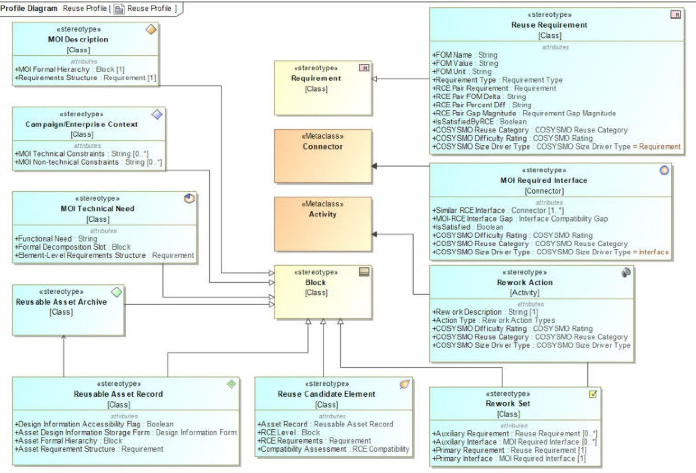

Figure 4.14: Reuse Profile for extending SysML with stereotypes for custom constructs specified by generalized procedure and metamodel.

<!-- PDF_PAGE: 167 -->

idates all 《Rework Actions》necessary for bridging a given requirement or interface pair's gap. The 《Rework Action》stereotype describes each action and also assigns parameters needed by the COSYSMO 2.0 tool.

The intent with this profile is that it defines all reuse-related constructs and relationships that may be required as part of LDRM. The user may wish to add additional contextual information, analysis supplements, or custom workflows. For this, they can likely leverage the unique data landscape enabled by the reuse stereotypes but may also use standard SysML constructs as well. This is supported by the extension mechanism - the profile may be imported and overlaid onto an existing modeling effort without impacting the original models.

## 4.4.3 Modeling Products: Diagrams and Tables

The LDRM procedure stipulates a diverse set of modeling and analysis activities; these involve generation, manipulation, and execution of the model elements specified in the metamodel and profile. The last piece of the methodology puzzle is how these activities are graphically encoded in the SysML system model. This is done by appropriate selection of the SysML diagram types and of the extensive querying and tabulation capabilities enabled by an integrated data landscape. While the specification of model elements and relationships among data artifacts in the metamodel is intended to be unambiguous, how these elements are graphically represented is not; some freedom is allowed to the user to select among diagramming options while nevertheless conveying the same information. Thus, for each aspect of the methodology, we describe some options for the modeling products that may best convey them (in some instances, only one modeling approach is clear):

- Problem Setup and Consolidation

- Multi-purpose Dashboard in Block Definition Diagram

- Reusable Asset Exploration/Enumeration

- Archive Records Tabulation in a SysML Custom Table

- Requirements Pairing

- Requirements Diagram or Requirements Table

- Interface Pairing

- Graphical view in Internal Block Diagram and pairing in SysML Custom Table

- Rework Action Enumeration

- Tabulate in SysML Custom Table

- Supporting Discipline Analyses

- Simple calculations via Parametric Diagrams or Constraint Equations; Complex calculations via SysML Integration with External Tool

<!-- PDF_PAGE: 168 -->

- Reuse Value Analysis

- Implement COSYSMO 2.0 via SysML Constraint Equations or SysML Integration with External Tool

- Final Reuse Assessment

Multi-purpose output diagram in Block Definition Diagram or SysML Custom Report or Table

- Trace Progress through Methodology

- Import generalized procedure Activity Diagram or custom Sequence Diagram for greater traceability

## 4.5 Implementing LDRM - A Toy Problem

An exemplar problem is presented to demonstrate implementation of LDRM; it is formulated to provide a simple yet comprehensive illustration of the methodology's capabilities and features. A representative set of MoI objectives, constraints, and requirements is defined as well assumptions of design decisions locked-in prior to reuse consideration. Notional model elements and design information (e.g., requirements, interfaces, design parameters) for an RCE from a real-world NASA mission are simulated from publicly available information.

## 4.5.1 Problem Selection and Description

Robotic exploration and novel science missions were identified previously as regimes of space missions where design reuse is most often unplanned but still very common. It follows that a demonstration problem from this area would be most appropriate. Additionally, selection of a "toy" problem is constrained by the need for publicly available design data, so private or commercial ventures were not considered. The Mission of Interest for this problem is thus a robotic, unmanned multi-purpose lunar rover (referred to as Luna) with two key objectives of supporting:

1. Surface science via remote and in-situ experiments

2. Surface station build-up via payload deployment and interaction with other surface assets

The hypothetical technical need for the rover for which we will explore reuse options is the experiment/payload deployment and manipulation function, typically satisfied by a robotic arm mechanism. The focus of modeling efforts to describe Luna are on those aspects related to this technical need slot; these aspects are depicted in Fig. 4.15, where elements internal to the robotic arm system are shown in the dashed box. These elements and the robotic arm system as a whole must be compatible with (and interface with) the Luna elements outside of the dashed box. Specifications for internal elements are captured primarily in functional,

<!-- PDF_PAGE: 169 -->

performance, and constraint requirements while interface specifications capture the required RCE interactions with the external elements. Elements internal to the robotic arm boundary include structural members, the mounting and caging mechanisms, controllers/actuators, as well as the grappling mechanism on the end effector. External to this boundary are necessary interfaces with the rover body, the power system, avionics and data routing, as well as the other payloads on the end effector and the lunar dust and gravitational environment.

Several past missions have demonstrated robotic arm systems that may be viable candidates for reuse on the lunar rover. These include the family of NASA Mars rovers including MER, MSL, Mars InSight, Phoenix, and others. Application of LDRM with just one of these missions as a source for reusable designs is sufficient for demonstration purposes the Curiosity rover is selected due to substantial publicly available design information. In the absence of accessible MBSE system models for the MSL mission, a similar set of design information to the MoI description was encoded into a representative MSL system model including requirements, interfaces, and a detailed architectural decomposition.

## 4.5.2 LDRM Walkthrough

The diagram in Fig. 4.16 is known as the LDRM Dashboard and depicts the primary model elements used throughout the methodology; it also links to additional diagrams and tables that implement its descriptive and analytical aspects. All model elements on the dashboard (that is, elements that are not diagram icons, table icons, or standard connectors) are stereotyped by the constructs encoded in the Reuse Profile in Fig. 4.14; the stereotype applied to each element is indicated inside the "《 》" at the top of each block.

## 4.5.2.1 Step 1 - Reuse Context Definition

Recalling from the generalized procedure, context definition includes identifying the technical need, accessing potential reusable assets, and evaluating potential campaign/enterprise impacts and constraints on the Luna mission. Additionally, the front-end input to the methodology is a description of objectives, requirements, design decisions and architecture of Luna, to-date. The LDRM Dashboard diagram contains the results of these steps, in several graphical forms. First, the MoI Description input block is shown that contains links to the architecture decomposition and requirements hierarchy; the former is recorded as a block definition diagram (see Fig. 4.17), the latter as a requirements table (see Fig. 4.18). The architecture decomposition shows a notional functional breakdown of the rover elements into its constituent systems and subsystems. The requirements set is a representative one that traces the hypothetical mission's objectives down to Level 3 design requirements (here particularly focused on the reuse slot of interest).

Next, the 《Campaign/Enterprise Context》 block places the Luna mission in the context of the upcoming Artemis lunar campaign such that constraints on timeline, grappling functionality, and communications interfaces are imposed on the mission. Lastly, Steps 1.4 and 1.5 are captured by the 《Reusable Asset Archive》 and 《Reusable Asset Records》 blocks on the right side of Fig. 4.16. These assume that the organization implementing the methodology has access to these model/design records. Records include similar architecture decompositions and requirements sets as those of Luna (shown in Figs. 4.19 and 4.20, re-

<!-- PDF_PAGE: 170 -->

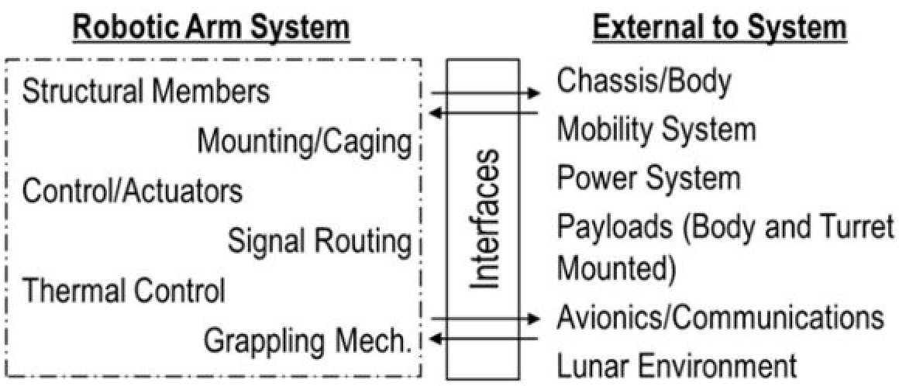

Figure 4.15: Luna robotic arm schematic, specifying internal and external architectural elements.

<!-- PDF_PAGE: 171 -->

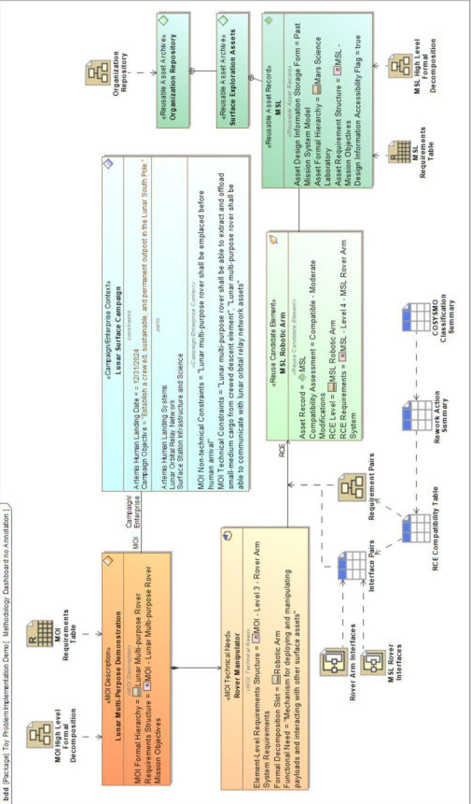

Figure 4.16: Dashboard depicting model elements and analysis outputs (tables and diagram icons) of LDRM.

<!-- PDF_PAGE: 172 -->

Figure 4.17: Luna architecture decomposition (bdd) highlighting the slot for which reuse is being considered.

Figure 4.18: Set of representative requirements for Luna, focusing on Level 3 - Robotic Arm requirements.

<!-- PDF_PAGE: 173 -->

spectively). Requirements relevant to the Robotic Arm are reflected in Level 3 of the Luna hierarchy and equivalently in Level 4 of the MSL mission. Requirements span the range of design considerations illustrated in the schematic on Fig. 4.15 and include: work-space reach, structures and loading, thermal and power, position accuracy/knowledge and others. MSL requirements were derived from known capabilities of the system where possible and inferred where public information was not available. Key interfaces of the reuse need slot with the rest of the Luna architecture are also recorded, as are the Curiosity robotic arm's interfaces with other MSL architecture elements; these are captured in Internal Block Diagrams shown in Figs. 4.21 and 4.22.

## 4.5.2.2 Step 2 - Technical Inheritance

We first identify and generate a model record for the Reuse Candidate Element - in this case, we have pre-specified this RCE to be the Robotic Arm of the Curiosity rover. The 《Reusable Asset Archive》和《Reusable Asset Record》hierarchy on the right hand-side demonstrates how the RCE is drawn from the organization's available assets. In this case, design information related to the robotic arm is drawn from the 《Reusable Asset Record》 containing the MSL mission's models and is populated into the 《Reuse Candidate Element》 block - the construct which will be carried through the design reuse assessment. Note that the MSL record will never be altered by LDRM, it will only populate the fields in the RCE block.

We proceed with Step 2.2 by pairing the comparable requirements and interfaces across the Luna and MSL design descriptions. This is done by populating the "RCE Pair Requirement" and "Similar RCE Interface" tags in the Reuse Requirement and MoI Required Interface blocks. These are the stereotypes that are applied to each of the requirement and interface artifacts in the Luna descriptions. The RCE Compatibility Table linked in the Dashboard (and shown in Fig. 4.23) consolidates the results of this pairing activity and summarizes the set of pairs as well as the gap magnitude values and designations determined for each. In this example, gap attributes are populated manually though in future iterations this may be automated by leveraging SysML's parametric capabilities. The figure shows results of the compatibility assessment for both requirements (top half of the table, marked by pink rectangles in the first column) and interfaces (bottom half of the table, marked by circles in the first column). A diverse range of pairing conditions are shown in this figure. For instance, Luna robotic arm requirements that are satisfied by the MSL design include the driving load, power budget, and arm mass constraints. Conversely, constraints on the arm's reachable workspace, temperature limits, and accuracy are not met. Lastly several requirements including grappling functionality and hot case temperature control in the no-atmosphere lunar environment have no pair in the MSL architecture. These indicate areas where new design solutions within the RCE are necessary. We see a similar diversity of circumstances with the interfaces. The third column in the table captures the gap magnitude designation that is used in conjunction with COSYSMO 2.0 in Step 3.

Step 2.3 proceeds with construction of a《Rework Set》for each interface or requirement pair with a non-zero gap. The rework campaign for the given RCE is compiled in the Rework Action Summary table whose icon is shown in the Dashboard and whose content is shown in Fig. 4.24. It enumerates all Rework Sets and Actions for each pair gap. Rework Action

<!-- PDF_PAGE: 174 -->

Figure 4.19: MSL architecture decomposition (bdd) highlighting the reusable asset.

<!-- PDF_PAGE: 175 -->

Figure 4.20: Set of representative requirements for MSL, focusing on Level 4 - Robotic Arm requirements.

Figure 4.21: Luna interface diagram (ibd) emphasizing robotic arm interfaces with external architecture elements.

<!-- PDF_PAGE: 176 -->

Figure 4.22: MSL interface diagram (ibd) emphasizing robotic arm interfaces with external architecture elements.

<!-- PDF_PAGE: 177 -->

Figure 4.23: Consolidation of requirement and interface pairing and gap analysis.

<!-- PDF_PAGE: 178 -->

types include modifying functionality (e.g., "Bypass Motor Control Assembly"), modifying dimensions (e.g., "Extend Upper Arm Tube"), modifying interfaces (e.g., "Modify Radiation Countermeasures"), or developing entirely new functionalities (e.g., "Develop/Demonstrate Autonomous Algorithm"). Also indicated in the table are the supporting discipline analyses that are required to inform or reinforce these rework actions (e.g., "Conduct Workspace Reach Analysis"). The Rework Action Summary table thus essentially provides a work breakdown structure of preliminary reuse activities. In our Luna example, we find that several design modifications are required to the MSL robotic arm design including dimensional changes (to address workspace requirements), functional changes (to deliver autonomy and grappling capabilities), structural changes (to meet mass and mounting constraints), and others such as thermal and signal routing modifications.

## Supporting Discipline Analyses

We briefly illustrate an example of the supporting engineering analyses that would inform the rework actions specified in Fig. 4.24. The workspace reach requirement gaps suggest that dimensional changes may be needed to the lengths of the MSL robotic arm tubes. A preliminary technical exploration of these changes (commensurate with the early-stage design trades that LDRM is intended to support) is possible via a simple representation of the problem. Fig. 4.25a shows the schematic for a two dimensional view of a robotic arm with 3 dimensions $ - a_{0} $ , offset distance of first joint from the arm mounting base, $ a_{1} $ length of upper arm, $ a_{2} $ length of forearm - and two angular degrees of freedom, $ \gamma $ and $ \phi $ . Values for these variables are imported from the design dimensions recorded in the existing system model. The governing equations describing the x and y position of the end effector are given by:

$$
P o s _ {x} = a _ {0} + a _ {1} \cos (\gamma) + a _ {2} \cos (\phi)
$$

$$
P o s _ {y} = a _ {1} \sin (\gamma) + a _ {2} \sin (\phi)
$$

Figure 4.25b summarizes the workspace characteristics of the unmodified MSL robotic arm - where $ a_{0}, a_{1}, a_{2} $ take Curiosity dimensions and boundary curve is imposed by limits on reachable angles by the elbow and shoulder joints. We see that the smaller, red box representing the 2D workspace specified by MSL requirements is nearly completely within the reachable boundary of the robotic arm (> 95% reachability). However, the larger, green box representing the 2D workspace specified by the Luna requirements falls largely outside of the reachable MSL boundary (< 75% reachability). By exploring alterations to the dimensions, we can find solutions that better meet the Luna requirements. Fig. 4.25c shows one such configuration, which improves coverage to 93% by reducing upper arm length by 10%, increasing forearm length by 15%, and increasing the base offset dimension by 15%.

These modifications - analysis of which was conducted in Matlab - can then be fed back into the SysML model to record the rework solution via a custom SysML-Matlab link enabled by the Cameo modeling tool. Similar mechanisms exist for canonical engineering tools such as Excel. However, for other domains such as CAD and 3D modeling, limited direct integration is possible in most SysML modeling tools. For this demonstration problem, we were able to achieve integration with SolidWorks with an indirect method; specifically, the outputs of

<!-- PDF_PAGE: 179 -->

Figure 4.24: Custom SysML table summarizing rework actions necessary to address requirement/interface gaps identified in the compatibility analysis.

<!-- PDF_PAGE: 180 -->

(a)

MSL Reachable Boundary MSL Required Workspace Luna Required Workspace

(b)

MSL Reachable Boundary Modified Reachable Boundary Luna Required Workspace Modified Reachable Points

(c)

Figure 4.25: Sample supporting discipline analysis for the Workspace requirement gaps. (a) 2D schematic of the governing equations; (b) satisfaction of Luna workspace with unmodified MSL arm; (c) improved satisfaction of Luna workspace with modifications to MSL arm dimensions.

<!-- PDF_PAGE: 181 -->

a SysML query for component parameters of the MSL system were fed via a user-defined .csv file to a SolidWorks CAD model of the robotic arm. Changes to this .csv file - resulting from changes pushed by the MATLAB-based workspace analysis - were then updated in the CAD model, upon refresh. This semi-integrated flow of data, albeit with some manual effort involved, is demonstrated in Fig. 4.26. Such work-arounds to a lack of direct integration mechanisms are common and necessary in the current MBSE landscape.

## 4.5.2.3 Step 3-Reuse Value Assessment

Each of the Rework Actions as well as the requirements and interfaces to which they are linked have also been tagged with parameters needed for the COSYSMO 2.0 effort modeling analysis in Step 3. Each of COSYSMO 2.0's size driver parameters are linked to a model element in the reuse analysis: MoI-RCE Requirement Pairs to the "Requirements" driver, MoI-RCE Interface Pairs to the "Interfaces" driver, and Rework Actions to either "Algorithms" or "Operational Scenarios" based on the type of rework. For instance, "Conduct Workspace Reach Analysis" is deemed an "Algorithm" as it mainly relies on manipulation of governing equations of kinematics while "Develop/Demonstrate Autonomous Algorithms" is deemed an "Operational Scenario" as it introduces an entirely new functionality and set of test cases that the robotic arm solution must satisfy. Model elements are also assigned a "Reuse Category" that assess the degree of modifications required and a "Difficulty Rating". For instance, the Workspace Reach analysis may determine that the Upper Tube of the robotic arm needs only a minimal length increase whereas the Lower Tube may require a substantial reduction in length - in both cases, the Difficulty Rating is deemed "Easy" while the Reuse Category for the former ("Adopted") conveys fewer modifications than the Reuse Category for the latter ("Modified") - see comparative modulating value in Table 4.4. To define a representative "from-scratch" case against that to compare the "with reuse from MSL" case: 1) new difficulty ratings are assigned to each requirement and interface, 2) reuse qualifiers are removed, and 3) necessary technical analyses (i.g., "Algorithms") are maintained if they are not directly related to reuse questions.

The COSYSMO 2.0 tool - linked externally to the SysML model - is then run. Results for this demonstration problem are as follows: the robotic arm systems engineering effort was estimated at 144.5 Person-Months for the "With Reuse" case and 167.1 Person-Months for the "From Scratch" case. This is a 14 % improvement in effort in the reuse case. The "effort" metric of Person-Months can subsequently be converted to estimates for either staffing or project schedule. As an example, assuming a 25 person team working on the robotic arm design, this would result in a 6.7 month development effort in a from-scratch approach vs. a 5.8 month effort with reuse. Conversely, planning for a 6 month effort, the from-scratch approach would require a team of 28 full time engineers (FTE) while the reuse case would require 24 - budgeting $200K for each FTE, this results in project savings of up to $800K on systems engineering costs alone. In order to determine total cost impacts, these results can be extrapolated assuming a nominal cost breakdown - though this should only be taken as an initial order-of-magnitude estimate on project impact.

The technical analyses have suggested that non-trivial design changes must be implemented in order to feasibly redeploy the MSL design while meeting the constraints imposed by the new operational environment. These include changes to the dimensions of the arm to

<!-- PDF_PAGE: 182 -->

Figure 4.26: Flow of data in the semi-integrated multi-tool environment developed for the demonstration problem.

<!-- PDF_PAGE: 183 -->

meet a new desired workspace; thermal modifications to address the harsher ranges of the lunar environment; entirely new capabilities such as autonomy and grappling (which would have been required with or without reuse); and others. The reuse value assessment suggests that, given the sum of these required changes, cost and schedule improvements may still be expected. It is concluded, then, that the MSL robotic arm can move forward as a reuse candidate to detailed consideration in subsequent design phases of the Luna project. These results are presented to mission architects and decision makers as a SysML-generated report.

## 4.6 Conclusion

In this Chapter, we have extensively demonstrated development of the Legacy Design Reuse in MBSE (LDRM) methodology that is the central contribution of this thesis. In order to ensure systematic rigor, we began by laying out a development framework beginning from a theoretical foundation rooted in the relevant reuse concepts discovered in previous Chapters. From this reuse ontology, a generalized MBSE-agnostic legacy reuse procedure was synthesized from current best practices and areas of known deficiencies as identified in the literature review (Chapter 2) and industry study (Chapter 3). The generalized procedure covers three high level steps, from defining the context of the reuse question in the Mission of Interest, to conducting technical feasibility checks on the reuse candidate, and ultimately assessing the programmatic impact of the reuse decision. We then proceeded to develop an unambiguous and consistent approach for implementing this procedure in an MBSE environment. This effort is centered around the Reuse Metamodel and the SysML Reuse Profile that specify the modeling constructs and practices for applying LDRM. Lastly, we concluded with an illustrative example exploring design reuse of the Curiosity rover's robotic arm onto a new, hypothetical lunar rover mission as part of the Artemis campaign. We demonstrated each step of the process and the practical nuances that may arise as a user carries out the methodology. In coming sections, we will look to show validity of LDRM, to apply it on real world case studies, and ultimately derive insights and recommendations for system architects on the question of design reuse and the benefits and challenges of conducting the effort in an MBSE environment.

<!-- PDF_PAGE: 184 -->

## Chapter 5

## Validation and Application

The preceding chapter detailed end-to-end development of the LDRM methodology. Development was conducted in a rigorous top-down fashion, starting from a conceptual understanding and framing of the problem domain (via the Reuse Ontology) and proceeded down to MBSE and SysML-specific implementation considerations. The systematic approach was adopted in order to yield a methodology that is consistent, repeatable, and logically sound. This chapter describes efforts undertaken to (a) validate that LDRM meets these intended characteristics and (b) apply it to two real-world case studies.

Validation is approached in a multi-faceted fashion. First, the workings and procedure of LDRM are revisited to ensure internal validity; that is, the methods and processes of the methodology are logically coherent and are consistent with systems engineering and modelbased principles and best practices. This is conducted for the generalized procedure and for the MBSE implementation solution. Second, the results of the constituent analytical modules (technical inheritance and programmatic) must be validated along with the synthesized, decision-support outputs, to ensure their accuracy and reliability. This is conducted via a two-phase, virtual design/build experiment using human volunteers.

Two case studies are then presented. The case studies serve multiple purposes. First, they are used to reinforce claims of validity with historical examples with known results. Second, they demonstrate how the methodology might be applied in the mission development environments characteristic of real-world enterprises and organizations; indeed, we will see that the procedures laid out in the methodology cannot always be immediately carried out - some additional processing of models or design information may be necessary. This reveals the "messy" nature of mission-to-mission reuse and MBSE deployment that this thesis attempts to understand more systematically. Mixed results point to the lengths remaining for industry to reach workable MBSE standards. The case studies then, also provide insights and practical recommendations of modeling practices that may encourage this progress.

## 5.1 Validating LDRM

Leedy and Omrod describe the validity of a research method as "the likelihood that it will yield accurate, meaningful, and credible results" [85]. In their discussion on the topic, they divide the validation effort into two general categories: internal and external validity. In-

<!-- PDF_PAGE: 185 -->

ternal validity is "the extent to which [a research study's] design and the data it yields allow the researcher to draw accurate conclusions"; while external validity is "the extent to which [a research study's] results apply to situations beyond the study itself". They further note that the usefulness of this distinction for qualitative research efforts has been called into question. Thus, two issues arise with these definitions: first, the product of this effort is not a research study, but rather a methodology for systematically conducting such studies; second, LDRM stipulates a hybrid quantitative-qualitative approach in which most data objects are "nominal" or categorical measures as opposed to ordinal or interval scales on which most statistical validation efforts may be applicable. In order to capture these nuances, we may modify these definitions for our effort as follows:

- Internal Validity - the extent to which LDRM's design and the procedure it stipulates allows the user to generate logically consistent and reliable conclusions about the problem of interest.

- External Validity - the extent to which LDRM generates the desired results (i.e., credible, value-adding reuse decision support) for situations within the methodology's applicability boundary, as specified in the Reuse Ontology.

Other works in the design research literature formulate similar concepts in slightly different validation constructs. Pedersen, for instance, presents a well-known framework known as the validation square. In this approach the square is made up of four quadrants, two of which address structural validity and the other two address performance validity [110]. For each form of validity, theoretical and empirical analyses are stipulated. Comparing the two constructs, we find that structural validity resembles Leedy and Omrod's internal validity while performance validity resembles external validity. In either case, both methods call for both qualitative validation of procedure and quantitative validation of results. For our purposes, we will proceed with the terminology of Leedy and Omrod, acknowledging the similarities with Pedersen's work.

## 5.1.1 Internal Validation

Assessment of internal validity focuses on the LDRM's procedure and implementation practices. In the absence of usage data of the nascent methodology, we instead appeal to the qualitative validity measures introduced in the previous section. In this regard, Lucko identifies several related concepts that may be used [87]. Of particular interest are concepts of face validity and content validity. Face validity involves obtaining approval and buy-in on research approach and solutions from experts in the field; these individuals are preferably domain experts who advise or provide feedback to the researcher. Additionally, interviews of these experts may yield more consistent and rich insights; the most organized form of such a solicitation is the Delphi technique in which experts iteratively critique, essentially peer reviewing, a research method. Content validity relates to the quality of data collected and used as part of the research.

<!-- PDF_PAGE: 186 -->

## 5.1.1.1 Generalized Procedure Validation

Internal validation of the generalized procedure is intended to confirm appropriate definition, characterization, and order of reuse activities. A heuristic validation approach was adopted consisting of the two validity measures: face validity and content validity. In this context, face validity is asserted by appealing to the legitimacy of the sources informing each procedure step. As shown in the top half of Fig. 5.1, each procedure step is characterized by a "derived from", "conforms to", and "affirmed by" attribute.

During initial formulation of the procedure, each step and the overall sequence is derived from logical ideation (i.e., a sequence of logically required reuse-related activities) supported by systems theory as laid out in guiding documents such as NASA's Systems Engineering Handbook and academic materials. Indeed, the overarching reuse process as defined here closely aligns with canonical systems engineering processes for architecting and design - it flows from an understanding of needs, through exploration of solution options (in our case, reuse candidates) and supporting detailed analyses, and concludes with design recommendations based on trade objectives. Additionally, the constituent steps and sub-steps of the process were developed in conformance to the findings of the best practices study where respondents collectively identified critical aspects of current reuse practices and areas for improvement. Lastly, the procedure was iterated on in consultation with subject matter experts such that industry best practices and expert opinions both strongly suggest validity of the logical set of activities.

Turning to content validity (the lower half of Fig. 5.1), we are now concerned with the reliability of the data threaded throughout the procedure. Here specifically, the focus is on the content of the data whereas the MBSE-specific style and format of the data is considered in the next section. Fig. 5.1 shows that for each step of the generalized procedure there may be: (a) input data sourced external to the methodology, (b) input data sourced internal to the methodology, and (c) transformation of this data within the step to output data. External data includes primarily the design information and mission description for the mission of interest made to-date and similar information for the reuse candidates. Claiming validity of this external content is not within our purview; rather this characteristic is dependent on the organization's existing model/data threading and curation functions. Rigorous data threading ensures authoritative sources of truth for each data product; data curation subsequently archives existing data (primarily from previous missions) in a manner that preserves its authority and accuracy. Thus, validity of the LDRM's results is highly dependent on the reliability of the data that it is provided.

Within LDRM, however, validity of the internal content and flow of data must also hold. This is confirmed via a logical walkthrough of the procedure yielding an internal input-output table for all steps of the process. Validity is claimed by a comparison of supplier-client data links that reveal no missing or inconsistent flows. We can thus consider the generalized procedure of the reuse methodology validated to the extent that it exhibits internal consistency - it is still dependent on the external content provided to it.

<!-- PDF_PAGE: 187 -->

Figure 5.1: Summary of internal validity measures for the generalized procedure. Face validity appeals to authority of sources used to develop the procedure. Content validity appeals to the reliability and integrity of data that flows throughout the procedure.

<!-- PDF_PAGE: 188 -->

## 5.1.1.2 MBSE Implementation Validity

Validating the MBSE approach for implementing LDRM consists of enforcing its procedural and ontological stipulations in the integrated digital design environment. Indeed, the methods employed were borrowed form the existing body of work relating to MBSE-centric methodologies as documented by Estefan and others [37, 90]. In particular, guidelines produced by the Object Management Group (OMG) in collaboration with INCOSE to facilitate development and dissemination of MBSE methodologies were followed.

The primary gate for ensuring validity of the implementation approach is accurate development and realization of the reuse metamodel in the governing SysML system model. This, in turn, is dependent on proper definition of the profile and its constituent stereotypes, tags/attributes, and relationships. In this regard, existing SysML formalisms were extended to unambiguously define the reuse-specific, customized elements required by the methodology. As such, having demonstrated rigorous development of these aspects in 4.4, we can claim validity of the MBSE implementation approach to the extent that it codifies the generalized procedure for deployment in SysML. Additionally, the face validity of this claim was reinforced with feedback from experts in NASA's MBSE Community of Practice and at The Aerospace Corporation's MBSE office.

## 5.1.2 External Validation - Programmatic Analyses

The programmatic effort estimate output is most problematic in terms of validation. Assessing cost/schedule impacts of a reuse decision involves estimating a cost/schedule figure with reuse and one for the same development effort with a from-scratch solution. The cost modeling tool we employ (COSYSMO 2.0) does allow for both calculations. However, the issue arises when we attempt to empirically validate the results COSYSMO 2.0 yields in the context of LDRM via historical data. This requires cost/schedule knowledge of two alternate futures: the real world outcome where an arbitrary reuse decision was pursued, and an unrealized outcome where a diverging decision was pursued. As such, a case study-based validation to the programmatic results is infeasible.

An alternative to a case-by-case validation would be to conduct a statistical validation on a large swath of cases with similar design problems and varying reuse decisions. An ideal sample for such an analysis would be a set of orbital launch vehicles of the last few decades those where heritage rocket technologies (e.g., engines, composites, etc.) were available to consider for reuse. In this approach, we would independently validate the ability of the methodology + COSYSMO 2.0 to:

1. Predict from-scratch cost/schedule estimates vs. known examples of "from-scratch" from the sample set, and

2. Predict reuse cost/schedule estimates vs. known examples of "with reuse" from the sample set

If this validation succeeds, we could deduce that for a new design reuse scenario, the methodology and COSYSMO 2.0 could estimate both "from-scratch" and "with reuse" cost/schedule

<!-- PDF_PAGE: 189 -->

figures. We could then proceed to compare these figures and generate a reuse impact metric. However, this statistical validation requires substantial data harvesting, processing, and analysis of a large portion of the launch vehicle landscape; this implies access to often sensitive or proprietary programmatic data for various launch vehicle developers - and true validation would require this data for both domestic and international providers. This effort would be extensive and is deemed outside the scope of this research; as such, full statistical validation of the programmatic effort modeling is not pursued.

A third approach is appropriate. We can rely on two separate facts: first, that the rework effort validation succeeds meaning we can reliably enumerate rework actions; second, that the COSYSMO 2.0 tool has already been validated (with a focus on space mission design) independently of LDRM. The first fact will be demonstrated in the first Case Study presented later in this Chapter; the second was demonstrated previously by Fortune [42]. With these two facts, we can then make a reasonably safe assumption that the results of the combined process are likely valid - this may be considered a "validation by parts" approach. This of course accepts the possibility that at the interface of the validated technical analysis and the validated COSYSMO 2.0 tool, discontinuities may yield invalid results. However, in the absence of a large historical dataset of design scenarios, mentioned previously, the resulting cost/schedule impacts may be deemed valid as order-of-magnitude estimates in a preliminary fashion.

Indeed, at the early-stage architecting phases during which LDRM is intended to be employed, such initial estimates may still prove useful to motivate trade decisions on reuse vs. from-scratch solutions. Further, it is important to note that the cost/schedule estimates are not the sole outputs of the programmatic analysis. The programmatic analysis, then, is deemed partially validated (via the third alternative discussed), with a concession to the preliminary nature of the estimates produced.

## 5.1.3 External Validation - Virtual Design/Build Experiment

The second, and most important, aspect of external validation explores the ability of LDRM to act as a value-adding decision support tool for mission architects. This effort seeks to show that, all else being equal, mission architects (or architecting teams) employing the methodology exhibit better decision making performance than those who do not. This validation effort is conducted as a two-phase controlled experiment. We begin first with an overview of the full experimental set-up, then proceed to results from each phase of the experiment and discussion of the implications on claims of validity.

## 5.1.3.1 Experiment Overview

The primary objective of the experiment is to gauge the decision-making performance of system designers. Performance in the context of reuse decisions may be decomposed into 3 components:

1. Ability to evaluate the initial compatibility of a reuse candidate in the mission of interest; this measures the designer's understanding of how the technical need of the mission of interest is met by the reuse candidate (in terms of requirements and interfaces satisfied) without modification.

<!-- PDF_PAGE: 190 -->

2. Ability to define a rework campaign to adapt the reuse candidate to the mission of interest; this measures the designer's understanding of the modifications needed to address incompatibilities between the native mission and the new mission.

3. Ability to estimate the programmatic impact of the reuse decision; this measures the designer's sense of the effort (in terms of cost, scheduled, workforce) necessary to carry out the rework campaign and how it might compare to a from-scratch design solution.

These components - along with a designer's ultimate reuse decision - would necessarily be impacted by the designer's exposure to LDRM. The question we wish to answer is the degree to which LDRM support improves decision making performance when compared to baseline performance of an unstructured approach, unassisted by LDRM's procedures and outputs.

To that end the validation study was designed as a design/build experiment consisting of two parts as detailed in Fig. 5.2. A design scenario based in the Luna demonstration problem discussed in Chapter 4 formed the basis of the experiment. The first phase (the Ground Truth study) asked a group of volunteers to develop and build design solutions that satisfy constraints of 4 modules of the hypothetical Luna rover - one set of solutions with reuse from counterpart Curiosity rover modules, another set of solutions ideated from scratch. Volunteers were asked to record metrics including build time, modification count, and total part count for each module, for each design approach. The average of these metrics across all volunteers was then taken to be the "ground truth" for the case of the average designer pursuing reuse and from-scratch solutions to a design problem. This ground truth is the data against which the performance of another, larger respondent group in the second part of the experiment is measured.

The second phase of the experiment (the Design Decision study) surveyed industry practitioners with questions related to the reuse decision options for the same four Luna modules. A control group of respondents was presented with an annotated graphic of the Curiosity rover module and the Luna design constraints that must be satisfied; a test group of respondents was presented with this information plus representative outputs that would be generated by LDRM. $ ^{1} $ Data gathered included respondent evaluation of Luna requirements satisfied by the Curiosity modules, estimates of modification count, estimates of rework build time vs. from-scratch build time, and a design decision for each module. Comparison of test group vs. control group performance against the Ground Truth baseline figures was then possible.

Design Environment The environment within which the Ground Truth study is conducted must simulate the real-world, practical considerations of designing with reuse. This environment must also be one that does not present an extensive learning requirement on volunteers,

<!-- PDF_PAGE: 191 -->

<!-- PDF_PAGE: 192 -->

thereby discouraging participation or negatively biasing performance metrics. Lego models fit these criteria - requiring careful part selection and integration, while reducing the problem complexity to a manageable level in a research setting. While in-person design/build sessions with the Ground Truth group involving physical Legos would have been optimal, the ongoing restrictions imposed by the COVID-19 pandemic precluded this approach. Instead, a virtual approach was pursued employing BrickLink's Studio 2.0 Lego modeling software. This tool contains the full catalog of traditional Lego parts as well as Lego Technic parts (a line of Lego elements intended to capture more advanced and dynamic functionalities) - an image of Studio 2.0's design space is shown in Fig. 5.3, with a model of the Curiosity rover as an example.

The resulting Lego designs, representative of the Luna and Curiosity rovers, are 1/20th scale models. Even with the added complexity of the Lego Technic modules, it was understood that some functional/behavioral constraints of the rover modules (e.g., the telescoping/extension capabilities of the sensing mast) could not be perfectly captured - in these cases, participants were asked to represent the concept for their design as closely as possible, without spending excessive amounts of time getting their solutions a fully functional state.

Selecting the environment for the Design Decision study was more straightforward. This study required only presentation of design information to participants and gathering their responses to reuse-related questions; as such, a simple questionnaire-based survey was adopted similar to the Design Reuse Best Practices study.

Problem Context The boundary of the Luna demonstration problem's reuse need was expanded to consider the entire rover. Four rover modules - distinct, high-level architectural elements - were defined:

- chassis/body - central structure of the rover; contains key electronics/avionics, payloads, and instrumentation inside and on its surface; interfaces with other modules and power system

- suspension system - connects rover body to wheel system; transmits forces from ground traversal to body; ensures stable motion of body to protect equipment

- robotic arm - enables interaction with surface assets and science specimens; contains end effector with manipulator and instrumentation

- sensing mast - enables remote sensing from an elevated position

Each of these modules was constrained by design specifications shown in Table 5.1. These specifications relate to the dimensions, interfaces, and functionality of each module; dimensions are defined in Lego units (i.e., "blocks") and functional specifications are simplified to be feasible within the Lego and Lego Technic capability envelope.

The Curiosity rover is decomposed into similar module boundaries to facilitate the reuse assessments of volunteers in both parts of the experiment. Representations of the Curiosity modules in the virtual Lego environment are shown in Fig. 5.4 - these Lego designs were developed by Stephen Pakbaz, a Curiosity team member at the Jet Propulsion Laboratory (JPL) and Lego designer. The requirements of the Luna modules were intentionally selected

<!-- PDF_PAGE: 193 -->

Figure 5.3: View of the Studio 2.0 environment - the virtual Lego design software used for Phase 1 of the study.

<!-- PDF_PAGE: 194 -->

Table 5.1: Constraints defined for each of the 4 Luna Modules.

<table border="1"><tr><td colspan="2">Module1
Chassis</td></tr><tr><td colspan="2">Shall have dimensions of10bricks long by6bricks wide by4bricks thick
Shall accommodate interfaces with suspension, robotic arm and sensing tower modules
Shall accommodate a solar array assembly power source
Shall accommodate4body mounted payloads(science or infrastructure) of size2x2bricks,2x2bricks,1x3bricks,2x2bricks(front mounted).</td></tr><tr><td colspan="2">Module2
Suspension</td></tr><tr><td colspan="2">Shall enable at least5points of contact with the surface at all times
Shall have independent,passive articulation of the port and starboard assemblies
Shall minimize the tilt of the rover body when addressing an obstacle
Shall define the“rover footprint”as:15bricks long by13bricks wide(from wheel to wheel)</td></tr><tr><td colspan="2">Module3
Robotic Arm</td></tr><tr><td colspan="2">Shall be able to stow up against the body front plate during transit and landing
Shall enable grappling(with natural and man-made objects)from end-turret
Shall have shoulder,elbow and wrist elevationDOFs,shoulder azimuthalDOF,and end-turret rotation
Shall extend up to11bricks from the front plate of the chassis</td></tr><tr><td colspan="2">Module4
Sensing Mast</td></tr><tr><td colspan="2">Shall be able to extend vertically to up to16bricks from a nominal7bricks after deployment(from the chassis top surface)
Shall be able to stow within the body envelope.
Shall accommodate sensing equipment at the“head”
Shall be able to rotate through360 degrees.</td></tr></table>

<!-- PDF_PAGE: 195 -->

to span a spectrum of comparability with the Curiosity rover - such that some modules exhibited substantial similarity and others diverged significantly from the heritage design. This ensured that respondents were challenged with varying reuse considerations.

Participant Pool Each phase of the experiment is characterized by distinct time commitments and intensity of required tasks. The Ground Truth study which requires ideation, design, and (virtual) build of the module solutions is substantially more involved than the Design Decision study. As such, a small group of participants (N=5) was gathered from among the population of graduate students and researchers in the Department of Aeronautics and Astronautics at MIT. Participants were not excluded or filtered based off of past research experiences, but all stated that they had never previously used either the virtual design environment nor worked extensively with rover designs. This suggests that no previous experiences would bias performance of the participants one way or another. They were requested to spend no more than 4 non-consecutive hours over the course of two weeks to complete their submissions to the study. The Design Decision study, on the other hand, required only a small time commitment (<15 minutes) for participants to digest the design data for each module and answer the reuse questions posed. A larger response set was sought from a similar population to those targeted during the Design Reuse Best Practices survey detailed in Chapter 3 - responses were obtained from industry, academia, and professional groups. Additionally, the Design Decision study required equal populations of control and test subjects - division of the respondent set into these groups (N=17 for control group, N= 18 for test group) was done automatically via the survey software's (Qualtrics) questionnaire routing functionality.

## 5.1.3.2 Phase 1-Ground Truth Study

Five participants took part in the virtual Lego design/build activities of the Ground Truth study. For each module, specified by the constraints from Table 5.1, they were tasked with building from-scratch and "with reuse" design solutions and recording several pieces of $ \mathrm{data}^{2} $ . The data sheet participants submitted recorded, for each module: (1) from-scratch build time, (2) from-scratch part count, (3) "with reuse" build time, (4) "with reuse" part count, and (5) "with reuse" modification count. Modifications here refer to changes made to the Curiosity module Lego models provided to participants. Three classes of modifications were defined: (a) addition of new Lego pieces, (b) removal of existing Lego pieces, and (c) movement or new connections made with existing Lego pieces. Additionally, participants were asked to submit the Studio 2.0 model files for each of the 8 module designs in order to verify satisfaction of the design constraints.

The primary use of the collected data is to derive notional average build metrics against which the predictions of the industry practitioners in the Phase 2 Design Decisions study could be measured. In order to get this data in a form comparable to that garnered from the

<!-- PDF_PAGE: 196 -->

Figure 5.4: Legacy Lego models of the Curiosity rover provided to participants to consider for reuse assessments in Phases 1 and 2.

<!-- PDF_PAGE: 197 -->

Phase 2 study, some simple processing is required. To that end, we define 3 metrics derived from the data recorded by participants:

1. Time Ratio $ R=t_{scratch} / t_{reuse} $ - Where t represents the build time for each design approach. R conveys the relative build time of the two design approaches. Considering absolute time alone, a high R value would suggest that from a schedule perspective, reuse is a preferable approach. A value less than one indicates that from-scratch approach is preferable.

2. Time Impact = T = $ ( t_{reuse}-t_{scratch} ) / t_{scratch} $ - Assumes a nominal from-scratch approach and explores how a reuse approach compares. A positive value (percentage) for a module indicates that the reuse effort leads to longer than nominal time.

3. Modification $ \mathrm{Ratio}^{3}=M=(p_{mods} / p_{original}) $ - Where $ p_{mods} $ is the total number of modifications in the reuse case and $ p_{original} $ is the part count of the original Curiosity module design. A value closer to one indicates that more of the original parts must be modified in some way.

Table 5.2 summarizes the data reported by participants; Table 5.3 presents the derived metrics. In addition to routing this data into the analysis of Phase 2, results are also use to designate a "preferred design decision" for each module. This determination is made by a holistic assessment of the metrics in addition to comments provided by participants. The preferred design decision is compared against the design decision response selected by survey respondents in the Phase 2 study.

For Module 1 - the rover body - the time metrics, R and T, strongly support a from-scratch approach over reuse. Indeed, they suggest that the from-scratch effort may be up to twice as fast. This finding is qualified by a large standard deviation on T, but one that even considering the tail ends of the range, still yield T values greater than 0%, implying a preference for from-scratch in all cases. Module 1, interestingly, has the lowest modification ratio, M, of all modules for the reuse case; however, these relatively few modifications affect a more integral design leading to, on average, more time-intensive rework efforts. As such, the preferred design decision for the rover body is a from-scratch approach.

For Module 2 - the suspension system - a cursory glance at the modification ratio of 0.66 suggests a substantial rework effort; however, upon inspection of the tally of modification types conducted, we find that most changes are movements of parts as opposed to addition

<!-- PDF_PAGE: 198 -->

Table 5.2: Raw data of Phase 1 Ground Truth study, reported by participants (each column represents a participant). DNC = Did Not Complete. Build Times are in minutes.

<table border="1"><tr><td colspan="6">Module1-Body</td></tr><tr><td rowspan="2">From-Scratch</td><td>Build Time</td><td>7</td><td>20</td><td>12</td><td>43</td><td>23</td></tr><tr><td>Part Count</td><td>12</td><td>37</td><td>27</td><td>116</td><td>20</td></tr><tr><td rowspan="2">W/Reuse</td><td>Build Time</td><td>13</td><td>55</td><td>27</td><td>66</td><td>44</td></tr><tr><td>Part Count</td><td>77</td><td>63</td><td>80</td><td>89</td><td>76</td></tr><tr><td rowspan="4">Modifications</td><td>New</td><td>4</td><td>19</td><td>4</td><td>8</td><td>9</td></tr><tr><td>Removed</td><td>50</td><td>12</td><td>55</td><td>28</td><td>41</td></tr><tr><td>Moved</td><td>0</td><td>1</td><td>1</td><td>20</td><td>14</td></tr><tr><td colspan="6">Module2-Suspension</td></tr><tr><td rowspan="2">From-Scratch</td><td>Build Time</td><td>42</td><td>30</td><td>24</td><td>75</td><td>DNC</td></tr><tr><td>Part Count</td><td>30</td><td>20</td><td>20</td><td>44</td><td>DNC</td></tr><tr><td rowspan="2">W/Reuse</td><td>Build Time</td><td>12</td><td>10</td><td>12</td><td>58</td><td>DNC</td></tr><tr><td>Part Count</td><td>44</td><td>44</td><td>38</td><td>38</td><td>DNC</td></tr><tr><td rowspan="4">Modifications</td><td>New</td><td>4</td><td>8</td><td>4</td><td>0</td><td>DNC</td></tr><tr><td>Removed</td><td>4</td><td>8</td><td>8</td><td>6</td><td>DNC</td></tr><tr><td>Moved</td><td>28</td><td>6</td><td>18</td><td>22</td><td>DNC</td></tr><tr><td colspan="6">Module3-RoboticArm</td></tr><tr><td rowspan="2">From-Scratch</td><td>Build Time</td><td>22</td><td>25</td><td>28</td><td>54</td><td>DNC</td></tr><tr><td>Part Count</td><td>18</td><td>21</td><td>15</td><td>21</td><td>DNC</td></tr><tr><td rowspan="2">W/Reuse</td><td>Build Time</td><td>6</td><td>36</td><td>15</td><td>23</td><td>DNC</td></tr><tr><td>Part Count</td><td>24</td><td>17</td><td>17</td><td>26</td><td>DNC</td></tr><tr><td rowspan="4">Modifications</td><td>New</td><td>2</td><td>5</td><td>5</td><td>2</td><td>DNC</td></tr><tr><td>Removed</td><td>2</td><td>3</td><td>21</td><td>1</td><td>DNC</td></tr><tr><td>Moved</td><td>6</td><td>14</td><td>0</td><td>2</td><td>DNC</td></tr><tr><td colspan="6">Module4-SensingMast</td></tr><tr><td rowspan="2">From-Scratch</td><td>Build Time</td><td>23</td><td>25</td><td>13</td><td>35</td><td>DNC</td></tr><tr><td>Part Count</td><td>12</td><td>23</td><td>17</td><td>20</td><td>DNC</td></tr><tr><td rowspan="2">W/Reuse</td><td>Build Time</td><td>DNC</td><td>15</td><td>23</td><td>DNC</td><td>DNC</td></tr><tr><td>Part Count</td><td>DNC</td><td>20</td><td>20</td><td>DNC</td><td>DNC</td></tr><tr><td rowspan="3">Modifications</td><td>New</td><td>DNC</td><td>6</td><td>8</td><td>DNC</td><td>DNC</td></tr><tr><td>Removed</td><td>DNC</td><td>2</td><td>4</td><td>DNC</td><td>DNC</td></tr><tr><td>Moved</td><td>DNC</td><td>11</td><td>0</td><td>DNC</td><td>DNC</td></tr></table>

<!-- PDF_PAGE: 199 -->

Table 5.3: Derived ground truth metrics and standard deviations of the Phase 1 study for each module.

<table border="1"><tr><td></td><td>Module1</td><td>Module2</td><td>Module3</td><td>Module4</td></tr><tr><td>R(standard.dev.)</td><td>0.50(0.10)</td><td>2.45(0.86)</td><td>2.14(1.07)</td><td>1.12(N/A)</td></tr><tr><td>T(standard.dev.)</td><td>106%(21%)</td><td>-53%(19%)</td><td>-33%(46%)</td><td>18%(N/A)</td></tr><tr><td>M(standard.dev.)</td><td>0.42(0.09)</td><td>0.66(0.11)</td><td>0.66(0.36)</td><td>1.03(N/A)</td></tr></table>

<!-- PDF_PAGE: 200 -->

or removal. This suggests a simpler modification effort than the metric implies. This is reinforced by the time metrics that reveal that a reuse approach would yield substantial schedule benefits. This finding agrees with the prevalence of rocker/bogie suspension systems across various planetary rover findings. As such, the preferred design decision for the suspension system is to pursue reuse of the Curiosity design.

For Module 3 - the robotic arm - build time metrics indicate preference for the reuse approach, albeit with less confidence than for the suspension system. This is indicated by a larger standard deviation from the mean and reduced absolute values of the metrics. These deviations suggest stronger designer dependence for this module than for others. Additionally, comments volunteered by participants point to some difficulty in satisfying the grappling functionality in the reuse case; however, review of submitted model files indicates acceptable design solutions, per specifications. As such, the preferred design decision for the robotic arm is to pursue reuse of the Curiosity design.

For Module 4 - the sensing mast - results are more complicated. Two participants were able to successfully modify the existing Curiosity module; their data suggests minimal favorability of the reuse approach over from-scratch. However, two other participants indicated that they could not find a feasible "with reuse" solution to the problem. In order to decide, we turn to the modification ratio of the two successful designs and note that they are greater than 1. This suggests that even in the successful reuse solutions, on average, there were more modifications required than the part count of the heritage Curiosity design. This suggests a degenerate reuse case and thus, the preferred design decision for the sensing mast is a from-scratch approach. $ ^{4} $

## 5.1.3.3 Phase 2- Design Decisions Study

The questionnaire-based study posed 4 questions to respondents who were given varying information based on the group (test or control) to which they belonged. The control group is provided with an annotated graphic of the Curiosity model and the set of Luna constraints for the given module - this is illustrated in Fig. 5.5a; additionally, the test group is provided with a dashboard (Fig. 5.5b) that summarizes the outputs that would be generated by the methodology and that adds greater detail to the reuse considerations. The impact of exposure to LDRM is assessed by evaluating control group vs. test group performance on each of these questions.

The four questions presented are: "Given the information provided for Module X, ...

<!-- PDF_PAGE: 201 -->

(a) Information provided to control group

<table border="1"><tr><td colspan="4">Reuse Considerations</td></tr><tr><td>Robotic Arm</td><td>Similar Curiosity Constraint?</td><td>Modification Assessment</td><td>Status</td></tr><tr><td>Constraint #1</td><td>Yes</td><td>None</td><td>绿</td></tr><tr><td>Constraint #2</td><td>No</td><td>Moderate, end-effector instruments may be easily swapped out</td><td>橙</td></tr><tr><td>Constraint #3</td><td>Yes</td><td>None</td><td>绿</td></tr><tr><td>Constraint #4</td><td>Yes, w/ different dimensions</td><td>Minor, shorter t-shaped members</td><td>黄</td></tr><tr><td>Build Time</td><td colspan="3">Modeling suggests build time may be improved by 50% with reuse.</td></tr></table>

(b) Additional information provided to test group

Figure 5.5: Sample of design information provided to Phase 2 participants in control group (a) and test group (a and b) to inform their module reuse assessments.

<!-- PDF_PAGE: 202 -->

1. How many Luna Module X constraints would you say are satisfied by the Curiosity Module X design, without modification?

2. What percentage of the N parts on the Curiosity Module X design do you estimate will require modification of some kind to satisfy Luna Module X constraints?

3. Select an estimate for the percent difference between Lunar Module X design/build time for cases (a) with reuse/modification from Curiosity and (b) from-scratch.

4. Given your findings from above, would you recommend reusing the Curiosity Module X design or designing a solution from-scratch?

## Question 1: Luna Constraints Immediately Satisfied

The first question explores the survey respondents' ability to use the design information provided to assess the initial compatibility of the heritage reuse candidate and the new mission of interest. In the context of LDRM, this allows the subsequent technical analyses to focus on areas where constraint gaps exist. Figure 5.6 presents results from this question for each module. It shows the mean value for the control and test groups; it also shows the correct value for each module, a figure determined a priori by inspection of the respective Curiosity module.

In three of the four modules, the test group with access to the LDRM outputs was able to more closely estimate the number of constraints satisfied by the unmodified heritage reuse candidate. We note a minor discrepancy with the third module, the Robotic Arm, where control and test group performance is consistently poor; this may be attributable to poorly described arm capabilities of the Curiosity module in the information provided to respondents. This is thus considered an experimental issue. Nevertheless, the improved and more consistent performance of the test group respondents in nearly all cases is the first indication of the positive impact of exposure to the LDRM methodology. This is reinforced and qualified in subsequent questions.

## Question 2: Estimating Modification Effort

The second question evaluates the respondent groups' capacity to estimate the modification effort to accommodate each heritage module for the Luna mission. The question specifically asks to select a percentage bin for M, the modification ratio (here given as a percentage). To explore validity of LDRM in this regard, we conduct an independent samples t-test that determines whether there is a statistically significant difference in the means of the control and test groups; if such a difference is found, it can be attributed to the control variable, namely access to the analytical assessments of the methodology. Table 5.4 presents the means for each group and module - the value can range from 1 to 5, the five ordered bins of Modification Ratio values presented to respondents.

Results of the t-test are presented in Table 5.5. Results indicate statistically significant difference in responses between the test and control groups for two of the four modules. In Modules 1 and 4 (the Body and Sensing Mast), we can say with varying degrees of confidence ( 75% and 95% , respectively) that the control group participants underestimated the modification effort required for reuse. These two modules are the ones for which fromscratch design is preferred, suggesting that the control group is less capable of formulating

<!-- PDF_PAGE: 203 -->

rationales for foregoing reuse where it may not be prudent. Further, these two modules are the least complex in terms of part counts and interfaces - this may suggest that, absent the information provided by the technical analysis of LDRM, respondents may equate simple designs with simple reuse efforts, that may not necessarily be true.

In Modules 2 and 3 (Suspension and Robotic Arm) however, there is no significant performance difference between groups. One possible explanation may be the prevalence of the heritage design solution for each of these modules across multiple historical missions. Rockerbogie suspensions systems of the type used in the Curiosity module are extremely common in robotic rovers, as are the jointed designs of the robotic arm. Industry respondents with knowledge of this history will rightly assume applicability, with limited modifications, to the Luna mission - with or without access to the detailed technical analyses of the methodology. Thus, we may conclude that the impact of exposure to these technical analyses is dependent on the complexity of the problem of interest and respondent knowledge of the design history of the heritage system.

## Question 3: Estimating Design/Build Time

For the third question, respondents were similarly asked to estimate T, the Time Impact metric, for each module. Here, responses were absolute (not binned) allowing for a more direct comparison to the known Ground Truth figures. Figs. 5.7a-c show a histogram with overlaid distribution curve for each module along with a vertical line indicating the ground truth value - due to the sparsity of data from the Ground Truth study for Module 4, the Sensing Mast, this module was excluded from the remaining analyses. Positive values indicate that the reuse approach is deemed more time-intensive.

Inspecting results from the Body module (Figure 5.7a), two facts are clear. First, there is minimal difference in performance between the control and test groups; second, both groups substantially underestimate the "ground truth" value - with means landing close to 0% with large tails. This is likely attributed to most Ground Truth study participants submitting from-scratch designs that, though they met the defined constraints, were overly simplistic. This resulted in excessively short build times. In this case, then, we can say that Ground Truth estimate is not reliable. Nevertheless, the similar distributions of the control and test groups challenge the value of the methodology for Module 1. Results more consistent with the impacts expected of exposure to LDRM outputs are clear in Figs. 5.7b and 5.7c. The tighter distribution around the ground truth time impact values indicate that the rework effort assessments provided to the test group impacted their decision making positively. What we can surmise from these results is that so long as the outputs are based in a rigorous and reliable underlying analysis (i.e., avoid the issue encountered with Module 1), beneficial impacts on the value judgements of decision makers are likely.

## Question 4: Final Reuse Decisions

Finally, we can assess the ultimate decision-making performance of the test and control groups, given the preliminary judgements they have made with Questions 1-3. One approach is to directly compare the design decisions (i.e., from-scratch vs. modified reuse) made by respondents vs. the preferred decisions identified at the conclusion of the Ground Truth study. However, assessing performance by just this binary comparison is overly simplistic. We can instead calculate a performance metric that accounts for the design decision

<!-- PDF_PAGE: 204 -->

Figure 5.6: Results of Question 1 of the Phase 2 survey for each module. Shows improved performance of Test group in determining satisfaction of Luna requirements by unmodified MSL modules.

Table 5.4: Results of Question 2 of the Phase 2 survey for each module. Values represent the modification effort bins on a scale from no modifications (1) to substantial modifications (5)

<table border="1"><tr><td></td><td></td><td>Module1</td><td>Module2</td><td>Module3</td><td>Module4</td></tr><tr><td rowspan="2">Control</td><td>Mean</td><td>2.94</td><td>2.25</td><td>2.31</td><td>3.44</td></tr><tr><td>Std. Dev.</td><td>.574</td><td>.447</td><td>.602</td><td>.892</td></tr><tr><td rowspan="2">Test</td><td>Mean</td><td>3.22</td><td>2.28</td><td>2.39</td><td>4.56</td></tr><tr><td>Std. Dev.</td><td>.732</td><td>.461</td><td>.502</td><td>.616</td></tr></table>

Table 5.5: T-test results for modification effort assessments of control group and test group. Modules 1 and 4 so statistically significant improvement by the test group.

<table border="1"><tr><td></td><td>Sig. (2-tailed)</td><td>Mean Difference</td><td>Standard Error</td><td>Confidence Lower</td><td>Interval* Upper</td></tr><tr><td>Module1</td><td>.220</td><td>-.285</td><td>.228</td><td>-.551</td><td>-.018</td></tr><tr><td>Module2</td><td>.860</td><td>-.028</td><td>.156</td><td>-.346</td><td>.290</td></tr><tr><td>Module3</td><td>.689</td><td>-.076</td><td>.189</td><td>-.462</td><td>.309</td></tr><tr><td>Module4</td><td>.000</td><td>-1.118</td><td>.260</td><td>-1.649</td><td>-.588</td></tr></table>

* 75% = Module 1, 95% = Module 4

<!-- PDF_PAGE: 205 -->

(a) Body Module

(b) Suspension Module

(c) Robotic Arm Module

Figure 5.7: Results of time impact estimates for each module by the control group and test group. Modules 2 and 3 show improved performance by the test group.

<!-- PDF_PAGE: 206 -->

as well as the respondent's ability to accurately gauge reuse effort - this essentially combines their performance in the preliminary judgements with their final decision. Thus, we define P, Decision Performance as:

$$
P = \frac {X}{2} + \frac {Y}{2} \quad w h e r e
$$

$$
X = \left\{ \begin{array}{l l} 1, & \text {preferred reuse decision} \\ 0, & \text {e l s e} \end{array} \right.
$$

$$
Y = 1 - \left| \frac {T _ {\text {p r e d i c t e d}} - T _ {\text {t r u t h}}}{T _ {\text {t r u t h}}} \right|
$$

The first term in the equation, X, determines whether the respondent chose the preferred design approach. Y accounts for the respondent's ability to accurately estimate the Time Impact, T, of the design approach. P, at a maximum can be 1, which indicates a perfect understanding of both the reuse decision and the underlying rework effort. A lower bound does not exist as Y is determined by the respondent's time impact estimate and this can be negative.

Table 5.6 summarizes the Decision Performance results for each module. Again, Module 4, the Sensing Mast, was excluded from this analysis as results from the Phase 1 Ground Truth study suggested a degenerate reuse-case - Question 3 was thus not posed to Phase 2 respondents for this nodule. For Module 1, we see minimal performance improvement (12%) by the test group over the control. This improvement is further obscured by the a large standard deviation in test group performance. The issue here is tied to the Module 1 complications discussed in Question 3 - namely, overly simplified module designs by the volunteers led to inaccurate T estimates. We can at least claim that exposure to the methodology results did not negatively impact performance. Looking at Modules 2 and 3, we see more substantial improvements (38% and 35%, respectively). Additionally, we note reduced disparity of responses (indicated by a smaller standard deviation), indicating a more consistent understanding imparted by the methodology. On average across the 3 modules, the test group outperformed the control group by 28% in Decision Performance. Combining these results with the other findings from this study, we can claim that exposure to LDRM's technical and programmatic analyses positively impacts the judgements of design practitioners and we can assert a qualified external validity of our reuse methodology.

## 5.1.4 Validation Campaign Summary

In summary, an extensive validation effort was conducted leveraging both qualitative and quantitative heuristics. Internal validity, that is, assurance that the logical procedure and MBSE implementation approach work as intended was claimed primarily by appeals to existing theory (both systems theory and emerging digital paradigms). Additionally, affirmation was obtained from industry sources via large-distribution surveys and more thorough qualitative interviews. Claims to this form of validity may be qualified or limited by several factors including the experiential biases of respondents, a feed-forward approach that did not re-question participants upon completion of the methodology, and the rather fluid state

<!-- PDF_PAGE: 207 -->

Table 5.6: Summary of Phase 2 respondent performance summarized by the metric P, combining reuse effort assessment and ultimate design decisions. Results show improvement by the test group in each module, obscured in Module 1 by a large standard deviation in minimal improvement.

<table border="1"><tr><td></td><td></td><td>Mean X</td><td>Mean Y</td><td>Mean P(Std.Dev.)</td></tr><tr><td rowspan="2">Module1-Body</td><td>Control Group</td><td>0.38</td><td>-0.03</td><td>0.17(0.44)</td></tr><tr><td>Test Group</td><td>0.39</td><td>-0.01</td><td>0.19(0.42)</td></tr><tr><td rowspan="2">Module2-Suspension</td><td>Control Group</td><td>0.94</td><td>0.29</td><td>0.61(0.43)</td></tr><tr><td>Test Group</td><td>1.00</td><td>0.69</td><td>0.85(0.13)</td></tr><tr><td rowspan="2">Module3-RoboticArm</td><td>Control Group</td><td>0.94</td><td>0.03</td><td>0.48(0.43)</td></tr><tr><td>Test Group</td><td>1.00</td><td>0.31</td><td>0.65(0.20)</td></tr></table>

<!-- PDF_PAGE: 208 -->

of MBSE theory and practice throughout the industry. The last point is the subject of inquiry beyond this thesis, with researchers still seeking standardized methods for assessing the value and impact of MBSE in real-world enterprises.

External validity was explored for the programmatic impacts module and for the combined output of LDRM. True validation of the former was deemed beyond the scope of this thesis as it would have required a substantial data harvesting effort from sources unlikely to publicly divulge such information; as such, a "validation-by-parts" approach was adopted that relied on procedural validity detailed above in combination with the validity of the COSYSMO 2.0 tool, which is demonstrated by other sources[43]. The virtual Lego design/build experiment sought to show, in a simplified research setting, the beneficial impact of the methodology on reuse decision-making by industry practitioners. Decision Performance, a metric assessing a designer's ability to estimate reuse effort and make prudent reuse decisions, saw improvements of near 30% when participants had access to the products of the methodology. In particular, the reduction in variance among the test group suggests that the benefits yielded by LDRM are best leveraged in decision-making teams, as opposed to on an individual basis. Further study of the team-oriented impacts of LDRM may be carried out via a Delphi study or in similar experiments conducted on concurrent engineering teams. These, however, are left for future work. Lastly, additional testing is required to claim extension of these results to the more complex technical environments presented by real space systems missions.

## 5.2 Case Study 1 - MBSE-assisted Reuse in DAILI CubeSat Mission

The first case study is sourced from historical and ongoing development projects at The Aerospace Corporation. It places particular emphasis on the technical inheritance aspects of the LDRM methodology - we set out to demonstrate the degree to which the inheritance procedure may predict the rework effort implemented across the native and new missions. These findings will allow us to iterate on and improve aspects of the methodology. Known results of the reuse effort act as a reference point against which to compare the LDRM predictions.

The case study will generate a two-way flow of practical insights between the methodology and its potential industrial applications. On one hand, LDRM will be iterated on and refined. On the other hand, the study will reveal shortcomings of the modeling practices currently employed by organizations not exclusive to the reuse use-case explored here, but detrimental to the systematic and consistent application of any MBSE methodology. From these findings, we derive recommendations for improved modeling practices. Additionally, the domain of the problem namely technology demonstration CubeSats is on the boundary between planned and unplanned reuse that will provide insights into the impact of intentionality on the value-added by LDRM.

<!-- PDF_PAGE: 209 -->

## 5.2.1 Problem Context

## 5.2.1.1 The AeroCube Program and MBSE Pilot Efforts

Several factors informed selection of a suitable mission to explore as part of this case study. The primary concern was the existence and accessibility of design information for the mission of interest; in particular, to fully apply the methodology as-designed, it was desired that this design information exist in a digital engineering environment in the form of a system or mission model. Secondly, the mission of interest must have attempted to pursue design reuse for some of its functional needs; this was clearly necessary in order to have reuse scenarios to explore and results against which to compare predicted outputs. Lastly, in order to provide impactful and timely findings to the project sponsor, it was desired that the mission be in a realm of space systems that currently enjoys particular industry interest. The AeroCube program at The Aerospace Corporation - and specifically, two missions within the program exhibit all of these criteria.

The AeroCube Program is a coordinated effort at the Aerospace Corporation that develops, demonstrates, and evaluates the capabilities of kilogram-class spacecraft. Beginning as a 1995 study into the potential utility of < 10 kg spacecraft, the program eventually involved actual flight projects starting in 2000. Size ranges originally inhabited the range of nano-sats ( < 1 kg) and pico-sats ( < 10 kg), with the program eventually encompassing the generalized "CubeSat" definition and size standards. The various generation of AeroCube missions have attempted demonstrations of a variety of technologies and capabilities including (see Fig. 5.8): tracking and communications, small-sat propulsion, attitude control capabilities, precision pointing and tracking, constellation operations and formation flight, laser communications. Recent generations have grown more complex, building off of the success of their predecessors - albeit in a mostly opportunistic (that is, unplanned) fashion. This growth culminates in the latest generation, including the Daily Atmosphere and Ionosphere Limb Imager (DAILI), that will demonstrate the capacity of CubeSats to gather science-grade data - placing CubeSats among the satellite architectures capable of addressing remote sensing and science missions traditionally reserved for large, monolithic systems. This interest satisfies the third condition of case study intent mentioned above.

To satisfy the first two - namely, data availability and presence of reuse decisions - we look specifically at the DAILI mission and a previous generation mission, AeroCube 10 (hereafter referred to interchangeably as AC10). As part of an effort to develop and socialize digital engineering and MBSE capabilities, the MBSE Office implemented a pilot effort based in the AC10 mission. A central motivation of this push was an acknowledgement that "there are insufficient examples for practicing MBSE across the entire lifecycle of space systems". This motivation agrees with findings from the literature review and best practices survey of the state of MBSE adoption throughout the space industry and beyond. Thus, the AC10 MBSE effort sought to coordinate development and operation of an AeroCube mission within an MBSE environment.

The modeling effort was proposed to the AeroCube team "as a service" - in this model, the MBSE team would parallel the efforts of the AC10 architecting team by developing a system model that would follow along-side the project. This model included key elements of the early development effort such as requirements, logical decompositions, Concept of Oper-

<!-- PDF_PAGE: 210 -->

Figure 5.8: Timeline of missions in the AeroCube program.

<!-- PDF_PAGE: 211 -->

ations (ConOps), and eventually expanded to verification activities, interfaces, etc. A central concern was not interfering with existing development processes; however, as development progressed it was found that traditional and MBSE efforts began to merge as team engineers became increasingly confident with the state of the AC10 system model. Further, an explicit effort was made to ensure that the models were reusable for future AeroCube missions.

Reuse of this MBSE modeling effort was attempted for the DAILI mission, which is in the concluding stages of integration and testing at the time of this writing. A similar "MBSE as a service" model was adopted by the MBSE Office - an expanded modeling effort included the addition of advanced behavioral modeling, activity execution, and more detailed component definition. However, the focus of our case study will be on the foundational modeling activities, namely, requirements, logical and formal decompositions, interfaces, etc. that are the required aspects of the methodology procedure.

## 5.2.1.2 DAILI-Mission of Interest Description

DAILI is tasked with measuring daytime thermospheric $ O_{2} $ densities and ionospheric densities and heights during the day and night from an ISS-like orbit. The pointing requirement - 3 degrees off of the Earth's surface limb - constrains the spacecraft to a novel form-factor; it is a linear 6U CubeSat whose forward 3U's act as a sun-shade with a pop-out extension. The sunshade prevents the Earth's solid limb, as well as sunlight, from obscuring the delicate image of the upper atmosphere. The primary instrument is a two-channel photometer capable of imaging the planet's limb with a 6 degree Field-of-View (FOV). Additionally, the day/night measurement ConOps requires that the CubeSat operate nearly constantly - a practice not common among CubeSats. These unique constraints, however, do not preclude exploration of design reuse for some of the standard elements of the spacecraft, primarily in the bus.

Many aspects of the design of the DAILI spacecraft are recorded in the MBSE system model. The most complete description of the mission can be found in the full requirements set that is maintained in the model. Three levels of requirements are recorded - Level 1 requirements specify the guiding science goals; Level 2 requirements trace these to the bus and payload as well as side-loaded compliance constraints; Level 3 requirements decompose the bus requirements into constituent subsystem requirements (i.e., Thermal, Structures, Power, Communications, Command/Data Handling, Attitude Determination and Control) and also refine Level 2 payload requirements. In total, 46 Level 3 bus subsystem requirements are recorded - it is at this level of requirements decomposition that our analysis will be conducted, as it provides the most refined technical details of the system.

Additionally, the DAILI mission models contains a "flat-sat" view of the spacecraft, shown in Fig. 5.9; this view maps the layout and connections among physical hardware components that realize the subsystem requirements. Though not in the standard format of an interface diagram (typically done in internal block diagrams), this "flat-sat" model view allows for generation of such items for use in LDRM application. Other DAILI MBSE model elements include a summary of mission assurance and verification activities tied to satisfaction of mission requirements - this may be leveraged during the testing impact assessments specified by the technical inheritance process of the methodology. MBSE modeling of the behavioral characteristics of DAILI is also present, though these will be of limited use to the reuse assessment.

<!-- PDF_PAGE: 212 -->

Figure 5.9: DAILI model flat-sat view - a non-standard way of representing hardware selection, configuration, and some interfaces.

<!-- PDF_PAGE: 213 -->

## 5.2.1.3 AC10-Heritage Mission Description

AeroCube 10 was developed as a science/technology testbed mission intended to demonstrate: precision satellite-to-satellite pointing; CubeSat-based deployment of atmospheric probes; CubeSat propulsion-enabled proximity operations; a solar cell performance degradation experiment. The mission is a dual-spacecraft mission, with each satellite (known as "A" and "B") being nearly identical 1.5 U spacecraft. They are distinguished by their payloads; namely, both carrying opposite ends of the pointing payloads (i.e., laser beacon transmitter and receiver, respectively), AC10-A carrying the dispensable probes, and AC10-B carrying the water-based propulsion subsystem. Each bus is identical except for interface differences for the various payloads. The variety of payloads leads to a ConOps containing several operational modes, which in turn, each specify a range of pointing and power requirements. This contrasts with the sole primary instrument of the DAILI mission. Nevertheless, bus component reuse across the two missions is known to have occurred.

Most hardware elements of the AC10 bus are revisions of previous generations of AeroCube components, with changes made as needed to accommodate new technologies, environments, payloads, and upgrades/fixes. The mission launched in April 2019 as a secondary payload on a Cygnus resupply mission to ISS. The satellites were deployed from Cygnusmounted CubeSat dispensers into an ISS-adjacent orbit of 480 km and 51 degrees inclination. Ground communication is conducted - as will be the case with the DAILI mission - via 5 UHF ground stations that form part of the Aerospace Ground Network.

The AC10 MBSE model has similar contents to the DAILI artifacts described previously. This similarity is indicative of the model reuse that was attempted between the two MBSE pilot projects. In the coming sections, we will explore further the compatibility across the models beyond the surface-level observation of their visual similarity.

## 5.2.2 Applying LDRM

There are known instances of design reuse from AC10 onto DAILI against which the results of LDRM will be compared. The DAILI design information input to the methodology will be agnostic to the details of these ultimate design solutions. Rather we will constrain input information to what would be available during the preliminary architecting phases including: a requirements set, functional ( + generic formal) decomposition, solution-neutral interfaces, and mission-unique designs (i.e., the new/unique payload, for which reuse is not considered). Conversely, the full set of design information available for AC10 - the reuse candidate - will be considered.

## 5.2.2.1 Inputs

To begin, we recall the necessary elements of the MoI Description input, namely, an architectural decomposition and the system requirements. Exploring the DAILI MBSE model, we find that the latter exists as a structured and traceable hierarchy - a subset of this hierarchy

<!-- PDF_PAGE: 214 -->

is shown in Table 5.7 that tabulates subsystem level requirements (excluding the payload) $ ^{5} $ . An architectural decomposition is not explicitly defined to the level required - one must be derived. The block definition diagram (bdd) shown in Fig. 5.10 derives an architectural decomposition primarily from the headings of the requirements hierarchy. This derivation exercise is an example of transformations necessary to get unique model elements into a form suitable for implementation of LDRM. Suitability is determined by the specifications of the Reuse Profile and its constituent stereotypes. The quantity and magnitude of these model transformations can be seen as an indicator of the compatibility of the methodology with the modeling practices in use by the organization.

## 5.2.2.2 Step 1 - Reuse Context Definition

We proceed to Step 1, Reuse Context Definition. Neither the AC10 nor DAILI MBSE models contain model references to other AeroCube predecessors. As such, the Campaign/Enterprise Context element, comprising brief descriptions of past AeroCube missions and technical/non-technical campaign constraints imposed on DAILI, is synthesized from external sources. One exception is a high-level DAILI requirement that stipulates design reuse from predecessors to the extent feasible - in the case study formulation, this is interpreted as an AeroCube Program campaign constraint and is included in the appropriate tag on the Campaign/Enterprise Context block.

For a CubeSat mission like DAILI, based in part on a generational spacecraft family, several reuse slots may be defined. We specify the MoI Technical Need as comprising the non-payload systems of the spacecraft. These include the standard spacecraft subsystems: Electrical Power System (EPS), Command and Data Handling System (CDH), Communications system (Comms), and the Attitude Determination and Control System (ADCS). The Thermal and Structural systems are not considered due to the substantially different 6U form-factor imposed by the science mission. The MoI Technical Need is thus decomposed into these 4 subsystems that will be addressed individually - with allowance for interfaces among the systems. These reuse slots are highlighted in Fig. 5.10 with another level of decomposition into logically required, generic components shown within each block $ ^{6} $ . This decomposition diagram is not original to the system model, rather it was derived from other non-standard diagrams kept in the governing model. This suggests a lack of conformance with standard MBSE practice.

The last component of Step 1 is recording and importing the reusable assets to be con-

<!-- PDF_PAGE: 215 -->

Table 5.7: Subsystem level requirements recorded in the DAILI system model.

<table border="1"><tr><td colspan="2">ADCS</td></tr><tr><td>ADCS Yaw Pointing Accuracy</td><td>The Bus shall maintain yaw pointing control of+/-0.33deg(3sigma) thresh hold and+/-0.16deg(3sigma) objective(excludesRW zero crossing events)</td></tr><tr><td>ADCS Roll Pointing Accuracy</td><td>The Bus shall maintain roll pointing control of+/-0.65deg(3sigma) thresh hold and+/-0.32deg(3sigma) objective(excludesRW zero crossing events)</td></tr><tr><td>ADCS Pitch Pointing Accuracy</td><td>The Bus shall maintain pitch pointing control of+/-0.06deg(3sigma) thresh hold and+/-0.03deg(3sigma) objective(excludesRW zero crossing events)</td></tr><tr><td>ADCS Attitude Determination Accuracy with Star Tracker</td><td>Post cal,WRT the ECIJ2000 ref frame,with at least one star tracker clear ofSun/Earth/Moon intrusions and mag of the spacecraft inertial rate=to1.0degrees per second,theACS shall provide an estimate of the spacecraft attitude to within0.01deg(3-sigma)(excludesRW zero crossing events)</td></tr><tr><td>ADCS Attitude Determination Accuracy without Star Tracker</td><td>Post calibration,with respect to theECIJ2000 reference frame,under all conditions theACS shall provide an estimate of the spacecraft attitude to within10deg per axis(3-sigma) post-initialization.</td></tr><tr><td>ADCS Slewing</td><td>TheACS shall slew the space vehicle at simultaneous angular velocity of at least1 degrees per second and angular acceleration at least0.65degrees per second about any vehicle body axis.</td></tr><tr><td>ADCS Attitude Control Accuracy</td><td>TheACS shall have an attitude control accuracy of less than0.03degrees per axis3-sigma during maneuvers limited to1deg/s(excludesRW zero crossing events)</td></tr><tr><td>ADCS Solar Ephemeris Accuracy</td><td>TheACS shall maintain an estimate of the direction to theSun in theECIJ2000 frame that is accurate to0.001deg per axis.</td></tr><tr><td>ADCS Spacecraft Position Accuracy</td><td>The onboard estimate of theECIJ2000 position shall be accurate to within0.1meters(RSS of three axes) of the ground provided ephemeris profile.</td></tr><tr><td>ADCS Stability Margins</td><td>TheACS spacecraft control design shall have at least8dB of low and high frequency gain margin and30degrees of rigid body phase margin</td></tr><tr><td>ADCS Momentum Management</td><td>The spacecraft shall provide a momentum management strategy that includes autonomous magnetic torquing using magnetic torque rods</td></tr><tr><td>Star Camera Accuracy</td><td>The star tracker shall have theRMS of matched star residuals less than0.03deg for slew rates0.1deg/s</td></tr><tr><td>Star Camera Operational FOR</td><td>The star tracker shall be able to match at least3 stars in any orientation when clear ofSun/Earth/Moon intrusions and mag of the spacecraft inertial rate=to0.1degrees per second</td></tr><tr><td>Sun Sensor Field of View</td><td>EachSun Sensor shall be able to measure the two axis sun angle relative to the sensor frame when theSun angle is less than30degrees from theSun Sensor Boresight</td></tr><tr><td>Sun Sensor Accuracy</td><td>Post Cal,eachSun Sensor shall have anSun angle measurement accuracy better than0.4degrees in each axis</td></tr><tr><td>RWA Momentum Storage Capacity</td><td>TheRW stored momentum shall beTBDN-m-s</td></tr><tr><td>Reaction Wheel Acceleration</td><td>TheRW accel shall beTBDrad-s-s</td></tr><tr><td>Bus ADCS power</td><td>TheBus ADCS shall use less that3W orbit average to maintain the spacecraft in its mission orientation</td></tr><tr><td>Pitch Axis Jitter</td><td>Thespace vehicle jitter in the pitch axis shall be less than0.025°[Threshold]and0.012°[Objective] over a5second period</td></tr><tr><td>Roll Axis Jitter</td><td>Thespace vehicle jitter in the roll axis shall be less than0.1°[Threshold]and0.05°[Objective] over a5second period</td></tr><tr><td>Yaw Axis Jitter</td><td>Thespace vehicle jitter in theYaw axis shall be less than0.033°[Threshold]and0.016°[Objective] over a5second period</td></tr><tr><td>ADCS context camera</td><td>TheBus should have a context camera to verify orientation of the vehicle</td></tr><tr><td colspan="2">CDH</td></tr><tr><td>C& DH Data Storage</td><td>TheBus shall provide the necessary flash storage for7days ofSOH</td></tr><tr><td>Flight Processor Temperature Faults</td><td>Theflight computer shall recognize a temperature rise indicative of a power switch latchup and will reset the satellite power system</td></tr><tr><td>Flight Processor Watchdog Timer</td><td>Theflight computer shall have a watchdog to reset it in case of main processor latchup</td></tr><tr><td>Flight Processor Satellite Control</td><td>TheCubeSat shall have the ability to issue real-time and stored commands, collect& store state of health telemetry.</td></tr><tr><td>Flight Processor Fault Detection, Identification, and Response(FDIR)</td><td>Theflight computer shall recognize"out of bounds"SOH conditions and employ fault logic to maintain power to vital systems</td></tr><tr><td>Flight Processor Redundancy</td><td>Theflight computer software shall be redundant in an"A"and"B"side architecture</td></tr><tr><td>Bus Data Storage Margin</td><td>TheBus shall provide2Xthe necessary predicted flash storage for payload data</td></tr><tr><td>Autonomy</td><td>Thespacecraft shall provide the capability to perform autonomous out of view operations</td></tr><tr><td>C& DH Telemetry Storage</td><td>Thespace vehicle shall store selected telemetry parameters as part of itsSOH packet</td></tr><tr><td colspan="2">Comms</td></tr><tr><td>T&amp;C RF Comm Link Margin</td><td>TheBus RF communications system shall have greater than3[TBR]dB link margin from3000km slant range into a20dBi antenna</td></tr><tr><td>T&amp;C RF Comm Radio Redundancy</td><td>TheBus RF Communications System shall have2 radios on satellite for redundancy</td></tr><tr><td>Bus Data Volume Downlink</td><td>TheBus shall support downlinking4MB per day</td></tr><tr><td>151.2 Comply with FCC</td><td>Shall comply withRF spectrum allocation regulations</td></tr><tr><td>Space Vehicle Telecommand</td><td>TheSpacecraft Bus shall support inflight commanding and data transmission through theAeroCube Ground Network.</td></tr><tr><td colspan="2">EPS</td></tr><tr><td>EPS 5V Bus Power from Batteries</td><td>EPS+5Vbus shall provide sufficient power for all mission phases from each battery individually.</td></tr><tr><td>EPS 5V Bus Operating with Dead Battery</td><td>EPS+5Vbus input shall operate off of the solar input alone in the case of a dead battery.</td></tr><tr><td>EPS 5V Bus Battery Protection</td><td>EPS+5Vbus input shall lockout at battery below2.7Vto protect it from damage due to overdischarge</td></tr><tr><td>EPS Telemetry Parameters</td><td>EPS telemetry shall consist of[time stamp; battery currents; battery voltages; SA currents; SA voltages; PCB temp; battery temp; SA temp(s)]</td></tr><tr><td>EPS IV Curve Measurement</td><td>Each solar cell or array of cells should have itsIV curve measured when scheduled or commanded</td></tr><tr><td>EPS power range</td><td>EPS shall provide main bus power in the range from4.8Vto5.2Vunder all load conditions</td></tr><tr><td>EPS power quality</td><td>EPS shall maintain main bus voltage ripple to less than0.1Vunder all load conditions</td></tr><tr><td>Bus power collection</td><td>TheBus EPS shall collect40W peak power when pointed optimally at the sun</td></tr><tr><td>Battery Depth of Discharge</td><td>TheCubeSat batteries shall not discharge more than25% of capacity in any routine on-orbit mission scenario</td></tr><tr><td>Tumbling</td><td>The deployed solar arrays shall sustain a10deg per second tumble without deflection from their stops</td></tr><tr><td>Space Vehicle Electrical Power mission phases and modes.</td><td>TheSpacecraft Bus shall provide sufficient power to support payload and bus operations for all</td></tr><tr><td>SV Safe Mode Power Usage</td><td>TheCubeSat shall have a positive power balance when in Safe mode</td></tr><tr><td>Bus energy collection</td><td>TheBus shall collect10W orbit average for all beta angles in the mission orientation</td></tr></table>

<!-- PDF_PAGE: 216 -->

Figure 5.10: Derived architectural decomposition (bdd) of the DAILI mission.

Figure 5.11: Derived architectural decomposition (bdd) of the AC10 mission.

<!-- PDF_PAGE: 217 -->

sidered. In this case, it is the AC10 design record, as maintained in its MBSE system model. A pointer to this archived model is built via the Reusable Asset Record stereotype; to prevent backflow of changes from affecting the system model of record, the Reuse Candidate Element block is defined that specifically extracts the AC10 bus systems, decomposed into a similar subsystem structure as done for the DAILI reuse need: EPS, CDH, Comms, and ADCS. The requirements set and a derived architectural decomposition (shown in Fig. 5.11) are also recorded. At the conclusion of Step 1 during which some additional model transformation work was required, the LDRM Dashboard for the DAILI mission may be constructed - it collects the design information requisite for the subsequent analyses of Step 2. Fig. 5.12 shows the top-half of this dashboard; not shown (for readability) is the lower-half that illustrates the decomposition of the "Bus" technical need and the RCE into the DAILI and AC10 subsystems of interest, respectively. Note similarities in content with the LDRM Dashboard created in the demonstration example in Chapter 4.

## 5.2.2.3 Step 2 - Technical Inheritance Process

The technical inheritance process is now implemented for each of the bus subsystems of interest. Having pre-specified the AC10 mission as the sole《Reuse Candidate Element》，we proceed to Step 2.2, to assess the compatibility of each AC10 subsystem to the comparable technical need in DAILI. The primary effort in this step is the pairing of requirements and interfaces across the native and new mission.

Requirements Pairing For each DAILI subsystem requirement (shown in Table 5.7), the AC10 requirements hierarchy is parsed for a comparable requirement. Where a performance metric is specified, the delta between the DAILI and AC10 metric is also recorded (in the appropriate tag of the Reuse Requirement stereotype). This metric delta determines the "Gap Magnitude" and "IsSatisfied" attributes of the stereotype. An initial attempt of the Step 2.2 pairing exercise encountered some difficulties, however. These difficulties can be classified into two bins.

First, are issues with verifiability of requirements; at a level 3 of decomposition, nonfunctional requirements should specify measurable attributes of a system's design or performance. In many instances, either the DAILI requirement or its analogous AC10 requirement did not specify a metric of performance by which it could be measured. As such, no quantifiable gap could be established and satisfaction of the DAILI requirement by its AC10 pair could not be immediately determined. In the absence of these metrics, direct comparison of the requirement texts was employed; however, this leaves ambiguity regarding the true satisfaction of the DAILI requirement by its AC10 pair.

The second type of difficulty relates to a lack of analogous AC10 requirements for standard constraints such as power budget, downlink data rate, attitude control accuracy, and others. These are essential requirements for defining a mission that are not recorded in AC10's system model. Indeed, an AeroCube team-member confirmed this hypothesis; they noted that some subsystem teams chose to only document AC10-unique requirements in their contribution to the system model. The result is that some base AeroCube requirements, which are specified in the DAILI model, cannot be paired outright. Instead, a "derived requirement"

<!-- PDF_PAGE: 218 -->

Figure 5.12: Portion of the LDRM Dashboard for the DAILI Case Study.

<!-- PDF_PAGE: 219 -->

is defined wherever this occurs. A careful examination of other model information is conducted to ensure that a requirement can be derived, and that it is not a case of a DAILI requirement that the reuse candidate truly does not address. Once a requirement is derived, then a nominal assessment of gap and satisfaction is conducted. Table 5.8 summarizes the requirement pairing effort for each subsystem. It tallies the DAILI requirements and divides them into paired, derived, or "no match".

The model-completeness question discussed above suggests that comparability of the reuse element may be divided into "modeled" and "unmodeled" components. For each subsystem, therefore, we define metrics that capture this phenomena. They are presented in Table 5.9. "Modeled" and "unmodeled" comparability refer to whether the AC10 requirement existed or was derived; "incompatibility" refers to the DAILI requirements that had no pair (derived or otherwise) in AC10. The last two metrics capture the percentage of DAILI requirements satisfied and the fraction of those satisfied that were derived.

Examining the table, we note characteristics of each subsystem. In EPS, more than half of the DAILI requirements were tied to derived AC10 counterparts. Indeed, two derived requirement pairs relate to total power budget - essential power system requirements that were not defined in the AC10 model. In CDH and Comms, we note high comparability between the DAILI and AC10 models - most DAILI requirements had analogous pairs in the AC10 model. Of the two (indeed of all subsystems considered), the communications subsystem has the highest satisfaction metric implying a greater ease of reuse. Lastly, we can quickly deduce that ADCS will prove the most difficult subsystem to reuse. Fewer than 10% of DAILI requirements are immediately satisfied by either existing or derived AC10 requirements; further, 31% have no match in the AC10 system indicating areas where new design work is necessary; key functionalities impacted by this incompatibility include yaw, pitch, and roll jitter control and body-axis accuracy.

The primary issue in pairing ADCS requirements relates to the multitude of payloads on AC10 with different pointing and accuracy requirements. A conservative approach attempts pairing the most stringent AC10 pointing requirement to the related DAILI specification. Other DAILI ADCS requirement types, like those related to slew rates, reaction wheel momentum storage, and power budget are either not included in the AC10 mission model or are done so without quantifiable/verifiable metrics that makes compatibility impossible to determine. Further, some DAILI ADCS requirements are specified to much greater granularity than potential AC10 counterparts (e.g., pointing requirements for each body axis). Lastly, some known DAILI constraints, like the need to be in a Local Vertical, Local Horizontal (LVLH) orientation are not recorded in the DAILI requirement set; this points to critical operational considerations being omitted from possible analyses. Due to these complications, subsequent LDRM steps for ADCS are re-focused on identifying limitations of the decisionmaking support. This is opposed to the approach for the three other subsystems, which is focused on direct application of the methodology.

Interface Pairing Pairing of interfaces proceeds similarly to requirements. However, neither the DAILI nor AC10 MBSE models contain explicit interface specifications; these must be derived from other existing model elements. Of the four canonical interface types (i.e., energy, information, structure, and material), this case study is exclusively interested in the first two. Material interfaces are excluded since no such interfaces exist on DAILI - con-

<!-- PDF_PAGE: 220 -->

Table 5.8: Summary of AC10 - DAILI requirement pairing exercise for each subsystem. Records whether AC10 requirements were existing or derived.

<table border="1"><tr><td></td><td>EPS</td><td>CDH</td><td>Comms</td><td>ADCS</td></tr><tr><td>Total DAILI Requirements</td><td>13</td><td>9</td><td>6</td><td>26</td></tr><tr><td>Paired</td><td>5</td><td>6</td><td>5</td><td>5</td></tr><tr><td>Satisfied</td><td>3</td><td>4</td><td>4</td><td>1</td></tr><tr><td>Unsatisfied</td><td>2</td><td>2</td><td>1</td><td>4</td></tr><tr><td>Derived Pairs</td><td>8</td><td>3</td><td>1</td><td>21</td></tr><tr><td>Satisfied</td><td>5</td><td>1</td><td>1</td><td>1</td></tr><tr><td>Unsatisfied</td><td>2</td><td>1</td><td>0</td><td>12</td></tr><tr><td>No Match</td><td>1</td><td>1</td><td>0</td><td>8</td></tr></table>

Table 5.9: Derived metrics of AC10 - DAILI requirement pairing, assessing comparability and the derivation process.

<table border="1"><tr><td></td><td>EPS</td><td>CDH</td><td>Comms</td><td>ADCS</td></tr><tr><td>Modeled Comparability Ratio</td><td>0.38</td><td>0.67</td><td>0.83</td><td>0.19</td></tr><tr><td>Unmodeled Compatibility Ratio</td><td>0.54</td><td>0.22</td><td>0.17</td><td>0.50</td></tr><tr><td>Incompatibility Ratio</td><td>0.08</td><td>0.11</td><td>0</td><td>0.31</td></tr><tr><td>DAILI Requirement Satisfied</td><td>62%</td><td>55%</td><td>100%</td><td>8%</td></tr><tr><td>Unmodeled Satisfaction</td><td>63%</td><td>20%</td><td>17%</td><td>50%</td></tr></table>

<!-- PDF_PAGE: 221 -->

versely, AC10 does exhibits flow of water vapor within its propulsion system, but this is not carried over into DAILI, which does not have a propulsion system. Structural interfaces are excluded due to the known form-factor differences between the two spacecraft designs precluding substantial reuse in this regime. Thus, we are concerned with energy interfaces, which capture the flow of electrical power, and informational interfaces, which capture the flow of data.

Interface diagrams capturing these two flows are derived from information captured in the flat-sat view of the spacecraft, as well as the derived architectural decomposition diagrams. Figs. 5.13 and 5.14 present the derived interface diagrams used for this case study, for DAILI and AC10, respectively; the diagram for DAILI is kept in a mostly solution-neutral form to avoid biasing with known design solutions of the mature DAILI design. Nevertheless, they capture the logically required flow of information and energy. The EPS is the most formally defined as CubeSat power systems are fairly standard (with distinctions emerging in the configuration and quantity of standard elements, like solar cells). Interfaces internal to a particular subsystem are attributed to that subsystem, whereas any external interfaces are tied to the CDH subsystem, among whose functions is the routing of flows.

By overlaying the diagrams for the native and new missions, we see that every required DAILI interface may be paired with an existing AC10 interface. Indeed, some logical (nonformal) DAILI interfaces may be satisfied by more than one pair in AC10. We see this, for instance, in the communications system for AC10 that contains two separate radios. Recalling the DAILI communications requirement stipulating redundant radios, we find that the logical DAILI interface is satisfied by the formal AC10 interfaces between its communications PCB and the two radios. Like with requirements, finding a pair in AC10 for a DAILI interface does not immediately imply satisfaction of the interface specifications; this is deduced from interface gaps that capture the differences between the elements at each of the connection ends. In our radio example, we note that the two radios in AC10 are different components, one an ADV radio and the other a Software Defined Radio (SDR). These differences must be acceptable on DAILI, and we find that they are.

Figure 5.15 shows the custom SysML tables that compile the full compatibility comparison for the EPS, Comms, and CDH subsystems. Entries with a circular icon in the first column represent interfaces, those with square "R" icons represent requirements. The first column of the table lists the relevant DAILI requirement or interface; the second lists the pair identified in the AC10 mission model. The remaining columns summarize the compatibility of the part by determining: (a) whether the requirement is immediately satisfied, (b) the gap magnitude designation derived from either a quantifiable gap metric or other mission information, and (c) a note for unpaired rows about whether an AC10 pair requirement was implicitly derived.

Interfaces of the EPS system are impacted by the battery sizing and configuration of the solar cells; as such, several EPS-internal interfaces remain unsatisfied as modifications to the AC10 power system are expected, due to higher power requirements on DAILI. Considering the Comms system, we note the dependence on radio selection for satisfaction of the radio interfaces; these are assumed to remain the same across missions. Similarly, interfaces related to the GPS system remain unchanged as this is a standard capability, unaffected by the unique mission objectives. Finally, the CDH system handles inter-subsystem and commanding interfaces. CDH interfaces with subsystems with substantial requirement gaps are

<!-- PDF_PAGE: 222 -->

Figure 5.13: Derived interface diagram (ibd) of form-agnostic DAILI bus subsystems.

Figure 5.14: Derived interface diagram (ibd) of the AC10 bus subsystems.

<!-- PDF_PAGE: 223 -->

<table border="1"><tr><td>#</td><td>Name</td><td>AC10 Pair</td><td>IsSatisfied</td><td>Gap Magnitude</td><td>Compatibility Note</td></tr><tr><td>1</td><td>EPS Switch-Wing Cells</td><td>Connector[AC10 Wing Mounted Solar Cell-AC10 EPS Switch]</td><td>false</td><td>2-Minor</td><td></td></tr><tr><td>2</td><td>EPS Switch-Body Cells</td><td>Connector[AC10 Body Solar Cell-AC10 EPS Switch]</td><td>true</td><td>1-None</td><td></td></tr><tr><td>3</td><td>EPS Switch-Battery</td><td>Connector[AC10 EPS Switch-AC10 Battery]</td><td>false</td><td>1-None</td><td></td></tr><tr><td>4</td><td>EPS PCB-Wing Latch</td><td>Connector;AC10 EPS PCB-AC10 Wing Latch[AC10 EPS PCB-AC10 Wing Latch]</td><td>false</td><td>2-Minor</td><td></td></tr><tr><td>5</td><td>EPS PCB-Wing Cells</td><td>Connector[AC10 Wing Mounted Solar Cell-AC10 EPS PCB]</td><td>false</td><td>1-None</td><td></td></tr><tr><td>6</td><td>EPS PCB-EPS Switch</td><td>Connector[AC10 EPS PCB-AC10 EPS Switch]</td><td>true</td><td>1-None</td><td></td></tr><tr><td>7</td><td>EPS PCB-Body Cells</td><td>Connector[AC10 Body Solar Cell-AC10 EPS PCB]</td><td>true</td><td>1-None</td><td></td></tr><tr><td>8</td><td>EPS PCB-Battery</td><td>Connector[AC10 Battery-AC10 EPS PCB]</td><td>false</td><td>1-None</td><td></td></tr><tr><td>9</td><td>DAILI-170 Tumbling</td><td></td><td>false</td><td>4-No Similar Requirement</td><td>No Derived RCE Requirement</td></tr><tr><td>10</td><td>DAILI-167 Bus energy collection</td><td></td><td>false</td><td>3-Major</td><td>Derived RCE Requirement</td></tr><tr><td>11</td><td>DAILI-163 Battery Depth of Discharge</td><td>Provide battery capacity with specified DoD</td><td>false</td><td>3-Major</td><td></td></tr><tr><td>12</td><td>DAILI-162 SV Safe Mode Power Usage</td><td>2.3.9 Provide Positive Power Margin in Safe Mode</td><td>true</td><td>1-None</td><td></td></tr><tr><td>13</td><td>DAILI-152 Bus power collection</td><td></td><td>false</td><td>3-Major</td><td>Derived RCE Requirement</td></tr><tr><td>14</td><td>DAILI-141 EPS power quality</td><td></td><td>true</td><td>1-None</td><td>Derived RCE Requirement</td></tr><tr><td>15</td><td>DAILI-140 EPS power range</td><td></td><td>true</td><td>1-None</td><td>Derived RCE Requirement</td></tr><tr><td>16</td><td>DAILI-139 EPS IV Curve Measurement</td><td></td><td>true</td><td>1-None</td><td>Derived RCE Requirement</td></tr><tr><td>17</td><td>DAILI-138 EPS Telemetry Parameters</td><td>2.1.41 Provide telemetry for voltage and temperature on battery cells</td><td>false</td><td>2-Minor</td><td></td></tr><tr><td>18</td><td>DAILI-137 EPS SV Bus Battery Protection</td><td></td><td>true</td><td>1-None</td><td>Derived RCE Requirement</td></tr><tr><td>19</td><td>DAILI-136 EPS SV Bus Operating with Dead Battery</td><td>2.1.38 Recover from dead battery condition</td><td>true</td><td>1-None</td><td></td></tr><tr><td>20</td><td>DAILI-135 EPS SV Bus Power from Batteries</td><td></td><td>true</td><td>1-None</td><td>Derived RCE Requirement</td></tr><tr><td>21</td><td>DAILI-115 Space Vehicle Electrical Power</td><td>2.1.39 Provide sustained power for all operational modes and peak power for short duration high power events</td><td>true</td><td>1-None</td><td></td></tr></table>

(a) EPS

<table border="1"><tr><td>#</td><td>Name</td><td>AC10 Pair</td><td>IsSatisfied</td><td>Gap Magnitude</td><td>Compatibility Note</td></tr><tr><td>1</td><td>GPS-Comms PCB</td><td>Connector[AC10 GPS FPGA-AC10 FGA PCB]Connector[AC10 GPS FPGA-AC10 GPS Antenna]</td><td>true</td><td>1-None</td><td></td></tr><tr><td>2</td><td>Radio(s)-Comms PCB</td><td>Connector[AC10 ADV-On Board-AC10 FGA PCB]Connector[AC10 SDR On Board-AC10 SDR PCB]</td><td>true</td><td>1-None</td><td></td></tr><tr><td>3</td><td>DAILI-35 151.2 Comply with FCC</td><td>1.9.2 Comply with FCC</td><td>true</td><td>1-None</td><td></td></tr><tr><td>4</td><td>DAILI-90 Bus Data Volume Downlink</td><td></td><td>true</td><td>1-None</td><td>Derived RCE Requirement</td></tr><tr><td>5</td><td>DAILI-99 Space Vehicle Telecommand</td><td>2.1.11 Receive and transmit RF uplink and downlink</td><td>true</td><td>1-None</td><td></td></tr><tr><td>6</td><td>DAILI-103 Space Vehicle Commanding Reliability</td><td>Use heritage SDR and ADV radios</td><td>true</td><td>1-None</td><td></td></tr><tr><td>7</td><td>DAILI-117 T&amp;C RF Comm Link Margin</td><td>Provide adequate link margin for all comms</td><td>true</td><td>1-None</td><td></td></tr><tr><td>8</td><td>DAILI-166 T&amp;C RF Comm Radio Redundancy</td><td>Use heritage SDR and ADV radios</td><td>true</td><td>1-None</td><td></td></tr></table>

(b) Comms

<table border="1"><tr><td>#</td><td>Name</td><td>AC10 Pair</td><td>IsSatisfied</td><td>Gap Magnitude</td><td>Compatibility Note</td></tr><tr><td>1</td><td>ADCS PCB-Data Bus</td><td>Connector[AC10 ACS.AC10 ACS PCB-AC10 CDH.AC10 40 Pin Data Bus]Connector[AC10 ACS.AC10 Sensor PCB-AC10 CDH.AC10 40 Pin Data Bus]</td><td>false</td><td>3-Major</td><td></td></tr><tr><td>2</td><td>CDH Processor-Data Bus</td><td>Connector[AC10 CDH Microcontroller-AC10 40 Pin Data Bus]</td><td>true</td><td>1-None</td><td></td></tr><tr><td>3</td><td>Comms PCB-Data Bus</td><td>Connector[AC10 CDH Microcontroller-AC10 40 Pin Data Bus]</td><td>true</td><td>1-None</td><td></td></tr><tr><td>4</td><td>EPS PCB-Data Bus</td><td>Connector[AC10 EPS.AC10 EPS PCB-AC10 CDH.AC10 40 Pin Data Bus]</td><td>true</td><td>2-Minor</td><td></td></tr><tr><td>5</td><td>EPS Switch-Data Bus</td><td>Connector[AC10 EPS.AC10 EPS Switch-AC10 CDH.AC10 40 Pin Data Bus]</td><td>false</td><td>1-None</td><td></td></tr><tr><td>6</td><td>DAILI-106 Bus Data Storage Margin</td><td></td><td>false</td><td>3-Major</td><td>Derived RCE Requirement</td></tr><tr><td>7</td><td>DAILI-157 C8DH Data Storage</td><td>Record spacecraft health and status</td><td>false</td><td>2-Minor</td><td></td></tr><tr><td>8</td><td>DAILI-158 Autonomy</td><td></td><td>false</td><td>4-No Similar Requirement</td><td>No Derived RCE Requirement</td></tr><tr><td>9</td><td>DAILI-159 Flight Processor Temperature Faults</td><td></td><td>true</td><td>1-None</td><td>Derived RCE Requirement</td></tr><tr><td>10</td><td>DAILI-160 Flight Processor Watchdog Timer</td><td>Activate a system reset in case of anomalies</td><td>true</td><td>1-None</td><td></td></tr><tr><td>11</td><td>DAILI-161 Flight Processor Satellite Control</td><td>Manage internal C2 between on board controllers</td><td>true</td><td>1-None</td><td></td></tr><tr><td>12</td><td>DAILI-183 C8DH Telemetry Storage</td><td>Record spacecraft health and status</td><td>true</td><td>1-None</td><td></td></tr><tr><td>13</td><td>DAILI-184 Flight Processor Fault Detection, Identification, and Response (FDIR)</td><td>2.1.36 Provide fault tolerance</td><td>true</td><td>1-None</td><td></td></tr><tr><td>14</td><td>DAILI-185 Flight Processor Redundancy</td><td>Provide flight software redundancy (Side A/B)</td><td>true</td><td>1-None</td><td></td></tr></table>

(c) CDH

Figure 5.15: SysML Custom table summarizing compatibility assessment of requirement and interface pairs for (a) EPS, (b) Comms, and (c) CDH subsystems.

<!-- PDF_PAGE: 224 -->

expected to change: these being EPS and ADCS. The ADCS subsystem is excluded from the compatibility summary due to the significant discrepancies discussed in the previous section. Nevertheless, ADCS interface compatibility depends on the selection of actuators and sensors; this in turn is determined by the ability of the AC10 components to satisfy DAILI pointing control and knowledge requirements.

Exploring Rework Actions A rework campaign is generated from the gaps in requirements and interface satisfaction noted in Table 5.15. Recalling the full description of Step 2.3 of the generalized procedure, rework assessment requires also supporting discipline analyses to determine feasibility and detailed aspects of each rework action; further, the impact of design modifications to potentially invalidate the testing and qualification pedigree of the original design must be assessed. In applying Step 2.3, we find mixed results in satisfying these analytical tasks with the information contained in the AC10 and DAILI mission models.

We first enumerate a representative set of rework actions for the EPS, CDH, and Comms subsystems. These actions are compiled from SME-supported ideation sessions and are maintained at a level of detail commensurate with early exploratory stages for which LDRM is intended. In the end-to-end reuse process, these rework actions may each decompose into a more refined listing, guided by more mature DAILI design information available in later stages of the V model. Figure 5.16 shows the custom SysML table that consolidates rework actions by subsystem.

Substantial modification to the auxiliary hardware of the AC10 power system is predicted. This includes the wing mounted solar cell arrays, the signal routing from these arrays, and the interfaces between these and the EPS controller/PCB that conditions, stores (in battery), and distributes the power. Additionally, the battery may require modification to address a more demanding Depth of Discharge (DoD) requirement and higher power requirements of DAILI - the primary option here is to resize the battery (i.e., add additional cells). An alternative is to accept a reduced battery lifetime due to increased degradation caused by deeper discharges. The existing PCB, with required interface changes, is capable of addressing DAILI EPS requirements. Modified reuse of the bus EPS is feasible.

For the communications system, no rework actions are derived from the requirement and interface pairing exercise. However, one entry is included as a catch-all for minor modifications and configurational changes to accommodate the communications hardware (i.e., PCB, antennas, signal routing, etc.) in the new DAILI form factor. These re-packaging considerations are more likely to emerge during detailed design integration via CAD models that enforce tolerances and dimensional constraints. Thus, the technical inheritance analysis finds that the communications subsystem of the AC10 spacecraft is reusable on the DAILI spacecraft without major modifications to the core subsystem elements.

Lastly, reuse of the CDH system for DAILI will require some modifications from its AC10 instantiation. The rework actions derived are primarily related to new functionalities (e.g., autonomy) and interactions with subsystems that themselves require rework (e.g., ADCS, EPS, and payload). The requirements and interface set, however, was not extensive enough to capture more detailed software and circuitry revisions that are known to have been conducted. This points to questions of model completeness and reliability that directly impact the effectiveness of the LDRM methodology. Due to the previously mentioned difficulties encountered with the ADCS model elements, a discussion on reuse feasibility of this system

<!-- PDF_PAGE: 225 -->

<table border="1"><tr><td>#</td><td>Name</td><td>Rework Description</td><td>Verification/Testing Activity</td></tr><tr><td>1</td><td>EPS Modifications</td><td></td><td></td></tr><tr><td>2</td><td>Solar Attitude Optimization Analysis</td><td>Given the new 6U form-factor, explore optimal orientation angles for peak power generation.</td><td>CEM tool analysis(power,mass properties,ConOps,link budget)</td></tr><tr><td>3</td><td>Wing Array Dynamic Analysis and Design</td><td>Given new solar array size and form-factor, inform solar array structural design to meet deflection requirements during tumbling.</td><td>Wing deployment reliability test</td></tr><tr><td>4</td><td>Wing Latch Command Modification</td><td>Given new solar wing design, modify interface to accommodate and command double wing latch mechanism</td><td>Wing deployment reliability test
Flatsat testing</td></tr><tr><td>5</td><td>Power Budgeting Analysis</td><td>Determine, based on orbit average and peak power requirements,the new solar array dimensions required.</td><td>EPS ATP
CEM tool analysis(power,mass properties,ConOps,link budget)</td></tr><tr><td>6</td><td>Expand Solar Collection Area</td><td>Expand solar power collection capabilities by adding new cell and panel arrays to the 6U form-factor</td><td>CEM tool analysis(power,mass properties,ConOps,link budget)</td></tr><tr><td>7</td><td>Battery DoD Decision</td><td>Options are(a) resize battery/battery count or(b) accept a reduced lifetime from increased DoD.With the former,interfaces with other EPS components may need modification</td><td>EPS Design Inspection
EPS ATP
Battery cycling</td></tr><tr><td>8</td><td>Wing Interface Design</td><td>Given new solar wing design, modify interface with power switch and PCB to accommodate new routing configuration and potentially new wire gauge.</td><td>Wing deployment reliability test</td></tr><tr><td>9</td><td>Telemetry Packet Expansion</td><td>Add additional required data to telemetry packet and add sensors/routing as necessary.</td><td></td></tr><tr><td>10</td><td>EPS Components Re-packaging</td><td>Given the new form factor and component configuration(TBD) of bus and payload systems,repackaging including changes to the structural interfaces and routing may be required.</td><td>Fit Check
CAD diagrams
Check PCB schematics and harnesses</td></tr><tr><td>11</td><td>CDH Modifications</td><td></td><td></td></tr><tr><td>12</td><td>Develop Autonomous Operations Capabilities</td><td>The ACX model does not stipulate autonomous capabilities.This new operational mode or capability must be thoroughly developed,tested,and validated.</td><td>Flight computer architecture diagram
Fault logic plan
Flatsat testing</td></tr><tr><td>13</td><td>Increased Payload Data Storage</td><td>Near 24/7 operation of the spacecraft and payload require improved data storage capabilities between downlink passes.</td><td></td></tr><tr><td>14</td><td>Increased Telemetry/SOH Storage</td><td>Storage space allocated to telemetry and state of health may not to be modified to accommodate 7 days of storage.</td><td></td></tr><tr><td>15</td><td>Power System Routing and Interface</td><td>The substantial modifications to the DAILI EPS suggests that routing and type(wire gauge,etc.) of interface with the central CDH components may require modification.</td><td>Check PCB schematics and harnesses
Check sensors and harnesses during integration</td></tr><tr><td>16</td><td>ADCS System Routing and Interface</td><td>Component selection of ADCS actuators and sensors drives the interface needs of command and data routing through CDH.</td><td>Check PCB schematics and harnesses
Check sensors and harnesses during integration</td></tr><tr><td>17</td><td>Payload System Routing and Interface</td><td>Transition ACX Payload-CDH interface to accommodate the sole DAILI imaging payload.</td><td>Review bus-payload ICD</td></tr><tr><td>18</td><td>CDH Components Re-packaging</td><td>Given the new form factor and component configuration(TBD) of bus and payload systems,repackaging including changes to the structural interfaces and routing may be required.</td><td>Check PCB schematics and harnesses
Fit Check
CAD diagrams</td></tr><tr><td>19</td><td>Comms Modifications</td><td></td><td></td></tr><tr><td>20</td><td>Comms Components Re-packaging</td><td>Given the new form factor and component configuration(TBD) of bus and payload systems,repackaging including changes to the structural interfaces and routing may be required.</td><td>Fit Check
CAD diagrams</td></tr></table>

Figure 5.16: SysML summary table that consolidates rework actions for DAILI by subsystem

<!-- PDF_PAGE: 226 -->

is left for the discussion section.

Verification and Testing Activities A powerful capability enabled by forward-looking modeling practices is the reuse of other systems engineering products usually developed alongside design specifications. This is especially true of testing and verification activities that often contribute significantly to mission schedules and budgets. The AC10 model allocates verification activities to many of its requirements that can be explored for reuse on DAILI. We focus specifically on those activities that are related to requirements that lead to rework actions. To that end, the last column of Figure 5.16 shows the names of AC10 verification activities that may be re-implemented on DAILI - indeed these activities must be re-run in order to ensure that design changes have not invalidated results. However, with the AC10 version of the verification procedures detailed within the model element linked in the table, it may lead to reduced schedule contributions of the activity on DAILI.

Several points are evident when reviewing Figure 5.16 in light of verification/testing reuse: The verification activities enumerated for AC10 span an architectural range from component-level unit testing (e.g., "Battery cycling") to verification of integrated capabilities (e.g., "Flat-sat testing"). At lower levels of decomposition AC10 verification activities may be re-implemented on DAILI with no modifications as they need not consider surrounding aspects (that is, interfaces) of the mission architecture; however, with verification activities intended for partly or fully integrated elements, the AC10 version should be seen as a template for the DAILI activity, but the unique architecture of the new mission must be addressed. Similarly, verification activities span a range of maturity levels that the target element must achieve before that activity can be conducted. For instance, verification via the CEM tool (a medium-fidelity concurrent engineering and rapid design tool) of the power budget allocations may be done early in the architecting process, whereas other activities, such as fit checks and "flat-sat" testing can only be done in the assembly phases later in the process. Despite the early-phase focus of LDRM, we include these late-phase activities in its preliminary reuse WBS; these inform decision makers about the existence of reuse benefits further down the line.

It should also be noted, that the AC10 verification campaign does not provide an exhaustive source of activities for DAILI. Indeed, there are rework actions for which no suitable existing AC10 activity is found; further, even actions that do contain reusable verification activities are not necessarily complete. For instance, for the CDH "Develop Autonomous Operations Capabilities" action, the verification campaign would include, in addition to the three activities listed, Day-in-the-life (DITL) testing, unit testing, edge-case scenario testing, etc., which would need to be uniquely developed for the DAILI mission. Similarly, rework actions for which component-level verification activities from AC10 have been identified (e.g., for "Battery DoD Decision") will also need to proceed through integration testing at higher architectural levels as the spacecraft is assembled. Nevertheless, the AC10 verification campaign provides a starting point for its successor, providing a template for many aspects of future testing and integration.

<!-- PDF_PAGE: 227 -->

## 5.2.3 Results and Discussion

A primary goal of this case study was to explore the degree to which existing MBSE modeling practices at an organization may be compatible with the procedure codified in LDRM. Nominally, incorporation of best practices from the industry survey and other validation activities would ensure that the methodology and industry practices align well. In reality, however, this case study reveals mixed results. In the coming sections, we will discuss the implication of these results - and make recommendations about modeling practices to facilitate future reuse. We will focus the discussion on three guiding questions:

1. What model transformations were necessary to get the existing models to a state usable by LDRM?

2. How close are the LDRM's predictions of technical feasibility and rework to the known efforts for the DAILI mission?

3. What prevented the effort from yielding better results? Limitations of the methodology? Existing modeling practices?

## 5.2.3.1 Model Transformations

In an effort to assess the true value added by the MBSE modeling prescribed by LDRM, the preceding analyses were conducted with only the design information maintained in the AC10 and DAILI models. However, this information was not always in a form in which the reuse procedure could be easily applied. Thus, some model transformations were necessary; from a practical perspective, these efforts may be seen as upfront overhead. These model transformations include:

- Architecture decomposition diagrams - The diagrams shown in Figs. 5.10 and 5.11 are necessary to define the architectural location of the《MoI Technical Need》for which reuse is being considered. Beyond illustrating the context of the reuse scenario, this information facilitates the requirement and interface pairing process of subsequent steps that are dependent on an understanding of the hierarchy of the existing designs. Neither the AC10 nor DAILI MBSE models contained such decompositions in a standard form. These were developed from information recorded in the model package hierarchy (i.e., the file structure) and the unique "flat-sat" views like the one shown in Fig. 5.9.

- Interface specification diagrams - The closest equivalent to standard interface specification diagrams in the AC10 and DAILI models were, again, the "flat-sat" views. These, however, are primarily focused on the physical arrangement of components and leave some data and energy interfaces ambiguous. As such, standard views of system interfaces (Figs. 5.13 and 5.14) were derived to facilitate the interface pairing exercise.

In addition to the above transformations, another pre-LDRM task was conducted: application of the stereotypes defined in the Reuse Profile. In order to generate the custom tables and analyses specified in the methodology, relevant model elements must be appropriately

<!-- PDF_PAGE: 228 -->

stereotyped to allow custom-defined tags/attributes to be populated and manipulated. This creates the integrated data landscape required of the reuse analysis - it is essentially overlaid onto the existing model structure.

## 5.2.3.2 Predictive Results

The predictive capabilities of LDRM are highly dependent on the available design information for each subsystem. Discrepancies in the modeling practices across the various subsystems led to difficulties in delivering consistent results across the whole DAILI bus. We summarize predictions below and discuss how they compare against known design solutions in the DAILI mission.

- Electrical Power System - Application of LDRM evaluated the AC10 EPS design to be reusable on DAILI with substantial modifications, as documented in Fig. 5.16. These modifications were derived from the increased power requirements recorded in the DAILI model and the increased duty cycle of the spacecraft as compared to its predecessor. Modifications predicted included a larger solar collection area, increased battery capacity, and interface changes for a new wing assembly. In the matured (though not yet launched) DAILI design, we see elements of each of these modified reuse practices. The 6U form factor results in increased available area for solar power generation and novel double folded wing panels that appear drastically different than its AC10 counterpart. However, the underlying architecture of the EPS and its interaction with other bus systems remains similar. Thus, the methodology was able to systematically capture most aspects of the EPS reuse effort.

- Command and Data Handling System - Application of LDRM evaluated the AC10 CDH design to be mostly reusable on DAILI with modifications. A key functional capability that could not be found in the AC10 design was autonomous out-of-view operations. The matured DAILI design operates at a 99% duty cycle, unlike standard AeroCubes (including AC10) which operate at $ < 1\% $ . Thus, operation (of ADCS and Payload) during out-of-view of ground stations is confirmed as a novel capability of the matured DAILI design. Other predicted technical gaps include data storage requirements and interfaces with other subsystems - namely payload, ADCS, and EPS. Again, the need for data storage modifications is confirmed by the increased DAILI duty cycle. Interface modifications are predicted generically, but the quantity and kind of these in the matured design could not be determined.

- Communication System - Application of LDRM evaluated the AC10 CDH design to be reusable on the DAILI with minimal modifications. The extent of modifications predicted relate to the packaging of Comms components in the new form factor of DAILI that subsequently affect routing and physical interfaces - however these are considered as modifications to the structural configuration which is not considered here. However, the primary design reuse decision validated by the methodology is confirmed in the matured DAILI design: reuse of the redundant radio architecture and GPS elements. This is confirmed not only by exposure to the known DAILI Comms design, but also by discussions with SMEs who acknowledge that maintaining the

<!-- PDF_PAGE: 229 -->

system unchanged streamlines the communications licensing for each new AeroCube mission; in this case, thus, reuse has a further incentive in terms of demonstrating compliance with government regulations.

- Attitude Determination and Control System - Application of LDRM could not make a determination on the reusability of the AC10 ADCS system on DAILI. Per the metrics in Table 5.9, fewer than one fifth of DAILI ADCS requirements could be paired to similar requirements in AC10. This is a result of the highly specialized requirements recorded in the AC10 model and the omission of standard or assumed requirements known to have been satisfied from previous AeroCube missions. As in other subsystems, an attempt was made to derive requirements from other pieces of data in the AC10 model. However, the resulting effort was deemed so extensive that the results could not be relied on as a "true" application of the requirements pairing stipulated by the reuse procedure. The high figure for "unmatched" requirements (those for which the "derived requirement" process yields no results) would suggest limited reuse, as would the highly demanding jitter requirements of DAILI necessary for multi-second image integration. However, this can be neither refuted nor supported by the full inheritance analysis. In the matured DAILI design, we do find most ADCS actuators and sensors are variants of AC10 predecessors confirming that some reuse was accomplished.

These findings can be refactored into the standard LDRM outputs that were prescribed in Chapter 4. These are summarized in Table 5.10 with a focus on the first two outputs reuse feasibility and rework campaign summary. Due to a lack of program data recorded in the models (necessary to populate the cost driver equations in COSYSMO 2.0), a reuse valuation could not be generated. A future effort may revisit this via in-depth discussions with program members and could devise a standard approach for recording this information in the mission.

## 5.2.3.3 Recommendations

A set of recommendations to address the results and limitations encountered during this case study are detailed below. These recommendations are aimed at both improving the modeling practices in the organization (in this case, the AeroCube Program and MBSE Office at The Aerospace Corporation) and iterating on the current version of LDRM with practical insights. These include:

1. Enforce consistency in the writing of requirements (i.e., text, metrics, etc.) across projects in a portfolio or campaign. Requirement templates may be developed for standard specifications common across space systems (e.g., ADCS pointing control and knowledge requirements, peak and orbit-average power requirements, etc.). Discipline teams and past projects may be parsed to extract such standard templates for each subsystem. Templates should follow the "SMART" requirement format: specific, measurable, achievable, realistic, and traceable. At the conclusion of a project, model archiving could include population of requirement libraries to improve upon and further standardize specifications.

<!-- PDF_PAGE: 230 -->

<table border="1"><tr><td colspan="8">Table 5.10: Summary of standard LDRM outputs for the DAILI case study</td></tr><tr><td colspan="8">Reuse Feasibility Rework Campaign Value Assessment*</td></tr><tr><td></td><td>Output Produced?</td><td>Findings</td><td>Output Produced?</td><td>Findings</td><td>Output Produced?</td><td>Findings</td><td></td></tr><tr><td>EPS</td><td>True</td><td>Reuse is feasible with modifications.</td><td>True</td><td>Substantial modifications to battery, solar cells, and wing interfaces</td><td>False</td><td>-</td><td></td></tr><tr><td>CDH</td><td>True</td><td>Reuse is feasible with modifications.</td><td>True</td><td>Moderate modifications to data storage and addition of out-of-view operations capability</td><td>False</td><td>-</td><td></td></tr><tr><td>Comms</td><td>True</td><td>Reuse is feasible without modifications.</td><td>True</td><td>No Comms subsystem modifications</td><td>False</td><td>-</td><td></td></tr><tr><td>ADCS</td><td>False</td><td>-</td><td>False</td><td>-</td><td>False</td><td>-</td><td></td></tr><tr><td colspan="8">*Note that due to a lack of program data recorded in the models (necessary to populate the cost driver equations in COSYSMO 2.0), a reuse valuation could not be generated. A future effort could revisit this via in-depth discussions with program members and could devise a standard approach for recording this information in the mission model.</td></tr></table>

<!-- PDF_PAGE: 231 -->

2. Be exhaustive about modeling requirements. Avoid "unstated" requirements. If the MBSE system model is truly to capture a design in its entirety, requirements sets must be complete. This includes both "standard" requirements common across projects in a portfolio as well as project-unique, novel requirements. In this effort, libraries of standard, reusable requirements archived over past projects, per recommendation 1, may also be a helpful tool.

3. Define a standard decomposition for requirement traceability to facilitate one-to-one comparison across projects. In particular, a transition from functional, non-performance specifications (i.e., L1 - L2) to formal, solution-specific ones (i.e., L3 +) should be consistent across all architectural elements. From an MBSE modeling perspective, this also suggests adoption of a standard SysML approach to decomposing, deriving, and nesting requirements in a hierarchy. There are currently various, often ambiguous ways to do this within SysML. One approach should be enforced.

4. Adopt a consistent approach to representing system interfaces. SysML internal block diagrams are a common tool used to capture interfaces - both abstract (i.e., generic structural, data, energy, and material flows) as well as physical (i.e., the actual specifications that capture pin in/out, gauge, loads, etc. of the flow). Again, a standard approach for representing these facilitates comparison across missions and promotes better understanding of reuse scenarios.

5. Avoid duplication of information in the system model. This was encountered multiple times, especially in the AC10 model, where the same design element was represented in multiple diagrams with different model elements. Ensuring non-duplication across various modelers and teams is crucial; this suggests the need of a dedicated "model-curator" role in the modeling effort.

6. Maximize, to the extent possible, integration of tools related to validation and verification. A valuable first step towards tool integration in SysML is of the tools that validate/verify a design. Especially in the early architecting stages, tools such as the CEM tool and others may be integrated into the parametric capabilities of SysML. This can ensure from the outset that design are progressing towards workable solutions.

7. Expand MBSE pathfinder and "as a service" efforts to additional projects. In addition to further demonstrating the potential of MBSE to aide in mission architecting and reuse of designs/models, this would likely lead to two outcomes: 1) building up of an MBSE model catalog to act as both a template for future non-AeroCube efforts and a foundation for successor AeroCube projects and 2) refinement and increasing reliability of modeling efforts as modelers and discipline engineers become familiar with the tools and converge on solutions to particular architecting problems (e.g., MBSE use-cases including reuse).

<!-- PDF_PAGE: 232 -->

## 5.2.3.4 Conclusion

This case study sought to apply LDRM onto a real flight project. The DAILI mission, was one of the first CubeSats in the AeroCube program to be supported by MBSE modeling throughout its development. Its predecessor, AC10, was the first. The availability of nearcomprehensive MBSE system models for each mission presented an excellent environment in which to test both the methodology and the organization's modeling practices. Particularly since these were early pathfinder efforts at supporting flight projects with MBSE, this case study may influence follow-on efforts with recommendations encouraging improved "design/modeling for reuse" practices.

Technical inheritance analyses were conducted to explore reuse of four subsystems of the AC10 bus onto the new DAILI architecture. The model content allowed for the full analysis and relevant insights to be generated for three of the four subsystems: EPS, CDH, and Comms. Issues were encountered in the ADCS effort due to the significant modeling discrepancies across the two missions. These discrepancies emerged primarily in the requirements sets for AC10 and DAILI and lead to questions of model quality, consistency, and completeness. Nevertheless, application of LDRM was able to deliver outputs in terms of reuse insights that compare well with the known design solutions implemented on the now-mature DAILI spacecraft.

## 5.3 Case Study 2 - Mandated Reuse in the Space Launch System

The second case study examines how reuse decisions - and the way in which they are made - impact some of the largest and most complex of space endeavors: the development of new launch vehicles. Since it received congressional authorization in 2011 the Space Launch System (SLS) has consumed a significant portion of NASA's annual budgets and has been marred by delays. Embedded into the initial formulation of the architecture are several instances of mandated reuse - that is, instances of design reuse that are imposed on a project from its outset. Notionally, the intent behind these decisions is to immediately reap the benefits of reuse in terms of cost and project schedule. However, as has been shown throughout this thesis, such decisions must be systematically explored in order to improve their likelihood of success on a project. This case study explores the rationale, process, and results of some of these reuse decisions, and importantly, how application of the legacy reuse methodology may have altered programmatic results. We focus specifically on the propulsive elements of the core stage of the launch vehicle.

## 5.3.1 Problem Context

Since its inception, SLS was intended as a Shuttle-derived launch system. Two congressional mandates in the initial funding allocation in the 2010 NASA Authorization Act stipulated such heritage reuse [27]:

1. "To the maximum extent practicable, utilize workforce, assets, and infrastructure of the Space Shuttle program in efforts relating to the initiation of a follow on Space Launch

<!-- PDF_PAGE: 233 -->

System." - Among these assets were existing propulsive elements of the Shuttle system including the Space Shuttle Main Engines (SSME), generically known as RS-25's, and the Solid Rocket Boosters (SRB) that assisted the orbiter during the first few minutes of ascent. Other assets related to these elements include the manufacturing, production, and assembly equipment scattered at NASA and contractor sites in Alabama, Florida, Utah, and others.

2. "To the extent practicable, extend or modify existing vehicle development and associated contracts necessary to meet the requirements in paragraph (1), including contracts for ground testing of solid rocket motors."- Congress further stipulates that NASA should strive to use elements produced as part of existing contracts in its new launch system. The particular focus of this mandate is the recently (as of 2011) cancelled Constellation program and the constituent Ares I and Ares V vehicles. The Ares I vehicle was to be comprised of a single 5 segment Shuttle-derived SRB core.

The above mandates do not explicitly specify which heritage components NASA is supposed to reuse. However, they clearly direct NASA to prioritize reuse over from-scratch development "to the maximum extent practicable". These mandates are certainly oriented towards cost and schedule savings as well as reliance on flight-proven systems; this is especially true as it is not only designs, but also physical instances of those designs (i.e., existing hardware), which yield more immediate production cost savings. The mandates are also and perhaps primarily understandable political decisions by Congress that seek to produce visible results from previous expenditures and potentially save existing jobs.

In order to meet these congressional requirements, by the earliest gates of the SLS design process, NASA had selected to reuse two major propulsive elements: the RS-25 cryogenic $ LO_{2}/LH_{2} $ engines from the Shuttle Main Propulsion System (MPS) and the SRB segments. Existing hardware include 16 RS-25's recovered from the various Shuttle orbiters as well as enough SRB motor segments to build sixteen 5-segment boosters. At this stage, NASA also elected to not attempt to recover and reuse any SLS hardware after a launch, thus limiting the number of launches achievable without construction of new hardware or of new designs altogether. This led to efforts to develop successors to these components, which often ran parallel to near-term SLS goals.

## 5.3.2 Applying LDRM

In the coming sections, we will explore these cascading design/hardware reuse decisions in the context of the systematic methodology we have developed. The lack of publicly available, comprehensive, and up-to-date design information for these propulsive elements means that we cannot apply LDRM end-to-end. Also, unlike in the previous Case Study, there are no MBSE models available to interrogate. However, we will develop analysis snippets with representative digital models to demonstrate how our methods can shed light on the technical and programmatic reuse complexities on SLS. We will determine the degree to which mandated reuse contributed to the schedule delays and cost overruns NASA and its contractors have encountered with SLS.

<!-- PDF_PAGE: 234 -->

## 5.3.2.1 RS-25 Reuse and Core Stage Delays

## LDRM Application

The RS-25 is the cryogenic $ L O_{2} / L H_{2} $ staged combustion rocket engine that propelled Space Shuttle orbiters through most of their ascent to orbit. It was developed by Rocketdyne (now Aerojet Rocketdyne) and was designated SSME while in service with the Shuttle program. Throughout its service life, starting with STS-1, the design was upgraded several times leading it to becoming one of the most powerful, reliable, and efficient bi-propellent liquid engines. As a staged combustion engine, it sacrifices engineering complexity for increased efficiency as measured by a specific impulse near 453 seconds. Adding to the complexity of the engine itself is the series of manifolds, fuel lines, and valves and other propellant management components that make up the remainder of the Shuttle MPS. While the MPS design led to a highly successful and reliable propulsion system, it also created a highly integral (as opposed to modular) system. The more integral a system, the more interfaces it must satisfy, and the more intricate reusing the design becomes.

After early trades and architecture studies, including some carryovers from the Constellation program, NASA managers selected a Core Stage SLS architecture consisting of four RS-25 engines in a traditional in-line stack. In order to better understand this configuration, we turn to Design Structure Matrix (DSM) representations of the main propulsive elements of the Core Stage, as developed in a thesis by Good [51]. Good captures structural and material (flow) interactions between the components of the SLS configuration - these are shown in Figs. 5.17a-b. This representation is amenable to the interface analysis of Step 2.2 of the LDRM procedure. First, we must convert the DSM to SysML IBD's that we have shown as a suitable template to capture system interfaces. Applying this model transformation, we obtain the interface diagrams for the SLS Core Stage propulsion system design at the time of its CDR. An example of the material interface diagram is shown in Fig. 5.18. In order to complete the interface pairing step, we must access similar data for the Shuttle MPS. This, we extract from existing design information from historical design documentation - note that this digitization is a required effort when applying MBSE methods to many predecessor designs.

Historical Shuttle design documentation shows that the Shuttle MPS can be decomposed into nearly identical functional components to those of the SLS Core Stage $ ^{7} $ . Further, these components interact with one another in similar ways such that the interface diagrams for the Core Stage propulsion are nearly identical to those that would be generated for its predecessor Shuttle MPS system. However, as we have noted previously, the existence of similar interfaces in two systems does not immediately imply satisfaction of interface requirements in the mission of interest by the reused design/hardware. Indeed, zooming into the details of each interface we see substantial differences, brought about primarily by the different vehicle configuration and choice of engine number. More precisely, the movement to an in-line stack demands rerouting of the two way material flows; this is compounded by the addition of a fourth engine (and its accompanying pluming, manifolds, etc.) into the

<!-- PDF_PAGE: 235 -->

Figure 5.17: DSM's capturing (a) material flow and (b) structural interfaces of the SLS Core Stage components. Borrowed from Good [51].

Figure 5.18: DSM-derived interface diagram (ibd) of the SLS Core Stage material flow.

<!-- PDF_PAGE: 236 -->

engine section. This emergence of interface dissimilarities in lower levels of analysis reminds us of the importance of descending to the appropriate level of architectural decomposition and design detail when implementing LDRM.

We frame these findings via the SysML products specified by the Reuse Metamodel, and specifically, the MoI Required Interface stereotype. The focus here is on the engine, engine section, and $ LO_{2} $ and $ LH_{2} $ components defined in the DSMs. Fig. 5.19 shows a SysML custom table that enumerates the interfaces and their satisfaction details: gap magnitude and parameters necessary for a notional COSYSMO 2.0 analysis. Gap magnitude is best illustrated graphically via the annotated interface diagram of Fig. 5.20. We collapse both structural and material interfaces into this diagram, as the existence of the latter implies the former for any standard fluid flow. The diagram shows three types of interface gaps between the RCE and the MoI: 1) those with minor gaps, 2) those with major gaps, and 3) those with no similar interface in the Shuttle MPS. Minor gaps are found primarily immediately adjacent to the RS-25 engines and auxiliary flows such as fill/drain and bleed elements for fuel and oxidizer. Major gaps are found primarily where the engine section routes major feed lines and other components to the engines. Lastly, non-similar interfaces emerge with the multi-purpose helium system and with the hydrogen tank-engine section interface, which is not present with the external tank arrangement in Shuttle.

Most notably, none of the SLS Core Stage interfaces are immediately satisfied by the supposedly reusable Shuttle design. Indeed, this interface analysis predicts reuse and integration of the Engine Section to be an extremely complex endeavor. Absent a comprehensive set of design requirements for the other half of the inheritance analysis, we may attempt an interface-only application of the COSYSMO 2.0 tool. Recall that interfaces are one of the four size drivers parameterized in the tool. The output of the tool can be seen as a notional representation (positive/negative, magnitude) of the impact of attempted interface reuse on the system, not as a true-to-program estimate. Table 5.11 summarizes the interface contribution to the size driver term in the COSYSMO 2.0 governing equation (Eq. 4.1). The case described above represents the "With Reuse" case, whereas the "From Scratch" case comes from collapsing all interfaces into the "New" category. We see that nominally interface reuse actually reduces the contribution to the size driver term. However, we recall a second term in Eq. 4.1: the cost drivers, which capture the programmatic complexities and other qualitative factors in a summary factor that modulates the initial estimate.

Table 5.12 shows the set of 13 cost drivers and their associated values for the reuse and from-scratch cases. The reuse case is penalized by the "Migration complexity", "Technology Risk", and "Requirements Understanding" and benefits from "Personnel experience/continuity". Overall, the product of all cost driver items results in a large penalty on the reuse case. Ultimately, COSYSMO 2.0 predicts systems engineering effort for the "With Reuse" case at 91.7 Person-Months and for the "From Scratch" case at 64.2 Person-Months. These figures, while notional, estimate a 43% increase in systems engineering effort for the reuse case due to the significant complexity in migrating and integrating the reused elements. This estimate

<!-- PDF_PAGE: 237 -->

<table border="1"><tr><td>Role</td><td>Role</td><td>MOI-RCE Interface Gap</td><td>COSYSMO Difficulty Rating</td><td>COSYSMO Reuse Category</td><td>COSYSMO Size Driver Type</td><td>IsSatisfied</td></tr><tr><td>engine Section:Engine Section</td><td>flight Helium:Flight Helium</td><td>4-No Similar Interface</td><td>Difficult</td><td>New</td><td>Interface</td><td>false</td></tr><tr><td>engine Section:Engine Section</td><td>LH2 Tank:LH2 Tank</td><td>4-No Similar Interface</td><td>Difficult</td><td>New</td><td>Interface</td><td>false</td></tr><tr><td>engines:Engines</td><td>flight Helium:Flight Helium</td><td>4-No Similar Interface</td><td>Nominal</td><td>New</td><td>Interface</td><td>false</td></tr><tr><td>flight Helium:Flight Helium</td><td>LH2 Feed:LH2 Feed</td><td>4-No Similar Interface</td><td>Easy</td><td>New</td><td>Interface</td><td>false</td></tr><tr><td>flight Helium:Flight Helium</td><td>LH2 Tank:LH2 Tank</td><td>4-No Similar Interface</td><td>Easy</td><td>New</td><td>Interface</td><td>false</td></tr><tr><td>flight Helium:Flight Helium</td><td>LO2 Feed:LO2 Feed</td><td>4-No Similar Interface</td><td>Easy</td><td>New</td><td>Interface</td><td>false</td></tr><tr><td>flight Helium:Flight Helium</td><td>LO2 Tank:LO2 Tank</td><td>4-No Similar Interface</td><td>Easy</td><td>New</td><td>Interface</td><td>false</td></tr><tr><td>engine Section:Engine Section</td><td>engines:Engines</td><td>3-Major</td><td>Difficult</td><td>Modified</td><td>Interface</td><td>false</td></tr><tr><td>engine Section:Engine Section</td><td>LH2 Bleed:LH2 Bleed</td><td>3-Major</td><td>Difficult</td><td>Modified</td><td>Interface</td><td>false</td></tr><tr><td>engine Section:Engine Section</td><td>LH2 Feed:LH2 Feed</td><td>3-Major</td><td>Difficult</td><td>Modified</td><td>Interface</td><td>false</td></tr><tr><td>engine Section:Engine Section</td><td>LH2 Pressurization:LH2 Pressurization</td><td>3-Major</td><td>Difficult</td><td>Modified</td><td>Interface</td><td>false</td></tr><tr><td>engine Section:Engine Section</td><td>LO2 Bleed:LO2 Bleed</td><td>3-Major</td><td>Difficult</td><td>Modified</td><td>Interface</td><td>false</td></tr><tr><td>engine Section:Engine Section</td><td>LO2 Feed:LO2 Feed</td><td>3-Major</td><td>Difficult</td><td>Modified</td><td>Interface</td><td>false</td></tr><tr><td>engine Section:Engine Section</td><td>LO2 Pressurization:LO2 Pressurization</td><td>3-Major</td><td>Difficult</td><td>Modified</td><td>Interface</td><td>false</td></tr><tr><td>engines:Engines</td><td>LH2 Feed:LH2 Feed</td><td>3-Major</td><td>Nominal</td><td>Modified</td><td>Interface</td><td>false</td></tr><tr><td>engines:Engines</td><td>LO2 Feed:LO2 Feed</td><td>3-Major</td><td>Nominal</td><td>Modified</td><td>Interface</td><td>false</td></tr><tr><td>TVC:TVC</td><td>LH2 Pressurization:LH2 Pressurization</td><td>3-Major</td><td>Nominal</td><td>Modified</td><td>Interface</td><td>false</td></tr><tr><td>engine Section:Engine Section</td><td>LH2 Fill/Drain:LH2 Fill/Drain</td><td>2-Minor</td><td>Difficult</td><td>Adopted</td><td>Interface</td><td>false</td></tr><tr><td>engine Section:Engine Section</td><td>LO2 Fill/Drain:LO2 Fill/Drain</td><td>2-Minor</td><td>Difficult</td><td>Adopted</td><td>Interface</td><td>false</td></tr><tr><td>engine Section:Engine Section</td><td>TVC:TVC</td><td>2-Minor</td><td>Difficult</td><td>Adopted</td><td>Interface</td><td>false</td></tr><tr><td>engines:Engines</td><td>LH2 Bleed:LH2 Bleed</td><td>2-Minor</td><td>Nominal</td><td>Adopted</td><td>Interface</td><td>false</td></tr><tr><td>engines:Engines</td><td>LH2 Pressurization:LH2 Pressurization</td><td>2-Minor</td><td>Nominal</td><td>Adopted</td><td>Interface</td><td>false</td></tr><tr><td>engines:Engines</td><td>LO2 Bleed:LO2 Bleed</td><td>2-Minor</td><td>Nominal</td><td>Adopted</td><td>Interface</td><td>false</td></tr><tr><td>engines:Engines</td><td>LO2 Pressurization:LO2 Pressurization</td><td>2-Minor</td><td>Nominal</td><td>Adopted</td><td>Interface</td><td>false</td></tr><tr><td>engines:Engines</td><td>TVC:TVC</td><td>2-Minor</td><td>Nominal</td><td>Adopted</td><td>Interface</td><td>false</td></tr></table>

Figure 5.19: Compatibility summary of the structural interface pairing between Shuttle and SLS MPS elements.

Figure 5.20: Annotated interface diagram capturing gaps identified from interface pairing exercise.

<!-- PDF_PAGE: 238 -->

Table 5.11: COSYSMO 2.0 Cost Driver parameter values for the (left) with reuse case and (right) the from scratch case. Note how migration complexity and technology risk of reuse lead to a higher multiplier factor.

<table border="1"><tr><td>Parameter</td><td>With Reuse</td><td></td><td>From Scratch</td></tr><tr><td>Requirements Understanding</td><td>1.36(Low)</td><td>&gt;</td><td>1(Nominal)</td></tr><tr><td>Architecture Understanding</td><td>1(Nominal)</td><td>=</td><td>1(Nominal)</td></tr><tr><td>Level of Service Requirements</td><td>1.32(High)</td><td>=</td><td>1.32(High)</td></tr><tr><td>Migration Complexity</td><td>1.54(Very High)</td><td>&gt;</td><td>1(Nominal)</td></tr><tr><td>Technology Risk</td><td>1.32(High)</td><td>&gt;</td><td>1(Nominal)</td></tr><tr><td>Documentation</td><td>1(Nominal)</td><td>=</td><td>1(Nominal)</td></tr><tr><td>#and diversity of installations/platforms</td><td>1.23(High)</td><td>=</td><td>1.23(High)</td></tr><tr><td>#of recursive levels in the design</td><td>1(Nominal)</td><td>=</td><td>1(Nominal)</td></tr><tr><td>Stakeholder team cohesion</td><td>1.22(Low)</td><td>=</td><td>1.22(Low)</td></tr><tr><td>Personnel/team capability</td><td>0.66(Very High)</td><td>=</td><td>0.66(Very High)</td></tr><tr><td>Personnel experience/continuity</td><td>0.82(High)</td><td>&lt;</td><td>1(Nominal)</td></tr><tr><td>Process capability</td><td>1.21(Low)</td><td>=</td><td>1.21(Low)</td></tr><tr><td>Multisite coordination</td><td>1.15(Low)</td><td>=</td><td>1.15(Low)</td></tr><tr><td>Tool support</td><td>1(Nominal)</td><td>=</td><td>1(Nominal)</td></tr><tr><td>Cost Driver Multiplier</td><td>4.124</td><td></td><td>1.819</td></tr></table>

Table 5.12: COSYMO 2.0 Size Driver tabulation (interfaces only) and calculation of the size driver summation term (4.1) with reuse vs. from-scratch.

<table border="1"><tr><td></td><td></td><td>Easy</td><td>Nominal</td><td>Difficult</td></tr><tr><td rowspan="5">With Reuse</td><td>New</td><td>4</td><td>1</td><td>2</td></tr><tr><td>Modified</td><td>0</td><td>3</td><td>7</td></tr><tr><td>Deleted</td><td>0</td><td>0</td><td>0</td></tr><tr><td>Adopted</td><td>0</td><td>5</td><td>3</td></tr><tr><td>Managed</td><td>0</td><td>0</td><td>0</td></tr><tr><td>From Scratch</td><td>New</td><td>4</td><td>9</td><td>12</td></tr><tr><td colspan="5">Interface Contribution to Size Driver Summation
With Reuse=65.9
From Scratch=105.2</td></tr></table>

<!-- PDF_PAGE: 239 -->

does not account for material, manufacturing, and other program costs $ ^{8} $ . Manufacturing costs would be expected to decrease in the reuse case, especially for the mostly unmodified RS-25 engines; however, the same cannot be said for ultimate flight-article production and integration where the interface complexity issues would be expected to arise.

The above analysis suggests a middle ground approach to reuse. In this approach, the engine designs and hardware are reused, but their accompanying propellant management and routing systems are designed/built from scratch for the new vehicle configuration.

## Predictions and Known Outcomes

We have detailed how the design/hardware reuse decisions made for SLS were mandated from the outset of the mission by Congress and high-level NASA leadership. These were driven by a mixture of political motivations and some practical realities - namely, the availability of Shuttle hardware and its proven success. The degree to which a systematic and coordinated reuse analysis was conducted prior to these decisions is not known; we further know that Shuttle design documentation was not in a state amenable to MBSE and digital engineering methods. We can conjecture, then, that no such integrated reuse analysis like the one developed in this thesis was employed. But we do know, from the preceding section, what such a methodology would have yielded in its decision support capacity. And we now explore the accuracy of these outputs.

From data presented in Good's thesis, it is possible to compare intended vs. realized reuse [51]. The plot in Fig. 5.21 shows an interesting relationship between the two. The right axis records the ratio of intended Shuttle MPS hardware reuse in the Core Stage as the design matured through SRR, PDR, and CDR. Clear in this plot is the decision by mission designers after SRR to attempt to reuse many ancillary Shuttle MPS components in addition to the RS-25 engines themselves. This reflects both a) an initial mandate by NASA for Boeing to reuse Thrust Vector Component hardware from Shuttle and b) an internal push by Boeing to maximize MPS component hardware reuse including valves, filters, regulators, lines, etc. It is expected that these reuse decisions would occur after high-level requirements are set during SRR.

The left axis shows cumulative design change requests over time for the Core Stage propulsion system, as recorded by Boeing. Along the time of peak intended design/hardware reuse, there is also a knee in the change request curve suggesting the drop in intended reuse

<!-- PDF_PAGE: 240 -->

thereafter. The two sharp decreases in intended reuse correspond with MPS pre-valve testing failures in the new SLS configurations; these failures brought to light the difficulties inherent in adapting the MPS components for the new configuration and the performance envelope required by SLS. This steady trend of divergence suggests that reuse decisions were locked-in too early in the architecting process and technical infeasibilities emerged later, when changes are more costly to incorporate. The fact that this divergence continued to occur through CDR and into production is predictive of issues later in integration.

These issues are clearly illustrated in Fig. 5.22 which overlays the same intended reuse data with schedule slip history of the first SLS launch, Exploration Mission 1 (EM-1) through and potentially beyond 2021. We see in this plot two notable features. First, through the 3 year design effort from program approval to CDR, the schedule remains stable indicating either overly optimistic management or a lack of visibility to eventual emergent issues. Schedule slips begin once the design moves from paper to metal. A superficial view of this phenomena would suggest that production and testing are exclusively the causes of these delays, and not reuse decisions. Indeed, such issues did arise including: contaminated fuel plumbing, a misaligned welding machine leading to the scrapping of a fuel tank, inadequate weld strengths, and even a tornado causing significant damage at Michoud Assembly Facility [101]. However, only one of these issues (contaminated fuel plumbing) can be directly tied to the Engine Section that was the most delayed item, residing on the critical path throughout the entire development effort. To explain this phenomena, we note how the schedule slips begin shortly after divergence accelerates into and through CDR. Such late stage divergence would naturally lead to new designs or fixes being developed rapidly as production stands by. These rapid solutions in a nominally waterfall development approach further compound the reuse-related challenges locked into the design in earlier stages.

Reuse of the auxiliary Shuttle MPS components (that is, RS-25 adjacent components) ultimately fell to below 10% on the Core Stage MPS. Our analyses predict substantial integration issues relating primarily to the Engine Section; such issues are likely explanations for the observed divergence. Thus, we may surmise that the early reuse decisions, led at least in part to underlying issues in the design that only emerged during production. This hypothesis is strongly supported, if not confirmed, by the fact that the Engine Section was the longest delayed item, ultimately being delivered by Boeing for integration into the waiting Core Stage 3 years beyond its initial delivery date. While it cannot be claimed that use of LDRM would have prevented these complications altogether, it would have uncovered probable issues with reuse of the auxiliary (lower level) MPS components during the early stage decision making that locked-in these choices. Instead of the substantial late-phase divergence, we may have have seen a larger upfront from-scratch effort with less schedule pressure to allow for a more systematic development approach. This may have prevented delays later in production and integration.

## 5.3.2.2 SRB's and Shuttle-derived Boosters

We can add onto the findings of the Core Stage reuse analysis by briefly discussing the other major architectural element for which reuse was pursued - the boosters. Again, due to lack of extensive design data, the focus is on exploring how the methods developed here may have supported a mandated reuse scenario. The added consideration that LDRM is

<!-- PDF_PAGE: 241 -->

Figure 5.21: Comparison of intended Shuttle MPS component reuse on the SLS Core Stage against change requests recorded over the project lifecycle. Shows substantial divergence beginning at the peak of intended reuse.

Figure 5.22: Comparison of intended Shuttle MPS component reuse on the SLS Core Stage against schedule slip of the SLS maiden launch.

<!-- PDF_PAGE: 242 -->

particularly suited to handle is the unique campaign/enterprise context that impacted the booster reuse problem; namely, the predecessor Constellation program within which the Shuttle SRB modifications began.

Though the Constellation program was ultimately cancelled, several elements of the architecture found new life in the SLS program. The planned Ares I launch vehicle of the Constellation program was developed as a solid rocket-powered first stage that reused existing Shuttle SRB segments. The Ares I-X demonstrator mission launched with a four-segment Shuttle-heritage SRB, a fifth segment simulator, as well as simulated upper stage and Orion vehicle masses. It was the only Constellation program launch, but it successfully demonstrated repurposing of the Shuttle SRB's for other launch configurations. Among modifications that would have been made for the Ares I vehicle were: addition of a fifth motor segment, a change to the Propellant/Liner/Insulation (PLI) inside the motors, change in throat diameter and nozzle in the aft section, removal of recovery parachutes and related equipment, and redesign of the forward nosecone to interface with the interstage and upper stage of Ares I.

It is more appropriate, then, to say that SLS is attempting to reuse the designs from Constellation with the hardware from the Shuttle program. These will boost Blocks 1 and 1b variants of SLS into orbit, while a new composite booster design is being developed for when Shuttle hardware runs out. These system-of-systems complexities are addressed in Steps 1 and 3 of the generalized reuse procedure and are captured in a decomposed 《Campaign/Enterprise Context》 block shown in Fig. 5.23. Among the non-technical campaign constraints imposed on SLS is the congressional mandate to reuse existing development projects; among the technical constraints are the launch mass to LEO requirements that increase from 90 mT for Block 1 to 130 mT for Block 2. The latter configuration drives the planned improvements to Booster performance in the Advanced Booster requisition.

Figure 5.24 emphasizes the iterative nature of the revived SRB's design life. The process of defining new capabilities and design parameters, analyzing the gaps between these and current SRB capabilities, and developing a modification regime is repeated for Constellation and SLS. Performance capabilities mostly build off of each other, with the fifth segment addition and new PLI developed for Ares I being maintained for the SLS boosters. Also carried over were test and qualification activities of the five segment boosters conducted during Constellation. Configurational factors, however, revert some of the Constellation planned modifications on SLS including replacement of the interstage interface with a standard nosecone and modified attachment fittings for SLS's side-mounted arrangement. Fig. 5.23 also shows an as-yet unknown design approach underway by Orbital ATK (now Northrop Grumman Innovation Systems, NGIS) for the Advanced Boosters, which will be required by the ninth flight of SLS. NGIS claims that the new design will develop new forward structures, a new nozzle and throat assembly, improved ballistics, simplify stage assemblies, and leverage composite structures. These changes suggest a more substantial from-scratch effort than the Constellation/Shuttle to SLS Block 1 SRB reuse effort.

Preparation of booster elements for SLS EM-1 experienced fewer delays and programmatic issues than the Core Stage, discussed previously. The only substantial issue occurred early in qualification testing where voids were found in the PLI in the motor casings; these voids could potentially lead to trapping of ignited propellant and cause catastrophic failure. The issue was traced to the new insulation being used that replaced the Shuttle-era insula-

<!-- PDF_PAGE: 243 -->

Figure 5.23: Expansion of the SLS 《Campaign/Enterprise Context》 Block in the methodology. Shows key reuse activities in relation to past launch systems including Constellation and Shuttle

Figure 5.24: Summary of design reuse activities for the SRB across Constellation and SLS.

<!-- PDF_PAGE: 244 -->

tion, which contained harmful asbestos. The impact of such a change may have emerged via the technical inheritance analyses (and specifically the detailed discipline models) applied to the new SLS human-safety and environmental requirements that precluded use of the heritage insulation. This issue was eventually remedied via a new insulation formulation. The SRB's were among the first major elements delivered to the launch site for integration, more than a year before the Core Stage arrived due to aforementioned delays.

A possible explanation for this lack of substantial programmatic issues affecting the larger mission may be the high modularity of the SRBs compared to the rest of the architecture. Even with modification and addition of new motor segments, the SRB's remain a self-contained system that only interface structurally with the rest of SLS at the joint locations. Thus, even issues that arose within the SRB system - such as the PLI voids were remedied without unintended propagation of these changes to other SLS components. This was quite the opposite with the Shuttle MPS reuse decisions made for the Core Stage $ ^{9} $ Codification of these factors in the context of LDRM would have revealed these contrasts as early decision-making progressed and was refined, had mandated reuse not been adopted.

## 5.3.3 Findings and Discussion

As is unfortunately typical for most large engineering programs, SLS has encountered technical and programmatic issues every step of the way. A NASA Office of Inspector General (OIG) report summarizes the situation as follows: "Each of the major element contracts for building the SLS for Artemis I—Stages, ICPS, Boosters, and RS-25 Engines—have experienced technical challenges, performance issues, and requirement changes that collectively have resulted in $2 billion of cost overruns and increases and at least 2 years of schedule delays" [101]. Further, the report cites Core Stage production as the primary factor contributing to SLS launch delays "due to its position on the critical path and corresponding management, technical, and infrastructure issues". The report ultimately places the blame for these issues on "Boeing's poor performance" and NASA's lacking management of its contract with them. However, as we have shown, particularly for the Core Stage it is likely that reuse decisions locked-in early in the architecting process cascaded into the production issues eventually witnessed, especially with the MPS auxiliary components in the Engine Section.

The key takeaway of this case study should not be that reuse should not have been pursued. However, a glaring omission found during this research was a systematic and unbiased approach to explore the potential of design/hardware reuse during early decisionmaking for SLS. LDRM would have been a good starting point for such analyses. Appropriate use of it may have revealed that a middle-ground reuse approach was preferable to the mandated reuse of most elements of the Shuttle MPS for the Core Stage. Further, with SRB reuse, it could have prompted the technical inheritance analyses as early as the Constellation program to understand the impacts of the new human-safety and environmental requirements

<!-- PDF_PAGE: 245 -->

that eventually emerged in the PLI voids. One caveat arises from the OIG report: namely, the volatility of requirements would have required multiple runs through the methodology procedure at each major requirement change. This introduces another complexity of large, often politically motivate endeavors - significant fluidity in program vision and direction. Reuse decisions of this magnitude are often out of the hands of technical experts; however, the outputs of LDRM may have provided engineers with the support to qualify some of the bolder, yet more superficial, reuse mandates of Congress and NASA leadership.

## 5.4 Conclusion

This chapter has tested and applied the LDRM methodology developed in Chapter 4. First, a validation effort was undertaken to demonstrate both internal and external validity. Internal validity was claimed by the systematic approach adopted for methodology development that included inputs from Subject Matter Experts, industry practitioners, synthesized best practices, and canonical systems theory. External validity was tested via the virtual Lego design/build experiment that gauged the performance of test and control groups to make assessment about reuse factors and decisions in a hypothetical rover design. Validity in this regard is qualified by the simplistic environment in which the experiment took place and the mixed (though mostly supportive) quantitative results and statistical analysis. With these caveats in mind, it was found that access to LDRM outputs improves reuse decision making by as much as 28%.

Next, application of LDRM was shown for two different examples in the space industry. In the first, the full technical procedure was demonstrated for a small program of technology demonstration and science gathering CubeSats. We leveraged access to existing MBSE models to derive reuse findings that closely agree with the known outcomes of the reuse effort between AC10 and DAILI. Recommendations were synthesized to improve the MBSE modeling practices to facilitate future reuse of designs and models in the AeroCube portfolio. In the Space Launch System case study, we did not have access to extensive MBSE models; instead, we focused on specific reuse issues that arose during development and created representative MBSE models to illustrate how the methodology may have captured the context and improved decision making. The focus was on campaign/enterprise-level decisions that often mandated reuse before technical feasibility and programmatic impact assessments could be conducted.

Taken together, findings of both case studies can be summarized with the following points:

- Reuse outcomes are closely tied to the architectural level at which they are defined. Tied to this are the modularity characteristics of an element - the count and connectedness of lower level components. This is especially evident in the Core Stage reuse where MPS reuse complicated integration of the RS-25 engines.

- Technical feasibility is not always the central driver of reuse decisions. Often political or campaign/enterprise-level decisions demand or exclude reuse before supporting analyses may point to the prudence of such actions.

- Availability of digital models improves the completeness of reuse analyses. This is demonstrated by the contrast in depth and quantity of LDRM products for

<!-- PDF_PAGE: 246 -->

the first and second case studies. Where these are lacking, digitization efforts should be undertaken to ensure comprehensive design information for the prescribed LDRM analyses.

<!-- PDF_PAGE: 247 -->

## Chapter 6

# Discussion Points and Conclusion

We conclude this thesis with a summary of the key findings of the research effort related to legacy design reuse and development of an MBSE methodology to provide decision support. We synthesize these findings from the set of research tasks that included:

- initial problem exploration and formulation,

- refined theory-generation via the industry survey and interviews,

- LDRM development from conceptual ontology to MBSE implementation,

- LDRM validation via both logical and experimental methods

- application to two case studies, which capture noteworthy mission types in the current space industry

The systematic approach adopted throughout each of these efforts informed not only the task at-hand, but also the complex picture of design reuse. Perhaps the insight that emerged most consistently from each research avenue explored is that "reused" designs rarely if ever appear in the new mission exactly as they did in their native missions. Adaptation actions to the design and how it interacts with neighboring elements in the new architecture (and indeed the larger campaign) are the norm. Additionally, reuse decisions do not have a designated, static slot or phase in the architecting process, nor should they. Instead, they are matters so integral to the systems engineering process that they must be dynamically explored and revisited throughout the maturation of a mission as other decisions are made, changes are decided upon, and new interactions emerge. The methodology presented in this thesis is intended as the first step in that reuse lifecycle.

In the first section of this chapter, we will elaborate on some of these broad findings and discussion points that have emerged from development and application of LDRM. We will develop recommendations for "designing and modeling for reuse" in future efforts as well as explore the organizational considerations for implementing reuse and MBSE modeling practices. In the second section of this chapter, we revisit the intended uses cases of LDRM and the larger contributions noted in Chapters 1 and 2; we will explore the degree to which these were satisfied and their potential impact on future work. We will then conclude the chapter, and this thesis, with a discussion on limitations of the research and methodology as well as additional research directions that may be pursued.

<!-- PDF_PAGE: 248 -->

## 6.1 Designing and Modeling for Reuse

LDRM was developed and applied with the assumption that design information for reuse candidate elements abides by the 4 A's of reusability described by Agresti. These are availability, awareness, accessibility, and acceptability. The first three characteristics are intrinsically related to the modeling standards (or lack thereof) and MBSE maturity of the user organization. These practices directly impact the future reusability of the models - that is, the ease with which LDRM (or other similar efforts) may be implemented.

Availability Availability is characterized by the retention of design information such that it is not lost or destroyed. Design and model availability is promoted primarily by the building and maintenance of model archives. At the completion of each mission or periodically, upon passage of key review milestones records of the mission kept in its governing system model should be made in a central mission repository. An effective model repository is not simply a file location where data is dumped; rather, organizations must have established standards by which repositories are populated. These methods shall ensure that the right information is maintained in an understandable and retrievable form for future design team. An example of such an approach is described in Appendix B, which contains a submission to a NASA MBSE Space Habitat Component Library challenge. $ ^{1} $

Identifying what constitutes "the right information" is another task necessary to promoting availability of designs and models. Such information includes the pieces of data most necessary for future redeployment of an asset. We can distinguish between categories: (a) design/model content and (b) design/model metadata. Content includes the descriptive and analytical results of the design process recorded in the system model; such information explicitly used in the methodology includes, among others:

- Architecture diagrams: functional decompositions, formal decompositions (commensurate with design maturity)

- Interface diagrams: of each category (structural, information, energy, and material), as appropriate

- System requirements: in an appropriate hierarchy from functional to formal/performance specifications

- Verification methods and testing procedures: protocols used to ensure satisfaction of requirements and qualification of flight components

The standards required to consistently populate the archive have implications on the design/modeling process itself. Namely, it should, to the degree possible, adhere to these templates to facilitate eventual migration of the live design to the repository. Limiting custom model artifacts - and importantly, limiting the modeling of critical pieces of design information in non-standard ways - is critical to ensuring true availability of model content on future projects. As found with the first case study, such efforts extend to the writing and recording of system requirements; reusable templates should be established for commonly

<!-- PDF_PAGE: 249 -->

used requirements. These templates should be stored in requirement libraries to facilitate rapid specification of future missions. Mission-unique requirements cannot abide by these standards, but should be written such that the performance or function being specified is clear, verifiable, and, to the extent possible, separable from the unique mission context. Absent these consistency characteristics, substantial model transformations like the ones seen in the first case study are likely necessary for each new implementation of LDRM.

The second category of data is metadata, which records information about the models themselves. Cloutier notes the value of patterns when performing systems architecture tasks. These patterns - like the standards discussed above, for model content - facilitate repeated use of a known procedure [24]. However, they note that applicability of the pattern must first be determined via its metadata. Table 6.1, borrowed from Cloutier identifies recommended pieces of pattern data to record. Viewing the archive as the pattern and each design entry as an instance of the pattern, important metadata includes: problem context, problem description, diagrams, known uses, and related patterns (or entries). In addition to these, the archive should further record basic information including: key milestone years, launch year, responsible organizations, active status, points of contact, etc.

A final consideration regarding availability is the immutability of archive records. The archive should record a system's design information at "pencils down" and should not be affected by future reuse efforts. Alterations to the design of record obscure the true history of a project and could affect future reuse decisions. Thus, any effort leveraging these records should only "pull" form the archive without back-flowing rework actions. LDRM affirms this by definition of the intermediary Reuse Candidate Element stereotype between the methodology's workflow and the asset archive. Thus, by consistently recording model content and metadata of record, an organizations model archives may also serve a role as a design catalog that future reuse efforts can leverage.

Awareness and Accessibility While availability establishes the need for a design recording and archiving process, the remaining "A's" characterize how the organization and project teams interact with this archive. These interactions relate to both social (awareness) and technological (accessibility) factors. The former requires that architects and designers undertaking new projects be knowledgeable of the reusable artifacts from which they may borrow. Such awareness is brought about when diverse project teams or business units throughout the organization socialize with each other about their capabilities and experiences - both synergies and gaps. Specific to reusable designs in model archives, awareness may be improved simply by the requirement of each mission team to archive their own designs. Additionally, organizations adopting matrix structures may further encourage awareness; such structures increase communication and collaboration on projects by assigning team members to multiple departments or projects at a time. This removal of organizational silos would naturally tend to further socialize the use and reuse of MBSE models.

From the technological perspective, accessibility requires physical (or rather, digital) access to the model locations and permissions to retrieve model records. The primary consideration here regards the sensitivity of the design information regarding defense/national security, company secrets or proprietary information (especially in multi-agent endeavors), and material falling under the jurisdiction of International Traffic in Arms Regulations (ITAR) and Export Administration Regulations (EAR) policies. In these cases, organizations are

<!-- PDF_PAGE: 250 -->

Table 6.1: Summary of pattern attributes recommended by Cloutier to ensure pattern reusability [24]; may be adapted for archive design/model reuse.

<table border="1"><tr><td>Form Heading</td><td>Explanation</td></tr><tr><td>Pattern Name:</td><td>The name of the pattern should be descriptive to enable the pattern user to understand the usage.</td></tr><tr><td>Aliases:</td><td>Other names by which the pattern may be known</td></tr><tr><td>Keywords:</td><td>Keywords which assist in locating appropriate patterns in a repository</td></tr><tr><td>Problem Context:</td><td>Brief discussion of the types of situations in which the problem may occur it should be broad enough to allow for any number of situations in which the problem may arise</td></tr><tr><td>Problem Description:</td><td>What is the problem this pattern can be used to solve?</td></tr><tr><td>Forces:</td><td>What challenges exist in the problem being addressed by the pattern, and the problems in applying the pattern? May also include constraints the pattern may impose if used. May describe the pattern from multiple views</td></tr><tr><td>Pattern Solution:</td><td>Discussion on how the pattern solves the problem being addressed.</td></tr><tr><td>Diagrams:</td><td>This can be one or more diagrams necessary to represent the pattern. This can be any notational method desired.</td></tr><tr><td>Interfaces:</td><td>Discussion of the critical interfaces or information flows necessary in implementing the pattern - what parameters of the interface can change and which ones can not. What are the interface dependencies, if any?</td></tr><tr><td>Resulting Context:</td><td>What are the unaddressed issues remaining when the pattern is applied/used.</td></tr><tr><td>Example:</td><td>An example of how the pattern may be applied. Usually in the form of a diagram or model</td></tr><tr><td>Pattern Rationale:</td><td>Why the pattern works</td></tr><tr><td>Known Uses:</td><td>Where else is the pattern being used in other places or applications?</td></tr><tr><td>Related Patterns:</td><td>Other patterns that may work in conjunction or in association with this pattern</td></tr><tr><td>References:</td><td>Other information that may be useful in understanding or applying the pattern</td></tr><tr><td>Author(s):</td><td>Who documented the pattern? May add a date if desired.</td></tr></table>

<!-- PDF_PAGE: 251 -->

typically required to restrict access to certain information, thereby impacting the effectiveness with which reuse can be implemented across mission types. Nevertheless, organizations should, to the extent possible, house their model records in a safe yet widely accessible construct such that projects across the enterprise can benefit from reuse.

A further accessibility complication relates to technological boundaries created by diverse tool sets and data practices. Even within an organization or project team, a common understanding of data and the tools that consume, transform, and generate it is often lacking. A simple example of this may be using multiple types of units to represent the same parameter in a design problem. Such disconnects can lead not only to operational failures, but also to a misunderstanding about the capabilities and scope of a design solution stored in an archive. A powerful solution to this problem lies in the realm of data ontologies and the integration of data into digital threads. Enforcement of an authoritative definition (ontology) and relational network of data (thread) yields a data landscape much more resilient to erroneous interpretation by project teams often separated by time and experience.

## 6.1.1 Model Curation

A natural result of the increasing digitization of the engineering process - and especially of the cataloguing of mission models - is the proliferation of vast amounts of data. The sheer volume of information to be archived, maintained, and redeployed demands an effort of its own, known as model curation. Rhodes defines model curation as "lifecycle management, control, preservation and active enhancement of models and associated information to ensure value for current and future use, as well as repurposing beyond initial purpose and context" [115]. This term encompasses data curation as well as the model constructs themselves that organize and capture the data. Thus, model curation practices yield a new digital design reuse modality that is a hybrid of design data reuse and MBSE model reuse. It is clear, then, that appropriate preservation of mission models is critical to effective application of LDRM.

## 6.1.1.1 Model Curator as a Role

In a report on the digital curation workforce, the National Academies acknowledge "the human capital necessary to utilize and sustain the abundance of new digital information" [26]. This is true of the large set of tasks related to the maintenance and curation of MBSE model/design archives. These tasks may best be conducted by a new set of job roles within product/mission teams, working in close collaboration with project management and discipline engineers. These roles may be present at various organizational levels from engineering teams, through mission management, and at the enterprise level. At each level, curators' responsibilities will focus in two areas. First, in a rear-looking role, ensuring that archives are being leveraged correctly, that is, with awareness of the underlying assumptions and context of the native models. Secondly, in a forward-looking role, enforcing modeling practices in agreement with established standards that facilitate archival and reuse.

Rhodes finds that curator roles at higher, even leadership, levels ensure continuity of knowledge and organizational buy-in into the MBSE paradigm [115]. Even with these recommended roles, it is becoming increasingly necessary for all members of project teams and

<!-- PDF_PAGE: 252 -->

management to be competent in MBSE modeling methods. The trend of design digitization is only increasing, and a return to traditional documentation and systems engineering methods seems unlikely. The ability to interpret, manipulate, and record information in modern digital methods is now essential. Doing so in a coherent manner throughout an organization, however, requires dedicated model curators.

## 6.1.1.2 Obsolescence - of Models and Designs

Obsolescence generally occurs when an artifact is no longer usable, typically from having become outdated. In our area of interest, two related forms of obsolescence are observed: MBSE model obsolescence and design obsolescence. Each of these phenomena occur for different reasons, have different impacts, but must both be addressed by appropriate "Design/Modeling for Reuse" methods.

MBSE model obsolescence is a phenomena dictated by the evolution of modeling practices, tools, and languages over time and throughout an enterprise or organization. Organizations naturally desire to integrate theoretical and practical improvements in new models. However, these changes to modeling practices may leave behind existing models in a state that is not usable in the new environments. This is particularly evident when new modeling tools - with limited file interchange compatibility - are introduced. Such events render models developed before the transition essentially useless, requiring substantial transformations or the recreation of entirely new models compatible with new practices. Changes to ontologies between projects can also render data in a native model in-conflict with the new definitions, or yield instances of overloaded data. Such ambiguities in how data is understood can lead to operational and reuse failures. Prudent model curation practices should seek to understand and mitigate the impacts of modeling and ontological changes on the reusability of models.

Design obsolescence is a natural obstacle to reuse. It can be generally attributed to the emergence of new innovations that render inferior an original design solution. In particular, disruptive technological change which alters the underlying metrics by which a technology is judged often leads to the obsolescence of the underlying infrastructure for producing and deploying the original design. Other causes may include a lack material suppliers and manufacturing methods, as well as discovered weaknesses in the original design. Model curation does not prevent design obsolescence but must be aware of it as it occurs, removing these obsolete designs from the pool of reusable assets.

## 6.1.2 Reusability Metric

Objective metrics measuring aspects of reusability can aid designers in even the preliminary questions regarding design reuse. These can help decision-makers to filter out candidates even prior to use of LDRM; indeed, as the methodology presented here is a quite involved process, such metrics could lead to effort savings in the initial design solution exploration stages. Validation of such metrics is typically based on continuous industrial application and multiple case studies, which are beyond the scope of this thesis; however, we present a starting point for a design/model reusability metric.

<!-- PDF_PAGE: 253 -->

## 6.1.2.1 Design Reuse Readiness Level

A brief discussion on the software Reuse Readiness Level (RRL) was presented in the Literature Review in Chapter 2. This measurement scale, developed by the NASA Earth Science Data Systems (ESDS) working group, applies an approach similar to the TRL scale to the reuse of software. The 1 to 9 scale asks users to gauge various characteristics of the software system to determine it's potential reusability. These characteristics are [99]: documentation, extensibility, intellectual property issues, modularity, packaging, portability, standards compliance, support, and verification/testing. Each of these factors is scored on the 1 to 9 scale, with the ultimate RRL being equivalent to the lowest sub-score from among the nine factors. The final RRL value provides an assessment of the reusability of the software element and the degree of effort, cost, and risk expected of the reuse process.

We can adapt the software-focused RRL scale to our problem. A Design RRL value can then be appended to a design's archived record. Table 6.2 shows a down-selected list of reuse characteristics as well as descriptions of the 1, 5 and 9 values (extremes and middle). We note that some characteristics take on different nuances than for the software case. For instance, software documentation relates to the user guides, API manuals, commented code, etc.; however, in our more generic case, this is expanded to include how all aspects of the design information are captured - either in traditional document-centric approaches or in modern model-based ones. The last two characteristics - Staff Experience and Verification are relative to the new project for which reuse is being considered; therefore, these should be re-evaluated for each new project of interest.

With these factors in mind, we can define standard descriptions of each Design RRL score. These are a first-pass description with a focus on the extreme and middle RRL values. Future work is suggested to refine these definitions and those of the underlying characteristics. These records may be used to inform which reuse candidate elements are input into the methodology for a more comprehensive, systematic assessment of its reuse potential in the new mission of interest $ ^{2} $

- RRL 1: Limited reusability; the design is not recommended for reuse consideration. Documentation is not comprehensive nor digitally stored and staff are new to the unqualified design; it is also a highly integral system with limited severability of interfaces from the native context; there are significant issues with information sensitivity compliance.

- RRL 2: Initial reusability; the design may not be practically suited for reuse consideration.

- RRL 3: Basic reusability; the design may be considered for reuse with substantial effort, cost, and risk.

$ ^{2} $ Design RRL metric is intended to capture the general readiness of a design and its constituent models to be reused, not to measure the aptness for reuse on a particular mission of interest (with its unique requirements, interfaces, environment, etc.). For this reason, Design RRL was not incorporated as an output of LDRM; however, in future efforts, the LDRM procedure could be augmented to contribute to RRL calculation for an archived design by making note of its quality of documentation, degree of modularity, and information security compliance - all sub-metrics of the larger RRL metric, per Table 6.2.

<!-- PDF_PAGE: 254 -->

<table border="1"><tr><td></td><td>Definition</td><td>RRL 1</td><td>RRL 5</td><td>RRL 9</td></tr><tr><td>Documentation</td><td>Clarity, completeness,and form of the designdocumentation.</td><td>Entirely static-documentbased,not centrally stored</td><td>Comprehensive staticdocument-based,withsome digital model support</td><td>Entirely digital andintegrated in a systemmodel</td></tr><tr><td>Modularity</td><td>Degree of couplingand severability betweenthe design and it&#x27;sarchitectural neighbors</td><td>Highly integral,interfaces difficult to sever</td><td>Clear knowledge ofcomplex interfaces;some standard interfaces</td><td>Highly encapsulated,with entirelystandardizedinterfaces</td></tr><tr><td>InformationCompliance</td><td>Degree to which originaldesign information canbe shared with the newproject team incompliance with security,confidentiality,andownership of data</td><td>Highly sensitiveinformation, stored indark/siloed locations</td><td>Standard regulationsinplace,some proprietaryinformation to be cleared</td><td>No issues withintra-organizationdata sharing</td></tr><tr><td>Staff Experience</td><td>The level of experienceof the project staffwith the native design.</td><td>No original staffstill present</td><td>Some original staff present</td><td>Near-same design teamas for native design</td></tr><tr><td>Verificationand Testing</td><td>The degree to whichthe functionality andapplicability of the assethas been demonstrated.</td><td>Native project testingrecords incomplete</td><td>Full testing regimedocumented in nativeenvironment</td><td>Qualification donein relevant conditionsto new project</td></tr></table>

<!-- PDF_PAGE: 255 -->

- RRL 4: Reuse is possible; the design may be considered for reuse with some effort, cost, and risk.

- RRL 5: Reuse is practical; the design may be considered with reasonable effort, cost, and risk. Documentation is comprehensive and supported in places by digital models, including native environment testing; it is a complex design, but its interfaces are well understood and partially severable; some native project staff is still around, though some information compliance concerns exist.

- RRL 6: Design is reusable; the design may be considered for reuse by most project teams.

- RRL 7: Design is mostly reusable; the design can be considered for reuse with minimal impact on effort, cost, and risk.

- RRL 8: Design reuse has been successfully demonstrated previously.

- RRL 9: Design is highly reusable; the design is intended to be considered for reuse. The design process was carried out in line with MBSE "Design/Model for Reuse" principles, including documentation of qualification testing in a relevant environment; it is a highly modular design that maximizes use of standard interfaces; the new project team is very similar to the native one and there are no barriers to design data reuse.

## 6.1.3 Designing/Modeling for Reuse Recommendations

The above discussion can be synthesized into a set of recommendations that promote "Design/Modeling for Reuse" practices. Adoption of these practices may facilitate not only use of LDRM, but also of other MBSE use-cases as well. Implementing the recommendations do come at a cost, however. This upfront "tax" on design and model reusability includes the budget and effort required to set up the underlying data infrastructure, establish standards on data and metadata, and the standardization-related overhead imposed on each new project. Organizations should view these costs as an investment to establishing practices that will become beneficial to all future projects - essentially amortizing most contributors to this "reusability tax". "Design/Modeling for Reuse" recommendations, then, can be summarized as follows:

1. Archive designs via standard patterns specifying model content, format, and metadata critical to future reuse efforts.

2. Adhere to archive standards, to the extent practical, during modeling for a new design effort. This enforces consistency across models, reducing required model transformations and facilitating comparison across projects.

3. Socialize established practices in and value-added of MBSE-based archiving of designs across an organization via communication and cross-organization interactions

<!-- PDF_PAGE: 256 -->

4. Ensure enterprise-wide accessibility to design records and modeling standards and patterns; this may be constrained by data security constraints.

5. Prevent obsolescence of models by making informed decisions on the adoption of new modeling practices, languages, tools, and ontologies; where existing modeling methods must be replaced, assess impact on the reusability of existing models.

6. Adopt usage of a reusability metric, like Design RRL, to assess the potential reusability of a design.

7. Implement the above recommendations and other organization-wide modeling practices with the creation of a model curator role at various levels of the business hierarchy.

## 6.2 Thesis Summary

The central contribution of this thesis is the Legacy Design Reuse in MBSE methodology. It directly addresses the thesis statement posed at the beginning of this work: namely, to codify best practices in legacy design reuse in a widely-applicable, industry-oriented, and rigorous fashion. Thus, LDRM's value proposition is delivery of systematic assessments and quantitative metrics that lead to improved reuse decision making - this procedure, its inputs, and value-adding outputs are reproduced in graphical form (as opposed to formalized SysML diagrams) in Fig. 6.1. Such systematic assessments were found to be lacking in industry and could be seen as causes of legacy reuse decisions either not fully realizing potential benefits, or failing entirely. LDRM was developed to remedy this limitation, particularly by addressing the following use cases in an early architecting effort (up to Phase A) for a new mission:

- Exploration of existing designs that may merit consideration for potential reuse.

- Compatibility of an existing design to satisfy the functionality and constraints of the new mission; identification of key gaps in this compatibility.

- Enumeration of key rework actions required to address gaps.

- Assessing impact of rework actions on programmatic risk (cost/schedule performance).

- Comparative assessment of reuse solutions vs. an equivalent from-scratch effort.

Each of these use cases is represented in the generalized procedure that is then implemented in a rigorous and repeatable fashion via the MBSE environment specified by the Reuse Metamodel and Profile. Claims of validity of the methodology are qualified by certain subjective decision points within the procedure as well as promising results from a limited design/build/reuse experiment; results from this experiment may be reinforced in follow-on work by expansion of the participant pool and refinement of design constraints and participant instructions. Practical findings from application of LDRM to industry case studies revealed insights that led to recommendations regarding modeling practices as well as avoidance of decision lock-in too early on.The MBSE paradigm delivers benefits in terms of

<!-- PDF_PAGE: 257 -->

Figure 6.1: Summary graphic of the LDRM procedure

<!-- PDF_PAGE: 258 -->

integrating the relevant analyses in a centralized, authoritative design environment. This environment also aides organizations in establishing and enforcing consistency across projects, enabling proper implementation of this (and other) standardized methodologies as well as facilitating future reuse.

In summary, development of the central contribution of this thesis - namely, the LDRM methodology - was supported by or led to each of the following additional contributions. Taken together, they present a step toward leveraging emerging digitization paradigms and industry insights to address longstanding issues in systems engineering and design.

## 6.2.1 Contribution 1: Update on the State of Reuse Best Practices via a Practitioner Survey and Interviews

In the area of design reuse, a review of existing literature primarily found works focused on planned reuse, platforms, and product families. Few comprehensive discussions, however, covered unplanned or heritage reuse. To complement the findings of the small set of existing work, we carried out an extensive survey of industry practitioners. The findings from the survey were further reinforced by more in-depth, qualitative interviews with select participants. These studies pointed to a space industry where the value of legacy reuse is clearly recognized, but so to is an understanding that uninformed legacy reuse practices tend to fail to fully realize reuse benefits. It also demonstrated a consensus by respondents about the critical elements of a structured procedure for improved legacy reuse. The other half of the survey explored the practitioners' experience and opinions of MBSE. Older efforts to summarize such factors conclude by reiterating the potential value of MBSE while acknowledging consistent barriers to continued adoption. We found that the sense of the industry remains the same as of 2020, albeit with increased adoption of MBSE methods as these become better socialized throughout organizations. This work, then, contributed to the overall literature by providing an up-to-date picture of the states of the two intersecting disciplines.

## 6.2.2 Contribution 2: Formally Defined the Unplanned Reuse Domain via a Reuse Ontology

The concept of reuse is an overloaded term in complex engineering systems literature and practice. Even descending to terms like "design reuse" and further to "heritage" and "legacy", we see a multitude of nuanced uses that make a consistent understanding of the reuse problem difficult to obtain. Without this, efforts to systematically address reuse fail from the outset. To that end, before the LDRM development effort was conducted in earnest, we began with a conceptual framing of the domain via a Reuse Ontology. The scope of the ontology is framed by the questions and use cases for which LDRM is intended - namely legacy design reuse in early architecting stages; therefore validity/completeness is limited to this extent. Future research efforts can use this ontology as a starting point for further building out the conceptual understanding regarding larger reuse efforts. For instance, future work exploring how implicit knowledge and mental models can impact legacy reuse scenarios can refer to Fig. 4.3 and the subsequent discussions in that Section to frame their work alongside that presented here. Thus, this work provides the starting point for a continued and coordinated

<!-- PDF_PAGE: 259 -->

## 6.2.3 Contribution 3: Generalized Reuse Procedure Incorporating Best Practices and Areas of Improvement

A key finding of the literature review and industry studies was a lack of systematic methods for assessment of legacy design reuse scenarios. The generalized legacy reuse procedure provides such a systematic approach. It was synthesized from systems theory as well as industry practitioner input ensuring not only theoretical rigor but also that practical considerations are addressed. Best practices are incorporated into the procedure alongside areas that were found to be lacking - such as the asset archiving mechanisms - to improve upon the current state of the practice. While MBSE is the intended environment for implementation of this procedure, even absent the requisite infrastructure, the generalized procedure can form the starting point of more rigorous legacy reuse practices in traditional design environments. Therefore, this thesis delivered a lacking and desired approach to addressing the reuse question - in both traditional and MBSE environments.

## 6.2.4 Contribution 4: Use-Case Encouraging Greater MBSE Adoption

One of the prominent barriers to wider adoption of MBSE is an inability to demonstrate the value-added by a paradigm that is non-trivial to learn and implement. Engineers and managers see a substantial effort to adopt MBSE with limited hard evidence of its value. To that end, sources from both literature and targeted interviews cite the need for clear use-cases of MBSE that demonstrate this value. This thesis provided one such use-case, specific to systems engineering effort related to legacy reuse. It illustrated how the upfront cost to document and record design information in richly detailed graphical models can pay dividends when it comes to the complex analyses required to inform decision making. It showed also how the coordination and centrality of data in a governing system model facilitates the integration of more traditional engineering models to arrive at coherent decision support findings. Therefore, this thesis contributes an important use case encouraging greater adoption of MBSE at organizations and in project teams that may be hesitant to do so.

## 6.2.5 Contribution 5: Designing and Modeling for Reuse Recommendations

While the primary goal of this thesis is to improve legacy design reuse assessment capabilities, a secondary goal is to encourage adoption of design principles that make designs and models themselves more reusable in the future. This forward looking vision is summarized by the "Design/Modeling for Reuse" recommendations presented earlier in this chapter. The foundation of these recommendations is that the reuse of information captured in system models is most feasible when such information is recorded and archived in a standardized fashion - this includes system requirements, architectural decompositions, interface representations, other model artifacts, and even project metadata. Thus, we advocate for the

<!-- PDF_PAGE: 260 -->

establishment of central mission model archives that are consistent, publicized throughout complex enterprises and widely accessible, to the extent possible given data security concerns. These practices further require development of data ontologies that ensure unambiguous understanding of the information conveyed by models and the flow of data across integrated tools. From an social/organizational perspective, we recommend increased socialization of MBSE practices via cross-team communication and matrix project structures as well as the creation of dedicated model curator roles at various organizational levels.

## 6.3 Limitations as Directions for Future Work

We have conducted an extensive effort for informing, developing, validating, and applying the LDRM methodology. In order to yield a viable product in a timely and digestible fashion, however, each of these tasks required certain simplifications, assumptions, or sometimes just acceptance of practical realities that limit the scope or fidelity of LDRM and its outputs. These limitations can act as a kick off point for follow on efforts at an improved and more reliable approach - and perhaps generate further insights related to design and modeling practices.

## 6.3.0.1 Industry Study

Limitation 1: The study population within the space industry consisted primarily of respondents from one organization. Their collective responses may be biased by the activities mission types, and business/engineering practices at that organization - to the exclusion of experiences from other agencies in civil and commercial space.

- Future Work 1: A follow-on study or refresh of the results of this survey may be conducted to include respondents from a wider target population within the space industry. Another approach to refine industry input would be via a Delphi study, which gathers domain experts to further validate LDRM's applicability to industry problems.

## 6.3.0.2 LDRM Development

Limitation 2: The methodology is intended for early architecture phases. While influencing reuse decision-making at this stage is critical, there is often significant volatility in the design information inputs. This may lead to uncertainty in its outputs or a departure of mission context rendering its outputs irrelevant.

- Future Work 2: LDRM may be augmented with uncertainty evaluations at key analysis milestones such as the rework assessment and the programmatic impact estimates. These estimates would account for requirements volatility and potential sources of divergence that could impact the viability of results. Some quantitative outputs of LDRM could then be reported with error-bars; for instance, the COSYSMO 2.0 outputs could be examined to determine how the entire distribution of "with-reuse" estimates compares with a similar distribution of "from-scratch" estimates. Where there is overlap, additional probabilistic assessments could help to interpret results. Future work can

<!-- PDF_PAGE: 261 -->

also attempt to link the early-phase analyses of this methodology with more refined reuse efforts in detailed design and later phases to create a feedback loop improving LDRM's predictive capabilities while demonstrating how reuse plans change as a design matures. This would have an additional effect of adding granularity to reuse findings at levels of decomposition below the reuse candidate to understand lower level modifications not initially captured by LDRM.

Limitation 3: LDRM does not presently account for impacts of design modifications and rework on the rest of the architecture of the Mission of Interest. These downstream impacts of a modification are necessary to get a clearer picture of both the technical and programmatic implications of reuse on the larger architecture.

- Future Work 3: A refined iteration of LDRM's procedure could include change propagation analysis as part of the rework effort assessment. This was attempted in a rudimentary way for the Luna modules with the Change Propagation Index metric developed by Giffin but results were inconclusive. This may be attributed to the simplistic Lego environment within which the designs were captured. Further study can test the hypothesis that change multipliers make for poor reuse candidates while change absorbers make for favorable reuse candidates, all else being equal.

Limitation 4: The programmatic impact assessment module of LDRM is reliant on the COSYSMO 2.0 tool whose output is an estimate of systems engineering effort. However, systems engineering is one of several contributors to project cost and schedule in addition to testing, production, integration/assembly, etc. The impacts of a reuse decision on each of these is not currently captured.

- Future Work 4: Additional programmatic analysis tools may be integrated into the procedure to capture these additional contributors. A candidate type of analysis to explore is system dynamics, which attempts to capture the behavior of the various technical, organizational, and other aspects of a system in a dynamic model. Such a model, with validated parameters, could be used to better approximate project schedule and phase-distributed costs with and without reuse. This approach is demonstrated by META CODA System Dynamics model developed at MIT.

Limitation 5: LDRM's outputs are focused on the MoI-specific reuse potential of the candidate element. However, for archiving and quickly filtering reusable assets, a "reusability" metric is desired by industry respondent. In this chapter, we introduced a preliminary definition of the Design RRL metric that, if refined, could act as such a metric.

- Future Work 5: Starting with the groundwork for Design RRL laid in this Chapter, future work can refine and validate the metric to deploy it as another piece of design/model metadata tagged in reusable model libraries.

## 6.3.0.3 Validation

Limitation 6: While the validation results of the design/build experiment are promising, two issues may obscure claims of validity: 1) a small response set of "ground truth" volunteers leading to high variance in ground truth metrics and 2) overly simplistic constraints for the body/chassis module that skewed data for that module.

<!-- PDF_PAGE: 262 -->

- Future Work 6: A follow-on study would benefit from lessons learned from the Lego experiment shown in this thesis. A larger volunteer group would be solicited and a second iteration of constraint specifications would be defined. Also, the design environment could transition to in-person sessions with real-world design problems as opposed to asynchronous virtual Lego studies. In this more complex design environment, existing validation metrics could be replaced or augmented with more rigorous and insightful metrics that in the original Lego experiment could not have been calculated due to its simplicity - such as Sinha and de Weck's Structural Complexity Metric [125] discussed in a footnote in Section 5.1.3.2.

Limitation 7: Validation of the cost/schedule impact assessment module of the methodology was done in piecemeal fashion. This approach assumed that given independent validity of the technical assessment (inputs) and of COSYSMO 2.0 (outputs), we could claim validity of the whole module. This is a reasonable assumption, but one that can be reinforced with improved validation efforts.

- Future Work 7: A statistical validation experiment may be conducted given access to large data-sets of programmatic data for historical missions in a space domain (for instance, launch vehicles). Batch application of the programmatic analysis module can be attempted to statistically test its ability to predict outcomes of known reuse and from-scratch design decisions.

## 6.3.0.4 Others

Limitation 8: An issue consistently encountered in the MBSE literature and across industry users is the expense and effort required to train staff in modeling methods and vendor tools. Indeed, this is reinforced in our industry survey as well, with more than 57% of respondents identifying "more effort to learn" as a key limitation of reuse related MBSE methods. This is not a limitation of our method, but one that can impact adoption of this and other MBSE methodologies.

- Future Work 8: Future efforts could develop MBSE & Reuse curricula as modules in larger training courses digital engineering and MBSE. These modules would focus on reinforcing the core modeling practices and standards that lead to reusable models (per the Design/Modeling for Reuse recommendations) and which facilitate LDRM implementation.

## 6.4 Concluding Thoughts

The reuse of flight-proven, legacy designs is a common and often worthwhile practice in the space industry. However, we have found that decision-makers tend to be over-optimistic in their judgments of the cost/benefit balance of reuse decisions. This may be attributed to the lack of consistently applied, systematic methods for assessing the technical and programmatic impacts of unplanned, legacy reuse. This, in turn, leads to design decisions that do not account for the often substantial effort required to redeploy an existing asset on new missions, with new environments, new constraints, and new performance envelopes.

<!-- PDF_PAGE: 263 -->

This thesis improves this cycle by introducing the LDRM methodology as its central contribution. It is intended to inform decision making with a systematic approach for a) assessing the feasibility of a reuse candidate, b) determining the rework campaign required to adapt the design to the new mission, and c) estimating and comparing cost/schedule impacts of the reuse decision against a comparable from-scratch solution. Basing LDRM in the MBSE environment attempts to reap benefits that emerge from integrated, authoritative data in a rigorously defined, multi-view modeling language - increasing adoption of MBSE promises to compound these benefits as digital libraries of reusable designs are built up by organizations. The benefits of LDRM therefore, are two fold. On one hand, it addresses current limitations in reuse practices, providing architects with quantitative metrics and strategic support for making objective reuse decision. On the other hand, it provides a powerful use-case for increasing adoption of MBSE in an organization's engineering processes.

As the space industry is reinvigorated with bold new visions for exploration and colonization, maintaining realistic campaign budgets and timelines will be critical. At the same time, these endeavors will require substantial innovations in space technologies. Perhaps counter-intuitively, more efficient and effective reuse of legacy designs can aid in spurring such innovations - by allowing engineers to focus their value-adding work on new development while buying down risk on the costly missions that demonstrate and refine these innovations. Therefore, while LDRM may focus on historical designs, it can become a powerful tool for sustainably realizing the daring and complex science and exploration missions of the future.

<!-- PDF_PAGE: 264 -->

<!-- PDF_PAGE: 265 -->

## Bibliography

[1] W. W. Agresti. Software Reuse: Developers' Experiences and Perceptions. Journal of Software Engineering and Applications, 04(01):48-58, 2011.

[2] S. C. Aleina, N. Viola, F. Stesina, M. A. Viscio, and S. Ferraris. Reusable space tug concept and mission. Acta Astronautica, 128:21-32, 2016.

[3] M. Alenazi, N. Niu, and J. Savolainen. SysML modeling mistakes and their impacts on requirements. Proceedings - 2019 IEEE 27th International Requirements Engineering Conference Workshops, REW 2019, pages 14-23, 2019.

[4] U. Assmann, S. Zschaler, and G. Wagner. Ontologies, Meta-models, and the ModelDriven Paradigm. In Ontologies for Software Engineering and Software Technology, pages 249-273. Springer Berlin Heidelberg, Berlin, 2006.

[5] M. Bajaj, D. Zwemer, R. Peak, A. Phung, A. G. Scott, and M. Wilson. SLIM: Collaborative model-based systems engineering workspace for next-generation complex systems. IEEE Aerospace Conference Proceedings, 2011.

[6] L. Baker, P. Clemente, B. Cohen, L. Permenter, B. Purves, and P. Salmon. Foundational Concepts for Model Driven System Design. Model Driven System Design Working Group, 6(1):1179-1185, 1996.

[7] B. Barley, A. Bacskay, and M. E. Newhouse. Heritage and advanced technology systems engineering lessons learned from NASA deep space missions. In AIAA SPACE Conference and Exposition 2010, number August, 2010.

[8] D. Barnhart and B. R. Sullivan. Economics of repurposing in situ retired spacecraft components. In AIAA SPACE Conference and Exposition 2012, number September, Pasadena, CA, 2012.

[9] C. Bergin. More than Flags and Footprints - Spare Mars Rover robotic arm to fly to the Moon, 2020.

[10] J. Bezivin and O. Gerbe. Towards a precise definition of the OMG/MDA framework. pages 273-280, 2001.

[11] R. Billing and R. Fleischner. Mars science laboratory robotic arm. 14th European Space Mechanisms and Tribology Symposium - ESMATS 2011, (September):363-370, 2011.

<!-- PDF_PAGE: 266 -->

[12] A. P. Black. Object-oriented programming: Some history, and challenges for the next fifty years. Information and Computation, 231:3-20, 2013.

[13] R. C. Boas. Commonality in complex product families: Implication of divergence and lifecycle offsets. Doctoral thesis, Massachusetts Institute of Technology, 2008.

[14] M. A. Bone, M. R. Blackburn, D. H. Rhodes, D. N. Cohen, and J. A. Guerrero. Transforming systems engineering through digital engineering. Journal of Defense Modeling and Simulation, 16(4):339-355, 2019.

[15] R. D. Braun and R. M. Manning. Mars exploration entry, descent, and landing challenges. Journal of Spacecraft and Rockets, 44(2):310-323, 2007.

[16] A. Brown. Mars Science Laboratory: the Budgetary Reasons behind Its Delay, 2009.

[17] A. Brown. Mars Science Laboratory: the Technical Reasons behind Its Delay, 2009.

[18] J. S. Busby. The problem with design reuse: An investigation into outcomes and antecedents. Journal of Engineering Design, 10(3):277-296, 1999.

[19] B. G. Cameron. Costing Commonality: Evaluating the Impact of Platform Divergence on Internal Investment Returns. Doctoral thesis, Massachusetts Institute of Technology, 2011.

[20] D. N. Card, V. E. Church, and W. W. Agresti. An Empirical Study of Software Design Practices. IEEE Transactions on Software Engineering, SE-12(2):264-271, 1986.

[21] M. Chami and J.-M. Bruel. A Survey on MBSE Adoption Challenges. In INCOSE EMEA Sector Systems Engineering Conference, number November, 2018.

[22] M. A. Chodas. Addressing Deep Uncertainty in Space System Development through Model-based Adaptive Design. Doctoral thesis, Massachusetts Institute of Technology, 2019.

[23] S. Clark. 2019, Clark, SpaceX to reuse payload fairing for first time. Spaceflight Now, 2019.

[24] R. J. Cloutier and D. Verma. Applying the concept of patterns to systems architecture. Systems Engineering, 10(2):138-154, 2007.

[25] R. Cole. Overcoming the Obstacles to Systematic Design Reuse. INCOSE International Symposium, 12(1):901-907, aug 2002.

[26] N. R. C. COMMITTEE ON FUTURE CAREER OPPORTUNITIES AND EDUCATIONAL REQUIREMENTS FOR DIGITAL CURATION. Preparing the workforce for digital curation. National Academy of Sciences, Washington, D.C., 2015.

[27] t. Congress. NASA Authorization Act 2010, 2010.

<!-- PDF_PAGE: 267 -->

[28] E. Crawley, R. Boas, B. Cameron, W. Hofstetter, R. Rhodes, and A. Wicht. A Commonality Toolkit Focused on NASA Applications. Technical Report August, MIT Space Systems Architecture Group, 2010.

[29] J. I. Cushing, R. L. Muhlbauer, R. P. Hoyt, J. T. Slostad, B. Levedahl, A. K. Porter, K. Turner, M. Freedman, R. Dyer, J. Wallace, M. Pfaff, G. Jimmerson, T. McConnell, and G. Kachmarik. Building a sustainable in-space manufacturing ecosystem: Positrusion $ ^{\mathrm{TM}} $ and CRISSP $ ^{\mathrm{TM}} $ . In AIAA Space and Astronautics Forum and Exposition, SPACE 2016, number September, pages 1-11, Long Beach, CA, 2016.

[30] R. de Neufville. Architecting/Designing Engineering Systems Using Real Options. 2002.

[31] O. L. de Weck. Determining product platform extent. Product Platform and Product Family Design: Methods and Applications, 2009:241-301, 2006.

[32] C. Delp. INCOSE Space Systems Challenge Team and JPL MBSE. Technical report, NASA JPL and Cal Tech, Pasadena, CA, 2012.

[33] D. Dori. Object Process Methodology, A Holistic Systems Paradigm. Springer Press, Berlin, 2002.

[34] J. K. Doyle and D. N. Ford. Mental models concepts for system dynamics research. System Dynamics Review, 14(1):3-29, 1998.

[35] M. Eiband, T. J. Eveleigh, T. H. Holzer, and S. Sarkani. Reusing DoD Legacy Systems: Making the Right Choice. Defense Acquisition Research Journal, 20(2):154-173, 2013.

[36] ESA/CNES. Ariane 5: Flight 501 Failure Report. Technical report, 1996.

[37] J. A. Estefan. Survey of Model-Based Systems Engineering (MBSE). Technical report, 2008.

[38] E. Falkenhayn. Multimission modular spacecraft (MMS). AIAA Space Programs and Technologies Conference, 1988, 1988.

[39] R. Fellini, M. Kokkolaras, and P. Y. Papalambros. Commonality decisions in product family design. Product Platform and Product Family Design: Methods and Applications, pages 157-185, 2006.

[40] S. Ferguson, A. Siddiqi, K. Lewis, and O. L. D. Weck. Flexible and Reconfigurable Systems: Nomenclature and Review. In ASME 2007 International Design Engineering Technical Conferences, pages 1-15, Las Vegas, NV, 2007.

[41] P. M. Fischer, D. Lüdtke, C. Lange, F. C. Roshani, F. Dannemann, and A. Gerndt. Implementing model-based system engineering for the whole lifecycle of a spacecraft. CEAS Space Journal, 9(3):351-365, 2017.

[42] J. Fortune and R. Valedi. A Framework fo Reusing Systems Engineering Products. Systems Engineering, 16(3), 2013.

<!-- PDF_PAGE: 268 -->

[43] J. Fortune, R. Valerdi, B. W. Boehm, and F. S. Settles. Estimating Systems Engineering Reuse. In 7th Annual Conference on Systems Engineering Research 2009 (CSER 2009) Estimating, 2009.

[44] S. Friedenthal, R. Griego, and M. Sampson. INCOSE model based systems engineering (MBSE) initiative. INCOSE 2007 Symposium, (August), 2007.

[45] K. Gericke, C. Eckert, and M. Stacey. What do we need to say about a design method? Proceedings of the International Conference on Engineering Design, ICED, 7(DS87-7), 2017.

[46] J. K. Gershenson, G. J. Prasad, and Y. Zhang. Product modularity: Definitions and benefits. Journal of Engineering Design, 14(3):295-313, 2003.

[47] M. Giffin, O. De Weck, G. Bounova, R. Keller, C. Eckert, and P. J. Clarkson. Change propagation analysis in complex technical systems. Journal of Mechanical Design, Transactions of the ASME, 131(8):0810011-08100114, 2009.

[48] L. Goldin, M. Matalon-Beck, and J. Lapid-Maoz. Reuse of requirements reduces time to market. In SwSTE2010: IEEE International Conference on Software Science, Technology, and Engineering, pages 55-60. IEEE, 2010.

[49] A. Gomez-Prerez. Ontology Evaluation. In S. Staab, editor, Handbook on Ontologies chapter 13, pages 251-273. Springer-Verlag Berlin Heidelberg, 2004.

[50] J. Gonzalez-Zugasti. Models for Platform-based Product Family Design. Doctoral thesis, Massachusetts Institute of Technology, 2000.

[51] M. A. Good. Developing a Component Reuse Strategy for Space Launch Vehicles. Master's thesis, Massachusetts Institute of Technology, 2017.

[52] L. Grush. SpaceX Launch and Landing, 2017.

[53] N. Guarino, D. Oberle, and S. Staab. Handbook on Ontologies. In Handbook on Ontologies, chapter What is an, pages 1-17. 2009.

[54] J. Hanson and L. J. Hansen. Big Sky, MT.

[55] L. E. Hart. Introduction To Model-Based System Engineering (MBSE) and SysML Technical report, INCOSE, 2015.

[56] V. Hashemi, M. Chen, and L. Fang. Process planning for closed-loop aerospace manufacturing supply chain and environmental impact reduction. Computers and Industrial Engineering, 75(1):87-95, 2014.

[57] A. Hein. Heritage Technologies in Space Programs - Assessment Methodology and Statistical Analysis. Doctoral thesis, TECHNISCHE UNIVERSITÄT MÜNCHEN, 2016.

<!-- PDF_PAGE: 269 -->

[58] K. Henderson and A. Salado. Value and benefits of model-based systems engineering (MBSE): Evidence from the literature. Systems Engineering, 24(1):51-66, 2021.

[59] L. Heracleous, D. Terrier, and S. Gonzalez. NASA's Capability Evolution Toward Commercial Space. Space Policy, 50:101330, 2019.

[60] B. Hine, S. Spremo, M. Turner, and R. Caffrey. The Lunar Atmosphere and Dust Environment Explorer mission. 2010 IEEE Aerospace Conference, pages 1-9, 2010.

[61] S. Hirshorn and S. Jefferies. Final Report of the NASA Technology Readiness Assessment (TRA) Study Team. (March 2016):42-43, 2016.

[62] W. K. Hofstetter. A Framework for the Architecting of Aerospace Systems Portfolios with Commonality. PhD thesis, MIT, 2009.

[63] W. K. Hofstetter, P. D. Wooster, W. D. Nadir, and E. F. Crawley. Affordable human Moon and Mars exploration through hardware commonality. In Collection of Technical Papers - AIAA Space 2005 Conference and Exposition, volume 3, Long Beach, CA, 2005.

[64] J. B. Holladay, J. Knizhnik, K. J. Weiland, A. Stein, T. Sanders, and P. Schwindt. MBSE Infusion and Modernization Initiative (MIAMI): "Hot" Benefits for Real NASA Applications. In 2019 IEEE Aerospace Conference, volume 2019-March, pages 1-14. IEEE, mar 2019.

[65] K. Hölttä-Otto and O. de Weck. Degree of Modularity in Engineering Systems and Products with Technical and Business Constraints. Concurrent Engineering, 15(2):113-126, jun 2007.

[66] T. Huldt and I. Stenius. State-of-practice survey of model-based systems engineering. Systems Engineering, (July):134-145, 2018.

[67] J. Hummell and M. Hause. Model-based Product Line Engineering - Enabling product families with variants. IEEE Aerospace Conference Proceedings, 2015-June:1-8, 2015.

[68] INCOSE. Incose Systems Engineering Handbook - A Guide For Life Cycle Processes and Activities. 2006.

[69] INCOSE, J. Hale, and A. Hoheb. INCOSE Model-based Capabilities Matrix and User's Guide. Technical report, 2020.

[70] ISO/IEC/IEEE. International Standard 42010 Systems and software engineering Architecture description. Technical report, 2011.

[71] ISO/IEC/IEEE. International Standard 24765 Systems and software engineering Vocabulary. Technical report, 2017.

[72] J.-M. Jazequel and B. Meyer. Design by contract: the lessons of Ariane. Computer, 30(1):129-130, 1997.

<!-- PDF_PAGE: 270 -->

[73] S. Jenkins. Ontologies and Model-Based Systems Engineering. Technical report, 2010.

[74] Jet Propulsion Laboratory. Lesson Learned: MSL Actuator Design Process Escape Technical Report 11501, 2014.

[75] J. Jiao, T. W. Simpson, and Z. Siddique. Product family design and platform-based product development: A state-of-the-art review. Journal of Intelligent Manufacturing, 18(1):5-29, 2007.

[76] M. J. Kaiser and C. Oster. Managing a satellite product line utilizing composable architecture modeling. In AIAA SPACE 2015 Conference and Exposition, pages 1-10, Pasadena, CA, 2015.

[77] H. S. Kanner, D. M. Freeland, D. T. Olson, T. D. Wood, and M. V. Vaccaro. Solid Rocket Booster (SRB) - Evolution and Lessons Learned During the Shuttle Program. In American Institute of Aeronautics and Astronautics, 2011.

[78] D. Karagiannis, D. Bork, and W. Utz. Metamodels as a Conceptual Structure: Some Semantical and Syntactical Operations. In The Art of Structuring, pages 75-86. Springer International Publishing, Cham, 2019.

[79] D. Kaslow, L. Anderson, S. Asundi, B. Ayres, C. Iwata, B. Shiotani, and R. Thompson. Developing and Distributing a Model-Based Systems Engineering (MBSE) CubeSat Reference Model - Status. In 31st Space Symposium, Technical Track, Colorado Springs, CO, 2015.

[80] D. Kaslow and A. M. Madni. Validation and verification of MBSE compliant CubeSat reference model. Disciplinary Convergence in Systems Engineering Research, pages 381-393, 2017.

[81] J. Kingston. Modular Architecture and Product Platform Concepts Applied to Multipurpose Small Spacecraft. In 19th Annual AIAA/USU Conference on Small Satellites, 2005.

[82] D. R. Komar and R. Moses. Hercules single-stage reusable vehicle supporting a safe, affordable, and sustainable human lunar and mars campaign. In AIAA SPACE and Astronautics Forum and Exposition, 2017, number 203999, pages 1-29, Orlando, FL, 2017.

[83] G. D. Krebs. Gunter's Space Page.

[84] C. Lange, J. T. Grundmann, M. Kretzenbacher, and P. M. Fischer. Systematic reuse and platforming: Application examples for enhancing reuse with model-based systems engineering methods in space systems development. Concurrent Engineering Research and Applications, 26(1):77-92, 2018.

[85] P. D. Leedy and J. E. Ormrod. Practical Research: Planning and Design. Pearson Education Limited, Essex, 2016.

<!-- PDF_PAGE: 271 -->

[86] T. M. Lim, A. M. Cramer, J. E. Lumpp, and S. A. Rawashdeh. A Modular Electrical Power System Architecture for Small Spacecraft. IEEE Transactions on Aerospace and Electronic Systems, 54(4):1832-1849, aug 2018.

[87] G. Lucko and E. M. Rojas. Research Validation: Challenges and Opportunities in the Construction Domain. Journal of Construction Engineering and Management, 136(1):127-135, 2010.

[88] J. C. Lyke. Plug-and-play as an enabler for future systems. In AIAA SPACE Conference and Exposition 2010, number September, pages 1-11, Ana, 2010.

[89] A. M. Madni. Adaptable platform-based engineering: Key enablers and outlook for the future. Systems Engineering, 15(1):95-107, mar 2012.

[90] A. M. Madni and M. Sievers. Model-based systems engineering: Motivation, current status, and needed advances. In Disciplinary Convergence in Systems Engineering Research, pages 311-325. 2017.

[91] J. J. Marshall and R. R. Downs. Reuse readiness levels as a measure of software reusability. International Geoscience and Remote Sensing Symposium (IGARSS), 3(1):III-1414-III-1417, 2008.

[92] M. Mazzucato and D. K. Robinson. Co-creating and directing Innovation Ecosystems? NASA's changing approach to public-private partnerships in low-earth orbit. Technological Forecasting and Social Change, 136:166-177, 2018.

[93] H. E. McCurdy. The cost of space flight. Space Policy, 10(4):277-289, 1994.

[94] T. I. McVittie, O. V. Sindiy, and K. A. Simpson. Model-based system engineering of the Orion flight test 1 end-to-end information system. IEEE Aerospace Conference Proceedings, 2012.

[95] P. Mohagheghi and R. Conradi. Quality, productivity and economic benefits of software reuse: A review of industrial studies. Empirical Software Engineering, 12(5):471-516, 2007.

[96] M. Morisio, M. Ezran, and C. Tully. Success and Failure Factors in Software Reuse. IEEE Transactions on Software Engineering, 28(4), 2002.

[97] NASA. TA 11: Modeling, Simulation, Information Technology, and Processing. NASA Technology Roadmaps, (May), 2015.

[98] NASA. Systems Engineering Handbook. Washington, D.C., revision 2 edition, 2016.

[99] NASA Earth Science Data Systems - Software Reuse Working Group. Reuse Readiness Levels (RRLs). Technical report, NASA, 2010.

[100] NASA KSC. NSTS 1988 News Reference Manual, 1988.

<!-- PDF_PAGE: 272 -->

[101] NASA Office of Inspector General. NASA's Management of Space Launch System Program Costs and Contracts. Technical report, Washington, D.C., 2020.

[102] A. Nelessen, C. Sackier, I. Clark, P. Brugarolas, G. Villar, A. Chen, A. Stehura, R. Otero, E. Stilley, D. Way, K. Edquist, S. Mohan, C. Giovingo, and M. Lefland. Mars 2020 Entry, Descent, and Landing System Overview. IEEE Aerospace Conference Proceedings, 2018.

[103] NIST, J. Hirtz, R. B. Stone, D. A. McAdams, S. Szykman, and K. L. Wood. A functional basis for engineering design: Reconciling and evolving previous efforts. Research in Engineering Design, 13(2):65-82, mar 2002.

[104] K. S. Novak, Y. Liu, C. J. Lee, and S. Hendricks. Mars science laboratory rover actuator thermal design. 40th International Conference on Environmental Systems, ICES 2010, pages 1-11, 2010.

[105] Object Management Group. OMG Systems Modeling Language, Version 1.5, 2017.

[106] A. S. Orrego and G. E. Mundy. A study of software reuse in NASA legacy systems. Innovations in Systems and Software Engineering, 3(3):167-180, 2007.

[107] C. Oster, M. Kaiser, J. Kruse, J. Wade, and R. Cloutier. Applying Composable Architectures to the Design and Development of a Product Line of Complex Systems. Systems Engineering, 19(6), 2016.

[108] C. J. Paredis, Y. Bernard, R. M. Burkhart, H. P. de Koning, S. Friedenthal, P. Fritzson, N. F. Rouquette, and W. Schamai. An overview of the SysML-Modelica transformation specification. 20th Annual International Symposium of the International Council on Systems Engineering, INCOSE 2010, 1:709-722, 2010.

[109] E. Parrot, K. Trase, R. Green, D. Varga, and J. Powell. NASA GRC MBSE Implementation Status. Technical report, 2016.

[110] K. Pedersen, J. Emblemsvag, J. Allen, and F. Mistree. The Validation Square - Validating Design Methods. In 2000 ASME Design Theory and Methodology Conference, 2000.

[111] N. Phojanamongkolkij, K. Lee, S. T. Miller, K. A. Vorndran, K. R. Vaden, E. P. Ross, R. C. Powell, and R. Moses. Modeling to Mars: a NASA Model Based Systems Engineering Pathfinder Effort. In AIAA SPACE and Astronautics Forum and Exposition, pages 1-15, Orlando, FL, 2017.

[112] C. Piaszczyk. Model Based Systems Engineering with Department of Defense Architectural Framework. Systems Engineering, 14(3):305-326, sep 2011.

[113] A. Przybylek. Systems Evolution and Software Reuse in OOP and AOP. Communications in Computer and Information Science, 230:221-235, 2011.

<!-- PDF_PAGE: 273 -->

[114] M. M. Ragab, F. McNeil Cheatwood, S. J. Hughes, and A. Lowry. Launch vehicle recovery and reuse. In AIAA SPACE 2015 Conference and Exposition, pages 1-10, Pasadena, CA, 2015.

[115] D. H. Rhodes. Model Curation: Requisite Leadership and Practice in Digital Engineering Enterprises. Procedia Computer Science, 153:233-241, 2019.

[116] D. Robertson and K. Ulrich. Planning for Product Platforms. Sloan management review, 39(4):19-31, 1998.

[117] S. E. Ross, K. A. Larson, C. A. Peterson, and K. M. McCalmont. Transforming kepler into K2: Spacecraft software and system test bench software adaptations. In AIAA SPACE 2015 Conference and Exposition, pages 1-12, Pasadena, CA, 2015.

[118] P. S. Sandhu and P. Kakkar. A survey on software reusability. In International Conference on Mechanical and Electrical Technology (ICMET 2010), number Icmet, pages 769-773. IEEE, 2010.

[119] W. Schindel. MBSE Methodology Summary : Pattern-Based Systems Engineering ( PBSE ), Based On S $ ^{*} $ MBSE Models. Technical report, 2015.

[120] M. Schoberl. A Guideline for the Implementation of Model-based Systems Engineering. Master's thesis, Technical University of Munich, 2019.

[121] E. Settelmeyer, M. Lampen, R. Hartmann, and G. Lippner. Flexbus - an attractive technical solution for small missions. Acta Astronautica, 43(11-12):607-613, 1996.

[122] N. R. Shougarian. Towards Concept Generation And Performance-Complexity Tradespace Exploration of Engineering Systems Using Convex Hulls. Phd thesis, Massachusetts Institute of Technology, 2017.

[123] A. Siddiqi and O. D. Weck. Self-Similar Modular Architectures for Reconfigurable Space Systems. In 57th International Astronautical Congress, pages 1-13, Valencia, Spain, 2006.

[124] T. W. Simpson. Product platform design and customization: Status and promise. Artificial Intelligence for Engineering Design, Analysis and Manufacturing: AIEDAM, 18(1):3-20, 2004.

[125] K. Sinha and O. L. de Weck. Structural Complexity Metric for Engineered Complex Systems and its Applications. In 14th International Dependency and Structure Modeling Conference, DSM 21, number September, pages 181-192, Kyoto, Japan, sep 2012.

[126] M. E. Sosa, S. D. Eppinger, and C. M. Rowles. A Network Approach to Define Modularity of Components in Complex Products. Journal of Mechanical Design, 129, 2007.

[127] Space Shuttle Guide Webpage. Propulsion System.

<!-- PDF_PAGE: 274 -->

[128] S. C. Spangelo, D. Kaslow, C. Delp, B. Cole, L. Anderson, E. Fosse, B. S. Gilbert, L. Hartman, T. Kahn, and J. Cutler. Applying model based systems engineering (MBSE) to a standard CubeSat. In IEEE Aerospace Conference Proceedings, pages 1-20, Big Sky, MT, 2012. IEEE.

[129] N. H. Stone, W. J. Raitt, and K. H. Wright. The TSS-1R electrodynamic Tether experiment: Scientific and technological results. Advances in Space Research, 24(8):1037- 1045, 1999.

[130] N. Suh. Axiomatic Design: Advances and Applications. Oxford University Press, New York, NY, 2001.

[131] M. M. Taye. Understanding Semantic Web and Ontologies: Theory and Applications. Journal of Computing, 2(6):469-482, 2010.

[132] H. J. Thevenot and T. W. Simpson. Commonality indices for assessing product families. 2006.

[133] S. Tietz, J. Bell, and B. Hine. Multi-Mission Suitability of the NASA Ames Modular Common Bus. 23th Annual AIAA/USU Conference on Small Satellites, (650), 2009.

[134] A. E. Trujillo and O. L. de Weck. Towards a Comprehensive Reuse Strategy for Space Campaigns. In 70th International Astronautical Congress, Washington, D.C., 2019.

[135] U.S. Department of Defense. Digital Engineering Strategy. Technical Report June, Office of the Deputy Assistant Secretary of Defense for Systems Engineering, Washington, D.C., 2018.

[136] R. Valerdi. The Constructive Systems Engineering Cost Model (COSYSMO). PhD thesis, University of Southern California, 2005.

[137] R. J. van Wyk. Technology: A Fundamental Structure? Knowledge, Technology, and Policy, 15(3):14-35, 2002.

[138] J. Varnell-Sarjeant, A. A. Andrews, and A. Stefik. Comparing reuse strategies: An empirical evaluation of developer views. Proceedings - IEEE 38th Annual International Computers, Software and Applications Conference Workshops, COMPSACW 2014, pages 498-503, 2014.

[139] W. G. Vincenti. Engineering Knowledge, Type of Design, and Level of Hierarchy: Further Thoughts About What Engineers Know... pages 17-34. 1992.

[140] P. Wach and A. Salado. Can Wymore's Mathematical Framework Underpin SysML? An Initial Investigation of State Machines. In 17th Annual Conference on Systems Engineering Research (CSER). Elsevier B.V., 2019.

[141] M. Waseem and M. U. Sadiq. Application of model-based systems engineering in small satellite conceptual design-A SysML approach. IEEE Aerospace and Electronic Systems Magazine, 33(4):24-34, apr 2018.

<!-- PDF_PAGE: 275 -->

[142] D. W. Way, R. W. Powell, A. Chen, A. D. Steltzner, A. M. S. Martin, P. D. Burkhart, and G. F. Mendeck. Mars science laboratory: Entry, descent, and landing system performance. In IEEE Aerospace Conference Proceedings, Big Sky, MT, 2006.

[143] P. Wegner. Concepts and Paradigms of Object-Oriented Programming. In OOPSLA, 1989.

[144] D. Whitman. Space Shuttle orbiter and subsystems. In The Space Congress $ \textcircled{R} $ Proceedings, volume 1, 1974.

[145] J. Wilmot. A core plug and play architecture for reusable flight software systems. In Proceedings - SMC-IT 2006: 2nd IEEE International Conference on Space Mission Challenges for Information Technology, volume 2006, pages 443-447, 2006.

[146] M. Wilson, J. Trosper, and F. Abilleira. NASA Mars 2020 Landed Mission Development. In 26th International Symposium on Space Flight Dynamics,., pages 1-18, Matsuyama, Japan, 2017.

[147] T. L. Yu, A. A. Yassine, and D. E. Goldberg. An information theoretic method for developing modular architectures using genetic algorithms. Research in Engineering Design, 18(2):91-109, 2007.

[148] F. Zegler and B. Kutter. Evolving to a Depot-Based Space Transportation Architecture. In AIAA SPACE 2010 Conference and Exposition, number September, pages 1-14, Anaheim, CA, 2010.

[149] L. Zhao, W. Alhoshan, A. Ferrari, K. J. Letsholo, M. A. Ajagbe, E.-V. Chioasca, and R. T. Batista-Navarro. Natural Language Processing (NLP) for Requirements Engineering: A Systematic Mapping Study. (v), 2020.

<!-- PDF_PAGE: 276 -->

Appendix A

Survey Questionnaire

<!-- PDF_PAGE: 277 -->

## Introduction and Welcome Statement

Thank you for agreeing to take part in this study! The primary focus of this survey is design reuse in mission or product development projects undertaken across a diverse set of industries. A common thread across the target industries is the complex and interdisciplinary engineering systems they develop. A secondary focus is on Model-based Systems Engineering practices, especially those which may relate to design reuse. We are hopeful your feedback will assist us in understanding both the current state of design reuse practices and MBSE as well as areas in which they can be improved.

This survey is being conducted by a doctoral candidate in the Engineering Systems Lab in the Department of Aeronautics and Astronautics at MIT, under the supervision of Prof. Olivier de Weck. The records of this study will be kept private. In any report that might be published, we will not include any information that will make it possible to identify any individual person or organization. The survey should take about 15 to 30 minutes to complete. If you have any questions or concerns about this study or questionnaire, you may contact the researcher at alextruj@mit.edu.

Where unique or specialized terms are used, please rely on the definitions provided in the question prompt. Click the arrow below to begin.

## Demographics and Organizational Questions

Which of the following most closely describes your area of responsibility at your organization?

O Systems Engineer

O Other Engineering Discipline

O Project Management

O Production/Manufacturing

O Supply Chain

O Business Development

O R&D

O Professor/Instructor

Other, please specify

<!-- PDF_PAGE: 278 -->

With which of the following industries are you most closely associated?

O Space (Space systems and Launch Vehicles)

O Aerospace (Aerial systems)

O Automotive

O Medical Devices or Biotechnology

O Building Architecture and Construction

O Computer Hardware and Software

O Consumer Electronics

O Other, please specify

## Questions on the Prevalence of Design Reuse in the Organization and Industry

This survey is focused mainly on design reuse. Design reuse refers to the redeployment of the design of an element from a past mission or product to a new mission or product of interest. It includes the reuse of design specifications, descriptive and analytical models, and/or any other explicit knowledge that is codified into engineering products. Note that it is distinct from physical hardware reuse (e.g. SpaceX Falcon 9 core stage). Throughout the remainder of this survey, some questions may ask you to think of design reuse broadly, whereas other questions may ask you to focus more narrowly on specific subsets or aspects of design reuse, such as planned or unplanned reuse.

How much experience do you have with design reuse? This may include your involvement in projects that have employed reuse, as well as your knowledge of other projects you were not involved in.

O A great deal of experience

O A moderate amount of experience

O A little experience

O No experience at all

Which of the following do you consider to be potential benefits of design reuse in a product or mission development project?

(Select all that apply)

More available resources for value-adding engineering

Reduced manufacturing and integration costs

<!-- PDF_PAGE: 279 -->

Reduced manufacturing and integration timelines

Reduced programmatic risk

Reduced technical risk

Reduced development costs

Reduced operations and maintenance costs

Reduced development timelines

Reduced testing/certification timelines

Improved technical performance

Reduced testing/certification costs

Other, please specify

None of these/no benefits

Thinking of product or mission development projects you have been involved in or that you know about in your organization or industry, approximately what percentage of these would you say have employed design reuse in some fashion?

(Indicate response using the sliders below)

<table border="1"><tr><td></td><td></td><td></td><td colspan="2">Percentage</td><td>Don't know</td><td></td></tr><tr><td>0</td><td>25</td><td>50</td><td>75</td><td>100</td><td></td><td></td></tr><tr><td>Design Reuse in projects I have participated in:</td><td></td><td></td><td></td><td></td><td>☐</td><td></td></tr><tr><td>Design Reuse in projects in my organization:</td><td></td><td></td><td></td><td></td><td>☐</td><td></td></tr><tr><td>Design Reuse in projects in my industry</td><td></td><td></td><td></td><td></td><td>☐</td><td></td></tr></table>

Planned design reuse occurs: when a design is developed from the outset with the explicit intent of being reused on a subsequent product or mission (e.g., product lines and platforms).

Unplanned design reuse occurs: with designs that were not originally developed with the explicit intent of being reused (e.g., opportunistic legacy reuse).

<!-- PDF_PAGE: 280 -->

How common would you say planned and unplanned design reuse are in the product or mission development projects in your industry?

(Select one response for each category below)

<table border="1"><tr><td></td><td>Very Common</td><td>Somewhat Common</td><td>Neither Common nor Uncommon</td><td>Somewhat Uncommon</td><td>Very Uncommon</td></tr><tr><td>Planned design reuse</td><td>○</td><td>○</td><td>○</td><td>○</td><td>○</td></tr><tr><td>Unplanned design reuse</td><td>○</td><td>○</td><td>○</td><td>○</td><td>○</td></tr></table>

Which of the following statements do you most agree with?

O Planned design reuse is much more common than unplanned design reuse

O Planned design reuse is somewhat more common than unplanned design reuse

O Planned and unplanned design reuse are equally common

O Unplanned design reuse is somewhat more common than planned design reuse

O Unplanned design reuse is much more common than planned design reuse

O Neither planned nor unplanned design reuse are common

Based on your experiences, is pursuing unplanned design reuse worthwhile?

O Yes

O No

O Unsure

## Block 7

Which of the following statements comes closest to your own opinion about unplanned design reuse in your industry?

O Design reuse is typically successful and fully realizes benefits predicted at the start of the project

O Design reuse is typically successful but does not fully realize benefits predicted at the start of the project

O Design reuse is typically unsuccessful

<!-- PDF_PAGE: 281 -->

## I cannot generalize about my experience with unplanned design reuse in my industry

Which of the following statements comes closest to your own opinion about planned design reuse in your industry?

Design reuse is typically successful and fully realizes benefits predicted at the start of the project

Design reuse is typically successful but does not fully realize benefits predicted at the start of the project

Design reuse is typically unsuccessful

I cannot generalize about my experience with planned design reuse in my industry

In a case where unplanned design reuse is either unsuccessful or fails to fully realize its potential benefits, which of the following might you consider as principal causes?

(Select all that apply)

Failure to allocate cost or schedule margin for unexpected reuse complications

Organizational push-back ("not invented here" syndrome)

Failure to predict detrimental emergent impacts (i.e., impacts that emerge from the interactions of the candidate reusable asset and other elements in the product or mission)

Lack of availability of comprehensive design information for the candidate reusable asset

Failure to estimate reuse cost and schedule requirements

Lost knowledge or forgotten lessons from the reusable asset's native product or mission

Failure to identify required design adaptations or rework

Failure to understand contextual gaps across missions or products (e.g., different objectives, environments, constraints, programmatic realities, etc.)

Other, please specify

Design reuse efforts are too complex for individual causes to be identified

## Questions on the Implementation of Design Reuse for a Project

A structured process is characterized by: systematic, standardized, and comprehensive sets of procedures and analyses

<!-- PDF_PAGE: 282 -->

How structured or unstructured is the typical decision making process for an unplanned design reuse scenario?

O Very structured

O Somewhat structured

O Somewhat unstructured

O Very unstructured

How structured or unstructured is the typical decision making process for a planned design reuse scenario?

O Very structured

O Somewhat structured

O Somewhat unstructured

O Very unstructured

Recall that a structured process is defined as: a systematic, standardized, and comprehensive set of procedures and analyses

What impact would a structured process for evaluating design reuse scenarios have on the success of unplanned design reuse efforts?

O It would make them more successful

O It would have no impact on their success

O It would make them less successful

O Unsure/Don't know

What impact would a structured process for evaluating design reuse scenarios have on the success of planned design reuse efforts?

O It would make them more successful

O It would have no impact on their success

O It would make them less successful

O Unsure/Don't know

<!-- PDF_PAGE: 283 -->

## Questions Assessing Respondent's Opinions Regarding MBSE as it Relates to Reuse

Model-based Systems Engineering (MBSE) is defined by INCOSE as: the formalized application of modeling to support system requirements, design, analysis, verification and validation activities beginning in the conceptual design phase and continuing throughout development and later life cycle phases. One intended capability of MBSE is to facilitate reuse via standardized modeling methods and digitization and centralization of design information.

How familiar are you with the concepts, methods, processes, and tools of MBSE?

O Very familiar

O Somewhat familiar

O Not familiar at all

To what degree have the principles of MBSE been adopted at your organization?

Organization-wide and implemented on every project

Organization-wide and implemented on most projects

On a project-to-project basis, at project manager's discretion

Only on select pilot projects and/or R&D efforts

My organization has not taken steps to adopt MBSE

For which specific capabilities or benefits is your organization adopting MBSE?

To thread system information throughout the lifecycle of a mission or product

To facilitate communication by using a single and up-to-date source of truth

To improve risk and safety understanding through system transparency and traceability

To improve reusability of designs and engineering work efforts by consistently modeling and centrally storing them

To improve collaboration and interdisciplinary engineering by establishing a shared understanding of the system

Other, please specify

None

<!-- PDF_PAGE: 284 -->

How would your organization rank the importance of "Improving reusability of designs and engineering work efforts" as a desired capability of MBSE efforts?

O At or near the top - extremely important

O Near the middle - average importance

O At or near the bottom - limited importance

How is design information captured in your organization?

O Entirely in documents

O Predominantly in documents, but sometimes in digital models

O Predominantly in digital models, but sometimes in documents

O Entirely in digital models

O Other, please specify

O Don't know or cannot say

How are design models and databases stored in your organization?

Mostly in a central location, accessible across projects throughout the organization

Mostly in a decentralized locations, accessible only to individual projects or groups

An equal combination of central and decentralized locations

Don't know or cannot say

How much effort (technical, programmatic, etc.) would be required to reuse digital models from previous projects in new projects in your organization?

O Minimal effort

O Moderate effort

O Substantial effort

O Unsure/Don't know

Do you think that a structured process for evaluating unplanned design reuse scenarios could be founded in the methods and tools of MBSE?

<!-- PDF_PAGE: 285 -->

O Yes, and I already know of one. (If you can identify it by name, please do so.)

O Yes, although I have not seen one

O No

O Unsure

What benefits, if any, would an MBSE-centric structured process have over current best practices for evaluating and implementing unplanned design reuse?

(Select all that apply)

be more widely applicable

require less effort

be more rigorous

be more consistent across projects

be less costly to implement

be easier to learn

yield more reliable results

Other, please specify

None

What challenges, if any, would an MBSE-centric structured process have over current best practices for evaluating and implementing unplanned design reuse?

require more effort to learn

be less consistent across projects

would not yield more reliable results

be more costly to implement

require more effort to implement

would experience organizational push-back

be more difficult to integrate with existing design processes

Other, please specify

None

<!-- PDF_PAGE: 286 -->

Do you think an MBSE-centric structured design reuse process would be valuable to product or mission development projects in your industry?

Yes

No

Unsure

## Survey Conclusion

Please provide any comments on the topics of design reuse and MBSE that you think should be considered in our research.

Please provide any feedback or issues you encountered during this survey.

Powered by Qualtrics

<!-- PDF_PAGE: 287 -->

Figure A.1: Question soliciting opinions on essential elements of a structured reuse methodology. This question was asked to two populations of respondents - Aerospace Corporation and Space Industry at-large. The third population - from the Systems Architecting online course - did not see this question and it thus is not included in the full survey depicted in this appendix.

<!-- PDF_PAGE: 288 -->

## Appendix B

# Concepts for Cataloguing Reusable MBSE Model Elements

## Motivation and Problem Statement

In its Technology Roadmap publications, NASA describes an emerging need for "asset libraries that can provide the flexibility and expressiveness required to define complex systems quickly and effectively through the reuse of common entities across multiple spacecraft projects" [97]. To that end, the MBSE Habitat Library Challenge, held by NASA and Assist2Develop in 2020, sought "creative space architecture representations and system decompositions" that could act as starting points for "librar[ies] of SysML elements for common physical and functional elements". The focus of the study was on key elements of current and future space habitats such as space station modules and interplanetary travel habitats. The challenge specification placed particular emphasis on functional decomposition of habitat architectures such that library entries could be stored independent of their native mission; also desired was a demonstration of the types of data and meta-data that would be necessary to redeploy the assets in a rapid architecture composition exercise. The following sections detail the submission of the author of this thesis, which was selected as one of two co-winners of the challenge.

## Solution Approach

The approach to addressing the challenge problem statement was divided into three segments. The first segment details development of the SysML infrastructure necessary for building and using the library. It contains a metamodel for how the mission of interest should be described for the library structure to be usable., This metamodel, shown in Fig B.1, focuses decomposition of the mission into the habitat element; the habitat is then described by its subsystems, and each subsystem by the functions it delivers. A form-function allocation then specifies a library element that satisfies each functional requirement (the green block). The metamodel also specifies key characteristics of the mission including the environment within which it will operate (this determines whether a surface or space habitat is desired) and the other constraints such as mission duration. This segment also contains a SysML Profile (shown in Fig B.2), which defines the relationship and attributes between subsystems, their functions, and the catalogued components (elements of form) that satisfy them. Lastly, this section contains the value-type and unit definitions used to track properties of functions and

<!-- PDF_PAGE: 289 -->

components as well as a folder for storing the images used to deliver a more user-friendly graphical interface for navigating the library.

The second segment is the component library itself. It is organized as follows: Major subsystems that would be present in any space or surface habitat are identified (as shown in the library dashboard in Fig. B.3, with the graphical icons mentioned previously) these subsystems are the first level of organization of the library. Next, each subsystem is decomposed into the full set of possible functions this subsystem may be required to deliver (note, not all functions in each subsystem would be required for any one habitat). An example is shown in Fig. B.4 for the Extra-Vehicular Activity (EVA) system: each type of EVA (surface or space) is further decomposed into key functions including some common to both (e.g., mobility, pressurization) but with different formal solutions.

Each function may be achieved by the set of designed components recorded in the library. Those sample components recorded in this library (like the EVA components shown in green Fig. B.5) are sourced from the literature and web. Most components are at the "Assembly" level of a standard architectural decomposition (which traces down from Whole Architecture to Major Element to Subsystem to Assembly to Sub-Assembly to Piece Part). Appropriate figures of merit (e.g., TRL/heritage, Owner, etc.) and performance parameters (e.g., mass, power, volume, etc.) are recorded as value properties on their blocks. These metrics, recorded in a consistent fashion for all components, allows for the rapid bottoms-up assessment of key metrics required for systems-level analyses such as mass and power budgeting.

The third segment of the submission relates to an exemplar case that applies the library principles to a Mars Transit Habitat. It begins with a component-agnostic mission description that is developed from the Metamodel described previously. This also includes a high-level requirements traceability that sets the context for the habitat design problem. Next, for each major subsystem, functions (from the library's function catalog), are applied to the mission of interest. This decomposition is shown in Fig. B.6. Then, catalogued components within each function's library entry are allocated as deemed necessary to satisfy the requirements. To separate the catalogued definitions for each function and component from their specific application to the Example Case, the SysML "Instance" construct was used. Therefore, each element in the Example Case is merely an instantiation of the functions and components in the library. In this way, the library acts as the Master from which copies are made, as necessary, preventing "backflow" of any changes to the blocks into the "pencils-down" version of the component recorded in the library.

The purpose of this effort was to demonstrate the functional cataloguing principles that were deemed critical for consistent and effective libraries for architecture composition. As such, completeness of the library components is not claimed; indeed development and maintenance of the library infrastructure presented here is an ongoing and dynamic task at an organization that chooses to adopt it.

<!-- PDF_PAGE: 290 -->

Figure B.1: Habitat component library metamodel decomposition the mission into the habitat subsystems, functions, and components.

Figure B.2: Profile that defines the stereotypes employed to relate subsystem, function, and component blocks in SysML

<!-- PDF_PAGE: 291 -->

Figure B.3: Package view of the high-level subsystem organization of the Habitat component library.

<!-- PDF_PAGE: 292 -->

Figure B.4: Representative functions of the EVA subsystem of a generic habitat mission; decomposed into surface and space, with key functions allocated to each.

<!-- PDF_PAGE: 293 -->

Figure B.5: Component records (in green) catalogued for each function; key design/systems attributes recorded for each.

<!-- PDF_PAGE: 294 -->

Figure B.6: Sample functional decomposition for the exemplar problem Mars Transit Habitat; only functions relevant to a space transit habitat are recorded.

<!-- PDF_PAGE: 295 -->

