<!-- PDF_PAGE: 1 -->

# A Model-Driven Development Framework for Satellite On-Board Software

Junxiang Qin $ ^{1} $ , Ninghu Yang $ ^{1(\boxtimes)} $ , Yuxuan Wang $ ^{1} $ , Jun Yang $ ^{1} $ , and Jinliang Du $ ^{2} $

$ ^{1} $ National University of Defense Technology, Changsha 410073, Hunan, China qinjx163@163.com

$ ^{2} $ Xi'an Satellite Control Center, Xian 710000, Shanxi, China

Abstract. Traditional satellites are designed and developed according to specific functions, resulting in large size, high price and long development cycle. With the rapid development of small satellite technology, the satellite has higher and higher degree of modularization. Similar to smartphones, satellites can dynamically upload "Apps" in-orbit, achieving the transition from "function satellites" to "smart satellites". In view of the rapid, efficient and reliable development of on-board software, a model-driven software development framework and a development tool chain are proposed in this paper. To solve the problems of lack of standardized architecture in on-board software development, poor communication of various development stages, serious coupling of software and hardware, and low automation, the framework adopts unified architecture, standardized components, configurable integration and automatic code generation. The development tool chain provides a complete set of tools for entire on-board software development based on the model-driven framework. It improves the software reusability by decoupling software design from hardware platform and shortens the development period by automatically connecting the various development stages. Finally, this paper demonstrates and assesses the process of developing iSat-1, which is a CubeSat for function in-orbit defined experiment.

Keywords: Model-driven · Development tool chain · Satellite onboard software

## 1 Introduction

RADITIONALLY, how to design, build, test, and launch satellite is mainly "requirements-driven" [1]. In order to provide reliable telecommunications, broadcasting, remote sensing, meteorological services, navigation, positioning, etc. and sustain long-term operation in the hostile space environment, these satellites are usually bulky and expensive, need to be carefully qualified and tested, and take several years to develop. Therefore, after the satellite enters orbit, the technology used may lag behind the technical level for more than ten years.

Small satellites are dedicated to achieve a significant reduction in volume, mass, development time and cost by taking advantages of modern technologies (e.g., integrated circuits, digital signal processing, MEMS, and additive manufacturing) [2]. The

<!-- PDF_PAGE: 2 -->

development of small satellite will combine with rapid development model implemented by small agile teams [3] and typically use commercial off-the-shelf (COTS) to design and manufacture satellites. In recent years, small satellites have provided a low-cost platform for space missions and played an increasing important role in space exploration, technology demonstration, scientific research and education. Therefore, the rapid development of on-board software is more urgent [4, 5].

With the emergence of the small satellite constellation projects and the deep construction of the space information system, the production and application mode of small satellite will undergo profound changes. At the beginning of the 21st century, smart phones quickly replace the old mobile phones that were restricted to a few sets of tasks such as calling and texting. By dynamically installing "Apps", smart phone can provide dedicated date for different users and accomplish specific tasks [6,7]. In addition, various applications of smartphones can run on hardware produced by different vendors. Similarly, the on-board software is also can be developed in the form of "App". The "App" is able to become a portable entity and run on various satellite hardware platform. This new pattern can bring the following benefits [8-12].

1) Enlarge the production scale of satellite. With the separation of software development and hardware production, satellite hardware can achieve large-scale general-purpose production like computers and mobile phones.

2) Enhance the ability of precision service. By uploading personalized "Apps" to satellites, it can provide users with fast and accurate customized services.

3) Accelerate the development of the satellite industry. Software is more flexible and reusable than hardware. It is easier to meet all kinds of new application scenarios and requirements by upgrading.

At present, some organizations have conducted related research. They hope to modularize the original on-board software and improve the platform independence, portability and reusability of onboard software. NASA's Goddard Space Flight Center (GSFC) designed a multi-project core flight system called cFS for space rapid response [16, 17]. cFS is a component-based software production line and a platform-independent flight software environment with key feature including support for rapid assembly support for dynamic loading and integration, support for automated document generation and test cases. The CubeSat Laboratory of Vermont Technical College developed the reusable software package CubedOS for CubeSat [18]. CubedOS provides a robust software platform for the CubeSat's mission, which simplifies the development of CubseSat flight software. It is similar to cFS. The difference is that CubedOS is written in SPARK and its key parts are verified to ensure its operational reliability. The Flight Instrument Reuse & Standardization Library (FIRSL) encapsulates the constantly updated device drivers and exposes the basic functionality of a common aerospace instrument. The framework uses an object-oriented approach to separate the conceptual operation of abstract devices from the physical devices in the real world. FIRSL provides a portable and unbound interface between applications and device controllers with high reusability, portability and extensibility [19]. In addition to the above projects, TERMA company built the on-board operation platform called OBOSS and P&P company built a reusable software framework using an object-oriented approach for AOCS [20].

<!-- PDF_PAGE: 3 -->

In addition to the research on the modularization of on-board software, there is also the research on the software definition of satellite. It is inspired by software defined radio (SDR). At present, the standard software architecture of the SDR mainly includes Software Communication Architecture (SCA) and Space Telecommunications Radio System (STRS). In 2012, the International Space Station carried out three SDR payload for technical verification, which was developed by Haris. NASA researched on the use of cFS to implement STRS [21]. The "Eutelsat-quantum", designed by European Space Agency (ESA) and Eutelsat, is a software defined payload satellite [22]. It changes the parameters of the communication payload by software defined to achieve functional reconfiguration [20]. The satellite is expected to launch and conduct in-orbit experiments in 2019. The above projects are mainly to implement SDR on the satellite platform and do not achieve a totally software defined satellite. The Institute of Software, Chinese Academy of Sciences (ISCAS) organized the Software Defined Satellite Technology Alliance in 2017 [21, 22]. The alliance aims to create an open source platform-level software solution for satellites using common computing platform, creating the conditions for flexible software definition and expansion of satellite capabilities [23]. The first experimental satellite "Tianzhi-1" for verifying the technology was launched in November 2018.

The modular software projects and software defined satellite projects described above illustrate the growing importance of on-board software. On-board software will become the "soul" of the satellite, in the near future. At present, most of the development of on-board software is based on the method of embedded software development. It lacks theoretical methods and specific tools for on-board software development [24]. Many development tools can only be used on certain satellite platform. The model-driven software design method uses the model as a unified description of each stage of software development and ensures the consistency of each design stage through automation tools [25]. This method has been used in software development in many fields, such as automotive electronics [26], avionics [27], robotics [28], etc. But these work are not fit into the satellite on-board software. Therefore, we aim to solve the problem that adopts model-driven method to satellite on-board software.

With regard to this, the contribution of this paper has the following three points:

1) A model-driven framework for satellite on-board software is proposed to adopt unified architecture, standardized components, configurable integration and automatic code generation.

2) The meta-models of atomic components and composite components in the satellite software field are designed and the model conversion constraints are given. The engineering realization of the meta-model is given based on gmf.

3) The method and process of satellite on-board software development under modeldriven framework are given, and the development tool chain is realized based on eclipse, which can provide complete development tools, management software, and analytical assessment reports to automate the design of software and enhance the consistency and maintainability of the development process.

This paper is organized as follows: Sect. 2 describes the transformation of satellite design patterns, analyzes the reasons for the change, and looks forward to the future

<!-- PDF_PAGE: 4 -->

development direction of satellites. In addition, an overview of the on-board software technology and software defined satellite projects is presented. Section 3 proposes a model-driven satellite software development framework, describing the development goals, architecture and development process of the framework. Section 4, based on the software development framework, proposes the corresponding software development tool chain, which provides a complete set of development tools for on-board software. Next, Sect. 5 demonstrates an application of the development tool chain with an instance of developing on-board software of a CubeSat named iSat-1 and assesses the development tool chain. Finally, Sect. 6 concludes the paper.

## 2 Related Works

## 2.1 The Transformation of Satellite Development Patters

The design concept of satellite has been slowly evolving since the launch of the first satellite for more than 60 years. In combination with the development trend of other electronic systems, such as computers, mobile phone, ATS (Automatic Test System), etc., they are all moving in the direction of increasing modularity [8].

Discrete Component Design Approach. At first, limited by the level of electronic devices, satellites use a discrete design approach. The hardware mostly uses discrete components and the software uses low-level languages, such as C or assembly language. This satellite function is simple and mainly completed by hardware. According to the mission, the satellite is decomposed into sub-systems, such as TM/TC (telemetry/telecommand) subsystem, AOCS (attitude and orbit control subsystem), PCDU (Power Conditioning and Distribution Unit), OBDH (On-Board Data Handling) subsystem, etc., and designed separately. All the sub-systems will be tested and integrated.

Since the satellite has just appeared in the world, there is no ready-made experience to learn from. This discrete design approach can meet the space task requirements well. However, it takes too much time, money and manpower to development a satellite. Moreover, the satellites designed in this way have a low degree of modularity. Each subsystem cannot be customized, replaced or upgraded throughout the life of the satellite.

Platform and Payload Design Approach. With the advancement of electronic devices, the satellite design gradually evolved into a common platform and payload design. By reusing the common platform and carrying different payloads, the satellite can perform a variety of space missions. The on-board software is also divided into platform software and payload software, which can be designed separately and exchange data though reserved interface.

However, due to the strong correlation between the platform and the payload, it has been proved by practice that the common platform has limited adaptability and can only satisfy several payloads with very close characteristics. Additionally, this development approach still does not change the feature that the function is too dependent on the hardware. The change of hardware electrical characteristic and interface parameter will cause the software to be unusable. The development of software always needs to wait until all the hardware design is completed and the interface functions are written. This

<!-- PDF_PAGE: 5 -->

is a waterfall development approach that is inefficient and time consuming. In general, satellites have a certain degree of modularity in this design approach. However, due to the tight coupling between the platform and the payload, only the same or similar functional modules can be replaced or upgraded.

Modular Design Approach. Based on the platform design approach, the modular design approach was discussed at the 19th Annual AIAA/USU Conference on Small Satellite held at the University of Utah in August 2005 [9, 10]. The approach divides the satellite into a series of standardized and generalized modules according to functions. Depending on the mission requirements, the developer of satellite can select and combine these modules to develop satellites.

This method is proposed for many reasons. The level of embedded processors has increased. For example, the embedded processors (ARM) begins to be widely used in satellites. The embedded multi-tasking operating system (Vxworks, Linux) continues to mature. The in-depth application of object-oriented high-level programming language (C++, Java) makes software compatible with the difference of the various hardware platforms.

The satellite designed by the modular design approach has a structured mapping between the function and the actual components. The components can be connected to each other though standard interfaces. Through the standard interfaces, each module can be freely replaced or upgraded without damaging other parts of the system. This is very similar to a personal computer. Users can customize and upgrade quickly and easily according to their application requirements. However, for the current satellites, the interface between the modules are not fully standardized. It is not yet possible to achieve plug-and-play, raid customization and replacement of the modules like personal computer. The development of satellite modularization is advancing. Some new concept satellites, such as plug-and-play satellite (PnPSat) [11], Satlets [12], fractionated satellite [13], has been proposed. They tried to develop standardized interfaces to facilitate the modular manufacture of satellite. The degree and proportion of satellite modularization will continue to increase.

Software Design Approach. The development of ATS has gone through specialpurpose instruments, bench-top building instruments, module-integrated instruments, and virtual instruments [14]. Similarly, after achieving a fully modular design, satellites will also move toward software design approach. The software design approach means that the functionality of the satellite will be defined by on-board software. The hardware only plays the role of providing basic platform.

Moreover, the next generation of satellite will also move toward networking. After fully implementing the modular design approach, the modularity of a single satellite has reached a peak. In order to adapt to more complex environments and implement more functions, it is necessary to expand a single satellite to the satellite network. This is consistent with the current development trends of Internet and Internet of Things. The distributed structure provides new capabilities to the system, and the concept of modularity will shift from static to dynamic [15].

In summary, after more than 60 years of development, the modularity of satellite is getting higher and higher. Satellite software has evolved from being part of the hardware

<!-- PDF_PAGE: 6 -->

to a major part of the satellite. Software has also evolved from highly customized to more flexible applications. Traditional embedded software development methods have not been well adapted to the new features of on-board software. Therefore, research on satellite software development methods and tools is needed.

## 2.2 The Research of On-Board Software Development Tools

On-board software is a complex high-tech system. Generally, it does not have a complete and friendly development environment as a general-purpose computer system. Developers usually use the command line to encode, compile, link, etc. Therefore, providing a development tool that is easy to grasp and use can effectively reduce the development difficulty of on-board software, improve the time-return rate of users and programmers, and shorten the development cycle.

Currently, most of the on-board software development adopts an embedded development environment based on a specific hardware platform, and there are not many development tools dedicated to satellite software. Some institutions and companies have conducted research on satellite development tools. The GenerationOne Flight Software Development Kit (FSDK), developed by Bright ascension, is a development environment for rapidly building a satellite software framework that allows the creation of task-specific spacecraft flight software using configurable off-the-shelf software components. It uses a component-based approach to software development that combines custom software components with previously validated library components to quickly develop reliable flight software for easy code reuse and easy integration of new features. In addition, it provides a more streamlined approach to testing and integration. OpenSatKit provides a complete, fast-deployed cFS-based development environment for onboard processors, reducing the cost of satellite software development, integration, testing and operation. The Safety-Critical Application Development Environment (SCADE) is a model-driven software development environment. It transforms Simulink models or UML models into SCADE models and provides detailed support for software requirements, enhancing traceability of software requirements. It also supports automated generation from models to code, as well as automatic generation and maintenance of documentation at all stages. NASA Operational Simulation for Small Satellites (NOS3) was developed by the JSTAR team. It allows multiple developers to simulate hardware models and test flight software.

In summary, most of the above satellite software development tools are based on specific tasks or specific software systems, such as cFS. SCADE is based on a modeldriven architecture, but it is not a development tool for satellite software, and there are problems in the use of models. Therefore, we have proposed corresponding development frameworks and tools aimed at rapid development of software components and flexible deployment of software on heterogeneous hardware platforms.

## 3 A Model-Driven On-Board Software Development Framework

Given the advances in the hardware technologies software development in general is becoming an increasingly complex activity. However, the time for satellite development

<!-- PDF_PAGE: 7 -->

is getting shorter and shorter. At present, the degree of automation in the development process of on-board software in relatively low. Different methods and languages of description are used in each part of the development process. There is a lack of corresponding standard specifications. As a result, on-board software development is time-consuming, prone to human error, poor reusable, and unable to flexibly adapt to changes in task [29].

In order to fundamentally promote and standardize the further development of modeling technology, the Object Management Organization (OMG) proposed a new software development framework in July 2001, the model-driven architecture (MDA). MDA uses the modeling language as a programming language to take software development to a higher level of abstraction and ultimately to separate problem domains, business logic, and implementation platforms. It divides software development into three steps, corresponding to three types of models. They are computing-independent model (CIM), platform independent model (PIM) and platform specific model (PSM). CIM focuses on the system environment and requirements. PIM focuses on system operations and hides platform details. It usually describes in a platform-independent general-purpose modeling language. PSM focuses on the implementation details of a particular platform. MDA supports mapping CIM into PIM, PIM into PSM and PSM into implementation code. Therefore, MDA is independent of the specific platform and the particular software vendor, achieving standardized development.

This section proposes a model-driven on-board software development framework. The framework combines MDA with satellite domain. It uses a dedicated modeling approach for satellite applications to design satellite software system model. Through the formal verification of the model, the correctness of the design is ensured. Through the automatic model transformation, the consistency of the system design in each development stage is maintained. Through the automatic generation of code and documents, the efficiency of software development is improved.

## 3.1 The Target of Development Framework

The traditional satellite development process does not solve the communication challenge of each stage, which is mainly caused by two reasons. Firstly, all stages of on-board software development use different descriptions. Secondly, due to the different satellite functions, various satellites use different software architectures. In order to solve these problems, the targets of the framework are proposed: unified architecture, standardized components, configurable integration and automatic generation.

The unified architecture is the basis of collaborative development. However, the current satellite architectures and interfaces are different. On one hand, due to the different functions and structures of satellites, there is a lack of commonality between different components. For example, the AOCS is a typical real-time control system, while the TM/TC system is a communication system [30]. The sensor type and signal processing algorithm are completely different between the remote sensing payload and the communication payload. On the other hand, the entire satellite system is too large and complex. Therefore, the framework will design a unified software architecture to provide guidance for the design of on-board software.

<!-- PDF_PAGE: 8 -->

The traditional on-board software development is a vertical design around the requirements of satellite. Whether it is application software or basic function software, it needs to be developed specifically. The complexity and urgent development period of satellite software requires cooperation among various departments to integrate new products with their respective strengths. Based on a unified architecture, the reuse of a large number of standardized components is a viable way to achieve this target. Therefore, the framework will use the low-coupling layered component model. For the key basic software component, performance optimization and formal verification are proposed. It is beneficial to the early detection of problems in system design.

The traditional on-board software is developed by manually code writing. With the advent of automated modeling, model transformation and automated generation have become important ways to improve the drawbacks of hand coding. However, it is continuously converted and refined from the top to the bottom based on the system model. The reusability between different projects is relatively low. Therefore, the framework will make full use of the unified architecture and standardized components. Through unified description files and configuration parameters, development of software components and personalized configuration of the operation environment can be implemented for different applications. It achieves a high degree of reuse of standardized components and decoupling of hardware platform and software development.

Automation is an important means to improve the efficiency of software development and eliminate human errors. There is a large number of hand-written code and documents in traditional on-board software development process. The modern model-driven design methodology is directly related to the display [31]. The framework will design a tool that is able to automatically generate code and documents based on the graphical models. It will improve the code quality and simplify the modification of system.

## 3.2 The Architecture of Development Framework

The model-driven on-board software development architecture is a model-centric software engineering approach. Through graphical modeling, a highly abstract model of complex system is constructed to characterize the hierarchical structure of the system and the associations between the layers. The developers have a better understanding of the internal entity of system, attribute, the relationship and evolution process between entities. Meanwhile, it also establishes a unified communication between experts and project teams in different fields [32]. By designing the model automatic conversion tools, the "automatic" design is realized. Therefore, the framework is a complete on-board software development solution, shown in Fig. 1.

## 3.3 Development Environment

The development environment is a model-based integrated development environment for on-board software, including the design tool, the configuration tool, the validation tool, the generation tool, and the test tool. These tools are based on virtual abstract connections and implement integration in a unified data exchange format.

An abstract connection of the entire on-board software components can be built in the design tool. To facilitate reuse and migration, software components are implemented

<!-- PDF_PAGE: 9 -->

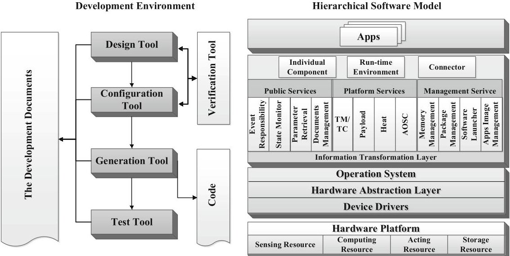

Fig.1. Architecture of the development framework.

independently of hardware. They are designed with standardized interfaces that enable connections between components. The components also have fully defined ports through which you can define how and what types of data are exchanged.

The configuration tools used to connect the PIM and the PSM, achieving the mapping between software components and hardware platform. It uses the component description files as input and system description files as output. By analyzing the resources and structure of the entire system, the components are mapped to the hardware platform and related parameters are configured.

The verification tool is used to verify the models at every stage. Via the formal verification method, the correctness of the model design and model transformation is ensured.

The generation tool will automatically convert the models and associated configuration files into code. After that, the pieces of code are integrated and assembled to generate the complete code. After compiling and linking, the executable file will be obtained finally.

The test tool is used for testing the code. The generated code can be tested for functional correctness via simulation. It also can be tested the performance by hardware-in-loop testing.

Hierarchical Software Model. The operation environment is a software environment in which the on-board software runs. It is a modular hierarchical architecture, including hardware platform, operating system, system service and application.

The hardware platform contains all the hardware units of the satellite and abstracts the hardware devices into four categories of resources: computing resources, sensing resources, acting resources and storage resources. All kinds of resources are connected via standardized interfaces.

Operation system, hardware abstraction layer and device drivers are the key to realize software cross-platform operation. They can encapsulate and virtualize various hardware

<!-- PDF_PAGE: 10 -->

resources and provide a unified API for information acquiring, processing, storing and other specific functions.

The system service contains three parts. The information transmission layer defines a set of abstract information interaction patterns and types to realize communication between application components. In the middle, there are three service packages that provide public services, platform services and software management services. They are the main part of the system service. The top layer is the basic components of the application, including individual component, run-time environment and connector. The satellite can discover, start, stop, install, update and uninstall application at work by them. They provide support for on-board multi-application running and task reconfiguring.

There are various kinds of satellite "Apps" on the top layer. These "Apps" can be divided into two categories. The first category is the system "Apps". The satellite relies on these "Apps" to achieve the basic functions, such as TC/TM, AOCS, heat control, camera basic application, communication, etc. The other category is user "Apps", which can be developed freely by users. The satellite can use these "Apps" to extend functions. For example, users can develop an image recognition "App" to process an image taken by on-board camera directly and display the result to the user.

The On-Board Software Development Process. The process of on-board software development is usually divided into five steps: system requirements analysis, system design, system configuration, code generation, and system integration. These steps are all around the system model.

The system requirement model will be established in the system requirements analysis stage, which can describe the goal of the on-board software. It includes the demand modeling and the demand verifying. Based on the demand model, the system is specifically designed to find the solution to achieve all the requirements of the system in the system design stage. It includes system model design and system model verification. In the system configuration stage, the system model will be mapped with the specific hardware platform to generate the final models and configuration files. The implementation code will be automatically generated in the code generation stage based on the model and configuration files. The system integration is a unique task of on-board software development. It matches the software with the specific satellite through parameter configurations. It is also guided by the system model.

The detail flow of the on-board software development is shown in Fig. 2. It abstractly describes three steps of the development: software component design, system configuration and system test.

In the step of software component design, the developer will design a platform independent model for on-board software based on the system component library. There are two types of software components: Atomic Software Component (AtomicSC) and Composition Software Component (CompositionSC). AtomicSC is the elementary unit describing a function and communicates to others by relevant ports. CompositionSC is composed of AtomicSCs and can be nested. First of all, the system requirement model will be designed. Then the model will be confirmed and verified through model verification and modified based on the result of the verification. It is an interactive and iterative process. After that, the validated requirement model will be converted into a system model and designed in detail. Similarly, the well-designed system model also

<!-- PDF_PAGE: 11 -->

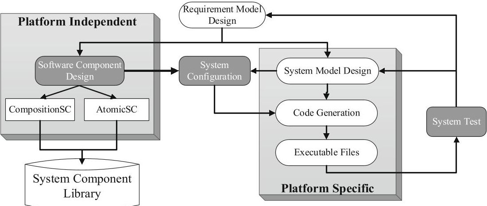

Fig. 2. The detail flow of the on-board software development.

needs to be verified. Based on the result, the developer corrects the system model or readjusts the design of the requirement model. Finally, the validated requirement model and system model are configured with specific target platform.

In the step of system parameter configuration, the platform independent model will be mapped to a specific hardware platform and parameterized in order to convert into platform specific model. After the configuration, the model will be transformed to generate the code with the software component in the system component library. Obviously, before the code is generated, the model will be verified to ensure that no errors occur during the configuration. After compiling and testing, the code can run on the hardware devices and become an "App".

The system test is also based on the model. The test process is to load the generated executable "App" into the test platform and execute the test case. It will test the function and performance of the development software. If the result of test cannot meet the requirements, it will return to the previous steps and begin a new round of iteration.

## 4 The Design of Development Tool Chain

Although there are a large number of integrated development environments for onboard software development, they are mostly based on traditional development process for specific satellite hardware platforms. The tools based on the MDA have the following challenges. Lack of tools for effectively composing satellite system form components. Lack of tools for configuring middleware. Lack of tools for automating the deployment of satellite component onto heterogeneous target platforms. Therefore, according to the framework proposed in Sect. 3, an on-board software development tool chain is designed in this section. On one hand, it develops on-board software in the form of components, achieving flexible combination and rapid construction. On the other hand, it decouples the development process of software and hardware, achieving the deployment of software on heterogeneous hardware platform.

The tool chain consists of the software component tool, the system configuration tool and the software test tool, integrated by a plug-in platform. The software component tool

<!-- PDF_PAGE: 12 -->

provides a graphical modeling environment. It can design software components and build system software models according to the on-board software meta-models. The system configuration tool can build the satellite hardware system model, establish a relationship with related software components and configure related parameter. The software test tool can simulate satellite operations according to the integrated STK kernel and realize the test of the software. The overall design of the development tool chain is show in Fig. 3.

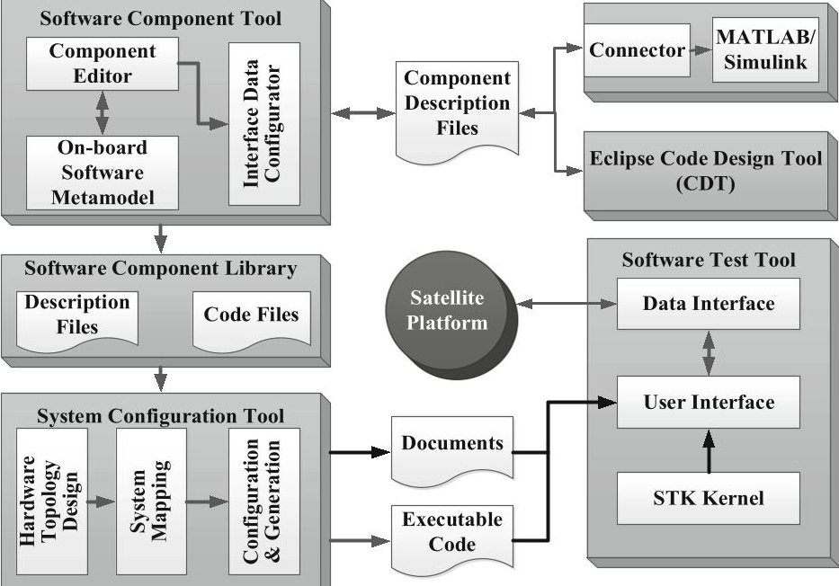

Fig. 3. The overall design of development tool chain.

In order to promote the development of the tool chain and improve the convenience of data interaction between tools, the tool chain adopts a unified Eclipse-based plug-in development platform, shown in Fig. 4. The platform is divided into three layers. The top layer is the application development platform that enables the development of specific functions of the tool. Currently, the tool chain contains three tools. The middle layer is the core tool platform, which includes the implementation of meta-model, model analysis, model comparison, basic project management, etc. The bottom layer is the Eclipse platform, which is a scalable open source multi-function system that integrates the program development platform, run time environment and application framework [33]. The tool chain integrates tools and related plug-ins in the form of plug-in on the Eclipse platform. In addition, the tool chain can dynamically call some mature software to assists the function, such as MATLAB/Simulink, C/C++ development tool (CDT), STK, etc.

## 4.1 The Design of Software Component Tool

The software component tool is the beginning of the development tool chain. Its mission is to provide a graphical modeling environment, complete the design and packaging of

<!-- PDF_PAGE: 13 -->

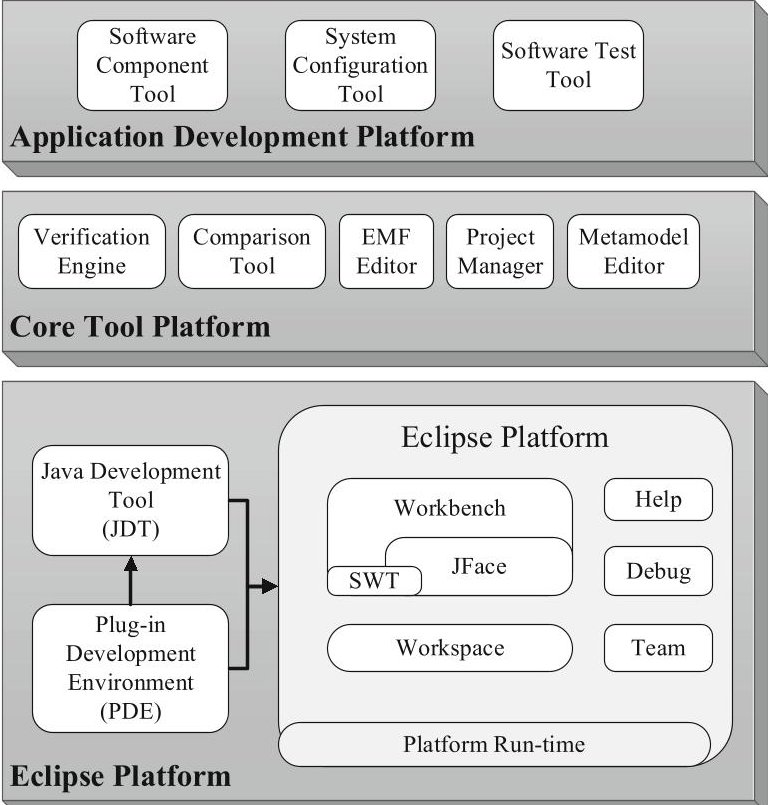

Fig. 4. The architecture of tool chain development platform.

satellite software components, and provide model validation capabilities. Specifically, we need to design the following functions.

1) Graphical software component modeling interface;

2) Configure the port and interface data of the software component;

3) Define the communication relationship between the various software components;

4) Internal behavior modeling and code generation;

5) Provide the software component model verification;

6) Establish a software component library, and provide functions such as component creation, saving, and searching.

The software component tool consists of three parts: the on-board software metamodel, the component editor and the interface data configurator.

A meta-model is used to describe the common elements of software component model. Although there is no uniform standardized architecture for on-board software now, we design the on-board software meta-model. The software components are divided into AtomicSC and CompositionSC, which are modeled by UML shown in Fig. 6. AtomicSC is the smallest implementation unit in satellite software, with a complete functional implementation. It communicates to others by relevant ports. The internal algorithm of AtomicSC is designed by calling MATLAB/Simulink. CompositionSC is used for presentation of top-level system. It can contain several AtomicSCs or CompositionSCs and

<!-- PDF_PAGE: 14 -->

support nesting. Regarding components, there are the following definitions:

$$
\begin{array}{l} \mathrm {C} = \mathrm {C} _ {c} \cup \mathrm {A} _ {c} \\ P = P _ {p} \cup P _ {r} \\ I = I _ {c s} \cup I _ {s r} \\ R = R _ {a} \cup R _ {d} \\ \end{array}
$$

Among them, component C is a collection of CompositionSC $ C_{c} $ and AtomicSC $ A_{c} $ . And port P includes Provided ports $ P_{p} $ that are used to provide data or services and Required ports $ P_{r} $ that are used to request data or services. Interface I is make up of Client server interfaces $ I_{cs} $ and sending and receiving interfaces $ I_{sr} $ . Connector R contains associations $ R_{a} $ between internal components of a CompositionSC and associations $ R_{d} $ between internal components and CompositionSC. They have the following relationships:

$$
\begin{array}{l} \mathrm {R} \subseteq \mathrm {P} \times \mathrm {P} \\ \mathrm {R} _ {a} \subseteq \mathrm {P} _ {p} \times \mathrm {P} _ {r} \\ \mathrm {R} _ {d} \subseteq \mathrm {P} _ {p} \times \mathrm {P} _ {p} \cup \mathrm {P} _ {r} \times \mathrm {P} _ {r} \\ \end{array}
$$

Figure 5 shows the meta-model of the AtomicSC $ A_{c} $ . The meta-model defines the three components of the AtomicSC, namely interfaces, ports, and internal algorithms. As for the meta-model of composite components, as shown in Fig. 6. The meta-model also describes its components: connectors, ports, and AtomicSC.

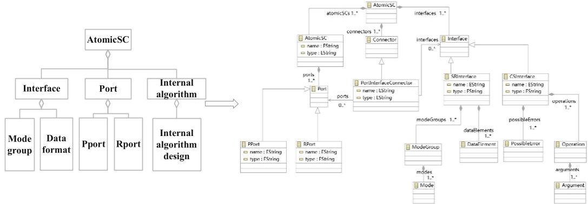

Fig. 5. The description of AtomicSC.

In addition, for CompositionSC, since it is a combination of AtomicSC, it should satisfy the following constraints:

$$
\mathrm {R} _ {p i} \subseteq P \times I
$$

$$
\begin{array}{l} \mathrm {R} _ {p i} \subseteq P \times I \\ \mathrm {R} _ {c p} \subseteq C \times P \\ \forall i \in I \wedge \exists r _ {p i} (p, i) \in R _ {p i} \rightarrow \exists r _ {c p} \left(c _ {t}, p\right) \in R _ {c p} \\ \forall r _ {a} \left(p _ {1}, p _ {2}\right) \in R _ {a} \rightarrow \nexists r _ {c p} \left(c _ {t}, p _ {1}\right) \in R _ {c p} \wedge \nexists r _ {c p} \left(c _ {t}, p _ {2}\right) \in R _ {c p} \wedge p _ {1} \in P _ {p} \wedge p _ {2} \in P _ {r} \\ \end{array}
$$

<!-- PDF_PAGE: 15 -->

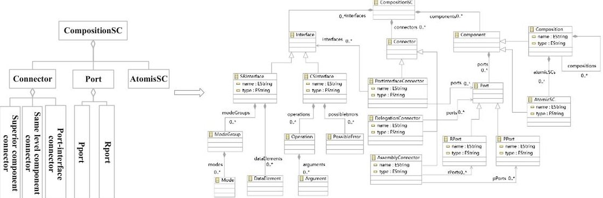

Fig. 6. The description of CompositionSC.

In other words, for CompositionSC, the nesting of components can only be inside the CompositionSC. The interface of the component must be connected to the corresponding port. When it comes to the internal nodes of the CompositionSC, the connection can only be from the P-type port to the R-type port. Constraints can avoid meaningless connections, leading to logical errors such as connections in the model.

## 4.2 The Design of System Configuration Tool

The system configuration tool is an intermediate part of the development tool chain, combining the software components with the hardware platform. The same software component requires different configuration parameters for different hardware platforms. The system configuration system separates the information related to the hardware implementation form the software and dynamically loads the information at runtime. Therefore, the tool has the following functions.

1) Parse the software component description files.

2) Design hardware topology.

3) Establish system mapping relationship and configure related configuration parameters.

4) Generate the executable code automatically.

Based on the function listed above, the system configuration tool consists of four modules: hardware topology design module, system mapping module, system configurator and code generator. The work flow is shown in Fig. 7. The software component description file is used as the input and the system configuration description file and executable code are the output.

Hardware topology design is the premise of system mapping and the basis of system configuration. It also uses GMF graphical modeling framework to build a graphical interface. According to the satellite architecture in Sect. 3, the developers will add and connect various processors and related peripherals. After that, the resource description files and topology description files, in the form of XML files, will be generated and saved for subsequent configuration.

System mapping module will establish a connection among the software component description file, the resource description file, and the topology description file. First of

<!-- PDF_PAGE: 16 -->

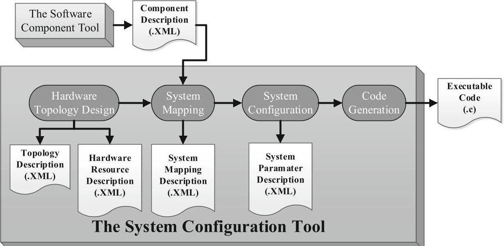

Fig. 7. The work flow of the system configuration tool.

all, through Java Document Object Model (DOM), the above three types of description files will be parsed. The internal modules and connection relationships of the hardware and software are loaded into the display. Then, the software components will be mapped to the corresponding hardware platform. In the mapping process, the processors are first mapped, then the sensors and actuators are mapped, and finally the ports of software components are mapped to the interfaces of the hardware.

The system configuration includes network configuration and parameter configuration. The network configuration is to configure the internal data transmission protocol of the satellite, achieving the requirements of different software components, such as data bandwidth, speed, reliability, etc. The parameter configuration includes interface parameters, such as interface type, data rate, data width, parity, etc. The priority of the software component, in order to realize the management and scheduling in the operation system.

The code generator can convert models and configuration files into executable code. It is based on the Velocity template engine. Firstly, the mapping between template and hardware is established. Then, the parameters in the XML files are converted to Java classes. Finally, the C code is generated. The specific process is shown in Fig. 8.

## 4.3 The Design of Software Test Tool

The test tool can load the generated description file and execution code on the hardware platform and simulate the running state of satellite by STK kernel to test the software. The tool has the following functions:

1) Input configuration document.

2) Test the software function.

3) Simulate satellite running state.

<!-- PDF_PAGE: 17 -->

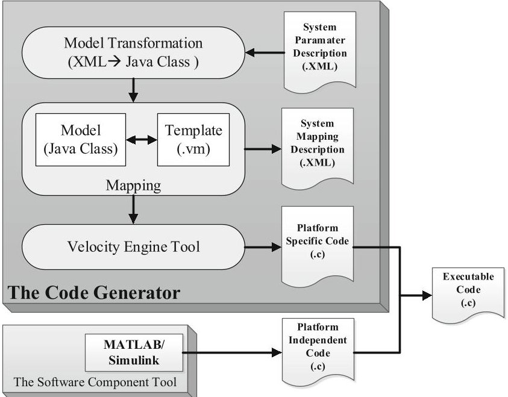

Fig. 8. The specific process of code generation.

Therefore, the software test tool consists of three parts: test files, user interface and STK kernel. The test files are mainly responsible for recording and managing the input and out files, including the software component description files, system configuration description files, the executable code, and hardware communication files. The software test tool can interact with the data of the above two tools freely. It parses the files through Java DOM, obtains all the software functions in the project, and displays them in the user interface.

A complete set of software test flow can be implemented through the user interface, including sending user instructions, loading configuration files, receiving and displaying the operation data, reconfiguring the software application. The software test tool can communicate with the satellite platform. Through the received data, the correctness, reliability and real-time performance of software can be tested. Users can test a function independently or design test cases to test the whole on-board software. The user interface is implemented by the Eclipse Standard Widget Toolkit (SWT).

The STK kernel is integrated in the software test tool. Through setting up the satellite scenarios, the overall running state, multi-task operation mode, software reconfiguration logic and resource consumption of on-board software can be tested. Embedding the STK into the Eclipse platform is mainly achieved through the Object Model, which calls the Object Model API to manipulate most objects and functions in STK. The Object Model provides STK secondary developer with methods for controlling and managing entities in STK scenarios, acquiring simulation data, analyzing, and calculating.

## 5 Application Case and Assessment

This section describes some actual software development cases which use the development tool chain presented in Sect. 4. The on-board software of a CubeSat named

<!-- PDF_PAGE: 18 -->

iSat-1, developed at the College of artificial intelligence of the National University of Defense Technology (NUDT). The iSat-1 is designed to experiment the software on-orbit definition.

## 5.1 The Development Tool Chain Platform

The development tool chain platform is showed in Fig. 9. The component editor includes sections such as toolbars, graphical editing interfaces, and other auxiliary views. The toolbar is a collection of tools, including interface configuration tools, system mapping tools, and testing tools in the system configuration. But the key part is the component designed that is relied on the graphical editing. The graphical editing interface consists of two parts: the drawing toolbox and the graphic editing area. The Drawing Toolbox provides tools for creating models under the current window. The graphic editing area is the area where graphics are created, edited, and displayed. Other auxiliary views provide some auxiliary functions for the component editor, such as providing outline views, property views, and so on.

The component editor is designed based on the Graphical Modeling Language (GMF) framework, which consists of a graphical development and a runtime environment. We develop the component editor by defining the domain model (Ecore model), the graphical definition model (gmfgraph model) for describing the domain model, the tool model (gmftool model), and the mapping model that associates the above models. The interface of the component editor is shown in Fig. 9. The user can quickly build the on-board software model in the graphical editor by a drag-and-drop manner. After completing the component editing, through the description file generator, the corresponding XML description file can be generated to provide a unified exchange format. It is convenient for developers to save and view model information.

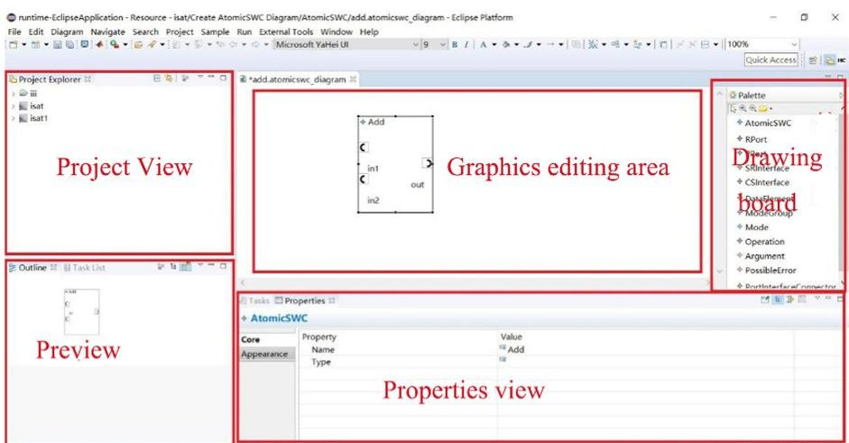

Fig. 9. The view of the development tool chain platform.

Another key work of component design is the data interface configurator. The data interface configurator realizes the design of the interaction relationship between software components through a visual configuration interface. It includes a data type editor and an

<!-- PDF_PAGE: 19 -->

interface type editor. The data type editor provides configuration of data structure and date semantic. The interface type editor completes the configuration of two communication modes of software components (send-receive mode and client-server mode). The output of the interface data configurator is the interface description file. The contents of the interface description file are: name, data type, content, description, and sending method.

## 5.2 The Test for the Framework

The functions of iSat-1 are divided into two categories. The one is the functions necessary to maintain satellite operations, such as TM/TC, heat control, AOCS, power control and housekeeping system. The other is the various applications implemented by satellite, such as SDR, remote sensing. All of these functions are first designed through software component tool, as shown in the Fig. 10. In the figure, every module is an CompositionSC, which contains some CompositionSCs and AtomicSCs. These AtomicSCs can be designed by developers themselves, or they can directly reuse existing component models. The reuse of software functions is achieved through the reuse of models. It improves the efficiency and quality of software development. Finishing the design of the software model, an XML file will be generated to describe the model and transform the information to the system configuration.

In order for the software to run on a specific hardware platform, a mapping of software components to the hardware platform is required through the system configuration tool. The iSat-1 uses two MCUs as power controller and OBC. The two are connected by an I2C bus. It also uses a Xilinx zynq SoC (ZYNQ 7020) as the processor of the SDR payload. The payload and the OBC are connected via Ethernet. It can be modeled by the system configuration tool, shown in Fig. 10. The software component description file is imported and combined with the hardware platform description file. These XML files will be parsed by the system mapping module. Through the drop-down menu, we can select the corresponding software components to establish the mapping of the hardware resource. After that, the parameters of every component interfaces will be configured and the code will be generated by the code generator.

A case is showed in Fig. 11, which demonstrates the development process of the tool chain platform. The case is about the SDR system model in the SDR SOC. This paper integrates SIMULINK's Target Language Compiler code generation tool on the Eclipse platform to automatically generate the internal behavior code of the component. This part of the code is platform independent. After the SDR system model is built in the Graphics editing area and the internal algorithm is designed, based on the principle of Velocity template engine, the second phase of target language compilation is carried out. With the software component description file and the hardware platform description file, the system configuration tool generates .c and .h code files, and finally the target file is compiled. The executable file can be download to the target board to test its function. From the platform independent code to the specific platform code, the Velocity template engine first maps the template, that is, the internal component code, to the hardware interface, and then reflects the configuration parameters in the code. All other components can be developed and executed in accordance with this process.

When the code is automatically generated, a code generation report can be generated to describe the related information of the code generation, such as the generated code

<!-- PDF_PAGE: 20 -->

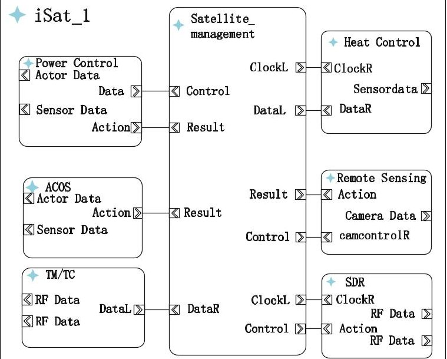

Fig. 10. The top model of the on-board software.

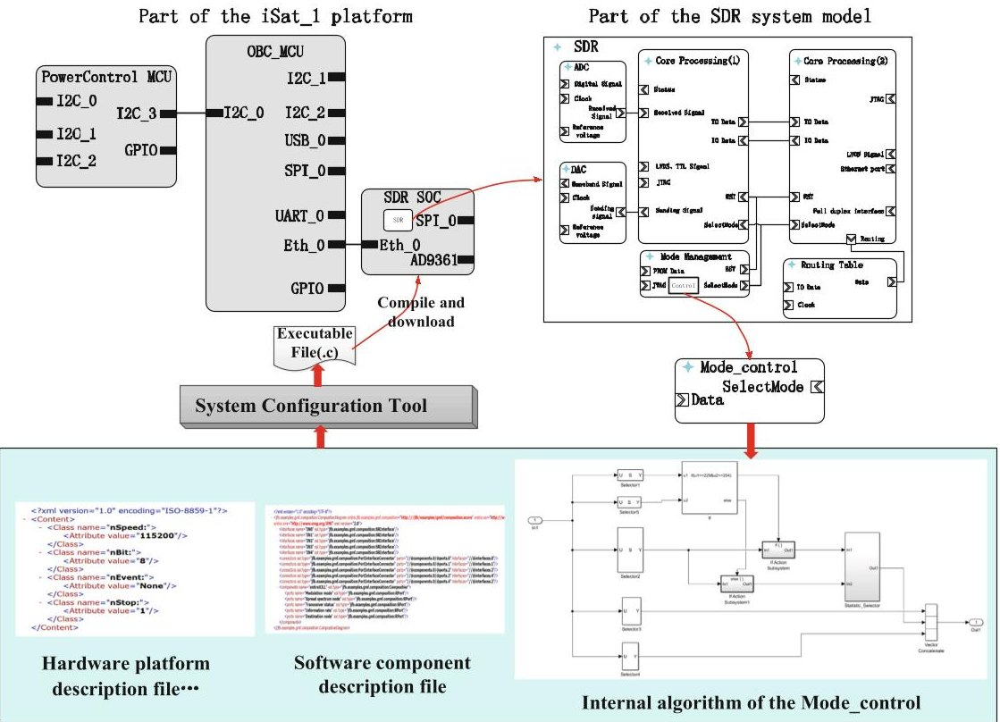

Fig. 11. Case of the development process of Mode_control

file information, as shown in Table 1, and the variable information that is displayed in Table 2. In addition, there are functional information and quality evaluation of the

<!-- PDF_PAGE: 21 -->

code. Compared with manually writing code, automatic code generation brings some advantages, which will be described in detail in Sect. 5.

Table 1. File Information

<table border="1"><tr><td>File name</td><td>Lines of code</td><td>Lines</td></tr><tr><td>Mode_control.c</td><td>36</td><td>120</td></tr><tr><td>Rtwtypes.h</td><td>34</td><td>92</td></tr><tr><td>Mode_control.h</td><td>27</td><td>90</td></tr></table>

Table 2. Global variables

<table border="1"><tr><td>Global variables</td><td>Size(bytes)</td><td>Read/Writes</td><td>Reads/Writes in a function</td></tr><tr><td>In1</td><td>284</td><td>1</td><td>1</td></tr><tr><td>Out1</td><td>284</td><td>1</td><td>1</td></tr><tr><td>add</td><td>2</td><td>1</td><td>1</td></tr><tr><td>Total</td><td>570</td><td>3</td><td></td></tr></table>

After generating the code, the functions of each hardware module and the communication between the modules are tested by the system test tool. It consists of four parts shown in Fig. 12. The satellite task can be customized through the task definition windows of the user interface. Users can choose to add or delete previously designed application software functions to form a task queue and set the parameters for these tasks. The task queue is converted to a satellite command sequence and sent to the satellite along with the corresponding program. Combined with the simulation of the satellite running by STK, the function in-orbit definition is tested. The test result show that on-board software of iSat-1 designed by the development tool chain has the ability to decouple hardware and software and define the function in-orbit.

We tested the iSat-1 software re-definition on the ground. At first, the program of iSat-1 is loaded. After the function self-test is completed, the code and related configuration files of the ADS-B (Automatic Dependent Surveillance-Broadcast) are uploaded to the OBC via Wi-Fi. The OBC will load the code onto the SDR payload and stare the payload. The process is shown in Fig. 13.

The results of the experiment are displayed in the software test tool, shown in Fig. 14. As shown in the figure, iSat-1 consumes 3.9 s to complete the reconfiguration. The function of ADS-B is successfully executed. The nearby aircraft information is received and displayed. As a conclusion, the development tool chain can effectively support the development of on-board software in-orbit re-defined.

<!-- PDF_PAGE: 22 -->

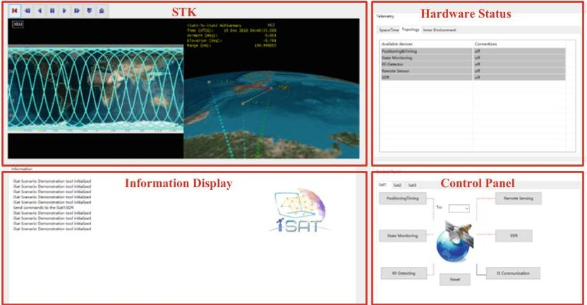

Fig. 12. The interface of the system mapping module.

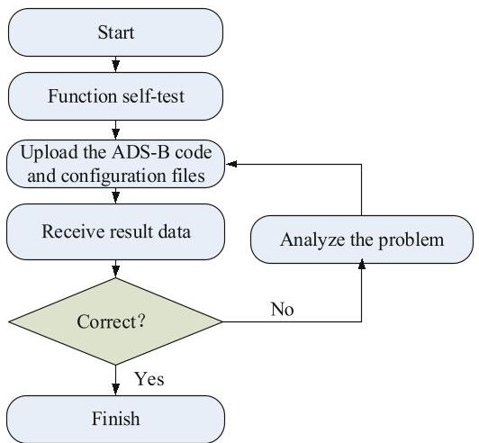

Fig. 13. The process of software re-definition experience.

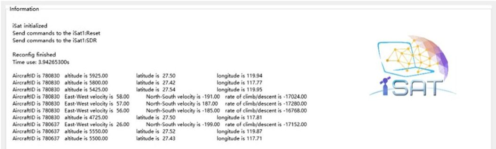

Fig. 14. The results of the experiment.

## 5.3 Assessment

Time-Consuming. The software development of traditional satellites is a long process Traditionally, a waterfall-type (or V-type) development method is adopted, and the process from requirements, design, coding to testing is experienced. In the integration test

<!-- PDF_PAGE: 23 -->

phase, this development method will spend a huge amount of time in debugging the interface adaptation and functional requirements of each software. If it is found that the demands cannot be met, it is necessary to start over from the overall design stage.

The framework proposed in this paper is based on model-driven. The platform-independent model is used to verify functional demands at all design stage. After detailed design, most of the code can be automatically generated. Automatic model verification is carried out at each stage, which can greatly reduce the development time-consuming.

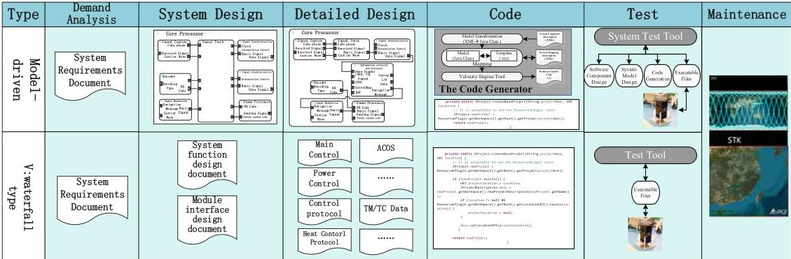

Fig. 15. Comparison of V-type development and the model-driven development process

The Fig. 16 below is a comparison of time-consuming between the traditional V-type development method and the model-driven development framework (MDF) proposed in this paper. Since the time-consuming is related to the specific project, the graph is just a trend comparison. It can be seen that the V-type will have relatively less time in the demands analysis and system design, but the time in the coding and testing phase will increase dramatically. The model-driven framework method will be a little bit more in system design and detailed design, because the system model needs to be constructed clearly and exactly, but it will take less time to code and test the software. This is the benefit of reduced time brought by model-driven.

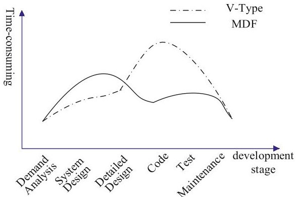

Fig. 16. Comparison of the time-consuming of V-Type and MDF

<!-- PDF_PAGE: 24 -->

Software Reuse. The development tool chain encapsulates typical satellite software, including system models, CompositionSC and AtomicSC, which can be reused. This can reduce repetitive software development work and shorten the development cycle. According to the demands of navigation and remote sensing satellites, the design of the system models of the two satellites is shown in the Fig. 17 below. In these two types of satellites, most of the other software can be reused except for navigation software and remote sensing software. It is encapsulated as a general system model, which is benefit to improve the reuse of the system model. But it is worth pointing out that this does not mean that other software does not need to be changed, such as the Time_Processing component. Since navigation satellites require much higher time precision than remote sensing satellites, the design of this component is more complicated than remote sensing satellites. But this does not affect the reuse of other parts of the software.

For CompositionSC and AtomicSC, take the Mode_control unit in SDR as an example, as shown in Fig. 11. The Selector, if, if Action, Vector and other components in this component are reused. This type of component has a higher reuse ratio in internal behavior development, which reduces a lot of work for code development.

Characteristics and Limitations. Aiming at the software development of smart satellites, this paper proposes a model-driven framework and implements the development tool chain. The entire development process is shown in Fig. 15. The traditional satellite software development has been greatly changed, not only shortening the development cycle, but also increasing the reuse rate of satellite software, and improving the reliability of the software. However, the work of this paper has the following limitations and areas for improvement.

1) The development tool chain can only be developed for satellite application software and related drivers and operating environment, but does not support to develop the software of the operating system.

2) The proposed model-driven framework can be supported to analyze the satellite hardware structure design, thermodynamics, electromagnetic and so on, but the current work does not include this part.

3) In terms of testing, a more quantitative evaluation of software development performance, such as reliability, is also needed.

<!-- PDF_PAGE: 25 -->

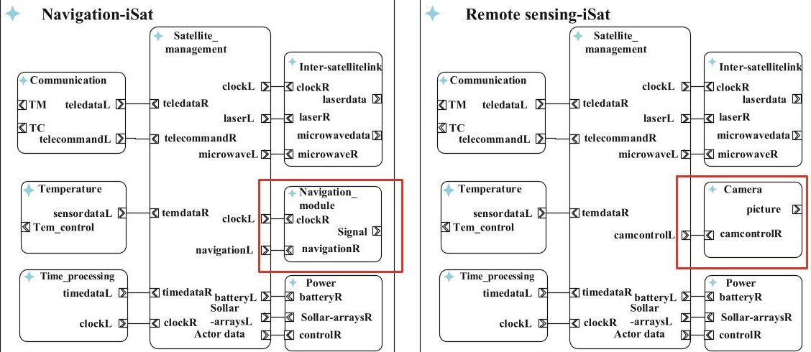

Fig. 17. System model of the Navigation and Remote Sensing satellite

## 6 Conclusion

Compared with the software development of other electronic systems, the development of on-board software is still in a more traditional stage. The on-board software development framework proposed in this paper are based on the model-driven software development method. The meta-models of AtomicSC and CompositionSC in the satellite software field are designed to build satellite software components. The work of the paper shifts the focus of on-board software from code writing to model designing. The entire software system will be divided into function modules, which are easy to be created, designed, reused and maintained. Therefore, the developers have more time to design software function, making the system more powerful and suitable.

It achieves the consistency of on-board software through using model as the unified description in each development stage. It also ensures the portability and reusability of on-board software development through standardized components. What's more, it decouples the software design from hardware platform and improves the platform independence through configurable integration. It improves the efficiency of software development through automatic transformation of models and automatic generation of code and documents.

Based on the development framework, a development tool chain covering all the stages of on-board software development is presented, facilitating software development engineers and testers. With the development tool chain, developers can design models graphically, configure parameters conveniently, and generate executable code automatically. What's more, the verified software component will be added to the component library, supporting software reuse and redeployment.

The framework and development tool chain have been used to develop the on-board software of iSat-1. The on-board software is developed in the form of "Apps" and independent of the hardware platform. Moreover, it supports to load software in-orbit, achieving the function software defined.

<!-- PDF_PAGE: 26 -->

## References

1. Laxmi, D.: Requirements engineering for software development process (2019)

2. Younas, M., Jawawi, D.N.A., Mahmood, A.K., et al.: Agile software development using cloud computing: a case study. IEEE Access 8, 4475-4484 (2020)

3. Madry, S., Martinez, P., Laufer, R.: Innovative Design, Manufacturing and Testing of Small Satellites. Cham: Springer (2018). https://doi.org/10.1007/978-3-319-75094-1

4. Marmolejo-Saucedo, J.A.: Design and development of digital twins: a case study in supply chains. Mob. Netw. Appl. 25(6), 2141-2160 (2020). https://doi.org/10.1007/s11036-020-01557-9

5. Gao, S., Sweeting, M.N., Nakasuka, S., Worden, S.P.: Issue small satellites. Proc. IEEE 106, 339-342 (2018). https://doi.org/10.1109/jproc.2018.2805267

6. Sweeting, M.N.: Modern small satellites-changing the economics of space. Proc. IEEE 106, 343-361 (2018). https://doi.org/10.1109/jproc.2018.2806218

7. Coelho, C., Koudelka, O., Merri, M.: NanoSat MO framework: when OBSW turns into apps. In: 2017 IEEE Aerospace Conference (2017). https://doi.org/10.1109/aero.2017.7943951

8. Heydari, B., Mosleh, M., Dalili, K.: From modular to distributed open architectures: a unified decision framework. Syst. Eng. 19, 252-266 (2016). https://doi.org/10.1002/sys.21348

9. Kingston, J.: Modular architecture and product platform concepts applied to multipurpose small spacecraft. In: 19th Annual AIAA/USU Conference on Small Satellite (2005)

10. Young, Q.: Modular platform architecture for small satellites: evaluating applicability and strategic issues. In: 19th Annual AIAA/USU Conference on Small Satellite (2005)

11. Fronterhouse, D., Lyke, J., Achramowicz, S.: Plug-and-play satellite (PnPSat). In: AIAA Infotech@Aerospace 2007 Conference and Exhibit, July 2007. https://doi.org/10.2514/6. 2007-2914

12. Barnhart, D., Hill, L., Turnbull, M., Will, P.: Changing satellite morphology through cellularization. In: AIAA SPACE 2012 Conference & Exposition, November 2012. https://doi.org/ 10.2514/6.2012-5262

13. Mccormick, D., Barrett, B., Burnside-Clapp, M.: Analyzing fractionated satellite architectures using RAFTIMATE: a Boeing tool for value-centric design. In: AIAA SPACE 2009 Conference & Exposition (2009). https://doi.org/10.2514/6.2009-6767

14. Zhao, X., Guo, M.: Design of software platform in general purpose automatic test system based on PAWS. In: 2011 International Conference on Electric Information and Control Engineering (2011). https://doi.org/10.1109/iceice.2011.5777911

15. Lafleur, J.: A Markovian state-space flexibility framework applied to distributed-payload satellite design decisions. In: AIAA SPACE 2011 Conference & Exposition, 2011. https:// doi.org/10.2514/6.2011-7274

16. McComas, D., Strege, S., Wilmot, J.: Core Flight System (cFS) a low cost solution for SmallSats. NASA Technical reports Server (NTRS). https://ntrs.nasa.gov/search.jsp?R=201 50018075. Accessed Aug 2015

17. Wilmot, J.: A core plug and play architecture for reusable flight software systems. In: 2nd IEEE International Conference on Space Mission Challenges for Information Technology (SMC-IT06), August 2006. https://doi.org/10.1109/smc-it.2006.7

18. Project Overview - CubeSat Lab (online database), August 2017. https://www.cubesatlab.org/CubedOS.jsp. Aug 2017

19. Mathur, D., et al.: An approach for designing reusable, embedded software components for spacecraft flight instruments. In: 11th IEEE Real Time and Embedded Technology and Applications Symposium. https://doi.org/10.1109/rtas.2005.7

20. Walter, A., Adilson, M.: Towards a pattern-based framework for satellite flight software using a model-driven approach. In: Brazilian Symposium on Aerospace Engineering & Applications, June 2017

<!-- PDF_PAGE: 27 -->

21. Briones, J.C., Roche, R., Hickey, J., Handler, L.M.: Future standardization of space telecommunications radio system with core flight system. In: 34th AIAA International Communications Satellite Systems Conference (2016). https://doi.org/10.2514/6.2016-5720

22. Fenech, H., Sonya, A., Tomatis, A., Soumpholphakdy, V., Merino, J.L.S.: Eutelsat quantum: a game changer. In: 33rd AIAA International Communications Satellite Systems Conference and Exhibition, March 2015. https://doi.org/10.2514/6.2015-4318

23. The alliance was established in Chengdu on September 9, 2017 (online database). September 2017. https://www.sdsalliance.net/a/news/60.html. Accessed September 2017

24. France, R., Rumpe, B.: Model-driven development of complex software: a research roadmap. Future of Softw. Eng. (FOSE 2007) (2007). https://doi.org/10.1109/fose.2007.14

25. Li, H., Lu, P., Yao, M., Li, N.: SmartSAR: a component-based hierarchy software platform for automotive electronics. In: 2009 International Conference on Embedded Software and Systems (2009). https://doi.org/10.1109/icess.2009.54

26. Balasubramanian, K., et al.: Applying model-driven development to distributed real-time and embedded avionics systems. Int. J. Embedded Syst. 2, 142 (2006). https://doi.org/10.1504/ ijes.2006.014851

27. Schlegel, C., Steck, A., Lotz, A.: Robotic software systems: from code-driven to model-driven software development. Robot. Syst. Appl. Control Program. (2012). https://doi.org/10.5772/ 25896

28. Narumi, T., Takano, S., Kimura, S.: Development of high-performance compact on-board computer for micro/nano-satellites with software resource sharing framework. SICE J. Control, Meas. Syst. Integr. 10, 10-15 (2017). https://doi.org/10.9746/jcmsi.10.10

29. Ziemke, C., Kuwahara, T., Kossev, I.: An integrated development framework for rapid development of platform-independent and reusable satellite on-board software. Acta Astronaut. 69, 583-594 (2011). https://doi.org/10.1016/j.actaastro.2011.04.011

30. Dos Santos, W.A., Leonor, B.B.F., Stephany, S.: A knowledge-based and model-driven requirements engineering approach to conceptual satellite design. In: Laender, A.H.F., Castano, S., Dayal, U., Casati, F., de Oliveira, J.P.M. (eds.) ER 2009. LNCS, vol. 5829, pp. 487-500. Springer, Heidelberg (2009). https://doi.org/10.1007/978-3-642-04840-1_36

31. Tipaldi, M., Legendre, C., Koopmann, O., Ferraguto, M., Wenker, R., Dangelo, G.: Development strategies for the satellite flight software on-board Meteosat Third Generation. Acta Astronaut. 145, 482-491 (2018). https://doi.org/10.1016/j.actaastro.2018.02.020

32. Süß, J.G., Pop, A., Fritzson, P., Wildman, L.: Towards integrated model-driven testing of SCADA systems using the eclipse modeling framework and modelica. In: 19th Australian Conference on Software Engineering (aswec 2008) (2008). https://doi.org/10.1109/aswec.2008.4483203

33. AUTOSAR - Enabling Innovation (online database), January 2019. https://www.autosar.org/. Accessed Jan 2019