<!-- PDF_PAGE: 1 -->

DEVELOPMENT OF A CUBESAT CONCEPTUAL DESIGN TOOL AND

IMPLEMENTATION OF THE EPS DESIGN MODULE

A Thesis presented to

the Faculty of California Polytechnic State University San Luis Obispo

In Partial Fulfillment of the Requirements for the Degree Master of Science in Aerospace Engineering

by

Sean K. Nogrady

June 2021

<!-- PDF_PAGE: 2 -->

2021

Sean K. Nogrady

ALL RIGHTS RESERVED

<!-- PDF_PAGE: 3 -->

## COMMITTEE MEMBERSHIP

TITLE: Development of a CubeSat Conceptual Design Tool and Implementation of the EPS Design Module

AUTHOR: Sean K. Nogrady

DATE SUBMITTED: June 2021

COMMITTEE CHAIR: Pauline Faure, Ph.D.

Assistant Professor of Aerospace Engineering

COMMITTEE MEMBER: John Fabijanic, M.Sc.

Lecturer of Mechanical Engineering

COMMITTEE MEMBER: David Kaslow, Ph.D.

Independent Consultant

COMMITTEE MEMBER: Eric Mehiel, Ph.D.

Interim Associate Dean, College of

Engineering

<!-- PDF_PAGE: 4 -->

# ABSTRACT

Development of a CubeSat Conceptual Design Tool and Implementation of the EPS

Design Module

Sean K. Nogrady

This thesis is the product of an effort to develop a CubeSat Conceptual Design Tool for the California Polytechnic State University CubeSat Laboratory. Such a tool is necessary due to inefficiencies with the current conceptual design process. It is being developed to increase accessibility, reduce design time, and promote good systems engineering within CubeSat development.

The development of the architecture of a conceptual design tool, the core user- interface element, and the completion of a module for the electrical power subsystem is the focus of this thesis. The architecture is built around different modules to design different subsystems that work in conjunction. The module in the tool was developed to allow a user to size an electrical power subsystem, and that is the basis for future subsystem development. Model-based Systems Engineering was also utilized as an endpoint for the tool's outputs, and a CubeSat Model has been built for this effort. Validation has been successful on the Conceptual Design Tool as implemented at this time, so the tool it is ready to design CubeSat electrical power subsystems and be expanded upon by other tool developers.

Keywords: CubeSat, Conceptual Design, MBSE, Digital Engineering, Electrical Power Subsystem

<!-- PDF_PAGE: 5 -->

## ACKNOWLEDGMENTS

I would first like to extend a tremendous acknowledgment to Dr. Faure for excellently adapting this year to being my advisor over a virtual environment. Thank you for enabling me to complete my thesis and guiding me through every step of the way. I could not have accomplished it without you.

Furthermore, thank you to all of the committee members for lending their time and support for my project, especially during this tumultuous year. Dr. Kaslow deserves specific recognition, as he granted me access to his work with the CubeSat System Reference Model for use on the project and aided in understanding it.

Finally, I would like to thank my parents for all of their support, guidance, and love. Their backing allowed me to thrive at Cal Poly and strive towards my lofty goals in the aerospace industry.

<!-- PDF_PAGE: 6 -->

## TABLE OF CONTENTS

Page

LIST OF TABLES...ix

LIST OF FIGURES...x

LIST OF NOMENCLATURE...xii

LIST OF EQUATIONS...xv

LIST OF ACRONYMS...xvii

CHAPTER

1. INTRODUCTION ...1

1.1 Statement of Problem ...1

1.2 Thesis Statement ...2

1.3 Thesis Scope ...6

2. BACKGROUND ...7

2.1 CubeSat Overview ...7

2.1.1 CubeSat Failures ...8

2.1.2 Systems Engineering ...10

2.2 CubeSat Conceptual Design ...11

2.2.1 Current Conceptual Design Process at CPCL ...11

2.2.2 Conceptual Design Processes ...13

2.2.3 Conceptual Design Tools ...15

2.3 CubeSat System Reference Model ...19

3. METHODOLOGY ...22

3.1 CubeSat Conceptual Design Tool Architecture ...22

3.1.1 History of the Tool Architecture ...22

3.1.2 Final Tool Architecture ...25

<!-- PDF_PAGE: 7 -->

3.2 Software Used ... 28

3.2.1 Conceptual Design Tool Software ... 28

3.2.2 Associated Files and MBSE Software ... 29

3.3 Conceptual Design Tool Elements ... 30

3.3.1 Assumptions Files ... 30

3.3.2 Main GUI ... 31

3.3.3 Subsystem Design Modules ... 32

3.3.4 Output Files ... 33

3.3.5 CubeSat Model ... 34

4. ELECTRICAL AND POWER SUBSYSTEM MODULE ... 38

4.1 EPS Parameters ... 38

4.1.1 EPS Assumptions and Design Options ... 39

4.2 EPS GUI ... 41

4.2.1 Use Case 1: Power Budget to Power Design ... 42

4.2.2 Use Case 2: Subsystem Design to Power Design ... 44

4.3 EPS Design Tool ... 46

4.3.1 Power Budget: Use Case 1 ... 46

4.3.2 Power Budget: Use Case 2 ... 49

4.3.3 Battery Sizing ... 49

4.3.4 Solar Sizing ... 52

4.4 EPS Output File ... 55

4.5 EPS in CubeSat Model ... 57

5. VALIDATION ... 59

5.1 Preliminary Validation Work ... 59

5.1.1 Orbit Test Module ... 59

5.1.2 Other Subsystem Test Modules ... 62

<!-- PDF_PAGE: 8 -->

5.2 Conceptual Design Tool Architecture Testing ... 62

    5.2.1 Plan ... 62

    5.2.2 Process ... 64

    5.2.3 Results ... 64

5.3 EPS Design Module Testing ... 65

    5.3.1 Plan ... 65

    5.3.2 Process ... 67

    5.3.3 Results ... 72

6. CONCLUSION ... 75

6.1 Outcome ... 75

6.2 Lessons Learned ... 76

6.3 Future Work ... 77

    6.3.1 Continued Subsystem Design Module Development ... 77

    6.3.2 Tool Robustness and Variable Management ... 78

    6.3.3 Results Dashboard ... 80

    6.3.4 Continued CubeSat Model Development ... 81

    6.3.5 Tool Validation ... 82

REFERENCES ... 83

APPENDICES

A. CubeSat Conceptual Design Tool and CubeSat Model Files ... 88

B. EPS Design Module Testing Output Files ... 89

<!-- PDF_PAGE: 9 -->

## LIST OF TABLES

Table Page

1. Conceptual Design Tool Objectives 3

2. Tool Element Definitions 5

3. CubeSat Conceptual Design Processes 15

4. Existing General Integrated Design Tools 16

5. Catalog Design Tool Process (adapted from [23]) 17

6. Challenges with Original Architecture 24

7. Further Project Element Definitions 27

8. Software Utilized 30

9. Headers for a Sample Assumption File 31

10. Parameters Utilized 38

11. Assumed Values for Design Options 40

12. Assumed Values for Battery Allowing Life Modeling (adapted from [56]) 50

13. Battery DoD vs. Degradation Rate (adapted from [56]) 51

14. Sample Output CSV Values 55

15. Conceptual Design Tool Test Matrix 63

16. EPS Test Case 1 Results 72

17. EPS Test Case 2 Results 73

18. Subsystem Design Module Development Order 78

<!-- PDF_PAGE: 10 -->

## LIST OF FIGURES

Figure Page

1. Life-Cycle Cost Impact at Different Stages of Development [1][2]...2

2. Overview of Tool and Model Interaction ...4

3. Standardized CubeSat Sizes [13]...7

4. CP9 LEO Exploded View [17]...8

5. Reasons for CubeSat Mission Failures [5]...9

6. Data Flow within the SmallSatCEM Tool (adapted from [22])...18

7. CSRM Overview Package Diagram [31]...20

8. Package View of Space Segment of CSRM [31]...21

9. Original Tool Architecture ...23

10. Final Tool Architecture ...26

11. Main GUI Opening Page ...32

12. CubeSat Model Overview Package Diagram...35

13. CubeSat Model Architecture Hierarchy...36

14. Use Case 1 Power Budget Tab ...43

15. Use Case 1 EPS Design Tab...44

16. Use Case 2 EPS Design Tab...45

17. Model Explorer View of Parameters Package ...58

18. Power Parameters Table ...58

19. Orbit Test Module GUI ...60

20. Pop-up Error Messages ...65

21. Test Case 2 Main GUI ...67

22. Test Case 2 Orbit Test Module ...68

23. Test Case 2 EPS Use Case Selection...69

24. Test Case 2 Power Budget...70

<!-- PDF_PAGE: 11 -->

25. Test Case 2 EPS Design Inputs ... 71

26. Test Case 2 Finish and Run Tool ... 72

<!-- PDF_PAGE: 12 -->

## LIST OF NOMENCLATURE

$a$ Semi-Major Axis of Orbit km

$A_{sol-effective}$ Effective Solar Area Required $m^{2}$

$A_{sol-true}$ True Solar Area Required $m^{2}$

$D_{i}$ Duty Cycle in Mode $i$ %

$D_{oD}$ Battery Depth-of-Discharge %

$D_{standby}$ Duty Cycle of Standby Mode %

$D_{eclipse}$ Duty Cycle of Eclipse Mode %

$d_{bat}$ Battery Degradation Rate %/500 cycles

$d_{rate-temp}$ Solar Cell Temperature Degradation Rate %/ $^{\circ}C$

$d_{rate-time}$ Solar Cell Lifetime Degradation Rate %/yr

$E_{discharge-max}$ Energy Lost Discharging from Battery During Eclipse Wh

$E_{bat}$ Beginning-of-Life Actual Battery Capacity Wh

$E_{bat-BOL-req}$ Beginning-of-Life Battery Capacity Required Wh

$E_{bat-EOL}$ End-of-Life Battery Capacity Required Wh

$E_{cell}$ Beginning-of-Life Capacity of Battery Cell Wh

$E_{discharge-max}$ Energy Lost Discharging from Battery During Eclipse Wh

$E_{eclipse-max}$ Energy Required to Operate in Eclipse Wh

$E_{solar-worst}$ Worst Case Energy Production Requirement Wh

$E_{sun-min}$ Energy Required to Operate in Sun Wh

$f_{eclipse}$ Fraction of Orbit in Eclipse -

$G_{SC}$ Solar Constant $W/m^{2}$

$h$ Orbital Altitude km

<!-- PDF_PAGE: 13 -->

$i$ Orbital Inclination $^\circ$

$L_{degrad-bat}$ Lifetime Battery Degradation -

$L_{degrad-sol}$ Lifetime Solar Cell Degradation -

$m_{bat}$ Mass of Battery kg

$m_{PDU}$ Mass of PDU kg

$n_{cells}$ Number of Cells Required -

$n_{orbits}$ Number of Orbits in Mission Lifetime -

$n_{orbits/day}$ Number of Orbits per Day day

$p_{margin}$ Power Margin %

$P_{avg}$ Average Power Across Entire Orbit W

$P_{eclipse-avg}$ Average Power in Eclipse Mode W

$P_{sub-avg}$ Average Power for a Subsystem W

$P_{sub-i}$ Power for a Subsystem in Mode i W

$P_{sun-avg}$ Average Power in Sunlit Modes W

$P_{mode-avg}$ Average Power for a Mode W

$P_{mode-i}$ Power for a Mode with Subsystem i W

$t_{mode-loss-margin}$ Average Power for a Mode (w/ Losses and Margin) W

$P_{eclipse-avg}$ Average Power in Eclipse (w/ Losses and Margin) W

$P_{solar-worst}$ Worst Case Solar Power Production Requirement W

$R_{earth}$ Radius of Earth km

$t_{eclipse-max}$ Maximum Time in Eclipse s

$t_{mission-years}$ Mission Time in Years yr

$t_{sun-min}$ Minimum Time in Sun s

$T_{orbit}$ Orbital Period s

<!-- PDF_PAGE: 14 -->

$ T_{degrad-sol} $ Solar Cell Temperature Degradation -

$ T_{solar} $ Solar Cell Temperature $ ^{\circ} \mathrm{C} $

$ T_{base} $ Baseline Solar Cell Temperature $ ^{\circ} \mathrm{C} $

$ \beta $ Beta Angle $ ^{\circ} $

$ \mu $ Standard Gravitational Parameter for Earth $ \mathrm{km}^{3} / \mathrm{s} $

$ \eta_{bat-oneway} $ One-way Efficiency of Battery %

$ \eta_{bat-roundtrip} $ Roundtrip Efficiency of Battery %

$ \eta_{PDU} $ Efficiency of PDU %

$ \eta_{sol-BOL} $ Efficiency of Solar Cells at Beginning-of-Life %

$ \eta_{sol-EOL} $ Efficiency of Solar Cells at End-of-Life %

$ \eta_{sol-packing} $ Solar Cell Packing Efficiency %

<!-- PDF_PAGE: 15 -->

## LIST OF EQUATIONS

Equation Page

1. Eclipse Duty Cycle ... 47

2. Standby Duty Cycle ... 47

3. Subsystem Average Power ... 47

4. Mode Average Power ... 47

5. Mode Average Power with Margin and Losses ... 48

6. Eclipse Average Power ... 48

7. Sun Average Power ... 48

8. Orbit Average Power ... 48

9. Energy Required in Maximum Eclipse with Average Power ... 49

10. Energy Required in Minimum Sunlight with Average Power ... 49

11. Energy Required in Maximum Eclipse with Eclipse Average Power ... 49

12. Energy Required in Minimum Sunlight with Sun Average Power ... 49

13. Energy Required with Battery Losses ... 50

14. End-of-Life Battery Energy Required ... 50

15. Battery Degradation ... 51

16. Beginning-of-Life Battery Energy Required ... 51

17. Number of Cells Required ... 52

18. Mass of Battery ... 52

19. Battery Capacity ... 52

20. Battery Roundtrip Efficiency ... 52

21. Maximum Energy Generation Required ... 52

22. Maximum Average Solar Power Required ... 52

23. Solar Panel Lifetime Degradation ... 53

24. Solar Panel Temperature Degradation ... 53

<!-- PDF_PAGE: 16 -->

25. End-of-Life Solar Efficiency...53

26. Effective Solar Area...53

27. True Solar Area...55

28. Semi-Major Axis...61

29. Orbital Period...61

30. Eclipse Fraction of Orbit...61

31. Maximum Time in Eclipse...61

32. Minimum Time in Sunlight...61

33. Number of Orbits per Day...61

34. Number of Orbits for Mission...61

<!-- PDF_PAGE: 17 -->

## LIST OF ACRONYMS

ADCS Attitude Determination and Control Subsystem

BOL Beginning-of-Life

C&DH Command and Data Handling Subsystem

COM Communications Subsystem

COTS Commercial Off-the-Shelf

CPCL Cal Poly CubeSat Laboratory

CSRM CubeSat System Reference Model

DoD Depth-of-Discharge

EOL End-of-Life

EPS Electrical Power Subsystem

GNC Guidance, Navigation, and Control Subsystem

GUI Graphical User Interface

ICD Interface Control Document

INCOSE International Council on Systems Engineering

ISS International Space Station

LEO Low Earth Orbit

MBSE Model-based Systems Engineering

OBC On Board Computer

PDU Power Distribution Unit

RFP Request for Proposals

SME Subject-matter Expert

SoC State-of-Charge

SSO Sun-synchronous Orbit

UML Unified Modeling Language

<!-- PDF_PAGE: 18 -->

## Chapter 1

## INTRODUCTION

The introduction presents an overview of the project undertaken for this thesis. Namely, what is the problem that is addressed and what solution is being undertaken to address it. The nature of the problem will be further explained in Chapter 2, and the method in which it is being tackled is explored in-depth in Chapters 3 and 4.

## 1.1 Statement of Problem

The conceptual design process is a crucial stage in a spacecraft development. It is at this stage where decisions are most influential to the remainder of the program [1]. A design choice or assumption made here can impact the program over its whole life cycle, as Figure 1 shows. For example, it is estimated that 45% of a program's committed life-cycle costs are set during the conceptual design stage of a program, while this stage sees less than 10% of a program's total expenditures [2]. Accordingly, mistakes made during the conceptual development process can be exceedingly costly as a project advances in its life cycle, both from a monetary and technical risk standpoint. Therefore, CubeSat developers need to put emphasis on the conceptual design phase to prevent budget overruns and limit technical risk for a program.

Unfortunately, the Cal Poly CubeSat Laboratory (CPCL), which develops small spacecraft, currently lacks an efficient process for CubeSat conceptual design [3]. As will be exhibited in Chapter 2, they are not alone in this. Not only is the excess time spent in the current CubeSat conceptual design process at detrimental towards students and faculty at the CPCL, but its lack of integrated, formalized process introduces technical and programmatic risks.

<!-- PDF_PAGE: 19 -->

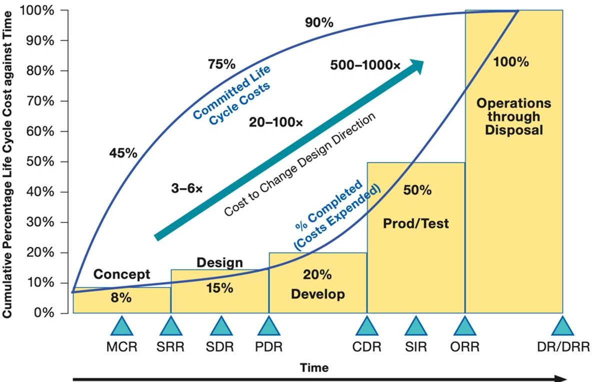

PDR Preliminary Design Review DR/DRR Decommissioning/Disposal Readiness Review

Adapted from INCOSE-TP-2003-002-04, 2015

Figure 1. Life-Cycle Cost Impact at Different Stages of Development [1][2]

It is not only efficient conceptual design that is important, but accurate conceptual design as well. A high proportion of university class CubeSats fail to work on-orbit, and this partially stems from poor conceptual design [4][5]. Therefore, it is critical that a tool is developed to allow for accurate, efficient conceptual design of CubeSats, for users at California Polytechnic State University (Cal Poly) and elsewhere.

## 1.2 Thesis Statement

The purpose of this research is to respond to a need at the CPCL and in the greater CubeSat community for improvements to be made in the conceptual design process. This will be achieved by beginning development of a comprehensive design tool, that will be referred to as the CubeSat Conceptual Design Tool. There are four primary objectives for the tool, listed in Table 1, that will need to be achieved to tackle the problem.

<!-- PDF_PAGE: 20 -->

Table 1. Conceptual Design Tool Objectives

<table border="1"><tr><td>Objective-1</td><td>Create a conceptual design for a CubeSat based on mission requirements and available technology levels</td></tr><tr><td>Objective-2</td><td>Reduce the time and effort required to develop a conceptual design</td></tr><tr><td>Objective-3</td><td>Increase the accessibility of conceptual design tools to existing and future CubeSat developers</td></tr><tr><td>Objective-4</td><td>Promote and enable good systems engineering practices using the tool</td></tr></table>

First, Objective-1 states the primary purpose of this thesis, that is the creation of a tool to enable conceptual design of CubeSats. To achieve this first objective, the Conceptual Design Tool shall complete the following key functions:

1. Allow a user to pass information on the intended mission, payload, and operational needs into the tool.

2. Facilitate the selection of the technology parameters and design decisions for the CubeSat by a user.

3. Calculate the required sizing of a range of design parameters for the CubeSat that fits the missions needs and technology available.

Objective-2 states the desire to reduce the time needed to create conceptual designs and conduct trade studies in order to promptly respond to requests for proposals for CubeSat missions. Conceptual design is able to be done without the use of a specialized tool, however this results in a longer design process, as discussed in Chapter 2. Accordingly, the tool should be usable by a single person in one sitting without needing to transfer data around to different users, load multiple programs for different satellite subsystems, or manually repeat design steps.

Objective-3 specifies that the tool shall be developed to broaden the accessibility of the conceptual design process by being user-friendly and highly compatible. This means that someone does not require training on how to operate the tool or in

<!-- PDF_PAGE: 21 -->

spacecraft conceptual design to use it. The Conceptual Design Tool shall provide its own instructions and allow for a degree of flexibility in user knowledge. The tool must also have preset values that are available for newer users to choose from in many of its fields, while still including the option of entering custom parameters for advanced users. Restrictions are placed on how the tool may be built, with it requiring common, free, and open-source software to maintain minimum barrier to entry for users.

Finally, Objective-4 states that Conceptual Design Tool shall be created in a way that promotes good systems engineering practices from the beginning of the project's life cycle. Doing so enables the results of the conceptual design phase to properly flow through the remainder of the program. To help achieve this, the tool shall provide for integration with a model-based systems engineering (MBSE) based model of a CubeSat. This will enable traceability within a modeling environment beginning with the earliest stages of a program life-cycle [6]. For example, requirements can be traced from the initial conceptual design results, and as the detailed design is developed it can be readily compared to the conceptual design.

CubeSat Conceptual Design Tool

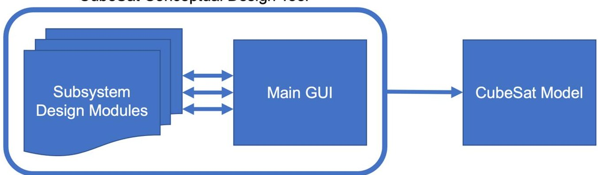

Figure 2. Overview of Tool and Model Interaction

The CubeSat Conceptual Design Tool will be built around a central interface, referred to as the Main GUI (graphical user interface), with individual Subsystem Design Modules built for each CubeSat subsystem. The tool will be able to integrate with a CubeSat Model, developed off of the CubeSat System Reference Model (CSRM) [7].

<!-- PDF_PAGE: 22 -->

This thesis focuses on how the core of the tool operates, interacts with the user, interfaces with the design modules, and works with the MBSE CubeSat Model. The definitions for the key elements of this work are found in Table 2 and the interaction between those elements is shown in Figure 2. In particular, this thesis included the development of the Electrical and Power Subsystem (EPS) Design Module as a first step for the development of all Subsystem Design Modules and a demonstration for future work.

Table 2. Tool Element Definitions

<table border="1"><tr><td>Term</td><td>Description</td></tr><tr><td>CubeSat Conceptual Design Tool</td><td>This is the overall tool being developed for CubeSat design. When this is being referred to, it excludes the CubeSat Model, and is focusing on the program in which the tool is run. It encompasses the Main GUI, Subsystem Design Modules, and supporting files used to store parameters.</td></tr><tr><td>Main GUI</td><td>This is the central element of the program that allows the user to interact with the tool. It initializes and runs the other elements in the tool as required.</td></tr><tr><td>Subsystem Design Module</td><td>This element is in charge of a particular subsystem, encompassing its GUI, Design Tool, and any associated files.</td></tr><tr><td>Subsystem GUI</td><td>This is the GUI developed for an individual subsystem. Here, the user enters values and design selections that pertain to that particular subsystem.</td></tr><tr><td>Subsystem Design Tool</td><td>This part of the program conducts the design analysis for its associated subsystem in order to produce the conceptual design.</td></tr><tr><td>CubeSat Model</td><td>The model of a CubeSat, built in MBSE, into which the final design products of the tool are input. It was built off the CSRM but modified for the purpose of this thesis.</td></tr></table>

<!-- PDF_PAGE: 23 -->

## 1.3 Thesis Scope

It is recognized that the development of a CubeSat Conceptual Design Tool is a large project. Therefore, this thesis focused on developing the architecture of the tool and one subsystem rather than completing the tool as a whole. The EPS Design Module was chosen as the subsystem to work on, demonstrating the process for development and integration of future Subsystem Design Modules. This decision was based on the outsized impact that an EPS has over CubeSat design and mission success, with the EPS accounting for 44% of CubeSat failures within the first 30 days of a mission [5]. Subsequent developers of the Conceptual Design Tool will be responsible for creating other subsystem modules and continuing to ensure they work together, as explained in Section 6.3 Future Work.

The components of the CubeSat Conceptual Design Tool shall be developed to allow for expansion on them. In the case of the Main GUI, this means building in room for expansion in the software and GUI for future Subsystem Design Modules. For the EPS Design Module, it was developed in a manner that allows compatibility with other modules as they are developed.

Furthermore, the CubeSat Model is being developed off of the previously built CSRM. The bulk of the work is reproducing much of the CSRM in a new modeling environment. However, additions will be made, specifically with regards to the EPS branch of the model. Branches of the model for other subsystems are being left to future developers of this tool to complete, as they require using currently undeveloped sets parameters. The structure of the EPS work in the CubeSat Model will also be used as a reference point for future developers.

<!-- PDF_PAGE: 24 -->

## Chapter 2

## BACKGROUND

This chapter provides details behind the need for the CubeSat Conceptual Design Tool. Additionally, the chapter will address why the tool is being developed in the manner that has been chosen.

## 2.1 CubeSat Overview

CubeSats are a class of small satellites that follow the CubeSat Design Specification, the standard for CubeSats development [8]. First introduced by Dr. Puig Suari of Cal Poly and Professor Twiggs of Stanford in 1999, CubeSats have since proliferated across the globe, bringing down barriers for access to space for educational, research, governmental, and commercial institutions [9][10]. As of April 2020, over 1500 CubeSat class spacecraft have flown, with developers ranging from high school students to national space agencies [11][12].

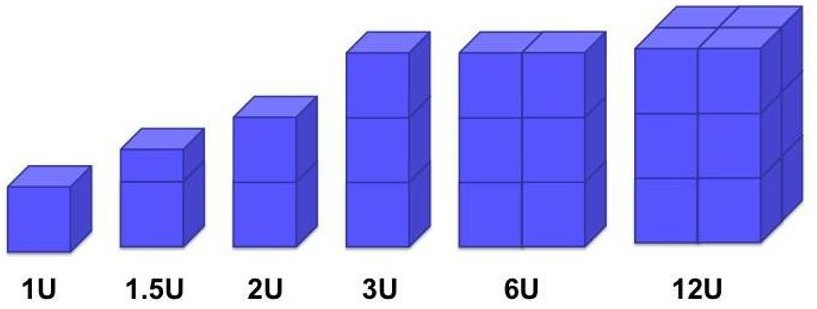

Figure 3. Standardized CubeSat Sizes [13]

The CubeSat Standard is based on the form factor of the CubeSat unit, or 'U'. 1U is 10 cm x 10 cm x 10 cm, and CubeSats come in sizes scaled off of these dimensions although exact dimensions vary depending on CubeSat size [13]. While the CubeSat Design Specifications currently account 1U, 1.5U, 2U, 3U, 6U, and 12U sized CubeSats, shown in Figure 3, developers have studied and flown both larger and smaller non- standard sizes [14][11][15].

<!-- PDF_PAGE: 25 -->

The CubeSats Standard enables the conceptual design of CubeSats to be done in a single tool, rather than requiring a more complex conceptual design process with multiple tools and developers [16]. The reason behind this is not just that the potential sizes of the spacecraft standardized, but the components used within them are limited in their packaging to fit within that standard, as shown in Figure 4 [17]. These constraints limit the potential scope of a possible design solution [10]. For example, instead of a component or subsystem being any possible size and arranged in numerous possible ways, most of the non-payload subsystems on a CubeSat bus fit neatly within slots on CubeSats frame.

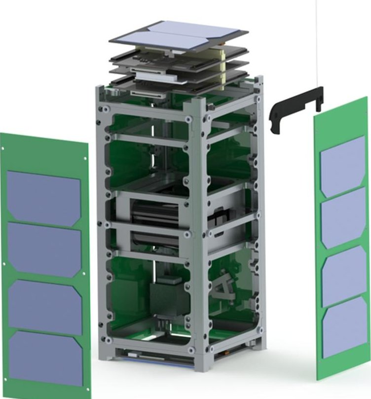

Figure 4. CP9 LEO Exploded View [17]

## 2.1.1 CubeSat Failures

CubeSats have a higher failure rate than traditional spacecraft [4]. This is particularly true for hobbyist-level missions, which are comprised of CubeSats developed by universities, schools, and amateurs. Almost half of hobbyist-level missions flown through November 2019 failed before they could complete their mission, not including

<!-- PDF_PAGE: 26 -->

launch failures [12]. Amongst these CubeSat missions, 32.5% of missions were dead on-arrival in orbit and 12.9% of missions were lost during early operations [4]. These figures are even worst for a university's first CubeSat, with 44% of those CubeSats being dead on-arrival.

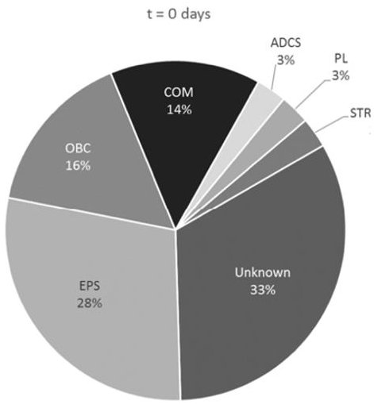

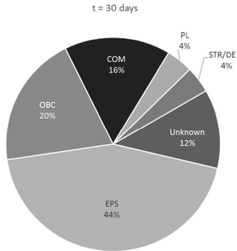

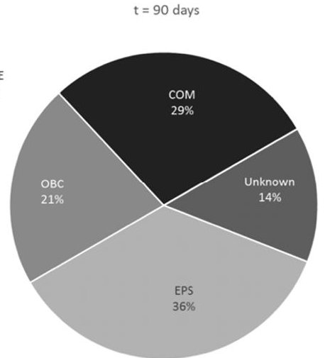

Figure 5. Reasons for CubeSat Mission Failures [5]

Langer and Bouwmeester conducted a study to determine the failure rates of CubeSats and provide attribution to those failures [5]. Approximately 20% of CubeSats, not including large commercial fleets, failed immediately upon arrival on orbit, with that figure growing to a 35% failure rate within 3 months on orbit. Figure 5 shows a breakdown of the subsystems, if known, that drove a CubeSats failure at different time intervals in its operations. The primary subsystems that failed resulting in loss of mission during these time periods were communications (COM), on-board computer (OBC), and EPS. Their model predicted a nearly 14% chance of a loss of mission due to EPS failure in the first year of life for a CubeSat. The reasons these subsystems fail are diverse and include insufficient testing, improper subsystem designs, failures in assembly or integration, and lack of risk analysis practices [5][3].

These problems can stem from failures in the conceptual design stage of a CubeSat [10]. For example, the spacecraft's power or communication budgets may grow

<!-- PDF_PAGE: 27 -->

as the CubeSat gets developed, while the components for those subsystems were originally sized for lesser demands. These technical risks, if realized, could be accepted due to system margin or reduced with design revisions. But if they are not discovered or adequately dealt with, the CubeSat may end up underperforming on orbit. Many of the dead-on-arrival CubeSat had their subsystem failure discovered due to post-mission analysis finding a subsystem was improper design [5].

It is therefore important to start at the conceptual design level when tackling problems in CubeSat design. The conceptual design requires both accurate design analysis and the inclusion of adequate margins for the remainder of the program. To achieve this, the conceptual design process shall account for all subsystems of the CubeSat and all aspects of its mission. This wholistic approach to design subsystems leads to better conceptual design outcomes [16].

## 2.1.2 Systems Engineering

According to the NASA Systems Engineering Handbook, the systems engineering process for space systems begins with the first stage of a project's life cycle, Pre-Phase A [1]. This phase entails Pre-Formulation Concept Studies, with their purpose stated below.

"To produce a broad spectrum of ideas and alternatives for missions from which new programs and projects can be selected. Determine feasibility of desired system; develop mission concepts; draft system-level requirements; assess performance, cost, and schedule feasibility; identify potential technology needs and scope." [1]

Accordingly, the systems engineering process begins even before the first conceptual design study starts. As Figure 1 demonstrates, the conceptual design process plays a critical role for the entirety of the system engineering process, since

<!-- PDF_PAGE: 28 -->

decisions made during conceptual design impact the mission for the entirety of its life cycle.

Systems engineering practices in hobbyist-level CubeSat development can be inconsistently applied [18]. There are numerous reasons for this, including lack of experience on teams, high rates of turnover, ineffective program structuring, and lack of schedule or budgetary resources [19][20].

Ways to improve the systems engineering process include, but are not limited to, generating quality system engineering documentation or models to use at later stages of the life-cycle, having a more formalized program structure with clear lines of communication and responsibility, increasing the amount of time spent in integrated testing, and utilizing experienced development teams [19][20][21]. MBSE is an enabler of some of these improvements [6]. Its utilization can improve adherence to system engineering best practices and makes them more effective.

## 2.2 CubeSat Conceptual Design

Existing conceptual design processes and tools are looked at in this section. Comparative research on CubeSat conceptual design tools is currently lacking as a result of the scarcity of those tools. Therefore, conceptual design tools and processes that were created for SmallSats in general are also being examined. There are numerous definitions of SmallSats, but according to NASA's, a SmallSat is a spacecraft under 180 kg and no larger than ESPA-class [13]. The primary differentiator between SmallSat tools and CubeSat tools that have been studied is the broader scope generally found in the former [22][23].

## 2.2.1 Current Conceptual Design Process at CPCL

The CPCL team currently has its own conceptual design process [3]. When they receive a request for proposals (RFP) from investigators in the government, commercial,

<!-- PDF_PAGE: 29 -->

or academic spheres, a period of conceptual design starts to see if and how the program could produce a CubeSat to fit the mission requirements.

The conceptual design campaign that begins at CPCL sees different people and groups work on different subsystems concurrently, but using their own separate tools [3]. A high level of coordination between designers is required to ensure that everyone uses the same assumptions and to share values between subsystems. This must take place before, during, and after the conceptual design process to ensure that the design is coming together in a consistent manner. The resulting conceptual design then informs the response to the RFP, with work products such as power, mass, and communications budgets being shown to close for the CubeSat. If the CPCL proposal is selected, the conceptual design is then the starting off point for further mission development work.

At CPCL, this process has been accomplished repeatedly for many successful missions and even more proposals, however, there are drawbacks to it. First off, if there is a major change to one subsystem, this may change some of the assumptions other subsystems are using, and those teams will have to go back and redo potentially several rounds of analysis. Such inefficiencies mean that the conceptual design process can take many weeks to complete. CPCL often reuses spacecraft buses which saves time, but the conceptual design process still requires significant work for each mission.

The process as it stands at CPCL is also inaccessible to less experienced students and faculty. More experienced members conducting the conceptual design lack the time to teach newer members the craft, so a problem with knowledge transfer arises. This leads to a constraint on the number of developers who can work on conceptual design, meaning the existing designers are even more burdened by it. A formalized design tool solves the problem by embedding much of the knowledge transfer into the tool and deliberately making it approachable to less experienced designers. It is important for users with a wide range of experiences to be able to practice, engage, and

<!-- PDF_PAGE: 30 -->

learn with the tool by themselves in order to get comfortable with CubeSat conceptual design [24].

## 2.2.2 Conceptual Design Processes

There are different design processes that conceptual design tools can utilize. They primarily differ on how the subsystems are development and how the design tools are utilized. Three primary categories of tools have been identified:

- Piecewise Design Processes

- Ad-hoc Design Processes

- General Integrated Design Processes

Piecewise Design Processes see separate design tools created for individual subsystems. Design tools in this process all work on a single subsystem, with additional tools or processes needed to amass all the work together for a comprehensive conceptual design. The current method employed by CPCL falls into this category. This route takes a significant amount of effort on behalf of conceptual design engineers to coordinate assumptions, design activities, and products [16]. Furthermore, if the design is shown to be invalid for one reason or another, and the problem was early on in the design process, all subsystems may need to be refined based on a new data. Therefore, this is a laborious method of conceptual design that does fair well against Objective-2, to reducing the design process time.

Ad-hoc Design Processes see a custom conceptual design tool created for an individual mission. Although an educational process, it is inefficient due to the need to redevelop many of the analytical tools and methods for each conceptual design being studied [25]. Following this process can bring advantages though. The tool(s) can be created to precisely the level of design detail needed for a particular subsystem or mission. For example, if a mission is expected to face a challenging thermal

<!-- PDF_PAGE: 31 -->

environment, the process can be conducted such that the design tool development focuses on developing a detailed environmental model and a detailed set of heat transfer equations. Tools can also be built with mission specific assumptions embedded. A downside of this method is that a newly developed tool is unlikely to be already validated. Therefore, a user must further validate either the tool or its resulting conceptual design product.

A General Integrated Design Process involves a tool that is not developed for a single mission, but rather is generic and can be used repeatedly across differing missions. It also sees all the subsystems designed within one tool, rather than being designed separately and integrated later by the conceptual designers [22]. The tool can automatically use a unified set assumptions and design parameters, enabling a more powerful and faster design process. Creating a tool for this process does require a greater level of initial development, however, as it needs encompass all required subsystems and a range of varying mission profiles.

Table 3 summarizes the advantages and disadvantages of the three main design processes that conceptual design tools can utilize. As Table 3 shows, the General Integrated Design Process has several distinct advantages [26][22][23]. Meanwhile, the primary drawbacks listed can also be minimalized. The large effort of initial development is set off by the time saved in future conceptual designs. With regards to problems with the flexibility of tools used in this process, the limitations on the trade space for CubeSats mentioned in Section 2.1 alleviate many of those concerns, as tools not have to cover as broad a scope of possible configurations as larger satellites [8]. Therefore, the remaining advantages of the General Integrated Design Process allow it to be chosen as the method to be used in this thesis.

<!-- PDF_PAGE: 32 -->

Table 3. CubeSat Conceptual Design Processes

<table border="1"><tr><td>Process</td><td>Advantages</td><td>Disadvantages</td></tr><tr><td>Piecewise Design</td><td>Allows subsystem design by subject-matter experts(SMEs)Utilize the right tool for each subsystem</td><td>Silos work by tool domain and subsystemSystems engineering challenges in integrating designSlower design process</td></tr><tr><td>Ad-hoc Design</td><td>Customization of design tools for mission needsEducational to develop tool(s)</td><td>Time intensive to develop tool(s) for each studyAdditional validation required</td></tr><tr><td>General Integrated Design</td><td>Rapid creation and iteration of whole conceptual designsMinimizes users and time requiredCentralized assumptions and subsystem data-sharing improves results</td><td>Initial creation of tool is difficult and time intensiveLess flexible to changes in the tool&#x27;s scope or depth</td></tr></table>

## 2.2.3 Conceptual Design Tools

Existing conceptual design tools were studied for their potential applicability to the CubeSat design process at CPCL. This section specifically identifies examples of tools that work within a General Integrated Design Process, as that was chosen for use in this thesis. Table 4 presents the tools that were studied from this category and summarizes their benefits and drawbacks. It is important to note that all of these tools are unavailable to the author at Cal Poly, as they were not developed for public use.

<!-- PDF_PAGE: 33 -->

Table 4. Existing General Integrated Design Tools

<table border="1"><tr><td>Tool</td><td>Advantages</td><td>Disadvantages</td></tr><tr><td>Catalog Design Tool Cornell University[23]</td><td>Uses actual CubeSat componentsTests entire trade space before scoring by various parameters</td><td>Reliant on an actively managed parts catalog for 8 major componentsHard to increase number of parameters studied for a more detailed design</td></tr><tr><td>Systems Engineering Design Tool Korea Aerospace University[26]</td><td>User-friendly GUIUtilizes 100+ primary design parameters (inputs and outputs)</td><td>Subsystems do not share parameters wellOutdated technical assumptions built-inNot CubeSat focused</td></tr><tr><td>Design for Performance Tool University of Tehran, Sharif University of Technology[27]</td><td>Sizes parameters that are design-drivers for payloadWorks well for adapting predesigned spacecraft buses</td><td>Tool only works for one payload type at this timeDoes not handle design-driver requirements that are not a function of the payload performance</td></tr><tr><td>SmallSatCEM The Aerospace Corporation[22]</td><td>Intuitive to operate, uses spreadsheets as GUICustomization available throughout design process, so iteration is instantLarge possible design scope</td><td>Not CubeSat focusedDifficult for a non-SME single user</td></tr></table>

The Catalog Design Tool is a CubeSat conceptual design tool that utilizes a 'catalog' of components for various subsystems [23]. To use it, one inputs high level requirements, and then all possible combinations of components are run together and scored as to how they compare in performance. Then the resulting combinations of components, or conceptual designs, that meet the requirements are presented to the user, who can sort them by difference performance metrics, including cost. This whole process is shown in Table 5. Relying solely on actively curated databases of components is challenging from an operating perspective, as users have to manage the catalog of components as they become available, leave the market, or get upgraded.

<!-- PDF_PAGE: 34 -->

Furthermore, it is unsustainable to significantly expand in its current form, since adding additional parameters and associated component lists to the tool exponentially grows the number of combinations of unique components that would have to be tried, which in turn makes the program both computationally more expensive and harder to view meaningful results out of potentially many thousands of combinations.

Table 5. Catalog Design Tool Process (adapted from [23])

<table border="1"><tr><td>Design Step</td><td>Step Details</td></tr><tr><td>1</td><td>Input design requirements</td></tr><tr><td>2</td><td>Tool generates a list of all possible design combinations</td></tr><tr><td>3</td><td>Tool evaluates all design combination to find performance metrics</td></tr><tr><td>4</td><td>Performance metrics are then scored against design requirements</td></tr><tr><td>5</td><td>Combinations that pass the requirements are then sorted by cost and presented to the user</td></tr></table>

The Systems Engineering Design Tool is a GUI-based SmallSat design tool [26]. While this tool is powerful, as many inputs for the different subsystem sizing algorithms to come up with a design before visualizing it in a suggested layout, there are a couple areas of concern. First, the process for executing subsystem design limits the sharing of inputs or calculations between the subsystems with a few exceptions. This limits the final fidelity of the tool by basically using separate subsystem design tools concurrently, as they are unable to share data in creating the design. For example, the EPS is designed before the COM, attitude determination and control (ADCS), thermal, and command and data handling (C&DH) subsystems. This means power levels cannot be developed in those subsystems and then used by the EPS sizing script, so the tool must rely exclusively on a predetermined power budget.

The Design for Performance Tool analytically derives key parameters that are design-drivers based on the payload requirement, then sizes the whole spacecraft to a

<!-- PDF_PAGE: 35 -->

system that will hit those a whole spacecraft from empirical comparisons to a 'design plane' [27]. The tool has to be specialized for individual payloads with specific design drivers, with the one studied currently being a CubeSat with an optical imaging payload. A tool like this is best suited for spacecraft on a common bus where the design drivers will likely only change small details of the design with minimal impact to the rest of the spacecraft. Different payloads will have different design drivers, so this is only a semi-generalized tool currently, requiring expansion for different classes of missions.

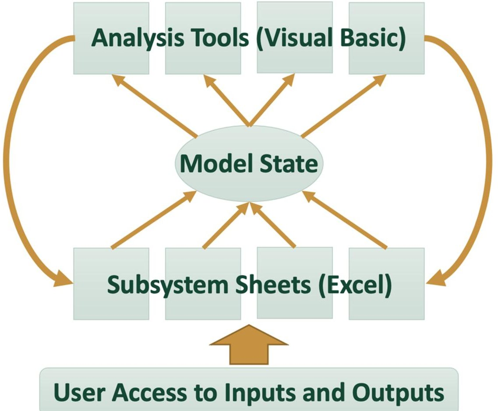

Figure 6. Data Flow within the SmallSatCEM Tool (adapted from [22])

Another notable tool is the SmallSatCEM from The Aerospace Corporation [22]. This tool utilizes an excel workbook, with sheets for each subsystem design, that can be controlled by a single user. It starts with the user entering requirements and preliminary values into subsystem design sheets in an Excel workbook. Those values combine to create a model state. This state then has calculations performed on it to come up with an

<!-- PDF_PAGE: 36 -->

updated spacecraft design, as shown in Figure 6. These values feed back into the design sheets, which then create a new model state. This process can be rapidly iterated on until a design converges from the starting parameters. Such methodology is highly favorable, because all subsystems can use any values from the current model state in their calculations and it rapidly responds to design iteration.

## 2.3 CubeSat System Reference Model

The International Council on Systems Engineering (INCOSE) defines MBSE as the "formalized application of modeling to support system requirements, design analysis, verification and validation activities beginning in the conceptual design phase and continuing throughout development and later life cycle phases”[28]. As stated previously, the need for good systems engineering practices begins with the conceptual design phase of the mission. It was therefore important to incorporate MBSE into the overall development of a CubeSat Conceptual Design Tool.

The CSRM is a model of a CubeSat developed in MBSE by the INCOSE Space Systems Working Group (SSWG) [29]. It consists of a modeled architecture for a CubeSat program accounting for elements across an entire system life cycle. It was developed to be a starting point for CubeSat developers who wish to utilize MBSE, in order to promote the rigorous application of system engineering practices in their CubeSat programs [30]. The CSRM was partially deemed necessary in order to address the high failure rates for CubeSats, as discussed in Section 2.1.1.

<!-- PDF_PAGE: 37 -->

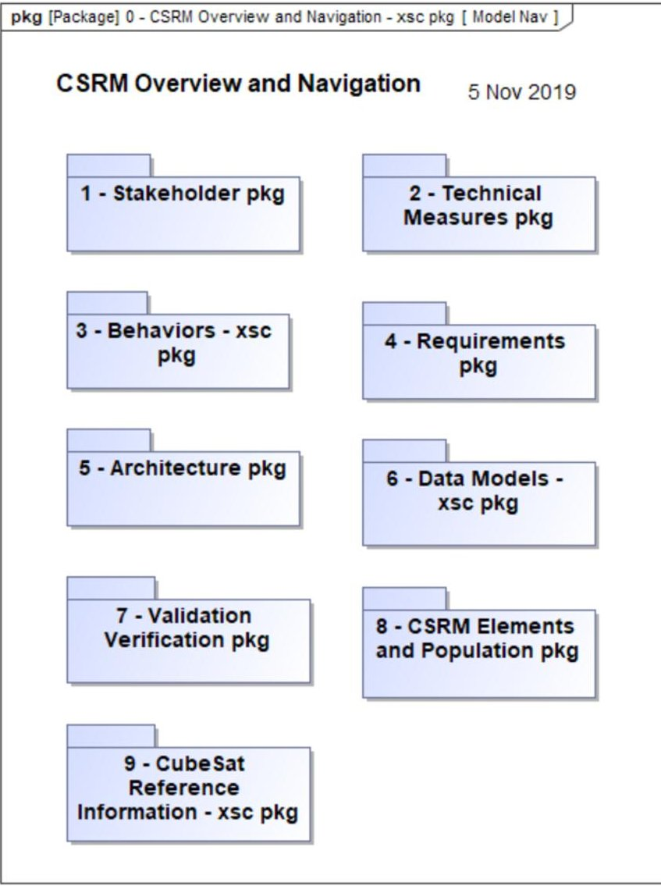

Figure 7. CSRM Overview Package Diagram [31]

Within the CSRM, there are different packages that provide a decomposition of the different elements needed for a CubeSat program, shown in Figure 7 [31]. For the purposes of this thesis, the architecture package is the most relevant, as that is where the space segment can be decomposed all the way down to individual components. The composition of the space segment is shown in greater Figure 8 [31]. The part of the model that pertains to the physical CubeSat design is small in proportion to the larger CSRM, as the model is made to supports systems engineering activities well beyond the conceptual design process.

<!-- PDF_PAGE: 38 -->

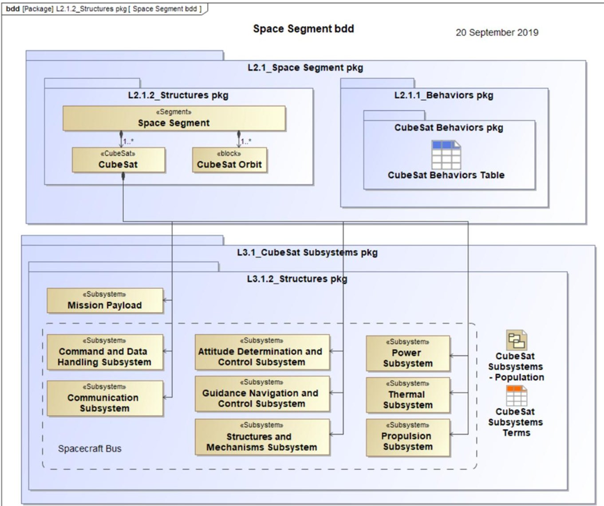

Figure 8. Package View of Space Segment of CSRM [31]

The reason why the remainder of model is important, even though it may not actually be directly utilized within the scope of this thesis, is that MBSE is an enabler for many of system engineering activities discussed at the end of Section 2.1.2. It is a catalyst to create documentation, conduct configuration management, track testing and validation, and provide structure to a CubeSat program [7]. The CSRM is launching point for CubeSat developers to enable them to utilize MBSE in their program without having to develop a modeling plan from scratch, and it is in that context that it will be utilized.

<!-- PDF_PAGE: 39 -->

## Chapter 3

## METHODOLOGY

The following chapter lays out the architecture of the CubeSat Conceptual Design Tool, the CubeSat Model, and files used for inputting and outputting data. Further detail is then provided on these components of the tool. It also covers the rationale for the software that was used in this thesis.

## 3.1 CubeSat Conceptual Design Tool Architecture

Before one can begin work on a project, it is necessary to plan and define the work that needs to be done. The architecture definition process for lays out the plan for the development of the tool, with the technical details falling into place after that.

## 3.1.1 History of the Tool Architecture

The Conceptual Design Tool has multiple objectives, as established in Table 1. In addition to producing a conceptual design, the tool has to do so in a minimum amount of time and in a manner accessible to a greater number of users, all while promoting good systems engineering practices. To accomplish this last point in particular, the Conceptual Design Tool was originally going to be built primarily in an MBSE environment, around a CubeSat Model developed from the CSRM. This system architecture, shown in Figure 9, would have seen Subsystem Design Modules as independent scripts that directly interfaced with the CubeSat Model. These scripts would have been solely responsible for conducting the required analysis during the conceptual design process. Meanwhile, the model would have been the central user-interface through which the user interacts with the tool, although it is possible that another script could have been implemented to create a separate GUI for data entry purposes. The process of inputting data, running the tool, and viewing results would nominally all be done in the MBSE environment. This would have likely seen users entering required input data into tables of within the model. The subsystem design scripts would operate

<!-- PDF_PAGE: 40 -->

off those values, which would then enable the resulting design products to be generated. Several of the new model views would have been tables specifically for storing data results during and after the design process. This version of the architecture did not have a user-interface fully determined yet, nor the specifics of running parametric scripts through an open-source MBSE program fully flushed out.

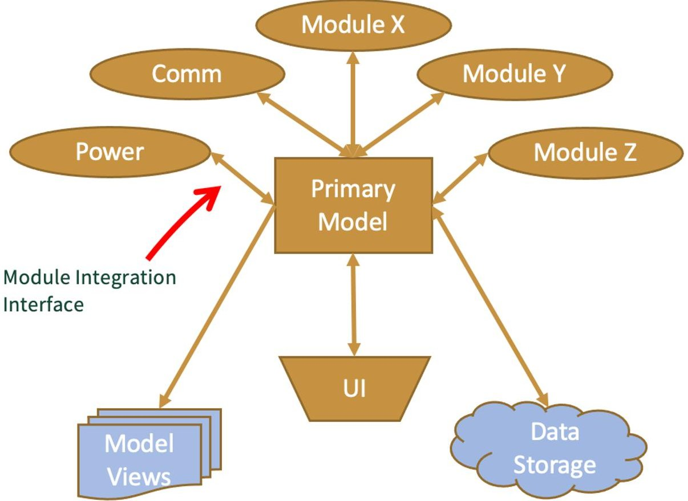

Figure 9. Original Tool Architecture

Eventually, there were several problems realized with this approach. First, the objectives of this thesis require accessibility for the tool, therefore requiring the use of free and open-source software tools. Open-source MBSE software suites such as Papyrus for Eclipse lack some of the capabilities and plug-ins that are available in enterprise-grade systems [32]. For example, there are plug-ins to run MATLAB and Mathematica directly from Cameo Systems Modeler, another MBSE program [33]. These plug-ins simplify the implementation of complex design calculations, such as those requiring simulation or propagation rather than simple parametric relationships,

<!-- PDF_PAGE: 41 -->

directly into an MBSE environment for tool developers. They are not required, however, and it is possible to implement detailed parametric equations within Papyrus [34][35]. Unfortunately, this approach poses challenges to accessibility for future tool developers due to the significant learning curve involved with implementing scripted language functions into MBSE.

The initial architecture for the Conceptual Design Tool failed at accessibility in another way as well. Disregarding the creation of the tool, this architecture would have required a user to have a modest level of proficiency in an MBSE environment to navigate the tool, input data, execute the design process, and access the result [6]. It is also more difficult to return errors to the user without having a GUI to present them in. By having the entire program built around a CubeSat Model, one has to have access and experience with MBSE to use the Conceptual Design Tool at all, which does not comply with the accessibility requirement, found in Objective-3.

Furthermore, the Conceptual Design Tool's initial architecture was flawed in that it limited the usability of the resulting CubeSat Model after the conceptual design process was finished [34]. The restructuring and additions needed to the model to allow for a conceptual design process to take place would have quickly outgrown the framework that the CSRM is implemented in, and these changes would potentially limit the usefulness of the model down the road. One would not want a model used throughout a program's life cycle to carry all the overhead of also being a conceptual design tool. This would necessitate the transfer the resulting design product into a different model after using the tool. This largely defeats the purpose of having the tool directly in the model in the first place, which was satisfy Objective-4 by promoting MBSE for good systems engineering practices.

Table 6. Challenges with Original Architecture

<table border="1"><tr><td>Objective</td><td>Challenges with Original Architecture</td></tr></table>

<!-- PDF_PAGE: 42 -->

<table border="1"><tr><td>Objective-1:Create Conceptual Design</td><td>$\bullet$ Imposes development challenges on tool users by open-source MBSE software lacking many analytical plug-ins$\bullet$ Challenge to size subsystems that require more than simple parametric equations</td></tr><tr><td>Objective-2:Reduce Process Time</td><td>$\bullet$ MBSE knowledge requirements mean there are less possible conceptual designers$\bullet$ Leads to the same problem CPCL has today with oversubscription of staff</td></tr><tr><td>Objective-3:Improve Tool Accessibility</td><td>$\bullet$ Needs a suite of MBSE software installed just to use the tool$\bullet$ Requires any user of the Conceptual Design Tool to be proficient in MBSE</td></tr><tr><td>Objective-4:Promote Systems Engineering</td><td>$\bullet$ May not be the best model to support a program&#x27;s entire life cycle due to its focus on the addition of parametric equations and other design tool elements</td></tr></table>

Due to the stated deficiencies with this approach, summarized in Table 6, the MBSE-based architecture was abandoned in favor of one that minimized the amount of user knowledge and involvement with MBSE. Not all Conceptual Design Tool users should have to be MBSE experts, just like not all expert modelers can run a spacecraft conceptual design process. Rather one user should be able to run the Conceptual Design Tool before they or another user passes that information into an instance of the CubeSat Model for future use.

## 3.1.2 Final Tool Architecture

From an architecture perspective, the solution to the aforementioned challenges was to remove the conceptual design from the CubeSat Model, while still developing the tool to interface with the model. The result is the CubeSat Conceptual Design Tool, a self-contained program with its own GUI for the CubeSat developer. The program includes Subsystem Design Modules for individual subsystems, but these are in the same language as the central model and can easily engage with it. There is no

<!-- PDF_PAGE: 43 -->

requirement for the user to fully understand the workings of the tool behind this GUI, with instruction included within the tool. The program has Output Files that is designed to be directly input into the CubeSat Model when the conceptual design is done. It also includes Assumptions Files for assuming certain input parameters. Figure 10 shows this new architecture, including a key that shows the software utilized for the creation of each element. Table 7 provides a list of the elements in this architecture not already covered in Chapter 1.

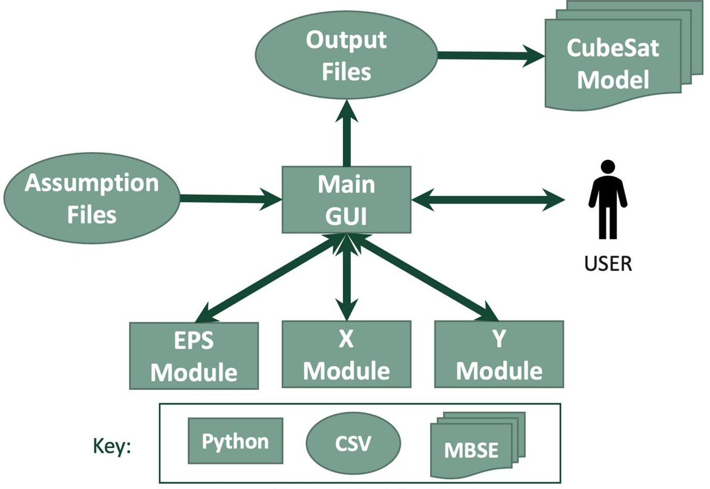

Figure 10. Final Tool Architecture

<!-- PDF_PAGE: 44 -->

Table 7. Further Project Element Definitions

<table border="1"><tr><td>Term</td><td>Description</td></tr><tr><td>Assumptions File</td><td>A CSV file containing one or more sets of assumptions needed to run a Subsystem Design Module.</td></tr><tr><td>Output File</td><td>A CSV file in which all parameters used (inputs, assumptions, and calculated outputs) within one or more subsystems are saved after the design process is run.</td></tr><tr><td>Use Cases</td><td>These are different ways in which a Subsystem Design Module can operate, taking different inputs and outputting potentially different sets of data.</td></tr><tr><td>Design Options</td><td>Sets of values that are stored within a subsystem&#x27;s assumptions file, these correspond with different preselected designs for a subsystem.</td></tr></table>

The tools operation will be expanded upon in subsequent sections, but the general process works as follows:

1. A user runs the Main GUI file (main.py) in a Python interpreter to launch the tool.

2. The user works through the Main GUI, opening the different Subsystem GUIs as they proceed.

3. The user inputs information as required into the Subsystem GUIs.

4. The user finishes with each subsystem and commands the tool run the conceptual design from the Main GUI.

5. The Main GUI then executes scripts for each of the Subsystem Design Tools.

6. Each tool's script reads that subsystem's Assumptions File and chooses the right Design Option values to use from there, before combining those with input values and any other subsystem's parameters to calculate the resulting design.

7. These results are sent with all parameters used into the Output File, which is saved locally and where the results can be initially viewed.

<!-- PDF_PAGE: 45 -->

88. The results are then transferred into a table within the CubeSat Model for storage and usage within the model.

## 3.2 Software Used

The successful completion of the CubeSat Conceptual Design Tool depends on decisions in what software is used in its development. This is because Objective-3 requires the tool to be highly accessible to end-users. Therefore, only free and open-source software could be utilized. This imposed a limitation on languages that could be utilized for both the Conceptual Design Tool, file formats that could be used to store data, and modeling programs that could be used for the CubeSat Model.

## 3.2.1 Conceptual Design Tool Software

The CubeSat Conceptual Design Tool is being created in Python, specifically Python 3.9. Python was chosen over other programming languages for several reasons. First, Python is a free, open-source language, unlike MATLAB, another commonly used language for design analysis [36][37]. As a high-level programming language, Python makes use of natural language abstraction and minimizes syntax requirements, which maximizes code readability. These features of Python are critical on a project that will see numerous code developers work on it over time by lowering the barriers to entry for people without Python experience and enabling easier comprehension of others code.

Furthermore, the use Python was preferable as it is an object-oriented programming language [38]. Object-orient programming was deemed important since the CubeSat Conceptual Design Tool is being developed one subsystem at a time, so the architecture was chosen to be class-based to allow different subsystems to be developed and run independently. Each class can also store different data and have different functions operating on that data. Objects, or instances of a class, can then be used to pass the data around the different subsystem classes as required.

<!-- PDF_PAGE: 46 -->

Originally, the integrated development environment (IDE) used on this project was the Integrated Development and Learning Environment (IDLE). As the is the default IDE for Python, it suited the free and open-source requirements [39]. Eventually, Microsoft Visual Studio Code was utilized as the IDE, as it provides aesthetic, debugging, and workflow conveniences over the bare-bones IDLE [40]. It is notable that Visual Studio Code is free under a MIT License, which allows any person usage and modification of the source-code as long as it retains the license. Furthermore, Visual Studio Code is not required to run or develop the tool, as other IDEs or text editors would suffice as long as one has Python.

Within Python, three main packages were used: Tkinter, csv, and math. Tkinter is a Python version of the open-source Tk GUI [41]. This was the package that was used in the creation of the various GUIs in this Conceptual Design Tool. The csv package allows CSV files to be read from and written to by Python, which is necessary for this tool's architecture [42]. The math package comes standard with math functions to perform trigonometric and other operations, which are necessary to performing the mathematical operations needed in a design process [43].

## 3.2.2 Associated Files and MBSE Software

Comma-separated values (CSV) are another file-type that was necessary for this project. CSVs were mostly developed in Microsoft Excel for ease of use, but there are numerous free, open source CSV editors available to use as other options [44] [45]. MBSE programs can also import CSVs, which enable the outputs the Conceptual Design Tool to be input into the CubeSat Model.

The original CSRM was created in Cameo Systems Modeler, which is proprietary software currently published by Dassault Systèmes [31]. The CubeSat Model based on the CSRM had to utilize open-source software. This was done by using Eclipse 4.18 as the IDE and Papyrus 5.0 as the modeling environment plug-in, utilizing SysML 1.4 for

<!-- PDF_PAGE: 47 -->

Papyrus as the modeling language. The full breakdown of software that was used can be found in Table 8.

Table 8. Software Utilized

<table border="1"><tr><td>Element</td><td>Language/File Format</td><td>Environment</td></tr><tr><td>CubeSat Conceptual Design Tool(software)</td><td>Python3.9</td><td>IDLE
Microsoft Visual Studio Code</td></tr><tr><td>CubeSat Conceptual Design Tool(associated files)</td><td>CSV</td><td>Tad
Table Tool
Microsoft Excel</td></tr><tr><td>CubeSat Model</td><td>UML2.5
SysML1.4</td><td>Eclipse4.18
Papyrus5.0
SysML1.4 for Papyrus</td></tr></table>

## 3.3 Conceptual Design Tool Elements

This section provides for an overview of the different tool elements as shown in Figure 10. Note that in this chapter, the explanations will be generic, as they encompass statements valid for the whole Conceptual Design Tool, rather than the specific implementation of the EPS Module that has been completed with this thesis. The specifics for that are covered in Chapter 4.

## 3.3.1 Assumptions Files

A key feature in the tool is the existence of pre-created lists of assumptions for the CubeSat Conceptual Design Tool. The assumptions consist of tables of values that can be read into the design tool. Some of these assumptions could be physical constants, such as the standard gravitational parameter for Earth, that will always be read in. Other assumptions are conditional, where the user can input their own values or choose a set of assumptions. Furthermore, assumptions also work as a back-up for when users do not input a defined answer to a question. For example, if the user does not know a solar cell's temperature degradation rate, but they know the lifetime

<!-- PDF_PAGE: 48 -->

degradation rate, the system will use an assumed value for temperature degradation from the assumption list.

As shown in Figure 10, the Assumptions Files are in a separate CSV rather than coded into the Conceptual Design Tool. This was done for two primary reasons. First, it allows users easily to access and view the assumptions. Secondly, some assumed values can change over time, so an advanced tool user can update values as technology evolves or even customize sets of assumptions for individual design campaigns. Table 9 shows an example of what the header would look like for an assumption list CSV. "Variable" is the plain text name of the parameter being looked at, "Variable Name" is what that value is called in the code, and "Units" include the unit used for each parameter. There are multiple options for "Values", however, corresponding to the multiple Design Options for a user to select based on their desired level of customization or their available technology level. The Assumptions Files are in the same folder as the rest of the CubeSat Conceptual Design Tool. This is important, as it allows for a consistent path to importing the parameters.

Table 9. Headers for a Sample Assumption File

<table border="1"><tr><td>Variable</td><td>Variable Name</td><td>Value-Option1</td><td>Value-Option2</td><td>Value-Option3</td><td>Units</td></tr></table>

Each subsystem has its own unique Assumptions File. These files include a list of all parameters used within the subsystem, including empty values that rely on inputs or calculations. This is necessary because the tool uses the assumption list to create the Output File to be discussed in Section 3.2.4.

## 3.3.2 Main GUI

The Main GUI is the primary Python interface for running runs the CubeSat Conceptual Design Tool. The Main GUI's file, main.py, needs to be ran through a Python interpreter, with all of the associated Subsystem Design Module files in the same folder.

<!-- PDF_PAGE: 49 -->

It is built around a GUI in Tkinter, with different tabs for each subsystem, as shown in Figure 11. The user can work through accessing the various Subsystem GUIs, as discussed in Section 3.3.3, through the Main GUI. The Main GUI creates the instances for these Subsystem Design Modules and issues the commands to run various functions for them at different times. Furthermore, the selection of Use Cases, which determine how a Subsystem Design Module will function, is done in the Main GUI. General information, such as the name for the design, can be input here as well. The final command to run the design tool is done from the 'Finish' tab here as well.

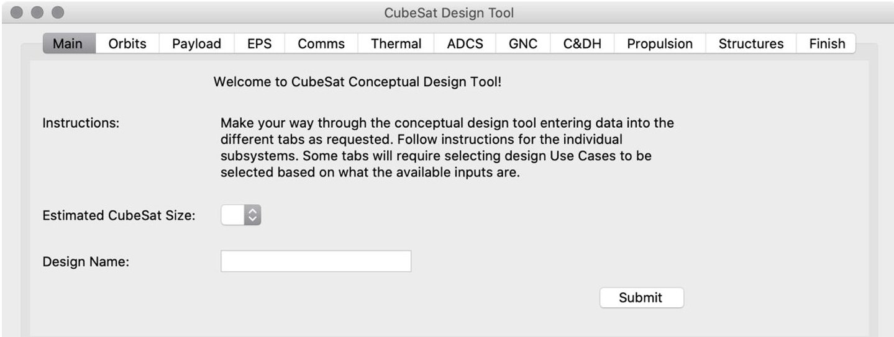

Figure 11. Main GUI Opening Page

## 3.3.3 Subsystem Design Modules

Each subsystem has its own Subsystem Design Module within the CubeSat Conceptual Design Tool. This allows the modules to be developed in a piecewise manner, reducing the amount of work required by a single developer and allowing them to go more in-depth into their work. The development of a module includes all of the necessary assumptions, GUIs, design calculations, and outputs for a subsystem. While not explicitly part of a Subsystem Design Module, the corresponding elements of the CubeSat Model should be developed alongside the module. The Assumptions and

<!-- PDF_PAGE: 50 -->

Output Files are outside of the Python code as well, but they are read into or created by the module.

The two key elements to a Subsystem Design Module are the Subsystem GUI and Subsystem Design Tool. These may be within the same class or within separate classes, with the primary reason for separation being ease of code readability in longer files. If they are separate, only the GUI has to be initialized when the main tool starts, as the sizing class does not need to be run until the design calculations are run after all subsystems have their inputs entered.

With respect to the Subsystem GUI, it contains the primary way that a user interacts with the subsystem's module. The GUI class is initialized at the start of the program and then called to open when that subsystem is selected in the Main GUI. The constructor for this class is responsible for initializing all the variables that will be needed for it. These are the same list of variables found in the Assumption File. When assumptions are read in, they are saved to one of these values, along with any user inputs. The Subsystem GUI is responsible for storing values input into it by the user before they finish with it.

The Subsystem Design Module also contains the Subsystem Design Tool, which where the design calculations for the subsystem occur. It all the values stored in the Subsystem GUI class and goes through a design process to define calculated values. The function for this tool shall also have the instances of the other subsystem classes passed into it, allows for one subsystem's values to be used in another's calculations while reducing repetitive data inputs between subsystems. The Subsystem Design Tool is then in charge of writing all of the values for the subsystem into the Output File.

## 3.3.4 Output Files

After the CubeSat Conceptual Design Tool is run, the Output File is the resulting end product. It is similar to the Assumptions File for each subsystem and contains the

<!-- PDF_PAGE: 51 -->

same parameters. Unlike the Assumptions File, however, there is only one set of values in the output, not multiple possible sets of assumptions for different Design Options. Furthermore, all the values are filled in, as the unknown values have been calculated by the design tool.

Currently, each subsystem is planned to have its own Output File, as that is what integrates the easiest with the CubeSat Model for now. However, it would be possible to create an Output File with all subsystem parameters in one place. This would require changes to the CubeSat Model though, enabling a table to be created for all parameters outside of a single subsystem's package.

## 3.3.5 CubeSat Model

The CubeSat Model was based on the CSRM that was discussed in Section 2.3. The CSRM does not currently work with open-source MBSE software, so the model needed to be recreated for this thesis. Furthermore, this new model, referred to as the CubeSat Model, is not a pure recreation of the CSRM, as the CubeSat Model requires adaptations to interface with the parameters coming from the Conceptual Design Tool. The resulting model includes a more detailed level of design for the CubeSat. These changes in the CubeSat Model mean it will not be fully developed, however, as expansion is limited to the package structure and the thread of development for whichever Subsystem Design Module is being implemented. This is due to the lack of knowledge over the values that will need to be added to the model. Therefore, as other modules are worked on, they will have control over what needs to go within their respective domains.

These modifications fit into the intention of the CSRM's creators, which was to allow for future users to use the CubeSat Model as a building block for their CubeSat specific models [29]. With the CubeSat Model being developed, however, the

<!-- PDF_PAGE: 52 -->

customization is going to be a generalized model itself, allowing for instances of the model to be created based for future CubeSat missions.

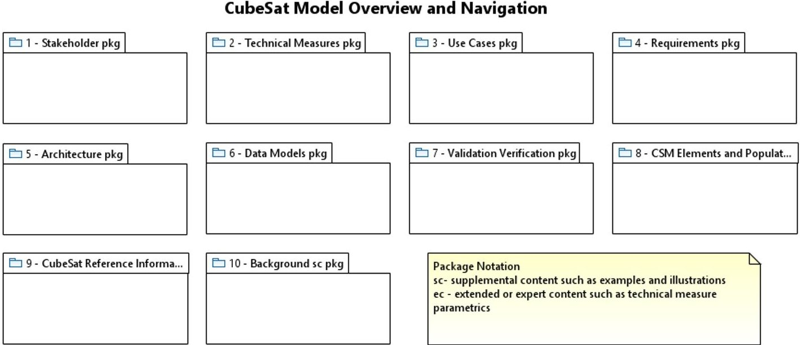

Figure 12. CubeSat Model Overview Package Diagram

The recreation of the CSRM as the CubeSat Model has progressed in the following manner. First, a focus was made on creating the package structure for the model, shown in Figure 12. The packages create the backbone of the model. Other elements, from package diagrams to individual values, fall into these packages. Accordingly, the next step was to make the necessary package diagrams that fall into different packages, of which many of the primary ones were recreated. Figure 13 shows one of these diagrams, the Architecture Hierarchy diagram for the Architecture segment of the model. The Architecture package is where the changes were made compared to the original CSRM in order to accommodate the parameters being output by the Conceptual Design Tool. The primary change shown here is the addition of the 'L5 Parameters' package and its contents to the architecture package.

<!-- PDF_PAGE: 53 -->

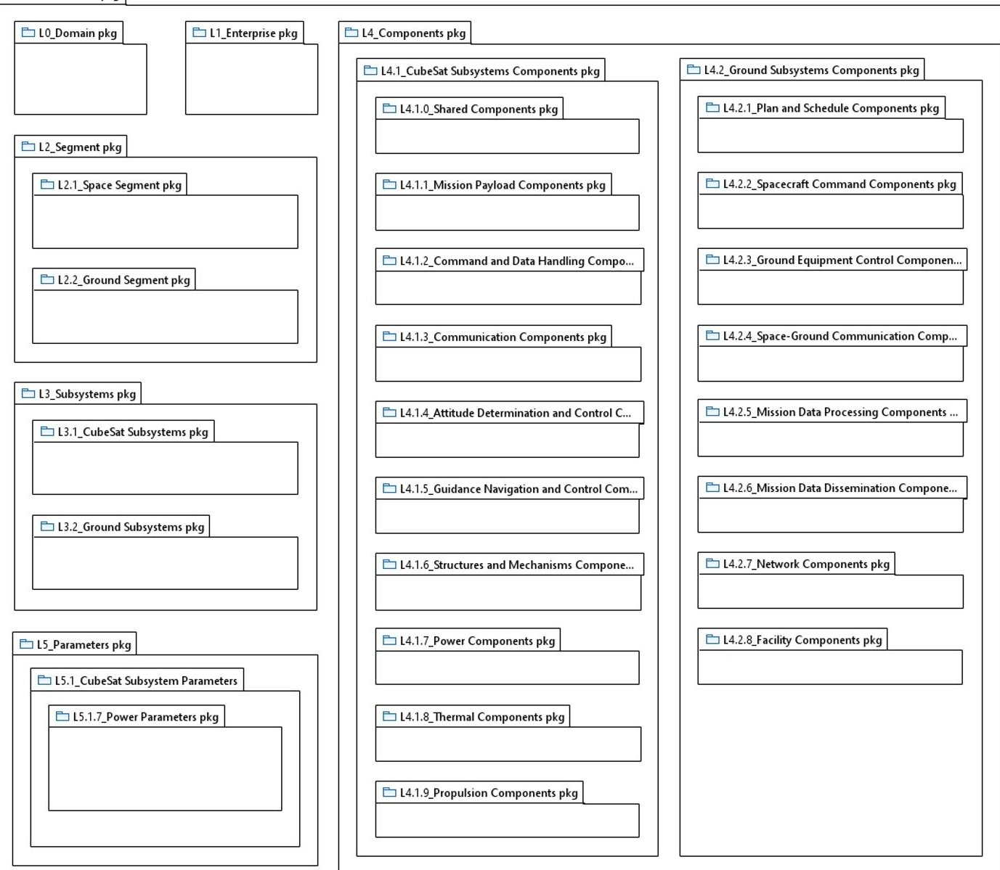

Figure 13. CubeSat Model Architecture Hierarchy

The space segment contains component parts that correspond to CubeSat subsystems. These blocks contain parts that then include components for each subsystem. The current additions to the model include a lower-level block being added that stores the properties within a subsystem generated in the CubeSat Design Tool.

Eventually, the goal for the model is to have the values that are imported from the Conceptual Design Tool link into other parts of the model, such as Requirement Tables within the Requirements package. In that example, it would then allow the

<!-- PDF_PAGE: 54 -->

generation of requirements from the Conceptual Design Tool results and traceability of them within the model.

Since all of the parameters used to run the tool are stored within the model, if something is changed, one has to change the model. Furthermore, the model is sensitive to the order of parameter values that are input to it. Therefore, the adding of parameters to a model should be undertaken towards the end of the process of building a Subsystem Design Module.

<!-- PDF_PAGE: 55 -->

## Chapter 4

## ELECTRICAL AND POWER SUBSYSTEM MODULE

This chapter presents the EPS Module that was developed for the CubeSat Conceptual Design Tool. This is the first subsystem module to be implemented for the tool. As such, its development is both test case for the overall tool and a pathway for future subsystems. The EPS Design Module is comprised of two separate classes, stored in two different Python scripts. One of these classes is for the EPS GUI, while the other is for the EPS Design Tool.

## 4.1 EPS Parameters

The first stage of the EPS Module development was to collect the parameters that will be used in the module. These parameters consist of three primary types of values: assumptions, inputs, and calculated values. Assumptions are values that are always read into the tool. Inputs are values which the user enters into the program. Calculated values are found by the tool's design equations. Furthermore, assumptions also include conditional assumptions, which may be either inputs or assumptions. These may be assumed by the tool or input by the user, depending on what Design Option they select and what information they have.

A full list of parameters with associated units found in the EPS Design Module is presented in Table 10. This list includes the type of values they are.

Table 10. Parameters Utilized

<table border="1"><tr><td>Assumptions</td><td>Conditional Assumptions</td><td>Inputs</td><td>Calculated Values</td></tr></table>

<table border="1"><tr><td>Parameter</td><td>Units</td><td>Parameter</td><td>Units</td></tr><tr><td>Use Case</td><td>-</td><td>Payload Average Power</td><td>W</td></tr><tr><td>Design Option</td><td>-</td><td>Structure Power Mode 1</td><td>W</td></tr><tr><td>Average Power</td><td>W</td><td>Structure Power Mode 2</td><td>W</td></tr><tr><td>Average PDU Power Loss</td><td>W</td><td>Structure Power Mode 3</td><td>W</td></tr><tr><td>Power Margin</td><td>W</td><td>Structure Power Mode 4</td><td>W</td></tr><tr><td>Average Power w/ Margin</td><td>W</td><td>Structure Average Power</td><td>W</td></tr></table>

<!-- PDF_PAGE: 56 -->

<table border="1"><tr><td>Percent Power Margin</td><td>%</td><td>Thermal Power Mode 1</td><td>W</td></tr><tr><td>Mode 1 Name</td><td>-</td><td>Thermal Power Mode 2</td><td>W</td></tr><tr><td>Mode 2 Name</td><td>-</td><td>Thermal Power Mode 3</td><td>W</td></tr><tr><td>Mode 3 Name</td><td>-</td><td>Thermal Power Mode 4</td><td>W</td></tr><tr><td>Mode 4 Name</td><td>-</td><td>Thermal Average Power</td><td>W</td></tr><tr><td>Mode 1 Duty Cycle</td><td>%</td><td>Solar Cell Efficiency BOL</td><td>%</td></tr><tr><td>Mode 2 Duty Cycle</td><td>%</td><td>Solar Cell Degradation Rate</td><td>%/yr</td></tr><tr><td>Mode 3 Duty Cycle</td><td>%</td><td>Solar Cell Temp Degradation</td><td>%/°C</td></tr><tr><td>Mode 4 Duty Cycle</td><td>%</td><td>Solar Cell Temperature</td><td>°C</td></tr><tr><td>Mode 1 Average Power</td><td>W</td><td>Solar Tracking</td><td>-</td></tr><tr><td>Mode 2 Average Power</td><td>W</td><td>Solar Deployable</td><td>-</td></tr><tr><td>Mode 3 Average Power</td><td>W</td><td>Solar Packing Density</td><td>%</td></tr><tr><td>Mode 4 Average Power</td><td>W</td><td>Battery One-way Efficiency</td><td>%</td></tr><tr><td>ADCS Power Mode 1</td><td>W</td><td>Battery Cell Mass</td><td>kg</td></tr><tr><td>ADCS Power Mode 2</td><td>W</td><td>Battery Cell Energy Density</td><td>Wh/kg</td></tr><tr><td>ADCS Power Mode 3</td><td>W</td><td>Battery Cell Energy Capacity</td><td>Wh</td></tr><tr><td>ADCS Power Mode 4</td><td>W</td><td>Battery Depth-of-Discharge</td><td>%</td></tr><tr><td>ADCS Average Power</td><td>W</td><td>PDU Efficiency</td><td>%</td></tr><tr><td>C&amp;DH Power Mode 1</td><td>W</td><td>PDU Mass</td><td>kg</td></tr><tr><td>C&amp;DH Power Mode 2</td><td>W</td><td>PDU Data Rate</td><td>kb/day</td></tr><tr><td>C&amp;DH Power Mode 3</td><td>W</td><td>Solar Flux</td><td>W/m2</td></tr><tr><td>C&amp;DH Power Mode 4</td><td>W</td><td>Orbit Energy</td><td>Wh</td></tr><tr><td>C&amp;DH Average Power</td><td>W</td><td>Average Eclipse Energy</td><td>Wh</td></tr><tr><td>Comms Power Mode 1</td><td>W</td><td>Max Eclipse Energy</td><td>Wh</td></tr><tr><td>Comms Power Mode 2</td><td>W</td><td>Average Sun Energy</td><td>Wh</td></tr><tr><td>Comms Power Mode 3</td><td>W</td><td>Min Sun Energy</td><td>Wh</td></tr><tr><td>Comms Power Mode 4</td><td>W</td><td>Battery Round-trip Efficiency</td><td>%</td></tr><tr><td>Comms Average Power</td><td>W</td><td>Battery Cycles</td><td>cycles</td></tr><tr><td>EPS Power Mode 1</td><td>W</td><td>Battery Degradation Rate</td><td>%/5000 cycles</td></tr><tr><td>EPS Power Mode 2</td><td>W</td><td>Battery Degradation</td><td>%</td></tr><tr><td>EPS Power Mode 3</td><td>W</td><td>Battery Discharge Energy</td><td>Wh</td></tr><tr><td>EPS Power Mode 4</td><td>W</td><td>Number of Cells in Battery</td><td>-</td></tr><tr><td>EPS Average Power</td><td>W</td><td>Battery Capacity</td><td>Wh</td></tr><tr><td>GNC Power Mode 1</td><td>W</td><td>Battery Mass</td><td>kg</td></tr><tr><td>GNC Power Mode 2</td><td>W</td><td>Solar Cell Efficiency EOL</td><td>%</td></tr><tr><td>GNC Power Mode 3</td><td>W</td><td>Lifetime Degradation</td><td>%</td></tr><tr><td>GNC Power Mode 4</td><td>W</td><td>Temperature Degradation</td><td>%</td></tr><tr><td>GNC Average Power</td><td>W</td><td>Solar Energy Minimum Sun</td><td>Wh</td></tr><tr><td>Payload Power Mode 1</td><td>W</td><td>Average Solar Power Minimum Sun</td><td>W</td></tr><tr><td>Payload Power Mode 2</td><td>W</td><td>Solar Power Flux - EOL</td><td>W/m2</td></tr><tr><td>Payload Power Mode 3</td><td>W</td><td>Solar Effective Area</td><td>m2</td></tr><tr><td>Payload Power Mode 4</td><td>W</td><td>Solar Panel Area</td><td>m2</td></tr><tr><td>Payload Average Power</td><td>W</td><td></td><td></td></tr></table>

## 4.1.1 EPS Assumptions and Design Options

There are three selectable Design Options within the Conceptual Design Tool's EPS Design Module. Each of these results in a different version of the initial parameter

<!-- PDF_PAGE: 57 -->

list. Specifically, the Design Options each have different columns of values within the EPS Assumptions File. The calculated values remain empty in the Assumptions File for all options, while the permanent assumptions are constant. The three options are: Custom, Standard, and Advanced.

Table 11 shows the portion of the Assumption File for EPS that contains conditional parameters controlled by the selection of a Design Option. The values within the Design Options are designed to be evolved by future users as CubeSat technology advances.

Table 11. Assumed Values for Design Options

<table border="1"><tr><td>Parameter</td><td>Units</td><td>Values1</td><td>Values2</td><td>Values3</td></tr><tr><td>Design Option</td><td>-</td><td>Custom</td><td>Standard</td><td>Advanced</td></tr><tr><td>BOL Solar Cell Efficiency</td><td>%</td><td>28.00</td><td>28.00</td><td>32.00</td></tr><tr><td>Solar Cell Degradation Rate</td><td>%/yr</td><td>2.50</td><td>2.50</td><td>2.50</td></tr><tr><td>Solar Cell Temperature Degradation</td><td>%/℃</td><td>0.35</td><td>0.35</td><td>0.35</td></tr><tr><td>Solar Cell Temperature</td><td>℃</td><td>50.00</td><td>50.00</td><td>50.00</td></tr><tr><td>Solar Array Pointing</td><td>-</td><td>Tumbling</td><td>Tumbling</td><td>Sun Tracking</td></tr><tr><td>Deployables</td><td>-</td><td>Body Mounted</td><td>Body Mounted</td><td>Deployable</td></tr><tr><td>Cell Capacity</td><td>Wh</td><td>10.00</td><td>10.00</td><td>13.00</td></tr><tr><td>Cell Mass</td><td>kg</td><td>0.047</td><td>0.047</td><td>0.047</td></tr><tr><td>One-way Efficiency</td><td>%</td><td>95.00</td><td>95.00</td><td>95.00</td></tr><tr><td>Depth-of-Discharge</td><td>%</td><td>60.00</td><td>60.00</td><td>60.00</td></tr><tr><td>PDU Mass</td><td>kg</td><td>0.080</td><td>0.080</td><td>0.080</td></tr><tr><td>PDU Efficiency</td><td>%</td><td>85.00</td><td>85.00</td><td>90.00</td></tr><tr><td>PDU Data Rate</td><td>kb/day</td><td>1.50</td><td>1.50</td><td>1.50</td></tr></table>

The first option is a Custom design. Custom design enables the user to input completely custom design sizing parameters. However, if data is not input for a parameter, the program will fall back to a default assumed parameter; thus, the program

<!-- PDF_PAGE: 58 -->

can still run. The EPS GUI does this by using try and except blocks in Python when reading the values input into the GUI. The try block first tries to run reading an input from the entry box, and if that is not successful, the except block will assign the default parameter. The default parameters currently correspond to the assumed values in the Standard Design Option.

The second option is the Standard set of parameters. The Standard set of parameters are conservative values for small satellites, as found in the book Space Mission Engineering: The New SMAD and older CubeSat designs [46][47][48]. These were selected as a safe option, since the performance found with these values are readily available in even the most affordable commercial off-the-shelf (COTS) components and while using a less advanced subsystem final design.

The third option is the Advanced set of parameters. The Advanced set of parameters is based off values and components from the 2020 NASA Small Spacecraft Technology State-of-the-Art Report [49]. This report looks at cutting edge technology in the CubeSat and SmallSat realms. While the report defines state-of-the-art as anything Technology Readiness Level (TRL) 5 and higher, within the relevant EPS section, TRL 9 components almost were exclusively listed by the report's authors. Therefore, the parameters taken from the report are exclusively from the highest performing components, all of which were TRL 9.

## 4.2 EPS GUI

The next part of the EPS Module that was developed was the EPS GUI. The EPS GUI uses a separate instance of Tkinter from the Main GUI. This was not required, as Tkinter has a Toplevel function that allows for the creation of additional windows from the main one. However, it was seen as a more modular solution, with each module running its own instance of Tkinter instead of requiring the Main GUI to grow and accommodate additional windows being created.

<!-- PDF_PAGE: 59 -->

While using Tkinter, variables must be declared as Tk variable using the BooleanVar, StringVar, IntVar, or DoubleVar functions. It was decided to minimize the direct use of these variables by initializing general Python variables for the subsystem's parameters in the module's constructor. All the parameters listed in Section 4.1 are initialized within the constructor of the EPS GUI, and this should be the same for all subsystems. By initializing all of a subsystem's variables in the Subsystem GUI constructor, which runs on program start-up, it allows the variables to be accessible throughout the program the entire time the tool is running. After the entries are made into a Tkinter GUI, a function within the class then reads the entry boxes into the initialized Python variables. Using Tk variables and moving them around the module is then avoided.

There are two primary Use Cases that one can select using the Main GUI. These determine how the EPS GUI looks and operates. The details on the Use Cases are provided in the subsequent sections.

## 4.2.1 Use Case 1: Power Budget to Power Design

Use Case 1 enables the EPS Module to work without the remaining modules. It was implemented to allow the EPS Design Module of the tool to work immediately upon completion of this thesis, as well as enable future users to size just an EPS if they desire. Furthermore, if a power budget has already been developed, this use case enables users to input it directly. Use Case 1 has two tabs within its GUI, because it needs one to input the power budget and another for the design sizing parameters.

<!-- PDF_PAGE: 60 -->

Input your spacecraft power budget below. If there is a mode that will be the standby or eclipse mode, click the appropriate button to select that mode as it and do not input a duty cycle for that mode. The eclipse mode will automatically scale to calculated maximum eclipse. The standby mode will be found from the time not in other duty cycles.

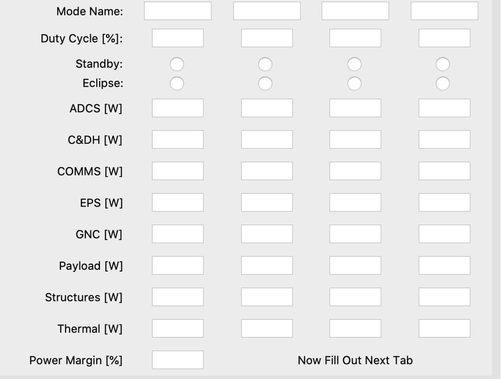

Figure 14. Use Case 1 Power Budget Tab

The first tab, Power Budget Input, shown in Figure 14, is where the power budget is input. If a user leaves any power value blank, it automatically sets the value to zero. This is also the tab where the total EPS power margin gets chosen. The user can name the different power modes and supply their duty cycles. There are also options for declaring a mode to be the standby mode or eclipse mode. The standby and eclipse modes set the duty cycle to a calculated value, which is covered in Section 4.3. A user can choose to use or forgo any of the modes and the tool will still work.

The second tab for the EPS Design Module's GUI is the EPS Design Input tab shown in Figure 15. This is where the user can input or select parameters that help with the sizing of a CubeSat, such as specifications for the batteries, power distribution unit

<!-- PDF_PAGE: 61 -->

(PDU), and solar cells. This tab is also where the Design Options are selected. If the Custom option is chosen, any values not filled in have parameters automatically assigned. If another option is used, no values here require inputs.

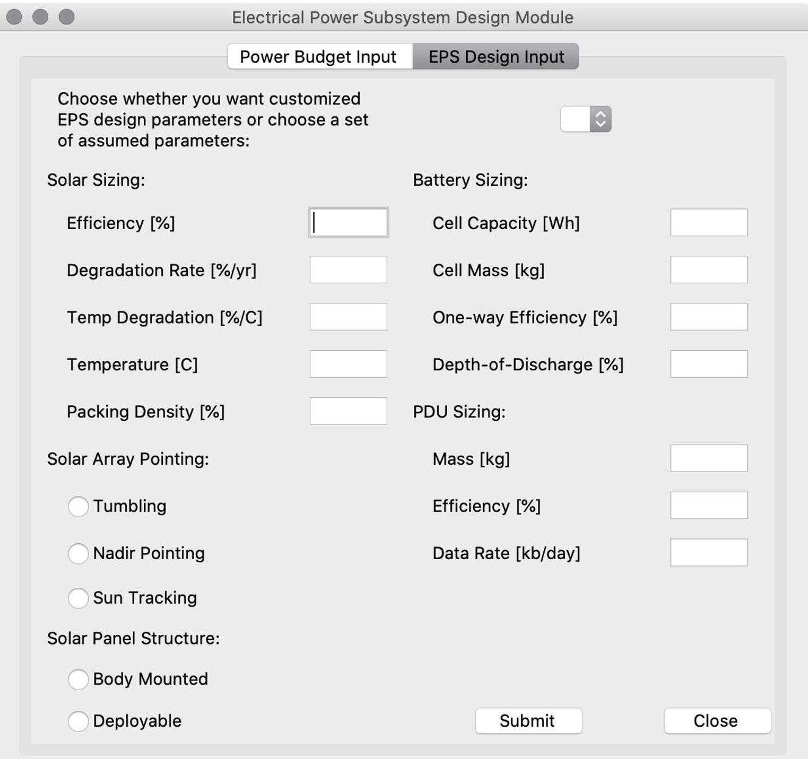

Figure 15. Use Case 1 EPS Design Tab

## 4.2.2 Use Case 2: Subsystem Design to Power Design

Use Case 2 enables a user to operate the Conceptual Design Tool without already having all the information about the power budget. It does this by developing the power parameters internally in other subsystems, through inputs or calculations by them. The values from other subsystems are then utilized in the EPS Design Tool, as all subsystems can use values from all other subsystems with this tool architecture. As

<!-- PDF_PAGE: 62 -->

seen in Figure 16, this means it only needs a single tab for the GUI. The power margin input is moved into the EPS Design Input tab for Use Case 2, as it is still needed.

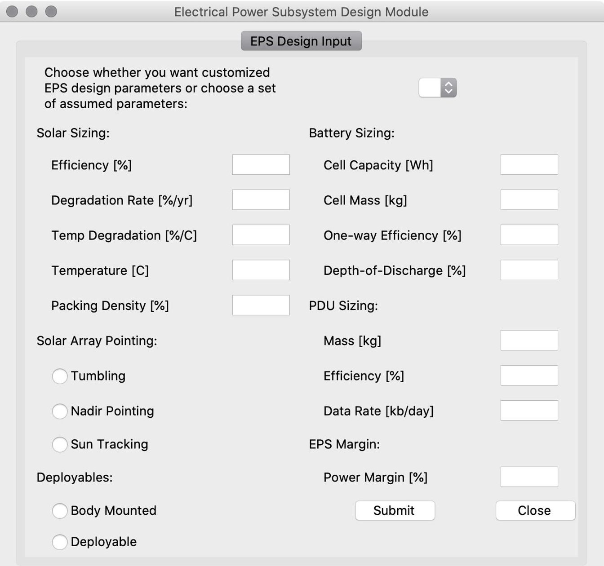

Figure 16. Use Case 2 EPS Design Tab

This Use Case is primarily intended for future use when other Subsystem Design Modules have been developed. For example, the Payload Design Module may have an input for operational and standby power. The operational power could be assigned to one mode, while the standby is assigned to the remaining modes. Another example could be in the Communications Design Module, where power levels are calculated to close the link budget, that could then be assigned as its power in communications mode.

<!-- PDF_PAGE: 63 -->

Meanwhile, a parameter such as duty cycle for desaturation or eclipse could be calculated in the ADCS or Orbits Design Modules, respectively.

## 4.3 EPS Design Tool

The EPS Design Module has its subsystem design tool in a separate python module. This was done for ease of development of the module, as a single class with functions for the Subsystem GUI and Subsystem Design Tool would have been extremely long, making it harder to make edits and work simultaneously between the two. It is possible for the Subsystem Design Tool function(s) to be in the same class as the Subsystem GUI function. However, to reduce the size of the Python class, such an implementation would best work for a subsystem with low number of parameters, limited calculation complexity, a single use case, and a simple GUI.

Please note that some parameters presented in the following sections specifically those related to the spacecraft's orbit, are not developed within this module. The discussion on how these values were developed is in Section 5.1.

The equations used in the EPS Design Tool come from a variety of sources, but all follow the same general process. These include Space Mission Engineering: The New SMAD, Spacecraft Power Systems, and numerous CubeSat papers [46][50][47][51].

## 4.3.1 Power Budget: Use Case 1

For Use Case 1, the power budget is entered by the user in the EPS GUI. It is then necessary to calculate comprehensive power levels for different subsystems and modes, as well as take into account PDU losses and margin.

First, if a Standby or Eclipse Mode was selected in the Power Budget tab of the GUI, its duty cycle has to be established. For the eclipse mode, this is done by taking the maximum time in eclipse divided by the orbital period (Eqn.1). Note that duty cycles are

<!-- PDF_PAGE: 64 -->

all values between 0-100% in this program, not fractional. This is done for the convenience of the user, as they are most often presented as percentages.

$$
D _ {e l e p s e} = \frac {t _ {e l e p s e - m a x}}{T _ {o r b i t}} \times 1 0 0
$$

The standby mode is comprised of the entire time the spacecraft is not in another utilized mode. Therefore, this is calculated by taking the remainder of the summation of the other utilized duty cycles, including that of eclipse, if found (Eqn. 2).

$$
D _ {s t a n d b y} = 1 0 0 - \sum_ {i = 1} ^ {n} D _ {n}
$$

The next step is finding the average power for each subsystem and power mode [47]. While both values are found, only the EPS mode average power is needed for subsequent calculations, with the subsystem average powers being a primarily an output value and parameter other subsystem modules could rely on. The subsystem average power calculation uses the weighted average of the power for each mode of a subsystem with respect to the duty cycle (Eqn. 3). Accordingly, the duty cycle average power is just the summation of all the subsystem powers for that mode (Eqn. 4).

$$
P _ {s u b - a v g} = \sum_ {i = 1} ^ {m o d e} P _ {s u b - i} \frac {D _ {i}}{1 0 0}
$$

$$
P _ {m o d e - a v g} = \sum_ {i = 1} ^ {s u b} P _ {m o d e - i}
$$

At this point, the power budget needs to account for losses and margin [47]. The losses we are concerned about at this stage are PDU losses, the percent of power that is lost within a PDU as waste heat during operations such as power conversion. Note that the required power to operate the PDU can be accounted for in the EPS row of the power budget. Eqn. 5 combines the accounting for losses and margin in the power budget. This is applied to each mode after its average power has been calculated. Eqn.

<!-- PDF_PAGE: 65 -->

5 is also decomposed in order to be calculated in a step-by-step process to account for the individual effects of PDU efficiency and power margin on the power budget. However, these results are not used in subsequent calculations, but rather stored as a potentially useful output.

$$
P _ {m o d e - l o s s - m a r g i n} = \frac {P _ {m o d e - a v g}}{\eta_ {P D U} / 1 0 0} \left(1 + \frac {p _ {m a r g i n}}{1 0 0}\right)
$$

Next, the average power requirements for periods of eclipse and sunlight are found. If there is an eclipse mode, the average power during eclipse is found by Eqn. 6. Then the average power during sunlight is found using the weighted average of the power levels for the remaining modes (Eqn. 7). If there is no eclipse mode, the average power required is the same during eclipse and sunlight, which is the weighted average of the power levels for all of the modes (Eqn. 8).

$$
P _ {e l i p s e - a v g} = P _ {e l i p s e - l o s s - m a r g i n}
$$

$$
P _ {s u n - a v g} = \frac {\left(\sum_ {i = 1} ^ {m o d e (n o t e l i p s e)} P _ {i - l o s s - m a r g i n} \frac {D _ {i}}{1 0 0}\right)}{\sum_ {i = 1} ^ {m o d e (n o t e l i p s e)} \frac {D _ {i}}{1 0 0}}
$$

$$
P _ {a v g} = \sum_ {i = 1} ^ {m o d e} P _ {i - l o s s - m a r g i n} \frac {D _ {i}}{1 0 0}
$$

The average powers are then used to find required energy usage for different phases of the CubeSat's orbit. The sizing of the spacecrafts EPS is driven by worst case eclipse scenarios, as is generally the case in satellite design [46][52]. If there is no designated eclipse mode, Eqn.9 and Eqn.10 are utilized to find the energy, in Watt hours (Wh), for the spacecraft in both eclipse and sunlight. If there is a set eclipse mode, Eqn.11 and Eqn.12 are needed to find the energy for these respective portions of the orbit. Note that the sunlit energy values only consider energy needed to operate, as the energy needed to charge batteries for eclipse will be included later in this design process.

<!-- PDF_PAGE: 66 -->

$$
E _ {e l i p s e - m a x} = P _ {a v g} \frac {t _ {e l i p s e - m a x}}{3 6 0 0}
$$

$$
E _ {s u n - m i n} = P _ {a v g} \frac {t _ {s u n - m i n}}{3 6 0 0}
$$

$$
E _ {e l i p s e - m a x} = P _ {e l i p s e - a v g} \frac {t _ {e l i p s e - m a x}}{3 6 0 0}
$$

$$
E _ {s u n - m i n} = P _ {s u n - a v g} \frac {t _ {s u n - m i n}}{3 6 0 0}
$$

## 4.3.2 Power Budget: Use Case 2

For the power budget in Use Case 2, the power modes and their subsystem specific power levels are assigned based on values developed in the other subsystems, rather than directly input into the EPS Design Module. This means the primary difference between Use Case 1 and Use Case 2 is the addition of assignment statements in the latter. Values for subsystem power levels, duty cycles, and operational mode names, are generated in other subsystems and then assigned to the same set of variables that are in Use Case 1. Currently, this is based around other subsystems providing values for nominal, communications, desaturation, and eclipse modes, although these could be changed in the future. Once these values are assigned, the existing framework for the power budget's full development, shown in Section 4.3.1, is followed.

## 4.3.3 Battery Sizing

After the creation of the power budget, the next step in the EPS Design Tool is to size the spacecraft battery. To do this, one must first find the required energy utilization from the battery. While the energy the spacecraft uses from the battery was already developed in the power budget section as the eclipse energy, now the tool needs to account for battery efficiencies, depth-of-discharge (DoD), and degradation. First, discharge energy during the maximum eclipse time needs to be calculated, as shown in Eqn.13. This value accounts for how much energy needs to be stored in the battery to provide for the required output.

<!-- PDF_PAGE: 67 -->

$$
E _ {d i s c h a r g e - m a x} = \frac {E _ {e l i p s e - m a x}}{\eta_ {b a t - o n e w a y}}
$$

Next, the required end-of-life (EOL) battery energy must be calculated. This value considers the battery's chosen DoD when sizing its energy capacity (Eqn.14).

$$
E _ {b a t - E O L} = \frac {E _ {b a t - d i s c h a r g e}}{\left(^ {D o D} / 1 0 0\right)}
$$

The following step is to account for battery degradation. On larger spacecraft, degradation concerns can be minimized by maintaining a low DoD, even while experiencing periods of maximum eclipse [46]. However, this luxury is not always available to CubeSat developers. They may be constrained in battery size by physical sizing limitations, as well as regulations from launch providers or space services companies [53][54]. By utilizing a higher DoD, however, there are risks with ensuing battery degradation.

Table 12. Assumed Values for Battery Allowing Life Modeling (adapted from [56])

<table border="1"><tr><td>Parameter</td><td>Assumption</td></tr><tr><td>Battery Temperature</td><td>20℃</td></tr><tr><td>Depth-of-Discharge</td><td>Constant</td></tr><tr><td>Discharge Rate</td><td>1C</td></tr><tr><td>Charge Rate</td><td>1C</td></tr><tr><td>Battery Chemistry</td><td>Li-ion</td></tr><tr><td>Starting SoC</td><td>50%+half of DoD</td></tr></table>

Battery degradation rate is based off a myriad of factors, including battery temperature, charge rate, discharge rate, battery chemistry, battery manufacturing quality, DoD, starting state-of-charge (SoC), and number of cycles [53]. Unfortunately, there is no universally recognized battery degradation equation, but rather models that are usually fitted for specific cells or other assumptions. Therefore, an approximation for degradation rate is used, based solely off of the DoD and cycle life [55]. Assumptions for this approximation are shown in Table 12 [55].

<!-- PDF_PAGE: 68 -->

Table 13. Battery DoD vs. Degradation Rate (adapted from [56])

<table border="1"><tr><td>DoD[%]</td><td>Degradation[%/5000 cycles]</td></tr><tr><td>0-20</td><td>7</td></tr><tr><td>21-40</td><td>12</td></tr><tr><td>41-60</td><td>15</td></tr><tr><td>61-80</td><td>20</td></tr><tr><td>81-90</td><td>30</td></tr><tr><td>91-100</td><td>$60^{1}$</td></tr></table>

$ ^{1} $ For the highest DoDs, the rate of degradation is extremely high, and therefore this is an estimate based on the lower end of this range. No spacecraft batteries should routinely have a DoD this high [46]

The appropriate degradation rate is found for the corresponding DoD, as shown in Table 13. After this value is assigned, it is used in Eqn.15 to find the battery degradation over its lifetime. The degradation rate is per 5000 cycles of the battery, corresponding to 5000 orbits, so the battery degradation is calculated using the number of orbits. From there, the required battery capacity beginning-of-life (BOL) is found with Eqn.16.

$$
L _ {d e g r a d - b a t} = \left(1 - \frac {d _ {b a t}}{1 0 0}\right) ^ {n _ {o r b i t s} / 5 0 0 0}
$$

$$
E _ {b a t - B O L - r e q} = \frac {E _ {b a t - E O L}}{L _ {d e g r a d - b a t}}
$$

Once the BOL battery capacity is found, it is necessary to size an actual battery that fit. Note that potential pack voltages are not taken into consideration when sizing the battery in this program. CubeSats utilize a multitude of pack level voltages, which directly correlate to the number of cells in the battery pack [49]. During more detailed design of a spacecraft, it is critical to account for the battery voltage to ensure compatibility with a PDU [47]. For now, the number of battery cells required is given by dividing the required beginning of life battery capacity by the cell energy capacity and

<!-- PDF_PAGE: 69 -->

rounding that value up to an integer (Eqn.17). From this, the actual mass of the batteries and true BOL battery capacity can be calculated as well (Eqn.18 and Eqn.19).

$$
n _ {c e l l s} = \left\lceil \frac {E _ {b a t - B O L - r e q}}{E _ {c e l l}} \right\rceil
$$

$$
m _ {b a t} = n _ {c e l l s} m _ {c e l l}
$$

$$
E _ {b a t} = n _ {c e l l s} E _ {c e l l}
$$

## 4.3.4 Solar Sizing

The next step in the EPS design process is the sizing of the solar array system. The first step is to calculate how much energy the solar panels need to produce in a worst-case scenario. The worst case scenario is the period of minimum sunlight and maximum eclipse, as during this limited sunlit time the energy for the entire orbit must be generated [46]. One needs account for the roundtrip efficiency of the battery in this scenario, as the battery must be charged and discharged (Eqn.20). Then the total energy required for this scenario is calculated with Eqn.21 by adding the energy for the sunlit portion of orbit with the energy needed to fill the battery for the eclipse portion of the orbit. Dividing this by the time, in hours, of sunlight for this orbit, one can get the average solar power generation required while in sunlight (Eqn.22).

$$
\eta_ {b a t - r o u n d t r i p} = \frac {\eta_ {b a t - o n e w a y} ^ {2}}{1 0 0}
$$

$$
E _ {s o l a r - w o r s t} = E _ {s u n - m i n} + \frac {E _ {e l i p s e - m a x}}{\eta_ {b a t - r o u n d t r i p} / 1 0 0}
$$

$$
P _ {s o l a r - w o r s t} = \frac {E _ {s o l a r - w o r s t}}{t _ {s u n - m i n} / 3 6 0 0}
$$

To find the actual required solar array size, one needs to account for solar cell degradation. Compared to battery degradation, solar efficiency degradation is accepted to be simpler to model [46][55]. The two primary factors in this are lifetime degradation and temperature degradation. The lifetime degradation is irreversible damage to the

<!-- PDF_PAGE: 70 -->

solar cells due to solar radiation. The EPS Design Module takes lifetime degradation rate in percent per year. Eqn. 23 shows the equation for calculating the lifetime degradation factor, considering both rate of degradation and time in orbit.

$$
L _ {d e g r a d - s o l} = \left(1 - \frac {d _ {r a t e - t i m e}}{1 0 0}\right) ^ {t _ {m i s s i o n - y e a r s}}
$$

Meanwhile, the temperature degradation is only a temporary efficiency loss, as solar cells lose efficiency when they heat up [46]. There are multiple ways to measure this, but it is most commonly found in percent per $ ^{\circ} \mathrm{C} $ , so that metric is used. The difference between the solar cell's actual temperature and rated temperature is used to calculate the temperature degradation (Eqn.24).

$$
T _ {d e g r a d - s o l} = \left(1 - \frac {d _ {r a t e - t e m p}}{1 0 0}\right) ^ {T _ {s o l a r} - T _ {b a s e}}
$$

From these degradation values, one can find the actual operating efficiency of the solar cells at EOL, as shown in Eqn.25. From this, the required effective solar area needs to be found, which is the area required if the solar cells were all facing the sun at a 0 $ ^{\circ} $ incidence angle the entire time that the spacecraft is in sunlight. Unless the CubeSat has deployable solar arrays and active spacecraft pointing to align with sun, this will not be the true solar area. The effective solar area required is calculated by taking the required average power for this worst-case scenario and dividing that by the EOL efficiency of the solar cells and the solar constant at Earth, which is a flux 1367 $ W / m^{2} $ (Eqn.26).

$$
\eta_ {s o l - E O L} = \eta_ {s o l - B O L} L _ {d e g r a d - s o l} T _ {d e g r a d - s o l}
$$

$$
A _ {s o l - e f f e c t i v e} = \frac {P _ {s o l a r - w o r s e}}{\frac {\eta_ {s o l - E O L}}{1 0 0} G _ {S C}}
$$

The next step is finding the actual required area for the solar cells. To do this, one must take into account the location of the solar arrays and the pointing of the

<!-- PDF_PAGE: 71 -->

spacecraft. Two options exist in the tool for the location of the solar arrays, body mounted and deployable. Three options exist for spacecraft pointing, tumbling, nadir pointing, and sun tracking. This gives six possible combinations of how the actual required area of solar cells could be calculated. For the sun tracking and deployable panel combination, the true area of the solar cells is the same as the effective area.

Unfortunately, further development of the other design combinations for this parameter was stalled. As later discussed in Chapter 6, the order of development for the tool modules means the EPS Design Module is currently working independent of other modules. Therefore, other subsystems that would be needed for this step, particularly Orbits, ADCS, and Structures, are not created and the exact scope of these modules is unknown. This impacts the true solar area sizing, as the attitude and orbit of the spacecraft, along with its form factor, are needed to fully develop these calculations.

Therefore, at this stage a simple calculation based solely on body mounted solar cells on all faces of a tumbling CubeSat was made. Additional preliminary calculations for future use by the tool are also being developed in but are currently commented out as they rely on theoretical parameters from other subsystems. The estimated true solar area assumes that on average, 3 of the 6 sides are receiving sunlight with an average solar incidence angle of $ 5 0^{\circ} $ . The ratio of true power received to theoretical solar power is then 0.3214, which is in line with other published estimates [52]. Eqn.27 shows the required calculation, with the effective solar area being divided by the incident angle and then doubled to account for non-sunlit portions of the spacecraft. It also takes into account the packing efficiency of the solar cells on the CubeSat. Note that this value still is a rough approximation, as other variables at play include the exact size of the CubeSat and potential rotation about a primary axis.

<!-- PDF_PAGE: 72 -->

$$
A _ {s o l - t r u e} = 2 \frac {A _ {s o l - e f f e c t i v e}}{\cos \left(5 0 ^ {\circ}\right) \eta_ {s o l - p a c k i n g}}
$$

## 4.4 EPS Output File

As mentioned earlier, the outputs from the Conceptual Design Tool are saved to a CSV Output File. Table 14 shows the raw data from an Output File generated from a single development test of the Conceptual Design Tool, copied from the CSV viewed in table form. Note that the output includes the variables, variable names, and units alongside the value to enable readability of the CSV for easy access to design outputs. Currently, the tool does not take into consideration the required precision for the different values, and this should be addressed in later work.

Table 14. Sample Output CSV Values

<table border="1"><tr><td>Variable</td><td>Variable Name</td><td>Value</td><td>Units</td></tr><tr><td>Use Case</td><td>UseCase</td><td>1</td><td>-</td></tr><tr><td>Design Option</td><td>design_option</td><td>Custom</td><td>-</td></tr><tr><td>Average Power</td><td>P_AVG</td><td>4.55</td><td>W</td></tr><tr><td>Average PDU Power Loss</td><td>P_PDU_loss</td><td>5.0555556</td><td>W</td></tr><tr><td>Power Margin</td><td>P_margin</td><td>1.01111111</td><td>W</td></tr><tr><td>Average Power w/ Margin</td><td>P_AVG_margin</td><td>1.56111111</td><td>W</td></tr><tr><td>Percent Power Margin</td><td>per_margin</td><td>20</td><td>%</td></tr><tr><td>Mode 1 Name</td><td>mode1_name</td><td>Active</td><td>-</td></tr><tr><td>Mode 2 Name</td><td>mode2_name</td><td>Nominal</td><td>-</td></tr><tr><td>Mode 3 Name</td><td>mode3_name</td><td></td><td>-</td></tr><tr><td>Mode 4 Name</td><td>mode4_name</td><td></td><td>-</td></tr><tr><td>Mode 1 Duty Cycle</td><td>mode1_duty</td><td>55</td><td>%</td></tr><tr><td>Mode 2 Duty Cycle</td><td>mode2_duty</td><td>45</td><td>%</td></tr><tr><td>Mode 3 Duty Cycle</td><td>mode3_duty</td><td>0</td><td>%</td></tr><tr><td>Mode 4 Duty Cycle</td><td>mode4_duty</td><td>0</td><td>%</td></tr><tr><td>ADCS Power Mode 1</td><td>ADCS_P1</td><td>1</td><td>W</td></tr><tr><td>ADCS Power Mode 2</td><td>ADCS_P2</td><td>0</td><td>W</td></tr><tr><td>ADCS Power Mode 3</td><td>ADCS_P3</td><td>0</td><td>W</td></tr><tr><td>ADCS Power Mode 4</td><td>ADCS_P4</td><td>0</td><td>W</td></tr><tr><td>ADCS Average Power</td><td>ADCS_AVG</td><td>0.55</td><td>W</td></tr><tr><td>C&DH Power Mode 1</td><td>CDH_P1</td><td>1</td><td>W</td></tr><tr><td>C&DH Power Mode 2</td><td>CDH_P2</td><td>0</td><td>W</td></tr><tr><td>C&DH Power Mode 3</td><td>CDH_P3</td><td>0</td><td>W</td></tr><tr><td>C&DH Power Mode 4</td><td>CDH_P4</td><td>0</td><td>W</td></tr><tr><td>C&DH Average Power</td><td>CDH_AVG</td><td>0.55</td><td>W</td></tr><tr><td>Comms Power Mode 1</td><td>COMM_P1</td><td>3</td><td>W</td></tr><tr><td>Comms Power Mode 2</td><td>COMM_P2</td><td>4</td><td>W</td></tr></table>

<!-- PDF_PAGE: 73 -->

<table border="1"><tr><td>Comms Power Mode 3</td><td>COMM_P3</td><td>0</td><td>W</td></tr><tr><td>Comms Power Mode 4</td><td>COMM_P4</td><td>0</td><td>W</td></tr><tr><td>Comms Average Power</td><td>COMM_AVG</td><td>3.45</td><td>W</td></tr><tr><td>EPS Power Mode 1</td><td>EPS_P1</td><td>0</td><td>W</td></tr><tr><td>EPS Power Mode 2</td><td>EPS_P2</td><td>0</td><td>W</td></tr><tr><td>EPS Power Mode 3</td><td>EPS_P3</td><td>0</td><td>W</td></tr><tr><td>EPS Power Mode 4</td><td>EPS_P4</td><td>0</td><td>W</td></tr><tr><td>EPS Average Power</td><td>EPS_AVG</td><td>0</td><td>W</td></tr><tr><td>GNC Power Mode 1</td><td>GNC_P1</td><td>0</td><td>W</td></tr><tr><td>GNC Power Mode 2</td><td>GNC_P2</td><td>0</td><td>W</td></tr><tr><td>GNC Power Mode 3</td><td>GNC_P3</td><td>0</td><td>W</td></tr><tr><td>GNC Power Mode 4</td><td>GNC_P4</td><td>0</td><td>W</td></tr><tr><td>GNC Average Power</td><td>GNC_AVG</td><td>0</td><td>W</td></tr><tr><td>Payload Power Mode 1</td><td>PAY_P1</td><td>0</td><td>W</td></tr><tr><td>Payload Power Mode 2</td><td>PAY_P2</td><td>0</td><td>W</td></tr><tr><td>Payload Power Mode 3</td><td>PAY_P3</td><td>0</td><td>W</td></tr><tr><td>Payload Power Mode 4</td><td>PAY_P4</td><td>0</td><td>W</td></tr><tr><td>Payload Average Power</td><td>PAY_AVG</td><td>0</td><td>W</td></tr><tr><td>Structure Power Mode 1</td><td>STRU_P1</td><td>0</td><td>W</td></tr><tr><td>Structure Power Mode 2</td><td>STRU_P2</td><td>0</td><td>W</td></tr><tr><td>Structure Power Mode 3</td><td>STRU_P3</td><td>0</td><td>W</td></tr><tr><td>Structure Power Mode 4</td><td>STRU_P4</td><td>0</td><td>W</td></tr><tr><td>Structure Average Power</td><td>STRU_AVG</td><td>0</td><td>W</td></tr><tr><td>Thermal Power Mode 1</td><td>THER_P1</td><td>0</td><td>W</td></tr><tr><td>Thermal Power Mode 2</td><td>THER_P2</td><td>0</td><td>W</td></tr><tr><td>Thermal Power Mode 3</td><td>THER_P3</td><td>0</td><td>W</td></tr><tr><td>Thermal Power Mode 4</td><td>THER_P4</td><td>0</td><td>W</td></tr><tr><td>Thermal Average Power</td><td>THER_AVG</td><td>0</td><td>W</td></tr><tr><td>Solar Cell Efficiency BOL</td><td>SP_eff_bol</td><td>32</td><td>%</td></tr><tr><td>Solar Cell Degradation Rate</td><td>SP_degrad_rate</td><td>2.5</td><td>%/yr</td></tr><tr><td>Solar Cell Temp Degradation</td><td>SP_degrad_temp</td><td>0.5</td><td>%/C</td></tr><tr><td>Solar Cell Temperature</td><td>SP_temp</td><td>20</td><td>C</td></tr><tr><td>Solar Tracking</td><td>SP_tracking</td><td>1</td><td>-</td></tr><tr><td>Solar Deployable</td><td>SP_deployable</td><td>1</td><td>-</td></tr><tr><td>Solar Packing Density</td><td>SP_packing</td><td>0.95</td><td>-</td></tr><tr><td>Battery One-way Efficiency</td><td>bat_eff</td><td>95</td><td>%</td></tr><tr><td>Battery Cell Mass</td><td>cell_mass</td><td>0.12</td><td>kg</td></tr><tr><td>Battery Cell Energy Capacity</td><td>cell_cap</td><td>20</td><td>Wh</td></tr><tr><td>Battery Depth-of-Discharge</td><td>bat_dod</td><td>60</td><td>%</td></tr><tr><td>PDU Efficiency</td><td>PDU_eff</td><td>90</td><td>%</td></tr><tr><td>PDU Mass</td><td>PDU_mass</td><td>0.1</td><td>kg</td></tr><tr><td>PDU Data Rate</td><td>PDU_data</td><td>1.5</td><td>kb/day</td></tr><tr><td>Solar Flux</td><td>solar_flux</td><td>1367</td><td>W/m^2</td></tr><tr><td>Orbit Energy</td><td>orbit_energy</td><td>2.41887973</td><td>Wh</td></tr><tr><td>Max Eclipse Energy</td><td>eclipse_energy_max</td><td>0.93737327</td><td>Wh</td></tr><tr><td>Min Sun Energy</td><td>sun_energy_min</td><td>1.48150647</td><td>Wh</td></tr><tr><td>Battery Round-trip Efficiency</td><td>bat_roundtrip_eff</td><td>90.25</td><td>%</td></tr><tr><td>Battery Cycles</td><td>bat_cycles</td><td>16972.361</td><td>cycles</td></tr></table>

<!-- PDF_PAGE: 74 -->

<table border="1"><tr><td>Battery Degradation Rate</td><td>bat_degrad_rate</td><td>20</td><td>%/5000 cycles</td></tr><tr><td>Battery Degradation</td><td>bat_degrad</td><td>0.46885835</td><td>%</td></tr><tr><td>Battery Discharge Energy</td><td>bat_discharge_energy</td><td>2.10449211</td><td>Wh</td></tr><tr><td>Number of Cells in Battery</td><td>num_cells</td><td>1</td><td>-</td></tr><tr><td>Battery Capacity</td><td>bat_cap</td><td>20</td><td>Wh</td></tr><tr><td>Battery Mass</td><td>bat_mass</td><td>0.12</td><td>kg</td></tr><tr><td>Solar Cell Efficiency EOL</td><td>SP_eff_eol</td><td>26.8302945</td><td>%</td></tr><tr><td>Lifetime Degradation</td><td>L_degrad</td><td>0.92685937</td><td>%</td></tr><tr><td>Temperature Degradation</td><td>T_degrad</td><td>0.90461048</td><td>%</td></tr><tr><td>Solar Energy Minimum Sun</td><td>SP_energy_orbit_worst</td><td>2.5201472</td><td>Wh</td></tr><tr><td>Average Solar Power Minimum Sun</td><td>SP_avg_power_worst</td><td>2.65556033</td><td>W</td></tr><tr><td>Solar Power Flux-EOL</td><td>solar_eol</td><td>36677.0126</td><td>W/m^2</td></tr><tr><td>Solar Effective Area</td><td>SP_area_effective</td><td>7.24E-05</td><td>m^2</td></tr><tr><td>Solar Panel Area</td><td>SP_area</td><td>0.00021721</td><td>m^2</td></tr></table>

## 4.5 EPS in CubeSat Model

The elements of the CSRM replicated in depth and then changed for this thesis were primarily those related to the EPS for the CubeSat. Those modifications to the EPS portion of the model to suit the tool primarily consisted of developing a table to input the parameters from the tool. Specifically, these changes were made within Architecture package, including the Level 3 CubeSat Subsystems Package and Level 4 CubeSat Subsystems Components packages. Furthermore, a Level 5 CubeSat Subsystem Parameters package was made for holding the newly entered parameters and storing the values, as shown in Figure 17.

A table was created for the convenient transfer of the values for these parameters from the Output File into the CubeSat Model. This table contains all of the parameters for the EPS in the same order as the Output File, allowing them to be copied and pasted directly from the CSV into the MBSE parameter table. This input table is shown in Figure 18.

<!-- PDF_PAGE: 75 -->

## L5_Parameters pkg

L5.1_CubeSat Subsystem Parameters

L5.1.7_Power Parameters pkg

Power Parameters bdd

Power Parameters Table

Block Power Parameters

Power Parameters ibd

> Use Case : String

Design Option : String

Average Power : Real

Average PDU Power Loss : Real

> Power Margin : Real

Average Power w/ Margin : Real

Percent Power Margin : Real

Mode 1 Name : String

Mode 2 Name : String

Figure 17. Model Explorer View of Parameters Package

<table border="1"><tr><td>A</td><td>B</td></tr><tr><td>name:String[0..1]</td><td>value:String[0..1]</td></tr><tr><td>Use Case</td><td>1</td></tr><tr><td>Design Option</td><td>Custom</td></tr><tr><td>Average Power</td><td>10.7713</td></tr><tr><td>Average PDU Power Loss</td><td>11.96811111</td></tr><tr><td>Power Margin</td><td>2.39362222</td></tr><tr><td>Average Power with Margin</td><td>14.36173333</td></tr><tr><td>Percent Power Margin</td><td>20</td></tr><tr><td>Mode1 Name</td><td>Ops</td></tr><tr><td>Mode2 Name</td><td>Standby</td></tr><tr><td>Mode3 Name</td><td>UHF</td></tr><tr><td>Mode4 Name</td><td>X-Band</td></tr><tr><td>Mode1 Duty Cycle</td><td>10</td></tr><tr><td>Mode2 Duty Cycle</td><td>77.4</td></tr><tr><td>Mode3 Duty Cycle</td><td>11.1</td></tr><tr><td>Mode4 Duty Cycle</td><td>1.5</td></tr><tr><td>ADCS Power Mode1</td><td>2.5</td></tr><tr><td>ADCS Power Mode2</td><td>2.5</td></tr></table>

Figure 18. Power Parameters Table

<!-- PDF_PAGE: 76 -->

## Chapter 5

## VALIDATION

This chapter covers how the tool was tested to validate the results of thesis. There were two primary routes of validation executed. The first method involved functional testing of the CubeSat Conceptual Design Tool's architecture. Next, the EPS Design Module was tested within the tool for the accuracy of its performance in sizing a CubeSat's EPS.

## 5.1 Preliminary Validation Work

Since the work presented in this thesis is only the partial results of a larger, unfinished project, validation posed some unique challenges. In order to properly test the tool and EPS Design Module, modules had to be developed to simulate the other Subsystem Design Modules. While most of these elements were limited in required scope, the orbital analysis tool required a higher level of work.

## 5.1.1 Orbit Test Module

The Orbit Test Module had to see a higher level of development due to the significance that orbital parameters play in developing the EPS system. Many of the equations in Section 4.3 required values such as time in eclipse or number of orbits which would normally be developed in the full Orbit Design Module. It would be inconsistent with the goal of this project to temporarily include those inputs and necessary parametric equations within the EPS Module. Fortunately, this thesis is laying the foundation for the prompt development of other modules, so Orbit Test Module could be rapidly developed.

The Orbit Test Module is a single class that contains a constructor that initializes the variables in the Orbit module and a function that runs the GUI, similar to the EPS GUI module. However, it also has the design tool within as a function in the same class. The compressed nature of a test module enables them to be in the same file. For code

<!-- PDF_PAGE: 77 -->

readability and access on large modules, it is still recommended to have a Subsystem GUI class and Subsystem Design Tool class within the Subsystem Design Module.

The Orbit Test GUI is shown in Figure 19 below. It contains four orbit options for the user to choose from. There is an International Space Station (ISS) orbit, a 12AM/12PM sun-synchronous orbit (SSO), a low inclination low earth orbit (LEO), and a custom orbit option. All orbits are assumed to be circular in this module. Instructions are provided, and the limits of the tool are made clear. The user also inputs the mission lifetime in this module. Like other modules, there are "Submit" and "Close" buttons as well.

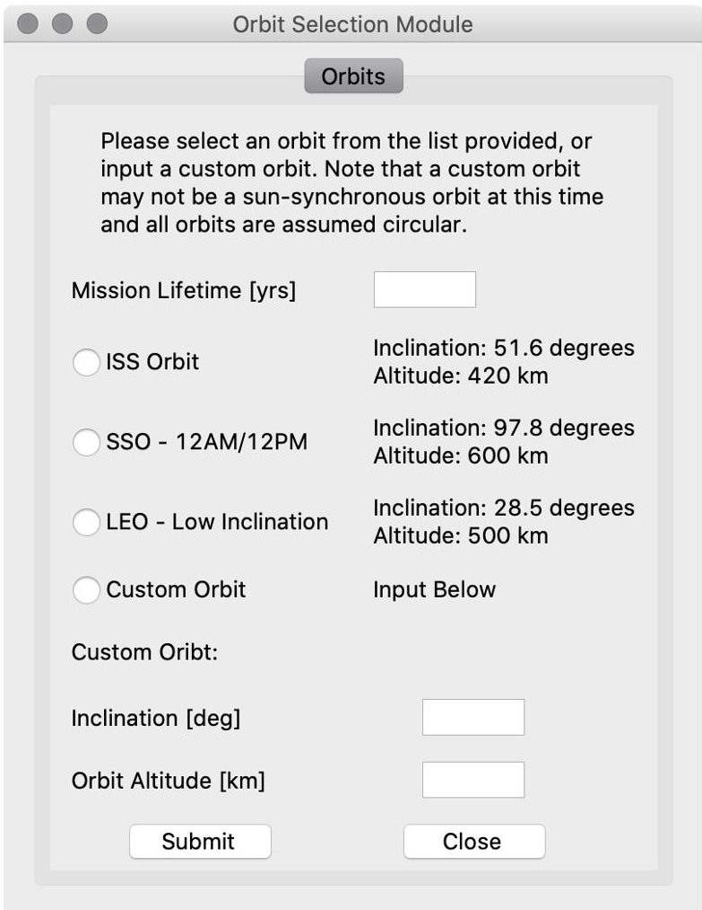

Figure 19. Orbit Test Module GUI

The module originally used orbital inclination and orbital altitude to determine key orbital parameters. However, this changed overtime, as the test module was descoped from including beta-angle analysis and orbital propagation to finding the maximum

<!-- PDF_PAGE: 78 -->

eclipse time in eclipse and minimum time in sun based solely on a worst-case beta angle.

The orbital analysis process begins with the orbital altitude being added to the radius of the earth to get the semi-major axis of the orbit (Eqn.28). This is then used to calculate the orbital period, in seconds, seen in Eqn.29. From there, the maximum fraction of an orbit in which the spacecraft is in eclipse is calculated by assuming a beta angle of $ 0^{\circ} $ , as shown in Eqn.30. Accordingly, this module does not work with SSO, unless it is a 12AM/12PM orbit, due to the lack of orbital precession to guarantee it would see such a beta angle.

$$
a = R _ {e a r t h} + h
$$

$$
T _ {o r b i t} = 2 \pi \sqrt {\frac {a ^ {3}}{\mu}}
$$

$$
f _ {e l l p s e} = \frac {1}{\pi} \cos^ {- 1} \left(\frac {\sqrt {h ^ {2} + 2 R _ {e a r t h} h}}{(a) \cos (\beta)}\right)
$$

Next, the time spent in eclipse and time spent in sunlight under a maximum eclipse scenario can be calculated with the fractional time spent in eclipse and the spacecraft's period using Eqn.31 and Eqn.32. These values are important for determining energy and power for the solar and battery sizing calculations. Finally, the number of orbits per day and over the mission had to be calculated (Eqn.33 and Eqn. 34).

$$
t _ {e l i p s e - m a x} = T f _ {e l i p s e}
$$

$$
t _ {s u n - m i n} = T \left(1 - f _ {e l i p s e}\right)
$$

$$
n _ {o r b i t s / d a y} = \frac {2 4 \times 3 6 0 0}{T}
$$

$$
n _ {o r b i t s} = 3 6 5. 2 5 t _ {m i s s i o n - y e a r s} n _ {o r b i t s / d a y}
$$

<!-- PDF_PAGE: 79 -->

## 5.1.2 Other Subsystem Test Modules

Other subsystems had test modules created as well, but none to the extent of the Orbit Test Module. These test modules were present for a few main reasons: to ensure the Main GUI worked creating instances of all of them, to ensure their data could passed into the EPS Design Module, and to test EPS Use Case 2.

Use Case 2 requires these modules to be developed, as it receives the power budget values from individual Subsystem Design Modules. Hence, testing Use Case 2 required values in other subsystems to be passed into the EPS Design Tool. These modules are being simulated by hardcoding parameters into the constructor of each test Subsystem Design Module. Like the Orbit Test Module, these are all monolithic modules of only one file. The parameters that are in each test module currently include power values for nominal, communications, desaturation, and eclipse modes, as well as duty cycles and mode names in some of the modules.

## 5.2 Conceptual Design Tool Architecture Testing

The architecture testing is fundamentally testing the stability of the CubeSat Conceptual Design tool, not the accuracy of the resulting conceptual design. As such, this section focuses on the functionality of the software between the Main GUI, EPS Design Module, and Orbit Test Module. That is, it ensures the tool design process runs smoothly and errors are produced if expected, but this testing does not check the validity of the design outputs.

## 5.2.1 Plan

The architecture testing sees the development of a test matrix that looks at different ways a user could operate the Conceptual Design Tool. As seen in Table 15, this includes different Use Cases, orbits, Design Methods, and missing information. There is also an expected outcome for each of these tests. While the tool is supposed to run nominally in most cases, some missing information or lack of selections should

<!-- PDF_PAGE: 80 -->

return an error in the tool, either through a written command line statement or through a pop-up window. Each of these test cases are to be run to see if their outcome is as expected.

Note that the testing of Use Case 2 requires the use of the test modules for other subsystems. For the missing information, parameters were just set to zero within them. This is because in the full development of the modules, values will be initialized to some default value. These tests are for seeing what happens with the EPS module if postinitialization a subsystem fails to develop that value. Removing the variables entirely causes an expected error where the function is unable to find the relevant variable within an associated instance of a subsystem while trying to create the power budget.

Table 15. Conceptual Design Tool Test Matrix

<table border="1"><tr><td>Test#
No</td><td>Use Case</td><td>Orbit Case</td><td>Design Method</td><td>Information Missing</td><td>Expected Outcome</td><td>Pass/Fail</td></tr><tr><td>1</td><td rowspan="16">Use Case 1</td><td>ISS Orbit</td><td rowspan="5">Any</td><td>None</td><td>Tool Runs</td><td>Pass</td></tr><tr><td>2</td><td>SSO-12AM/12PM</td><td>None</td><td>Tool Runs</td><td>Pass</td></tr><tr><td>3</td><td>LEO-LOW Inclination</td><td>None</td><td>Tool Runs</td><td>Pass</td></tr><tr><td>4</td><td rowspan="2">Custom</td><td>None</td><td>Tool Runs</td><td>Pass</td></tr><tr><td>5</td><td>Altitude</td><td>Command Line Error:“Not Enough Orbit Information”</td><td>Pass</td></tr><tr><td>6</td><td rowspan="10">Any</td><td rowspan="4">Custom</td><td>None</td><td>Tool Runs</td><td>Pass</td></tr><tr><td>7</td><td>Power Mode 1</td><td>Tool Runs-Mode 1 Values Set to Zero</td><td>Pass</td></tr><tr><td>8</td><td>EPS Parameter</td><td>Tool Runs: Back up values are used</td><td>Pass</td></tr><tr><td>9</td><td>Design Option</td><td>Pop Up Error</td><td>Pass</td></tr><tr><td>10</td><td rowspan="3">Standard</td><td>None</td><td>Tool Runs</td><td>Pass</td></tr><tr><td>11</td><td>Duty Cycle 1</td><td>Tool Runs</td><td>Pass</td></tr><tr><td>12</td><td>Eclipse Power</td><td>Tool Runs</td><td>Pass</td></tr><tr><td>13</td><td rowspan="3">Advanced</td><td>None</td><td>Tool Runs</td><td>Pass</td></tr><tr><td>14</td><td>Comm Power 1</td><td>Tool Runs</td><td>Pass</td></tr><tr><td>15</td><td>Power Margin</td><td>Tool Runs</td><td>Pass</td></tr><tr><td>16</td><td></td><td>ISS Orbit</td><td>Any</td><td>None</td><td>Tool Runs</td><td>Pass</td></tr></table>

<!-- PDF_PAGE: 81 -->

<table border="1"><tr><td>17</td><td rowspan="14">Use Case 2</td><td>SSO-12AM/12PM</td><td rowspan="4"></td><td>None</td><td>Tool Runs</td><td>Pass</td></tr><tr><td>18</td><td>LEO-LOW Inclination</td><td>None</td><td>Tool Runs</td><td>Pass</td></tr><tr><td>19</td><td rowspan="2">Custom</td><td>None</td><td>Tool Runs</td><td>Pass</td></tr><tr><td>20</td><td>Altitude</td><td>Command Line Error:“Not Enough Orbit Information”</td><td>Pass</td></tr><tr><td>21</td><td rowspan="10">Any</td><td rowspan="4">Custom</td><td>None</td><td>Tool Runs</td><td>Pass</td></tr><tr><td>22</td><td>Power Mode 1</td><td>Tool Runs</td><td>Pass</td></tr><tr><td>23</td><td>EPS Parameter</td><td>Tool Runs: Back up values are used</td><td>Pass</td></tr><tr><td>24</td><td>Design Option</td><td>Pop Up Error</td><td>Pass</td></tr><tr><td>25</td><td rowspan="3">Standard</td><td>None</td><td>Tool Runs</td><td>Pass</td></tr><tr><td>26</td><td>Duty Cycle 1</td><td>Tool Runs</td><td>Pass</td></tr><tr><td>27</td><td>EPS Parameter</td><td>Tool Runs</td><td>Pass</td></tr><tr><td>28</td><td rowspan="3">Advanced</td><td>None</td><td>Tool Runs</td><td>Pass</td></tr><tr><td>29</td><td>Comm Power 1</td><td>Tool Runs</td><td>Pass</td></tr><tr><td>30</td><td>Power Margin</td><td>Tool Runs</td><td>Pass</td></tr><tr><td>31</td><td colspan="3">No Use Case selected</td><td>Pop Up Error</td><td>Pass</td></tr></table>

## 5.2.2 Process

To test this fairly and accurately, the tool was reopened after each run. For the Orbit Selection when "any" was specified, an ISS Orbit was chosen. When the Design Option column called for "any", Standard was used. This is noted for the record, but those tests cases were not necessarily testing those respective portions of the design tool. When an "EPS Parameter" was called to be missing, one or more parameters in the EPS Design Input tab were left unfilled.

## 5.2.3 Results

As Table 15 also shows, each architecture test was successfully passed. To analyze this, the Output File was looked at after each run to check if they have changed over the previous run. Such a result was expected, due to the extensive time spent in development running the tool and at times troubleshooting these types of scenarios with the CubeSat Conceptual Design Tool. Figure 20 shows some of the pop-up error

<!-- PDF_PAGE: 82 -->

messages that came about during this process when a Use Case or Design Option were not selected before hitting a button to submit.

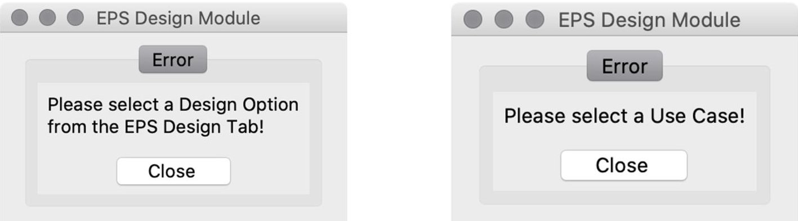

Figure 20. Pop-up Error Messages

It is important to remember that this validation step was purely testing the functionality of the tool's architecture, not the validity of the resulting design. There is still a possibility for missed errors in the architectural design. Nonetheless, it is safe to say that the CubeSat Conceptual Design Tool's Main GUI functions well and its interactions with the Subsystem Design Modules are fundamentally sound. Future developers are now safe to start from these results without having to worry about the soundness of the tool's architecture.

## 5.3 EPS Design Module Testing

On top of the Conceptual Design Tool being tested, the functionality of the EPS Design Module specifically must be demonstrated through its own validation tests. This will require a known set of CubeSat systems, with information on their power budget, components, and sizing available, to be used to test the tool by seeing if it comes up with similar results.

## 5.3.1 Plan

The testing plan for the CubeSat Conceptual Design Tool's EPS Design Module sees the development of test cases for the system. These test cases are already existing CubeSat designs, that have already gone through a conceptual design process

<!-- PDF_PAGE: 83 -->

or further design development. The inputs are found from published work, and then used within the Conceptual Design Tool.

Two test cases were formally chosen for this step, comprised of CubeSat conceptual design studies rather than finalized CubeSat EPS designs. This was a result of the differing level of development between the two scenarios. For fully implemented CubeSats, the EPS papers delve into much more detailed design and their concept of operations for a mission gets fully expanded, resulting in parameters that are significantly more complex and nuanced than the Conceptual Design Tool is able to handle. For example, one mission had 14 modes in there nominal reference orbit alone [56].

The first case, referred to as Test Case 1, comes from a paper, "Closing the Power Budget Architecture for a 1U CubeSat Framework" from Georgia Tech's Space Systems Design Laboratory [52]. This is a straightforward, well documented concept for a 1U CubeSat with a level of design detail that fits well within the framework the tool's inputs and outputs. The specific orbital case utilized for this satellite was the "Low Power Orbit", which is the maximum eclipse orbit scenario. This is because this was the use case in which the battery's state-of-charge comes out neutral, therefore having its results being the most representative of the results for this tool, specifically for the battery sizing.

Test Case 2 comes from a recent CPCL conceptual design proposal for a CubeSat called PowerSat [57]. This test case is particularly important, as it is directly comparing the results from this tool with those of CPCL's existing EPS sizing tool, which has a heritage of use within CPCL for CubeSats design.

With respect to the Use Cases used for this validation, Use Case 2 was utilized for Test Case 1, meaning parameters were set within the test modules. Meanwhile, Test Case 2 saw the Use Case 1 utilized to input the necessary parameters. Excluding some

<!-- PDF_PAGE: 84 -->

assignments of parameters at the beginning, these Use Cases are the same for the rest of the design process.

## 5.3.2 Process

To begin the EPS Module validation, reference documents and component specification sheets were looked at for the test cases to compile all the necessary inputs and expected outputs for the conceptual design process. This data was compiled into files similar to the current EPS Assumption File in order to facilitate accurate transfer of data into the tool. Due to their extensive lengths, the full list of parameters utilized are shown in Appendix B in the form of the Output Files, as these includes all input values as well.

Test Case 1 had to have its power budget entered into the test modules as it used Use Case 2. This process was simplified by Test Case 1 only having a single power mode. After this, the test cases could be run using the Conceptual Design Tool. Both Test Case 1 and Test Case 2 were run, but only the latter shall see a step-by-step overview of its execution in this section, as it gives the full overview of the EPS GUI, including inputting the power budget.

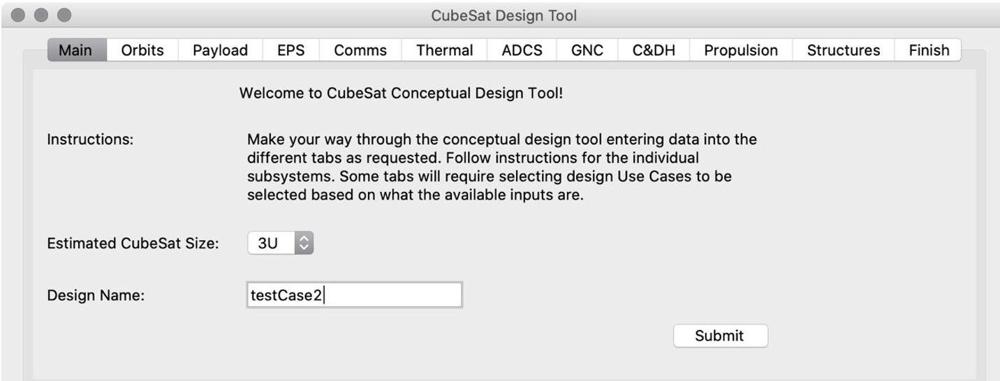

Figure 21. Test Case 2 Main GUI

<!-- PDF_PAGE: 85 -->

The CubeSat Conceptual Design Tool is opened by running the Main GUI using the main.py script for the program. This results in the GUI seen in Figure 21. The design name testCase1 was chosen and submitted in the Main tab within the Main GUI, which will be the name of the resulting Output File for this process.

Now it is time to work through the various subsystem tabs. At this stage, only the Orbit Test Design Module and the EPS Design Module are relevant, so the remaining tabs may be skipped. It is not required to work through the tabs in any particular order, as they are only data entry interfaces, but it is recommended to go sequentially so none are inadvertently skipped.

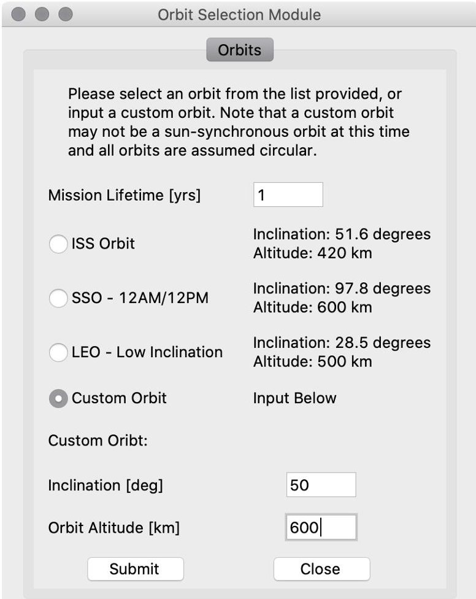

Figure 22. Test Case 2 Orbit Test Module

Within the Orbits tab, the Orbit Test Module GUI is opened by selecting the "Input Orbit" button. From there, the Orbits Test Module opens up, and the selections for Test Case 2 are entered as is shown in Figure 22. That information is then saved into the

<!-- PDF_PAGE: 86 -->

program by clicking "Submit", before closing the window with either the "Close" button or the close window button in the upper corner of the window. The user is not affected if they do not close the window prior to operating other modules or running the conceptual design tools.

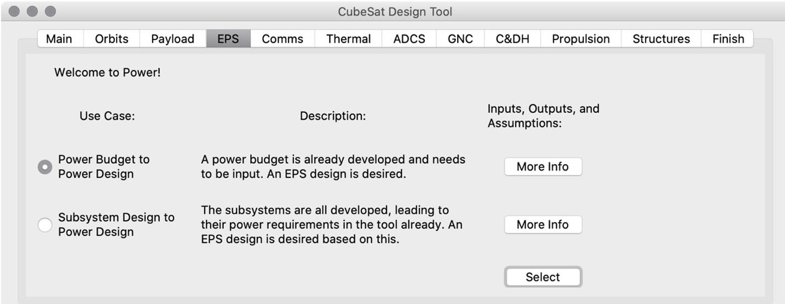

Figure 23. Test Case 2 EPS Use Case Selection

Skipping over to the EPS tab now, seen in Figure 23, the Use Case options are presented, with Use Case 1 being selected for this test. This allows the user to input the power budget directly into the program. Note that if a user wants an explanation of a particular use case, they can select "More Info" for a pop-up with greater detail. After clicking "Select", the Power Budget Input tab within the EPS GUI is now presented. The collected data for the Test Case 2 power budget is then input into the GUI, as demonstrated in Figure 24.

<!-- PDF_PAGE: 87 -->

Input your spacecraft power budget below. If there is a mode that will be the standby or eclipse mode, click the appropriate button to select that mode as it and do not input a duty cycle for that mode. The eclipse mode will automatically scale to calculated maximum eclipse. The standby mode will be found from the time not in other duty cycles.

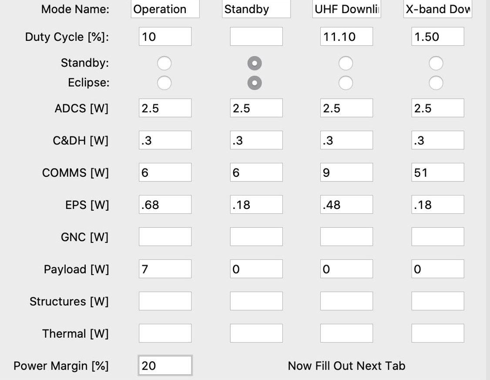

Figure 24. Test Case 2 Power Budget

Next, the design options from PowerSat are used to fill out the EPS Design Input tab. The Custom Design Option is selected within the tab to allow custom parameters to be used. As shown in Figure 25, the values that are available are input into the EPS GUI. Then, the user hits "Submit" to load the values of both tabs and assign them to the already initialized variables for the EPS Design Module. From there, "Close" may be clicked to exit the GUI.

<!-- PDF_PAGE: 88 -->

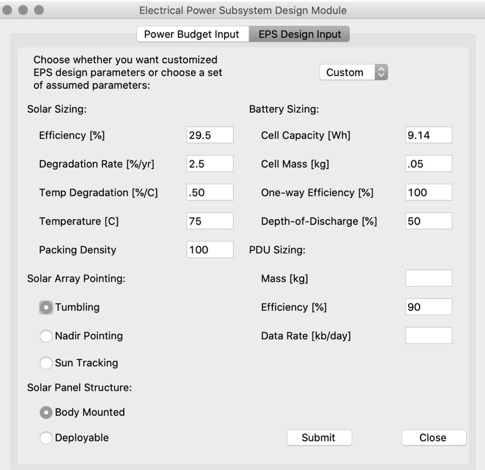

Figure 25. Test Case 2 EPS Design Inputs

Finally, the Conceptual Design Tool reaches the step where the design process of the tool can be executed. This is done by going to the Finish tab, shown in Figure 26, and clicking "Run" to have the Subsystem Design Modules execute their design tools. The final product gets saved in this conceptual design's corresponding Output File, testCase2.csv.

<!-- PDF_PAGE: 89 -->

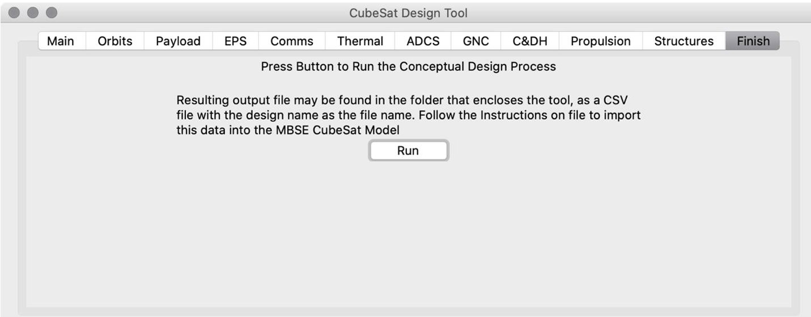

Figure 26. Test Case 2 Finish and Run Tool

## 5.3.3 Results

The resulting Output Files were saved and compared to the expected outcome for each test case. The highlights of the results will be presented here. Note that different values were looked at for each case, as a result of what calculated outputs had directly corresponding values in the source for the test case. For example, Test Case 1's source included minimal information on the actual power generation requirements of the solar panels even though it had the power budget and component sizing well developed.

Table 16. EPS Test Case 1 Results

<table border="1"><tr><td>Parameter</td><td>Calculated Result by the Conceptual Design Tool</td><td>Actual Conceptual Design Results</td><td>Percent Error [%]</td></tr><tr><td>Average Power w/ Margin [W]</td><td>2.65</td><td>2.65</td><td>0.00</td></tr><tr><td>Orbit Energy [Wh]</td><td>4.56</td><td>4.53</td><td>0.66</td></tr><tr><td>Required Battery Capacity [Wh]</td><td>19.69</td><td>18.72</td><td>5.20</td></tr><tr><td>Effective Solar Area[m2]</td><td>0.012</td><td>0.013</td><td>-7.40</td></tr><tr><td>True Solar Area[m2]</td><td>0.038</td><td>0.048</td><td>-19.30</td></tr></table>

The results of Test Case 1, shown in Table 16, were generally good, with the noted exception of the true solar area, which was significantly undersized. The

<!-- PDF_PAGE: 90 -->

discrepancy in battery capacity is likely a result of accounting for degradation rather than allowing for a gradual growth in depth of discharge, which then led to discrepancies in cell count and mass as another cell was needed to account for this. For the effective solar area, there are two suspected reasons for the discrepancies. First off, there was uncertainty over whether temperature degradation was included in Test Case 1's efficiency calculations. Secondly, some values used in creating the solar sizing required reading values from a graph, which is an imperfect process. The discrepancies are much larger for the true solar area than the effective solar area. This is a result of the ratio of the actual solar power generated versus theoretical max solar capacity being 0.28 in the model used to create this conceptual design. Meanwhile, in the EPS Design Module that value is 0.321, resulting in a lower effective solar area.

Table 17. EPS Test Case 2 Results

<table border="1"><tr><td>Parameter</td><td>Calculated Result by the Conceptual Design Tool</td><td>Actual Conceptual Design Results</td><td>Percent Error [%]</td></tr><tr><td>Average Power w/Margin+Losses[W]</td><td>14.36</td><td>14.36</td><td>0.00</td></tr><tr><td>Required Battery Capacity[Wh]</td><td>20.27</td><td>17.03</td><td>19.02</td></tr><tr><td>Number of Battery Cells[-]</td><td>3.00</td><td>2.00</td><td>50</td></tr><tr><td>Average Solar Power in Sunlight[W]</td><td>22.70</td><td>23.10</td><td>-1.73</td></tr><tr><td>Effective Solar Area[m2]</td><td>0.074</td><td>0.073</td><td>0.95</td></tr></table>

Test Case 2 saw accurate values for the power budget and solar sizing, as seen in Table 17. However, the tool's results in Test Case 2 came out to require three battery cells, while the actual design called for two. This was a result of the Conceptual Design Tool considering battery degradation, along with a slightly off actual battery size that was utilized in the comparison. Due to the two cells barely meeting the energy storage requirements, this slight change caused an outsized effect on the number of cells

<!-- PDF_PAGE: 91 -->

required, increasing it by 50%. The low margin within for the battery capacity was realized in the actual PowerSat conceptual design, and CPCL ended up proposing the use of an upsized 4 cell battery [57].

<!-- PDF_PAGE: 92 -->

## Chapter 6

## CONCLUSION

In this chapter, the execution and results of this thesis are reflected on. Lessons learned from the process are presented. Furthermore, the plans for the future work on the CubeSat Conceptual Design Tool are discussed.

## 6.1 Outcome

Three primary outcomes of this thesis can be identified. The first two are the initial development of the CubeSat Conceptual Design Tool and the implementation of the EPS Design Module. These resulted in fulfilling Objectives 1, 2, and 3. The final outcome was the creation of a CubeSat Model that allows the tool to readily integrate its outputs into the rest of the systems engineering process, fulfilling Objective-4.

The first, and arguably most important outcome was the identification and implementation of an architecture for a CubeSat Conceptual Design Tool that met the objectives identified for this project. That is, the Conceptual Design Tool is both faster to utilize than the existing process and more accessible to users with less advanced knowledge. This was completed primarily by having a user-friendly GUI and subsystems that are designed concurrently.

In association with architecting the tool, the EPS Design Module was implemented successfully. It supports the tool by providing a method for sizing a CubeSat's EPS that can work either independently or interconnected with other subsystems. The EPS Design Module also lays the groundwork for future Subsystem Design Modules. These can be based off replications of the EPS Design Module and modified for those subsystems. The architecture of multiple Subsystem Design Tools operating around the Main GUI was demonstrated to be sound as well.

Finally, the CubeSat Model is well under development, and currently has a place for conceptual design results to be imported into for future use. This will then help

<!-- PDF_PAGE: 93 -->

support a CubeSat mission across its life cycle using the structure provided by the CSRM.

## 6.2 Lessons Learned

There were number of lessons learned through this thesis. Some of these were more applicable at an individual level, while others were with respect to the work completed in this thesis.

First off, it was realized that the order of development is critical for the Subsystem Design Modules. Modules may rely on parameters that should be input or calculated in other modules. For example, it was particularly problematic to model the solar power generation without having adequate knowledge of the CubeSat Orbit and ADCS subsystems. Preferably, the order of module development here may have gone Orbit Module, ADCS Module, and then EPS Module. Therefore, this lack of foresight necessitated additional work and changes while developing the EPS Design Module.

Furthermore, the original tool architecture presented in Section 3.1.1 was developed too early. A proper analysis of alternatives was not conducted before effort was expended going down that route. This poor planning resulted in months spent trying to create a CubeSat Conceptual Design Tool that fit within those constraints, rather than working directly towards was eventually created. While plenty of information and insights were gained during that period, it was not the preferable choice. Conducting an analysis of alternatives is critical, even when one is just creating a design tool.

The author was unfamiliar with formalized software development processes prior to the project. Unfortunately, certain best practices for architecting object-oriented programs were learned too late into the program to be utilized effectively. Specifically, it is important to model out class structures, including their inputs, outputs, and variables. Block diagrams can then be created to present the flow of information between the modules, and these can be validated to ensure that all the classes contain what is

<!-- PDF_PAGE: 94 -->

required of them. With the amount of time utilizing elements of the Unified Modeling Language (UML) for MBSE, this is rather ironic, as it was originally created for modeling object-oriented programming. The importance of modeling and planning in software projects will not be disregarded in the future.

## 6.3 Future Work

There is presently a great deal of work remaining to be completed for the CubeSat Conceptual Design Tool. The remaining Subsystem Design Modules require development and integration with the Main GUI and the CubeSat Model needs to be appropriately modified for them. On top of this, potential changes to the implementation of Subsystem Design Modules are recommended here, along with improvements as to how the variables are managed between them. Work to expands the usefulness of the tool by better showing and explaining its results is also proposed, and better methods for tool validation are explored.

## 6.3.1 Continued Subsystem Design Module Development

All of the remaining non-EPS CubeSat subsystems still need to see their modules developed for the Conceptual Design Tool. As mentioned in the previous section, the development order of these subsequent Subsystem Design Modules requires greater thought than previously. This is due to the interdependencies in variables that exist between modules. Some subsystems rely heavily on the results other subsystems, while others, like Orbits, will be able to operate independent of external variables. To deal with these factors, a possible order of future Subsystem Design Module development is shown in Table 18. Also shown here are potential pairings of modules that may be able to be developed concurrently. Modules that share many required parameters or directly influence each other are good candidates for pairing, and with the framework of the tool completed several subsystems may be able to be finished

<!-- PDF_PAGE: 95 -->

in a single effort. The completion of these modules constitutes the core of the remaining future work for this tool.

Table 18. Subsystem Design Module Development Order

<table border="1"><tr><td>Group Order</td><td>Subsystem</td></tr><tr><td>0(under development)</td><td>COM</td></tr><tr><td>1</td><td>Orbits and ADCS</td></tr><tr><td>2</td><td>Payload and Propulsion</td></tr><tr><td>3</td><td>C&DH and GNC</td></tr><tr><td>4</td><td>Structures and Thermal</td></tr></table>

## 6.3.2 Tool Robustness and Variable Management

The CubeSat Conceptual Design Tool was designed to have a long operational life cycle, meaning the tool can function and evolve over the years as CubeSats and the needs of their developers evolve. To enable this, the Design Options within the Assumption File of this tool are designed to easily be changed as technology matures over time, with a simple modification to a CSV file. Also, the Subsystem Design Modules were implemented so they run largely independent from each other, containing their own GUI, running their own calculations, and outputting their own results. Such an architecture allows for the tool to be gradually built and upgraded one subsystem at a time, improving the long-term sustainability of the tool.

However, there is one major weakness in that life-cycle plan, and that is managing the parameters that are utilized by the tool. While parameters are owned by a single Subsystem Design Module, they can be used by any other subsystem. This is a major feature of the tool, allowing design analysis utilizing a wide range of parameters from all subsystems, but it presents a problem during the piece-wise development of the tool. For example, modifications to one module changing or removing a variable can

<!-- PDF_PAGE: 96 -->

break another module that relies on that variable. Furthermore, one subsystem's developer may realize they need a parameter from an already developed subsystem, but that subsystem was not developed to provide said parameter.

It is therefore critical for the parameters used by Subsystem Design Modules and their relationships with other parameters to be actively coordinated during the Conceptual Design Tool's development and sustainment. In order to do this, an interface control document (ICD) should be created, listing all available parameters in the tool for each subsystem, alongside what values they require for development or require them for use. Preferably, this document would be largely completed before all the remaining modules are created, so that future subsystem developers know what parameters they may need to include. However, this would require a multidisciplinary effort to gather the key parameters needed, and would not be a comprehensive list, as individual subsystems would not know all the parameters they use until their developed. An ICD containing the relationships between all of the parameters used by the Conceptual Design Tool is a major step towards building a stable, sustainable tool.

Another important aspect of building robustness into the tool is validating the values being input by the user. Currently, input validation only exists in a few places in the tool, mainly in the form of ensuring the user has made a selection where one is required. However, it has been found that Tkinter has validation attributes available for their data entry widgets that allows the program to check whether the entered values fit within predefined parameters, including numerical ranges and data types [41]. Implementing data entry validation for the current EPS Design Module and with all future subsystems should be completed to ensure the tool is usable even with imperfect users who are likely to mistype something while inputting large amounts of data.

Furthermore, there are changes that can be made to how data is read into the tool and how variables are assigned to be written out of it. Currently, this is done in a

<!-- PDF_PAGE: 97 -->

location-driven manner, meaning that the locations of variables in the CSVs have to be permanently coded into the Subsystem Design Module. However, this is a delicate approach, and one that is readily broken if changes are made to the tool's code or the Assumption File for that module. A better way to access variables from the CSVs would be to use a name-driven look up method, where the tool looks for the variable's name in the CSV file and then assigns the variable to the adjacent data. This method is an improvement over a location-driven process because it allows for modifications to be made to an Assumptions File or a Subsystem Design Module without errors being introduced causing the wrong values to be read into one or more variables. This also makes adding to or modifying the parameters used in a subsystem significantly easier. Fortunately, the Assumption Files already contain the variable names for each parameter, and these are already read into the tool as well. Therefore, it is only a minor change to make the variable assignments based on a name-driven approach rather than using a specific location of an array that is coded into the tool. All future Subsystem Design Modules should follow this adaptable name-driven approach to reading and writing data to the CSVs rather than the inflexible location-driven approach.

## 6.3.3 Results Dashboard

Currently, the results of the design process are only available in the form of a CSV with the Output File. This makes it hard for a user to easily view their results, check their validity, and possibly iterate on the process to get a different design. To this point, creating a GUI-based results dashboard within the Conceptual Design Tool is highly desired. Such a feature would expedite the user's analysis of the results and could even provide an indication of whether the design is a valid result for a CubeSat.

One potential implementation of a results dashboard would be a pop-up window that appears after the tool runs. It could show the main takeaway results from the tool on one tab, with a more detailed breakdown of results by subsystem available in other tabs.

<!-- PDF_PAGE: 98 -->

It could also highlight any values that were assumed when the tool ran because the user did not know them when inputting data. This would let user knows where there is uncertainty in the state of the design. It would also be important that the dashboard provides some interpretation of the results for the user, as they may not know what values are valid or feasible for their design. One way to do this could be by comparing certain resulting design values to preset limits for the estimated CubeSat size that the user chose in the Main GUI.

A potential long-term expansion for the dashboard development effort would be to integrate recommended COTS components for the CubeSat into the viewing of the results. This would require databases of CubeSat components for different subsystems and their specifications to be accessible to the Conceptual Design Tool. At the conclusion of the tool running, the components that fit the resulting design parameters would be selected from the component databases and presented to the user within the dashboard as possible options for them to use for their CubeSat.

## 6.3.4 Continued CubeSat Model Development

Similar to the Conceptual Design Tool, the CubeSat Model requires continued development for the remaining subsystems. This work is mostly adding the packages for each subsystems parameters to be stored in and creating the tables to transfer data into those parameters. However, there is also room for the CubeSat Model to be further developed by potentially developing the requirements package and relating some requirements to results from the Conceptual Design Tool.

It also may be beneficial for a CPCL team member to work on the customization of the CubeSat Model so that the elements of the model fit to their specific CubeSat development process and organizational structure. Eventually, it may even be preferable to split off most of the modeling work from the CubeSat Conceptual Design Tool itself. The CubeSat Model could then be used and maintained by its primary users, while the

<!-- PDF_PAGE: 99 -->

CubeSat Conceptual Design Tool would be the focus developers who specialize in conceptual design.

## 6.3.5 Tool Validation

With many subsystems remaining to be developed, the Subsystem Design Module validation testing will only get more challenging as users have to include more comprehensive test cases that cover all available subsystems. Therefore, a set of universal test cases, that cover the inputs and outputs for every subsystem, would greatly assist future validation campaigns, especially if they could be automatically ran through a test script rather than physically entered into the tool. However, it is recognized that such automation may not be possible under the existing software architecture.

Furthermore, validation should be done on regarding the accessibility of the tool to CubeSat developers. Specifically, this should entail testing the comprehension of instructions available within the CubeSat Conceptual Design Tool and outside of it by users of differing technical backgrounds. It is important that the operation of the tool can be communicated to both experienced CubeSat developers and new users without institutional knowledge for support. Validating the accessibility of the tool should be an ongoing priority.

<!-- PDF_PAGE: 100 -->

[1] NASA. 2007. Systems Engineering Handbook, Revision 1. Washington, DC, USA: National Aeronautics and Space Administration (NASA). NASA/SP-2007-6105.

[2] D. D. Walden, G. J. Roedler, K. Forsberg, R. D. Hamelin, T. M. Shortell, and International Council on Systems Engineering, Eds., Systems engineering handbook: a guide for system life cycle processes and activities, Fourth edition. Hoboken, New Jersey: Wiley, 2015.

[3] Faure, Pauline, "Interview on Cal Poly CubeSat Laboratory Conceptual Design Process and Tools," 2020.

[4] M. Swartwout, C. Jayne, L. Blvd, and S. Louis, "University-Class Spacecraft by the Numbers: Success, Failure, Debris. (But Mostly Success.)," presented at the 30th Annual AIAA/USU Conference on Small Satellites, 2016.

[5] M. Langer and J. Bouwmeester, "Reliability of CubeSats - Statistical Data, Developers' Beliefs and the Way Forward," presented at the 30th Annual AIAA/USU Conference on Small Satellites, 2016.

[6] C. Iwata et al., "Model-Based Systems Engineering in Concurrent Engineering Centers," presented at the AIAA SPACE 2015 Conference and Exposition, Pasadena, California, Aug. 2015. doi: 10.2514/6.2015-4437.

[7] D. Kaslow, P. T. Cahill, and B. Ayres, "Development and Application of the CubeSat System Reference Model," in 2020 IEEE Aerospace Conference, Mar. 2020, pp. 1-15. doi: 10.1109/AERO47225.2020.9172714.

[8] W. Lan, "CubeSat Design Specification (1U-12U) REV 14 CP-CDS-R14." The CubeSat Program, Cal Poly SLO, Jul. 2020.

[9] H. Heidt, J. Puig-Suari, A. Moore, S. Nakasuka, and R. Twiggs, "CubeSat: A New Generation of Picosatellite for Education and Industry Low-Cost Space Experimentation," presented at the 14TH Annual/USU Conference on Small Satellites, Jan. 2001.

[10] A. Alanazi and J. Straub, "Engineering Methodology for Student-Driven CubeSats," Aerospace, vol. 6, no. 5, p. 54, May 2019, doi: 10.3390/aerospace6050054.

[11] E. Kulu, "Nanosatellite & CubeSat Database," Nanosats Database. https://www.nanosats.eu/database.html (accessed May 03, 2021).

[12] M. Swartwout, "CubeSat Database - a." https://sites.google.com/a/slu.edu/swartwout/home/cubesat-database#plots (accessed Dec. 04, 2020).

<!-- PDF_PAGE: 101 -->

[13] E. Mabrouk, "What are SmallSats and CubeSats?," NASA, Mar. 13, 2015. http://www.nasa.gov/content/what-are-smallsats-and-cubesats (accessed May 03, 2021).

[14] R. Hevner, W. Holemans, and R. Twiggs, "An Advanced Standard for CubeSats," presented at the 25thAnnual AIAA/USU Conference on Small Satellites, 2011.

[15] "NASA - NSSDCA - Spacecraft - Details." https://nssdc.gsfc.nasa.gov/nmc/spacecraft/display.action?id=2019-038Y (accessed May 23, 2021).

[16] P. Zarifian et al., "Team Xc: JPL's collaborative design team for exploring CubeSat, NanoSat, and SmallSat-based mission concepts," in 2015 IEEE Aerospace Conference, Mar. 2015, pp. 1-10. doi: 10.1109/AERO.2015.7119221.

[17] "Missions Launched," PolySat. https://www.polysat.org/launched (accessed May 17, 2021).

[18] C. Nieto-Peroy and M. R. Emami, "CubeSat Mission: From Design to Operation," Applied Sciences, vol. 9, no. 15, Art. no. 15, Jan. 2019, doi: 10.3390/app9153110.

[19] P. Faure, "SmallSats and Systems Engineering," S3VI, Jul. 15, 2020.

[20] C. Venturini, "Improving Mission Success of CubeSats | The Aerospace Corporation," The Aerospace Corporation, Jun. 2017. Accessed: May 03, 2021. [Online]. Available: https://aerospace.org/paper/improving-mission-success-cubesats

[21] "CubeSats in University: Using Systems Engineering Tools to Improve Reviews and Knowledge Management," Procedia Computer Science, vol. 153, pp. 63-70, Jan. 2019, doi: 10.1016/j.procs.2019.05.056.

[22] A. McInnes, D. Harps, J. Lang, and C. Swenson, "A Systems Engineering Tool for Small Satellite Design," presented at the 15th Annual AIAA/USU Conference on Small Satellites, 2001. Accessed: Oct. 10, 2020. [Online]. Available: /paper/A Systems-Engineering-Tool-for-Small-Satellite-McInnes Harps/5528cab95fa6732fc3444bf52f21be1162ebfcb1

[23] M. Jacobs and D. Selva, "A CubeSat catalog design tool for a multi-agent architecture development framework," IEEE Aerospace Conference Proceedings, vol. 2015, Jun. 2015, doi: 10.1109/AERO.2015.7119240.

[24] C. Jenkins, R. Hope, A. R. Wilson, and A. Berquand, "STRATHcube : The design of a student CubeSat using concurrent engineering methods," presented at the 9th International Systems & Concurrent Engineering for Space Applications

<!-- PDF_PAGE: 102 -->

Conference (SECESA 2020), Digital, Oct. 2020. Accessed: Nov. 01, 2020. [Online]. Available: https://strathprints.strath.ac.uk/74114/

[25] A. Alanazi and J. Straub, "Engineering Methodology for Student-Driven CubeSats," Aerospace, vol. 6, no. 5, p. 54, May 2019, doi: 10.3390/aerospace6050054.

[26] Y.-K. Chang, K.-L. Hwang, and S.-J. Kang, "SEDT (System Engineering Design Tool) development and its application to small satellite conceptual design," Acta Astronautica, vol. 61, no. 7, pp. 676-690, Oct. 2007, doi: 10.1016/j.actaastro.2007.01.067.

[27] S. Malaek, "A Generic Method For Sizing Satellites Conceptual Design and Rapid Sizing Based on 'Design for Performance' Strategy," IEEE Aerospace and Electronic Systems Magazine, Apr. 2018.

[28] L. Hart, "Introduction To Model-Based System Engineering (MBSE) and SysML," Delaware Valley INCOSE, Jul. 30, 2015.

[29] L. Anderson et al., "Developing and Distributing a CubeSat Model-Based Systems Engineering (MBSE) Reference Model," presented at the 31st Space Symposium, Apr. 2015.

[30] D. Kaslow, B. Ayres, P. Cahill, C. Croney, L. Hart, and A. Levi, "Developing an MBSE CubeSat Reference Model - Interim Status #4," presented at the 2018 AIAA SPACE and Astronautics Forum and Exposition, Sep. 2018. doi: 10.2514/6.2018- 5328.

[31] D. Kaslow, CubeSat System Reference Model. INCOSE - SSWG, 2019.

[32] "Papyrus." https://www.eclipse.org/papyrus/ (accessed May 24, 2021).

[33] "ParaMagic Plugin - CATIA - Dassault Systèmes $ ^{\circ} $." https://www.3ds.com/productsservices/catia/products/no-magic/addons/paramagic-plugin/ (accessed May 18, 2021).

[34] T. Kulkarni et al., "A Model Based Systems Engineering Approach Towards Developing a Rapid Analysis and Trades Environment," in AIAA SPACE 2016, 0 vols., American Institute of Aeronautics and Astronautics, 2016. doi: 10.2514/6.2016-5472.

[35] S. Luther, "SYSML BASED CUBESAT MODEL DESIGN AND INTEGRATION WITH THE HORIZON SIMULATION FRAMEWORK," Master's Theses, Jun. 2016, doi: 10.15368/theses.2016.63.

[36] "History and License — Python 3.9.5 documentation." https://docs.python.org/3/license.html (accessed May 24, 2021).

<!-- PDF_PAGE: 103 -->

[37] "MATLAB - MathWorks." https://www.mathworks.com/products/matlab.html (accessed May 24, 2021).

[38] "9. Classes — Python 3.9.5 documentation."

https://docs.python.org/3/tutorial/classes.html (accessed May 24, 2021).

[39] "IDLE — Python 3.9.5 documentation." https://docs.python.org/3/library/idle.html (accessed May 24, 2021).

[40] "Documentation for Visual Studio Code." https://code.visualstudio.com/docs (accessed May 24, 2021).

[41] "tkinter — Python interface to Tcl/Tk — Python 3.9.5 documentation." https://docs.python.org/3/library/tkinter.html (accessed May 24, 2021).

[42] "csv — CSV File Reading and Writing — Python 3.9.5 documentation." https://docs.python.org/3/library/csv.html (accessed May 24, 2021).

[43] "math — Mathematical functions — Python 3.9.5 documentation." https://docs.python.org/3/library/math.html (accessed May 24, 2021).

[44] "Tad." https://www.tadviewer.com/ (accessed May 23, 2021).

[45] J. Egger, jakob/TableTool. 2021. Accessed: May 23, 2021. [Online]. Available: https://github.com/jakob/TableTool

[46] J. R. Wertz, D. F. Everett, and J. J. Puschell, Eds., Space Mission Engineering: The New SMAD. Hawthorne, CA: Microcosm Press: Sold and distributed worldwide by Microcosm Astronautics Books, 2011.

[47] C. W. Melone, "Preliminary Design, Simulation, and Test of the Electrical Power Subsystem of the TINYSCOPE Nanosatellite," NAVAL POSTGRADUATE SCHOOL, 2009.

[48] S. Sassi, "Power generation and solar panels for an MSU CubeSat," M.Eng., Mississippi State University, United States -- Mississippi, 2016. Accessed: Sep. 21, 2020. [Online]. Available: http://search.proquest.com/docview/1857693641/abstract/B9D2B950661408FPQ/1

[49] "State of the Art of Small Spacecraft Technology," NASA, Ames Research Center, NASA/TP—2020-5008734, Oct. 2020. Accessed: May 24, 2021. [Online]. Available: https://www.nasa.gov/sites/default/files/atoms/files/2020soa_final.pdf

[50] M. R. Patel, Spacecraft Power Systems. Boca Raton: CRC Press, 2005.

[51] T. Etchells and L. Berthoud, "Developing a Power Modelling Tool for CubeSats," presented at the 33rd Annual AIAA/USU Conference on Small Satellites, Jul. 2019.

<!-- PDF_PAGE: 104 -->

[52] A. Tadanki and E. G. Lightsey, "Closing the Power Budget Architecture for a 1U CubeSat Framework," Georgia Institute of Technology. [Online]. Available: https://ssdl.gatech.edu/sites/default/files/ssdl- files/papers/mastersProjects/TadankiA-8900.pdf

[53] V. Knap, L. Vestergaard, and D.-I. Stroe, "A Review of Battery Technology in CubeSats and Small Satellite Solutions," Energies, vol. 13, p. 4097, Aug. 2020, doi: 10.3390/en13164097.

[54] T. Prejean, "NanoRacks CubeSat Deployer (NRCSD) Interface Definition Document (IDD)." NanoRacks, 2018.

[55] B. Xu, A. Oudalov, A. Ulbig, G. Andersson, and D. s Kirschen, "Modeling of Lithium-Ion Battery Degradation for Cell Life Assessment," IEEE Transactions on Smart Grid, vol. 99, pp. 1-1, Jun. 2016, doi: 10.1109/TSG.2016.2578950.

[56] C. W. Melone, "Preliminary Design, Simulation, and Test of the Electrical Power Subsystem of the TINYSCOPE Nanosatellite," p. 202.

[57] P. Faure, "POWERSAT Space Solar Power: a Pathway to a Sustainable Future for Earth and Space Applications," Cal Poly CubeSat Laboratory, Proposal, 2020.

<!-- PDF_PAGE: 105 -->

## APPENDICES

APPENDIX A

CubeSat Conceptual Design Tool and CubeSat Model Files

File Location:

The code for CubeSat Conceptual Design Tool and files for the CubeSat Model are available in the linked GitHub repository:

https://github.com/snogrady/NogradyThesis_CubeSatConceptualDesignTool

Software Used:

CubeSat Conceptual Design Tool:

- Python 3.9

- Appropriate IDE: IDLE or Visual Studio Code recommended

CubeSat Model:

- Eclipse 4.18

- Papyrus 5.0

- SysML 1.4 for Papyrus

<!-- PDF_PAGE: 106 -->

## APPENDIX B

## EPS Design Module Testing Output Files

Test Case 1:

<table border="1"><tr><td>Variable</td><td>Variable Name</td><td>Value-Custom</td><td>Units</td></tr><tr><td>Use Case</td><td>UseCase</td><td>2</td><td>-</td></tr><tr><td>Design Option</td><td>design_option</td><td>Custom</td><td>-</td></tr><tr><td>Average Power</td><td>P_AVG</td><td>2.1001</td><td>W</td></tr><tr><td>Average PDU Power Loss</td><td>P_PDU_loss</td><td>2.33344444</td><td>W</td></tr><tr><td>Power Margin</td><td>P_margin</td><td>0.60669556</td><td>W</td></tr><tr><td>Average Power w/ Margin</td><td>P_AVG_margin</td><td>2.94014</td><td>W</td></tr><tr><td>Percent Power Margin</td><td>per_margin</td><td>26</td><td>%</td></tr><tr><td>Mode 1 Name</td><td>mode1_name</td><td>Low</td><td>-</td></tr><tr><td>Mode 2 Name</td><td>mode2_name</td><td></td><td>-</td></tr><tr><td>Mode 3 Name</td><td>mode3_name</td><td></td><td>-</td></tr><tr><td>Mode 4 Name</td><td>mode4_name</td><td></td><td>-</td></tr><tr><td>Mode 1 Duty Cycle</td><td>mode1_duty</td><td>100</td><td>%</td></tr><tr><td>Mode 2 Duty Cycle</td><td>mode2_duty</td><td>0</td><td>%</td></tr><tr><td>Mode 3 Duty Cycle</td><td>mode3_duty</td><td>0</td><td>%</td></tr><tr><td>Mode 4 Duty Cycle</td><td>mode4_duty</td><td>0</td><td>%</td></tr><tr><td>ADCS Power Mode 1</td><td>ADCS_P1</td><td>0.6381</td><td>W</td></tr><tr><td>ADCS Power Mode 2</td><td>ADCS_P2</td><td>0</td><td>W</td></tr><tr><td>ADCS Power Mode 3</td><td>ADCS_P3</td><td>0</td><td>W</td></tr><tr><td>ADCS Power Mode 4</td><td>ADCS_P4</td><td>0</td><td>W</td></tr><tr><td>ADCS Average Power</td><td>ADCS_AVG</td><td>0.6381</td><td>W</td></tr><tr><td>C&DH Power Mode 1</td><td>CDH_P1</td><td>1.05</td><td>W</td></tr><tr><td>C&DH Power Mode 2</td><td>CDH_P2</td><td>0</td><td>W</td></tr><tr><td>C&DH Power Mode 3</td><td>CDH_P3</td><td>0</td><td>W</td></tr><tr><td>C&DH Power Mode 4</td><td>CDH_P4</td><td>0</td><td>W</td></tr><tr><td>C&DH Average Power</td><td>CDH_AVG</td><td>1.05</td><td>W</td></tr><tr><td>Comms Power Mode 1</td><td>COMM_P1</td><td>0.252</td><td>W</td></tr><tr><td>Comms Power Mode 2</td><td>COMM_P2</td><td>0</td><td>W</td></tr><tr><td>Comms Power Mode 3</td><td>COMM_P3</td><td>0</td><td>W</td></tr><tr><td>Comms Power Mode 4</td><td>COMM_P4</td><td>0</td><td>W</td></tr><tr><td>Comms Average Power</td><td>COMM_AVG</td><td>0.252</td><td>W</td></tr><tr><td>EPS Power Mode 1</td><td>EPS_P1</td><td>0.16</td><td>W</td></tr><tr><td>EPS Power Mode 2</td><td>EPS_P2</td><td>0</td><td>W</td></tr><tr><td>EPS Power Mode 3</td><td>EPS_P3</td><td>0</td><td>W</td></tr></table>

<!-- PDF_PAGE: 107 -->

<table border="1"><tr><td>EPS Power Mode 4</td><td>EPS_P4</td><td>0</td><td>W</td></tr><tr><td>EPS Average Power</td><td>EPS_AVG</td><td>0.16</td><td>W</td></tr><tr><td>GNC Power Mode 1</td><td>GNC_P1</td><td>0</td><td>W</td></tr><tr><td>GNC Power Mode 2</td><td>GNC_P2</td><td>0</td><td>W</td></tr><tr><td>GNC Power Mode 3</td><td>GNC_P3</td><td>0</td><td>W</td></tr><tr><td>GNC Power Mode 4</td><td>GNC_P4</td><td>0</td><td>W</td></tr><tr><td>GNC Average Power</td><td>GNC_AVG</td><td>0</td><td>W</td></tr><tr><td>Payload Power Mode 1</td><td>PAY_P1</td><td>0</td><td>W</td></tr><tr><td>Payload Power Mode 2</td><td>PAY_P2</td><td>0</td><td>W</td></tr><tr><td>Payload Power Mode 3</td><td>PAY_P3</td><td>0</td><td>W</td></tr><tr><td>Payload Power Mode 4</td><td>PAY_P4</td><td>0</td><td>W</td></tr><tr><td>Payload Average Power</td><td>PAY_AVG</td><td>0</td><td>W</td></tr><tr><td>Structure Power Mode 1</td><td>STRU_P1</td><td>0</td><td>W</td></tr><tr><td>Structure Power Mode 2</td><td>STRU_P2</td><td>0</td><td>W</td></tr><tr><td>Structure Power Mode 3</td><td>STRU_P3</td><td>0</td><td>W</td></tr><tr><td>Structure Power Mode 4</td><td>STRU_P4</td><td>0</td><td>W</td></tr><tr><td>Structure Average Power</td><td>STRU_AVG</td><td>0</td><td>W</td></tr><tr><td>Thermal Power Mode 1</td><td>THER_P1</td><td>0</td><td>W</td></tr><tr><td>Thermal Power Mode 2</td><td>THER_P2</td><td>0</td><td>W</td></tr><tr><td>Thermal Power Mode 3</td><td>THER_P3</td><td>0</td><td>W</td></tr><tr><td>Thermal Power Mode 4</td><td>THER_P4</td><td>0</td><td>W</td></tr><tr><td>Thermal Average Power</td><td>THER_AVG</td><td>0</td><td>W</td></tr><tr><td>Solar Cell Efficiency BOL</td><td>SP_eff_bol</td><td>30</td><td>%</td></tr><tr><td>Solar Cell Degradation Rate</td><td>SP_degrad_rate</td><td>2.5</td><td>%/yr</td></tr><tr><td>Solar Cell Temp Degradation</td><td>SP_degrad_temp</td><td>0</td><td>%/C</td></tr><tr><td>Solar Cell Temperature</td><td>SP_temp</td><td>25</td><td>C</td></tr><tr><td>Solar Tracking</td><td>SP_tracking</td><td>1</td><td>-</td></tr><tr><td>Solar Deployable</td><td>SP_deployable</td><td>1</td><td>-</td></tr><tr><td>Solar Packing Density</td><td>SP_packing</td><td>80</td><td>-</td></tr><tr><td>Battery One-way Efficiency</td><td>bat_eff</td><td>95</td><td>%</td></tr><tr><td>Battery Cell Mass</td><td>cell_mass</td><td>0.05</td><td>kg</td></tr><tr><td>Battery Cell Energy Capacity</td><td>cell_cap</td><td>9.36</td><td>Wh</td></tr><tr><td>Battery Depth-of-Discharge</td><td>bat_dod</td><td>10</td><td>%</td></tr><tr><td>PDU Efficiency</td><td>PDU_eff</td><td>90</td><td>%</td></tr><tr><td>PDU Mass</td><td>PDU_mass</td><td>0.1</td><td>kg</td></tr><tr><td>PDU Data Rate</td><td>PDU_data</td><td>1.5</td><td>kb/day</td></tr><tr><td>Solar Flux</td><td>solar_flux</td><td>1367</td><td>W/m^2</td></tr><tr><td>Orbit Energy</td><td>orbit_energy</td><td>4.55563028</td><td>Wh</td></tr><tr><td>Max Eclipse Energy</td><td>eclipse_energy_max</td><td>1.76541478</td><td>Wh</td></tr></table>

<!-- PDF_PAGE: 108 -->

<table border="1"><tr><td>Min Sun Energy</td><td>sun_energy_min</td><td>2.7902155</td><td>Wh</td></tr><tr><td>Battery Round-trip Efficiency</td><td>bat_roundtrip_eff</td><td>90.25</td><td>%</td></tr><tr><td>Battery Cycles</td><td>bat_cycles</td><td>5657.45366</td><td>cycles</td></tr><tr><td>Battery Degradation Rate</td><td>bat_degrad_rate</td><td>5</td><td>%/5000 cycles</td></tr><tr><td>Battery Degradation</td><td>bat_degrad</td><td>0.9436142</td><td>%</td></tr><tr><td>Battery Discharge Energy</td><td>bat_discharge_energy</td><td>1.96937621</td><td>Wh</td></tr><tr><td>Number of Cells in Battery</td><td>num_cells</td><td>3</td><td>-</td></tr><tr><td>Battery Capacity</td><td>bat_cap</td><td>28.08</td><td>Wh</td></tr><tr><td>Battery Mass</td><td>bat_mass</td><td>0.15</td><td>kg</td></tr><tr><td>Solar Cell Efficiency EOL</td><td>SP_eff_eol</td><td>29.25</td><td>%</td></tr><tr><td>Lifetime Degradation</td><td>L_degrad</td><td>0.975</td><td>%</td></tr><tr><td>Temperature Degradation</td><td>T_degrad</td><td>1</td><td>%</td></tr><tr><td>Solar Energy Minimum Sun</td><td>SP_energy_orbit_worst</td><td>4.74635377</td><td>Wh</td></tr><tr><td>Average Solar Power Minimum Sun</td><td>SP_avg_power_worst</td><td>5.00138593</td><td>W</td></tr><tr><td>Solar Power Flux - EOL</td><td>solar_eol</td><td>399.8475</td><td>W/m^2</td></tr><tr><td>Solar Effective Area</td><td>SP_area_effective</td><td>0.01250823</td><td>m^2</td></tr><tr><td>Solar Panel Area</td><td>SP_area</td><td>0.03891871</td><td>m^2</td></tr></table>

Test Case 2:

<table border="1"><tr><td>Variable</td><td>Variable Name</td><td>Value-Custom</td><td>Units</td></tr><tr><td>Use Case</td><td>UseCase</td><td>1</td><td>-</td></tr><tr><td>Design Option</td><td>design_option</td><td>Custom</td><td>-</td></tr><tr><td>Average Power</td><td>P_AVG</td><td>10.7713</td><td>W</td></tr><tr><td>Average PDU Power Loss</td><td>P_PDU_loss</td><td>11.9681111</td><td>W</td></tr><tr><td>Power Margin</td><td>P_margin</td><td>2.39362222</td><td>W</td></tr><tr><td>Average Power w/ Margin</td><td>P_AVG_margin</td><td>14.3617333</td><td>W</td></tr><tr><td>Percent Power Margin</td><td>per_margin</td><td>20</td><td>%</td></tr><tr><td>Mode 1 Name</td><td>mode1_name</td><td>Ops</td><td>-</td></tr><tr><td>Mode 2 Name</td><td>mode2_name</td><td>Standby</td><td>-</td></tr><tr><td>Mode 3 Name</td><td>mode3_name</td><td>UHF</td><td>-</td></tr><tr><td>Mode 4 Name</td><td>mode4_name</td><td>X-Band</td><td>-</td></tr><tr><td>Mode 1 Duty Cycle</td><td>mode1_duty</td><td>10</td><td>%</td></tr><tr><td>Mode 2 Duty Cycle</td><td>mode2_duty</td><td>77.4</td><td>%</td></tr><tr><td>Mode 3 Duty Cycle</td><td>mode3_duty</td><td>11.1</td><td>%</td></tr><tr><td>Mode 4 Duty Cycle</td><td>mode4_duty</td><td>1.5</td><td>%</td></tr><tr><td>ADCS Power Mode 1</td><td>ADCS_P1</td><td>2.5</td><td>W</td></tr><tr><td>ADCS Power Mode 2</td><td>ADCS_P2</td><td>2.5</td><td>W</td></tr></table>

<!-- PDF_PAGE: 109 -->

<table border="1"><tr><td>ADCS Power Mode 3</td><td>ADCS_P3</td><td>2.5</td><td>W</td></tr><tr><td>ADCS Power Mode 4</td><td>ADCS_P4</td><td>2.5</td><td>W</td></tr><tr><td>ADCS Average Power</td><td>ADCS_AVG</td><td>2.5</td><td>W</td></tr><tr><td>C&amp;DH Power Mode 1</td><td>CDH_P1</td><td>0.3</td><td>W</td></tr><tr><td>C&amp;DH Power Mode 2</td><td>CDH_P2</td><td>0.3</td><td>W</td></tr><tr><td>C&amp;DH Power Mode 3</td><td>CDH_P3</td><td>0.3</td><td>W</td></tr><tr><td>C&amp;DH Power Mode 4</td><td>CDH_P4</td><td>0.3</td><td>W</td></tr><tr><td>C&amp;DH Average Power</td><td>CDH_AVG</td><td>0.3</td><td>W</td></tr><tr><td>Comms Power Mode 1</td><td>COMM_P1</td><td>6</td><td>W</td></tr><tr><td>Comms Power Mode 2</td><td>COMM_P2</td><td>6</td><td>W</td></tr><tr><td>Comms Power Mode 3</td><td>COMM_P3</td><td>9</td><td>W</td></tr><tr><td>Comms Power Mode 4</td><td>COMM_P4</td><td>51</td><td>W</td></tr><tr><td>Comms Average Power</td><td>COMM_AVG</td><td>7.008</td><td>W</td></tr><tr><td>EPS Power Mode 1</td><td>EPS_P1</td><td>0.68</td><td>W</td></tr><tr><td>EPS Power Mode 2</td><td>EPS_P2</td><td>0.18</td><td>W</td></tr><tr><td>EPS Power Mode 3</td><td>EPS_P3</td><td>0.48</td><td>W</td></tr><tr><td>EPS Power Mode 4</td><td>EPS_P4</td><td>0.18</td><td>W</td></tr><tr><td>EPS Average Power</td><td>EPS_AVG</td><td>0.2633</td><td>W</td></tr><tr><td>GNC Power Mode 1</td><td>GNC_P1</td><td>0</td><td>W</td></tr><tr><td>GNC Power Mode 2</td><td>GNC_P2</td><td>0</td><td>W</td></tr><tr><td>GNC Power Mode 3</td><td>GNC_P3</td><td>0</td><td>W</td></tr><tr><td>GNC Power Mode 4</td><td>GNC_P4</td><td>0</td><td>W</td></tr><tr><td>GNC Average Power</td><td>GNC_AVG</td><td>0</td><td>W</td></tr><tr><td>Payload Power Mode 1</td><td>PAY_P1</td><td>7</td><td>W</td></tr><tr><td>Payload Power Mode 2</td><td>PAY_P2</td><td>0</td><td>W</td></tr><tr><td>Payload Power Mode 3</td><td>PAY_P3</td><td>0</td><td>W</td></tr><tr><td>Payload Power Mode 4</td><td>PAY_P4</td><td>0</td><td>W</td></tr><tr><td>Payload Average Power</td><td>PAY_AVG</td><td>0.7</td><td>W</td></tr><tr><td>Structure Power Mode 1</td><td>STRU_P1</td><td>0</td><td>W</td></tr><tr><td>Structure Power Mode 2</td><td>STRU_P2</td><td>0</td><td>W</td></tr><tr><td>Structure Power Mode 3</td><td>STRU_P3</td><td>0</td><td>W</td></tr><tr><td>Structure Power Mode 4</td><td>STRU_P4</td><td>0</td><td>W</td></tr><tr><td>Structure Average Power</td><td>STRU_AVG</td><td>0</td><td>W</td></tr><tr><td>Thermal Power Mode 1</td><td>THER_P1</td><td>0</td><td>W</td></tr><tr><td>Thermal Power Mode 2</td><td>THER_P2</td><td>0</td><td>W</td></tr><tr><td>Thermal Power Mode 3</td><td>THER_P3</td><td>0</td><td>W</td></tr><tr><td>Thermal Power Mode 4</td><td>THER_P4</td><td>0</td><td>W</td></tr><tr><td>Thermal Average Power</td><td>THER_AVG</td><td>0</td><td>W</td></tr><tr><td>Solar Cell Efficiency BOL</td><td>SP_eff_bol</td><td>29.5</td><td>%</td></tr></table>

<!-- PDF_PAGE: 110 -->

<table border="1"><tr><td>Solar Cell Degradation Rate</td><td>SP_degrad_rate</td><td>2.5</td><td>%/yr</td></tr><tr><td>Solar Cell Temp Degradation</td><td>SP_degrad_temp</td><td>0.5</td><td>%/C</td></tr><tr><td>Solar Cell Temperature</td><td>SP_temp</td><td>75</td><td>C</td></tr><tr><td>Solar Tracking</td><td>SP_tracking</td><td>1</td><td>-</td></tr><tr><td>Solar Deployable</td><td>SP_deployable</td><td>1</td><td>-</td></tr><tr><td>Solar Packing Density</td><td>SP_packing</td><td>1</td><td>-</td></tr><tr><td>Battery One-way Efficiency</td><td>bat_eff</td><td>100</td><td>%</td></tr><tr><td>Battery Cell Mass</td><td>cell_mass</td><td>0.05</td><td>kg</td></tr><tr><td>Battery Cell Energy Capacity</td><td>cell_cap</td><td>9.14</td><td>Wh</td></tr><tr><td>Battery Depth-of-Discharge</td><td>bat_dod</td><td>50</td><td>%</td></tr><tr><td>PDU Efficiency</td><td>PDU_eff</td><td>90</td><td>%</td></tr><tr><td>PDU Mass</td><td>PDU_mass</td><td>0.1</td><td>kg</td></tr><tr><td>PDU Data Rate</td><td>PDU_data</td><td>1.5</td><td>kb/day</td></tr><tr><td>Solar Flux</td><td>solar_flux</td><td>1367</td><td>W/m^2</td></tr><tr><td>Orbit Energy</td><td>orbit_energy</td><td>23.1425935</td><td>Wh</td></tr><tr><td>Max Eclipse Energy</td><td>eclipse_energy_max</td><td>8.49414134</td><td>Wh</td></tr><tr><td>Min Sun Energy</td><td>sun_energy_min</td><td>14.6484521</td><td>Wh</td></tr><tr><td>Battery Round-trip Efficiency</td><td>bat_roundtrip_eff</td><td>100</td><td>%</td></tr><tr><td>Battery Cycles</td><td>bat_cycles</td><td>5439.96741</td><td>cycles</td></tr><tr><td>Battery Degradation Rate</td><td>bat_degrad_rate</td><td>15</td><td>%/5000 cycles</td></tr><tr><td>Battery Degradation</td><td>bat_degrad</td><td>0.83793099</td><td>%</td></tr><tr><td>Battery Discharge Energy</td><td>bat_discharge_energy</td><td>10.1370417</td><td>Wh</td></tr><tr><td>Number of Cells in Battery</td><td>num_cells</td><td>3</td><td>-</td></tr><tr><td>Battery Capacity</td><td>bat_cap</td><td>27.42</td><td>Wh</td></tr><tr><td>Battery Mass</td><td>bat_mass</td><td>0.15</td><td>kg</td></tr><tr><td>Solar Cell Efficiency EOL</td><td>SP_eff_eol</td><td>22.3862149</td><td>%</td></tr><tr><td>Lifetime Degradation</td><td>L_degrad</td><td>0.975</td><td>%</td></tr><tr><td>Temperature Degradation</td><td>T_degrad</td><td>0.77831256</td><td>%</td></tr><tr><td>Solar Energy Minimum Sun</td><td>SP_energy_orbit_worst</td><td>23.1425935</td><td>Wh</td></tr><tr><td>Average Solar Power Minimum Sun</td><td>SP_avg_power_worst</td><td>22.6896161</td><td>W</td></tr><tr><td>Solar Power Flux - EOL</td><td>solar_eol</td><td>306.019558</td><td>W/m^2</td></tr><tr><td>Solar Effective Area</td><td>SP_area_effective</td><td>0.07414433</td><td>m^2</td></tr><tr><td>Solar Panel Area</td><td>SP_area</td><td>0.23069621</td><td>m^2</td></tr></table>